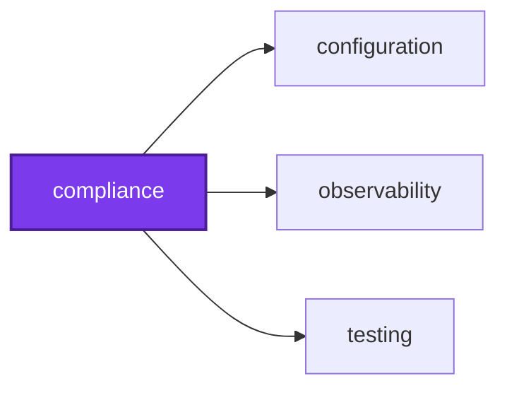
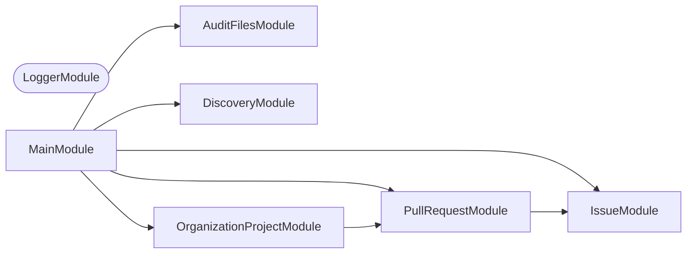

## 🕸️ Codependix

Dependency graphs exported by [codependix](https://github.com/Organizzolini/codebase/tree/main/projects/ic-suite/codependix/codependix-cli), regenerated by `nx run configuration:codependix:write`.

### Nx Neighborhood

<!-- codependix:start name="codependix-nx-projects" -->

<!-- codependix:end name="codependix-nx-projects" -->

### NestJS Module Graph

<!-- codependix:start name="codependix-nestjs-modules" -->


_Rounded modules are global: every module can inject them, so their edges are left out._
<!-- codependix:end name="codependix-nestjs-modules" -->

### File Imports

<!-- codependix:start name="codependix-file-imports" -->
```mermaid
graph LR
  file_configuration_callidescope_config_ts["configuration/callidescope.config.ts"]
  file_configuration_codependix_config_ts["configuration/codependix.config.ts"]
  file_configuration_codometer_config_ts["configuration/codometer.config.ts"]
  file_configuration_coinagerie_config_ts["configuration/coinagerie.config.ts"]
  file_configuration_eslint_config_ts["configuration/eslint.config.ts"]
  file_configuration_vitest_config_ts["configuration/vitest.config.ts"]
  file_src_compliance_constants_ts["src/compliance.constants.ts"]
  file_src_compliance_main_end_to_end_test_ts["src/compliance.main.end-to-end.test.ts"]
  file_src_compliance_main_ts["src/compliance.main.ts"]
  file_src_compliance_module_ts["src/compliance.module.ts"]
  file_src_compliance_repl_ts["src/compliance.repl.ts"]
  file_src_modules_audit_files_audit_files_command_ts["src/modules/audit-files/audit-files.command.ts"]
  file_src_modules_audit_files_audit_files_command_unit_test_ts["src/modules/audit-files/audit-files.command.unit.test.ts"]
  file_src_modules_audit_files_audit_files_constants_ts["src/modules/audit-files/audit-files.constants.ts"]
  file_src_modules_audit_files_audit_files_module_ts["src/modules/audit-files/audit-files.module.ts"]
  file_src_modules_audit_files_audit_files_module_unit_test_ts["src/modules/audit-files/audit-files.module.unit.test.ts"]
  file_src_modules_audit_files_audit_files_service_ts["src/modules/audit-files/audit-files.service.ts"]
  file_src_modules_audit_files_audit_files_service_unit_test_ts["src/modules/audit-files/audit-files.service.unit.test.ts"]
  file_src_modules_audit_files_audit_files_types_ts["src/modules/audit-files/audit-files.types.ts"]
  file_src_modules_issue_issue_report_service_ts["src/modules/issue/issue-report.service.ts"]
  file_src_modules_issue_issue_report_service_unit_test_ts["src/modules/issue/issue-report.service.unit.test.ts"]
  file_src_modules_issue_issue_command_ts["src/modules/issue/issue.command.ts"]
  file_src_modules_issue_issue_command_unit_test_ts["src/modules/issue/issue.command.unit.test.ts"]
  file_src_modules_issue_issue_constants_ts["src/modules/issue/issue.constants.ts"]
  file_src_modules_issue_issue_module_ts["src/modules/issue/issue.module.ts"]
  file_src_modules_issue_issue_module_unit_test_ts["src/modules/issue/issue.module.unit.test.ts"]
  file_src_modules_issue_issue_types_ts["src/modules/issue/issue.types.ts"]
  file_src_modules_issue_modules_assignees_issue_assignees_constants_ts["src/modules/issue/modules/assignees/issue-assignees.constants.ts"]
  file_src_modules_issue_modules_assignees_issue_assignees_types_ts["src/modules/issue/modules/assignees/issue-assignees.types.ts"]
  file_src_modules_issue_modules_assignees_issue_assigning_service_ts["src/modules/issue/modules/assignees/issue-assigning.service.ts"]
  file_src_modules_issue_modules_assignees_issue_assigning_service_unit_test_ts["src/modules/issue/modules/assignees/issue-assigning.service.unit.test.ts"]
  file_src_modules_issue_modules_audit_issue_audit_service_ts["src/modules/issue/modules/audit/issue-audit.service.ts"]
  file_src_modules_issue_modules_audit_issue_audit_service_unit_test_ts["src/modules/issue/modules/audit/issue-audit.service.unit.test.ts"]
  file_src_modules_issue_modules_audit_issue_plan_service_ts["src/modules/issue/modules/audit/issue-plan.service.ts"]
  file_src_modules_issue_modules_audit_issue_plan_service_unit_test_ts["src/modules/issue/modules/audit/issue-plan.service.unit.test.ts"]
  file_src_modules_issue_modules_fields_issue_fields_constants_ts["src/modules/issue/modules/fields/issue-fields.constants.ts"]
  file_src_modules_issue_modules_fields_issue_fields_service_ts["src/modules/issue/modules/fields/issue-fields.service.ts"]
  file_src_modules_issue_modules_fields_issue_fields_service_unit_test_ts["src/modules/issue/modules/fields/issue-fields.service.unit.test.ts"]
  file_src_modules_issue_modules_fields_issue_fields_types_ts["src/modules/issue/modules/fields/issue-fields.types.ts"]
  file_src_modules_issue_modules_github_issue_github_service_ts["src/modules/issue/modules/github/issue-github.service.ts"]
  file_src_modules_issue_modules_github_issue_github_service_unit_test_ts["src/modules/issue/modules/github/issue-github.service.unit.test.ts"]
  file_src_modules_issue_modules_labels_issue_labeling_service_ts["src/modules/issue/modules/labels/issue-labeling.service.ts"]
  file_src_modules_issue_modules_labels_issue_labeling_service_unit_test_ts["src/modules/issue/modules/labels/issue-labeling.service.unit.test.ts"]
  file_src_modules_issue_modules_labels_issue_labels_service_ts["src/modules/issue/modules/labels/issue-labels.service.ts"]
  file_src_modules_issue_modules_labels_issue_labels_service_unit_test_ts["src/modules/issue/modules/labels/issue-labels.service.unit.test.ts"]
  file_src_modules_issue_modules_metadata_issue_metadata_type_service_ts["src/modules/issue/modules/metadata/issue-metadata-type.service.ts"]
  file_src_modules_issue_modules_metadata_issue_metadata_type_service_unit_test_ts["src/modules/issue/modules/metadata/issue-metadata-type.service.unit.test.ts"]
  file_src_modules_issue_modules_metadata_issue_metadata_constants_ts["src/modules/issue/modules/metadata/issue-metadata.constants.ts"]
  file_src_modules_issue_modules_metadata_issue_metadata_service_ts["src/modules/issue/modules/metadata/issue-metadata.service.ts"]
  file_src_modules_issue_modules_metadata_issue_metadata_service_unit_test_ts["src/modules/issue/modules/metadata/issue-metadata.service.unit.test.ts"]
  file_src_modules_issue_modules_metadata_issue_metadata_types_ts["src/modules/issue/modules/metadata/issue-metadata.types.ts"]
  file_src_modules_organization_project_organization_project_command_ts["src/modules/organization-project/organization-project.command.ts"]
  file_src_modules_organization_project_organization_project_command_unit_test_ts["src/modules/organization-project/organization-project.command.unit.test.ts"]
  file_src_modules_organization_project_organization_project_constants_ts["src/modules/organization-project/organization-project.constants.ts"]
  file_src_modules_organization_project_organization_project_module_ts["src/modules/organization-project/organization-project.module.ts"]
  file_src_modules_organization_project_organization_project_module_unit_test_ts["src/modules/organization-project/organization-project.module.unit.test.ts"]
  file_src_modules_organization_project_organization_project_types_ts["src/modules/organization-project/organization-project.types.ts"]
  file_src_modules_pull_request_modules_body_pull_request_body_links_constants_ts["src/modules/pull-request/modules/body/pull-request-body-links.constants.ts"]
  file_src_modules_pull_request_modules_body_pull_request_body_links_service_ts["src/modules/pull-request/modules/body/pull-request-body-links.service.ts"]
  file_src_modules_pull_request_modules_body_pull_request_body_links_service_unit_test_ts["src/modules/pull-request/modules/body/pull-request-body-links.service.unit.test.ts"]
  file_src_modules_pull_request_modules_body_pull_request_body_constants_ts["src/modules/pull-request/modules/body/pull-request-body.constants.ts"]
  file_src_modules_pull_request_modules_body_pull_request_body_service_ts["src/modules/pull-request/modules/body/pull-request-body.service.ts"]
  file_src_modules_pull_request_modules_body_pull_request_body_service_unit_test_ts["src/modules/pull-request/modules/body/pull-request-body.service.unit.test.ts"]
  file_src_modules_pull_request_modules_body_pull_request_body_types_ts["src/modules/pull-request/modules/body/pull-request-body.types.ts"]
  file_src_modules_pull_request_modules_context_pull_request_context_constants_ts["src/modules/pull-request/modules/context/pull-request-context.constants.ts"]
  file_src_modules_pull_request_modules_context_pull_request_context_service_ts["src/modules/pull-request/modules/context/pull-request-context.service.ts"]
  file_src_modules_pull_request_modules_context_pull_request_context_service_unit_test_ts["src/modules/pull-request/modules/context/pull-request-context.service.unit.test.ts"]
  file_src_modules_pull_request_modules_context_pull_request_context_types_ts["src/modules/pull-request/modules/context/pull-request-context.types.ts"]
  file_src_modules_pull_request_modules_github_pull_request_github_constants_ts["src/modules/pull-request/modules/github/pull-request-github.constants.ts"]
  file_src_modules_pull_request_modules_github_pull_request_github_service_ts["src/modules/pull-request/modules/github/pull-request-github.service.ts"]
  file_src_modules_pull_request_modules_github_pull_request_github_service_unit_test_ts["src/modules/pull-request/modules/github/pull-request-github.service.unit.test.ts"]
  file_src_modules_pull_request_modules_github_pull_request_github_types_ts["src/modules/pull-request/modules/github/pull-request-github.types.ts"]
  file_src_modules_pull_request_modules_labels_pull_request_label_vocabulary_service_ts["src/modules/pull-request/modules/labels/pull-request-label-vocabulary.service.ts"]
  file_src_modules_pull_request_modules_labels_pull_request_label_vocabulary_service_unit_test_ts["src/modules/pull-request/modules/labels/pull-request-label-vocabulary.service.unit.test.ts"]
  file_src_modules_pull_request_modules_labels_pull_request_labels_assignees_constants_ts["src/modules/pull-request/modules/labels/pull-request-labels-assignees.constants.ts"]
  file_src_modules_pull_request_modules_labels_pull_request_labels_assignees_service_ts["src/modules/pull-request/modules/labels/pull-request-labels-assignees.service.ts"]
  file_src_modules_pull_request_modules_labels_pull_request_labels_assignees_service_unit_test_ts["src/modules/pull-request/modules/labels/pull-request-labels-assignees.service.unit.test.ts"]
  file_src_modules_pull_request_modules_labels_pull_request_labels_assignees_types_ts["src/modules/pull-request/modules/labels/pull-request-labels-assignees.types.ts"]
  file_src_modules_pull_request_modules_labels_pull_request_labels_constants_ts["src/modules/pull-request/modules/labels/pull-request-labels.constants.ts"]
  file_src_modules_pull_request_modules_labels_pull_request_labels_service_ts["src/modules/pull-request/modules/labels/pull-request-labels.service.ts"]
  file_src_modules_pull_request_modules_labels_pull_request_labels_service_unit_test_ts["src/modules/pull-request/modules/labels/pull-request-labels.service.unit.test.ts"]
  file_src_modules_pull_request_modules_labels_pull_request_labels_types_ts["src/modules/pull-request/modules/labels/pull-request-labels.types.ts"]
  file_src_modules_pull_request_modules_linked_issues_pull_request_ancestor_issues_service_ts["src/modules/pull-request/modules/linked-issues/pull-request-ancestor-issues.service.ts"]
  file_src_modules_pull_request_modules_linked_issues_pull_request_ancestor_issues_service_unit_test_ts["src/modules/pull-request/modules/linked-issues/pull-request-ancestor-issues.service.unit.test.ts"]
  file_src_modules_pull_request_modules_linked_issues_pull_request_descendant_issues_service_ts["src/modules/pull-request/modules/linked-issues/pull-request-descendant-issues.service.ts"]
  file_src_modules_pull_request_modules_linked_issues_pull_request_descendant_issues_service_unit_test_ts["src/modules/pull-request/modules/linked-issues/pull-request-descendant-issues.service.unit.test.ts"]
  file_src_modules_pull_request_modules_linked_issues_pull_request_linked_issues_constants_ts["src/modules/pull-request/modules/linked-issues/pull-request-linked-issues.constants.ts"]
  file_src_modules_pull_request_modules_linked_issues_pull_request_linked_issues_service_ts["src/modules/pull-request/modules/linked-issues/pull-request-linked-issues.service.ts"]
  file_src_modules_pull_request_modules_linked_issues_pull_request_linked_issues_service_unit_test_ts["src/modules/pull-request/modules/linked-issues/pull-request-linked-issues.service.unit.test.ts"]
  file_src_modules_pull_request_modules_linked_issues_pull_request_linked_issues_types_ts["src/modules/pull-request/modules/linked-issues/pull-request-linked-issues.types.ts"]
  file_src_modules_pull_request_modules_release_significance_pull_request_release_significance_constants_ts["src/modules/pull-request/modules/release-significance/pull-request-release-significance.constants.ts"]
  file_src_modules_pull_request_modules_release_significance_pull_request_release_significance_service_ts["src/modules/pull-request/modules/release-significance/pull-request-release-significance.service.ts"]
  file_src_modules_pull_request_modules_release_significance_pull_request_release_significance_service_unit_test_ts["src/modules/pull-request/modules/release-significance/pull-request-release-significance.service.unit.test.ts"]
  file_src_modules_pull_request_modules_release_significance_pull_request_release_significance_types_ts["src/modules/pull-request/modules/release-significance/pull-request-release-significance.types.ts"]
  file_src_modules_pull_request_modules_title_pull_request_title_constants_ts["src/modules/pull-request/modules/title/pull-request-title.constants.ts"]
  file_src_modules_pull_request_modules_title_pull_request_title_service_ts["src/modules/pull-request/modules/title/pull-request-title.service.ts"]
  file_src_modules_pull_request_modules_title_pull_request_title_service_unit_test_ts["src/modules/pull-request/modules/title/pull-request-title.service.unit.test.ts"]
  file_src_modules_pull_request_pull_request_report_service_ts["src/modules/pull-request/pull-request-report.service.ts"]
  file_src_modules_pull_request_pull_request_report_service_unit_test_ts["src/modules/pull-request/pull-request-report.service.unit.test.ts"]
  file_src_modules_pull_request_pull_request_validation_service_ts["src/modules/pull-request/pull-request-validation.service.ts"]
  file_src_modules_pull_request_pull_request_validation_service_unit_test_ts["src/modules/pull-request/pull-request-validation.service.unit.test.ts"]
  file_src_modules_pull_request_pull_request_command_ts["src/modules/pull-request/pull-request.command.ts"]
  file_src_modules_pull_request_pull_request_command_unit_test_ts["src/modules/pull-request/pull-request.command.unit.test.ts"]
  file_src_modules_pull_request_pull_request_constants_ts["src/modules/pull-request/pull-request.constants.ts"]
  file_src_modules_pull_request_pull_request_module_ts["src/modules/pull-request/pull-request.module.ts"]
  file_src_modules_pull_request_pull_request_module_unit_test_ts["src/modules/pull-request/pull-request.module.unit.test.ts"]
  file_src_modules_pull_request_pull_request_types_ts["src/modules/pull-request/pull-request.types.ts"]
  file_testing_mocks_ts["testing/mocks.ts"]
  file_src_compliance_main_end_to_end_test_ts --> file_src_compliance_constants_ts
  file_src_compliance_main_end_to_end_test_ts --> file_testing_mocks_ts
  file_src_compliance_main_ts --> file_src_compliance_module_ts
  file_src_compliance_module_ts --> file_src_compliance_constants_ts
  file_src_compliance_module_ts --> file_src_modules_audit_files_audit_files_module_ts
  file_src_compliance_module_ts --> file_src_modules_issue_issue_module_ts
  file_src_compliance_module_ts --> file_src_modules_organization_project_organization_project_module_ts
  file_src_compliance_module_ts --> file_src_modules_pull_request_pull_request_module_ts
  file_src_compliance_repl_ts --> file_src_compliance_module_ts
  file_src_modules_audit_files_audit_files_command_ts --> file_src_modules_audit_files_audit_files_service_ts
  file_src_modules_audit_files_audit_files_command_ts --> file_src_modules_audit_files_audit_files_types_ts
  file_src_modules_audit_files_audit_files_command_unit_test_ts --> file_src_modules_audit_files_audit_files_command_ts
  file_src_modules_audit_files_audit_files_command_unit_test_ts --> file_src_modules_audit_files_audit_files_service_ts
  file_src_modules_audit_files_audit_files_command_unit_test_ts --> file_testing_mocks_ts
  file_src_modules_audit_files_audit_files_module_ts --> file_src_modules_audit_files_audit_files_command_ts
  file_src_modules_audit_files_audit_files_module_ts --> file_src_modules_audit_files_audit_files_service_ts
  file_src_modules_audit_files_audit_files_module_unit_test_ts --> file_src_modules_audit_files_audit_files_command_ts
  file_src_modules_audit_files_audit_files_module_unit_test_ts --> file_src_modules_audit_files_audit_files_module_ts
  file_src_modules_audit_files_audit_files_module_unit_test_ts --> file_src_modules_audit_files_audit_files_service_ts
  file_src_modules_audit_files_audit_files_service_ts --> file_src_modules_audit_files_audit_files_constants_ts
  file_src_modules_audit_files_audit_files_service_ts --> file_src_modules_audit_files_audit_files_types_ts
  file_src_modules_audit_files_audit_files_service_unit_test_ts --> file_src_modules_audit_files_audit_files_service_ts
  file_src_modules_issue_issue_report_service_ts --> file_src_modules_issue_issue_types_ts
  file_src_modules_issue_issue_report_service_ts --> file_src_modules_issue_modules_metadata_issue_metadata_constants_ts
  file_src_modules_issue_issue_report_service_unit_test_ts --> file_src_modules_issue_issue_report_service_ts
  file_src_modules_issue_issue_command_ts --> file_src_modules_issue_issue_report_service_ts
  file_src_modules_issue_issue_command_ts --> file_src_modules_issue_issue_types_ts
  file_src_modules_issue_issue_command_ts --> file_src_modules_issue_modules_assignees_issue_assigning_service_ts
  file_src_modules_issue_issue_command_ts --> file_src_modules_issue_modules_audit_issue_audit_service_ts
  file_src_modules_issue_issue_command_ts --> file_src_modules_issue_modules_audit_issue_plan_service_ts
  file_src_modules_issue_issue_command_ts --> file_src_modules_issue_modules_labels_issue_labeling_service_ts
  file_src_modules_issue_issue_command_unit_test_ts --> file_src_modules_issue_issue_report_service_ts
  file_src_modules_issue_issue_command_unit_test_ts --> file_src_modules_issue_issue_command_ts
  file_src_modules_issue_issue_command_unit_test_ts --> file_src_modules_issue_issue_types_ts
  file_src_modules_issue_issue_command_unit_test_ts --> file_src_modules_issue_modules_assignees_issue_assigning_service_ts
  file_src_modules_issue_issue_command_unit_test_ts --> file_src_modules_issue_modules_audit_issue_audit_service_ts
  file_src_modules_issue_issue_command_unit_test_ts --> file_src_modules_issue_modules_audit_issue_plan_service_ts
  file_src_modules_issue_issue_command_unit_test_ts --> file_src_modules_issue_modules_labels_issue_labeling_service_ts
  file_src_modules_issue_issue_command_unit_test_ts --> file_testing_mocks_ts
  file_src_modules_issue_issue_module_ts --> file_src_modules_issue_issue_report_service_ts
  file_src_modules_issue_issue_module_ts --> file_src_modules_issue_issue_command_ts
  file_src_modules_issue_issue_module_ts --> file_src_modules_issue_modules_assignees_issue_assigning_service_ts
  file_src_modules_issue_issue_module_ts --> file_src_modules_issue_modules_audit_issue_audit_service_ts
  file_src_modules_issue_issue_module_ts --> file_src_modules_issue_modules_audit_issue_plan_service_ts
  file_src_modules_issue_issue_module_ts --> file_src_modules_issue_modules_fields_issue_fields_service_ts
  file_src_modules_issue_issue_module_ts --> file_src_modules_issue_modules_github_issue_github_service_ts
  file_src_modules_issue_issue_module_ts --> file_src_modules_issue_modules_labels_issue_labeling_service_ts
  file_src_modules_issue_issue_module_ts --> file_src_modules_issue_modules_labels_issue_labels_service_ts
  file_src_modules_issue_issue_module_ts --> file_src_modules_issue_modules_metadata_issue_metadata_type_service_ts
  file_src_modules_issue_issue_module_ts --> file_src_modules_issue_modules_metadata_issue_metadata_service_ts
  file_src_modules_issue_issue_module_unit_test_ts --> file_src_modules_issue_issue_report_service_ts
  file_src_modules_issue_issue_module_unit_test_ts --> file_src_modules_issue_issue_command_ts
  file_src_modules_issue_issue_module_unit_test_ts --> file_src_modules_issue_issue_module_ts
  file_src_modules_issue_issue_module_unit_test_ts --> file_src_modules_issue_modules_assignees_issue_assigning_service_ts
  file_src_modules_issue_issue_module_unit_test_ts --> file_src_modules_issue_modules_audit_issue_audit_service_ts
  file_src_modules_issue_issue_module_unit_test_ts --> file_src_modules_issue_modules_audit_issue_plan_service_ts
  file_src_modules_issue_issue_module_unit_test_ts --> file_src_modules_issue_modules_github_issue_github_service_ts
  file_src_modules_issue_issue_module_unit_test_ts --> file_src_modules_issue_modules_labels_issue_labeling_service_ts
  file_src_modules_issue_issue_module_unit_test_ts --> file_src_modules_issue_modules_labels_issue_labels_service_ts
  file_src_modules_issue_issue_module_unit_test_ts --> file_src_modules_issue_modules_metadata_issue_metadata_type_service_ts
  file_src_modules_issue_issue_module_unit_test_ts --> file_src_modules_issue_modules_metadata_issue_metadata_service_ts
  file_src_modules_issue_modules_assignees_issue_assigning_service_ts --> file_src_modules_issue_issue_types_ts
  file_src_modules_issue_modules_assignees_issue_assigning_service_ts --> file_src_modules_issue_modules_assignees_issue_assignees_constants_ts
  file_src_modules_issue_modules_assignees_issue_assigning_service_ts --> file_src_modules_issue_modules_github_issue_github_service_ts
  file_src_modules_issue_modules_assignees_issue_assigning_service_unit_test_ts --> file_src_modules_issue_modules_assignees_issue_assigning_service_ts
  file_src_modules_issue_modules_assignees_issue_assigning_service_unit_test_ts --> file_src_modules_issue_modules_github_issue_github_service_ts
  file_src_modules_issue_modules_assignees_issue_assigning_service_unit_test_ts --> file_src_modules_issue_modules_metadata_issue_metadata_types_ts
  file_src_modules_issue_modules_audit_issue_audit_service_ts --> file_src_modules_issue_issue_types_ts
  file_src_modules_issue_modules_audit_issue_audit_service_ts --> file_src_modules_issue_modules_github_issue_github_service_ts
  file_src_modules_issue_modules_audit_issue_audit_service_ts --> file_src_modules_issue_modules_metadata_issue_metadata_service_ts
  file_src_modules_issue_modules_audit_issue_audit_service_ts --> file_src_modules_issue_modules_metadata_issue_metadata_types_ts
  file_src_modules_issue_modules_audit_issue_audit_service_unit_test_ts --> file_src_modules_issue_modules_audit_issue_audit_service_ts
  file_src_modules_issue_modules_audit_issue_audit_service_unit_test_ts --> file_src_modules_issue_modules_github_issue_github_service_ts
  file_src_modules_issue_modules_audit_issue_audit_service_unit_test_ts --> file_src_modules_issue_modules_metadata_issue_metadata_service_ts
  file_src_modules_issue_modules_audit_issue_plan_service_ts --> file_src_modules_issue_issue_constants_ts
  file_src_modules_issue_modules_audit_issue_plan_service_ts --> file_src_modules_issue_issue_types_ts
  file_src_modules_issue_modules_audit_issue_plan_service_ts --> file_src_modules_issue_modules_metadata_issue_metadata_constants_ts
  file_src_modules_issue_modules_audit_issue_plan_service_unit_test_ts --> file_src_modules_issue_modules_audit_issue_plan_service_ts
  file_src_modules_issue_modules_fields_issue_fields_service_ts --> file_src_modules_issue_modules_fields_issue_fields_constants_ts
  file_src_modules_issue_modules_fields_issue_fields_service_ts --> file_src_modules_issue_modules_fields_issue_fields_types_ts
  file_src_modules_issue_modules_fields_issue_fields_service_unit_test_ts --> file_src_modules_issue_modules_fields_issue_fields_constants_ts
  file_src_modules_issue_modules_fields_issue_fields_service_unit_test_ts --> file_src_modules_issue_modules_fields_issue_fields_service_ts
  file_src_modules_issue_modules_fields_issue_fields_types_ts --> file_src_modules_issue_modules_metadata_issue_metadata_types_ts
  file_src_modules_issue_modules_github_issue_github_service_ts --> file_src_modules_issue_modules_assignees_issue_assignees_constants_ts
  file_src_modules_issue_modules_github_issue_github_service_ts --> file_src_modules_issue_modules_assignees_issue_assignees_types_ts
  file_src_modules_issue_modules_github_issue_github_service_ts --> file_src_modules_issue_modules_fields_issue_fields_constants_ts
  file_src_modules_issue_modules_github_issue_github_service_ts --> file_src_modules_issue_modules_fields_issue_fields_types_ts
  file_src_modules_issue_modules_github_issue_github_service_ts --> file_src_modules_issue_modules_metadata_issue_metadata_constants_ts
  file_src_modules_issue_modules_github_issue_github_service_ts --> file_src_modules_issue_modules_metadata_issue_metadata_types_ts
  file_src_modules_issue_modules_github_issue_github_service_unit_test_ts --> file_src_modules_issue_modules_github_issue_github_service_ts
  file_src_modules_issue_modules_github_issue_github_service_unit_test_ts --> file_src_modules_issue_modules_metadata_issue_metadata_constants_ts
  file_src_modules_issue_modules_labels_issue_labeling_service_ts --> file_src_modules_issue_modules_github_issue_github_service_ts
  file_src_modules_issue_modules_labels_issue_labeling_service_ts --> file_src_modules_issue_modules_labels_issue_labels_service_ts
  file_src_modules_issue_modules_labels_issue_labeling_service_unit_test_ts --> file_src_modules_issue_modules_github_issue_github_service_ts
  file_src_modules_issue_modules_labels_issue_labeling_service_unit_test_ts --> file_src_modules_issue_modules_labels_issue_labeling_service_ts
  file_src_modules_issue_modules_labels_issue_labeling_service_unit_test_ts --> file_src_modules_issue_modules_labels_issue_labels_service_ts
  file_src_modules_issue_modules_labels_issue_labels_service_ts --> file_src_modules_issue_modules_metadata_issue_metadata_constants_ts
  file_src_modules_issue_modules_labels_issue_labels_service_ts --> file_src_modules_issue_modules_metadata_issue_metadata_types_ts
  file_src_modules_issue_modules_labels_issue_labels_service_unit_test_ts --> file_src_modules_issue_modules_labels_issue_labels_service_ts
  file_src_modules_issue_modules_metadata_issue_metadata_type_service_ts --> file_src_modules_issue_modules_metadata_issue_metadata_constants_ts
  file_src_modules_issue_modules_metadata_issue_metadata_type_service_ts --> file_src_modules_issue_modules_metadata_issue_metadata_types_ts
  file_src_modules_issue_modules_metadata_issue_metadata_type_service_unit_test_ts --> file_src_modules_issue_modules_metadata_issue_metadata_type_service_ts
  file_src_modules_issue_modules_metadata_issue_metadata_service_ts --> file_src_modules_issue_modules_fields_issue_fields_service_ts
  file_src_modules_issue_modules_metadata_issue_metadata_service_ts --> file_src_modules_issue_modules_metadata_issue_metadata_type_service_ts
  file_src_modules_issue_modules_metadata_issue_metadata_service_ts --> file_src_modules_issue_modules_metadata_issue_metadata_constants_ts
  file_src_modules_issue_modules_metadata_issue_metadata_service_ts --> file_src_modules_issue_modules_metadata_issue_metadata_types_ts
  file_src_modules_issue_modules_metadata_issue_metadata_service_unit_test_ts --> file_src_modules_issue_modules_fields_issue_fields_service_ts
  file_src_modules_issue_modules_metadata_issue_metadata_service_unit_test_ts --> file_src_modules_issue_modules_metadata_issue_metadata_type_service_ts
  file_src_modules_issue_modules_metadata_issue_metadata_service_unit_test_ts --> file_src_modules_issue_modules_metadata_issue_metadata_service_ts
  file_src_modules_issue_modules_metadata_issue_metadata_service_unit_test_ts --> file_src_modules_issue_modules_metadata_issue_metadata_types_ts
  file_src_modules_organization_project_organization_project_command_ts --> file_src_modules_organization_project_organization_project_constants_ts
  file_src_modules_organization_project_organization_project_command_ts --> file_src_modules_pull_request_modules_github_pull_request_github_service_ts
  file_src_modules_organization_project_organization_project_command_unit_test_ts --> file_src_modules_organization_project_organization_project_command_ts
  file_src_modules_organization_project_organization_project_command_unit_test_ts --> file_src_modules_organization_project_organization_project_constants_ts
  file_src_modules_organization_project_organization_project_command_unit_test_ts --> file_src_modules_pull_request_modules_github_pull_request_github_service_ts
  file_src_modules_organization_project_organization_project_command_unit_test_ts --> file_src_modules_pull_request_modules_github_pull_request_github_types_ts
  file_src_modules_organization_project_organization_project_command_unit_test_ts --> file_testing_mocks_ts
  file_src_modules_organization_project_organization_project_module_ts --> file_src_modules_organization_project_organization_project_command_ts
  file_src_modules_organization_project_organization_project_module_ts --> file_src_modules_pull_request_pull_request_module_ts
  file_src_modules_organization_project_organization_project_module_unit_test_ts --> file_src_modules_organization_project_organization_project_command_ts
  file_src_modules_organization_project_organization_project_module_unit_test_ts --> file_src_modules_organization_project_organization_project_module_ts
  file_src_modules_organization_project_organization_project_module_unit_test_ts --> file_src_modules_pull_request_pull_request_module_ts
  file_src_modules_pull_request_modules_body_pull_request_body_links_service_ts --> file_src_modules_pull_request_modules_body_pull_request_body_links_constants_ts
  file_src_modules_pull_request_modules_body_pull_request_body_links_service_unit_test_ts --> file_src_modules_pull_request_modules_body_pull_request_body_links_service_ts
  file_src_modules_pull_request_modules_body_pull_request_body_constants_ts --> file_src_modules_pull_request_modules_body_pull_request_body_types_ts
  file_src_modules_pull_request_modules_body_pull_request_body_service_ts --> file_src_modules_pull_request_modules_body_pull_request_body_constants_ts
  file_src_modules_pull_request_modules_body_pull_request_body_service_ts --> file_src_modules_pull_request_modules_body_pull_request_body_types_ts
  file_src_modules_pull_request_modules_body_pull_request_body_service_unit_test_ts --> file_src_modules_pull_request_modules_body_pull_request_body_service_ts
  file_src_modules_pull_request_modules_context_pull_request_context_service_ts --> file_src_modules_pull_request_modules_context_pull_request_context_constants_ts
  file_src_modules_pull_request_modules_context_pull_request_context_service_ts --> file_src_modules_pull_request_modules_context_pull_request_context_types_ts
  file_src_modules_pull_request_modules_context_pull_request_context_service_ts --> file_src_modules_pull_request_modules_github_pull_request_github_service_ts
  file_src_modules_pull_request_modules_context_pull_request_context_service_ts --> file_src_modules_pull_request_pull_request_constants_ts
  file_src_modules_pull_request_modules_context_pull_request_context_service_ts --> file_src_modules_pull_request_pull_request_types_ts
  file_src_modules_pull_request_modules_context_pull_request_context_service_unit_test_ts --> file_src_modules_pull_request_modules_context_pull_request_context_service_ts
  file_src_modules_pull_request_modules_context_pull_request_context_service_unit_test_ts --> file_src_modules_pull_request_modules_context_pull_request_context_types_ts
  file_src_modules_pull_request_modules_context_pull_request_context_service_unit_test_ts --> file_src_modules_pull_request_modules_github_pull_request_github_service_ts
  file_src_modules_pull_request_modules_context_pull_request_context_service_unit_test_ts --> file_src_modules_pull_request_modules_github_pull_request_github_types_ts
  file_src_modules_pull_request_modules_github_pull_request_github_service_ts --> file_src_modules_pull_request_modules_github_pull_request_github_constants_ts
  file_src_modules_pull_request_modules_github_pull_request_github_service_ts --> file_src_modules_pull_request_modules_github_pull_request_github_types_ts
  file_src_modules_pull_request_modules_github_pull_request_github_service_unit_test_ts --> file_src_modules_pull_request_modules_github_pull_request_github_constants_ts
  file_src_modules_pull_request_modules_github_pull_request_github_service_unit_test_ts --> file_src_modules_pull_request_modules_github_pull_request_github_service_ts
  file_src_modules_pull_request_modules_labels_pull_request_label_vocabulary_service_ts --> file_src_modules_pull_request_modules_github_pull_request_github_service_ts
  file_src_modules_pull_request_modules_labels_pull_request_label_vocabulary_service_ts --> file_src_modules_pull_request_modules_labels_pull_request_labels_constants_ts
  file_src_modules_pull_request_modules_labels_pull_request_label_vocabulary_service_ts --> file_src_modules_pull_request_modules_labels_pull_request_labels_service_ts
  file_src_modules_pull_request_modules_labels_pull_request_label_vocabulary_service_ts --> file_src_modules_pull_request_modules_labels_pull_request_labels_types_ts
  file_src_modules_pull_request_modules_labels_pull_request_label_vocabulary_service_ts --> file_src_modules_pull_request_pull_request_types_ts
  file_src_modules_pull_request_modules_labels_pull_request_label_vocabulary_service_unit_test_ts --> file_src_modules_pull_request_modules_github_pull_request_github_service_ts
  file_src_modules_pull_request_modules_labels_pull_request_label_vocabulary_service_unit_test_ts --> file_src_modules_pull_request_modules_github_pull_request_github_types_ts
  file_src_modules_pull_request_modules_labels_pull_request_label_vocabulary_service_unit_test_ts --> file_src_modules_pull_request_modules_labels_pull_request_label_vocabulary_service_ts
  file_src_modules_pull_request_modules_labels_pull_request_label_vocabulary_service_unit_test_ts --> file_src_modules_pull_request_modules_labels_pull_request_labels_service_ts
  file_src_modules_pull_request_modules_labels_pull_request_labels_assignees_service_ts --> file_src_modules_pull_request_modules_labels_pull_request_labels_assignees_constants_ts
  file_src_modules_pull_request_modules_labels_pull_request_labels_assignees_service_ts --> file_src_modules_pull_request_modules_labels_pull_request_labels_assignees_types_ts
  file_src_modules_pull_request_modules_labels_pull_request_labels_assignees_service_unit_test_ts --> file_src_modules_pull_request_modules_labels_pull_request_labels_assignees_service_ts
  file_src_modules_pull_request_modules_labels_pull_request_labels_assignees_service_unit_test_ts --> file_src_modules_pull_request_modules_labels_pull_request_labels_assignees_types_ts
  file_src_modules_pull_request_modules_labels_pull_request_labels_constants_ts --> file_src_modules_pull_request_modules_labels_pull_request_labels_types_ts
  file_src_modules_pull_request_modules_labels_pull_request_labels_service_ts --> file_src_modules_pull_request_modules_labels_pull_request_labels_constants_ts
  file_src_modules_pull_request_modules_labels_pull_request_labels_service_ts --> file_src_modules_pull_request_modules_labels_pull_request_labels_types_ts
  file_src_modules_pull_request_modules_labels_pull_request_labels_service_unit_test_ts --> file_src_modules_pull_request_modules_labels_pull_request_labels_service_ts
  file_src_modules_pull_request_modules_labels_pull_request_labels_service_unit_test_ts --> file_src_modules_pull_request_modules_labels_pull_request_labels_types_ts
  file_src_modules_pull_request_modules_linked_issues_pull_request_ancestor_issues_service_ts --> file_src_modules_issue_modules_metadata_issue_metadata_service_ts
  file_src_modules_pull_request_modules_linked_issues_pull_request_ancestor_issues_service_ts --> file_src_modules_pull_request_modules_body_pull_request_body_links_constants_ts
  file_src_modules_pull_request_modules_linked_issues_pull_request_ancestor_issues_service_ts --> file_src_modules_pull_request_modules_body_pull_request_body_links_service_ts
  file_src_modules_pull_request_modules_linked_issues_pull_request_ancestor_issues_service_ts --> file_src_modules_pull_request_modules_context_pull_request_context_types_ts
  file_src_modules_pull_request_modules_linked_issues_pull_request_ancestor_issues_service_ts --> file_src_modules_pull_request_modules_github_pull_request_github_service_ts
  file_src_modules_pull_request_modules_linked_issues_pull_request_ancestor_issues_service_ts --> file_src_modules_pull_request_modules_linked_issues_pull_request_descendant_issues_service_ts
  file_src_modules_pull_request_modules_linked_issues_pull_request_ancestor_issues_service_ts --> file_src_modules_pull_request_pull_request_constants_ts
  file_src_modules_pull_request_modules_linked_issues_pull_request_ancestor_issues_service_ts --> file_src_modules_pull_request_pull_request_types_ts
  file_src_modules_pull_request_modules_linked_issues_pull_request_ancestor_issues_service_unit_test_ts --> file_src_modules_issue_modules_metadata_issue_metadata_service_ts
  file_src_modules_pull_request_modules_linked_issues_pull_request_ancestor_issues_service_unit_test_ts --> file_src_modules_pull_request_modules_body_pull_request_body_links_service_ts
  file_src_modules_pull_request_modules_linked_issues_pull_request_ancestor_issues_service_unit_test_ts --> file_src_modules_pull_request_modules_context_pull_request_context_types_ts
  file_src_modules_pull_request_modules_linked_issues_pull_request_ancestor_issues_service_unit_test_ts --> file_src_modules_pull_request_modules_github_pull_request_github_service_ts
  file_src_modules_pull_request_modules_linked_issues_pull_request_ancestor_issues_service_unit_test_ts --> file_src_modules_pull_request_modules_github_pull_request_github_types_ts
  file_src_modules_pull_request_modules_linked_issues_pull_request_ancestor_issues_service_unit_test_ts --> file_src_modules_pull_request_modules_linked_issues_pull_request_ancestor_issues_service_ts
  file_src_modules_pull_request_modules_linked_issues_pull_request_ancestor_issues_service_unit_test_ts --> file_src_modules_pull_request_modules_linked_issues_pull_request_descendant_issues_service_ts
  file_src_modules_pull_request_modules_linked_issues_pull_request_descendant_issues_service_ts --> file_src_modules_pull_request_modules_github_pull_request_github_service_ts
  file_src_modules_pull_request_modules_linked_issues_pull_request_descendant_issues_service_ts --> file_src_modules_pull_request_pull_request_types_ts
  file_src_modules_pull_request_modules_linked_issues_pull_request_descendant_issues_service_unit_test_ts --> file_src_modules_pull_request_modules_github_pull_request_github_service_ts
  file_src_modules_pull_request_modules_linked_issues_pull_request_descendant_issues_service_unit_test_ts --> file_src_modules_pull_request_modules_github_pull_request_github_types_ts
  file_src_modules_pull_request_modules_linked_issues_pull_request_descendant_issues_service_unit_test_ts --> file_src_modules_pull_request_modules_linked_issues_pull_request_descendant_issues_service_ts
  file_src_modules_pull_request_modules_linked_issues_pull_request_linked_issues_service_ts --> file_src_modules_issue_modules_fields_issue_fields_constants_ts
  file_src_modules_pull_request_modules_linked_issues_pull_request_linked_issues_service_ts --> file_src_modules_issue_modules_fields_issue_fields_service_ts
  file_src_modules_pull_request_modules_linked_issues_pull_request_linked_issues_service_ts --> file_src_modules_issue_modules_fields_issue_fields_types_ts
  file_src_modules_pull_request_modules_linked_issues_pull_request_linked_issues_service_ts --> file_src_modules_issue_modules_metadata_issue_metadata_constants_ts
  file_src_modules_pull_request_modules_linked_issues_pull_request_linked_issues_service_ts --> file_src_modules_issue_modules_metadata_issue_metadata_service_ts
  file_src_modules_pull_request_modules_linked_issues_pull_request_linked_issues_service_ts --> file_src_modules_pull_request_modules_body_pull_request_body_links_constants_ts
  file_src_modules_pull_request_modules_linked_issues_pull_request_linked_issues_service_ts --> file_src_modules_pull_request_modules_context_pull_request_context_types_ts
  file_src_modules_pull_request_modules_linked_issues_pull_request_linked_issues_service_ts --> file_src_modules_pull_request_modules_github_pull_request_github_service_ts
  file_src_modules_pull_request_modules_linked_issues_pull_request_linked_issues_service_ts --> file_src_modules_pull_request_modules_linked_issues_pull_request_linked_issues_constants_ts
  file_src_modules_pull_request_modules_linked_issues_pull_request_linked_issues_service_ts --> file_src_modules_pull_request_modules_linked_issues_pull_request_linked_issues_types_ts
  file_src_modules_pull_request_modules_linked_issues_pull_request_linked_issues_service_ts --> file_src_modules_pull_request_pull_request_types_ts
  file_src_modules_pull_request_modules_linked_issues_pull_request_linked_issues_service_unit_test_ts --> file_src_modules_issue_modules_fields_issue_fields_service_ts
  file_src_modules_pull_request_modules_linked_issues_pull_request_linked_issues_service_unit_test_ts --> file_src_modules_issue_modules_metadata_issue_metadata_type_service_ts
  file_src_modules_pull_request_modules_linked_issues_pull_request_linked_issues_service_unit_test_ts --> file_src_modules_issue_modules_metadata_issue_metadata_service_ts
  file_src_modules_pull_request_modules_linked_issues_pull_request_linked_issues_service_unit_test_ts --> file_src_modules_pull_request_modules_context_pull_request_context_types_ts
  file_src_modules_pull_request_modules_linked_issues_pull_request_linked_issues_service_unit_test_ts --> file_src_modules_pull_request_modules_github_pull_request_github_service_ts
  file_src_modules_pull_request_modules_linked_issues_pull_request_linked_issues_service_unit_test_ts --> file_src_modules_pull_request_modules_github_pull_request_github_types_ts
  file_src_modules_pull_request_modules_linked_issues_pull_request_linked_issues_service_unit_test_ts --> file_src_modules_pull_request_modules_linked_issues_pull_request_linked_issues_constants_ts
  file_src_modules_pull_request_modules_linked_issues_pull_request_linked_issues_service_unit_test_ts --> file_src_modules_pull_request_modules_linked_issues_pull_request_linked_issues_service_ts
  file_src_modules_pull_request_modules_release_significance_pull_request_release_significance_service_ts --> file_src_modules_pull_request_modules_release_significance_pull_request_release_significance_constants_ts
  file_src_modules_pull_request_modules_release_significance_pull_request_release_significance_service_ts --> file_src_modules_pull_request_modules_release_significance_pull_request_release_significance_types_ts
  file_src_modules_pull_request_modules_release_significance_pull_request_release_significance_service_unit_test_ts --> file_src_modules_pull_request_modules_release_significance_pull_request_release_significance_service_ts
  file_src_modules_pull_request_modules_release_significance_pull_request_release_significance_service_unit_test_ts --> file_src_modules_pull_request_modules_release_significance_pull_request_release_significance_types_ts
  file_src_modules_pull_request_modules_title_pull_request_title_service_ts --> file_src_modules_pull_request_modules_title_pull_request_title_constants_ts
  file_src_modules_pull_request_modules_title_pull_request_title_service_unit_test_ts --> file_src_modules_pull_request_modules_title_pull_request_title_service_ts
  file_src_modules_pull_request_pull_request_report_service_ts --> file_src_modules_pull_request_modules_github_pull_request_github_constants_ts
  file_src_modules_pull_request_pull_request_report_service_ts --> file_src_modules_pull_request_pull_request_types_ts
  file_src_modules_pull_request_pull_request_report_service_unit_test_ts --> file_src_modules_pull_request_pull_request_report_service_ts
  file_src_modules_pull_request_pull_request_report_service_unit_test_ts --> file_src_modules_pull_request_pull_request_types_ts
  file_src_modules_pull_request_pull_request_validation_service_ts --> file_src_modules_pull_request_modules_body_pull_request_body_constants_ts
  file_src_modules_pull_request_pull_request_validation_service_ts --> file_src_modules_pull_request_modules_body_pull_request_body_service_ts
  file_src_modules_pull_request_pull_request_validation_service_ts --> file_src_modules_pull_request_modules_body_pull_request_body_types_ts
  file_src_modules_pull_request_pull_request_validation_service_ts --> file_src_modules_pull_request_modules_context_pull_request_context_types_ts
  file_src_modules_pull_request_pull_request_validation_service_ts --> file_src_modules_pull_request_modules_github_pull_request_github_service_ts
  file_src_modules_pull_request_pull_request_validation_service_ts --> file_src_modules_pull_request_modules_labels_pull_request_labels_assignees_service_ts
  file_src_modules_pull_request_pull_request_validation_service_ts --> file_src_modules_pull_request_modules_linked_issues_pull_request_ancestor_issues_service_ts
  file_src_modules_pull_request_pull_request_validation_service_ts --> file_src_modules_pull_request_modules_linked_issues_pull_request_linked_issues_service_ts
  file_src_modules_pull_request_pull_request_validation_service_ts --> file_src_modules_pull_request_modules_release_significance_pull_request_release_significance_service_ts
  file_src_modules_pull_request_pull_request_validation_service_ts --> file_src_modules_pull_request_modules_title_pull_request_title_service_ts
  file_src_modules_pull_request_pull_request_validation_service_ts --> file_src_modules_pull_request_pull_request_constants_ts
  file_src_modules_pull_request_pull_request_validation_service_ts --> file_src_modules_pull_request_pull_request_types_ts
  file_src_modules_pull_request_pull_request_validation_service_unit_test_ts --> file_src_modules_pull_request_modules_body_pull_request_body_service_ts
  file_src_modules_pull_request_pull_request_validation_service_unit_test_ts --> file_src_modules_pull_request_modules_context_pull_request_context_types_ts
  file_src_modules_pull_request_pull_request_validation_service_unit_test_ts --> file_src_modules_pull_request_modules_github_pull_request_github_service_ts
  file_src_modules_pull_request_pull_request_validation_service_unit_test_ts --> file_src_modules_pull_request_modules_labels_pull_request_labels_assignees_service_ts
  file_src_modules_pull_request_pull_request_validation_service_unit_test_ts --> file_src_modules_pull_request_modules_linked_issues_pull_request_ancestor_issues_service_ts
  file_src_modules_pull_request_pull_request_validation_service_unit_test_ts --> file_src_modules_pull_request_modules_linked_issues_pull_request_linked_issues_service_ts
  file_src_modules_pull_request_pull_request_validation_service_unit_test_ts --> file_src_modules_pull_request_modules_release_significance_pull_request_release_significance_service_ts
  file_src_modules_pull_request_pull_request_validation_service_unit_test_ts --> file_src_modules_pull_request_modules_title_pull_request_title_service_ts
  file_src_modules_pull_request_pull_request_validation_service_unit_test_ts --> file_src_modules_pull_request_pull_request_validation_service_ts
  file_src_modules_pull_request_pull_request_command_ts --> file_src_modules_pull_request_modules_context_pull_request_context_service_ts
  file_src_modules_pull_request_pull_request_command_ts --> file_src_modules_pull_request_modules_context_pull_request_context_types_ts
  file_src_modules_pull_request_pull_request_command_ts --> file_src_modules_pull_request_modules_labels_pull_request_label_vocabulary_service_ts
  file_src_modules_pull_request_pull_request_command_ts --> file_src_modules_pull_request_modules_linked_issues_pull_request_ancestor_issues_service_ts
  file_src_modules_pull_request_pull_request_command_ts --> file_src_modules_pull_request_pull_request_report_service_ts
  file_src_modules_pull_request_pull_request_command_ts --> file_src_modules_pull_request_pull_request_validation_service_ts
  file_src_modules_pull_request_pull_request_command_unit_test_ts --> file_src_modules_pull_request_modules_context_pull_request_context_service_ts
  file_src_modules_pull_request_pull_request_command_unit_test_ts --> file_src_modules_pull_request_modules_context_pull_request_context_types_ts
  file_src_modules_pull_request_pull_request_command_unit_test_ts --> file_src_modules_pull_request_modules_labels_pull_request_label_vocabulary_service_ts
  file_src_modules_pull_request_pull_request_command_unit_test_ts --> file_src_modules_pull_request_modules_linked_issues_pull_request_ancestor_issues_service_ts
  file_src_modules_pull_request_pull_request_command_unit_test_ts --> file_src_modules_pull_request_pull_request_report_service_ts
  file_src_modules_pull_request_pull_request_command_unit_test_ts --> file_src_modules_pull_request_pull_request_validation_service_ts
  file_src_modules_pull_request_pull_request_command_unit_test_ts --> file_src_modules_pull_request_pull_request_command_ts
  file_src_modules_pull_request_pull_request_command_unit_test_ts --> file_testing_mocks_ts
  file_src_modules_pull_request_pull_request_module_ts --> file_src_modules_issue_issue_module_ts
  file_src_modules_pull_request_pull_request_module_ts --> file_src_modules_pull_request_modules_body_pull_request_body_links_service_ts
  file_src_modules_pull_request_pull_request_module_ts --> file_src_modules_pull_request_modules_body_pull_request_body_service_ts
  file_src_modules_pull_request_pull_request_module_ts --> file_src_modules_pull_request_modules_context_pull_request_context_service_ts
  file_src_modules_pull_request_pull_request_module_ts --> file_src_modules_pull_request_modules_github_pull_request_github_service_ts
  file_src_modules_pull_request_pull_request_module_ts --> file_src_modules_pull_request_modules_labels_pull_request_label_vocabulary_service_ts
  file_src_modules_pull_request_pull_request_module_ts --> file_src_modules_pull_request_modules_labels_pull_request_labels_assignees_service_ts
  file_src_modules_pull_request_pull_request_module_ts --> file_src_modules_pull_request_modules_labels_pull_request_labels_service_ts
  file_src_modules_pull_request_pull_request_module_ts --> file_src_modules_pull_request_modules_linked_issues_pull_request_ancestor_issues_service_ts
  file_src_modules_pull_request_pull_request_module_ts --> file_src_modules_pull_request_modules_linked_issues_pull_request_descendant_issues_service_ts
  file_src_modules_pull_request_pull_request_module_ts --> file_src_modules_pull_request_modules_linked_issues_pull_request_linked_issues_service_ts
  file_src_modules_pull_request_pull_request_module_ts --> file_src_modules_pull_request_modules_release_significance_pull_request_release_significance_service_ts
  file_src_modules_pull_request_pull_request_module_ts --> file_src_modules_pull_request_modules_title_pull_request_title_service_ts
  file_src_modules_pull_request_pull_request_module_ts --> file_src_modules_pull_request_pull_request_report_service_ts
  file_src_modules_pull_request_pull_request_module_ts --> file_src_modules_pull_request_pull_request_validation_service_ts
  file_src_modules_pull_request_pull_request_module_ts --> file_src_modules_pull_request_pull_request_command_ts
  file_src_modules_pull_request_pull_request_module_unit_test_ts --> file_src_modules_issue_issue_module_ts
  file_src_modules_pull_request_pull_request_module_unit_test_ts --> file_src_modules_pull_request_modules_body_pull_request_body_links_service_ts
  file_src_modules_pull_request_pull_request_module_unit_test_ts --> file_src_modules_pull_request_modules_body_pull_request_body_service_ts
  file_src_modules_pull_request_pull_request_module_unit_test_ts --> file_src_modules_pull_request_modules_context_pull_request_context_service_ts
  file_src_modules_pull_request_pull_request_module_unit_test_ts --> file_src_modules_pull_request_modules_github_pull_request_github_service_ts
  file_src_modules_pull_request_pull_request_module_unit_test_ts --> file_src_modules_pull_request_modules_labels_pull_request_label_vocabulary_service_ts
  file_src_modules_pull_request_pull_request_module_unit_test_ts --> file_src_modules_pull_request_modules_labels_pull_request_labels_assignees_service_ts
  file_src_modules_pull_request_pull_request_module_unit_test_ts --> file_src_modules_pull_request_modules_labels_pull_request_labels_service_ts
  file_src_modules_pull_request_pull_request_module_unit_test_ts --> file_src_modules_pull_request_modules_linked_issues_pull_request_ancestor_issues_service_ts
  file_src_modules_pull_request_pull_request_module_unit_test_ts --> file_src_modules_pull_request_modules_linked_issues_pull_request_descendant_issues_service_ts
  file_src_modules_pull_request_pull_request_module_unit_test_ts --> file_src_modules_pull_request_modules_release_significance_pull_request_release_significance_service_ts
  file_src_modules_pull_request_pull_request_module_unit_test_ts --> file_src_modules_pull_request_modules_title_pull_request_title_service_ts
  file_src_modules_pull_request_pull_request_module_unit_test_ts --> file_src_modules_pull_request_pull_request_report_service_ts
  file_src_modules_pull_request_pull_request_module_unit_test_ts --> file_src_modules_pull_request_pull_request_validation_service_ts
  file_src_modules_pull_request_pull_request_module_unit_test_ts --> file_src_modules_pull_request_pull_request_command_ts
  file_src_modules_pull_request_pull_request_module_unit_test_ts --> file_src_modules_pull_request_pull_request_module_ts
```
<!-- codependix:end name="codependix-file-imports" -->
