## 🕸️ Codependix

Dependency graphs exported by [codependix](https://github.com/Organizzolini/codebase/tree/main/projects/ic-suite/codependix/codependix-cli), regenerated by `nx run configuration:codependix:write`.

### Nx Neighborhood

```mermaid
graph LR
  affirmancy["affirmancy"]
  caelundas_api["caelundas-api"]
  caelundas_cli["caelundas-cli"]
  caelundas_db["caelundas-db"]
  caelundas_web["caelundas-web"]
  callidescope_agents["callidescope-agents"]
  callidescope_cli["callidescope-cli"]
  callidescope_configuration["callidescope-configuration"]
  callidescope_core["callidescope-core"]
  callidescope_examples["callidescope-examples"]
  callidescope_graph["callidescope-graph"]
  callidescope_nx["callidescope-nx"]
  callidescope_output["callidescope-output"]
  codependix_agents["codependix-agents"]
  codependix_boundaries["codependix-boundaries"]
  codependix_cli["codependix-cli"]
  codependix_configuration["codependix-configuration"]
  codependix_core["codependix-core"]
  codependix_examples["codependix-examples"]
  codependix_file_imports["codependix-file-imports"]
  codependix_nestjs_modules["codependix-nestjs-modules"]
  codependix_nx["codependix-nx"]
  codependix_nx_projects["codependix-nx-projects"]
  codependix_output["codependix-output"]
  codometer_agents["codometer-agents"]
  codometer_cli["codometer-cli"]
  codometer_configuration["codometer-configuration"]
  codometer_core["codometer-core"]
  codometer_examples["codometer-examples"]
  codometer_languages["codometer-languages"]
  codometer_measurement["codometer-measurement"]
  codometer_output["codometer-output"]
  coinagerie_agents["coinagerie-agents"]
  coinagerie_cli["coinagerie-cli"]
  coinagerie_configuration["coinagerie-configuration"]
  coinagerie_core["coinagerie-core"]
  coinagerie_examples["coinagerie-examples"]
  coinagerie_languages["coinagerie-languages"]
  coinagerie_nx["coinagerie-nx"]
  coinagerie_output["coinagerie-output"]
  coinagerie_vocabulary["coinagerie-vocabulary"]
  compliance["compliance"]
  configuration["configuration"]
  conformetry_agents["conformetry-agents"]
  conformetry_cli["conformetry-cli"]
  conformetry_configuration["conformetry-configuration"]
  conformetry_core["conformetry-core"]
  conformetry_examples["conformetry-examples"]
  conformetry_generation["conformetry-generation"]
  conformetry_languages["conformetry-languages"]
  conformetry_nx["conformetry-nx"]
  conformetry_output["conformetry-output"]
  conformetry_validation["conformetry-validation"]
  deployment["deployment"]
  documentation["documentation"]
  infrastructure["infrastructure"]
  installation["installation"]
  integration["integration"]
  interface["interface"]
  lexico_api["lexico-api"]
  lexico_cli["lexico-cli"]
  lexico_db["lexico-db"]
  lexico_web["lexico-web"]
  meanderaw_cli["meanderaw-cli"]
  meanderaw_web["meanderaw-web"]
  observability["observability"]
  persistence["persistence"]
  presentation["presentation"]
  synchronization["synchronization"]
  testing["testing"]
  validation["validation"]
  affirmancy --> configuration
  caelundas_api --> configuration
  caelundas_cli --> configuration
  caelundas_db --> configuration
  caelundas_web --> configuration
  callidescope_agents --> configuration
  callidescope_cli --> configuration
  callidescope_configuration --> configuration
  callidescope_core --> configuration
  callidescope_examples --> configuration
  callidescope_graph --> configuration
  callidescope_nx --> configuration
  callidescope_output --> configuration
  codependix_agents --> configuration
  codependix_boundaries --> configuration
  codependix_cli --> configuration
  codependix_configuration --> configuration
  codependix_core --> configuration
  codependix_examples --> configuration
  codependix_file_imports --> configuration
  codependix_nestjs_modules --> configuration
  codependix_nx --> configuration
  codependix_nx_projects --> configuration
  codependix_output --> configuration
  codometer_agents --> configuration
  codometer_cli --> configuration
  codometer_configuration --> configuration
  codometer_core --> configuration
  codometer_examples --> configuration
  codometer_languages --> configuration
  codometer_measurement --> configuration
  codometer_output --> configuration
  coinagerie_agents --> configuration
  coinagerie_cli --> configuration
  coinagerie_configuration --> configuration
  coinagerie_core --> configuration
  coinagerie_examples --> configuration
  coinagerie_languages --> configuration
  coinagerie_nx --> configuration
  coinagerie_output --> configuration
  coinagerie_vocabulary --> configuration
  compliance --> configuration
  conformetry_agents --> configuration
  conformetry_cli --> configuration
  conformetry_configuration --> configuration
  conformetry_core --> configuration
  conformetry_examples --> configuration
  conformetry_generation --> configuration
  conformetry_languages --> configuration
  conformetry_nx --> configuration
  conformetry_output --> configuration
  conformetry_validation --> configuration
  deployment --> configuration
  documentation --> configuration
  infrastructure --> configuration
  installation --> configuration
  integration --> configuration
  interface --> configuration
  lexico_api --> configuration
  lexico_cli --> configuration
  lexico_db --> configuration
  lexico_web --> configuration
  meanderaw_cli --> configuration
  meanderaw_web --> configuration
  observability --> configuration
  persistence --> configuration
  presentation --> configuration
  synchronization --> configuration
  testing --> configuration
  validation --> configuration
  classDef subject fill:#7c3aed,color:#fff,stroke:#4c1d95,stroke-width:2px
  class configuration subject
```

<!-- codependix:start name="codependix-nx-projects" -->

<!-- codependix:end name="codependix-nx-projects" -->

### File Imports

<!-- codependix:start name="codependix-file-imports" -->
```mermaid
graph LR
  file_configuration_callidescope_config_ts["configuration/callidescope.config.ts"]
  file_configuration_codependix_config_ts["configuration/codependix.config.ts"]
  file_configuration_coinagerie_config_ts["configuration/coinagerie.config.ts"]
  file_eslint_config_ts["eslint.config.ts"]
  file_ic_suite_callidescope_config_ts["ic-suite/callidescope.config.ts"]
  file_ic_suite_codependix_config_ts["ic-suite/codependix.config.ts"]
  file_ic_suite_codometer_config_ts["ic-suite/codometer.config.ts"]
  file_ic_suite_coinagerie_config_ts["ic-suite/coinagerie.config.ts"]
  file_ic_suite_conformetry_templates_nestjs_command_module___nameKebabCase_____nameKebabCase___command_ts["ic-suite/conformetry-templates/nestjs-command-module/{{nameKebabCase}}/{{nameKebabCase}}.command.ts"]
  file_ic_suite_conformetry_templates_nestjs_command_module___nameKebabCase_____nameKebabCase___command_unit_test_ts["ic-suite/conformetry-templates/nestjs-command-module/{{nameKebabCase}}/{{nameKebabCase}}.command.unit.test.ts"]
  file_ic_suite_conformetry_templates_nestjs_command_module___nameKebabCase_____nameKebabCase___constants_ts["ic-suite/conformetry-templates/nestjs-command-module/{{nameKebabCase}}/{{nameKebabCase}}.constants.ts"]
  file_ic_suite_conformetry_templates_nestjs_command_module___nameKebabCase_____nameKebabCase___module_ts["ic-suite/conformetry-templates/nestjs-command-module/{{nameKebabCase}}/{{nameKebabCase}}.module.ts"]
  file_ic_suite_conformetry_templates_nestjs_command_module___nameKebabCase_____nameKebabCase___types_ts["ic-suite/conformetry-templates/nestjs-command-module/{{nameKebabCase}}/{{nameKebabCase}}.types.ts"]
  file_ic_suite_conformetry_templates_nestjs_command_project___nameKebabCase___configuration_callidescope_config_ts["ic-suite/conformetry-templates/nestjs-command-project/{{nameKebabCase}}/configuration/callidescope.config.ts"]
  file_ic_suite_conformetry_templates_nestjs_command_project___nameKebabCase___configuration_codependix_config_ts["ic-suite/conformetry-templates/nestjs-command-project/{{nameKebabCase}}/configuration/codependix.config.ts"]
  file_ic_suite_conformetry_templates_nestjs_command_project___nameKebabCase___configuration_codometer_config_ts["ic-suite/conformetry-templates/nestjs-command-project/{{nameKebabCase}}/configuration/codometer.config.ts"]
  file_ic_suite_conformetry_templates_nestjs_command_project___nameKebabCase___configuration_coinagerie_config_ts["ic-suite/conformetry-templates/nestjs-command-project/{{nameKebabCase}}/configuration/coinagerie.config.ts"]
  file_ic_suite_conformetry_templates_nestjs_command_project___nameKebabCase___configuration_eslint_config_ts["ic-suite/conformetry-templates/nestjs-command-project/{{nameKebabCase}}/configuration/eslint.config.ts"]
  file_ic_suite_conformetry_templates_nestjs_command_project___nameKebabCase___configuration_vitest_config_ts["ic-suite/conformetry-templates/nestjs-command-project/{{nameKebabCase}}/configuration/vitest.config.ts"]
  file_ic_suite_conformetry_templates_nestjs_command_project___nameKebabCase___src___nameKebabCase___constants_ts["ic-suite/conformetry-templates/nestjs-command-project/{{nameKebabCase}}/src/{{nameKebabCase}}.constants.ts"]
  file_ic_suite_conformetry_templates_nestjs_command_project___nameKebabCase___src___nameKebabCase___main_end_to_end_test_ts["ic-suite/conformetry-templates/nestjs-command-project/{{nameKebabCase}}/src/{{nameKebabCase}}.main.end-to-end.test.ts"]
  file_ic_suite_conformetry_templates_nestjs_command_project___nameKebabCase___src___nameKebabCase___main_ts["ic-suite/conformetry-templates/nestjs-command-project/{{nameKebabCase}}/src/{{nameKebabCase}}.main.ts"]
  file_ic_suite_conformetry_templates_nestjs_command_project___nameKebabCase___src___nameKebabCase___module_ts["ic-suite/conformetry-templates/nestjs-command-project/{{nameKebabCase}}/src/{{nameKebabCase}}.module.ts"]
  file_ic_suite_conformetry_templates_nestjs_command_project___nameKebabCase___src___nameKebabCase___repl_ts["ic-suite/conformetry-templates/nestjs-command-project/{{nameKebabCase}}/src/{{nameKebabCase}}.repl.ts"]
  file_ic_suite_conformetry_templates_nestjs_command_project___nameKebabCase___testing_mocks_ts["ic-suite/conformetry-templates/nestjs-command-project/{{nameKebabCase}}/testing/mocks.ts"]
  file_ic_suite_conformetry_templates_nestjs_dataloader_module___nameKebabCase_____nameKebabCase___constants_ts["ic-suite/conformetry-templates/nestjs-dataloader-module/{{nameKebabCase}}/{{nameKebabCase}}.constants.ts"]
  file_ic_suite_conformetry_templates_nestjs_dataloader_module___nameKebabCase_____nameKebabCase___loader_ts["ic-suite/conformetry-templates/nestjs-dataloader-module/{{nameKebabCase}}/{{nameKebabCase}}.loader.ts"]
  file_ic_suite_conformetry_templates_nestjs_dataloader_module___nameKebabCase_____nameKebabCase___loader_unit_test_ts["ic-suite/conformetry-templates/nestjs-dataloader-module/{{nameKebabCase}}/{{nameKebabCase}}.loader.unit.test.ts"]
  file_ic_suite_conformetry_templates_nestjs_dataloader_module___nameKebabCase_____nameKebabCase___module_ts["ic-suite/conformetry-templates/nestjs-dataloader-module/{{nameKebabCase}}/{{nameKebabCase}}.module.ts"]
  file_ic_suite_conformetry_templates_nestjs_dataloader_module___nameKebabCase_____nameKebabCase___types_ts["ic-suite/conformetry-templates/nestjs-dataloader-module/{{nameKebabCase}}/{{nameKebabCase}}.types.ts"]
  file_ic_suite_conformetry_templates_nestjs_graphql_application___nameKebabCase___configuration_callidescope_config_ts["ic-suite/conformetry-templates/nestjs-graphql-application/{{nameKebabCase}}/configuration/callidescope.config.ts"]
  file_ic_suite_conformetry_templates_nestjs_graphql_application___nameKebabCase___configuration_codependix_config_ts["ic-suite/conformetry-templates/nestjs-graphql-application/{{nameKebabCase}}/configuration/codependix.config.ts"]
  file_ic_suite_conformetry_templates_nestjs_graphql_application___nameKebabCase___configuration_codometer_config_ts["ic-suite/conformetry-templates/nestjs-graphql-application/{{nameKebabCase}}/configuration/codometer.config.ts"]
  file_ic_suite_conformetry_templates_nestjs_graphql_application___nameKebabCase___configuration_coinagerie_config_ts["ic-suite/conformetry-templates/nestjs-graphql-application/{{nameKebabCase}}/configuration/coinagerie.config.ts"]
  file_ic_suite_conformetry_templates_nestjs_graphql_application___nameKebabCase___configuration_eslint_config_ts["ic-suite/conformetry-templates/nestjs-graphql-application/{{nameKebabCase}}/configuration/eslint.config.ts"]
  file_ic_suite_conformetry_templates_nestjs_graphql_application___nameKebabCase___configuration_vitest_config_ts["ic-suite/conformetry-templates/nestjs-graphql-application/{{nameKebabCase}}/configuration/vitest.config.ts"]
  file_ic_suite_conformetry_templates_nestjs_graphql_application___nameKebabCase___src___nameKebabCase___constants_ts["ic-suite/conformetry-templates/nestjs-graphql-application/{{nameKebabCase}}/src/{{nameKebabCase}}.constants.ts"]
  file_ic_suite_conformetry_templates_nestjs_graphql_application___nameKebabCase___src___nameKebabCase___end_to_end_test_ts["ic-suite/conformetry-templates/nestjs-graphql-application/{{nameKebabCase}}/src/{{nameKebabCase}}.end-to-end.test.ts"]
  file_ic_suite_conformetry_templates_nestjs_graphql_application___nameKebabCase___src___nameKebabCase___entities_ts["ic-suite/conformetry-templates/nestjs-graphql-application/{{nameKebabCase}}/src/{{nameKebabCase}}.entities.ts"]
  file_ic_suite_conformetry_templates_nestjs_graphql_application___nameKebabCase___src___nameKebabCase___module_ts["ic-suite/conformetry-templates/nestjs-graphql-application/{{nameKebabCase}}/src/{{nameKebabCase}}.module.ts"]
  file_ic_suite_conformetry_templates_nestjs_graphql_application___nameKebabCase___src___nameKebabCase___ts["ic-suite/conformetry-templates/nestjs-graphql-application/{{nameKebabCase}}/src/{{nameKebabCase}}.ts"]
  file_ic_suite_conformetry_templates_nestjs_graphql_application___nameKebabCase___src___nameKebabCase___types_ts["ic-suite/conformetry-templates/nestjs-graphql-application/{{nameKebabCase}}/src/{{nameKebabCase}}.types.ts"]
  file_ic_suite_conformetry_templates_nestjs_graphql_application___nameKebabCase___src___nameKebabCase___utilities_ts["ic-suite/conformetry-templates/nestjs-graphql-application/{{nameKebabCase}}/src/{{nameKebabCase}}.utilities.ts"]
  file_ic_suite_conformetry_templates_nestjs_graphql_application___nameKebabCase___src___nameKebabCase___utilities_unit_test_ts["ic-suite/conformetry-templates/nestjs-graphql-application/{{nameKebabCase}}/src/{{nameKebabCase}}.utilities.unit.test.ts"]
  file_ic_suite_conformetry_templates_nestjs_graphql_application___nameKebabCase___src_modules_cors_cors_constants_ts["ic-suite/conformetry-templates/nestjs-graphql-application/{{nameKebabCase}}/src/modules/cors/cors.constants.ts"]
  file_ic_suite_conformetry_templates_nestjs_graphql_application___nameKebabCase___src_modules_cors_cors_module_ts["ic-suite/conformetry-templates/nestjs-graphql-application/{{nameKebabCase}}/src/modules/cors/cors.module.ts"]
  file_ic_suite_conformetry_templates_nestjs_graphql_application___nameKebabCase___src_modules_cors_cors_service_ts["ic-suite/conformetry-templates/nestjs-graphql-application/{{nameKebabCase}}/src/modules/cors/cors.service.ts"]
  file_ic_suite_conformetry_templates_nestjs_graphql_application___nameKebabCase___src_modules_cors_cors_service_unit_test_ts["ic-suite/conformetry-templates/nestjs-graphql-application/{{nameKebabCase}}/src/modules/cors/cors.service.unit.test.ts"]
  file_ic_suite_conformetry_templates_nestjs_graphql_application___nameKebabCase___src_modules_cors_cors_types_ts["ic-suite/conformetry-templates/nestjs-graphql-application/{{nameKebabCase}}/src/modules/cors/cors.types.ts"]
  file_ic_suite_conformetry_templates_nestjs_graphql_application___nameKebabCase___testing_mocks_ts["ic-suite/conformetry-templates/nestjs-graphql-application/{{nameKebabCase}}/testing/mocks.ts"]
  file_ic_suite_conformetry_templates_nestjs_graphql_module___nameKebabCase_____nameKebabCase___constants_ts["ic-suite/conformetry-templates/nestjs-graphql-module/{{nameKebabCase}}/{{nameKebabCase}}.constants.ts"]
  file_ic_suite_conformetry_templates_nestjs_graphql_module___nameKebabCase_____nameKebabCase___entities_ts["ic-suite/conformetry-templates/nestjs-graphql-module/{{nameKebabCase}}/{{nameKebabCase}}.entities.ts"]
  file_ic_suite_conformetry_templates_nestjs_graphql_module___nameKebabCase_____nameKebabCase___factories_ts["ic-suite/conformetry-templates/nestjs-graphql-module/{{nameKebabCase}}/{{nameKebabCase}}.factories.ts"]
  file_ic_suite_conformetry_templates_nestjs_graphql_module___nameKebabCase_____nameKebabCase___module_ts["ic-suite/conformetry-templates/nestjs-graphql-module/{{nameKebabCase}}/{{nameKebabCase}}.module.ts"]
  file_ic_suite_conformetry_templates_nestjs_graphql_module___nameKebabCase_____nameKebabCase___resolver_ts["ic-suite/conformetry-templates/nestjs-graphql-module/{{nameKebabCase}}/{{nameKebabCase}}.resolver.ts"]
  file_ic_suite_conformetry_templates_nestjs_graphql_module___nameKebabCase_____nameKebabCase___resolver_unit_test_ts["ic-suite/conformetry-templates/nestjs-graphql-module/{{nameKebabCase}}/{{nameKebabCase}}.resolver.unit.test.ts"]
  file_ic_suite_conformetry_templates_nestjs_graphql_module___nameKebabCase_____nameKebabCase___types_ts["ic-suite/conformetry-templates/nestjs-graphql-module/{{nameKebabCase}}/{{nameKebabCase}}.types.ts"]
  file_ic_suite_conformetry_templates_nestjs_resolver_file___nameKebabCase___resolver_ts["ic-suite/conformetry-templates/nestjs-resolver-file/{{nameKebabCase}}.resolver.ts"]
  file_ic_suite_conformetry_templates_nestjs_resolver_file___nameKebabCase___resolver_unit_test_ts["ic-suite/conformetry-templates/nestjs-resolver-file/{{nameKebabCase}}.resolver.unit.test.ts"]
  file_ic_suite_conformetry_templates_nestjs_service_file___nameKebabCase___service_ts["ic-suite/conformetry-templates/nestjs-service-file/{{nameKebabCase}}.service.ts"]
  file_ic_suite_conformetry_templates_nestjs_service_file___nameKebabCase___service_unit_test_ts["ic-suite/conformetry-templates/nestjs-service-file/{{nameKebabCase}}.service.unit.test.ts"]
  file_ic_suite_conformetry_templates_nestjs_service_module___nameKebabCase_____nameKebabCase___constants_ts["ic-suite/conformetry-templates/nestjs-service-module/{{nameKebabCase}}/{{nameKebabCase}}.constants.ts"]
  file_ic_suite_conformetry_templates_nestjs_service_module___nameKebabCase_____nameKebabCase___module_ts["ic-suite/conformetry-templates/nestjs-service-module/{{nameKebabCase}}/{{nameKebabCase}}.module.ts"]
  file_ic_suite_conformetry_templates_nestjs_service_module___nameKebabCase_____nameKebabCase___service_ts["ic-suite/conformetry-templates/nestjs-service-module/{{nameKebabCase}}/{{nameKebabCase}}.service.ts"]
  file_ic_suite_conformetry_templates_nestjs_service_module___nameKebabCase_____nameKebabCase___service_unit_test_ts["ic-suite/conformetry-templates/nestjs-service-module/{{nameKebabCase}}/{{nameKebabCase}}.service.unit.test.ts"]
  file_ic_suite_conformetry_templates_nestjs_service_module___nameKebabCase_____nameKebabCase___types_ts["ic-suite/conformetry-templates/nestjs-service-module/{{nameKebabCase}}/{{nameKebabCase}}.types.ts"]
  file_ic_suite_conformetry_templates_nestjs_service_project___nameKebabCase___configuration_callidescope_config_ts["ic-suite/conformetry-templates/nestjs-service-project/{{nameKebabCase}}/configuration/callidescope.config.ts"]
  file_ic_suite_conformetry_templates_nestjs_service_project___nameKebabCase___configuration_codependix_config_ts["ic-suite/conformetry-templates/nestjs-service-project/{{nameKebabCase}}/configuration/codependix.config.ts"]
  file_ic_suite_conformetry_templates_nestjs_service_project___nameKebabCase___configuration_codometer_config_ts["ic-suite/conformetry-templates/nestjs-service-project/{{nameKebabCase}}/configuration/codometer.config.ts"]
  file_ic_suite_conformetry_templates_nestjs_service_project___nameKebabCase___configuration_coinagerie_config_ts["ic-suite/conformetry-templates/nestjs-service-project/{{nameKebabCase}}/configuration/coinagerie.config.ts"]
  file_ic_suite_conformetry_templates_nestjs_service_project___nameKebabCase___configuration_eslint_config_ts["ic-suite/conformetry-templates/nestjs-service-project/{{nameKebabCase}}/configuration/eslint.config.ts"]
  file_ic_suite_conformetry_templates_nestjs_service_project___nameKebabCase___configuration_vite_config_ts["ic-suite/conformetry-templates/nestjs-service-project/{{nameKebabCase}}/configuration/vite.config.ts"]
  file_ic_suite_conformetry_templates_nestjs_service_project___nameKebabCase___configuration_vitest_config_ts["ic-suite/conformetry-templates/nestjs-service-project/{{nameKebabCase}}/configuration/vitest.config.ts"]
  file_ic_suite_conformetry_templates_nestjs_service_project___nameKebabCase___src_index_ts["ic-suite/conformetry-templates/nestjs-service-project/{{nameKebabCase}}/src/index.ts"]
  file_ic_suite_conformetry_templates_nestjs_service_project___nameKebabCase___testing_mocks_ts["ic-suite/conformetry-templates/nestjs-service-project/{{nameKebabCase}}/testing/mocks.ts"]
  file_ic_suite_conformetry_templates_react_component_file___nameKebabCase___tsx["ic-suite/conformetry-templates/react-component-file/{{nameKebabCase}}.tsx"]
  file_ic_suite_conformetry_templates_react_component_file___nameKebabCase___unit_test_tsx["ic-suite/conformetry-templates/react-component-file/{{nameKebabCase}}.unit.test.tsx"]
  file_ic_suite_conformetry_templates_react_component_folder___nameKebabCase_____nameKebabCase___constants_ts["ic-suite/conformetry-templates/react-component-folder/{{nameKebabCase}}/{{nameKebabCase}}.constants.ts"]
  file_ic_suite_conformetry_templates_react_component_folder___nameKebabCase_____nameKebabCase___tsx["ic-suite/conformetry-templates/react-component-folder/{{nameKebabCase}}/{{nameKebabCase}}.tsx"]
  file_ic_suite_conformetry_templates_react_component_folder___nameKebabCase_____nameKebabCase___types_ts["ic-suite/conformetry-templates/react-component-folder/{{nameKebabCase}}/{{nameKebabCase}}.types.ts"]
  file_ic_suite_conformetry_templates_react_component_folder___nameKebabCase_____nameKebabCase___unit_test_tsx["ic-suite/conformetry-templates/react-component-folder/{{nameKebabCase}}/{{nameKebabCase}}.unit.test.tsx"]
  file_ic_suite_conformetry_templates_react_component_folder___nameKebabCase_____nameKebabCase___utilities_ts["ic-suite/conformetry-templates/react-component-folder/{{nameKebabCase}}/{{nameKebabCase}}.utilities.ts"]
  file_ic_suite_conformetry_templates_react_hook_file___nameKebabCase___ts["ic-suite/conformetry-templates/react-hook-file/{{nameKebabCase}}.ts"]
  file_ic_suite_conformetry_templates_react_hook_file___nameKebabCase___types_ts["ic-suite/conformetry-templates/react-hook-file/{{nameKebabCase}}.types.ts"]
  file_ic_suite_conformetry_templates_react_hook_file___nameKebabCase___unit_test_ts["ic-suite/conformetry-templates/react-hook-file/{{nameKebabCase}}.unit.test.ts"]
  file_ic_suite_conformetry_templates_react_hook_folder___nameKebabCase_____nameKebabCase___constants_ts["ic-suite/conformetry-templates/react-hook-folder/{{nameKebabCase}}/{{nameKebabCase}}.constants.ts"]
  file_ic_suite_conformetry_templates_react_hook_folder___nameKebabCase_____nameKebabCase___ts["ic-suite/conformetry-templates/react-hook-folder/{{nameKebabCase}}/{{nameKebabCase}}.ts"]
  file_ic_suite_conformetry_templates_react_hook_folder___nameKebabCase_____nameKebabCase___types_ts["ic-suite/conformetry-templates/react-hook-folder/{{nameKebabCase}}/{{nameKebabCase}}.types.ts"]
  file_ic_suite_conformetry_templates_react_hook_folder___nameKebabCase_____nameKebabCase___unit_test_ts["ic-suite/conformetry-templates/react-hook-folder/{{nameKebabCase}}/{{nameKebabCase}}.unit.test.ts"]
  file_ic_suite_conformetry_templates_react_hook_folder___nameKebabCase_____nameKebabCase___utilities_ts["ic-suite/conformetry-templates/react-hook-folder/{{nameKebabCase}}/{{nameKebabCase}}.utilities.ts"]
  file_ic_suite_conformetry_templates_tanstack_application___nameKebabCase___configuration_callidescope_config_ts["ic-suite/conformetry-templates/tanstack-application/{{nameKebabCase}}/configuration/callidescope.config.ts"]
  file_ic_suite_conformetry_templates_tanstack_application___nameKebabCase___configuration_codependix_config_ts["ic-suite/conformetry-templates/tanstack-application/{{nameKebabCase}}/configuration/codependix.config.ts"]
  file_ic_suite_conformetry_templates_tanstack_application___nameKebabCase___configuration_codometer_config_ts["ic-suite/conformetry-templates/tanstack-application/{{nameKebabCase}}/configuration/codometer.config.ts"]
  file_ic_suite_conformetry_templates_tanstack_application___nameKebabCase___configuration_coinagerie_config_ts["ic-suite/conformetry-templates/tanstack-application/{{nameKebabCase}}/configuration/coinagerie.config.ts"]
  file_ic_suite_conformetry_templates_tanstack_application___nameKebabCase___configuration_eslint_config_ts["ic-suite/conformetry-templates/tanstack-application/{{nameKebabCase}}/configuration/eslint.config.ts"]
  file_ic_suite_conformetry_templates_tanstack_application___nameKebabCase___configuration_vite_config_mts["ic-suite/conformetry-templates/tanstack-application/{{nameKebabCase}}/configuration/vite.config.mts"]
  file_ic_suite_conformetry_templates_tanstack_application___nameKebabCase___configuration_vitest_config_ts["ic-suite/conformetry-templates/tanstack-application/{{nameKebabCase}}/configuration/vitest.config.ts"]
  file_ic_suite_conformetry_templates_tanstack_application___nameKebabCase___src_client_tsx["ic-suite/conformetry-templates/tanstack-application/{{nameKebabCase}}/src/client.tsx"]
  file_ic_suite_conformetry_templates_tanstack_application___nameKebabCase___src_router_tsx["ic-suite/conformetry-templates/tanstack-application/{{nameKebabCase}}/src/router.tsx"]
  file_ic_suite_conformetry_templates_tanstack_application___nameKebabCase___src_routes___root_tsx["ic-suite/conformetry-templates/tanstack-application/{{nameKebabCase}}/src/routes/__root.tsx"]
  file_ic_suite_conformetry_templates_tanstack_application___nameKebabCase___src_routes_index_integration_test_tsx["ic-suite/conformetry-templates/tanstack-application/{{nameKebabCase}}/src/routes/index.integration.test.tsx"]
  file_ic_suite_conformetry_templates_tanstack_application___nameKebabCase___src_routes_index_tsx["ic-suite/conformetry-templates/tanstack-application/{{nameKebabCase}}/src/routes/index.tsx"]
  file_ic_suite_conformetry_templates_tanstack_application___nameKebabCase___testing_setup_ts["ic-suite/conformetry-templates/tanstack-application/{{nameKebabCase}}/testing/setup.ts"]
  file_ic_suite_conformetry_templates_tanstack_route___name___integration_test_tsx["ic-suite/conformetry-templates/tanstack-route/{{name}}.integration.test.tsx"]
  file_ic_suite_conformetry_templates_tanstack_route___name___tsx["ic-suite/conformetry-templates/tanstack-route/{{name}}.tsx"]
  file_ic_suite_conformetry_templates_tanstack_server_function___nameKebabCase_____nameKebabCase___constants_ts["ic-suite/conformetry-templates/tanstack-server-function/{{nameKebabCase}}/{{nameKebabCase}}.constants.ts"]
  file_ic_suite_conformetry_templates_tanstack_server_function___nameKebabCase_____nameKebabCase___functions_ts["ic-suite/conformetry-templates/tanstack-server-function/{{nameKebabCase}}/{{nameKebabCase}}.functions.ts"]
  file_ic_suite_conformetry_templates_tanstack_server_function___nameKebabCase_____nameKebabCase___types_ts["ic-suite/conformetry-templates/tanstack-server-function/{{nameKebabCase}}/{{nameKebabCase}}.types.ts"]
  file_ic_suite_conformetry_templates_tanstack_server_function___nameKebabCase_____nameKebabCase___utilities_ts["ic-suite/conformetry-templates/tanstack-server-function/{{nameKebabCase}}/{{nameKebabCase}}.utilities.ts"]
  file_ic_suite_conformetry_templates_tanstack_server_function___nameKebabCase_____nameKebabCase___utilities_unit_test_ts["ic-suite/conformetry-templates/tanstack-server-function/{{nameKebabCase}}/{{nameKebabCase}}.utilities.unit.test.ts"]
  file_ic_suite_conformetry_config_ts["ic-suite/conformetry.config.ts"]
  file_lint_oxfmt_config_ts["lint/oxfmt.config.ts"]
  file_lint_oxlint_config_ts["lint/oxlint.config.ts"]
  file_lint_prettier_config_ts["lint/prettier.config.ts"]
  file_repository_commitlint_config_ts["repository/commitlint.config.ts"]
  file_repository_conventional_config_d_cts["repository/conventional.config.d.cts"]
  file_repository_lint_staged_config_ts["repository/lint-staged.config.ts"]
  file_typescript_knip_config_ts["typescript/knip.config.ts"]
  file_typescript_vite_library_config_ts["typescript/vite.library.config.ts"]
  file_typescript_vitest_config_ts["typescript/vitest.config.ts"]
  file_typescript_vitest_packed_config_mts["typescript/vitest.packed.config.mts"]
  file_configuration_callidescope_config_ts --> file_ic_suite_callidescope_config_ts
  file_configuration_codependix_config_ts --> file_ic_suite_codependix_config_ts
  file_eslint_config_ts --> file_typescript_types_eslint_plugin_better_max_params_index_d_ts
  file_ic_suite_conformetry_templates_nestjs_command_project___nameKebabCase___src___nameKebabCase___main_end_to_end_test_ts --> file_ic_suite_conformetry_templates_nestjs_command_project___nameKebabCase___src___nameKebabCase___constants_ts
  file_ic_suite_conformetry_templates_nestjs_command_project___nameKebabCase___src___nameKebabCase___main_ts --> file_ic_suite_conformetry_templates_nestjs_command_project___nameKebabCase___src___nameKebabCase___module_ts
  file_ic_suite_conformetry_templates_nestjs_command_project___nameKebabCase___src___nameKebabCase___module_ts --> file_ic_suite_conformetry_templates_nestjs_command_project___nameKebabCase___src___nameKebabCase___constants_ts
  file_ic_suite_conformetry_templates_nestjs_command_project___nameKebabCase___src___nameKebabCase___repl_ts --> file_ic_suite_conformetry_templates_nestjs_command_project___nameKebabCase___src___nameKebabCase___module_ts
  file_ic_suite_conformetry_templates_nestjs_graphql_application___nameKebabCase___src___nameKebabCase___end_to_end_test_ts --> file_ic_suite_conformetry_templates_nestjs_graphql_application___nameKebabCase___src___nameKebabCase___constants_ts
  file_ic_suite_conformetry_templates_nestjs_graphql_application___nameKebabCase___src___nameKebabCase___module_ts --> file_ic_suite_conformetry_templates_nestjs_graphql_application___nameKebabCase___src___nameKebabCase___constants_ts
  file_ic_suite_conformetry_templates_nestjs_graphql_application___nameKebabCase___src___nameKebabCase___module_ts --> file_ic_suite_conformetry_templates_nestjs_graphql_application___nameKebabCase___src_modules_cors_cors_module_ts
  file_ic_suite_conformetry_templates_nestjs_graphql_application___nameKebabCase___src___nameKebabCase___ts --> file_ic_suite_conformetry_templates_nestjs_graphql_application___nameKebabCase___src___nameKebabCase___constants_ts
  file_ic_suite_conformetry_templates_nestjs_graphql_application___nameKebabCase___src___nameKebabCase___ts --> file_ic_suite_conformetry_templates_nestjs_graphql_application___nameKebabCase___src_modules_cors_cors_service_ts
  file_ic_suite_conformetry_templates_nestjs_graphql_application___nameKebabCase___src___nameKebabCase___types_ts --> file_ic_suite_conformetry_templates_nestjs_graphql_application___nameKebabCase___src___nameKebabCase___entities_ts
  file_ic_suite_conformetry_templates_nestjs_graphql_application___nameKebabCase___src___nameKebabCase___utilities_ts --> file_ic_suite_conformetry_templates_nestjs_graphql_application___nameKebabCase___src___nameKebabCase___entities_ts
  file_ic_suite_conformetry_templates_nestjs_graphql_application___nameKebabCase___src___nameKebabCase___utilities_ts --> file_ic_suite_conformetry_templates_nestjs_graphql_application___nameKebabCase___src___nameKebabCase___types_ts
  file_ic_suite_conformetry_templates_nestjs_graphql_application___nameKebabCase___src___nameKebabCase___utilities_unit_test_ts --> file_ic_suite_conformetry_templates_nestjs_graphql_application___nameKebabCase___src___nameKebabCase___entities_ts
  file_ic_suite_conformetry_templates_nestjs_graphql_application___nameKebabCase___src___nameKebabCase___utilities_unit_test_ts --> file_ic_suite_conformetry_templates_nestjs_graphql_application___nameKebabCase___src___nameKebabCase___types_ts
  file_ic_suite_conformetry_templates_nestjs_graphql_application___nameKebabCase___src___nameKebabCase___utilities_unit_test_ts --> file_ic_suite_conformetry_templates_nestjs_graphql_application___nameKebabCase___src___nameKebabCase___utilities_ts
  file_ic_suite_conformetry_templates_nestjs_graphql_application___nameKebabCase___src_modules_cors_cors_module_ts --> file_ic_suite_conformetry_templates_nestjs_graphql_application___nameKebabCase___src_modules_cors_cors_service_ts
  file_ic_suite_conformetry_templates_nestjs_graphql_application___nameKebabCase___src_modules_cors_cors_service_unit_test_ts --> file_ic_suite_conformetry_templates_nestjs_graphql_application___nameKebabCase___src_modules_cors_cors_service_ts
  file_ic_suite_conformetry_templates_tanstack_application___nameKebabCase___configuration_callidescope_config_ts --> file_ic_suite_callidescope_config_ts
  file_ic_suite_conformetry_templates_tanstack_application___nameKebabCase___configuration_codependix_config_ts --> file_ic_suite_codependix_config_ts
  file_ic_suite_conformetry_templates_tanstack_application___nameKebabCase___configuration_codometer_config_ts --> file_ic_suite_codometer_config_ts
  file_ic_suite_conformetry_templates_tanstack_application___nameKebabCase___configuration_eslint_config_ts --> file_eslint_config_ts
  file_ic_suite_conformetry_templates_tanstack_application___nameKebabCase___configuration_vitest_config_ts --> file_typescript_vitest_config_ts
  file_ic_suite_conformetry_templates_tanstack_application___nameKebabCase___src_routes_index_integration_test_tsx --> file_ic_suite_conformetry_templates_tanstack_application___nameKebabCase___src_router_tsx
  file_ic_suite_conformetry_templates_tanstack_application___nameKebabCase___src_routes_index_integration_test_tsx --> file_ic_suite_conformetry_templates_tanstack_application___nameKebabCase___src_routes_index_tsx
  file_ic_suite_conformetry_templates_tanstack_route___name___integration_test_tsx --> file_ic_suite_conformetry_templates_tanstack_route___name___tsx
  file_repository_commitlint_config_ts --> file_repository_conventional_config_d_cts
```
<!-- codependix:end name="codependix-file-imports" -->
