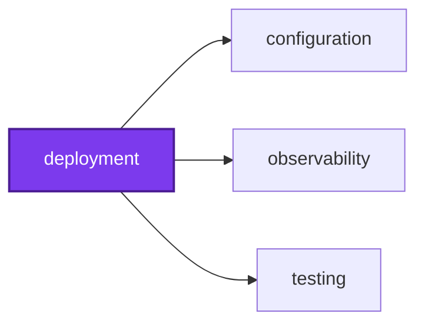
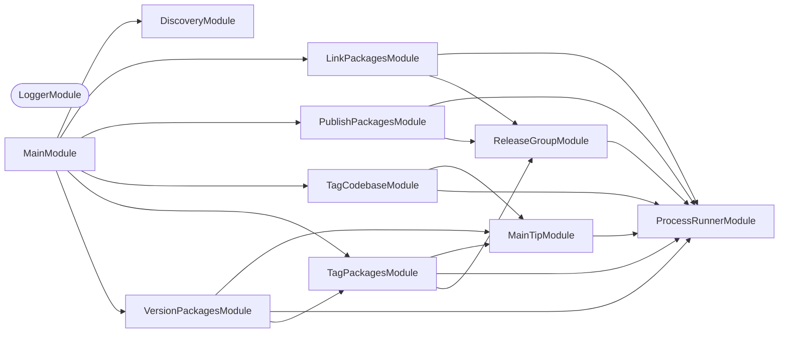

## 🕸️ Codependix

Dependency graphs exported by [codependix](https://github.com/Organizzolini/codebase/tree/main/projects/ic-suite/codependix/codependix-cli), regenerated by `nx run configuration:codependix:write`.

### Nx Neighborhood

<!-- codependix:start name="codependix-nx-projects" -->

<!-- codependix:end name="codependix-nx-projects" -->

### NestJS Module Graph

<!-- codependix:start name="codependix-nestjs-modules" -->


_Rounded modules are global: every module can inject them, so their edges are left out._
<!-- codependix:end name="codependix-nestjs-modules" -->

### File Imports

<!-- codependix:start name="codependix-file-imports" -->
```mermaid
graph LR
  file_callidescope_config_ts["callidescope.config.ts"]
  file_codependix_config_ts["codependix.config.ts"]
  file_codometer_config_ts["codometer.config.ts"]
  file_coinagerie_config_ts["coinagerie.config.ts"]
  file_eslint_config_ts["eslint.config.ts"]
  file_src_deployment_constants_ts["src/deployment.constants.ts"]
  file_src_deployment_main_end_to_end_test_ts["src/deployment.main.end-to-end.test.ts"]
  file_src_deployment_main_ts["src/deployment.main.ts"]
  file_src_deployment_main_unit_test_ts["src/deployment.main.unit.test.ts"]
  file_src_deployment_module_ts["src/deployment.module.ts"]
  file_src_deployment_repl_ts["src/deployment.repl.ts"]
  file_src_deployment_repl_unit_test_ts["src/deployment.repl.unit.test.ts"]
  file_src_deployment_types_ts["src/deployment.types.ts"]
  file_src_modules_link_packages_link_packages_command_ts["src/modules/link-packages/link-packages.command.ts"]
  file_src_modules_link_packages_link_packages_command_unit_test_ts["src/modules/link-packages/link-packages.command.unit.test.ts"]
  file_src_modules_link_packages_link_packages_constants_ts["src/modules/link-packages/link-packages.constants.ts"]
  file_src_modules_link_packages_link_packages_module_ts["src/modules/link-packages/link-packages.module.ts"]
  file_src_modules_link_packages_link_packages_module_unit_test_ts["src/modules/link-packages/link-packages.module.unit.test.ts"]
  file_src_modules_link_packages_link_packages_service_ts["src/modules/link-packages/link-packages.service.ts"]
  file_src_modules_link_packages_link_packages_service_unit_test_ts["src/modules/link-packages/link-packages.service.unit.test.ts"]
  file_src_modules_link_packages_link_packages_types_ts["src/modules/link-packages/link-packages.types.ts"]
  file_src_modules_main_tip_main_tip_constants_ts["src/modules/main-tip/main-tip.constants.ts"]
  file_src_modules_main_tip_main_tip_module_ts["src/modules/main-tip/main-tip.module.ts"]
  file_src_modules_main_tip_main_tip_module_unit_test_ts["src/modules/main-tip/main-tip.module.unit.test.ts"]
  file_src_modules_main_tip_main_tip_service_ts["src/modules/main-tip/main-tip.service.ts"]
  file_src_modules_main_tip_main_tip_service_unit_test_ts["src/modules/main-tip/main-tip.service.unit.test.ts"]
  file_src_modules_main_tip_main_tip_types_ts["src/modules/main-tip/main-tip.types.ts"]
  file_src_modules_process_runner_process_runner_constants_ts["src/modules/process-runner/process-runner.constants.ts"]
  file_src_modules_process_runner_process_runner_module_ts["src/modules/process-runner/process-runner.module.ts"]
  file_src_modules_process_runner_process_runner_module_unit_test_ts["src/modules/process-runner/process-runner.module.unit.test.ts"]
  file_src_modules_process_runner_process_runner_service_integration_test_ts["src/modules/process-runner/process-runner.service.integration.test.ts"]
  file_src_modules_process_runner_process_runner_service_ts["src/modules/process-runner/process-runner.service.ts"]
  file_src_modules_process_runner_process_runner_service_unit_test_ts["src/modules/process-runner/process-runner.service.unit.test.ts"]
  file_src_modules_process_runner_process_runner_types_ts["src/modules/process-runner/process-runner.types.ts"]
  file_src_modules_process_runner_process_runner_utilities_ts["src/modules/process-runner/process-runner.utilities.ts"]
  file_src_modules_process_runner_process_runner_utilities_unit_test_ts["src/modules/process-runner/process-runner.utilities.unit.test.ts"]
  file_src_modules_publish_packages_publish_packages_command_ts["src/modules/publish-packages/publish-packages.command.ts"]
  file_src_modules_publish_packages_publish_packages_command_unit_test_ts["src/modules/publish-packages/publish-packages.command.unit.test.ts"]
  file_src_modules_publish_packages_publish_packages_constants_ts["src/modules/publish-packages/publish-packages.constants.ts"]
  file_src_modules_publish_packages_publish_packages_module_ts["src/modules/publish-packages/publish-packages.module.ts"]
  file_src_modules_publish_packages_publish_packages_module_unit_test_ts["src/modules/publish-packages/publish-packages.module.unit.test.ts"]
  file_src_modules_publish_packages_publish_packages_service_ts["src/modules/publish-packages/publish-packages.service.ts"]
  file_src_modules_publish_packages_publish_packages_service_unit_test_ts["src/modules/publish-packages/publish-packages.service.unit.test.ts"]
  file_src_modules_publish_packages_publish_packages_types_ts["src/modules/publish-packages/publish-packages.types.ts"]
  file_src_modules_release_group_release_group_constants_ts["src/modules/release-group/release-group.constants.ts"]
  file_src_modules_release_group_release_group_module_ts["src/modules/release-group/release-group.module.ts"]
  file_src_modules_release_group_release_group_module_unit_test_ts["src/modules/release-group/release-group.module.unit.test.ts"]
  file_src_modules_release_group_release_group_service_ts["src/modules/release-group/release-group.service.ts"]
  file_src_modules_release_group_release_group_service_unit_test_ts["src/modules/release-group/release-group.service.unit.test.ts"]
  file_src_modules_release_group_release_group_types_ts["src/modules/release-group/release-group.types.ts"]
  file_src_modules_tag_codebase_tag_codebase_command_ts["src/modules/tag-codebase/tag-codebase.command.ts"]
  file_src_modules_tag_codebase_tag_codebase_command_unit_test_ts["src/modules/tag-codebase/tag-codebase.command.unit.test.ts"]
  file_src_modules_tag_codebase_tag_codebase_constants_ts["src/modules/tag-codebase/tag-codebase.constants.ts"]
  file_src_modules_tag_codebase_tag_codebase_module_ts["src/modules/tag-codebase/tag-codebase.module.ts"]
  file_src_modules_tag_codebase_tag_codebase_module_unit_test_ts["src/modules/tag-codebase/tag-codebase.module.unit.test.ts"]
  file_src_modules_tag_codebase_tag_codebase_service_ts["src/modules/tag-codebase/tag-codebase.service.ts"]
  file_src_modules_tag_codebase_tag_codebase_service_unit_test_ts["src/modules/tag-codebase/tag-codebase.service.unit.test.ts"]
  file_src_modules_tag_codebase_tag_codebase_types_ts["src/modules/tag-codebase/tag-codebase.types.ts"]
  file_src_modules_tag_packages_tag_packages_command_ts["src/modules/tag-packages/tag-packages.command.ts"]
  file_src_modules_tag_packages_tag_packages_command_unit_test_ts["src/modules/tag-packages/tag-packages.command.unit.test.ts"]
  file_src_modules_tag_packages_tag_packages_constants_ts["src/modules/tag-packages/tag-packages.constants.ts"]
  file_src_modules_tag_packages_tag_packages_module_ts["src/modules/tag-packages/tag-packages.module.ts"]
  file_src_modules_tag_packages_tag_packages_module_unit_test_ts["src/modules/tag-packages/tag-packages.module.unit.test.ts"]
  file_src_modules_tag_packages_tag_packages_service_ts["src/modules/tag-packages/tag-packages.service.ts"]
  file_src_modules_tag_packages_tag_packages_service_unit_test_ts["src/modules/tag-packages/tag-packages.service.unit.test.ts"]
  file_src_modules_tag_packages_tag_packages_types_ts["src/modules/tag-packages/tag-packages.types.ts"]
  file_src_modules_version_packages_version_packages_command_ts["src/modules/version-packages/version-packages.command.ts"]
  file_src_modules_version_packages_version_packages_command_unit_test_ts["src/modules/version-packages/version-packages.command.unit.test.ts"]
  file_src_modules_version_packages_version_packages_constants_ts["src/modules/version-packages/version-packages.constants.ts"]
  file_src_modules_version_packages_version_packages_module_ts["src/modules/version-packages/version-packages.module.ts"]
  file_src_modules_version_packages_version_packages_module_unit_test_ts["src/modules/version-packages/version-packages.module.unit.test.ts"]
  file_src_modules_version_packages_version_packages_service_ts["src/modules/version-packages/version-packages.service.ts"]
  file_src_modules_version_packages_version_packages_service_unit_test_ts["src/modules/version-packages/version-packages.service.unit.test.ts"]
  file_src_modules_version_packages_version_packages_types_ts["src/modules/version-packages/version-packages.types.ts"]
  file_testing_mocks_ts["testing/mocks.ts"]
  file_testing_setup_ts["testing/setup.ts"]
  file_vitest_config_ts["vitest.config.ts"]
  file_src_deployment_main_end_to_end_test_ts --> file_src_deployment_constants_ts
  file_src_deployment_main_ts --> file_src_deployment_module_ts
  file_src_deployment_main_unit_test_ts --> file_src_modules_link_packages_link_packages_module_ts
  file_src_deployment_main_unit_test_ts --> file_src_modules_publish_packages_publish_packages_module_ts
  file_src_deployment_main_unit_test_ts --> file_src_modules_tag_codebase_tag_codebase_module_ts
  file_src_deployment_main_unit_test_ts --> file_src_modules_tag_packages_tag_packages_module_ts
  file_src_deployment_main_unit_test_ts --> file_src_modules_version_packages_version_packages_module_ts
  file_src_deployment_module_ts --> file_src_deployment_constants_ts
  file_src_deployment_module_ts --> file_src_modules_link_packages_link_packages_module_ts
  file_src_deployment_module_ts --> file_src_modules_publish_packages_publish_packages_module_ts
  file_src_deployment_module_ts --> file_src_modules_tag_codebase_tag_codebase_module_ts
  file_src_deployment_module_ts --> file_src_modules_tag_packages_tag_packages_module_ts
  file_src_deployment_module_ts --> file_src_modules_version_packages_version_packages_module_ts
  file_src_deployment_repl_ts --> file_src_deployment_module_ts
  file_src_deployment_types_ts --> file_src_deployment_constants_ts
  file_src_modules_link_packages_link_packages_command_ts --> file_src_modules_link_packages_link_packages_service_ts
  file_src_modules_link_packages_link_packages_command_ts --> file_src_modules_process_runner_process_runner_utilities_ts
  file_src_modules_link_packages_link_packages_command_unit_test_ts --> file_src_modules_link_packages_link_packages_command_ts
  file_src_modules_link_packages_link_packages_command_unit_test_ts --> file_src_modules_link_packages_link_packages_service_ts
  file_src_modules_link_packages_link_packages_command_unit_test_ts --> file_src_modules_process_runner_process_runner_service_ts
  file_src_modules_link_packages_link_packages_command_unit_test_ts --> file_src_modules_process_runner_process_runner_types_ts
  file_src_modules_link_packages_link_packages_command_unit_test_ts --> file_src_modules_release_group_release_group_service_ts
  file_src_modules_link_packages_link_packages_command_unit_test_ts --> file_testing_mocks_ts
  file_src_modules_link_packages_link_packages_module_ts --> file_src_modules_link_packages_link_packages_command_ts
  file_src_modules_link_packages_link_packages_module_ts --> file_src_modules_link_packages_link_packages_service_ts
  file_src_modules_link_packages_link_packages_module_ts --> file_src_modules_process_runner_process_runner_module_ts
  file_src_modules_link_packages_link_packages_module_ts --> file_src_modules_release_group_release_group_module_ts
  file_src_modules_link_packages_link_packages_module_unit_test_ts --> file_src_modules_link_packages_link_packages_command_ts
  file_src_modules_link_packages_link_packages_module_unit_test_ts --> file_src_modules_link_packages_link_packages_module_ts
  file_src_modules_link_packages_link_packages_module_unit_test_ts --> file_src_modules_link_packages_link_packages_service_ts
  file_src_modules_link_packages_link_packages_module_unit_test_ts --> file_src_modules_process_runner_process_runner_module_ts
  file_src_modules_link_packages_link_packages_module_unit_test_ts --> file_src_modules_release_group_release_group_module_ts
  file_src_modules_link_packages_link_packages_service_ts --> file_src_deployment_types_ts
  file_src_modules_link_packages_link_packages_service_ts --> file_src_modules_link_packages_link_packages_constants_ts
  file_src_modules_link_packages_link_packages_service_ts --> file_src_modules_link_packages_link_packages_types_ts
  file_src_modules_link_packages_link_packages_service_ts --> file_src_modules_process_runner_process_runner_service_ts
  file_src_modules_link_packages_link_packages_service_ts --> file_src_modules_process_runner_process_runner_types_ts
  file_src_modules_link_packages_link_packages_service_ts --> file_src_modules_process_runner_process_runner_utilities_ts
  file_src_modules_link_packages_link_packages_service_ts --> file_src_modules_release_group_release_group_constants_ts
  file_src_modules_link_packages_link_packages_service_ts --> file_src_modules_release_group_release_group_service_ts
  file_src_modules_link_packages_link_packages_service_ts --> file_src_modules_release_group_release_group_types_ts
  file_src_modules_link_packages_link_packages_service_unit_test_ts --> file_src_modules_link_packages_link_packages_service_ts
  file_src_modules_link_packages_link_packages_service_unit_test_ts --> file_src_modules_process_runner_process_runner_service_ts
  file_src_modules_link_packages_link_packages_service_unit_test_ts --> file_src_modules_release_group_release_group_service_ts
  file_src_modules_main_tip_main_tip_module_ts --> file_src_modules_main_tip_main_tip_service_ts
  file_src_modules_main_tip_main_tip_module_ts --> file_src_modules_process_runner_process_runner_module_ts
  file_src_modules_main_tip_main_tip_module_unit_test_ts --> file_src_modules_main_tip_main_tip_module_ts
  file_src_modules_main_tip_main_tip_module_unit_test_ts --> file_src_modules_main_tip_main_tip_service_ts
  file_src_modules_main_tip_main_tip_module_unit_test_ts --> file_src_modules_process_runner_process_runner_module_ts
  file_src_modules_main_tip_main_tip_service_ts --> file_src_deployment_types_ts
  file_src_modules_main_tip_main_tip_service_ts --> file_src_modules_main_tip_main_tip_constants_ts
  file_src_modules_main_tip_main_tip_service_ts --> file_src_modules_process_runner_process_runner_service_ts
  file_src_modules_main_tip_main_tip_service_ts --> file_src_modules_process_runner_process_runner_utilities_ts
  file_src_modules_main_tip_main_tip_service_unit_test_ts --> file_src_modules_main_tip_main_tip_service_ts
  file_src_modules_main_tip_main_tip_service_unit_test_ts --> file_src_modules_process_runner_process_runner_service_ts
  file_src_modules_main_tip_main_tip_service_unit_test_ts --> file_src_modules_process_runner_process_runner_types_ts
  file_src_modules_main_tip_main_tip_service_unit_test_ts --> file_testing_mocks_ts
  file_src_modules_process_runner_process_runner_module_ts --> file_src_modules_process_runner_process_runner_service_ts
  file_src_modules_process_runner_process_runner_module_unit_test_ts --> file_src_modules_process_runner_process_runner_module_ts
  file_src_modules_process_runner_process_runner_module_unit_test_ts --> file_src_modules_process_runner_process_runner_service_ts
  file_src_modules_process_runner_process_runner_service_integration_test_ts --> file_src_modules_process_runner_process_runner_service_ts
  file_src_modules_process_runner_process_runner_service_integration_test_ts --> file_testing_mocks_ts
  file_src_modules_process_runner_process_runner_service_ts --> file_src_modules_process_runner_process_runner_constants_ts
  file_src_modules_process_runner_process_runner_service_ts --> file_src_modules_process_runner_process_runner_types_ts
  file_src_modules_process_runner_process_runner_service_unit_test_ts --> file_src_modules_process_runner_process_runner_service_ts
  file_src_modules_process_runner_process_runner_utilities_ts --> file_src_modules_process_runner_process_runner_types_ts
  file_src_modules_process_runner_process_runner_utilities_unit_test_ts --> file_src_modules_process_runner_process_runner_utilities_ts
  file_src_modules_publish_packages_publish_packages_command_ts --> file_src_modules_process_runner_process_runner_utilities_ts
  file_src_modules_publish_packages_publish_packages_command_ts --> file_src_modules_publish_packages_publish_packages_service_ts
  file_src_modules_publish_packages_publish_packages_command_unit_test_ts --> file_src_modules_process_runner_process_runner_service_ts
  file_src_modules_publish_packages_publish_packages_command_unit_test_ts --> file_src_modules_process_runner_process_runner_types_ts
  file_src_modules_publish_packages_publish_packages_command_unit_test_ts --> file_src_modules_publish_packages_publish_packages_command_ts
  file_src_modules_publish_packages_publish_packages_command_unit_test_ts --> file_src_modules_publish_packages_publish_packages_service_ts
  file_src_modules_publish_packages_publish_packages_command_unit_test_ts --> file_src_modules_release_group_release_group_service_ts
  file_src_modules_publish_packages_publish_packages_command_unit_test_ts --> file_testing_mocks_ts
  file_src_modules_publish_packages_publish_packages_module_ts --> file_src_modules_process_runner_process_runner_module_ts
  file_src_modules_publish_packages_publish_packages_module_ts --> file_src_modules_publish_packages_publish_packages_command_ts
  file_src_modules_publish_packages_publish_packages_module_ts --> file_src_modules_publish_packages_publish_packages_service_ts
  file_src_modules_publish_packages_publish_packages_module_ts --> file_src_modules_release_group_release_group_module_ts
  file_src_modules_publish_packages_publish_packages_module_unit_test_ts --> file_src_modules_process_runner_process_runner_module_ts
  file_src_modules_publish_packages_publish_packages_module_unit_test_ts --> file_src_modules_publish_packages_publish_packages_command_ts
  file_src_modules_publish_packages_publish_packages_module_unit_test_ts --> file_src_modules_publish_packages_publish_packages_module_ts
  file_src_modules_publish_packages_publish_packages_module_unit_test_ts --> file_src_modules_publish_packages_publish_packages_service_ts
  file_src_modules_publish_packages_publish_packages_module_unit_test_ts --> file_src_modules_release_group_release_group_module_ts
  file_src_modules_publish_packages_publish_packages_service_ts --> file_src_deployment_types_ts
  file_src_modules_publish_packages_publish_packages_service_ts --> file_src_modules_process_runner_process_runner_service_ts
  file_src_modules_publish_packages_publish_packages_service_ts --> file_src_modules_process_runner_process_runner_types_ts
  file_src_modules_publish_packages_publish_packages_service_ts --> file_src_modules_process_runner_process_runner_utilities_ts
  file_src_modules_publish_packages_publish_packages_service_ts --> file_src_modules_publish_packages_publish_packages_constants_ts
  file_src_modules_publish_packages_publish_packages_service_ts --> file_src_modules_publish_packages_publish_packages_types_ts
  file_src_modules_publish_packages_publish_packages_service_ts --> file_src_modules_release_group_release_group_constants_ts
  file_src_modules_publish_packages_publish_packages_service_ts --> file_src_modules_release_group_release_group_service_ts
  file_src_modules_publish_packages_publish_packages_service_ts --> file_src_modules_release_group_release_group_types_ts
  file_src_modules_publish_packages_publish_packages_service_unit_test_ts --> file_src_modules_process_runner_process_runner_service_ts
  file_src_modules_publish_packages_publish_packages_service_unit_test_ts --> file_src_modules_publish_packages_publish_packages_service_ts
  file_src_modules_publish_packages_publish_packages_service_unit_test_ts --> file_src_modules_release_group_release_group_service_ts
  file_src_modules_release_group_release_group_module_ts --> file_src_modules_process_runner_process_runner_module_ts
  file_src_modules_release_group_release_group_module_ts --> file_src_modules_release_group_release_group_service_ts
  file_src_modules_release_group_release_group_module_unit_test_ts --> file_src_modules_process_runner_process_runner_module_ts
  file_src_modules_release_group_release_group_module_unit_test_ts --> file_src_modules_release_group_release_group_module_ts
  file_src_modules_release_group_release_group_module_unit_test_ts --> file_src_modules_release_group_release_group_service_ts
  file_src_modules_release_group_release_group_service_ts --> file_src_deployment_types_ts
  file_src_modules_release_group_release_group_service_ts --> file_src_modules_process_runner_process_runner_service_ts
  file_src_modules_release_group_release_group_service_ts --> file_src_modules_process_runner_process_runner_utilities_ts
  file_src_modules_release_group_release_group_service_ts --> file_src_modules_release_group_release_group_constants_ts
  file_src_modules_release_group_release_group_service_ts --> file_src_modules_release_group_release_group_types_ts
  file_src_modules_release_group_release_group_service_unit_test_ts --> file_src_modules_process_runner_process_runner_service_ts
  file_src_modules_release_group_release_group_service_unit_test_ts --> file_src_modules_process_runner_process_runner_types_ts
  file_src_modules_release_group_release_group_service_unit_test_ts --> file_src_modules_release_group_release_group_service_ts
  file_src_modules_release_group_release_group_service_unit_test_ts --> file_src_modules_release_group_release_group_types_ts
  file_src_modules_release_group_release_group_service_unit_test_ts --> file_testing_mocks_ts
  file_src_modules_tag_codebase_tag_codebase_command_ts --> file_src_modules_process_runner_process_runner_utilities_ts
  file_src_modules_tag_codebase_tag_codebase_command_ts --> file_src_modules_tag_codebase_tag_codebase_service_ts
  file_src_modules_tag_codebase_tag_codebase_command_unit_test_ts --> file_src_modules_main_tip_main_tip_service_ts
  file_src_modules_tag_codebase_tag_codebase_command_unit_test_ts --> file_src_modules_process_runner_process_runner_service_ts
  file_src_modules_tag_codebase_tag_codebase_command_unit_test_ts --> file_src_modules_process_runner_process_runner_types_ts
  file_src_modules_tag_codebase_tag_codebase_command_unit_test_ts --> file_src_modules_tag_codebase_tag_codebase_command_ts
  file_src_modules_tag_codebase_tag_codebase_command_unit_test_ts --> file_src_modules_tag_codebase_tag_codebase_service_ts
  file_src_modules_tag_codebase_tag_codebase_command_unit_test_ts --> file_testing_mocks_ts
  file_src_modules_tag_codebase_tag_codebase_module_ts --> file_src_modules_main_tip_main_tip_module_ts
  file_src_modules_tag_codebase_tag_codebase_module_ts --> file_src_modules_process_runner_process_runner_module_ts
  file_src_modules_tag_codebase_tag_codebase_module_ts --> file_src_modules_tag_codebase_tag_codebase_command_ts
  file_src_modules_tag_codebase_tag_codebase_module_ts --> file_src_modules_tag_codebase_tag_codebase_service_ts
  file_src_modules_tag_codebase_tag_codebase_module_unit_test_ts --> file_src_modules_main_tip_main_tip_module_ts
  file_src_modules_tag_codebase_tag_codebase_module_unit_test_ts --> file_src_modules_process_runner_process_runner_module_ts
  file_src_modules_tag_codebase_tag_codebase_module_unit_test_ts --> file_src_modules_tag_codebase_tag_codebase_command_ts
  file_src_modules_tag_codebase_tag_codebase_module_unit_test_ts --> file_src_modules_tag_codebase_tag_codebase_module_ts
  file_src_modules_tag_codebase_tag_codebase_module_unit_test_ts --> file_src_modules_tag_codebase_tag_codebase_service_ts
  file_src_modules_tag_codebase_tag_codebase_service_ts --> file_src_modules_main_tip_main_tip_service_ts
  file_src_modules_tag_codebase_tag_codebase_service_ts --> file_src_modules_process_runner_process_runner_service_ts
  file_src_modules_tag_codebase_tag_codebase_service_ts --> file_src_modules_tag_codebase_tag_codebase_constants_ts
  file_src_modules_tag_codebase_tag_codebase_service_unit_test_ts --> file_src_modules_main_tip_main_tip_service_ts
  file_src_modules_tag_codebase_tag_codebase_service_unit_test_ts --> file_src_modules_process_runner_process_runner_service_ts
  file_src_modules_tag_codebase_tag_codebase_service_unit_test_ts --> file_src_modules_tag_codebase_tag_codebase_service_ts
  file_src_modules_tag_packages_tag_packages_command_ts --> file_src_modules_process_runner_process_runner_utilities_ts
  file_src_modules_tag_packages_tag_packages_command_ts --> file_src_modules_tag_packages_tag_packages_service_ts
  file_src_modules_tag_packages_tag_packages_command_unit_test_ts --> file_src_modules_main_tip_main_tip_service_ts
  file_src_modules_tag_packages_tag_packages_command_unit_test_ts --> file_src_modules_process_runner_process_runner_service_ts
  file_src_modules_tag_packages_tag_packages_command_unit_test_ts --> file_src_modules_process_runner_process_runner_types_ts
  file_src_modules_tag_packages_tag_packages_command_unit_test_ts --> file_src_modules_release_group_release_group_service_ts
  file_src_modules_tag_packages_tag_packages_command_unit_test_ts --> file_src_modules_tag_packages_tag_packages_command_ts
  file_src_modules_tag_packages_tag_packages_command_unit_test_ts --> file_src_modules_tag_packages_tag_packages_service_ts
  file_src_modules_tag_packages_tag_packages_command_unit_test_ts --> file_testing_mocks_ts
  file_src_modules_tag_packages_tag_packages_module_ts --> file_src_modules_main_tip_main_tip_module_ts
  file_src_modules_tag_packages_tag_packages_module_ts --> file_src_modules_process_runner_process_runner_module_ts
  file_src_modules_tag_packages_tag_packages_module_ts --> file_src_modules_release_group_release_group_module_ts
  file_src_modules_tag_packages_tag_packages_module_ts --> file_src_modules_tag_packages_tag_packages_command_ts
  file_src_modules_tag_packages_tag_packages_module_ts --> file_src_modules_tag_packages_tag_packages_service_ts
  file_src_modules_tag_packages_tag_packages_module_unit_test_ts --> file_src_modules_main_tip_main_tip_module_ts
  file_src_modules_tag_packages_tag_packages_module_unit_test_ts --> file_src_modules_process_runner_process_runner_module_ts
  file_src_modules_tag_packages_tag_packages_module_unit_test_ts --> file_src_modules_release_group_release_group_module_ts
  file_src_modules_tag_packages_tag_packages_module_unit_test_ts --> file_src_modules_tag_packages_tag_packages_command_ts
  file_src_modules_tag_packages_tag_packages_module_unit_test_ts --> file_src_modules_tag_packages_tag_packages_module_ts
  file_src_modules_tag_packages_tag_packages_module_unit_test_ts --> file_src_modules_tag_packages_tag_packages_service_ts
  file_src_modules_tag_packages_tag_packages_service_ts --> file_src_deployment_types_ts
  file_src_modules_tag_packages_tag_packages_service_ts --> file_src_modules_main_tip_main_tip_service_ts
  file_src_modules_tag_packages_tag_packages_service_ts --> file_src_modules_process_runner_process_runner_service_ts
  file_src_modules_tag_packages_tag_packages_service_ts --> file_src_modules_process_runner_process_runner_utilities_ts
  file_src_modules_tag_packages_tag_packages_service_ts --> file_src_modules_release_group_release_group_service_ts
  file_src_modules_tag_packages_tag_packages_service_ts --> file_src_modules_release_group_release_group_types_ts
  file_src_modules_tag_packages_tag_packages_service_ts --> file_src_modules_tag_packages_tag_packages_constants_ts
  file_src_modules_tag_packages_tag_packages_service_ts --> file_src_modules_tag_packages_tag_packages_types_ts
  file_src_modules_tag_packages_tag_packages_service_unit_test_ts --> file_src_modules_main_tip_main_tip_service_ts
  file_src_modules_tag_packages_tag_packages_service_unit_test_ts --> file_src_modules_process_runner_process_runner_service_ts
  file_src_modules_tag_packages_tag_packages_service_unit_test_ts --> file_src_modules_release_group_release_group_service_ts
  file_src_modules_tag_packages_tag_packages_service_unit_test_ts --> file_src_modules_tag_packages_tag_packages_service_ts
  file_src_modules_version_packages_version_packages_command_ts --> file_src_modules_process_runner_process_runner_utilities_ts
  file_src_modules_version_packages_version_packages_command_ts --> file_src_modules_version_packages_version_packages_service_ts
  file_src_modules_version_packages_version_packages_command_unit_test_ts --> file_src_modules_main_tip_main_tip_service_ts
  file_src_modules_version_packages_version_packages_command_unit_test_ts --> file_src_modules_process_runner_process_runner_service_ts
  file_src_modules_version_packages_version_packages_command_unit_test_ts --> file_src_modules_process_runner_process_runner_types_ts
  file_src_modules_version_packages_version_packages_command_unit_test_ts --> file_src_modules_release_group_release_group_service_ts
  file_src_modules_version_packages_version_packages_command_unit_test_ts --> file_src_modules_tag_packages_tag_packages_service_ts
  file_src_modules_version_packages_version_packages_command_unit_test_ts --> file_src_modules_version_packages_version_packages_command_ts
  file_src_modules_version_packages_version_packages_command_unit_test_ts --> file_src_modules_version_packages_version_packages_service_ts
  file_src_modules_version_packages_version_packages_command_unit_test_ts --> file_testing_mocks_ts
  file_src_modules_version_packages_version_packages_module_ts --> file_src_modules_main_tip_main_tip_module_ts
  file_src_modules_version_packages_version_packages_module_ts --> file_src_modules_process_runner_process_runner_module_ts
  file_src_modules_version_packages_version_packages_module_ts --> file_src_modules_tag_packages_tag_packages_module_ts
  file_src_modules_version_packages_version_packages_module_ts --> file_src_modules_version_packages_version_packages_command_ts
  file_src_modules_version_packages_version_packages_module_ts --> file_src_modules_version_packages_version_packages_service_ts
  file_src_modules_version_packages_version_packages_module_unit_test_ts --> file_src_modules_main_tip_main_tip_module_ts
  file_src_modules_version_packages_version_packages_module_unit_test_ts --> file_src_modules_process_runner_process_runner_module_ts
  file_src_modules_version_packages_version_packages_module_unit_test_ts --> file_src_modules_tag_packages_tag_packages_module_ts
  file_src_modules_version_packages_version_packages_module_unit_test_ts --> file_src_modules_version_packages_version_packages_command_ts
  file_src_modules_version_packages_version_packages_module_unit_test_ts --> file_src_modules_version_packages_version_packages_module_ts
  file_src_modules_version_packages_version_packages_module_unit_test_ts --> file_src_modules_version_packages_version_packages_service_ts
  file_src_modules_version_packages_version_packages_service_ts --> file_src_deployment_types_ts
  file_src_modules_version_packages_version_packages_service_ts --> file_src_modules_main_tip_main_tip_service_ts
  file_src_modules_version_packages_version_packages_service_ts --> file_src_modules_process_runner_process_runner_service_ts
  file_src_modules_version_packages_version_packages_service_ts --> file_src_modules_process_runner_process_runner_utilities_ts
  file_src_modules_version_packages_version_packages_service_ts --> file_src_modules_tag_packages_tag_packages_service_ts
  file_src_modules_version_packages_version_packages_service_ts --> file_src_modules_version_packages_version_packages_constants_ts
  file_src_modules_version_packages_version_packages_service_unit_test_ts --> file_src_modules_main_tip_main_tip_service_ts
  file_src_modules_version_packages_version_packages_service_unit_test_ts --> file_src_modules_process_runner_process_runner_service_ts
  file_src_modules_version_packages_version_packages_service_unit_test_ts --> file_src_modules_tag_packages_tag_packages_service_ts
  file_src_modules_version_packages_version_packages_service_unit_test_ts --> file_src_modules_version_packages_version_packages_service_ts
  file_testing_mocks_ts --> file_src_modules_process_runner_process_runner_service_ts
  file_testing_mocks_ts --> file_src_modules_process_runner_process_runner_types_ts
```
<!-- codependix:end name="codependix-file-imports" -->
