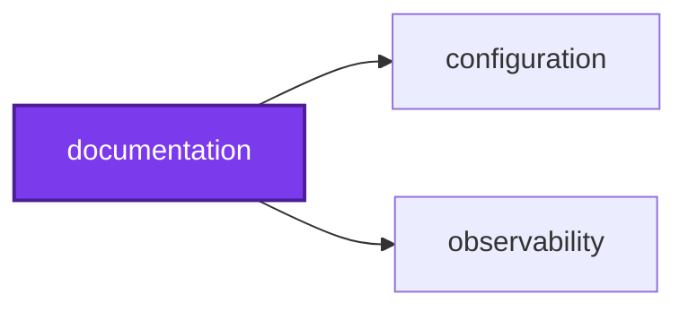
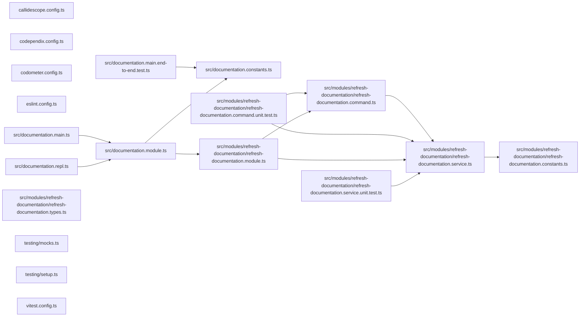

NestJS CLI that refreshes the repository documentation from code. It also holds the documentation itself: `adr`, `agents`, `development`, `openwiki`, `planning`, and `research`.

## Start

```bash
nx run documentation:refresh-documentation
```

Needs the `OPENWIKI_*` and provider key environment variables OpenWiki reads. The 🧑‍🏫 Refresh Documentation workflow supplies them: a free OpenRouter model, with the key in the `OPENROUTER_API_KEY` repository secret.

## Test

```bash
nx run documentation:vitest
```

## 👔 Conformetry

This project was generated from the [nestjs-command-project](../configuration/conformetry-templates/nestjs-command-project) conformetry template.

## 🕸️ Codependix

Dependency graphs exported by [codependix](https://github.com/Organizzolini/codebase/tree/main/projects/ic-suite/codependix/codependix-cli), regenerated by `nx run configuration:codependix:write`.

### Nx Neighborhood

<!-- codependix:start name="codependix-nx-projects" -->

<!-- codependix:end name="codependix-nx-projects" -->

### NestJS Module Graph

<!-- codependix:start name="codependix-nestjs-modules" -->


_Rounded modules are global: every module can inject them, so their edges are left out._
<!-- codependix:end name="codependix-nestjs-modules" -->

### File Imports

<!-- codependix:start name="codependix-file-imports" -->

<!-- codependix:end name="codependix-file-imports" -->

<!-- coinagerie:start -->

## 🪙 Coinagerie

The words this project uses that the root glossary does not define, regenerated with `nx run documentation:coinagerie-check:write`.

- **absorb**: Retires the separate size-limit tool, because ADR 0001 folds its size gating into codometer as one measurement.
- **adr**: Architecture decision record file in the documentation adr folder, numbered, recording one decided trade-off for the repository.
- **affirmation**: Generated phrase that the affirmations feature planning documents describe, produced by an LLM from tarot-card references.
- **alone**: Used in ADR prose to say a measurement or change must be judged by itself, such as path data alone.
- **alternative**: Labels the rejected option beside each chosen decision in ADRs, recording which other approach the team turned down.
- **an**: Appears in ADR titles and prose like any English article, so it names nothing specific in this documentation project.
- **band**: Horizontal strip of a meander drawing bounded by two borders, which ADR 0004 and ADR 0006 adjust for crossings and branch families.
- **biome**: Rust formatter and linter that the biome and oxlint plan adds alongside Oxlint, supplementing the existing ESLint and Prettier setup.
- **border**: Edge of a meander band that ADR 0006 closes on both sides in the branch and parallel families through a MotifService hook.
- **both**: Appears in ADR prose where a decision keeps or closes two options together, such as keeping both tools or both band borders.
- **breadth**: One of the two callidescope limits, alongside depth, that ADR 0006 keeps after dropping the other noise controls.
- **bundle**: Bundle-size measurement that ADR 0003 folds into codometer as a general change report, replacing the separate reporting module.
- **canonical**: Normalized form of a meander or its symmetry class, which ADR 0007 and ADR 0014 standardize addressing and phase around.
- **cascade**: Refers to the cascading dependents rule in ADR 0017, where a bump to one internal dependency republishes every package depending on it.
- **characteristic**: Named property of a meander, such as its letter counts, that ADR 0012 and ADR 0018 store together in one sparse JSON map.
- **claim**: Step where a session assigns an issue to itself with gh issue edit, the first write it makes against the tracker.
- **completion**: Names the spawnSync result of the OpenWiki run in the refresh documentation service, and planning docs' completion targets.
- **composite**: Reusable GitHub Actions bundles that call one command each, which ADR 0029 keeps in the integration project for CI steps.
- **concept**: Domain term that agents must use as CONTEXT.md defines it, rather than inventing synonyms in issues and test names.
- **conformance**: Check that generated code matches its conformetry template, which the generator template conformance validation plan adds.
- **corpus**: Committed historical set of meander drawings that ADR 0006 and ADR 0013 read as a test set for regression checks.
- **cut**: Seam where a meander band is split, which ADR 0006 and ADR 0013 use when comparing one drawing or family to another.
- **delay**: Wait between OpenWiki refresh attempts, set to two minutes in the refresh documentation constants before each retry.
- **design**: Architectural design that an ADR records, or a rule like ADR 0002 that a pull request gate would fail every pull request by design.
- **development**: Local environment, such as the meanderaw development Postgres database in ADR 0020, and the Development section of AGENTS.md.
- **discovery**: Names the NestJS DiscoveryModule that MainModule imports in the documentation codependix graph, letting the CLI find its commands.
- **domain**: Refers to CONTEXT.md and the domain model in agents domain documentation, the glossary of terms agents must use consistently.
- **draw**: Describes the meander drawing operation that ADR 0004 changes, so interrupted crossings render as a one-pitch break.
- **drift**: Unwanted divergence between code and documentation or between dependency versions, which ADR 0017 cites as a cost of cascading versions.
- **elimination**: Names duplicate-code removal in the fallow duplicates plan and dead-code elimination that ADR 0006 says has nothing to remove.
- **enhance**: Appears in the title of the monorepo documentation plan, which aims to enhance agent-facing docs across this documentation project.
- **ephemeris**: Astronomical position data that the caelundas performance plan generates year by year with local computation instead of HTTP calls.
- **everything**: Appears in AGENTS.md's rule that everything injected into a constructor must be private readonly, so dependencies stay fixed.
- **evidence**: Support for a decision in ADR 0013, where the historical meander corpus is treated as evidence that can itself be wrong.
- **executable**: Runnable code described in planning docs, such as the caelundas executable services and the CMake build that produces them.
- **expose**: Names AGENTS.md's rule that services expose only what callers need, placing everything else under private method sections.
- **family**: Meander classification group, such as the cross, branch, and parallel families whose drawing rules ADR 0004 and ADR 0006 adjust.
- **fingerprint**: Stable hash used as the key for clone groups in the fallow duplicates plan and for Gitleaks false positive ignores.
- **floor**: Minimum threshold, such as the legibility floor of four rows in ADR 0004 or the stagger floor raised in ADR 0006.
- **generation**: Refers to conformetry's generation package that renders code from templates, and the generation layer named in ADR 0013.
- **give**: Opens ADR titles such as Give Every Meander a Canonical Phase, stating the rule the project chose for that concern.
- **handoff**: Structured hand-off comment posted on a spec issue for the next session, whose repository rules agents handoffs documentation sets out.
- **historical**: Describes the historical meander corpus of committed drawings whose labels ADR 0012 and ADR 0013 treat as a test set.
- **hold**: Appears in ADR titles such as Hold one path law, meaning keep a single rule, package, or path law for one concern.
- **independent**: Names independent package versioning in ADR 0017, where each public npm package releases on its own version line.
- **interlace**: Woven over-and-under crossing pattern in meander drawings, which ADR 0004 breaks with a one-pitch gap at each crossing.
- **invocation**: Single run of a command or OpenWiki process, such as each attempt the refresh service starts before it gives up.
- **lattice**: Grid on which every meander sits, which ADR 0007 uses to address each drawing and MeanderLatticeService validates against.
- **law**: Governing rule in ADR 0011, the universal path and naming law that every project type follows for its file layout.
- **leftover**: File that OpenWiki leaves behind, such as CLAUDE.md, which the refresh documentation service deletes after each run.
- **letter**: Glyph counted in each meander's letter-count map under ADR 0017, counted in all sixteen orientations for every meander.
- **lstat**: Node filesystem stat call that this documentation project never invokes, so the word appears only as a glossary headword.
- **meanderaw**: Meander drawing project whose cross, branch, and parallel families ADRs 0004 to 0006 change, producing the drawings in the corpus.
- **monorepo**: Single repository holding every project, which ADR 0017 describes as one root release with packages versioned on their own lines.
- **ms**: Millisecond unit in the benchmark tables of ADR 0017 for write sweeps, single-key filters, and full-record fetches.
- **multi**: Appears in ADR 0015's title, Store Families as an Open Multi-Label Set, where one meander may carry several families at once.
- **narrow**: Describes ADR 0006's decision to narrow callidescope down to depth and breadth, dropping the other noise controls it had.
- **nth**: Used in conformetry language docs, where paired markdown and code cells are matched by position, the nth against the nth.
- **optimization**: Names the caelundas runtime performance optimization plan, which speeds the ephemeris pipeline for year-scale datasets.
- **overview**: Heading for the architecture summary in documentation AGENTS.md, describing how the project's layers and commands fit together.
- **performance**: Measured speed in ADR 0017 benchmarks and the caelundas performance plan, such as timing a year-scale ephemeris generation.
- **phase**: Names the canonical rotation of a meander in ADR 0014, chosen by minimizing seam components for each drawing in the corpus.
- **pid**: Process identifier field in refresh documentation unit test fixtures, mocked to zero when simulating a spawned OpenWiki run.
- **pipeline**: Generic meander pipeline of decode, render, compute Characteristics, and classify that ADR 0012 runs for every drawing.
- **pitch**: One grid unit on the lattice, which ADR 0004 uses to place the interrupted crossing break one pitch either side of the junction.
- **precommit**: Git pre-commit hook and its lint-staged checks that gate every commit, which research on generator tests weighs against nxignore.
- **quickstart**: README guide that the affirmations application plan requires, covering setup steps for new contributors to that project.
- **really**: Used in ADR prose to stress a true dependency or behavior, such as ADR 0007 stating the real dependency in task cache inputs.
- **research**: Dated research note under the documentation research folder, such as the graphql codegen and nxignore alternatives comparisons.
- **role**: Layer assignment of a package, which ADR 0013 documents so a reader learns its place without opening its index file.
- **scaffold**: Generate new modules with conformetry's generator rather than writing them by hand, as AGENTS.md instructs before implementing a service.
- **small**: Appears in ADR 0026's title, keeping a small shell floor under the scripts for hooks and pre-install CI steps only.
- **software**: Installed toolchain, such as the Node and pnpm runtime in scripts local software, which ADR 0026 keeps in shell scripts.
- **sparse**: Describes ADR 0017's storage choice of a sparse JSON map that holds only the nonzero letter counts for each meander.
- **statistic**: Per-project figure, such as the statistics block that ADR 0002 publishes in each project's README on the default branch.
- **stdio**: Inherit option on the refresh service's spawnSync call, so OpenWiki output streams straight to the operator's terminal.
- **store**: Verb in ADR titles such as Store Families as an Open Multi-Label Set, naming how meander data persists in tables or JSON.
- **swiss**: Short for Swiss Ephemeris, the local astronomy library that the caelundas performance plan uses instead of NASA Horizons HTTP calls.
- **symbolic**: Refers to symbolic links, since the refresh documentation service refuses a symbolic link at the openwiki path during a run.
- **symlink**: Link named docs that points at documentation, so skills reading docs adr resolve to documentation adr in this repository.
- **t00**:
- **t02**:
- **t13**:
- **t18**:
- **t19**:
- **t23**:
- **theory**: Refers to meander theory, the mathematical model of lattice addresses, rows, and columns behind meanderaw in the openwiki concepts.
- **tracker**: GitHub Issues tracker configured in agents issue-tracker documentation, where one parent issue per pull request is filed.
- **triage**: Labels in agents triage-labels documentation map the status family to canonical roles for issues in this repository.
- **typesafety**: Compile-time type safety that the GraphQL codegen research note weighs for generated clients in the lexico web app.
- **under**: Names the under-strand of a meander crossing, the strand that ADR 0004 breaks with a one-pitch gap at the junction.
- **unlink**: Node filesystem removal call that this documentation project never invokes, so the word appears only as a glossary headword.
- **validator**: Check that decides whether generated or configured output is valid, such as the validator layer named in ADR 0013.
- **versioning**: How packages receive version numbers, where ADR 0017 chooses independent versioning with cascading dependents across npm packages.
- **wiki**: OpenWiki output under documentation openwiki that the refresh service regenerates from code, reached through the openwiki symlink.

<!-- coinagerie:end -->
