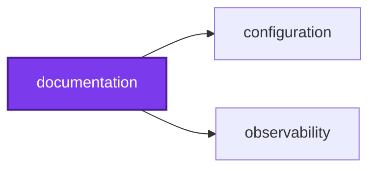
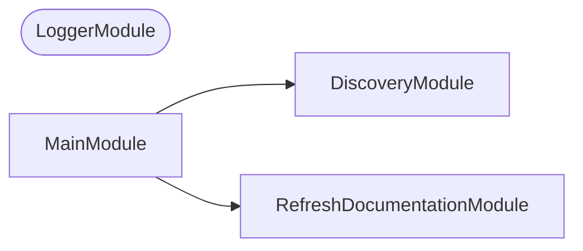
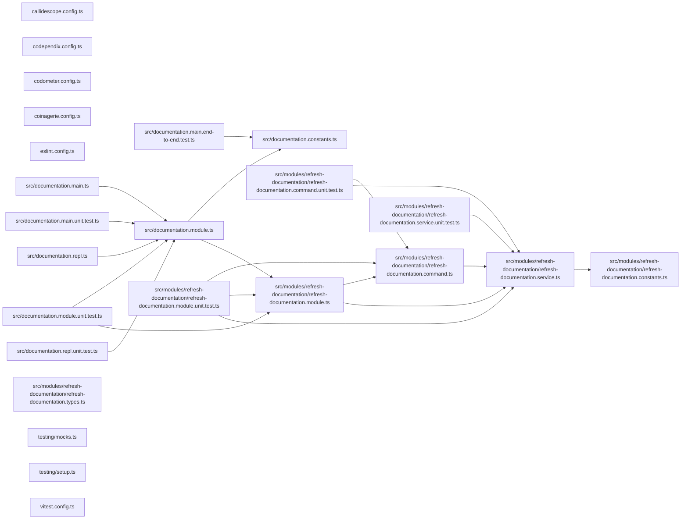

NestJS CLI that refreshes the repository documentation from code. It also holds the documentation itself: `adr`, `agents`, `development`, `openwiki`, `planning`, and `research`.

## Start

```bash
nx run documentation:refresh-documentation
```

Needs the `OPENWIKI_*` and provider key environment variables OpenWiki reads. The 🧑‍🏫 Refresh Documentation workflow supplies them: a free OpenRouter model, with the key in the `OPENROUTER_API_KEY` repository secret.

## Test

```bash
nx run documentation:vitest
```

## 👔 Conformetry

This project was generated from the [nestjs-command-project](../configuration/conformetry-templates/nestjs-command-project) conformetry template.

## 🕸️ Codependix

Dependency graphs exported by [codependix](https://github.com/Organizzolini/codebase/tree/main/projects/ic-suite/codependix/codependix-cli), regenerated by `nx run configuration:codependix:write`.

### Nx Neighborhood

<!-- codependix:start name="codependix-nx-projects" -->

<!-- codependix:end name="codependix-nx-projects" -->

### NestJS Module Graph

<!-- codependix:start name="codependix-nestjs-modules" -->


_Rounded modules are global: every module can inject them, so their edges are left out._
<!-- codependix:end name="codependix-nestjs-modules" -->

### File Imports

<!-- codependix:start name="codependix-file-imports" -->

<!-- codependix:end name="codependix-file-imports" -->

<!-- coinagerie:start -->

## 🪙 Coinagerie

The words this project uses that the root glossary does not define, regenerated with `nx run documentation:coinagerie-check:write`.

- **affirmation**: Generated phrase that the affirmations feature planning documents describe, produced by an LLM from tarot-card references.
- **band**: Horizontal strip of a meander drawing bounded by two borders, which ADR 0004 and ADR 0006 adjust for crossings and branch families.
- **border**: Edge of a meander band that ADR 0006 closes on both sides in the branch and parallel families through a MotifService hook.
- **breadth**: One of the two callidescope limits, alongside depth, that ADR 0006 keeps after dropping the other noise controls.
- **bundle**: Bundle-size measurement that ADR 0003 folds into codometer as a general change report, replacing the separate reporting module.
- **canonical**: Normalized form of a meander or its symmetry class, which ADR 0007 and ADR 0014 standardize addressing and phase around.
- **cascade**: Refers to the cascading dependents rule in ADR 0017, where a bump to one internal dependency republishes every package depending on it.
- **characteristic**: Named property of a meander, such as its letter counts, that ADR 0012 and ADR 0018 store together in one sparse JSON map.
- **corpus**: Committed historical set of meander drawings that ADR 0006 and ADR 0013 read as a test set for regression checks.
- **cut**: Seam where a meander band is split, which ADR 0006 and ADR 0013 use when comparing one drawing or family to another.
- **design**: Architectural design that an ADR records, or a rule like ADR 0002 that a pull request gate would fail every pull request by design.
- **domain**: Refers to CONTEXT.md and the domain model in agents domain documentation, the glossary of terms agents must use consistently.
- **ephemeris**: Astronomical position data that the caelundas performance plan generates year by year with local computation instead of HTTP calls.
- **family**: Meander classification group, such as the cross, branch, and parallel families whose drawing rules ADR 0004 and ADR 0006 adjust.
- **generation**: Refers to conformetry's generation package that renders code from templates, and the generation layer named in ADR 0013.
- **handoff**: Structured hand-off comment posted on a spec issue for the next session, whose repository rules agents handoffs documentation sets out.
- **historical**: Describes the historical meander corpus of committed drawings whose labels ADR 0012 and ADR 0013 treat as a test set.
- **interlace**: Woven over-and-under crossing pattern in meander drawings, which ADR 0004 breaks with a one-pitch gap at each crossing.
- **lattice**: Grid on which every meander sits, which ADR 0007 uses to address each drawing and MeanderLatticeService validates against.
- **law**: Governing rule in ADR 0011, the universal path and naming law that every project type follows for its file layout.
- **letter**: Glyph counted in each meander's letter-count map under ADR 0017, counted in all sixteen orientations for every meander.
- **meanderaw**: Meander drawing project whose cross, branch, and parallel families ADRs 0004 to 0006 change, producing the drawings in the corpus.
- **phase**: Names the canonical rotation of a meander in ADR 0014, chosen by minimizing seam components for each drawing in the corpus.
- **pipeline**: Generic meander pipeline of decode, render, compute Characteristics, and classify that ADR 0012 runs for every drawing.
- **pitch**: One grid unit on the lattice, which ADR 0004 uses to place the interrupted crossing break one pitch either side of the junction.
- **role**: Layer assignment of a package, which ADR 0013 documents so a reader learns its place without opening its index file.
- **statistic**: Per-project figure, such as the statistics block that ADR 0002 publishes in each project's README on the default branch.
- **swiss**: Short for Swiss Ephemeris, the local astronomy library that the caelundas performance plan uses instead of NASA Horizons HTTP calls.
- **triage**: Labels in agents triage-labels documentation map the status family to canonical roles for issues in this repository.
- **under**: Names the under-strand of a meander crossing, the strand that ADR 0004 breaks with a one-pitch gap at the junction.
- **wiki**: OpenWiki output under documentation openwiki that the refresh service regenerates from code, reached through the openwiki symlink.

<!-- coinagerie:end -->

<!-- callidescope:start -->

## 🔭 Callidescope

Call stacks traced through `documentation`, deepest first. Each frame shows what it takes, what it returns, and what its documentation says.

| Measure | Value |
| --- | --- |
| Callables | 10 |
| Files | 15 |
| Calls traced | 3 |
| Call stacks | 1 |
| Deepest stack | 3 |
| Stacks through recursion | 0 |
| Unfollowable calls | 1 |

### Limits

What this project is judged against, as declared in its own `callidescope.config.ts`.

| Limit | Value |
| --- | --- |
| `maximumDepth` | 6 |
| `maximumBreadth` | 8 |

### Call stacks (depth)

**1. `RefreshDocumentationCommand.run`** — depth 3 · decorated-method

```text
🚀 RefreshDocumentationCommand.run(): Promise<void> [documentation/src/modules/refresh-documentation/refresh-documentation.command.ts:39]
   ↳ Refreshes the documentation, failing the process when that fails.
  └─> RefreshDocumentationService.refresh(): Promise<boolean> [documentation/src/modules/refresh-documentation/refresh-documentation.service.ts:75]
     ↳ Updates the wiki from code, starting OpenWiki again after a growing wait when it fails, then puts the `openwiki`…
    └─> RefreshDocumentationService.exposeWiki(): boolean [documentation/src/modules/refresh-documentation/refresh-documentation.service.ts:48]
       ↳ Replaces the root `openwiki` symlink with the directory it points at.
```

### Breadth

| Callable | Breadth | Calls directly | Location |
| --- | --- | --- | --- |
| `RefreshDocumentationService.refresh` | 2 | `RefreshDocumentationService.exposeWiki`, `RefreshDocumentationService.restoreWiki` | `documentation/src/modules/refresh-documentation/refresh-documentation.service.ts:75` |
| `RefreshDocumentationCommand.run` | 1 | `RefreshDocumentationService.refresh` | `documentation/src/modules/refresh-documentation/refresh-documentation.command.ts:39` |
<!-- callidescope:end -->
