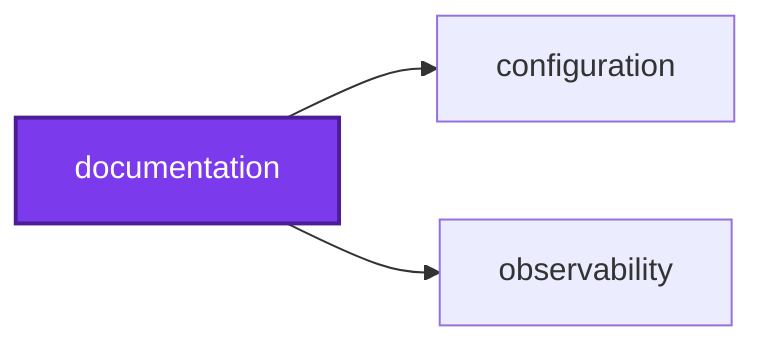
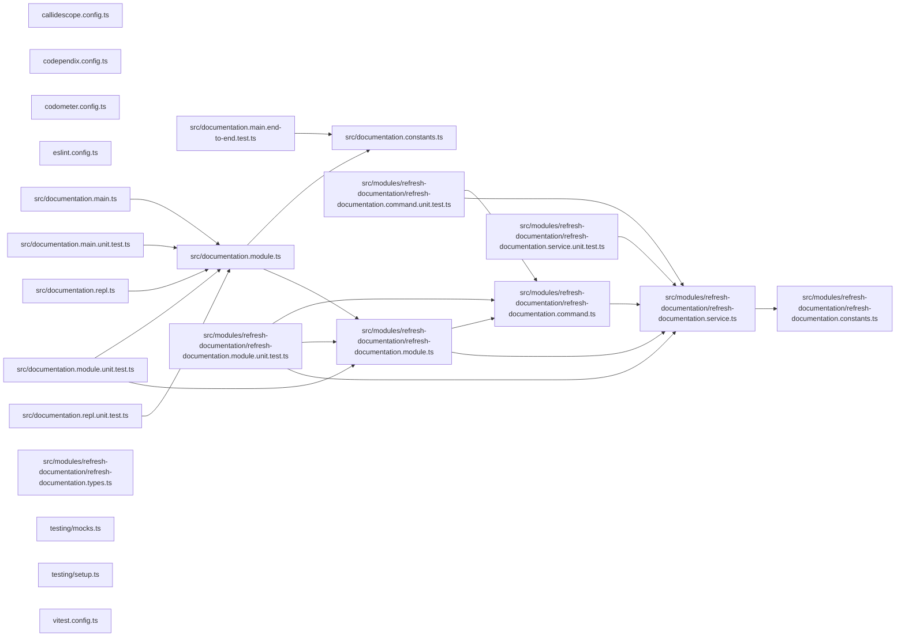

NestJS CLI that refreshes the repository documentation from code. It also holds the documentation itself: `adr`, `agents`, `development`, `openwiki`, `planning`, and `research`.

## Start

```bash
nx run documentation:refresh-documentation
```

Needs the `OPENWIKI_*` and provider key environment variables OpenWiki reads. The 🧑‍🏫 Refresh Documentation workflow supplies them: a free OpenRouter model, with the key in the `OPENROUTER_API_KEY` repository secret.

## Test

```bash
nx run documentation:vitest
```

## 👔 Conformetry

This project was generated from the [nestjs-command-project](../configuration/conformetry-templates/nestjs-command-project) conformetry template.

## 🕸️ Codependix

Dependency graphs exported by [codependix](https://github.com/Organizzolini/codebase/tree/main/projects/ic-suite/codependix/codependix-cli), regenerated by `nx run configuration:codependix:write`.

### Nx Neighborhood

<!-- codependix:start name="codependix-nx-projects" -->

<!-- codependix:end name="codependix-nx-projects" -->

### NestJS Module Graph

<!-- codependix:start name="codependix-nestjs-modules" -->


_Rounded modules are global: every module can inject them, so their edges are left out._
<!-- codependix:end name="codependix-nestjs-modules" -->

### File Imports

<!-- codependix:start name="codependix-file-imports" -->

<!-- codependix:end name="codependix-file-imports" -->

<!-- coinagerie:start -->

## 🪙 Coinagerie

The words this project uses that the root glossary does not define, regenerated with `nx run documentation:coinagerie-check:write`.

- **absorb**:
- **address**:
- **adr**:
- **affirmation**:
- **after**:
- **alone**:
- **alternative**:
- **an**:
- **analysis**:
- **assertion**:
- **band**:
- **biome**:
- **bootstrap**:
- **border**:
- **both**:
- **breadth**:
- **buffer**:
- **bundle**:
- **call**:
- **canonical**:
- **capture**:
- **cascade**:
- **characteristic**:
- **claim**:
- **clear**:
- **close**:
- **compile**:
- **compiler**:
- **complete**:
- **completion**:
- **composite**:
- **concept**:
- **conformance**:
- **console**:
- **constant**:
- **controller**:
- **corpus**:
- **count**:
- **cut**:
- **decorator**:
- **define**:
- **definition**:
- **delay**:
- **describe**:
- **design**:
- **development**:
- **discovery**:
- **domain**:
- **draw**:
- **drift**:
- **each**:
- **elimination**:
- **enhance**:
- **entity**:
- **entry**:
- **ephemeris**:
- **equal**:
- **everything**:
- **evidence**:
- **exactly**:
- **example**:
- **executable**:
- **experimental**:
- **expose**:
- **factory**:
- **fake**:
- **family**:
- **field**:
- **fingerprint**:
- **floor**:
- **force**:
- **generation**:
- **gitkeep**:
- **give**:
- **greater**:
- **handler**:
- **handoff**:
- **historical**:
- **hoist**:
- **hold**:
- **implementation**:
- **independent**:
- **injectable**:
- **inline**:
- **instance**:
- **interlace**:
- **invocation**:
- **judge**:
- **keep**:
- **last**:
- **lattice**:
- **law**:
- **least**:
- **leftover**:
- **less**:
- **letter**:
- **link**:
- **logger**:
- **lstat**:
- **manifest**:
- **maximum**:
- **md**:
- **meanderaw**:
- **mock**:
- **monorepo**:
- **ms**:
- **multi**:
- **narrow**:
- **nth**:
- **once**:
- **one**:
- **optimization**:
- **original**:
- **overview**:
- **own**:
- **partial**:
- **performance**:
- **phase**:
- **pid**:
- **pipeline**:
- **pitch**:
- **plan**:
- **precommit**:
- **promise**:
- **provide**:
- **publish**:
- **quickstart**:
- **real**:
- **really**:
- **recursive**:
- **reject**:
- **rename**:
- **research**:
- **resolution**:
- **role**:
- **runner**:
- **scaffold**:
- **signal**:
- **small**:
- **software**:
- **sparse**:
- **spawn**:
- **spy**:
- **stack**:
- **stat**:
- **statement**:
- **statistic**:
- **stdio**:
- **stdout**:
- **store**:
- **strict**:
- **swiss**:
- **symbolic**:
- **symlink**:
- **synthetic**:
- **t00**:
- **t02**:
- **t13**:
- **t18**:
- **t19**:
- **t23**:
- **task**:
- **than**:
- **theory**:
- **timer**:
- **tracker**:
- **triage**:
- **typesafety**:
- **under**:
- **unlink**:
- **validator**:
- **versioning**:
- **vi**:
- **wiki**:

<!-- coinagerie:end -->
