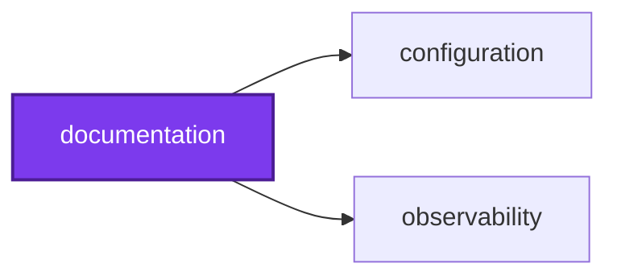
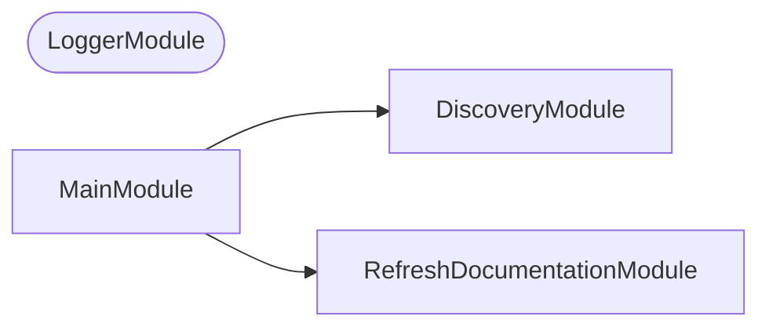
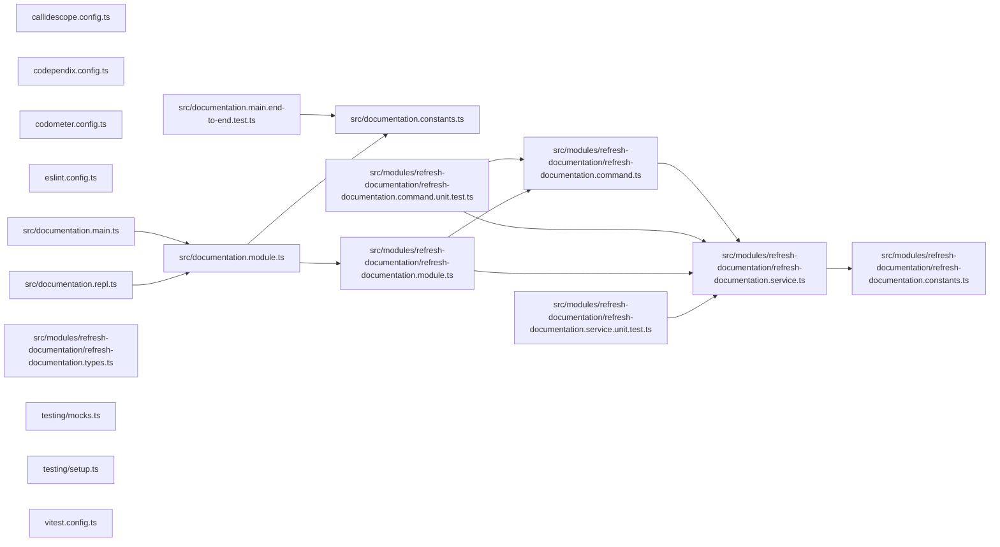

NestJS CLI that refreshes the repository documentation from code. It also holds the documentation itself: `adr`, `agents`, `development`, `openwiki`, `planning`, and `research`.

## Start

```bash
nx run documentation:refresh-documentation
```

Needs the `OPENWIKI_*` and provider key environment variables OpenWiki reads; the 🧑‍🏫 Refresh Documentation workflow supplies them.

## Test

```bash
nx run documentation:vitest
```

## 👔 Conformetry

This project was generated from the [nestjs-command-project](../configuration/conformetry-templates/nestjs-command-project) conformetry template.

## 🕸️ Codependix

Dependency graphs exported by [codependix](https://github.com/Organizzolini/codebase/tree/main/projects/ic-suite/codependix/codependix-cli), regenerated by `nx run configuration:codependix:write`.

### Nx Neighborhood

<!-- codependix:start name="codependix-nx-projects" -->

<!-- codependix:end name="codependix-nx-projects" -->

### NestJS Module Graph

<!-- codependix:start name="codependix-nestjs-modules" -->


_Rounded modules are global: every module can inject them, so their edges are left out._
<!-- codependix:end name="codependix-nestjs-modules" -->

### File Imports

<!-- codependix:start name="codependix-file-imports" -->

<!-- codependix:end name="codependix-file-imports" -->
