## 🕸️ Codependix

Dependency graphs exported by [codependix](https://github.com/Organizzolini/codebase/tree/main/projects/ic-suite/codependix/codependix-cli), regenerated by `nx run configuration:codependix:write`.

```mermaid
graph LR
  affirmancy["affirmancy"]
  caelundas_api["caelundas-api"]
  caelundas_cli["caelundas-cli"]
  caelundas_db["caelundas-db"]
  caelundas_web["caelundas-web"]
  callidescope_agents["callidescope-agents"]
  callidescope_cli["callidescope-cli"]
  callidescope_configuration["callidescope-configuration"]
  callidescope_core["callidescope-core"]
  callidescope_examples["callidescope-examples"]
  callidescope_graph["callidescope-graph"]
  callidescope_nx["callidescope-nx"]
  callidescope_output["callidescope-output"]
  codependix_agents["codependix-agents"]
  codependix_boundaries["codependix-boundaries"]
  codependix_cli["codependix-cli"]
  codependix_configuration["codependix-configuration"]
  codependix_core["codependix-core"]
  codependix_examples["codependix-examples"]
  codependix_file_imports["codependix-file-imports"]
  codependix_nestjs_modules["codependix-nestjs-modules"]
  codependix_nx["codependix-nx"]
  codependix_nx_projects["codependix-nx-projects"]
  codependix_output["codependix-output"]
  codometer_agents["codometer-agents"]
  codometer_cli["codometer-cli"]
  codometer_configuration["codometer-configuration"]
  codometer_core["codometer-core"]
  codometer_examples["codometer-examples"]
  codometer_languages["codometer-languages"]
  codometer_measurement["codometer-measurement"]
  codometer_nx["codometer-nx"]
  codometer_output["codometer-output"]
  coinagerie_agents["coinagerie-agents"]
  coinagerie_cli["coinagerie-cli"]
  coinagerie_configuration["coinagerie-configuration"]
  coinagerie_core["coinagerie-core"]
  coinagerie_examples["coinagerie-examples"]
  coinagerie_languages["coinagerie-languages"]
  coinagerie_nx["coinagerie-nx"]
  coinagerie_output["coinagerie-output"]
  coinagerie_vocabulary["coinagerie-vocabulary"]
  compliance["compliance"]
  configuration["configuration"]
  conformetry_agents["conformetry-agents"]
  conformetry_cli["conformetry-cli"]
  conformetry_configuration["conformetry-configuration"]
  conformetry_core["conformetry-core"]
  conformetry_examples["conformetry-examples"]
  conformetry_generation["conformetry-generation"]
  conformetry_languages["conformetry-languages"]
  conformetry_nx["conformetry-nx"]
  conformetry_output["conformetry-output"]
  conformetry_validation["conformetry-validation"]
  deployment["deployment"]
  documentation["documentation"]
  infrastructure["infrastructure"]
  installation["installation"]
  integration["integration"]
  interface["interface"]
  lexico_api["lexico-api"]
  lexico_cli["lexico-cli"]
  lexico_db["lexico-db"]
  lexico_web["lexico-web"]
  meanderaw_api["meanderaw-api"]
  meanderaw_cli["meanderaw-cli"]
  meanderaw_core["meanderaw-core"]
  meanderaw_db["meanderaw-db"]
  meanderaw_web["meanderaw-web"]
  observability["observability"]
  persistence["persistence"]
  presentation["presentation"]
  testing["testing"]
  affirmancy --> configuration
  caelundas_api --> caelundas_db
  caelundas_api --> configuration
  caelundas_api --> observability
  caelundas_api --> persistence
  caelundas_api --> testing
  caelundas_cli --> caelundas_db
  caelundas_cli --> configuration
  caelundas_cli --> observability
  caelundas_cli --> persistence
  caelundas_cli --> testing
  caelundas_db --> configuration
  caelundas_db --> persistence
  caelundas_db --> testing
  caelundas_web --> configuration
  caelundas_web --> interface
  caelundas_web --> presentation
  caelundas_web --> testing
  callidescope_agents --> configuration
  callidescope_agents --> testing
  callidescope_cli --> callidescope_configuration
  callidescope_cli --> callidescope_core
  callidescope_cli --> callidescope_graph
  callidescope_cli --> callidescope_output
  callidescope_cli --> configuration
  callidescope_cli --> observability
  callidescope_cli --> testing
  callidescope_configuration --> callidescope_core
  callidescope_configuration --> configuration
  callidescope_configuration --> testing
  callidescope_core --> configuration
  callidescope_core --> testing
  callidescope_examples -.-> callidescope_cli
  callidescope_examples --> callidescope_configuration
  callidescope_examples --> callidescope_core
  callidescope_examples --> configuration
  callidescope_examples --> testing
  callidescope_graph --> callidescope_configuration
  callidescope_graph --> callidescope_core
  callidescope_graph --> configuration
  callidescope_graph --> observability
  callidescope_graph --> testing
  callidescope_nx --> callidescope_cli
  callidescope_nx --> callidescope_configuration
  callidescope_nx --> callidescope_core
  callidescope_nx --> callidescope_graph
  callidescope_nx --> callidescope_output
  callidescope_nx --> configuration
  callidescope_nx --> observability
  callidescope_nx --> testing
  callidescope_output --> callidescope_configuration
  callidescope_output --> callidescope_core
  callidescope_output --> callidescope_graph
  callidescope_output --> configuration
  callidescope_output --> observability
  callidescope_output --> testing
  codependix_agents --> configuration
  codependix_agents --> testing
  codependix_boundaries --> codependix_configuration
  codependix_boundaries --> codependix_core
  codependix_boundaries --> codependix_file_imports
  codependix_boundaries --> codependix_nestjs_modules
  codependix_boundaries --> codependix_nx_projects
  codependix_boundaries --> configuration
  codependix_boundaries --> testing
  codependix_cli --> codependix_boundaries
  codependix_cli --> codependix_configuration
  codependix_cli --> codependix_core
  codependix_cli --> codependix_output
  codependix_cli --> configuration
  codependix_cli --> observability
  codependix_cli --> testing
  codependix_configuration --> codependix_core
  codependix_configuration --> configuration
  codependix_configuration --> testing
  codependix_core --> configuration
  codependix_core --> testing
  codependix_examples --> codependix_boundaries
  codependix_examples -.-> codependix_cli
  codependix_examples --> codependix_configuration
  codependix_examples --> codependix_core
  codependix_examples --> codependix_file_imports
  codependix_examples --> codependix_nestjs_modules
  codependix_examples --> codependix_nx_projects
  codependix_examples --> codependix_output
  codependix_examples --> configuration
  codependix_examples --> observability
  codependix_examples --> testing
  codependix_file_imports --> configuration
  codependix_file_imports --> testing
  codependix_nestjs_modules --> configuration
  codependix_nestjs_modules --> observability
  codependix_nestjs_modules --> testing
  codependix_nx --> codependix_cli
  codependix_nx --> codependix_configuration
  codependix_nx --> configuration
  codependix_nx --> testing
  codependix_nx_projects --> configuration
  codependix_nx_projects --> testing
  codependix_output --> codependix_boundaries
  codependix_output --> codependix_configuration
  codependix_output --> codependix_core
  codependix_output --> codependix_file_imports
  codependix_output --> codependix_nestjs_modules
  codependix_output --> codependix_nx_projects
  codependix_output --> configuration
  codependix_output --> observability
  codependix_output --> testing
  codometer_agents --> configuration
  codometer_agents --> testing
  codometer_cli --> codometer_configuration
  codometer_cli --> codometer_core
  codometer_cli --> codometer_measurement
  codometer_cli --> codometer_output
  codometer_cli --> configuration
  codometer_cli --> observability
  codometer_cli --> testing
  codometer_configuration --> codometer_core
  codometer_configuration --> configuration
  codometer_configuration --> testing
  codometer_core --> configuration
  codometer_core --> testing
  codometer_examples -.-> codometer_cli
  codometer_examples --> codometer_configuration
  codometer_examples --> codometer_core
  codometer_examples --> configuration
  codometer_examples --> testing
  codometer_languages --> codometer_configuration
  codometer_languages --> codometer_core
  codometer_languages --> configuration
  codometer_languages --> observability
  codometer_languages --> testing
  codometer_measurement --> codometer_configuration
  codometer_measurement --> codometer_core
  codometer_measurement --> codometer_languages
  codometer_measurement --> configuration
  codometer_measurement --> observability
  codometer_measurement --> testing
  codometer_nx -.-> codometer_cli
  codometer_nx --> codometer_configuration
  codometer_nx --> configuration
  codometer_nx --> testing
  codometer_output --> codometer_configuration
  codometer_output --> codometer_core
  codometer_output --> codometer_measurement
  codometer_output --> configuration
  codometer_output --> observability
  codometer_output --> testing
  coinagerie_agents --> configuration
  coinagerie_cli --> coinagerie_configuration
  coinagerie_cli --> coinagerie_core
  coinagerie_cli --> coinagerie_output
  coinagerie_cli --> coinagerie_vocabulary
  coinagerie_cli --> configuration
  coinagerie_cli --> observability
  coinagerie_cli --> testing
  coinagerie_configuration --> coinagerie_core
  coinagerie_configuration --> configuration
  coinagerie_configuration --> testing
  coinagerie_core --> configuration
  coinagerie_core --> testing
  coinagerie_examples -.-> coinagerie_cli
  coinagerie_examples --> configuration
  coinagerie_examples --> testing
  coinagerie_languages --> configuration
  coinagerie_languages --> testing
  coinagerie_nx -.-> coinagerie_cli
  coinagerie_nx --> coinagerie_configuration
  coinagerie_nx --> configuration
  coinagerie_nx --> testing
  coinagerie_output --> coinagerie_configuration
  coinagerie_output --> coinagerie_core
  coinagerie_output --> configuration
  coinagerie_output --> testing
  coinagerie_vocabulary --> coinagerie_configuration
  coinagerie_vocabulary --> coinagerie_languages
  coinagerie_vocabulary --> configuration
  coinagerie_vocabulary --> testing
  compliance --> configuration
  compliance --> observability
  compliance --> testing
  conformetry_agents --> configuration
  conformetry_agents --> testing
  conformetry_cli --> configuration
  conformetry_cli --> conformetry_configuration
  conformetry_cli --> conformetry_core
  conformetry_cli --> conformetry_generation
  conformetry_cli --> conformetry_output
  conformetry_cli --> conformetry_validation
  conformetry_cli --> observability
  conformetry_cli --> testing
  conformetry_configuration --> configuration
  conformetry_configuration --> conformetry_core
  conformetry_configuration --> testing
  conformetry_core --> configuration
  conformetry_core --> testing
  conformetry_examples --> configuration
  conformetry_examples -.-> conformetry_cli
  conformetry_examples --> conformetry_configuration
  conformetry_examples --> conformetry_generation
  conformetry_examples --> conformetry_nx
  conformetry_examples --> conformetry_output
  conformetry_examples --> conformetry_validation
  conformetry_examples --> testing
  conformetry_generation --> configuration
  conformetry_generation --> conformetry_configuration
  conformetry_generation --> conformetry_core
  conformetry_generation --> testing
  conformetry_languages --> configuration
  conformetry_languages --> conformetry_configuration
  conformetry_languages --> conformetry_core
  conformetry_languages --> testing
  conformetry_nx --> configuration
  conformetry_nx --> conformetry_configuration
  conformetry_nx --> conformetry_generation
  conformetry_nx --> conformetry_output
  conformetry_nx --> conformetry_validation
  conformetry_nx --> observability
  conformetry_nx --> testing
  conformetry_output --> configuration
  conformetry_output --> conformetry_core
  conformetry_output --> conformetry_languages
  conformetry_output --> testing
  conformetry_validation --> configuration
  conformetry_validation --> conformetry_configuration
  conformetry_validation --> conformetry_core
  conformetry_validation --> conformetry_languages
  conformetry_validation --> testing
  deployment --> configuration
  deployment --> observability
  deployment --> testing
  documentation --> configuration
  documentation --> observability
  documentation --> testing
  infrastructure --> configuration
  installation --> configuration
  installation --> observability
  installation --> testing
  integration --> configuration
  integration --> observability
  integration --> testing
  interface --> configuration
  interface --> testing
  lexico_api --> configuration
  lexico_api --> interface
  lexico_api --> lexico_db
  lexico_api --> observability
  lexico_api --> persistence
  lexico_api --> testing
  lexico_cli --> configuration
  lexico_cli --> lexico_db
  lexico_cli --> observability
  lexico_cli --> persistence
  lexico_cli --> testing
  lexico_db --> configuration
  lexico_db --> persistence
  lexico_db --> testing
  lexico_web --> configuration
  lexico_web --> interface
  lexico_web --> presentation
  lexico_web --> testing
  meanderaw_api --> configuration
  meanderaw_api --> meanderaw_core
  meanderaw_api --> meanderaw_db
  meanderaw_api --> observability
  meanderaw_api --> persistence
  meanderaw_api --> testing
  meanderaw_cli --> configuration
  meanderaw_cli --> meanderaw_core
  meanderaw_cli --> meanderaw_db
  meanderaw_cli --> observability
  meanderaw_cli --> persistence
  meanderaw_cli --> testing
  meanderaw_core --> configuration
  meanderaw_core --> testing
  meanderaw_db --> configuration
  meanderaw_db --> persistence
  meanderaw_db --> testing
  meanderaw_web --> configuration
  meanderaw_web --> interface
  meanderaw_web --> presentation
  meanderaw_web --> testing
  observability --> configuration
  persistence --> configuration
  persistence --> observability
  persistence --> testing
  presentation --> configuration
  testing --> configuration
  testing --> observability
```

<!-- codependix:start name="codependix-nx-projects" -->


_Dashed edges are dependencies Nx inferred from configuration rather than from code._
<!-- codependix:end name="codependix-nx-projects" -->

### NestJS Module Graph

<!-- codependix:start name="codependix-nestjs-modules" -->
```mermaid
graph LR
  module_caelundas_api_CaelundasApiModule["caelundas-api/CaelundasApiModule"]
  module_caelundas_api_ConfigModule["caelundas-api/ConfigModule"]
  module_caelundas_api_CorsModule["caelundas-api/CorsModule"]
  module_caelundas_api_DatabaseModule["caelundas-api/DatabaseModule"]
  module_caelundas_api_EventsModule["caelundas-api/EventsModule"]
  module_caelundas_api_GraphQLModule["caelundas-api/GraphQLModule"]
  module_caelundas_api_GraphQLSchemaBuilderModule["caelundas-api/GraphQLSchemaBuilderModule"]
  module_caelundas_api_HealthModule["caelundas-api/HealthModule"]
  module_caelundas_api_LoggerModule["caelundas-api/LoggerModule"]
  module_caelundas_api_NightSkyModule["caelundas-api/NightSkyModule"]
  module_caelundas_api_PostgresqlModule["caelundas-api/PostgresqlModule"]
  module_caelundas_api_TypeOrmModule["caelundas-api/TypeOrmModule"]
  module_caelundas_cli_AnnualSolarCycleModule["caelundas-cli/AnnualSolarCycleModule"]
  module_caelundas_cli_AspectsModule["caelundas-cli/AspectsModule"]
  module_caelundas_cli_AspectsUtilitiesModule["caelundas-cli/AspectsUtilitiesModule"]
  module_caelundas_cli_CaelundasModule["caelundas-cli/CaelundasModule"]
  module_caelundas_cli_CalendarEventsModule["caelundas-cli/CalendarEventsModule"]
  module_caelundas_cli_CalendarModule["caelundas-cli/CalendarModule"]
  module_caelundas_cli_ConfigModule["caelundas-cli/ConfigModule"]
  module_caelundas_cli_DailyCyclesModule["caelundas-cli/DailyCyclesModule"]
  module_caelundas_cli_DatabaseModule["caelundas-cli/DatabaseModule"]
  module_caelundas_cli_DatetimeModule["caelundas-cli/DatetimeModule"]
  module_caelundas_cli_DiscoveryModule["caelundas-cli/DiscoveryModule"]
  module_caelundas_cli_EclipsesModule["caelundas-cli/EclipsesModule"]
  module_caelundas_cli_EphemerisModule["caelundas-cli/EphemerisModule"]
  module_caelundas_cli_IngressesModule["caelundas-cli/IngressesModule"]
  module_caelundas_cli_InputModule["caelundas-cli/InputModule"]
  module_caelundas_cli_LoggerModule["caelundas-cli/LoggerModule"]
  module_caelundas_cli_MainModule["caelundas-cli/MainModule"]
  module_caelundas_cli_MajorAspectsModule["caelundas-cli/MajorAspectsModule"]
  module_caelundas_cli_MathModule["caelundas-cli/MathModule"]
  module_caelundas_cli_MinorAspectsModule["caelundas-cli/MinorAspectsModule"]
  module_caelundas_cli_MonthlyLunarCycleModule["caelundas-cli/MonthlyLunarCycleModule"]
  module_caelundas_cli_NightSkyModule["caelundas-cli/NightSkyModule"]
  module_caelundas_cli_PerfectiveModule["caelundas-cli/PerfectiveModule"]
  module_caelundas_cli_PhasesModule["caelundas-cli/PhasesModule"]
  module_caelundas_cli_PostgresqlModule["caelundas-cli/PostgresqlModule"]
  module_caelundas_cli_ProgressiveModule["caelundas-cli/ProgressiveModule"]
  module_caelundas_cli_ProgressiveUtilitiesModule["caelundas-cli/ProgressiveUtilitiesModule"]
  module_caelundas_cli_QuadrupleAspectsModule["caelundas-cli/QuadrupleAspectsModule"]
  module_caelundas_cli_QuintupleAspectsModule["caelundas-cli/QuintupleAspectsModule"]
  module_caelundas_cli_RetrogradesModule["caelundas-cli/RetrogradesModule"]
  module_caelundas_cli_SextupleAspectsModule["caelundas-cli/SextupleAspectsModule"]
  module_caelundas_cli_SpecialtyAspectsModule["caelundas-cli/SpecialtyAspectsModule"]
  module_caelundas_cli_StelliumModule["caelundas-cli/StelliumModule"]
  module_caelundas_cli_TagsModule["caelundas-cli/TagsModule"]
  module_caelundas_cli_TripleAspectsModule["caelundas-cli/TripleAspectsModule"]
  module_caelundas_cli_TwilightsModule["caelundas-cli/TwilightsModule"]
  module_caelundas_cli_TypeOrmModule["caelundas-cli/TypeOrmModule"]
  module_caelundas_db_DatabaseModule["caelundas-db/DatabaseModule"]
  module_caelundas_db_PostgresqlModule["caelundas-db/PostgresqlModule"]
  module_caelundas_db_TypeOrmModule["caelundas-db/TypeOrmModule"]
  module_callidescope_cli_AddressLookupModule["callidescope-cli/AddressLookupModule"]
  module_callidescope_cli_AddressReportModule["callidescope-cli/AddressReportModule"]
  module_callidescope_cli_BreadthModule["callidescope-cli/BreadthModule"]
  module_callidescope_cli_CallablesModule["callidescope-cli/CallablesModule"]
  module_callidescope_cli_CallidescopeModule["callidescope-cli/CallidescopeModule"]
  module_callidescope_cli_ClassesModule["callidescope-cli/ClassesModule"]
  module_callidescope_cli_ConfigModule["callidescope-cli/ConfigModule"]
  module_callidescope_cli_ConfigurationFileModule["callidescope-cli/ConfigurationFileModule"]
  module_callidescope_cli_ConfigurationModule["callidescope-cli/ConfigurationModule"]
  module_callidescope_cli_DepthModule["callidescope-cli/DepthModule"]
  module_callidescope_cli_DiscoveryModule["callidescope-cli/DiscoveryModule"]
  module_callidescope_cli_DocumentationModule["callidescope-cli/DocumentationModule"]
  module_callidescope_cli_EdgesModule["callidescope-cli/EdgesModule"]
  module_callidescope_cli_EntriesModule["callidescope-cli/EntriesModule"]
  module_callidescope_cli_FlagResolutionModule["callidescope-cli/FlagResolutionModule"]
  module_callidescope_cli_GraphModule["callidescope-cli/GraphModule"]
  module_callidescope_cli_InputModule["callidescope-cli/InputModule"]
  module_callidescope_cli_LimitsModule["callidescope-cli/LimitsModule"]
  module_callidescope_cli_LoggerModule["callidescope-cli/LoggerModule"]
  module_callidescope_cli_MainModule["callidescope-cli/MainModule"]
  module_callidescope_cli_OutputJsonModule["callidescope-cli/OutputJsonModule"]
  module_callidescope_cli_OutputMarkdownModule["callidescope-cli/OutputMarkdownModule"]
  module_callidescope_cli_ProgramModule["callidescope-cli/ProgramModule"]
  module_callidescope_cli_ProjectReportsModule["callidescope-cli/ProjectReportsModule"]
  module_callidescope_cli_ReportFindingsModule["callidescope-cli/ReportFindingsModule"]
  module_callidescope_cli_ReportModule["callidescope-cli/ReportModule"]
  module_callidescope_cli_RunPlanModule["callidescope-cli/RunPlanModule"]
  module_callidescope_cli_SignaturesModule["callidescope-cli/SignaturesModule"]
  module_callidescope_cli_WorkspaceModule["callidescope-cli/WorkspaceModule"]
  module_callidescope_cli_WriteDestinationsModule["callidescope-cli/WriteDestinationsModule"]
  module_callidescope_configuration_ConfigurationFileModule["callidescope-configuration/ConfigurationFileModule"]
  module_callidescope_configuration_ConfigurationModule["callidescope-configuration/ConfigurationModule"]
  module_callidescope_configuration_FlagResolutionModule["callidescope-configuration/FlagResolutionModule"]
  module_callidescope_configuration_InputModule["callidescope-configuration/InputModule"]
  module_callidescope_configuration_RunPlanModule["callidescope-configuration/RunPlanModule"]
  module_callidescope_core_CallidescopeCoreModule["callidescope-core/CallidescopeCoreModule"]
  module_callidescope_graph_CallablesModule["callidescope-graph/CallablesModule"]
  module_callidescope_graph_ClassesModule["callidescope-graph/ClassesModule"]
  module_callidescope_graph_DocumentationModule["callidescope-graph/DocumentationModule"]
  module_callidescope_graph_EdgesModule["callidescope-graph/EdgesModule"]
  module_callidescope_graph_EntriesModule["callidescope-graph/EntriesModule"]
  module_callidescope_graph_GraphModule["callidescope-graph/GraphModule"]
  module_callidescope_graph_LoggerModule["callidescope-graph/LoggerModule"]
  module_callidescope_graph_ProgramModule["callidescope-graph/ProgramModule"]
  module_callidescope_graph_SignaturesModule["callidescope-graph/SignaturesModule"]
  module_callidescope_graph_WorkspaceModule["callidescope-graph/WorkspaceModule"]
  module_callidescope_nx_AddressLookupModule["callidescope-nx/AddressLookupModule"]
  module_callidescope_nx_AddressModule["callidescope-nx/AddressModule"]
  module_callidescope_nx_AddressReportModule["callidescope-nx/AddressReportModule"]
  module_callidescope_nx_CallablesModule["callidescope-nx/CallablesModule"]
  module_callidescope_nx_CallidescopeModule["callidescope-nx/CallidescopeModule"]
  module_callidescope_nx_ClassesModule["callidescope-nx/ClassesModule"]
  module_callidescope_nx_ConfigurationFileModule["callidescope-nx/ConfigurationFileModule"]
  module_callidescope_nx_ConfigurationModule["callidescope-nx/ConfigurationModule"]
  module_callidescope_nx_DocumentationModule["callidescope-nx/DocumentationModule"]
  module_callidescope_nx_EdgesModule["callidescope-nx/EdgesModule"]
  module_callidescope_nx_EntriesModule["callidescope-nx/EntriesModule"]
  module_callidescope_nx_FlagResolutionModule["callidescope-nx/FlagResolutionModule"]
  module_callidescope_nx_GraphModule["callidescope-nx/GraphModule"]
  module_callidescope_nx_InputModule["callidescope-nx/InputModule"]
  module_callidescope_nx_LoggerModule["callidescope-nx/LoggerModule"]
  module_callidescope_nx_MainModule["callidescope-nx/MainModule"]
  module_callidescope_nx_OptionsModule["callidescope-nx/OptionsModule"]
  module_callidescope_nx_OutputJsonModule["callidescope-nx/OutputJsonModule"]
  module_callidescope_nx_OutputMarkdownModule["callidescope-nx/OutputMarkdownModule"]
  module_callidescope_nx_PluginModule["callidescope-nx/PluginModule"]
  module_callidescope_nx_ProgramModule["callidescope-nx/ProgramModule"]
  module_callidescope_nx_ProjectReportsModule["callidescope-nx/ProjectReportsModule"]
  module_callidescope_nx_ProjectsModule["callidescope-nx/ProjectsModule"]
  module_callidescope_nx_ReportFindingsModule["callidescope-nx/ReportFindingsModule"]
  module_callidescope_nx_ReportModule["callidescope-nx/ReportModule"]
  module_callidescope_nx_RunConfigurationModule["callidescope-nx/RunConfigurationModule"]
  module_callidescope_nx_RunPlanModule["callidescope-nx/RunPlanModule"]
  module_callidescope_nx_SignaturesModule["callidescope-nx/SignaturesModule"]
  module_callidescope_nx_VerdictModule["callidescope-nx/VerdictModule"]
  module_callidescope_nx_WorkspaceModule["callidescope-nx/WorkspaceModule"]
  module_callidescope_nx_WriteDestinationsModule["callidescope-nx/WriteDestinationsModule"]
  module_callidescope_output_AddressReportModule["callidescope-output/AddressReportModule"]
  module_callidescope_output_CallablesModule["callidescope-output/CallablesModule"]
  module_callidescope_output_ClassesModule["callidescope-output/ClassesModule"]
  module_callidescope_output_DocumentationModule["callidescope-output/DocumentationModule"]
  module_callidescope_output_EdgesModule["callidescope-output/EdgesModule"]
  module_callidescope_output_GraphModule["callidescope-output/GraphModule"]
  module_callidescope_output_LoggerModule["callidescope-output/LoggerModule"]
  module_callidescope_output_OutputJsonModule["callidescope-output/OutputJsonModule"]
  module_callidescope_output_OutputMarkdownModule["callidescope-output/OutputMarkdownModule"]
  module_callidescope_output_ProgramModule["callidescope-output/ProgramModule"]
  module_callidescope_output_ProjectReportsModule["callidescope-output/ProjectReportsModule"]
  module_callidescope_output_ReportFindingsModule["callidescope-output/ReportFindingsModule"]
  module_callidescope_output_ReportModule["callidescope-output/ReportModule"]
  module_callidescope_output_SignaturesModule["callidescope-output/SignaturesModule"]
  module_callidescope_output_WorkspaceModule["callidescope-output/WorkspaceModule"]
  module_callidescope_output_WriteDestinationsModule["callidescope-output/WriteDestinationsModule"]
  module_codependix_boundaries_BoundariesModule["codependix-boundaries/BoundariesModule"]
  module_codependix_boundaries_BoundaryCheckModule["codependix-boundaries/BoundaryCheckModule"]
  module_codependix_boundaries_ConfigurationModule["codependix-boundaries/ConfigurationModule"]
  module_codependix_boundaries_InputModule["codependix-boundaries/InputModule"]
  module_codependix_boundaries_LoggerModule["codependix-boundaries/LoggerModule"]
  module_codependix_boundaries_ModuleGraphModule["codependix-boundaries/ModuleGraphModule"]
  module_codependix_boundaries_NeighborhoodModule["codependix-boundaries/NeighborhoodModule"]
  module_codependix_boundaries_NestjsProjectModule["codependix-boundaries/NestjsProjectModule"]
  module_codependix_boundaries_OverrideResolutionModule["codependix-boundaries/OverrideResolutionModule"]
  module_codependix_boundaries_PythonModule["codependix-boundaries/PythonModule"]
  module_codependix_boundaries_RunContextModule["codependix-boundaries/RunContextModule"]
  module_codependix_boundaries_TypescriptModule["codependix-boundaries/TypescriptModule"]
  module_codependix_boundaries_WorkspaceGraphModule["codependix-boundaries/WorkspaceGraphModule"]
  module_codependix_cli_AnchorsModule["codependix-cli/AnchorsModule"]
  module_codependix_cli_BoundariesModule["codependix-cli/BoundariesModule"]
  module_codependix_cli_BoundaryCheckModule["codependix-cli/BoundaryCheckModule"]
  module_codependix_cli_CombinedOutputModule["codependix-cli/CombinedOutputModule"]
  module_codependix_cli_ConfigModule["codependix-cli/ConfigModule"]
  module_codependix_cli_ConfigurationModule["codependix-cli/ConfigurationModule"]
  module_codependix_cli_DeliveryModule["codependix-cli/DeliveryModule"]
  module_codependix_cli_DiscoveryModule["codependix-cli/DiscoveryModule"]
  module_codependix_cli_FileImportsWorkspaceGraphModule["codependix-cli/FileImportsWorkspaceGraphModule"]
  module_codependix_cli_GraphRunModule["codependix-cli/GraphRunModule"]
  module_codependix_cli_InputModule["codependix-cli/InputModule"]
  module_codependix_cli_LoggerModule["codependix-cli/LoggerModule"]
  module_codependix_cli_MainModule["codependix-cli/MainModule"]
  module_codependix_cli_MapModule["codependix-cli/MapModule"]
  module_codependix_cli_ModuleGraphModule["codependix-cli/ModuleGraphModule"]
  module_codependix_cli_NeighborhoodModule["codependix-cli/NeighborhoodModule"]
  module_codependix_cli_NestjsModulesWorkspaceGraphModule["codependix-cli/NestjsModulesWorkspaceGraphModule"]
  module_codependix_cli_NestjsProjectModule["codependix-cli/NestjsProjectModule"]
  module_codependix_cli_OverrideResolutionModule["codependix-cli/OverrideResolutionModule"]
  module_codependix_cli_PathModule["codependix-cli/PathModule"]
  module_codependix_cli_PathQueryModule["codependix-cli/PathQueryModule"]
  module_codependix_cli_ProjectGraphsModule["codependix-cli/ProjectGraphsModule"]
  module_codependix_cli_PythonImportsModule["codependix-cli/PythonImportsModule"]
  module_codependix_cli_PythonModule["codependix-cli/PythonModule"]
  module_codependix_cli_ReportingModule["codependix-cli/ReportingModule"]
  module_codependix_cli_RunContextModule["codependix-cli/RunContextModule"]
  module_codependix_cli_TypescriptModule["codependix-cli/TypescriptModule"]
  module_codependix_cli_WorkspaceGraphModule["codependix-cli/WorkspaceGraphModule"]
  module_codependix_cli_WorkspaceGraphsModule["codependix-cli/WorkspaceGraphsModule"]
  module_codependix_configuration_ConfigurationModule["codependix-configuration/ConfigurationModule"]
  module_codependix_configuration_InputModule["codependix-configuration/InputModule"]
  module_codependix_configuration_OverrideResolutionModule["codependix-configuration/OverrideResolutionModule"]
  module_codependix_core_CodependixCoreModule["codependix-core/CodependixCoreModule"]
  module_codependix_file_imports_FileImportsWorkspaceGraphModule["codependix-file-imports/FileImportsWorkspaceGraphModule"]
  module_codependix_file_imports_PythonModule["codependix-file-imports/PythonModule"]
  module_codependix_file_imports_TypescriptModule["codependix-file-imports/TypescriptModule"]
  module_codependix_nestjs_modules_LoggerModule["codependix-nestjs-modules/LoggerModule"]
  module_codependix_nestjs_modules_ModuleGraphModule["codependix-nestjs-modules/ModuleGraphModule"]
  module_codependix_nestjs_modules_NestjsModulesWorkspaceGraphModule["codependix-nestjs-modules/NestjsModulesWorkspaceGraphModule"]
  module_codependix_nestjs_modules_NestjsProjectModule["codependix-nestjs-modules/NestjsProjectModule"]
  module_codependix_nx_projects_NeighborhoodModule["codependix-nx-projects/NeighborhoodModule"]
  module_codependix_nx_projects_WorkspaceGraphModule["codependix-nx-projects/WorkspaceGraphModule"]
  module_codependix_nx_BatchModule["codependix-nx/BatchModule"]
  module_codependix_nx_ConfigurationModule["codependix-nx/ConfigurationModule"]
  module_codependix_nx_GateModule["codependix-nx/GateModule"]
  module_codependix_nx_InputModule["codependix-nx/InputModule"]
  module_codependix_nx_MainModule["codependix-nx/MainModule"]
  module_codependix_nx_OverrideResolutionModule["codependix-nx/OverrideResolutionModule"]
  module_codependix_nx_PluginModule["codependix-nx/PluginModule"]
  module_codependix_output_AnchorsModule["codependix-output/AnchorsModule"]
  module_codependix_output_BoundariesModule["codependix-output/BoundariesModule"]
  module_codependix_output_BoundaryCheckModule["codependix-output/BoundaryCheckModule"]
  module_codependix_output_CombinedOutputModule["codependix-output/CombinedOutputModule"]
  module_codependix_output_ConfigurationModule["codependix-output/ConfigurationModule"]
  module_codependix_output_DeliveryModule["codependix-output/DeliveryModule"]
  module_codependix_output_FileImportsWorkspaceGraphModule["codependix-output/FileImportsWorkspaceGraphModule"]
  module_codependix_output_GraphRunModule["codependix-output/GraphRunModule"]
  module_codependix_output_InputModule["codependix-output/InputModule"]
  module_codependix_output_LoggerModule["codependix-output/LoggerModule"]
  module_codependix_output_ModuleGraphModule["codependix-output/ModuleGraphModule"]
  module_codependix_output_NeighborhoodModule["codependix-output/NeighborhoodModule"]
  module_codependix_output_NestjsModulesWorkspaceGraphModule["codependix-output/NestjsModulesWorkspaceGraphModule"]
  module_codependix_output_NestjsProjectModule["codependix-output/NestjsProjectModule"]
  module_codependix_output_OverrideResolutionModule["codependix-output/OverrideResolutionModule"]
  module_codependix_output_PathQueryModule["codependix-output/PathQueryModule"]
  module_codependix_output_ProjectGraphsModule["codependix-output/ProjectGraphsModule"]
  module_codependix_output_PythonImportsModule["codependix-output/PythonImportsModule"]
  module_codependix_output_PythonModule["codependix-output/PythonModule"]
  module_codependix_output_ReportingModule["codependix-output/ReportingModule"]
  module_codependix_output_TypescriptModule["codependix-output/TypescriptModule"]
  module_codependix_output_WorkspaceGraphModule["codependix-output/WorkspaceGraphModule"]
  module_codependix_output_WorkspaceGraphsModule["codependix-output/WorkspaceGraphsModule"]
  module_codometer_cli_ChangesModule["codometer-cli/ChangesModule"]
  module_codometer_cli_CommentsModule["codometer-cli/CommentsModule"]
  module_codometer_cli_ConfigModule["codometer-cli/ConfigModule"]
  module_codometer_cli_ConfigurationListingModule["codometer-cli/ConfigurationListingModule"]
  module_codometer_cli_ConfigurationModule["codometer-cli/ConfigurationModule"]
  module_codometer_cli_CssModule["codometer-cli/CssModule"]
  module_codometer_cli_CustomizationModule["codometer-cli/CustomizationModule"]
  module_codometer_cli_DeliveryModule["codometer-cli/DeliveryModule"]
  module_codometer_cli_DestinationsModule["codometer-cli/DestinationsModule"]
  module_codometer_cli_DiscoveryModule["codometer-cli/DiscoveryModule"]
  module_codometer_cli_DocumentsModule["codometer-cli/DocumentsModule"]
  module_codometer_cli_HclModule["codometer-cli/HclModule"]
  module_codometer_cli_InputsModule["codometer-cli/InputsModule"]
  module_codometer_cli_JsonModule["codometer-cli/JsonModule"]
  module_codometer_cli_JupyterModule["codometer-cli/JupyterModule"]
  module_codometer_cli_LanguagesModule["codometer-cli/LanguagesModule"]
  module_codometer_cli_LimitsModule["codometer-cli/LimitsModule"]
  module_codometer_cli_LoggerModule["codometer-cli/LoggerModule"]
  module_codometer_cli_MainModule["codometer-cli/MainModule"]
  module_codometer_cli_MarkdownModule["codometer-cli/MarkdownModule"]
  module_codometer_cli_MeasureModule["codometer-cli/MeasureModule"]
  module_codometer_cli_PythonModule["codometer-cli/PythonModule"]
  module_codometer_cli_RenderModule["codometer-cli/RenderModule"]
  module_codometer_cli_ReportModule["codometer-cli/ReportModule"]
  module_codometer_cli_ShellModule["codometer-cli/ShellModule"]
  module_codometer_cli_SizeModule["codometer-cli/SizeModule"]
  module_codometer_cli_SqlModule["codometer-cli/SqlModule"]
  module_codometer_cli_TomlModule["codometer-cli/TomlModule"]
  module_codometer_cli_TreeModule["codometer-cli/TreeModule"]
  module_codometer_cli_TypescriptModule["codometer-cli/TypescriptModule"]
  module_codometer_cli_YamlModule["codometer-cli/YamlModule"]
  module_codometer_configuration_ConfigurationModule["codometer-configuration/ConfigurationModule"]
  module_codometer_core_CodometerCoreModule["codometer-core/CodometerCoreModule"]
  module_codometer_languages_CommentsModule["codometer-languages/CommentsModule"]
  module_codometer_languages_CssModule["codometer-languages/CssModule"]
  module_codometer_languages_HclModule["codometer-languages/HclModule"]
  module_codometer_languages_JsonModule["codometer-languages/JsonModule"]
  module_codometer_languages_JupyterModule["codometer-languages/JupyterModule"]
  module_codometer_languages_LanguagesModule["codometer-languages/LanguagesModule"]
  module_codometer_languages_LoggerModule["codometer-languages/LoggerModule"]
  module_codometer_languages_MarkdownModule["codometer-languages/MarkdownModule"]
  module_codometer_languages_PythonModule["codometer-languages/PythonModule"]
  module_codometer_languages_ShellModule["codometer-languages/ShellModule"]
  module_codometer_languages_SqlModule["codometer-languages/SqlModule"]
  module_codometer_languages_TomlModule["codometer-languages/TomlModule"]
  module_codometer_languages_TypescriptModule["codometer-languages/TypescriptModule"]
  module_codometer_languages_YamlModule["codometer-languages/YamlModule"]
  module_codometer_measurement_CommentsModule["codometer-measurement/CommentsModule"]
  module_codometer_measurement_ConfigurationModule["codometer-measurement/ConfigurationModule"]
  module_codometer_measurement_CssModule["codometer-measurement/CssModule"]
  module_codometer_measurement_CustomizationModule["codometer-measurement/CustomizationModule"]
  module_codometer_measurement_DiscoveryModule["codometer-measurement/DiscoveryModule"]
  module_codometer_measurement_HclModule["codometer-measurement/HclModule"]
  module_codometer_measurement_InputsModule["codometer-measurement/InputsModule"]
  module_codometer_measurement_JsonModule["codometer-measurement/JsonModule"]
  module_codometer_measurement_JupyterModule["codometer-measurement/JupyterModule"]
  module_codometer_measurement_LanguagesModule["codometer-measurement/LanguagesModule"]
  module_codometer_measurement_LimitsModule["codometer-measurement/LimitsModule"]
  module_codometer_measurement_LoggerModule["codometer-measurement/LoggerModule"]
  module_codometer_measurement_MarkdownModule["codometer-measurement/MarkdownModule"]
  module_codometer_measurement_MeasureModule["codometer-measurement/MeasureModule"]
  module_codometer_measurement_PythonModule["codometer-measurement/PythonModule"]
  module_codometer_measurement_ShellModule["codometer-measurement/ShellModule"]
  module_codometer_measurement_SizeModule["codometer-measurement/SizeModule"]
  module_codometer_measurement_SqlModule["codometer-measurement/SqlModule"]
  module_codometer_measurement_TomlModule["codometer-measurement/TomlModule"]
  module_codometer_measurement_TreeModule["codometer-measurement/TreeModule"]
  module_codometer_measurement_TypescriptModule["codometer-measurement/TypescriptModule"]
  module_codometer_measurement_YamlModule["codometer-measurement/YamlModule"]
  module_codometer_nx_MainModule["codometer-nx/MainModule"]
  module_codometer_nx_OptionsModule["codometer-nx/OptionsModule"]
  module_codometer_nx_PluginModule["codometer-nx/PluginModule"]
  module_codometer_output_ChangesModule["codometer-output/ChangesModule"]
  module_codometer_output_ConfigurationListingModule["codometer-output/ConfigurationListingModule"]
  module_codometer_output_ConfigurationModule["codometer-output/ConfigurationModule"]
  module_codometer_output_DeliveryModule["codometer-output/DeliveryModule"]
  module_codometer_output_DestinationsModule["codometer-output/DestinationsModule"]
  module_codometer_output_DiscoveryModule["codometer-output/DiscoveryModule"]
  module_codometer_output_DocumentsModule["codometer-output/DocumentsModule"]
  module_codometer_output_JsonModule["codometer-output/JsonModule"]
  module_codometer_output_LoggerModule["codometer-output/LoggerModule"]
  module_codometer_output_MarkdownModule["codometer-output/MarkdownModule"]
  module_codometer_output_RenderModule["codometer-output/RenderModule"]
  module_codometer_output_ReportModule["codometer-output/ReportModule"]
  module_coinagerie_cli_BatchModule["coinagerie-cli/BatchModule"]
  module_coinagerie_cli_CheckModule["coinagerie-cli/CheckModule"]
  module_coinagerie_cli_CollectModule["coinagerie-cli/CollectModule"]
  module_coinagerie_cli_ComparisonModule["coinagerie-cli/ComparisonModule"]
  module_coinagerie_cli_ConfigModule["coinagerie-cli/ConfigModule"]
  module_coinagerie_cli_ConfigurationModule["coinagerie-cli/ConfigurationModule"]
  module_coinagerie_cli_CssModule["coinagerie-cli/CssModule"]
  module_coinagerie_cli_DeliveryModule["coinagerie-cli/DeliveryModule"]
  module_coinagerie_cli_DiscoveryModule["coinagerie-cli/DiscoveryModule"]
  module_coinagerie_cli_FoldingModule["coinagerie-cli/FoldingModule"]
  module_coinagerie_cli_HclModule["coinagerie-cli/HclModule"]
  module_coinagerie_cli_JsonModule["coinagerie-cli/JsonModule"]
  module_coinagerie_cli_LanguagesModule["coinagerie-cli/LanguagesModule"]
  module_coinagerie_cli_LoggerModule["coinagerie-cli/LoggerModule"]
  module_coinagerie_cli_MainModule["coinagerie-cli/MainModule"]
  module_coinagerie_cli_MarkdownModule["coinagerie-cli/MarkdownModule"]
  module_coinagerie_cli_PythonModule["coinagerie-cli/PythonModule"]
  module_coinagerie_cli_ScannerModule["coinagerie-cli/ScannerModule"]
  module_coinagerie_cli_ShellModule["coinagerie-cli/ShellModule"]
  module_coinagerie_cli_SqlModule["coinagerie-cli/SqlModule"]
  module_coinagerie_cli_TomlModule["coinagerie-cli/TomlModule"]
  module_coinagerie_cli_TypescriptModule["coinagerie-cli/TypescriptModule"]
  module_coinagerie_cli_VocabularyModule["coinagerie-cli/VocabularyModule"]
  module_coinagerie_cli_WordsModule["coinagerie-cli/WordsModule"]
  module_coinagerie_cli_YamlModule["coinagerie-cli/YamlModule"]
  module_coinagerie_configuration_ConfigurationModule["coinagerie-configuration/ConfigurationModule"]
  module_coinagerie_core_CoinagerieCoreModule["coinagerie-core/CoinagerieCoreModule"]
  module_coinagerie_languages_CssModule["coinagerie-languages/CssModule"]
  module_coinagerie_languages_HclModule["coinagerie-languages/HclModule"]
  module_coinagerie_languages_JsonModule["coinagerie-languages/JsonModule"]
  module_coinagerie_languages_LanguagesModule["coinagerie-languages/LanguagesModule"]
  module_coinagerie_languages_PythonModule["coinagerie-languages/PythonModule"]
  module_coinagerie_languages_ScannerModule["coinagerie-languages/ScannerModule"]
  module_coinagerie_languages_ShellModule["coinagerie-languages/ShellModule"]
  module_coinagerie_languages_SqlModule["coinagerie-languages/SqlModule"]
  module_coinagerie_languages_TomlModule["coinagerie-languages/TomlModule"]
  module_coinagerie_languages_TypescriptModule["coinagerie-languages/TypescriptModule"]
  module_coinagerie_languages_YamlModule["coinagerie-languages/YamlModule"]
  module_coinagerie_nx_MainModule["coinagerie-nx/MainModule"]
  module_coinagerie_nx_OptionsModule["coinagerie-nx/OptionsModule"]
  module_coinagerie_nx_PluginModule["coinagerie-nx/PluginModule"]
  module_coinagerie_output_ComparisonModule["coinagerie-output/ComparisonModule"]
  module_coinagerie_output_DeliveryModule["coinagerie-output/DeliveryModule"]
  module_coinagerie_output_JsonModule["coinagerie-output/JsonModule"]
  module_coinagerie_output_MarkdownModule["coinagerie-output/MarkdownModule"]
  module_coinagerie_vocabulary_CssModule["coinagerie-vocabulary/CssModule"]
  module_coinagerie_vocabulary_DiscoveryModule["coinagerie-vocabulary/DiscoveryModule"]
  module_coinagerie_vocabulary_FoldingModule["coinagerie-vocabulary/FoldingModule"]
  module_coinagerie_vocabulary_HclModule["coinagerie-vocabulary/HclModule"]
  module_coinagerie_vocabulary_JsonModule["coinagerie-vocabulary/JsonModule"]
  module_coinagerie_vocabulary_LanguagesModule["coinagerie-vocabulary/LanguagesModule"]
  module_coinagerie_vocabulary_PythonModule["coinagerie-vocabulary/PythonModule"]
  module_coinagerie_vocabulary_ScannerModule["coinagerie-vocabulary/ScannerModule"]
  module_coinagerie_vocabulary_ShellModule["coinagerie-vocabulary/ShellModule"]
  module_coinagerie_vocabulary_SqlModule["coinagerie-vocabulary/SqlModule"]
  module_coinagerie_vocabulary_TomlModule["coinagerie-vocabulary/TomlModule"]
  module_coinagerie_vocabulary_TypescriptModule["coinagerie-vocabulary/TypescriptModule"]
  module_coinagerie_vocabulary_VocabularyModule["coinagerie-vocabulary/VocabularyModule"]
  module_coinagerie_vocabulary_WordsModule["coinagerie-vocabulary/WordsModule"]
  module_coinagerie_vocabulary_YamlModule["coinagerie-vocabulary/YamlModule"]
  module_compliance_AuditFilesModule["compliance/AuditFilesModule"]
  module_compliance_DiscoveryModule["compliance/DiscoveryModule"]
  module_compliance_IssueModule["compliance/IssueModule"]
  module_compliance_LoggerModule["compliance/LoggerModule"]
  module_compliance_MainModule["compliance/MainModule"]
  module_compliance_OrganizationProjectModule["compliance/OrganizationProjectModule"]
  module_compliance_PullRequestModule["compliance/PullRequestModule"]
  module_compliance_PullRequestTemplateModule["compliance/PullRequestTemplateModule"]
  module_conformetry_cli_ConfigModule["conformetry-cli/ConfigModule"]
  module_conformetry_cli_ConfigurationModule["conformetry-cli/ConfigurationModule"]
  module_conformetry_cli_DifferencesModule["conformetry-cli/DifferencesModule"]
  module_conformetry_cli_DiscoveryModule["conformetry-cli/DiscoveryModule"]
  module_conformetry_cli_FilesModule["conformetry-cli/FilesModule"]
  module_conformetry_cli_GenerateModule["conformetry-cli/GenerateModule"]
  module_conformetry_cli_GenerationModule["conformetry-cli/GenerationModule"]
  module_conformetry_cli_InputModule["conformetry-cli/InputModule"]
  module_conformetry_cli_InstanceDiscoveryModule["conformetry-cli/InstanceDiscoveryModule"]
  module_conformetry_cli_InstanceGroupModule["conformetry-cli/InstanceGroupModule"]
  module_conformetry_cli_InstancesModule["conformetry-cli/InstancesModule"]
  module_conformetry_cli_InventoryModule["conformetry-cli/InventoryModule"]
  module_conformetry_cli_JsonModule["conformetry-cli/JsonModule"]
  module_conformetry_cli_JupyterModule["conformetry-cli/JupyterModule"]
  module_conformetry_cli_LanguagesModule["conformetry-cli/LanguagesModule"]
  module_conformetry_cli_LoggerModule["conformetry-cli/LoggerModule"]
  module_conformetry_cli_MainModule["conformetry-cli/MainModule"]
  module_conformetry_cli_MarkdownModule["conformetry-cli/MarkdownModule"]
  module_conformetry_cli_PythonModule["conformetry-cli/PythonModule"]
  module_conformetry_cli_RenderingModule["conformetry-cli/RenderingModule"]
  module_conformetry_cli_ReportingModule["conformetry-cli/ReportingModule"]
  module_conformetry_cli_RunnerModule["conformetry-cli/RunnerModule"]
  module_conformetry_cli_ScoringModule["conformetry-cli/ScoringModule"]
  module_conformetry_cli_TemplateDiscoveryModule["conformetry-cli/TemplateDiscoveryModule"]
  module_conformetry_cli_TemplatesModule["conformetry-cli/TemplatesModule"]
  module_conformetry_cli_TextModule["conformetry-cli/TextModule"]
  module_conformetry_cli_TypescriptModule["conformetry-cli/TypescriptModule"]
  module_conformetry_cli_ValidateModule["conformetry-cli/ValidateModule"]
  module_conformetry_cli_ValidationModule["conformetry-cli/ValidationModule"]
  module_conformetry_configuration_ConfigurationModule["conformetry-configuration/ConfigurationModule"]
  module_conformetry_configuration_InputModule["conformetry-configuration/InputModule"]
  module_conformetry_configuration_InstanceDiscoveryModule["conformetry-configuration/InstanceDiscoveryModule"]
  module_conformetry_configuration_InstanceGroupModule["conformetry-configuration/InstanceGroupModule"]
  module_conformetry_configuration_RenderingModule["conformetry-configuration/RenderingModule"]
  module_conformetry_configuration_TemplateDiscoveryModule["conformetry-configuration/TemplateDiscoveryModule"]
  module_conformetry_core_ConformetryCoreModule["conformetry-core/ConformetryCoreModule"]
  module_conformetry_generation_ConfigurationModule["conformetry-generation/ConfigurationModule"]
  module_conformetry_generation_GenerationModule["conformetry-generation/GenerationModule"]
  module_conformetry_generation_InputModule["conformetry-generation/InputModule"]
  module_conformetry_generation_InstanceDiscoveryModule["conformetry-generation/InstanceDiscoveryModule"]
  module_conformetry_generation_InstanceGroupModule["conformetry-generation/InstanceGroupModule"]
  module_conformetry_generation_RenderingModule["conformetry-generation/RenderingModule"]
  module_conformetry_generation_TemplateDiscoveryModule["conformetry-generation/TemplateDiscoveryModule"]
  module_conformetry_languages_ConfigurationModule["conformetry-languages/ConfigurationModule"]
  module_conformetry_languages_DifferencesModule["conformetry-languages/DifferencesModule"]
  module_conformetry_languages_FilesModule["conformetry-languages/FilesModule"]
  module_conformetry_languages_InputModule["conformetry-languages/InputModule"]
  module_conformetry_languages_InstanceDiscoveryModule["conformetry-languages/InstanceDiscoveryModule"]
  module_conformetry_languages_InstanceGroupModule["conformetry-languages/InstanceGroupModule"]
  module_conformetry_languages_JsonModule["conformetry-languages/JsonModule"]
  module_conformetry_languages_JupyterModule["conformetry-languages/JupyterModule"]
  module_conformetry_languages_LanguagesModule["conformetry-languages/LanguagesModule"]
  module_conformetry_languages_MarkdownModule["conformetry-languages/MarkdownModule"]
  module_conformetry_languages_PythonModule["conformetry-languages/PythonModule"]
  module_conformetry_languages_RenderingModule["conformetry-languages/RenderingModule"]
  module_conformetry_languages_ScoringModule["conformetry-languages/ScoringModule"]
  module_conformetry_languages_TemplateDiscoveryModule["conformetry-languages/TemplateDiscoveryModule"]
  module_conformetry_languages_TextModule["conformetry-languages/TextModule"]
  module_conformetry_languages_TypescriptModule["conformetry-languages/TypescriptModule"]
  module_conformetry_nx_AdapterModule["conformetry-nx/AdapterModule"]
  module_conformetry_nx_ConfigurationModule["conformetry-nx/ConfigurationModule"]
  module_conformetry_nx_DifferencesModule["conformetry-nx/DifferencesModule"]
  module_conformetry_nx_FilesModule["conformetry-nx/FilesModule"]
  module_conformetry_nx_GenerationModule["conformetry-nx/GenerationModule"]
  module_conformetry_nx_GeneratorModule["conformetry-nx/GeneratorModule"]
  module_conformetry_nx_InputModule["conformetry-nx/InputModule"]
  module_conformetry_nx_InstanceDiscoveryModule["conformetry-nx/InstanceDiscoveryModule"]
  module_conformetry_nx_InstanceGroupModule["conformetry-nx/InstanceGroupModule"]
  module_conformetry_nx_InstancesModule["conformetry-nx/InstancesModule"]
  module_conformetry_nx_JsonModule["conformetry-nx/JsonModule"]
  module_conformetry_nx_JupyterModule["conformetry-nx/JupyterModule"]
  module_conformetry_nx_LanguagesModule["conformetry-nx/LanguagesModule"]
  module_conformetry_nx_LoggerModule["conformetry-nx/LoggerModule"]
  module_conformetry_nx_MainModule["conformetry-nx/MainModule"]
  module_conformetry_nx_MarkdownModule["conformetry-nx/MarkdownModule"]
  module_conformetry_nx_OptionsModule["conformetry-nx/OptionsModule"]
  module_conformetry_nx_PathsModule["conformetry-nx/PathsModule"]
  module_conformetry_nx_PluginModule["conformetry-nx/PluginModule"]
  module_conformetry_nx_ProjectsModule["conformetry-nx/ProjectsModule"]
  module_conformetry_nx_PythonModule["conformetry-nx/PythonModule"]
  module_conformetry_nx_RenderingModule["conformetry-nx/RenderingModule"]
  module_conformetry_nx_ReportingModule["conformetry-nx/ReportingModule"]
  module_conformetry_nx_RunnerModule["conformetry-nx/RunnerModule"]
  module_conformetry_nx_ScopeModule["conformetry-nx/ScopeModule"]
  module_conformetry_nx_ScoringModule["conformetry-nx/ScoringModule"]
  module_conformetry_nx_TemplateDiscoveryModule["conformetry-nx/TemplateDiscoveryModule"]
  module_conformetry_nx_TextModule["conformetry-nx/TextModule"]
  module_conformetry_nx_TypescriptModule["conformetry-nx/TypescriptModule"]
  module_conformetry_nx_ValidationModule["conformetry-nx/ValidationModule"]
  module_conformetry_output_InventoryModule["conformetry-output/InventoryModule"]
  module_conformetry_output_ReportingModule["conformetry-output/ReportingModule"]
  module_conformetry_output_ScoringModule["conformetry-output/ScoringModule"]
  module_conformetry_validation_ConfigurationModule["conformetry-validation/ConfigurationModule"]
  module_conformetry_validation_DifferencesModule["conformetry-validation/DifferencesModule"]
  module_conformetry_validation_FilesModule["conformetry-validation/FilesModule"]
  module_conformetry_validation_InputModule["conformetry-validation/InputModule"]
  module_conformetry_validation_InstanceDiscoveryModule["conformetry-validation/InstanceDiscoveryModule"]
  module_conformetry_validation_InstanceGroupModule["conformetry-validation/InstanceGroupModule"]
  module_conformetry_validation_JsonModule["conformetry-validation/JsonModule"]
  module_conformetry_validation_JupyterModule["conformetry-validation/JupyterModule"]
  module_conformetry_validation_LanguagesModule["conformetry-validation/LanguagesModule"]
  module_conformetry_validation_MarkdownModule["conformetry-validation/MarkdownModule"]
  module_conformetry_validation_PythonModule["conformetry-validation/PythonModule"]
  module_conformetry_validation_RenderingModule["conformetry-validation/RenderingModule"]
  module_conformetry_validation_RunnerModule["conformetry-validation/RunnerModule"]
  module_conformetry_validation_ScoringModule["conformetry-validation/ScoringModule"]
  module_conformetry_validation_TemplateDiscoveryModule["conformetry-validation/TemplateDiscoveryModule"]
  module_conformetry_validation_TextModule["conformetry-validation/TextModule"]
  module_conformetry_validation_TypescriptModule["conformetry-validation/TypescriptModule"]
  module_conformetry_validation_ValidationModule["conformetry-validation/ValidationModule"]
  module_deployment_DiscoveryModule["deployment/DiscoveryModule"]
  module_deployment_LinkPackagesModule["deployment/LinkPackagesModule"]
  module_deployment_LoggerModule["deployment/LoggerModule"]
  module_deployment_MainModule["deployment/MainModule"]
  module_deployment_MainTipModule["deployment/MainTipModule"]
  module_deployment_ProcessRunnerModule["deployment/ProcessRunnerModule"]
  module_deployment_PublishPackagesModule["deployment/PublishPackagesModule"]
  module_deployment_ReleaseGroupModule["deployment/ReleaseGroupModule"]
  module_deployment_SemanticReleaseModule["deployment/SemanticReleaseModule"]
  module_deployment_TagCodebaseModule["deployment/TagCodebaseModule"]
  module_deployment_TagPackagesModule["deployment/TagPackagesModule"]
  module_deployment_VersionPackagesModule["deployment/VersionPackagesModule"]
  module_documentation_DiscoveryModule["documentation/DiscoveryModule"]
  module_documentation_LoggerModule["documentation/LoggerModule"]
  module_documentation_MainModule["documentation/MainModule"]
  module_documentation_RefreshDocumentationModule["documentation/RefreshDocumentationModule"]
  module_installation_DependenciesModule["installation/DependenciesModule"]
  module_installation_DiscoveryModule["installation/DiscoveryModule"]
  module_installation_EnvironmentFilesModule["installation/EnvironmentFilesModule"]
  module_installation_InstalledSkillsModule["installation/InstalledSkillsModule"]
  module_installation_LocalServicesModule["installation/LocalServicesModule"]
  module_installation_LoggerModule["installation/LoggerModule"]
  module_installation_MainModule["installation/MainModule"]
  module_installation_PackageManifestModule["installation/PackageManifestModule"]
  module_installation_ProcessRunnerModule["installation/ProcessRunnerModule"]
  module_installation_ReleaseArchivesModule["installation/ReleaseArchivesModule"]
  module_installation_RemoteCacheModule["installation/RemoteCacheModule"]
  module_installation_ReporterModule["installation/ReporterModule"]
  module_installation_SessionBranchNameModule["installation/SessionBranchNameModule"]
  module_installation_SessionWorktreeNameModule["installation/SessionWorktreeNameModule"]
  module_installation_SetupModule["installation/SetupModule"]
  module_installation_SharedNxCacheModule["installation/SharedNxCacheModule"]
  module_installation_ShellConfigurationModule["installation/ShellConfigurationModule"]
  module_installation_SoftwareModule["installation/SoftwareModule"]
  module_installation_SshSigningModule["installation/SshSigningModule"]
  module_installation_UpdateReuiSkillModule["installation/UpdateReuiSkillModule"]
  module_installation_UpgradeDependenciesModule["installation/UpgradeDependenciesModule"]
  module_installation_UpgradeNodeModule["installation/UpgradeNodeModule"]
  module_installation_UpgradePnpmModule["installation/UpgradePnpmModule"]
  module_installation_UpgradePythonModule["installation/UpgradePythonModule"]
  module_installation_VscodeSettingsModule["installation/VscodeSettingsModule"]
  module_integration_AdoptTaskDatabaseModule["integration/AdoptTaskDatabaseModule"]
  module_integration_AgentInstructionsModule["integration/AgentInstructionsModule"]
  module_integration_BoundBaseToPushModule["integration/BoundBaseToPushModule"]
  module_integration_CatalogManifestsModule["integration/CatalogManifestsModule"]
  module_integration_CleanupCodebaseModule["integration/CleanupCodebaseModule"]
  module_integration_CollectCodometerBaselineModule["integration/CollectCodometerBaselineModule"]
  module_integration_ConventionalConfigModule["integration/ConventionalConfigModule"]
  module_integration_DevcontainerConfigurationModule["integration/DevcontainerConfigurationModule"]
  module_integration_DiscoveryModule["integration/DiscoveryModule"]
  module_integration_ImportPrTaskCacheModule["integration/ImportPrTaskCacheModule"]
  module_integration_KeepTaskDatabaseModule["integration/KeepTaskDatabaseModule"]
  module_integration_LockfileModule["integration/LockfileModule"]
  module_integration_LoggerModule["integration/LoggerModule"]
  module_integration_MainModule["integration/MainModule"]
  module_integration_MergeTaskCacheModule["integration/MergeTaskCacheModule"]
  module_integration_PackageManifestsModule["integration/PackageManifestsModule"]
  module_integration_ProcessRunnerModule["integration/ProcessRunnerModule"]
  module_integration_ProjectPortsModule["integration/ProjectPortsModule"]
  module_integration_ReadmeProjectsModule["integration/ReadmeProjectsModule"]
  module_integration_ReportCodometerChangesModule["integration/ReportCodometerChangesModule"]
  module_integration_RunAffectedModule["integration/RunAffectedModule"]
  module_integration_SetupCodebaseModule["integration/SetupCodebaseModule"]
  module_integration_SkillDescriptionsModule["integration/SkillDescriptionsModule"]
  module_integration_SkillExclusionsModule["integration/SkillExclusionsModule"]
  module_integration_SynchronizationModule["integration/SynchronizationModule"]
  module_integration_TaskDatabaseModule["integration/TaskDatabaseModule"]
  module_integration_VerifyTaskDatabaseModule["integration/VerifyTaskDatabaseModule"]
  module_integration_VscodeExtensionsModule["integration/VscodeExtensionsModule"]
  module_lexico_api_CorsModule["lexico-api/CorsModule"]
  module_lexico_api_DatabaseModule["lexico-api/DatabaseModule"]
  module_lexico_api_GraphQLModule["lexico-api/GraphQLModule"]
  module_lexico_api_GraphQLSchemaBuilderModule["lexico-api/GraphQLSchemaBuilderModule"]
  module_lexico_api_HealthModule["lexico-api/HealthModule"]
  module_lexico_api_LexemesModule["lexico-api/LexemesModule"]
  module_lexico_api_LexicoApiModule["lexico-api/LexicoApiModule"]
  module_lexico_api_LiteratureModule["lexico-api/LiteratureModule"]
  module_lexico_api_LoggerModule["lexico-api/LoggerModule"]
  module_lexico_api_MacronsModule["lexico-api/MacronsModule"]
  module_lexico_api_PostgresqlModule["lexico-api/PostgresqlModule"]
  module_lexico_api_SearchModule["lexico-api/SearchModule"]
  module_lexico_api_TypeOrmModule["lexico-api/TypeOrmModule"]
  module_lexico_api_WordsModule["lexico-api/WordsModule"]
  module_lexico_cli_ClearModule["lexico-cli/ClearModule"]
  module_lexico_cli_ConfigModule["lexico-cli/ConfigModule"]
  module_lexico_cli_CorpusScriptorumEcclesiasticorumLatinorumModule["lexico-cli/CorpusScriptorumEcclesiasticorumLatinorumModule"]
  module_lexico_cli_DatabaseModule["lexico-cli/DatabaseModule"]
  module_lexico_cli_DictionaryModule["lexico-cli/DictionaryModule"]
  module_lexico_cli_DiscoveryModule["lexico-cli/DiscoveryModule"]
  module_lexico_cli_EpigraphikDatenbankClaussSlabyModule["lexico-cli/EpigraphikDatenbankClaussSlabyModule"]
  module_lexico_cli_EtymologyModule["lexico-cli/EtymologyModule"]
  module_lexico_cli_FormsModule["lexico-cli/FormsModule"]
  module_lexico_cli_LatinLibraryModule["lexico-cli/LatinLibraryModule"]
  module_lexico_cli_LexemesModule["lexico-cli/LexemesModule"]
  module_lexico_cli_LexicoIngestionModule["lexico-cli/LexicoIngestionModule"]
  module_lexico_cli_LibraryModule["lexico-cli/LibraryModule"]
  module_lexico_cli_LiteratureModule["lexico-cli/LiteratureModule"]
  module_lexico_cli_LoggerModule["lexico-cli/LoggerModule"]
  module_lexico_cli_MainModule["lexico-cli/MainModule"]
  module_lexico_cli_ManualModule["lexico-cli/ManualModule"]
  module_lexico_cli_NumeralsModule["lexico-cli/NumeralsModule"]
  module_lexico_cli_PartOfSpeechModule["lexico-cli/PartOfSpeechModule"]
  module_lexico_cli_PerseusModule["lexico-cli/PerseusModule"]
  module_lexico_cli_PostgresqlModule["lexico-cli/PostgresqlModule"]
  module_lexico_cli_PrincipalPartsModule["lexico-cli/PrincipalPartsModule"]
  module_lexico_cli_PronunciationModule["lexico-cli/PronunciationModule"]
  module_lexico_cli_TranslationsModule["lexico-cli/TranslationsModule"]
  module_lexico_cli_TypeOrmModule["lexico-cli/TypeOrmModule"]
  module_lexico_cli_WiktionaryModule["lexico-cli/WiktionaryModule"]
  module_lexico_cli_WordsModule["lexico-cli/WordsModule"]
  module_lexico_db_DatabaseModule["lexico-db/DatabaseModule"]
  module_lexico_db_DictionaryModule["lexico-db/DictionaryModule"]
  module_lexico_db_LiteratureModule["lexico-db/LiteratureModule"]
  module_lexico_db_PostgresqlModule["lexico-db/PostgresqlModule"]
  module_lexico_db_TypeOrmModule["lexico-db/TypeOrmModule"]
  module_meanderaw_api_CharacteristicsModule["meanderaw-api/CharacteristicsModule"]
  module_meanderaw_api_CodeModule["meanderaw-api/CodeModule"]
  module_meanderaw_api_CorsModule["meanderaw-api/CorsModule"]
  module_meanderaw_api_DatabaseModule["meanderaw-api/DatabaseModule"]
  module_meanderaw_api_DrawingModule["meanderaw-api/DrawingModule"]
  module_meanderaw_api_GeometryModule["meanderaw-api/GeometryModule"]
  module_meanderaw_api_GraphQLModule["meanderaw-api/GraphQLModule"]
  module_meanderaw_api_GraphQLSchemaBuilderModule["meanderaw-api/GraphQLSchemaBuilderModule"]
  module_meanderaw_api_LoggerModule["meanderaw-api/LoggerModule"]
  module_meanderaw_api_MeanderawApiModule["meanderaw-api/MeanderawApiModule"]
  module_meanderaw_api_MeanderGroupsModule["meanderaw-api/MeanderGroupsModule"]
  module_meanderaw_api_MeandersModule["meanderaw-api/MeandersModule"]
  module_meanderaw_api_PostgresqlModule["meanderaw-api/PostgresqlModule"]
  module_meanderaw_api_SvgModule["meanderaw-api/SvgModule"]
  module_meanderaw_api_SymmetryModule["meanderaw-api/SymmetryModule"]
  module_meanderaw_api_TileModule["meanderaw-api/TileModule"]
  module_meanderaw_api_TypeOrmModule["meanderaw-api/TypeOrmModule"]
  module_meanderaw_cli_AggregateModule["meanderaw-cli/AggregateModule"]
  module_meanderaw_cli_CharacteristicsModule["meanderaw-cli/CharacteristicsModule"]
  module_meanderaw_cli_CodeModule["meanderaw-cli/CodeModule"]
  module_meanderaw_cli_CompoundUtilitiesModule["meanderaw-cli/CompoundUtilitiesModule"]
  module_meanderaw_cli_ConfigModule["meanderaw-cli/ConfigModule"]
  module_meanderaw_cli_ConnectivityModule["meanderaw-cli/ConnectivityModule"]
  module_meanderaw_cli_CornerCharacteristicsModule["meanderaw-cli/CornerCharacteristicsModule"]
  module_meanderaw_cli_CorpusModule["meanderaw-cli/CorpusModule"]
  module_meanderaw_cli_CrossCharacteristicsModule["meanderaw-cli/CrossCharacteristicsModule"]
  module_meanderaw_cli_DatabaseModule["meanderaw-cli/DatabaseModule"]
  module_meanderaw_cli_DiscoveryModule["meanderaw-cli/DiscoveryModule"]
  module_meanderaw_cli_DrawingModule["meanderaw-cli/DrawingModule"]
  module_meanderaw_cli_DrawModule["meanderaw-cli/DrawModule"]
  module_meanderaw_cli_EmbeddedCharacteristicsModule["meanderaw-cli/EmbeddedCharacteristicsModule"]
  module_meanderaw_cli_EndCharacteristicsModule["meanderaw-cli/EndCharacteristicsModule"]
  module_meanderaw_cli_EnumerationModule["meanderaw-cli/EnumerationModule"]
  module_meanderaw_cli_ForkCharacteristicsModule["meanderaw-cli/ForkCharacteristicsModule"]
  module_meanderaw_cli_GeometryModule["meanderaw-cli/GeometryModule"]
  module_meanderaw_cli_GraphModule["meanderaw-cli/GraphModule"]
  module_meanderaw_cli_LetterCharacteristicsModule["meanderaw-cli/LetterCharacteristicsModule"]
  module_meanderaw_cli_LoggerModule["meanderaw-cli/LoggerModule"]
  module_meanderaw_cli_MainModule["meanderaw-cli/MainModule"]
  module_meanderaw_cli_MatrixModule["meanderaw-cli/MatrixModule"]
  module_meanderaw_cli_PathUtilitiesModule["meanderaw-cli/PathUtilitiesModule"]
  module_meanderaw_cli_PatternCharacteristicsModule["meanderaw-cli/PatternCharacteristicsModule"]
  module_meanderaw_cli_PointCharacteristicsModule["meanderaw-cli/PointCharacteristicsModule"]
  module_meanderaw_cli_PostgresqlModule["meanderaw-cli/PostgresqlModule"]
  module_meanderaw_cli_RectangleCharacteristicsModule["meanderaw-cli/RectangleCharacteristicsModule"]
  module_meanderaw_cli_RunCharacteristicsModule["meanderaw-cli/RunCharacteristicsModule"]
  module_meanderaw_cli_StructureCharacteristicsModule["meanderaw-cli/StructureCharacteristicsModule"]
  module_meanderaw_cli_SubmatrixUtilitiesModule["meanderaw-cli/SubmatrixUtilitiesModule"]
  module_meanderaw_cli_SvgModule["meanderaw-cli/SvgModule"]
  module_meanderaw_cli_SymmetryModule["meanderaw-cli/SymmetryModule"]
  module_meanderaw_cli_TileCrossingCharacteristicsModule["meanderaw-cli/TileCrossingCharacteristicsModule"]
  module_meanderaw_cli_TileModule["meanderaw-cli/TileModule"]
  module_meanderaw_cli_TopologyCharacteristicsModule["meanderaw-cli/TopologyCharacteristicsModule"]
  module_meanderaw_cli_TurnCharacteristicsModule["meanderaw-cli/TurnCharacteristicsModule"]
  module_meanderaw_cli_TypeOrmModule["meanderaw-cli/TypeOrmModule"]
  module_meanderaw_core_CodeModule["meanderaw-core/CodeModule"]
  module_meanderaw_core_DrawingModule["meanderaw-core/DrawingModule"]
  module_meanderaw_core_GeometryModule["meanderaw-core/GeometryModule"]
  module_meanderaw_core_MatrixModule["meanderaw-core/MatrixModule"]
  module_meanderaw_core_SvgModule["meanderaw-core/SvgModule"]
  module_meanderaw_core_SymmetryModule["meanderaw-core/SymmetryModule"]
  module_meanderaw_core_TileModule["meanderaw-core/TileModule"]
  module_meanderaw_db_DatabaseModule["meanderaw-db/DatabaseModule"]
  module_meanderaw_db_PostgresqlModule["meanderaw-db/PostgresqlModule"]
  module_meanderaw_db_TypeOrmModule["meanderaw-db/TypeOrmModule"]
  module_observability_LoggerModule["observability/LoggerModule"]
  module_persistence_DiscoveryModule["persistence/DiscoveryModule"]
  module_persistence_LoggerModule["persistence/LoggerModule"]
  module_persistence_MainModule["persistence/MainModule"]
  module_persistence_PostgresqlErdModule["persistence/PostgresqlErdModule"]
  module_persistence_PostgresqlExportModule["persistence/PostgresqlExportModule"]
  module_persistence_PostgresqlImportModule["persistence/PostgresqlImportModule"]
  module_persistence_PostgresqlModule["persistence/PostgresqlModule"]
  module_persistence_PostgresqlUtilitiesModule["persistence/PostgresqlUtilitiesModule"]
  module_persistence_RenderDirectedAcyclicGraphDataModule["persistence/RenderDirectedAcyclicGraphDataModule"]
  module_persistence_RenderEdgesModule["persistence/RenderEdgesModule"]
  module_persistence_RenderEntitiesModule["persistence/RenderEntitiesModule"]
  module_persistence_RenderGraphDataModule["persistence/RenderGraphDataModule"]
  module_persistence_RenderMermaidModule["persistence/RenderMermaidModule"]
  module_persistence_RenderModule["persistence/RenderModule"]
  module_persistence_RenderNodesModule["persistence/RenderNodesModule"]
  module_persistence_RenderOptionsModule["persistence/RenderOptionsModule"]
  module_persistence_RenderTreeDataModule["persistence/RenderTreeDataModule"]
  module_persistence_RenderTreesModule["persistence/RenderTreesModule"]
  module_persistence_TypeormMigrationSqlModule["persistence/TypeormMigrationSqlModule"]
  module_caelundas_api_CaelundasApiModule --> module_caelundas_api_CorsModule
  module_caelundas_api_CaelundasApiModule --> module_caelundas_api_DatabaseModule
  module_caelundas_api_CaelundasApiModule --> module_caelundas_api_EventsModule
  module_caelundas_api_CaelundasApiModule --> module_caelundas_api_GraphQLModule
  module_caelundas_api_CaelundasApiModule --> module_caelundas_api_HealthModule
  module_caelundas_api_CaelundasApiModule --> module_caelundas_api_NightSkyModule
  module_caelundas_api_DatabaseModule --> module_caelundas_api_PostgresqlModule
  module_caelundas_api_DatabaseModule --> module_caelundas_api_TypeOrmModule
  module_caelundas_api_GraphQLModule --> module_caelundas_api_GraphQLSchemaBuilderModule
  module_caelundas_api_PostgresqlModule --> module_caelundas_api_TypeOrmModule
  module_caelundas_cli_AnnualSolarCycleModule --> module_caelundas_cli_EphemerisModule
  module_caelundas_cli_AnnualSolarCycleModule --> module_caelundas_cli_ProgressiveUtilitiesModule
  module_caelundas_cli_AspectsModule --> module_caelundas_cli_MajorAspectsModule
  module_caelundas_cli_AspectsModule --> module_caelundas_cli_MinorAspectsModule
  module_caelundas_cli_AspectsModule --> module_caelundas_cli_QuadrupleAspectsModule
  module_caelundas_cli_AspectsModule --> module_caelundas_cli_QuintupleAspectsModule
  module_caelundas_cli_AspectsModule --> module_caelundas_cli_SextupleAspectsModule
  module_caelundas_cli_AspectsModule --> module_caelundas_cli_SpecialtyAspectsModule
  module_caelundas_cli_AspectsModule --> module_caelundas_cli_StelliumModule
  module_caelundas_cli_AspectsModule --> module_caelundas_cli_TripleAspectsModule
  module_caelundas_cli_AspectsUtilitiesModule --> module_caelundas_cli_EphemerisModule
  module_caelundas_cli_AspectsUtilitiesModule --> module_caelundas_cli_MathModule
  module_caelundas_cli_CaelundasModule --> module_caelundas_cli_AnnualSolarCycleModule
  module_caelundas_cli_CaelundasModule --> module_caelundas_cli_AspectsModule
  module_caelundas_cli_CaelundasModule --> module_caelundas_cli_CalendarEventsModule
  module_caelundas_cli_CaelundasModule --> module_caelundas_cli_CalendarModule
  module_caelundas_cli_CaelundasModule --> module_caelundas_cli_DailyCyclesModule
  module_caelundas_cli_CaelundasModule --> module_caelundas_cli_DatabaseModule
  module_caelundas_cli_CaelundasModule --> module_caelundas_cli_EclipsesModule
  module_caelundas_cli_CaelundasModule --> module_caelundas_cli_EphemerisModule
  module_caelundas_cli_CaelundasModule --> module_caelundas_cli_IngressesModule
  module_caelundas_cli_CaelundasModule --> module_caelundas_cli_InputModule
  module_caelundas_cli_CaelundasModule --> module_caelundas_cli_MajorAspectsModule
  module_caelundas_cli_CaelundasModule --> module_caelundas_cli_MathModule
  module_caelundas_cli_CaelundasModule --> module_caelundas_cli_MinorAspectsModule
  module_caelundas_cli_CaelundasModule --> module_caelundas_cli_MonthlyLunarCycleModule
  module_caelundas_cli_CaelundasModule --> module_caelundas_cli_PerfectiveModule
  module_caelundas_cli_CaelundasModule --> module_caelundas_cli_PhasesModule
  module_caelundas_cli_CaelundasModule --> module_caelundas_cli_ProgressiveModule
  module_caelundas_cli_CaelundasModule --> module_caelundas_cli_QuadrupleAspectsModule
  module_caelundas_cli_CaelundasModule --> module_caelundas_cli_QuintupleAspectsModule
  module_caelundas_cli_CaelundasModule --> module_caelundas_cli_RetrogradesModule
  module_caelundas_cli_CaelundasModule --> module_caelundas_cli_SextupleAspectsModule
  module_caelundas_cli_CaelundasModule --> module_caelundas_cli_SpecialtyAspectsModule
  module_caelundas_cli_CaelundasModule --> module_caelundas_cli_StelliumModule
  module_caelundas_cli_CaelundasModule --> module_caelundas_cli_TripleAspectsModule
  module_caelundas_cli_CaelundasModule --> module_caelundas_cli_TwilightsModule
  module_caelundas_cli_CalendarEventsModule --> module_caelundas_cli_DatabaseModule
  module_caelundas_cli_CalendarEventsModule --> module_caelundas_cli_TagsModule
  module_caelundas_cli_DailyCyclesModule --> module_caelundas_cli_CalendarModule
  module_caelundas_cli_DailyCyclesModule --> module_caelundas_cli_EphemerisModule
  module_caelundas_cli_DailyCyclesModule --> module_caelundas_cli_MathModule
  module_caelundas_cli_DatabaseModule --> module_caelundas_cli_PostgresqlModule
  module_caelundas_cli_DatabaseModule --> module_caelundas_cli_TypeOrmModule
  module_caelundas_cli_EclipsesModule --> module_caelundas_cli_EphemerisModule
  module_caelundas_cli_EclipsesModule --> module_caelundas_cli_MathModule
  module_caelundas_cli_EclipsesModule --> module_caelundas_cli_ProgressiveUtilitiesModule
  module_caelundas_cli_EphemerisModule --> module_caelundas_cli_MathModule
  module_caelundas_cli_IngressesModule --> module_caelundas_cli_EphemerisModule
  module_caelundas_cli_MainModule --> module_caelundas_cli_CaelundasModule
  module_caelundas_cli_MainModule --> module_caelundas_cli_DiscoveryModule
  module_caelundas_cli_MainModule --> module_caelundas_cli_NightSkyModule
  module_caelundas_cli_MajorAspectsModule --> module_caelundas_cli_AspectsUtilitiesModule
  module_caelundas_cli_MajorAspectsModule --> module_caelundas_cli_EphemerisModule
  module_caelundas_cli_MajorAspectsModule --> module_caelundas_cli_ProgressiveUtilitiesModule
  module_caelundas_cli_MinorAspectsModule --> module_caelundas_cli_AspectsUtilitiesModule
  module_caelundas_cli_MinorAspectsModule --> module_caelundas_cli_EphemerisModule
  module_caelundas_cli_MinorAspectsModule --> module_caelundas_cli_ProgressiveUtilitiesModule
  module_caelundas_cli_MonthlyLunarCycleModule --> module_caelundas_cli_CalendarModule
  module_caelundas_cli_MonthlyLunarCycleModule --> module_caelundas_cli_EphemerisModule
  module_caelundas_cli_NightSkyModule --> module_caelundas_cli_DatabaseModule
  module_caelundas_cli_PerfectiveModule --> module_caelundas_cli_AnnualSolarCycleModule
  module_caelundas_cli_PerfectiveModule --> module_caelundas_cli_AspectsModule
  module_caelundas_cli_PerfectiveModule --> module_caelundas_cli_DailyCyclesModule
  module_caelundas_cli_PerfectiveModule --> module_caelundas_cli_DatetimeModule
  module_caelundas_cli_PerfectiveModule --> module_caelundas_cli_EclipsesModule
  module_caelundas_cli_PerfectiveModule --> module_caelundas_cli_EphemerisModule
  module_caelundas_cli_PerfectiveModule --> module_caelundas_cli_IngressesModule
  module_caelundas_cli_PerfectiveModule --> module_caelundas_cli_MonthlyLunarCycleModule
  module_caelundas_cli_PerfectiveModule --> module_caelundas_cli_PhasesModule
  module_caelundas_cli_PerfectiveModule --> module_caelundas_cli_RetrogradesModule
  module_caelundas_cli_PerfectiveModule --> module_caelundas_cli_TwilightsModule
  module_caelundas_cli_PhasesModule --> module_caelundas_cli_EphemerisModule
  module_caelundas_cli_PhasesModule --> module_caelundas_cli_MathModule
  module_caelundas_cli_PhasesModule --> module_caelundas_cli_ProgressiveUtilitiesModule
  module_caelundas_cli_PostgresqlModule --> module_caelundas_cli_TypeOrmModule
  module_caelundas_cli_ProgressiveModule --> module_caelundas_cli_AnnualSolarCycleModule
  module_caelundas_cli_ProgressiveModule --> module_caelundas_cli_AspectsModule
  module_caelundas_cli_ProgressiveModule --> module_caelundas_cli_EclipsesModule
  module_caelundas_cli_ProgressiveModule --> module_caelundas_cli_IngressesModule
  module_caelundas_cli_ProgressiveModule --> module_caelundas_cli_MonthlyLunarCycleModule
  module_caelundas_cli_ProgressiveModule --> module_caelundas_cli_PhasesModule
  module_caelundas_cli_ProgressiveModule --> module_caelundas_cli_RetrogradesModule
  module_caelundas_cli_ProgressiveModule --> module_caelundas_cli_TwilightsModule
  module_caelundas_cli_QuadrupleAspectsModule --> module_caelundas_cli_AspectsUtilitiesModule
  module_caelundas_cli_QuadrupleAspectsModule --> module_caelundas_cli_ProgressiveUtilitiesModule
  module_caelundas_cli_QuintupleAspectsModule --> module_caelundas_cli_AspectsUtilitiesModule
  module_caelundas_cli_QuintupleAspectsModule --> module_caelundas_cli_MathModule
  module_caelundas_cli_QuintupleAspectsModule --> module_caelundas_cli_ProgressiveUtilitiesModule
  module_caelundas_cli_RetrogradesModule --> module_caelundas_cli_EphemerisModule
  module_caelundas_cli_RetrogradesModule --> module_caelundas_cli_MathModule
  module_caelundas_cli_RetrogradesModule --> module_caelundas_cli_ProgressiveUtilitiesModule
  module_caelundas_cli_SextupleAspectsModule --> module_caelundas_cli_AspectsUtilitiesModule
  module_caelundas_cli_SextupleAspectsModule --> module_caelundas_cli_MathModule
  module_caelundas_cli_SextupleAspectsModule --> module_caelundas_cli_ProgressiveUtilitiesModule
  module_caelundas_cli_SpecialtyAspectsModule --> module_caelundas_cli_AspectsUtilitiesModule
  module_caelundas_cli_SpecialtyAspectsModule --> module_caelundas_cli_EphemerisModule
  module_caelundas_cli_SpecialtyAspectsModule --> module_caelundas_cli_ProgressiveUtilitiesModule
  module_caelundas_cli_StelliumModule --> module_caelundas_cli_AspectsUtilitiesModule
  module_caelundas_cli_StelliumModule --> module_caelundas_cli_ProgressiveUtilitiesModule
  module_caelundas_cli_TripleAspectsModule --> module_caelundas_cli_AspectsUtilitiesModule
  module_caelundas_cli_TripleAspectsModule --> module_caelundas_cli_ProgressiveUtilitiesModule
  module_caelundas_cli_TwilightsModule --> module_caelundas_cli_EphemerisModule
  module_caelundas_cli_TwilightsModule --> module_caelundas_cli_MathModule
  module_caelundas_cli_TwilightsModule --> module_caelundas_cli_ProgressiveUtilitiesModule
  module_caelundas_db_DatabaseModule --> module_caelundas_db_PostgresqlModule
  module_caelundas_db_DatabaseModule --> module_caelundas_db_TypeOrmModule
  module_caelundas_db_PostgresqlModule --> module_caelundas_db_TypeOrmModule
  module_callidescope_cli_AddressLookupModule --> module_callidescope_cli_CallablesModule
  module_callidescope_cli_AddressLookupModule --> module_callidescope_cli_CallidescopeModule
  module_callidescope_cli_AddressLookupModule --> module_callidescope_cli_ConfigurationModule
  module_callidescope_cli_AddressReportModule --> module_callidescope_cli_ReportModule
  module_callidescope_cli_BreadthModule --> module_callidescope_cli_AddressLookupModule
  module_callidescope_cli_BreadthModule --> module_callidescope_cli_AddressReportModule
  module_callidescope_cli_BreadthModule --> module_callidescope_cli_ConfigurationModule
  module_callidescope_cli_BreadthModule --> module_callidescope_cli_GraphModule
  module_callidescope_cli_CallablesModule --> module_callidescope_cli_ProgramModule
  module_callidescope_cli_CallablesModule --> module_callidescope_cli_WorkspaceModule
  module_callidescope_cli_CallidescopeModule --> module_callidescope_cli_CallablesModule
  module_callidescope_cli_CallidescopeModule --> module_callidescope_cli_ClassesModule
  module_callidescope_cli_CallidescopeModule --> module_callidescope_cli_ConfigurationModule
  module_callidescope_cli_CallidescopeModule --> module_callidescope_cli_EdgesModule
  module_callidescope_cli_CallidescopeModule --> module_callidescope_cli_EntriesModule
  module_callidescope_cli_CallidescopeModule --> module_callidescope_cli_GraphModule
  module_callidescope_cli_CallidescopeModule --> module_callidescope_cli_OutputJsonModule
  module_callidescope_cli_CallidescopeModule --> module_callidescope_cli_OutputMarkdownModule
  module_callidescope_cli_CallidescopeModule --> module_callidescope_cli_ProgramModule
  module_callidescope_cli_CallidescopeModule --> module_callidescope_cli_ProjectReportsModule
  module_callidescope_cli_CallidescopeModule --> module_callidescope_cli_ReportFindingsModule
  module_callidescope_cli_CallidescopeModule --> module_callidescope_cli_ReportModule
  module_callidescope_cli_CallidescopeModule --> module_callidescope_cli_WorkspaceModule
  module_callidescope_cli_CallidescopeModule --> module_callidescope_cli_WriteDestinationsModule
  module_callidescope_cli_ConfigurationModule --> module_callidescope_cli_ConfigurationFileModule
  module_callidescope_cli_ConfigurationModule --> module_callidescope_cli_InputModule
  module_callidescope_cli_ConfigurationModule --> module_callidescope_cli_RunPlanModule
  module_callidescope_cli_DepthModule --> module_callidescope_cli_AddressLookupModule
  module_callidescope_cli_DepthModule --> module_callidescope_cli_AddressReportModule
  module_callidescope_cli_DepthModule --> module_callidescope_cli_ConfigurationModule
  module_callidescope_cli_DepthModule --> module_callidescope_cli_GraphModule
  module_callidescope_cli_EdgesModule --> module_callidescope_cli_CallablesModule
  module_callidescope_cli_EdgesModule --> module_callidescope_cli_ClassesModule
  module_callidescope_cli_EdgesModule --> module_callidescope_cli_ProgramModule
  module_callidescope_cli_EdgesModule --> module_callidescope_cli_WorkspaceModule
  module_callidescope_cli_EntriesModule --> module_callidescope_cli_CallablesModule
  module_callidescope_cli_GraphModule --> module_callidescope_cli_DocumentationModule
  module_callidescope_cli_GraphModule --> module_callidescope_cli_EdgesModule
  module_callidescope_cli_GraphModule --> module_callidescope_cli_SignaturesModule
  module_callidescope_cli_LimitsModule --> module_callidescope_cli_ConfigurationModule
  module_callidescope_cli_LimitsModule --> module_callidescope_cli_WorkspaceModule
  module_callidescope_cli_MainModule --> module_callidescope_cli_BreadthModule
  module_callidescope_cli_MainModule --> module_callidescope_cli_CallidescopeModule
  module_callidescope_cli_MainModule --> module_callidescope_cli_ConfigurationModule
  module_callidescope_cli_MainModule --> module_callidescope_cli_DepthModule
  module_callidescope_cli_MainModule --> module_callidescope_cli_DiscoveryModule
  module_callidescope_cli_MainModule --> module_callidescope_cli_LimitsModule
  module_callidescope_cli_ProgramModule --> module_callidescope_cli_WorkspaceModule
  module_callidescope_cli_ProjectReportsModule --> module_callidescope_cli_GraphModule
  module_callidescope_cli_ProjectReportsModule --> module_callidescope_cli_SignaturesModule
  module_callidescope_cli_RunPlanModule --> module_callidescope_cli_FlagResolutionModule
  module_callidescope_cli_WriteDestinationsModule --> module_callidescope_cli_OutputJsonModule
  module_callidescope_cli_WriteDestinationsModule --> module_callidescope_cli_OutputMarkdownModule
  module_callidescope_cli_WriteDestinationsModule --> module_callidescope_cli_ReportModule
  module_callidescope_configuration_ConfigurationModule --> module_callidescope_configuration_ConfigurationFileModule
  module_callidescope_configuration_ConfigurationModule --> module_callidescope_configuration_InputModule
  module_callidescope_configuration_ConfigurationModule --> module_callidescope_configuration_RunPlanModule
  module_callidescope_configuration_RunPlanModule --> module_callidescope_configuration_FlagResolutionModule
  module_callidescope_graph_CallablesModule --> module_callidescope_graph_ProgramModule
  module_callidescope_graph_CallablesModule --> module_callidescope_graph_WorkspaceModule
  module_callidescope_graph_EdgesModule --> module_callidescope_graph_CallablesModule
  module_callidescope_graph_EdgesModule --> module_callidescope_graph_ClassesModule
  module_callidescope_graph_EdgesModule --> module_callidescope_graph_ProgramModule
  module_callidescope_graph_EdgesModule --> module_callidescope_graph_WorkspaceModule
  module_callidescope_graph_EntriesModule --> module_callidescope_graph_CallablesModule
  module_callidescope_graph_GraphModule --> module_callidescope_graph_DocumentationModule
  module_callidescope_graph_GraphModule --> module_callidescope_graph_EdgesModule
  module_callidescope_graph_GraphModule --> module_callidescope_graph_SignaturesModule
  module_callidescope_graph_ProgramModule --> module_callidescope_graph_WorkspaceModule
  module_callidescope_nx_AddressLookupModule --> module_callidescope_nx_CallablesModule
  module_callidescope_nx_AddressLookupModule --> module_callidescope_nx_CallidescopeModule
  module_callidescope_nx_AddressLookupModule --> module_callidescope_nx_ConfigurationModule
  module_callidescope_nx_AddressModule --> module_callidescope_nx_AddressLookupModule
  module_callidescope_nx_AddressModule --> module_callidescope_nx_AddressReportModule
  module_callidescope_nx_AddressModule --> module_callidescope_nx_GraphModule
  module_callidescope_nx_AddressReportModule --> module_callidescope_nx_ReportModule
  module_callidescope_nx_CallablesModule --> module_callidescope_nx_ProgramModule
  module_callidescope_nx_CallablesModule --> module_callidescope_nx_WorkspaceModule
  module_callidescope_nx_CallidescopeModule --> module_callidescope_nx_CallablesModule
  module_callidescope_nx_CallidescopeModule --> module_callidescope_nx_ClassesModule
  module_callidescope_nx_CallidescopeModule --> module_callidescope_nx_ConfigurationModule
  module_callidescope_nx_CallidescopeModule --> module_callidescope_nx_EdgesModule
  module_callidescope_nx_CallidescopeModule --> module_callidescope_nx_EntriesModule
  module_callidescope_nx_CallidescopeModule --> module_callidescope_nx_GraphModule
  module_callidescope_nx_CallidescopeModule --> module_callidescope_nx_OutputJsonModule
  module_callidescope_nx_CallidescopeModule --> module_callidescope_nx_OutputMarkdownModule
  module_callidescope_nx_CallidescopeModule --> module_callidescope_nx_ProgramModule
  module_callidescope_nx_CallidescopeModule --> module_callidescope_nx_ProjectReportsModule
  module_callidescope_nx_CallidescopeModule --> module_callidescope_nx_ReportFindingsModule
  module_callidescope_nx_CallidescopeModule --> module_callidescope_nx_ReportModule
  module_callidescope_nx_CallidescopeModule --> module_callidescope_nx_WorkspaceModule
  module_callidescope_nx_CallidescopeModule --> module_callidescope_nx_WriteDestinationsModule
  module_callidescope_nx_ConfigurationModule --> module_callidescope_nx_ConfigurationFileModule
  module_callidescope_nx_ConfigurationModule --> module_callidescope_nx_InputModule
  module_callidescope_nx_ConfigurationModule --> module_callidescope_nx_RunPlanModule
  module_callidescope_nx_EdgesModule --> module_callidescope_nx_CallablesModule
  module_callidescope_nx_EdgesModule --> module_callidescope_nx_ClassesModule
  module_callidescope_nx_EdgesModule --> module_callidescope_nx_ProgramModule
  module_callidescope_nx_EdgesModule --> module_callidescope_nx_WorkspaceModule
  module_callidescope_nx_EntriesModule --> module_callidescope_nx_CallablesModule
  module_callidescope_nx_GraphModule --> module_callidescope_nx_DocumentationModule
  module_callidescope_nx_GraphModule --> module_callidescope_nx_EdgesModule
  module_callidescope_nx_GraphModule --> module_callidescope_nx_SignaturesModule
  module_callidescope_nx_MainModule --> module_callidescope_nx_AddressModule
  module_callidescope_nx_MainModule --> module_callidescope_nx_PluginModule
  module_callidescope_nx_OptionsModule --> module_callidescope_nx_ConfigurationModule
  module_callidescope_nx_PluginModule --> module_callidescope_nx_CallidescopeModule
  module_callidescope_nx_PluginModule --> module_callidescope_nx_ConfigurationModule
  module_callidescope_nx_PluginModule --> module_callidescope_nx_OptionsModule
  module_callidescope_nx_PluginModule --> module_callidescope_nx_ProjectsModule
  module_callidescope_nx_PluginModule --> module_callidescope_nx_ReportModule
  module_callidescope_nx_PluginModule --> module_callidescope_nx_RunConfigurationModule
  module_callidescope_nx_PluginModule --> module_callidescope_nx_VerdictModule
  module_callidescope_nx_PluginModule --> module_callidescope_nx_WorkspaceModule
  module_callidescope_nx_ProgramModule --> module_callidescope_nx_WorkspaceModule
  module_callidescope_nx_ProjectReportsModule --> module_callidescope_nx_GraphModule
  module_callidescope_nx_ProjectReportsModule --> module_callidescope_nx_SignaturesModule
  module_callidescope_nx_RunConfigurationModule --> module_callidescope_nx_ConfigurationModule
  module_callidescope_nx_RunPlanModule --> module_callidescope_nx_FlagResolutionModule
  module_callidescope_nx_VerdictModule --> module_callidescope_nx_ProjectReportsModule
  module_callidescope_nx_WriteDestinationsModule --> module_callidescope_nx_OutputJsonModule
  module_callidescope_nx_WriteDestinationsModule --> module_callidescope_nx_OutputMarkdownModule
  module_callidescope_nx_WriteDestinationsModule --> module_callidescope_nx_ReportModule
  module_callidescope_output_AddressReportModule --> module_callidescope_output_ReportModule
  module_callidescope_output_CallablesModule --> module_callidescope_output_ProgramModule
  module_callidescope_output_CallablesModule --> module_callidescope_output_WorkspaceModule
  module_callidescope_output_EdgesModule --> module_callidescope_output_CallablesModule
  module_callidescope_output_EdgesModule --> module_callidescope_output_ClassesModule
  module_callidescope_output_EdgesModule --> module_callidescope_output_ProgramModule
  module_callidescope_output_EdgesModule --> module_callidescope_output_WorkspaceModule
  module_callidescope_output_GraphModule --> module_callidescope_output_DocumentationModule
  module_callidescope_output_GraphModule --> module_callidescope_output_EdgesModule
  module_callidescope_output_GraphModule --> module_callidescope_output_SignaturesModule
  module_callidescope_output_ProgramModule --> module_callidescope_output_WorkspaceModule
  module_callidescope_output_ProjectReportsModule --> module_callidescope_output_GraphModule
  module_callidescope_output_ProjectReportsModule --> module_callidescope_output_SignaturesModule
  module_callidescope_output_WriteDestinationsModule --> module_callidescope_output_OutputJsonModule
  module_callidescope_output_WriteDestinationsModule --> module_callidescope_output_OutputMarkdownModule
  module_callidescope_output_WriteDestinationsModule --> module_callidescope_output_ReportModule
  module_codependix_boundaries_BoundaryCheckModule --> module_codependix_boundaries_BoundariesModule
  module_codependix_boundaries_BoundaryCheckModule --> module_codependix_boundaries_ModuleGraphModule
  module_codependix_boundaries_BoundaryCheckModule --> module_codependix_boundaries_NeighborhoodModule
  module_codependix_boundaries_BoundaryCheckModule --> module_codependix_boundaries_NestjsProjectModule
  module_codependix_boundaries_BoundaryCheckModule --> module_codependix_boundaries_PythonModule
  module_codependix_boundaries_BoundaryCheckModule --> module_codependix_boundaries_TypescriptModule
  module_codependix_boundaries_BoundaryCheckModule --> module_codependix_boundaries_WorkspaceGraphModule
  module_codependix_boundaries_ConfigurationModule --> module_codependix_boundaries_InputModule
  module_codependix_boundaries_ConfigurationModule --> module_codependix_boundaries_OverrideResolutionModule
  module_codependix_boundaries_RunContextModule --> module_codependix_boundaries_ConfigurationModule
  module_codependix_boundaries_RunContextModule --> module_codependix_boundaries_NeighborhoodModule
  module_codependix_boundaries_WorkspaceGraphModule --> module_codependix_boundaries_NeighborhoodModule
  module_codependix_cli_BoundaryCheckModule --> module_codependix_cli_BoundariesModule
  module_codependix_cli_BoundaryCheckModule --> module_codependix_cli_ModuleGraphModule
  module_codependix_cli_BoundaryCheckModule --> module_codependix_cli_NeighborhoodModule
  module_codependix_cli_BoundaryCheckModule --> module_codependix_cli_NestjsProjectModule
  module_codependix_cli_BoundaryCheckModule --> module_codependix_cli_PythonModule
  module_codependix_cli_BoundaryCheckModule --> module_codependix_cli_TypescriptModule
  module_codependix_cli_BoundaryCheckModule --> module_codependix_cli_WorkspaceGraphModule
  module_codependix_cli_CombinedOutputModule --> module_codependix_cli_AnchorsModule
  module_codependix_cli_CombinedOutputModule --> module_codependix_cli_BoundaryCheckModule
  module_codependix_cli_ConfigurationModule --> module_codependix_cli_InputModule
  module_codependix_cli_ConfigurationModule --> module_codependix_cli_OverrideResolutionModule
  module_codependix_cli_DeliveryModule --> module_codependix_cli_AnchorsModule
  module_codependix_cli_GraphRunModule --> module_codependix_cli_NeighborhoodModule
  module_codependix_cli_GraphRunModule --> module_codependix_cli_ProjectGraphsModule
  module_codependix_cli_GraphRunModule --> module_codependix_cli_PythonImportsModule
  module_codependix_cli_GraphRunModule --> module_codependix_cli_WorkspaceGraphsModule
  module_codependix_cli_MainModule --> module_codependix_cli_DiscoveryModule
  module_codependix_cli_MainModule --> module_codependix_cli_MapModule
  module_codependix_cli_MainModule --> module_codependix_cli_PathModule
  module_codependix_cli_MapModule --> module_codependix_cli_BoundaryCheckModule
  module_codependix_cli_MapModule --> module_codependix_cli_CombinedOutputModule
  module_codependix_cli_MapModule --> module_codependix_cli_ConfigurationModule
  module_codependix_cli_MapModule --> module_codependix_cli_GraphRunModule
  module_codependix_cli_MapModule --> module_codependix_cli_ReportingModule
  module_codependix_cli_MapModule --> module_codependix_cli_RunContextModule
  module_codependix_cli_PathModule --> module_codependix_cli_ConfigurationModule
  module_codependix_cli_PathModule --> module_codependix_cli_PathQueryModule
  module_codependix_cli_PathModule --> module_codependix_cli_ReportingModule
  module_codependix_cli_PathModule --> module_codependix_cli_RunContextModule
  module_codependix_cli_PathQueryModule --> module_codependix_cli_FileImportsWorkspaceGraphModule
  module_codependix_cli_PathQueryModule --> module_codependix_cli_ModuleGraphModule
  module_codependix_cli_PathQueryModule --> module_codependix_cli_NestjsModulesWorkspaceGraphModule
  module_codependix_cli_PathQueryModule --> module_codependix_cli_NestjsProjectModule
  module_codependix_cli_PathQueryModule --> module_codependix_cli_PythonModule
  module_codependix_cli_PathQueryModule --> module_codependix_cli_TypescriptModule
  module_codependix_cli_PathQueryModule --> module_codependix_cli_WorkspaceGraphModule
  module_codependix_cli_ProjectGraphsModule --> module_codependix_cli_ConfigurationModule
  module_codependix_cli_ProjectGraphsModule --> module_codependix_cli_DeliveryModule
  module_codependix_cli_ProjectGraphsModule --> module_codependix_cli_ModuleGraphModule
  module_codependix_cli_ProjectGraphsModule --> module_codependix_cli_NeighborhoodModule
  module_codependix_cli_ProjectGraphsModule --> module_codependix_cli_NestjsProjectModule
  module_codependix_cli_ProjectGraphsModule --> module_codependix_cli_TypescriptModule
  module_codependix_cli_PythonImportsModule --> module_codependix_cli_ConfigurationModule
  module_codependix_cli_PythonImportsModule --> module_codependix_cli_DeliveryModule
  module_codependix_cli_PythonImportsModule --> module_codependix_cli_PythonModule
  module_codependix_cli_ReportingModule --> module_codependix_cli_BoundaryCheckModule
  module_codependix_cli_RunContextModule --> module_codependix_cli_ConfigurationModule
  module_codependix_cli_RunContextModule --> module_codependix_cli_NeighborhoodModule
  module_codependix_cli_WorkspaceGraphModule --> module_codependix_cli_NeighborhoodModule
  module_codependix_cli_WorkspaceGraphsModule --> module_codependix_cli_ConfigurationModule
  module_codependix_cli_WorkspaceGraphsModule --> module_codependix_cli_DeliveryModule
  module_codependix_cli_WorkspaceGraphsModule --> module_codependix_cli_FileImportsWorkspaceGraphModule
  module_codependix_cli_WorkspaceGraphsModule --> module_codependix_cli_ModuleGraphModule
  module_codependix_cli_WorkspaceGraphsModule --> module_codependix_cli_NestjsModulesWorkspaceGraphModule
  module_codependix_cli_WorkspaceGraphsModule --> module_codependix_cli_NestjsProjectModule
  module_codependix_cli_WorkspaceGraphsModule --> module_codependix_cli_PythonModule
  module_codependix_cli_WorkspaceGraphsModule --> module_codependix_cli_TypescriptModule
  module_codependix_cli_WorkspaceGraphsModule --> module_codependix_cli_WorkspaceGraphModule
  module_codependix_configuration_ConfigurationModule --> module_codependix_configuration_InputModule
  module_codependix_configuration_ConfigurationModule --> module_codependix_configuration_OverrideResolutionModule
  module_codependix_nx_projects_WorkspaceGraphModule --> module_codependix_nx_projects_NeighborhoodModule
  module_codependix_nx_BatchModule --> module_codependix_nx_GateModule
  module_codependix_nx_ConfigurationModule --> module_codependix_nx_InputModule
  module_codependix_nx_ConfigurationModule --> module_codependix_nx_OverrideResolutionModule
  module_codependix_nx_GateModule --> module_codependix_nx_ConfigurationModule
  module_codependix_nx_GateModule --> module_codependix_nx_PluginModule
  module_codependix_nx_MainModule --> module_codependix_nx_BatchModule
  module_codependix_nx_MainModule --> module_codependix_nx_GateModule
  module_codependix_nx_MainModule --> module_codependix_nx_PluginModule
  module_codependix_nx_PluginModule --> module_codependix_nx_ConfigurationModule
  module_codependix_output_BoundaryCheckModule --> module_codependix_output_BoundariesModule
  module_codependix_output_BoundaryCheckModule --> module_codependix_output_ModuleGraphModule
  module_codependix_output_BoundaryCheckModule --> module_codependix_output_NeighborhoodModule
  module_codependix_output_BoundaryCheckModule --> module_codependix_output_NestjsProjectModule
  module_codependix_output_BoundaryCheckModule --> module_codependix_output_PythonModule
  module_codependix_output_BoundaryCheckModule --> module_codependix_output_TypescriptModule
  module_codependix_output_BoundaryCheckModule --> module_codependix_output_WorkspaceGraphModule
  module_codependix_output_CombinedOutputModule --> module_codependix_output_AnchorsModule
  module_codependix_output_CombinedOutputModule --> module_codependix_output_BoundaryCheckModule
  module_codependix_output_ConfigurationModule --> module_codependix_output_InputModule
  module_codependix_output_ConfigurationModule --> module_codependix_output_OverrideResolutionModule
  module_codependix_output_DeliveryModule --> module_codependix_output_AnchorsModule
  module_codependix_output_GraphRunModule --> module_codependix_output_NeighborhoodModule
  module_codependix_output_GraphRunModule --> module_codependix_output_ProjectGraphsModule
  module_codependix_output_GraphRunModule --> module_codependix_output_PythonImportsModule
  module_codependix_output_GraphRunModule --> module_codependix_output_WorkspaceGraphsModule
  module_codependix_output_PathQueryModule --> module_codependix_output_FileImportsWorkspaceGraphModule
  module_codependix_output_PathQueryModule --> module_codependix_output_ModuleGraphModule
  module_codependix_output_PathQueryModule --> module_codependix_output_NestjsModulesWorkspaceGraphModule
  module_codependix_output_PathQueryModule --> module_codependix_output_NestjsProjectModule
  module_codependix_output_PathQueryModule --> module_codependix_output_PythonModule
  module_codependix_output_PathQueryModule --> module_codependix_output_TypescriptModule
  module_codependix_output_PathQueryModule --> module_codependix_output_WorkspaceGraphModule
  module_codependix_output_ProjectGraphsModule --> module_codependix_output_ConfigurationModule
  module_codependix_output_ProjectGraphsModule --> module_codependix_output_DeliveryModule
  module_codependix_output_ProjectGraphsModule --> module_codependix_output_ModuleGraphModule
  module_codependix_output_ProjectGraphsModule --> module_codependix_output_NeighborhoodModule
  module_codependix_output_ProjectGraphsModule --> module_codependix_output_NestjsProjectModule
  module_codependix_output_ProjectGraphsModule --> module_codependix_output_TypescriptModule
  module_codependix_output_PythonImportsModule --> module_codependix_output_ConfigurationModule
  module_codependix_output_PythonImportsModule --> module_codependix_output_DeliveryModule
  module_codependix_output_PythonImportsModule --> module_codependix_output_PythonModule
  module_codependix_output_ReportingModule --> module_codependix_output_BoundaryCheckModule
  module_codependix_output_WorkspaceGraphModule --> module_codependix_output_NeighborhoodModule
  module_codependix_output_WorkspaceGraphsModule --> module_codependix_output_ConfigurationModule
  module_codependix_output_WorkspaceGraphsModule --> module_codependix_output_DeliveryModule
  module_codependix_output_WorkspaceGraphsModule --> module_codependix_output_FileImportsWorkspaceGraphModule
  module_codependix_output_WorkspaceGraphsModule --> module_codependix_output_ModuleGraphModule
  module_codependix_output_WorkspaceGraphsModule --> module_codependix_output_NestjsModulesWorkspaceGraphModule
  module_codependix_output_WorkspaceGraphsModule --> module_codependix_output_NestjsProjectModule
  module_codependix_output_WorkspaceGraphsModule --> module_codependix_output_PythonModule
  module_codependix_output_WorkspaceGraphsModule --> module_codependix_output_TypescriptModule
  module_codependix_output_WorkspaceGraphsModule --> module_codependix_output_WorkspaceGraphModule
  module_codometer_cli_ChangesModule --> module_codometer_cli_ChangesModule
  module_codometer_cli_ChangesModule --> module_codometer_cli_ConfigurationModule
  module_codometer_cli_ChangesModule --> module_codometer_cli_DocumentsModule
  module_codometer_cli_ChangesModule --> module_codometer_cli_RenderModule
  module_codometer_cli_ConfigurationListingModule --> module_codometer_cli_ConfigurationModule
  module_codometer_cli_ConfigurationListingModule --> module_codometer_cli_DiscoveryModule
  module_codometer_cli_ConfigurationModule --> module_codometer_cli_ConfigurationListingModule
  module_codometer_cli_ConfigurationModule --> module_codometer_cli_ConfigurationModule
  module_codometer_cli_CustomizationModule --> module_codometer_cli_TreeModule
  module_codometer_cli_DeliveryModule --> module_codometer_cli_JsonModule
  module_codometer_cli_DeliveryModule --> module_codometer_cli_MarkdownModule
  module_codometer_cli_JupyterModule --> module_codometer_cli_JsonModule
  module_codometer_cli_JupyterModule --> module_codometer_cli_MarkdownModule
  module_codometer_cli_JupyterModule --> module_codometer_cli_PythonModule
  module_codometer_cli_LanguagesModule --> module_codometer_cli_CommentsModule
  module_codometer_cli_LanguagesModule --> module_codometer_cli_CssModule
  module_codometer_cli_LanguagesModule --> module_codometer_cli_HclModule
  module_codometer_cli_LanguagesModule --> module_codometer_cli_JsonModule
  module_codometer_cli_LanguagesModule --> module_codometer_cli_JupyterModule
  module_codometer_cli_LanguagesModule --> module_codometer_cli_MarkdownModule
  module_codometer_cli_LanguagesModule --> module_codometer_cli_PythonModule
  module_codometer_cli_LanguagesModule --> module_codometer_cli_ShellModule
  module_codometer_cli_LanguagesModule --> module_codometer_cli_SqlModule
  module_codometer_cli_LanguagesModule --> module_codometer_cli_TomlModule
  module_codometer_cli_LanguagesModule --> module_codometer_cli_TypescriptModule
  module_codometer_cli_LanguagesModule --> module_codometer_cli_YamlModule
  module_codometer_cli_MainModule --> module_codometer_cli_ChangesModule
  module_codometer_cli_MainModule --> module_codometer_cli_ConfigurationModule
  module_codometer_cli_MainModule --> module_codometer_cli_ConfigurationModule
  module_codometer_cli_MainModule --> module_codometer_cli_DiscoveryModule
  module_codometer_cli_MainModule --> module_codometer_cli_DiscoveryModule
  module_codometer_cli_MainModule --> module_codometer_cli_JsonModule
  module_codometer_cli_MainModule --> module_codometer_cli_MarkdownModule
  module_codometer_cli_MainModule --> module_codometer_cli_MeasureModule
  module_codometer_cli_MeasureModule --> module_codometer_cli_ConfigurationModule
  module_codometer_cli_MeasureModule --> module_codometer_cli_ConfigurationModule
  module_codometer_cli_MeasureModule --> module_codometer_cli_CustomizationModule
  module_codometer_cli_MeasureModule --> module_codometer_cli_DeliveryModule
  module_codometer_cli_MeasureModule --> module_codometer_cli_DestinationsModule
  module_codometer_cli_MeasureModule --> module_codometer_cli_DiscoveryModule
  module_codometer_cli_MeasureModule --> module_codometer_cli_InputsModule
  module_codometer_cli_MeasureModule --> module_codometer_cli_LanguagesModule
  module_codometer_cli_MeasureModule --> module_codometer_cli_LimitsModule
  module_codometer_cli_MeasureModule --> module_codometer_cli_MeasureModule
  module_codometer_cli_MeasureModule --> module_codometer_cli_ReportModule
  module_codometer_cli_MeasureModule --> module_codometer_cli_SizeModule
  module_codometer_cli_TypescriptModule --> module_codometer_cli_CommentsModule
  module_codometer_languages_JupyterModule --> module_codometer_languages_JsonModule
  module_codometer_languages_JupyterModule --> module_codometer_languages_MarkdownModule
  module_codometer_languages_JupyterModule --> module_codometer_languages_PythonModule
  module_codometer_languages_LanguagesModule --> module_codometer_languages_CommentsModule
  module_codometer_languages_LanguagesModule --> module_codometer_languages_CssModule
  module_codometer_languages_LanguagesModule --> module_codometer_languages_HclModule
  module_codometer_languages_LanguagesModule --> module_codometer_languages_JsonModule
  module_codometer_languages_LanguagesModule --> module_codometer_languages_JupyterModule
  module_codometer_languages_LanguagesModule --> module_codometer_languages_MarkdownModule
  module_codometer_languages_LanguagesModule --> module_codometer_languages_PythonModule
  module_codometer_languages_LanguagesModule --> module_codometer_languages_ShellModule
  module_codometer_languages_LanguagesModule --> module_codometer_languages_SqlModule
  module_codometer_languages_LanguagesModule --> module_codometer_languages_TomlModule
  module_codometer_languages_LanguagesModule --> module_codometer_languages_TypescriptModule
  module_codometer_languages_LanguagesModule --> module_codometer_languages_YamlModule
  module_codometer_languages_TypescriptModule --> module_codometer_languages_CommentsModule
  module_codometer_measurement_CustomizationModule --> module_codometer_measurement_TreeModule
  module_codometer_measurement_JupyterModule --> module_codometer_measurement_JsonModule
  module_codometer_measurement_JupyterModule --> module_codometer_measurement_MarkdownModule
  module_codometer_measurement_JupyterModule --> module_codometer_measurement_PythonModule
  module_codometer_measurement_LanguagesModule --> module_codometer_measurement_CommentsModule
  module_codometer_measurement_LanguagesModule --> module_codometer_measurement_CssModule
  module_codometer_measurement_LanguagesModule --> module_codometer_measurement_HclModule
  module_codometer_measurement_LanguagesModule --> module_codometer_measurement_JsonModule
  module_codometer_measurement_LanguagesModule --> module_codometer_measurement_JupyterModule
  module_codometer_measurement_LanguagesModule --> module_codometer_measurement_MarkdownModule
  module_codometer_measurement_LanguagesModule --> module_codometer_measurement_PythonModule
  module_codometer_measurement_LanguagesModule --> module_codometer_measurement_ShellModule
  module_codometer_measurement_LanguagesModule --> module_codometer_measurement_SqlModule
  module_codometer_measurement_LanguagesModule --> module_codometer_measurement_TomlModule
  module_codometer_measurement_LanguagesModule --> module_codometer_measurement_TypescriptModule
  module_codometer_measurement_LanguagesModule --> module_codometer_measurement_YamlModule
  module_codometer_measurement_MeasureModule --> module_codometer_measurement_ConfigurationModule
  module_codometer_measurement_MeasureModule --> module_codometer_measurement_CustomizationModule
  module_codometer_measurement_MeasureModule --> module_codometer_measurement_DiscoveryModule
  module_codometer_measurement_MeasureModule --> module_codometer_measurement_InputsModule
  module_codometer_measurement_MeasureModule --> module_codometer_measurement_LanguagesModule
  module_codometer_measurement_MeasureModule --> module_codometer_measurement_LimitsModule
  module_codometer_measurement_MeasureModule --> module_codometer_measurement_SizeModule
  module_codometer_measurement_TypescriptModule --> module_codometer_measurement_CommentsModule
  module_codometer_nx_MainModule --> module_codometer_nx_PluginModule
  module_codometer_nx_PluginModule --> module_codometer_nx_OptionsModule
  module_codometer_output_ConfigurationListingModule --> module_codometer_output_ConfigurationModule
  module_codometer_output_ConfigurationListingModule --> module_codometer_output_DiscoveryModule
  module_codometer_output_DeliveryModule --> module_codometer_output_JsonModule
  module_codometer_output_DeliveryModule --> module_codometer_output_MarkdownModule
  module_coinagerie_cli_BatchModule --> module_coinagerie_cli_CheckModule
  module_coinagerie_cli_CheckModule --> module_coinagerie_cli_ConfigurationModule
  module_coinagerie_cli_CheckModule --> module_coinagerie_cli_DeliveryModule
  module_coinagerie_cli_CheckModule --> module_coinagerie_cli_VocabularyModule
  module_coinagerie_cli_CollectModule --> module_coinagerie_cli_ComparisonModule
  module_coinagerie_cli_CollectModule --> module_coinagerie_cli_ConfigurationModule
  module_coinagerie_cli_CollectModule --> module_coinagerie_cli_DeliveryModule
  module_coinagerie_cli_CollectModule --> module_coinagerie_cli_JsonModule
  module_coinagerie_cli_CollectModule --> module_coinagerie_cli_MarkdownModule
  module_coinagerie_cli_CollectModule --> module_coinagerie_cli_VocabularyModule
  module_coinagerie_cli_CssModule --> module_coinagerie_cli_ScannerModule
  module_coinagerie_cli_DeliveryModule --> module_coinagerie_cli_ComparisonModule
  module_coinagerie_cli_DeliveryModule --> module_coinagerie_cli_JsonModule
  module_coinagerie_cli_DeliveryModule --> module_coinagerie_cli_MarkdownModule
  module_coinagerie_cli_HclModule --> module_coinagerie_cli_ScannerModule
  module_coinagerie_cli_JsonModule --> module_coinagerie_cli_ScannerModule
  module_coinagerie_cli_LanguagesModule --> module_coinagerie_cli_CssModule
  module_coinagerie_cli_LanguagesModule --> module_coinagerie_cli_HclModule
  module_coinagerie_cli_LanguagesModule --> module_coinagerie_cli_JsonModule
  module_coinagerie_cli_LanguagesModule --> module_coinagerie_cli_PythonModule
  module_coinagerie_cli_LanguagesModule --> module_coinagerie_cli_ShellModule
  module_coinagerie_cli_LanguagesModule --> module_coinagerie_cli_SqlModule
  module_coinagerie_cli_LanguagesModule --> module_coinagerie_cli_TomlModule
  module_coinagerie_cli_LanguagesModule --> module_coinagerie_cli_TypescriptModule
  module_coinagerie_cli_LanguagesModule --> module_coinagerie_cli_YamlModule
  module_coinagerie_cli_MainModule --> module_coinagerie_cli_BatchModule
  module_coinagerie_cli_MainModule --> module_coinagerie_cli_CollectModule
  module_coinagerie_cli_MainModule --> module_coinagerie_cli_DiscoveryModule
  module_coinagerie_cli_PythonModule --> module_coinagerie_cli_ScannerModule
  module_coinagerie_cli_ShellModule --> module_coinagerie_cli_ScannerModule
  module_coinagerie_cli_SqlModule --> module_coinagerie_cli_ScannerModule
  module_coinagerie_cli_TomlModule --> module_coinagerie_cli_ScannerModule
  module_coinagerie_cli_VocabularyModule --> module_coinagerie_cli_DiscoveryModule
  module_coinagerie_cli_VocabularyModule --> module_coinagerie_cli_FoldingModule
  module_coinagerie_cli_VocabularyModule --> module_coinagerie_cli_LanguagesModule
  module_coinagerie_cli_VocabularyModule --> module_coinagerie_cli_WordsModule
  module_coinagerie_languages_CssModule --> module_coinagerie_languages_ScannerModule
  module_coinagerie_languages_HclModule --> module_coinagerie_languages_ScannerModule
  module_coinagerie_languages_JsonModule --> module_coinagerie_languages_ScannerModule
  module_coinagerie_languages_LanguagesModule --> module_coinagerie_languages_CssModule
  module_coinagerie_languages_LanguagesModule --> module_coinagerie_languages_HclModule
  module_coinagerie_languages_LanguagesModule --> module_coinagerie_languages_JsonModule
  module_coinagerie_languages_LanguagesModule --> module_coinagerie_languages_PythonModule
  module_coinagerie_languages_LanguagesModule --> module_coinagerie_languages_ShellModule
  module_coinagerie_languages_LanguagesModule --> module_coinagerie_languages_SqlModule
  module_coinagerie_languages_LanguagesModule --> module_coinagerie_languages_TomlModule
  module_coinagerie_languages_LanguagesModule --> module_coinagerie_languages_TypescriptModule
  module_coinagerie_languages_LanguagesModule --> module_coinagerie_languages_YamlModule
  module_coinagerie_languages_PythonModule --> module_coinagerie_languages_ScannerModule
  module_coinagerie_languages_ShellModule --> module_coinagerie_languages_ScannerModule
  module_coinagerie_languages_SqlModule --> module_coinagerie_languages_ScannerModule
  module_coinagerie_languages_TomlModule --> module_coinagerie_languages_ScannerModule
  module_coinagerie_nx_MainModule --> module_coinagerie_nx_PluginModule
  module_coinagerie_nx_PluginModule --> module_coinagerie_nx_OptionsModule
  module_coinagerie_output_DeliveryModule --> module_coinagerie_output_ComparisonModule
  module_coinagerie_output_DeliveryModule --> module_coinagerie_output_JsonModule
  module_coinagerie_output_DeliveryModule --> module_coinagerie_output_MarkdownModule
  module_coinagerie_vocabulary_CssModule --> module_coinagerie_vocabulary_ScannerModule
  module_coinagerie_vocabulary_HclModule --> module_coinagerie_vocabulary_ScannerModule
  module_coinagerie_vocabulary_JsonModule --> module_coinagerie_vocabulary_ScannerModule
  module_coinagerie_vocabulary_LanguagesModule --> module_coinagerie_vocabulary_CssModule
  module_coinagerie_vocabulary_LanguagesModule --> module_coinagerie_vocabulary_HclModule
  module_coinagerie_vocabulary_LanguagesModule --> module_coinagerie_vocabulary_JsonModule
  module_coinagerie_vocabulary_LanguagesModule --> module_coinagerie_vocabulary_PythonModule
  module_coinagerie_vocabulary_LanguagesModule --> module_coinagerie_vocabulary_ShellModule
  module_coinagerie_vocabulary_LanguagesModule --> module_coinagerie_vocabulary_SqlModule
  module_coinagerie_vocabulary_LanguagesModule --> module_coinagerie_vocabulary_TomlModule
  module_coinagerie_vocabulary_LanguagesModule --> module_coinagerie_vocabulary_TypescriptModule
  module_coinagerie_vocabulary_LanguagesModule --> module_coinagerie_vocabulary_YamlModule
  module_coinagerie_vocabulary_PythonModule --> module_coinagerie_vocabulary_ScannerModule
  module_coinagerie_vocabulary_ShellModule --> module_coinagerie_vocabulary_ScannerModule
  module_coinagerie_vocabulary_SqlModule --> module_coinagerie_vocabulary_ScannerModule
  module_coinagerie_vocabulary_TomlModule --> module_coinagerie_vocabulary_ScannerModule
  module_coinagerie_vocabulary_VocabularyModule --> module_coinagerie_vocabulary_DiscoveryModule
  module_coinagerie_vocabulary_VocabularyModule --> module_coinagerie_vocabulary_FoldingModule
  module_coinagerie_vocabulary_VocabularyModule --> module_coinagerie_vocabulary_LanguagesModule
  module_coinagerie_vocabulary_VocabularyModule --> module_coinagerie_vocabulary_WordsModule
  module_compliance_MainModule --> module_compliance_AuditFilesModule
  module_compliance_MainModule --> module_compliance_DiscoveryModule
  module_compliance_MainModule --> module_compliance_IssueModule
  module_compliance_MainModule --> module_compliance_OrganizationProjectModule
  module_compliance_MainModule --> module_compliance_PullRequestModule
  module_compliance_MainModule --> module_compliance_PullRequestTemplateModule
  module_compliance_OrganizationProjectModule --> module_compliance_PullRequestModule
  module_compliance_PullRequestModule --> module_compliance_IssueModule
  module_conformetry_cli_ConfigurationModule --> module_conformetry_cli_InputModule
  module_conformetry_cli_ConfigurationModule --> module_conformetry_cli_InstanceDiscoveryModule
  module_conformetry_cli_ConfigurationModule --> module_conformetry_cli_InstanceGroupModule
  module_conformetry_cli_ConfigurationModule --> module_conformetry_cli_RenderingModule
  module_conformetry_cli_ConfigurationModule --> module_conformetry_cli_TemplateDiscoveryModule
  module_conformetry_cli_FilesModule --> module_conformetry_cli_ConfigurationModule
  module_conformetry_cli_FilesModule --> module_conformetry_cli_DifferencesModule
  module_conformetry_cli_GenerateModule --> module_conformetry_cli_ConfigurationModule
  module_conformetry_cli_GenerateModule --> module_conformetry_cli_GenerationModule
  module_conformetry_cli_GenerationModule --> module_conformetry_cli_ConfigurationModule
  module_conformetry_cli_InstanceDiscoveryModule --> module_conformetry_cli_InstanceGroupModule
  module_conformetry_cli_InstanceDiscoveryModule --> module_conformetry_cli_RenderingModule
  module_conformetry_cli_InstanceDiscoveryModule --> module_conformetry_cli_TemplateDiscoveryModule
  module_conformetry_cli_InstancesModule --> module_conformetry_cli_ConfigurationModule
  module_conformetry_cli_InstancesModule --> module_conformetry_cli_InventoryModule
  module_conformetry_cli_JsonModule --> module_conformetry_cli_ScoringModule
  module_conformetry_cli_JupyterModule --> module_conformetry_cli_JsonModule
  module_conformetry_cli_JupyterModule --> module_conformetry_cli_MarkdownModule
  module_conformetry_cli_JupyterModule --> module_conformetry_cli_PythonModule
  module_conformetry_cli_LanguagesModule --> module_conformetry_cli_JsonModule
  module_conformetry_cli_LanguagesModule --> module_conformetry_cli_JupyterModule
  module_conformetry_cli_LanguagesModule --> module_conformetry_cli_MarkdownModule
  module_conformetry_cli_LanguagesModule --> module_conformetry_cli_PythonModule
  module_conformetry_cli_LanguagesModule --> module_conformetry_cli_TextModule
  module_conformetry_cli_LanguagesModule --> module_conformetry_cli_TypescriptModule
  module_conformetry_cli_MainModule --> module_conformetry_cli_DiscoveryModule
  module_conformetry_cli_MainModule --> module_conformetry_cli_GenerateModule
  module_conformetry_cli_MainModule --> module_conformetry_cli_InstancesModule
  module_conformetry_cli_MainModule --> module_conformetry_cli_TemplatesModule
  module_conformetry_cli_MainModule --> module_conformetry_cli_ValidateModule
  module_conformetry_cli_MarkdownModule --> module_conformetry_cli_ScoringModule
  module_conformetry_cli_PythonModule --> module_conformetry_cli_DifferencesModule
  module_conformetry_cli_PythonModule --> module_conformetry_cli_ScoringModule
  module_conformetry_cli_ReportingModule --> module_conformetry_cli_ScoringModule
  module_conformetry_cli_TemplateDiscoveryModule --> module_conformetry_cli_RenderingModule
  module_conformetry_cli_TemplatesModule --> module_conformetry_cli_ConfigurationModule
  module_conformetry_cli_TemplatesModule --> module_conformetry_cli_InventoryModule
  module_conformetry_cli_TypescriptModule --> module_conformetry_cli_ScoringModule
  module_conformetry_cli_ValidateModule --> module_conformetry_cli_ConfigurationModule
  module_conformetry_cli_ValidateModule --> module_conformetry_cli_ReportingModule
  module_conformetry_cli_ValidateModule --> module_conformetry_cli_ValidationModule
  module_conformetry_cli_ValidationModule --> module_conformetry_cli_ConfigurationModule
  module_conformetry_cli_ValidationModule --> module_conformetry_cli_FilesModule
  module_conformetry_cli_ValidationModule --> module_conformetry_cli_LanguagesModule
  module_conformetry_cli_ValidationModule --> module_conformetry_cli_RunnerModule
  module_conformetry_cli_ValidationModule --> module_conformetry_cli_ScoringModule
  module_conformetry_configuration_ConfigurationModule --> module_conformetry_configuration_InputModule
  module_conformetry_configuration_ConfigurationModule --> module_conformetry_configuration_InstanceDiscoveryModule
  module_conformetry_configuration_ConfigurationModule --> module_conformetry_configuration_InstanceGroupModule
  module_conformetry_configuration_ConfigurationModule --> module_conformetry_configuration_RenderingModule
  module_conformetry_configuration_ConfigurationModule --> module_conformetry_configuration_TemplateDiscoveryModule
  module_conformetry_configuration_InstanceDiscoveryModule --> module_conformetry_configuration_InstanceGroupModule
  module_conformetry_configuration_InstanceDiscoveryModule --> module_conformetry_configuration_RenderingModule
  module_conformetry_configuration_InstanceDiscoveryModule --> module_conformetry_configuration_TemplateDiscoveryModule
  module_conformetry_configuration_TemplateDiscoveryModule --> module_conformetry_configuration_RenderingModule
  module_conformetry_generation_ConfigurationModule --> module_conformetry_generation_InputModule
  module_conformetry_generation_ConfigurationModule --> module_conformetry_generation_InstanceDiscoveryModule
  module_conformetry_generation_ConfigurationModule --> module_conformetry_generation_InstanceGroupModule
  module_conformetry_generation_ConfigurationModule --> module_conformetry_generation_RenderingModule
  module_conformetry_generation_ConfigurationModule --> module_conformetry_generation_TemplateDiscoveryModule
  module_conformetry_generation_GenerationModule --> module_conformetry_generation_ConfigurationModule
  module_conformetry_generation_InstanceDiscoveryModule --> module_conformetry_generation_InstanceGroupModule
  module_conformetry_generation_InstanceDiscoveryModule --> module_conformetry_generation_RenderingModule
  module_conformetry_generation_InstanceDiscoveryModule --> module_conformetry_generation_TemplateDiscoveryModule
  module_conformetry_generation_TemplateDiscoveryModule --> module_conformetry_generation_RenderingModule
  module_conformetry_languages_ConfigurationModule --> module_conformetry_languages_InputModule
  module_conformetry_languages_ConfigurationModule --> module_conformetry_languages_InstanceDiscoveryModule
  module_conformetry_languages_ConfigurationModule --> module_conformetry_languages_InstanceGroupModule
  module_conformetry_languages_ConfigurationModule --> module_conformetry_languages_RenderingModule
  module_conformetry_languages_ConfigurationModule --> module_conformetry_languages_TemplateDiscoveryModule
  module_conformetry_languages_FilesModule --> module_conformetry_languages_ConfigurationModule
  module_conformetry_languages_FilesModule --> module_conformetry_languages_DifferencesModule
  module_conformetry_languages_InstanceDiscoveryModule --> module_conformetry_languages_InstanceGroupModule
  module_conformetry_languages_InstanceDiscoveryModule --> module_conformetry_languages_RenderingModule
  module_conformetry_languages_InstanceDiscoveryModule --> module_conformetry_languages_TemplateDiscoveryModule
  module_conformetry_languages_JsonModule --> module_conformetry_languages_ScoringModule
  module_conformetry_languages_JupyterModule --> module_conformetry_languages_JsonModule
  module_conformetry_languages_JupyterModule --> module_conformetry_languages_MarkdownModule
  module_conformetry_languages_JupyterModule --> module_conformetry_languages_PythonModule
  module_conformetry_languages_LanguagesModule --> module_conformetry_languages_JsonModule
  module_conformetry_languages_LanguagesModule --> module_conformetry_languages_JupyterModule
  module_conformetry_languages_LanguagesModule --> module_conformetry_languages_MarkdownModule
  module_conformetry_languages_LanguagesModule --> module_conformetry_languages_PythonModule
  module_conformetry_languages_LanguagesModule --> module_conformetry_languages_TextModule
  module_conformetry_languages_LanguagesModule --> module_conformetry_languages_TypescriptModule
  module_conformetry_languages_MarkdownModule --> module_conformetry_languages_ScoringModule
  module_conformetry_languages_PythonModule --> module_conformetry_languages_DifferencesModule
  module_conformetry_languages_PythonModule --> module_conformetry_languages_ScoringModule
  module_conformetry_languages_TemplateDiscoveryModule --> module_conformetry_languages_RenderingModule
  module_conformetry_languages_TypescriptModule --> module_conformetry_languages_ScoringModule
  module_conformetry_nx_ConfigurationModule --> module_conformetry_nx_InputModule
  module_conformetry_nx_ConfigurationModule --> module_conformetry_nx_InstanceDiscoveryModule
  module_conformetry_nx_ConfigurationModule --> module_conformetry_nx_InstanceGroupModule
  module_conformetry_nx_ConfigurationModule --> module_conformetry_nx_RenderingModule
  module_conformetry_nx_ConfigurationModule --> module_conformetry_nx_TemplateDiscoveryModule
  module_conformetry_nx_FilesModule --> module_conformetry_nx_ConfigurationModule
  module_conformetry_nx_FilesModule --> module_conformetry_nx_DifferencesModule
  module_conformetry_nx_GenerationModule --> module_conformetry_nx_ConfigurationModule
  module_conformetry_nx_GeneratorModule --> module_conformetry_nx_ConfigurationModule
  module_conformetry_nx_GeneratorModule --> module_conformetry_nx_ScopeModule
  module_conformetry_nx_InstanceDiscoveryModule --> module_conformetry_nx_InstanceGroupModule
  module_conformetry_nx_InstanceDiscoveryModule --> module_conformetry_nx_RenderingModule
  module_conformetry_nx_InstanceDiscoveryModule --> module_conformetry_nx_TemplateDiscoveryModule
  module_conformetry_nx_InstancesModule --> module_conformetry_nx_ConfigurationModule
  module_conformetry_nx_InstancesModule --> module_conformetry_nx_ScopeModule
  module_conformetry_nx_JsonModule --> module_conformetry_nx_ScoringModule
  module_conformetry_nx_JupyterModule --> module_conformetry_nx_JsonModule
  module_conformetry_nx_JupyterModule --> module_conformetry_nx_MarkdownModule
  module_conformetry_nx_JupyterModule --> module_conformetry_nx_PythonModule
  module_conformetry_nx_LanguagesModule --> module_conformetry_nx_JsonModule
  module_conformetry_nx_LanguagesModule --> module_conformetry_nx_JupyterModule
  module_conformetry_nx_LanguagesModule --> module_conformetry_nx_MarkdownModule
  module_conformetry_nx_LanguagesModule --> module_conformetry_nx_PythonModule
  module_conformetry_nx_LanguagesModule --> module_conformetry_nx_TextModule
  module_conformetry_nx_LanguagesModule --> module_conformetry_nx_TypescriptModule
  module_conformetry_nx_MainModule --> module_conformetry_nx_GeneratorModule
  module_conformetry_nx_MainModule --> module_conformetry_nx_PluginModule
  module_conformetry_nx_MarkdownModule --> module_conformetry_nx_ScoringModule
  module_conformetry_nx_OptionsModule --> module_conformetry_nx_ConfigurationModule
  module_conformetry_nx_PathsModule --> module_conformetry_nx_ConfigurationModule
  module_conformetry_nx_PathsModule --> module_conformetry_nx_InstancesModule
  module_conformetry_nx_PathsModule --> module_conformetry_nx_ScopeModule
  module_conformetry_nx_PluginModule --> module_conformetry_nx_AdapterModule
  module_conformetry_nx_PluginModule --> module_conformetry_nx_ConfigurationModule
  module_conformetry_nx_PluginModule --> module_conformetry_nx_GenerationModule
  module_conformetry_nx_PluginModule --> module_conformetry_nx_GeneratorModule
  module_conformetry_nx_PluginModule --> module_conformetry_nx_InstancesModule
  module_conformetry_nx_PluginModule --> module_conformetry_nx_OptionsModule
  module_conformetry_nx_PluginModule --> module_conformetry_nx_PathsModule
  module_conformetry_nx_PluginModule --> module_conformetry_nx_ProjectsModule
  module_conformetry_nx_PluginModule --> module_conformetry_nx_ReportingModule
  module_conformetry_nx_PluginModule --> module_conformetry_nx_ScopeModule
  module_conformetry_nx_PluginModule --> module_conformetry_nx_ValidationModule
  module_conformetry_nx_PythonModule --> module_conformetry_nx_DifferencesModule
  module_conformetry_nx_PythonModule --> module_conformetry_nx_ScoringModule
  module_conformetry_nx_ReportingModule --> module_conformetry_nx_ScoringModule
  module_conformetry_nx_ScopeModule --> module_conformetry_nx_ConfigurationModule
  module_conformetry_nx_TemplateDiscoveryModule --> module_conformetry_nx_RenderingModule
  module_conformetry_nx_TypescriptModule --> module_conformetry_nx_ScoringModule
  module_conformetry_nx_ValidationModule --> module_conformetry_nx_ConfigurationModule
  module_conformetry_nx_ValidationModule --> module_conformetry_nx_FilesModule
  module_conformetry_nx_ValidationModule --> module_conformetry_nx_LanguagesModule
  module_conformetry_nx_ValidationModule --> module_conformetry_nx_RunnerModule
  module_conformetry_nx_ValidationModule --> module_conformetry_nx_ScoringModule
  module_conformetry_output_ReportingModule --> module_conformetry_output_ScoringModule
  module_conformetry_validation_ConfigurationModule --> module_conformetry_validation_InputModule
  module_conformetry_validation_ConfigurationModule --> module_conformetry_validation_InstanceDiscoveryModule
  module_conformetry_validation_ConfigurationModule --> module_conformetry_validation_InstanceGroupModule
  module_conformetry_validation_ConfigurationModule --> module_conformetry_validation_RenderingModule
  module_conformetry_validation_ConfigurationModule --> module_conformetry_validation_TemplateDiscoveryModule
  module_conformetry_validation_FilesModule --> module_conformetry_validation_ConfigurationModule
  module_conformetry_validation_FilesModule --> module_conformetry_validation_DifferencesModule
  module_conformetry_validation_InstanceDiscoveryModule --> module_conformetry_validation_InstanceGroupModule
  module_conformetry_validation_InstanceDiscoveryModule --> module_conformetry_validation_RenderingModule
  module_conformetry_validation_InstanceDiscoveryModule --> module_conformetry_validation_TemplateDiscoveryModule
  module_conformetry_validation_JsonModule --> module_conformetry_validation_ScoringModule
  module_conformetry_validation_JupyterModule --> module_conformetry_validation_JsonModule
  module_conformetry_validation_JupyterModule --> module_conformetry_validation_MarkdownModule
  module_conformetry_validation_JupyterModule --> module_conformetry_validation_PythonModule
  module_conformetry_validation_LanguagesModule --> module_conformetry_validation_JsonModule
  module_conformetry_validation_LanguagesModule --> module_conformetry_validation_JupyterModule
  module_conformetry_validation_LanguagesModule --> module_conformetry_validation_MarkdownModule
  module_conformetry_validation_LanguagesModule --> module_conformetry_validation_PythonModule
  module_conformetry_validation_LanguagesModule --> module_conformetry_validation_TextModule
  module_conformetry_validation_LanguagesModule --> module_conformetry_validation_TypescriptModule
  module_conformetry_validation_MarkdownModule --> module_conformetry_validation_ScoringModule
  module_conformetry_validation_PythonModule --> module_conformetry_validation_DifferencesModule
  module_conformetry_validation_PythonModule --> module_conformetry_validation_ScoringModule
  module_conformetry_validation_TemplateDiscoveryModule --> module_conformetry_validation_RenderingModule
  module_conformetry_validation_TypescriptModule --> module_conformetry_validation_ScoringModule
  module_conformetry_validation_ValidationModule --> module_conformetry_validation_ConfigurationModule
  module_conformetry_validation_ValidationModule --> module_conformetry_validation_FilesModule
  module_conformetry_validation_ValidationModule --> module_conformetry_validation_LanguagesModule
  module_conformetry_validation_ValidationModule --> module_conformetry_validation_RunnerModule
  module_conformetry_validation_ValidationModule --> module_conformetry_validation_ScoringModule
  module_deployment_LinkPackagesModule --> module_deployment_ProcessRunnerModule
  module_deployment_LinkPackagesModule --> module_deployment_ReleaseGroupModule
  module_deployment_MainModule --> module_deployment_DiscoveryModule
  module_deployment_MainModule --> module_deployment_LinkPackagesModule
  module_deployment_MainModule --> module_deployment_PublishPackagesModule
  module_deployment_MainModule --> module_deployment_TagCodebaseModule
  module_deployment_MainModule --> module_deployment_TagPackagesModule
  module_deployment_MainModule --> module_deployment_VersionPackagesModule
  module_deployment_MainTipModule --> module_deployment_ProcessRunnerModule
  module_deployment_PublishPackagesModule --> module_deployment_ProcessRunnerModule
  module_deployment_PublishPackagesModule --> module_deployment_ReleaseGroupModule
  module_deployment_ReleaseGroupModule --> module_deployment_ProcessRunnerModule
  module_deployment_TagCodebaseModule --> module_deployment_MainTipModule
  module_deployment_TagCodebaseModule --> module_deployment_SemanticReleaseModule
  module_deployment_TagPackagesModule --> module_deployment_MainTipModule
  module_deployment_TagPackagesModule --> module_deployment_ProcessRunnerModule
  module_deployment_TagPackagesModule --> module_deployment_ReleaseGroupModule
  module_deployment_VersionPackagesModule --> module_deployment_MainTipModule
  module_deployment_VersionPackagesModule --> module_deployment_ProcessRunnerModule
  module_deployment_VersionPackagesModule --> module_deployment_TagPackagesModule
  module_documentation_MainModule --> module_documentation_DiscoveryModule
  module_documentation_MainModule --> module_documentation_RefreshDocumentationModule
  module_installation_DependenciesModule --> module_installation_ProcessRunnerModule
  module_installation_DependenciesModule --> module_installation_ReporterModule
  module_installation_EnvironmentFilesModule --> module_installation_ProcessRunnerModule
  module_installation_EnvironmentFilesModule --> module_installation_ReporterModule
  module_installation_LocalServicesModule --> module_installation_ProcessRunnerModule
  module_installation_LocalServicesModule --> module_installation_ReporterModule
  module_installation_MainModule --> module_installation_DependenciesModule
  module_installation_MainModule --> module_installation_DiscoveryModule
  module_installation_MainModule --> module_installation_EnvironmentFilesModule
  module_installation_MainModule --> module_installation_InstalledSkillsModule
  module_installation_MainModule --> module_installation_LocalServicesModule
  module_installation_MainModule --> module_installation_RemoteCacheModule
  module_installation_MainModule --> module_installation_ReporterModule
  module_installation_MainModule --> module_installation_SessionBranchNameModule
  module_installation_MainModule --> module_installation_SessionWorktreeNameModule
  module_installation_MainModule --> module_installation_SetupModule
  module_installation_MainModule --> module_installation_SharedNxCacheModule
  module_installation_MainModule --> module_installation_ShellConfigurationModule
  module_installation_MainModule --> module_installation_SoftwareModule
  module_installation_MainModule --> module_installation_UpdateReuiSkillModule
  module_installation_MainModule --> module_installation_UpgradeDependenciesModule
  module_installation_MainModule --> module_installation_VscodeSettingsModule
  module_installation_ReleaseArchivesModule --> module_installation_ProcessRunnerModule
  module_installation_ReleaseArchivesModule --> module_installation_ReporterModule
  module_installation_RemoteCacheModule --> module_installation_ProcessRunnerModule
  module_installation_RemoteCacheModule --> module_installation_ReporterModule
  module_installation_SetupModule --> module_installation_DependenciesModule
  module_installation_SetupModule --> module_installation_EnvironmentFilesModule
  module_installation_SetupModule --> module_installation_LocalServicesModule
  module_installation_SetupModule --> module_installation_ProcessRunnerModule
  module_installation_SetupModule --> module_installation_RemoteCacheModule
  module_installation_SetupModule --> module_installation_ReporterModule
  module_installation_SetupModule --> module_installation_ShellConfigurationModule
  module_installation_SetupModule --> module_installation_SoftwareModule
  module_installation_SharedNxCacheModule --> module_installation_ReporterModule
  module_installation_ShellConfigurationModule --> module_installation_ProcessRunnerModule
  module_installation_ShellConfigurationModule --> module_installation_ReporterModule
  module_installation_SoftwareModule --> module_installation_ProcessRunnerModule
  module_installation_SoftwareModule --> module_installation_ReleaseArchivesModule
  module_installation_SoftwareModule --> module_installation_ReporterModule
  module_installation_SoftwareModule --> module_installation_SshSigningModule
  module_installation_SshSigningModule --> module_installation_ProcessRunnerModule
  module_installation_SshSigningModule --> module_installation_ReporterModule
  module_installation_UpdateReuiSkillModule --> module_installation_ReporterModule
  module_installation_UpgradeDependenciesModule --> module_installation_ProcessRunnerModule
  module_installation_UpgradeDependenciesModule --> module_installation_UpdateReuiSkillModule
  module_installation_UpgradeDependenciesModule --> module_installation_UpgradeNodeModule
  module_installation_UpgradeDependenciesModule --> module_installation_UpgradePnpmModule
  module_installation_UpgradeDependenciesModule --> module_installation_UpgradePythonModule
  module_installation_UpgradeNodeModule --> module_installation_PackageManifestModule
  module_installation_UpgradePnpmModule --> module_installation_PackageManifestModule
  module_installation_UpgradePnpmModule --> module_installation_ProcessRunnerModule
  module_installation_UpgradePythonModule --> module_installation_ProcessRunnerModule
  module_integration_AdoptTaskDatabaseModule --> module_integration_TaskDatabaseModule
  module_integration_AgentInstructionsModule --> module_integration_ReadmeProjectsModule
  module_integration_BoundBaseToPushModule --> module_integration_ProcessRunnerModule
  module_integration_CleanupCodebaseModule --> module_integration_TaskDatabaseModule
  module_integration_CollectCodometerBaselineModule --> module_integration_ProcessRunnerModule
  module_integration_ImportPrTaskCacheModule --> module_integration_ProcessRunnerModule
  module_integration_ImportPrTaskCacheModule --> module_integration_TaskDatabaseModule
  module_integration_KeepTaskDatabaseModule --> module_integration_TaskDatabaseModule
  module_integration_MainModule --> module_integration_AdoptTaskDatabaseModule
  module_integration_MainModule --> module_integration_BoundBaseToPushModule
  module_integration_MainModule --> module_integration_CleanupCodebaseModule
  module_integration_MainModule --> module_integration_CollectCodometerBaselineModule
  module_integration_MainModule --> module_integration_DiscoveryModule
  module_integration_MainModule --> module_integration_ImportPrTaskCacheModule
  module_integration_MainModule --> module_integration_KeepTaskDatabaseModule
  module_integration_MainModule --> module_integration_MergeTaskCacheModule
  module_integration_MainModule --> module_integration_ReportCodometerChangesModule
  module_integration_MainModule --> module_integration_RunAffectedModule
  module_integration_MainModule --> module_integration_SetupCodebaseModule
  module_integration_MainModule --> module_integration_SynchronizationModule
  module_integration_MainModule --> module_integration_VerifyTaskDatabaseModule
  module_integration_MergeTaskCacheModule --> module_integration_TaskDatabaseModule
  module_integration_ReportCodometerChangesModule --> module_integration_ProcessRunnerModule
  module_integration_RunAffectedModule --> module_integration_ProcessRunnerModule
  module_integration_SetupCodebaseModule --> module_integration_BoundBaseToPushModule
  module_integration_SetupCodebaseModule --> module_integration_ImportPrTaskCacheModule
  module_integration_SetupCodebaseModule --> module_integration_TaskDatabaseModule
  module_integration_SynchronizationModule --> module_integration_AgentInstructionsModule
  module_integration_SynchronizationModule --> module_integration_CatalogManifestsModule
  module_integration_SynchronizationModule --> module_integration_ConventionalConfigModule
  module_integration_SynchronizationModule --> module_integration_DevcontainerConfigurationModule
  module_integration_SynchronizationModule --> module_integration_LockfileModule
  module_integration_SynchronizationModule --> module_integration_PackageManifestsModule
  module_integration_SynchronizationModule --> module_integration_ProjectPortsModule
  module_integration_SynchronizationModule --> module_integration_ReadmeProjectsModule
  module_integration_SynchronizationModule --> module_integration_SkillDescriptionsModule
  module_integration_SynchronizationModule --> module_integration_SkillExclusionsModule
  module_integration_SynchronizationModule --> module_integration_VscodeExtensionsModule
  module_integration_VerifyTaskDatabaseModule --> module_integration_TaskDatabaseModule
  module_lexico_api_DatabaseModule --> module_lexico_api_PostgresqlModule
  module_lexico_api_GraphQLModule --> module_lexico_api_GraphQLSchemaBuilderModule
  module_lexico_api_LexemesModule --> module_lexico_api_TypeOrmModule
  module_lexico_api_LexicoApiModule --> module_lexico_api_CorsModule
  module_lexico_api_LexicoApiModule --> module_lexico_api_DatabaseModule
  module_lexico_api_LexicoApiModule --> module_lexico_api_GraphQLModule
  module_lexico_api_LexicoApiModule --> module_lexico_api_HealthModule
  module_lexico_api_LexicoApiModule --> module_lexico_api_LexemesModule
  module_lexico_api_LexicoApiModule --> module_lexico_api_LiteratureModule
  module_lexico_api_LexicoApiModule --> module_lexico_api_SearchModule
  module_lexico_api_LexicoApiModule --> module_lexico_api_WordsModule
  module_lexico_api_LiteratureModule --> module_lexico_api_TypeOrmModule
  module_lexico_api_PostgresqlModule --> module_lexico_api_TypeOrmModule
  module_lexico_api_SearchModule --> module_lexico_api_MacronsModule
  module_lexico_api_SearchModule --> module_lexico_api_TypeOrmModule
  module_lexico_api_WordsModule --> module_lexico_api_TypeOrmModule
  module_lexico_cli_ClearModule --> module_lexico_cli_DatabaseModule
  module_lexico_cli_ClearModule --> module_lexico_cli_TypeOrmModule
  module_lexico_cli_DatabaseModule --> module_lexico_cli_PostgresqlModule
  module_lexico_cli_DictionaryModule --> module_lexico_cli_FormsModule
  module_lexico_cli_DictionaryModule --> module_lexico_cli_LexemesModule
  module_lexico_cli_DictionaryModule --> module_lexico_cli_ManualModule
  module_lexico_cli_DictionaryModule --> module_lexico_cli_PrincipalPartsModule
  module_lexico_cli_DictionaryModule --> module_lexico_cli_PronunciationModule
  module_lexico_cli_DictionaryModule --> module_lexico_cli_TranslationsModule
  module_lexico_cli_DictionaryModule --> module_lexico_cli_WordsModule
  module_lexico_cli_FormsModule --> module_lexico_cli_TypeOrmModule
  module_lexico_cli_FormsModule --> module_lexico_cli_WordsModule
  module_lexico_cli_LexemesModule --> module_lexico_cli_EtymologyModule
  module_lexico_cli_LexemesModule --> module_lexico_cli_FormsModule
  module_lexico_cli_LexemesModule --> module_lexico_cli_PartOfSpeechModule
  module_lexico_cli_LexemesModule --> module_lexico_cli_PrincipalPartsModule
  module_lexico_cli_LexemesModule --> module_lexico_cli_PronunciationModule
  module_lexico_cli_LexemesModule --> module_lexico_cli_TranslationsModule
  module_lexico_cli_LexemesModule --> module_lexico_cli_TypeOrmModule
  module_lexico_cli_LexemesModule --> module_lexico_cli_WordsModule
  module_lexico_cli_LexicoIngestionModule --> module_lexico_cli_ClearModule
  module_lexico_cli_LexicoIngestionModule --> module_lexico_cli_CorpusScriptorumEcclesiasticorumLatinorumModule
  module_lexico_cli_LexicoIngestionModule --> module_lexico_cli_DatabaseModule
  module_lexico_cli_LexicoIngestionModule --> module_lexico_cli_DictionaryModule
  module_lexico_cli_LexicoIngestionModule --> module_lexico_cli_EpigraphikDatenbankClaussSlabyModule
  module_lexico_cli_LexicoIngestionModule --> module_lexico_cli_LatinLibraryModule
  module_lexico_cli_LexicoIngestionModule --> module_lexico_cli_LibraryModule
  module_lexico_cli_LexicoIngestionModule --> module_lexico_cli_LiteratureModule
  module_lexico_cli_LexicoIngestionModule --> module_lexico_cli_ManualModule
  module_lexico_cli_LexicoIngestionModule --> module_lexico_cli_PerseusModule
  module_lexico_cli_LexicoIngestionModule --> module_lexico_cli_WiktionaryModule
  module_lexico_cli_LexicoIngestionModule --> module_lexico_cli_WordsModule
  module_lexico_cli_LiteratureModule --> module_lexico_cli_DatabaseModule
  module_lexico_cli_LiteratureModule --> module_lexico_cli_NumeralsModule
  module_lexico_cli_LiteratureModule --> module_lexico_cli_TypeOrmModule
  module_lexico_cli_MainModule --> module_lexico_cli_DiscoveryModule
  module_lexico_cli_MainModule --> module_lexico_cli_LexicoIngestionModule
  module_lexico_cli_ManualModule --> module_lexico_cli_NumeralsModule
  module_lexico_cli_ManualModule --> module_lexico_cli_TypeOrmModule
  module_lexico_cli_ManualModule --> module_lexico_cli_WordsModule
  module_lexico_cli_PostgresqlModule --> module_lexico_cli_TypeOrmModule
  module_lexico_cli_PrincipalPartsModule --> module_lexico_cli_TypeOrmModule
  module_lexico_cli_PronunciationModule --> module_lexico_cli_TypeOrmModule
  module_lexico_cli_TranslationsModule --> module_lexico_cli_TypeOrmModule
  module_lexico_cli_WiktionaryModule --> module_lexico_cli_TypeOrmModule
  module_lexico_cli_WordsModule --> module_lexico_cli_TypeOrmModule
  module_lexico_db_DatabaseModule --> module_lexico_db_PostgresqlModule
  module_lexico_db_PostgresqlModule --> module_lexico_db_TypeOrmModule
  module_meanderaw_api_CharacteristicsModule --> module_meanderaw_api_DatabaseModule
  module_meanderaw_api_CodeModule --> module_meanderaw_api_SymmetryModule
  module_meanderaw_api_DatabaseModule --> module_meanderaw_api_PostgresqlModule
  module_meanderaw_api_DatabaseModule --> module_meanderaw_api_TypeOrmModule
  module_meanderaw_api_DrawingModule --> module_meanderaw_api_CodeModule
  module_meanderaw_api_DrawingModule --> module_meanderaw_api_GeometryModule
  module_meanderaw_api_DrawingModule --> module_meanderaw_api_SvgModule
  module_meanderaw_api_GraphQLModule --> module_meanderaw_api_GraphQLSchemaBuilderModule
  module_meanderaw_api_MeanderawApiModule --> module_meanderaw_api_CharacteristicsModule
  module_meanderaw_api_MeanderawApiModule --> module_meanderaw_api_CorsModule
  module_meanderaw_api_MeanderawApiModule --> module_meanderaw_api_DatabaseModule
  module_meanderaw_api_MeanderawApiModule --> module_meanderaw_api_GraphQLModule
  module_meanderaw_api_MeanderawApiModule --> module_meanderaw_api_MeanderGroupsModule
  module_meanderaw_api_MeanderawApiModule --> module_meanderaw_api_MeandersModule
  module_meanderaw_api_MeanderGroupsModule --> module_meanderaw_api_DatabaseModule
  module_meanderaw_api_MeanderGroupsModule --> module_meanderaw_api_MeandersModule
  module_meanderaw_api_MeandersModule --> module_meanderaw_api_CodeModule
  module_meanderaw_api_MeandersModule --> module_meanderaw_api_DatabaseModule
  module_meanderaw_api_MeandersModule --> module_meanderaw_api_DrawingModule
  module_meanderaw_api_PostgresqlModule --> module_meanderaw_api_TypeOrmModule
  module_meanderaw_api_SymmetryModule --> module_meanderaw_api_TileModule
  module_meanderaw_cli_AggregateModule --> module_meanderaw_cli_DatabaseModule
  module_meanderaw_cli_CharacteristicsModule --> module_meanderaw_cli_CodeModule
  module_meanderaw_cli_CharacteristicsModule --> module_meanderaw_cli_CornerCharacteristicsModule
  module_meanderaw_cli_CharacteristicsModule --> module_meanderaw_cli_CrossCharacteristicsModule
  module_meanderaw_cli_CharacteristicsModule --> module_meanderaw_cli_DiscoveryModule
  module_meanderaw_cli_CharacteristicsModule --> module_meanderaw_cli_EmbeddedCharacteristicsModule
  module_meanderaw_cli_CharacteristicsModule --> module_meanderaw_cli_EndCharacteristicsModule
  module_meanderaw_cli_CharacteristicsModule --> module_meanderaw_cli_ForkCharacteristicsModule
  module_meanderaw_cli_CharacteristicsModule --> module_meanderaw_cli_LetterCharacteristicsModule
  module_meanderaw_cli_CharacteristicsModule --> module_meanderaw_cli_MatrixModule
  module_meanderaw_cli_CharacteristicsModule --> module_meanderaw_cli_PatternCharacteristicsModule
  module_meanderaw_cli_CharacteristicsModule --> module_meanderaw_cli_PointCharacteristicsModule
  module_meanderaw_cli_CharacteristicsModule --> module_meanderaw_cli_RectangleCharacteristicsModule
  module_meanderaw_cli_CharacteristicsModule --> module_meanderaw_cli_RunCharacteristicsModule
  module_meanderaw_cli_CharacteristicsModule --> module_meanderaw_cli_StructureCharacteristicsModule
  module_meanderaw_cli_CharacteristicsModule --> module_meanderaw_cli_TileCrossingCharacteristicsModule
  module_meanderaw_cli_CharacteristicsModule --> module_meanderaw_cli_TopologyCharacteristicsModule
  module_meanderaw_cli_CharacteristicsModule --> module_meanderaw_cli_TurnCharacteristicsModule
  module_meanderaw_cli_CodeModule --> module_meanderaw_cli_SymmetryModule
  module_meanderaw_cli_CompoundUtilitiesModule --> module_meanderaw_cli_CrossCharacteristicsModule
  module_meanderaw_cli_CompoundUtilitiesModule --> module_meanderaw_cli_ForkCharacteristicsModule
  module_meanderaw_cli_ConnectivityModule --> module_meanderaw_cli_GraphModule
  module_meanderaw_cli_CornerCharacteristicsModule --> module_meanderaw_cli_SubmatrixUtilitiesModule
  module_meanderaw_cli_CorpusModule --> module_meanderaw_cli_CharacteristicsModule
  module_meanderaw_cli_CorpusModule --> module_meanderaw_cli_CodeModule
  module_meanderaw_cli_CorpusModule --> module_meanderaw_cli_DatabaseModule
  module_meanderaw_cli_CorpusModule --> module_meanderaw_cli_EnumerationModule
  module_meanderaw_cli_CrossCharacteristicsModule --> module_meanderaw_cli_SubmatrixUtilitiesModule
  module_meanderaw_cli_DatabaseModule --> module_meanderaw_cli_PostgresqlModule
  module_meanderaw_cli_DatabaseModule --> module_meanderaw_cli_TypeOrmModule
  module_meanderaw_cli_DrawingModule --> module_meanderaw_cli_CodeModule
  module_meanderaw_cli_DrawingModule --> module_meanderaw_cli_GeometryModule
  module_meanderaw_cli_DrawingModule --> module_meanderaw_cli_SvgModule
  module_meanderaw_cli_DrawModule --> module_meanderaw_cli_CharacteristicsModule
  module_meanderaw_cli_DrawModule --> module_meanderaw_cli_CodeModule
  module_meanderaw_cli_DrawModule --> module_meanderaw_cli_CorpusModule
  module_meanderaw_cli_DrawModule --> module_meanderaw_cli_DatabaseModule
  module_meanderaw_cli_DrawModule --> module_meanderaw_cli_DrawingModule
  module_meanderaw_cli_DrawModule --> module_meanderaw_cli_EnumerationModule
  module_meanderaw_cli_DrawModule --> module_meanderaw_cli_GeometryModule
  module_meanderaw_cli_DrawModule --> module_meanderaw_cli_SymmetryModule
  module_meanderaw_cli_EmbeddedCharacteristicsModule --> module_meanderaw_cli_SubmatrixUtilitiesModule
  module_meanderaw_cli_EndCharacteristicsModule --> module_meanderaw_cli_ConnectivityModule
  module_meanderaw_cli_EnumerationModule --> module_meanderaw_cli_CodeModule
  module_meanderaw_cli_EnumerationModule --> module_meanderaw_cli_SymmetryModule
  module_meanderaw_cli_EnumerationModule --> module_meanderaw_cli_TileModule
  module_meanderaw_cli_ForkCharacteristicsModule --> module_meanderaw_cli_SubmatrixUtilitiesModule
  module_meanderaw_cli_LetterCharacteristicsModule --> module_meanderaw_cli_SubmatrixUtilitiesModule
  module_meanderaw_cli_MainModule --> module_meanderaw_cli_AggregateModule
  module_meanderaw_cli_MainModule --> module_meanderaw_cli_DiscoveryModule
  module_meanderaw_cli_MainModule --> module_meanderaw_cli_DrawingModule
  module_meanderaw_cli_MainModule --> module_meanderaw_cli_DrawModule
  module_meanderaw_cli_MainModule --> module_meanderaw_cli_MatrixModule
  module_meanderaw_cli_MatrixModule --> module_meanderaw_cli_CodeModule
  module_meanderaw_cli_PatternCharacteristicsModule --> module_meanderaw_cli_CompoundUtilitiesModule
  module_meanderaw_cli_PatternCharacteristicsModule --> module_meanderaw_cli_CornerCharacteristicsModule
  module_meanderaw_cli_PatternCharacteristicsModule --> module_meanderaw_cli_CrossCharacteristicsModule
  module_meanderaw_cli_PatternCharacteristicsModule --> module_meanderaw_cli_EmbeddedCharacteristicsModule
  module_meanderaw_cli_PatternCharacteristicsModule --> module_meanderaw_cli_EndCharacteristicsModule
  module_meanderaw_cli_PatternCharacteristicsModule --> module_meanderaw_cli_ForkCharacteristicsModule
  module_meanderaw_cli_PatternCharacteristicsModule --> module_meanderaw_cli_PointCharacteristicsModule
  module_meanderaw_cli_PatternCharacteristicsModule --> module_meanderaw_cli_RunCharacteristicsModule
  module_meanderaw_cli_PatternCharacteristicsModule --> module_meanderaw_cli_StructureCharacteristicsModule
  module_meanderaw_cli_PatternCharacteristicsModule --> module_meanderaw_cli_TileCrossingCharacteristicsModule
  module_meanderaw_cli_PatternCharacteristicsModule --> module_meanderaw_cli_TopologyCharacteristicsModule
  module_meanderaw_cli_PatternCharacteristicsModule --> module_meanderaw_cli_TurnCharacteristicsModule
  module_meanderaw_cli_PointCharacteristicsModule --> module_meanderaw_cli_SubmatrixUtilitiesModule
  module_meanderaw_cli_PostgresqlModule --> module_meanderaw_cli_TypeOrmModule
  module_meanderaw_cli_RectangleCharacteristicsModule --> module_meanderaw_cli_SubmatrixUtilitiesModule
  module_meanderaw_cli_StructureCharacteristicsModule --> module_meanderaw_cli_CompoundUtilitiesModule
  module_meanderaw_cli_StructureCharacteristicsModule --> module_meanderaw_cli_TopologyCharacteristicsModule
  module_meanderaw_cli_SymmetryModule --> module_meanderaw_cli_TileModule
  module_meanderaw_cli_TileCrossingCharacteristicsModule --> module_meanderaw_cli_ConnectivityModule
  module_meanderaw_cli_TopologyCharacteristicsModule --> module_meanderaw_cli_ConnectivityModule
  module_meanderaw_cli_TurnCharacteristicsModule --> module_meanderaw_cli_ConnectivityModule
  module_meanderaw_cli_TurnCharacteristicsModule --> module_meanderaw_cli_PathUtilitiesModule
  module_meanderaw_cli_TurnCharacteristicsModule --> module_meanderaw_cli_PointCharacteristicsModule
  module_meanderaw_core_CodeModule --> module_meanderaw_core_SymmetryModule
  module_meanderaw_core_DrawingModule --> module_meanderaw_core_CodeModule
  module_meanderaw_core_DrawingModule --> module_meanderaw_core_GeometryModule
  module_meanderaw_core_DrawingModule --> module_meanderaw_core_SvgModule
  module_meanderaw_core_MatrixModule --> module_meanderaw_core_CodeModule
  module_meanderaw_core_SymmetryModule --> module_meanderaw_core_TileModule
  module_meanderaw_db_DatabaseModule --> module_meanderaw_db_PostgresqlModule
  module_meanderaw_db_DatabaseModule --> module_meanderaw_db_TypeOrmModule
  module_meanderaw_db_PostgresqlModule --> module_meanderaw_db_TypeOrmModule
  module_persistence_MainModule --> module_persistence_DiscoveryModule
  module_persistence_MainModule --> module_persistence_PostgresqlErdModule
  module_persistence_MainModule --> module_persistence_PostgresqlExportModule
  module_persistence_MainModule --> module_persistence_PostgresqlImportModule
  module_persistence_MainModule --> module_persistence_RenderDirectedAcyclicGraphDataModule
  module_persistence_MainModule --> module_persistence_RenderGraphDataModule
  module_persistence_MainModule --> module_persistence_RenderTreeDataModule
  module_persistence_MainModule --> module_persistence_TypeormMigrationSqlModule
  module_persistence_PostgresqlExportModule --> module_persistence_PostgresqlUtilitiesModule
  module_persistence_PostgresqlImportModule --> module_persistence_PostgresqlUtilitiesModule
  module_persistence_RenderDirectedAcyclicGraphDataModule --> module_persistence_RenderEdgesModule
  module_persistence_RenderDirectedAcyclicGraphDataModule --> module_persistence_RenderEntitiesModule
  module_persistence_RenderDirectedAcyclicGraphDataModule --> module_persistence_RenderModule
  module_persistence_RenderDirectedAcyclicGraphDataModule --> module_persistence_RenderNodesModule
  module_persistence_RenderDirectedAcyclicGraphDataModule --> module_persistence_RenderOptionsModule
  module_persistence_RenderGraphDataModule --> module_persistence_RenderEdgesModule
  module_persistence_RenderGraphDataModule --> module_persistence_RenderEntitiesModule
  module_persistence_RenderGraphDataModule --> module_persistence_RenderModule
  module_persistence_RenderGraphDataModule --> module_persistence_RenderNodesModule
  module_persistence_RenderGraphDataModule --> module_persistence_RenderOptionsModule
  module_persistence_RenderModule --> module_persistence_RenderMermaidModule
  module_persistence_RenderTreeDataModule --> module_persistence_RenderEntitiesModule
  module_persistence_RenderTreeDataModule --> module_persistence_RenderModule
  module_persistence_RenderTreeDataModule --> module_persistence_RenderNodesModule
  module_persistence_RenderTreeDataModule --> module_persistence_RenderOptionsModule
  module_persistence_RenderTreeDataModule --> module_persistence_RenderTreesModule
```
<!-- codependix:end name="codependix-nestjs-modules" -->

### File Imports

<!-- codependix:start name="codependix-file-imports" -->
```mermaid
graph LR
  file_affirmancy_configuration__vulture_whitelist_py["affirmancy/configuration/.vulture_whitelist.py"]
  file_affirmancy_src___init___py["affirmancy/src/__init__.py"]
  file_affirmancy_src_grammars_py["affirmancy/src/grammars.py"]
  file_affirmancy_src_models_py["affirmancy/src/models.py"]
  file_affirmancy_src_output_py["affirmancy/src/output.py"]
  file_affirmancy_src_prompts_py["affirmancy/src/prompts.py"]
  file_affirmancy_src_services_py["affirmancy/src/services.py"]
  file_affirmancy_src_subjects_py["affirmancy/src/subjects.py"]
  file_affirmancy_testing___init___py["affirmancy/testing/__init__.py"]
  file_affirmancy_testing_test_grammars_py["affirmancy/testing/test_grammars.py"]
  file_affirmancy_testing_test_models_py["affirmancy/testing/test_models.py"]
  file_affirmancy_testing_test_output_py["affirmancy/testing/test_output.py"]
  file_affirmancy_testing_test_prompts_py["affirmancy/testing/test_prompts.py"]
  file_affirmancy_testing_test_services_py["affirmancy/testing/test_services.py"]
  file_affirmancy_testing_test_subjects_py["affirmancy/testing/test_subjects.py"]
  file_caelundas_api_configuration_callidescope_config_ts["caelundas-api/configuration/callidescope.config.ts"]
  file_caelundas_api_configuration_codependix_config_ts["caelundas-api/configuration/codependix.config.ts"]
  file_caelundas_api_configuration_codometer_config_ts["caelundas-api/configuration/codometer.config.ts"]
  file_caelundas_api_configuration_coinagerie_config_ts["caelundas-api/configuration/coinagerie.config.ts"]
  file_caelundas_api_configuration_eslint_config_ts["caelundas-api/configuration/eslint.config.ts"]
  file_caelundas_api_configuration_vitest_config_ts["caelundas-api/configuration/vitest.config.ts"]
  file_caelundas_api_src_caelundas_api_graphql_end_to_end_test_ts["caelundas-api/src/caelundas-api-graphql.end-to-end.test.ts"]
  file_caelundas_api_src_caelundas_api_night_sky_end_to_end_test_ts["caelundas-api/src/caelundas-api-night-sky.end-to-end.test.ts"]
  file_caelundas_api_src_caelundas_api_constants_ts["caelundas-api/src/caelundas-api.constants.ts"]
  file_caelundas_api_src_caelundas_api_constants_unit_test_ts["caelundas-api/src/caelundas-api.constants.unit.test.ts"]
  file_caelundas_api_src_caelundas_api_end_to_end_test_ts["caelundas-api/src/caelundas-api.end-to-end.test.ts"]
  file_caelundas_api_src_caelundas_api_module_ts["caelundas-api/src/caelundas-api.module.ts"]
  file_caelundas_api_src_caelundas_api_module_unit_test_ts["caelundas-api/src/caelundas-api.module.unit.test.ts"]
  file_caelundas_api_src_caelundas_api_ts["caelundas-api/src/caelundas-api.ts"]
  file_caelundas_api_src_caelundas_api_unit_test_ts["caelundas-api/src/caelundas-api.unit.test.ts"]
  file_caelundas_api_src_modules_cors_cors_constants_ts["caelundas-api/src/modules/cors/cors.constants.ts"]
  file_caelundas_api_src_modules_cors_cors_module_ts["caelundas-api/src/modules/cors/cors.module.ts"]
  file_caelundas_api_src_modules_cors_cors_service_ts["caelundas-api/src/modules/cors/cors.service.ts"]
  file_caelundas_api_src_modules_cors_cors_service_unit_test_ts["caelundas-api/src/modules/cors/cors.service.unit.test.ts"]
  file_caelundas_api_src_modules_cors_cors_types_ts["caelundas-api/src/modules/cors/cors.types.ts"]
  file_caelundas_api_src_modules_events_events_constants_ts["caelundas-api/src/modules/events/events.constants.ts"]
  file_caelundas_api_src_modules_events_events_entities_ts["caelundas-api/src/modules/events/events.entities.ts"]
  file_caelundas_api_src_modules_events_events_module_ts["caelundas-api/src/modules/events/events.module.ts"]
  file_caelundas_api_src_modules_events_events_module_unit_test_ts["caelundas-api/src/modules/events/events.module.unit.test.ts"]
  file_caelundas_api_src_modules_events_events_resolver_end_to_end_test_ts["caelundas-api/src/modules/events/events.resolver.end-to-end.test.ts"]
  file_caelundas_api_src_modules_events_events_resolver_ts["caelundas-api/src/modules/events/events.resolver.ts"]
  file_caelundas_api_src_modules_events_events_resolver_unit_test_ts["caelundas-api/src/modules/events/events.resolver.unit.test.ts"]
  file_caelundas_api_src_modules_events_events_service_ts["caelundas-api/src/modules/events/events.service.ts"]
  file_caelundas_api_src_modules_events_events_service_unit_test_ts["caelundas-api/src/modules/events/events.service.unit.test.ts"]
  file_caelundas_api_src_modules_events_events_types_ts["caelundas-api/src/modules/events/events.types.ts"]
  file_caelundas_api_src_modules_events_modules_calendar_event_calendar_event_tag_entities_ts["caelundas-api/src/modules/events/modules/calendar-event/calendar-event-tag.entities.ts"]
  file_caelundas_api_src_modules_events_modules_calendar_event_calendar_event_entities_ts["caelundas-api/src/modules/events/modules/calendar-event/calendar-event.entities.ts"]
  file_caelundas_api_src_modules_events_modules_facets_event_facet_value_entities_ts["caelundas-api/src/modules/events/modules/facets/event-facet-value.entities.ts"]
  file_caelundas_api_src_modules_events_modules_facets_event_facet_entities_ts["caelundas-api/src/modules/events/modules/facets/event-facet.entities.ts"]
  file_caelundas_api_src_modules_events_modules_filtering_event_filter_constants_ts["caelundas-api/src/modules/events/modules/filtering/event-filter.constants.ts"]
  file_caelundas_api_src_modules_events_modules_filtering_event_filter_service_ts["caelundas-api/src/modules/events/modules/filtering/event-filter.service.ts"]
  file_caelundas_api_src_modules_events_modules_filtering_event_filter_service_unit_test_ts["caelundas-api/src/modules/events/modules/filtering/event-filter.service.unit.test.ts"]
  file_caelundas_api_src_modules_events_modules_filtering_event_filter_types_ts["caelundas-api/src/modules/events/modules/filtering/event-filter.types.ts"]
  file_caelundas_api_src_modules_events_modules_filtering_events_filter_resolver_end_to_end_test_ts["caelundas-api/src/modules/events/modules/filtering/events-filter.resolver.end-to-end.test.ts"]
  file_caelundas_api_src_modules_events_modules_filtering_modules_query_building_event_filter_calendar_fields_service_ts["caelundas-api/src/modules/events/modules/filtering/modules/query-building/event-filter-calendar-fields.service.ts"]
  file_caelundas_api_src_modules_events_modules_filtering_modules_query_building_event_filter_fields_constants_ts["caelundas-api/src/modules/events/modules/filtering/modules/query-building/event-filter-fields.constants.ts"]
  file_caelundas_api_src_modules_events_modules_filtering_modules_query_building_event_filter_parameters_service_ts["caelundas-api/src/modules/events/modules/filtering/modules/query-building/event-filter-parameters.service.ts"]
  file_caelundas_api_src_modules_events_modules_filtering_modules_query_building_event_filter_sql_constants_ts["caelundas-api/src/modules/events/modules/filtering/modules/query-building/event-filter-sql.constants.ts"]
  file_caelundas_api_src_modules_events_modules_filtering_modules_rules_event_filter_combinator_entities_ts["caelundas-api/src/modules/events/modules/filtering/modules/rules/event-filter-combinator.entities.ts"]
  file_caelundas_api_src_modules_events_modules_filtering_modules_rules_event_filter_rule_entities_ts["caelundas-api/src/modules/events/modules/filtering/modules/rules/event-filter-rule.entities.ts"]
  file_caelundas_api_src_modules_events_modules_filtering_modules_rules_event_filter_entities_ts["caelundas-api/src/modules/events/modules/filtering/modules/rules/event-filter.entities.ts"]
  file_caelundas_api_src_modules_events_modules_filtering_modules_values_event_filter_numbers_service_ts["caelundas-api/src/modules/events/modules/filtering/modules/values/event-filter-numbers.service.ts"]
  file_caelundas_api_src_modules_events_modules_filtering_modules_values_event_filter_values_constants_ts["caelundas-api/src/modules/events/modules/filtering/modules/values/event-filter-values.constants.ts"]
  file_caelundas_api_src_modules_events_modules_filtering_modules_values_event_filter_values_service_ts["caelundas-api/src/modules/events/modules/filtering/modules/values/event-filter-values.service.ts"]
  file_caelundas_api_src_modules_events_modules_grouping_event_group_key_entities_ts["caelundas-api/src/modules/events/modules/grouping/event-group-key.entities.ts"]
  file_caelundas_api_src_modules_events_modules_grouping_event_group_level_entities_ts["caelundas-api/src/modules/events/modules/grouping/event-group-level.entities.ts"]
  file_caelundas_api_src_modules_events_modules_grouping_event_grouping_constants_ts["caelundas-api/src/modules/events/modules/grouping/event-grouping.constants.ts"]
  file_caelundas_api_src_modules_events_modules_grouping_event_grouping_entities_ts["caelundas-api/src/modules/events/modules/grouping/event-grouping.entities.ts"]
  file_caelundas_api_src_modules_events_modules_grouping_event_grouping_service_ts["caelundas-api/src/modules/events/modules/grouping/event-grouping.service.ts"]
  file_caelundas_api_src_modules_events_modules_grouping_event_grouping_service_unit_test_ts["caelundas-api/src/modules/events/modules/grouping/event-grouping.service.unit.test.ts"]
  file_caelundas_api_src_modules_events_modules_grouping_event_grouping_types_ts["caelundas-api/src/modules/events/modules/grouping/event-grouping.types.ts"]
  file_caelundas_api_src_modules_events_modules_grouping_events_grouping_resolver_end_to_end_test_ts["caelundas-api/src/modules/events/modules/grouping/events-grouping.resolver.end-to-end.test.ts"]
  file_caelundas_api_src_modules_events_modules_natural_order_natural_order_utilities_ts["caelundas-api/src/modules/events/modules/natural-order/natural-order.utilities.ts"]
  file_caelundas_api_src_modules_events_modules_natural_order_natural_order_utilities_unit_test_ts["caelundas-api/src/modules/events/modules/natural-order/natural-order.utilities.unit.test.ts"]
  file_caelundas_api_src_modules_events_modules_presets_preset_entities_ts["caelundas-api/src/modules/events/modules/presets/preset.entities.ts"]
  file_caelundas_api_src_modules_events_modules_presets_presets_constants_ts["caelundas-api/src/modules/events/modules/presets/presets.constants.ts"]
  file_caelundas_api_src_modules_events_modules_presets_presets_service_ts["caelundas-api/src/modules/events/modules/presets/presets.service.ts"]
  file_caelundas_api_src_modules_events_modules_presets_presets_service_unit_test_ts["caelundas-api/src/modules/events/modules/presets/presets.service.unit.test.ts"]
  file_caelundas_api_src_modules_events_modules_presets_presets_types_ts["caelundas-api/src/modules/events/modules/presets/presets.types.ts"]
  file_caelundas_api_src_modules_events_modules_windows_calendar_window_entities_ts["caelundas-api/src/modules/events/modules/windows/calendar-window.entities.ts"]
  file_caelundas_api_src_modules_events_modules_windows_events_windows_resolver_end_to_end_test_ts["caelundas-api/src/modules/events/modules/windows/events-windows.resolver.end-to-end.test.ts"]
  file_caelundas_api_src_modules_events_modules_windows_period_input_entities_ts["caelundas-api/src/modules/events/modules/windows/period-input.entities.ts"]
  file_caelundas_api_src_modules_events_modules_windows_period_entities_ts["caelundas-api/src/modules/events/modules/windows/period.entities.ts"]
  file_caelundas_api_src_modules_events_modules_windows_timeline_scale_entities_ts["caelundas-api/src/modules/events/modules/windows/timeline-scale.entities.ts"]
  file_caelundas_api_src_modules_events_modules_windows_windows_arguments_entities_ts["caelundas-api/src/modules/events/modules/windows/windows-arguments.entities.ts"]
  file_caelundas_api_src_modules_events_modules_windows_windows_constants_ts["caelundas-api/src/modules/events/modules/windows/windows.constants.ts"]
  file_caelundas_api_src_modules_events_modules_windows_windows_entities_ts["caelundas-api/src/modules/events/modules/windows/windows.entities.ts"]
  file_caelundas_api_src_modules_events_modules_windows_windows_service_ts["caelundas-api/src/modules/events/modules/windows/windows.service.ts"]
  file_caelundas_api_src_modules_events_modules_windows_windows_service_unit_test_ts["caelundas-api/src/modules/events/modules/windows/windows.service.unit.test.ts"]
  file_caelundas_api_src_modules_events_modules_windows_windows_types_ts["caelundas-api/src/modules/events/modules/windows/windows.types.ts"]
  file_caelundas_api_src_modules_health_health_constants_ts["caelundas-api/src/modules/health/health.constants.ts"]
  file_caelundas_api_src_modules_health_health_module_ts["caelundas-api/src/modules/health/health.module.ts"]
  file_caelundas_api_src_modules_health_health_module_unit_test_ts["caelundas-api/src/modules/health/health.module.unit.test.ts"]
  file_caelundas_api_src_modules_health_health_resolver_ts["caelundas-api/src/modules/health/health.resolver.ts"]
  file_caelundas_api_src_modules_health_health_resolver_unit_test_ts["caelundas-api/src/modules/health/health.resolver.unit.test.ts"]
  file_caelundas_api_src_modules_health_health_service_ts["caelundas-api/src/modules/health/health.service.ts"]
  file_caelundas_api_src_modules_health_health_service_unit_test_ts["caelundas-api/src/modules/health/health.service.unit.test.ts"]
  file_caelundas_api_src_modules_health_health_types_ts["caelundas-api/src/modules/health/health.types.ts"]
  file_caelundas_api_src_modules_night_sky_modules_astronomy_night_sky_ecliptic_service_ts["caelundas-api/src/modules/night-sky/modules/astronomy/night-sky-ecliptic.service.ts"]
  file_caelundas_api_src_modules_night_sky_modules_astronomy_night_sky_ecliptic_service_unit_test_ts["caelundas-api/src/modules/night-sky/modules/astronomy/night-sky-ecliptic.service.unit.test.ts"]
  file_caelundas_api_src_modules_night_sky_modules_astronomy_night_sky_projection_service_ts["caelundas-api/src/modules/night-sky/modules/astronomy/night-sky-projection.service.ts"]
  file_caelundas_api_src_modules_night_sky_modules_astronomy_night_sky_projection_service_unit_test_ts["caelundas-api/src/modules/night-sky/modules/astronomy/night-sky-projection.service.unit.test.ts"]
  file_caelundas_api_src_modules_night_sky_modules_astronomy_night_sky_sidereal_time_service_ts["caelundas-api/src/modules/night-sky/modules/astronomy/night-sky-sidereal-time.service.ts"]
  file_caelundas_api_src_modules_night_sky_modules_astronomy_night_sky_sidereal_time_service_unit_test_ts["caelundas-api/src/modules/night-sky/modules/astronomy/night-sky-sidereal-time.service.unit.test.ts"]
  file_caelundas_api_src_modules_night_sky_modules_drawing_night_sky_colors_service_ts["caelundas-api/src/modules/night-sky/modules/drawing/night-sky-colors.service.ts"]
  file_caelundas_api_src_modules_night_sky_modules_drawing_night_sky_colors_service_unit_test_ts["caelundas-api/src/modules/night-sky/modules/drawing/night-sky-colors.service.unit.test.ts"]
  file_caelundas_api_src_modules_night_sky_modules_drawing_night_sky_lines_service_ts["caelundas-api/src/modules/night-sky/modules/drawing/night-sky-lines.service.ts"]
  file_caelundas_api_src_modules_night_sky_modules_drawing_night_sky_lines_service_unit_test_ts["caelundas-api/src/modules/night-sky/modules/drawing/night-sky-lines.service.unit.test.ts"]
  file_caelundas_api_src_modules_night_sky_modules_drawing_night_sky_stars_service_ts["caelundas-api/src/modules/night-sky/modules/drawing/night-sky-stars.service.ts"]
  file_caelundas_api_src_modules_night_sky_modules_drawing_night_sky_stars_service_unit_test_ts["caelundas-api/src/modules/night-sky/modules/drawing/night-sky-stars.service.unit.test.ts"]
  file_caelundas_api_src_modules_night_sky_modules_drawing_night_sky_svg_service_ts["caelundas-api/src/modules/night-sky/modules/drawing/night-sky-svg.service.ts"]
  file_caelundas_api_src_modules_night_sky_modules_drawing_night_sky_svg_service_unit_test_ts["caelundas-api/src/modules/night-sky/modules/drawing/night-sky-svg.service.unit.test.ts"]
  file_caelundas_api_src_modules_night_sky_modules_drawing_night_sky_view_service_ts["caelundas-api/src/modules/night-sky/modules/drawing/night-sky-view.service.ts"]
  file_caelundas_api_src_modules_night_sky_modules_drawing_night_sky_view_service_unit_test_ts["caelundas-api/src/modules/night-sky/modules/drawing/night-sky-view.service.unit.test.ts"]
  file_caelundas_api_src_modules_night_sky_modules_options_night_sky_input_entities_ts["caelundas-api/src/modules/night-sky/modules/options/night-sky-input.entities.ts"]
  file_caelundas_api_src_modules_night_sky_modules_options_night_sky_input_service_ts["caelundas-api/src/modules/night-sky/modules/options/night-sky-input.service.ts"]
  file_caelundas_api_src_modules_night_sky_modules_options_night_sky_input_service_unit_test_ts["caelundas-api/src/modules/night-sky/modules/options/night-sky-input.service.unit.test.ts"]
  file_caelundas_api_src_modules_night_sky_modules_options_night_sky_measurements_entities_ts["caelundas-api/src/modules/night-sky/modules/options/night-sky-measurements.entities.ts"]
  file_caelundas_api_src_modules_night_sky_modules_options_night_sky_options_service_ts["caelundas-api/src/modules/night-sky/modules/options/night-sky-options.service.ts"]
  file_caelundas_api_src_modules_night_sky_modules_options_night_sky_options_service_unit_test_ts["caelundas-api/src/modules/night-sky/modules/options/night-sky-options.service.unit.test.ts"]
  file_caelundas_api_src_modules_night_sky_night_sky_constants_ts["caelundas-api/src/modules/night-sky/night-sky.constants.ts"]
  file_caelundas_api_src_modules_night_sky_night_sky_entities_ts["caelundas-api/src/modules/night-sky/night-sky.entities.ts"]
  file_caelundas_api_src_modules_night_sky_night_sky_module_ts["caelundas-api/src/modules/night-sky/night-sky.module.ts"]
  file_caelundas_api_src_modules_night_sky_night_sky_module_unit_test_ts["caelundas-api/src/modules/night-sky/night-sky.module.unit.test.ts"]
  file_caelundas_api_src_modules_night_sky_night_sky_resolver_ts["caelundas-api/src/modules/night-sky/night-sky.resolver.ts"]
  file_caelundas_api_src_modules_night_sky_night_sky_resolver_unit_test_ts["caelundas-api/src/modules/night-sky/night-sky.resolver.unit.test.ts"]
  file_caelundas_api_src_modules_night_sky_night_sky_service_ts["caelundas-api/src/modules/night-sky/night-sky.service.ts"]
  file_caelundas_api_src_modules_night_sky_night_sky_service_unit_test_ts["caelundas-api/src/modules/night-sky/night-sky.service.unit.test.ts"]
  file_caelundas_api_src_modules_night_sky_night_sky_types_ts["caelundas-api/src/modules/night-sky/night-sky.types.ts"]
  file_caelundas_api_testing_events_application_ts["caelundas-api/testing/events-application.ts"]
  file_caelundas_api_testing_mocks_ts["caelundas-api/testing/mocks.ts"]
  file_caelundas_api_testing_no_database_constants_ts["caelundas-api/testing/no-database.constants.ts"]
  file_caelundas_api_testing_no_database_module_ts["caelundas-api/testing/no-database.module.ts"]
  file_caelundas_cli_configuration_callidescope_config_ts["caelundas-cli/configuration/callidescope.config.ts"]
  file_caelundas_cli_configuration_codependix_config_ts["caelundas-cli/configuration/codependix.config.ts"]
  file_caelundas_cli_configuration_codometer_config_ts["caelundas-cli/configuration/codometer.config.ts"]
  file_caelundas_cli_configuration_coinagerie_config_ts["caelundas-cli/configuration/coinagerie.config.ts"]
  file_caelundas_cli_configuration_eslint_config_ts["caelundas-cli/configuration/eslint.config.ts"]
  file_caelundas_cli_configuration_vitest_config_ts["caelundas-cli/configuration/vitest.config.ts"]
  file_caelundas_cli_src_caelundas_cli_constants_ts["caelundas-cli/src/caelundas-cli.constants.ts"]
  file_caelundas_cli_src_caelundas_cli_main_end_to_end_test_ts["caelundas-cli/src/caelundas-cli.main.end-to-end.test.ts"]
  file_caelundas_cli_src_caelundas_cli_main_ts["caelundas-cli/src/caelundas-cli.main.ts"]
  file_caelundas_cli_src_caelundas_cli_main_unit_test_ts["caelundas-cli/src/caelundas-cli.main.unit.test.ts"]
  file_caelundas_cli_src_caelundas_cli_module_ts["caelundas-cli/src/caelundas-cli.module.ts"]
  file_caelundas_cli_src_caelundas_cli_repl_ts["caelundas-cli/src/caelundas-cli.repl.ts"]
  file_caelundas_cli_src_ephemeris_download_cli_main_ts["caelundas-cli/src/ephemeris-download-cli.main.ts"]
  file_caelundas_cli_src_ephemeris_download_cli_module_ts["caelundas-cli/src/ephemeris-download-cli.module.ts"]
  file_caelundas_cli_src_modules_aspects_aspects_constants_ts["caelundas-cli/src/modules/aspects/aspects.constants.ts"]
  file_caelundas_cli_src_modules_aspects_aspects_module_ts["caelundas-cli/src/modules/aspects/aspects.module.ts"]
  file_caelundas_cli_src_modules_aspects_aspects_service_ts["caelundas-cli/src/modules/aspects/aspects.service.ts"]
  file_caelundas_cli_src_modules_aspects_aspects_service_unit_test_ts["caelundas-cli/src/modules/aspects/aspects.service.unit.test.ts"]
  file_caelundas_cli_src_modules_aspects_aspects_types_ts["caelundas-cli/src/modules/aspects/aspects.types.ts"]
  file_caelundas_cli_src_modules_aspects_modules_calculation_aspect_calculation_support_service_ts["caelundas-cli/src/modules/aspects/modules/calculation/aspect-calculation-support.service.ts"]
  file_caelundas_cli_src_modules_aspects_modules_calculation_aspect_calculation_support_service_unit_test_ts["caelundas-cli/src/modules/aspects/modules/calculation/aspect-calculation-support.service.unit.test.ts"]
  file_caelundas_cli_src_modules_aspects_modules_calculation_aspect_ephemeris_service_ts["caelundas-cli/src/modules/aspects/modules/calculation/aspect-ephemeris.service.ts"]
  file_caelundas_cli_src_modules_aspects_modules_calculation_aspect_ephemeris_service_unit_test_ts["caelundas-cli/src/modules/aspects/modules/calculation/aspect-ephemeris.service.unit.test.ts"]
  file_caelundas_cli_src_modules_aspects_modules_calculation_aspect_graph_service_ts["caelundas-cli/src/modules/aspects/modules/calculation/aspect-graph.service.ts"]
  file_caelundas_cli_src_modules_aspects_modules_calculation_aspect_graph_service_unit_test_ts["caelundas-cli/src/modules/aspects/modules/calculation/aspect-graph.service.unit.test.ts"]
  file_caelundas_cli_src_modules_aspects_modules_compound_phases_compound_phase_service_ts["caelundas-cli/src/modules/aspects/modules/compound-phases/compound-phase.service.ts"]
  file_caelundas_cli_src_modules_aspects_modules_compound_phases_compound_phase_service_unit_test_ts["caelundas-cli/src/modules/aspects/modules/compound-phases/compound-phase.service.unit.test.ts"]
  file_caelundas_cli_src_modules_aspects_modules_compound_phases_progressive_compound_event_service_ts["caelundas-cli/src/modules/aspects/modules/compound-phases/progressive-compound-event.service.ts"]
  file_caelundas_cli_src_modules_aspects_modules_compound_phases_progressive_compound_event_service_unit_test_ts["caelundas-cli/src/modules/aspects/modules/compound-phases/progressive-compound-event.service.unit.test.ts"]
  file_caelundas_cli_src_modules_aspects_modules_formatting_aspect_event_formatting_service_ts["caelundas-cli/src/modules/aspects/modules/formatting/aspect-event-formatting.service.ts"]
  file_caelundas_cli_src_modules_aspects_modules_formatting_aspect_event_formatting_service_unit_test_ts["caelundas-cli/src/modules/aspects/modules/formatting/aspect-event-formatting.service.unit.test.ts"]
  file_caelundas_cli_src_modules_aspects_modules_formatting_aspect_phase_emoji_service_ts["caelundas-cli/src/modules/aspects/modules/formatting/aspect-phase-emoji.service.ts"]
  file_caelundas_cli_src_modules_aspects_modules_formatting_aspect_phase_emoji_service_unit_test_ts["caelundas-cli/src/modules/aspects/modules/formatting/aspect-phase-emoji.service.unit.test.ts"]
  file_caelundas_cli_src_modules_aspects_modules_major_aspects_major_aspect_event_service_ts["caelundas-cli/src/modules/aspects/modules/major-aspects/major-aspect-event.service.ts"]
  file_caelundas_cli_src_modules_aspects_modules_major_aspects_major_aspect_event_service_unit_test_ts["caelundas-cli/src/modules/aspects/modules/major-aspects/major-aspect-event.service.unit.test.ts"]
  file_caelundas_cli_src_modules_aspects_modules_major_aspects_major_aspect_progressive_service_ts["caelundas-cli/src/modules/aspects/modules/major-aspects/major-aspect-progressive.service.ts"]
  file_caelundas_cli_src_modules_aspects_modules_major_aspects_major_aspect_progressive_service_unit_test_ts["caelundas-cli/src/modules/aspects/modules/major-aspects/major-aspect-progressive.service.unit.test.ts"]
  file_caelundas_cli_src_modules_aspects_modules_major_aspects_major_aspects_constants_ts["caelundas-cli/src/modules/aspects/modules/major-aspects/major-aspects.constants.ts"]
  file_caelundas_cli_src_modules_aspects_modules_major_aspects_major_aspects_module_ts["caelundas-cli/src/modules/aspects/modules/major-aspects/major-aspects.module.ts"]
  file_caelundas_cli_src_modules_aspects_modules_major_aspects_major_aspects_service_integration_test_ts["caelundas-cli/src/modules/aspects/modules/major-aspects/major-aspects.service.integration.test.ts"]
  file_caelundas_cli_src_modules_aspects_modules_major_aspects_major_aspects_service_ts["caelundas-cli/src/modules/aspects/modules/major-aspects/major-aspects.service.ts"]
  file_caelundas_cli_src_modules_aspects_modules_major_aspects_major_aspects_service_unit_test_ts["caelundas-cli/src/modules/aspects/modules/major-aspects/major-aspects.service.unit.test.ts"]
  file_caelundas_cli_src_modules_aspects_modules_major_aspects_major_aspects_types_ts["caelundas-cli/src/modules/aspects/modules/major-aspects/major-aspects.types.ts"]
  file_caelundas_cli_src_modules_aspects_modules_minor_aspects_minor_aspects_composer_service_ts["caelundas-cli/src/modules/aspects/modules/minor-aspects/minor-aspects-composer.service.ts"]
  file_caelundas_cli_src_modules_aspects_modules_minor_aspects_minor_aspects_composer_service_unit_test_ts["caelundas-cli/src/modules/aspects/modules/minor-aspects/minor-aspects-composer.service.unit.test.ts"]
  file_caelundas_cli_src_modules_aspects_modules_minor_aspects_minor_aspects_event_service_ts["caelundas-cli/src/modules/aspects/modules/minor-aspects/minor-aspects-event.service.ts"]
  file_caelundas_cli_src_modules_aspects_modules_minor_aspects_minor_aspects_event_service_unit_test_ts["caelundas-cli/src/modules/aspects/modules/minor-aspects/minor-aspects-event.service.unit.test.ts"]
  file_caelundas_cli_src_modules_aspects_modules_minor_aspects_minor_aspects_progressive_service_ts["caelundas-cli/src/modules/aspects/modules/minor-aspects/minor-aspects-progressive.service.ts"]
  file_caelundas_cli_src_modules_aspects_modules_minor_aspects_minor_aspects_progressive_service_unit_test_ts["caelundas-cli/src/modules/aspects/modules/minor-aspects/minor-aspects-progressive.service.unit.test.ts"]
  file_caelundas_cli_src_modules_aspects_modules_minor_aspects_minor_aspects_constants_ts["caelundas-cli/src/modules/aspects/modules/minor-aspects/minor-aspects.constants.ts"]
  file_caelundas_cli_src_modules_aspects_modules_minor_aspects_minor_aspects_module_ts["caelundas-cli/src/modules/aspects/modules/minor-aspects/minor-aspects.module.ts"]
  file_caelundas_cli_src_modules_aspects_modules_minor_aspects_minor_aspects_service_integration_test_ts["caelundas-cli/src/modules/aspects/modules/minor-aspects/minor-aspects.service.integration.test.ts"]
  file_caelundas_cli_src_modules_aspects_modules_minor_aspects_minor_aspects_service_ts["caelundas-cli/src/modules/aspects/modules/minor-aspects/minor-aspects.service.ts"]
  file_caelundas_cli_src_modules_aspects_modules_minor_aspects_minor_aspects_service_unit_test_ts["caelundas-cli/src/modules/aspects/modules/minor-aspects/minor-aspects.service.unit.test.ts"]
  file_caelundas_cli_src_modules_aspects_modules_minor_aspects_minor_aspects_types_ts["caelundas-cli/src/modules/aspects/modules/minor-aspects/minor-aspects.types.ts"]
  file_caelundas_cli_src_modules_aspects_modules_quadruple_aspects_quadruple_aspects_base_service_ts["caelundas-cli/src/modules/aspects/modules/quadruple-aspects/quadruple-aspects-base.service.ts"]
  file_caelundas_cli_src_modules_aspects_modules_quadruple_aspects_quadruple_aspects_base_service_unit_test_ts["caelundas-cli/src/modules/aspects/modules/quadruple-aspects/quadruple-aspects-base.service.unit.test.ts"]
  file_caelundas_cli_src_modules_aspects_modules_quadruple_aspects_quadruple_aspects_composer_service_ts["caelundas-cli/src/modules/aspects/modules/quadruple-aspects/quadruple-aspects-composer.service.ts"]
  file_caelundas_cli_src_modules_aspects_modules_quadruple_aspects_quadruple_aspects_composer_service_unit_test_ts["caelundas-cli/src/modules/aspects/modules/quadruple-aspects/quadruple-aspects-composer.service.unit.test.ts"]
  file_caelundas_cli_src_modules_aspects_modules_quadruple_aspects_quadruple_aspects_constants_ts["caelundas-cli/src/modules/aspects/modules/quadruple-aspects/quadruple-aspects.constants.ts"]
  file_caelundas_cli_src_modules_aspects_modules_quadruple_aspects_quadruple_aspects_module_ts["caelundas-cli/src/modules/aspects/modules/quadruple-aspects/quadruple-aspects.module.ts"]
  file_caelundas_cli_src_modules_aspects_modules_quadruple_aspects_quadruple_aspects_service_integration_test_ts["caelundas-cli/src/modules/aspects/modules/quadruple-aspects/quadruple-aspects.service.integration.test.ts"]
  file_caelundas_cli_src_modules_aspects_modules_quadruple_aspects_quadruple_aspects_service_ts["caelundas-cli/src/modules/aspects/modules/quadruple-aspects/quadruple-aspects.service.ts"]
  file_caelundas_cli_src_modules_aspects_modules_quadruple_aspects_quadruple_aspects_service_unit_test_ts["caelundas-cli/src/modules/aspects/modules/quadruple-aspects/quadruple-aspects.service.unit.test.ts"]
  file_caelundas_cli_src_modules_aspects_modules_quadruple_aspects_quadruple_aspects_types_ts["caelundas-cli/src/modules/aspects/modules/quadruple-aspects/quadruple-aspects.types.ts"]
  file_caelundas_cli_src_modules_aspects_modules_quintuple_aspects_quintuple_aspects_composer_service_ts["caelundas-cli/src/modules/aspects/modules/quintuple-aspects/quintuple-aspects-composer.service.ts"]
  file_caelundas_cli_src_modules_aspects_modules_quintuple_aspects_quintuple_aspects_composer_service_unit_test_ts["caelundas-cli/src/modules/aspects/modules/quintuple-aspects/quintuple-aspects-composer.service.unit.test.ts"]
  file_caelundas_cli_src_modules_aspects_modules_quintuple_aspects_quintuple_aspects_constants_ts["caelundas-cli/src/modules/aspects/modules/quintuple-aspects/quintuple-aspects.constants.ts"]
  file_caelundas_cli_src_modules_aspects_modules_quintuple_aspects_quintuple_aspects_module_ts["caelundas-cli/src/modules/aspects/modules/quintuple-aspects/quintuple-aspects.module.ts"]
  file_caelundas_cli_src_modules_aspects_modules_quintuple_aspects_quintuple_aspects_service_integration_test_ts["caelundas-cli/src/modules/aspects/modules/quintuple-aspects/quintuple-aspects.service.integration.test.ts"]
  file_caelundas_cli_src_modules_aspects_modules_quintuple_aspects_quintuple_aspects_service_ts["caelundas-cli/src/modules/aspects/modules/quintuple-aspects/quintuple-aspects.service.ts"]
  file_caelundas_cli_src_modules_aspects_modules_quintuple_aspects_quintuple_aspects_service_unit_test_ts["caelundas-cli/src/modules/aspects/modules/quintuple-aspects/quintuple-aspects.service.unit.test.ts"]
  file_caelundas_cli_src_modules_aspects_modules_quintuple_aspects_quintuple_aspects_types_ts["caelundas-cli/src/modules/aspects/modules/quintuple-aspects/quintuple-aspects.types.ts"]
  file_caelundas_cli_src_modules_aspects_modules_sextuple_aspects_sextuple_aspects_composer_service_ts["caelundas-cli/src/modules/aspects/modules/sextuple-aspects/sextuple-aspects-composer.service.ts"]
  file_caelundas_cli_src_modules_aspects_modules_sextuple_aspects_sextuple_aspects_composer_service_unit_test_ts["caelundas-cli/src/modules/aspects/modules/sextuple-aspects/sextuple-aspects-composer.service.unit.test.ts"]
  file_caelundas_cli_src_modules_aspects_modules_sextuple_aspects_sextuple_aspects_constants_ts["caelundas-cli/src/modules/aspects/modules/sextuple-aspects/sextuple-aspects.constants.ts"]
  file_caelundas_cli_src_modules_aspects_modules_sextuple_aspects_sextuple_aspects_module_ts["caelundas-cli/src/modules/aspects/modules/sextuple-aspects/sextuple-aspects.module.ts"]
  file_caelundas_cli_src_modules_aspects_modules_sextuple_aspects_sextuple_aspects_service_integration_test_ts["caelundas-cli/src/modules/aspects/modules/sextuple-aspects/sextuple-aspects.service.integration.test.ts"]
  file_caelundas_cli_src_modules_aspects_modules_sextuple_aspects_sextuple_aspects_service_ts["caelundas-cli/src/modules/aspects/modules/sextuple-aspects/sextuple-aspects.service.ts"]
  file_caelundas_cli_src_modules_aspects_modules_sextuple_aspects_sextuple_aspects_service_unit_test_ts["caelundas-cli/src/modules/aspects/modules/sextuple-aspects/sextuple-aspects.service.unit.test.ts"]
  file_caelundas_cli_src_modules_aspects_modules_sextuple_aspects_sextuple_aspects_types_ts["caelundas-cli/src/modules/aspects/modules/sextuple-aspects/sextuple-aspects.types.ts"]
  file_caelundas_cli_src_modules_aspects_modules_specialty_aspects_specialty_aspects_composer_service_ts["caelundas-cli/src/modules/aspects/modules/specialty-aspects/specialty-aspects-composer.service.ts"]
  file_caelundas_cli_src_modules_aspects_modules_specialty_aspects_specialty_aspects_composer_service_unit_test_ts["caelundas-cli/src/modules/aspects/modules/specialty-aspects/specialty-aspects-composer.service.unit.test.ts"]
  file_caelundas_cli_src_modules_aspects_modules_specialty_aspects_specialty_aspects_event_service_ts["caelundas-cli/src/modules/aspects/modules/specialty-aspects/specialty-aspects-event.service.ts"]
  file_caelundas_cli_src_modules_aspects_modules_specialty_aspects_specialty_aspects_event_service_unit_test_ts["caelundas-cli/src/modules/aspects/modules/specialty-aspects/specialty-aspects-event.service.unit.test.ts"]
  file_caelundas_cli_src_modules_aspects_modules_specialty_aspects_specialty_aspects_progressive_service_ts["caelundas-cli/src/modules/aspects/modules/specialty-aspects/specialty-aspects-progressive.service.ts"]
  file_caelundas_cli_src_modules_aspects_modules_specialty_aspects_specialty_aspects_progressive_service_unit_test_ts["caelundas-cli/src/modules/aspects/modules/specialty-aspects/specialty-aspects-progressive.service.unit.test.ts"]
  file_caelundas_cli_src_modules_aspects_modules_specialty_aspects_specialty_aspects_constants_ts["caelundas-cli/src/modules/aspects/modules/specialty-aspects/specialty-aspects.constants.ts"]
  file_caelundas_cli_src_modules_aspects_modules_specialty_aspects_specialty_aspects_module_ts["caelundas-cli/src/modules/aspects/modules/specialty-aspects/specialty-aspects.module.ts"]
  file_caelundas_cli_src_modules_aspects_modules_specialty_aspects_specialty_aspects_service_ts["caelundas-cli/src/modules/aspects/modules/specialty-aspects/specialty-aspects.service.ts"]
  file_caelundas_cli_src_modules_aspects_modules_specialty_aspects_specialty_aspects_service_unit_test_ts["caelundas-cli/src/modules/aspects/modules/specialty-aspects/specialty-aspects.service.unit.test.ts"]
  file_caelundas_cli_src_modules_aspects_modules_specialty_aspects_specialty_aspects_types_ts["caelundas-cli/src/modules/aspects/modules/specialty-aspects/specialty-aspects.types.ts"]
  file_caelundas_cli_src_modules_aspects_modules_stellium_stellium_constants_ts["caelundas-cli/src/modules/aspects/modules/stellium/stellium.constants.ts"]
  file_caelundas_cli_src_modules_aspects_modules_stellium_stellium_module_ts["caelundas-cli/src/modules/aspects/modules/stellium/stellium.module.ts"]
  file_caelundas_cli_src_modules_aspects_modules_stellium_stellium_service_ts["caelundas-cli/src/modules/aspects/modules/stellium/stellium.service.ts"]
  file_caelundas_cli_src_modules_aspects_modules_stellium_stellium_service_unit_test_ts["caelundas-cli/src/modules/aspects/modules/stellium/stellium.service.unit.test.ts"]
  file_caelundas_cli_src_modules_aspects_modules_stellium_stellium_types_ts["caelundas-cli/src/modules/aspects/modules/stellium/stellium.types.ts"]
  file_caelundas_cli_src_modules_aspects_modules_triple_aspects_triple_aspects_composer_service_ts["caelundas-cli/src/modules/aspects/modules/triple-aspects/triple-aspects-composer.service.ts"]
  file_caelundas_cli_src_modules_aspects_modules_triple_aspects_triple_aspects_composer_service_unit_test_ts["caelundas-cli/src/modules/aspects/modules/triple-aspects/triple-aspects-composer.service.unit.test.ts"]
  file_caelundas_cli_src_modules_aspects_modules_triple_aspects_triple_aspects_detector_service_ts["caelundas-cli/src/modules/aspects/modules/triple-aspects/triple-aspects-detector.service.ts"]
  file_caelundas_cli_src_modules_aspects_modules_triple_aspects_triple_aspects_detector_service_unit_test_ts["caelundas-cli/src/modules/aspects/modules/triple-aspects/triple-aspects-detector.service.unit.test.ts"]
  file_caelundas_cli_src_modules_aspects_modules_triple_aspects_triple_aspects_constants_ts["caelundas-cli/src/modules/aspects/modules/triple-aspects/triple-aspects.constants.ts"]
  file_caelundas_cli_src_modules_aspects_modules_triple_aspects_triple_aspects_module_ts["caelundas-cli/src/modules/aspects/modules/triple-aspects/triple-aspects.module.ts"]
  file_caelundas_cli_src_modules_aspects_modules_triple_aspects_triple_aspects_service_integration_test_ts["caelundas-cli/src/modules/aspects/modules/triple-aspects/triple-aspects.service.integration.test.ts"]
  file_caelundas_cli_src_modules_aspects_modules_triple_aspects_triple_aspects_service_ts["caelundas-cli/src/modules/aspects/modules/triple-aspects/triple-aspects.service.ts"]
  file_caelundas_cli_src_modules_aspects_modules_triple_aspects_triple_aspects_service_unit_test_ts["caelundas-cli/src/modules/aspects/modules/triple-aspects/triple-aspects.service.unit.test.ts"]
  file_caelundas_cli_src_modules_aspects_modules_triple_aspects_triple_aspects_types_ts["caelundas-cli/src/modules/aspects/modules/triple-aspects/triple-aspects.types.ts"]
  file_caelundas_cli_src_modules_aspects_modules_utilities_aspects_utilities_module_ts["caelundas-cli/src/modules/aspects/modules/utilities/aspects-utilities.module.ts"]
  file_caelundas_cli_src_modules_aspects_modules_utilities_aspects_utilities_service_ts["caelundas-cli/src/modules/aspects/modules/utilities/aspects-utilities.service.ts"]
  file_caelundas_cli_src_modules_aspects_modules_utilities_aspects_utilities_service_unit_test_ts["caelundas-cli/src/modules/aspects/modules/utilities/aspects-utilities.service.unit.test.ts"]
  file_caelundas_cli_src_modules_caelundas_caelundas_command_ts["caelundas-cli/src/modules/caelundas/caelundas.command.ts"]
  file_caelundas_cli_src_modules_caelundas_caelundas_command_unit_test_ts["caelundas-cli/src/modules/caelundas/caelundas.command.unit.test.ts"]
  file_caelundas_cli_src_modules_caelundas_caelundas_constants_ts["caelundas-cli/src/modules/caelundas/caelundas.constants.ts"]
  file_caelundas_cli_src_modules_caelundas_caelundas_module_ts["caelundas-cli/src/modules/caelundas/caelundas.module.ts"]
  file_caelundas_cli_src_modules_caelundas_caelundas_module_unit_test_ts["caelundas-cli/src/modules/caelundas/caelundas.module.unit.test.ts"]
  file_caelundas_cli_src_modules_caelundas_caelundas_types_ts["caelundas-cli/src/modules/caelundas/caelundas.types.ts"]
  file_caelundas_cli_src_modules_caelundas_caelundas_types_unit_test_ts["caelundas-cli/src/modules/caelundas/caelundas.types.unit.test.ts"]
  file_caelundas_cli_src_modules_caelundas_caelundas_utilities_ts["caelundas-cli/src/modules/caelundas/caelundas.utilities.ts"]
  file_caelundas_cli_src_modules_caelundas_symbol_caelundas_constants_ts["caelundas-cli/src/modules/caelundas/symbol-caelundas.constants.ts"]
  file_caelundas_cli_src_modules_calendar_events_calendar_events_constants_ts["caelundas-cli/src/modules/calendar-events/calendar-events.constants.ts"]
  file_caelundas_cli_src_modules_calendar_events_calendar_events_constants_unit_test_ts["caelundas-cli/src/modules/calendar-events/calendar-events.constants.unit.test.ts"]
  file_caelundas_cli_src_modules_calendar_events_calendar_events_module_ts["caelundas-cli/src/modules/calendar-events/calendar-events.module.ts"]
  file_caelundas_cli_src_modules_calendar_events_calendar_events_service_integration_test_ts["caelundas-cli/src/modules/calendar-events/calendar-events.service.integration.test.ts"]
  file_caelundas_cli_src_modules_calendar_events_calendar_events_service_ts["caelundas-cli/src/modules/calendar-events/calendar-events.service.ts"]
  file_caelundas_cli_src_modules_calendar_events_calendar_events_service_unit_test_ts["caelundas-cli/src/modules/calendar-events/calendar-events.service.unit.test.ts"]
  file_caelundas_cli_src_modules_calendar_events_calendar_events_types_ts["caelundas-cli/src/modules/calendar-events/calendar-events.types.ts"]
  file_caelundas_cli_src_modules_calendar_calendar_constants_ts["caelundas-cli/src/modules/calendar/calendar.constants.ts"]
  file_caelundas_cli_src_modules_calendar_calendar_module_ts["caelundas-cli/src/modules/calendar/calendar.module.ts"]
  file_caelundas_cli_src_modules_calendar_calendar_service_ts["caelundas-cli/src/modules/calendar/calendar.service.ts"]
  file_caelundas_cli_src_modules_calendar_calendar_service_unit_test_ts["caelundas-cli/src/modules/calendar/calendar.service.unit.test.ts"]
  file_caelundas_cli_src_modules_calendar_calendar_types_ts["caelundas-cli/src/modules/calendar/calendar.types.ts"]
  file_caelundas_cli_src_modules_ephemeris_ephemeris_constants_ts["caelundas-cli/src/modules/ephemeris/ephemeris.constants.ts"]
  file_caelundas_cli_src_modules_ephemeris_ephemeris_constants_unit_test_ts["caelundas-cli/src/modules/ephemeris/ephemeris.constants.unit.test.ts"]
  file_caelundas_cli_src_modules_ephemeris_ephemeris_module_ts["caelundas-cli/src/modules/ephemeris/ephemeris.module.ts"]
  file_caelundas_cli_src_modules_ephemeris_ephemeris_service_ts["caelundas-cli/src/modules/ephemeris/ephemeris.service.ts"]
  file_caelundas_cli_src_modules_ephemeris_ephemeris_service_unit_test_ts["caelundas-cli/src/modules/ephemeris/ephemeris.service.unit.test.ts"]
  file_caelundas_cli_src_modules_ephemeris_ephemeris_types_ts["caelundas-cli/src/modules/ephemeris/ephemeris.types.ts"]
  file_caelundas_cli_src_modules_ephemeris_ephemeris_types_unit_test_ts["caelundas-cli/src/modules/ephemeris/ephemeris.types.unit.test.ts"]
  file_caelundas_cli_src_modules_ephemeris_ephemeris_utilities_ts["caelundas-cli/src/modules/ephemeris/ephemeris.utilities.ts"]
  file_caelundas_cli_src_modules_ephemeris_ephemeris_utilities_unit_test_ts["caelundas-cli/src/modules/ephemeris/ephemeris.utilities.unit.test.ts"]
  file_caelundas_cli_src_modules_ephemeris_internal_ephemeris_types_ts["caelundas-cli/src/modules/ephemeris/internal-ephemeris.types.ts"]
  file_caelundas_cli_src_modules_ephemeris_modules_aggregation_ephemeris_aggregation_service_ts["caelundas-cli/src/modules/ephemeris/modules/aggregation/ephemeris-aggregation.service.ts"]
  file_caelundas_cli_src_modules_ephemeris_modules_aggregation_ephemeris_aggregation_service_unit_test_ts["caelundas-cli/src/modules/ephemeris/modules/aggregation/ephemeris-aggregation.service.unit.test.ts"]
  file_caelundas_cli_src_modules_ephemeris_modules_constants_lookup_ephemeris_constants_service_ts["caelundas-cli/src/modules/ephemeris/modules/constants-lookup/ephemeris-constants.service.ts"]
  file_caelundas_cli_src_modules_ephemeris_modules_constants_lookup_ephemeris_constants_service_unit_test_ts["caelundas-cli/src/modules/ephemeris/modules/constants-lookup/ephemeris-constants.service.unit.test.ts"]
  file_caelundas_cli_src_modules_ephemeris_modules_coordinates_ephemeris_coordinate_service_ts["caelundas-cli/src/modules/ephemeris/modules/coordinates/ephemeris-coordinate.service.ts"]
  file_caelundas_cli_src_modules_ephemeris_modules_coordinates_ephemeris_coordinate_service_unit_test_ts["caelundas-cli/src/modules/ephemeris/modules/coordinates/ephemeris-coordinate.service.unit.test.ts"]
  file_caelundas_cli_src_modules_ephemeris_modules_datetime_datetime_constants_ts["caelundas-cli/src/modules/ephemeris/modules/datetime/datetime.constants.ts"]
  file_caelundas_cli_src_modules_ephemeris_modules_datetime_datetime_module_ts["caelundas-cli/src/modules/ephemeris/modules/datetime/datetime.module.ts"]
  file_caelundas_cli_src_modules_ephemeris_modules_datetime_datetime_service_ts["caelundas-cli/src/modules/ephemeris/modules/datetime/datetime.service.ts"]
  file_caelundas_cli_src_modules_ephemeris_modules_datetime_datetime_service_unit_test_ts["caelundas-cli/src/modules/ephemeris/modules/datetime/datetime.service.unit.test.ts"]
  file_caelundas_cli_src_modules_ephemeris_modules_datetime_datetime_types_ts["caelundas-cli/src/modules/ephemeris/modules/datetime/datetime.types.ts"]
  file_caelundas_cli_src_modules_ephemeris_modules_ephemeris_download_ephemeris_download_command_ts["caelundas-cli/src/modules/ephemeris/modules/ephemeris-download/ephemeris-download.command.ts"]
  file_caelundas_cli_src_modules_ephemeris_modules_ephemeris_download_ephemeris_download_command_unit_test_ts["caelundas-cli/src/modules/ephemeris/modules/ephemeris-download/ephemeris-download.command.unit.test.ts"]
  file_caelundas_cli_src_modules_ephemeris_modules_ephemeris_download_ephemeris_download_constants_ts["caelundas-cli/src/modules/ephemeris/modules/ephemeris-download/ephemeris-download.constants.ts"]
  file_caelundas_cli_src_modules_ephemeris_modules_ephemeris_download_ephemeris_download_module_ts["caelundas-cli/src/modules/ephemeris/modules/ephemeris-download/ephemeris-download.module.ts"]
  file_caelundas_cli_src_modules_ephemeris_modules_ephemeris_download_ephemeris_download_service_ts["caelundas-cli/src/modules/ephemeris/modules/ephemeris-download/ephemeris-download.service.ts"]
  file_caelundas_cli_src_modules_ephemeris_modules_ephemeris_download_ephemeris_download_service_unit_test_ts["caelundas-cli/src/modules/ephemeris/modules/ephemeris-download/ephemeris-download.service.unit.test.ts"]
  file_caelundas_cli_src_modules_ephemeris_modules_ephemeris_download_ephemeris_download_types_ts["caelundas-cli/src/modules/ephemeris/modules/ephemeris-download/ephemeris-download.types.ts"]
  file_caelundas_cli_src_modules_ephemeris_modules_ephemeris_download_ephemeris_download_utilities_ts["caelundas-cli/src/modules/ephemeris/modules/ephemeris-download/ephemeris-download.utilities.ts"]
  file_caelundas_cli_src_modules_ephemeris_modules_ephemeris_download_ephemeris_download_utilities_unit_test_ts["caelundas-cli/src/modules/ephemeris/modules/ephemeris-download/ephemeris-download.utilities.unit.test.ts"]
  file_caelundas_cli_src_modules_ephemeris_modules_horizon_ephemeris_horizon_service_integration_test_ts["caelundas-cli/src/modules/ephemeris/modules/horizon/ephemeris-horizon.service.integration.test.ts"]
  file_caelundas_cli_src_modules_ephemeris_modules_horizon_ephemeris_horizon_service_ts["caelundas-cli/src/modules/ephemeris/modules/horizon/ephemeris-horizon.service.ts"]
  file_caelundas_cli_src_modules_ephemeris_modules_horizon_ephemeris_horizon_service_unit_test_ts["caelundas-cli/src/modules/ephemeris/modules/horizon/ephemeris-horizon.service.unit.test.ts"]
  file_caelundas_cli_src_modules_ephemeris_modules_math_math_constants_ts["caelundas-cli/src/modules/ephemeris/modules/math/math.constants.ts"]
  file_caelundas_cli_src_modules_ephemeris_modules_math_math_module_ts["caelundas-cli/src/modules/ephemeris/modules/math/math.module.ts"]
  file_caelundas_cli_src_modules_ephemeris_modules_math_math_service_ts["caelundas-cli/src/modules/ephemeris/modules/math/math.service.ts"]
  file_caelundas_cli_src_modules_ephemeris_modules_math_math_service_unit_test_ts["caelundas-cli/src/modules/ephemeris/modules/math/math.service.unit.test.ts"]
  file_caelundas_cli_src_modules_ephemeris_modules_math_math_types_ts["caelundas-cli/src/modules/ephemeris/modules/math/math.types.ts"]
  file_caelundas_cli_src_modules_ephemeris_modules_phenomena_ephemeris_phenomena_service_ts["caelundas-cli/src/modules/ephemeris/modules/phenomena/ephemeris-phenomena.service.ts"]
  file_caelundas_cli_src_modules_ephemeris_modules_phenomena_ephemeris_phenomena_service_unit_test_ts["caelundas-cli/src/modules/ephemeris/modules/phenomena/ephemeris-phenomena.service.unit.test.ts"]
  file_caelundas_cli_src_modules_ephemeris_modules_time_ephemeris_time_service_ts["caelundas-cli/src/modules/ephemeris/modules/time/ephemeris-time.service.ts"]
  file_caelundas_cli_src_modules_ephemeris_modules_time_ephemeris_time_service_unit_test_ts["caelundas-cli/src/modules/ephemeris/modules/time/ephemeris-time.service.unit.test.ts"]
  file_caelundas_cli_src_modules_input_input_constants_ts["caelundas-cli/src/modules/input/input.constants.ts"]
  file_caelundas_cli_src_modules_input_input_module_ts["caelundas-cli/src/modules/input/input.module.ts"]
  file_caelundas_cli_src_modules_input_input_service_ts["caelundas-cli/src/modules/input/input.service.ts"]
  file_caelundas_cli_src_modules_input_input_service_unit_test_ts["caelundas-cli/src/modules/input/input.service.unit.test.ts"]
  file_caelundas_cli_src_modules_input_input_types_ts["caelundas-cli/src/modules/input/input.types.ts"]
  file_caelundas_cli_src_modules_night_sky_night_sky_command_ts["caelundas-cli/src/modules/night-sky/night-sky.command.ts"]
  file_caelundas_cli_src_modules_night_sky_night_sky_command_unit_test_ts["caelundas-cli/src/modules/night-sky/night-sky.command.unit.test.ts"]
  file_caelundas_cli_src_modules_night_sky_night_sky_constants_ts["caelundas-cli/src/modules/night-sky/night-sky.constants.ts"]
  file_caelundas_cli_src_modules_night_sky_night_sky_module_ts["caelundas-cli/src/modules/night-sky/night-sky.module.ts"]
  file_caelundas_cli_src_modules_night_sky_night_sky_service_integration_test_ts["caelundas-cli/src/modules/night-sky/night-sky.service.integration.test.ts"]
  file_caelundas_cli_src_modules_night_sky_night_sky_service_ts["caelundas-cli/src/modules/night-sky/night-sky.service.ts"]
  file_caelundas_cli_src_modules_night_sky_night_sky_service_unit_test_ts["caelundas-cli/src/modules/night-sky/night-sky.service.unit.test.ts"]
  file_caelundas_cli_src_modules_night_sky_night_sky_types_ts["caelundas-cli/src/modules/night-sky/night-sky.types.ts"]
  file_caelundas_cli_src_modules_night_sky_night_sky_utilities_ts["caelundas-cli/src/modules/night-sky/night-sky.utilities.ts"]
  file_caelundas_cli_src_modules_night_sky_night_sky_utilities_unit_test_ts["caelundas-cli/src/modules/night-sky/night-sky.utilities.unit.test.ts"]
  file_caelundas_cli_src_modules_perfective_modules_annual_solar_cycle_annual_solar_cycle_events_service_ts["caelundas-cli/src/modules/perfective/modules/annual-solar-cycle/annual-solar-cycle-events.service.ts"]
  file_caelundas_cli_src_modules_perfective_modules_annual_solar_cycle_annual_solar_cycle_events_service_unit_test_ts["caelundas-cli/src/modules/perfective/modules/annual-solar-cycle/annual-solar-cycle-events.service.unit.test.ts"]
  file_caelundas_cli_src_modules_perfective_modules_annual_solar_cycle_annual_solar_cycle_constants_ts["caelundas-cli/src/modules/perfective/modules/annual-solar-cycle/annual-solar-cycle.constants.ts"]
  file_caelundas_cli_src_modules_perfective_modules_annual_solar_cycle_annual_solar_cycle_module_ts["caelundas-cli/src/modules/perfective/modules/annual-solar-cycle/annual-solar-cycle.module.ts"]
  file_caelundas_cli_src_modules_perfective_modules_annual_solar_cycle_annual_solar_cycle_service_ts["caelundas-cli/src/modules/perfective/modules/annual-solar-cycle/annual-solar-cycle.service.ts"]
  file_caelundas_cli_src_modules_perfective_modules_annual_solar_cycle_annual_solar_cycle_service_unit_test_ts["caelundas-cli/src/modules/perfective/modules/annual-solar-cycle/annual-solar-cycle.service.unit.test.ts"]
  file_caelundas_cli_src_modules_perfective_modules_annual_solar_cycle_annual_solar_cycle_types_ts["caelundas-cli/src/modules/perfective/modules/annual-solar-cycle/annual-solar-cycle.types.ts"]
  file_caelundas_cli_src_modules_perfective_modules_daily_cycles_daily_cycles_builder_service_ts["caelundas-cli/src/modules/perfective/modules/daily-cycles/daily-cycles-builder.service.ts"]
  file_caelundas_cli_src_modules_perfective_modules_daily_cycles_daily_cycles_builder_service_unit_test_ts["caelundas-cli/src/modules/perfective/modules/daily-cycles/daily-cycles-builder.service.unit.test.ts"]
  file_caelundas_cli_src_modules_perfective_modules_daily_cycles_daily_cycles_constants_ts["caelundas-cli/src/modules/perfective/modules/daily-cycles/daily-cycles.constants.ts"]
  file_caelundas_cli_src_modules_perfective_modules_daily_cycles_daily_cycles_module_ts["caelundas-cli/src/modules/perfective/modules/daily-cycles/daily-cycles.module.ts"]
  file_caelundas_cli_src_modules_perfective_modules_daily_cycles_daily_cycles_service_ts["caelundas-cli/src/modules/perfective/modules/daily-cycles/daily-cycles.service.ts"]
  file_caelundas_cli_src_modules_perfective_modules_daily_cycles_daily_cycles_service_unit_test_ts["caelundas-cli/src/modules/perfective/modules/daily-cycles/daily-cycles.service.unit.test.ts"]
  file_caelundas_cli_src_modules_perfective_modules_daily_cycles_daily_cycles_types_ts["caelundas-cli/src/modules/perfective/modules/daily-cycles/daily-cycles.types.ts"]
  file_caelundas_cli_src_modules_perfective_modules_eclipses_eclipse_event_service_ts["caelundas-cli/src/modules/perfective/modules/eclipses/eclipse-event.service.ts"]
  file_caelundas_cli_src_modules_perfective_modules_eclipses_eclipse_event_service_unit_test_ts["caelundas-cli/src/modules/perfective/modules/eclipses/eclipse-event.service.unit.test.ts"]
  file_caelundas_cli_src_modules_perfective_modules_eclipses_eclipses_constants_ts["caelundas-cli/src/modules/perfective/modules/eclipses/eclipses.constants.ts"]
  file_caelundas_cli_src_modules_perfective_modules_eclipses_eclipses_module_ts["caelundas-cli/src/modules/perfective/modules/eclipses/eclipses.module.ts"]
  file_caelundas_cli_src_modules_perfective_modules_eclipses_eclipses_service_ts["caelundas-cli/src/modules/perfective/modules/eclipses/eclipses.service.ts"]
  file_caelundas_cli_src_modules_perfective_modules_eclipses_eclipses_service_unit_test_ts["caelundas-cli/src/modules/perfective/modules/eclipses/eclipses.service.unit.test.ts"]
  file_caelundas_cli_src_modules_perfective_modules_eclipses_eclipses_types_ts["caelundas-cli/src/modules/perfective/modules/eclipses/eclipses.types.ts"]
  file_caelundas_cli_src_modules_perfective_modules_eclipses_modules_calculation_eclipse_calculation_service_ts["caelundas-cli/src/modules/perfective/modules/eclipses/modules/calculation/eclipse-calculation.service.ts"]
  file_caelundas_cli_src_modules_perfective_modules_eclipses_modules_calculation_eclipse_calculation_service_unit_test_ts["caelundas-cli/src/modules/perfective/modules/eclipses/modules/calculation/eclipse-calculation.service.unit.test.ts"]
  file_caelundas_cli_src_modules_perfective_modules_eclipses_modules_calculation_eclipse_classification_service_ts["caelundas-cli/src/modules/perfective/modules/eclipses/modules/calculation/eclipse-classification.service.ts"]
  file_caelundas_cli_src_modules_perfective_modules_eclipses_modules_calculation_eclipse_classification_service_unit_test_ts["caelundas-cli/src/modules/perfective/modules/eclipses/modules/calculation/eclipse-classification.service.unit.test.ts"]
  file_caelundas_cli_src_modules_perfective_modules_eclipses_modules_geometry_eclipse_geometry_service_ts["caelundas-cli/src/modules/perfective/modules/eclipses/modules/geometry/eclipse-geometry.service.ts"]
  file_caelundas_cli_src_modules_perfective_modules_eclipses_modules_geometry_eclipse_geometry_service_unit_test_ts["caelundas-cli/src/modules/perfective/modules/eclipses/modules/geometry/eclipse-geometry.service.unit.test.ts"]
  file_caelundas_cli_src_modules_perfective_modules_eclipses_modules_geometry_eclipse_topocentric_service_ts["caelundas-cli/src/modules/perfective/modules/eclipses/modules/geometry/eclipse-topocentric.service.ts"]
  file_caelundas_cli_src_modules_perfective_modules_eclipses_modules_geometry_eclipse_topocentric_service_unit_test_ts["caelundas-cli/src/modules/perfective/modules/eclipses/modules/geometry/eclipse-topocentric.service.unit.test.ts"]
  file_caelundas_cli_src_modules_perfective_modules_ingresses_ingresses_composer_service_ts["caelundas-cli/src/modules/perfective/modules/ingresses/ingresses-composer.service.ts"]
  file_caelundas_cli_src_modules_perfective_modules_ingresses_ingresses_composer_service_unit_test_ts["caelundas-cli/src/modules/perfective/modules/ingresses/ingresses-composer.service.unit.test.ts"]
  file_caelundas_cli_src_modules_perfective_modules_ingresses_ingresses_constants_ts["caelundas-cli/src/modules/perfective/modules/ingresses/ingresses.constants.ts"]
  file_caelundas_cli_src_modules_perfective_modules_ingresses_ingresses_module_ts["caelundas-cli/src/modules/perfective/modules/ingresses/ingresses.module.ts"]
  file_caelundas_cli_src_modules_perfective_modules_ingresses_ingresses_service_integration_test_ts["caelundas-cli/src/modules/perfective/modules/ingresses/ingresses.service.integration.test.ts"]
  file_caelundas_cli_src_modules_perfective_modules_ingresses_ingresses_service_ts["caelundas-cli/src/modules/perfective/modules/ingresses/ingresses.service.ts"]
  file_caelundas_cli_src_modules_perfective_modules_ingresses_ingresses_service_unit_test_ts["caelundas-cli/src/modules/perfective/modules/ingresses/ingresses.service.unit.test.ts"]
  file_caelundas_cli_src_modules_perfective_modules_ingresses_ingresses_types_ts["caelundas-cli/src/modules/perfective/modules/ingresses/ingresses.types.ts"]
  file_caelundas_cli_src_modules_perfective_modules_monthly_lunar_cycle_lunar_apsides_service_ts["caelundas-cli/src/modules/perfective/modules/monthly-lunar-cycle/lunar-apsides.service.ts"]
  file_caelundas_cli_src_modules_perfective_modules_monthly_lunar_cycle_lunar_apsides_service_unit_test_ts["caelundas-cli/src/modules/perfective/modules/monthly-lunar-cycle/lunar-apsides.service.unit.test.ts"]
  file_caelundas_cli_src_modules_perfective_modules_monthly_lunar_cycle_monthly_lunar_cycle_constants_ts["caelundas-cli/src/modules/perfective/modules/monthly-lunar-cycle/monthly-lunar-cycle.constants.ts"]
  file_caelundas_cli_src_modules_perfective_modules_monthly_lunar_cycle_monthly_lunar_cycle_module_ts["caelundas-cli/src/modules/perfective/modules/monthly-lunar-cycle/monthly-lunar-cycle.module.ts"]
  file_caelundas_cli_src_modules_perfective_modules_monthly_lunar_cycle_monthly_lunar_cycle_service_integration_test_ts["caelundas-cli/src/modules/perfective/modules/monthly-lunar-cycle/monthly-lunar-cycle.service.integration.test.ts"]
  file_caelundas_cli_src_modules_perfective_modules_monthly_lunar_cycle_monthly_lunar_cycle_service_ts["caelundas-cli/src/modules/perfective/modules/monthly-lunar-cycle/monthly-lunar-cycle.service.ts"]
  file_caelundas_cli_src_modules_perfective_modules_monthly_lunar_cycle_monthly_lunar_cycle_service_unit_test_ts["caelundas-cli/src/modules/perfective/modules/monthly-lunar-cycle/monthly-lunar-cycle.service.unit.test.ts"]
  file_caelundas_cli_src_modules_perfective_modules_monthly_lunar_cycle_monthly_lunar_cycle_types_ts["caelundas-cli/src/modules/perfective/modules/monthly-lunar-cycle/monthly-lunar-cycle.types.ts"]
  file_caelundas_cli_src_modules_perfective_modules_phases_modules_calculation_phase_calculation_service_integration_test_ts["caelundas-cli/src/modules/perfective/modules/phases/modules/calculation/phase-calculation.service.integration.test.ts"]
  file_caelundas_cli_src_modules_perfective_modules_phases_modules_calculation_phase_calculation_service_ts["caelundas-cli/src/modules/perfective/modules/phases/modules/calculation/phase-calculation.service.ts"]
  file_caelundas_cli_src_modules_perfective_modules_phases_modules_calculation_phase_calculation_service_unit_test_ts["caelundas-cli/src/modules/perfective/modules/phases/modules/calculation/phase-calculation.service.unit.test.ts"]
  file_caelundas_cli_src_modules_perfective_modules_phases_modules_martian_martian_phase_service_ts["caelundas-cli/src/modules/perfective/modules/phases/modules/martian/martian-phase.service.ts"]
  file_caelundas_cli_src_modules_perfective_modules_phases_modules_martian_martian_phase_service_unit_test_ts["caelundas-cli/src/modules/perfective/modules/phases/modules/martian/martian-phase.service.unit.test.ts"]
  file_caelundas_cli_src_modules_perfective_modules_phases_modules_mercurian_mercurian_phase_service_ts["caelundas-cli/src/modules/perfective/modules/phases/modules/mercurian/mercurian-phase.service.ts"]
  file_caelundas_cli_src_modules_perfective_modules_phases_modules_mercurian_mercurian_phase_service_unit_test_ts["caelundas-cli/src/modules/perfective/modules/phases/modules/mercurian/mercurian-phase.service.unit.test.ts"]
  file_caelundas_cli_src_modules_perfective_modules_phases_modules_venusian_venusian_phase_service_ts["caelundas-cli/src/modules/perfective/modules/phases/modules/venusian/venusian-phase.service.ts"]
  file_caelundas_cli_src_modules_perfective_modules_phases_modules_venusian_venusian_phase_service_unit_test_ts["caelundas-cli/src/modules/perfective/modules/phases/modules/venusian/venusian-phase.service.unit.test.ts"]
  file_caelundas_cli_src_modules_perfective_modules_phases_phases_constants_ts["caelundas-cli/src/modules/perfective/modules/phases/phases.constants.ts"]
  file_caelundas_cli_src_modules_perfective_modules_phases_phases_module_ts["caelundas-cli/src/modules/perfective/modules/phases/phases.module.ts"]
  file_caelundas_cli_src_modules_perfective_modules_phases_phases_service_integration_test_ts["caelundas-cli/src/modules/perfective/modules/phases/phases.service.integration.test.ts"]
  file_caelundas_cli_src_modules_perfective_modules_phases_phases_service_ts["caelundas-cli/src/modules/perfective/modules/phases/phases.service.ts"]
  file_caelundas_cli_src_modules_perfective_modules_phases_phases_service_unit_test_ts["caelundas-cli/src/modules/perfective/modules/phases/phases.service.unit.test.ts"]
  file_caelundas_cli_src_modules_perfective_modules_phases_phases_types_ts["caelundas-cli/src/modules/perfective/modules/phases/phases.types.ts"]
  file_caelundas_cli_src_modules_perfective_modules_retrogrades_retrogrades_constants_ts["caelundas-cli/src/modules/perfective/modules/retrogrades/retrogrades.constants.ts"]
  file_caelundas_cli_src_modules_perfective_modules_retrogrades_retrogrades_module_ts["caelundas-cli/src/modules/perfective/modules/retrogrades/retrogrades.module.ts"]
  file_caelundas_cli_src_modules_perfective_modules_retrogrades_retrogrades_service_integration_test_ts["caelundas-cli/src/modules/perfective/modules/retrogrades/retrogrades.service.integration.test.ts"]
  file_caelundas_cli_src_modules_perfective_modules_retrogrades_retrogrades_service_ts["caelundas-cli/src/modules/perfective/modules/retrogrades/retrogrades.service.ts"]
  file_caelundas_cli_src_modules_perfective_modules_retrogrades_retrogrades_service_unit_test_ts["caelundas-cli/src/modules/perfective/modules/retrogrades/retrogrades.service.unit.test.ts"]
  file_caelundas_cli_src_modules_perfective_modules_retrogrades_retrogrades_types_ts["caelundas-cli/src/modules/perfective/modules/retrogrades/retrogrades.types.ts"]
  file_caelundas_cli_src_modules_perfective_modules_twilights_twilights_builder_service_ts["caelundas-cli/src/modules/perfective/modules/twilights/twilights-builder.service.ts"]
  file_caelundas_cli_src_modules_perfective_modules_twilights_twilights_builder_service_unit_test_ts["caelundas-cli/src/modules/perfective/modules/twilights/twilights-builder.service.unit.test.ts"]
  file_caelundas_cli_src_modules_perfective_modules_twilights_twilights_composer_service_ts["caelundas-cli/src/modules/perfective/modules/twilights/twilights-composer.service.ts"]
  file_caelundas_cli_src_modules_perfective_modules_twilights_twilights_composer_service_unit_test_ts["caelundas-cli/src/modules/perfective/modules/twilights/twilights-composer.service.unit.test.ts"]
  file_caelundas_cli_src_modules_perfective_modules_twilights_twilights_detector_service_ts["caelundas-cli/src/modules/perfective/modules/twilights/twilights-detector.service.ts"]
  file_caelundas_cli_src_modules_perfective_modules_twilights_twilights_detector_service_unit_test_ts["caelundas-cli/src/modules/perfective/modules/twilights/twilights-detector.service.unit.test.ts"]
  file_caelundas_cli_src_modules_perfective_modules_twilights_twilights_constants_ts["caelundas-cli/src/modules/perfective/modules/twilights/twilights.constants.ts"]
  file_caelundas_cli_src_modules_perfective_modules_twilights_twilights_module_ts["caelundas-cli/src/modules/perfective/modules/twilights/twilights.module.ts"]
  file_caelundas_cli_src_modules_perfective_modules_twilights_twilights_service_ts["caelundas-cli/src/modules/perfective/modules/twilights/twilights.service.ts"]
  file_caelundas_cli_src_modules_perfective_modules_twilights_twilights_service_unit_test_ts["caelundas-cli/src/modules/perfective/modules/twilights/twilights.service.unit.test.ts"]
  file_caelundas_cli_src_modules_perfective_modules_twilights_twilights_types_ts["caelundas-cli/src/modules/perfective/modules/twilights/twilights.types.ts"]
  file_caelundas_cli_src_modules_perfective_perfective_constants_ts["caelundas-cli/src/modules/perfective/perfective.constants.ts"]
  file_caelundas_cli_src_modules_perfective_perfective_module_ts["caelundas-cli/src/modules/perfective/perfective.module.ts"]
  file_caelundas_cli_src_modules_perfective_perfective_service_ts["caelundas-cli/src/modules/perfective/perfective.service.ts"]
  file_caelundas_cli_src_modules_perfective_perfective_service_unit_test_ts["caelundas-cli/src/modules/perfective/perfective.service.unit.test.ts"]
  file_caelundas_cli_src_modules_perfective_perfective_types_ts["caelundas-cli/src/modules/perfective/perfective.types.ts"]
  file_caelundas_cli_src_modules_progressive_progressive_aspect_service_ts["caelundas-cli/src/modules/progressive/progressive-aspect.service.ts"]
  file_caelundas_cli_src_modules_progressive_progressive_aspect_service_unit_test_ts["caelundas-cli/src/modules/progressive/progressive-aspect.service.unit.test.ts"]
  file_caelundas_cli_src_modules_progressive_progressive_utilities_module_ts["caelundas-cli/src/modules/progressive/progressive-utilities.module.ts"]
  file_caelundas_cli_src_modules_progressive_progressive_utilities_service_ts["caelundas-cli/src/modules/progressive/progressive-utilities.service.ts"]
  file_caelundas_cli_src_modules_progressive_progressive_utilities_service_unit_test_ts["caelundas-cli/src/modules/progressive/progressive-utilities.service.unit.test.ts"]
  file_caelundas_cli_src_modules_progressive_progressive_constants_ts["caelundas-cli/src/modules/progressive/progressive.constants.ts"]
  file_caelundas_cli_src_modules_progressive_progressive_module_ts["caelundas-cli/src/modules/progressive/progressive.module.ts"]
  file_caelundas_cli_src_modules_progressive_progressive_service_integration_test_ts["caelundas-cli/src/modules/progressive/progressive.service.integration.test.ts"]
  file_caelundas_cli_src_modules_progressive_progressive_service_ts["caelundas-cli/src/modules/progressive/progressive.service.ts"]
  file_caelundas_cli_src_modules_progressive_progressive_service_unit_test_ts["caelundas-cli/src/modules/progressive/progressive.service.unit.test.ts"]
  file_caelundas_cli_src_modules_progressive_progressive_types_ts["caelundas-cli/src/modules/progressive/progressive.types.ts"]
  file_caelundas_cli_src_modules_tags_tag_dimensions_constants_ts["caelundas-cli/src/modules/tags/tag-dimensions.constants.ts"]
  file_caelundas_cli_src_modules_tags_tag_map_constants_ts["caelundas-cli/src/modules/tags/tag-map.constants.ts"]
  file_caelundas_cli_src_modules_tags_tag_map_constants_unit_test_ts["caelundas-cli/src/modules/tags/tag-map.constants.unit.test.ts"]
  file_caelundas_cli_src_modules_tags_tag_map_functions_ts["caelundas-cli/src/modules/tags/tag-map.functions.ts"]
  file_caelundas_cli_src_modules_tags_tags_constants_ts["caelundas-cli/src/modules/tags/tags.constants.ts"]
  file_caelundas_cli_src_modules_tags_tags_module_ts["caelundas-cli/src/modules/tags/tags.module.ts"]
  file_caelundas_cli_src_modules_tags_tags_service_ts["caelundas-cli/src/modules/tags/tags.service.ts"]
  file_caelundas_cli_src_modules_tags_tags_service_unit_test_ts["caelundas-cli/src/modules/tags/tags.service.unit.test.ts"]
  file_caelundas_cli_src_modules_tags_tags_types_ts["caelundas-cli/src/modules/tags/tags.types.ts"]
  file_caelundas_cli_src_modules_tags_tags_utilities_ts["caelundas-cli/src/modules/tags/tags.utilities.ts"]
  file_caelundas_cli_src_modules_tags_tags_utilities_unit_test_ts["caelundas-cli/src/modules/tags/tags.utilities.unit.test.ts"]
  file_caelundas_cli_testing_aspect_test_utilities_ts["caelundas-cli/testing/aspect-test.utilities.ts"]
  file_caelundas_cli_testing_aspects_compound_aspect_seeding_end_to_end_test_ts["caelundas-cli/testing/aspects/compound-aspect-seeding.end-to-end.test.ts"]
  file_caelundas_cli_testing_aspects_compound_aspects_end_to_end_test_ts["caelundas-cli/testing/aspects/compound-aspects.end-to-end.test.ts"]
  file_caelundas_cli_testing_aspects_major_aspects_utilities_ts["caelundas-cli/testing/aspects/major-aspects.utilities.ts"]
  file_caelundas_cli_testing_aspects_stellium_cliques_unit_test_ts["caelundas-cli/testing/aspects/stellium-cliques.unit.test.ts"]
  file_caelundas_cli_testing_aspects_stellium_reference_unit_test_ts["caelundas-cli/testing/aspects/stellium-reference.unit.test.ts"]
  file_caelundas_cli_testing_mocks_ts["caelundas-cli/testing/mocks.ts"]
  file_caelundas_cli_testing_pipeline_moon_phases_reference_end_to_end_test_ts["caelundas-cli/testing/pipeline/moon-phases-reference.end-to-end.test.ts"]
  file_caelundas_cli_testing_pipeline_pipeline_reference_1_end_to_end_test_ts["caelundas-cli/testing/pipeline/pipeline-reference-1.end-to-end.test.ts"]
  file_caelundas_cli_testing_pipeline_pipeline_reference_2_end_to_end_test_ts["caelundas-cli/testing/pipeline/pipeline-reference-2.end-to-end.test.ts"]
  file_caelundas_cli_testing_pipeline_pipeline_reference_3_end_to_end_test_ts["caelundas-cli/testing/pipeline/pipeline-reference-3.end-to-end.test.ts"]
  file_caelundas_cli_testing_pipeline_pipeline_reference_4_end_to_end_test_ts["caelundas-cli/testing/pipeline/pipeline-reference-4.end-to-end.test.ts"]
  file_caelundas_cli_testing_pipeline_pipeline_reference_functions_ts["caelundas-cli/testing/pipeline/pipeline-reference.functions.ts"]
  file_caelundas_cli_testing_pipeline_pipeline_window_constants_ts["caelundas-cli/testing/pipeline/pipeline-window.constants.ts"]
  file_caelundas_cli_testing_pipeline_pipeline_window_end_to_end_test_ts["caelundas-cli/testing/pipeline/pipeline-window.end-to-end.test.ts"]
  file_caelundas_cli_testing_pipeline_pipeline_window_functions_ts["caelundas-cli/testing/pipeline/pipeline-window.functions.ts"]
  file_caelundas_cli_testing_pipeline_pipeline_window_module_ts["caelundas-cli/testing/pipeline/pipeline-window.module.ts"]
  file_caelundas_cli_testing_pipeline_pipeline_window_types_ts["caelundas-cli/testing/pipeline/pipeline-window.types.ts"]
  file_caelundas_cli_testing_reference_reference_families_constants_ts["caelundas-cli/testing/reference/reference-families.constants.ts"]
  file_caelundas_cli_testing_reference_reference_families_utilities_ts["caelundas-cli/testing/reference/reference-families.utilities.ts"]
  file_caelundas_cli_testing_reference_reference_families_utilities_unit_test_ts["caelundas-cli/testing/reference/reference-families.utilities.unit.test.ts"]
  file_caelundas_cli_testing_reference_reference_fixture_names_constants_ts["caelundas-cli/testing/reference/reference-fixture-names.constants.ts"]
  file_caelundas_cli_testing_reference_reference_fixtures_constants_ts["caelundas-cli/testing/reference/reference-fixtures.constants.ts"]
  file_caelundas_cli_testing_reference_reference_fixtures_types_ts["caelundas-cli/testing/reference/reference-fixtures.types.ts"]
  file_caelundas_cli_testing_reference_reference_fixtures_utilities_ts["caelundas-cli/testing/reference/reference-fixtures.utilities.ts"]
  file_caelundas_cli_testing_reference_reference_fixtures_utilities_unit_test_ts["caelundas-cli/testing/reference/reference-fixtures.utilities.unit.test.ts"]
  file_caelundas_cli_testing_reference_reference_longitudes_constants_ts["caelundas-cli/testing/reference/reference-longitudes.constants.ts"]
  file_caelundas_cli_testing_support_calendar_command_types_ts["caelundas-cli/testing/support/calendar-command.types.ts"]
  file_caelundas_cli_testing_support_calendar_command_utilities_ts["caelundas-cli/testing/support/calendar-command.utilities.ts"]
  file_caelundas_cli_testing_support_database_ts["caelundas-cli/testing/support/database.ts"]
  file_caelundas_cli_testing_support_eclipse_test_constants_ts["caelundas-cli/testing/support/eclipse-test.constants.ts"]
  file_caelundas_cli_testing_support_eclipse_test_utilities_ts["caelundas-cli/testing/support/eclipse-test.utilities.ts"]
  file_caelundas_db_configuration_callidescope_config_ts["caelundas-db/configuration/callidescope.config.ts"]
  file_caelundas_db_configuration_codependix_config_ts["caelundas-db/configuration/codependix.config.ts"]
  file_caelundas_db_configuration_codometer_config_ts["caelundas-db/configuration/codometer.config.ts"]
  file_caelundas_db_configuration_coinagerie_config_ts["caelundas-db/configuration/coinagerie.config.ts"]
  file_caelundas_db_configuration_eslint_config_ts["caelundas-db/configuration/eslint.config.ts"]
  file_caelundas_db_configuration_vite_config_ts["caelundas-db/configuration/vite.config.ts"]
  file_caelundas_db_configuration_vitest_config_ts["caelundas-db/configuration/vitest.config.ts"]
  file_caelundas_db_migrations_1793990506900_migration_ts["caelundas-db/migrations/1793990506900-migration.ts"]
  file_caelundas_db_migrations_1795466077000_migration_ts["caelundas-db/migrations/1795466077000-migration.ts"]
  file_caelundas_db_src_index_ts["caelundas-db/src/index.ts"]
  file_caelundas_db_src_modules_database_data_source_constants_ts["caelundas-db/src/modules/database/data-source.constants.ts"]
  file_caelundas_db_src_modules_database_database_constants_ts["caelundas-db/src/modules/database/database.constants.ts"]
  file_caelundas_db_src_modules_database_database_module_integration_test_ts["caelundas-db/src/modules/database/database.module.integration.test.ts"]
  file_caelundas_db_src_modules_database_database_module_ts["caelundas-db/src/modules/database/database.module.ts"]
  file_caelundas_db_src_modules_database_database_service_integration_test_ts["caelundas-db/src/modules/database/database.service.integration.test.ts"]
  file_caelundas_db_src_modules_database_database_service_ts["caelundas-db/src/modules/database/database.service.ts"]
  file_caelundas_db_src_modules_database_database_service_unit_test_ts["caelundas-db/src/modules/database/database.service.unit.test.ts"]
  file_caelundas_db_src_modules_database_database_types_ts["caelundas-db/src/modules/database/database.types.ts"]
  file_caelundas_db_src_modules_database_database_utilities_ts["caelundas-db/src/modules/database/database.utilities.ts"]
  file_caelundas_db_src_modules_database_database_utilities_unit_test_ts["caelundas-db/src/modules/database/database.utilities.unit.test.ts"]
  file_caelundas_db_src_modules_database_modules_calendar_events_calendar_event_derived_time_entity_ts["caelundas-db/src/modules/database/modules/calendar-events/calendar-event-derived-time.entity.ts"]
  file_caelundas_db_src_modules_database_modules_calendar_events_calendar_event_tag_node_entity_ts["caelundas-db/src/modules/database/modules/calendar-events/calendar-event-tag-node.entity.ts"]
  file_caelundas_db_src_modules_database_modules_calendar_events_calendar_event_tag_entity_ts["caelundas-db/src/modules/database/modules/calendar-events/calendar-event-tag.entity.ts"]
  file_caelundas_db_src_modules_database_modules_calendar_events_calendar_event_entity_ts["caelundas-db/src/modules/database/modules/calendar-events/calendar-event.entity.ts"]
  file_caelundas_db_src_modules_database_modules_night_sky_constellation_entity_ts["caelundas-db/src/modules/database/modules/night-sky/constellation.entity.ts"]
  file_caelundas_db_src_modules_database_modules_night_sky_constellation_entity_unit_test_ts["caelundas-db/src/modules/database/modules/night-sky/constellation.entity.unit.test.ts"]
  file_caelundas_db_src_modules_database_modules_night_sky_star_entity_ts["caelundas-db/src/modules/database/modules/night-sky/star.entity.ts"]
  file_caelundas_db_src_modules_database_modules_tags_tag_node_entity_ts["caelundas-db/src/modules/database/modules/tags/tag-node.entity.ts"]
  file_caelundas_db_src_modules_database_modules_tags_tag_entity_ts["caelundas-db/src/modules/database/modules/tags/tag.entity.ts"]
  file_caelundas_db_testing_mocks_ts["caelundas-db/testing/mocks.ts"]
  file_caelundas_web_configuration_callidescope_config_ts["caelundas-web/configuration/callidescope.config.ts"]
  file_caelundas_web_configuration_codegen_ts["caelundas-web/configuration/codegen.ts"]
  file_caelundas_web_configuration_codependix_config_ts["caelundas-web/configuration/codependix.config.ts"]
  file_caelundas_web_configuration_codometer_config_ts["caelundas-web/configuration/codometer.config.ts"]
  file_caelundas_web_configuration_coinagerie_config_ts["caelundas-web/configuration/coinagerie.config.ts"]
  file_caelundas_web_configuration_eslint_config_ts["caelundas-web/configuration/eslint.config.ts"]
  file_caelundas_web_configuration_vite_config_mts["caelundas-web/configuration/vite.config.mts"]
  file_caelundas_web_configuration_vitest_config_ts["caelundas-web/configuration/vitest.config.ts"]
  file_caelundas_web_src_client_tsx["caelundas-web/src/client.tsx"]
  file_caelundas_web_src_components_calendar_appearance_night_sky_backdrop_night_sky_backdrop_mount_failures_integration_test_tsx["caelundas-web/src/components/calendar-appearance/night-sky-backdrop/night-sky-backdrop-mount-failures.integration.test.tsx"]
  file_caelundas_web_src_components_calendar_appearance_night_sky_backdrop_night_sky_backdrop_mount_integration_test_tsx["caelundas-web/src/components/calendar-appearance/night-sky-backdrop/night-sky-backdrop-mount.integration.test.tsx"]
  file_caelundas_web_src_components_calendar_appearance_night_sky_backdrop_night_sky_backdrop_mount_tsx["caelundas-web/src/components/calendar-appearance/night-sky-backdrop/night-sky-backdrop-mount.tsx"]
  file_caelundas_web_src_components_calendar_appearance_night_sky_backdrop_night_sky_backdrop_mount_unit_test_tsx["caelundas-web/src/components/calendar-appearance/night-sky-backdrop/night-sky-backdrop-mount.unit.test.tsx"]
  file_caelundas_web_src_components_calendar_appearance_night_sky_backdrop_night_sky_backdrop_constants_ts["caelundas-web/src/components/calendar-appearance/night-sky-backdrop/night-sky-backdrop.constants.ts"]
  file_caelundas_web_src_components_calendar_appearance_night_sky_backdrop_night_sky_backdrop_tsx["caelundas-web/src/components/calendar-appearance/night-sky-backdrop/night-sky-backdrop.tsx"]
  file_caelundas_web_src_components_calendar_appearance_night_sky_backdrop_night_sky_backdrop_types_ts["caelundas-web/src/components/calendar-appearance/night-sky-backdrop/night-sky-backdrop.types.ts"]
  file_caelundas_web_src_components_calendar_appearance_night_sky_backdrop_night_sky_backdrop_unit_test_tsx["caelundas-web/src/components/calendar-appearance/night-sky-backdrop/night-sky-backdrop.unit.test.tsx"]
  file_caelundas_web_src_components_calendar_appearance_night_sky_backdrop_night_sky_backdrop_utilities_ts["caelundas-web/src/components/calendar-appearance/night-sky-backdrop/night-sky-backdrop.utilities.ts"]
  file_caelundas_web_src_components_calendar_controls_calendar_display_menu_calendar_display_menu_constants_ts["caelundas-web/src/components/calendar-controls/calendar-display-menu/calendar-display-menu.constants.ts"]
  file_caelundas_web_src_components_calendar_controls_calendar_display_menu_calendar_display_menu_integration_test_tsx["caelundas-web/src/components/calendar-controls/calendar-display-menu/calendar-display-menu.integration.test.tsx"]
  file_caelundas_web_src_components_calendar_controls_calendar_display_menu_calendar_display_menu_tsx["caelundas-web/src/components/calendar-controls/calendar-display-menu/calendar-display-menu.tsx"]
  file_caelundas_web_src_components_calendar_controls_calendar_display_menu_calendar_display_menu_types_ts["caelundas-web/src/components/calendar-controls/calendar-display-menu/calendar-display-menu.types.ts"]
  file_caelundas_web_src_components_calendar_controls_calendar_display_menu_calendar_display_menu_unit_test_tsx["caelundas-web/src/components/calendar-controls/calendar-display-menu/calendar-display-menu.unit.test.tsx"]
  file_caelundas_web_src_components_calendar_controls_calendar_display_menu_calendar_display_menu_utilities_ts["caelundas-web/src/components/calendar-controls/calendar-display-menu/calendar-display-menu.utilities.ts"]
  file_caelundas_web_src_components_calendar_controls_calendar_display_menu_calendar_display_menu_utilities_unit_test_ts["caelundas-web/src/components/calendar-controls/calendar-display-menu/calendar-display-menu.utilities.unit.test.ts"]
  file_caelundas_web_src_components_calendar_controls_calendar_display_menu_calendar_display_sky_utilities_ts["caelundas-web/src/components/calendar-controls/calendar-display-menu/calendar-display-sky.utilities.ts"]
  file_caelundas_web_src_components_calendar_controls_calendar_display_menu_calendar_display_sky_utilities_unit_test_ts["caelundas-web/src/components/calendar-controls/calendar-display-menu/calendar-display-sky.utilities.unit.test.ts"]
  file_caelundas_web_src_components_calendar_controls_calendar_display_menu_components_display_radios_display_radios_constants_ts["caelundas-web/src/components/calendar-controls/calendar-display-menu/components/display-radios/display-radios.constants.ts"]
  file_caelundas_web_src_components_calendar_controls_calendar_display_menu_components_display_radios_display_radios_tsx["caelundas-web/src/components/calendar-controls/calendar-display-menu/components/display-radios/display-radios.tsx"]
  file_caelundas_web_src_components_calendar_controls_calendar_display_menu_components_display_radios_display_radios_types_ts["caelundas-web/src/components/calendar-controls/calendar-display-menu/components/display-radios/display-radios.types.ts"]
  file_caelundas_web_src_components_calendar_controls_calendar_display_menu_components_display_radios_display_radios_unit_test_tsx["caelundas-web/src/components/calendar-controls/calendar-display-menu/components/display-radios/display-radios.unit.test.tsx"]
  file_caelundas_web_src_components_calendar_controls_calendar_display_menu_components_display_radios_display_radios_utilities_ts["caelundas-web/src/components/calendar-controls/calendar-display-menu/components/display-radios/display-radios.utilities.ts"]
  file_caelundas_web_src_components_calendar_controls_calendar_navigation_group_calendar_navigation_group_constants_ts["caelundas-web/src/components/calendar-controls/calendar-navigation-group/calendar-navigation-group.constants.ts"]
  file_caelundas_web_src_components_calendar_controls_calendar_navigation_group_calendar_navigation_group_tsx["caelundas-web/src/components/calendar-controls/calendar-navigation-group/calendar-navigation-group.tsx"]
  file_caelundas_web_src_components_calendar_controls_calendar_navigation_group_calendar_navigation_group_types_ts["caelundas-web/src/components/calendar-controls/calendar-navigation-group/calendar-navigation-group.types.ts"]
  file_caelundas_web_src_components_calendar_controls_calendar_navigation_group_calendar_navigation_group_unit_test_tsx["caelundas-web/src/components/calendar-controls/calendar-navigation-group/calendar-navigation-group.unit.test.tsx"]
  file_caelundas_web_src_components_calendar_controls_calendar_navigation_group_calendar_navigation_group_utilities_ts["caelundas-web/src/components/calendar-controls/calendar-navigation-group/calendar-navigation-group.utilities.ts"]
  file_caelundas_web_src_components_calendar_controls_calendar_navigation_group_calendar_navigation_slot_constants_ts["caelundas-web/src/components/calendar-controls/calendar-navigation-group/calendar-navigation-slot.constants.ts"]
  file_caelundas_web_src_components_calendar_controls_calendar_toolbar_calendar_toolbar_constants_ts["caelundas-web/src/components/calendar-controls/calendar-toolbar/calendar-toolbar.constants.ts"]
  file_caelundas_web_src_components_calendar_controls_calendar_toolbar_calendar_toolbar_tsx["caelundas-web/src/components/calendar-controls/calendar-toolbar/calendar-toolbar.tsx"]
  file_caelundas_web_src_components_calendar_controls_calendar_toolbar_calendar_toolbar_types_ts["caelundas-web/src/components/calendar-controls/calendar-toolbar/calendar-toolbar.types.ts"]
  file_caelundas_web_src_components_calendar_controls_calendar_toolbar_calendar_toolbar_unit_test_tsx["caelundas-web/src/components/calendar-controls/calendar-toolbar/calendar-toolbar.unit.test.tsx"]
  file_caelundas_web_src_components_calendar_controls_calendar_toolbar_calendar_toolbar_utilities_ts["caelundas-web/src/components/calendar-controls/calendar-toolbar/calendar-toolbar.utilities.ts"]
  file_caelundas_web_src_components_calendar_display_calendar_agenda_agenda_row_content_tsx["caelundas-web/src/components/calendar-display/calendar-agenda/agenda-row-content.tsx"]
  file_caelundas_web_src_components_calendar_display_calendar_agenda_agenda_row_content_unit_test_tsx["caelundas-web/src/components/calendar-display/calendar-agenda/agenda-row-content.unit.test.tsx"]
  file_caelundas_web_src_components_calendar_display_calendar_agenda_calendar_agenda_constants_ts["caelundas-web/src/components/calendar-display/calendar-agenda/calendar-agenda.constants.ts"]
  file_caelundas_web_src_components_calendar_display_calendar_agenda_calendar_agenda_tsx["caelundas-web/src/components/calendar-display/calendar-agenda/calendar-agenda.tsx"]
  file_caelundas_web_src_components_calendar_display_calendar_agenda_calendar_agenda_types_ts["caelundas-web/src/components/calendar-display/calendar-agenda/calendar-agenda.types.ts"]
  file_caelundas_web_src_components_calendar_display_calendar_agenda_calendar_agenda_unit_test_tsx["caelundas-web/src/components/calendar-display/calendar-agenda/calendar-agenda.unit.test.tsx"]
  file_caelundas_web_src_components_calendar_display_calendar_agenda_calendar_agenda_utilities_ts["caelundas-web/src/components/calendar-display/calendar-agenda/calendar-agenda.utilities.ts"]
  file_caelundas_web_src_components_calendar_display_calendar_agenda_calendar_agenda_utilities_unit_test_ts["caelundas-web/src/components/calendar-display/calendar-agenda/calendar-agenda.utilities.unit.test.ts"]
  file_caelundas_web_src_components_calendar_display_calendar_agenda_components_agenda_cluster_row_agenda_cluster_row_constants_ts["caelundas-web/src/components/calendar-display/calendar-agenda/components/agenda-cluster-row/agenda-cluster-row.constants.ts"]
  file_caelundas_web_src_components_calendar_display_calendar_agenda_components_agenda_cluster_row_agenda_cluster_row_tsx["caelundas-web/src/components/calendar-display/calendar-agenda/components/agenda-cluster-row/agenda-cluster-row.tsx"]
  file_caelundas_web_src_components_calendar_display_calendar_agenda_components_agenda_cluster_row_agenda_cluster_row_types_ts["caelundas-web/src/components/calendar-display/calendar-agenda/components/agenda-cluster-row/agenda-cluster-row.types.ts"]
  file_caelundas_web_src_components_calendar_display_calendar_agenda_components_agenda_cluster_row_agenda_cluster_row_unit_test_tsx["caelundas-web/src/components/calendar-display/calendar-agenda/components/agenda-cluster-row/agenda-cluster-row.unit.test.tsx"]
  file_caelundas_web_src_components_calendar_display_calendar_agenda_components_agenda_cluster_row_agenda_cluster_row_utilities_ts["caelundas-web/src/components/calendar-display/calendar-agenda/components/agenda-cluster-row/agenda-cluster-row.utilities.ts"]
  file_caelundas_web_src_components_calendar_display_calendar_empty_calendar_empty_constants_ts["caelundas-web/src/components/calendar-display/calendar-empty/calendar-empty.constants.ts"]
  file_caelundas_web_src_components_calendar_display_calendar_empty_calendar_empty_tsx["caelundas-web/src/components/calendar-display/calendar-empty/calendar-empty.tsx"]
  file_caelundas_web_src_components_calendar_display_calendar_empty_calendar_empty_types_ts["caelundas-web/src/components/calendar-display/calendar-empty/calendar-empty.types.ts"]
  file_caelundas_web_src_components_calendar_display_calendar_empty_calendar_empty_unit_test_tsx["caelundas-web/src/components/calendar-display/calendar-empty/calendar-empty.unit.test.tsx"]
  file_caelundas_web_src_components_calendar_display_calendar_empty_calendar_empty_utilities_ts["caelundas-web/src/components/calendar-display/calendar-empty/calendar-empty.utilities.ts"]
  file_caelundas_web_src_components_calendar_display_calendar_empty_outside_dataset_tsx["caelundas-web/src/components/calendar-display/calendar-empty/outside-dataset.tsx"]
  file_caelundas_web_src_components_calendar_display_calendar_empty_outside_dataset_unit_test_tsx["caelundas-web/src/components/calendar-display/calendar-empty/outside-dataset.unit.test.tsx"]
  file_caelundas_web_src_components_calendar_display_calendar_error_calendar_error_constants_ts["caelundas-web/src/components/calendar-display/calendar-error/calendar-error.constants.ts"]
  file_caelundas_web_src_components_calendar_display_calendar_error_calendar_error_tsx["caelundas-web/src/components/calendar-display/calendar-error/calendar-error.tsx"]
  file_caelundas_web_src_components_calendar_display_calendar_error_calendar_error_types_ts["caelundas-web/src/components/calendar-display/calendar-error/calendar-error.types.ts"]
  file_caelundas_web_src_components_calendar_display_calendar_error_calendar_error_unit_test_tsx["caelundas-web/src/components/calendar-display/calendar-error/calendar-error.unit.test.tsx"]
  file_caelundas_web_src_components_calendar_display_calendar_error_calendar_error_utilities_ts["caelundas-web/src/components/calendar-display/calendar-error/calendar-error.utilities.ts"]
  file_caelundas_web_src_components_calendar_display_calendar_skeleton_calendar_skeleton_constants_ts["caelundas-web/src/components/calendar-display/calendar-skeleton/calendar-skeleton.constants.ts"]
  file_caelundas_web_src_components_calendar_display_calendar_skeleton_calendar_skeleton_tsx["caelundas-web/src/components/calendar-display/calendar-skeleton/calendar-skeleton.tsx"]
  file_caelundas_web_src_components_calendar_display_calendar_skeleton_calendar_skeleton_types_ts["caelundas-web/src/components/calendar-display/calendar-skeleton/calendar-skeleton.types.ts"]
  file_caelundas_web_src_components_calendar_display_calendar_skeleton_calendar_skeleton_unit_test_tsx["caelundas-web/src/components/calendar-display/calendar-skeleton/calendar-skeleton.unit.test.tsx"]
  file_caelundas_web_src_components_calendar_display_calendar_skeleton_calendar_skeleton_utilities_ts["caelundas-web/src/components/calendar-display/calendar-skeleton/calendar-skeleton.utilities.ts"]
  file_caelundas_web_src_components_calendar_display_calendar_skeleton_skeleton_body_tsx["caelundas-web/src/components/calendar-display/calendar-skeleton/skeleton-body.tsx"]
  file_caelundas_web_src_components_calendar_display_calendar_skeleton_skeleton_body_unit_test_tsx["caelundas-web/src/components/calendar-display/calendar-skeleton/skeleton-body.unit.test.tsx"]
  file_caelundas_web_src_components_calendar_display_calendar_timeline_calendar_timeline_constants_ts["caelundas-web/src/components/calendar-display/calendar-timeline/calendar-timeline.constants.ts"]
  file_caelundas_web_src_components_calendar_display_calendar_timeline_calendar_timeline_tsx["caelundas-web/src/components/calendar-display/calendar-timeline/calendar-timeline.tsx"]
  file_caelundas_web_src_components_calendar_display_calendar_timeline_calendar_timeline_types_ts["caelundas-web/src/components/calendar-display/calendar-timeline/calendar-timeline.types.ts"]
  file_caelundas_web_src_components_calendar_display_calendar_timeline_calendar_timeline_unit_test_tsx["caelundas-web/src/components/calendar-display/calendar-timeline/calendar-timeline.unit.test.tsx"]
  file_caelundas_web_src_components_calendar_display_calendar_timeline_calendar_timeline_utilities_integration_test_tsx["caelundas-web/src/components/calendar-display/calendar-timeline/calendar-timeline.utilities.integration.test.tsx"]
  file_caelundas_web_src_components_calendar_display_calendar_timeline_calendar_timeline_utilities_ts["caelundas-web/src/components/calendar-display/calendar-timeline/calendar-timeline.utilities.ts"]
  file_caelundas_web_src_components_calendar_display_calendar_timeline_components_timeline_bar_card_timeline_bar_card_constants_ts["caelundas-web/src/components/calendar-display/calendar-timeline/components/timeline-bar-card/timeline-bar-card.constants.ts"]
  file_caelundas_web_src_components_calendar_display_calendar_timeline_components_timeline_bar_card_timeline_bar_card_tsx["caelundas-web/src/components/calendar-display/calendar-timeline/components/timeline-bar-card/timeline-bar-card.tsx"]
  file_caelundas_web_src_components_calendar_display_calendar_timeline_components_timeline_bar_card_timeline_bar_card_types_ts["caelundas-web/src/components/calendar-display/calendar-timeline/components/timeline-bar-card/timeline-bar-card.types.ts"]
  file_caelundas_web_src_components_calendar_display_calendar_timeline_components_timeline_bar_card_timeline_bar_card_unit_test_tsx["caelundas-web/src/components/calendar-display/calendar-timeline/components/timeline-bar-card/timeline-bar-card.unit.test.tsx"]
  file_caelundas_web_src_components_calendar_display_calendar_timeline_components_timeline_bar_card_timeline_bar_card_utilities_ts["caelundas-web/src/components/calendar-display/calendar-timeline/components/timeline-bar-card/timeline-bar-card.utilities.ts"]
  file_caelundas_web_src_components_calendar_display_calendar_timeline_components_timeline_bar_content_timeline_bar_content_tsx["caelundas-web/src/components/calendar-display/calendar-timeline/components/timeline-bar-content/timeline-bar-content.tsx"]
  file_caelundas_web_src_components_calendar_display_calendar_timeline_components_timeline_bar_content_timeline_bar_content_unit_test_tsx["caelundas-web/src/components/calendar-display/calendar-timeline/components/timeline-bar-content/timeline-bar-content.unit.test.tsx"]
  file_caelundas_web_src_components_calendar_display_calendar_timeline_components_timeline_clusters_calendar_timeline_clusters_constants_ts["caelundas-web/src/components/calendar-display/calendar-timeline/components/timeline-clusters/calendar-timeline-clusters.constants.ts"]
  file_caelundas_web_src_components_calendar_display_calendar_timeline_components_timeline_clusters_calendar_timeline_clusters_utilities_ts["caelundas-web/src/components/calendar-display/calendar-timeline/components/timeline-clusters/calendar-timeline-clusters.utilities.ts"]
  file_caelundas_web_src_components_calendar_display_calendar_timeline_components_timeline_clusters_calendar_timeline_clusters_utilities_unit_test_ts["caelundas-web/src/components/calendar-display/calendar-timeline/components/timeline-clusters/calendar-timeline-clusters.utilities.unit.test.ts"]
  file_caelundas_web_src_components_calendar_display_calendar_timeline_components_timeline_lanes_calendar_timeline_lanes_constants_ts["caelundas-web/src/components/calendar-display/calendar-timeline/components/timeline-lanes/calendar-timeline-lanes.constants.ts"]
  file_caelundas_web_src_components_calendar_display_calendar_timeline_components_timeline_lanes_calendar_timeline_lanes_types_ts["caelundas-web/src/components/calendar-display/calendar-timeline/components/timeline-lanes/calendar-timeline-lanes.types.ts"]
  file_caelundas_web_src_components_calendar_display_calendar_timeline_components_timeline_lanes_calendar_timeline_lanes_utilities_ts["caelundas-web/src/components/calendar-display/calendar-timeline/components/timeline-lanes/calendar-timeline-lanes.utilities.ts"]
  file_caelundas_web_src_components_calendar_display_calendar_timeline_components_timeline_lanes_calendar_timeline_lanes_utilities_unit_test_ts["caelundas-web/src/components/calendar-display/calendar-timeline/components/timeline-lanes/calendar-timeline-lanes.utilities.unit.test.ts"]
  file_caelundas_web_src_components_calendar_display_calendar_timeline_components_timeline_navigation_timeline_navigation_tsx["caelundas-web/src/components/calendar-display/calendar-timeline/components/timeline-navigation/timeline-navigation.tsx"]
  file_caelundas_web_src_components_calendar_display_calendar_timeline_components_timeline_navigation_timeline_navigation_unit_test_tsx["caelundas-web/src/components/calendar-display/calendar-timeline/components/timeline-navigation/timeline-navigation.unit.test.tsx"]
  file_caelundas_web_src_components_calendar_display_calendar_timeline_components_timeline_window_calendar_timeline_window_constants_ts["caelundas-web/src/components/calendar-display/calendar-timeline/components/timeline-window/calendar-timeline-window.constants.ts"]
  file_caelundas_web_src_components_calendar_display_calendar_timeline_components_timeline_window_calendar_timeline_window_types_ts["caelundas-web/src/components/calendar-display/calendar-timeline/components/timeline-window/calendar-timeline-window.types.ts"]
  file_caelundas_web_src_components_calendar_display_calendar_timeline_components_timeline_window_calendar_timeline_window_utilities_ts["caelundas-web/src/components/calendar-display/calendar-timeline/components/timeline-window/calendar-timeline-window.utilities.ts"]
  file_caelundas_web_src_components_calendar_display_calendar_timeline_components_timeline_window_calendar_timeline_window_utilities_unit_test_ts["caelundas-web/src/components/calendar-display/calendar-timeline/components/timeline-window/calendar-timeline-window.utilities.unit.test.ts"]
  file_caelundas_web_src_components_calendar_display_events_calendar_components_calendar_color_schemes_calendar_color_schemes_constants_ts["caelundas-web/src/components/calendar-display/events-calendar/components/calendar-color-schemes/calendar-color-schemes.constants.ts"]
  file_caelundas_web_src_components_calendar_display_events_calendar_components_calendar_color_schemes_calendar_color_schemes_types_ts["caelundas-web/src/components/calendar-display/events-calendar/components/calendar-color-schemes/calendar-color-schemes.types.ts"]
  file_caelundas_web_src_components_calendar_display_events_calendar_components_calendar_color_schemes_calendar_color_schemes_utilities_ts["caelundas-web/src/components/calendar-display/events-calendar/components/calendar-color-schemes/calendar-color-schemes.utilities.ts"]
  file_caelundas_web_src_components_calendar_display_events_calendar_components_calendar_color_schemes_calendar_color_schemes_utilities_unit_test_ts["caelundas-web/src/components/calendar-display/events-calendar/components/calendar-color-schemes/calendar-color-schemes.utilities.unit.test.ts"]
  file_caelundas_web_src_components_calendar_display_events_calendar_components_calendar_colors_calendar_colors_constants_ts["caelundas-web/src/components/calendar-display/events-calendar/components/calendar-colors/calendar-colors.constants.ts"]
  file_caelundas_web_src_components_calendar_display_events_calendar_components_calendar_colors_calendar_colors_types_ts["caelundas-web/src/components/calendar-display/events-calendar/components/calendar-colors/calendar-colors.types.ts"]
  file_caelundas_web_src_components_calendar_display_events_calendar_components_calendar_colors_calendar_colors_utilities_ts["caelundas-web/src/components/calendar-display/events-calendar/components/calendar-colors/calendar-colors.utilities.ts"]
  file_caelundas_web_src_components_calendar_display_events_calendar_components_calendar_colors_calendar_colors_utilities_unit_test_ts["caelundas-web/src/components/calendar-display/events-calendar/components/calendar-colors/calendar-colors.utilities.unit.test.ts"]
  file_caelundas_web_src_components_calendar_display_events_calendar_components_calendar_format_calendar_format_constants_ts["caelundas-web/src/components/calendar-display/events-calendar/components/calendar-format/calendar-format.constants.ts"]
  file_caelundas_web_src_components_calendar_display_events_calendar_components_calendar_format_calendar_format_types_ts["caelundas-web/src/components/calendar-display/events-calendar/components/calendar-format/calendar-format.types.ts"]
  file_caelundas_web_src_components_calendar_display_events_calendar_components_calendar_format_calendar_format_utilities_ts["caelundas-web/src/components/calendar-display/events-calendar/components/calendar-format/calendar-format.utilities.ts"]
  file_caelundas_web_src_components_calendar_display_events_calendar_components_calendar_grid_calendar_grid_navigation_tsx["caelundas-web/src/components/calendar-display/events-calendar/components/calendar-grid/calendar-grid-navigation.tsx"]
  file_caelundas_web_src_components_calendar_display_events_calendar_components_calendar_grid_calendar_grid_navigation_unit_test_tsx["caelundas-web/src/components/calendar-display/events-calendar/components/calendar-grid/calendar-grid-navigation.unit.test.tsx"]
  file_caelundas_web_src_components_calendar_display_events_calendar_components_calendar_grid_calendar_grid_tsx["caelundas-web/src/components/calendar-display/events-calendar/components/calendar-grid/calendar-grid.tsx"]
  file_caelundas_web_src_components_calendar_display_events_calendar_components_calendar_grid_calendar_grid_unit_test_tsx["caelundas-web/src/components/calendar-display/events-calendar/components/calendar-grid/calendar-grid.unit.test.tsx"]
  file_caelundas_web_src_components_calendar_display_events_calendar_components_calendar_loader_calendar_events_constants_ts["caelundas-web/src/components/calendar-display/events-calendar/components/calendar-loader/calendar-events.constants.ts"]
  file_caelundas_web_src_components_calendar_display_events_calendar_components_calendar_loader_calendar_events_utilities_ts["caelundas-web/src/components/calendar-display/events-calendar/components/calendar-loader/calendar-events.utilities.ts"]
  file_caelundas_web_src_components_calendar_display_events_calendar_components_calendar_loader_calendar_loader_constants_ts["caelundas-web/src/components/calendar-display/events-calendar/components/calendar-loader/calendar-loader.constants.ts"]
  file_caelundas_web_src_components_calendar_display_events_calendar_components_calendar_loader_calendar_loader_types_ts["caelundas-web/src/components/calendar-display/events-calendar/components/calendar-loader/calendar-loader.types.ts"]
  file_caelundas_web_src_components_calendar_display_events_calendar_components_calendar_loader_calendar_loader_utilities_integration_test_tsx["caelundas-web/src/components/calendar-display/events-calendar/components/calendar-loader/calendar-loader.utilities.integration.test.tsx"]
  file_caelundas_web_src_components_calendar_display_events_calendar_components_calendar_loader_calendar_loader_utilities_ts["caelundas-web/src/components/calendar-display/events-calendar/components/calendar-loader/calendar-loader.utilities.ts"]
  file_caelundas_web_src_components_calendar_display_events_calendar_components_calendar_loader_calendar_loader_utilities_unit_test_ts["caelundas-web/src/components/calendar-display/events-calendar/components/calendar-loader/calendar-loader.utilities.unit.test.ts"]
  file_caelundas_web_src_components_calendar_display_events_calendar_components_calendar_loader_calendar_records_types_ts["caelundas-web/src/components/calendar-display/events-calendar/components/calendar-loader/calendar-records.types.ts"]
  file_caelundas_web_src_components_calendar_display_events_calendar_components_calendar_views_calendar_surfaces_constants_ts["caelundas-web/src/components/calendar-display/events-calendar/components/calendar-views/calendar-surfaces.constants.ts"]
  file_caelundas_web_src_components_calendar_display_events_calendar_components_calendar_views_calendar_views_constants_ts["caelundas-web/src/components/calendar-display/events-calendar/components/calendar-views/calendar-views.constants.ts"]
  file_caelundas_web_src_components_calendar_display_events_calendar_components_calendar_views_calendar_views_types_ts["caelundas-web/src/components/calendar-display/events-calendar/components/calendar-views/calendar-views.types.ts"]
  file_caelundas_web_src_components_calendar_display_events_calendar_components_calendar_views_calendar_views_utilities_integration_test_tsx["caelundas-web/src/components/calendar-display/events-calendar/components/calendar-views/calendar-views.utilities.integration.test.tsx"]
  file_caelundas_web_src_components_calendar_display_events_calendar_components_calendar_views_calendar_views_utilities_ts["caelundas-web/src/components/calendar-display/events-calendar/components/calendar-views/calendar-views.utilities.ts"]
  file_caelundas_web_src_components_calendar_display_events_calendar_components_calendar_window_calendar_viewport_constants_ts["caelundas-web/src/components/calendar-display/events-calendar/components/calendar-window/calendar-viewport.constants.ts"]
  file_caelundas_web_src_components_calendar_display_events_calendar_components_calendar_window_calendar_viewport_utilities_ts["caelundas-web/src/components/calendar-display/events-calendar/components/calendar-window/calendar-viewport.utilities.ts"]
  file_caelundas_web_src_components_calendar_display_events_calendar_components_calendar_window_calendar_window_constants_ts["caelundas-web/src/components/calendar-display/events-calendar/components/calendar-window/calendar-window.constants.ts"]
  file_caelundas_web_src_components_calendar_display_events_calendar_components_calendar_window_calendar_window_types_ts["caelundas-web/src/components/calendar-display/events-calendar/components/calendar-window/calendar-window.types.ts"]
  file_caelundas_web_src_components_calendar_display_events_calendar_components_calendar_window_calendar_window_utilities_ts["caelundas-web/src/components/calendar-display/events-calendar/components/calendar-window/calendar-window.utilities.ts"]
  file_caelundas_web_src_components_calendar_display_events_calendar_components_calendar_window_calendar_window_utilities_unit_test_ts["caelundas-web/src/components/calendar-display/events-calendar/components/calendar-window/calendar-window.utilities.unit.test.ts"]
  file_caelundas_web_src_components_calendar_display_events_calendar_components_events_api_events_api_constants_ts["caelundas-web/src/components/calendar-display/events-calendar/components/events-api/events-api.constants.ts"]
  file_caelundas_web_src_components_calendar_display_events_calendar_components_events_api_events_api_integration_test_ts["caelundas-web/src/components/calendar-display/events-calendar/components/events-api/events-api.integration.test.ts"]
  file_caelundas_web_src_components_calendar_display_events_calendar_components_events_api_events_api_types_ts["caelundas-web/src/components/calendar-display/events-calendar/components/events-api/events-api.types.ts"]
  file_caelundas_web_src_components_calendar_display_events_calendar_components_events_api_events_api_unit_test_ts["caelundas-web/src/components/calendar-display/events-calendar/components/events-api/events-api.unit.test.ts"]
  file_caelundas_web_src_components_calendar_display_events_calendar_components_events_api_events_api_utilities_ts["caelundas-web/src/components/calendar-display/events-calendar/components/events-api/events-api.utilities.ts"]
  file_caelundas_web_src_components_calendar_display_events_calendar_events_calendar_constants_ts["caelundas-web/src/components/calendar-display/events-calendar/events-calendar.constants.ts"]
  file_caelundas_web_src_components_calendar_display_events_calendar_events_calendar_tsx["caelundas-web/src/components/calendar-display/events-calendar/events-calendar.tsx"]
  file_caelundas_web_src_components_calendar_display_events_calendar_events_calendar_types_ts["caelundas-web/src/components/calendar-display/events-calendar/events-calendar.types.ts"]
  file_caelundas_web_src_components_calendar_display_events_calendar_events_calendar_unit_test_tsx["caelundas-web/src/components/calendar-display/events-calendar/events-calendar.unit.test.tsx"]
  file_caelundas_web_src_components_calendar_display_events_calendar_events_calendar_utilities_ts["caelundas-web/src/components/calendar-display/events-calendar/events-calendar.utilities.ts"]
  file_caelundas_web_src_components_calendar_display_page_not_found_page_not_found_constants_ts["caelundas-web/src/components/calendar-display/page-not-found/page-not-found.constants.ts"]
  file_caelundas_web_src_components_calendar_display_page_not_found_page_not_found_tsx["caelundas-web/src/components/calendar-display/page-not-found/page-not-found.tsx"]
  file_caelundas_web_src_components_calendar_display_page_not_found_page_not_found_types_ts["caelundas-web/src/components/calendar-display/page-not-found/page-not-found.types.ts"]
  file_caelundas_web_src_components_calendar_display_page_not_found_page_not_found_unit_test_tsx["caelundas-web/src/components/calendar-display/page-not-found/page-not-found.unit.test.tsx"]
  file_caelundas_web_src_components_calendar_display_page_not_found_page_not_found_utilities_ts["caelundas-web/src/components/calendar-display/page-not-found/page-not-found.utilities.ts"]
  file_caelundas_web_src_components_calendar_display_virtual_list_calendar_virtual_window_types_ts["caelundas-web/src/components/calendar-display/virtual-list/calendar-virtual-window.types.ts"]
  file_caelundas_web_src_components_calendar_display_virtual_list_calendar_virtual_window_utilities_ts["caelundas-web/src/components/calendar-display/virtual-list/calendar-virtual-window.utilities.ts"]
  file_caelundas_web_src_components_calendar_display_virtual_list_calendar_virtual_window_utilities_unit_test_ts["caelundas-web/src/components/calendar-display/virtual-list/calendar-virtual-window.utilities.unit.test.ts"]
  file_caelundas_web_src_components_calendar_display_virtual_list_virtual_list_constants_ts["caelundas-web/src/components/calendar-display/virtual-list/virtual-list.constants.ts"]
  file_caelundas_web_src_components_calendar_display_virtual_list_virtual_list_tsx["caelundas-web/src/components/calendar-display/virtual-list/virtual-list.tsx"]
  file_caelundas_web_src_components_calendar_display_virtual_list_virtual_list_types_ts["caelundas-web/src/components/calendar-display/virtual-list/virtual-list.types.ts"]
  file_caelundas_web_src_components_calendar_display_virtual_list_virtual_list_unit_test_tsx["caelundas-web/src/components/calendar-display/virtual-list/virtual-list.unit.test.tsx"]
  file_caelundas_web_src_components_calendar_display_virtual_list_virtual_list_utilities_ts["caelundas-web/src/components/calendar-display/virtual-list/virtual-list.utilities.ts"]
  file_caelundas_web_src_components_calendar_events_calendar_cluster_dialog_calendar_cluster_dialog_constants_ts["caelundas-web/src/components/calendar-events/calendar-cluster-dialog/calendar-cluster-dialog.constants.ts"]
  file_caelundas_web_src_components_calendar_events_calendar_cluster_dialog_calendar_cluster_dialog_tsx["caelundas-web/src/components/calendar-events/calendar-cluster-dialog/calendar-cluster-dialog.tsx"]
  file_caelundas_web_src_components_calendar_events_calendar_cluster_dialog_calendar_cluster_dialog_types_ts["caelundas-web/src/components/calendar-events/calendar-cluster-dialog/calendar-cluster-dialog.types.ts"]
  file_caelundas_web_src_components_calendar_events_calendar_cluster_dialog_calendar_cluster_dialog_unit_test_tsx["caelundas-web/src/components/calendar-events/calendar-cluster-dialog/calendar-cluster-dialog.unit.test.tsx"]
  file_caelundas_web_src_components_calendar_events_calendar_cluster_dialog_calendar_cluster_dialog_utilities_ts["caelundas-web/src/components/calendar-events/calendar-cluster-dialog/calendar-cluster-dialog.utilities.ts"]
  file_caelundas_web_src_components_calendar_events_calendar_event_card_calendar_event_card_constants_ts["caelundas-web/src/components/calendar-events/calendar-event-card/calendar-event-card.constants.ts"]
  file_caelundas_web_src_components_calendar_events_calendar_event_card_calendar_event_card_tsx["caelundas-web/src/components/calendar-events/calendar-event-card/calendar-event-card.tsx"]
  file_caelundas_web_src_components_calendar_events_calendar_event_card_calendar_event_card_types_ts["caelundas-web/src/components/calendar-events/calendar-event-card/calendar-event-card.types.ts"]
  file_caelundas_web_src_components_calendar_events_calendar_event_card_calendar_event_card_unit_test_tsx["caelundas-web/src/components/calendar-events/calendar-event-card/calendar-event-card.unit.test.tsx"]
  file_caelundas_web_src_components_calendar_events_calendar_event_card_calendar_event_card_utilities_ts["caelundas-web/src/components/calendar-events/calendar-event-card/calendar-event-card.utilities.ts"]
  file_caelundas_web_src_components_calendar_events_calendar_event_chip_calendar_event_chip_constants_ts["caelundas-web/src/components/calendar-events/calendar-event-chip/calendar-event-chip.constants.ts"]
  file_caelundas_web_src_components_calendar_events_calendar_event_chip_calendar_event_chip_tsx["caelundas-web/src/components/calendar-events/calendar-event-chip/calendar-event-chip.tsx"]
  file_caelundas_web_src_components_calendar_events_calendar_event_chip_calendar_event_chip_types_ts["caelundas-web/src/components/calendar-events/calendar-event-chip/calendar-event-chip.types.ts"]
  file_caelundas_web_src_components_calendar_events_calendar_event_chip_calendar_event_chip_unit_test_tsx["caelundas-web/src/components/calendar-events/calendar-event-chip/calendar-event-chip.unit.test.tsx"]
  file_caelundas_web_src_components_calendar_events_calendar_event_chip_calendar_event_chip_utilities_ts["caelundas-web/src/components/calendar-events/calendar-event-chip/calendar-event-chip.utilities.ts"]
  file_caelundas_web_src_components_calendar_events_calendar_event_row_calendar_event_row_constants_ts["caelundas-web/src/components/calendar-events/calendar-event-row/calendar-event-row.constants.ts"]
  file_caelundas_web_src_components_calendar_events_calendar_event_row_calendar_event_row_tsx["caelundas-web/src/components/calendar-events/calendar-event-row/calendar-event-row.tsx"]
  file_caelundas_web_src_components_calendar_events_calendar_event_row_calendar_event_row_types_ts["caelundas-web/src/components/calendar-events/calendar-event-row/calendar-event-row.types.ts"]
  file_caelundas_web_src_components_calendar_events_calendar_event_row_calendar_event_row_unit_test_tsx["caelundas-web/src/components/calendar-events/calendar-event-row/calendar-event-row.unit.test.tsx"]
  file_caelundas_web_src_components_calendar_events_calendar_event_row_calendar_event_row_utilities_ts["caelundas-web/src/components/calendar-events/calendar-event-row/calendar-event-row.utilities.ts"]
  file_caelundas_web_src_components_calendar_events_calendar_event_tooltip_calendar_event_tooltip_constants_ts["caelundas-web/src/components/calendar-events/calendar-event-tooltip/calendar-event-tooltip.constants.ts"]
  file_caelundas_web_src_components_calendar_events_calendar_event_tooltip_calendar_event_tooltip_tsx["caelundas-web/src/components/calendar-events/calendar-event-tooltip/calendar-event-tooltip.tsx"]
  file_caelundas_web_src_components_calendar_events_calendar_event_tooltip_calendar_event_tooltip_types_ts["caelundas-web/src/components/calendar-events/calendar-event-tooltip/calendar-event-tooltip.types.ts"]
  file_caelundas_web_src_components_calendar_events_calendar_event_tooltip_calendar_event_tooltip_unit_test_tsx["caelundas-web/src/components/calendar-events/calendar-event-tooltip/calendar-event-tooltip.unit.test.tsx"]
  file_caelundas_web_src_components_calendar_events_calendar_event_tooltip_calendar_event_tooltip_utilities_ts["caelundas-web/src/components/calendar-events/calendar-event-tooltip/calendar-event-tooltip.utilities.ts"]
  file_caelundas_web_src_components_calendar_events_calendar_overflow_list_calendar_overflow_list_constants_ts["caelundas-web/src/components/calendar-events/calendar-overflow-list/calendar-overflow-list.constants.ts"]
  file_caelundas_web_src_components_calendar_events_calendar_overflow_list_calendar_overflow_list_tsx["caelundas-web/src/components/calendar-events/calendar-overflow-list/calendar-overflow-list.tsx"]
  file_caelundas_web_src_components_calendar_events_calendar_overflow_list_calendar_overflow_list_types_ts["caelundas-web/src/components/calendar-events/calendar-overflow-list/calendar-overflow-list.types.ts"]
  file_caelundas_web_src_components_calendar_events_calendar_overflow_list_calendar_overflow_list_unit_test_tsx["caelundas-web/src/components/calendar-events/calendar-overflow-list/calendar-overflow-list.unit.test.tsx"]
  file_caelundas_web_src_components_calendar_events_calendar_overflow_list_calendar_overflow_list_utilities_ts["caelundas-web/src/components/calendar-events/calendar-overflow-list/calendar-overflow-list.utilities.ts"]
  file_caelundas_web_src_components_calendar_events_event_glyphs_calendar_symbols_constants_ts["caelundas-web/src/components/calendar-events/event-glyphs/calendar-symbols.constants.ts"]
  file_caelundas_web_src_components_calendar_events_event_glyphs_calendar_symbols_types_ts["caelundas-web/src/components/calendar-events/event-glyphs/calendar-symbols.types.ts"]
  file_caelundas_web_src_components_calendar_events_event_glyphs_calendar_symbols_utilities_ts["caelundas-web/src/components/calendar-events/event-glyphs/calendar-symbols.utilities.ts"]
  file_caelundas_web_src_components_calendar_events_event_glyphs_calendar_symbols_utilities_unit_test_ts["caelundas-web/src/components/calendar-events/event-glyphs/calendar-symbols.utilities.unit.test.ts"]
  file_caelundas_web_src_components_calendar_events_event_glyphs_components_calendar_glyphs_calendar_glyphs_constants_ts["caelundas-web/src/components/calendar-events/event-glyphs/components/calendar-glyphs/calendar-glyphs.constants.ts"]
  file_caelundas_web_src_components_calendar_events_event_glyphs_components_calendar_glyphs_calendar_glyphs_types_ts["caelundas-web/src/components/calendar-events/event-glyphs/components/calendar-glyphs/calendar-glyphs.types.ts"]
  file_caelundas_web_src_components_calendar_events_event_glyphs_components_calendar_glyphs_calendar_glyphs_utilities_ts["caelundas-web/src/components/calendar-events/event-glyphs/components/calendar-glyphs/calendar-glyphs.utilities.ts"]
  file_caelundas_web_src_components_calendar_events_event_glyphs_components_calendar_glyphs_calendar_glyphs_utilities_unit_test_ts["caelundas-web/src/components/calendar-events/event-glyphs/components/calendar-glyphs/calendar-glyphs.utilities.unit.test.ts"]
  file_caelundas_web_src_components_calendar_events_event_glyphs_components_calendar_icons_calendar_icons_constants_ts["caelundas-web/src/components/calendar-events/event-glyphs/components/calendar-icons/calendar-icons.constants.ts"]
  file_caelundas_web_src_components_calendar_events_event_glyphs_components_calendar_icons_calendar_icons_types_ts["caelundas-web/src/components/calendar-events/event-glyphs/components/calendar-icons/calendar-icons.types.ts"]
  file_caelundas_web_src_components_calendar_events_event_glyphs_components_calendar_icons_calendar_icons_utilities_ts["caelundas-web/src/components/calendar-events/event-glyphs/components/calendar-icons/calendar-icons.utilities.ts"]
  file_caelundas_web_src_components_calendar_events_event_glyphs_components_calendar_icons_calendar_icons_utilities_unit_test_ts["caelundas-web/src/components/calendar-events/event-glyphs/components/calendar-icons/calendar-icons.utilities.unit.test.ts"]
  file_caelundas_web_src_components_calendar_events_event_glyphs_event_glyphs_constants_ts["caelundas-web/src/components/calendar-events/event-glyphs/event-glyphs.constants.ts"]
  file_caelundas_web_src_components_calendar_events_event_glyphs_event_glyphs_tsx["caelundas-web/src/components/calendar-events/event-glyphs/event-glyphs.tsx"]
  file_caelundas_web_src_components_calendar_events_event_glyphs_event_glyphs_types_ts["caelundas-web/src/components/calendar-events/event-glyphs/event-glyphs.types.ts"]
  file_caelundas_web_src_components_calendar_events_event_glyphs_event_glyphs_unit_test_tsx["caelundas-web/src/components/calendar-events/event-glyphs/event-glyphs.unit.test.tsx"]
  file_caelundas_web_src_components_calendar_events_event_glyphs_event_glyphs_utilities_ts["caelundas-web/src/components/calendar-events/event-glyphs/event-glyphs.utilities.ts"]
  file_caelundas_web_src_components_calendar_events_event_tag_pills_calendar_tag_colors_constants_ts["caelundas-web/src/components/calendar-events/event-tag-pills/calendar-tag-colors.constants.ts"]
  file_caelundas_web_src_components_calendar_events_event_tag_pills_calendar_tag_colors_utilities_ts["caelundas-web/src/components/calendar-events/event-tag-pills/calendar-tag-colors.utilities.ts"]
  file_caelundas_web_src_components_calendar_events_event_tag_pills_calendar_tag_colors_utilities_unit_test_ts["caelundas-web/src/components/calendar-events/event-tag-pills/calendar-tag-colors.utilities.unit.test.ts"]
  file_caelundas_web_src_components_calendar_events_event_tag_pills_event_tag_pills_constants_ts["caelundas-web/src/components/calendar-events/event-tag-pills/event-tag-pills.constants.ts"]
  file_caelundas_web_src_components_calendar_events_event_tag_pills_event_tag_pills_tsx["caelundas-web/src/components/calendar-events/event-tag-pills/event-tag-pills.tsx"]
  file_caelundas_web_src_components_calendar_events_event_tag_pills_event_tag_pills_types_ts["caelundas-web/src/components/calendar-events/event-tag-pills/event-tag-pills.types.ts"]
  file_caelundas_web_src_components_calendar_events_event_tag_pills_event_tag_pills_unit_test_tsx["caelundas-web/src/components/calendar-events/event-tag-pills/event-tag-pills.unit.test.tsx"]
  file_caelundas_web_src_components_calendar_events_event_tag_pills_event_tag_pills_utilities_ts["caelundas-web/src/components/calendar-events/event-tag-pills/event-tag-pills.utilities.ts"]
  file_caelundas_web_src_components_calendar_query_calendar_filters_calendar_filters_constants_ts["caelundas-web/src/components/calendar-query/calendar-filters/calendar-filters.constants.ts"]
  file_caelundas_web_src_components_calendar_query_calendar_filters_calendar_filters_tsx["caelundas-web/src/components/calendar-query/calendar-filters/calendar-filters.tsx"]
  file_caelundas_web_src_components_calendar_query_calendar_filters_calendar_filters_types_ts["caelundas-web/src/components/calendar-query/calendar-filters/calendar-filters.types.ts"]
  file_caelundas_web_src_components_calendar_query_calendar_filters_calendar_filters_unit_test_tsx["caelundas-web/src/components/calendar-query/calendar-filters/calendar-filters.unit.test.tsx"]
  file_caelundas_web_src_components_calendar_query_calendar_filters_calendar_filters_utilities_ts["caelundas-web/src/components/calendar-query/calendar-filters/calendar-filters.utilities.ts"]
  file_caelundas_web_src_components_calendar_query_calendar_filters_components_event_filter_model_event_filter_fields_constants_ts["caelundas-web/src/components/calendar-query/calendar-filters/components/event-filter-model/event-filter-fields.constants.ts"]
  file_caelundas_web_src_components_calendar_query_calendar_filters_components_event_filter_model_event_filter_fields_utilities_ts["caelundas-web/src/components/calendar-query/calendar-filters/components/event-filter-model/event-filter-fields.utilities.ts"]
  file_caelundas_web_src_components_calendar_query_calendar_filters_components_event_filter_model_event_filter_fields_utilities_unit_test_ts["caelundas-web/src/components/calendar-query/calendar-filters/components/event-filter-model/event-filter-fields.utilities.unit.test.ts"]
  file_caelundas_web_src_components_calendar_query_calendar_filters_components_event_filter_model_event_filter_input_constants_ts["caelundas-web/src/components/calendar-query/calendar-filters/components/event-filter-model/event-filter-input.constants.ts"]
  file_caelundas_web_src_components_calendar_query_calendar_filters_components_event_filter_model_event_filter_input_utilities_ts["caelundas-web/src/components/calendar-query/calendar-filters/components/event-filter-model/event-filter-input.utilities.ts"]
  file_caelundas_web_src_components_calendar_query_calendar_filters_components_event_filter_model_event_filter_input_utilities_unit_test_ts["caelundas-web/src/components/calendar-query/calendar-filters/components/event-filter-model/event-filter-input.utilities.unit.test.ts"]
  file_caelundas_web_src_components_calendar_query_calendar_filters_components_event_filter_model_event_filter_tree_constants_ts["caelundas-web/src/components/calendar-query/calendar-filters/components/event-filter-model/event-filter-tree.constants.ts"]
  file_caelundas_web_src_components_calendar_query_calendar_filters_components_event_filter_model_event_filter_tree_types_ts["caelundas-web/src/components/calendar-query/calendar-filters/components/event-filter-model/event-filter-tree.types.ts"]
  file_caelundas_web_src_components_calendar_query_calendar_filters_components_event_filter_model_event_filter_tree_utilities_ts["caelundas-web/src/components/calendar-query/calendar-filters/components/event-filter-model/event-filter-tree.utilities.ts"]
  file_caelundas_web_src_components_calendar_query_calendar_filters_components_event_filter_model_event_filters_constants_ts["caelundas-web/src/components/calendar-query/calendar-filters/components/event-filter-model/event-filters.constants.ts"]
  file_caelundas_web_src_components_calendar_query_calendar_filters_components_event_filter_model_event_filters_types_ts["caelundas-web/src/components/calendar-query/calendar-filters/components/event-filter-model/event-filters.types.ts"]
  file_caelundas_web_src_components_calendar_query_calendar_filters_components_filter_cascader_filter_cascader_constants_ts["caelundas-web/src/components/calendar-query/calendar-filters/components/filter-cascader/filter-cascader.constants.ts"]
  file_caelundas_web_src_components_calendar_query_calendar_filters_components_filter_cascader_filter_cascader_tsx["caelundas-web/src/components/calendar-query/calendar-filters/components/filter-cascader/filter-cascader.tsx"]
  file_caelundas_web_src_components_calendar_query_calendar_filters_components_filter_cascader_filter_cascader_types_ts["caelundas-web/src/components/calendar-query/calendar-filters/components/filter-cascader/filter-cascader.types.ts"]
  file_caelundas_web_src_components_calendar_query_calendar_filters_components_filter_cascader_filter_cascader_unit_test_tsx["caelundas-web/src/components/calendar-query/calendar-filters/components/filter-cascader/filter-cascader.unit.test.tsx"]
  file_caelundas_web_src_components_calendar_query_calendar_filters_components_filter_cascader_filter_cascader_utilities_ts["caelundas-web/src/components/calendar-query/calendar-filters/components/filter-cascader/filter-cascader.utilities.ts"]
  file_caelundas_web_src_components_calendar_query_calendar_filters_components_filter_cascader_filter_cascader_utilities_unit_test_ts["caelundas-web/src/components/calendar-query/calendar-filters/components/filter-cascader/filter-cascader.utilities.unit.test.ts"]
  file_caelundas_web_src_components_calendar_query_calendar_filters_components_filter_chip_row_filter_chip_row_tsx["caelundas-web/src/components/calendar-query/calendar-filters/components/filter-chip-row/filter-chip-row.tsx"]
  file_caelundas_web_src_components_calendar_query_calendar_filters_components_filter_chip_row_filter_chip_row_unit_test_tsx["caelundas-web/src/components/calendar-query/calendar-filters/components/filter-chip-row/filter-chip-row.unit.test.tsx"]
  file_caelundas_web_src_components_calendar_query_calendar_filters_components_presets_presets_constants_ts["caelundas-web/src/components/calendar-query/calendar-filters/components/presets/presets.constants.ts"]
  file_caelundas_web_src_components_calendar_query_calendar_filters_components_presets_presets_types_ts["caelundas-web/src/components/calendar-query/calendar-filters/components/presets/presets.types.ts"]
  file_caelundas_web_src_components_calendar_query_calendar_filters_components_presets_presets_utilities_ts["caelundas-web/src/components/calendar-query/calendar-filters/components/presets/presets.utilities.ts"]
  file_caelundas_web_src_components_calendar_query_calendar_filters_components_presets_presets_utilities_unit_test_ts["caelundas-web/src/components/calendar-query/calendar-filters/components/presets/presets.utilities.unit.test.ts"]
  file_caelundas_web_src_components_calendar_query_calendar_group_strip_calendar_group_strip_constants_ts["caelundas-web/src/components/calendar-query/calendar-group-strip/calendar-group-strip.constants.ts"]
  file_caelundas_web_src_components_calendar_query_calendar_group_strip_calendar_group_strip_tsx["caelundas-web/src/components/calendar-query/calendar-group-strip/calendar-group-strip.tsx"]
  file_caelundas_web_src_components_calendar_query_calendar_group_strip_calendar_group_strip_types_ts["caelundas-web/src/components/calendar-query/calendar-group-strip/calendar-group-strip.types.ts"]
  file_caelundas_web_src_components_calendar_query_calendar_group_strip_calendar_group_strip_unit_test_tsx["caelundas-web/src/components/calendar-query/calendar-group-strip/calendar-group-strip.unit.test.tsx"]
  file_caelundas_web_src_components_calendar_query_calendar_group_strip_calendar_group_strip_utilities_ts["caelundas-web/src/components/calendar-query/calendar-group-strip/calendar-group-strip.utilities.ts"]
  file_caelundas_web_src_components_calendar_query_calendar_group_strip_calendar_group_strip_utilities_unit_test_ts["caelundas-web/src/components/calendar-query/calendar-group-strip/calendar-group-strip.utilities.unit.test.ts"]
  file_caelundas_web_src_components_calendar_query_calendar_group_strip_components_event_group_model_event_group_fields_constants_ts["caelundas-web/src/components/calendar-query/calendar-group-strip/components/event-group-model/event-group-fields.constants.ts"]
  file_caelundas_web_src_components_calendar_query_calendar_group_strip_components_event_group_model_event_group_fields_utilities_ts["caelundas-web/src/components/calendar-query/calendar-group-strip/components/event-group-model/event-group-fields.utilities.ts"]
  file_caelundas_web_src_components_calendar_query_calendar_group_strip_components_event_group_model_event_group_fields_utilities_unit_test_ts["caelundas-web/src/components/calendar-query/calendar-group-strip/components/event-group-model/event-group-fields.utilities.unit.test.ts"]
  file_caelundas_web_src_components_calendar_query_calendar_group_strip_components_event_group_model_event_group_input_utilities_ts["caelundas-web/src/components/calendar-query/calendar-group-strip/components/event-group-model/event-group-input.utilities.ts"]
  file_caelundas_web_src_components_calendar_query_calendar_group_strip_components_event_group_model_event_group_input_utilities_unit_test_ts["caelundas-web/src/components/calendar-query/calendar-group-strip/components/event-group-model/event-group-input.utilities.unit.test.ts"]
  file_caelundas_web_src_components_calendar_query_calendar_group_strip_components_event_group_model_event_group_labels_constants_ts["caelundas-web/src/components/calendar-query/calendar-group-strip/components/event-group-model/event-group-labels.constants.ts"]
  file_caelundas_web_src_components_calendar_query_calendar_group_strip_components_event_group_model_event_group_labels_utilities_ts["caelundas-web/src/components/calendar-query/calendar-group-strip/components/event-group-model/event-group-labels.utilities.ts"]
  file_caelundas_web_src_components_calendar_query_calendar_group_strip_components_event_group_model_event_group_order_constants_ts["caelundas-web/src/components/calendar-query/calendar-group-strip/components/event-group-model/event-group-order.constants.ts"]
  file_caelundas_web_src_components_calendar_query_calendar_group_strip_components_event_group_model_event_group_order_utilities_ts["caelundas-web/src/components/calendar-query/calendar-group-strip/components/event-group-model/event-group-order.utilities.ts"]
  file_caelundas_web_src_components_calendar_query_calendar_group_strip_components_event_group_model_event_group_order_utilities_unit_test_ts["caelundas-web/src/components/calendar-query/calendar-group-strip/components/event-group-model/event-group-order.utilities.unit.test.ts"]
  file_caelundas_web_src_components_calendar_query_calendar_group_strip_components_event_group_model_event_groups_constants_ts["caelundas-web/src/components/calendar-query/calendar-group-strip/components/event-group-model/event-groups.constants.ts"]
  file_caelundas_web_src_components_calendar_query_calendar_group_strip_components_event_group_model_event_groups_types_ts["caelundas-web/src/components/calendar-query/calendar-group-strip/components/event-group-model/event-groups.types.ts"]
  file_caelundas_web_src_components_calendar_query_calendar_group_strip_components_event_group_tree_event_group_tree_constants_ts["caelundas-web/src/components/calendar-query/calendar-group-strip/components/event-group-tree/event-group-tree.constants.ts"]
  file_caelundas_web_src_components_calendar_query_calendar_group_strip_components_event_group_tree_event_group_tree_types_ts["caelundas-web/src/components/calendar-query/calendar-group-strip/components/event-group-tree/event-group-tree.types.ts"]
  file_caelundas_web_src_components_calendar_query_calendar_group_strip_components_event_group_tree_event_group_tree_utilities_integration_test_tsx["caelundas-web/src/components/calendar-query/calendar-group-strip/components/event-group-tree/event-group-tree.utilities.integration.test.tsx"]
  file_caelundas_web_src_components_calendar_query_calendar_group_strip_components_event_group_tree_event_group_tree_utilities_ts["caelundas-web/src/components/calendar-query/calendar-group-strip/components/event-group-tree/event-group-tree.utilities.ts"]
  file_caelundas_web_src_components_calendar_query_calendar_group_strip_components_event_group_tree_event_group_tree_utilities_unit_test_ts["caelundas-web/src/components/calendar-query/calendar-group-strip/components/event-group-tree/event-group-tree.utilities.unit.test.ts"]
  file_caelundas_web_src_components_calendar_query_calendar_group_strip_components_group_level_chip_group_level_chip_constants_ts["caelundas-web/src/components/calendar-query/calendar-group-strip/components/group-level-chip/group-level-chip.constants.ts"]
  file_caelundas_web_src_components_calendar_query_calendar_group_strip_components_group_level_chip_group_level_chip_tsx["caelundas-web/src/components/calendar-query/calendar-group-strip/components/group-level-chip/group-level-chip.tsx"]
  file_caelundas_web_src_components_calendar_query_calendar_group_strip_components_group_level_chip_group_level_chip_types_ts["caelundas-web/src/components/calendar-query/calendar-group-strip/components/group-level-chip/group-level-chip.types.ts"]
  file_caelundas_web_src_components_calendar_query_calendar_group_strip_components_group_level_chip_group_level_chip_unit_test_tsx["caelundas-web/src/components/calendar-query/calendar-group-strip/components/group-level-chip/group-level-chip.unit.test.tsx"]
  file_caelundas_web_src_components_calendar_query_calendar_group_strip_components_group_level_chip_group_level_chip_utilities_ts["caelundas-web/src/components/calendar-query/calendar-group-strip/components/group-level-chip/group-level-chip.utilities.ts"]
  file_caelundas_web_src_components_calendar_query_calendar_query_controls_calendar_query_controls_constants_ts["caelundas-web/src/components/calendar-query/calendar-query-controls/calendar-query-controls.constants.ts"]
  file_caelundas_web_src_components_calendar_query_calendar_query_controls_calendar_query_controls_tsx["caelundas-web/src/components/calendar-query/calendar-query-controls/calendar-query-controls.tsx"]
  file_caelundas_web_src_components_calendar_query_calendar_query_controls_calendar_query_controls_types_ts["caelundas-web/src/components/calendar-query/calendar-query-controls/calendar-query-controls.types.ts"]
  file_caelundas_web_src_components_calendar_query_calendar_query_controls_calendar_query_controls_unit_test_tsx["caelundas-web/src/components/calendar-query/calendar-query-controls/calendar-query-controls.unit.test.tsx"]
  file_caelundas_web_src_components_calendar_query_calendar_query_controls_calendar_query_controls_utilities_ts["caelundas-web/src/components/calendar-query/calendar-query-controls/calendar-query-controls.utilities.ts"]
  file_caelundas_web_src_components_calendar_query_calendar_sort_strip_calendar_sort_strip_constants_ts["caelundas-web/src/components/calendar-query/calendar-sort-strip/calendar-sort-strip.constants.ts"]
  file_caelundas_web_src_components_calendar_query_calendar_sort_strip_calendar_sort_strip_tsx["caelundas-web/src/components/calendar-query/calendar-sort-strip/calendar-sort-strip.tsx"]
  file_caelundas_web_src_components_calendar_query_calendar_sort_strip_calendar_sort_strip_types_ts["caelundas-web/src/components/calendar-query/calendar-sort-strip/calendar-sort-strip.types.ts"]
  file_caelundas_web_src_components_calendar_query_calendar_sort_strip_calendar_sort_strip_unit_test_tsx["caelundas-web/src/components/calendar-query/calendar-sort-strip/calendar-sort-strip.unit.test.tsx"]
  file_caelundas_web_src_components_calendar_query_calendar_sort_strip_calendar_sort_strip_utilities_ts["caelundas-web/src/components/calendar-query/calendar-sort-strip/calendar-sort-strip.utilities.ts"]
  file_caelundas_web_src_components_calendar_query_calendar_sort_strip_calendar_sort_strip_utilities_unit_test_ts["caelundas-web/src/components/calendar-query/calendar-sort-strip/calendar-sort-strip.utilities.unit.test.ts"]
  file_caelundas_web_src_components_calendar_query_calendar_sort_strip_components_sort_chip_sort_chip_constants_ts["caelundas-web/src/components/calendar-query/calendar-sort-strip/components/sort-chip/sort-chip.constants.ts"]
  file_caelundas_web_src_components_calendar_query_calendar_sort_strip_components_sort_chip_sort_chip_tsx["caelundas-web/src/components/calendar-query/calendar-sort-strip/components/sort-chip/sort-chip.tsx"]
  file_caelundas_web_src_components_calendar_query_calendar_sort_strip_components_sort_chip_sort_chip_types_ts["caelundas-web/src/components/calendar-query/calendar-sort-strip/components/sort-chip/sort-chip.types.ts"]
  file_caelundas_web_src_components_calendar_query_calendar_sort_strip_components_sort_chip_sort_chip_unit_test_tsx["caelundas-web/src/components/calendar-query/calendar-sort-strip/components/sort-chip/sort-chip.unit.test.tsx"]
  file_caelundas_web_src_components_calendar_query_calendar_sort_strip_components_sort_chip_sort_chip_utilities_ts["caelundas-web/src/components/calendar-query/calendar-sort-strip/components/sort-chip/sort-chip.utilities.ts"]
  file_caelundas_web_src_components_calendar_query_calendar_view_strip_calendar_view_strip_constants_ts["caelundas-web/src/components/calendar-query/calendar-view-strip/calendar-view-strip.constants.ts"]
  file_caelundas_web_src_components_calendar_query_calendar_view_strip_calendar_view_strip_tsx["caelundas-web/src/components/calendar-query/calendar-view-strip/calendar-view-strip.tsx"]
  file_caelundas_web_src_components_calendar_query_calendar_view_strip_calendar_view_strip_types_ts["caelundas-web/src/components/calendar-query/calendar-view-strip/calendar-view-strip.types.ts"]
  file_caelundas_web_src_components_calendar_query_calendar_view_strip_calendar_view_strip_unit_test_tsx["caelundas-web/src/components/calendar-query/calendar-view-strip/calendar-view-strip.unit.test.tsx"]
  file_caelundas_web_src_components_calendar_query_calendar_view_strip_calendar_view_strip_utilities_ts["caelundas-web/src/components/calendar-query/calendar-view-strip/calendar-view-strip.utilities.ts"]
  file_caelundas_web_src_components_calendar_query_calendar_view_strip_calendar_view_strip_utilities_unit_test_ts["caelundas-web/src/components/calendar-query/calendar-view-strip/calendar-view-strip.utilities.unit.test.ts"]
  file_caelundas_web_src_components_calendar_query_chip_menu_chip_menu_constants_ts["caelundas-web/src/components/calendar-query/chip-menu/chip-menu.constants.ts"]
  file_caelundas_web_src_components_calendar_query_chip_menu_chip_menu_tsx["caelundas-web/src/components/calendar-query/chip-menu/chip-menu.tsx"]
  file_caelundas_web_src_components_calendar_query_chip_menu_chip_menu_types_ts["caelundas-web/src/components/calendar-query/chip-menu/chip-menu.types.ts"]
  file_caelundas_web_src_components_calendar_query_chip_menu_chip_menu_unit_test_tsx["caelundas-web/src/components/calendar-query/chip-menu/chip-menu.unit.test.tsx"]
  file_caelundas_web_src_components_calendar_query_chip_menu_chip_menu_utilities_ts["caelundas-web/src/components/calendar-query/chip-menu/chip-menu.utilities.ts"]
  file_caelundas_web_src_components_calendar_query_chip_menu_chip_menu_utilities_unit_test_ts["caelundas-web/src/components/calendar-query/chip-menu/chip-menu.utilities.unit.test.ts"]
  file_caelundas_web_src_components_calendar_query_filter_date_range_editor_filter_date_range_editor_constants_ts["caelundas-web/src/components/calendar-query/filter-date-range-editor/filter-date-range-editor.constants.ts"]
  file_caelundas_web_src_components_calendar_query_filter_date_range_editor_filter_date_range_editor_tsx["caelundas-web/src/components/calendar-query/filter-date-range-editor/filter-date-range-editor.tsx"]
  file_caelundas_web_src_components_calendar_query_filter_date_range_editor_filter_date_range_editor_types_ts["caelundas-web/src/components/calendar-query/filter-date-range-editor/filter-date-range-editor.types.ts"]
  file_caelundas_web_src_components_calendar_query_filter_date_range_editor_filter_date_range_editor_unit_test_tsx["caelundas-web/src/components/calendar-query/filter-date-range-editor/filter-date-range-editor.unit.test.tsx"]
  file_caelundas_web_src_components_calendar_query_filter_date_range_editor_filter_date_range_editor_utilities_ts["caelundas-web/src/components/calendar-query/filter-date-range-editor/filter-date-range-editor.utilities.ts"]
  file_caelundas_web_src_components_calendar_query_filter_tag_editor_event_filter_tag_tree_types_ts["caelundas-web/src/components/calendar-query/filter-tag-editor/event-filter-tag-tree.types.ts"]
  file_caelundas_web_src_components_calendar_query_filter_tag_editor_event_filter_tag_tree_utilities_ts["caelundas-web/src/components/calendar-query/filter-tag-editor/event-filter-tag-tree.utilities.ts"]
  file_caelundas_web_src_components_calendar_query_filter_tag_editor_event_filter_tag_tree_utilities_unit_test_ts["caelundas-web/src/components/calendar-query/filter-tag-editor/event-filter-tag-tree.utilities.unit.test.ts"]
  file_caelundas_web_src_components_calendar_query_filter_tag_editor_filter_tag_editor_constants_ts["caelundas-web/src/components/calendar-query/filter-tag-editor/filter-tag-editor.constants.ts"]
  file_caelundas_web_src_components_calendar_query_filter_tag_editor_filter_tag_editor_tsx["caelundas-web/src/components/calendar-query/filter-tag-editor/filter-tag-editor.tsx"]
  file_caelundas_web_src_components_calendar_query_filter_tag_editor_filter_tag_editor_types_ts["caelundas-web/src/components/calendar-query/filter-tag-editor/filter-tag-editor.types.ts"]
  file_caelundas_web_src_components_calendar_query_filter_tag_editor_filter_tag_editor_unit_test_tsx["caelundas-web/src/components/calendar-query/filter-tag-editor/filter-tag-editor.unit.test.tsx"]
  file_caelundas_web_src_components_calendar_query_filter_tag_editor_filter_tag_editor_utilities_ts["caelundas-web/src/components/calendar-query/filter-tag-editor/filter-tag-editor.utilities.ts"]
  file_caelundas_web_src_components_calendar_query_filter_tag_editor_tag_row_tsx["caelundas-web/src/components/calendar-query/filter-tag-editor/tag-row.tsx"]
  file_caelundas_web_src_components_calendar_query_filter_tag_editor_tag_row_unit_test_tsx["caelundas-web/src/components/calendar-query/filter-tag-editor/tag-row.unit.test.tsx"]
  file_caelundas_web_src_components_calendar_query_query_cascader_components_query_cascader_panel_query_cascader_panel_constants_ts["caelundas-web/src/components/calendar-query/query-cascader/components/query-cascader-panel/query-cascader-panel.constants.ts"]
  file_caelundas_web_src_components_calendar_query_query_cascader_components_query_cascader_panel_query_cascader_panel_tsx["caelundas-web/src/components/calendar-query/query-cascader/components/query-cascader-panel/query-cascader-panel.tsx"]
  file_caelundas_web_src_components_calendar_query_query_cascader_components_query_cascader_panel_query_cascader_panel_types_ts["caelundas-web/src/components/calendar-query/query-cascader/components/query-cascader-panel/query-cascader-panel.types.ts"]
  file_caelundas_web_src_components_calendar_query_query_cascader_components_query_cascader_panel_query_cascader_panel_unit_test_tsx["caelundas-web/src/components/calendar-query/query-cascader/components/query-cascader-panel/query-cascader-panel.unit.test.tsx"]
  file_caelundas_web_src_components_calendar_query_query_cascader_components_query_cascader_panel_query_cascader_panel_utilities_ts["caelundas-web/src/components/calendar-query/query-cascader/components/query-cascader-panel/query-cascader-panel.utilities.ts"]
  file_caelundas_web_src_components_calendar_query_query_cascader_query_cascader_constants_ts["caelundas-web/src/components/calendar-query/query-cascader/query-cascader.constants.ts"]
  file_caelundas_web_src_components_calendar_query_query_cascader_query_cascader_tsx["caelundas-web/src/components/calendar-query/query-cascader/query-cascader.tsx"]
  file_caelundas_web_src_components_calendar_query_query_cascader_query_cascader_types_ts["caelundas-web/src/components/calendar-query/query-cascader/query-cascader.types.ts"]
  file_caelundas_web_src_components_calendar_query_query_cascader_query_cascader_unit_test_tsx["caelundas-web/src/components/calendar-query/query-cascader/query-cascader.unit.test.tsx"]
  file_caelundas_web_src_components_calendar_query_query_cascader_query_cascader_utilities_ts["caelundas-web/src/components/calendar-query/query-cascader/query-cascader.utilities.ts"]
  file_caelundas_web_src_components_calendar_query_query_cascader_query_cascader_utilities_unit_test_ts["caelundas-web/src/components/calendar-query/query-cascader/query-cascader.utilities.unit.test.ts"]
  file_caelundas_web_src_graphql_generated_mocks_ts["caelundas-web/src/graphql/generated/mocks.ts"]
  file_caelundas_web_src_graphql_generated_operations_ts["caelundas-web/src/graphql/generated/operations.ts"]
  file_caelundas_web_src_hooks_use_bar_dialog_use_bar_dialog_constants_ts["caelundas-web/src/hooks/use-bar-dialog/use-bar-dialog.constants.ts"]
  file_caelundas_web_src_hooks_use_bar_dialog_use_bar_dialog_ts["caelundas-web/src/hooks/use-bar-dialog/use-bar-dialog.ts"]
  file_caelundas_web_src_hooks_use_bar_dialog_use_bar_dialog_types_ts["caelundas-web/src/hooks/use-bar-dialog/use-bar-dialog.types.ts"]
  file_caelundas_web_src_hooks_use_bar_dialog_use_bar_dialog_unit_test_ts["caelundas-web/src/hooks/use-bar-dialog/use-bar-dialog.unit.test.ts"]
  file_caelundas_web_src_hooks_use_bar_dialog_use_bar_dialog_utilities_ts["caelundas-web/src/hooks/use-bar-dialog/use-bar-dialog.utilities.ts"]
  file_caelundas_web_src_hooks_use_bar_dialog_use_bar_dialog_utilities_unit_test_ts["caelundas-web/src/hooks/use-bar-dialog/use-bar-dialog.utilities.unit.test.ts"]
  file_caelundas_web_src_hooks_use_calendar_clusters_calendar_clusters_constants_ts["caelundas-web/src/hooks/use-calendar-clusters/calendar-clusters.constants.ts"]
  file_caelundas_web_src_hooks_use_calendar_clusters_calendar_clusters_types_ts["caelundas-web/src/hooks/use-calendar-clusters/calendar-clusters.types.ts"]
  file_caelundas_web_src_hooks_use_calendar_clusters_calendar_clusters_utilities_ts["caelundas-web/src/hooks/use-calendar-clusters/calendar-clusters.utilities.ts"]
  file_caelundas_web_src_hooks_use_calendar_clusters_calendar_clusters_utilities_unit_test_ts["caelundas-web/src/hooks/use-calendar-clusters/calendar-clusters.utilities.unit.test.ts"]
  file_caelundas_web_src_hooks_use_calendar_clusters_use_calendar_clusters_constants_ts["caelundas-web/src/hooks/use-calendar-clusters/use-calendar-clusters.constants.ts"]
  file_caelundas_web_src_hooks_use_calendar_clusters_use_calendar_clusters_ts["caelundas-web/src/hooks/use-calendar-clusters/use-calendar-clusters.ts"]
  file_caelundas_web_src_hooks_use_calendar_clusters_use_calendar_clusters_types_ts["caelundas-web/src/hooks/use-calendar-clusters/use-calendar-clusters.types.ts"]
  file_caelundas_web_src_hooks_use_calendar_clusters_use_calendar_clusters_unit_test_ts["caelundas-web/src/hooks/use-calendar-clusters/use-calendar-clusters.unit.test.ts"]
  file_caelundas_web_src_hooks_use_calendar_clusters_use_calendar_clusters_utilities_ts["caelundas-web/src/hooks/use-calendar-clusters/use-calendar-clusters.utilities.ts"]
  file_caelundas_web_src_hooks_use_calendar_display_use_calendar_display_constants_ts["caelundas-web/src/hooks/use-calendar-display/use-calendar-display.constants.ts"]
  file_caelundas_web_src_hooks_use_calendar_display_use_calendar_display_ts["caelundas-web/src/hooks/use-calendar-display/use-calendar-display.ts"]
  file_caelundas_web_src_hooks_use_calendar_display_use_calendar_display_types_ts["caelundas-web/src/hooks/use-calendar-display/use-calendar-display.types.ts"]
  file_caelundas_web_src_hooks_use_calendar_display_use_calendar_display_unit_test_ts["caelundas-web/src/hooks/use-calendar-display/use-calendar-display.unit.test.ts"]
  file_caelundas_web_src_hooks_use_calendar_display_use_calendar_display_utilities_ts["caelundas-web/src/hooks/use-calendar-display/use-calendar-display.utilities.ts"]
  file_caelundas_web_src_hooks_use_calendar_navigation_use_calendar_navigation_constants_ts["caelundas-web/src/hooks/use-calendar-navigation/use-calendar-navigation.constants.ts"]
  file_caelundas_web_src_hooks_use_calendar_navigation_use_calendar_navigation_ts["caelundas-web/src/hooks/use-calendar-navigation/use-calendar-navigation.ts"]
  file_caelundas_web_src_hooks_use_calendar_navigation_use_calendar_navigation_types_ts["caelundas-web/src/hooks/use-calendar-navigation/use-calendar-navigation.types.ts"]
  file_caelundas_web_src_hooks_use_calendar_navigation_use_calendar_navigation_unit_test_ts["caelundas-web/src/hooks/use-calendar-navigation/use-calendar-navigation.unit.test.ts"]
  file_caelundas_web_src_hooks_use_calendar_navigation_use_calendar_navigation_utilities_ts["caelundas-web/src/hooks/use-calendar-navigation/use-calendar-navigation.utilities.ts"]
  file_caelundas_web_src_hooks_use_calendar_search_calendar_search_constants_ts["caelundas-web/src/hooks/use-calendar-search/calendar-search.constants.ts"]
  file_caelundas_web_src_hooks_use_calendar_search_calendar_search_types_ts["caelundas-web/src/hooks/use-calendar-search/calendar-search.types.ts"]
  file_caelundas_web_src_hooks_use_calendar_search_calendar_search_utilities_ts["caelundas-web/src/hooks/use-calendar-search/calendar-search.utilities.ts"]
  file_caelundas_web_src_hooks_use_calendar_search_calendar_search_utilities_unit_test_ts["caelundas-web/src/hooks/use-calendar-search/calendar-search.utilities.unit.test.ts"]
  file_caelundas_web_src_hooks_use_calendar_search_use_calendar_search_constants_ts["caelundas-web/src/hooks/use-calendar-search/use-calendar-search.constants.ts"]
  file_caelundas_web_src_hooks_use_calendar_search_use_calendar_search_ts["caelundas-web/src/hooks/use-calendar-search/use-calendar-search.ts"]
  file_caelundas_web_src_hooks_use_calendar_search_use_calendar_search_types_ts["caelundas-web/src/hooks/use-calendar-search/use-calendar-search.types.ts"]
  file_caelundas_web_src_hooks_use_calendar_search_use_calendar_search_unit_test_ts["caelundas-web/src/hooks/use-calendar-search/use-calendar-search.unit.test.ts"]
  file_caelundas_web_src_hooks_use_calendar_search_use_calendar_search_utilities_ts["caelundas-web/src/hooks/use-calendar-search/use-calendar-search.utilities.ts"]
  file_caelundas_web_src_hooks_use_filter_query_use_filter_query_constants_ts["caelundas-web/src/hooks/use-filter-query/use-filter-query.constants.ts"]
  file_caelundas_web_src_hooks_use_filter_query_use_filter_query_ts["caelundas-web/src/hooks/use-filter-query/use-filter-query.ts"]
  file_caelundas_web_src_hooks_use_filter_query_use_filter_query_types_ts["caelundas-web/src/hooks/use-filter-query/use-filter-query.types.ts"]
  file_caelundas_web_src_hooks_use_filter_query_use_filter_query_unit_test_ts["caelundas-web/src/hooks/use-filter-query/use-filter-query.unit.test.ts"]
  file_caelundas_web_src_hooks_use_filter_query_use_filter_query_utilities_ts["caelundas-web/src/hooks/use-filter-query/use-filter-query.utilities.ts"]
  file_caelundas_web_src_hooks_use_filter_query_use_filter_query_utilities_unit_test_ts["caelundas-web/src/hooks/use-filter-query/use-filter-query.utilities.unit.test.ts"]
  file_caelundas_web_src_hooks_use_night_sky_hooks_use_night_sky_controls_night_sky_colors_utilities_ts["caelundas-web/src/hooks/use-night-sky/hooks/use-night-sky-controls/night-sky-colors.utilities.ts"]
  file_caelundas_web_src_hooks_use_night_sky_hooks_use_night_sky_controls_night_sky_controls_constants_ts["caelundas-web/src/hooks/use-night-sky/hooks/use-night-sky-controls/night-sky-controls.constants.ts"]
  file_caelundas_web_src_hooks_use_night_sky_hooks_use_night_sky_controls_night_sky_controls_types_ts["caelundas-web/src/hooks/use-night-sky/hooks/use-night-sky-controls/night-sky-controls.types.ts"]
  file_caelundas_web_src_hooks_use_night_sky_hooks_use_night_sky_controls_night_sky_controls_utilities_ts["caelundas-web/src/hooks/use-night-sky/hooks/use-night-sky-controls/night-sky-controls.utilities.ts"]
  file_caelundas_web_src_hooks_use_night_sky_hooks_use_night_sky_controls_night_sky_controls_utilities_unit_test_ts["caelundas-web/src/hooks/use-night-sky/hooks/use-night-sky-controls/night-sky-controls.utilities.unit.test.ts"]
  file_caelundas_web_src_hooks_use_night_sky_hooks_use_night_sky_opacity_use_night_sky_opacity_ts["caelundas-web/src/hooks/use-night-sky/hooks/use-night-sky-opacity/use-night-sky-opacity.ts"]
  file_caelundas_web_src_hooks_use_night_sky_hooks_use_night_sky_opacity_use_night_sky_opacity_types_ts["caelundas-web/src/hooks/use-night-sky/hooks/use-night-sky-opacity/use-night-sky-opacity.types.ts"]
  file_caelundas_web_src_hooks_use_night_sky_hooks_use_night_sky_opacity_use_night_sky_opacity_unit_test_ts["caelundas-web/src/hooks/use-night-sky/hooks/use-night-sky-opacity/use-night-sky-opacity.unit.test.ts"]
  file_caelundas_web_src_hooks_use_night_sky_hooks_use_night_sky_settings_use_night_sky_settings_ts["caelundas-web/src/hooks/use-night-sky/hooks/use-night-sky-settings/use-night-sky-settings.ts"]
  file_caelundas_web_src_hooks_use_night_sky_hooks_use_night_sky_settings_use_night_sky_settings_types_ts["caelundas-web/src/hooks/use-night-sky/hooks/use-night-sky-settings/use-night-sky-settings.types.ts"]
  file_caelundas_web_src_hooks_use_night_sky_hooks_use_night_sky_settings_use_night_sky_settings_unit_test_ts["caelundas-web/src/hooks/use-night-sky/hooks/use-night-sky-settings/use-night-sky-settings.unit.test.ts"]
  file_caelundas_web_src_hooks_use_night_sky_hooks_use_window_size_use_window_size_ts["caelundas-web/src/hooks/use-night-sky/hooks/use-window-size/use-window-size.ts"]
  file_caelundas_web_src_hooks_use_night_sky_hooks_use_window_size_use_window_size_types_ts["caelundas-web/src/hooks/use-night-sky/hooks/use-window-size/use-window-size.types.ts"]
  file_caelundas_web_src_hooks_use_night_sky_hooks_use_window_size_use_window_size_unit_test_ts["caelundas-web/src/hooks/use-night-sky/hooks/use-window-size/use-window-size.unit.test.ts"]
  file_caelundas_web_src_hooks_use_night_sky_night_sky_constants_ts["caelundas-web/src/hooks/use-night-sky/night-sky.constants.ts"]
  file_caelundas_web_src_hooks_use_night_sky_night_sky_types_ts["caelundas-web/src/hooks/use-night-sky/night-sky.types.ts"]
  file_caelundas_web_src_hooks_use_night_sky_use_night_sky_constants_ts["caelundas-web/src/hooks/use-night-sky/use-night-sky.constants.ts"]
  file_caelundas_web_src_hooks_use_night_sky_use_night_sky_ts["caelundas-web/src/hooks/use-night-sky/use-night-sky.ts"]
  file_caelundas_web_src_hooks_use_night_sky_use_night_sky_types_ts["caelundas-web/src/hooks/use-night-sky/use-night-sky.types.ts"]
  file_caelundas_web_src_hooks_use_night_sky_use_night_sky_unit_test_ts["caelundas-web/src/hooks/use-night-sky/use-night-sky.unit.test.ts"]
  file_caelundas_web_src_hooks_use_night_sky_use_night_sky_utilities_ts["caelundas-web/src/hooks/use-night-sky/use-night-sky.utilities.ts"]
  file_caelundas_web_src_hooks_use_night_sky_use_night_sky_utilities_unit_test_ts["caelundas-web/src/hooks/use-night-sky/use-night-sky.utilities.unit.test.ts"]
  file_caelundas_web_src_hooks_use_tag_picker_use_tag_picker_constants_ts["caelundas-web/src/hooks/use-tag-picker/use-tag-picker.constants.ts"]
  file_caelundas_web_src_hooks_use_tag_picker_use_tag_picker_ts["caelundas-web/src/hooks/use-tag-picker/use-tag-picker.ts"]
  file_caelundas_web_src_hooks_use_tag_picker_use_tag_picker_types_ts["caelundas-web/src/hooks/use-tag-picker/use-tag-picker.types.ts"]
  file_caelundas_web_src_hooks_use_tag_picker_use_tag_picker_unit_test_ts["caelundas-web/src/hooks/use-tag-picker/use-tag-picker.unit.test.ts"]
  file_caelundas_web_src_hooks_use_tag_picker_use_tag_picker_utilities_ts["caelundas-web/src/hooks/use-tag-picker/use-tag-picker.utilities.ts"]
  file_caelundas_web_src_hooks_use_tag_picker_use_tag_picker_utilities_unit_test_ts["caelundas-web/src/hooks/use-tag-picker/use-tag-picker.utilities.unit.test.ts"]
  file_caelundas_web_src_router_tsx["caelundas-web/src/router.tsx"]
  file_caelundas_web_src_routes___root_tsx["caelundas-web/src/routes/__root.tsx"]
  file_caelundas_web_src_routes_index_integration_test_tsx["caelundas-web/src/routes/index.integration.test.tsx"]
  file_caelundas_web_src_routes_index_tsx["caelundas-web/src/routes/index.tsx"]
  file_caelundas_web_src_routeTree_gen_ts["caelundas-web/src/routeTree.gen.ts"]
  file_caelundas_web_testing_calendar_api_ts["caelundas-web/testing/calendar-api.ts"]
  file_caelundas_web_testing_calendar_facets_ts["caelundas-web/testing/calendar-facets.ts"]
  file_caelundas_web_testing_calendar_fixture_ts["caelundas-web/testing/calendar-fixture.ts"]
  file_caelundas_web_testing_calendar_page_ts["caelundas-web/testing/calendar-page.ts"]
  file_caelundas_web_testing_event_filters_ts["caelundas-web/testing/event-filters.ts"]
  file_caelundas_web_testing_graphql_api_ts["caelundas-web/testing/graphql-api.ts"]
  file_caelundas_web_testing_render_route_tsx["caelundas-web/testing/render-route.tsx"]
  file_caelundas_web_testing_setup_ts["caelundas-web/testing/setup.ts"]
  file_caelundas_web_testing_viewport_ts["caelundas-web/testing/viewport.ts"]
  file_callidescope_agents_configuration_callidescope_config_ts["callidescope-agents/configuration/callidescope.config.ts"]
  file_callidescope_agents_configuration_codependix_config_ts["callidescope-agents/configuration/codependix.config.ts"]
  file_callidescope_agents_configuration_codometer_config_ts["callidescope-agents/configuration/codometer.config.ts"]
  file_callidescope_agents_configuration_coinagerie_config_ts["callidescope-agents/configuration/coinagerie.config.ts"]
  file_callidescope_agents_configuration_eslint_config_ts["callidescope-agents/configuration/eslint.config.ts"]
  file_callidescope_agents_configuration_vitest_config_ts["callidescope-agents/configuration/vitest.config.ts"]
  file_callidescope_agents_testing_skills_unit_test_ts["callidescope-agents/testing/skills.unit.test.ts"]
  file_callidescope_cli_configuration_callidescope_config_ts["callidescope-cli/configuration/callidescope.config.ts"]
  file_callidescope_cli_configuration_codependix_config_ts["callidescope-cli/configuration/codependix.config.ts"]
  file_callidescope_cli_configuration_codometer_config_ts["callidescope-cli/configuration/codometer.config.ts"]
  file_callidescope_cli_configuration_coinagerie_config_ts["callidescope-cli/configuration/coinagerie.config.ts"]
  file_callidescope_cli_configuration_eslint_config_ts["callidescope-cli/configuration/eslint.config.ts"]
  file_callidescope_cli_configuration_vite_config_ts["callidescope-cli/configuration/vite.config.ts"]
  file_callidescope_cli_configuration_vitest_config_ts["callidescope-cli/configuration/vitest.config.ts"]
  file_callidescope_cli_src_callidescope_cli_constants_ts["callidescope-cli/src/callidescope-cli.constants.ts"]
  file_callidescope_cli_src_callidescope_cli_main_end_to_end_test_ts["callidescope-cli/src/callidescope-cli.main.end-to-end.test.ts"]
  file_callidescope_cli_src_callidescope_cli_main_ts["callidescope-cli/src/callidescope-cli.main.ts"]
  file_callidescope_cli_src_callidescope_cli_main_unit_test_ts["callidescope-cli/src/callidescope-cli.main.unit.test.ts"]
  file_callidescope_cli_src_callidescope_cli_module_ts["callidescope-cli/src/callidescope-cli.module.ts"]
  file_callidescope_cli_src_callidescope_cli_repl_ts["callidescope-cli/src/callidescope-cli.repl.ts"]
  file_callidescope_cli_src_callidescope_cli_repl_unit_test_ts["callidescope-cli/src/callidescope-cli.repl.unit.test.ts"]
  file_callidescope_cli_src_index_ts["callidescope-cli/src/index.ts"]
  file_callidescope_cli_src_modules_address_lookup_address_lookup_constants_ts["callidescope-cli/src/modules/address-lookup/address-lookup.constants.ts"]
  file_callidescope_cli_src_modules_address_lookup_address_lookup_constants_unit_test_ts["callidescope-cli/src/modules/address-lookup/address-lookup.constants.unit.test.ts"]
  file_callidescope_cli_src_modules_address_lookup_address_lookup_module_ts["callidescope-cli/src/modules/address-lookup/address-lookup.module.ts"]
  file_callidescope_cli_src_modules_address_lookup_address_lookup_service_ts["callidescope-cli/src/modules/address-lookup/address-lookup.service.ts"]
  file_callidescope_cli_src_modules_address_lookup_address_lookup_service_unit_test_ts["callidescope-cli/src/modules/address-lookup/address-lookup.service.unit.test.ts"]
  file_callidescope_cli_src_modules_address_lookup_address_lookup_types_ts["callidescope-cli/src/modules/address-lookup/address-lookup.types.ts"]
  file_callidescope_cli_src_modules_breadth_breadth_command_ts["callidescope-cli/src/modules/breadth/breadth.command.ts"]
  file_callidescope_cli_src_modules_breadth_breadth_command_unit_test_ts["callidescope-cli/src/modules/breadth/breadth.command.unit.test.ts"]
  file_callidescope_cli_src_modules_breadth_breadth_constants_ts["callidescope-cli/src/modules/breadth/breadth.constants.ts"]
  file_callidescope_cli_src_modules_breadth_breadth_module_ts["callidescope-cli/src/modules/breadth/breadth.module.ts"]
  file_callidescope_cli_src_modules_breadth_breadth_types_ts["callidescope-cli/src/modules/breadth/breadth.types.ts"]
  file_callidescope_cli_src_modules_callidescope_callidescope_command_ts["callidescope-cli/src/modules/callidescope/callidescope.command.ts"]
  file_callidescope_cli_src_modules_callidescope_callidescope_command_unit_test_ts["callidescope-cli/src/modules/callidescope/callidescope.command.unit.test.ts"]
  file_callidescope_cli_src_modules_callidescope_callidescope_constants_ts["callidescope-cli/src/modules/callidescope/callidescope.constants.ts"]
  file_callidescope_cli_src_modules_callidescope_callidescope_module_ts["callidescope-cli/src/modules/callidescope/callidescope.module.ts"]
  file_callidescope_cli_src_modules_callidescope_callidescope_service_integration_test_ts["callidescope-cli/src/modules/callidescope/callidescope.service.integration.test.ts"]
  file_callidescope_cli_src_modules_callidescope_callidescope_service_ts["callidescope-cli/src/modules/callidescope/callidescope.service.ts"]
  file_callidescope_cli_src_modules_callidescope_callidescope_service_unit_test_ts["callidescope-cli/src/modules/callidescope/callidescope.service.unit.test.ts"]
  file_callidescope_cli_src_modules_callidescope_callidescope_types_ts["callidescope-cli/src/modules/callidescope/callidescope.types.ts"]
  file_callidescope_cli_src_modules_depth_depth_command_ts["callidescope-cli/src/modules/depth/depth.command.ts"]
  file_callidescope_cli_src_modules_depth_depth_command_unit_test_ts["callidescope-cli/src/modules/depth/depth.command.unit.test.ts"]
  file_callidescope_cli_src_modules_depth_depth_constants_ts["callidescope-cli/src/modules/depth/depth.constants.ts"]
  file_callidescope_cli_src_modules_depth_depth_module_ts["callidescope-cli/src/modules/depth/depth.module.ts"]
  file_callidescope_cli_src_modules_depth_depth_types_ts["callidescope-cli/src/modules/depth/depth.types.ts"]
  file_callidescope_cli_src_modules_limits_limits_command_ts["callidescope-cli/src/modules/limits/limits.command.ts"]
  file_callidescope_cli_src_modules_limits_limits_command_unit_test_ts["callidescope-cli/src/modules/limits/limits.command.unit.test.ts"]
  file_callidescope_cli_src_modules_limits_limits_constants_ts["callidescope-cli/src/modules/limits/limits.constants.ts"]
  file_callidescope_cli_src_modules_limits_limits_module_ts["callidescope-cli/src/modules/limits/limits.module.ts"]
  file_callidescope_cli_src_modules_limits_limits_service_ts["callidescope-cli/src/modules/limits/limits.service.ts"]
  file_callidescope_cli_src_modules_limits_limits_service_unit_test_ts["callidescope-cli/src/modules/limits/limits.service.unit.test.ts"]
  file_callidescope_cli_src_modules_limits_limits_types_ts["callidescope-cli/src/modules/limits/limits.types.ts"]
  file_callidescope_cli_src_modules_limits_render_limits_service_ts["callidescope-cli/src/modules/limits/render-limits.service.ts"]
  file_callidescope_cli_src_modules_limits_render_limits_service_unit_test_ts["callidescope-cli/src/modules/limits/render-limits.service.unit.test.ts"]
  file_callidescope_cli_testing_callidescope_cli_packed_test_ts["callidescope-cli/testing/callidescope-cli.packed.test.ts"]
  file_callidescope_cli_testing_mocks_ts["callidescope-cli/testing/mocks.ts"]
  file_callidescope_cli_testing_modules_ts["callidescope-cli/testing/modules.ts"]
  file_callidescope_cli_testing_programs_ts["callidescope-cli/testing/programs.ts"]
  file_callidescope_configuration_configuration_callidescope_config_ts["callidescope-configuration/configuration/callidescope.config.ts"]
  file_callidescope_configuration_configuration_codependix_config_ts["callidescope-configuration/configuration/codependix.config.ts"]
  file_callidescope_configuration_configuration_codometer_config_ts["callidescope-configuration/configuration/codometer.config.ts"]
  file_callidescope_configuration_configuration_coinagerie_config_ts["callidescope-configuration/configuration/coinagerie.config.ts"]
  file_callidescope_configuration_configuration_eslint_config_ts["callidescope-configuration/configuration/eslint.config.ts"]
  file_callidescope_configuration_configuration_vite_config_ts["callidescope-configuration/configuration/vite.config.ts"]
  file_callidescope_configuration_configuration_vitest_config_ts["callidescope-configuration/configuration/vitest.config.ts"]
  file_callidescope_configuration_src_index_ts["callidescope-configuration/src/index.ts"]
  file_callidescope_configuration_src_index_unit_test_ts["callidescope-configuration/src/index.unit.test.ts"]
  file_callidescope_configuration_src_modules_configuration_configuration_file_module_ts["callidescope-configuration/src/modules/configuration/configuration-file.module.ts"]
  file_callidescope_configuration_src_modules_configuration_configuration_file_service_ts["callidescope-configuration/src/modules/configuration/configuration-file.service.ts"]
  file_callidescope_configuration_src_modules_configuration_configuration_file_service_unit_test_ts["callidescope-configuration/src/modules/configuration/configuration-file.service.unit.test.ts"]
  file_callidescope_configuration_src_modules_configuration_configuration_file_types_ts["callidescope-configuration/src/modules/configuration/configuration-file.types.ts"]
  file_callidescope_configuration_src_modules_configuration_configuration_constants_ts["callidescope-configuration/src/modules/configuration/configuration.constants.ts"]
  file_callidescope_configuration_src_modules_configuration_configuration_module_ts["callidescope-configuration/src/modules/configuration/configuration.module.ts"]
  file_callidescope_configuration_src_modules_configuration_configuration_module_unit_test_ts["callidescope-configuration/src/modules/configuration/configuration.module.unit.test.ts"]
  file_callidescope_configuration_src_modules_configuration_configuration_service_ts["callidescope-configuration/src/modules/configuration/configuration.service.ts"]
  file_callidescope_configuration_src_modules_configuration_configuration_service_unit_test_ts["callidescope-configuration/src/modules/configuration/configuration.service.unit.test.ts"]
  file_callidescope_configuration_src_modules_configuration_configuration_types_ts["callidescope-configuration/src/modules/configuration/configuration.types.ts"]
  file_callidescope_configuration_src_modules_configuration_project_configuration_service_ts["callidescope-configuration/src/modules/configuration/project-configuration.service.ts"]
  file_callidescope_configuration_src_modules_configuration_project_configuration_service_unit_test_ts["callidescope-configuration/src/modules/configuration/project-configuration.service.unit.test.ts"]
  file_callidescope_configuration_src_modules_flag_resolution_flag_resolution_constants_ts["callidescope-configuration/src/modules/flag-resolution/flag-resolution.constants.ts"]
  file_callidescope_configuration_src_modules_flag_resolution_flag_resolution_module_ts["callidescope-configuration/src/modules/flag-resolution/flag-resolution.module.ts"]
  file_callidescope_configuration_src_modules_flag_resolution_flag_resolution_service_ts["callidescope-configuration/src/modules/flag-resolution/flag-resolution.service.ts"]
  file_callidescope_configuration_src_modules_flag_resolution_flag_resolution_service_unit_test_ts["callidescope-configuration/src/modules/flag-resolution/flag-resolution.service.unit.test.ts"]
  file_callidescope_configuration_src_modules_flag_resolution_flag_resolution_types_ts["callidescope-configuration/src/modules/flag-resolution/flag-resolution.types.ts"]
  file_callidescope_configuration_src_modules_input_input_constants_ts["callidescope-configuration/src/modules/input/input.constants.ts"]
  file_callidescope_configuration_src_modules_input_input_module_ts["callidescope-configuration/src/modules/input/input.module.ts"]
  file_callidescope_configuration_src_modules_input_input_service_ts["callidescope-configuration/src/modules/input/input.service.ts"]
  file_callidescope_configuration_src_modules_input_input_service_unit_test_ts["callidescope-configuration/src/modules/input/input.service.unit.test.ts"]
  file_callidescope_configuration_src_modules_input_input_types_ts["callidescope-configuration/src/modules/input/input.types.ts"]
  file_callidescope_configuration_src_modules_run_plan_run_plan_constants_ts["callidescope-configuration/src/modules/run-plan/run-plan.constants.ts"]
  file_callidescope_configuration_src_modules_run_plan_run_plan_module_ts["callidescope-configuration/src/modules/run-plan/run-plan.module.ts"]
  file_callidescope_configuration_src_modules_run_plan_run_plan_service_ts["callidescope-configuration/src/modules/run-plan/run-plan.service.ts"]
  file_callidescope_configuration_src_modules_run_plan_run_plan_service_unit_test_ts["callidescope-configuration/src/modules/run-plan/run-plan.service.unit.test.ts"]
  file_callidescope_configuration_src_modules_run_plan_run_plan_types_ts["callidescope-configuration/src/modules/run-plan/run-plan.types.ts"]
  file_callidescope_configuration_testing_mocks_ts["callidescope-configuration/testing/mocks.ts"]
  file_callidescope_core_configuration_callidescope_config_ts["callidescope-core/configuration/callidescope.config.ts"]
  file_callidescope_core_configuration_codependix_config_ts["callidescope-core/configuration/codependix.config.ts"]
  file_callidescope_core_configuration_codometer_config_ts["callidescope-core/configuration/codometer.config.ts"]
  file_callidescope_core_configuration_coinagerie_config_ts["callidescope-core/configuration/coinagerie.config.ts"]
  file_callidescope_core_configuration_eslint_config_ts["callidescope-core/configuration/eslint.config.ts"]
  file_callidescope_core_configuration_vite_config_ts["callidescope-core/configuration/vite.config.ts"]
  file_callidescope_core_configuration_vitest_config_ts["callidescope-core/configuration/vitest.config.ts"]
  file_callidescope_core_src_index_ts["callidescope-core/src/index.ts"]
  file_callidescope_core_src_index_unit_test_ts["callidescope-core/src/index.unit.test.ts"]
  file_callidescope_core_src_modules_callidescope_core_callidescope_core_constants_ts["callidescope-core/src/modules/callidescope-core/callidescope-core.constants.ts"]
  file_callidescope_core_src_modules_callidescope_core_callidescope_core_module_ts["callidescope-core/src/modules/callidescope-core/callidescope-core.module.ts"]
  file_callidescope_core_src_modules_callidescope_core_callidescope_core_service_ts["callidescope-core/src/modules/callidescope-core/callidescope-core.service.ts"]
  file_callidescope_core_src_modules_callidescope_core_callidescope_core_service_unit_test_ts["callidescope-core/src/modules/callidescope-core/callidescope-core.service.unit.test.ts"]
  file_callidescope_core_src_modules_callidescope_core_callidescope_core_types_ts["callidescope-core/src/modules/callidescope-core/callidescope-core.types.ts"]
  file_callidescope_core_testing_callables_ts["callidescope-core/testing/callables.ts"]
  file_callidescope_core_testing_index_ts["callidescope-core/testing/index.ts"]
  file_callidescope_core_testing_mocks_ts["callidescope-core/testing/mocks.ts"]
  file_callidescope_examples_callidescope_workspace_config_ts["callidescope-examples/callidescope.workspace.config.ts"]
  file_callidescope_examples_configuration_callidescope_config_ts["callidescope-examples/configuration/callidescope.config.ts"]
  file_callidescope_examples_configuration_codependix_config_ts["callidescope-examples/configuration/codependix.config.ts"]
  file_callidescope_examples_configuration_codometer_config_ts["callidescope-examples/configuration/codometer.config.ts"]
  file_callidescope_examples_configuration_coinagerie_config_ts["callidescope-examples/configuration/coinagerie.config.ts"]
  file_callidescope_examples_configuration_eslint_config_ts["callidescope-examples/configuration/eslint.config.ts"]
  file_callidescope_examples_configuration_vitest_config_ts["callidescope-examples/configuration/vitest.config.ts"]
  file_callidescope_examples_examples_limits_gated_leaf_configuration_callidescope_config_ts["callidescope-examples/examples/limits/gated-leaf/configuration/callidescope.config.ts"]
  file_callidescope_examples_examples_limits_gated_leaf_gated_leaf_generated_ts["callidescope-examples/examples/limits/gated-leaf/gated-leaf.generated.ts"]
  file_callidescope_examples_examples_limits_gated_leaf_gated_leaf_ts["callidescope-examples/examples/limits/gated-leaf/gated-leaf.ts"]
  file_callidescope_examples_examples_limits_project_depth_limit_project_depth_limit_ts["callidescope-examples/examples/limits/project-depth-limit/project-depth-limit.ts"]
  file_callidescope_examples_examples_resolution_base_class_base_class_ts["callidescope-examples/examples/resolution/base-class/base-class.ts"]
  file_callidescope_examples_examples_resolution_base_class_base_task_ts["callidescope-examples/examples/resolution/base-class/base-task.ts"]
  file_callidescope_examples_examples_resolution_callback_argument_callback_argument_ts["callidescope-examples/examples/resolution/callback-argument/callback-argument.ts"]
  file_callidescope_examples_examples_resolution_computed_member_computed_member_ts["callidescope-examples/examples/resolution/computed-member/computed-member.ts"]
  file_callidescope_examples_examples_resolution_constructed_class_constructed_class_ts["callidescope-examples/examples/resolution/constructed-class/constructed-class.ts"]
  file_callidescope_examples_examples_resolution_constructed_class_parser_ts["callidescope-examples/examples/resolution/constructed-class/parser.ts"]
  file_callidescope_examples_examples_resolution_dependency_closure_dependency_closure_ts["callidescope-examples/examples/resolution/dependency-closure/dependency-closure.ts"]
  file_callidescope_examples_examples_resolution_implementation_fan_out_api_sink_ts["callidescope-examples/examples/resolution/implementation-fan-out/api-sink.ts"]
  file_callidescope_examples_examples_resolution_implementation_fan_out_console_sink_ts["callidescope-examples/examples/resolution/implementation-fan-out/console-sink.ts"]
  file_callidescope_examples_examples_resolution_implementation_fan_out_database_sink_ts["callidescope-examples/examples/resolution/implementation-fan-out/database-sink.ts"]
  file_callidescope_examples_examples_resolution_implementation_fan_out_file_sink_ts["callidescope-examples/examples/resolution/implementation-fan-out/file-sink.ts"]
  file_callidescope_examples_examples_resolution_implementation_fan_out_line_sink_ts["callidescope-examples/examples/resolution/implementation-fan-out/line-sink.ts"]
  file_callidescope_examples_examples_resolution_implementation_fan_out_memory_sink_ts["callidescope-examples/examples/resolution/implementation-fan-out/memory-sink.ts"]
  file_callidescope_examples_examples_resolution_implementation_fan_out_network_sink_ts["callidescope-examples/examples/resolution/implementation-fan-out/network-sink.ts"]
  file_callidescope_examples_examples_resolution_implementation_fan_out_queue_sink_ts["callidescope-examples/examples/resolution/implementation-fan-out/queue-sink.ts"]
  file_callidescope_examples_examples_resolution_implementation_fan_out_stream_sink_ts["callidescope-examples/examples/resolution/implementation-fan-out/stream-sink.ts"]
  file_callidescope_examples_examples_resolution_implementation_fan_out_telemetry_sink_ts["callidescope-examples/examples/resolution/implementation-fan-out/telemetry-sink.ts"]
  file_callidescope_examples_examples_resolution_injected_dependency_injected_dependency_module_ts["callidescope-examples/examples/resolution/injected-dependency/injected-dependency.module.ts"]
  file_callidescope_examples_examples_resolution_injected_dependency_inventory_ts["callidescope-examples/examples/resolution/injected-dependency/inventory.ts"]
  file_callidescope_examples_examples_resolution_injected_dependency_orders_ts["callidescope-examples/examples/resolution/injected-dependency/orders.ts"]
  file_callidescope_examples_examples_resolution_plain_call_normalize_label_ts["callidescope-examples/examples/resolution/plain-call/normalize-label.ts"]
  file_callidescope_examples_examples_resolution_plain_call_plain_call_ts["callidescope-examples/examples/resolution/plain-call/plain-call.ts"]
  file_callidescope_examples_examples_resolution_structural_interface_structural_interface_ts["callidescope-examples/examples/resolution/structural-interface/structural-interface.ts"]
  file_callidescope_examples_examples_resolution_structural_interface_structural_provider_ts["callidescope-examples/examples/resolution/structural-interface/structural-provider.ts"]
  file_callidescope_examples_examples_roots_declared_entry_points_declared_entry_points_ts["callidescope-examples/examples/roots/declared-entry-points/declared-entry-points.ts"]
  file_callidescope_examples_examples_roots_entry_points_entry_points_ts["callidescope-examples/examples/roots/entry-points/entry-points.ts"]
  file_callidescope_examples_examples_stacks_deep_stack_deep_stack_ts["callidescope-examples/examples/stacks/deep-stack/deep-stack.ts"]
  file_callidescope_examples_examples_stacks_forwarding_stack_forwarding_stack_ts["callidescope-examples/examples/stacks/forwarding-stack/forwarding-stack.ts"]
  file_callidescope_examples_examples_stacks_frame_annotations_frame_annotations_ts["callidescope-examples/examples/stacks/frame-annotations/frame-annotations.ts"]
  file_callidescope_examples_examples_stacks_mutual_recursion_mutual_recursion_ts["callidescope-examples/examples/stacks/mutual-recursion/mutual-recursion.ts"]
  file_callidescope_examples_examples_stacks_shared_tail_round_to_cents_ts["callidescope-examples/examples/stacks/shared-tail/round-to-cents.ts"]
  file_callidescope_examples_src_callidescope_examples_main_ts["callidescope-examples/src/callidescope-examples.main.ts"]
  file_callidescope_examples_src_index_ts["callidescope-examples/src/index.ts"]
  file_callidescope_examples_testing_examples_integration_test_ts["callidescope-examples/testing/examples.integration.test.ts"]
  file_callidescope_graph_configuration_callidescope_config_ts["callidescope-graph/configuration/callidescope.config.ts"]
  file_callidescope_graph_configuration_codependix_config_ts["callidescope-graph/configuration/codependix.config.ts"]
  file_callidescope_graph_configuration_codometer_config_ts["callidescope-graph/configuration/codometer.config.ts"]
  file_callidescope_graph_configuration_coinagerie_config_ts["callidescope-graph/configuration/coinagerie.config.ts"]
  file_callidescope_graph_configuration_eslint_config_ts["callidescope-graph/configuration/eslint.config.ts"]
  file_callidescope_graph_configuration_vite_config_ts["callidescope-graph/configuration/vite.config.ts"]
  file_callidescope_graph_configuration_vitest_config_ts["callidescope-graph/configuration/vitest.config.ts"]
  file_callidescope_graph_src_index_ts["callidescope-graph/src/index.ts"]
  file_callidescope_graph_src_modules_callables_address_constants_ts["callidescope-graph/src/modules/callables/address.constants.ts"]
  file_callidescope_graph_src_modules_callables_address_service_ts["callidescope-graph/src/modules/callables/address.service.ts"]
  file_callidescope_graph_src_modules_callables_address_service_unit_test_ts["callidescope-graph/src/modules/callables/address.service.unit.test.ts"]
  file_callidescope_graph_src_modules_callables_address_types_ts["callidescope-graph/src/modules/callables/address.types.ts"]
  file_callidescope_graph_src_modules_callables_callable_identity_service_ts["callidescope-graph/src/modules/callables/callable-identity.service.ts"]
  file_callidescope_graph_src_modules_callables_callable_identity_service_unit_test_ts["callidescope-graph/src/modules/callables/callable-identity.service.unit.test.ts"]
  file_callidescope_graph_src_modules_callables_callables_constants_ts["callidescope-graph/src/modules/callables/callables.constants.ts"]
  file_callidescope_graph_src_modules_callables_callables_module_ts["callidescope-graph/src/modules/callables/callables.module.ts"]
  file_callidescope_graph_src_modules_callables_callables_service_ts["callidescope-graph/src/modules/callables/callables.service.ts"]
  file_callidescope_graph_src_modules_callables_callables_service_unit_test_ts["callidescope-graph/src/modules/callables/callables.service.unit.test.ts"]
  file_callidescope_graph_src_modules_callables_callables_types_ts["callidescope-graph/src/modules/callables/callables.types.ts"]
  file_callidescope_graph_src_modules_classes_classes_constants_ts["callidescope-graph/src/modules/classes/classes.constants.ts"]
  file_callidescope_graph_src_modules_classes_classes_module_ts["callidescope-graph/src/modules/classes/classes.module.ts"]
  file_callidescope_graph_src_modules_classes_classes_service_ts["callidescope-graph/src/modules/classes/classes.service.ts"]
  file_callidescope_graph_src_modules_classes_classes_service_unit_test_ts["callidescope-graph/src/modules/classes/classes.service.unit.test.ts"]
  file_callidescope_graph_src_modules_classes_classes_types_ts["callidescope-graph/src/modules/classes/classes.types.ts"]
  file_callidescope_graph_src_modules_classes_external_service_ts["callidescope-graph/src/modules/classes/external.service.ts"]
  file_callidescope_graph_src_modules_classes_external_service_unit_test_ts["callidescope-graph/src/modules/classes/external.service.unit.test.ts"]
  file_callidescope_graph_src_modules_documentation_documentation_constants_ts["callidescope-graph/src/modules/documentation/documentation.constants.ts"]
  file_callidescope_graph_src_modules_documentation_documentation_module_ts["callidescope-graph/src/modules/documentation/documentation.module.ts"]
  file_callidescope_graph_src_modules_documentation_documentation_service_ts["callidescope-graph/src/modules/documentation/documentation.service.ts"]
  file_callidescope_graph_src_modules_documentation_documentation_service_unit_test_ts["callidescope-graph/src/modules/documentation/documentation.service.unit.test.ts"]
  file_callidescope_graph_src_modules_documentation_documentation_types_ts["callidescope-graph/src/modules/documentation/documentation.types.ts"]
  file_callidescope_graph_src_modules_edges_call_sites_service_ts["callidescope-graph/src/modules/edges/call-sites.service.ts"]
  file_callidescope_graph_src_modules_edges_call_sites_service_unit_test_ts["callidescope-graph/src/modules/edges/call-sites.service.unit.test.ts"]
  file_callidescope_graph_src_modules_edges_edges_constants_ts["callidescope-graph/src/modules/edges/edges.constants.ts"]
  file_callidescope_graph_src_modules_edges_edges_module_ts["callidescope-graph/src/modules/edges/edges.module.ts"]
  file_callidescope_graph_src_modules_edges_edges_service_ts["callidescope-graph/src/modules/edges/edges.service.ts"]
  file_callidescope_graph_src_modules_edges_edges_service_unit_test_ts["callidescope-graph/src/modules/edges/edges.service.unit.test.ts"]
  file_callidescope_graph_src_modules_edges_edges_types_ts["callidescope-graph/src/modules/edges/edges.types.ts"]
  file_callidescope_graph_src_modules_edges_symbol_resolution_service_ts["callidescope-graph/src/modules/edges/symbol-resolution.service.ts"]
  file_callidescope_graph_src_modules_edges_symbol_resolution_service_unit_test_ts["callidescope-graph/src/modules/edges/symbol-resolution.service.unit.test.ts"]
  file_callidescope_graph_src_modules_entries_entries_constants_ts["callidescope-graph/src/modules/entries/entries.constants.ts"]
  file_callidescope_graph_src_modules_entries_entries_module_ts["callidescope-graph/src/modules/entries/entries.module.ts"]
  file_callidescope_graph_src_modules_entries_entries_service_ts["callidescope-graph/src/modules/entries/entries.service.ts"]
  file_callidescope_graph_src_modules_entries_entries_service_unit_test_ts["callidescope-graph/src/modules/entries/entries.service.unit.test.ts"]
  file_callidescope_graph_src_modules_entries_entries_types_ts["callidescope-graph/src/modules/entries/entries.types.ts"]
  file_callidescope_graph_src_modules_graph_graph_assembly_service_ts["callidescope-graph/src/modules/graph/graph-assembly.service.ts"]
  file_callidescope_graph_src_modules_graph_graph_assembly_service_unit_test_ts["callidescope-graph/src/modules/graph/graph-assembly.service.unit.test.ts"]
  file_callidescope_graph_src_modules_graph_graph_assembly_types_ts["callidescope-graph/src/modules/graph/graph-assembly.types.ts"]
  file_callidescope_graph_src_modules_graph_graph_constants_ts["callidescope-graph/src/modules/graph/graph.constants.ts"]
  file_callidescope_graph_src_modules_graph_graph_module_ts["callidescope-graph/src/modules/graph/graph.module.ts"]
  file_callidescope_graph_src_modules_graph_graph_service_ts["callidescope-graph/src/modules/graph/graph.service.ts"]
  file_callidescope_graph_src_modules_graph_graph_service_unit_test_ts["callidescope-graph/src/modules/graph/graph.service.unit.test.ts"]
  file_callidescope_graph_src_modules_graph_graph_types_ts["callidescope-graph/src/modules/graph/graph.types.ts"]
  file_callidescope_graph_src_modules_graph_modules_measurement_address_depth_constants_ts["callidescope-graph/src/modules/graph/modules/measurement/address-depth.constants.ts"]
  file_callidescope_graph_src_modules_graph_modules_measurement_address_depth_service_ts["callidescope-graph/src/modules/graph/modules/measurement/address-depth.service.ts"]
  file_callidescope_graph_src_modules_graph_modules_measurement_address_depth_service_unit_test_ts["callidescope-graph/src/modules/graph/modules/measurement/address-depth.service.unit.test.ts"]
  file_callidescope_graph_src_modules_graph_modules_measurement_address_depth_types_ts["callidescope-graph/src/modules/graph/modules/measurement/address-depth.types.ts"]
  file_callidescope_graph_src_modules_graph_modules_measurement_breadth_service_ts["callidescope-graph/src/modules/graph/modules/measurement/breadth.service.ts"]
  file_callidescope_graph_src_modules_graph_modules_measurement_breadth_service_unit_test_ts["callidescope-graph/src/modules/graph/modules/measurement/breadth.service.unit.test.ts"]
  file_callidescope_graph_src_modules_graph_modules_measurement_graph_depth_service_ts["callidescope-graph/src/modules/graph/modules/measurement/graph-depth.service.ts"]
  file_callidescope_graph_src_modules_graph_modules_measurement_graph_depth_service_unit_test_ts["callidescope-graph/src/modules/graph/modules/measurement/graph-depth.service.unit.test.ts"]
  file_callidescope_graph_src_modules_graph_modules_traversal_components_constants_ts["callidescope-graph/src/modules/graph/modules/traversal/components.constants.ts"]
  file_callidescope_graph_src_modules_graph_modules_traversal_components_service_ts["callidescope-graph/src/modules/graph/modules/traversal/components.service.ts"]
  file_callidescope_graph_src_modules_graph_modules_traversal_components_service_unit_test_ts["callidescope-graph/src/modules/graph/modules/traversal/components.service.unit.test.ts"]
  file_callidescope_graph_src_modules_graph_modules_traversal_components_types_ts["callidescope-graph/src/modules/graph/modules/traversal/components.types.ts"]
  file_callidescope_graph_src_modules_graph_modules_traversal_paths_service_ts["callidescope-graph/src/modules/graph/modules/traversal/paths.service.ts"]
  file_callidescope_graph_src_modules_graph_modules_traversal_paths_service_unit_test_ts["callidescope-graph/src/modules/graph/modules/traversal/paths.service.unit.test.ts"]
  file_callidescope_graph_src_modules_program_compiler_host_service_ts["callidescope-graph/src/modules/program/compiler-host.service.ts"]
  file_callidescope_graph_src_modules_program_compiler_host_service_unit_test_ts["callidescope-graph/src/modules/program/compiler-host.service.unit.test.ts"]
  file_callidescope_graph_src_modules_program_program_constants_ts["callidescope-graph/src/modules/program/program.constants.ts"]
  file_callidescope_graph_src_modules_program_program_module_ts["callidescope-graph/src/modules/program/program.module.ts"]
  file_callidescope_graph_src_modules_program_program_service_ts["callidescope-graph/src/modules/program/program.service.ts"]
  file_callidescope_graph_src_modules_program_program_service_unit_test_ts["callidescope-graph/src/modules/program/program.service.unit.test.ts"]
  file_callidescope_graph_src_modules_program_program_types_ts["callidescope-graph/src/modules/program/program.types.ts"]
  file_callidescope_graph_src_modules_signatures_signatures_constants_ts["callidescope-graph/src/modules/signatures/signatures.constants.ts"]
  file_callidescope_graph_src_modules_signatures_signatures_module_ts["callidescope-graph/src/modules/signatures/signatures.module.ts"]
  file_callidescope_graph_src_modules_signatures_signatures_service_ts["callidescope-graph/src/modules/signatures/signatures.service.ts"]
  file_callidescope_graph_src_modules_signatures_signatures_service_unit_test_ts["callidescope-graph/src/modules/signatures/signatures.service.unit.test.ts"]
  file_callidescope_graph_src_modules_signatures_signatures_types_ts["callidescope-graph/src/modules/signatures/signatures.types.ts"]
  file_callidescope_graph_src_modules_workspace_file_filter_service_ts["callidescope-graph/src/modules/workspace/file-filter.service.ts"]
  file_callidescope_graph_src_modules_workspace_file_filter_service_unit_test_ts["callidescope-graph/src/modules/workspace/file-filter.service.unit.test.ts"]
  file_callidescope_graph_src_modules_workspace_workspace_constants_ts["callidescope-graph/src/modules/workspace/workspace.constants.ts"]
  file_callidescope_graph_src_modules_workspace_workspace_module_ts["callidescope-graph/src/modules/workspace/workspace.module.ts"]
  file_callidescope_graph_src_modules_workspace_workspace_service_ts["callidescope-graph/src/modules/workspace/workspace.service.ts"]
  file_callidescope_graph_src_modules_workspace_workspace_service_unit_test_ts["callidescope-graph/src/modules/workspace/workspace.service.unit.test.ts"]
  file_callidescope_graph_src_modules_workspace_workspace_types_ts["callidescope-graph/src/modules/workspace/workspace.types.ts"]
  file_callidescope_graph_testing_discovered_callable_ts["callidescope-graph/testing/discovered-callable.ts"]
  file_callidescope_graph_testing_index_ts["callidescope-graph/testing/index.ts"]
  file_callidescope_graph_testing_mocks_ts["callidescope-graph/testing/mocks.ts"]
  file_callidescope_graph_testing_modules_ts["callidescope-graph/testing/modules.ts"]
  file_callidescope_graph_testing_programs_ts["callidescope-graph/testing/programs.ts"]
  file_callidescope_nx_configuration_callidescope_config_ts["callidescope-nx/configuration/callidescope.config.ts"]
  file_callidescope_nx_configuration_codependix_config_ts["callidescope-nx/configuration/codependix.config.ts"]
  file_callidescope_nx_configuration_codometer_config_ts["callidescope-nx/configuration/codometer.config.ts"]
  file_callidescope_nx_configuration_coinagerie_config_ts["callidescope-nx/configuration/coinagerie.config.ts"]
  file_callidescope_nx_configuration_eslint_config_ts["callidescope-nx/configuration/eslint.config.ts"]
  file_callidescope_nx_configuration_vite_config_ts["callidescope-nx/configuration/vite.config.ts"]
  file_callidescope_nx_configuration_vitest_config_ts["callidescope-nx/configuration/vitest.config.ts"]
  file_callidescope_nx_src_callidescope_nx_module_ts["callidescope-nx/src/callidescope-nx.module.ts"]
  file_callidescope_nx_src_executors_address_types_ts["callidescope-nx/src/executors/address.types.ts"]
  file_callidescope_nx_src_executors_breadth_executor_ts["callidescope-nx/src/executors/breadth/executor.ts"]
  file_callidescope_nx_src_executors_breadth_executor_unit_test_ts["callidescope-nx/src/executors/breadth/executor.unit.test.ts"]
  file_callidescope_nx_src_executors_depth_executor_ts["callidescope-nx/src/executors/depth/executor.ts"]
  file_callidescope_nx_src_executors_depth_executor_unit_test_ts["callidescope-nx/src/executors/depth/executor.unit.test.ts"]
  file_callidescope_nx_src_executors_gate_batch_executor_ts["callidescope-nx/src/executors/gate/batch-executor.ts"]
  file_callidescope_nx_src_executors_gate_batch_executor_unit_test_ts["callidescope-nx/src/executors/gate/batch-executor.unit.test.ts"]
  file_callidescope_nx_src_executors_gate_executor_integration_test_ts["callidescope-nx/src/executors/gate/executor.integration.test.ts"]
  file_callidescope_nx_src_executors_gate_executor_ts["callidescope-nx/src/executors/gate/executor.ts"]
  file_callidescope_nx_src_executors_gate_executor_types_ts["callidescope-nx/src/executors/gate/executor.types.ts"]
  file_callidescope_nx_src_executors_gate_executor_unit_test_ts["callidescope-nx/src/executors/gate/executor.unit.test.ts"]
  file_callidescope_nx_src_executors_manifest_unit_test_ts["callidescope-nx/src/executors/manifest.unit.test.ts"]
  file_callidescope_nx_src_executors_trace_executor_ts["callidescope-nx/src/executors/trace/executor.ts"]
  file_callidescope_nx_src_executors_trace_executor_types_ts["callidescope-nx/src/executors/trace/executor.types.ts"]
  file_callidescope_nx_src_executors_trace_executor_unit_test_ts["callidescope-nx/src/executors/trace/executor.unit.test.ts"]
  file_callidescope_nx_src_index_ts["callidescope-nx/src/index.ts"]
  file_callidescope_nx_src_index_unit_test_ts["callidescope-nx/src/index.unit.test.ts"]
  file_callidescope_nx_src_modules_address_address_constants_ts["callidescope-nx/src/modules/address/address.constants.ts"]
  file_callidescope_nx_src_modules_address_address_module_ts["callidescope-nx/src/modules/address/address.module.ts"]
  file_callidescope_nx_src_modules_address_address_service_ts["callidescope-nx/src/modules/address/address.service.ts"]
  file_callidescope_nx_src_modules_address_address_service_unit_test_ts["callidescope-nx/src/modules/address/address.service.unit.test.ts"]
  file_callidescope_nx_src_modules_address_address_types_ts["callidescope-nx/src/modules/address/address.types.ts"]
  file_callidescope_nx_src_modules_address_address_utilities_ts["callidescope-nx/src/modules/address/address.utilities.ts"]
  file_callidescope_nx_src_modules_address_address_utilities_unit_test_ts["callidescope-nx/src/modules/address/address.utilities.unit.test.ts"]
  file_callidescope_nx_src_modules_options_options_constants_ts["callidescope-nx/src/modules/options/options.constants.ts"]
  file_callidescope_nx_src_modules_options_options_module_ts["callidescope-nx/src/modules/options/options.module.ts"]
  file_callidescope_nx_src_modules_options_options_service_ts["callidescope-nx/src/modules/options/options.service.ts"]
  file_callidescope_nx_src_modules_options_options_service_unit_test_ts["callidescope-nx/src/modules/options/options.service.unit.test.ts"]
  file_callidescope_nx_src_modules_options_options_types_ts["callidescope-nx/src/modules/options/options.types.ts"]
  file_callidescope_nx_src_modules_plugin_plugin_context_utilities_ts["callidescope-nx/src/modules/plugin/plugin-context.utilities.ts"]
  file_callidescope_nx_src_modules_plugin_plugin_context_utilities_unit_test_ts["callidescope-nx/src/modules/plugin/plugin-context.utilities.unit.test.ts"]
  file_callidescope_nx_src_modules_plugin_plugin_constants_ts["callidescope-nx/src/modules/plugin/plugin.constants.ts"]
  file_callidescope_nx_src_modules_plugin_plugin_constants_unit_test_ts["callidescope-nx/src/modules/plugin/plugin.constants.unit.test.ts"]
  file_callidescope_nx_src_modules_plugin_plugin_module_ts["callidescope-nx/src/modules/plugin/plugin.module.ts"]
  file_callidescope_nx_src_modules_plugin_plugin_service_ts["callidescope-nx/src/modules/plugin/plugin.service.ts"]
  file_callidescope_nx_src_modules_plugin_plugin_service_unit_test_ts["callidescope-nx/src/modules/plugin/plugin.service.unit.test.ts"]
  file_callidescope_nx_src_modules_plugin_plugin_types_ts["callidescope-nx/src/modules/plugin/plugin.types.ts"]
  file_callidescope_nx_src_modules_plugin_plugin_utilities_ts["callidescope-nx/src/modules/plugin/plugin.utilities.ts"]
  file_callidescope_nx_src_modules_projects_projects_constants_ts["callidescope-nx/src/modules/projects/projects.constants.ts"]
  file_callidescope_nx_src_modules_projects_projects_module_ts["callidescope-nx/src/modules/projects/projects.module.ts"]
  file_callidescope_nx_src_modules_projects_projects_service_ts["callidescope-nx/src/modules/projects/projects.service.ts"]
  file_callidescope_nx_src_modules_projects_projects_service_unit_test_ts["callidescope-nx/src/modules/projects/projects.service.unit.test.ts"]
  file_callidescope_nx_src_modules_projects_projects_types_ts["callidescope-nx/src/modules/projects/projects.types.ts"]
  file_callidescope_nx_src_modules_run_configuration_run_configuration_constants_ts["callidescope-nx/src/modules/run-configuration/run-configuration.constants.ts"]
  file_callidescope_nx_src_modules_run_configuration_run_configuration_module_ts["callidescope-nx/src/modules/run-configuration/run-configuration.module.ts"]
  file_callidescope_nx_src_modules_run_configuration_run_configuration_service_ts["callidescope-nx/src/modules/run-configuration/run-configuration.service.ts"]
  file_callidescope_nx_src_modules_run_configuration_run_configuration_service_unit_test_ts["callidescope-nx/src/modules/run-configuration/run-configuration.service.unit.test.ts"]
  file_callidescope_nx_src_modules_run_configuration_run_configuration_types_ts["callidescope-nx/src/modules/run-configuration/run-configuration.types.ts"]
  file_callidescope_nx_src_modules_verdict_verdict_constants_ts["callidescope-nx/src/modules/verdict/verdict.constants.ts"]
  file_callidescope_nx_src_modules_verdict_verdict_module_ts["callidescope-nx/src/modules/verdict/verdict.module.ts"]
  file_callidescope_nx_src_modules_verdict_verdict_service_ts["callidescope-nx/src/modules/verdict/verdict.service.ts"]
  file_callidescope_nx_src_modules_verdict_verdict_service_unit_test_ts["callidescope-nx/src/modules/verdict/verdict.service.unit.test.ts"]
  file_callidescope_nx_src_modules_verdict_verdict_types_ts["callidescope-nx/src/modules/verdict/verdict.types.ts"]
  file_callidescope_nx_testing_callidescope_nx_packed_test_ts["callidescope-nx/testing/callidescope-nx.packed.test.ts"]
  file_callidescope_nx_testing_mocks_ts["callidescope-nx/testing/mocks.ts"]
  file_callidescope_output_configuration_callidescope_config_ts["callidescope-output/configuration/callidescope.config.ts"]
  file_callidescope_output_configuration_codependix_config_ts["callidescope-output/configuration/codependix.config.ts"]
  file_callidescope_output_configuration_codometer_config_ts["callidescope-output/configuration/codometer.config.ts"]
  file_callidescope_output_configuration_coinagerie_config_ts["callidescope-output/configuration/coinagerie.config.ts"]
  file_callidescope_output_configuration_eslint_config_ts["callidescope-output/configuration/eslint.config.ts"]
  file_callidescope_output_configuration_vite_config_ts["callidescope-output/configuration/vite.config.ts"]
  file_callidescope_output_configuration_vitest_config_ts["callidescope-output/configuration/vitest.config.ts"]
  file_callidescope_output_src_index_ts["callidescope-output/src/index.ts"]
  file_callidescope_output_src_modules_address_report_address_report_constants_ts["callidescope-output/src/modules/address-report/address-report.constants.ts"]
  file_callidescope_output_src_modules_address_report_address_report_module_ts["callidescope-output/src/modules/address-report/address-report.module.ts"]
  file_callidescope_output_src_modules_address_report_address_report_service_ts["callidescope-output/src/modules/address-report/address-report.service.ts"]
  file_callidescope_output_src_modules_address_report_address_report_service_unit_test_ts["callidescope-output/src/modules/address-report/address-report.service.unit.test.ts"]
  file_callidescope_output_src_modules_address_report_address_report_types_ts["callidescope-output/src/modules/address-report/address-report.types.ts"]
  file_callidescope_output_src_modules_output_json_output_json_constants_ts["callidescope-output/src/modules/output-json/output-json.constants.ts"]
  file_callidescope_output_src_modules_output_json_output_json_module_ts["callidescope-output/src/modules/output-json/output-json.module.ts"]
  file_callidescope_output_src_modules_output_json_output_json_service_ts["callidescope-output/src/modules/output-json/output-json.service.ts"]
  file_callidescope_output_src_modules_output_json_output_json_service_unit_test_ts["callidescope-output/src/modules/output-json/output-json.service.unit.test.ts"]
  file_callidescope_output_src_modules_output_json_output_json_types_ts["callidescope-output/src/modules/output-json/output-json.types.ts"]
  file_callidescope_output_src_modules_output_markdown_output_markdown_constants_ts["callidescope-output/src/modules/output-markdown/output-markdown.constants.ts"]
  file_callidescope_output_src_modules_output_markdown_output_markdown_module_ts["callidescope-output/src/modules/output-markdown/output-markdown.module.ts"]
  file_callidescope_output_src_modules_output_markdown_output_markdown_service_ts["callidescope-output/src/modules/output-markdown/output-markdown.service.ts"]
  file_callidescope_output_src_modules_output_markdown_output_markdown_service_unit_test_ts["callidescope-output/src/modules/output-markdown/output-markdown.service.unit.test.ts"]
  file_callidescope_output_src_modules_output_markdown_output_markdown_types_ts["callidescope-output/src/modules/output-markdown/output-markdown.types.ts"]
  file_callidescope_output_src_modules_project_reports_project_reports_constants_ts["callidescope-output/src/modules/project-reports/project-reports.constants.ts"]
  file_callidescope_output_src_modules_project_reports_project_reports_module_ts["callidescope-output/src/modules/project-reports/project-reports.module.ts"]
  file_callidescope_output_src_modules_project_reports_project_reports_service_ts["callidescope-output/src/modules/project-reports/project-reports.service.ts"]
  file_callidescope_output_src_modules_project_reports_project_reports_service_unit_test_ts["callidescope-output/src/modules/project-reports/project-reports.service.unit.test.ts"]
  file_callidescope_output_src_modules_project_reports_project_reports_types_ts["callidescope-output/src/modules/project-reports/project-reports.types.ts"]
  file_callidescope_output_src_modules_report_findings_report_findings_constants_ts["callidescope-output/src/modules/report-findings/report-findings.constants.ts"]
  file_callidescope_output_src_modules_report_findings_report_findings_module_ts["callidescope-output/src/modules/report-findings/report-findings.module.ts"]
  file_callidescope_output_src_modules_report_findings_report_findings_service_ts["callidescope-output/src/modules/report-findings/report-findings.service.ts"]
  file_callidescope_output_src_modules_report_findings_report_findings_service_unit_test_ts["callidescope-output/src/modules/report-findings/report-findings.service.unit.test.ts"]
  file_callidescope_output_src_modules_report_findings_report_findings_types_ts["callidescope-output/src/modules/report-findings/report-findings.types.ts"]
  file_callidescope_output_src_modules_report_markdown_report_service_ts["callidescope-output/src/modules/report/markdown-report.service.ts"]
  file_callidescope_output_src_modules_report_markdown_report_service_unit_test_ts["callidescope-output/src/modules/report/markdown-report.service.unit.test.ts"]
  file_callidescope_output_src_modules_report_mermaid_report_service_ts["callidescope-output/src/modules/report/mermaid-report.service.ts"]
  file_callidescope_output_src_modules_report_mermaid_report_service_unit_test_ts["callidescope-output/src/modules/report/mermaid-report.service.unit.test.ts"]
  file_callidescope_output_src_modules_report_report_constants_ts["callidescope-output/src/modules/report/report.constants.ts"]
  file_callidescope_output_src_modules_report_report_module_ts["callidescope-output/src/modules/report/report.module.ts"]
  file_callidescope_output_src_modules_report_report_service_ts["callidescope-output/src/modules/report/report.service.ts"]
  file_callidescope_output_src_modules_report_report_service_unit_test_ts["callidescope-output/src/modules/report/report.service.unit.test.ts"]
  file_callidescope_output_src_modules_report_report_types_ts["callidescope-output/src/modules/report/report.types.ts"]
  file_callidescope_output_src_modules_report_workspace_report_service_ts["callidescope-output/src/modules/report/workspace-report.service.ts"]
  file_callidescope_output_src_modules_report_workspace_report_service_unit_test_ts["callidescope-output/src/modules/report/workspace-report.service.unit.test.ts"]
  file_callidescope_output_src_modules_write_destinations_write_destinations_constants_ts["callidescope-output/src/modules/write-destinations/write-destinations.constants.ts"]
  file_callidescope_output_src_modules_write_destinations_write_destinations_module_ts["callidescope-output/src/modules/write-destinations/write-destinations.module.ts"]
  file_callidescope_output_src_modules_write_destinations_write_destinations_service_ts["callidescope-output/src/modules/write-destinations/write-destinations.service.ts"]
  file_callidescope_output_src_modules_write_destinations_write_destinations_service_unit_test_ts["callidescope-output/src/modules/write-destinations/write-destinations.service.unit.test.ts"]
  file_callidescope_output_src_modules_write_destinations_write_destinations_types_ts["callidescope-output/src/modules/write-destinations/write-destinations.types.ts"]
  file_callidescope_output_testing_mocks_ts["callidescope-output/testing/mocks.ts"]
  file_callidescope_output_testing_modules_ts["callidescope-output/testing/modules.ts"]
  file_codependix_agents_configuration_callidescope_config_ts["codependix-agents/configuration/callidescope.config.ts"]
  file_codependix_agents_configuration_codependix_config_ts["codependix-agents/configuration/codependix.config.ts"]
  file_codependix_agents_configuration_codometer_config_ts["codependix-agents/configuration/codometer.config.ts"]
  file_codependix_agents_configuration_coinagerie_config_ts["codependix-agents/configuration/coinagerie.config.ts"]
  file_codependix_agents_configuration_eslint_config_ts["codependix-agents/configuration/eslint.config.ts"]
  file_codependix_agents_configuration_vitest_config_ts["codependix-agents/configuration/vitest.config.ts"]
  file_codependix_agents_testing_skills_unit_test_ts["codependix-agents/testing/skills.unit.test.ts"]
  file_codependix_boundaries_configuration_callidescope_config_ts["codependix-boundaries/configuration/callidescope.config.ts"]
  file_codependix_boundaries_configuration_codependix_config_ts["codependix-boundaries/configuration/codependix.config.ts"]
  file_codependix_boundaries_configuration_codometer_config_ts["codependix-boundaries/configuration/codometer.config.ts"]
  file_codependix_boundaries_configuration_coinagerie_config_ts["codependix-boundaries/configuration/coinagerie.config.ts"]
  file_codependix_boundaries_configuration_eslint_config_ts["codependix-boundaries/configuration/eslint.config.ts"]
  file_codependix_boundaries_configuration_vite_config_ts["codependix-boundaries/configuration/vite.config.ts"]
  file_codependix_boundaries_configuration_vitest_config_ts["codependix-boundaries/configuration/vitest.config.ts"]
  file_codependix_boundaries_src_index_ts["codependix-boundaries/src/index.ts"]
  file_codependix_boundaries_src_modules_boundaries_boundaries_constants_ts["codependix-boundaries/src/modules/boundaries/boundaries.constants.ts"]
  file_codependix_boundaries_src_modules_boundaries_boundaries_module_ts["codependix-boundaries/src/modules/boundaries/boundaries.module.ts"]
  file_codependix_boundaries_src_modules_boundaries_boundaries_module_unit_test_ts["codependix-boundaries/src/modules/boundaries/boundaries.module.unit.test.ts"]
  file_codependix_boundaries_src_modules_boundaries_boundaries_service_ts["codependix-boundaries/src/modules/boundaries/boundaries.service.ts"]
  file_codependix_boundaries_src_modules_boundaries_boundaries_service_unit_test_ts["codependix-boundaries/src/modules/boundaries/boundaries.service.unit.test.ts"]
  file_codependix_boundaries_src_modules_boundaries_boundaries_types_ts["codependix-boundaries/src/modules/boundaries/boundaries.types.ts"]
  file_codependix_boundaries_src_modules_boundaries_boundary_cycles_service_ts["codependix-boundaries/src/modules/boundaries/boundary-cycles.service.ts"]
  file_codependix_boundaries_src_modules_boundaries_boundary_cycles_service_unit_test_ts["codependix-boundaries/src/modules/boundaries/boundary-cycles.service.unit.test.ts"]
  file_codependix_boundaries_src_modules_boundaries_boundary_report_service_ts["codependix-boundaries/src/modules/boundaries/boundary-report.service.ts"]
  file_codependix_boundaries_src_modules_boundaries_boundary_report_service_unit_test_ts["codependix-boundaries/src/modules/boundaries/boundary-report.service.unit.test.ts"]
  file_codependix_boundaries_src_modules_boundaries_boundary_selector_service_ts["codependix-boundaries/src/modules/boundaries/boundary-selector.service.ts"]
  file_codependix_boundaries_src_modules_boundaries_boundary_selector_service_unit_test_ts["codependix-boundaries/src/modules/boundaries/boundary-selector.service.unit.test.ts"]
  file_codependix_boundaries_src_modules_boundary_check_boundary_check_constants_ts["codependix-boundaries/src/modules/boundary-check/boundary-check.constants.ts"]
  file_codependix_boundaries_src_modules_boundary_check_boundary_check_module_ts["codependix-boundaries/src/modules/boundary-check/boundary-check.module.ts"]
  file_codependix_boundaries_src_modules_boundary_check_boundary_check_module_unit_test_ts["codependix-boundaries/src/modules/boundary-check/boundary-check.module.unit.test.ts"]
  file_codependix_boundaries_src_modules_boundary_check_boundary_check_service_ts["codependix-boundaries/src/modules/boundary-check/boundary-check.service.ts"]
  file_codependix_boundaries_src_modules_boundary_check_boundary_check_service_unit_test_ts["codependix-boundaries/src/modules/boundary-check/boundary-check.service.unit.test.ts"]
  file_codependix_boundaries_src_modules_boundary_check_boundary_check_types_ts["codependix-boundaries/src/modules/boundary-check/boundary-check.types.ts"]
  file_codependix_boundaries_src_modules_boundary_check_boundary_failure_service_ts["codependix-boundaries/src/modules/boundary-check/boundary-failure.service.ts"]
  file_codependix_boundaries_src_modules_boundary_check_boundary_failure_service_unit_test_ts["codependix-boundaries/src/modules/boundary-check/boundary-failure.service.unit.test.ts"]
  file_codependix_boundaries_src_modules_boundary_check_boundary_graph_service_ts["codependix-boundaries/src/modules/boundary-check/boundary-graph.service.ts"]
  file_codependix_boundaries_src_modules_boundary_check_boundary_graph_service_unit_test_ts["codependix-boundaries/src/modules/boundary-check/boundary-graph.service.unit.test.ts"]
  file_codependix_boundaries_src_modules_boundary_check_boundary_outcome_report_service_ts["codependix-boundaries/src/modules/boundary-check/boundary-outcome-report.service.ts"]
  file_codependix_boundaries_src_modules_boundary_check_boundary_outcome_report_service_unit_test_ts["codependix-boundaries/src/modules/boundary-check/boundary-outcome-report.service.unit.test.ts"]
  file_codependix_boundaries_src_modules_run_context_run_context_constants_ts["codependix-boundaries/src/modules/run-context/run-context.constants.ts"]
  file_codependix_boundaries_src_modules_run_context_run_context_module_ts["codependix-boundaries/src/modules/run-context/run-context.module.ts"]
  file_codependix_boundaries_src_modules_run_context_run_context_module_unit_test_ts["codependix-boundaries/src/modules/run-context/run-context.module.unit.test.ts"]
  file_codependix_boundaries_src_modules_run_context_run_context_service_ts["codependix-boundaries/src/modules/run-context/run-context.service.ts"]
  file_codependix_boundaries_src_modules_run_context_run_context_service_unit_test_ts["codependix-boundaries/src/modules/run-context/run-context.service.unit.test.ts"]
  file_codependix_boundaries_src_modules_run_context_run_context_types_ts["codependix-boundaries/src/modules/run-context/run-context.types.ts"]
  file_codependix_boundaries_testing_mocks_ts["codependix-boundaries/testing/mocks.ts"]
  file_codependix_cli_configuration_callidescope_config_ts["codependix-cli/configuration/callidescope.config.ts"]
  file_codependix_cli_configuration_codependix_config_ts["codependix-cli/configuration/codependix.config.ts"]
  file_codependix_cli_configuration_codometer_config_ts["codependix-cli/configuration/codometer.config.ts"]
  file_codependix_cli_configuration_coinagerie_config_ts["codependix-cli/configuration/coinagerie.config.ts"]
  file_codependix_cli_configuration_eslint_config_ts["codependix-cli/configuration/eslint.config.ts"]
  file_codependix_cli_configuration_vite_config_ts["codependix-cli/configuration/vite.config.ts"]
  file_codependix_cli_configuration_vitest_config_ts["codependix-cli/configuration/vitest.config.ts"]
  file_codependix_cli_src_codependix_cli_constants_ts["codependix-cli/src/codependix-cli.constants.ts"]
  file_codependix_cli_src_codependix_cli_main_end_to_end_test_ts["codependix-cli/src/codependix-cli.main.end-to-end.test.ts"]
  file_codependix_cli_src_codependix_cli_main_ts["codependix-cli/src/codependix-cli.main.ts"]
  file_codependix_cli_src_codependix_cli_main_unit_test_ts["codependix-cli/src/codependix-cli.main.unit.test.ts"]
  file_codependix_cli_src_codependix_cli_module_ts["codependix-cli/src/codependix-cli.module.ts"]
  file_codependix_cli_src_codependix_cli_repl_ts["codependix-cli/src/codependix-cli.repl.ts"]
  file_codependix_cli_src_codependix_cli_repl_unit_test_ts["codependix-cli/src/codependix-cli.repl.unit.test.ts"]
  file_codependix_cli_src_index_ts["codependix-cli/src/index.ts"]
  file_codependix_cli_src_index_unit_test_ts["codependix-cli/src/index.unit.test.ts"]
  file_codependix_cli_src_modules_map_map_command_integration_test_ts["codependix-cli/src/modules/map/map.command.integration.test.ts"]
  file_codependix_cli_src_modules_map_map_command_ts["codependix-cli/src/modules/map/map.command.ts"]
  file_codependix_cli_src_modules_map_map_command_unit_test_ts["codependix-cli/src/modules/map/map.command.unit.test.ts"]
  file_codependix_cli_src_modules_map_map_constants_ts["codependix-cli/src/modules/map/map.constants.ts"]
  file_codependix_cli_src_modules_map_map_module_ts["codependix-cli/src/modules/map/map.module.ts"]
  file_codependix_cli_src_modules_map_map_module_unit_test_ts["codependix-cli/src/modules/map/map.module.unit.test.ts"]
  file_codependix_cli_src_modules_map_map_types_ts["codependix-cli/src/modules/map/map.types.ts"]
  file_codependix_cli_src_modules_path_path_command_integration_test_ts["codependix-cli/src/modules/path/path.command.integration.test.ts"]
  file_codependix_cli_src_modules_path_path_command_ts["codependix-cli/src/modules/path/path.command.ts"]
  file_codependix_cli_src_modules_path_path_command_unit_test_ts["codependix-cli/src/modules/path/path.command.unit.test.ts"]
  file_codependix_cli_src_modules_path_path_constants_ts["codependix-cli/src/modules/path/path.constants.ts"]
  file_codependix_cli_src_modules_path_path_module_ts["codependix-cli/src/modules/path/path.module.ts"]
  file_codependix_cli_src_modules_path_path_module_unit_test_ts["codependix-cli/src/modules/path/path.module.unit.test.ts"]
  file_codependix_cli_src_modules_path_path_types_ts["codependix-cli/src/modules/path/path.types.ts"]
  file_codependix_cli_testing_codependix_cli_packed_test_ts["codependix-cli/testing/codependix-cli.packed.test.ts"]
  file_codependix_cli_testing_mocks_ts["codependix-cli/testing/mocks.ts"]
  file_codependix_configuration_configuration_callidescope_config_ts["codependix-configuration/configuration/callidescope.config.ts"]
  file_codependix_configuration_configuration_codependix_config_ts["codependix-configuration/configuration/codependix.config.ts"]
  file_codependix_configuration_configuration_codometer_config_ts["codependix-configuration/configuration/codometer.config.ts"]
  file_codependix_configuration_configuration_coinagerie_config_ts["codependix-configuration/configuration/coinagerie.config.ts"]
  file_codependix_configuration_configuration_eslint_config_ts["codependix-configuration/configuration/eslint.config.ts"]
  file_codependix_configuration_configuration_vite_config_ts["codependix-configuration/configuration/vite.config.ts"]
  file_codependix_configuration_configuration_vitest_config_ts["codependix-configuration/configuration/vitest.config.ts"]
  file_codependix_configuration_src_index_ts["codependix-configuration/src/index.ts"]
  file_codependix_configuration_src_index_unit_test_ts["codependix-configuration/src/index.unit.test.ts"]
  file_codependix_configuration_src_modules_configuration_configuration_boundaries_types_ts["codependix-configuration/src/modules/configuration/configuration-boundaries.types.ts"]
  file_codependix_configuration_src_modules_configuration_configuration_loader_service_ts["codependix-configuration/src/modules/configuration/configuration-loader.service.ts"]
  file_codependix_configuration_src_modules_configuration_configuration_loader_service_unit_test_ts["codependix-configuration/src/modules/configuration/configuration-loader.service.unit.test.ts"]
  file_codependix_configuration_src_modules_configuration_configuration_constants_ts["codependix-configuration/src/modules/configuration/configuration.constants.ts"]
  file_codependix_configuration_src_modules_configuration_configuration_module_ts["codependix-configuration/src/modules/configuration/configuration.module.ts"]
  file_codependix_configuration_src_modules_configuration_configuration_module_unit_test_ts["codependix-configuration/src/modules/configuration/configuration.module.unit.test.ts"]
  file_codependix_configuration_src_modules_configuration_configuration_service_ts["codependix-configuration/src/modules/configuration/configuration.service.ts"]
  file_codependix_configuration_src_modules_configuration_configuration_service_unit_test_ts["codependix-configuration/src/modules/configuration/configuration.service.unit.test.ts"]
  file_codependix_configuration_src_modules_configuration_configuration_types_ts["codependix-configuration/src/modules/configuration/configuration.types.ts"]
  file_codependix_configuration_src_modules_configuration_flag_resolution_service_ts["codependix-configuration/src/modules/configuration/flag-resolution.service.ts"]
  file_codependix_configuration_src_modules_configuration_flag_resolution_service_unit_test_ts["codependix-configuration/src/modules/configuration/flag-resolution.service.unit.test.ts"]
  file_codependix_configuration_src_modules_input_input_constants_ts["codependix-configuration/src/modules/input/input.constants.ts"]
  file_codependix_configuration_src_modules_input_input_module_ts["codependix-configuration/src/modules/input/input.module.ts"]
  file_codependix_configuration_src_modules_input_input_module_unit_test_ts["codependix-configuration/src/modules/input/input.module.unit.test.ts"]
  file_codependix_configuration_src_modules_input_input_service_ts["codependix-configuration/src/modules/input/input.service.ts"]
  file_codependix_configuration_src_modules_input_input_service_unit_test_ts["codependix-configuration/src/modules/input/input.service.unit.test.ts"]
  file_codependix_configuration_src_modules_input_input_types_ts["codependix-configuration/src/modules/input/input.types.ts"]
  file_codependix_configuration_src_modules_override_resolution_override_resolution_constants_ts["codependix-configuration/src/modules/override-resolution/override-resolution.constants.ts"]
  file_codependix_configuration_src_modules_override_resolution_override_resolution_module_ts["codependix-configuration/src/modules/override-resolution/override-resolution.module.ts"]
  file_codependix_configuration_src_modules_override_resolution_override_resolution_service_ts["codependix-configuration/src/modules/override-resolution/override-resolution.service.ts"]
  file_codependix_configuration_src_modules_override_resolution_override_resolution_service_unit_test_ts["codependix-configuration/src/modules/override-resolution/override-resolution.service.unit.test.ts"]
  file_codependix_configuration_src_modules_override_resolution_override_resolution_types_ts["codependix-configuration/src/modules/override-resolution/override-resolution.types.ts"]
  file_codependix_configuration_testing_mocks_ts["codependix-configuration/testing/mocks.ts"]
  file_codependix_core_configuration_callidescope_config_ts["codependix-core/configuration/callidescope.config.ts"]
  file_codependix_core_configuration_codependix_config_ts["codependix-core/configuration/codependix.config.ts"]
  file_codependix_core_configuration_codometer_config_ts["codependix-core/configuration/codometer.config.ts"]
  file_codependix_core_configuration_coinagerie_config_ts["codependix-core/configuration/coinagerie.config.ts"]
  file_codependix_core_configuration_eslint_config_ts["codependix-core/configuration/eslint.config.ts"]
  file_codependix_core_configuration_vite_config_ts["codependix-core/configuration/vite.config.ts"]
  file_codependix_core_configuration_vitest_config_ts["codependix-core/configuration/vitest.config.ts"]
  file_codependix_core_src_index_ts["codependix-core/src/index.ts"]
  file_codependix_core_src_index_unit_test_ts["codependix-core/src/index.unit.test.ts"]
  file_codependix_core_src_modules_codependix_core_codependix_core_constants_ts["codependix-core/src/modules/codependix-core/codependix-core.constants.ts"]
  file_codependix_core_src_modules_codependix_core_codependix_core_module_ts["codependix-core/src/modules/codependix-core/codependix-core.module.ts"]
  file_codependix_core_src_modules_codependix_core_codependix_core_service_ts["codependix-core/src/modules/codependix-core/codependix-core.service.ts"]
  file_codependix_core_src_modules_codependix_core_codependix_core_service_unit_test_ts["codependix-core/src/modules/codependix-core/codependix-core.service.unit.test.ts"]
  file_codependix_core_src_modules_codependix_core_codependix_core_types_ts["codependix-core/src/modules/codependix-core/codependix-core.types.ts"]
  file_codependix_core_testing_mocks_ts["codependix-core/testing/mocks.ts"]
  file_codependix_examples_configuration_callidescope_config_ts["codependix-examples/configuration/callidescope.config.ts"]
  file_codependix_examples_configuration_codependix_config_ts["codependix-examples/configuration/codependix.config.ts"]
  file_codependix_examples_configuration_codometer_config_ts["codependix-examples/configuration/codometer.config.ts"]
  file_codependix_examples_configuration_coinagerie_config_ts["codependix-examples/configuration/coinagerie.config.ts"]
  file_codependix_examples_configuration_eslint_config_ts["codependix-examples/configuration/eslint.config.ts"]
  file_codependix_examples_configuration_vitest_config_ts["codependix-examples/configuration/vitest.config.ts"]
  file_codependix_examples_testing_boundary_charges_integration_test_ts["codependix-examples/testing/boundary-charges.integration.test.ts"]
  file_codependix_examples_testing_examples_integration_test_ts["codependix-examples/testing/examples.integration.test.ts"]
  file_codependix_examples_testing_graphs_integration_test_ts["codependix-examples/testing/graphs.integration.test.ts"]
  file_codependix_examples_testing_render_examples_ts["codependix-examples/testing/render-examples.ts"]
  file_codependix_examples_testing_render_boundaries_boundary_boot_failures_ts["codependix-examples/testing/render/boundaries/boundary-boot-failures.ts"]
  file_codependix_examples_testing_render_boundaries_boundary_charges_ts["codependix-examples/testing/render/boundaries/boundary-charges.ts"]
  file_codependix_examples_testing_render_boundaries_boundary_rules_ts["codependix-examples/testing/render/boundaries/boundary-rules.ts"]
  file_codependix_examples_testing_render_boundaries_boundary_run_ts["codependix-examples/testing/render/boundaries/boundary-run.ts"]
  file_codependix_examples_testing_render_builders_ts["codependix-examples/testing/render/builders.ts"]
  file_codependix_examples_testing_render_catalog_ts["codependix-examples/testing/render/catalog.ts"]
  file_codependix_examples_testing_render_document_ts["codependix-examples/testing/render/document.ts"]
  file_codependix_examples_testing_render_exports_anchor_placement_ts["codependix-examples/testing/render/exports/anchor-placement.ts"]
  file_codependix_examples_testing_render_exports_configuration_ts["codependix-examples/testing/render/exports/configuration.ts"]
  file_codependix_examples_testing_render_exports_export_delivery_ts["codependix-examples/testing/render/exports/export-delivery.ts"]
  file_codependix_examples_testing_render_graphs_graph_levels_ts["codependix-examples/testing/render/graphs/graph-levels.ts"]
  file_codependix_examples_testing_render_graphs_nestjs_graphs_ts["codependix-examples/testing/render/graphs/nestjs-graphs.ts"]
  file_codependix_examples_testing_render_graphs_nx_graphs_ts["codependix-examples/testing/render/graphs/nx-graphs.ts"]
  file_codependix_examples_testing_render_graphs_python_imports_ts["codependix-examples/testing/render/graphs/python-imports.ts"]
  file_codependix_examples_testing_render_graphs_typescript_imports_ts["codependix-examples/testing/render/graphs/typescript-imports.ts"]
  file_codependix_examples_testing_render_path_queries_ts["codependix-examples/testing/render/path-queries.ts"]
  file_codependix_examples_testing_render_paths_ts["codependix-examples/testing/render/paths.ts"]
  file_codependix_examples_testing_render_reading_order_ts["codependix-examples/testing/render/reading-order.ts"]
  file_codependix_examples_testing_render_run_ts["codependix-examples/testing/render/run.ts"]
  file_codependix_examples_testing_render_types_ts["codependix-examples/testing/render/types.ts"]
  file_codependix_file_imports_configuration_callidescope_config_ts["codependix-file-imports/configuration/callidescope.config.ts"]
  file_codependix_file_imports_configuration_codependix_config_ts["codependix-file-imports/configuration/codependix.config.ts"]
  file_codependix_file_imports_configuration_codometer_config_ts["codependix-file-imports/configuration/codometer.config.ts"]
  file_codependix_file_imports_configuration_coinagerie_config_ts["codependix-file-imports/configuration/coinagerie.config.ts"]
  file_codependix_file_imports_configuration_eslint_config_ts["codependix-file-imports/configuration/eslint.config.ts"]
  file_codependix_file_imports_configuration_vite_config_ts["codependix-file-imports/configuration/vite.config.ts"]
  file_codependix_file_imports_configuration_vitest_config_ts["codependix-file-imports/configuration/vitest.config.ts"]
  file_codependix_file_imports_src_index_ts["codependix-file-imports/src/index.ts"]
  file_codependix_file_imports_src_modules_file_imports_workspace_graph_file_imports_workspace_graph_constants_ts["codependix-file-imports/src/modules/file-imports-workspace-graph/file-imports-workspace-graph.constants.ts"]
  file_codependix_file_imports_src_modules_file_imports_workspace_graph_file_imports_workspace_graph_module_ts["codependix-file-imports/src/modules/file-imports-workspace-graph/file-imports-workspace-graph.module.ts"]
  file_codependix_file_imports_src_modules_file_imports_workspace_graph_file_imports_workspace_graph_module_unit_test_ts["codependix-file-imports/src/modules/file-imports-workspace-graph/file-imports-workspace-graph.module.unit.test.ts"]
  file_codependix_file_imports_src_modules_file_imports_workspace_graph_file_imports_workspace_graph_service_ts["codependix-file-imports/src/modules/file-imports-workspace-graph/file-imports-workspace-graph.service.ts"]
  file_codependix_file_imports_src_modules_file_imports_workspace_graph_file_imports_workspace_graph_service_unit_test_ts["codependix-file-imports/src/modules/file-imports-workspace-graph/file-imports-workspace-graph.service.unit.test.ts"]
  file_codependix_file_imports_src_modules_file_imports_workspace_graph_file_imports_workspace_graph_types_ts["codependix-file-imports/src/modules/file-imports-workspace-graph/file-imports-workspace-graph.types.ts"]
  file_codependix_file_imports_src_modules_python_modules_import_parser_python_import_parser_constants_ts["codependix-file-imports/src/modules/python/modules/import-parser/python-import-parser.constants.ts"]
  file_codependix_file_imports_src_modules_python_modules_import_parser_python_import_parser_service_ts["codependix-file-imports/src/modules/python/modules/import-parser/python-import-parser.service.ts"]
  file_codependix_file_imports_src_modules_python_modules_import_parser_python_import_parser_service_unit_test_ts["codependix-file-imports/src/modules/python/modules/import-parser/python-import-parser.service.unit.test.ts"]
  file_codependix_file_imports_src_modules_python_modules_import_parser_python_import_parser_types_ts["codependix-file-imports/src/modules/python/modules/import-parser/python-import-parser.types.ts"]
  file_codependix_file_imports_src_modules_python_python_import_graph_service_ts["codependix-file-imports/src/modules/python/python-import-graph.service.ts"]
  file_codependix_file_imports_src_modules_python_python_import_graph_service_unit_test_ts["codependix-file-imports/src/modules/python/python-import-graph.service.unit.test.ts"]
  file_codependix_file_imports_src_modules_python_python_project_service_ts["codependix-file-imports/src/modules/python/python-project.service.ts"]
  file_codependix_file_imports_src_modules_python_python_project_service_unit_test_ts["codependix-file-imports/src/modules/python/python-project.service.unit.test.ts"]
  file_codependix_file_imports_src_modules_python_python_constants_ts["codependix-file-imports/src/modules/python/python.constants.ts"]
  file_codependix_file_imports_src_modules_python_python_module_ts["codependix-file-imports/src/modules/python/python.module.ts"]
  file_codependix_file_imports_src_modules_python_python_module_unit_test_ts["codependix-file-imports/src/modules/python/python.module.unit.test.ts"]
  file_codependix_file_imports_src_modules_python_python_service_ts["codependix-file-imports/src/modules/python/python.service.ts"]
  file_codependix_file_imports_src_modules_python_python_service_unit_test_ts["codependix-file-imports/src/modules/python/python.service.unit.test.ts"]
  file_codependix_file_imports_src_modules_python_python_types_ts["codependix-file-imports/src/modules/python/python.types.ts"]
  file_codependix_file_imports_src_modules_typescript_typescript_import_graph_service_ts["codependix-file-imports/src/modules/typescript/typescript-import-graph.service.ts"]
  file_codependix_file_imports_src_modules_typescript_typescript_import_graph_service_unit_test_ts["codependix-file-imports/src/modules/typescript/typescript-import-graph.service.unit.test.ts"]
  file_codependix_file_imports_src_modules_typescript_typescript_project_service_ts["codependix-file-imports/src/modules/typescript/typescript-project.service.ts"]
  file_codependix_file_imports_src_modules_typescript_typescript_project_service_unit_test_ts["codependix-file-imports/src/modules/typescript/typescript-project.service.unit.test.ts"]
  file_codependix_file_imports_src_modules_typescript_typescript_constants_ts["codependix-file-imports/src/modules/typescript/typescript.constants.ts"]
  file_codependix_file_imports_src_modules_typescript_typescript_module_ts["codependix-file-imports/src/modules/typescript/typescript.module.ts"]
  file_codependix_file_imports_src_modules_typescript_typescript_module_unit_test_ts["codependix-file-imports/src/modules/typescript/typescript.module.unit.test.ts"]
  file_codependix_file_imports_src_modules_typescript_typescript_service_ts["codependix-file-imports/src/modules/typescript/typescript.service.ts"]
  file_codependix_file_imports_src_modules_typescript_typescript_service_unit_test_ts["codependix-file-imports/src/modules/typescript/typescript.service.unit.test.ts"]
  file_codependix_file_imports_src_modules_typescript_typescript_types_ts["codependix-file-imports/src/modules/typescript/typescript.types.ts"]
  file_codependix_file_imports_testing_mocks_ts["codependix-file-imports/testing/mocks.ts"]
  file_codependix_file_imports_testing_programs_ts["codependix-file-imports/testing/programs.ts"]
  file_codependix_nestjs_modules_configuration_callidescope_config_ts["codependix-nestjs-modules/configuration/callidescope.config.ts"]
  file_codependix_nestjs_modules_configuration_codependix_config_ts["codependix-nestjs-modules/configuration/codependix.config.ts"]
  file_codependix_nestjs_modules_configuration_codometer_config_ts["codependix-nestjs-modules/configuration/codometer.config.ts"]
  file_codependix_nestjs_modules_configuration_coinagerie_config_ts["codependix-nestjs-modules/configuration/coinagerie.config.ts"]
  file_codependix_nestjs_modules_configuration_eslint_config_ts["codependix-nestjs-modules/configuration/eslint.config.ts"]
  file_codependix_nestjs_modules_configuration_vite_config_ts["codependix-nestjs-modules/configuration/vite.config.ts"]
  file_codependix_nestjs_modules_configuration_vitest_config_ts["codependix-nestjs-modules/configuration/vitest.config.ts"]
  file_codependix_nestjs_modules_src_index_ts["codependix-nestjs-modules/src/index.ts"]
  file_codependix_nestjs_modules_src_index_unit_test_ts["codependix-nestjs-modules/src/index.unit.test.ts"]
  file_codependix_nestjs_modules_src_modules_module_graph_module_graph_constants_ts["codependix-nestjs-modules/src/modules/module-graph/module-graph.constants.ts"]
  file_codependix_nestjs_modules_src_modules_module_graph_module_graph_module_ts["codependix-nestjs-modules/src/modules/module-graph/module-graph.module.ts"]
  file_codependix_nestjs_modules_src_modules_module_graph_module_graph_module_unit_test_ts["codependix-nestjs-modules/src/modules/module-graph/module-graph.module.unit.test.ts"]
  file_codependix_nestjs_modules_src_modules_module_graph_module_graph_service_ts["codependix-nestjs-modules/src/modules/module-graph/module-graph.service.ts"]
  file_codependix_nestjs_modules_src_modules_module_graph_module_graph_service_unit_test_ts["codependix-nestjs-modules/src/modules/module-graph/module-graph.service.unit.test.ts"]
  file_codependix_nestjs_modules_src_modules_module_graph_module_graph_types_ts["codependix-nestjs-modules/src/modules/module-graph/module-graph.types.ts"]
  file_codependix_nestjs_modules_src_modules_nestjs_modules_workspace_graph_nestjs_modules_workspace_graph_constants_ts["codependix-nestjs-modules/src/modules/nestjs-modules-workspace-graph/nestjs-modules-workspace-graph.constants.ts"]
  file_codependix_nestjs_modules_src_modules_nestjs_modules_workspace_graph_nestjs_modules_workspace_graph_module_ts["codependix-nestjs-modules/src/modules/nestjs-modules-workspace-graph/nestjs-modules-workspace-graph.module.ts"]
  file_codependix_nestjs_modules_src_modules_nestjs_modules_workspace_graph_nestjs_modules_workspace_graph_module_unit_test_ts["codependix-nestjs-modules/src/modules/nestjs-modules-workspace-graph/nestjs-modules-workspace-graph.module.unit.test.ts"]
  file_codependix_nestjs_modules_src_modules_nestjs_modules_workspace_graph_nestjs_modules_workspace_graph_service_ts["codependix-nestjs-modules/src/modules/nestjs-modules-workspace-graph/nestjs-modules-workspace-graph.service.ts"]
  file_codependix_nestjs_modules_src_modules_nestjs_modules_workspace_graph_nestjs_modules_workspace_graph_service_unit_test_ts["codependix-nestjs-modules/src/modules/nestjs-modules-workspace-graph/nestjs-modules-workspace-graph.service.unit.test.ts"]
  file_codependix_nestjs_modules_src_modules_nestjs_modules_workspace_graph_nestjs_modules_workspace_graph_types_ts["codependix-nestjs-modules/src/modules/nestjs-modules-workspace-graph/nestjs-modules-workspace-graph.types.ts"]
  file_codependix_nestjs_modules_src_modules_nestjs_project_nestjs_project_synthetic_module_ts["codependix-nestjs-modules/src/modules/nestjs-project/nestjs-project-synthetic.module.ts"]
  file_codependix_nestjs_modules_src_modules_nestjs_project_nestjs_project_constants_ts["codependix-nestjs-modules/src/modules/nestjs-project/nestjs-project.constants.ts"]
  file_codependix_nestjs_modules_src_modules_nestjs_project_nestjs_project_module_ts["codependix-nestjs-modules/src/modules/nestjs-project/nestjs-project.module.ts"]
  file_codependix_nestjs_modules_src_modules_nestjs_project_nestjs_project_module_unit_test_ts["codependix-nestjs-modules/src/modules/nestjs-project/nestjs-project.module.unit.test.ts"]
  file_codependix_nestjs_modules_src_modules_nestjs_project_nestjs_project_service_ts["codependix-nestjs-modules/src/modules/nestjs-project/nestjs-project.service.ts"]
  file_codependix_nestjs_modules_src_modules_nestjs_project_nestjs_project_service_unit_test_ts["codependix-nestjs-modules/src/modules/nestjs-project/nestjs-project.service.unit.test.ts"]
  file_codependix_nestjs_modules_src_modules_nestjs_project_nestjs_project_types_ts["codependix-nestjs-modules/src/modules/nestjs-project/nestjs-project.types.ts"]
  file_codependix_nestjs_modules_testing_codependix_nestjs_modules_module_ts["codependix-nestjs-modules/testing/codependix-nestjs-modules.module.ts"]
  file_codependix_nestjs_modules_testing_mocks_ts["codependix-nestjs-modules/testing/mocks.ts"]
  file_codependix_nx_projects_configuration_callidescope_config_ts["codependix-nx-projects/configuration/callidescope.config.ts"]
  file_codependix_nx_projects_configuration_codependix_config_ts["codependix-nx-projects/configuration/codependix.config.ts"]
  file_codependix_nx_projects_configuration_codometer_config_ts["codependix-nx-projects/configuration/codometer.config.ts"]
  file_codependix_nx_projects_configuration_coinagerie_config_ts["codependix-nx-projects/configuration/coinagerie.config.ts"]
  file_codependix_nx_projects_configuration_eslint_config_ts["codependix-nx-projects/configuration/eslint.config.ts"]
  file_codependix_nx_projects_configuration_vite_config_ts["codependix-nx-projects/configuration/vite.config.ts"]
  file_codependix_nx_projects_configuration_vitest_config_ts["codependix-nx-projects/configuration/vitest.config.ts"]
  file_codependix_nx_projects_src_index_ts["codependix-nx-projects/src/index.ts"]
  file_codependix_nx_projects_src_index_unit_test_ts["codependix-nx-projects/src/index.unit.test.ts"]
  file_codependix_nx_projects_src_modules_neighborhood_neighborhood_constants_ts["codependix-nx-projects/src/modules/neighborhood/neighborhood.constants.ts"]
  file_codependix_nx_projects_src_modules_neighborhood_neighborhood_module_ts["codependix-nx-projects/src/modules/neighborhood/neighborhood.module.ts"]
  file_codependix_nx_projects_src_modules_neighborhood_neighborhood_module_unit_test_ts["codependix-nx-projects/src/modules/neighborhood/neighborhood.module.unit.test.ts"]
  file_codependix_nx_projects_src_modules_neighborhood_neighborhood_service_ts["codependix-nx-projects/src/modules/neighborhood/neighborhood.service.ts"]
  file_codependix_nx_projects_src_modules_neighborhood_neighborhood_service_unit_test_ts["codependix-nx-projects/src/modules/neighborhood/neighborhood.service.unit.test.ts"]
  file_codependix_nx_projects_src_modules_neighborhood_neighborhood_types_ts["codependix-nx-projects/src/modules/neighborhood/neighborhood.types.ts"]
  file_codependix_nx_projects_src_modules_workspace_graph_workspace_graph_constants_ts["codependix-nx-projects/src/modules/workspace-graph/workspace-graph.constants.ts"]
  file_codependix_nx_projects_src_modules_workspace_graph_workspace_graph_module_ts["codependix-nx-projects/src/modules/workspace-graph/workspace-graph.module.ts"]
  file_codependix_nx_projects_src_modules_workspace_graph_workspace_graph_module_unit_test_ts["codependix-nx-projects/src/modules/workspace-graph/workspace-graph.module.unit.test.ts"]
  file_codependix_nx_projects_src_modules_workspace_graph_workspace_graph_service_ts["codependix-nx-projects/src/modules/workspace-graph/workspace-graph.service.ts"]
  file_codependix_nx_projects_src_modules_workspace_graph_workspace_graph_service_unit_test_ts["codependix-nx-projects/src/modules/workspace-graph/workspace-graph.service.unit.test.ts"]
  file_codependix_nx_projects_src_modules_workspace_graph_workspace_graph_types_ts["codependix-nx-projects/src/modules/workspace-graph/workspace-graph.types.ts"]
  file_codependix_nx_projects_testing_mocks_ts["codependix-nx-projects/testing/mocks.ts"]
  file_codependix_nx_configuration_callidescope_config_ts["codependix-nx/configuration/callidescope.config.ts"]
  file_codependix_nx_configuration_codependix_config_ts["codependix-nx/configuration/codependix.config.ts"]
  file_codependix_nx_configuration_codometer_config_ts["codependix-nx/configuration/codometer.config.ts"]
  file_codependix_nx_configuration_coinagerie_config_ts["codependix-nx/configuration/coinagerie.config.ts"]
  file_codependix_nx_configuration_eslint_config_ts["codependix-nx/configuration/eslint.config.ts"]
  file_codependix_nx_configuration_vite_config_ts["codependix-nx/configuration/vite.config.ts"]
  file_codependix_nx_configuration_vitest_config_ts["codependix-nx/configuration/vitest.config.ts"]
  file_codependix_nx_src_codependix_nx_module_ts["codependix-nx/src/codependix-nx.module.ts"]
  file_codependix_nx_src_executors_gate_batch_executor_ts["codependix-nx/src/executors/gate/batch-executor.ts"]
  file_codependix_nx_src_executors_gate_batch_executor_unit_test_ts["codependix-nx/src/executors/gate/batch-executor.unit.test.ts"]
  file_codependix_nx_src_executors_gate_executor_integration_test_ts["codependix-nx/src/executors/gate/executor.integration.test.ts"]
  file_codependix_nx_src_executors_gate_executor_ts["codependix-nx/src/executors/gate/executor.ts"]
  file_codependix_nx_src_executors_gate_executor_types_ts["codependix-nx/src/executors/gate/executor.types.ts"]
  file_codependix_nx_src_executors_gate_executor_unit_test_ts["codependix-nx/src/executors/gate/executor.unit.test.ts"]
  file_codependix_nx_src_executors_gate_loader_unit_test_ts["codependix-nx/src/executors/gate/loader.unit.test.ts"]
  file_codependix_nx_src_executors_manifest_unit_test_ts["codependix-nx/src/executors/manifest.unit.test.ts"]
  file_codependix_nx_src_index_ts["codependix-nx/src/index.ts"]
  file_codependix_nx_src_index_unit_test_ts["codependix-nx/src/index.unit.test.ts"]
  file_codependix_nx_src_modules_batch_batch_constants_ts["codependix-nx/src/modules/batch/batch.constants.ts"]
  file_codependix_nx_src_modules_batch_batch_module_ts["codependix-nx/src/modules/batch/batch.module.ts"]
  file_codependix_nx_src_modules_batch_batch_service_ts["codependix-nx/src/modules/batch/batch.service.ts"]
  file_codependix_nx_src_modules_batch_batch_service_unit_test_ts["codependix-nx/src/modules/batch/batch.service.unit.test.ts"]
  file_codependix_nx_src_modules_batch_batch_types_ts["codependix-nx/src/modules/batch/batch.types.ts"]
  file_codependix_nx_src_modules_batch_batch_utilities_ts["codependix-nx/src/modules/batch/batch.utilities.ts"]
  file_codependix_nx_src_modules_batch_batch_utilities_unit_test_ts["codependix-nx/src/modules/batch/batch.utilities.unit.test.ts"]
  file_codependix_nx_src_modules_gate_gate_constants_ts["codependix-nx/src/modules/gate/gate.constants.ts"]
  file_codependix_nx_src_modules_gate_gate_module_ts["codependix-nx/src/modules/gate/gate.module.ts"]
  file_codependix_nx_src_modules_gate_gate_service_ts["codependix-nx/src/modules/gate/gate.service.ts"]
  file_codependix_nx_src_modules_gate_gate_service_unit_test_ts["codependix-nx/src/modules/gate/gate.service.unit.test.ts"]
  file_codependix_nx_src_modules_gate_gate_types_ts["codependix-nx/src/modules/gate/gate.types.ts"]
  file_codependix_nx_src_modules_plugin_plugin_context_utilities_ts["codependix-nx/src/modules/plugin/plugin-context.utilities.ts"]
  file_codependix_nx_src_modules_plugin_plugin_context_utilities_unit_test_ts["codependix-nx/src/modules/plugin/plugin-context.utilities.unit.test.ts"]
  file_codependix_nx_src_modules_plugin_plugin_inputs_utilities_ts["codependix-nx/src/modules/plugin/plugin-inputs.utilities.ts"]
  file_codependix_nx_src_modules_plugin_plugin_inputs_utilities_unit_test_ts["codependix-nx/src/modules/plugin/plugin-inputs.utilities.unit.test.ts"]
  file_codependix_nx_src_modules_plugin_plugin_tsconfig_utilities_ts["codependix-nx/src/modules/plugin/plugin-tsconfig.utilities.ts"]
  file_codependix_nx_src_modules_plugin_plugin_tsconfig_utilities_unit_test_ts["codependix-nx/src/modules/plugin/plugin-tsconfig.utilities.unit.test.ts"]
  file_codependix_nx_src_modules_plugin_plugin_constants_ts["codependix-nx/src/modules/plugin/plugin.constants.ts"]
  file_codependix_nx_src_modules_plugin_plugin_module_ts["codependix-nx/src/modules/plugin/plugin.module.ts"]
  file_codependix_nx_src_modules_plugin_plugin_service_ts["codependix-nx/src/modules/plugin/plugin.service.ts"]
  file_codependix_nx_src_modules_plugin_plugin_service_unit_test_ts["codependix-nx/src/modules/plugin/plugin.service.unit.test.ts"]
  file_codependix_nx_src_modules_plugin_plugin_types_ts["codependix-nx/src/modules/plugin/plugin.types.ts"]
  file_codependix_nx_testing_codependix_nx_packed_test_ts["codependix-nx/testing/codependix-nx.packed.test.ts"]
  file_codependix_nx_testing_mocks_ts["codependix-nx/testing/mocks.ts"]
  file_codependix_output_configuration_callidescope_config_ts["codependix-output/configuration/callidescope.config.ts"]
  file_codependix_output_configuration_codependix_config_ts["codependix-output/configuration/codependix.config.ts"]
  file_codependix_output_configuration_codometer_config_ts["codependix-output/configuration/codometer.config.ts"]
  file_codependix_output_configuration_coinagerie_config_ts["codependix-output/configuration/coinagerie.config.ts"]
  file_codependix_output_configuration_eslint_config_ts["codependix-output/configuration/eslint.config.ts"]
  file_codependix_output_configuration_vite_config_ts["codependix-output/configuration/vite.config.ts"]
  file_codependix_output_configuration_vitest_config_ts["codependix-output/configuration/vitest.config.ts"]
  file_codependix_output_src_index_ts["codependix-output/src/index.ts"]
  file_codependix_output_src_modules_anchors_anchors_constants_ts["codependix-output/src/modules/anchors/anchors.constants.ts"]
  file_codependix_output_src_modules_anchors_anchors_module_ts["codependix-output/src/modules/anchors/anchors.module.ts"]
  file_codependix_output_src_modules_anchors_anchors_module_unit_test_ts["codependix-output/src/modules/anchors/anchors.module.unit.test.ts"]
  file_codependix_output_src_modules_anchors_anchors_service_ts["codependix-output/src/modules/anchors/anchors.service.ts"]
  file_codependix_output_src_modules_anchors_anchors_service_unit_test_ts["codependix-output/src/modules/anchors/anchors.service.unit.test.ts"]
  file_codependix_output_src_modules_anchors_anchors_types_ts["codependix-output/src/modules/anchors/anchors.types.ts"]
  file_codependix_output_src_modules_combined_output_combined_output_constants_ts["codependix-output/src/modules/combined-output/combined-output.constants.ts"]
  file_codependix_output_src_modules_combined_output_combined_output_module_ts["codependix-output/src/modules/combined-output/combined-output.module.ts"]
  file_codependix_output_src_modules_combined_output_combined_output_module_unit_test_ts["codependix-output/src/modules/combined-output/combined-output.module.unit.test.ts"]
  file_codependix_output_src_modules_combined_output_combined_output_service_ts["codependix-output/src/modules/combined-output/combined-output.service.ts"]
  file_codependix_output_src_modules_combined_output_combined_output_service_unit_test_ts["codependix-output/src/modules/combined-output/combined-output.service.unit.test.ts"]
  file_codependix_output_src_modules_combined_output_combined_output_types_ts["codependix-output/src/modules/combined-output/combined-output.types.ts"]
  file_codependix_output_src_modules_delivery_delivery_constants_ts["codependix-output/src/modules/delivery/delivery.constants.ts"]
  file_codependix_output_src_modules_delivery_delivery_module_ts["codependix-output/src/modules/delivery/delivery.module.ts"]
  file_codependix_output_src_modules_delivery_delivery_module_unit_test_ts["codependix-output/src/modules/delivery/delivery.module.unit.test.ts"]
  file_codependix_output_src_modules_delivery_delivery_service_ts["codependix-output/src/modules/delivery/delivery.service.ts"]
  file_codependix_output_src_modules_delivery_delivery_service_unit_test_ts["codependix-output/src/modules/delivery/delivery.service.unit.test.ts"]
  file_codependix_output_src_modules_delivery_delivery_types_ts["codependix-output/src/modules/delivery/delivery.types.ts"]
  file_codependix_output_src_modules_graph_run_graph_run_constants_ts["codependix-output/src/modules/graph-run/graph-run.constants.ts"]
  file_codependix_output_src_modules_graph_run_graph_run_module_ts["codependix-output/src/modules/graph-run/graph-run.module.ts"]
  file_codependix_output_src_modules_graph_run_graph_run_module_unit_test_ts["codependix-output/src/modules/graph-run/graph-run.module.unit.test.ts"]
  file_codependix_output_src_modules_graph_run_graph_run_service_ts["codependix-output/src/modules/graph-run/graph-run.service.ts"]
  file_codependix_output_src_modules_graph_run_graph_run_service_unit_test_ts["codependix-output/src/modules/graph-run/graph-run.service.unit.test.ts"]
  file_codependix_output_src_modules_graph_run_graph_run_types_ts["codependix-output/src/modules/graph-run/graph-run.types.ts"]
  file_codependix_output_src_modules_path_query_path_query_constants_ts["codependix-output/src/modules/path-query/path-query.constants.ts"]
  file_codependix_output_src_modules_path_query_path_query_module_ts["codependix-output/src/modules/path-query/path-query.module.ts"]
  file_codependix_output_src_modules_path_query_path_query_module_unit_test_ts["codependix-output/src/modules/path-query/path-query.module.unit.test.ts"]
  file_codependix_output_src_modules_path_query_path_query_service_ts["codependix-output/src/modules/path-query/path-query.service.ts"]
  file_codependix_output_src_modules_path_query_path_query_service_unit_test_ts["codependix-output/src/modules/path-query/path-query.service.unit.test.ts"]
  file_codependix_output_src_modules_path_query_path_query_types_ts["codependix-output/src/modules/path-query/path-query.types.ts"]
  file_codependix_output_src_modules_project_graphs_project_graphs_constants_ts["codependix-output/src/modules/project-graphs/project-graphs.constants.ts"]
  file_codependix_output_src_modules_project_graphs_project_graphs_module_ts["codependix-output/src/modules/project-graphs/project-graphs.module.ts"]
  file_codependix_output_src_modules_project_graphs_project_graphs_module_unit_test_ts["codependix-output/src/modules/project-graphs/project-graphs.module.unit.test.ts"]
  file_codependix_output_src_modules_project_graphs_project_graphs_service_ts["codependix-output/src/modules/project-graphs/project-graphs.service.ts"]
  file_codependix_output_src_modules_project_graphs_project_graphs_service_unit_test_ts["codependix-output/src/modules/project-graphs/project-graphs.service.unit.test.ts"]
  file_codependix_output_src_modules_project_graphs_project_graphs_types_ts["codependix-output/src/modules/project-graphs/project-graphs.types.ts"]
  file_codependix_output_src_modules_python_imports_python_imports_constants_ts["codependix-output/src/modules/python-imports/python-imports.constants.ts"]
  file_codependix_output_src_modules_python_imports_python_imports_module_ts["codependix-output/src/modules/python-imports/python-imports.module.ts"]
  file_codependix_output_src_modules_python_imports_python_imports_module_unit_test_ts["codependix-output/src/modules/python-imports/python-imports.module.unit.test.ts"]
  file_codependix_output_src_modules_python_imports_python_imports_service_ts["codependix-output/src/modules/python-imports/python-imports.service.ts"]
  file_codependix_output_src_modules_python_imports_python_imports_service_unit_test_ts["codependix-output/src/modules/python-imports/python-imports.service.unit.test.ts"]
  file_codependix_output_src_modules_python_imports_python_imports_types_ts["codependix-output/src/modules/python-imports/python-imports.types.ts"]
  file_codependix_output_src_modules_reporting_reporting_constants_ts["codependix-output/src/modules/reporting/reporting.constants.ts"]
  file_codependix_output_src_modules_reporting_reporting_module_ts["codependix-output/src/modules/reporting/reporting.module.ts"]
  file_codependix_output_src_modules_reporting_reporting_module_unit_test_ts["codependix-output/src/modules/reporting/reporting.module.unit.test.ts"]
  file_codependix_output_src_modules_reporting_reporting_service_ts["codependix-output/src/modules/reporting/reporting.service.ts"]
  file_codependix_output_src_modules_reporting_reporting_service_unit_test_ts["codependix-output/src/modules/reporting/reporting.service.unit.test.ts"]
  file_codependix_output_src_modules_reporting_reporting_types_ts["codependix-output/src/modules/reporting/reporting.types.ts"]
  file_codependix_output_src_modules_workspace_graphs_workspace_graphs_constants_ts["codependix-output/src/modules/workspace-graphs/workspace-graphs.constants.ts"]
  file_codependix_output_src_modules_workspace_graphs_workspace_graphs_module_ts["codependix-output/src/modules/workspace-graphs/workspace-graphs.module.ts"]
  file_codependix_output_src_modules_workspace_graphs_workspace_graphs_module_unit_test_ts["codependix-output/src/modules/workspace-graphs/workspace-graphs.module.unit.test.ts"]
  file_codependix_output_src_modules_workspace_graphs_workspace_graphs_service_ts["codependix-output/src/modules/workspace-graphs/workspace-graphs.service.ts"]
  file_codependix_output_src_modules_workspace_graphs_workspace_graphs_service_unit_test_ts["codependix-output/src/modules/workspace-graphs/workspace-graphs.service.unit.test.ts"]
  file_codependix_output_src_modules_workspace_graphs_workspace_graphs_types_ts["codependix-output/src/modules/workspace-graphs/workspace-graphs.types.ts"]
  file_codependix_output_testing_mocks_ts["codependix-output/testing/mocks.ts"]
  file_codometer_agents_configuration_callidescope_config_ts["codometer-agents/configuration/callidescope.config.ts"]
  file_codometer_agents_configuration_codependix_config_ts["codometer-agents/configuration/codependix.config.ts"]
  file_codometer_agents_configuration_codometer_config_ts["codometer-agents/configuration/codometer.config.ts"]
  file_codometer_agents_configuration_coinagerie_config_ts["codometer-agents/configuration/coinagerie.config.ts"]
  file_codometer_agents_configuration_eslint_config_ts["codometer-agents/configuration/eslint.config.ts"]
  file_codometer_agents_configuration_vitest_config_ts["codometer-agents/configuration/vitest.config.ts"]
  file_codometer_agents_testing_skills_unit_test_ts["codometer-agents/testing/skills.unit.test.ts"]
  file_codometer_cli_configuration_callidescope_config_ts["codometer-cli/configuration/callidescope.config.ts"]
  file_codometer_cli_configuration_codependix_config_ts["codometer-cli/configuration/codependix.config.ts"]
  file_codometer_cli_configuration_codometer_config_ts["codometer-cli/configuration/codometer.config.ts"]
  file_codometer_cli_configuration_coinagerie_config_ts["codometer-cli/configuration/coinagerie.config.ts"]
  file_codometer_cli_configuration_eslint_config_ts["codometer-cli/configuration/eslint.config.ts"]
  file_codometer_cli_configuration_vite_config_ts["codometer-cli/configuration/vite.config.ts"]
  file_codometer_cli_configuration_vitest_config_ts["codometer-cli/configuration/vitest.config.ts"]
  file_codometer_cli_src_codometer_cli_constants_ts["codometer-cli/src/codometer-cli.constants.ts"]
  file_codometer_cli_src_codometer_cli_main_end_to_end_test_ts["codometer-cli/src/codometer-cli.main.end-to-end.test.ts"]
  file_codometer_cli_src_codometer_cli_main_ts["codometer-cli/src/codometer-cli.main.ts"]
  file_codometer_cli_src_codometer_cli_main_unit_test_ts["codometer-cli/src/codometer-cli.main.unit.test.ts"]
  file_codometer_cli_src_codometer_cli_module_ts["codometer-cli/src/codometer-cli.module.ts"]
  file_codometer_cli_src_codometer_cli_repl_ts["codometer-cli/src/codometer-cli.repl.ts"]
  file_codometer_cli_src_codometer_cli_repl_unit_test_ts["codometer-cli/src/codometer-cli.repl.unit.test.ts"]
  file_codometer_cli_src_codometer_cli_utilities_ts["codometer-cli/src/codometer-cli.utilities.ts"]
  file_codometer_cli_src_codometer_cli_utilities_unit_test_ts["codometer-cli/src/codometer-cli.utilities.unit.test.ts"]
  file_codometer_cli_src_index_ts["codometer-cli/src/index.ts"]
  file_codometer_cli_src_modules_changes_changes_command_ts["codometer-cli/src/modules/changes/changes.command.ts"]
  file_codometer_cli_src_modules_changes_changes_command_unit_test_ts["codometer-cli/src/modules/changes/changes.command.unit.test.ts"]
  file_codometer_cli_src_modules_changes_changes_constants_ts["codometer-cli/src/modules/changes/changes.constants.ts"]
  file_codometer_cli_src_modules_changes_changes_module_ts["codometer-cli/src/modules/changes/changes.module.ts"]
  file_codometer_cli_src_modules_changes_changes_types_ts["codometer-cli/src/modules/changes/changes.types.ts"]
  file_codometer_cli_src_modules_configuration_configuration_command_ts["codometer-cli/src/modules/configuration/configuration.command.ts"]
  file_codometer_cli_src_modules_configuration_configuration_command_unit_test_ts["codometer-cli/src/modules/configuration/configuration.command.unit.test.ts"]
  file_codometer_cli_src_modules_configuration_configuration_constants_ts["codometer-cli/src/modules/configuration/configuration.constants.ts"]
  file_codometer_cli_src_modules_configuration_configuration_module_ts["codometer-cli/src/modules/configuration/configuration.module.ts"]
  file_codometer_cli_src_modules_configuration_configuration_types_ts["codometer-cli/src/modules/configuration/configuration.types.ts"]
  file_codometer_cli_src_modules_measure_measure_command_integration_test_ts["codometer-cli/src/modules/measure/measure.command.integration.test.ts"]
  file_codometer_cli_src_modules_measure_measure_command_ts["codometer-cli/src/modules/measure/measure.command.ts"]
  file_codometer_cli_src_modules_measure_measure_command_unit_test_ts["codometer-cli/src/modules/measure/measure.command.unit.test.ts"]
  file_codometer_cli_src_modules_measure_measure_constants_ts["codometer-cli/src/modules/measure/measure.constants.ts"]
  file_codometer_cli_src_modules_measure_measure_module_ts["codometer-cli/src/modules/measure/measure.module.ts"]
  file_codometer_cli_src_modules_measure_measure_types_ts["codometer-cli/src/modules/measure/measure.types.ts"]
  file_codometer_cli_src_modules_measure_measure_utilities_ts["codometer-cli/src/modules/measure/measure.utilities.ts"]
  file_codometer_cli_testing_codometer_cli_packed_test_ts["codometer-cli/testing/codometer-cli.packed.test.ts"]
  file_codometer_cli_testing_fixture_tree_ts["codometer-cli/testing/fixture-tree.ts"]
  file_codometer_cli_testing_mocks_ts["codometer-cli/testing/mocks.ts"]
  file_codometer_cli_testing_vite_library_config_integration_test_ts["codometer-cli/testing/vite-library-config.integration.test.ts"]
  file_codometer_configuration_configuration_callidescope_config_ts["codometer-configuration/configuration/callidescope.config.ts"]
  file_codometer_configuration_configuration_codependix_config_ts["codometer-configuration/configuration/codependix.config.ts"]
  file_codometer_configuration_configuration_codometer_config_ts["codometer-configuration/configuration/codometer.config.ts"]
  file_codometer_configuration_configuration_coinagerie_config_ts["codometer-configuration/configuration/coinagerie.config.ts"]
  file_codometer_configuration_configuration_eslint_config_ts["codometer-configuration/configuration/eslint.config.ts"]
  file_codometer_configuration_configuration_vite_config_ts["codometer-configuration/configuration/vite.config.ts"]
  file_codometer_configuration_configuration_vitest_config_ts["codometer-configuration/configuration/vitest.config.ts"]
  file_codometer_configuration_src_index_ts["codometer-configuration/src/index.ts"]
  file_codometer_configuration_src_index_unit_test_ts["codometer-configuration/src/index.unit.test.ts"]
  file_codometer_configuration_src_modules_configuration_configuration_schema_constants_ts["codometer-configuration/src/modules/configuration/configuration-schema.constants.ts"]
  file_codometer_configuration_src_modules_configuration_configuration_constants_ts["codometer-configuration/src/modules/configuration/configuration.constants.ts"]
  file_codometer_configuration_src_modules_configuration_configuration_module_ts["codometer-configuration/src/modules/configuration/configuration.module.ts"]
  file_codometer_configuration_src_modules_configuration_configuration_module_unit_test_ts["codometer-configuration/src/modules/configuration/configuration.module.unit.test.ts"]
  file_codometer_configuration_src_modules_configuration_configuration_service_ts["codometer-configuration/src/modules/configuration/configuration.service.ts"]
  file_codometer_configuration_src_modules_configuration_configuration_service_unit_test_ts["codometer-configuration/src/modules/configuration/configuration.service.unit.test.ts"]
  file_codometer_configuration_src_modules_configuration_configuration_types_ts["codometer-configuration/src/modules/configuration/configuration.types.ts"]
  file_codometer_configuration_src_modules_configuration_modules_flags_configuration_flags_constants_ts["codometer-configuration/src/modules/configuration/modules/flags/configuration-flags.constants.ts"]
  file_codometer_configuration_src_modules_configuration_modules_flags_configuration_flags_service_ts["codometer-configuration/src/modules/configuration/modules/flags/configuration-flags.service.ts"]
  file_codometer_configuration_src_modules_configuration_modules_flags_configuration_flags_service_unit_test_ts["codometer-configuration/src/modules/configuration/modules/flags/configuration-flags.service.unit.test.ts"]
  file_codometer_configuration_src_modules_configuration_modules_loader_configuration_loader_service_ts["codometer-configuration/src/modules/configuration/modules/loader/configuration-loader.service.ts"]
  file_codometer_configuration_src_modules_configuration_modules_loader_configuration_loader_service_unit_test_ts["codometer-configuration/src/modules/configuration/modules/loader/configuration-loader.service.unit.test.ts"]
  file_codometer_configuration_src_modules_configuration_modules_loader_configuration_loader_types_ts["codometer-configuration/src/modules/configuration/modules/loader/configuration-loader.types.ts"]
  file_codometer_configuration_src_modules_configuration_modules_resolver_configuration_resolver_service_ts["codometer-configuration/src/modules/configuration/modules/resolver/configuration-resolver.service.ts"]
  file_codometer_configuration_src_modules_configuration_modules_resolver_configuration_resolver_service_unit_test_ts["codometer-configuration/src/modules/configuration/modules/resolver/configuration-resolver.service.unit.test.ts"]
  file_codometer_configuration_src_modules_configuration_modules_resolver_resolved_types_ts["codometer-configuration/src/modules/configuration/modules/resolver/resolved.types.ts"]
  file_codometer_configuration_src_modules_configuration_output_types_ts["codometer-configuration/src/modules/configuration/output.types.ts"]
  file_codometer_configuration_testing_mocks_ts["codometer-configuration/testing/mocks.ts"]
  file_codometer_core_configuration_callidescope_config_ts["codometer-core/configuration/callidescope.config.ts"]
  file_codometer_core_configuration_codependix_config_ts["codometer-core/configuration/codependix.config.ts"]
  file_codometer_core_configuration_codometer_config_ts["codometer-core/configuration/codometer.config.ts"]
  file_codometer_core_configuration_coinagerie_config_ts["codometer-core/configuration/coinagerie.config.ts"]
  file_codometer_core_configuration_eslint_config_ts["codometer-core/configuration/eslint.config.ts"]
  file_codometer_core_configuration_vite_config_ts["codometer-core/configuration/vite.config.ts"]
  file_codometer_core_configuration_vitest_config_ts["codometer-core/configuration/vitest.config.ts"]
  file_codometer_core_src_index_ts["codometer-core/src/index.ts"]
  file_codometer_core_src_index_unit_test_ts["codometer-core/src/index.unit.test.ts"]
  file_codometer_core_src_modules_codometer_core_codometer_core_constants_ts["codometer-core/src/modules/codometer-core/codometer-core.constants.ts"]
  file_codometer_core_src_modules_codometer_core_codometer_core_module_ts["codometer-core/src/modules/codometer-core/codometer-core.module.ts"]
  file_codometer_core_src_modules_codometer_core_codometer_core_service_ts["codometer-core/src/modules/codometer-core/codometer-core.service.ts"]
  file_codometer_core_src_modules_codometer_core_codometer_core_service_unit_test_ts["codometer-core/src/modules/codometer-core/codometer-core.service.unit.test.ts"]
  file_codometer_core_src_modules_codometer_core_codometer_core_types_ts["codometer-core/src/modules/codometer-core/codometer-core.types.ts"]
  file_codometer_core_testing_code_statistics_code_statistics_utilities_ts["codometer-core/testing/code-statistics/code-statistics.utilities.ts"]
  file_codometer_core_testing_codometer_report_codometer_report_utilities_ts["codometer-core/testing/codometer-report/codometer-report.utilities.ts"]
  file_codometer_core_testing_index_ts["codometer-core/testing/index.ts"]
  file_codometer_core_testing_mocks_ts["codometer-core/testing/mocks.ts"]
  file_codometer_core_testing_throw_unknown_throw_unknown_utilities_ts["codometer-core/testing/throw-unknown/throw-unknown.utilities.ts"]
  file_codometer_examples_configuration_callidescope_config_ts["codometer-examples/configuration/callidescope.config.ts"]
  file_codometer_examples_configuration_codependix_config_ts["codometer-examples/configuration/codependix.config.ts"]
  file_codometer_examples_configuration_codometer_config_ts["codometer-examples/configuration/codometer.config.ts"]
  file_codometer_examples_configuration_coinagerie_config_ts["codometer-examples/configuration/coinagerie.config.ts"]
  file_codometer_examples_configuration_eslint_config_ts["codometer-examples/configuration/eslint.config.ts"]
  file_codometer_examples_configuration_vitest_config_ts["codometer-examples/configuration/vitest.config.ts"]
  file_codometer_examples_examples_compression_brotli_config_ts["codometer-examples/examples/compression/brotli.config.ts"]
  file_codometer_examples_examples_compression_gzip_config_ts["codometer-examples/examples/compression/gzip.config.ts"]
  file_codometer_examples_examples_compression_none_config_ts["codometer-examples/examples/compression/none.config.ts"]
  file_codometer_examples_examples_discovery_nested_codometer_config_ts["codometer-examples/examples/discovery/nested/codometer.config.ts"]
  file_codometer_examples_examples_documentation_codometer_config_ts["codometer-examples/examples/documentation/codometer.config.ts"]
  file_codometer_examples_examples_documentation_comments_config_ts["codometer-examples/examples/documentation/comments.config.ts"]
  file_codometer_examples_examples_documentation_yaml_comments_config_ts["codometer-examples/examples/documentation/yaml-comments.config.ts"]
  file_codometer_examples_examples_limits_ambiguous_config_ts["codometer-examples/examples/limits/ambiguous.config.ts"]
  file_codometer_examples_examples_limits_default_target_config_ts["codometer-examples/examples/limits/default-target.config.ts"]
  file_codometer_examples_examples_limits_empty_target_limited_config_ts["codometer-examples/examples/limits/empty-target-limited.config.ts"]
  file_codometer_examples_examples_limits_empty_target_unlimited_config_ts["codometer-examples/examples/limits/empty-target-unlimited.config.ts"]
  file_codometer_examples_examples_limits_fail_config_ts["codometer-examples/examples/limits/fail.config.ts"]
  file_codometer_examples_examples_limits_unbound_config_ts["codometer-examples/examples/limits/unbound.config.ts"]
  file_codometer_examples_examples_limits_units_config_ts["codometer-examples/examples/limits/units.config.ts"]
  file_codometer_examples_examples_limits_unqualified_config_ts["codometer-examples/examples/limits/unqualified.config.ts"]
  file_codometer_examples_examples_limits_unreadable_unit_config_ts["codometer-examples/examples/limits/unreadable-unit.config.ts"]
  file_codometer_examples_examples_limits_warn_config_ts["codometer-examples/examples/limits/warn.config.ts"]
  file_codometer_examples_examples_output_codometer_config_ts["codometer-examples/examples/output/codometer.config.ts"]
  file_codometer_examples_examples_output_custom_render_config_ts["codometer-examples/examples/output/custom-render.config.ts"]
  file_codometer_examples_examples_output_custom_write_config_ts["codometer-examples/examples/output/custom-write.config.ts"]
  file_codometer_examples_examples_output_renamed_markers_config_ts["codometer-examples/examples/output/renamed-markers.config.ts"]
  file_codometer_examples_examples_output_self_excluded_config_ts["codometer-examples/examples/output/self-excluded.config.ts"]
  file_codometer_examples_examples_python_default_interpreter_config_ts["codometer-examples/examples/python/default-interpreter.config.ts"]
  file_codometer_examples_examples_python_unreachable_interpreter_config_ts["codometer-examples/examples/python/unreachable-interpreter.config.ts"]
  file_codometer_examples_examples_python_uv_config_ts["codometer-examples/examples/python/uv.config.ts"]
  file_codometer_examples_examples_staleness_codometer_config_ts["codometer-examples/examples/staleness/codometer.config.ts"]
  file_codometer_examples_examples_statistics_codometer_config_ts["codometer-examples/examples/statistics/codometer.config.ts"]
  file_codometer_examples_examples_targets_codometer_config_ts["codometer-examples/examples/targets/codometer.config.ts"]
  file_codometer_examples_examples_targets_ignored_config_ts["codometer-examples/examples/targets/ignored.config.ts"]
  file_codometer_examples_examples_targets_reordered_config_ts["codometer-examples/examples/targets/reordered.config.ts"]
  file_codometer_examples_examples_write_check_codometer_config_ts["codometer-examples/examples/write-check/codometer.config.ts"]
  file_codometer_examples_testing_codometer_ts["codometer-examples/testing/codometer.ts"]
  file_codometer_examples_testing_corpus_integration_test_ts["codometer-examples/testing/corpus.integration.test.ts"]
  file_codometer_examples_testing_documentation_integration_test_ts["codometer-examples/testing/documentation.integration.test.ts"]
  file_codometer_examples_testing_examples_integration_test_ts["codometer-examples/testing/examples.integration.test.ts"]
  file_codometer_examples_testing_limit_paths_integration_test_ts["codometer-examples/testing/limit-paths.integration.test.ts"]
  file_codometer_examples_testing_limits_integration_test_ts["codometer-examples/testing/limits.integration.test.ts"]
  file_codometer_examples_testing_output_integration_test_ts["codometer-examples/testing/output.integration.test.ts"]
  file_codometer_examples_testing_run_examples_ts["codometer-examples/testing/run-examples.ts"]
  file_codometer_examples_testing_write_check_integration_test_ts["codometer-examples/testing/write-check.integration.test.ts"]
  file_codometer_examples_testing_written_reports_integration_test_ts["codometer-examples/testing/written-reports.integration.test.ts"]
  file_codometer_languages_configuration_callidescope_config_ts["codometer-languages/configuration/callidescope.config.ts"]
  file_codometer_languages_configuration_codependix_config_ts["codometer-languages/configuration/codependix.config.ts"]
  file_codometer_languages_configuration_codometer_config_ts["codometer-languages/configuration/codometer.config.ts"]
  file_codometer_languages_configuration_coinagerie_config_ts["codometer-languages/configuration/coinagerie.config.ts"]
  file_codometer_languages_configuration_eslint_config_ts["codometer-languages/configuration/eslint.config.ts"]
  file_codometer_languages_configuration_vite_config_ts["codometer-languages/configuration/vite.config.ts"]
  file_codometer_languages_configuration_vitest_config_ts["codometer-languages/configuration/vitest.config.ts"]
  file_codometer_languages_src_index_ts["codometer-languages/src/index.ts"]
  file_codometer_languages_src_modules_comments_comments_constants_ts["codometer-languages/src/modules/comments/comments.constants.ts"]
  file_codometer_languages_src_modules_comments_comments_module_ts["codometer-languages/src/modules/comments/comments.module.ts"]
  file_codometer_languages_src_modules_comments_comments_module_unit_test_ts["codometer-languages/src/modules/comments/comments.module.unit.test.ts"]
  file_codometer_languages_src_modules_comments_comments_service_ts["codometer-languages/src/modules/comments/comments.service.ts"]
  file_codometer_languages_src_modules_comments_comments_service_unit_test_ts["codometer-languages/src/modules/comments/comments.service.unit.test.ts"]
  file_codometer_languages_src_modules_comments_comments_types_ts["codometer-languages/src/modules/comments/comments.types.ts"]
  file_codometer_languages_src_modules_comments_language_comments_service_ts["codometer-languages/src/modules/comments/language-comments.service.ts"]
  file_codometer_languages_src_modules_comments_language_comments_service_unit_test_ts["codometer-languages/src/modules/comments/language-comments.service.unit.test.ts"]
  file_codometer_languages_src_modules_comments_modules_css_css_comments_service_ts["codometer-languages/src/modules/comments/modules/css/css-comments.service.ts"]
  file_codometer_languages_src_modules_comments_modules_css_css_comments_service_unit_test_ts["codometer-languages/src/modules/comments/modules/css/css-comments.service.unit.test.ts"]
  file_codometer_languages_src_modules_comments_modules_hash_hash_comments_service_ts["codometer-languages/src/modules/comments/modules/hash/hash-comments.service.ts"]
  file_codometer_languages_src_modules_comments_modules_hash_hash_comments_service_unit_test_ts["codometer-languages/src/modules/comments/modules/hash/hash-comments.service.unit.test.ts"]
  file_codometer_languages_src_modules_comments_modules_hcl_hcl_comments_service_ts["codometer-languages/src/modules/comments/modules/hcl/hcl-comments.service.ts"]
  file_codometer_languages_src_modules_comments_modules_hcl_hcl_comments_service_unit_test_ts["codometer-languages/src/modules/comments/modules/hcl/hcl-comments.service.unit.test.ts"]
  file_codometer_languages_src_modules_comments_modules_sql_sql_comments_service_ts["codometer-languages/src/modules/comments/modules/sql/sql-comments.service.ts"]
  file_codometer_languages_src_modules_comments_modules_sql_sql_comments_service_unit_test_ts["codometer-languages/src/modules/comments/modules/sql/sql-comments.service.unit.test.ts"]
  file_codometer_languages_src_modules_comments_modules_typescript_typescript_comments_constants_ts["codometer-languages/src/modules/comments/modules/typescript/typescript-comments.constants.ts"]
  file_codometer_languages_src_modules_comments_modules_typescript_typescript_comments_service_ts["codometer-languages/src/modules/comments/modules/typescript/typescript-comments.service.ts"]
  file_codometer_languages_src_modules_comments_modules_typescript_typescript_comments_service_unit_test_ts["codometer-languages/src/modules/comments/modules/typescript/typescript-comments.service.unit.test.ts"]
  file_codometer_languages_src_modules_comments_modules_yaml_yaml_comments_service_ts["codometer-languages/src/modules/comments/modules/yaml/yaml-comments.service.ts"]
  file_codometer_languages_src_modules_comments_modules_yaml_yaml_comments_service_unit_test_ts["codometer-languages/src/modules/comments/modules/yaml/yaml-comments.service.unit.test.ts"]
  file_codometer_languages_src_modules_languages_languages_constants_ts["codometer-languages/src/modules/languages/languages.constants.ts"]
  file_codometer_languages_src_modules_languages_languages_module_ts["codometer-languages/src/modules/languages/languages.module.ts"]
  file_codometer_languages_src_modules_languages_languages_module_unit_test_ts["codometer-languages/src/modules/languages/languages.module.unit.test.ts"]
  file_codometer_languages_src_modules_languages_languages_service_ts["codometer-languages/src/modules/languages/languages.service.ts"]
  file_codometer_languages_src_modules_languages_languages_service_unit_test_ts["codometer-languages/src/modules/languages/languages.service.unit.test.ts"]
  file_codometer_languages_src_modules_languages_languages_types_ts["codometer-languages/src/modules/languages/languages.types.ts"]
  file_codometer_languages_src_modules_languages_modules_css_css_constants_ts["codometer-languages/src/modules/languages/modules/css/css.constants.ts"]
  file_codometer_languages_src_modules_languages_modules_css_css_module_ts["codometer-languages/src/modules/languages/modules/css/css.module.ts"]
  file_codometer_languages_src_modules_languages_modules_css_css_module_unit_test_ts["codometer-languages/src/modules/languages/modules/css/css.module.unit.test.ts"]
  file_codometer_languages_src_modules_languages_modules_css_css_service_ts["codometer-languages/src/modules/languages/modules/css/css.service.ts"]
  file_codometer_languages_src_modules_languages_modules_css_css_service_unit_test_ts["codometer-languages/src/modules/languages/modules/css/css.service.unit.test.ts"]
  file_codometer_languages_src_modules_languages_modules_css_css_types_ts["codometer-languages/src/modules/languages/modules/css/css.types.ts"]
  file_codometer_languages_src_modules_languages_modules_hcl_hcl_constants_ts["codometer-languages/src/modules/languages/modules/hcl/hcl.constants.ts"]
  file_codometer_languages_src_modules_languages_modules_hcl_hcl_module_ts["codometer-languages/src/modules/languages/modules/hcl/hcl.module.ts"]
  file_codometer_languages_src_modules_languages_modules_hcl_hcl_module_unit_test_ts["codometer-languages/src/modules/languages/modules/hcl/hcl.module.unit.test.ts"]
  file_codometer_languages_src_modules_languages_modules_hcl_hcl_service_ts["codometer-languages/src/modules/languages/modules/hcl/hcl.service.ts"]
  file_codometer_languages_src_modules_languages_modules_hcl_hcl_service_unit_test_ts["codometer-languages/src/modules/languages/modules/hcl/hcl.service.unit.test.ts"]
  file_codometer_languages_src_modules_languages_modules_hcl_hcl_types_ts["codometer-languages/src/modules/languages/modules/hcl/hcl.types.ts"]
  file_codometer_languages_src_modules_languages_modules_json_json_constants_ts["codometer-languages/src/modules/languages/modules/json/json.constants.ts"]
  file_codometer_languages_src_modules_languages_modules_json_json_module_ts["codometer-languages/src/modules/languages/modules/json/json.module.ts"]
  file_codometer_languages_src_modules_languages_modules_json_json_module_unit_test_ts["codometer-languages/src/modules/languages/modules/json/json.module.unit.test.ts"]
  file_codometer_languages_src_modules_languages_modules_json_json_service_ts["codometer-languages/src/modules/languages/modules/json/json.service.ts"]
  file_codometer_languages_src_modules_languages_modules_json_json_service_unit_test_ts["codometer-languages/src/modules/languages/modules/json/json.service.unit.test.ts"]
  file_codometer_languages_src_modules_languages_modules_json_json_types_ts["codometer-languages/src/modules/languages/modules/json/json.types.ts"]
  file_codometer_languages_src_modules_languages_modules_jupyter_jupyter_constants_ts["codometer-languages/src/modules/languages/modules/jupyter/jupyter.constants.ts"]
  file_codometer_languages_src_modules_languages_modules_jupyter_jupyter_module_ts["codometer-languages/src/modules/languages/modules/jupyter/jupyter.module.ts"]
  file_codometer_languages_src_modules_languages_modules_jupyter_jupyter_module_unit_test_ts["codometer-languages/src/modules/languages/modules/jupyter/jupyter.module.unit.test.ts"]
  file_codometer_languages_src_modules_languages_modules_jupyter_jupyter_service_ts["codometer-languages/src/modules/languages/modules/jupyter/jupyter.service.ts"]
  file_codometer_languages_src_modules_languages_modules_jupyter_jupyter_service_unit_test_ts["codometer-languages/src/modules/languages/modules/jupyter/jupyter.service.unit.test.ts"]
  file_codometer_languages_src_modules_languages_modules_jupyter_jupyter_types_ts["codometer-languages/src/modules/languages/modules/jupyter/jupyter.types.ts"]
  file_codometer_languages_src_modules_languages_modules_markdown_markdown_constants_ts["codometer-languages/src/modules/languages/modules/markdown/markdown.constants.ts"]
  file_codometer_languages_src_modules_languages_modules_markdown_markdown_module_ts["codometer-languages/src/modules/languages/modules/markdown/markdown.module.ts"]
  file_codometer_languages_src_modules_languages_modules_markdown_markdown_module_unit_test_ts["codometer-languages/src/modules/languages/modules/markdown/markdown.module.unit.test.ts"]
  file_codometer_languages_src_modules_languages_modules_markdown_markdown_service_ts["codometer-languages/src/modules/languages/modules/markdown/markdown.service.ts"]
  file_codometer_languages_src_modules_languages_modules_markdown_markdown_service_unit_test_ts["codometer-languages/src/modules/languages/modules/markdown/markdown.service.unit.test.ts"]
  file_codometer_languages_src_modules_languages_modules_markdown_markdown_types_ts["codometer-languages/src/modules/languages/modules/markdown/markdown.types.ts"]
  file_codometer_languages_src_modules_languages_modules_python_python_constants_ts["codometer-languages/src/modules/languages/modules/python/python.constants.ts"]
  file_codometer_languages_src_modules_languages_modules_python_python_module_ts["codometer-languages/src/modules/languages/modules/python/python.module.ts"]
  file_codometer_languages_src_modules_languages_modules_python_python_module_unit_test_ts["codometer-languages/src/modules/languages/modules/python/python.module.unit.test.ts"]
  file_codometer_languages_src_modules_languages_modules_python_python_service_ts["codometer-languages/src/modules/languages/modules/python/python.service.ts"]
  file_codometer_languages_src_modules_languages_modules_python_python_service_unit_test_ts["codometer-languages/src/modules/languages/modules/python/python.service.unit.test.ts"]
  file_codometer_languages_src_modules_languages_modules_python_python_types_ts["codometer-languages/src/modules/languages/modules/python/python.types.ts"]
  file_codometer_languages_src_modules_languages_modules_shell_shell_constants_ts["codometer-languages/src/modules/languages/modules/shell/shell.constants.ts"]
  file_codometer_languages_src_modules_languages_modules_shell_shell_module_ts["codometer-languages/src/modules/languages/modules/shell/shell.module.ts"]
  file_codometer_languages_src_modules_languages_modules_shell_shell_module_unit_test_ts["codometer-languages/src/modules/languages/modules/shell/shell.module.unit.test.ts"]
  file_codometer_languages_src_modules_languages_modules_shell_shell_service_ts["codometer-languages/src/modules/languages/modules/shell/shell.service.ts"]
  file_codometer_languages_src_modules_languages_modules_shell_shell_service_unit_test_ts["codometer-languages/src/modules/languages/modules/shell/shell.service.unit.test.ts"]
  file_codometer_languages_src_modules_languages_modules_shell_shell_types_ts["codometer-languages/src/modules/languages/modules/shell/shell.types.ts"]
  file_codometer_languages_src_modules_languages_modules_sql_sql_constants_ts["codometer-languages/src/modules/languages/modules/sql/sql.constants.ts"]
  file_codometer_languages_src_modules_languages_modules_sql_sql_module_ts["codometer-languages/src/modules/languages/modules/sql/sql.module.ts"]
  file_codometer_languages_src_modules_languages_modules_sql_sql_module_unit_test_ts["codometer-languages/src/modules/languages/modules/sql/sql.module.unit.test.ts"]
  file_codometer_languages_src_modules_languages_modules_sql_sql_service_ts["codometer-languages/src/modules/languages/modules/sql/sql.service.ts"]
  file_codometer_languages_src_modules_languages_modules_sql_sql_service_unit_test_ts["codometer-languages/src/modules/languages/modules/sql/sql.service.unit.test.ts"]
  file_codometer_languages_src_modules_languages_modules_sql_sql_types_ts["codometer-languages/src/modules/languages/modules/sql/sql.types.ts"]
  file_codometer_languages_src_modules_languages_modules_toml_toml_constants_ts["codometer-languages/src/modules/languages/modules/toml/toml.constants.ts"]
  file_codometer_languages_src_modules_languages_modules_toml_toml_module_ts["codometer-languages/src/modules/languages/modules/toml/toml.module.ts"]
  file_codometer_languages_src_modules_languages_modules_toml_toml_module_unit_test_ts["codometer-languages/src/modules/languages/modules/toml/toml.module.unit.test.ts"]
  file_codometer_languages_src_modules_languages_modules_toml_toml_service_ts["codometer-languages/src/modules/languages/modules/toml/toml.service.ts"]
  file_codometer_languages_src_modules_languages_modules_toml_toml_service_unit_test_ts["codometer-languages/src/modules/languages/modules/toml/toml.service.unit.test.ts"]
  file_codometer_languages_src_modules_languages_modules_toml_toml_types_ts["codometer-languages/src/modules/languages/modules/toml/toml.types.ts"]
  file_codometer_languages_src_modules_languages_modules_typescript_declaration_comments_service_ts["codometer-languages/src/modules/languages/modules/typescript/declaration-comments.service.ts"]
  file_codometer_languages_src_modules_languages_modules_typescript_declaration_comments_service_unit_test_ts["codometer-languages/src/modules/languages/modules/typescript/declaration-comments.service.unit.test.ts"]
  file_codometer_languages_src_modules_languages_modules_typescript_typescript_constants_ts["codometer-languages/src/modules/languages/modules/typescript/typescript.constants.ts"]
  file_codometer_languages_src_modules_languages_modules_typescript_typescript_module_ts["codometer-languages/src/modules/languages/modules/typescript/typescript.module.ts"]
  file_codometer_languages_src_modules_languages_modules_typescript_typescript_module_unit_test_ts["codometer-languages/src/modules/languages/modules/typescript/typescript.module.unit.test.ts"]
  file_codometer_languages_src_modules_languages_modules_typescript_typescript_service_ts["codometer-languages/src/modules/languages/modules/typescript/typescript.service.ts"]
  file_codometer_languages_src_modules_languages_modules_typescript_typescript_service_unit_test_ts["codometer-languages/src/modules/languages/modules/typescript/typescript.service.unit.test.ts"]
  file_codometer_languages_src_modules_languages_modules_typescript_typescript_types_ts["codometer-languages/src/modules/languages/modules/typescript/typescript.types.ts"]
  file_codometer_languages_src_modules_languages_modules_yaml_yaml_constants_ts["codometer-languages/src/modules/languages/modules/yaml/yaml.constants.ts"]
  file_codometer_languages_src_modules_languages_modules_yaml_yaml_module_ts["codometer-languages/src/modules/languages/modules/yaml/yaml.module.ts"]
  file_codometer_languages_src_modules_languages_modules_yaml_yaml_module_unit_test_ts["codometer-languages/src/modules/languages/modules/yaml/yaml.module.unit.test.ts"]
  file_codometer_languages_src_modules_languages_modules_yaml_yaml_service_ts["codometer-languages/src/modules/languages/modules/yaml/yaml.service.ts"]
  file_codometer_languages_src_modules_languages_modules_yaml_yaml_service_unit_test_ts["codometer-languages/src/modules/languages/modules/yaml/yaml.service.unit.test.ts"]
  file_codometer_languages_src_modules_languages_modules_yaml_yaml_types_ts["codometer-languages/src/modules/languages/modules/yaml/yaml.types.ts"]
  file_codometer_languages_testing_mocks_ts["codometer-languages/testing/mocks.ts"]
  file_codometer_measurement_configuration_callidescope_config_ts["codometer-measurement/configuration/callidescope.config.ts"]
  file_codometer_measurement_configuration_codependix_config_ts["codometer-measurement/configuration/codependix.config.ts"]
  file_codometer_measurement_configuration_codometer_config_ts["codometer-measurement/configuration/codometer.config.ts"]
  file_codometer_measurement_configuration_coinagerie_config_ts["codometer-measurement/configuration/coinagerie.config.ts"]
  file_codometer_measurement_configuration_eslint_config_ts["codometer-measurement/configuration/eslint.config.ts"]
  file_codometer_measurement_configuration_vite_config_ts["codometer-measurement/configuration/vite.config.ts"]
  file_codometer_measurement_configuration_vitest_config_ts["codometer-measurement/configuration/vitest.config.ts"]
  file_codometer_measurement_src_index_ts["codometer-measurement/src/index.ts"]
  file_codometer_measurement_src_modules_customization_customization_constants_ts["codometer-measurement/src/modules/customization/customization.constants.ts"]
  file_codometer_measurement_src_modules_customization_customization_module_ts["codometer-measurement/src/modules/customization/customization.module.ts"]
  file_codometer_measurement_src_modules_customization_customization_module_unit_test_ts["codometer-measurement/src/modules/customization/customization.module.unit.test.ts"]
  file_codometer_measurement_src_modules_customization_customization_service_ts["codometer-measurement/src/modules/customization/customization.service.ts"]
  file_codometer_measurement_src_modules_customization_customization_service_unit_test_ts["codometer-measurement/src/modules/customization/customization.service.unit.test.ts"]
  file_codometer_measurement_src_modules_customization_customization_types_ts["codometer-measurement/src/modules/customization/customization.types.ts"]
  file_codometer_measurement_src_modules_discovery_discovery_constants_ts["codometer-measurement/src/modules/discovery/discovery.constants.ts"]
  file_codometer_measurement_src_modules_discovery_discovery_module_ts["codometer-measurement/src/modules/discovery/discovery.module.ts"]
  file_codometer_measurement_src_modules_discovery_discovery_service_integration_test_ts["codometer-measurement/src/modules/discovery/discovery.service.integration.test.ts"]
  file_codometer_measurement_src_modules_discovery_discovery_service_ts["codometer-measurement/src/modules/discovery/discovery.service.ts"]
  file_codometer_measurement_src_modules_discovery_discovery_service_unit_test_ts["codometer-measurement/src/modules/discovery/discovery.service.unit.test.ts"]
  file_codometer_measurement_src_modules_discovery_discovery_types_ts["codometer-measurement/src/modules/discovery/discovery.types.ts"]
  file_codometer_measurement_src_modules_discovery_ignore_rules_service_ts["codometer-measurement/src/modules/discovery/ignore-rules.service.ts"]
  file_codometer_measurement_src_modules_discovery_ignore_rules_service_unit_test_ts["codometer-measurement/src/modules/discovery/ignore-rules.service.unit.test.ts"]
  file_codometer_measurement_src_modules_discovery_ignore_rules_types_ts["codometer-measurement/src/modules/discovery/ignore-rules.types.ts"]
  file_codometer_measurement_src_modules_inputs_inputs_constants_ts["codometer-measurement/src/modules/inputs/inputs.constants.ts"]
  file_codometer_measurement_src_modules_inputs_inputs_module_ts["codometer-measurement/src/modules/inputs/inputs.module.ts"]
  file_codometer_measurement_src_modules_inputs_inputs_service_integration_test_ts["codometer-measurement/src/modules/inputs/inputs.service.integration.test.ts"]
  file_codometer_measurement_src_modules_inputs_inputs_service_ts["codometer-measurement/src/modules/inputs/inputs.service.ts"]
  file_codometer_measurement_src_modules_inputs_inputs_service_unit_test_ts["codometer-measurement/src/modules/inputs/inputs.service.unit.test.ts"]
  file_codometer_measurement_src_modules_inputs_inputs_types_ts["codometer-measurement/src/modules/inputs/inputs.types.ts"]
  file_codometer_measurement_src_modules_limits_limits_constants_ts["codometer-measurement/src/modules/limits/limits.constants.ts"]
  file_codometer_measurement_src_modules_limits_limits_module_ts["codometer-measurement/src/modules/limits/limits.module.ts"]
  file_codometer_measurement_src_modules_limits_limits_service_integration_test_ts["codometer-measurement/src/modules/limits/limits.service.integration.test.ts"]
  file_codometer_measurement_src_modules_limits_limits_service_ts["codometer-measurement/src/modules/limits/limits.service.ts"]
  file_codometer_measurement_src_modules_limits_limits_service_unit_test_ts["codometer-measurement/src/modules/limits/limits.service.unit.test.ts"]
  file_codometer_measurement_src_modules_limits_limits_types_ts["codometer-measurement/src/modules/limits/limits.types.ts"]
  file_codometer_measurement_src_modules_limits_metric_index_service_ts["codometer-measurement/src/modules/limits/metric-index.service.ts"]
  file_codometer_measurement_src_modules_limits_metric_index_service_unit_test_ts["codometer-measurement/src/modules/limits/metric-index.service.unit.test.ts"]
  file_codometer_measurement_src_modules_measure_measure_constants_ts["codometer-measurement/src/modules/measure/measure.constants.ts"]
  file_codometer_measurement_src_modules_measure_measure_module_ts["codometer-measurement/src/modules/measure/measure.module.ts"]
  file_codometer_measurement_src_modules_measure_measure_service_ts["codometer-measurement/src/modules/measure/measure.service.ts"]
  file_codometer_measurement_src_modules_measure_measure_service_unit_test_ts["codometer-measurement/src/modules/measure/measure.service.unit.test.ts"]
  file_codometer_measurement_src_modules_measure_measure_types_ts["codometer-measurement/src/modules/measure/measure.types.ts"]
  file_codometer_measurement_src_modules_size_size_constants_ts["codometer-measurement/src/modules/size/size.constants.ts"]
  file_codometer_measurement_src_modules_size_size_module_ts["codometer-measurement/src/modules/size/size.module.ts"]
  file_codometer_measurement_src_modules_size_size_module_unit_test_ts["codometer-measurement/src/modules/size/size.module.unit.test.ts"]
  file_codometer_measurement_src_modules_size_size_service_integration_test_ts["codometer-measurement/src/modules/size/size.service.integration.test.ts"]
  file_codometer_measurement_src_modules_size_size_service_ts["codometer-measurement/src/modules/size/size.service.ts"]
  file_codometer_measurement_src_modules_size_size_service_unit_test_ts["codometer-measurement/src/modules/size/size.service.unit.test.ts"]
  file_codometer_measurement_src_modules_size_size_types_ts["codometer-measurement/src/modules/size/size.types.ts"]
  file_codometer_measurement_src_modules_tree_tree_constants_ts["codometer-measurement/src/modules/tree/tree.constants.ts"]
  file_codometer_measurement_src_modules_tree_tree_module_ts["codometer-measurement/src/modules/tree/tree.module.ts"]
  file_codometer_measurement_src_modules_tree_tree_service_ts["codometer-measurement/src/modules/tree/tree.service.ts"]
  file_codometer_measurement_src_modules_tree_tree_service_unit_test_ts["codometer-measurement/src/modules/tree/tree.service.unit.test.ts"]
  file_codometer_measurement_src_modules_tree_tree_types_ts["codometer-measurement/src/modules/tree/tree.types.ts"]
  file_codometer_measurement_testing_fixture_tree_ts["codometer-measurement/testing/fixture-tree.ts"]
  file_codometer_measurement_testing_mocks_ts["codometer-measurement/testing/mocks.ts"]
  file_codometer_measurement_testing_target_tree_ts["codometer-measurement/testing/target-tree.ts"]
  file_codometer_nx_configuration_callidescope_config_ts["codometer-nx/configuration/callidescope.config.ts"]
  file_codometer_nx_configuration_codependix_config_ts["codometer-nx/configuration/codependix.config.ts"]
  file_codometer_nx_configuration_codometer_config_ts["codometer-nx/configuration/codometer.config.ts"]
  file_codometer_nx_configuration_coinagerie_config_ts["codometer-nx/configuration/coinagerie.config.ts"]
  file_codometer_nx_configuration_eslint_config_ts["codometer-nx/configuration/eslint.config.ts"]
  file_codometer_nx_configuration_vite_config_ts["codometer-nx/configuration/vite.config.ts"]
  file_codometer_nx_configuration_vitest_config_ts["codometer-nx/configuration/vitest.config.ts"]
  file_codometer_nx_src_codometer_nx_module_ts["codometer-nx/src/codometer-nx.module.ts"]
  file_codometer_nx_src_codometer_nx_module_unit_test_ts["codometer-nx/src/codometer-nx.module.unit.test.ts"]
  file_codometer_nx_src_executors_measure_batch_executor_ts["codometer-nx/src/executors/measure/batch-executor.ts"]
  file_codometer_nx_src_executors_measure_batch_executor_unit_test_ts["codometer-nx/src/executors/measure/batch-executor.unit.test.ts"]
  file_codometer_nx_src_executors_measure_executor_constants_ts["codometer-nx/src/executors/measure/executor.constants.ts"]
  file_codometer_nx_src_executors_measure_executor_ts["codometer-nx/src/executors/measure/executor.ts"]
  file_codometer_nx_src_executors_measure_executor_types_ts["codometer-nx/src/executors/measure/executor.types.ts"]
  file_codometer_nx_src_executors_measure_executor_unit_test_ts["codometer-nx/src/executors/measure/executor.unit.test.ts"]
  file_codometer_nx_src_executors_measure_executor_utilities_ts["codometer-nx/src/executors/measure/executor.utilities.ts"]
  file_codometer_nx_src_executors_measure_executor_utilities_unit_test_ts["codometer-nx/src/executors/measure/executor.utilities.unit.test.ts"]
  file_codometer_nx_src_index_ts["codometer-nx/src/index.ts"]
  file_codometer_nx_src_index_unit_test_ts["codometer-nx/src/index.unit.test.ts"]
  file_codometer_nx_src_modules_options_options_constants_ts["codometer-nx/src/modules/options/options.constants.ts"]
  file_codometer_nx_src_modules_options_options_module_ts["codometer-nx/src/modules/options/options.module.ts"]
  file_codometer_nx_src_modules_options_options_module_unit_test_ts["codometer-nx/src/modules/options/options.module.unit.test.ts"]
  file_codometer_nx_src_modules_options_options_service_ts["codometer-nx/src/modules/options/options.service.ts"]
  file_codometer_nx_src_modules_options_options_service_unit_test_ts["codometer-nx/src/modules/options/options.service.unit.test.ts"]
  file_codometer_nx_src_modules_options_options_types_ts["codometer-nx/src/modules/options/options.types.ts"]
  file_codometer_nx_src_modules_plugin_plugin_context_utilities_ts["codometer-nx/src/modules/plugin/plugin-context.utilities.ts"]
  file_codometer_nx_src_modules_plugin_plugin_context_utilities_unit_test_ts["codometer-nx/src/modules/plugin/plugin-context.utilities.unit.test.ts"]
  file_codometer_nx_src_modules_plugin_plugin_constants_ts["codometer-nx/src/modules/plugin/plugin.constants.ts"]
  file_codometer_nx_src_modules_plugin_plugin_module_ts["codometer-nx/src/modules/plugin/plugin.module.ts"]
  file_codometer_nx_src_modules_plugin_plugin_module_unit_test_ts["codometer-nx/src/modules/plugin/plugin.module.unit.test.ts"]
  file_codometer_nx_src_modules_plugin_plugin_service_ts["codometer-nx/src/modules/plugin/plugin.service.ts"]
  file_codometer_nx_src_modules_plugin_plugin_service_unit_test_ts["codometer-nx/src/modules/plugin/plugin.service.unit.test.ts"]
  file_codometer_nx_src_modules_plugin_plugin_types_ts["codometer-nx/src/modules/plugin/plugin.types.ts"]
  file_codometer_nx_testing_codometer_nx_packed_test_ts["codometer-nx/testing/codometer-nx.packed.test.ts"]
  file_codometer_nx_testing_fake_command_line_ts["codometer-nx/testing/fake-command-line.ts"]
  file_codometer_nx_testing_fake_workspace_ts["codometer-nx/testing/fake-workspace.ts"]
  file_codometer_nx_testing_mocks_ts["codometer-nx/testing/mocks.ts"]
  file_codometer_output_configuration_callidescope_config_ts["codometer-output/configuration/callidescope.config.ts"]
  file_codometer_output_configuration_codependix_config_ts["codometer-output/configuration/codependix.config.ts"]
  file_codometer_output_configuration_codometer_config_ts["codometer-output/configuration/codometer.config.ts"]
  file_codometer_output_configuration_coinagerie_config_ts["codometer-output/configuration/coinagerie.config.ts"]
  file_codometer_output_configuration_eslint_config_ts["codometer-output/configuration/eslint.config.ts"]
  file_codometer_output_configuration_vite_config_ts["codometer-output/configuration/vite.config.ts"]
  file_codometer_output_configuration_vitest_config_ts["codometer-output/configuration/vitest.config.ts"]
  file_codometer_output_src_index_ts["codometer-output/src/index.ts"]
  file_codometer_output_src_modules_changes_changes_constants_ts["codometer-output/src/modules/changes/changes.constants.ts"]
  file_codometer_output_src_modules_changes_changes_module_ts["codometer-output/src/modules/changes/changes.module.ts"]
  file_codometer_output_src_modules_changes_changes_module_unit_test_ts["codometer-output/src/modules/changes/changes.module.unit.test.ts"]
  file_codometer_output_src_modules_changes_changes_service_ts["codometer-output/src/modules/changes/changes.service.ts"]
  file_codometer_output_src_modules_changes_changes_service_unit_test_ts["codometer-output/src/modules/changes/changes.service.unit.test.ts"]
  file_codometer_output_src_modules_changes_changes_types_ts["codometer-output/src/modules/changes/changes.types.ts"]
  file_codometer_output_src_modules_configuration_listing_configuration_listing_constants_ts["codometer-output/src/modules/configuration-listing/configuration-listing.constants.ts"]
  file_codometer_output_src_modules_configuration_listing_configuration_listing_module_ts["codometer-output/src/modules/configuration-listing/configuration-listing.module.ts"]
  file_codometer_output_src_modules_configuration_listing_configuration_listing_service_ts["codometer-output/src/modules/configuration-listing/configuration-listing.service.ts"]
  file_codometer_output_src_modules_configuration_listing_configuration_listing_service_unit_test_ts["codometer-output/src/modules/configuration-listing/configuration-listing.service.unit.test.ts"]
  file_codometer_output_src_modules_configuration_listing_configuration_listing_types_ts["codometer-output/src/modules/configuration-listing/configuration-listing.types.ts"]
  file_codometer_output_src_modules_configuration_listing_render_configuration_service_ts["codometer-output/src/modules/configuration-listing/render-configuration.service.ts"]
  file_codometer_output_src_modules_configuration_listing_render_configuration_service_unit_test_ts["codometer-output/src/modules/configuration-listing/render-configuration.service.unit.test.ts"]
  file_codometer_output_src_modules_delivery_delivery_constants_ts["codometer-output/src/modules/delivery/delivery.constants.ts"]
  file_codometer_output_src_modules_delivery_delivery_module_ts["codometer-output/src/modules/delivery/delivery.module.ts"]
  file_codometer_output_src_modules_delivery_delivery_service_ts["codometer-output/src/modules/delivery/delivery.service.ts"]
  file_codometer_output_src_modules_delivery_delivery_service_unit_test_ts["codometer-output/src/modules/delivery/delivery.service.unit.test.ts"]
  file_codometer_output_src_modules_delivery_delivery_types_ts["codometer-output/src/modules/delivery/delivery.types.ts"]
  file_codometer_output_src_modules_destinations_destinations_constants_ts["codometer-output/src/modules/destinations/destinations.constants.ts"]
  file_codometer_output_src_modules_destinations_destinations_module_ts["codometer-output/src/modules/destinations/destinations.module.ts"]
  file_codometer_output_src_modules_destinations_destinations_service_ts["codometer-output/src/modules/destinations/destinations.service.ts"]
  file_codometer_output_src_modules_destinations_destinations_service_unit_test_ts["codometer-output/src/modules/destinations/destinations.service.unit.test.ts"]
  file_codometer_output_src_modules_destinations_destinations_types_ts["codometer-output/src/modules/destinations/destinations.types.ts"]
  file_codometer_output_src_modules_documents_documents_constants_ts["codometer-output/src/modules/documents/documents.constants.ts"]
  file_codometer_output_src_modules_documents_documents_module_ts["codometer-output/src/modules/documents/documents.module.ts"]
  file_codometer_output_src_modules_documents_documents_module_unit_test_ts["codometer-output/src/modules/documents/documents.module.unit.test.ts"]
  file_codometer_output_src_modules_documents_documents_service_ts["codometer-output/src/modules/documents/documents.service.ts"]
  file_codometer_output_src_modules_documents_documents_service_unit_test_ts["codometer-output/src/modules/documents/documents.service.unit.test.ts"]
  file_codometer_output_src_modules_documents_documents_types_ts["codometer-output/src/modules/documents/documents.types.ts"]
  file_codometer_output_src_modules_json_json_constants_ts["codometer-output/src/modules/json/json.constants.ts"]
  file_codometer_output_src_modules_json_json_module_ts["codometer-output/src/modules/json/json.module.ts"]
  file_codometer_output_src_modules_json_json_module_unit_test_ts["codometer-output/src/modules/json/json.module.unit.test.ts"]
  file_codometer_output_src_modules_json_json_service_ts["codometer-output/src/modules/json/json.service.ts"]
  file_codometer_output_src_modules_json_json_service_unit_test_ts["codometer-output/src/modules/json/json.service.unit.test.ts"]
  file_codometer_output_src_modules_json_json_types_ts["codometer-output/src/modules/json/json.types.ts"]
  file_codometer_output_src_modules_markdown_markdown_constants_ts["codometer-output/src/modules/markdown/markdown.constants.ts"]
  file_codometer_output_src_modules_markdown_markdown_module_ts["codometer-output/src/modules/markdown/markdown.module.ts"]
  file_codometer_output_src_modules_markdown_markdown_module_unit_test_ts["codometer-output/src/modules/markdown/markdown.module.unit.test.ts"]
  file_codometer_output_src_modules_markdown_markdown_service_ts["codometer-output/src/modules/markdown/markdown.service.ts"]
  file_codometer_output_src_modules_markdown_markdown_service_unit_test_ts["codometer-output/src/modules/markdown/markdown.service.unit.test.ts"]
  file_codometer_output_src_modules_markdown_markdown_types_ts["codometer-output/src/modules/markdown/markdown.types.ts"]
  file_codometer_output_src_modules_markdown_markdown_utilities_ts["codometer-output/src/modules/markdown/markdown.utilities.ts"]
  file_codometer_output_src_modules_markdown_markdown_utilities_unit_test_ts["codometer-output/src/modules/markdown/markdown.utilities.unit.test.ts"]
  file_codometer_output_src_modules_render_render_constants_ts["codometer-output/src/modules/render/render.constants.ts"]
  file_codometer_output_src_modules_render_render_module_ts["codometer-output/src/modules/render/render.module.ts"]
  file_codometer_output_src_modules_render_render_module_unit_test_ts["codometer-output/src/modules/render/render.module.unit.test.ts"]
  file_codometer_output_src_modules_render_render_service_ts["codometer-output/src/modules/render/render.service.ts"]
  file_codometer_output_src_modules_render_render_service_unit_test_ts["codometer-output/src/modules/render/render.service.unit.test.ts"]
  file_codometer_output_src_modules_render_render_types_ts["codometer-output/src/modules/render/render.types.ts"]
  file_codometer_output_src_modules_render_render_utilities_ts["codometer-output/src/modules/render/render.utilities.ts"]
  file_codometer_output_src_modules_render_render_utilities_unit_test_ts["codometer-output/src/modules/render/render.utilities.unit.test.ts"]
  file_codometer_output_src_modules_report_report_constants_ts["codometer-output/src/modules/report/report.constants.ts"]
  file_codometer_output_src_modules_report_report_module_ts["codometer-output/src/modules/report/report.module.ts"]
  file_codometer_output_src_modules_report_report_service_ts["codometer-output/src/modules/report/report.service.ts"]
  file_codometer_output_src_modules_report_report_service_unit_test_ts["codometer-output/src/modules/report/report.service.unit.test.ts"]
  file_codometer_output_src_modules_report_report_types_ts["codometer-output/src/modules/report/report.types.ts"]
  file_codometer_output_testing_mocks_ts["codometer-output/testing/mocks.ts"]
  file_coinagerie_agents_configuration_callidescope_config_ts["coinagerie-agents/configuration/callidescope.config.ts"]
  file_coinagerie_agents_configuration_codependix_config_ts["coinagerie-agents/configuration/codependix.config.ts"]
  file_coinagerie_agents_configuration_codometer_config_ts["coinagerie-agents/configuration/codometer.config.ts"]
  file_coinagerie_agents_configuration_coinagerie_config_ts["coinagerie-agents/configuration/coinagerie.config.ts"]
  file_coinagerie_agents_configuration_eslint_config_ts["coinagerie-agents/configuration/eslint.config.ts"]
  file_coinagerie_agents_configuration_vitest_config_ts["coinagerie-agents/configuration/vitest.config.ts"]
  file_coinagerie_agents_testing_portability_unit_test_ts["coinagerie-agents/testing/portability.unit.test.ts"]
  file_coinagerie_agents_testing_skills_unit_test_ts["coinagerie-agents/testing/skills.unit.test.ts"]
  file_coinagerie_cli_configuration_callidescope_config_ts["coinagerie-cli/configuration/callidescope.config.ts"]
  file_coinagerie_cli_configuration_codependix_config_ts["coinagerie-cli/configuration/codependix.config.ts"]
  file_coinagerie_cli_configuration_codometer_config_ts["coinagerie-cli/configuration/codometer.config.ts"]
  file_coinagerie_cli_configuration_coinagerie_config_ts["coinagerie-cli/configuration/coinagerie.config.ts"]
  file_coinagerie_cli_configuration_eslint_config_ts["coinagerie-cli/configuration/eslint.config.ts"]
  file_coinagerie_cli_configuration_vite_config_ts["coinagerie-cli/configuration/vite.config.ts"]
  file_coinagerie_cli_configuration_vitest_config_ts["coinagerie-cli/configuration/vitest.config.ts"]
  file_coinagerie_cli_src_coinagerie_cli_constants_ts["coinagerie-cli/src/coinagerie-cli.constants.ts"]
  file_coinagerie_cli_src_coinagerie_cli_main_end_to_end_test_ts["coinagerie-cli/src/coinagerie-cli.main.end-to-end.test.ts"]
  file_coinagerie_cli_src_coinagerie_cli_main_ts["coinagerie-cli/src/coinagerie-cli.main.ts"]
  file_coinagerie_cli_src_coinagerie_cli_module_ts["coinagerie-cli/src/coinagerie-cli.module.ts"]
  file_coinagerie_cli_src_coinagerie_cli_module_unit_test_ts["coinagerie-cli/src/coinagerie-cli.module.unit.test.ts"]
  file_coinagerie_cli_src_coinagerie_cli_repl_ts["coinagerie-cli/src/coinagerie-cli.repl.ts"]
  file_coinagerie_cli_src_coinagerie_cli_repl_unit_test_ts["coinagerie-cli/src/coinagerie-cli.repl.unit.test.ts"]
  file_coinagerie_cli_src_index_ts["coinagerie-cli/src/index.ts"]
  file_coinagerie_cli_src_modules_batch_batch_command_ts["coinagerie-cli/src/modules/batch/batch.command.ts"]
  file_coinagerie_cli_src_modules_batch_batch_command_unit_test_ts["coinagerie-cli/src/modules/batch/batch.command.unit.test.ts"]
  file_coinagerie_cli_src_modules_batch_batch_constants_ts["coinagerie-cli/src/modules/batch/batch.constants.ts"]
  file_coinagerie_cli_src_modules_batch_batch_module_ts["coinagerie-cli/src/modules/batch/batch.module.ts"]
  file_coinagerie_cli_src_modules_batch_batch_module_unit_test_ts["coinagerie-cli/src/modules/batch/batch.module.unit.test.ts"]
  file_coinagerie_cli_src_modules_batch_batch_types_ts["coinagerie-cli/src/modules/batch/batch.types.ts"]
  file_coinagerie_cli_src_modules_check_check_constants_ts["coinagerie-cli/src/modules/check/check.constants.ts"]
  file_coinagerie_cli_src_modules_check_check_module_ts["coinagerie-cli/src/modules/check/check.module.ts"]
  file_coinagerie_cli_src_modules_check_check_module_unit_test_ts["coinagerie-cli/src/modules/check/check.module.unit.test.ts"]
  file_coinagerie_cli_src_modules_check_check_service_ts["coinagerie-cli/src/modules/check/check.service.ts"]
  file_coinagerie_cli_src_modules_check_check_service_unit_test_ts["coinagerie-cli/src/modules/check/check.service.unit.test.ts"]
  file_coinagerie_cli_src_modules_check_check_types_ts["coinagerie-cli/src/modules/check/check.types.ts"]
  file_coinagerie_cli_src_modules_check_check_utilities_ts["coinagerie-cli/src/modules/check/check.utilities.ts"]
  file_coinagerie_cli_src_modules_collect_collect_command_end_to_end_test_ts["coinagerie-cli/src/modules/collect/collect.command.end-to-end.test.ts"]
  file_coinagerie_cli_src_modules_collect_collect_command_ts["coinagerie-cli/src/modules/collect/collect.command.ts"]
  file_coinagerie_cli_src_modules_collect_collect_command_unit_test_ts["coinagerie-cli/src/modules/collect/collect.command.unit.test.ts"]
  file_coinagerie_cli_src_modules_collect_collect_constants_ts["coinagerie-cli/src/modules/collect/collect.constants.ts"]
  file_coinagerie_cli_src_modules_collect_collect_module_ts["coinagerie-cli/src/modules/collect/collect.module.ts"]
  file_coinagerie_cli_src_modules_collect_collect_module_unit_test_ts["coinagerie-cli/src/modules/collect/collect.module.unit.test.ts"]
  file_coinagerie_cli_src_modules_collect_collect_types_ts["coinagerie-cli/src/modules/collect/collect.types.ts"]
  file_coinagerie_cli_testing_coinagerie_cli_packed_test_ts["coinagerie-cli/testing/coinagerie-cli.packed.test.ts"]
  file_coinagerie_cli_testing_examples_ts["coinagerie-cli/testing/examples.ts"]
  file_coinagerie_cli_testing_mocks_ts["coinagerie-cli/testing/mocks.ts"]
  file_coinagerie_cli_testing_run_command_ts["coinagerie-cli/testing/run-command.ts"]
  file_coinagerie_configuration_configuration_callidescope_config_ts["coinagerie-configuration/configuration/callidescope.config.ts"]
  file_coinagerie_configuration_configuration_codependix_config_ts["coinagerie-configuration/configuration/codependix.config.ts"]
  file_coinagerie_configuration_configuration_codometer_config_ts["coinagerie-configuration/configuration/codometer.config.ts"]
  file_coinagerie_configuration_configuration_coinagerie_config_ts["coinagerie-configuration/configuration/coinagerie.config.ts"]
  file_coinagerie_configuration_configuration_eslint_config_ts["coinagerie-configuration/configuration/eslint.config.ts"]
  file_coinagerie_configuration_configuration_vite_config_ts["coinagerie-configuration/configuration/vite.config.ts"]
  file_coinagerie_configuration_configuration_vitest_config_ts["coinagerie-configuration/configuration/vitest.config.ts"]
  file_coinagerie_configuration_src_index_ts["coinagerie-configuration/src/index.ts"]
  file_coinagerie_configuration_src_index_unit_test_ts["coinagerie-configuration/src/index.unit.test.ts"]
  file_coinagerie_configuration_src_modules_configuration_configuration_constants_ts["coinagerie-configuration/src/modules/configuration/configuration.constants.ts"]
  file_coinagerie_configuration_src_modules_configuration_configuration_constants_unit_test_ts["coinagerie-configuration/src/modules/configuration/configuration.constants.unit.test.ts"]
  file_coinagerie_configuration_src_modules_configuration_configuration_module_ts["coinagerie-configuration/src/modules/configuration/configuration.module.ts"]
  file_coinagerie_configuration_src_modules_configuration_configuration_module_unit_test_ts["coinagerie-configuration/src/modules/configuration/configuration.module.unit.test.ts"]
  file_coinagerie_configuration_src_modules_configuration_configuration_service_ts["coinagerie-configuration/src/modules/configuration/configuration.service.ts"]
  file_coinagerie_configuration_src_modules_configuration_configuration_service_unit_test_ts["coinagerie-configuration/src/modules/configuration/configuration.service.unit.test.ts"]
  file_coinagerie_configuration_src_modules_configuration_configuration_types_ts["coinagerie-configuration/src/modules/configuration/configuration.types.ts"]
  file_coinagerie_configuration_testing_mocks_ts["coinagerie-configuration/testing/mocks.ts"]
  file_coinagerie_core_configuration_callidescope_config_ts["coinagerie-core/configuration/callidescope.config.ts"]
  file_coinagerie_core_configuration_codependix_config_ts["coinagerie-core/configuration/codependix.config.ts"]
  file_coinagerie_core_configuration_codometer_config_ts["coinagerie-core/configuration/codometer.config.ts"]
  file_coinagerie_core_configuration_coinagerie_config_ts["coinagerie-core/configuration/coinagerie.config.ts"]
  file_coinagerie_core_configuration_eslint_config_ts["coinagerie-core/configuration/eslint.config.ts"]
  file_coinagerie_core_configuration_vite_config_ts["coinagerie-core/configuration/vite.config.ts"]
  file_coinagerie_core_configuration_vitest_config_ts["coinagerie-core/configuration/vitest.config.ts"]
  file_coinagerie_core_src_index_ts["coinagerie-core/src/index.ts"]
  file_coinagerie_core_src_index_unit_test_ts["coinagerie-core/src/index.unit.test.ts"]
  file_coinagerie_core_src_modules_coinagerie_core_coinagerie_core_constants_ts["coinagerie-core/src/modules/coinagerie-core/coinagerie-core.constants.ts"]
  file_coinagerie_core_src_modules_coinagerie_core_coinagerie_core_module_ts["coinagerie-core/src/modules/coinagerie-core/coinagerie-core.module.ts"]
  file_coinagerie_core_src_modules_coinagerie_core_coinagerie_core_module_unit_test_ts["coinagerie-core/src/modules/coinagerie-core/coinagerie-core.module.unit.test.ts"]
  file_coinagerie_core_src_modules_coinagerie_core_coinagerie_core_service_ts["coinagerie-core/src/modules/coinagerie-core/coinagerie-core.service.ts"]
  file_coinagerie_core_src_modules_coinagerie_core_coinagerie_core_service_unit_test_ts["coinagerie-core/src/modules/coinagerie-core/coinagerie-core.service.unit.test.ts"]
  file_coinagerie_core_src_modules_coinagerie_core_coinagerie_core_types_ts["coinagerie-core/src/modules/coinagerie-core/coinagerie-core.types.ts"]
  file_coinagerie_core_testing_mocks_ts["coinagerie-core/testing/mocks.ts"]
  file_coinagerie_examples_configuration_callidescope_config_ts["coinagerie-examples/configuration/callidescope.config.ts"]
  file_coinagerie_examples_configuration_codependix_config_ts["coinagerie-examples/configuration/codependix.config.ts"]
  file_coinagerie_examples_configuration_codometer_config_ts["coinagerie-examples/configuration/codometer.config.ts"]
  file_coinagerie_examples_configuration_coinagerie_config_ts["coinagerie-examples/configuration/coinagerie.config.ts"]
  file_coinagerie_examples_configuration_eslint_config_ts["coinagerie-examples/configuration/eslint.config.ts"]
  file_coinagerie_examples_configuration_vitest_config_ts["coinagerie-examples/configuration/vitest.config.ts"]
  file_coinagerie_examples_testing_coinagerie_ts["coinagerie-examples/testing/coinagerie.ts"]
  file_coinagerie_examples_testing_examples_integration_test_ts["coinagerie-examples/testing/examples.integration.test.ts"]
  file_coinagerie_examples_testing_run_examples_ts["coinagerie-examples/testing/run-examples.ts"]
  file_coinagerie_examples_testing_runs_ts["coinagerie-examples/testing/runs.ts"]
  file_coinagerie_languages_configuration_callidescope_config_ts["coinagerie-languages/configuration/callidescope.config.ts"]
  file_coinagerie_languages_configuration_codependix_config_ts["coinagerie-languages/configuration/codependix.config.ts"]
  file_coinagerie_languages_configuration_codometer_config_ts["coinagerie-languages/configuration/codometer.config.ts"]
  file_coinagerie_languages_configuration_coinagerie_config_ts["coinagerie-languages/configuration/coinagerie.config.ts"]
  file_coinagerie_languages_configuration_eslint_config_ts["coinagerie-languages/configuration/eslint.config.ts"]
  file_coinagerie_languages_configuration_vite_config_ts["coinagerie-languages/configuration/vite.config.ts"]
  file_coinagerie_languages_configuration_vitest_config_ts["coinagerie-languages/configuration/vitest.config.ts"]
  file_coinagerie_languages_src_index_ts["coinagerie-languages/src/index.ts"]
  file_coinagerie_languages_src_index_unit_test_ts["coinagerie-languages/src/index.unit.test.ts"]
  file_coinagerie_languages_src_modules_css_css_constants_ts["coinagerie-languages/src/modules/css/css.constants.ts"]
  file_coinagerie_languages_src_modules_css_css_module_ts["coinagerie-languages/src/modules/css/css.module.ts"]
  file_coinagerie_languages_src_modules_css_css_service_ts["coinagerie-languages/src/modules/css/css.service.ts"]
  file_coinagerie_languages_src_modules_css_css_service_unit_test_ts["coinagerie-languages/src/modules/css/css.service.unit.test.ts"]
  file_coinagerie_languages_src_modules_css_css_types_ts["coinagerie-languages/src/modules/css/css.types.ts"]
  file_coinagerie_languages_src_modules_hcl_hcl_constants_ts["coinagerie-languages/src/modules/hcl/hcl.constants.ts"]
  file_coinagerie_languages_src_modules_hcl_hcl_module_ts["coinagerie-languages/src/modules/hcl/hcl.module.ts"]
  file_coinagerie_languages_src_modules_hcl_hcl_service_ts["coinagerie-languages/src/modules/hcl/hcl.service.ts"]
  file_coinagerie_languages_src_modules_hcl_hcl_service_unit_test_ts["coinagerie-languages/src/modules/hcl/hcl.service.unit.test.ts"]
  file_coinagerie_languages_src_modules_hcl_hcl_types_ts["coinagerie-languages/src/modules/hcl/hcl.types.ts"]
  file_coinagerie_languages_src_modules_json_json_constants_ts["coinagerie-languages/src/modules/json/json.constants.ts"]
  file_coinagerie_languages_src_modules_json_json_module_ts["coinagerie-languages/src/modules/json/json.module.ts"]
  file_coinagerie_languages_src_modules_json_json_service_ts["coinagerie-languages/src/modules/json/json.service.ts"]
  file_coinagerie_languages_src_modules_json_json_service_unit_test_ts["coinagerie-languages/src/modules/json/json.service.unit.test.ts"]
  file_coinagerie_languages_src_modules_json_json_types_ts["coinagerie-languages/src/modules/json/json.types.ts"]
  file_coinagerie_languages_src_modules_languages_languages_constants_ts["coinagerie-languages/src/modules/languages/languages.constants.ts"]
  file_coinagerie_languages_src_modules_languages_languages_module_ts["coinagerie-languages/src/modules/languages/languages.module.ts"]
  file_coinagerie_languages_src_modules_languages_languages_service_ts["coinagerie-languages/src/modules/languages/languages.service.ts"]
  file_coinagerie_languages_src_modules_languages_languages_service_unit_test_ts["coinagerie-languages/src/modules/languages/languages.service.unit.test.ts"]
  file_coinagerie_languages_src_modules_languages_languages_types_ts["coinagerie-languages/src/modules/languages/languages.types.ts"]
  file_coinagerie_languages_src_modules_python_python_constants_ts["coinagerie-languages/src/modules/python/python.constants.ts"]
  file_coinagerie_languages_src_modules_python_python_module_ts["coinagerie-languages/src/modules/python/python.module.ts"]
  file_coinagerie_languages_src_modules_python_python_service_ts["coinagerie-languages/src/modules/python/python.service.ts"]
  file_coinagerie_languages_src_modules_python_python_service_unit_test_ts["coinagerie-languages/src/modules/python/python.service.unit.test.ts"]
  file_coinagerie_languages_src_modules_python_python_types_ts["coinagerie-languages/src/modules/python/python.types.ts"]
  file_coinagerie_languages_src_modules_scanner_scanner_constants_ts["coinagerie-languages/src/modules/scanner/scanner.constants.ts"]
  file_coinagerie_languages_src_modules_scanner_scanner_module_ts["coinagerie-languages/src/modules/scanner/scanner.module.ts"]
  file_coinagerie_languages_src_modules_scanner_scanner_service_ts["coinagerie-languages/src/modules/scanner/scanner.service.ts"]
  file_coinagerie_languages_src_modules_scanner_scanner_service_unit_test_ts["coinagerie-languages/src/modules/scanner/scanner.service.unit.test.ts"]
  file_coinagerie_languages_src_modules_scanner_scanner_types_ts["coinagerie-languages/src/modules/scanner/scanner.types.ts"]
  file_coinagerie_languages_src_modules_shell_shell_constants_ts["coinagerie-languages/src/modules/shell/shell.constants.ts"]
  file_coinagerie_languages_src_modules_shell_shell_module_ts["coinagerie-languages/src/modules/shell/shell.module.ts"]
  file_coinagerie_languages_src_modules_shell_shell_service_ts["coinagerie-languages/src/modules/shell/shell.service.ts"]
  file_coinagerie_languages_src_modules_shell_shell_service_unit_test_ts["coinagerie-languages/src/modules/shell/shell.service.unit.test.ts"]
  file_coinagerie_languages_src_modules_shell_shell_types_ts["coinagerie-languages/src/modules/shell/shell.types.ts"]
  file_coinagerie_languages_src_modules_sql_sql_constants_ts["coinagerie-languages/src/modules/sql/sql.constants.ts"]
  file_coinagerie_languages_src_modules_sql_sql_module_ts["coinagerie-languages/src/modules/sql/sql.module.ts"]
  file_coinagerie_languages_src_modules_sql_sql_service_ts["coinagerie-languages/src/modules/sql/sql.service.ts"]
  file_coinagerie_languages_src_modules_sql_sql_service_unit_test_ts["coinagerie-languages/src/modules/sql/sql.service.unit.test.ts"]
  file_coinagerie_languages_src_modules_sql_sql_types_ts["coinagerie-languages/src/modules/sql/sql.types.ts"]
  file_coinagerie_languages_src_modules_toml_toml_constants_ts["coinagerie-languages/src/modules/toml/toml.constants.ts"]
  file_coinagerie_languages_src_modules_toml_toml_module_ts["coinagerie-languages/src/modules/toml/toml.module.ts"]
  file_coinagerie_languages_src_modules_toml_toml_service_ts["coinagerie-languages/src/modules/toml/toml.service.ts"]
  file_coinagerie_languages_src_modules_toml_toml_service_unit_test_ts["coinagerie-languages/src/modules/toml/toml.service.unit.test.ts"]
  file_coinagerie_languages_src_modules_toml_toml_types_ts["coinagerie-languages/src/modules/toml/toml.types.ts"]
  file_coinagerie_languages_src_modules_typescript_typescript_constants_ts["coinagerie-languages/src/modules/typescript/typescript.constants.ts"]
  file_coinagerie_languages_src_modules_typescript_typescript_constants_unit_test_ts["coinagerie-languages/src/modules/typescript/typescript.constants.unit.test.ts"]
  file_coinagerie_languages_src_modules_typescript_typescript_module_ts["coinagerie-languages/src/modules/typescript/typescript.module.ts"]
  file_coinagerie_languages_src_modules_typescript_typescript_service_ts["coinagerie-languages/src/modules/typescript/typescript.service.ts"]
  file_coinagerie_languages_src_modules_typescript_typescript_service_unit_test_ts["coinagerie-languages/src/modules/typescript/typescript.service.unit.test.ts"]
  file_coinagerie_languages_src_modules_typescript_typescript_types_ts["coinagerie-languages/src/modules/typescript/typescript.types.ts"]
  file_coinagerie_languages_src_modules_yaml_yaml_constants_ts["coinagerie-languages/src/modules/yaml/yaml.constants.ts"]
  file_coinagerie_languages_src_modules_yaml_yaml_module_ts["coinagerie-languages/src/modules/yaml/yaml.module.ts"]
  file_coinagerie_languages_src_modules_yaml_yaml_service_ts["coinagerie-languages/src/modules/yaml/yaml.service.ts"]
  file_coinagerie_languages_src_modules_yaml_yaml_service_unit_test_ts["coinagerie-languages/src/modules/yaml/yaml.service.unit.test.ts"]
  file_coinagerie_languages_src_modules_yaml_yaml_types_ts["coinagerie-languages/src/modules/yaml/yaml.types.ts"]
  file_coinagerie_languages_testing_mocks_ts["coinagerie-languages/testing/mocks.ts"]
  file_coinagerie_nx_configuration_callidescope_config_ts["coinagerie-nx/configuration/callidescope.config.ts"]
  file_coinagerie_nx_configuration_codependix_config_ts["coinagerie-nx/configuration/codependix.config.ts"]
  file_coinagerie_nx_configuration_codometer_config_ts["coinagerie-nx/configuration/codometer.config.ts"]
  file_coinagerie_nx_configuration_coinagerie_config_ts["coinagerie-nx/configuration/coinagerie.config.ts"]
  file_coinagerie_nx_configuration_eslint_config_ts["coinagerie-nx/configuration/eslint.config.ts"]
  file_coinagerie_nx_configuration_vite_config_ts["coinagerie-nx/configuration/vite.config.ts"]
  file_coinagerie_nx_configuration_vitest_config_ts["coinagerie-nx/configuration/vitest.config.ts"]
  file_coinagerie_nx_src_coinagerie_nx_module_ts["coinagerie-nx/src/coinagerie-nx.module.ts"]
  file_coinagerie_nx_src_coinagerie_nx_module_unit_test_ts["coinagerie-nx/src/coinagerie-nx.module.unit.test.ts"]
  file_coinagerie_nx_src_executors_check_batch_executor_ts["coinagerie-nx/src/executors/check/batch-executor.ts"]
  file_coinagerie_nx_src_executors_check_batch_executor_unit_test_ts["coinagerie-nx/src/executors/check/batch-executor.unit.test.ts"]
  file_coinagerie_nx_src_executors_check_executor_ts["coinagerie-nx/src/executors/check/executor.ts"]
  file_coinagerie_nx_src_executors_check_executor_types_ts["coinagerie-nx/src/executors/check/executor.types.ts"]
  file_coinagerie_nx_src_executors_check_executor_unit_test_ts["coinagerie-nx/src/executors/check/executor.unit.test.ts"]
  file_coinagerie_nx_src_executors_check_executor_utilities_ts["coinagerie-nx/src/executors/check/executor.utilities.ts"]
  file_coinagerie_nx_src_index_ts["coinagerie-nx/src/index.ts"]
  file_coinagerie_nx_src_index_unit_test_ts["coinagerie-nx/src/index.unit.test.ts"]
  file_coinagerie_nx_src_modules_options_options_constants_ts["coinagerie-nx/src/modules/options/options.constants.ts"]
  file_coinagerie_nx_src_modules_options_options_module_ts["coinagerie-nx/src/modules/options/options.module.ts"]
  file_coinagerie_nx_src_modules_options_options_module_unit_test_ts["coinagerie-nx/src/modules/options/options.module.unit.test.ts"]
  file_coinagerie_nx_src_modules_options_options_service_ts["coinagerie-nx/src/modules/options/options.service.ts"]
  file_coinagerie_nx_src_modules_options_options_service_unit_test_ts["coinagerie-nx/src/modules/options/options.service.unit.test.ts"]
  file_coinagerie_nx_src_modules_options_options_types_ts["coinagerie-nx/src/modules/options/options.types.ts"]
  file_coinagerie_nx_src_modules_plugin_plugin_context_utilities_ts["coinagerie-nx/src/modules/plugin/plugin-context.utilities.ts"]
  file_coinagerie_nx_src_modules_plugin_plugin_context_utilities_unit_test_ts["coinagerie-nx/src/modules/plugin/plugin-context.utilities.unit.test.ts"]
  file_coinagerie_nx_src_modules_plugin_plugin_constants_ts["coinagerie-nx/src/modules/plugin/plugin.constants.ts"]
  file_coinagerie_nx_src_modules_plugin_plugin_module_ts["coinagerie-nx/src/modules/plugin/plugin.module.ts"]
  file_coinagerie_nx_src_modules_plugin_plugin_module_unit_test_ts["coinagerie-nx/src/modules/plugin/plugin.module.unit.test.ts"]
  file_coinagerie_nx_src_modules_plugin_plugin_service_ts["coinagerie-nx/src/modules/plugin/plugin.service.ts"]
  file_coinagerie_nx_src_modules_plugin_plugin_service_unit_test_ts["coinagerie-nx/src/modules/plugin/plugin.service.unit.test.ts"]
  file_coinagerie_nx_src_modules_plugin_plugin_types_ts["coinagerie-nx/src/modules/plugin/plugin.types.ts"]
  file_coinagerie_nx_testing_coinagerie_nx_packed_test_ts["coinagerie-nx/testing/coinagerie-nx.packed.test.ts"]
  file_coinagerie_nx_testing_fake_command_line_ts["coinagerie-nx/testing/fake-command-line.ts"]
  file_coinagerie_nx_testing_fake_workspace_ts["coinagerie-nx/testing/fake-workspace.ts"]
  file_coinagerie_nx_testing_mocks_ts["coinagerie-nx/testing/mocks.ts"]
  file_coinagerie_output_configuration_callidescope_config_ts["coinagerie-output/configuration/callidescope.config.ts"]
  file_coinagerie_output_configuration_codependix_config_ts["coinagerie-output/configuration/codependix.config.ts"]
  file_coinagerie_output_configuration_codometer_config_ts["coinagerie-output/configuration/codometer.config.ts"]
  file_coinagerie_output_configuration_coinagerie_config_ts["coinagerie-output/configuration/coinagerie.config.ts"]
  file_coinagerie_output_configuration_eslint_config_ts["coinagerie-output/configuration/eslint.config.ts"]
  file_coinagerie_output_configuration_vite_config_ts["coinagerie-output/configuration/vite.config.ts"]
  file_coinagerie_output_configuration_vitest_config_ts["coinagerie-output/configuration/vitest.config.ts"]
  file_coinagerie_output_src_index_ts["coinagerie-output/src/index.ts"]
  file_coinagerie_output_src_index_unit_test_ts["coinagerie-output/src/index.unit.test.ts"]
  file_coinagerie_output_src_modules_comparison_comparison_constants_ts["coinagerie-output/src/modules/comparison/comparison.constants.ts"]
  file_coinagerie_output_src_modules_comparison_comparison_module_ts["coinagerie-output/src/modules/comparison/comparison.module.ts"]
  file_coinagerie_output_src_modules_comparison_comparison_service_ts["coinagerie-output/src/modules/comparison/comparison.service.ts"]
  file_coinagerie_output_src_modules_comparison_comparison_service_unit_test_ts["coinagerie-output/src/modules/comparison/comparison.service.unit.test.ts"]
  file_coinagerie_output_src_modules_comparison_comparison_types_ts["coinagerie-output/src/modules/comparison/comparison.types.ts"]
  file_coinagerie_output_src_modules_delivery_delivery_constants_ts["coinagerie-output/src/modules/delivery/delivery.constants.ts"]
  file_coinagerie_output_src_modules_delivery_delivery_module_ts["coinagerie-output/src/modules/delivery/delivery.module.ts"]
  file_coinagerie_output_src_modules_delivery_delivery_service_ts["coinagerie-output/src/modules/delivery/delivery.service.ts"]
  file_coinagerie_output_src_modules_delivery_delivery_service_unit_test_ts["coinagerie-output/src/modules/delivery/delivery.service.unit.test.ts"]
  file_coinagerie_output_src_modules_delivery_delivery_types_ts["coinagerie-output/src/modules/delivery/delivery.types.ts"]
  file_coinagerie_output_src_modules_json_json_constants_ts["coinagerie-output/src/modules/json/json.constants.ts"]
  file_coinagerie_output_src_modules_json_json_module_ts["coinagerie-output/src/modules/json/json.module.ts"]
  file_coinagerie_output_src_modules_json_json_service_ts["coinagerie-output/src/modules/json/json.service.ts"]
  file_coinagerie_output_src_modules_json_json_service_unit_test_ts["coinagerie-output/src/modules/json/json.service.unit.test.ts"]
  file_coinagerie_output_src_modules_json_json_types_ts["coinagerie-output/src/modules/json/json.types.ts"]
  file_coinagerie_output_src_modules_markdown_markdown_constants_ts["coinagerie-output/src/modules/markdown/markdown.constants.ts"]
  file_coinagerie_output_src_modules_markdown_markdown_module_ts["coinagerie-output/src/modules/markdown/markdown.module.ts"]
  file_coinagerie_output_src_modules_markdown_markdown_service_ts["coinagerie-output/src/modules/markdown/markdown.service.ts"]
  file_coinagerie_output_src_modules_markdown_markdown_service_unit_test_ts["coinagerie-output/src/modules/markdown/markdown.service.unit.test.ts"]
  file_coinagerie_output_src_modules_markdown_markdown_types_ts["coinagerie-output/src/modules/markdown/markdown.types.ts"]
  file_coinagerie_output_testing_mocks_ts["coinagerie-output/testing/mocks.ts"]
  file_coinagerie_vocabulary_configuration_callidescope_config_ts["coinagerie-vocabulary/configuration/callidescope.config.ts"]
  file_coinagerie_vocabulary_configuration_codependix_config_ts["coinagerie-vocabulary/configuration/codependix.config.ts"]
  file_coinagerie_vocabulary_configuration_codometer_config_ts["coinagerie-vocabulary/configuration/codometer.config.ts"]
  file_coinagerie_vocabulary_configuration_coinagerie_config_ts["coinagerie-vocabulary/configuration/coinagerie.config.ts"]
  file_coinagerie_vocabulary_configuration_eslint_config_ts["coinagerie-vocabulary/configuration/eslint.config.ts"]
  file_coinagerie_vocabulary_configuration_vite_config_ts["coinagerie-vocabulary/configuration/vite.config.ts"]
  file_coinagerie_vocabulary_configuration_vitest_config_ts["coinagerie-vocabulary/configuration/vitest.config.ts"]
  file_coinagerie_vocabulary_src_index_ts["coinagerie-vocabulary/src/index.ts"]
  file_coinagerie_vocabulary_src_index_unit_test_ts["coinagerie-vocabulary/src/index.unit.test.ts"]
  file_coinagerie_vocabulary_src_modules_discovery_discovery_constants_ts["coinagerie-vocabulary/src/modules/discovery/discovery.constants.ts"]
  file_coinagerie_vocabulary_src_modules_discovery_discovery_module_ts["coinagerie-vocabulary/src/modules/discovery/discovery.module.ts"]
  file_coinagerie_vocabulary_src_modules_discovery_discovery_service_ts["coinagerie-vocabulary/src/modules/discovery/discovery.service.ts"]
  file_coinagerie_vocabulary_src_modules_discovery_discovery_service_unit_test_ts["coinagerie-vocabulary/src/modules/discovery/discovery.service.unit.test.ts"]
  file_coinagerie_vocabulary_src_modules_discovery_discovery_types_ts["coinagerie-vocabulary/src/modules/discovery/discovery.types.ts"]
  file_coinagerie_vocabulary_src_modules_discovery_ignore_rules_service_ts["coinagerie-vocabulary/src/modules/discovery/ignore-rules.service.ts"]
  file_coinagerie_vocabulary_src_modules_discovery_ignore_rules_service_unit_test_ts["coinagerie-vocabulary/src/modules/discovery/ignore-rules.service.unit.test.ts"]
  file_coinagerie_vocabulary_src_modules_folding_folding_constants_ts["coinagerie-vocabulary/src/modules/folding/folding.constants.ts"]
  file_coinagerie_vocabulary_src_modules_folding_folding_module_ts["coinagerie-vocabulary/src/modules/folding/folding.module.ts"]
  file_coinagerie_vocabulary_src_modules_folding_folding_service_ts["coinagerie-vocabulary/src/modules/folding/folding.service.ts"]
  file_coinagerie_vocabulary_src_modules_folding_folding_service_unit_test_ts["coinagerie-vocabulary/src/modules/folding/folding.service.unit.test.ts"]
  file_coinagerie_vocabulary_src_modules_folding_folding_types_ts["coinagerie-vocabulary/src/modules/folding/folding.types.ts"]
  file_coinagerie_vocabulary_src_modules_vocabulary_vocabulary_constants_ts["coinagerie-vocabulary/src/modules/vocabulary/vocabulary.constants.ts"]
  file_coinagerie_vocabulary_src_modules_vocabulary_vocabulary_module_ts["coinagerie-vocabulary/src/modules/vocabulary/vocabulary.module.ts"]
  file_coinagerie_vocabulary_src_modules_vocabulary_vocabulary_service_ts["coinagerie-vocabulary/src/modules/vocabulary/vocabulary.service.ts"]
  file_coinagerie_vocabulary_src_modules_vocabulary_vocabulary_service_unit_test_ts["coinagerie-vocabulary/src/modules/vocabulary/vocabulary.service.unit.test.ts"]
  file_coinagerie_vocabulary_src_modules_vocabulary_vocabulary_types_ts["coinagerie-vocabulary/src/modules/vocabulary/vocabulary.types.ts"]
  file_coinagerie_vocabulary_src_modules_words_words_constants_ts["coinagerie-vocabulary/src/modules/words/words.constants.ts"]
  file_coinagerie_vocabulary_src_modules_words_words_module_ts["coinagerie-vocabulary/src/modules/words/words.module.ts"]
  file_coinagerie_vocabulary_src_modules_words_words_service_ts["coinagerie-vocabulary/src/modules/words/words.service.ts"]
  file_coinagerie_vocabulary_src_modules_words_words_service_unit_test_ts["coinagerie-vocabulary/src/modules/words/words.service.unit.test.ts"]
  file_coinagerie_vocabulary_src_modules_words_words_types_ts["coinagerie-vocabulary/src/modules/words/words.types.ts"]
  file_coinagerie_vocabulary_testing_mocks_ts["coinagerie-vocabulary/testing/mocks.ts"]
  file_compliance_configuration_callidescope_config_ts["compliance/configuration/callidescope.config.ts"]
  file_compliance_configuration_codependix_config_ts["compliance/configuration/codependix.config.ts"]
  file_compliance_configuration_codometer_config_ts["compliance/configuration/codometer.config.ts"]
  file_compliance_configuration_coinagerie_config_ts["compliance/configuration/coinagerie.config.ts"]
  file_compliance_configuration_eslint_config_ts["compliance/configuration/eslint.config.ts"]
  file_compliance_configuration_vitest_config_ts["compliance/configuration/vitest.config.ts"]
  file_compliance_src_compliance_constants_ts["compliance/src/compliance.constants.ts"]
  file_compliance_src_compliance_main_end_to_end_test_ts["compliance/src/compliance.main.end-to-end.test.ts"]
  file_compliance_src_compliance_main_ts["compliance/src/compliance.main.ts"]
  file_compliance_src_compliance_module_ts["compliance/src/compliance.module.ts"]
  file_compliance_src_compliance_repl_ts["compliance/src/compliance.repl.ts"]
  file_compliance_src_modules_audit_files_audit_files_command_ts["compliance/src/modules/audit-files/audit-files.command.ts"]
  file_compliance_src_modules_audit_files_audit_files_command_unit_test_ts["compliance/src/modules/audit-files/audit-files.command.unit.test.ts"]
  file_compliance_src_modules_audit_files_audit_files_constants_ts["compliance/src/modules/audit-files/audit-files.constants.ts"]
  file_compliance_src_modules_audit_files_audit_files_module_ts["compliance/src/modules/audit-files/audit-files.module.ts"]
  file_compliance_src_modules_audit_files_audit_files_module_unit_test_ts["compliance/src/modules/audit-files/audit-files.module.unit.test.ts"]
  file_compliance_src_modules_audit_files_audit_files_service_ts["compliance/src/modules/audit-files/audit-files.service.ts"]
  file_compliance_src_modules_audit_files_audit_files_service_unit_test_ts["compliance/src/modules/audit-files/audit-files.service.unit.test.ts"]
  file_compliance_src_modules_audit_files_audit_files_types_ts["compliance/src/modules/audit-files/audit-files.types.ts"]
  file_compliance_src_modules_issue_issue_report_service_ts["compliance/src/modules/issue/issue-report.service.ts"]
  file_compliance_src_modules_issue_issue_report_service_unit_test_ts["compliance/src/modules/issue/issue-report.service.unit.test.ts"]
  file_compliance_src_modules_issue_issue_command_ts["compliance/src/modules/issue/issue.command.ts"]
  file_compliance_src_modules_issue_issue_command_unit_test_ts["compliance/src/modules/issue/issue.command.unit.test.ts"]
  file_compliance_src_modules_issue_issue_constants_ts["compliance/src/modules/issue/issue.constants.ts"]
  file_compliance_src_modules_issue_issue_module_ts["compliance/src/modules/issue/issue.module.ts"]
  file_compliance_src_modules_issue_issue_module_unit_test_ts["compliance/src/modules/issue/issue.module.unit.test.ts"]
  file_compliance_src_modules_issue_issue_types_ts["compliance/src/modules/issue/issue.types.ts"]
  file_compliance_src_modules_issue_modules_assignees_issue_assignees_constants_ts["compliance/src/modules/issue/modules/assignees/issue-assignees.constants.ts"]
  file_compliance_src_modules_issue_modules_assignees_issue_assignees_types_ts["compliance/src/modules/issue/modules/assignees/issue-assignees.types.ts"]
  file_compliance_src_modules_issue_modules_assignees_issue_assigning_service_ts["compliance/src/modules/issue/modules/assignees/issue-assigning.service.ts"]
  file_compliance_src_modules_issue_modules_assignees_issue_assigning_service_unit_test_ts["compliance/src/modules/issue/modules/assignees/issue-assigning.service.unit.test.ts"]
  file_compliance_src_modules_issue_modules_audit_issue_audit_service_ts["compliance/src/modules/issue/modules/audit/issue-audit.service.ts"]
  file_compliance_src_modules_issue_modules_audit_issue_audit_service_unit_test_ts["compliance/src/modules/issue/modules/audit/issue-audit.service.unit.test.ts"]
  file_compliance_src_modules_issue_modules_audit_issue_plan_service_ts["compliance/src/modules/issue/modules/audit/issue-plan.service.ts"]
  file_compliance_src_modules_issue_modules_audit_issue_plan_service_unit_test_ts["compliance/src/modules/issue/modules/audit/issue-plan.service.unit.test.ts"]
  file_compliance_src_modules_issue_modules_fields_issue_fields_constants_ts["compliance/src/modules/issue/modules/fields/issue-fields.constants.ts"]
  file_compliance_src_modules_issue_modules_fields_issue_fields_service_ts["compliance/src/modules/issue/modules/fields/issue-fields.service.ts"]
  file_compliance_src_modules_issue_modules_fields_issue_fields_service_unit_test_ts["compliance/src/modules/issue/modules/fields/issue-fields.service.unit.test.ts"]
  file_compliance_src_modules_issue_modules_fields_issue_fields_types_ts["compliance/src/modules/issue/modules/fields/issue-fields.types.ts"]
  file_compliance_src_modules_issue_modules_github_issue_github_service_ts["compliance/src/modules/issue/modules/github/issue-github.service.ts"]
  file_compliance_src_modules_issue_modules_github_issue_github_service_unit_test_ts["compliance/src/modules/issue/modules/github/issue-github.service.unit.test.ts"]
  file_compliance_src_modules_issue_modules_labels_issue_labeling_service_ts["compliance/src/modules/issue/modules/labels/issue-labeling.service.ts"]
  file_compliance_src_modules_issue_modules_labels_issue_labeling_service_unit_test_ts["compliance/src/modules/issue/modules/labels/issue-labeling.service.unit.test.ts"]
  file_compliance_src_modules_issue_modules_labels_issue_labels_service_ts["compliance/src/modules/issue/modules/labels/issue-labels.service.ts"]
  file_compliance_src_modules_issue_modules_labels_issue_labels_service_unit_test_ts["compliance/src/modules/issue/modules/labels/issue-labels.service.unit.test.ts"]
  file_compliance_src_modules_issue_modules_metadata_issue_metadata_type_service_ts["compliance/src/modules/issue/modules/metadata/issue-metadata-type.service.ts"]
  file_compliance_src_modules_issue_modules_metadata_issue_metadata_type_service_unit_test_ts["compliance/src/modules/issue/modules/metadata/issue-metadata-type.service.unit.test.ts"]
  file_compliance_src_modules_issue_modules_metadata_issue_metadata_constants_ts["compliance/src/modules/issue/modules/metadata/issue-metadata.constants.ts"]
  file_compliance_src_modules_issue_modules_metadata_issue_metadata_service_ts["compliance/src/modules/issue/modules/metadata/issue-metadata.service.ts"]
  file_compliance_src_modules_issue_modules_metadata_issue_metadata_service_unit_test_ts["compliance/src/modules/issue/modules/metadata/issue-metadata.service.unit.test.ts"]
  file_compliance_src_modules_issue_modules_metadata_issue_metadata_types_ts["compliance/src/modules/issue/modules/metadata/issue-metadata.types.ts"]
  file_compliance_src_modules_organization_project_organization_project_command_ts["compliance/src/modules/organization-project/organization-project.command.ts"]
  file_compliance_src_modules_organization_project_organization_project_command_unit_test_ts["compliance/src/modules/organization-project/organization-project.command.unit.test.ts"]
  file_compliance_src_modules_organization_project_organization_project_constants_ts["compliance/src/modules/organization-project/organization-project.constants.ts"]
  file_compliance_src_modules_organization_project_organization_project_module_ts["compliance/src/modules/organization-project/organization-project.module.ts"]
  file_compliance_src_modules_organization_project_organization_project_module_unit_test_ts["compliance/src/modules/organization-project/organization-project.module.unit.test.ts"]
  file_compliance_src_modules_organization_project_organization_project_types_ts["compliance/src/modules/organization-project/organization-project.types.ts"]
  file_compliance_src_modules_pull_request_template_pull_request_template_command_ts["compliance/src/modules/pull-request-template/pull-request-template.command.ts"]
  file_compliance_src_modules_pull_request_template_pull_request_template_command_unit_test_ts["compliance/src/modules/pull-request-template/pull-request-template.command.unit.test.ts"]
  file_compliance_src_modules_pull_request_template_pull_request_template_constants_ts["compliance/src/modules/pull-request-template/pull-request-template.constants.ts"]
  file_compliance_src_modules_pull_request_template_pull_request_template_module_ts["compliance/src/modules/pull-request-template/pull-request-template.module.ts"]
  file_compliance_src_modules_pull_request_template_pull_request_template_types_ts["compliance/src/modules/pull-request-template/pull-request-template.types.ts"]
  file_compliance_src_modules_pull_request_modules_body_pull_request_body_links_constants_ts["compliance/src/modules/pull-request/modules/body/pull-request-body-links.constants.ts"]
  file_compliance_src_modules_pull_request_modules_body_pull_request_body_links_service_ts["compliance/src/modules/pull-request/modules/body/pull-request-body-links.service.ts"]
  file_compliance_src_modules_pull_request_modules_body_pull_request_body_links_service_unit_test_ts["compliance/src/modules/pull-request/modules/body/pull-request-body-links.service.unit.test.ts"]
  file_compliance_src_modules_pull_request_modules_body_pull_request_body_constants_ts["compliance/src/modules/pull-request/modules/body/pull-request-body.constants.ts"]
  file_compliance_src_modules_pull_request_modules_body_pull_request_body_service_ts["compliance/src/modules/pull-request/modules/body/pull-request-body.service.ts"]
  file_compliance_src_modules_pull_request_modules_body_pull_request_body_service_unit_test_ts["compliance/src/modules/pull-request/modules/body/pull-request-body.service.unit.test.ts"]
  file_compliance_src_modules_pull_request_modules_body_pull_request_body_types_ts["compliance/src/modules/pull-request/modules/body/pull-request-body.types.ts"]
  file_compliance_src_modules_pull_request_modules_context_pull_request_context_constants_ts["compliance/src/modules/pull-request/modules/context/pull-request-context.constants.ts"]
  file_compliance_src_modules_pull_request_modules_context_pull_request_context_service_ts["compliance/src/modules/pull-request/modules/context/pull-request-context.service.ts"]
  file_compliance_src_modules_pull_request_modules_context_pull_request_context_service_unit_test_ts["compliance/src/modules/pull-request/modules/context/pull-request-context.service.unit.test.ts"]
  file_compliance_src_modules_pull_request_modules_context_pull_request_context_types_ts["compliance/src/modules/pull-request/modules/context/pull-request-context.types.ts"]
  file_compliance_src_modules_pull_request_modules_github_pull_request_github_constants_ts["compliance/src/modules/pull-request/modules/github/pull-request-github.constants.ts"]
  file_compliance_src_modules_pull_request_modules_github_pull_request_github_service_ts["compliance/src/modules/pull-request/modules/github/pull-request-github.service.ts"]
  file_compliance_src_modules_pull_request_modules_github_pull_request_github_service_unit_test_ts["compliance/src/modules/pull-request/modules/github/pull-request-github.service.unit.test.ts"]
  file_compliance_src_modules_pull_request_modules_github_pull_request_github_types_ts["compliance/src/modules/pull-request/modules/github/pull-request-github.types.ts"]
  file_compliance_src_modules_pull_request_modules_labels_pull_request_label_vocabulary_service_ts["compliance/src/modules/pull-request/modules/labels/pull-request-label-vocabulary.service.ts"]
  file_compliance_src_modules_pull_request_modules_labels_pull_request_label_vocabulary_service_unit_test_ts["compliance/src/modules/pull-request/modules/labels/pull-request-label-vocabulary.service.unit.test.ts"]
  file_compliance_src_modules_pull_request_modules_labels_pull_request_labels_assignees_constants_ts["compliance/src/modules/pull-request/modules/labels/pull-request-labels-assignees.constants.ts"]
  file_compliance_src_modules_pull_request_modules_labels_pull_request_labels_assignees_service_ts["compliance/src/modules/pull-request/modules/labels/pull-request-labels-assignees.service.ts"]
  file_compliance_src_modules_pull_request_modules_labels_pull_request_labels_assignees_service_unit_test_ts["compliance/src/modules/pull-request/modules/labels/pull-request-labels-assignees.service.unit.test.ts"]
  file_compliance_src_modules_pull_request_modules_labels_pull_request_labels_assignees_types_ts["compliance/src/modules/pull-request/modules/labels/pull-request-labels-assignees.types.ts"]
  file_compliance_src_modules_pull_request_modules_labels_pull_request_labels_constants_ts["compliance/src/modules/pull-request/modules/labels/pull-request-labels.constants.ts"]
  file_compliance_src_modules_pull_request_modules_labels_pull_request_labels_service_ts["compliance/src/modules/pull-request/modules/labels/pull-request-labels.service.ts"]
  file_compliance_src_modules_pull_request_modules_labels_pull_request_labels_service_unit_test_ts["compliance/src/modules/pull-request/modules/labels/pull-request-labels.service.unit.test.ts"]
  file_compliance_src_modules_pull_request_modules_labels_pull_request_labels_types_ts["compliance/src/modules/pull-request/modules/labels/pull-request-labels.types.ts"]
  file_compliance_src_modules_pull_request_modules_linked_issues_pull_request_ancestor_issues_service_ts["compliance/src/modules/pull-request/modules/linked-issues/pull-request-ancestor-issues.service.ts"]
  file_compliance_src_modules_pull_request_modules_linked_issues_pull_request_ancestor_issues_service_unit_test_ts["compliance/src/modules/pull-request/modules/linked-issues/pull-request-ancestor-issues.service.unit.test.ts"]
  file_compliance_src_modules_pull_request_modules_linked_issues_pull_request_descendant_issues_service_ts["compliance/src/modules/pull-request/modules/linked-issues/pull-request-descendant-issues.service.ts"]
  file_compliance_src_modules_pull_request_modules_linked_issues_pull_request_descendant_issues_service_unit_test_ts["compliance/src/modules/pull-request/modules/linked-issues/pull-request-descendant-issues.service.unit.test.ts"]
  file_compliance_src_modules_pull_request_modules_linked_issues_pull_request_linked_issues_constants_ts["compliance/src/modules/pull-request/modules/linked-issues/pull-request-linked-issues.constants.ts"]
  file_compliance_src_modules_pull_request_modules_linked_issues_pull_request_linked_issues_service_ts["compliance/src/modules/pull-request/modules/linked-issues/pull-request-linked-issues.service.ts"]
  file_compliance_src_modules_pull_request_modules_linked_issues_pull_request_linked_issues_service_unit_test_ts["compliance/src/modules/pull-request/modules/linked-issues/pull-request-linked-issues.service.unit.test.ts"]
  file_compliance_src_modules_pull_request_modules_linked_issues_pull_request_linked_issues_types_ts["compliance/src/modules/pull-request/modules/linked-issues/pull-request-linked-issues.types.ts"]
  file_compliance_src_modules_pull_request_modules_release_significance_pull_request_release_significance_constants_ts["compliance/src/modules/pull-request/modules/release-significance/pull-request-release-significance.constants.ts"]
  file_compliance_src_modules_pull_request_modules_release_significance_pull_request_release_significance_service_ts["compliance/src/modules/pull-request/modules/release-significance/pull-request-release-significance.service.ts"]
  file_compliance_src_modules_pull_request_modules_release_significance_pull_request_release_significance_service_unit_test_ts["compliance/src/modules/pull-request/modules/release-significance/pull-request-release-significance.service.unit.test.ts"]
  file_compliance_src_modules_pull_request_modules_release_significance_pull_request_release_significance_types_ts["compliance/src/modules/pull-request/modules/release-significance/pull-request-release-significance.types.ts"]
  file_compliance_src_modules_pull_request_modules_title_pull_request_title_constants_ts["compliance/src/modules/pull-request/modules/title/pull-request-title.constants.ts"]
  file_compliance_src_modules_pull_request_modules_title_pull_request_title_service_ts["compliance/src/modules/pull-request/modules/title/pull-request-title.service.ts"]
  file_compliance_src_modules_pull_request_modules_title_pull_request_title_service_unit_test_ts["compliance/src/modules/pull-request/modules/title/pull-request-title.service.unit.test.ts"]
  file_compliance_src_modules_pull_request_pull_request_report_service_ts["compliance/src/modules/pull-request/pull-request-report.service.ts"]
  file_compliance_src_modules_pull_request_pull_request_report_service_unit_test_ts["compliance/src/modules/pull-request/pull-request-report.service.unit.test.ts"]
  file_compliance_src_modules_pull_request_pull_request_validation_service_ts["compliance/src/modules/pull-request/pull-request-validation.service.ts"]
  file_compliance_src_modules_pull_request_pull_request_validation_service_unit_test_ts["compliance/src/modules/pull-request/pull-request-validation.service.unit.test.ts"]
  file_compliance_src_modules_pull_request_pull_request_command_ts["compliance/src/modules/pull-request/pull-request.command.ts"]
  file_compliance_src_modules_pull_request_pull_request_command_unit_test_ts["compliance/src/modules/pull-request/pull-request.command.unit.test.ts"]
  file_compliance_src_modules_pull_request_pull_request_constants_ts["compliance/src/modules/pull-request/pull-request.constants.ts"]
  file_compliance_src_modules_pull_request_pull_request_module_ts["compliance/src/modules/pull-request/pull-request.module.ts"]
  file_compliance_src_modules_pull_request_pull_request_module_unit_test_ts["compliance/src/modules/pull-request/pull-request.module.unit.test.ts"]
  file_compliance_src_modules_pull_request_pull_request_types_ts["compliance/src/modules/pull-request/pull-request.types.ts"]
  file_compliance_testing_mocks_ts["compliance/testing/mocks.ts"]
  file_configuration_configuration_callidescope_config_ts["configuration/configuration/callidescope.config.ts"]
  file_configuration_configuration_codependix_config_ts["configuration/configuration/codependix.config.ts"]
  file_configuration_configuration_coinagerie_config_ts["configuration/configuration/coinagerie.config.ts"]
  file_configuration_eslint_config_ts["configuration/eslint.config.ts"]
  file_configuration_ic_suite_callidescope_config_ts["configuration/ic-suite/callidescope.config.ts"]
  file_configuration_ic_suite_codependix_config_ts["configuration/ic-suite/codependix.config.ts"]
  file_configuration_ic_suite_codometer_config_ts["configuration/ic-suite/codometer.config.ts"]
  file_configuration_ic_suite_coinagerie_config_ts["configuration/ic-suite/coinagerie.config.ts"]
  file_configuration_ic_suite_conformetry_templates_nestjs_command_module___nameKebabCase_____nameKebabCase___command_ts["configuration/ic-suite/conformetry-templates/nestjs-command-module/{{nameKebabCase}}/{{nameKebabCase}}.command.ts"]
  file_configuration_ic_suite_conformetry_templates_nestjs_command_module___nameKebabCase_____nameKebabCase___command_unit_test_ts["configuration/ic-suite/conformetry-templates/nestjs-command-module/{{nameKebabCase}}/{{nameKebabCase}}.command.unit.test.ts"]
  file_configuration_ic_suite_conformetry_templates_nestjs_command_module___nameKebabCase_____nameKebabCase___constants_ts["configuration/ic-suite/conformetry-templates/nestjs-command-module/{{nameKebabCase}}/{{nameKebabCase}}.constants.ts"]
  file_configuration_ic_suite_conformetry_templates_nestjs_command_module___nameKebabCase_____nameKebabCase___module_ts["configuration/ic-suite/conformetry-templates/nestjs-command-module/{{nameKebabCase}}/{{nameKebabCase}}.module.ts"]
  file_configuration_ic_suite_conformetry_templates_nestjs_command_module___nameKebabCase_____nameKebabCase___types_ts["configuration/ic-suite/conformetry-templates/nestjs-command-module/{{nameKebabCase}}/{{nameKebabCase}}.types.ts"]
  file_configuration_ic_suite_conformetry_templates_nestjs_command_project___nameKebabCase___configuration_callidescope_config_ts["configuration/ic-suite/conformetry-templates/nestjs-command-project/{{nameKebabCase}}/configuration/callidescope.config.ts"]
  file_configuration_ic_suite_conformetry_templates_nestjs_command_project___nameKebabCase___configuration_codependix_config_ts["configuration/ic-suite/conformetry-templates/nestjs-command-project/{{nameKebabCase}}/configuration/codependix.config.ts"]
  file_configuration_ic_suite_conformetry_templates_nestjs_command_project___nameKebabCase___configuration_codometer_config_ts["configuration/ic-suite/conformetry-templates/nestjs-command-project/{{nameKebabCase}}/configuration/codometer.config.ts"]
  file_configuration_ic_suite_conformetry_templates_nestjs_command_project___nameKebabCase___configuration_coinagerie_config_ts["configuration/ic-suite/conformetry-templates/nestjs-command-project/{{nameKebabCase}}/configuration/coinagerie.config.ts"]
  file_configuration_ic_suite_conformetry_templates_nestjs_command_project___nameKebabCase___configuration_eslint_config_ts["configuration/ic-suite/conformetry-templates/nestjs-command-project/{{nameKebabCase}}/configuration/eslint.config.ts"]
  file_configuration_ic_suite_conformetry_templates_nestjs_command_project___nameKebabCase___configuration_vitest_config_ts["configuration/ic-suite/conformetry-templates/nestjs-command-project/{{nameKebabCase}}/configuration/vitest.config.ts"]
  file_configuration_ic_suite_conformetry_templates_nestjs_command_project___nameKebabCase___src___nameKebabCase___constants_ts["configuration/ic-suite/conformetry-templates/nestjs-command-project/{{nameKebabCase}}/src/{{nameKebabCase}}.constants.ts"]
  file_configuration_ic_suite_conformetry_templates_nestjs_command_project___nameKebabCase___src___nameKebabCase___main_end_to_end_test_ts["configuration/ic-suite/conformetry-templates/nestjs-command-project/{{nameKebabCase}}/src/{{nameKebabCase}}.main.end-to-end.test.ts"]
  file_configuration_ic_suite_conformetry_templates_nestjs_command_project___nameKebabCase___src___nameKebabCase___main_ts["configuration/ic-suite/conformetry-templates/nestjs-command-project/{{nameKebabCase}}/src/{{nameKebabCase}}.main.ts"]
  file_configuration_ic_suite_conformetry_templates_nestjs_command_project___nameKebabCase___src___nameKebabCase___module_ts["configuration/ic-suite/conformetry-templates/nestjs-command-project/{{nameKebabCase}}/src/{{nameKebabCase}}.module.ts"]
  file_configuration_ic_suite_conformetry_templates_nestjs_command_project___nameKebabCase___src___nameKebabCase___repl_ts["configuration/ic-suite/conformetry-templates/nestjs-command-project/{{nameKebabCase}}/src/{{nameKebabCase}}.repl.ts"]
  file_configuration_ic_suite_conformetry_templates_nestjs_command_project___nameKebabCase___testing_mocks_ts["configuration/ic-suite/conformetry-templates/nestjs-command-project/{{nameKebabCase}}/testing/mocks.ts"]
  file_configuration_ic_suite_conformetry_templates_nestjs_database_project___nameKebabCase___configuration_callidescope_config_ts["configuration/ic-suite/conformetry-templates/nestjs-database-project/{{nameKebabCase}}/configuration/callidescope.config.ts"]
  file_configuration_ic_suite_conformetry_templates_nestjs_database_project___nameKebabCase___configuration_codependix_config_ts["configuration/ic-suite/conformetry-templates/nestjs-database-project/{{nameKebabCase}}/configuration/codependix.config.ts"]
  file_configuration_ic_suite_conformetry_templates_nestjs_database_project___nameKebabCase___configuration_codometer_config_ts["configuration/ic-suite/conformetry-templates/nestjs-database-project/{{nameKebabCase}}/configuration/codometer.config.ts"]
  file_configuration_ic_suite_conformetry_templates_nestjs_database_project___nameKebabCase___configuration_coinagerie_config_ts["configuration/ic-suite/conformetry-templates/nestjs-database-project/{{nameKebabCase}}/configuration/coinagerie.config.ts"]
  file_configuration_ic_suite_conformetry_templates_nestjs_database_project___nameKebabCase___configuration_eslint_config_ts["configuration/ic-suite/conformetry-templates/nestjs-database-project/{{nameKebabCase}}/configuration/eslint.config.ts"]
  file_configuration_ic_suite_conformetry_templates_nestjs_database_project___nameKebabCase___configuration_vite_config_ts["configuration/ic-suite/conformetry-templates/nestjs-database-project/{{nameKebabCase}}/configuration/vite.config.ts"]
  file_configuration_ic_suite_conformetry_templates_nestjs_database_project___nameKebabCase___configuration_vitest_config_ts["configuration/ic-suite/conformetry-templates/nestjs-database-project/{{nameKebabCase}}/configuration/vitest.config.ts"]
  file_configuration_ic_suite_conformetry_templates_nestjs_database_project___nameKebabCase___src_index_ts["configuration/ic-suite/conformetry-templates/nestjs-database-project/{{nameKebabCase}}/src/index.ts"]
  file_configuration_ic_suite_conformetry_templates_nestjs_database_project___nameKebabCase___src_modules_database_data_source_constants_ts["configuration/ic-suite/conformetry-templates/nestjs-database-project/{{nameKebabCase}}/src/modules/database/data-source.constants.ts"]
  file_configuration_ic_suite_conformetry_templates_nestjs_database_project___nameKebabCase___src_modules_database_database_constants_ts["configuration/ic-suite/conformetry-templates/nestjs-database-project/{{nameKebabCase}}/src/modules/database/database.constants.ts"]
  file_configuration_ic_suite_conformetry_templates_nestjs_database_project___nameKebabCase___src_modules_database_database_module_ts["configuration/ic-suite/conformetry-templates/nestjs-database-project/{{nameKebabCase}}/src/modules/database/database.module.ts"]
  file_configuration_ic_suite_conformetry_templates_nestjs_database_project___nameKebabCase___src_modules_database_database_service_ts["configuration/ic-suite/conformetry-templates/nestjs-database-project/{{nameKebabCase}}/src/modules/database/database.service.ts"]
  file_configuration_ic_suite_conformetry_templates_nestjs_database_project___nameKebabCase___src_modules_database_database_types_ts["configuration/ic-suite/conformetry-templates/nestjs-database-project/{{nameKebabCase}}/src/modules/database/database.types.ts"]
  file_configuration_ic_suite_conformetry_templates_nestjs_database_project___nameKebabCase___src_modules_database_database_utilities_ts["configuration/ic-suite/conformetry-templates/nestjs-database-project/{{nameKebabCase}}/src/modules/database/database.utilities.ts"]
  file_configuration_ic_suite_conformetry_templates_nestjs_database_project___nameKebabCase___testing_mocks_ts["configuration/ic-suite/conformetry-templates/nestjs-database-project/{{nameKebabCase}}/testing/mocks.ts"]
  file_configuration_ic_suite_conformetry_templates_nestjs_dataloader_module___nameKebabCase_____nameKebabCase___constants_ts["configuration/ic-suite/conformetry-templates/nestjs-dataloader-module/{{nameKebabCase}}/{{nameKebabCase}}.constants.ts"]
  file_configuration_ic_suite_conformetry_templates_nestjs_dataloader_module___nameKebabCase_____nameKebabCase___loader_ts["configuration/ic-suite/conformetry-templates/nestjs-dataloader-module/{{nameKebabCase}}/{{nameKebabCase}}.loader.ts"]
  file_configuration_ic_suite_conformetry_templates_nestjs_dataloader_module___nameKebabCase_____nameKebabCase___loader_unit_test_ts["configuration/ic-suite/conformetry-templates/nestjs-dataloader-module/{{nameKebabCase}}/{{nameKebabCase}}.loader.unit.test.ts"]
  file_configuration_ic_suite_conformetry_templates_nestjs_dataloader_module___nameKebabCase_____nameKebabCase___module_ts["configuration/ic-suite/conformetry-templates/nestjs-dataloader-module/{{nameKebabCase}}/{{nameKebabCase}}.module.ts"]
  file_configuration_ic_suite_conformetry_templates_nestjs_dataloader_module___nameKebabCase_____nameKebabCase___types_ts["configuration/ic-suite/conformetry-templates/nestjs-dataloader-module/{{nameKebabCase}}/{{nameKebabCase}}.types.ts"]
  file_configuration_ic_suite_conformetry_templates_nestjs_graphql_application___nameKebabCase___configuration_callidescope_config_ts["configuration/ic-suite/conformetry-templates/nestjs-graphql-application/{{nameKebabCase}}/configuration/callidescope.config.ts"]
  file_configuration_ic_suite_conformetry_templates_nestjs_graphql_application___nameKebabCase___configuration_codependix_config_ts["configuration/ic-suite/conformetry-templates/nestjs-graphql-application/{{nameKebabCase}}/configuration/codependix.config.ts"]
  file_configuration_ic_suite_conformetry_templates_nestjs_graphql_application___nameKebabCase___configuration_codometer_config_ts["configuration/ic-suite/conformetry-templates/nestjs-graphql-application/{{nameKebabCase}}/configuration/codometer.config.ts"]
  file_configuration_ic_suite_conformetry_templates_nestjs_graphql_application___nameKebabCase___configuration_coinagerie_config_ts["configuration/ic-suite/conformetry-templates/nestjs-graphql-application/{{nameKebabCase}}/configuration/coinagerie.config.ts"]
  file_configuration_ic_suite_conformetry_templates_nestjs_graphql_application___nameKebabCase___configuration_eslint_config_ts["configuration/ic-suite/conformetry-templates/nestjs-graphql-application/{{nameKebabCase}}/configuration/eslint.config.ts"]
  file_configuration_ic_suite_conformetry_templates_nestjs_graphql_application___nameKebabCase___configuration_vitest_config_ts["configuration/ic-suite/conformetry-templates/nestjs-graphql-application/{{nameKebabCase}}/configuration/vitest.config.ts"]
  file_configuration_ic_suite_conformetry_templates_nestjs_graphql_application___nameKebabCase___src___nameKebabCase___constants_ts["configuration/ic-suite/conformetry-templates/nestjs-graphql-application/{{nameKebabCase}}/src/{{nameKebabCase}}.constants.ts"]
  file_configuration_ic_suite_conformetry_templates_nestjs_graphql_application___nameKebabCase___src___nameKebabCase___end_to_end_test_ts["configuration/ic-suite/conformetry-templates/nestjs-graphql-application/{{nameKebabCase}}/src/{{nameKebabCase}}.end-to-end.test.ts"]
  file_configuration_ic_suite_conformetry_templates_nestjs_graphql_application___nameKebabCase___src___nameKebabCase___module_ts["configuration/ic-suite/conformetry-templates/nestjs-graphql-application/{{nameKebabCase}}/src/{{nameKebabCase}}.module.ts"]
  file_configuration_ic_suite_conformetry_templates_nestjs_graphql_application___nameKebabCase___src___nameKebabCase___ts["configuration/ic-suite/conformetry-templates/nestjs-graphql-application/{{nameKebabCase}}/src/{{nameKebabCase}}.ts"]
  file_configuration_ic_suite_conformetry_templates_nestjs_graphql_application___nameKebabCase___src_modules_cors_cors_constants_ts["configuration/ic-suite/conformetry-templates/nestjs-graphql-application/{{nameKebabCase}}/src/modules/cors/cors.constants.ts"]
  file_configuration_ic_suite_conformetry_templates_nestjs_graphql_application___nameKebabCase___src_modules_cors_cors_module_ts["configuration/ic-suite/conformetry-templates/nestjs-graphql-application/{{nameKebabCase}}/src/modules/cors/cors.module.ts"]
  file_configuration_ic_suite_conformetry_templates_nestjs_graphql_application___nameKebabCase___src_modules_cors_cors_service_ts["configuration/ic-suite/conformetry-templates/nestjs-graphql-application/{{nameKebabCase}}/src/modules/cors/cors.service.ts"]
  file_configuration_ic_suite_conformetry_templates_nestjs_graphql_application___nameKebabCase___src_modules_cors_cors_service_unit_test_ts["configuration/ic-suite/conformetry-templates/nestjs-graphql-application/{{nameKebabCase}}/src/modules/cors/cors.service.unit.test.ts"]
  file_configuration_ic_suite_conformetry_templates_nestjs_graphql_application___nameKebabCase___src_modules_cors_cors_types_ts["configuration/ic-suite/conformetry-templates/nestjs-graphql-application/{{nameKebabCase}}/src/modules/cors/cors.types.ts"]
  file_configuration_ic_suite_conformetry_templates_nestjs_graphql_application___nameKebabCase___testing_mocks_ts["configuration/ic-suite/conformetry-templates/nestjs-graphql-application/{{nameKebabCase}}/testing/mocks.ts"]
  file_configuration_ic_suite_conformetry_templates_nestjs_graphql_module___nameKebabCase_____nameKebabCase___constants_ts["configuration/ic-suite/conformetry-templates/nestjs-graphql-module/{{nameKebabCase}}/{{nameKebabCase}}.constants.ts"]
  file_configuration_ic_suite_conformetry_templates_nestjs_graphql_module___nameKebabCase_____nameKebabCase___entities_ts["configuration/ic-suite/conformetry-templates/nestjs-graphql-module/{{nameKebabCase}}/{{nameKebabCase}}.entities.ts"]
  file_configuration_ic_suite_conformetry_templates_nestjs_graphql_module___nameKebabCase_____nameKebabCase___factories_ts["configuration/ic-suite/conformetry-templates/nestjs-graphql-module/{{nameKebabCase}}/{{nameKebabCase}}.factories.ts"]
  file_configuration_ic_suite_conformetry_templates_nestjs_graphql_module___nameKebabCase_____nameKebabCase___module_ts["configuration/ic-suite/conformetry-templates/nestjs-graphql-module/{{nameKebabCase}}/{{nameKebabCase}}.module.ts"]
  file_configuration_ic_suite_conformetry_templates_nestjs_graphql_module___nameKebabCase_____nameKebabCase___resolver_ts["configuration/ic-suite/conformetry-templates/nestjs-graphql-module/{{nameKebabCase}}/{{nameKebabCase}}.resolver.ts"]
  file_configuration_ic_suite_conformetry_templates_nestjs_graphql_module___nameKebabCase_____nameKebabCase___resolver_unit_test_ts["configuration/ic-suite/conformetry-templates/nestjs-graphql-module/{{nameKebabCase}}/{{nameKebabCase}}.resolver.unit.test.ts"]
  file_configuration_ic_suite_conformetry_templates_nestjs_graphql_module___nameKebabCase_____nameKebabCase___types_ts["configuration/ic-suite/conformetry-templates/nestjs-graphql-module/{{nameKebabCase}}/{{nameKebabCase}}.types.ts"]
  file_configuration_ic_suite_conformetry_templates_nestjs_resolver_file___nameKebabCase___resolver_ts["configuration/ic-suite/conformetry-templates/nestjs-resolver-file/{{nameKebabCase}}.resolver.ts"]
  file_configuration_ic_suite_conformetry_templates_nestjs_resolver_file___nameKebabCase___resolver_unit_test_ts["configuration/ic-suite/conformetry-templates/nestjs-resolver-file/{{nameKebabCase}}.resolver.unit.test.ts"]
  file_configuration_ic_suite_conformetry_templates_nestjs_service_file___nameKebabCase___service_ts["configuration/ic-suite/conformetry-templates/nestjs-service-file/{{nameKebabCase}}.service.ts"]
  file_configuration_ic_suite_conformetry_templates_nestjs_service_file___nameKebabCase___service_unit_test_ts["configuration/ic-suite/conformetry-templates/nestjs-service-file/{{nameKebabCase}}.service.unit.test.ts"]
  file_configuration_ic_suite_conformetry_templates_nestjs_service_module___nameKebabCase_____nameKebabCase___constants_ts["configuration/ic-suite/conformetry-templates/nestjs-service-module/{{nameKebabCase}}/{{nameKebabCase}}.constants.ts"]
  file_configuration_ic_suite_conformetry_templates_nestjs_service_module___nameKebabCase_____nameKebabCase___module_ts["configuration/ic-suite/conformetry-templates/nestjs-service-module/{{nameKebabCase}}/{{nameKebabCase}}.module.ts"]
  file_configuration_ic_suite_conformetry_templates_nestjs_service_module___nameKebabCase_____nameKebabCase___service_ts["configuration/ic-suite/conformetry-templates/nestjs-service-module/{{nameKebabCase}}/{{nameKebabCase}}.service.ts"]
  file_configuration_ic_suite_conformetry_templates_nestjs_service_module___nameKebabCase_____nameKebabCase___service_unit_test_ts["configuration/ic-suite/conformetry-templates/nestjs-service-module/{{nameKebabCase}}/{{nameKebabCase}}.service.unit.test.ts"]
  file_configuration_ic_suite_conformetry_templates_nestjs_service_module___nameKebabCase_____nameKebabCase___types_ts["configuration/ic-suite/conformetry-templates/nestjs-service-module/{{nameKebabCase}}/{{nameKebabCase}}.types.ts"]
  file_configuration_ic_suite_conformetry_templates_nestjs_service_project___nameKebabCase___configuration_callidescope_config_ts["configuration/ic-suite/conformetry-templates/nestjs-service-project/{{nameKebabCase}}/configuration/callidescope.config.ts"]
  file_configuration_ic_suite_conformetry_templates_nestjs_service_project___nameKebabCase___configuration_codependix_config_ts["configuration/ic-suite/conformetry-templates/nestjs-service-project/{{nameKebabCase}}/configuration/codependix.config.ts"]
  file_configuration_ic_suite_conformetry_templates_nestjs_service_project___nameKebabCase___configuration_codometer_config_ts["configuration/ic-suite/conformetry-templates/nestjs-service-project/{{nameKebabCase}}/configuration/codometer.config.ts"]
  file_configuration_ic_suite_conformetry_templates_nestjs_service_project___nameKebabCase___configuration_coinagerie_config_ts["configuration/ic-suite/conformetry-templates/nestjs-service-project/{{nameKebabCase}}/configuration/coinagerie.config.ts"]
  file_configuration_ic_suite_conformetry_templates_nestjs_service_project___nameKebabCase___configuration_eslint_config_ts["configuration/ic-suite/conformetry-templates/nestjs-service-project/{{nameKebabCase}}/configuration/eslint.config.ts"]
  file_configuration_ic_suite_conformetry_templates_nestjs_service_project___nameKebabCase___configuration_vite_config_ts["configuration/ic-suite/conformetry-templates/nestjs-service-project/{{nameKebabCase}}/configuration/vite.config.ts"]
  file_configuration_ic_suite_conformetry_templates_nestjs_service_project___nameKebabCase___configuration_vitest_config_ts["configuration/ic-suite/conformetry-templates/nestjs-service-project/{{nameKebabCase}}/configuration/vitest.config.ts"]
  file_configuration_ic_suite_conformetry_templates_nestjs_service_project___nameKebabCase___src_index_ts["configuration/ic-suite/conformetry-templates/nestjs-service-project/{{nameKebabCase}}/src/index.ts"]
  file_configuration_ic_suite_conformetry_templates_nestjs_service_project___nameKebabCase___testing_mocks_ts["configuration/ic-suite/conformetry-templates/nestjs-service-project/{{nameKebabCase}}/testing/mocks.ts"]
  file_configuration_ic_suite_conformetry_templates_react_component_file___nameKebabCase___tsx["configuration/ic-suite/conformetry-templates/react-component-file/{{nameKebabCase}}.tsx"]
  file_configuration_ic_suite_conformetry_templates_react_component_file___nameKebabCase___unit_test_tsx["configuration/ic-suite/conformetry-templates/react-component-file/{{nameKebabCase}}.unit.test.tsx"]
  file_configuration_ic_suite_conformetry_templates_react_component_folder___nameKebabCase_____nameKebabCase___constants_ts["configuration/ic-suite/conformetry-templates/react-component-folder/{{nameKebabCase}}/{{nameKebabCase}}.constants.ts"]
  file_configuration_ic_suite_conformetry_templates_react_component_folder___nameKebabCase_____nameKebabCase___tsx["configuration/ic-suite/conformetry-templates/react-component-folder/{{nameKebabCase}}/{{nameKebabCase}}.tsx"]
  file_configuration_ic_suite_conformetry_templates_react_component_folder___nameKebabCase_____nameKebabCase___types_ts["configuration/ic-suite/conformetry-templates/react-component-folder/{{nameKebabCase}}/{{nameKebabCase}}.types.ts"]
  file_configuration_ic_suite_conformetry_templates_react_component_folder___nameKebabCase_____nameKebabCase___unit_test_tsx["configuration/ic-suite/conformetry-templates/react-component-folder/{{nameKebabCase}}/{{nameKebabCase}}.unit.test.tsx"]
  file_configuration_ic_suite_conformetry_templates_react_component_folder___nameKebabCase_____nameKebabCase___utilities_ts["configuration/ic-suite/conformetry-templates/react-component-folder/{{nameKebabCase}}/{{nameKebabCase}}.utilities.ts"]
  file_configuration_ic_suite_conformetry_templates_react_hook_file___nameKebabCase___ts["configuration/ic-suite/conformetry-templates/react-hook-file/{{nameKebabCase}}.ts"]
  file_configuration_ic_suite_conformetry_templates_react_hook_file___nameKebabCase___types_ts["configuration/ic-suite/conformetry-templates/react-hook-file/{{nameKebabCase}}.types.ts"]
  file_configuration_ic_suite_conformetry_templates_react_hook_file___nameKebabCase___unit_test_ts["configuration/ic-suite/conformetry-templates/react-hook-file/{{nameKebabCase}}.unit.test.ts"]
  file_configuration_ic_suite_conformetry_templates_react_hook_folder___nameKebabCase_____nameKebabCase___constants_ts["configuration/ic-suite/conformetry-templates/react-hook-folder/{{nameKebabCase}}/{{nameKebabCase}}.constants.ts"]
  file_configuration_ic_suite_conformetry_templates_react_hook_folder___nameKebabCase_____nameKebabCase___ts["configuration/ic-suite/conformetry-templates/react-hook-folder/{{nameKebabCase}}/{{nameKebabCase}}.ts"]
  file_configuration_ic_suite_conformetry_templates_react_hook_folder___nameKebabCase_____nameKebabCase___types_ts["configuration/ic-suite/conformetry-templates/react-hook-folder/{{nameKebabCase}}/{{nameKebabCase}}.types.ts"]
  file_configuration_ic_suite_conformetry_templates_react_hook_folder___nameKebabCase_____nameKebabCase___unit_test_ts["configuration/ic-suite/conformetry-templates/react-hook-folder/{{nameKebabCase}}/{{nameKebabCase}}.unit.test.ts"]
  file_configuration_ic_suite_conformetry_templates_react_hook_folder___nameKebabCase_____nameKebabCase___utilities_ts["configuration/ic-suite/conformetry-templates/react-hook-folder/{{nameKebabCase}}/{{nameKebabCase}}.utilities.ts"]
  file_configuration_ic_suite_conformetry_templates_tanstack_application___nameKebabCase___configuration_callidescope_config_ts["configuration/ic-suite/conformetry-templates/tanstack-application/{{nameKebabCase}}/configuration/callidescope.config.ts"]
  file_configuration_ic_suite_conformetry_templates_tanstack_application___nameKebabCase___configuration_codependix_config_ts["configuration/ic-suite/conformetry-templates/tanstack-application/{{nameKebabCase}}/configuration/codependix.config.ts"]
  file_configuration_ic_suite_conformetry_templates_tanstack_application___nameKebabCase___configuration_codometer_config_ts["configuration/ic-suite/conformetry-templates/tanstack-application/{{nameKebabCase}}/configuration/codometer.config.ts"]
  file_configuration_ic_suite_conformetry_templates_tanstack_application___nameKebabCase___configuration_coinagerie_config_ts["configuration/ic-suite/conformetry-templates/tanstack-application/{{nameKebabCase}}/configuration/coinagerie.config.ts"]
  file_configuration_ic_suite_conformetry_templates_tanstack_application___nameKebabCase___configuration_eslint_config_ts["configuration/ic-suite/conformetry-templates/tanstack-application/{{nameKebabCase}}/configuration/eslint.config.ts"]
  file_configuration_ic_suite_conformetry_templates_tanstack_application___nameKebabCase___configuration_vite_config_mts["configuration/ic-suite/conformetry-templates/tanstack-application/{{nameKebabCase}}/configuration/vite.config.mts"]
  file_configuration_ic_suite_conformetry_templates_tanstack_application___nameKebabCase___configuration_vitest_config_ts["configuration/ic-suite/conformetry-templates/tanstack-application/{{nameKebabCase}}/configuration/vitest.config.ts"]
  file_configuration_ic_suite_conformetry_templates_tanstack_application___nameKebabCase___src_client_tsx["configuration/ic-suite/conformetry-templates/tanstack-application/{{nameKebabCase}}/src/client.tsx"]
  file_configuration_ic_suite_conformetry_templates_tanstack_application___nameKebabCase___src_router_tsx["configuration/ic-suite/conformetry-templates/tanstack-application/{{nameKebabCase}}/src/router.tsx"]
  file_configuration_ic_suite_conformetry_templates_tanstack_application___nameKebabCase___src_routes___root_tsx["configuration/ic-suite/conformetry-templates/tanstack-application/{{nameKebabCase}}/src/routes/__root.tsx"]
  file_configuration_ic_suite_conformetry_templates_tanstack_application___nameKebabCase___src_routes_index_integration_test_tsx["configuration/ic-suite/conformetry-templates/tanstack-application/{{nameKebabCase}}/src/routes/index.integration.test.tsx"]
  file_configuration_ic_suite_conformetry_templates_tanstack_application___nameKebabCase___src_routes_index_tsx["configuration/ic-suite/conformetry-templates/tanstack-application/{{nameKebabCase}}/src/routes/index.tsx"]
  file_configuration_ic_suite_conformetry_templates_tanstack_application___nameKebabCase___testing_setup_ts["configuration/ic-suite/conformetry-templates/tanstack-application/{{nameKebabCase}}/testing/setup.ts"]
  file_configuration_ic_suite_conformetry_templates_tanstack_route___name___integration_test_tsx["configuration/ic-suite/conformetry-templates/tanstack-route/{{name}}.integration.test.tsx"]
  file_configuration_ic_suite_conformetry_templates_tanstack_route___name___tsx["configuration/ic-suite/conformetry-templates/tanstack-route/{{name}}.tsx"]
  file_configuration_ic_suite_conformetry_templates_tanstack_server_function___nameKebabCase_____nameKebabCase___constants_ts["configuration/ic-suite/conformetry-templates/tanstack-server-function/{{nameKebabCase}}/{{nameKebabCase}}.constants.ts"]
  file_configuration_ic_suite_conformetry_templates_tanstack_server_function___nameKebabCase_____nameKebabCase___functions_ts["configuration/ic-suite/conformetry-templates/tanstack-server-function/{{nameKebabCase}}/{{nameKebabCase}}.functions.ts"]
  file_configuration_ic_suite_conformetry_templates_tanstack_server_function___nameKebabCase_____nameKebabCase___types_ts["configuration/ic-suite/conformetry-templates/tanstack-server-function/{{nameKebabCase}}/{{nameKebabCase}}.types.ts"]
  file_configuration_ic_suite_conformetry_templates_tanstack_server_function___nameKebabCase_____nameKebabCase___utilities_ts["configuration/ic-suite/conformetry-templates/tanstack-server-function/{{nameKebabCase}}/{{nameKebabCase}}.utilities.ts"]
  file_configuration_ic_suite_conformetry_templates_tanstack_server_function___nameKebabCase_____nameKebabCase___utilities_unit_test_ts["configuration/ic-suite/conformetry-templates/tanstack-server-function/{{nameKebabCase}}/{{nameKebabCase}}.utilities.unit.test.ts"]
  file_configuration_ic_suite_conformetry_config_ts["configuration/ic-suite/conformetry.config.ts"]
  file_configuration_lint_oxfmt_config_ts["configuration/lint/oxfmt.config.ts"]
  file_configuration_lint_oxlint_config_ts["configuration/lint/oxlint.config.ts"]
  file_configuration_lint_prettier_config_ts["configuration/lint/prettier.config.ts"]
  file_configuration_repository_commitlint_config_ts["configuration/repository/commitlint.config.ts"]
  file_configuration_repository_conventional_config_d_cts["configuration/repository/conventional.config.d.cts"]
  file_configuration_repository_lint_staged_config_ts["configuration/repository/lint-staged.config.ts"]
  file_configuration_typescript_knip_config_ts["configuration/typescript/knip.config.ts"]
  file_configuration_typescript_vite_library_config_ts["configuration/typescript/vite.library.config.ts"]
  file_configuration_typescript_vitest_config_ts["configuration/typescript/vitest.config.ts"]
  file_configuration_typescript_vitest_packed_config_mts["configuration/typescript/vitest.packed.config.mts"]
  file_conformetry_agents_configuration_callidescope_config_ts["conformetry-agents/configuration/callidescope.config.ts"]
  file_conformetry_agents_configuration_codependix_config_ts["conformetry-agents/configuration/codependix.config.ts"]
  file_conformetry_agents_configuration_codometer_config_ts["conformetry-agents/configuration/codometer.config.ts"]
  file_conformetry_agents_configuration_coinagerie_config_ts["conformetry-agents/configuration/coinagerie.config.ts"]
  file_conformetry_agents_configuration_eslint_config_ts["conformetry-agents/configuration/eslint.config.ts"]
  file_conformetry_agents_configuration_vitest_config_ts["conformetry-agents/configuration/vitest.config.ts"]
  file_conformetry_agents_testing_skills_unit_test_ts["conformetry-agents/testing/skills.unit.test.ts"]
  file_conformetry_cli_configuration_callidescope_config_ts["conformetry-cli/configuration/callidescope.config.ts"]
  file_conformetry_cli_configuration_codependix_config_ts["conformetry-cli/configuration/codependix.config.ts"]
  file_conformetry_cli_configuration_codometer_config_ts["conformetry-cli/configuration/codometer.config.ts"]
  file_conformetry_cli_configuration_coinagerie_config_ts["conformetry-cli/configuration/coinagerie.config.ts"]
  file_conformetry_cli_configuration_eslint_config_ts["conformetry-cli/configuration/eslint.config.ts"]
  file_conformetry_cli_configuration_vite_config_ts["conformetry-cli/configuration/vite.config.ts"]
  file_conformetry_cli_configuration_vitest_config_ts["conformetry-cli/configuration/vitest.config.ts"]
  file_conformetry_cli_src_conformetry_cli_constants_ts["conformetry-cli/src/conformetry-cli.constants.ts"]
  file_conformetry_cli_src_conformetry_cli_main_end_to_end_test_ts["conformetry-cli/src/conformetry-cli.main.end-to-end.test.ts"]
  file_conformetry_cli_src_conformetry_cli_main_integration_test_ts["conformetry-cli/src/conformetry-cli.main.integration.test.ts"]
  file_conformetry_cli_src_conformetry_cli_main_ts["conformetry-cli/src/conformetry-cli.main.ts"]
  file_conformetry_cli_src_conformetry_cli_main_unit_test_ts["conformetry-cli/src/conformetry-cli.main.unit.test.ts"]
  file_conformetry_cli_src_conformetry_cli_module_ts["conformetry-cli/src/conformetry-cli.module.ts"]
  file_conformetry_cli_src_conformetry_cli_repl_ts["conformetry-cli/src/conformetry-cli.repl.ts"]
  file_conformetry_cli_src_conformetry_cli_repl_unit_test_ts["conformetry-cli/src/conformetry-cli.repl.unit.test.ts"]
  file_conformetry_cli_src_index_ts["conformetry-cli/src/index.ts"]
  file_conformetry_cli_src_modules_generate_generate_command_ts["conformetry-cli/src/modules/generate/generate.command.ts"]
  file_conformetry_cli_src_modules_generate_generate_command_unit_test_ts["conformetry-cli/src/modules/generate/generate.command.unit.test.ts"]
  file_conformetry_cli_src_modules_generate_generate_constants_ts["conformetry-cli/src/modules/generate/generate.constants.ts"]
  file_conformetry_cli_src_modules_generate_generate_module_ts["conformetry-cli/src/modules/generate/generate.module.ts"]
  file_conformetry_cli_src_modules_generate_generate_types_ts["conformetry-cli/src/modules/generate/generate.types.ts"]
  file_conformetry_cli_src_modules_instances_instances_command_ts["conformetry-cli/src/modules/instances/instances.command.ts"]
  file_conformetry_cli_src_modules_instances_instances_command_unit_test_ts["conformetry-cli/src/modules/instances/instances.command.unit.test.ts"]
  file_conformetry_cli_src_modules_instances_instances_constants_ts["conformetry-cli/src/modules/instances/instances.constants.ts"]
  file_conformetry_cli_src_modules_instances_instances_module_ts["conformetry-cli/src/modules/instances/instances.module.ts"]
  file_conformetry_cli_src_modules_instances_instances_types_ts["conformetry-cli/src/modules/instances/instances.types.ts"]
  file_conformetry_cli_src_modules_templates_templates_command_ts["conformetry-cli/src/modules/templates/templates.command.ts"]
  file_conformetry_cli_src_modules_templates_templates_command_unit_test_ts["conformetry-cli/src/modules/templates/templates.command.unit.test.ts"]
  file_conformetry_cli_src_modules_templates_templates_constants_ts["conformetry-cli/src/modules/templates/templates.constants.ts"]
  file_conformetry_cli_src_modules_templates_templates_module_ts["conformetry-cli/src/modules/templates/templates.module.ts"]
  file_conformetry_cli_src_modules_templates_templates_types_ts["conformetry-cli/src/modules/templates/templates.types.ts"]
  file_conformetry_cli_src_modules_validate_validate_command_ts["conformetry-cli/src/modules/validate/validate.command.ts"]
  file_conformetry_cli_src_modules_validate_validate_command_unit_test_ts["conformetry-cli/src/modules/validate/validate.command.unit.test.ts"]
  file_conformetry_cli_src_modules_validate_validate_constants_ts["conformetry-cli/src/modules/validate/validate.constants.ts"]
  file_conformetry_cli_src_modules_validate_validate_module_ts["conformetry-cli/src/modules/validate/validate.module.ts"]
  file_conformetry_cli_src_modules_validate_validate_types_ts["conformetry-cli/src/modules/validate/validate.types.ts"]
  file_conformetry_cli_testing_conformetry_cli_packed_test_ts["conformetry-cli/testing/conformetry-cli.packed.test.ts"]
  file_conformetry_cli_testing_mocks_ts["conformetry-cli/testing/mocks.ts"]
  file_conformetry_configuration_configuration_callidescope_config_ts["conformetry-configuration/configuration/callidescope.config.ts"]
  file_conformetry_configuration_configuration_codependix_config_ts["conformetry-configuration/configuration/codependix.config.ts"]
  file_conformetry_configuration_configuration_codometer_config_ts["conformetry-configuration/configuration/codometer.config.ts"]
  file_conformetry_configuration_configuration_coinagerie_config_ts["conformetry-configuration/configuration/coinagerie.config.ts"]
  file_conformetry_configuration_configuration_eslint_config_ts["conformetry-configuration/configuration/eslint.config.ts"]
  file_conformetry_configuration_configuration_vite_config_ts["conformetry-configuration/configuration/vite.config.ts"]
  file_conformetry_configuration_configuration_vitest_config_ts["conformetry-configuration/configuration/vitest.config.ts"]
  file_conformetry_configuration_src_index_ts["conformetry-configuration/src/index.ts"]
  file_conformetry_configuration_src_index_unit_test_ts["conformetry-configuration/src/index.unit.test.ts"]
  file_conformetry_configuration_src_modules_configuration_configuration_constants_ts["conformetry-configuration/src/modules/configuration/configuration.constants.ts"]
  file_conformetry_configuration_src_modules_configuration_configuration_module_ts["conformetry-configuration/src/modules/configuration/configuration.module.ts"]
  file_conformetry_configuration_src_modules_configuration_configuration_module_unit_test_ts["conformetry-configuration/src/modules/configuration/configuration.module.unit.test.ts"]
  file_conformetry_configuration_src_modules_configuration_configuration_service_ts["conformetry-configuration/src/modules/configuration/configuration.service.ts"]
  file_conformetry_configuration_src_modules_configuration_configuration_service_unit_test_ts["conformetry-configuration/src/modules/configuration/configuration.service.unit.test.ts"]
  file_conformetry_configuration_src_modules_configuration_configuration_types_ts["conformetry-configuration/src/modules/configuration/configuration.types.ts"]
  file_conformetry_configuration_src_modules_configuration_configuration_utilities_ts["conformetry-configuration/src/modules/configuration/configuration.utilities.ts"]
  file_conformetry_configuration_src_modules_input_input_options_service_ts["conformetry-configuration/src/modules/input/input-options.service.ts"]
  file_conformetry_configuration_src_modules_input_input_options_service_unit_test_ts["conformetry-configuration/src/modules/input/input-options.service.unit.test.ts"]
  file_conformetry_configuration_src_modules_input_input_prompting_service_ts["conformetry-configuration/src/modules/input/input-prompting.service.ts"]
  file_conformetry_configuration_src_modules_input_input_prompting_service_unit_test_ts["conformetry-configuration/src/modules/input/input-prompting.service.unit.test.ts"]
  file_conformetry_configuration_src_modules_input_input_schema_service_ts["conformetry-configuration/src/modules/input/input-schema.service.ts"]
  file_conformetry_configuration_src_modules_input_input_schema_service_unit_test_ts["conformetry-configuration/src/modules/input/input-schema.service.unit.test.ts"]
  file_conformetry_configuration_src_modules_input_input_constants_ts["conformetry-configuration/src/modules/input/input.constants.ts"]
  file_conformetry_configuration_src_modules_input_input_constants_unit_test_ts["conformetry-configuration/src/modules/input/input.constants.unit.test.ts"]
  file_conformetry_configuration_src_modules_input_input_module_ts["conformetry-configuration/src/modules/input/input.module.ts"]
  file_conformetry_configuration_src_modules_input_input_service_ts["conformetry-configuration/src/modules/input/input.service.ts"]
  file_conformetry_configuration_src_modules_input_input_service_unit_test_ts["conformetry-configuration/src/modules/input/input.service.unit.test.ts"]
  file_conformetry_configuration_src_modules_input_input_types_ts["conformetry-configuration/src/modules/input/input.types.ts"]
  file_conformetry_configuration_src_modules_instance_discovery_instance_discovery_locating_service_ts["conformetry-configuration/src/modules/instance-discovery/instance-discovery-locating.service.ts"]
  file_conformetry_configuration_src_modules_instance_discovery_instance_discovery_locating_service_unit_test_ts["conformetry-configuration/src/modules/instance-discovery/instance-discovery-locating.service.unit.test.ts"]
  file_conformetry_configuration_src_modules_instance_discovery_instance_discovery_matching_service_ts["conformetry-configuration/src/modules/instance-discovery/instance-discovery-matching.service.ts"]
  file_conformetry_configuration_src_modules_instance_discovery_instance_discovery_matching_service_unit_test_ts["conformetry-configuration/src/modules/instance-discovery/instance-discovery-matching.service.unit.test.ts"]
  file_conformetry_configuration_src_modules_instance_discovery_instance_discovery_constants_ts["conformetry-configuration/src/modules/instance-discovery/instance-discovery.constants.ts"]
  file_conformetry_configuration_src_modules_instance_discovery_instance_discovery_module_ts["conformetry-configuration/src/modules/instance-discovery/instance-discovery.module.ts"]
  file_conformetry_configuration_src_modules_instance_discovery_instance_discovery_service_ts["conformetry-configuration/src/modules/instance-discovery/instance-discovery.service.ts"]
  file_conformetry_configuration_src_modules_instance_discovery_instance_discovery_service_unit_test_ts["conformetry-configuration/src/modules/instance-discovery/instance-discovery.service.unit.test.ts"]
  file_conformetry_configuration_src_modules_instance_discovery_instance_discovery_types_ts["conformetry-configuration/src/modules/instance-discovery/instance-discovery.types.ts"]
  file_conformetry_configuration_src_modules_instance_group_instance_group_constants_ts["conformetry-configuration/src/modules/instance-group/instance-group.constants.ts"]
  file_conformetry_configuration_src_modules_instance_group_instance_group_module_ts["conformetry-configuration/src/modules/instance-group/instance-group.module.ts"]
  file_conformetry_configuration_src_modules_instance_group_instance_group_service_ts["conformetry-configuration/src/modules/instance-group/instance-group.service.ts"]
  file_conformetry_configuration_src_modules_instance_group_instance_group_service_unit_test_ts["conformetry-configuration/src/modules/instance-group/instance-group.service.unit.test.ts"]
  file_conformetry_configuration_src_modules_instance_group_instance_group_types_ts["conformetry-configuration/src/modules/instance-group/instance-group.types.ts"]
  file_conformetry_configuration_src_modules_rendering_rendering_constants_ts["conformetry-configuration/src/modules/rendering/rendering.constants.ts"]
  file_conformetry_configuration_src_modules_rendering_rendering_module_ts["conformetry-configuration/src/modules/rendering/rendering.module.ts"]
  file_conformetry_configuration_src_modules_rendering_rendering_service_ts["conformetry-configuration/src/modules/rendering/rendering.service.ts"]
  file_conformetry_configuration_src_modules_rendering_rendering_service_unit_test_ts["conformetry-configuration/src/modules/rendering/rendering.service.unit.test.ts"]
  file_conformetry_configuration_src_modules_rendering_rendering_types_ts["conformetry-configuration/src/modules/rendering/rendering.types.ts"]
  file_conformetry_configuration_src_modules_rendering_rendering_utilities_ts["conformetry-configuration/src/modules/rendering/rendering.utilities.ts"]
  file_conformetry_configuration_src_modules_rendering_rendering_utilities_unit_test_ts["conformetry-configuration/src/modules/rendering/rendering.utilities.unit.test.ts"]
  file_conformetry_configuration_src_modules_template_discovery_template_discovery_constants_ts["conformetry-configuration/src/modules/template-discovery/template-discovery.constants.ts"]
  file_conformetry_configuration_src_modules_template_discovery_template_discovery_module_ts["conformetry-configuration/src/modules/template-discovery/template-discovery.module.ts"]
  file_conformetry_configuration_src_modules_template_discovery_template_discovery_service_ts["conformetry-configuration/src/modules/template-discovery/template-discovery.service.ts"]
  file_conformetry_configuration_src_modules_template_discovery_template_discovery_service_unit_test_ts["conformetry-configuration/src/modules/template-discovery/template-discovery.service.unit.test.ts"]
  file_conformetry_configuration_src_modules_template_discovery_template_discovery_types_ts["conformetry-configuration/src/modules/template-discovery/template-discovery.types.ts"]
  file_conformetry_configuration_testing_mocks_ts["conformetry-configuration/testing/mocks.ts"]
  file_conformetry_core_configuration_callidescope_config_ts["conformetry-core/configuration/callidescope.config.ts"]
  file_conformetry_core_configuration_codependix_config_ts["conformetry-core/configuration/codependix.config.ts"]
  file_conformetry_core_configuration_codometer_config_ts["conformetry-core/configuration/codometer.config.ts"]
  file_conformetry_core_configuration_coinagerie_config_ts["conformetry-core/configuration/coinagerie.config.ts"]
  file_conformetry_core_configuration_eslint_config_ts["conformetry-core/configuration/eslint.config.ts"]
  file_conformetry_core_configuration_vite_config_ts["conformetry-core/configuration/vite.config.ts"]
  file_conformetry_core_configuration_vitest_config_ts["conformetry-core/configuration/vitest.config.ts"]
  file_conformetry_core_src_index_ts["conformetry-core/src/index.ts"]
  file_conformetry_core_src_index_unit_test_ts["conformetry-core/src/index.unit.test.ts"]
  file_conformetry_core_src_modules_conformetry_core_conformetry_core_constants_ts["conformetry-core/src/modules/conformetry-core/conformetry-core.constants.ts"]
  file_conformetry_core_src_modules_conformetry_core_conformetry_core_module_ts["conformetry-core/src/modules/conformetry-core/conformetry-core.module.ts"]
  file_conformetry_core_src_modules_conformetry_core_conformetry_core_service_ts["conformetry-core/src/modules/conformetry-core/conformetry-core.service.ts"]
  file_conformetry_core_src_modules_conformetry_core_conformetry_core_service_unit_test_ts["conformetry-core/src/modules/conformetry-core/conformetry-core.service.unit.test.ts"]
  file_conformetry_core_src_modules_conformetry_core_conformetry_core_types_ts["conformetry-core/src/modules/conformetry-core/conformetry-core.types.ts"]
  file_conformetry_core_testing_mocks_ts["conformetry-core/testing/mocks.ts"]
  file_conformetry_examples_configuration_callidescope_config_ts["conformetry-examples/configuration/callidescope.config.ts"]
  file_conformetry_examples_configuration_codependix_config_ts["conformetry-examples/configuration/codependix.config.ts"]
  file_conformetry_examples_configuration_codometer_config_ts["conformetry-examples/configuration/codometer.config.ts"]
  file_conformetry_examples_configuration_coinagerie_config_ts["conformetry-examples/configuration/coinagerie.config.ts"]
  file_conformetry_examples_configuration_eslint_config_ts["conformetry-examples/configuration/eslint.config.ts"]
  file_conformetry_examples_configuration_vitest_config_ts["conformetry-examples/configuration/vitest.config.ts"]
  file_conformetry_examples_examples_ambiguous_attribution_conformetry_config_ts["conformetry-examples/examples/ambiguous-attribution/conformetry.config.ts"]
  file_conformetry_examples_examples_case_variants_conformetry_config_ts["conformetry-examples/examples/case-variants/conformetry.config.ts"]
  file_conformetry_examples_examples_drift_catalogue_conformetry_config_ts["conformetry-examples/examples/drift-catalogue/conformetry.config.ts"]
  file_conformetry_examples_examples_embedding_conformetry_config_ts["conformetry-examples/examples/embedding/conformetry.config.ts"]
  file_conformetry_examples_examples_embedding_embed_ts["conformetry-examples/examples/embedding/embed.ts"]
  file_conformetry_examples_examples_failure_modes_conformetry_config_ts["conformetry-examples/examples/failure-modes/conformetry.config.ts"]
  file_conformetry_examples_examples_hello_template_conformetry_config_ts["conformetry-examples/examples/hello-template/conformetry.config.ts"]
  file_conformetry_examples_examples_hooks_conformetry_config_ts["conformetry-examples/examples/hooks/conformetry.config.ts"]
  file_conformetry_examples_examples_language_validators_conformetry_config_ts["conformetry-examples/examples/language-validators/conformetry.config.ts"]
  file_conformetry_examples_examples_nx_host_conformetry_config_ts["conformetry-examples/examples/nx-host/conformetry.config.ts"]
  file_conformetry_examples_examples_scoring_thresholds_conformetry_config_ts["conformetry-examples/examples/scoring-thresholds/conformetry.config.ts"]
  file_conformetry_examples_examples_structural_not_textual_conformetry_config_ts["conformetry-examples/examples/structural-not-textual/conformetry.config.ts"]
  file_conformetry_examples_examples_two_directions_conformetry_config_ts["conformetry-examples/examples/two-directions/conformetry.config.ts"]
  file_conformetry_examples_testing_examples_integration_test_ts["conformetry-examples/testing/examples.integration.test.ts"]
  file_conformetry_generation_configuration_callidescope_config_ts["conformetry-generation/configuration/callidescope.config.ts"]
  file_conformetry_generation_configuration_codependix_config_ts["conformetry-generation/configuration/codependix.config.ts"]
  file_conformetry_generation_configuration_codometer_config_ts["conformetry-generation/configuration/codometer.config.ts"]
  file_conformetry_generation_configuration_coinagerie_config_ts["conformetry-generation/configuration/coinagerie.config.ts"]
  file_conformetry_generation_configuration_eslint_config_ts["conformetry-generation/configuration/eslint.config.ts"]
  file_conformetry_generation_configuration_vite_config_ts["conformetry-generation/configuration/vite.config.ts"]
  file_conformetry_generation_configuration_vitest_config_ts["conformetry-generation/configuration/vitest.config.ts"]
  file_conformetry_generation_src_index_ts["conformetry-generation/src/index.ts"]
  file_conformetry_generation_src_modules_generation_generation_constants_ts["conformetry-generation/src/modules/generation/generation.constants.ts"]
  file_conformetry_generation_src_modules_generation_generation_module_ts["conformetry-generation/src/modules/generation/generation.module.ts"]
  file_conformetry_generation_src_modules_generation_generation_module_unit_test_ts["conformetry-generation/src/modules/generation/generation.module.unit.test.ts"]
  file_conformetry_generation_src_modules_generation_generation_service_ts["conformetry-generation/src/modules/generation/generation.service.ts"]
  file_conformetry_generation_src_modules_generation_generation_service_unit_test_ts["conformetry-generation/src/modules/generation/generation.service.unit.test.ts"]
  file_conformetry_generation_src_modules_generation_generation_types_ts["conformetry-generation/src/modules/generation/generation.types.ts"]
  file_conformetry_generation_testing_mocks_ts["conformetry-generation/testing/mocks.ts"]
  file_conformetry_languages_configuration_callidescope_config_ts["conformetry-languages/configuration/callidescope.config.ts"]
  file_conformetry_languages_configuration_codependix_config_ts["conformetry-languages/configuration/codependix.config.ts"]
  file_conformetry_languages_configuration_codometer_config_ts["conformetry-languages/configuration/codometer.config.ts"]
  file_conformetry_languages_configuration_coinagerie_config_ts["conformetry-languages/configuration/coinagerie.config.ts"]
  file_conformetry_languages_configuration_eslint_config_ts["conformetry-languages/configuration/eslint.config.ts"]
  file_conformetry_languages_configuration_vite_config_ts["conformetry-languages/configuration/vite.config.ts"]
  file_conformetry_languages_configuration_vitest_config_ts["conformetry-languages/configuration/vitest.config.ts"]
  file_conformetry_languages_src_index_ts["conformetry-languages/src/index.ts"]
  file_conformetry_languages_src_modules_differences_differences_constants_ts["conformetry-languages/src/modules/differences/differences.constants.ts"]
  file_conformetry_languages_src_modules_differences_differences_module_ts["conformetry-languages/src/modules/differences/differences.module.ts"]
  file_conformetry_languages_src_modules_differences_differences_module_unit_test_ts["conformetry-languages/src/modules/differences/differences.module.unit.test.ts"]
  file_conformetry_languages_src_modules_differences_differences_service_ts["conformetry-languages/src/modules/differences/differences.service.ts"]
  file_conformetry_languages_src_modules_differences_differences_service_unit_test_ts["conformetry-languages/src/modules/differences/differences.service.unit.test.ts"]
  file_conformetry_languages_src_modules_differences_differences_types_ts["conformetry-languages/src/modules/differences/differences.types.ts"]
  file_conformetry_languages_src_modules_files_files_constants_ts["conformetry-languages/src/modules/files/files.constants.ts"]
  file_conformetry_languages_src_modules_files_files_module_ts["conformetry-languages/src/modules/files/files.module.ts"]
  file_conformetry_languages_src_modules_files_files_module_unit_test_ts["conformetry-languages/src/modules/files/files.module.unit.test.ts"]
  file_conformetry_languages_src_modules_files_files_service_ts["conformetry-languages/src/modules/files/files.service.ts"]
  file_conformetry_languages_src_modules_files_files_service_unit_test_ts["conformetry-languages/src/modules/files/files.service.unit.test.ts"]
  file_conformetry_languages_src_modules_files_files_types_ts["conformetry-languages/src/modules/files/files.types.ts"]
  file_conformetry_languages_src_modules_json_json_comparison_service_ts["conformetry-languages/src/modules/json/json-comparison.service.ts"]
  file_conformetry_languages_src_modules_json_json_comparison_service_unit_test_ts["conformetry-languages/src/modules/json/json-comparison.service.unit.test.ts"]
  file_conformetry_languages_src_modules_json_json_constants_ts["conformetry-languages/src/modules/json/json.constants.ts"]
  file_conformetry_languages_src_modules_json_json_module_ts["conformetry-languages/src/modules/json/json.module.ts"]
  file_conformetry_languages_src_modules_json_json_module_unit_test_ts["conformetry-languages/src/modules/json/json.module.unit.test.ts"]
  file_conformetry_languages_src_modules_json_json_service_ts["conformetry-languages/src/modules/json/json.service.ts"]
  file_conformetry_languages_src_modules_json_json_service_unit_test_ts["conformetry-languages/src/modules/json/json.service.unit.test.ts"]
  file_conformetry_languages_src_modules_json_json_types_ts["conformetry-languages/src/modules/json/json.types.ts"]
  file_conformetry_languages_src_modules_jupyter_jupyter_notebook_service_ts["conformetry-languages/src/modules/jupyter/jupyter-notebook.service.ts"]
  file_conformetry_languages_src_modules_jupyter_jupyter_notebook_service_unit_test_ts["conformetry-languages/src/modules/jupyter/jupyter-notebook.service.unit.test.ts"]
  file_conformetry_languages_src_modules_jupyter_jupyter_constants_ts["conformetry-languages/src/modules/jupyter/jupyter.constants.ts"]
  file_conformetry_languages_src_modules_jupyter_jupyter_module_ts["conformetry-languages/src/modules/jupyter/jupyter.module.ts"]
  file_conformetry_languages_src_modules_jupyter_jupyter_module_unit_test_ts["conformetry-languages/src/modules/jupyter/jupyter.module.unit.test.ts"]
  file_conformetry_languages_src_modules_jupyter_jupyter_service_ts["conformetry-languages/src/modules/jupyter/jupyter.service.ts"]
  file_conformetry_languages_src_modules_jupyter_jupyter_service_unit_test_ts["conformetry-languages/src/modules/jupyter/jupyter.service.unit.test.ts"]
  file_conformetry_languages_src_modules_jupyter_jupyter_types_ts["conformetry-languages/src/modules/jupyter/jupyter.types.ts"]
  file_conformetry_languages_src_modules_languages_languages_constants_ts["conformetry-languages/src/modules/languages/languages.constants.ts"]
  file_conformetry_languages_src_modules_languages_languages_module_ts["conformetry-languages/src/modules/languages/languages.module.ts"]
  file_conformetry_languages_src_modules_languages_languages_module_unit_test_ts["conformetry-languages/src/modules/languages/languages.module.unit.test.ts"]
  file_conformetry_languages_src_modules_languages_languages_service_ts["conformetry-languages/src/modules/languages/languages.service.ts"]
  file_conformetry_languages_src_modules_languages_languages_service_unit_test_ts["conformetry-languages/src/modules/languages/languages.service.unit.test.ts"]
  file_conformetry_languages_src_modules_languages_languages_types_ts["conformetry-languages/src/modules/languages/languages.types.ts"]
  file_conformetry_languages_src_modules_markdown_markdown_nodes_service_ts["conformetry-languages/src/modules/markdown/markdown-nodes.service.ts"]
  file_conformetry_languages_src_modules_markdown_markdown_nodes_service_unit_test_ts["conformetry-languages/src/modules/markdown/markdown-nodes.service.unit.test.ts"]
  file_conformetry_languages_src_modules_markdown_markdown_tree_service_ts["conformetry-languages/src/modules/markdown/markdown-tree.service.ts"]
  file_conformetry_languages_src_modules_markdown_markdown_tree_service_unit_test_ts["conformetry-languages/src/modules/markdown/markdown-tree.service.unit.test.ts"]
  file_conformetry_languages_src_modules_markdown_markdown_constants_ts["conformetry-languages/src/modules/markdown/markdown.constants.ts"]
  file_conformetry_languages_src_modules_markdown_markdown_module_ts["conformetry-languages/src/modules/markdown/markdown.module.ts"]
  file_conformetry_languages_src_modules_markdown_markdown_module_unit_test_ts["conformetry-languages/src/modules/markdown/markdown.module.unit.test.ts"]
  file_conformetry_languages_src_modules_markdown_markdown_service_ts["conformetry-languages/src/modules/markdown/markdown.service.ts"]
  file_conformetry_languages_src_modules_markdown_markdown_service_unit_test_ts["conformetry-languages/src/modules/markdown/markdown.service.unit.test.ts"]
  file_conformetry_languages_src_modules_markdown_markdown_types_ts["conformetry-languages/src/modules/markdown/markdown.types.ts"]
  file_conformetry_languages_src_modules_python_python_bridge_service_ts["conformetry-languages/src/modules/python/python-bridge.service.ts"]
  file_conformetry_languages_src_modules_python_python_bridge_service_unit_test_ts["conformetry-languages/src/modules/python/python-bridge.service.unit.test.ts"]
  file_conformetry_languages_src_modules_python_python_constants_ts["conformetry-languages/src/modules/python/python.constants.ts"]
  file_conformetry_languages_src_modules_python_python_module_ts["conformetry-languages/src/modules/python/python.module.ts"]
  file_conformetry_languages_src_modules_python_python_module_unit_test_ts["conformetry-languages/src/modules/python/python.module.unit.test.ts"]
  file_conformetry_languages_src_modules_python_python_service_ts["conformetry-languages/src/modules/python/python.service.ts"]
  file_conformetry_languages_src_modules_python_python_service_unit_test_ts["conformetry-languages/src/modules/python/python.service.unit.test.ts"]
  file_conformetry_languages_src_modules_python_python_types_ts["conformetry-languages/src/modules/python/python.types.ts"]
  file_conformetry_languages_src_modules_scoring_scoring_constants_ts["conformetry-languages/src/modules/scoring/scoring.constants.ts"]
  file_conformetry_languages_src_modules_scoring_scoring_module_ts["conformetry-languages/src/modules/scoring/scoring.module.ts"]
  file_conformetry_languages_src_modules_scoring_scoring_module_unit_test_ts["conformetry-languages/src/modules/scoring/scoring.module.unit.test.ts"]
  file_conformetry_languages_src_modules_scoring_scoring_service_ts["conformetry-languages/src/modules/scoring/scoring.service.ts"]
  file_conformetry_languages_src_modules_scoring_scoring_service_unit_test_ts["conformetry-languages/src/modules/scoring/scoring.service.unit.test.ts"]
  file_conformetry_languages_src_modules_scoring_scoring_types_ts["conformetry-languages/src/modules/scoring/scoring.types.ts"]
  file_conformetry_languages_src_modules_text_text_constants_ts["conformetry-languages/src/modules/text/text.constants.ts"]
  file_conformetry_languages_src_modules_text_text_module_ts["conformetry-languages/src/modules/text/text.module.ts"]
  file_conformetry_languages_src_modules_text_text_module_unit_test_ts["conformetry-languages/src/modules/text/text.module.unit.test.ts"]
  file_conformetry_languages_src_modules_text_text_service_ts["conformetry-languages/src/modules/text/text.service.ts"]
  file_conformetry_languages_src_modules_text_text_service_unit_test_ts["conformetry-languages/src/modules/text/text.service.unit.test.ts"]
  file_conformetry_languages_src_modules_text_text_types_ts["conformetry-languages/src/modules/text/text.types.ts"]
  file_conformetry_languages_src_modules_typescript_typescript_comments_service_ts["conformetry-languages/src/modules/typescript/typescript-comments.service.ts"]
  file_conformetry_languages_src_modules_typescript_typescript_comments_service_unit_test_ts["conformetry-languages/src/modules/typescript/typescript-comments.service.unit.test.ts"]
  file_conformetry_languages_src_modules_typescript_typescript_nodes_service_ts["conformetry-languages/src/modules/typescript/typescript-nodes.service.ts"]
  file_conformetry_languages_src_modules_typescript_typescript_nodes_service_unit_test_ts["conformetry-languages/src/modules/typescript/typescript-nodes.service.unit.test.ts"]
  file_conformetry_languages_src_modules_typescript_typescript_tree_service_ts["conformetry-languages/src/modules/typescript/typescript-tree.service.ts"]
  file_conformetry_languages_src_modules_typescript_typescript_tree_service_unit_test_ts["conformetry-languages/src/modules/typescript/typescript-tree.service.unit.test.ts"]
  file_conformetry_languages_src_modules_typescript_typescript_constants_ts["conformetry-languages/src/modules/typescript/typescript.constants.ts"]
  file_conformetry_languages_src_modules_typescript_typescript_module_ts["conformetry-languages/src/modules/typescript/typescript.module.ts"]
  file_conformetry_languages_src_modules_typescript_typescript_module_unit_test_ts["conformetry-languages/src/modules/typescript/typescript.module.unit.test.ts"]
  file_conformetry_languages_src_modules_typescript_typescript_service_ts["conformetry-languages/src/modules/typescript/typescript.service.ts"]
  file_conformetry_languages_src_modules_typescript_typescript_service_unit_test_ts["conformetry-languages/src/modules/typescript/typescript.service.unit.test.ts"]
  file_conformetry_languages_src_modules_typescript_typescript_types_ts["conformetry-languages/src/modules/typescript/typescript.types.ts"]
  file_conformetry_languages_testing_mocks_ts["conformetry-languages/testing/mocks.ts"]
  file_conformetry_nx_configuration_callidescope_config_ts["conformetry-nx/configuration/callidescope.config.ts"]
  file_conformetry_nx_configuration_codependix_config_ts["conformetry-nx/configuration/codependix.config.ts"]
  file_conformetry_nx_configuration_codometer_config_ts["conformetry-nx/configuration/codometer.config.ts"]
  file_conformetry_nx_configuration_coinagerie_config_ts["conformetry-nx/configuration/coinagerie.config.ts"]
  file_conformetry_nx_configuration_eslint_config_ts["conformetry-nx/configuration/eslint.config.ts"]
  file_conformetry_nx_configuration_vite_config_ts["conformetry-nx/configuration/vite.config.ts"]
  file_conformetry_nx_configuration_vitest_config_ts["conformetry-nx/configuration/vitest.config.ts"]
  file_conformetry_nx_src_conformetry_nx_main_ts["conformetry-nx/src/conformetry-nx.main.ts"]
  file_conformetry_nx_src_conformetry_nx_main_unit_test_ts["conformetry-nx/src/conformetry-nx.main.unit.test.ts"]
  file_conformetry_nx_src_conformetry_nx_module_ts["conformetry-nx/src/conformetry-nx.module.ts"]
  file_conformetry_nx_src_executors_validate_executor_ts["conformetry-nx/src/executors/validate/executor.ts"]
  file_conformetry_nx_src_executors_validate_executor_types_ts["conformetry-nx/src/executors/validate/executor.types.ts"]
  file_conformetry_nx_src_executors_validate_executor_unit_test_ts["conformetry-nx/src/executors/validate/executor.unit.test.ts"]
  file_conformetry_nx_src_generators_sync_generator_ts["conformetry-nx/src/generators/sync/generator.ts"]
  file_conformetry_nx_src_generators_sync_generator_types_ts["conformetry-nx/src/generators/sync/generator.types.ts"]
  file_conformetry_nx_src_generators_sync_generator_unit_test_ts["conformetry-nx/src/generators/sync/generator.unit.test.ts"]
  file_conformetry_nx_src_index_ts["conformetry-nx/src/index.ts"]
  file_conformetry_nx_src_index_unit_test_ts["conformetry-nx/src/index.unit.test.ts"]
  file_conformetry_nx_src_modules_adapter_adapter_constants_ts["conformetry-nx/src/modules/adapter/adapter.constants.ts"]
  file_conformetry_nx_src_modules_adapter_adapter_module_ts["conformetry-nx/src/modules/adapter/adapter.module.ts"]
  file_conformetry_nx_src_modules_adapter_adapter_service_ts["conformetry-nx/src/modules/adapter/adapter.service.ts"]
  file_conformetry_nx_src_modules_adapter_adapter_service_unit_test_ts["conformetry-nx/src/modules/adapter/adapter.service.unit.test.ts"]
  file_conformetry_nx_src_modules_adapter_adapter_types_ts["conformetry-nx/src/modules/adapter/adapter.types.ts"]
  file_conformetry_nx_src_modules_generator_bootstrap_utilities_ts["conformetry-nx/src/modules/generator/bootstrap.utilities.ts"]
  file_conformetry_nx_src_modules_generator_bootstrap_utilities_unit_test_ts["conformetry-nx/src/modules/generator/bootstrap.utilities.unit.test.ts"]
  file_conformetry_nx_src_modules_generator_generator_constants_ts["conformetry-nx/src/modules/generator/generator.constants.ts"]
  file_conformetry_nx_src_modules_generator_generator_module_ts["conformetry-nx/src/modules/generator/generator.module.ts"]
  file_conformetry_nx_src_modules_generator_generator_service_ts["conformetry-nx/src/modules/generator/generator.service.ts"]
  file_conformetry_nx_src_modules_generator_generator_service_unit_test_ts["conformetry-nx/src/modules/generator/generator.service.unit.test.ts"]
  file_conformetry_nx_src_modules_generator_generator_types_ts["conformetry-nx/src/modules/generator/generator.types.ts"]
  file_conformetry_nx_src_modules_instances_instances_constants_ts["conformetry-nx/src/modules/instances/instances.constants.ts"]
  file_conformetry_nx_src_modules_instances_instances_module_ts["conformetry-nx/src/modules/instances/instances.module.ts"]
  file_conformetry_nx_src_modules_instances_instances_service_ts["conformetry-nx/src/modules/instances/instances.service.ts"]
  file_conformetry_nx_src_modules_instances_instances_service_unit_test_ts["conformetry-nx/src/modules/instances/instances.service.unit.test.ts"]
  file_conformetry_nx_src_modules_instances_instances_types_ts["conformetry-nx/src/modules/instances/instances.types.ts"]
  file_conformetry_nx_src_modules_options_options_constants_ts["conformetry-nx/src/modules/options/options.constants.ts"]
  file_conformetry_nx_src_modules_options_options_module_ts["conformetry-nx/src/modules/options/options.module.ts"]
  file_conformetry_nx_src_modules_options_options_service_ts["conformetry-nx/src/modules/options/options.service.ts"]
  file_conformetry_nx_src_modules_options_options_service_unit_test_ts["conformetry-nx/src/modules/options/options.service.unit.test.ts"]
  file_conformetry_nx_src_modules_options_options_types_ts["conformetry-nx/src/modules/options/options.types.ts"]
  file_conformetry_nx_src_modules_paths_paths_constants_ts["conformetry-nx/src/modules/paths/paths.constants.ts"]
  file_conformetry_nx_src_modules_paths_paths_module_ts["conformetry-nx/src/modules/paths/paths.module.ts"]
  file_conformetry_nx_src_modules_paths_paths_service_ts["conformetry-nx/src/modules/paths/paths.service.ts"]
  file_conformetry_nx_src_modules_paths_paths_service_unit_test_ts["conformetry-nx/src/modules/paths/paths.service.unit.test.ts"]
  file_conformetry_nx_src_modules_paths_paths_types_ts["conformetry-nx/src/modules/paths/paths.types.ts"]
  file_conformetry_nx_src_modules_paths_paths_utilities_ts["conformetry-nx/src/modules/paths/paths.utilities.ts"]
  file_conformetry_nx_src_modules_paths_paths_utilities_unit_test_ts["conformetry-nx/src/modules/paths/paths.utilities.unit.test.ts"]
  file_conformetry_nx_src_modules_plugin_plugin_context_utilities_ts["conformetry-nx/src/modules/plugin/plugin-context.utilities.ts"]
  file_conformetry_nx_src_modules_plugin_plugin_context_utilities_unit_test_ts["conformetry-nx/src/modules/plugin/plugin-context.utilities.unit.test.ts"]
  file_conformetry_nx_src_modules_plugin_plugin_constants_ts["conformetry-nx/src/modules/plugin/plugin.constants.ts"]
  file_conformetry_nx_src_modules_plugin_plugin_module_ts["conformetry-nx/src/modules/plugin/plugin.module.ts"]
  file_conformetry_nx_src_modules_plugin_plugin_service_ts["conformetry-nx/src/modules/plugin/plugin.service.ts"]
  file_conformetry_nx_src_modules_plugin_plugin_service_unit_test_ts["conformetry-nx/src/modules/plugin/plugin.service.unit.test.ts"]
  file_conformetry_nx_src_modules_plugin_plugin_types_ts["conformetry-nx/src/modules/plugin/plugin.types.ts"]
  file_conformetry_nx_src_modules_plugin_plugin_utilities_ts["conformetry-nx/src/modules/plugin/plugin.utilities.ts"]
  file_conformetry_nx_src_modules_plugin_plugin_utilities_unit_test_ts["conformetry-nx/src/modules/plugin/plugin.utilities.unit.test.ts"]
  file_conformetry_nx_src_modules_projects_projects_constants_ts["conformetry-nx/src/modules/projects/projects.constants.ts"]
  file_conformetry_nx_src_modules_projects_projects_module_ts["conformetry-nx/src/modules/projects/projects.module.ts"]
  file_conformetry_nx_src_modules_projects_projects_service_ts["conformetry-nx/src/modules/projects/projects.service.ts"]
  file_conformetry_nx_src_modules_projects_projects_service_unit_test_ts["conformetry-nx/src/modules/projects/projects.service.unit.test.ts"]
  file_conformetry_nx_src_modules_projects_projects_types_ts["conformetry-nx/src/modules/projects/projects.types.ts"]
  file_conformetry_nx_src_modules_scope_scope_constants_ts["conformetry-nx/src/modules/scope/scope.constants.ts"]
  file_conformetry_nx_src_modules_scope_scope_module_ts["conformetry-nx/src/modules/scope/scope.module.ts"]
  file_conformetry_nx_src_modules_scope_scope_service_ts["conformetry-nx/src/modules/scope/scope.service.ts"]
  file_conformetry_nx_src_modules_scope_scope_service_unit_test_ts["conformetry-nx/src/modules/scope/scope.service.unit.test.ts"]
  file_conformetry_nx_src_modules_scope_scope_types_ts["conformetry-nx/src/modules/scope/scope.types.ts"]
  file_conformetry_nx_testing_conformetry_nx_packed_test_ts["conformetry-nx/testing/conformetry-nx.packed.test.ts"]
  file_conformetry_nx_testing_manifest_unit_test_ts["conformetry-nx/testing/manifest.unit.test.ts"]
  file_conformetry_nx_testing_mocks_ts["conformetry-nx/testing/mocks.ts"]
  file_conformetry_output_configuration_callidescope_config_ts["conformetry-output/configuration/callidescope.config.ts"]
  file_conformetry_output_configuration_codependix_config_ts["conformetry-output/configuration/codependix.config.ts"]
  file_conformetry_output_configuration_codometer_config_ts["conformetry-output/configuration/codometer.config.ts"]
  file_conformetry_output_configuration_coinagerie_config_ts["conformetry-output/configuration/coinagerie.config.ts"]
  file_conformetry_output_configuration_eslint_config_ts["conformetry-output/configuration/eslint.config.ts"]
  file_conformetry_output_configuration_vite_config_ts["conformetry-output/configuration/vite.config.ts"]
  file_conformetry_output_configuration_vitest_config_ts["conformetry-output/configuration/vitest.config.ts"]
  file_conformetry_output_src_index_ts["conformetry-output/src/index.ts"]
  file_conformetry_output_src_modules_inventory_inventory_constants_ts["conformetry-output/src/modules/inventory/inventory.constants.ts"]
  file_conformetry_output_src_modules_inventory_inventory_module_ts["conformetry-output/src/modules/inventory/inventory.module.ts"]
  file_conformetry_output_src_modules_inventory_inventory_module_unit_test_ts["conformetry-output/src/modules/inventory/inventory.module.unit.test.ts"]
  file_conformetry_output_src_modules_inventory_inventory_service_ts["conformetry-output/src/modules/inventory/inventory.service.ts"]
  file_conformetry_output_src_modules_inventory_inventory_service_unit_test_ts["conformetry-output/src/modules/inventory/inventory.service.unit.test.ts"]
  file_conformetry_output_src_modules_inventory_inventory_types_ts["conformetry-output/src/modules/inventory/inventory.types.ts"]
  file_conformetry_output_src_modules_reporting_reporting_constants_ts["conformetry-output/src/modules/reporting/reporting.constants.ts"]
  file_conformetry_output_src_modules_reporting_reporting_module_ts["conformetry-output/src/modules/reporting/reporting.module.ts"]
  file_conformetry_output_src_modules_reporting_reporting_module_unit_test_ts["conformetry-output/src/modules/reporting/reporting.module.unit.test.ts"]
  file_conformetry_output_src_modules_reporting_reporting_service_ts["conformetry-output/src/modules/reporting/reporting.service.ts"]
  file_conformetry_output_src_modules_reporting_reporting_service_unit_test_ts["conformetry-output/src/modules/reporting/reporting.service.unit.test.ts"]
  file_conformetry_output_src_modules_reporting_reporting_types_ts["conformetry-output/src/modules/reporting/reporting.types.ts"]
  file_conformetry_output_testing_mocks_ts["conformetry-output/testing/mocks.ts"]
  file_conformetry_validation_configuration_callidescope_config_ts["conformetry-validation/configuration/callidescope.config.ts"]
  file_conformetry_validation_configuration_codependix_config_ts["conformetry-validation/configuration/codependix.config.ts"]
  file_conformetry_validation_configuration_codometer_config_ts["conformetry-validation/configuration/codometer.config.ts"]
  file_conformetry_validation_configuration_coinagerie_config_ts["conformetry-validation/configuration/coinagerie.config.ts"]
  file_conformetry_validation_configuration_eslint_config_ts["conformetry-validation/configuration/eslint.config.ts"]
  file_conformetry_validation_configuration_vite_config_ts["conformetry-validation/configuration/vite.config.ts"]
  file_conformetry_validation_configuration_vitest_config_ts["conformetry-validation/configuration/vitest.config.ts"]
  file_conformetry_validation_src_index_ts["conformetry-validation/src/index.ts"]
  file_conformetry_validation_src_modules_runner_runner_constants_ts["conformetry-validation/src/modules/runner/runner.constants.ts"]
  file_conformetry_validation_src_modules_runner_runner_module_ts["conformetry-validation/src/modules/runner/runner.module.ts"]
  file_conformetry_validation_src_modules_runner_runner_module_unit_test_ts["conformetry-validation/src/modules/runner/runner.module.unit.test.ts"]
  file_conformetry_validation_src_modules_runner_runner_service_ts["conformetry-validation/src/modules/runner/runner.service.ts"]
  file_conformetry_validation_src_modules_runner_runner_service_unit_test_ts["conformetry-validation/src/modules/runner/runner.service.unit.test.ts"]
  file_conformetry_validation_src_modules_runner_runner_types_ts["conformetry-validation/src/modules/runner/runner.types.ts"]
  file_conformetry_validation_src_modules_validation_validation_deduplication_service_ts["conformetry-validation/src/modules/validation/validation-deduplication.service.ts"]
  file_conformetry_validation_src_modules_validation_validation_deduplication_service_unit_test_ts["conformetry-validation/src/modules/validation/validation-deduplication.service.unit.test.ts"]
  file_conformetry_validation_src_modules_validation_validation_findings_service_ts["conformetry-validation/src/modules/validation/validation-findings.service.ts"]
  file_conformetry_validation_src_modules_validation_validation_findings_service_unit_test_ts["conformetry-validation/src/modules/validation/validation-findings.service.unit.test.ts"]
  file_conformetry_validation_src_modules_validation_validation_scoring_service_ts["conformetry-validation/src/modules/validation/validation-scoring.service.ts"]
  file_conformetry_validation_src_modules_validation_validation_scoring_service_unit_test_ts["conformetry-validation/src/modules/validation/validation-scoring.service.unit.test.ts"]
  file_conformetry_validation_src_modules_validation_validation_constants_ts["conformetry-validation/src/modules/validation/validation.constants.ts"]
  file_conformetry_validation_src_modules_validation_validation_module_ts["conformetry-validation/src/modules/validation/validation.module.ts"]
  file_conformetry_validation_src_modules_validation_validation_service_ts["conformetry-validation/src/modules/validation/validation.service.ts"]
  file_conformetry_validation_src_modules_validation_validation_service_unit_test_ts["conformetry-validation/src/modules/validation/validation.service.unit.test.ts"]
  file_conformetry_validation_src_modules_validation_validation_types_ts["conformetry-validation/src/modules/validation/validation.types.ts"]
  file_conformetry_validation_testing_mocks_ts["conformetry-validation/testing/mocks.ts"]
  file_deployment_configuration_callidescope_config_ts["deployment/configuration/callidescope.config.ts"]
  file_deployment_configuration_codependix_config_ts["deployment/configuration/codependix.config.ts"]
  file_deployment_configuration_codometer_config_ts["deployment/configuration/codometer.config.ts"]
  file_deployment_configuration_coinagerie_config_ts["deployment/configuration/coinagerie.config.ts"]
  file_deployment_configuration_eslint_config_ts["deployment/configuration/eslint.config.ts"]
  file_deployment_configuration_vitest_config_ts["deployment/configuration/vitest.config.ts"]
  file_deployment_src_deployment_constants_ts["deployment/src/deployment.constants.ts"]
  file_deployment_src_deployment_main_end_to_end_test_ts["deployment/src/deployment.main.end-to-end.test.ts"]
  file_deployment_src_deployment_main_ts["deployment/src/deployment.main.ts"]
  file_deployment_src_deployment_main_unit_test_ts["deployment/src/deployment.main.unit.test.ts"]
  file_deployment_src_deployment_module_ts["deployment/src/deployment.module.ts"]
  file_deployment_src_deployment_repl_ts["deployment/src/deployment.repl.ts"]
  file_deployment_src_deployment_repl_unit_test_ts["deployment/src/deployment.repl.unit.test.ts"]
  file_deployment_src_deployment_types_ts["deployment/src/deployment.types.ts"]
  file_deployment_src_modules_link_packages_link_packages_command_ts["deployment/src/modules/link-packages/link-packages.command.ts"]
  file_deployment_src_modules_link_packages_link_packages_command_unit_test_ts["deployment/src/modules/link-packages/link-packages.command.unit.test.ts"]
  file_deployment_src_modules_link_packages_link_packages_constants_ts["deployment/src/modules/link-packages/link-packages.constants.ts"]
  file_deployment_src_modules_link_packages_link_packages_module_ts["deployment/src/modules/link-packages/link-packages.module.ts"]
  file_deployment_src_modules_link_packages_link_packages_module_unit_test_ts["deployment/src/modules/link-packages/link-packages.module.unit.test.ts"]
  file_deployment_src_modules_link_packages_link_packages_service_ts["deployment/src/modules/link-packages/link-packages.service.ts"]
  file_deployment_src_modules_link_packages_link_packages_service_unit_test_ts["deployment/src/modules/link-packages/link-packages.service.unit.test.ts"]
  file_deployment_src_modules_link_packages_link_packages_types_ts["deployment/src/modules/link-packages/link-packages.types.ts"]
  file_deployment_src_modules_main_tip_main_tip_constants_ts["deployment/src/modules/main-tip/main-tip.constants.ts"]
  file_deployment_src_modules_main_tip_main_tip_module_ts["deployment/src/modules/main-tip/main-tip.module.ts"]
  file_deployment_src_modules_main_tip_main_tip_module_unit_test_ts["deployment/src/modules/main-tip/main-tip.module.unit.test.ts"]
  file_deployment_src_modules_main_tip_main_tip_service_ts["deployment/src/modules/main-tip/main-tip.service.ts"]
  file_deployment_src_modules_main_tip_main_tip_service_unit_test_ts["deployment/src/modules/main-tip/main-tip.service.unit.test.ts"]
  file_deployment_src_modules_main_tip_main_tip_types_ts["deployment/src/modules/main-tip/main-tip.types.ts"]
  file_deployment_src_modules_process_runner_process_runner_constants_ts["deployment/src/modules/process-runner/process-runner.constants.ts"]
  file_deployment_src_modules_process_runner_process_runner_module_ts["deployment/src/modules/process-runner/process-runner.module.ts"]
  file_deployment_src_modules_process_runner_process_runner_module_unit_test_ts["deployment/src/modules/process-runner/process-runner.module.unit.test.ts"]
  file_deployment_src_modules_process_runner_process_runner_service_integration_test_ts["deployment/src/modules/process-runner/process-runner.service.integration.test.ts"]
  file_deployment_src_modules_process_runner_process_runner_service_ts["deployment/src/modules/process-runner/process-runner.service.ts"]
  file_deployment_src_modules_process_runner_process_runner_service_unit_test_ts["deployment/src/modules/process-runner/process-runner.service.unit.test.ts"]
  file_deployment_src_modules_process_runner_process_runner_types_ts["deployment/src/modules/process-runner/process-runner.types.ts"]
  file_deployment_src_modules_process_runner_process_runner_utilities_ts["deployment/src/modules/process-runner/process-runner.utilities.ts"]
  file_deployment_src_modules_process_runner_process_runner_utilities_unit_test_ts["deployment/src/modules/process-runner/process-runner.utilities.unit.test.ts"]
  file_deployment_src_modules_publish_packages_publish_packages_command_ts["deployment/src/modules/publish-packages/publish-packages.command.ts"]
  file_deployment_src_modules_publish_packages_publish_packages_command_unit_test_ts["deployment/src/modules/publish-packages/publish-packages.command.unit.test.ts"]
  file_deployment_src_modules_publish_packages_publish_packages_constants_ts["deployment/src/modules/publish-packages/publish-packages.constants.ts"]
  file_deployment_src_modules_publish_packages_publish_packages_module_ts["deployment/src/modules/publish-packages/publish-packages.module.ts"]
  file_deployment_src_modules_publish_packages_publish_packages_module_unit_test_ts["deployment/src/modules/publish-packages/publish-packages.module.unit.test.ts"]
  file_deployment_src_modules_publish_packages_publish_packages_service_ts["deployment/src/modules/publish-packages/publish-packages.service.ts"]
  file_deployment_src_modules_publish_packages_publish_packages_service_unit_test_ts["deployment/src/modules/publish-packages/publish-packages.service.unit.test.ts"]
  file_deployment_src_modules_publish_packages_publish_packages_types_ts["deployment/src/modules/publish-packages/publish-packages.types.ts"]
  file_deployment_src_modules_release_group_release_group_constants_ts["deployment/src/modules/release-group/release-group.constants.ts"]
  file_deployment_src_modules_release_group_release_group_module_ts["deployment/src/modules/release-group/release-group.module.ts"]
  file_deployment_src_modules_release_group_release_group_module_unit_test_ts["deployment/src/modules/release-group/release-group.module.unit.test.ts"]
  file_deployment_src_modules_release_group_release_group_service_ts["deployment/src/modules/release-group/release-group.service.ts"]
  file_deployment_src_modules_release_group_release_group_service_unit_test_ts["deployment/src/modules/release-group/release-group.service.unit.test.ts"]
  file_deployment_src_modules_release_group_release_group_types_ts["deployment/src/modules/release-group/release-group.types.ts"]
  file_deployment_src_modules_semantic_release_semantic_release_constants_ts["deployment/src/modules/semantic-release/semantic-release.constants.ts"]
  file_deployment_src_modules_semantic_release_semantic_release_module_ts["deployment/src/modules/semantic-release/semantic-release.module.ts"]
  file_deployment_src_modules_semantic_release_semantic_release_module_unit_test_ts["deployment/src/modules/semantic-release/semantic-release.module.unit.test.ts"]
  file_deployment_src_modules_semantic_release_semantic_release_service_ts["deployment/src/modules/semantic-release/semantic-release.service.ts"]
  file_deployment_src_modules_semantic_release_semantic_release_service_unit_test_ts["deployment/src/modules/semantic-release/semantic-release.service.unit.test.ts"]
  file_deployment_src_modules_semantic_release_semantic_release_types_ts["deployment/src/modules/semantic-release/semantic-release.types.ts"]
  file_deployment_src_modules_tag_codebase_tag_codebase_command_ts["deployment/src/modules/tag-codebase/tag-codebase.command.ts"]
  file_deployment_src_modules_tag_codebase_tag_codebase_command_unit_test_ts["deployment/src/modules/tag-codebase/tag-codebase.command.unit.test.ts"]
  file_deployment_src_modules_tag_codebase_tag_codebase_constants_ts["deployment/src/modules/tag-codebase/tag-codebase.constants.ts"]
  file_deployment_src_modules_tag_codebase_tag_codebase_module_ts["deployment/src/modules/tag-codebase/tag-codebase.module.ts"]
  file_deployment_src_modules_tag_codebase_tag_codebase_module_unit_test_ts["deployment/src/modules/tag-codebase/tag-codebase.module.unit.test.ts"]
  file_deployment_src_modules_tag_codebase_tag_codebase_service_ts["deployment/src/modules/tag-codebase/tag-codebase.service.ts"]
  file_deployment_src_modules_tag_codebase_tag_codebase_service_unit_test_ts["deployment/src/modules/tag-codebase/tag-codebase.service.unit.test.ts"]
  file_deployment_src_modules_tag_codebase_tag_codebase_types_ts["deployment/src/modules/tag-codebase/tag-codebase.types.ts"]
  file_deployment_src_modules_tag_packages_tag_packages_command_ts["deployment/src/modules/tag-packages/tag-packages.command.ts"]
  file_deployment_src_modules_tag_packages_tag_packages_command_unit_test_ts["deployment/src/modules/tag-packages/tag-packages.command.unit.test.ts"]
  file_deployment_src_modules_tag_packages_tag_packages_constants_ts["deployment/src/modules/tag-packages/tag-packages.constants.ts"]
  file_deployment_src_modules_tag_packages_tag_packages_module_ts["deployment/src/modules/tag-packages/tag-packages.module.ts"]
  file_deployment_src_modules_tag_packages_tag_packages_module_unit_test_ts["deployment/src/modules/tag-packages/tag-packages.module.unit.test.ts"]
  file_deployment_src_modules_tag_packages_tag_packages_service_ts["deployment/src/modules/tag-packages/tag-packages.service.ts"]
  file_deployment_src_modules_tag_packages_tag_packages_service_unit_test_ts["deployment/src/modules/tag-packages/tag-packages.service.unit.test.ts"]
  file_deployment_src_modules_tag_packages_tag_packages_types_ts["deployment/src/modules/tag-packages/tag-packages.types.ts"]
  file_deployment_src_modules_version_packages_version_packages_command_ts["deployment/src/modules/version-packages/version-packages.command.ts"]
  file_deployment_src_modules_version_packages_version_packages_command_unit_test_ts["deployment/src/modules/version-packages/version-packages.command.unit.test.ts"]
  file_deployment_src_modules_version_packages_version_packages_constants_ts["deployment/src/modules/version-packages/version-packages.constants.ts"]
  file_deployment_src_modules_version_packages_version_packages_module_ts["deployment/src/modules/version-packages/version-packages.module.ts"]
  file_deployment_src_modules_version_packages_version_packages_module_unit_test_ts["deployment/src/modules/version-packages/version-packages.module.unit.test.ts"]
  file_deployment_src_modules_version_packages_version_packages_service_ts["deployment/src/modules/version-packages/version-packages.service.ts"]
  file_deployment_src_modules_version_packages_version_packages_service_unit_test_ts["deployment/src/modules/version-packages/version-packages.service.unit.test.ts"]
  file_deployment_src_modules_version_packages_version_packages_types_ts["deployment/src/modules/version-packages/version-packages.types.ts"]
  file_deployment_testing_mocks_ts["deployment/testing/mocks.ts"]
  file_documentation_configuration_callidescope_config_ts["documentation/configuration/callidescope.config.ts"]
  file_documentation_configuration_codependix_config_ts["documentation/configuration/codependix.config.ts"]
  file_documentation_configuration_codometer_config_ts["documentation/configuration/codometer.config.ts"]
  file_documentation_configuration_coinagerie_config_ts["documentation/configuration/coinagerie.config.ts"]
  file_documentation_configuration_eslint_config_ts["documentation/configuration/eslint.config.ts"]
  file_documentation_configuration_vitest_config_ts["documentation/configuration/vitest.config.ts"]
  file_documentation_src_documentation_constants_ts["documentation/src/documentation.constants.ts"]
  file_documentation_src_documentation_main_end_to_end_test_ts["documentation/src/documentation.main.end-to-end.test.ts"]
  file_documentation_src_documentation_main_ts["documentation/src/documentation.main.ts"]
  file_documentation_src_documentation_main_unit_test_ts["documentation/src/documentation.main.unit.test.ts"]
  file_documentation_src_documentation_module_ts["documentation/src/documentation.module.ts"]
  file_documentation_src_documentation_module_unit_test_ts["documentation/src/documentation.module.unit.test.ts"]
  file_documentation_src_documentation_repl_ts["documentation/src/documentation.repl.ts"]
  file_documentation_src_documentation_repl_unit_test_ts["documentation/src/documentation.repl.unit.test.ts"]
  file_documentation_src_modules_refresh_documentation_refresh_documentation_command_ts["documentation/src/modules/refresh-documentation/refresh-documentation.command.ts"]
  file_documentation_src_modules_refresh_documentation_refresh_documentation_command_unit_test_ts["documentation/src/modules/refresh-documentation/refresh-documentation.command.unit.test.ts"]
  file_documentation_src_modules_refresh_documentation_refresh_documentation_constants_ts["documentation/src/modules/refresh-documentation/refresh-documentation.constants.ts"]
  file_documentation_src_modules_refresh_documentation_refresh_documentation_module_ts["documentation/src/modules/refresh-documentation/refresh-documentation.module.ts"]
  file_documentation_src_modules_refresh_documentation_refresh_documentation_module_unit_test_ts["documentation/src/modules/refresh-documentation/refresh-documentation.module.unit.test.ts"]
  file_documentation_src_modules_refresh_documentation_refresh_documentation_service_ts["documentation/src/modules/refresh-documentation/refresh-documentation.service.ts"]
  file_documentation_src_modules_refresh_documentation_refresh_documentation_service_unit_test_ts["documentation/src/modules/refresh-documentation/refresh-documentation.service.unit.test.ts"]
  file_documentation_src_modules_refresh_documentation_refresh_documentation_types_ts["documentation/src/modules/refresh-documentation/refresh-documentation.types.ts"]
  file_documentation_src_modules_refresh_documentation_refresh_documentation_utilities_ts["documentation/src/modules/refresh-documentation/refresh-documentation.utilities.ts"]
  file_documentation_src_modules_refresh_documentation_refresh_documentation_utilities_unit_test_ts["documentation/src/modules/refresh-documentation/refresh-documentation.utilities.unit.test.ts"]
  file_installation_configuration_callidescope_config_ts["installation/configuration/callidescope.config.ts"]
  file_installation_configuration_codependix_config_ts["installation/configuration/codependix.config.ts"]
  file_installation_configuration_codometer_config_ts["installation/configuration/codometer.config.ts"]
  file_installation_configuration_coinagerie_config_ts["installation/configuration/coinagerie.config.ts"]
  file_installation_configuration_eslint_config_ts["installation/configuration/eslint.config.ts"]
  file_installation_configuration_vitest_config_ts["installation/configuration/vitest.config.ts"]
  file_installation_src_installation_constants_ts["installation/src/installation.constants.ts"]
  file_installation_src_installation_main_end_to_end_test_ts["installation/src/installation.main.end-to-end.test.ts"]
  file_installation_src_installation_main_ts["installation/src/installation.main.ts"]
  file_installation_src_installation_main_unit_test_ts["installation/src/installation.main.unit.test.ts"]
  file_installation_src_installation_module_ts["installation/src/installation.module.ts"]
  file_installation_src_installation_repl_ts["installation/src/installation.repl.ts"]
  file_installation_src_installation_repl_unit_test_ts["installation/src/installation.repl.unit.test.ts"]
  file_installation_src_modules_dependencies_dependencies_command_ts["installation/src/modules/dependencies/dependencies.command.ts"]
  file_installation_src_modules_dependencies_dependencies_command_unit_test_ts["installation/src/modules/dependencies/dependencies.command.unit.test.ts"]
  file_installation_src_modules_dependencies_dependencies_constants_ts["installation/src/modules/dependencies/dependencies.constants.ts"]
  file_installation_src_modules_dependencies_dependencies_module_ts["installation/src/modules/dependencies/dependencies.module.ts"]
  file_installation_src_modules_dependencies_dependencies_service_ts["installation/src/modules/dependencies/dependencies.service.ts"]
  file_installation_src_modules_dependencies_dependencies_service_unit_test_ts["installation/src/modules/dependencies/dependencies.service.unit.test.ts"]
  file_installation_src_modules_dependencies_dependencies_types_ts["installation/src/modules/dependencies/dependencies.types.ts"]
  file_installation_src_modules_dependencies_modules_installed_skills_installed_skills_fixtures_utilities_ts["installation/src/modules/dependencies/modules/installed-skills/installed-skills-fixtures.utilities.ts"]
  file_installation_src_modules_dependencies_modules_installed_skills_installed_skills_process_service_ts["installation/src/modules/dependencies/modules/installed-skills/installed-skills-process.service.ts"]
  file_installation_src_modules_dependencies_modules_installed_skills_installed_skills_process_service_unit_test_ts["installation/src/modules/dependencies/modules/installed-skills/installed-skills-process.service.unit.test.ts"]
  file_installation_src_modules_dependencies_modules_installed_skills_installed_skills_command_ts["installation/src/modules/dependencies/modules/installed-skills/installed-skills.command.ts"]
  file_installation_src_modules_dependencies_modules_installed_skills_installed_skills_command_unit_test_ts["installation/src/modules/dependencies/modules/installed-skills/installed-skills.command.unit.test.ts"]
  file_installation_src_modules_dependencies_modules_installed_skills_installed_skills_constants_ts["installation/src/modules/dependencies/modules/installed-skills/installed-skills.constants.ts"]
  file_installation_src_modules_dependencies_modules_installed_skills_installed_skills_module_ts["installation/src/modules/dependencies/modules/installed-skills/installed-skills.module.ts"]
  file_installation_src_modules_dependencies_modules_installed_skills_installed_skills_service_ts["installation/src/modules/dependencies/modules/installed-skills/installed-skills.service.ts"]
  file_installation_src_modules_dependencies_modules_installed_skills_installed_skills_service_unit_test_ts["installation/src/modules/dependencies/modules/installed-skills/installed-skills.service.unit.test.ts"]
  file_installation_src_modules_dependencies_modules_installed_skills_installed_skills_types_ts["installation/src/modules/dependencies/modules/installed-skills/installed-skills.types.ts"]
  file_installation_src_modules_dependencies_modules_installed_skills_modules_update_reui_skill_update_reui_skill_command_ts["installation/src/modules/dependencies/modules/installed-skills/modules/update-reui-skill/update-reui-skill.command.ts"]
  file_installation_src_modules_dependencies_modules_installed_skills_modules_update_reui_skill_update_reui_skill_command_unit_test_ts["installation/src/modules/dependencies/modules/installed-skills/modules/update-reui-skill/update-reui-skill.command.unit.test.ts"]
  file_installation_src_modules_dependencies_modules_installed_skills_modules_update_reui_skill_update_reui_skill_constants_ts["installation/src/modules/dependencies/modules/installed-skills/modules/update-reui-skill/update-reui-skill.constants.ts"]
  file_installation_src_modules_dependencies_modules_installed_skills_modules_update_reui_skill_update_reui_skill_module_ts["installation/src/modules/dependencies/modules/installed-skills/modules/update-reui-skill/update-reui-skill.module.ts"]
  file_installation_src_modules_dependencies_modules_installed_skills_modules_update_reui_skill_update_reui_skill_service_ts["installation/src/modules/dependencies/modules/installed-skills/modules/update-reui-skill/update-reui-skill.service.ts"]
  file_installation_src_modules_dependencies_modules_installed_skills_modules_update_reui_skill_update_reui_skill_service_unit_test_ts["installation/src/modules/dependencies/modules/installed-skills/modules/update-reui-skill/update-reui-skill.service.unit.test.ts"]
  file_installation_src_modules_dependencies_modules_installed_skills_modules_update_reui_skill_update_reui_skill_types_ts["installation/src/modules/dependencies/modules/installed-skills/modules/update-reui-skill/update-reui-skill.types.ts"]
  file_installation_src_modules_dependencies_modules_upgrade_dependencies_modules_package_manifest_package_manifest_constants_ts["installation/src/modules/dependencies/modules/upgrade-dependencies/modules/package-manifest/package-manifest.constants.ts"]
  file_installation_src_modules_dependencies_modules_upgrade_dependencies_modules_package_manifest_package_manifest_module_ts["installation/src/modules/dependencies/modules/upgrade-dependencies/modules/package-manifest/package-manifest.module.ts"]
  file_installation_src_modules_dependencies_modules_upgrade_dependencies_modules_package_manifest_package_manifest_service_ts["installation/src/modules/dependencies/modules/upgrade-dependencies/modules/package-manifest/package-manifest.service.ts"]
  file_installation_src_modules_dependencies_modules_upgrade_dependencies_modules_package_manifest_package_manifest_service_unit_test_ts["installation/src/modules/dependencies/modules/upgrade-dependencies/modules/package-manifest/package-manifest.service.unit.test.ts"]
  file_installation_src_modules_dependencies_modules_upgrade_dependencies_modules_package_manifest_package_manifest_types_ts["installation/src/modules/dependencies/modules/upgrade-dependencies/modules/package-manifest/package-manifest.types.ts"]
  file_installation_src_modules_dependencies_modules_upgrade_dependencies_modules_upgrade_node_upgrade_node_constants_ts["installation/src/modules/dependencies/modules/upgrade-dependencies/modules/upgrade-node/upgrade-node.constants.ts"]
  file_installation_src_modules_dependencies_modules_upgrade_dependencies_modules_upgrade_node_upgrade_node_module_ts["installation/src/modules/dependencies/modules/upgrade-dependencies/modules/upgrade-node/upgrade-node.module.ts"]
  file_installation_src_modules_dependencies_modules_upgrade_dependencies_modules_upgrade_node_upgrade_node_service_ts["installation/src/modules/dependencies/modules/upgrade-dependencies/modules/upgrade-node/upgrade-node.service.ts"]
  file_installation_src_modules_dependencies_modules_upgrade_dependencies_modules_upgrade_node_upgrade_node_service_unit_test_ts["installation/src/modules/dependencies/modules/upgrade-dependencies/modules/upgrade-node/upgrade-node.service.unit.test.ts"]
  file_installation_src_modules_dependencies_modules_upgrade_dependencies_modules_upgrade_node_upgrade_node_types_ts["installation/src/modules/dependencies/modules/upgrade-dependencies/modules/upgrade-node/upgrade-node.types.ts"]
  file_installation_src_modules_dependencies_modules_upgrade_dependencies_modules_upgrade_pnpm_upgrade_pnpm_constants_ts["installation/src/modules/dependencies/modules/upgrade-dependencies/modules/upgrade-pnpm/upgrade-pnpm.constants.ts"]
  file_installation_src_modules_dependencies_modules_upgrade_dependencies_modules_upgrade_pnpm_upgrade_pnpm_module_ts["installation/src/modules/dependencies/modules/upgrade-dependencies/modules/upgrade-pnpm/upgrade-pnpm.module.ts"]
  file_installation_src_modules_dependencies_modules_upgrade_dependencies_modules_upgrade_pnpm_upgrade_pnpm_service_ts["installation/src/modules/dependencies/modules/upgrade-dependencies/modules/upgrade-pnpm/upgrade-pnpm.service.ts"]
  file_installation_src_modules_dependencies_modules_upgrade_dependencies_modules_upgrade_pnpm_upgrade_pnpm_service_unit_test_ts["installation/src/modules/dependencies/modules/upgrade-dependencies/modules/upgrade-pnpm/upgrade-pnpm.service.unit.test.ts"]
  file_installation_src_modules_dependencies_modules_upgrade_dependencies_modules_upgrade_pnpm_upgrade_pnpm_types_ts["installation/src/modules/dependencies/modules/upgrade-dependencies/modules/upgrade-pnpm/upgrade-pnpm.types.ts"]
  file_installation_src_modules_dependencies_modules_upgrade_dependencies_modules_upgrade_python_upgrade_python_constants_ts["installation/src/modules/dependencies/modules/upgrade-dependencies/modules/upgrade-python/upgrade-python.constants.ts"]
  file_installation_src_modules_dependencies_modules_upgrade_dependencies_modules_upgrade_python_upgrade_python_module_ts["installation/src/modules/dependencies/modules/upgrade-dependencies/modules/upgrade-python/upgrade-python.module.ts"]
  file_installation_src_modules_dependencies_modules_upgrade_dependencies_modules_upgrade_python_upgrade_python_service_ts["installation/src/modules/dependencies/modules/upgrade-dependencies/modules/upgrade-python/upgrade-python.service.ts"]
  file_installation_src_modules_dependencies_modules_upgrade_dependencies_modules_upgrade_python_upgrade_python_service_unit_test_ts["installation/src/modules/dependencies/modules/upgrade-dependencies/modules/upgrade-python/upgrade-python.service.unit.test.ts"]
  file_installation_src_modules_dependencies_modules_upgrade_dependencies_modules_upgrade_python_upgrade_python_types_ts["installation/src/modules/dependencies/modules/upgrade-dependencies/modules/upgrade-python/upgrade-python.types.ts"]
  file_installation_src_modules_dependencies_modules_upgrade_dependencies_modules_upgrade_python_upgrade_python_utilities_ts["installation/src/modules/dependencies/modules/upgrade-dependencies/modules/upgrade-python/upgrade-python.utilities.ts"]
  file_installation_src_modules_dependencies_modules_upgrade_dependencies_modules_upgrade_python_upgrade_python_utilities_unit_test_ts["installation/src/modules/dependencies/modules/upgrade-dependencies/modules/upgrade-python/upgrade-python.utilities.unit.test.ts"]
  file_installation_src_modules_dependencies_modules_upgrade_dependencies_upgrade_dependencies_command_ts["installation/src/modules/dependencies/modules/upgrade-dependencies/upgrade-dependencies.command.ts"]
  file_installation_src_modules_dependencies_modules_upgrade_dependencies_upgrade_dependencies_command_unit_test_ts["installation/src/modules/dependencies/modules/upgrade-dependencies/upgrade-dependencies.command.unit.test.ts"]
  file_installation_src_modules_dependencies_modules_upgrade_dependencies_upgrade_dependencies_constants_ts["installation/src/modules/dependencies/modules/upgrade-dependencies/upgrade-dependencies.constants.ts"]
  file_installation_src_modules_dependencies_modules_upgrade_dependencies_upgrade_dependencies_module_ts["installation/src/modules/dependencies/modules/upgrade-dependencies/upgrade-dependencies.module.ts"]
  file_installation_src_modules_dependencies_modules_upgrade_dependencies_upgrade_dependencies_module_unit_test_ts["installation/src/modules/dependencies/modules/upgrade-dependencies/upgrade-dependencies.module.unit.test.ts"]
  file_installation_src_modules_dependencies_modules_upgrade_dependencies_upgrade_dependencies_service_ts["installation/src/modules/dependencies/modules/upgrade-dependencies/upgrade-dependencies.service.ts"]
  file_installation_src_modules_dependencies_modules_upgrade_dependencies_upgrade_dependencies_service_unit_test_ts["installation/src/modules/dependencies/modules/upgrade-dependencies/upgrade-dependencies.service.unit.test.ts"]
  file_installation_src_modules_dependencies_modules_upgrade_dependencies_upgrade_dependencies_types_ts["installation/src/modules/dependencies/modules/upgrade-dependencies/upgrade-dependencies.types.ts"]
  file_installation_src_modules_dependencies_modules_upgrade_dependencies_upgrade_dependencies_utilities_ts["installation/src/modules/dependencies/modules/upgrade-dependencies/upgrade-dependencies.utilities.ts"]
  file_installation_src_modules_dependencies_modules_upgrade_dependencies_upgrade_dependencies_utilities_unit_test_ts["installation/src/modules/dependencies/modules/upgrade-dependencies/upgrade-dependencies.utilities.unit.test.ts"]
  file_installation_src_modules_environment_files_environment_files_command_ts["installation/src/modules/environment-files/environment-files.command.ts"]
  file_installation_src_modules_environment_files_environment_files_command_unit_test_ts["installation/src/modules/environment-files/environment-files.command.unit.test.ts"]
  file_installation_src_modules_environment_files_environment_files_constants_ts["installation/src/modules/environment-files/environment-files.constants.ts"]
  file_installation_src_modules_environment_files_environment_files_module_ts["installation/src/modules/environment-files/environment-files.module.ts"]
  file_installation_src_modules_environment_files_environment_files_service_ts["installation/src/modules/environment-files/environment-files.service.ts"]
  file_installation_src_modules_environment_files_environment_files_service_unit_test_ts["installation/src/modules/environment-files/environment-files.service.unit.test.ts"]
  file_installation_src_modules_environment_files_environment_files_types_ts["installation/src/modules/environment-files/environment-files.types.ts"]
  file_installation_src_modules_local_services_local_services_command_ts["installation/src/modules/local-services/local-services.command.ts"]
  file_installation_src_modules_local_services_local_services_command_unit_test_ts["installation/src/modules/local-services/local-services.command.unit.test.ts"]
  file_installation_src_modules_local_services_local_services_constants_ts["installation/src/modules/local-services/local-services.constants.ts"]
  file_installation_src_modules_local_services_local_services_module_ts["installation/src/modules/local-services/local-services.module.ts"]
  file_installation_src_modules_local_services_local_services_service_ts["installation/src/modules/local-services/local-services.service.ts"]
  file_installation_src_modules_local_services_local_services_service_unit_test_ts["installation/src/modules/local-services/local-services.service.unit.test.ts"]
  file_installation_src_modules_local_services_local_services_types_ts["installation/src/modules/local-services/local-services.types.ts"]
  file_installation_src_modules_process_runner_process_runner_constants_ts["installation/src/modules/process-runner/process-runner.constants.ts"]
  file_installation_src_modules_process_runner_process_runner_module_ts["installation/src/modules/process-runner/process-runner.module.ts"]
  file_installation_src_modules_process_runner_process_runner_service_ts["installation/src/modules/process-runner/process-runner.service.ts"]
  file_installation_src_modules_process_runner_process_runner_service_unit_test_ts["installation/src/modules/process-runner/process-runner.service.unit.test.ts"]
  file_installation_src_modules_process_runner_process_runner_types_ts["installation/src/modules/process-runner/process-runner.types.ts"]
  file_installation_src_modules_release_archives_release_archives_constants_integration_test_ts["installation/src/modules/release-archives/release-archives.constants.integration.test.ts"]
  file_installation_src_modules_release_archives_release_archives_constants_ts["installation/src/modules/release-archives/release-archives.constants.ts"]
  file_installation_src_modules_release_archives_release_archives_module_ts["installation/src/modules/release-archives/release-archives.module.ts"]
  file_installation_src_modules_release_archives_release_archives_service_ts["installation/src/modules/release-archives/release-archives.service.ts"]
  file_installation_src_modules_release_archives_release_archives_service_unit_test_ts["installation/src/modules/release-archives/release-archives.service.unit.test.ts"]
  file_installation_src_modules_release_archives_release_archives_types_ts["installation/src/modules/release-archives/release-archives.types.ts"]
  file_installation_src_modules_reporter_reporter_constants_ts["installation/src/modules/reporter/reporter.constants.ts"]
  file_installation_src_modules_reporter_reporter_module_ts["installation/src/modules/reporter/reporter.module.ts"]
  file_installation_src_modules_reporter_reporter_service_ts["installation/src/modules/reporter/reporter.service.ts"]
  file_installation_src_modules_reporter_reporter_service_unit_test_ts["installation/src/modules/reporter/reporter.service.unit.test.ts"]
  file_installation_src_modules_reporter_reporter_types_ts["installation/src/modules/reporter/reporter.types.ts"]
  file_installation_src_modules_session_branch_name_session_branch_name_git_service_ts["installation/src/modules/session-branch-name/session-branch-name-git.service.ts"]
  file_installation_src_modules_session_branch_name_session_branch_name_git_service_unit_test_ts["installation/src/modules/session-branch-name/session-branch-name-git.service.unit.test.ts"]
  file_installation_src_modules_session_branch_name_session_branch_name_command_ts["installation/src/modules/session-branch-name/session-branch-name.command.ts"]
  file_installation_src_modules_session_branch_name_session_branch_name_command_unit_test_ts["installation/src/modules/session-branch-name/session-branch-name.command.unit.test.ts"]
  file_installation_src_modules_session_branch_name_session_branch_name_constants_ts["installation/src/modules/session-branch-name/session-branch-name.constants.ts"]
  file_installation_src_modules_session_branch_name_session_branch_name_module_ts["installation/src/modules/session-branch-name/session-branch-name.module.ts"]
  file_installation_src_modules_session_branch_name_session_branch_name_module_unit_test_ts["installation/src/modules/session-branch-name/session-branch-name.module.unit.test.ts"]
  file_installation_src_modules_session_branch_name_session_branch_name_service_ts["installation/src/modules/session-branch-name/session-branch-name.service.ts"]
  file_installation_src_modules_session_branch_name_session_branch_name_service_unit_test_ts["installation/src/modules/session-branch-name/session-branch-name.service.unit.test.ts"]
  file_installation_src_modules_session_branch_name_session_branch_name_types_ts["installation/src/modules/session-branch-name/session-branch-name.types.ts"]
  file_installation_src_modules_session_worktree_name_session_worktree_name_git_service_ts["installation/src/modules/session-worktree-name/session-worktree-name-git.service.ts"]
  file_installation_src_modules_session_worktree_name_session_worktree_name_git_service_unit_test_ts["installation/src/modules/session-worktree-name/session-worktree-name-git.service.unit.test.ts"]
  file_installation_src_modules_session_worktree_name_session_worktree_name_command_ts["installation/src/modules/session-worktree-name/session-worktree-name.command.ts"]
  file_installation_src_modules_session_worktree_name_session_worktree_name_command_unit_test_ts["installation/src/modules/session-worktree-name/session-worktree-name.command.unit.test.ts"]
  file_installation_src_modules_session_worktree_name_session_worktree_name_constants_ts["installation/src/modules/session-worktree-name/session-worktree-name.constants.ts"]
  file_installation_src_modules_session_worktree_name_session_worktree_name_module_ts["installation/src/modules/session-worktree-name/session-worktree-name.module.ts"]
  file_installation_src_modules_session_worktree_name_session_worktree_name_module_unit_test_ts["installation/src/modules/session-worktree-name/session-worktree-name.module.unit.test.ts"]
  file_installation_src_modules_session_worktree_name_session_worktree_name_service_ts["installation/src/modules/session-worktree-name/session-worktree-name.service.ts"]
  file_installation_src_modules_session_worktree_name_session_worktree_name_service_unit_test_ts["installation/src/modules/session-worktree-name/session-worktree-name.service.unit.test.ts"]
  file_installation_src_modules_session_worktree_name_session_worktree_name_types_ts["installation/src/modules/session-worktree-name/session-worktree-name.types.ts"]
  file_installation_src_modules_setup_modules_remote_cache_remote_cache_command_ts["installation/src/modules/setup/modules/remote-cache/remote-cache.command.ts"]
  file_installation_src_modules_setup_modules_remote_cache_remote_cache_command_unit_test_ts["installation/src/modules/setup/modules/remote-cache/remote-cache.command.unit.test.ts"]
  file_installation_src_modules_setup_modules_remote_cache_remote_cache_constants_ts["installation/src/modules/setup/modules/remote-cache/remote-cache.constants.ts"]
  file_installation_src_modules_setup_modules_remote_cache_remote_cache_module_ts["installation/src/modules/setup/modules/remote-cache/remote-cache.module.ts"]
  file_installation_src_modules_setup_modules_remote_cache_remote_cache_service_ts["installation/src/modules/setup/modules/remote-cache/remote-cache.service.ts"]
  file_installation_src_modules_setup_modules_remote_cache_remote_cache_service_unit_test_ts["installation/src/modules/setup/modules/remote-cache/remote-cache.service.unit.test.ts"]
  file_installation_src_modules_setup_modules_remote_cache_remote_cache_types_ts["installation/src/modules/setup/modules/remote-cache/remote-cache.types.ts"]
  file_installation_src_modules_setup_modules_shared_nx_cache_shared_nx_cache_remote_service_ts["installation/src/modules/setup/modules/shared-nx-cache/shared-nx-cache-remote.service.ts"]
  file_installation_src_modules_setup_modules_shared_nx_cache_shared_nx_cache_remote_service_unit_test_ts["installation/src/modules/setup/modules/shared-nx-cache/shared-nx-cache-remote.service.unit.test.ts"]
  file_installation_src_modules_setup_modules_shared_nx_cache_shared_nx_cache_server_service_integration_test_ts["installation/src/modules/setup/modules/shared-nx-cache/shared-nx-cache-server.service.integration.test.ts"]
  file_installation_src_modules_setup_modules_shared_nx_cache_shared_nx_cache_server_service_ts["installation/src/modules/setup/modules/shared-nx-cache/shared-nx-cache-server.service.ts"]
  file_installation_src_modules_setup_modules_shared_nx_cache_shared_nx_cache_server_service_unit_test_ts["installation/src/modules/setup/modules/shared-nx-cache/shared-nx-cache-server.service.unit.test.ts"]
  file_installation_src_modules_setup_modules_shared_nx_cache_shared_nx_cache_storage_service_ts["installation/src/modules/setup/modules/shared-nx-cache/shared-nx-cache-storage.service.ts"]
  file_installation_src_modules_setup_modules_shared_nx_cache_shared_nx_cache_storage_service_unit_test_ts["installation/src/modules/setup/modules/shared-nx-cache/shared-nx-cache-storage.service.unit.test.ts"]
  file_installation_src_modules_setup_modules_shared_nx_cache_shared_nx_cache_command_ts["installation/src/modules/setup/modules/shared-nx-cache/shared-nx-cache.command.ts"]
  file_installation_src_modules_setup_modules_shared_nx_cache_shared_nx_cache_command_unit_test_ts["installation/src/modules/setup/modules/shared-nx-cache/shared-nx-cache.command.unit.test.ts"]
  file_installation_src_modules_setup_modules_shared_nx_cache_shared_nx_cache_constants_ts["installation/src/modules/setup/modules/shared-nx-cache/shared-nx-cache.constants.ts"]
  file_installation_src_modules_setup_modules_shared_nx_cache_shared_nx_cache_module_ts["installation/src/modules/setup/modules/shared-nx-cache/shared-nx-cache.module.ts"]
  file_installation_src_modules_setup_modules_shared_nx_cache_shared_nx_cache_types_ts["installation/src/modules/setup/modules/shared-nx-cache/shared-nx-cache.types.ts"]
  file_installation_src_modules_setup_setup_command_ts["installation/src/modules/setup/setup.command.ts"]
  file_installation_src_modules_setup_setup_command_unit_test_ts["installation/src/modules/setup/setup.command.unit.test.ts"]
  file_installation_src_modules_setup_setup_constants_ts["installation/src/modules/setup/setup.constants.ts"]
  file_installation_src_modules_setup_setup_module_ts["installation/src/modules/setup/setup.module.ts"]
  file_installation_src_modules_setup_setup_service_ts["installation/src/modules/setup/setup.service.ts"]
  file_installation_src_modules_setup_setup_service_unit_test_ts["installation/src/modules/setup/setup.service.unit.test.ts"]
  file_installation_src_modules_setup_setup_types_ts["installation/src/modules/setup/setup.types.ts"]
  file_installation_src_modules_shell_configuration_modules_vscode_settings_vscode_settings_command_ts["installation/src/modules/shell-configuration/modules/vscode-settings/vscode-settings.command.ts"]
  file_installation_src_modules_shell_configuration_modules_vscode_settings_vscode_settings_command_unit_test_ts["installation/src/modules/shell-configuration/modules/vscode-settings/vscode-settings.command.unit.test.ts"]
  file_installation_src_modules_shell_configuration_modules_vscode_settings_vscode_settings_constants_ts["installation/src/modules/shell-configuration/modules/vscode-settings/vscode-settings.constants.ts"]
  file_installation_src_modules_shell_configuration_modules_vscode_settings_vscode_settings_module_ts["installation/src/modules/shell-configuration/modules/vscode-settings/vscode-settings.module.ts"]
  file_installation_src_modules_shell_configuration_modules_vscode_settings_vscode_settings_types_ts["installation/src/modules/shell-configuration/modules/vscode-settings/vscode-settings.types.ts"]
  file_installation_src_modules_shell_configuration_shell_configuration_command_ts["installation/src/modules/shell-configuration/shell-configuration.command.ts"]
  file_installation_src_modules_shell_configuration_shell_configuration_command_unit_test_ts["installation/src/modules/shell-configuration/shell-configuration.command.unit.test.ts"]
  file_installation_src_modules_shell_configuration_shell_configuration_constants_ts["installation/src/modules/shell-configuration/shell-configuration.constants.ts"]
  file_installation_src_modules_shell_configuration_shell_configuration_module_ts["installation/src/modules/shell-configuration/shell-configuration.module.ts"]
  file_installation_src_modules_shell_configuration_shell_configuration_service_ts["installation/src/modules/shell-configuration/shell-configuration.service.ts"]
  file_installation_src_modules_shell_configuration_shell_configuration_service_unit_test_ts["installation/src/modules/shell-configuration/shell-configuration.service.unit.test.ts"]
  file_installation_src_modules_shell_configuration_shell_configuration_types_ts["installation/src/modules/shell-configuration/shell-configuration.types.ts"]
  file_installation_src_modules_software_modules_platform_software_brew_service_ts["installation/src/modules/software/modules/platform/software-brew.service.ts"]
  file_installation_src_modules_software_modules_platform_software_brew_service_unit_test_ts["installation/src/modules/software/modules/platform/software-brew.service.unit.test.ts"]
  file_installation_src_modules_software_modules_platform_software_linux_service_ts["installation/src/modules/software/modules/platform/software-linux.service.ts"]
  file_installation_src_modules_software_modules_platform_software_linux_service_unit_test_ts["installation/src/modules/software/modules/platform/software-linux.service.unit.test.ts"]
  file_installation_src_modules_software_modules_runtimes_software_docker_service_ts["installation/src/modules/software/modules/runtimes/software-docker.service.ts"]
  file_installation_src_modules_software_modules_runtimes_software_docker_service_unit_test_ts["installation/src/modules/software/modules/runtimes/software-docker.service.unit.test.ts"]
  file_installation_src_modules_software_modules_runtimes_software_ollama_service_ts["installation/src/modules/software/modules/runtimes/software-ollama.service.ts"]
  file_installation_src_modules_software_modules_runtimes_software_ollama_service_unit_test_ts["installation/src/modules/software/modules/runtimes/software-ollama.service.unit.test.ts"]
  file_installation_src_modules_software_modules_runtimes_software_python_service_ts["installation/src/modules/software/modules/runtimes/software-python.service.ts"]
  file_installation_src_modules_software_modules_runtimes_software_python_service_unit_test_ts["installation/src/modules/software/modules/runtimes/software-python.service.unit.test.ts"]
  file_installation_src_modules_software_modules_tooling_software_database_service_ts["installation/src/modules/software/modules/tooling/software-database.service.ts"]
  file_installation_src_modules_software_modules_tooling_software_database_service_unit_test_ts["installation/src/modules/software/modules/tooling/software-database.service.unit.test.ts"]
  file_installation_src_modules_software_modules_tooling_software_gpg_service_ts["installation/src/modules/software/modules/tooling/software-gpg.service.ts"]
  file_installation_src_modules_software_modules_tooling_software_gpg_service_unit_test_ts["installation/src/modules/software/modules/tooling/software-gpg.service.unit.test.ts"]
  file_installation_src_modules_software_modules_tooling_software_infra_service_ts["installation/src/modules/software/modules/tooling/software-infra.service.ts"]
  file_installation_src_modules_software_modules_tooling_software_infra_service_unit_test_ts["installation/src/modules/software/modules/tooling/software-infra.service.unit.test.ts"]
  file_installation_src_modules_software_modules_tooling_software_named_service_ts["installation/src/modules/software/modules/tooling/software-named.service.ts"]
  file_installation_src_modules_software_modules_tooling_software_named_service_unit_test_ts["installation/src/modules/software/modules/tooling/software-named.service.unit.test.ts"]
  file_installation_src_modules_software_software_command_ts["installation/src/modules/software/software.command.ts"]
  file_installation_src_modules_software_software_command_unit_test_ts["installation/src/modules/software/software.command.unit.test.ts"]
  file_installation_src_modules_software_software_constants_ts["installation/src/modules/software/software.constants.ts"]
  file_installation_src_modules_software_software_module_ts["installation/src/modules/software/software.module.ts"]
  file_installation_src_modules_software_software_service_ts["installation/src/modules/software/software.service.ts"]
  file_installation_src_modules_software_software_service_unit_test_ts["installation/src/modules/software/software.service.unit.test.ts"]
  file_installation_src_modules_software_software_types_ts["installation/src/modules/software/software.types.ts"]
  file_installation_src_modules_ssh_signing_ssh_signing_constants_ts["installation/src/modules/ssh-signing/ssh-signing.constants.ts"]
  file_installation_src_modules_ssh_signing_ssh_signing_module_ts["installation/src/modules/ssh-signing/ssh-signing.module.ts"]
  file_installation_src_modules_ssh_signing_ssh_signing_service_ts["installation/src/modules/ssh-signing/ssh-signing.service.ts"]
  file_installation_src_modules_ssh_signing_ssh_signing_service_unit_test_ts["installation/src/modules/ssh-signing/ssh-signing.service.unit.test.ts"]
  file_installation_src_modules_ssh_signing_ssh_signing_types_ts["installation/src/modules/ssh-signing/ssh-signing.types.ts"]
  file_installation_src_modules_ssh_signing_ssh_signing_utilities_ts["installation/src/modules/ssh-signing/ssh-signing.utilities.ts"]
  file_installation_src_modules_ssh_signing_ssh_signing_utilities_unit_test_ts["installation/src/modules/ssh-signing/ssh-signing.utilities.unit.test.ts"]
  file_installation_testing_environment_ts["installation/testing/environment.ts"]
  file_installation_testing_fake_process_runner_ts["installation/testing/fake-process-runner.ts"]
  file_installation_testing_report_ts["installation/testing/report.ts"]
  file_installation_testing_ssh_signature_ts["installation/testing/ssh-signature.ts"]
  file_installation_testing_temporary_workspace_ts["installation/testing/temporary-workspace.ts"]
  file_integration_configuration_callidescope_config_ts["integration/configuration/callidescope.config.ts"]
  file_integration_configuration_codependix_config_ts["integration/configuration/codependix.config.ts"]
  file_integration_configuration_codometer_config_ts["integration/configuration/codometer.config.ts"]
  file_integration_configuration_coinagerie_config_ts["integration/configuration/coinagerie.config.ts"]
  file_integration_configuration_eslint_config_ts["integration/configuration/eslint.config.ts"]
  file_integration_configuration_vitest_config_ts["integration/configuration/vitest.config.ts"]
  file_integration_src_executors_knip_batch_executor_ts["integration/src/executors/knip/batch-executor.ts"]
  file_integration_src_executors_knip_batch_executor_unit_test_ts["integration/src/executors/knip/batch-executor.unit.test.ts"]
  file_integration_src_executors_knip_executor_ts["integration/src/executors/knip/executor.ts"]
  file_integration_src_executors_knip_executor_unit_test_ts["integration/src/executors/knip/executor.unit.test.ts"]
  file_integration_src_executors_knip_knip_constants_ts["integration/src/executors/knip/knip.constants.ts"]
  file_integration_src_executors_knip_knip_runner_ts["integration/src/executors/knip/knip.runner.ts"]
  file_integration_src_executors_knip_knip_types_ts["integration/src/executors/knip/knip.types.ts"]
  file_integration_src_executors_knip_knip_utilities_ts["integration/src/executors/knip/knip.utilities.ts"]
  file_integration_src_executors_knip_knip_utilities_unit_test_ts["integration/src/executors/knip/knip.utilities.unit.test.ts"]
  file_integration_src_executors_spell_check_batch_executor_ts["integration/src/executors/spell-check/batch-executor.ts"]
  file_integration_src_executors_spell_check_batch_executor_unit_test_ts["integration/src/executors/spell-check/batch-executor.unit.test.ts"]
  file_integration_src_executors_spell_check_executor_ts["integration/src/executors/spell-check/executor.ts"]
  file_integration_src_executors_spell_check_executor_unit_test_ts["integration/src/executors/spell-check/executor.unit.test.ts"]
  file_integration_src_executors_spell_check_spell_check_constants_ts["integration/src/executors/spell-check/spell-check.constants.ts"]
  file_integration_src_executors_spell_check_spell_check_runner_ts["integration/src/executors/spell-check/spell-check.runner.ts"]
  file_integration_src_executors_spell_check_spell_check_types_ts["integration/src/executors/spell-check/spell-check.types.ts"]
  file_integration_src_executors_spell_check_spell_check_utilities_ts["integration/src/executors/spell-check/spell-check.utilities.ts"]
  file_integration_src_executors_spell_check_spell_check_utilities_unit_test_ts["integration/src/executors/spell-check/spell-check.utilities.unit.test.ts"]
  file_integration_src_integration_constants_ts["integration/src/integration.constants.ts"]
  file_integration_src_integration_main_end_to_end_test_ts["integration/src/integration.main.end-to-end.test.ts"]
  file_integration_src_integration_main_ts["integration/src/integration.main.ts"]
  file_integration_src_integration_main_unit_test_ts["integration/src/integration.main.unit.test.ts"]
  file_integration_src_integration_module_ts["integration/src/integration.module.ts"]
  file_integration_src_integration_repl_ts["integration/src/integration.repl.ts"]
  file_integration_src_integration_repl_unit_test_ts["integration/src/integration.repl.unit.test.ts"]
  file_integration_src_integration_types_ts["integration/src/integration.types.ts"]
  file_integration_src_modules_bound_base_to_push_bound_base_to_push_command_ts["integration/src/modules/bound-base-to-push/bound-base-to-push.command.ts"]
  file_integration_src_modules_bound_base_to_push_bound_base_to_push_command_unit_test_ts["integration/src/modules/bound-base-to-push/bound-base-to-push.command.unit.test.ts"]
  file_integration_src_modules_bound_base_to_push_bound_base_to_push_constants_ts["integration/src/modules/bound-base-to-push/bound-base-to-push.constants.ts"]
  file_integration_src_modules_bound_base_to_push_bound_base_to_push_module_ts["integration/src/modules/bound-base-to-push/bound-base-to-push.module.ts"]
  file_integration_src_modules_bound_base_to_push_bound_base_to_push_module_unit_test_ts["integration/src/modules/bound-base-to-push/bound-base-to-push.module.unit.test.ts"]
  file_integration_src_modules_bound_base_to_push_bound_base_to_push_service_ts["integration/src/modules/bound-base-to-push/bound-base-to-push.service.ts"]
  file_integration_src_modules_bound_base_to_push_bound_base_to_push_service_unit_test_ts["integration/src/modules/bound-base-to-push/bound-base-to-push.service.unit.test.ts"]
  file_integration_src_modules_bound_base_to_push_bound_base_to_push_types_ts["integration/src/modules/bound-base-to-push/bound-base-to-push.types.ts"]
  file_integration_src_modules_cleanup_codebase_cleanup_codebase_command_ts["integration/src/modules/cleanup-codebase/cleanup-codebase.command.ts"]
  file_integration_src_modules_cleanup_codebase_cleanup_codebase_command_unit_test_ts["integration/src/modules/cleanup-codebase/cleanup-codebase.command.unit.test.ts"]
  file_integration_src_modules_cleanup_codebase_cleanup_codebase_constants_ts["integration/src/modules/cleanup-codebase/cleanup-codebase.constants.ts"]
  file_integration_src_modules_cleanup_codebase_cleanup_codebase_module_ts["integration/src/modules/cleanup-codebase/cleanup-codebase.module.ts"]
  file_integration_src_modules_cleanup_codebase_cleanup_codebase_module_unit_test_ts["integration/src/modules/cleanup-codebase/cleanup-codebase.module.unit.test.ts"]
  file_integration_src_modules_cleanup_codebase_cleanup_codebase_types_ts["integration/src/modules/cleanup-codebase/cleanup-codebase.types.ts"]
  file_integration_src_modules_collect_codometer_baseline_collect_codometer_baseline_command_ts["integration/src/modules/collect-codometer-baseline/collect-codometer-baseline.command.ts"]
  file_integration_src_modules_collect_codometer_baseline_collect_codometer_baseline_command_unit_test_ts["integration/src/modules/collect-codometer-baseline/collect-codometer-baseline.command.unit.test.ts"]
  file_integration_src_modules_collect_codometer_baseline_collect_codometer_baseline_constants_ts["integration/src/modules/collect-codometer-baseline/collect-codometer-baseline.constants.ts"]
  file_integration_src_modules_collect_codometer_baseline_collect_codometer_baseline_module_ts["integration/src/modules/collect-codometer-baseline/collect-codometer-baseline.module.ts"]
  file_integration_src_modules_collect_codometer_baseline_collect_codometer_baseline_module_unit_test_ts["integration/src/modules/collect-codometer-baseline/collect-codometer-baseline.module.unit.test.ts"]
  file_integration_src_modules_collect_codometer_baseline_collect_codometer_baseline_service_ts["integration/src/modules/collect-codometer-baseline/collect-codometer-baseline.service.ts"]
  file_integration_src_modules_collect_codometer_baseline_collect_codometer_baseline_service_unit_test_ts["integration/src/modules/collect-codometer-baseline/collect-codometer-baseline.service.unit.test.ts"]
  file_integration_src_modules_collect_codometer_baseline_collect_codometer_baseline_types_ts["integration/src/modules/collect-codometer-baseline/collect-codometer-baseline.types.ts"]
  file_integration_src_modules_collect_codometer_baseline_collect_codometer_baseline_utilities_ts["integration/src/modules/collect-codometer-baseline/collect-codometer-baseline.utilities.ts"]
  file_integration_src_modules_import_pr_task_cache_import_pr_task_cache_command_ts["integration/src/modules/import-pr-task-cache/import-pr-task-cache.command.ts"]
  file_integration_src_modules_import_pr_task_cache_import_pr_task_cache_command_unit_test_ts["integration/src/modules/import-pr-task-cache/import-pr-task-cache.command.unit.test.ts"]
  file_integration_src_modules_import_pr_task_cache_import_pr_task_cache_constants_ts["integration/src/modules/import-pr-task-cache/import-pr-task-cache.constants.ts"]
  file_integration_src_modules_import_pr_task_cache_import_pr_task_cache_module_ts["integration/src/modules/import-pr-task-cache/import-pr-task-cache.module.ts"]
  file_integration_src_modules_import_pr_task_cache_import_pr_task_cache_module_unit_test_ts["integration/src/modules/import-pr-task-cache/import-pr-task-cache.module.unit.test.ts"]
  file_integration_src_modules_import_pr_task_cache_import_pr_task_cache_service_ts["integration/src/modules/import-pr-task-cache/import-pr-task-cache.service.ts"]
  file_integration_src_modules_import_pr_task_cache_import_pr_task_cache_service_unit_test_ts["integration/src/modules/import-pr-task-cache/import-pr-task-cache.service.unit.test.ts"]
  file_integration_src_modules_import_pr_task_cache_import_pr_task_cache_types_ts["integration/src/modules/import-pr-task-cache/import-pr-task-cache.types.ts"]
  file_integration_src_modules_process_runner_process_runner_constants_ts["integration/src/modules/process-runner/process-runner.constants.ts"]
  file_integration_src_modules_process_runner_process_runner_module_ts["integration/src/modules/process-runner/process-runner.module.ts"]
  file_integration_src_modules_process_runner_process_runner_module_unit_test_ts["integration/src/modules/process-runner/process-runner.module.unit.test.ts"]
  file_integration_src_modules_process_runner_process_runner_service_integration_test_ts["integration/src/modules/process-runner/process-runner.service.integration.test.ts"]
  file_integration_src_modules_process_runner_process_runner_service_ts["integration/src/modules/process-runner/process-runner.service.ts"]
  file_integration_src_modules_process_runner_process_runner_service_unit_test_ts["integration/src/modules/process-runner/process-runner.service.unit.test.ts"]
  file_integration_src_modules_process_runner_process_runner_types_ts["integration/src/modules/process-runner/process-runner.types.ts"]
  file_integration_src_modules_process_runner_process_runner_utilities_ts["integration/src/modules/process-runner/process-runner.utilities.ts"]
  file_integration_src_modules_process_runner_process_runner_utilities_unit_test_ts["integration/src/modules/process-runner/process-runner.utilities.unit.test.ts"]
  file_integration_src_modules_report_codometer_changes_report_codometer_changes_command_ts["integration/src/modules/report-codometer-changes/report-codometer-changes.command.ts"]
  file_integration_src_modules_report_codometer_changes_report_codometer_changes_command_unit_test_ts["integration/src/modules/report-codometer-changes/report-codometer-changes.command.unit.test.ts"]
  file_integration_src_modules_report_codometer_changes_report_codometer_changes_constants_ts["integration/src/modules/report-codometer-changes/report-codometer-changes.constants.ts"]
  file_integration_src_modules_report_codometer_changes_report_codometer_changes_module_ts["integration/src/modules/report-codometer-changes/report-codometer-changes.module.ts"]
  file_integration_src_modules_report_codometer_changes_report_codometer_changes_module_unit_test_ts["integration/src/modules/report-codometer-changes/report-codometer-changes.module.unit.test.ts"]
  file_integration_src_modules_report_codometer_changes_report_codometer_changes_service_ts["integration/src/modules/report-codometer-changes/report-codometer-changes.service.ts"]
  file_integration_src_modules_report_codometer_changes_report_codometer_changes_service_unit_test_ts["integration/src/modules/report-codometer-changes/report-codometer-changes.service.unit.test.ts"]
  file_integration_src_modules_report_codometer_changes_report_codometer_changes_types_ts["integration/src/modules/report-codometer-changes/report-codometer-changes.types.ts"]
  file_integration_src_modules_run_affected_run_affected_command_ts["integration/src/modules/run-affected/run-affected.command.ts"]
  file_integration_src_modules_run_affected_run_affected_command_unit_test_ts["integration/src/modules/run-affected/run-affected.command.unit.test.ts"]
  file_integration_src_modules_run_affected_run_affected_constants_ts["integration/src/modules/run-affected/run-affected.constants.ts"]
  file_integration_src_modules_run_affected_run_affected_module_ts["integration/src/modules/run-affected/run-affected.module.ts"]
  file_integration_src_modules_run_affected_run_affected_module_unit_test_ts["integration/src/modules/run-affected/run-affected.module.unit.test.ts"]
  file_integration_src_modules_run_affected_run_affected_service_ts["integration/src/modules/run-affected/run-affected.service.ts"]
  file_integration_src_modules_run_affected_run_affected_service_unit_test_ts["integration/src/modules/run-affected/run-affected.service.unit.test.ts"]
  file_integration_src_modules_run_affected_run_affected_types_ts["integration/src/modules/run-affected/run-affected.types.ts"]
  file_integration_src_modules_setup_codebase_setup_codebase_command_ts["integration/src/modules/setup-codebase/setup-codebase.command.ts"]
  file_integration_src_modules_setup_codebase_setup_codebase_command_unit_test_ts["integration/src/modules/setup-codebase/setup-codebase.command.unit.test.ts"]
  file_integration_src_modules_setup_codebase_setup_codebase_constants_ts["integration/src/modules/setup-codebase/setup-codebase.constants.ts"]
  file_integration_src_modules_setup_codebase_setup_codebase_module_ts["integration/src/modules/setup-codebase/setup-codebase.module.ts"]
  file_integration_src_modules_setup_codebase_setup_codebase_module_unit_test_ts["integration/src/modules/setup-codebase/setup-codebase.module.unit.test.ts"]
  file_integration_src_modules_setup_codebase_setup_codebase_types_ts["integration/src/modules/setup-codebase/setup-codebase.types.ts"]
  file_integration_src_modules_synchronization_modules_agent_instructions_agent_instructions_command_ts["integration/src/modules/synchronization/modules/agent-instructions/agent-instructions.command.ts"]
  file_integration_src_modules_synchronization_modules_agent_instructions_agent_instructions_command_unit_test_ts["integration/src/modules/synchronization/modules/agent-instructions/agent-instructions.command.unit.test.ts"]
  file_integration_src_modules_synchronization_modules_agent_instructions_agent_instructions_constants_ts["integration/src/modules/synchronization/modules/agent-instructions/agent-instructions.constants.ts"]
  file_integration_src_modules_synchronization_modules_agent_instructions_agent_instructions_module_ts["integration/src/modules/synchronization/modules/agent-instructions/agent-instructions.module.ts"]
  file_integration_src_modules_synchronization_modules_agent_instructions_agent_instructions_module_unit_test_ts["integration/src/modules/synchronization/modules/agent-instructions/agent-instructions.module.unit.test.ts"]
  file_integration_src_modules_synchronization_modules_agent_instructions_agent_instructions_service_ts["integration/src/modules/synchronization/modules/agent-instructions/agent-instructions.service.ts"]
  file_integration_src_modules_synchronization_modules_agent_instructions_agent_instructions_service_unit_test_ts["integration/src/modules/synchronization/modules/agent-instructions/agent-instructions.service.unit.test.ts"]
  file_integration_src_modules_synchronization_modules_agent_instructions_agent_instructions_types_ts["integration/src/modules/synchronization/modules/agent-instructions/agent-instructions.types.ts"]
  file_integration_src_modules_synchronization_modules_catalog_manifests_catalog_manifests_command_ts["integration/src/modules/synchronization/modules/catalog-manifests/catalog-manifests.command.ts"]
  file_integration_src_modules_synchronization_modules_catalog_manifests_catalog_manifests_command_unit_test_ts["integration/src/modules/synchronization/modules/catalog-manifests/catalog-manifests.command.unit.test.ts"]
  file_integration_src_modules_synchronization_modules_catalog_manifests_catalog_manifests_constants_ts["integration/src/modules/synchronization/modules/catalog-manifests/catalog-manifests.constants.ts"]
  file_integration_src_modules_synchronization_modules_catalog_manifests_catalog_manifests_module_ts["integration/src/modules/synchronization/modules/catalog-manifests/catalog-manifests.module.ts"]
  file_integration_src_modules_synchronization_modules_catalog_manifests_catalog_manifests_module_unit_test_ts["integration/src/modules/synchronization/modules/catalog-manifests/catalog-manifests.module.unit.test.ts"]
  file_integration_src_modules_synchronization_modules_catalog_manifests_catalog_manifests_service_ts["integration/src/modules/synchronization/modules/catalog-manifests/catalog-manifests.service.ts"]
  file_integration_src_modules_synchronization_modules_catalog_manifests_catalog_manifests_service_unit_test_ts["integration/src/modules/synchronization/modules/catalog-manifests/catalog-manifests.service.unit.test.ts"]
  file_integration_src_modules_synchronization_modules_catalog_manifests_catalog_manifests_types_ts["integration/src/modules/synchronization/modules/catalog-manifests/catalog-manifests.types.ts"]
  file_integration_src_modules_synchronization_modules_conventional_config_conventional_config_io_service_ts["integration/src/modules/synchronization/modules/conventional-config/conventional-config-io.service.ts"]
  file_integration_src_modules_synchronization_modules_conventional_config_conventional_config_io_service_unit_test_ts["integration/src/modules/synchronization/modules/conventional-config/conventional-config-io.service.unit.test.ts"]
  file_integration_src_modules_synchronization_modules_conventional_config_conventional_config_validators_service_ts["integration/src/modules/synchronization/modules/conventional-config/conventional-config-validators.service.ts"]
  file_integration_src_modules_synchronization_modules_conventional_config_conventional_config_validators_service_unit_test_ts["integration/src/modules/synchronization/modules/conventional-config/conventional-config-validators.service.unit.test.ts"]
  file_integration_src_modules_synchronization_modules_conventional_config_conventional_config_command_ts["integration/src/modules/synchronization/modules/conventional-config/conventional-config.command.ts"]
  file_integration_src_modules_synchronization_modules_conventional_config_conventional_config_command_unit_test_ts["integration/src/modules/synchronization/modules/conventional-config/conventional-config.command.unit.test.ts"]
  file_integration_src_modules_synchronization_modules_conventional_config_conventional_config_constants_integration_test_ts["integration/src/modules/synchronization/modules/conventional-config/conventional-config.constants.integration.test.ts"]
  file_integration_src_modules_synchronization_modules_conventional_config_conventional_config_constants_ts["integration/src/modules/synchronization/modules/conventional-config/conventional-config.constants.ts"]
  file_integration_src_modules_synchronization_modules_conventional_config_conventional_config_module_ts["integration/src/modules/synchronization/modules/conventional-config/conventional-config.module.ts"]
  file_integration_src_modules_synchronization_modules_conventional_config_conventional_config_service_ts["integration/src/modules/synchronization/modules/conventional-config/conventional-config.service.ts"]
  file_integration_src_modules_synchronization_modules_conventional_config_conventional_config_service_unit_test_ts["integration/src/modules/synchronization/modules/conventional-config/conventional-config.service.unit.test.ts"]
  file_integration_src_modules_synchronization_modules_conventional_config_conventional_config_types_ts["integration/src/modules/synchronization/modules/conventional-config/conventional-config.types.ts"]
  file_integration_src_modules_synchronization_modules_devcontainer_configuration_devcontainer_configuration_command_ts["integration/src/modules/synchronization/modules/devcontainer-configuration/devcontainer-configuration.command.ts"]
  file_integration_src_modules_synchronization_modules_devcontainer_configuration_devcontainer_configuration_command_unit_test_ts["integration/src/modules/synchronization/modules/devcontainer-configuration/devcontainer-configuration.command.unit.test.ts"]
  file_integration_src_modules_synchronization_modules_devcontainer_configuration_devcontainer_configuration_constants_ts["integration/src/modules/synchronization/modules/devcontainer-configuration/devcontainer-configuration.constants.ts"]
  file_integration_src_modules_synchronization_modules_devcontainer_configuration_devcontainer_configuration_module_ts["integration/src/modules/synchronization/modules/devcontainer-configuration/devcontainer-configuration.module.ts"]
  file_integration_src_modules_synchronization_modules_devcontainer_configuration_devcontainer_configuration_types_ts["integration/src/modules/synchronization/modules/devcontainer-configuration/devcontainer-configuration.types.ts"]
  file_integration_src_modules_synchronization_modules_lockfile_lockfile_command_ts["integration/src/modules/synchronization/modules/lockfile/lockfile.command.ts"]
  file_integration_src_modules_synchronization_modules_lockfile_lockfile_command_unit_test_ts["integration/src/modules/synchronization/modules/lockfile/lockfile.command.unit.test.ts"]
  file_integration_src_modules_synchronization_modules_lockfile_lockfile_constants_ts["integration/src/modules/synchronization/modules/lockfile/lockfile.constants.ts"]
  file_integration_src_modules_synchronization_modules_lockfile_lockfile_module_ts["integration/src/modules/synchronization/modules/lockfile/lockfile.module.ts"]
  file_integration_src_modules_synchronization_modules_lockfile_lockfile_module_unit_test_ts["integration/src/modules/synchronization/modules/lockfile/lockfile.module.unit.test.ts"]
  file_integration_src_modules_synchronization_modules_lockfile_lockfile_service_ts["integration/src/modules/synchronization/modules/lockfile/lockfile.service.ts"]
  file_integration_src_modules_synchronization_modules_lockfile_lockfile_service_unit_test_ts["integration/src/modules/synchronization/modules/lockfile/lockfile.service.unit.test.ts"]
  file_integration_src_modules_synchronization_modules_lockfile_lockfile_types_ts["integration/src/modules/synchronization/modules/lockfile/lockfile.types.ts"]
  file_integration_src_modules_synchronization_modules_package_manifests_package_manifests_command_ts["integration/src/modules/synchronization/modules/package-manifests/package-manifests.command.ts"]
  file_integration_src_modules_synchronization_modules_package_manifests_package_manifests_command_unit_test_ts["integration/src/modules/synchronization/modules/package-manifests/package-manifests.command.unit.test.ts"]
  file_integration_src_modules_synchronization_modules_package_manifests_package_manifests_constants_ts["integration/src/modules/synchronization/modules/package-manifests/package-manifests.constants.ts"]
  file_integration_src_modules_synchronization_modules_package_manifests_package_manifests_module_ts["integration/src/modules/synchronization/modules/package-manifests/package-manifests.module.ts"]
  file_integration_src_modules_synchronization_modules_package_manifests_package_manifests_service_ts["integration/src/modules/synchronization/modules/package-manifests/package-manifests.service.ts"]
  file_integration_src_modules_synchronization_modules_package_manifests_package_manifests_service_unit_test_ts["integration/src/modules/synchronization/modules/package-manifests/package-manifests.service.unit.test.ts"]
  file_integration_src_modules_synchronization_modules_package_manifests_package_manifests_types_ts["integration/src/modules/synchronization/modules/package-manifests/package-manifests.types.ts"]
  file_integration_src_modules_synchronization_modules_project_ports_project_ports_command_ts["integration/src/modules/synchronization/modules/project-ports/project-ports.command.ts"]
  file_integration_src_modules_synchronization_modules_project_ports_project_ports_command_unit_test_ts["integration/src/modules/synchronization/modules/project-ports/project-ports.command.unit.test.ts"]
  file_integration_src_modules_synchronization_modules_project_ports_project_ports_constants_ts["integration/src/modules/synchronization/modules/project-ports/project-ports.constants.ts"]
  file_integration_src_modules_synchronization_modules_project_ports_project_ports_module_ts["integration/src/modules/synchronization/modules/project-ports/project-ports.module.ts"]
  file_integration_src_modules_synchronization_modules_project_ports_project_ports_service_ts["integration/src/modules/synchronization/modules/project-ports/project-ports.service.ts"]
  file_integration_src_modules_synchronization_modules_project_ports_project_ports_service_unit_test_ts["integration/src/modules/synchronization/modules/project-ports/project-ports.service.unit.test.ts"]
  file_integration_src_modules_synchronization_modules_project_ports_project_ports_types_ts["integration/src/modules/synchronization/modules/project-ports/project-ports.types.ts"]
  file_integration_src_modules_synchronization_modules_readme_projects_readme_projects_command_ts["integration/src/modules/synchronization/modules/readme-projects/readme-projects.command.ts"]
  file_integration_src_modules_synchronization_modules_readme_projects_readme_projects_command_unit_test_ts["integration/src/modules/synchronization/modules/readme-projects/readme-projects.command.unit.test.ts"]
  file_integration_src_modules_synchronization_modules_readme_projects_readme_projects_constants_ts["integration/src/modules/synchronization/modules/readme-projects/readme-projects.constants.ts"]
  file_integration_src_modules_synchronization_modules_readme_projects_readme_projects_module_ts["integration/src/modules/synchronization/modules/readme-projects/readme-projects.module.ts"]
  file_integration_src_modules_synchronization_modules_readme_projects_readme_projects_module_unit_test_ts["integration/src/modules/synchronization/modules/readme-projects/readme-projects.module.unit.test.ts"]
  file_integration_src_modules_synchronization_modules_readme_projects_readme_projects_service_ts["integration/src/modules/synchronization/modules/readme-projects/readme-projects.service.ts"]
  file_integration_src_modules_synchronization_modules_readme_projects_readme_projects_service_unit_test_ts["integration/src/modules/synchronization/modules/readme-projects/readme-projects.service.unit.test.ts"]
  file_integration_src_modules_synchronization_modules_readme_projects_readme_projects_types_ts["integration/src/modules/synchronization/modules/readme-projects/readme-projects.types.ts"]
  file_integration_src_modules_synchronization_modules_skill_descriptions_skill_descriptions_command_ts["integration/src/modules/synchronization/modules/skill-descriptions/skill-descriptions.command.ts"]
  file_integration_src_modules_synchronization_modules_skill_descriptions_skill_descriptions_command_unit_test_ts["integration/src/modules/synchronization/modules/skill-descriptions/skill-descriptions.command.unit.test.ts"]
  file_integration_src_modules_synchronization_modules_skill_descriptions_skill_descriptions_constants_ts["integration/src/modules/synchronization/modules/skill-descriptions/skill-descriptions.constants.ts"]
  file_integration_src_modules_synchronization_modules_skill_descriptions_skill_descriptions_module_ts["integration/src/modules/synchronization/modules/skill-descriptions/skill-descriptions.module.ts"]
  file_integration_src_modules_synchronization_modules_skill_descriptions_skill_descriptions_module_unit_test_ts["integration/src/modules/synchronization/modules/skill-descriptions/skill-descriptions.module.unit.test.ts"]
  file_integration_src_modules_synchronization_modules_skill_descriptions_skill_descriptions_service_ts["integration/src/modules/synchronization/modules/skill-descriptions/skill-descriptions.service.ts"]
  file_integration_src_modules_synchronization_modules_skill_descriptions_skill_descriptions_service_unit_test_ts["integration/src/modules/synchronization/modules/skill-descriptions/skill-descriptions.service.unit.test.ts"]
  file_integration_src_modules_synchronization_modules_skill_descriptions_skill_descriptions_types_ts["integration/src/modules/synchronization/modules/skill-descriptions/skill-descriptions.types.ts"]
  file_integration_src_modules_synchronization_modules_skill_exclusions_skill_exclusions_command_ts["integration/src/modules/synchronization/modules/skill-exclusions/skill-exclusions.command.ts"]
  file_integration_src_modules_synchronization_modules_skill_exclusions_skill_exclusions_command_unit_test_ts["integration/src/modules/synchronization/modules/skill-exclusions/skill-exclusions.command.unit.test.ts"]
  file_integration_src_modules_synchronization_modules_skill_exclusions_skill_exclusions_constants_ts["integration/src/modules/synchronization/modules/skill-exclusions/skill-exclusions.constants.ts"]
  file_integration_src_modules_synchronization_modules_skill_exclusions_skill_exclusions_module_ts["integration/src/modules/synchronization/modules/skill-exclusions/skill-exclusions.module.ts"]
  file_integration_src_modules_synchronization_modules_skill_exclusions_skill_exclusions_types_ts["integration/src/modules/synchronization/modules/skill-exclusions/skill-exclusions.types.ts"]
  file_integration_src_modules_synchronization_modules_vscode_extensions_vscode_extensions_command_ts["integration/src/modules/synchronization/modules/vscode-extensions/vscode-extensions.command.ts"]
  file_integration_src_modules_synchronization_modules_vscode_extensions_vscode_extensions_command_unit_test_ts["integration/src/modules/synchronization/modules/vscode-extensions/vscode-extensions.command.unit.test.ts"]
  file_integration_src_modules_synchronization_modules_vscode_extensions_vscode_extensions_constants_ts["integration/src/modules/synchronization/modules/vscode-extensions/vscode-extensions.constants.ts"]
  file_integration_src_modules_synchronization_modules_vscode_extensions_vscode_extensions_module_ts["integration/src/modules/synchronization/modules/vscode-extensions/vscode-extensions.module.ts"]
  file_integration_src_modules_synchronization_modules_vscode_extensions_vscode_extensions_types_ts["integration/src/modules/synchronization/modules/vscode-extensions/vscode-extensions.types.ts"]
  file_integration_src_modules_synchronization_synchronization_markers_service_ts["integration/src/modules/synchronization/synchronization-markers.service.ts"]
  file_integration_src_modules_synchronization_synchronization_markers_service_unit_test_ts["integration/src/modules/synchronization/synchronization-markers.service.unit.test.ts"]
  file_integration_src_modules_synchronization_synchronization_command_ts["integration/src/modules/synchronization/synchronization.command.ts"]
  file_integration_src_modules_synchronization_synchronization_command_unit_test_ts["integration/src/modules/synchronization/synchronization.command.unit.test.ts"]
  file_integration_src_modules_synchronization_synchronization_constants_ts["integration/src/modules/synchronization/synchronization.constants.ts"]
  file_integration_src_modules_synchronization_synchronization_module_ts["integration/src/modules/synchronization/synchronization.module.ts"]
  file_integration_src_modules_synchronization_synchronization_module_unit_test_ts["integration/src/modules/synchronization/synchronization.module.unit.test.ts"]
  file_integration_src_modules_synchronization_synchronization_service_ts["integration/src/modules/synchronization/synchronization.service.ts"]
  file_integration_src_modules_synchronization_synchronization_service_unit_test_ts["integration/src/modules/synchronization/synchronization.service.unit.test.ts"]
  file_integration_src_modules_synchronization_synchronization_types_ts["integration/src/modules/synchronization/synchronization.types.ts"]
  file_integration_src_modules_task_database_modules_adopt_task_database_adopt_task_database_command_ts["integration/src/modules/task-database/modules/adopt-task-database/adopt-task-database.command.ts"]
  file_integration_src_modules_task_database_modules_adopt_task_database_adopt_task_database_command_unit_test_ts["integration/src/modules/task-database/modules/adopt-task-database/adopt-task-database.command.unit.test.ts"]
  file_integration_src_modules_task_database_modules_adopt_task_database_adopt_task_database_constants_ts["integration/src/modules/task-database/modules/adopt-task-database/adopt-task-database.constants.ts"]
  file_integration_src_modules_task_database_modules_adopt_task_database_adopt_task_database_module_ts["integration/src/modules/task-database/modules/adopt-task-database/adopt-task-database.module.ts"]
  file_integration_src_modules_task_database_modules_adopt_task_database_adopt_task_database_module_unit_test_ts["integration/src/modules/task-database/modules/adopt-task-database/adopt-task-database.module.unit.test.ts"]
  file_integration_src_modules_task_database_modules_adopt_task_database_adopt_task_database_types_ts["integration/src/modules/task-database/modules/adopt-task-database/adopt-task-database.types.ts"]
  file_integration_src_modules_task_database_modules_keep_task_database_keep_task_database_command_ts["integration/src/modules/task-database/modules/keep-task-database/keep-task-database.command.ts"]
  file_integration_src_modules_task_database_modules_keep_task_database_keep_task_database_command_unit_test_ts["integration/src/modules/task-database/modules/keep-task-database/keep-task-database.command.unit.test.ts"]
  file_integration_src_modules_task_database_modules_keep_task_database_keep_task_database_constants_ts["integration/src/modules/task-database/modules/keep-task-database/keep-task-database.constants.ts"]
  file_integration_src_modules_task_database_modules_keep_task_database_keep_task_database_module_ts["integration/src/modules/task-database/modules/keep-task-database/keep-task-database.module.ts"]
  file_integration_src_modules_task_database_modules_keep_task_database_keep_task_database_module_unit_test_ts["integration/src/modules/task-database/modules/keep-task-database/keep-task-database.module.unit.test.ts"]
  file_integration_src_modules_task_database_modules_keep_task_database_keep_task_database_types_ts["integration/src/modules/task-database/modules/keep-task-database/keep-task-database.types.ts"]
  file_integration_src_modules_task_database_modules_merge_task_cache_merge_task_cache_command_ts["integration/src/modules/task-database/modules/merge-task-cache/merge-task-cache.command.ts"]
  file_integration_src_modules_task_database_modules_merge_task_cache_merge_task_cache_command_unit_test_ts["integration/src/modules/task-database/modules/merge-task-cache/merge-task-cache.command.unit.test.ts"]
  file_integration_src_modules_task_database_modules_merge_task_cache_merge_task_cache_constants_ts["integration/src/modules/task-database/modules/merge-task-cache/merge-task-cache.constants.ts"]
  file_integration_src_modules_task_database_modules_merge_task_cache_merge_task_cache_module_ts["integration/src/modules/task-database/modules/merge-task-cache/merge-task-cache.module.ts"]
  file_integration_src_modules_task_database_modules_merge_task_cache_merge_task_cache_module_unit_test_ts["integration/src/modules/task-database/modules/merge-task-cache/merge-task-cache.module.unit.test.ts"]
  file_integration_src_modules_task_database_modules_merge_task_cache_merge_task_cache_types_ts["integration/src/modules/task-database/modules/merge-task-cache/merge-task-cache.types.ts"]
  file_integration_src_modules_task_database_modules_verify_task_database_verify_task_database_command_ts["integration/src/modules/task-database/modules/verify-task-database/verify-task-database.command.ts"]
  file_integration_src_modules_task_database_modules_verify_task_database_verify_task_database_command_unit_test_ts["integration/src/modules/task-database/modules/verify-task-database/verify-task-database.command.unit.test.ts"]
  file_integration_src_modules_task_database_modules_verify_task_database_verify_task_database_constants_ts["integration/src/modules/task-database/modules/verify-task-database/verify-task-database.constants.ts"]
  file_integration_src_modules_task_database_modules_verify_task_database_verify_task_database_module_ts["integration/src/modules/task-database/modules/verify-task-database/verify-task-database.module.ts"]
  file_integration_src_modules_task_database_modules_verify_task_database_verify_task_database_module_unit_test_ts["integration/src/modules/task-database/modules/verify-task-database/verify-task-database.module.unit.test.ts"]
  file_integration_src_modules_task_database_modules_verify_task_database_verify_task_database_types_ts["integration/src/modules/task-database/modules/verify-task-database/verify-task-database.types.ts"]
  file_integration_src_modules_task_database_task_database_constants_ts["integration/src/modules/task-database/task-database.constants.ts"]
  file_integration_src_modules_task_database_task_database_module_ts["integration/src/modules/task-database/task-database.module.ts"]
  file_integration_src_modules_task_database_task_database_module_unit_test_ts["integration/src/modules/task-database/task-database.module.unit.test.ts"]
  file_integration_src_modules_task_database_task_database_service_ts["integration/src/modules/task-database/task-database.service.ts"]
  file_integration_src_modules_task_database_task_database_service_unit_test_ts["integration/src/modules/task-database/task-database.service.unit.test.ts"]
  file_integration_src_modules_task_database_task_database_types_ts["integration/src/modules/task-database/task-database.types.ts"]
  file_integration_src_modules_task_database_task_database_utilities_ts["integration/src/modules/task-database/task-database.utilities.ts"]
  file_integration_src_modules_task_database_task_database_utilities_unit_test_ts["integration/src/modules/task-database/task-database.utilities.unit.test.ts"]
  file_integration_testing_mocks_ts["integration/testing/mocks.ts"]
  file_interface_configuration_callidescope_config_ts["interface/configuration/callidescope.config.ts"]
  file_interface_configuration_codependix_config_ts["interface/configuration/codependix.config.ts"]
  file_interface_configuration_codometer_config_ts["interface/configuration/codometer.config.ts"]
  file_interface_configuration_coinagerie_config_ts["interface/configuration/coinagerie.config.ts"]
  file_interface_configuration_eslint_config_ts["interface/configuration/eslint.config.ts"]
  file_interface_configuration_vitest_config_ts["interface/configuration/vitest.config.ts"]
  file_interface_src_index_ts["interface/src/index.ts"]
  file_interface_src_modules_graphql_client_graphql_client_constants_ts["interface/src/modules/graphql-client/graphql-client.constants.ts"]
  file_interface_src_modules_graphql_client_graphql_client_types_ts["interface/src/modules/graphql-client/graphql-client.types.ts"]
  file_interface_src_modules_graphql_client_graphql_client_utilities_ts["interface/src/modules/graphql-client/graphql-client.utilities.ts"]
  file_interface_src_modules_graphql_client_graphql_client_utilities_unit_test_ts["interface/src/modules/graphql-client/graphql-client.utilities.unit.test.ts"]
  file_interface_src_modules_graphql_server_graphql_server_entities_ts["interface/src/modules/graphql-server/graphql-server.entities.ts"]
  file_interface_src_modules_graphql_server_graphql_server_types_ts["interface/src/modules/graphql-server/graphql-server.types.ts"]
  file_interface_src_modules_graphql_server_graphql_server_utilities_ts["interface/src/modules/graphql-server/graphql-server.utilities.ts"]
  file_interface_src_modules_graphql_server_graphql_server_utilities_unit_test_ts["interface/src/modules/graphql-server/graphql-server.utilities.unit.test.ts"]
  file_interface_testing_graphql_mock_server_graphql_mock_server_constants_ts["interface/testing/graphql-mock-server/graphql-mock-server.constants.ts"]
  file_interface_testing_graphql_mock_server_graphql_mock_server_utilities_ts["interface/testing/graphql-mock-server/graphql-mock-server.utilities.ts"]
  file_interface_testing_graphql_mock_server_graphql_mock_server_utilities_unit_test_ts["interface/testing/graphql-mock-server/graphql-mock-server.utilities.unit.test.ts"]
  file_interface_testing_index_ts["interface/testing/index.ts"]
  file_interface_testing_mocks_ts["interface/testing/mocks.ts"]
  file_interface_testing_pagination_pagination_constants_ts["interface/testing/pagination/pagination.constants.ts"]
  file_interface_testing_pagination_pagination_types_ts["interface/testing/pagination/pagination.types.ts"]
  file_interface_testing_pagination_pagination_utilities_ts["interface/testing/pagination/pagination.utilities.ts"]
  file_interface_testing_pagination_pagination_utilities_unit_test_ts["interface/testing/pagination/pagination.utilities.unit.test.ts"]
  file_lexico_api_configuration_callidescope_config_ts["lexico-api/configuration/callidescope.config.ts"]
  file_lexico_api_configuration_codependix_config_ts["lexico-api/configuration/codependix.config.ts"]
  file_lexico_api_configuration_codometer_config_ts["lexico-api/configuration/codometer.config.ts"]
  file_lexico_api_configuration_coinagerie_config_ts["lexico-api/configuration/coinagerie.config.ts"]
  file_lexico_api_configuration_eslint_config_ts["lexico-api/configuration/eslint.config.ts"]
  file_lexico_api_configuration_vitest_config_ts["lexico-api/configuration/vitest.config.ts"]
  file_lexico_api_src_deletable_entities_ts["lexico-api/src/deletable.entities.ts"]
  file_lexico_api_src_lexico_api_graphql_end_to_end_test_ts["lexico-api/src/lexico-api-graphql.end-to-end.test.ts"]
  file_lexico_api_src_lexico_api_constants_ts["lexico-api/src/lexico-api.constants.ts"]
  file_lexico_api_src_lexico_api_constants_unit_test_ts["lexico-api/src/lexico-api.constants.unit.test.ts"]
  file_lexico_api_src_lexico_api_end_to_end_test_ts["lexico-api/src/lexico-api.end-to-end.test.ts"]
  file_lexico_api_src_lexico_api_module_ts["lexico-api/src/lexico-api.module.ts"]
  file_lexico_api_src_lexico_api_module_unit_test_ts["lexico-api/src/lexico-api.module.unit.test.ts"]
  file_lexico_api_src_lexico_api_ts["lexico-api/src/lexico-api.ts"]
  file_lexico_api_src_lexico_api_types_unit_test_ts["lexico-api/src/lexico-api.types.unit.test.ts"]
  file_lexico_api_src_lexico_api_unit_test_ts["lexico-api/src/lexico-api.unit.test.ts"]
  file_lexico_api_src_modules_cors_cors_constants_ts["lexico-api/src/modules/cors/cors.constants.ts"]
  file_lexico_api_src_modules_cors_cors_module_ts["lexico-api/src/modules/cors/cors.module.ts"]
  file_lexico_api_src_modules_cors_cors_service_ts["lexico-api/src/modules/cors/cors.service.ts"]
  file_lexico_api_src_modules_cors_cors_service_unit_test_ts["lexico-api/src/modules/cors/cors.service.unit.test.ts"]
  file_lexico_api_src_modules_cors_cors_types_ts["lexico-api/src/modules/cors/cors.types.ts"]
  file_lexico_api_src_modules_health_health_constants_ts["lexico-api/src/modules/health/health.constants.ts"]
  file_lexico_api_src_modules_health_health_module_ts["lexico-api/src/modules/health/health.module.ts"]
  file_lexico_api_src_modules_health_health_module_unit_test_ts["lexico-api/src/modules/health/health.module.unit.test.ts"]
  file_lexico_api_src_modules_health_health_resolver_ts["lexico-api/src/modules/health/health.resolver.ts"]
  file_lexico_api_src_modules_health_health_resolver_unit_test_ts["lexico-api/src/modules/health/health.resolver.unit.test.ts"]
  file_lexico_api_src_modules_health_health_service_ts["lexico-api/src/modules/health/health.service.ts"]
  file_lexico_api_src_modules_health_health_service_unit_test_ts["lexico-api/src/modules/health/health.service.unit.test.ts"]
  file_lexico_api_src_modules_health_health_types_ts["lexico-api/src/modules/health/health.types.ts"]
  file_lexico_api_src_modules_lexemes_lexemes_constants_ts["lexico-api/src/modules/lexemes/lexemes.constants.ts"]
  file_lexico_api_src_modules_lexemes_lexemes_module_ts["lexico-api/src/modules/lexemes/lexemes.module.ts"]
  file_lexico_api_src_modules_lexemes_lexemes_module_unit_test_ts["lexico-api/src/modules/lexemes/lexemes.module.unit.test.ts"]
  file_lexico_api_src_modules_lexemes_lexemes_resolver_ts["lexico-api/src/modules/lexemes/lexemes.resolver.ts"]
  file_lexico_api_src_modules_lexemes_lexemes_resolver_unit_test_ts["lexico-api/src/modules/lexemes/lexemes.resolver.unit.test.ts"]
  file_lexico_api_src_modules_lexemes_lexemes_service_integration_test_ts["lexico-api/src/modules/lexemes/lexemes.service.integration.test.ts"]
  file_lexico_api_src_modules_lexemes_lexemes_service_ts["lexico-api/src/modules/lexemes/lexemes.service.ts"]
  file_lexico_api_src_modules_lexemes_lexemes_service_unit_test_ts["lexico-api/src/modules/lexemes/lexemes.service.unit.test.ts"]
  file_lexico_api_src_modules_lexemes_lexemes_types_ts["lexico-api/src/modules/lexemes/lexemes.types.ts"]
  file_lexico_api_src_modules_lexemes_lexemes_utilities_ts["lexico-api/src/modules/lexemes/lexemes.utilities.ts"]
  file_lexico_api_src_modules_lexemes_lexemes_utilities_unit_test_ts["lexico-api/src/modules/lexemes/lexemes.utilities.unit.test.ts"]
  file_lexico_api_src_modules_lexemes_modules_forms_adjectival_form_entities_ts["lexico-api/src/modules/lexemes/modules/forms/adjectival-form.entities.ts"]
  file_lexico_api_src_modules_lexemes_modules_forms_adverb_form_entities_ts["lexico-api/src/modules/lexemes/modules/forms/adverb-form.entities.ts"]
  file_lexico_api_src_modules_lexemes_modules_forms_finite_verb_form_entities_ts["lexico-api/src/modules/lexemes/modules/forms/finite-verb-form.entities.ts"]
  file_lexico_api_src_modules_lexemes_modules_forms_form_entities_ts["lexico-api/src/modules/lexemes/modules/forms/form.entities.ts"]
  file_lexico_api_src_modules_lexemes_modules_forms_forms_types_ts["lexico-api/src/modules/lexemes/modules/forms/forms.types.ts"]
  file_lexico_api_src_modules_lexemes_modules_forms_forms_utilities_ts["lexico-api/src/modules/lexemes/modules/forms/forms.utilities.ts"]
  file_lexico_api_src_modules_lexemes_modules_forms_forms_utilities_unit_test_ts["lexico-api/src/modules/lexemes/modules/forms/forms.utilities.unit.test.ts"]
  file_lexico_api_src_modules_lexemes_modules_forms_gerund_form_entities_ts["lexico-api/src/modules/lexemes/modules/forms/gerund-form.entities.ts"]
  file_lexico_api_src_modules_lexemes_modules_forms_infinitive_form_entities_ts["lexico-api/src/modules/lexemes/modules/forms/infinitive-form.entities.ts"]
  file_lexico_api_src_modules_lexemes_modules_forms_nominal_form_entities_ts["lexico-api/src/modules/lexemes/modules/forms/nominal-form.entities.ts"]
  file_lexico_api_src_modules_lexemes_modules_forms_participle_form_entities_ts["lexico-api/src/modules/lexemes/modules/forms/participle-form.entities.ts"]
  file_lexico_api_src_modules_lexemes_modules_forms_supine_form_entities_ts["lexico-api/src/modules/lexemes/modules/forms/supine-form.entities.ts"]
  file_lexico_api_src_modules_lexemes_modules_inflections_adjective_inflection_entities_ts["lexico-api/src/modules/lexemes/modules/inflections/adjective-inflection.entities.ts"]
  file_lexico_api_src_modules_lexemes_modules_inflections_adverb_inflection_entities_ts["lexico-api/src/modules/lexemes/modules/inflections/adverb-inflection.entities.ts"]
  file_lexico_api_src_modules_lexemes_modules_inflections_inflection_entities_ts["lexico-api/src/modules/lexemes/modules/inflections/inflection.entities.ts"]
  file_lexico_api_src_modules_lexemes_modules_inflections_inflections_types_ts["lexico-api/src/modules/lexemes/modules/inflections/inflections.types.ts"]
  file_lexico_api_src_modules_lexemes_modules_inflections_inflections_utilities_ts["lexico-api/src/modules/lexemes/modules/inflections/inflections.utilities.ts"]
  file_lexico_api_src_modules_lexemes_modules_inflections_inflections_utilities_unit_test_ts["lexico-api/src/modules/lexemes/modules/inflections/inflections.utilities.unit.test.ts"]
  file_lexico_api_src_modules_lexemes_modules_inflections_noun_inflection_entities_ts["lexico-api/src/modules/lexemes/modules/inflections/noun-inflection.entities.ts"]
  file_lexico_api_src_modules_lexemes_modules_inflections_preposition_inflection_entities_ts["lexico-api/src/modules/lexemes/modules/inflections/preposition-inflection.entities.ts"]
  file_lexico_api_src_modules_lexemes_modules_inflections_uninflected_inflection_entities_ts["lexico-api/src/modules/lexemes/modules/inflections/uninflected-inflection.entities.ts"]
  file_lexico_api_src_modules_lexemes_modules_inflections_verb_inflection_entities_ts["lexico-api/src/modules/lexemes/modules/inflections/verb-inflection.entities.ts"]
  file_lexico_api_src_modules_lexemes_modules_lexeme_details_principal_part_entities_ts["lexico-api/src/modules/lexemes/modules/lexeme-details/principal-part.entities.ts"]
  file_lexico_api_src_modules_lexemes_modules_lexeme_details_pronunciation_entities_ts["lexico-api/src/modules/lexemes/modules/lexeme-details/pronunciation.entities.ts"]
  file_lexico_api_src_modules_lexemes_modules_lexeme_details_translation_entities_ts["lexico-api/src/modules/lexemes/modules/lexeme-details/translation.entities.ts"]
  file_lexico_api_src_modules_lexemes_modules_lexeme_queries_lexeme_arguments_entities_ts["lexico-api/src/modules/lexemes/modules/lexeme-queries/lexeme-arguments.entities.ts"]
  file_lexico_api_src_modules_lexemes_modules_lexeme_queries_lexeme_connection_entities_ts["lexico-api/src/modules/lexemes/modules/lexeme-queries/lexeme-connection.entities.ts"]
  file_lexico_api_src_modules_lexemes_modules_lexeme_queries_lexeme_entities_ts["lexico-api/src/modules/lexemes/modules/lexeme-queries/lexeme.entities.ts"]
  file_lexico_api_src_modules_lexemes_modules_lexeme_queries_lexemes_arguments_entities_ts["lexico-api/src/modules/lexemes/modules/lexeme-queries/lexemes-arguments.entities.ts"]
  file_lexico_api_src_modules_literature_literature_constants_ts["lexico-api/src/modules/literature/literature.constants.ts"]
  file_lexico_api_src_modules_literature_literature_module_ts["lexico-api/src/modules/literature/literature.module.ts"]
  file_lexico_api_src_modules_literature_literature_resolver_ts["lexico-api/src/modules/literature/literature.resolver.ts"]
  file_lexico_api_src_modules_literature_literature_resolver_unit_test_ts["lexico-api/src/modules/literature/literature.resolver.unit.test.ts"]
  file_lexico_api_src_modules_literature_literature_service_ts["lexico-api/src/modules/literature/literature.service.ts"]
  file_lexico_api_src_modules_literature_literature_service_unit_test_ts["lexico-api/src/modules/literature/literature.service.unit.test.ts"]
  file_lexico_api_src_modules_literature_literature_types_ts["lexico-api/src/modules/literature/literature.types.ts"]
  file_lexico_api_src_modules_literature_literature_utilities_integration_test_ts["lexico-api/src/modules/literature/literature.utilities.integration.test.ts"]
  file_lexico_api_src_modules_literature_literature_utilities_ts["lexico-api/src/modules/literature/literature.utilities.ts"]
  file_lexico_api_src_modules_literature_literature_utilities_unit_test_ts["lexico-api/src/modules/literature/literature.utilities.unit.test.ts"]
  file_lexico_api_src_modules_literature_modules_authors_author_argument_entities_ts["lexico-api/src/modules/literature/modules/authors/author-argument.entities.ts"]
  file_lexico_api_src_modules_literature_modules_authors_author_lookup_input_entities_ts["lexico-api/src/modules/literature/modules/authors/author-lookup-input.entities.ts"]
  file_lexico_api_src_modules_literature_modules_authors_author_entities_ts["lexico-api/src/modules/literature/modules/authors/author.entities.ts"]
  file_lexico_api_src_modules_literature_modules_authors_authors_resolver_end_to_end_test_ts["lexico-api/src/modules/literature/modules/authors/authors.resolver.end-to-end.test.ts"]
  file_lexico_api_src_modules_literature_modules_authors_authors_resolver_integration_test_ts["lexico-api/src/modules/literature/modules/authors/authors.resolver.integration.test.ts"]
  file_lexico_api_src_modules_literature_modules_authors_authors_resolver_ts["lexico-api/src/modules/literature/modules/authors/authors.resolver.ts"]
  file_lexico_api_src_modules_literature_modules_authors_authors_resolver_unit_test_ts["lexico-api/src/modules/literature/modules/authors/authors.resolver.unit.test.ts"]
  file_lexico_api_src_modules_literature_modules_connections_literature_arguments_entities_unit_test_ts["lexico-api/src/modules/literature/modules/connections/literature-arguments.entities.unit.test.ts"]
  file_lexico_api_src_modules_literature_modules_connections_literature_connection_entities_ts["lexico-api/src/modules/literature/modules/connections/literature-connection.entities.ts"]
  file_lexico_api_src_modules_literature_modules_library_library_hierarchy_resolver_end_to_end_test_ts["lexico-api/src/modules/literature/modules/library/library-hierarchy.resolver.end-to-end.test.ts"]
  file_lexico_api_src_modules_literature_modules_library_library_constants_ts["lexico-api/src/modules/literature/modules/library/library.constants.ts"]
  file_lexico_api_src_modules_literature_modules_library_library_resolver_end_to_end_test_ts["lexico-api/src/modules/literature/modules/library/library.resolver.end-to-end.test.ts"]
  file_lexico_api_src_modules_literature_modules_library_library_resolver_ts["lexico-api/src/modules/literature/modules/library/library.resolver.ts"]
  file_lexico_api_src_modules_literature_modules_library_library_resolver_unit_test_ts["lexico-api/src/modules/literature/modules/library/library.resolver.unit.test.ts"]
  file_lexico_api_src_modules_literature_modules_library_library_service_ts["lexico-api/src/modules/literature/modules/library/library.service.ts"]
  file_lexico_api_src_modules_literature_modules_library_library_service_unit_test_ts["lexico-api/src/modules/literature/modules/library/library.service.unit.test.ts"]
  file_lexico_api_src_modules_literature_modules_library_library_types_ts["lexico-api/src/modules/literature/modules/library/library.types.ts"]
  file_lexico_api_src_modules_literature_modules_library_modules_cards_library_author_entities_ts["lexico-api/src/modules/literature/modules/library/modules/cards/library-author.entities.ts"]
  file_lexico_api_src_modules_literature_modules_library_modules_cards_library_match_entities_ts["lexico-api/src/modules/literature/modules/library/modules/cards/library-match.entities.ts"]
  file_lexico_api_src_modules_literature_modules_library_modules_cards_library_page_entities_ts["lexico-api/src/modules/literature/modules/library/modules/cards/library-page.entities.ts"]
  file_lexico_api_src_modules_literature_modules_library_modules_cards_library_text_entities_ts["lexico-api/src/modules/literature/modules/library/modules/cards/library-text.entities.ts"]
  file_lexico_api_src_modules_literature_modules_library_modules_cards_library_texts_page_entities_ts["lexico-api/src/modules/literature/modules/library/modules/cards/library-texts-page.entities.ts"]
  file_lexico_api_src_modules_literature_modules_library_modules_filtering_library_arguments_entities_ts["lexico-api/src/modules/literature/modules/library/modules/filtering/library-arguments.entities.ts"]
  file_lexico_api_src_modules_literature_modules_library_modules_filtering_library_children_arguments_entities_ts["lexico-api/src/modules/literature/modules/library/modules/filtering/library-children-arguments.entities.ts"]
  file_lexico_api_src_modules_literature_modules_library_modules_filtering_library_facet_value_entities_ts["lexico-api/src/modules/literature/modules/library/modules/filtering/library-facet-value.entities.ts"]
  file_lexico_api_src_modules_literature_modules_library_modules_filtering_library_facets_entities_ts["lexico-api/src/modules/literature/modules/library/modules/filtering/library-facets.entities.ts"]
  file_lexico_api_src_modules_literature_modules_library_modules_filtering_library_filters_entities_ts["lexico-api/src/modules/literature/modules/library/modules/filtering/library-filters.entities.ts"]
  file_lexico_api_src_modules_literature_modules_library_modules_filtering_library_range_entities_ts["lexico-api/src/modules/literature/modules/library/modules/filtering/library-range.entities.ts"]
  file_lexico_api_src_modules_literature_modules_library_modules_filtering_library_works_arguments_entities_ts["lexico-api/src/modules/literature/modules/library/modules/filtering/library-works-arguments.entities.ts"]
  file_lexico_api_src_modules_literature_modules_library_modules_query_library_functions_ts["lexico-api/src/modules/literature/modules/library/modules/query/library.functions.ts"]
  file_lexico_api_src_modules_literature_modules_library_modules_query_library_functions_unit_test_ts["lexico-api/src/modules/literature/modules/library/modules/query/library.functions.unit.test.ts"]
  file_lexico_api_src_modules_literature_modules_library_modules_query_library_utilities_ts["lexico-api/src/modules/literature/modules/library/modules/query/library.utilities.ts"]
  file_lexico_api_src_modules_literature_modules_library_modules_query_library_utilities_unit_test_ts["lexico-api/src/modules/literature/modules/library/modules/query/library.utilities.unit.test.ts"]
  file_lexico_api_src_modules_literature_modules_library_modules_sort_library_sort_entities_ts["lexico-api/src/modules/literature/modules/library/modules/sort/library-sort.entities.ts"]
  file_lexico_api_src_modules_literature_modules_library_modules_sort_library_sort_resolver_end_to_end_test_ts["lexico-api/src/modules/literature/modules/library/modules/sort/library-sort.resolver.end-to-end.test.ts"]
  file_lexico_api_src_modules_literature_modules_lines_line_arguments_entities_ts["lexico-api/src/modules/literature/modules/lines/line-arguments.entities.ts"]
  file_lexico_api_src_modules_literature_modules_lines_line_entities_ts["lexico-api/src/modules/literature/modules/lines/line.entities.ts"]
  file_lexico_api_src_modules_literature_modules_lines_lines_range_input_entities_ts["lexico-api/src/modules/literature/modules/lines/lines-range-input.entities.ts"]
  file_lexico_api_src_modules_literature_modules_lines_lines_resolver_end_to_end_test_ts["lexico-api/src/modules/literature/modules/lines/lines.resolver.end-to-end.test.ts"]
  file_lexico_api_src_modules_literature_modules_lines_lines_resolver_integration_test_ts["lexico-api/src/modules/literature/modules/lines/lines.resolver.integration.test.ts"]
  file_lexico_api_src_modules_literature_modules_lines_lines_resolver_ts["lexico-api/src/modules/literature/modules/lines/lines.resolver.ts"]
  file_lexico_api_src_modules_literature_modules_lines_lines_resolver_unit_test_ts["lexico-api/src/modules/literature/modules/lines/lines.resolver.unit.test.ts"]
  file_lexico_api_src_modules_literature_modules_relations_literature_relations_loader_ts["lexico-api/src/modules/literature/modules/relations/literature-relations.loader.ts"]
  file_lexico_api_src_modules_literature_modules_relations_literature_relations_loader_unit_test_ts["lexico-api/src/modules/literature/modules/relations/literature-relations.loader.unit.test.ts"]
  file_lexico_api_src_modules_literature_modules_relations_literature_relations_service_integration_test_ts["lexico-api/src/modules/literature/modules/relations/literature-relations.service.integration.test.ts"]
  file_lexico_api_src_modules_literature_modules_relations_literature_relations_service_ts["lexico-api/src/modules/literature/modules/relations/literature-relations.service.ts"]
  file_lexico_api_src_modules_literature_modules_relations_literature_relations_service_unit_test_ts["lexico-api/src/modules/literature/modules/relations/literature-relations.service.unit.test.ts"]
  file_lexico_api_src_modules_literature_modules_relations_literature_relations_utilities_ts["lexico-api/src/modules/literature/modules/relations/literature-relations.utilities.ts"]
  file_lexico_api_src_modules_literature_modules_relations_literature_relations_utilities_unit_test_ts["lexico-api/src/modules/literature/modules/relations/literature-relations.utilities.unit.test.ts"]
  file_lexico_api_src_modules_literature_modules_search_literature_search_result_entities_ts["lexico-api/src/modules/literature/modules/search/literature-search-result.entities.ts"]
  file_lexico_api_src_modules_literature_modules_search_literature_search_resolver_end_to_end_test_ts["lexico-api/src/modules/literature/modules/search/literature-search.resolver.end-to-end.test.ts"]
  file_lexico_api_src_modules_literature_modules_search_literature_search_service_integration_test_ts["lexico-api/src/modules/literature/modules/search/literature-search.service.integration.test.ts"]
  file_lexico_api_src_modules_literature_modules_search_search_authors_arguments_entities_ts["lexico-api/src/modules/literature/modules/search/search-authors-arguments.entities.ts"]
  file_lexico_api_src_modules_literature_modules_search_search_lines_arguments_entities_ts["lexico-api/src/modules/literature/modules/search/search-lines-arguments.entities.ts"]
  file_lexico_api_src_modules_literature_modules_search_search_literature_arguments_entities_ts["lexico-api/src/modules/literature/modules/search/search-literature-arguments.entities.ts"]
  file_lexico_api_src_modules_literature_modules_search_search_texts_arguments_entities_ts["lexico-api/src/modules/literature/modules/search/search-texts-arguments.entities.ts"]
  file_lexico_api_src_modules_literature_modules_texts_text_argument_entities_ts["lexico-api/src/modules/literature/modules/texts/text-argument.entities.ts"]
  file_lexico_api_src_modules_literature_modules_texts_text_lookup_input_entities_ts["lexico-api/src/modules/literature/modules/texts/text-lookup-input.entities.ts"]
  file_lexico_api_src_modules_literature_modules_texts_text_entities_ts["lexico-api/src/modules/literature/modules/texts/text.entities.ts"]
  file_lexico_api_src_modules_literature_modules_texts_texts_arguments_entities_ts["lexico-api/src/modules/literature/modules/texts/texts-arguments.entities.ts"]
  file_lexico_api_src_modules_literature_modules_texts_texts_navigation_resolver_end_to_end_test_ts["lexico-api/src/modules/literature/modules/texts/texts-navigation.resolver.end-to-end.test.ts"]
  file_lexico_api_src_modules_literature_modules_texts_texts_resolver_end_to_end_test_ts["lexico-api/src/modules/literature/modules/texts/texts.resolver.end-to-end.test.ts"]
  file_lexico_api_src_modules_literature_modules_texts_texts_resolver_integration_test_ts["lexico-api/src/modules/literature/modules/texts/texts.resolver.integration.test.ts"]
  file_lexico_api_src_modules_literature_modules_texts_texts_resolver_ts["lexico-api/src/modules/literature/modules/texts/texts.resolver.ts"]
  file_lexico_api_src_modules_literature_modules_texts_texts_resolver_unit_test_ts["lexico-api/src/modules/literature/modules/texts/texts.resolver.unit.test.ts"]
  file_lexico_api_src_modules_literature_modules_tokens_token_entities_ts["lexico-api/src/modules/literature/modules/tokens/token.entities.ts"]
  file_lexico_api_src_modules_literature_modules_tokens_tokens_arguments_entities_ts["lexico-api/src/modules/literature/modules/tokens/tokens-arguments.entities.ts"]
  file_lexico_api_src_modules_literature_modules_tokens_tokens_resolver_integration_test_ts["lexico-api/src/modules/literature/modules/tokens/tokens.resolver.integration.test.ts"]
  file_lexico_api_src_modules_literature_modules_tokens_tokens_resolver_ts["lexico-api/src/modules/literature/modules/tokens/tokens.resolver.ts"]
  file_lexico_api_src_modules_literature_modules_tokens_tokens_resolver_unit_test_ts["lexico-api/src/modules/literature/modules/tokens/tokens.resolver.unit.test.ts"]
  file_lexico_api_src_modules_literature_modules_word_candidates_word_candidate_entities_ts["lexico-api/src/modules/literature/modules/word-candidates/word-candidate.entities.ts"]
  file_lexico_api_src_modules_literature_modules_word_candidates_word_candidates_arguments_entities_ts["lexico-api/src/modules/literature/modules/word-candidates/word-candidates-arguments.entities.ts"]
  file_lexico_api_src_modules_literature_modules_word_candidates_word_candidates_resolver_end_to_end_test_ts["lexico-api/src/modules/literature/modules/word-candidates/word-candidates.resolver.end-to-end.test.ts"]
  file_lexico_api_src_modules_literature_modules_word_candidates_word_candidates_resolver_ts["lexico-api/src/modules/literature/modules/word-candidates/word-candidates.resolver.ts"]
  file_lexico_api_src_modules_literature_modules_word_candidates_word_candidates_resolver_unit_test_ts["lexico-api/src/modules/literature/modules/word-candidates/word-candidates.resolver.unit.test.ts"]
  file_lexico_api_src_modules_literature_modules_word_candidates_word_candidates_service_ts["lexico-api/src/modules/literature/modules/word-candidates/word-candidates.service.ts"]
  file_lexico_api_src_modules_literature_modules_word_candidates_word_candidates_service_unit_test_ts["lexico-api/src/modules/literature/modules/word-candidates/word-candidates.service.unit.test.ts"]
  file_lexico_api_src_modules_literature_modules_word_candidates_word_candidates_utilities_ts["lexico-api/src/modules/literature/modules/word-candidates/word-candidates.utilities.ts"]
  file_lexico_api_src_modules_literature_modules_word_candidates_word_candidates_utilities_unit_test_ts["lexico-api/src/modules/literature/modules/word-candidates/word-candidates.utilities.unit.test.ts"]
  file_lexico_api_src_modules_macrons_macrons_constants_ts["lexico-api/src/modules/macrons/macrons.constants.ts"]
  file_lexico_api_src_modules_macrons_macrons_module_ts["lexico-api/src/modules/macrons/macrons.module.ts"]
  file_lexico_api_src_modules_macrons_macrons_service_ts["lexico-api/src/modules/macrons/macrons.service.ts"]
  file_lexico_api_src_modules_macrons_macrons_service_unit_test_ts["lexico-api/src/modules/macrons/macrons.service.unit.test.ts"]
  file_lexico_api_src_modules_macrons_macrons_types_ts["lexico-api/src/modules/macrons/macrons.types.ts"]
  file_lexico_api_src_modules_search_modules_search_arguments_pagination_arguments_entities_ts["lexico-api/src/modules/search/modules/search-arguments/pagination-arguments.entities.ts"]
  file_lexico_api_src_modules_search_modules_search_arguments_pagination_arguments_entities_unit_test_ts["lexico-api/src/modules/search/modules/search-arguments/pagination-arguments.entities.unit.test.ts"]
  file_lexico_api_src_modules_search_modules_search_arguments_search_english_arguments_entities_ts["lexico-api/src/modules/search/modules/search-arguments/search-english-arguments.entities.ts"]
  file_lexico_api_src_modules_search_modules_search_arguments_search_latin_arguments_entities_ts["lexico-api/src/modules/search/modules/search-arguments/search-latin-arguments.entities.ts"]
  file_lexico_api_src_modules_search_modules_search_results_search_entities_ts["lexico-api/src/modules/search/modules/search-results/search.entities.ts"]
  file_lexico_api_src_modules_search_modules_search_results_search_entities_unit_test_ts["lexico-api/src/modules/search/modules/search-results/search.entities.unit.test.ts"]
  file_lexico_api_src_modules_search_search_constants_ts["lexico-api/src/modules/search/search.constants.ts"]
  file_lexico_api_src_modules_search_search_module_ts["lexico-api/src/modules/search/search.module.ts"]
  file_lexico_api_src_modules_search_search_module_unit_test_ts["lexico-api/src/modules/search/search.module.unit.test.ts"]
  file_lexico_api_src_modules_search_search_resolver_ts["lexico-api/src/modules/search/search.resolver.ts"]
  file_lexico_api_src_modules_search_search_resolver_unit_test_ts["lexico-api/src/modules/search/search.resolver.unit.test.ts"]
  file_lexico_api_src_modules_search_search_service_integration_test_ts["lexico-api/src/modules/search/search.service.integration.test.ts"]
  file_lexico_api_src_modules_search_search_service_ts["lexico-api/src/modules/search/search.service.ts"]
  file_lexico_api_src_modules_search_search_service_unit_test_ts["lexico-api/src/modules/search/search.service.unit.test.ts"]
  file_lexico_api_src_modules_search_search_types_ts["lexico-api/src/modules/search/search.types.ts"]
  file_lexico_api_src_modules_search_search_utilities_ts["lexico-api/src/modules/search/search.utilities.ts"]
  file_lexico_api_src_modules_search_search_utilities_unit_test_ts["lexico-api/src/modules/search/search.utilities.unit.test.ts"]
  file_lexico_api_src_modules_words_modules_word_forms_lexeme_word_form_entities_ts["lexico-api/src/modules/words/modules/word-forms/lexeme-word-form.entities.ts"]
  file_lexico_api_src_modules_words_modules_word_forms_lexeme_word_form_loader_ts["lexico-api/src/modules/words/modules/word-forms/lexeme-word-form.loader.ts"]
  file_lexico_api_src_modules_words_modules_word_forms_lexeme_word_form_loader_unit_test_ts["lexico-api/src/modules/words/modules/word-forms/lexeme-word-form.loader.unit.test.ts"]
  file_lexico_api_src_modules_words_modules_word_forms_lexeme_word_form_resolver_ts["lexico-api/src/modules/words/modules/word-forms/lexeme-word-form.resolver.ts"]
  file_lexico_api_src_modules_words_modules_word_forms_lexeme_word_form_resolver_unit_test_ts["lexico-api/src/modules/words/modules/word-forms/lexeme-word-form.resolver.unit.test.ts"]
  file_lexico_api_src_modules_words_modules_word_forms_word_form_entities_ts["lexico-api/src/modules/words/modules/word-forms/word-form.entities.ts"]
  file_lexico_api_src_modules_words_modules_word_forms_word_form_resolver_ts["lexico-api/src/modules/words/modules/word-forms/word-form.resolver.ts"]
  file_lexico_api_src_modules_words_modules_word_forms_word_form_resolver_unit_test_ts["lexico-api/src/modules/words/modules/word-forms/word-form.resolver.unit.test.ts"]
  file_lexico_api_src_modules_words_modules_word_lexemes_word_lexeme_entities_ts["lexico-api/src/modules/words/modules/word-lexemes/word-lexeme.entities.ts"]
  file_lexico_api_src_modules_words_modules_word_lexemes_word_lexeme_resolver_ts["lexico-api/src/modules/words/modules/word-lexemes/word-lexeme.resolver.ts"]
  file_lexico_api_src_modules_words_modules_word_lexemes_word_lexeme_resolver_unit_test_ts["lexico-api/src/modules/words/modules/word-lexemes/word-lexeme.resolver.unit.test.ts"]
  file_lexico_api_src_modules_words_modules_word_lexemes_word_link_loader_ts["lexico-api/src/modules/words/modules/word-lexemes/word-link.loader.ts"]
  file_lexico_api_src_modules_words_modules_word_lexemes_word_link_loader_unit_test_ts["lexico-api/src/modules/words/modules/word-lexemes/word-link.loader.unit.test.ts"]
  file_lexico_api_src_modules_words_modules_word_queries_word_arguments_entities_ts["lexico-api/src/modules/words/modules/word-queries/word-arguments.entities.ts"]
  file_lexico_api_src_modules_words_modules_word_queries_word_connection_entities_ts["lexico-api/src/modules/words/modules/word-queries/word-connection.entities.ts"]
  file_lexico_api_src_modules_words_modules_word_queries_word_entities_ts["lexico-api/src/modules/words/modules/word-queries/word.entities.ts"]
  file_lexico_api_src_modules_words_modules_word_queries_words_arguments_entities_ts["lexico-api/src/modules/words/modules/word-queries/words-arguments.entities.ts"]
  file_lexico_api_src_modules_words_words_constants_ts["lexico-api/src/modules/words/words.constants.ts"]
  file_lexico_api_src_modules_words_words_module_ts["lexico-api/src/modules/words/words.module.ts"]
  file_lexico_api_src_modules_words_words_resolver_end_to_end_test_ts["lexico-api/src/modules/words/words.resolver.end-to-end.test.ts"]
  file_lexico_api_src_modules_words_words_resolver_ts["lexico-api/src/modules/words/words.resolver.ts"]
  file_lexico_api_src_modules_words_words_resolver_unit_test_ts["lexico-api/src/modules/words/words.resolver.unit.test.ts"]
  file_lexico_api_src_modules_words_words_service_integration_test_ts["lexico-api/src/modules/words/words.service.integration.test.ts"]
  file_lexico_api_src_modules_words_words_service_ts["lexico-api/src/modules/words/words.service.ts"]
  file_lexico_api_src_modules_words_words_service_unit_test_ts["lexico-api/src/modules/words/words.service.unit.test.ts"]
  file_lexico_api_src_modules_words_words_types_ts["lexico-api/src/modules/words/words.types.ts"]
  file_lexico_api_src_modules_words_words_utilities_ts["lexico-api/src/modules/words/words.utilities.ts"]
  file_lexico_api_src_modules_words_words_utilities_unit_test_ts["lexico-api/src/modules/words/words.utilities.unit.test.ts"]
  file_lexico_api_testing_applications_author_text_application_ts["lexico-api/testing/applications/author-text-application.ts"]
  file_lexico_api_testing_applications_graphql_application_ts["lexico-api/testing/applications/graphql-application.ts"]
  file_lexico_api_testing_applications_library_application_ts["lexico-api/testing/applications/library-application.ts"]
  file_lexico_api_testing_applications_reading_application_ts["lexico-api/testing/applications/reading-application.ts"]
  file_lexico_api_testing_database_ts["lexico-api/testing/database.ts"]
  file_lexico_api_testing_fixtures_author_text_catalog_ts["lexico-api/testing/fixtures/author-text-catalog.ts"]
  file_lexico_api_testing_fixtures_library_catalog_ts["lexico-api/testing/fixtures/library-catalog.ts"]
  file_lexico_api_testing_fixtures_literature_search_corpus_ts["lexico-api/testing/fixtures/literature-search-corpus.ts"]
  file_lexico_api_testing_fixtures_reading_passage_ts["lexico-api/testing/fixtures/reading-passage.ts"]
  file_lexico_api_testing_fixtures_word_candidates_passage_ts["lexico-api/testing/fixtures/word-candidates-passage.ts"]
  file_lexico_api_testing_literature_search_pagination_ts["lexico-api/testing/literature-search-pagination.ts"]
  file_lexico_api_testing_literature_services_ts["lexico-api/testing/literature-services.ts"]
  file_lexico_api_testing_mocks_ts["lexico-api/testing/mocks.ts"]
  file_lexico_api_testing_relay_connection_walk_ts["lexico-api/testing/relay-connection-walk.ts"]
  file_lexico_api_testing_word_lookups_ts["lexico-api/testing/word-lookups.ts"]
  file_lexico_cli_configuration_callidescope_config_ts["lexico-cli/configuration/callidescope.config.ts"]
  file_lexico_cli_configuration_codependix_config_ts["lexico-cli/configuration/codependix.config.ts"]
  file_lexico_cli_configuration_codometer_config_ts["lexico-cli/configuration/codometer.config.ts"]
  file_lexico_cli_configuration_coinagerie_config_ts["lexico-cli/configuration/coinagerie.config.ts"]
  file_lexico_cli_configuration_eslint_config_ts["lexico-cli/configuration/eslint.config.ts"]
  file_lexico_cli_configuration_vitest_config_ts["lexico-cli/configuration/vitest.config.ts"]
  file_lexico_cli_src_lexico_cli_constants_ts["lexico-cli/src/lexico-cli.constants.ts"]
  file_lexico_cli_src_lexico_cli_main_end_to_end_test_ts["lexico-cli/src/lexico-cli.main.end-to-end.test.ts"]
  file_lexico_cli_src_lexico_cli_main_ts["lexico-cli/src/lexico-cli.main.ts"]
  file_lexico_cli_src_lexico_cli_main_unit_test_ts["lexico-cli/src/lexico-cli.main.unit.test.ts"]
  file_lexico_cli_src_lexico_cli_module_ts["lexico-cli/src/lexico-cli.module.ts"]
  file_lexico_cli_src_lexico_cli_repl_ts["lexico-cli/src/lexico-cli.repl.ts"]
  file_lexico_cli_src_lexico_cli_repl_unit_test_ts["lexico-cli/src/lexico-cli.repl.unit.test.ts"]
  file_lexico_cli_src_modules_lexemes_lexemes_constants_ts["lexico-cli/src/modules/lexemes/lexemes.constants.ts"]
  file_lexico_cli_src_modules_lexemes_lexemes_module_ts["lexico-cli/src/modules/lexemes/lexemes.module.ts"]
  file_lexico_cli_src_modules_lexemes_lexemes_service_ts["lexico-cli/src/modules/lexemes/lexemes.service.ts"]
  file_lexico_cli_src_modules_lexemes_lexemes_service_unit_test_ts["lexico-cli/src/modules/lexemes/lexemes.service.unit.test.ts"]
  file_lexico_cli_src_modules_lexemes_lexemes_types_ts["lexico-cli/src/modules/lexemes/lexemes.types.ts"]
  file_lexico_cli_src_modules_lexemes_modules_etymology_etymology_constants_ts["lexico-cli/src/modules/lexemes/modules/etymology/etymology.constants.ts"]
  file_lexico_cli_src_modules_lexemes_modules_etymology_etymology_module_ts["lexico-cli/src/modules/lexemes/modules/etymology/etymology.module.ts"]
  file_lexico_cli_src_modules_lexemes_modules_etymology_etymology_service_ts["lexico-cli/src/modules/lexemes/modules/etymology/etymology.service.ts"]
  file_lexico_cli_src_modules_lexemes_modules_etymology_etymology_service_unit_test_ts["lexico-cli/src/modules/lexemes/modules/etymology/etymology.service.unit.test.ts"]
  file_lexico_cli_src_modules_lexemes_modules_etymology_etymology_types_ts["lexico-cli/src/modules/lexemes/modules/etymology/etymology.types.ts"]
  file_lexico_cli_src_modules_lexemes_modules_forms_forms_constants_ts["lexico-cli/src/modules/lexemes/modules/forms/forms.constants.ts"]
  file_lexico_cli_src_modules_lexemes_modules_forms_forms_constants_unit_test_ts["lexico-cli/src/modules/lexemes/modules/forms/forms.constants.unit.test.ts"]
  file_lexico_cli_src_modules_lexemes_modules_forms_forms_module_ts["lexico-cli/src/modules/lexemes/modules/forms/forms.module.ts"]
  file_lexico_cli_src_modules_lexemes_modules_forms_forms_service_ts["lexico-cli/src/modules/lexemes/modules/forms/forms.service.ts"]
  file_lexico_cli_src_modules_lexemes_modules_forms_forms_service_unit_test_ts["lexico-cli/src/modules/lexemes/modules/forms/forms.service.unit.test.ts"]
  file_lexico_cli_src_modules_lexemes_modules_forms_forms_types_ts["lexico-cli/src/modules/lexemes/modules/forms/forms.types.ts"]
  file_lexico_cli_src_modules_lexemes_modules_forms_modules_forms_builder_forms_builder_guards_service_ts["lexico-cli/src/modules/lexemes/modules/forms/modules/forms-builder/forms-builder-guards.service.ts"]
  file_lexico_cli_src_modules_lexemes_modules_forms_modules_forms_builder_forms_builder_guards_service_unit_test_ts["lexico-cli/src/modules/lexemes/modules/forms/modules/forms-builder/forms-builder-guards.service.unit.test.ts"]
  file_lexico_cli_src_modules_lexemes_modules_forms_modules_forms_builder_forms_builder_verb_service_ts["lexico-cli/src/modules/lexemes/modules/forms/modules/forms-builder/forms-builder-verb.service.ts"]
  file_lexico_cli_src_modules_lexemes_modules_forms_modules_forms_builder_forms_builder_verb_service_unit_test_ts["lexico-cli/src/modules/lexemes/modules/forms/modules/forms-builder/forms-builder-verb.service.unit.test.ts"]
  file_lexico_cli_src_modules_lexemes_modules_forms_modules_forms_builder_forms_builder_service_ts["lexico-cli/src/modules/lexemes/modules/forms/modules/forms-builder/forms-builder.service.ts"]
  file_lexico_cli_src_modules_lexemes_modules_forms_modules_forms_builder_forms_builder_service_unit_test_ts["lexico-cli/src/modules/lexemes/modules/forms/modules/forms-builder/forms-builder.service.unit.test.ts"]
  file_lexico_cli_src_modules_lexemes_modules_forms_modules_forms_builder_forms_transient_words_service_ts["lexico-cli/src/modules/lexemes/modules/forms/modules/forms-builder/forms-transient-words.service.ts"]
  file_lexico_cli_src_modules_lexemes_modules_forms_modules_forms_builder_forms_transient_words_service_unit_test_ts["lexico-cli/src/modules/lexemes/modules/forms/modules/forms-builder/forms-transient-words.service.unit.test.ts"]
  file_lexico_cli_src_modules_lexemes_modules_part_of_speech_part_of_speech_forms_service_ts["lexico-cli/src/modules/lexemes/modules/part-of-speech/part-of-speech-forms.service.ts"]
  file_lexico_cli_src_modules_lexemes_modules_part_of_speech_part_of_speech_forms_service_unit_test_ts["lexico-cli/src/modules/lexemes/modules/part-of-speech/part-of-speech-forms.service.unit.test.ts"]
  file_lexico_cli_src_modules_lexemes_modules_part_of_speech_part_of_speech_constants_ts["lexico-cli/src/modules/lexemes/modules/part-of-speech/part-of-speech.constants.ts"]
  file_lexico_cli_src_modules_lexemes_modules_part_of_speech_part_of_speech_module_ts["lexico-cli/src/modules/lexemes/modules/part-of-speech/part-of-speech.module.ts"]
  file_lexico_cli_src_modules_lexemes_modules_part_of_speech_part_of_speech_service_ts["lexico-cli/src/modules/lexemes/modules/part-of-speech/part-of-speech.service.ts"]
  file_lexico_cli_src_modules_lexemes_modules_part_of_speech_part_of_speech_service_unit_test_ts["lexico-cli/src/modules/lexemes/modules/part-of-speech/part-of-speech.service.unit.test.ts"]
  file_lexico_cli_src_modules_lexemes_modules_part_of_speech_part_of_speech_types_ts["lexico-cli/src/modules/lexemes/modules/part-of-speech/part-of-speech.types.ts"]
  file_lexico_cli_src_modules_lexemes_modules_principal_parts_principal_parts_constants_ts["lexico-cli/src/modules/lexemes/modules/principal-parts/principal-parts.constants.ts"]
  file_lexico_cli_src_modules_lexemes_modules_principal_parts_principal_parts_module_ts["lexico-cli/src/modules/lexemes/modules/principal-parts/principal-parts.module.ts"]
  file_lexico_cli_src_modules_lexemes_modules_principal_parts_principal_parts_service_ts["lexico-cli/src/modules/lexemes/modules/principal-parts/principal-parts.service.ts"]
  file_lexico_cli_src_modules_lexemes_modules_principal_parts_principal_parts_service_unit_test_ts["lexico-cli/src/modules/lexemes/modules/principal-parts/principal-parts.service.unit.test.ts"]
  file_lexico_cli_src_modules_lexemes_modules_principal_parts_principal_parts_types_ts["lexico-cli/src/modules/lexemes/modules/principal-parts/principal-parts.types.ts"]
  file_lexico_cli_src_modules_lexemes_modules_pronunciation_modules_pronunciation_rules_pronunciation_classical_service_ts["lexico-cli/src/modules/lexemes/modules/pronunciation/modules/pronunciation-rules/pronunciation-classical.service.ts"]
  file_lexico_cli_src_modules_lexemes_modules_pronunciation_modules_pronunciation_rules_pronunciation_classical_service_unit_test_ts["lexico-cli/src/modules/lexemes/modules/pronunciation/modules/pronunciation-rules/pronunciation-classical.service.unit.test.ts"]
  file_lexico_cli_src_modules_lexemes_modules_pronunciation_modules_pronunciation_rules_pronunciation_classifier_service_ts["lexico-cli/src/modules/lexemes/modules/pronunciation/modules/pronunciation-rules/pronunciation-classifier.service.ts"]
  file_lexico_cli_src_modules_lexemes_modules_pronunciation_modules_pronunciation_rules_pronunciation_classifier_service_unit_test_ts["lexico-cli/src/modules/lexemes/modules/pronunciation/modules/pronunciation-rules/pronunciation-classifier.service.unit.test.ts"]
  file_lexico_cli_src_modules_lexemes_modules_pronunciation_modules_pronunciation_rules_pronunciation_ecclesiastical_service_ts["lexico-cli/src/modules/lexemes/modules/pronunciation/modules/pronunciation-rules/pronunciation-ecclesiastical.service.ts"]
  file_lexico_cli_src_modules_lexemes_modules_pronunciation_modules_pronunciation_rules_pronunciation_ecclesiastical_service_unit_test_ts["lexico-cli/src/modules/lexemes/modules/pronunciation/modules/pronunciation-rules/pronunciation-ecclesiastical.service.unit.test.ts"]
  file_lexico_cli_src_modules_lexemes_modules_pronunciation_modules_pronunciation_rules_pronunciation_phonemes_service_ts["lexico-cli/src/modules/lexemes/modules/pronunciation/modules/pronunciation-rules/pronunciation-phonemes.service.ts"]
  file_lexico_cli_src_modules_lexemes_modules_pronunciation_modules_pronunciation_rules_pronunciation_phonemes_service_unit_test_ts["lexico-cli/src/modules/lexemes/modules/pronunciation/modules/pronunciation-rules/pronunciation-phonemes.service.unit.test.ts"]
  file_lexico_cli_src_modules_lexemes_modules_pronunciation_pronunciation_constants_ts["lexico-cli/src/modules/lexemes/modules/pronunciation/pronunciation.constants.ts"]
  file_lexico_cli_src_modules_lexemes_modules_pronunciation_pronunciation_module_ts["lexico-cli/src/modules/lexemes/modules/pronunciation/pronunciation.module.ts"]
  file_lexico_cli_src_modules_lexemes_modules_pronunciation_pronunciation_service_ts["lexico-cli/src/modules/lexemes/modules/pronunciation/pronunciation.service.ts"]
  file_lexico_cli_src_modules_lexemes_modules_pronunciation_pronunciation_service_unit_test_ts["lexico-cli/src/modules/lexemes/modules/pronunciation/pronunciation.service.unit.test.ts"]
  file_lexico_cli_src_modules_lexemes_modules_pronunciation_pronunciation_types_ts["lexico-cli/src/modules/lexemes/modules/pronunciation/pronunciation.types.ts"]
  file_lexico_cli_src_modules_lexemes_modules_translations_translations_constants_ts["lexico-cli/src/modules/lexemes/modules/translations/translations.constants.ts"]
  file_lexico_cli_src_modules_lexemes_modules_translations_translations_module_ts["lexico-cli/src/modules/lexemes/modules/translations/translations.module.ts"]
  file_lexico_cli_src_modules_lexemes_modules_translations_translations_service_ts["lexico-cli/src/modules/lexemes/modules/translations/translations.service.ts"]
  file_lexico_cli_src_modules_lexemes_modules_translations_translations_service_unit_test_ts["lexico-cli/src/modules/lexemes/modules/translations/translations.service.unit.test.ts"]
  file_lexico_cli_src_modules_lexemes_modules_translations_translations_types_ts["lexico-cli/src/modules/lexemes/modules/translations/translations.types.ts"]
  file_lexico_cli_src_modules_lexemes_modules_words_words_constants_ts["lexico-cli/src/modules/lexemes/modules/words/words.constants.ts"]
  file_lexico_cli_src_modules_lexemes_modules_words_words_module_ts["lexico-cli/src/modules/lexemes/modules/words/words.module.ts"]
  file_lexico_cli_src_modules_lexemes_modules_words_words_service_ts["lexico-cli/src/modules/lexemes/modules/words/words.service.ts"]
  file_lexico_cli_src_modules_lexemes_modules_words_words_service_unit_test_ts["lexico-cli/src/modules/lexemes/modules/words/words.service.unit.test.ts"]
  file_lexico_cli_src_modules_lexemes_modules_words_words_types_ts["lexico-cli/src/modules/lexemes/modules/words/words.types.ts"]
  file_lexico_cli_src_modules_lexico_ingestion_lexico_ingestion_command_ts["lexico-cli/src/modules/lexico-ingestion/lexico-ingestion.command.ts"]
  file_lexico_cli_src_modules_lexico_ingestion_lexico_ingestion_command_unit_test_ts["lexico-cli/src/modules/lexico-ingestion/lexico-ingestion.command.unit.test.ts"]
  file_lexico_cli_src_modules_lexico_ingestion_lexico_ingestion_constants_ts["lexico-cli/src/modules/lexico-ingestion/lexico-ingestion.constants.ts"]
  file_lexico_cli_src_modules_lexico_ingestion_lexico_ingestion_module_ts["lexico-cli/src/modules/lexico-ingestion/lexico-ingestion.module.ts"]
  file_lexico_cli_src_modules_lexico_ingestion_lexico_ingestion_types_ts["lexico-cli/src/modules/lexico-ingestion/lexico-ingestion.types.ts"]
  file_lexico_cli_src_modules_lexico_ingestion_lexico_ingestion_utilities_ts["lexico-cli/src/modules/lexico-ingestion/lexico-ingestion.utilities.ts"]
  file_lexico_cli_src_modules_lexico_ingestion_lexico_ingestion_utilities_unit_test_ts["lexico-cli/src/modules/lexico-ingestion/lexico-ingestion.utilities.unit.test.ts"]
  file_lexico_cli_src_modules_lexico_ingestion_modules_clear_clear_command_ts["lexico-cli/src/modules/lexico-ingestion/modules/clear/clear.command.ts"]
  file_lexico_cli_src_modules_lexico_ingestion_modules_clear_clear_command_unit_test_ts["lexico-cli/src/modules/lexico-ingestion/modules/clear/clear.command.unit.test.ts"]
  file_lexico_cli_src_modules_lexico_ingestion_modules_clear_clear_constants_ts["lexico-cli/src/modules/lexico-ingestion/modules/clear/clear.constants.ts"]
  file_lexico_cli_src_modules_lexico_ingestion_modules_clear_clear_module_ts["lexico-cli/src/modules/lexico-ingestion/modules/clear/clear.module.ts"]
  file_lexico_cli_src_modules_lexico_ingestion_modules_clear_clear_types_ts["lexico-cli/src/modules/lexico-ingestion/modules/clear/clear.types.ts"]
  file_lexico_cli_src_modules_lexico_ingestion_modules_dictionary_dictionary_command_ts["lexico-cli/src/modules/lexico-ingestion/modules/dictionary/dictionary.command.ts"]
  file_lexico_cli_src_modules_lexico_ingestion_modules_dictionary_dictionary_command_unit_test_ts["lexico-cli/src/modules/lexico-ingestion/modules/dictionary/dictionary.command.unit.test.ts"]
  file_lexico_cli_src_modules_lexico_ingestion_modules_dictionary_dictionary_constants_ts["lexico-cli/src/modules/lexico-ingestion/modules/dictionary/dictionary.constants.ts"]
  file_lexico_cli_src_modules_lexico_ingestion_modules_dictionary_dictionary_module_ts["lexico-cli/src/modules/lexico-ingestion/modules/dictionary/dictionary.module.ts"]
  file_lexico_cli_src_modules_lexico_ingestion_modules_dictionary_dictionary_types_ts["lexico-cli/src/modules/lexico-ingestion/modules/dictionary/dictionary.types.ts"]
  file_lexico_cli_src_modules_lexico_ingestion_modules_literature_literature_word_linking_service_ts["lexico-cli/src/modules/lexico-ingestion/modules/literature/literature-word-linking.service.ts"]
  file_lexico_cli_src_modules_lexico_ingestion_modules_literature_literature_word_linking_service_unit_test_ts["lexico-cli/src/modules/lexico-ingestion/modules/literature/literature-word-linking.service.unit.test.ts"]
  file_lexico_cli_src_modules_lexico_ingestion_modules_literature_literature_command_ts["lexico-cli/src/modules/lexico-ingestion/modules/literature/literature.command.ts"]
  file_lexico_cli_src_modules_lexico_ingestion_modules_literature_literature_command_unit_test_ts["lexico-cli/src/modules/lexico-ingestion/modules/literature/literature.command.unit.test.ts"]
  file_lexico_cli_src_modules_lexico_ingestion_modules_literature_literature_constants_ts["lexico-cli/src/modules/lexico-ingestion/modules/literature/literature.constants.ts"]
  file_lexico_cli_src_modules_lexico_ingestion_modules_literature_literature_module_ts["lexico-cli/src/modules/lexico-ingestion/modules/literature/literature.module.ts"]
  file_lexico_cli_src_modules_lexico_ingestion_modules_literature_literature_service_ts["lexico-cli/src/modules/lexico-ingestion/modules/literature/literature.service.ts"]
  file_lexico_cli_src_modules_lexico_ingestion_modules_literature_literature_service_unit_test_ts["lexico-cli/src/modules/lexico-ingestion/modules/literature/literature.service.unit.test.ts"]
  file_lexico_cli_src_modules_lexico_ingestion_modules_literature_literature_types_ts["lexico-cli/src/modules/lexico-ingestion/modules/literature/literature.types.ts"]
  file_lexico_cli_src_modules_lexico_ingestion_modules_literature_literature_utilities_ts["lexico-cli/src/modules/lexico-ingestion/modules/literature/literature.utilities.ts"]
  file_lexico_cli_src_modules_lexico_ingestion_modules_literature_literature_utilities_unit_test_ts["lexico-cli/src/modules/lexico-ingestion/modules/literature/literature.utilities.unit.test.ts"]
  file_lexico_cli_src_modules_lexico_ingestion_modules_literature_modules_author_era_literature_author_era_service_ts["lexico-cli/src/modules/lexico-ingestion/modules/literature/modules/author-era/literature-author-era.service.ts"]
  file_lexico_cli_src_modules_lexico_ingestion_modules_literature_modules_author_era_literature_author_era_service_unit_test_ts["lexico-cli/src/modules/lexico-ingestion/modules/literature/modules/author-era/literature-author-era.service.unit.test.ts"]
  file_lexico_cli_src_modules_lexico_ingestion_modules_literature_modules_text_ingestion_literature_library_scan_service_ts["lexico-cli/src/modules/lexico-ingestion/modules/literature/modules/text-ingestion/literature-library-scan.service.ts"]
  file_lexico_cli_src_modules_lexico_ingestion_modules_literature_modules_text_ingestion_literature_library_scan_service_unit_test_ts["lexico-cli/src/modules/lexico-ingestion/modules/literature/modules/text-ingestion/literature-library-scan.service.unit.test.ts"]
  file_lexico_cli_src_modules_lexico_ingestion_modules_literature_modules_text_ingestion_literature_text_ingestion_service_ts["lexico-cli/src/modules/lexico-ingestion/modules/literature/modules/text-ingestion/literature-text-ingestion.service.ts"]
  file_lexico_cli_src_modules_lexico_ingestion_modules_literature_modules_text_ingestion_literature_text_ingestion_service_unit_test_ts["lexico-cli/src/modules/lexico-ingestion/modules/literature/modules/text-ingestion/literature-text-ingestion.service.unit.test.ts"]
  file_lexico_cli_src_modules_lexico_ingestion_modules_literature_modules_text_ingestion_literature_word_normalization_service_ts["lexico-cli/src/modules/lexico-ingestion/modules/literature/modules/text-ingestion/literature-word-normalization.service.ts"]
  file_lexico_cli_src_modules_lexico_ingestion_modules_literature_modules_text_ingestion_literature_word_normalization_service_unit_test_ts["lexico-cli/src/modules/lexico-ingestion/modules/literature/modules/text-ingestion/literature-word-normalization.service.unit.test.ts"]
  file_lexico_cli_src_modules_lexico_ingestion_modules_wiktionary_wiktionary_command_ts["lexico-cli/src/modules/lexico-ingestion/modules/wiktionary/wiktionary.command.ts"]
  file_lexico_cli_src_modules_lexico_ingestion_modules_wiktionary_wiktionary_command_unit_test_ts["lexico-cli/src/modules/lexico-ingestion/modules/wiktionary/wiktionary.command.unit.test.ts"]
  file_lexico_cli_src_modules_lexico_ingestion_modules_wiktionary_wiktionary_constants_ts["lexico-cli/src/modules/lexico-ingestion/modules/wiktionary/wiktionary.constants.ts"]
  file_lexico_cli_src_modules_lexico_ingestion_modules_wiktionary_wiktionary_module_ts["lexico-cli/src/modules/lexico-ingestion/modules/wiktionary/wiktionary.module.ts"]
  file_lexico_cli_src_modules_lexico_ingestion_modules_wiktionary_wiktionary_types_ts["lexico-cli/src/modules/lexico-ingestion/modules/wiktionary/wiktionary.types.ts"]
  file_lexico_cli_src_modules_library_library_command_ts["lexico-cli/src/modules/library/library.command.ts"]
  file_lexico_cli_src_modules_library_library_command_unit_test_ts["lexico-cli/src/modules/library/library.command.unit.test.ts"]
  file_lexico_cli_src_modules_library_library_constants_ts["lexico-cli/src/modules/library/library.constants.ts"]
  file_lexico_cli_src_modules_library_library_module_ts["lexico-cli/src/modules/library/library.module.ts"]
  file_lexico_cli_src_modules_library_library_types_ts["lexico-cli/src/modules/library/library.types.ts"]
  file_lexico_cli_src_modules_library_library_utilities_ts["lexico-cli/src/modules/library/library.utilities.ts"]
  file_lexico_cli_src_modules_library_library_utilities_unit_test_ts["lexico-cli/src/modules/library/library.utilities.unit.test.ts"]
  file_lexico_cli_src_modules_library_modules_corpus_scriptorum_ecclesiasticorum_latinorum_corpus_scriptorum_ecclesiasticorum_latinorum_library_service_ts["lexico-cli/src/modules/library/modules/corpus-scriptorum-ecclesiasticorum-latinorum/corpus-scriptorum-ecclesiasticorum-latinorum-library.service.ts"]
  file_lexico_cli_src_modules_library_modules_corpus_scriptorum_ecclesiasticorum_latinorum_corpus_scriptorum_ecclesiasticorum_latinorum_library_service_unit_test_ts["lexico-cli/src/modules/library/modules/corpus-scriptorum-ecclesiasticorum-latinorum/corpus-scriptorum-ecclesiasticorum-latinorum-library.service.unit.test.ts"]
  file_lexico_cli_src_modules_library_modules_corpus_scriptorum_ecclesiasticorum_latinorum_corpus_scriptorum_ecclesiasticorum_latinorum_command_ts["lexico-cli/src/modules/library/modules/corpus-scriptorum-ecclesiasticorum-latinorum/corpus-scriptorum-ecclesiasticorum-latinorum.command.ts"]
  file_lexico_cli_src_modules_library_modules_corpus_scriptorum_ecclesiasticorum_latinorum_corpus_scriptorum_ecclesiasticorum_latinorum_command_unit_test_ts["lexico-cli/src/modules/library/modules/corpus-scriptorum-ecclesiasticorum-latinorum/corpus-scriptorum-ecclesiasticorum-latinorum.command.unit.test.ts"]
  file_lexico_cli_src_modules_library_modules_corpus_scriptorum_ecclesiasticorum_latinorum_corpus_scriptorum_ecclesiasticorum_latinorum_constants_ts["lexico-cli/src/modules/library/modules/corpus-scriptorum-ecclesiasticorum-latinorum/corpus-scriptorum-ecclesiasticorum-latinorum.constants.ts"]
  file_lexico_cli_src_modules_library_modules_corpus_scriptorum_ecclesiasticorum_latinorum_corpus_scriptorum_ecclesiasticorum_latinorum_module_ts["lexico-cli/src/modules/library/modules/corpus-scriptorum-ecclesiasticorum-latinorum/corpus-scriptorum-ecclesiasticorum-latinorum.module.ts"]
  file_lexico_cli_src_modules_library_modules_corpus_scriptorum_ecclesiasticorum_latinorum_corpus_scriptorum_ecclesiasticorum_latinorum_types_ts["lexico-cli/src/modules/library/modules/corpus-scriptorum-ecclesiasticorum-latinorum/corpus-scriptorum-ecclesiasticorum-latinorum.types.ts"]
  file_lexico_cli_src_modules_library_modules_epigraphik_datenbank_clauss_slaby_epigraphik_datenbank_clauss_slaby_library_service_ts["lexico-cli/src/modules/library/modules/epigraphik-datenbank-clauss-slaby/epigraphik-datenbank-clauss-slaby-library.service.ts"]
  file_lexico_cli_src_modules_library_modules_epigraphik_datenbank_clauss_slaby_epigraphik_datenbank_clauss_slaby_library_service_unit_test_ts["lexico-cli/src/modules/library/modules/epigraphik-datenbank-clauss-slaby/epigraphik-datenbank-clauss-slaby-library.service.unit.test.ts"]
  file_lexico_cli_src_modules_library_modules_epigraphik_datenbank_clauss_slaby_epigraphik_datenbank_clauss_slaby_command_ts["lexico-cli/src/modules/library/modules/epigraphik-datenbank-clauss-slaby/epigraphik-datenbank-clauss-slaby.command.ts"]
  file_lexico_cli_src_modules_library_modules_epigraphik_datenbank_clauss_slaby_epigraphik_datenbank_clauss_slaby_command_unit_test_ts["lexico-cli/src/modules/library/modules/epigraphik-datenbank-clauss-slaby/epigraphik-datenbank-clauss-slaby.command.unit.test.ts"]
  file_lexico_cli_src_modules_library_modules_epigraphik_datenbank_clauss_slaby_epigraphik_datenbank_clauss_slaby_constants_ts["lexico-cli/src/modules/library/modules/epigraphik-datenbank-clauss-slaby/epigraphik-datenbank-clauss-slaby.constants.ts"]
  file_lexico_cli_src_modules_library_modules_epigraphik_datenbank_clauss_slaby_epigraphik_datenbank_clauss_slaby_module_ts["lexico-cli/src/modules/library/modules/epigraphik-datenbank-clauss-slaby/epigraphik-datenbank-clauss-slaby.module.ts"]
  file_lexico_cli_src_modules_library_modules_epigraphik_datenbank_clauss_slaby_epigraphik_datenbank_clauss_slaby_types_ts["lexico-cli/src/modules/library/modules/epigraphik-datenbank-clauss-slaby/epigraphik-datenbank-clauss-slaby.types.ts"]
  file_lexico_cli_src_modules_library_modules_epigraphik_datenbank_clauss_slaby_epigraphik_datenbank_clauss_slaby_utilities_ts["lexico-cli/src/modules/library/modules/epigraphik-datenbank-clauss-slaby/epigraphik-datenbank-clauss-slaby.utilities.ts"]
  file_lexico_cli_src_modules_library_modules_latin_library_latin_library_builder_service_ts["lexico-cli/src/modules/library/modules/latin-library/latin-library-builder.service.ts"]
  file_lexico_cli_src_modules_library_modules_latin_library_latin_library_builder_service_unit_test_ts["lexico-cli/src/modules/library/modules/latin-library/latin-library-builder.service.unit.test.ts"]
  file_lexico_cli_src_modules_library_modules_latin_library_latin_library_command_ts["lexico-cli/src/modules/library/modules/latin-library/latin-library.command.ts"]
  file_lexico_cli_src_modules_library_modules_latin_library_latin_library_command_unit_test_ts["lexico-cli/src/modules/library/modules/latin-library/latin-library.command.unit.test.ts"]
  file_lexico_cli_src_modules_library_modules_latin_library_latin_library_constants_ts["lexico-cli/src/modules/library/modules/latin-library/latin-library.constants.ts"]
  file_lexico_cli_src_modules_library_modules_latin_library_latin_library_module_ts["lexico-cli/src/modules/library/modules/latin-library/latin-library.module.ts"]
  file_lexico_cli_src_modules_library_modules_latin_library_latin_library_service_ts["lexico-cli/src/modules/library/modules/latin-library/latin-library.service.ts"]
  file_lexico_cli_src_modules_library_modules_latin_library_latin_library_service_unit_test_ts["lexico-cli/src/modules/library/modules/latin-library/latin-library.service.unit.test.ts"]
  file_lexico_cli_src_modules_library_modules_latin_library_latin_library_types_ts["lexico-cli/src/modules/library/modules/latin-library/latin-library.types.ts"]
  file_lexico_cli_src_modules_library_modules_perseus_perseus_library_text_extraction_service_ts["lexico-cli/src/modules/library/modules/perseus/perseus-library-text-extraction.service.ts"]
  file_lexico_cli_src_modules_library_modules_perseus_perseus_library_text_extraction_service_unit_test_ts["lexico-cli/src/modules/library/modules/perseus/perseus-library-text-extraction.service.unit.test.ts"]
  file_lexico_cli_src_modules_library_modules_perseus_perseus_library_service_ts["lexico-cli/src/modules/library/modules/perseus/perseus-library.service.ts"]
  file_lexico_cli_src_modules_library_modules_perseus_perseus_library_service_unit_test_ts["lexico-cli/src/modules/library/modules/perseus/perseus-library.service.unit.test.ts"]
  file_lexico_cli_src_modules_library_modules_perseus_perseus_command_ts["lexico-cli/src/modules/library/modules/perseus/perseus.command.ts"]
  file_lexico_cli_src_modules_library_modules_perseus_perseus_command_unit_test_ts["lexico-cli/src/modules/library/modules/perseus/perseus.command.unit.test.ts"]
  file_lexico_cli_src_modules_library_modules_perseus_perseus_constants_ts["lexico-cli/src/modules/library/modules/perseus/perseus.constants.ts"]
  file_lexico_cli_src_modules_library_modules_perseus_perseus_module_ts["lexico-cli/src/modules/library/modules/perseus/perseus.module.ts"]
  file_lexico_cli_src_modules_library_modules_perseus_perseus_types_ts["lexico-cli/src/modules/library/modules/perseus/perseus.types.ts"]
  file_lexico_cli_src_modules_library_providers_types_ts["lexico-cli/src/modules/library/providers.types.ts"]
  file_lexico_cli_src_modules_manual_manual_constants_ts["lexico-cli/src/modules/manual/manual.constants.ts"]
  file_lexico_cli_src_modules_manual_manual_module_ts["lexico-cli/src/modules/manual/manual.module.ts"]
  file_lexico_cli_src_modules_manual_manual_service_ts["lexico-cli/src/modules/manual/manual.service.ts"]
  file_lexico_cli_src_modules_manual_manual_service_unit_test_ts["lexico-cli/src/modules/manual/manual.service.unit.test.ts"]
  file_lexico_cli_src_modules_manual_manual_types_ts["lexico-cli/src/modules/manual/manual.types.ts"]
  file_lexico_cli_src_modules_manual_manual_utilities_ts["lexico-cli/src/modules/manual/manual.utilities.ts"]
  file_lexico_cli_src_modules_numerals_numerals_constants_ts["lexico-cli/src/modules/numerals/numerals.constants.ts"]
  file_lexico_cli_src_modules_numerals_numerals_module_ts["lexico-cli/src/modules/numerals/numerals.module.ts"]
  file_lexico_cli_src_modules_numerals_numerals_service_ts["lexico-cli/src/modules/numerals/numerals.service.ts"]
  file_lexico_cli_src_modules_numerals_numerals_service_unit_test_ts["lexico-cli/src/modules/numerals/numerals.service.unit.test.ts"]
  file_lexico_cli_src_modules_numerals_numerals_types_ts["lexico-cli/src/modules/numerals/numerals.types.ts"]
  file_lexico_cli_testing_command_harness_ts["lexico-cli/testing/command-harness.ts"]
  file_lexico_cli_testing_mocks_ts["lexico-cli/testing/mocks.ts"]
  file_lexico_db_configuration_callidescope_config_ts["lexico-db/configuration/callidescope.config.ts"]
  file_lexico_db_configuration_codependix_config_ts["lexico-db/configuration/codependix.config.ts"]
  file_lexico_db_configuration_codometer_config_ts["lexico-db/configuration/codometer.config.ts"]
  file_lexico_db_configuration_coinagerie_config_ts["lexico-db/configuration/coinagerie.config.ts"]
  file_lexico_db_configuration_eslint_config_ts["lexico-db/configuration/eslint.config.ts"]
  file_lexico_db_configuration_vite_config_ts["lexico-db/configuration/vite.config.ts"]
  file_lexico_db_configuration_vitest_config_ts["lexico-db/configuration/vitest.config.ts"]
  file_lexico_db_migrations_1791164926316_migration_ts["lexico-db/migrations/1791164926316-migration.ts"]
  file_lexico_db_migrations_1792000000000_migration_ts["lexico-db/migrations/1792000000000-migration.ts"]
  file_lexico_db_migrations_1794720814951_migration_ts["lexico-db/migrations/1794720814951-migration.ts"]
  file_lexico_db_src_index_ts["lexico-db/src/index.ts"]
  file_lexico_db_src_modules_database_data_source_constants_ts["lexico-db/src/modules/database/data-source.constants.ts"]
  file_lexico_db_src_modules_database_data_source_constants_unit_test_ts["lexico-db/src/modules/database/data-source.constants.unit.test.ts"]
  file_lexico_db_src_modules_database_database_constants_ts["lexico-db/src/modules/database/database.constants.ts"]
  file_lexico_db_src_modules_database_database_entities_integration_test_ts["lexico-db/src/modules/database/database.entities.integration.test.ts"]
  file_lexico_db_src_modules_database_database_entities_unit_test_ts["lexico-db/src/modules/database/database.entities.unit.test.ts"]
  file_lexico_db_src_modules_database_database_module_integration_test_ts["lexico-db/src/modules/database/database.module.integration.test.ts"]
  file_lexico_db_src_modules_database_database_module_ts["lexico-db/src/modules/database/database.module.ts"]
  file_lexico_db_src_modules_database_database_service_ts["lexico-db/src/modules/database/database.service.ts"]
  file_lexico_db_src_modules_database_database_service_unit_test_ts["lexico-db/src/modules/database/database.service.unit.test.ts"]
  file_lexico_db_src_modules_database_database_types_ts["lexico-db/src/modules/database/database.types.ts"]
  file_lexico_db_src_modules_database_database_utilities_ts["lexico-db/src/modules/database/database.utilities.ts"]
  file_lexico_db_src_modules_dictionary_dictionary_constants_ts["lexico-db/src/modules/dictionary/dictionary.constants.ts"]
  file_lexico_db_src_modules_dictionary_dictionary_module_ts["lexico-db/src/modules/dictionary/dictionary.module.ts"]
  file_lexico_db_src_modules_dictionary_dictionary_service_ts["lexico-db/src/modules/dictionary/dictionary.service.ts"]
  file_lexico_db_src_modules_dictionary_dictionary_service_unit_test_ts["lexico-db/src/modules/dictionary/dictionary.service.unit.test.ts"]
  file_lexico_db_src_modules_dictionary_dictionary_types_ts["lexico-db/src/modules/dictionary/dictionary.types.ts"]
  file_lexico_db_src_modules_dictionary_modules_forms_adjectival_form_entity_ts["lexico-db/src/modules/dictionary/modules/forms/adjectival-form.entity.ts"]
  file_lexico_db_src_modules_dictionary_modules_forms_adverb_form_entity_ts["lexico-db/src/modules/dictionary/modules/forms/adverb-form.entity.ts"]
  file_lexico_db_src_modules_dictionary_modules_forms_finite_verb_form_entity_ts["lexico-db/src/modules/dictionary/modules/forms/finite-verb-form.entity.ts"]
  file_lexico_db_src_modules_dictionary_modules_forms_form_entity_ts["lexico-db/src/modules/dictionary/modules/forms/form.entity.ts"]
  file_lexico_db_src_modules_dictionary_modules_forms_gerund_form_entity_ts["lexico-db/src/modules/dictionary/modules/forms/gerund-form.entity.ts"]
  file_lexico_db_src_modules_dictionary_modules_forms_infinitive_form_entity_ts["lexico-db/src/modules/dictionary/modules/forms/infinitive-form.entity.ts"]
  file_lexico_db_src_modules_dictionary_modules_forms_nominal_form_entity_ts["lexico-db/src/modules/dictionary/modules/forms/nominal-form.entity.ts"]
  file_lexico_db_src_modules_dictionary_modules_forms_participle_form_entity_ts["lexico-db/src/modules/dictionary/modules/forms/participle-form.entity.ts"]
  file_lexico_db_src_modules_dictionary_modules_forms_supine_form_entity_ts["lexico-db/src/modules/dictionary/modules/forms/supine-form.entity.ts"]
  file_lexico_db_src_modules_dictionary_modules_inflections_adjective_inflection_entity_ts["lexico-db/src/modules/dictionary/modules/inflections/adjective-inflection.entity.ts"]
  file_lexico_db_src_modules_dictionary_modules_inflections_adverb_inflection_entity_ts["lexico-db/src/modules/dictionary/modules/inflections/adverb-inflection.entity.ts"]
  file_lexico_db_src_modules_dictionary_modules_inflections_inflection_entity_ts["lexico-db/src/modules/dictionary/modules/inflections/inflection.entity.ts"]
  file_lexico_db_src_modules_dictionary_modules_inflections_noun_inflection_entity_ts["lexico-db/src/modules/dictionary/modules/inflections/noun-inflection.entity.ts"]
  file_lexico_db_src_modules_dictionary_modules_inflections_preposition_inflection_entity_ts["lexico-db/src/modules/dictionary/modules/inflections/preposition-inflection.entity.ts"]
  file_lexico_db_src_modules_dictionary_modules_inflections_uninflected_entity_ts["lexico-db/src/modules/dictionary/modules/inflections/uninflected.entity.ts"]
  file_lexico_db_src_modules_dictionary_modules_inflections_verb_inflection_entity_ts["lexico-db/src/modules/dictionary/modules/inflections/verb-inflection.entity.ts"]
  file_lexico_db_src_modules_dictionary_modules_lexemes_lexeme_entity_ts["lexico-db/src/modules/dictionary/modules/lexemes/lexeme.entity.ts"]
  file_lexico_db_src_modules_dictionary_modules_lexemes_part_of_speech_entity_ts["lexico-db/src/modules/dictionary/modules/lexemes/part-of-speech.entity.ts"]
  file_lexico_db_src_modules_dictionary_modules_lexemes_principal_part_entity_ts["lexico-db/src/modules/dictionary/modules/lexemes/principal-part.entity.ts"]
  file_lexico_db_src_modules_dictionary_modules_lexemes_pronunciation_entity_ts["lexico-db/src/modules/dictionary/modules/lexemes/pronunciation.entity.ts"]
  file_lexico_db_src_modules_dictionary_modules_lexemes_translation_entity_ts["lexico-db/src/modules/dictionary/modules/lexemes/translation.entity.ts"]
  file_lexico_db_src_modules_dictionary_modules_words_word_form_entity_ts["lexico-db/src/modules/dictionary/modules/words/word-form.entity.ts"]
  file_lexico_db_src_modules_dictionary_modules_words_word_lexeme_entity_ts["lexico-db/src/modules/dictionary/modules/words/word-lexeme.entity.ts"]
  file_lexico_db_src_modules_dictionary_modules_words_word_entity_ts["lexico-db/src/modules/dictionary/modules/words/word.entity.ts"]
  file_lexico_db_src_modules_literature_author_entity_ts["lexico-db/src/modules/literature/author.entity.ts"]
  file_lexico_db_src_modules_literature_line_entity_ts["lexico-db/src/modules/literature/line.entity.ts"]
  file_lexico_db_src_modules_literature_literature_constants_ts["lexico-db/src/modules/literature/literature.constants.ts"]
  file_lexico_db_src_modules_literature_literature_constants_unit_test_ts["lexico-db/src/modules/literature/literature.constants.unit.test.ts"]
  file_lexico_db_src_modules_literature_literature_module_ts["lexico-db/src/modules/literature/literature.module.ts"]
  file_lexico_db_src_modules_literature_literature_service_ts["lexico-db/src/modules/literature/literature.service.ts"]
  file_lexico_db_src_modules_literature_literature_service_unit_test_ts["lexico-db/src/modules/literature/literature.service.unit.test.ts"]
  file_lexico_db_src_modules_literature_literature_types_ts["lexico-db/src/modules/literature/literature.types.ts"]
  file_lexico_db_src_modules_literature_text_entity_ts["lexico-db/src/modules/literature/text.entity.ts"]
  file_lexico_db_src_modules_literature_token_entity_ts["lexico-db/src/modules/literature/token.entity.ts"]
  file_lexico_db_testing_entity_definition_assertions_ts["lexico-db/testing/entity-definition-assertions.ts"]
  file_lexico_db_testing_mocks_ts["lexico-db/testing/mocks.ts"]
  file_lexico_web_configuration_callidescope_config_ts["lexico-web/configuration/callidescope.config.ts"]
  file_lexico_web_configuration_codegen_ts["lexico-web/configuration/codegen.ts"]
  file_lexico_web_configuration_codependix_config_ts["lexico-web/configuration/codependix.config.ts"]
  file_lexico_web_configuration_codometer_config_ts["lexico-web/configuration/codometer.config.ts"]
  file_lexico_web_configuration_coinagerie_config_ts["lexico-web/configuration/coinagerie.config.ts"]
  file_lexico_web_configuration_eslint_config_ts["lexico-web/configuration/eslint.config.ts"]
  file_lexico_web_configuration_vite_config_mts["lexico-web/configuration/vite.config.mts"]
  file_lexico_web_configuration_vitest_config_ts["lexico-web/configuration/vitest.config.ts"]
  file_lexico_web_src_client_tsx["lexico-web/src/client.tsx"]
  file_lexico_web_src_components_forms_adjective_forms_adjective_forms_constants_ts["lexico-web/src/components/forms/adjective-forms/adjective-forms.constants.ts"]
  file_lexico_web_src_components_forms_adjective_forms_adjective_forms_tsx["lexico-web/src/components/forms/adjective-forms/adjective-forms.tsx"]
  file_lexico_web_src_components_forms_adjective_forms_adjective_forms_types_ts["lexico-web/src/components/forms/adjective-forms/adjective-forms.types.ts"]
  file_lexico_web_src_components_forms_adjective_forms_adjective_forms_unit_test_tsx["lexico-web/src/components/forms/adjective-forms/adjective-forms.unit.test.tsx"]
  file_lexico_web_src_components_forms_adjective_forms_adjective_forms_utilities_ts["lexico-web/src/components/forms/adjective-forms/adjective-forms.utilities.ts"]
  file_lexico_web_src_components_forms_forms_table_forms_table_constants_ts["lexico-web/src/components/forms/forms-table/forms-table.constants.ts"]
  file_lexico_web_src_components_forms_forms_table_forms_table_tsx["lexico-web/src/components/forms/forms-table/forms-table.tsx"]
  file_lexico_web_src_components_forms_forms_table_forms_table_types_ts["lexico-web/src/components/forms/forms-table/forms-table.types.ts"]
  file_lexico_web_src_components_forms_forms_table_forms_table_unit_test_tsx["lexico-web/src/components/forms/forms-table/forms-table.unit.test.tsx"]
  file_lexico_web_src_components_forms_forms_table_forms_table_utilities_ts["lexico-web/src/components/forms/forms-table/forms-table.utilities.ts"]
  file_lexico_web_src_components_forms_inflection_tag_inflection_tag_constants_ts["lexico-web/src/components/forms/inflection-tag/inflection-tag.constants.ts"]
  file_lexico_web_src_components_forms_inflection_tag_inflection_tag_tsx["lexico-web/src/components/forms/inflection-tag/inflection-tag.tsx"]
  file_lexico_web_src_components_forms_inflection_tag_inflection_tag_types_ts["lexico-web/src/components/forms/inflection-tag/inflection-tag.types.ts"]
  file_lexico_web_src_components_forms_inflection_tag_inflection_tag_unit_test_tsx["lexico-web/src/components/forms/inflection-tag/inflection-tag.unit.test.tsx"]
  file_lexico_web_src_components_forms_inflection_tag_inflection_tag_utilities_ts["lexico-web/src/components/forms/inflection-tag/inflection-tag.utilities.ts"]
  file_lexico_web_src_components_forms_inflection_tag_inflection_tag_utilities_unit_test_ts["lexico-web/src/components/forms/inflection-tag/inflection-tag.utilities.unit.test.ts"]
  file_lexico_web_src_components_forms_noun_forms_noun_forms_constants_ts["lexico-web/src/components/forms/noun-forms/noun-forms.constants.ts"]
  file_lexico_web_src_components_forms_noun_forms_noun_forms_tsx["lexico-web/src/components/forms/noun-forms/noun-forms.tsx"]
  file_lexico_web_src_components_forms_noun_forms_noun_forms_types_ts["lexico-web/src/components/forms/noun-forms/noun-forms.types.ts"]
  file_lexico_web_src_components_forms_noun_forms_noun_forms_unit_test_tsx["lexico-web/src/components/forms/noun-forms/noun-forms.unit.test.tsx"]
  file_lexico_web_src_components_forms_noun_forms_noun_forms_utilities_ts["lexico-web/src/components/forms/noun-forms/noun-forms.utilities.ts"]
  file_lexico_web_src_components_forms_verb_forms_axis_tabs_tsx["lexico-web/src/components/forms/verb-forms/axis-tabs.tsx"]
  file_lexico_web_src_components_forms_verb_forms_axis_tabs_unit_test_tsx["lexico-web/src/components/forms/verb-forms/axis-tabs.unit.test.tsx"]
  file_lexico_web_src_components_forms_verb_forms_non_finite_forms_tsx["lexico-web/src/components/forms/verb-forms/non-finite-forms.tsx"]
  file_lexico_web_src_components_forms_verb_forms_non_finite_forms_unit_test_tsx["lexico-web/src/components/forms/verb-forms/non-finite-forms.unit.test.tsx"]
  file_lexico_web_src_components_forms_verb_forms_verb_forms_constants_ts["lexico-web/src/components/forms/verb-forms/verb-forms.constants.ts"]
  file_lexico_web_src_components_forms_verb_forms_verb_forms_tsx["lexico-web/src/components/forms/verb-forms/verb-forms.tsx"]
  file_lexico_web_src_components_forms_verb_forms_verb_forms_types_ts["lexico-web/src/components/forms/verb-forms/verb-forms.types.ts"]
  file_lexico_web_src_components_forms_verb_forms_verb_forms_unit_test_tsx["lexico-web/src/components/forms/verb-forms/verb-forms.unit.test.tsx"]
  file_lexico_web_src_components_forms_verb_forms_verb_forms_utilities_ts["lexico-web/src/components/forms/verb-forms/verb-forms.utilities.ts"]
  file_lexico_web_src_components_history_history_card_history_card_constants_ts["lexico-web/src/components/history/history-card/history-card.constants.ts"]
  file_lexico_web_src_components_history_history_card_history_card_tsx["lexico-web/src/components/history/history-card/history-card.tsx"]
  file_lexico_web_src_components_history_history_card_history_card_types_ts["lexico-web/src/components/history/history-card/history-card.types.ts"]
  file_lexico_web_src_components_history_history_card_history_card_unit_test_tsx["lexico-web/src/components/history/history-card/history-card.unit.test.tsx"]
  file_lexico_web_src_components_history_history_card_history_card_utilities_ts["lexico-web/src/components/history/history-card/history-card.utilities.ts"]
  file_lexico_web_src_components_history_history_lexeme_history_lexeme_api_constants_ts["lexico-web/src/components/history/history-lexeme/history-lexeme-api.constants.ts"]
  file_lexico_web_src_components_history_history_lexeme_history_lexeme_constants_ts["lexico-web/src/components/history/history-lexeme/history-lexeme.constants.ts"]
  file_lexico_web_src_components_history_history_lexeme_history_lexeme_tsx["lexico-web/src/components/history/history-lexeme/history-lexeme.tsx"]
  file_lexico_web_src_components_history_history_lexeme_history_lexeme_types_ts["lexico-web/src/components/history/history-lexeme/history-lexeme.types.ts"]
  file_lexico_web_src_components_history_history_lexeme_history_lexeme_unit_test_tsx["lexico-web/src/components/history/history-lexeme/history-lexeme.unit.test.tsx"]
  file_lexico_web_src_components_history_history_lexeme_history_lexeme_utilities_ts["lexico-web/src/components/history/history-lexeme/history-lexeme.utilities.ts"]
  file_lexico_web_src_components_history_history_list_history_list_constants_ts["lexico-web/src/components/history/history-list/history-list.constants.ts"]
  file_lexico_web_src_components_history_history_list_history_list_tsx["lexico-web/src/components/history/history-list/history-list.tsx"]
  file_lexico_web_src_components_history_history_list_history_list_types_ts["lexico-web/src/components/history/history-list/history-list.types.ts"]
  file_lexico_web_src_components_history_history_list_history_list_unit_test_tsx["lexico-web/src/components/history/history-list/history-list.unit.test.tsx"]
  file_lexico_web_src_components_history_history_list_history_list_utilities_ts["lexico-web/src/components/history/history-list/history-list.utilities.ts"]
  file_lexico_web_src_components_layout_application_sidebar_application_sidebar_constants_ts["lexico-web/src/components/layout/application-sidebar/application-sidebar.constants.ts"]
  file_lexico_web_src_components_layout_application_sidebar_application_sidebar_tsx["lexico-web/src/components/layout/application-sidebar/application-sidebar.tsx"]
  file_lexico_web_src_components_layout_application_sidebar_application_sidebar_types_ts["lexico-web/src/components/layout/application-sidebar/application-sidebar.types.ts"]
  file_lexico_web_src_components_layout_application_sidebar_application_sidebar_unit_test_tsx["lexico-web/src/components/layout/application-sidebar/application-sidebar.unit.test.tsx"]
  file_lexico_web_src_components_layout_application_sidebar_application_sidebar_utilities_ts["lexico-web/src/components/layout/application-sidebar/application-sidebar.utilities.ts"]
  file_lexico_web_src_components_layout_application_sidebar_navigation_link_tsx["lexico-web/src/components/layout/application-sidebar/navigation-link.tsx"]
  file_lexico_web_src_components_layout_application_sidebar_navigation_link_unit_test_tsx["lexico-web/src/components/layout/application-sidebar/navigation-link.unit.test.tsx"]
  file_lexico_web_src_components_layout_logo_logo_constants_ts["lexico-web/src/components/layout/logo/logo.constants.ts"]
  file_lexico_web_src_components_layout_logo_logo_tsx["lexico-web/src/components/layout/logo/logo.tsx"]
  file_lexico_web_src_components_layout_logo_logo_types_ts["lexico-web/src/components/layout/logo/logo.types.ts"]
  file_lexico_web_src_components_layout_logo_logo_unit_test_tsx["lexico-web/src/components/layout/logo/logo.unit.test.tsx"]
  file_lexico_web_src_components_layout_logo_logo_utilities_ts["lexico-web/src/components/layout/logo/logo.utilities.ts"]
  file_lexico_web_src_components_layout_masonry_masonry_constants_ts["lexico-web/src/components/layout/masonry/masonry.constants.ts"]
  file_lexico_web_src_components_layout_masonry_masonry_tsx["lexico-web/src/components/layout/masonry/masonry.tsx"]
  file_lexico_web_src_components_layout_masonry_masonry_types_ts["lexico-web/src/components/layout/masonry/masonry.types.ts"]
  file_lexico_web_src_components_layout_masonry_masonry_unit_test_tsx["lexico-web/src/components/layout/masonry/masonry.unit.test.tsx"]
  file_lexico_web_src_components_layout_masonry_masonry_utilities_ts["lexico-web/src/components/layout/masonry/masonry.utilities.ts"]
  file_lexico_web_src_components_lexeme_lexeme_card_lexeme_card_constants_ts["lexico-web/src/components/lexeme/lexeme-card/lexeme-card.constants.ts"]
  file_lexico_web_src_components_lexeme_lexeme_card_lexeme_card_tsx["lexico-web/src/components/lexeme/lexeme-card/lexeme-card.tsx"]
  file_lexico_web_src_components_lexeme_lexeme_card_lexeme_card_types_ts["lexico-web/src/components/lexeme/lexeme-card/lexeme-card.types.ts"]
  file_lexico_web_src_components_lexeme_lexeme_card_lexeme_card_unit_test_tsx["lexico-web/src/components/lexeme/lexeme-card/lexeme-card.unit.test.tsx"]
  file_lexico_web_src_components_lexeme_lexeme_card_lexeme_card_utilities_ts["lexico-web/src/components/lexeme/lexeme-card/lexeme-card.utilities.ts"]
  file_lexico_web_src_components_lexeme_lexeme_etymology_lexeme_etymology_constants_ts["lexico-web/src/components/lexeme/lexeme-etymology/lexeme-etymology.constants.ts"]
  file_lexico_web_src_components_lexeme_lexeme_etymology_lexeme_etymology_tsx["lexico-web/src/components/lexeme/lexeme-etymology/lexeme-etymology.tsx"]
  file_lexico_web_src_components_lexeme_lexeme_etymology_lexeme_etymology_types_ts["lexico-web/src/components/lexeme/lexeme-etymology/lexeme-etymology.types.ts"]
  file_lexico_web_src_components_lexeme_lexeme_etymology_lexeme_etymology_unit_test_tsx["lexico-web/src/components/lexeme/lexeme-etymology/lexeme-etymology.unit.test.tsx"]
  file_lexico_web_src_components_lexeme_lexeme_etymology_lexeme_etymology_utilities_ts["lexico-web/src/components/lexeme/lexeme-etymology/lexeme-etymology.utilities.ts"]
  file_lexico_web_src_components_lexeme_lexeme_forms_forms_of_kind_tsx["lexico-web/src/components/lexeme/lexeme-forms/forms-of-kind.tsx"]
  file_lexico_web_src_components_lexeme_lexeme_forms_forms_of_kind_unit_test_tsx["lexico-web/src/components/lexeme/lexeme-forms/forms-of-kind.unit.test.tsx"]
  file_lexico_web_src_components_lexeme_lexeme_forms_lexeme_forms_constants_ts["lexico-web/src/components/lexeme/lexeme-forms/lexeme-forms.constants.ts"]
  file_lexico_web_src_components_lexeme_lexeme_forms_lexeme_forms_tsx["lexico-web/src/components/lexeme/lexeme-forms/lexeme-forms.tsx"]
  file_lexico_web_src_components_lexeme_lexeme_forms_lexeme_forms_types_ts["lexico-web/src/components/lexeme/lexeme-forms/lexeme-forms.types.ts"]
  file_lexico_web_src_components_lexeme_lexeme_forms_lexeme_forms_unit_test_tsx["lexico-web/src/components/lexeme/lexeme-forms/lexeme-forms.unit.test.tsx"]
  file_lexico_web_src_components_lexeme_lexeme_forms_lexeme_forms_utilities_ts["lexico-web/src/components/lexeme/lexeme-forms/lexeme-forms.utilities.ts"]
  file_lexico_web_src_components_lexeme_lexeme_forms_no_forms_tsx["lexico-web/src/components/lexeme/lexeme-forms/no-forms.tsx"]
  file_lexico_web_src_components_lexeme_lexeme_forms_no_forms_unit_test_tsx["lexico-web/src/components/lexeme/lexeme-forms/no-forms.unit.test.tsx"]
  file_lexico_web_src_components_lexeme_lexeme_header_lexeme_header_constants_ts["lexico-web/src/components/lexeme/lexeme-header/lexeme-header.constants.ts"]
  file_lexico_web_src_components_lexeme_lexeme_header_lexeme_header_tsx["lexico-web/src/components/lexeme/lexeme-header/lexeme-header.tsx"]
  file_lexico_web_src_components_lexeme_lexeme_header_lexeme_header_types_ts["lexico-web/src/components/lexeme/lexeme-header/lexeme-header.types.ts"]
  file_lexico_web_src_components_lexeme_lexeme_header_lexeme_header_unit_test_tsx["lexico-web/src/components/lexeme/lexeme-header/lexeme-header.unit.test.tsx"]
  file_lexico_web_src_components_lexeme_lexeme_header_lexeme_header_utilities_ts["lexico-web/src/components/lexeme/lexeme-header/lexeme-header.utilities.ts"]
  file_lexico_web_src_components_lexeme_lexeme_match_lexeme_match_constants_ts["lexico-web/src/components/lexeme/lexeme-match/lexeme-match.constants.ts"]
  file_lexico_web_src_components_lexeme_lexeme_match_lexeme_match_tsx["lexico-web/src/components/lexeme/lexeme-match/lexeme-match.tsx"]
  file_lexico_web_src_components_lexeme_lexeme_match_lexeme_match_types_ts["lexico-web/src/components/lexeme/lexeme-match/lexeme-match.types.ts"]
  file_lexico_web_src_components_lexeme_lexeme_match_lexeme_match_unit_test_tsx["lexico-web/src/components/lexeme/lexeme-match/lexeme-match.unit.test.tsx"]
  file_lexico_web_src_components_lexeme_lexeme_match_lexeme_match_utilities_ts["lexico-web/src/components/lexeme/lexeme-match/lexeme-match.utilities.ts"]
  file_lexico_web_src_components_lexeme_lexeme_matched_forms_lexeme_matched_forms_constants_ts["lexico-web/src/components/lexeme/lexeme-matched-forms/lexeme-matched-forms.constants.ts"]
  file_lexico_web_src_components_lexeme_lexeme_matched_forms_lexeme_matched_forms_tsx["lexico-web/src/components/lexeme/lexeme-matched-forms/lexeme-matched-forms.tsx"]
  file_lexico_web_src_components_lexeme_lexeme_matched_forms_lexeme_matched_forms_types_ts["lexico-web/src/components/lexeme/lexeme-matched-forms/lexeme-matched-forms.types.ts"]
  file_lexico_web_src_components_lexeme_lexeme_matched_forms_lexeme_matched_forms_unit_test_tsx["lexico-web/src/components/lexeme/lexeme-matched-forms/lexeme-matched-forms.unit.test.tsx"]
  file_lexico_web_src_components_lexeme_lexeme_matched_forms_lexeme_matched_forms_utilities_ts["lexico-web/src/components/lexeme/lexeme-matched-forms/lexeme-matched-forms.utilities.ts"]
  file_lexico_web_src_components_lexeme_lexeme_matched_forms_lexeme_matched_forms_utilities_unit_test_ts["lexico-web/src/components/lexeme/lexeme-matched-forms/lexeme-matched-forms.utilities.unit.test.ts"]
  file_lexico_web_src_components_lexeme_lexeme_pronunciations_lexeme_pronunciations_constants_ts["lexico-web/src/components/lexeme/lexeme-pronunciations/lexeme-pronunciations.constants.ts"]
  file_lexico_web_src_components_lexeme_lexeme_pronunciations_lexeme_pronunciations_tsx["lexico-web/src/components/lexeme/lexeme-pronunciations/lexeme-pronunciations.tsx"]
  file_lexico_web_src_components_lexeme_lexeme_pronunciations_lexeme_pronunciations_types_ts["lexico-web/src/components/lexeme/lexeme-pronunciations/lexeme-pronunciations.types.ts"]
  file_lexico_web_src_components_lexeme_lexeme_pronunciations_lexeme_pronunciations_unit_test_tsx["lexico-web/src/components/lexeme/lexeme-pronunciations/lexeme-pronunciations.unit.test.tsx"]
  file_lexico_web_src_components_lexeme_lexeme_pronunciations_lexeme_pronunciations_utilities_ts["lexico-web/src/components/lexeme/lexeme-pronunciations/lexeme-pronunciations.utilities.ts"]
  file_lexico_web_src_components_lexeme_lexeme_section_lexeme_section_constants_ts["lexico-web/src/components/lexeme/lexeme-section/lexeme-section.constants.ts"]
  file_lexico_web_src_components_lexeme_lexeme_section_lexeme_section_tsx["lexico-web/src/components/lexeme/lexeme-section/lexeme-section.tsx"]
  file_lexico_web_src_components_lexeme_lexeme_section_lexeme_section_types_ts["lexico-web/src/components/lexeme/lexeme-section/lexeme-section.types.ts"]
  file_lexico_web_src_components_lexeme_lexeme_section_lexeme_section_unit_test_tsx["lexico-web/src/components/lexeme/lexeme-section/lexeme-section.unit.test.tsx"]
  file_lexico_web_src_components_lexeme_lexeme_section_lexeme_section_utilities_ts["lexico-web/src/components/lexeme/lexeme-section/lexeme-section.utilities.ts"]
  file_lexico_web_src_components_lexeme_lexeme_translations_lexeme_translations_constants_ts["lexico-web/src/components/lexeme/lexeme-translations/lexeme-translations.constants.ts"]
  file_lexico_web_src_components_lexeme_lexeme_translations_lexeme_translations_tsx["lexico-web/src/components/lexeme/lexeme-translations/lexeme-translations.tsx"]
  file_lexico_web_src_components_lexeme_lexeme_translations_lexeme_translations_types_ts["lexico-web/src/components/lexeme/lexeme-translations/lexeme-translations.types.ts"]
  file_lexico_web_src_components_lexeme_lexeme_translations_lexeme_translations_unit_test_tsx["lexico-web/src/components/lexeme/lexeme-translations/lexeme-translations.unit.test.tsx"]
  file_lexico_web_src_components_lexeme_lexeme_translations_lexeme_translations_utilities_ts["lexico-web/src/components/lexeme/lexeme-translations/lexeme-translations.utilities.ts"]
  file_lexico_web_src_components_library_strip_library_chip_library_chip_constants_ts["lexico-web/src/components/library-strip/library-chip/library-chip.constants.ts"]
  file_lexico_web_src_components_library_strip_library_chip_library_chip_tsx["lexico-web/src/components/library-strip/library-chip/library-chip.tsx"]
  file_lexico_web_src_components_library_strip_library_chip_library_chip_types_ts["lexico-web/src/components/library-strip/library-chip/library-chip.types.ts"]
  file_lexico_web_src_components_library_strip_library_chip_library_chip_unit_test_tsx["lexico-web/src/components/library-strip/library-chip/library-chip.unit.test.tsx"]
  file_lexico_web_src_components_library_strip_library_chip_library_chip_utilities_ts["lexico-web/src/components/library-strip/library-chip/library-chip.utilities.ts"]
  file_lexico_web_src_components_library_strip_library_chip_library_chip_utilities_unit_test_ts["lexico-web/src/components/library-strip/library-chip/library-chip.utilities.unit.test.ts"]
  file_lexico_web_src_components_library_library_author_card_library_author_card_constants_ts["lexico-web/src/components/library/library-author-card/library-author-card.constants.ts"]
  file_lexico_web_src_components_library_library_author_card_library_author_card_tsx["lexico-web/src/components/library/library-author-card/library-author-card.tsx"]
  file_lexico_web_src_components_library_library_author_card_library_author_card_types_ts["lexico-web/src/components/library/library-author-card/library-author-card.types.ts"]
  file_lexico_web_src_components_library_library_author_card_library_author_card_unit_test_tsx["lexico-web/src/components/library/library-author-card/library-author-card.unit.test.tsx"]
  file_lexico_web_src_components_library_library_author_card_library_author_card_utilities_ts["lexico-web/src/components/library/library-author-card/library-author-card.utilities.ts"]
  file_lexico_web_src_components_library_library_author_card_library_author_texts_tsx["lexico-web/src/components/library/library-author-card/library-author-texts.tsx"]
  file_lexico_web_src_components_library_library_author_card_library_author_texts_unit_test_tsx["lexico-web/src/components/library/library-author-card/library-author-texts.unit.test.tsx"]
  file_lexico_web_src_components_library_library_author_card_library_text_link_tsx["lexico-web/src/components/library/library-author-card/library-text-link.tsx"]
  file_lexico_web_src_components_library_library_author_card_library_text_link_unit_test_tsx["lexico-web/src/components/library/library-author-card/library-text-link.unit.test.tsx"]
  file_lexico_web_src_components_library_library_grid_library_grid_api_constants_ts["lexico-web/src/components/library/library-grid/library-grid-api.constants.ts"]
  file_lexico_web_src_components_library_library_grid_library_grid_constants_ts["lexico-web/src/components/library/library-grid/library-grid.constants.ts"]
  file_lexico_web_src_components_library_library_grid_library_grid_tsx["lexico-web/src/components/library/library-grid/library-grid.tsx"]
  file_lexico_web_src_components_library_library_grid_library_grid_types_ts["lexico-web/src/components/library/library-grid/library-grid.types.ts"]
  file_lexico_web_src_components_library_library_grid_library_grid_unit_test_tsx["lexico-web/src/components/library/library-grid/library-grid.unit.test.tsx"]
  file_lexico_web_src_components_library_library_grid_library_grid_utilities_ts["lexico-web/src/components/library/library-grid/library-grid.utilities.ts"]
  file_lexico_web_src_components_library_library_grid_library_group_heading_tsx["lexico-web/src/components/library/library-grid/library-group-heading.tsx"]
  file_lexico_web_src_components_library_library_grid_library_group_heading_unit_test_tsx["lexico-web/src/components/library/library-grid/library-group-heading.unit.test.tsx"]
  file_lexico_web_src_components_library_library_group_library_group_constants_ts["lexico-web/src/components/library/library-group/library-group.constants.ts"]
  file_lexico_web_src_components_library_library_group_library_group_tsx["lexico-web/src/components/library/library-group/library-group.tsx"]
  file_lexico_web_src_components_library_library_group_library_group_types_ts["lexico-web/src/components/library/library-group/library-group.types.ts"]
  file_lexico_web_src_components_library_library_group_library_group_unit_test_tsx["lexico-web/src/components/library/library-group/library-group.unit.test.tsx"]
  file_lexico_web_src_components_library_library_group_library_group_utilities_ts["lexico-web/src/components/library/library-group/library-group.utilities.ts"]
  file_lexico_web_src_components_library_library_group_library_group_utilities_unit_test_ts["lexico-web/src/components/library/library-group/library-group.utilities.unit.test.ts"]
  file_lexico_web_src_components_library_library_highlight_library_highlight_constants_ts["lexico-web/src/components/library/library-highlight/library-highlight.constants.ts"]
  file_lexico_web_src_components_library_library_highlight_library_highlight_tsx["lexico-web/src/components/library/library-highlight/library-highlight.tsx"]
  file_lexico_web_src_components_library_library_highlight_library_highlight_types_ts["lexico-web/src/components/library/library-highlight/library-highlight.types.ts"]
  file_lexico_web_src_components_library_library_highlight_library_highlight_unit_test_tsx["lexico-web/src/components/library/library-highlight/library-highlight.unit.test.tsx"]
  file_lexico_web_src_components_library_library_highlight_library_highlight_utilities_ts["lexico-web/src/components/library/library-highlight/library-highlight.utilities.ts"]
  file_lexico_web_src_components_library_library_no_results_library_no_results_constants_ts["lexico-web/src/components/library/library-no-results/library-no-results.constants.ts"]
  file_lexico_web_src_components_library_library_no_results_library_no_results_tsx["lexico-web/src/components/library/library-no-results/library-no-results.tsx"]
  file_lexico_web_src_components_library_library_no_results_library_no_results_types_ts["lexico-web/src/components/library/library-no-results/library-no-results.types.ts"]
  file_lexico_web_src_components_library_library_no_results_library_no_results_unit_test_tsx["lexico-web/src/components/library/library-no-results/library-no-results.unit.test.tsx"]
  file_lexico_web_src_components_library_library_no_results_library_no_results_utilities_ts["lexico-web/src/components/library/library-no-results/library-no-results.utilities.ts"]
  file_lexico_web_src_components_library_library_pagination_library_pagination_constants_ts["lexico-web/src/components/library/library-pagination/library-pagination.constants.ts"]
  file_lexico_web_src_components_library_library_pagination_library_pagination_tsx["lexico-web/src/components/library/library-pagination/library-pagination.tsx"]
  file_lexico_web_src_components_library_library_pagination_library_pagination_types_ts["lexico-web/src/components/library/library-pagination/library-pagination.types.ts"]
  file_lexico_web_src_components_library_library_pagination_library_pagination_unit_test_tsx["lexico-web/src/components/library/library-pagination/library-pagination.unit.test.tsx"]
  file_lexico_web_src_components_library_library_pagination_library_pagination_utilities_ts["lexico-web/src/components/library/library-pagination/library-pagination.utilities.ts"]
  file_lexico_web_src_components_library_library_paging_library_paging_constants_ts["lexico-web/src/components/library/library-paging/library-paging.constants.ts"]
  file_lexico_web_src_components_library_library_paging_library_paging_tsx["lexico-web/src/components/library/library-paging/library-paging.tsx"]
  file_lexico_web_src_components_library_library_paging_library_paging_types_ts["lexico-web/src/components/library/library-paging/library-paging.types.ts"]
  file_lexico_web_src_components_library_library_paging_library_paging_unit_test_tsx["lexico-web/src/components/library/library-paging/library-paging.unit.test.tsx"]
  file_lexico_web_src_components_library_library_paging_library_paging_utilities_ts["lexico-web/src/components/library/library-paging/library-paging.utilities.ts"]
  file_lexico_web_src_components_library_library_paging_library_paging_utilities_unit_test_ts["lexico-web/src/components/library/library-paging/library-paging.utilities.unit.test.ts"]
  file_lexico_web_src_components_library_library_past_end_library_past_end_constants_ts["lexico-web/src/components/library/library-past-end/library-past-end.constants.ts"]
  file_lexico_web_src_components_library_library_past_end_library_past_end_tsx["lexico-web/src/components/library/library-past-end/library-past-end.tsx"]
  file_lexico_web_src_components_library_library_past_end_library_past_end_types_ts["lexico-web/src/components/library/library-past-end/library-past-end.types.ts"]
  file_lexico_web_src_components_library_library_past_end_library_past_end_unit_test_tsx["lexico-web/src/components/library/library-past-end/library-past-end.unit.test.tsx"]
  file_lexico_web_src_components_library_library_past_end_library_past_end_utilities_ts["lexico-web/src/components/library/library-past-end/library-past-end.utilities.ts"]
  file_lexico_web_src_components_library_library_search_library_search_constants_ts["lexico-web/src/components/library/library-search/library-search.constants.ts"]
  file_lexico_web_src_components_library_library_search_library_search_tsx["lexico-web/src/components/library/library-search/library-search.tsx"]
  file_lexico_web_src_components_library_library_search_library_search_types_ts["lexico-web/src/components/library/library-search/library-search.types.ts"]
  file_lexico_web_src_components_library_library_search_library_search_unit_test_tsx["lexico-web/src/components/library/library-search/library-search.unit.test.tsx"]
  file_lexico_web_src_components_library_library_search_library_search_utilities_ts["lexico-web/src/components/library/library-search/library-search.utilities.ts"]
  file_lexico_web_src_components_library_library_sort_library_sort_constants_ts["lexico-web/src/components/library/library-sort/library-sort.constants.ts"]
  file_lexico_web_src_components_library_library_sort_library_sort_tsx["lexico-web/src/components/library/library-sort/library-sort.tsx"]
  file_lexico_web_src_components_library_library_sort_library_sort_types_ts["lexico-web/src/components/library/library-sort/library-sort.types.ts"]
  file_lexico_web_src_components_library_library_sort_library_sort_unit_test_tsx["lexico-web/src/components/library/library-sort/library-sort.unit.test.tsx"]
  file_lexico_web_src_components_library_library_sort_library_sort_utilities_ts["lexico-web/src/components/library/library-sort/library-sort.utilities.ts"]
  file_lexico_web_src_components_library_library_sort_library_sort_utilities_unit_test_ts["lexico-web/src/components/library/library-sort/library-sort.utilities.unit.test.ts"]
  file_lexico_web_src_components_library_library_text_tree_components_library_number_range_library_number_grid_tsx["lexico-web/src/components/library/library-text-tree/components/library-number-range/library-number-grid.tsx"]
  file_lexico_web_src_components_library_library_text_tree_components_library_number_range_library_number_grid_unit_test_tsx["lexico-web/src/components/library/library-text-tree/components/library-number-range/library-number-grid.unit.test.tsx"]
  file_lexico_web_src_components_library_library_text_tree_components_library_number_range_library_number_range_tsx["lexico-web/src/components/library/library-text-tree/components/library-number-range/library-number-range.tsx"]
  file_lexico_web_src_components_library_library_text_tree_components_library_number_range_library_number_range_unit_test_tsx["lexico-web/src/components/library/library-text-tree/components/library-number-range/library-number-range.unit.test.tsx"]
  file_lexico_web_src_components_library_library_text_tree_library_text_children_tsx["lexico-web/src/components/library/library-text-tree/library-text-children.tsx"]
  file_lexico_web_src_components_library_library_text_tree_library_text_children_unit_test_tsx["lexico-web/src/components/library/library-text-tree/library-text-children.unit.test.tsx"]
  file_lexico_web_src_components_library_library_text_tree_library_text_node_tsx["lexico-web/src/components/library/library-text-tree/library-text-node.tsx"]
  file_lexico_web_src_components_library_library_text_tree_library_text_node_unit_test_tsx["lexico-web/src/components/library/library-text-tree/library-text-node.unit.test.tsx"]
  file_lexico_web_src_components_library_library_text_tree_library_text_tree_api_constants_ts["lexico-web/src/components/library/library-text-tree/library-text-tree-api.constants.ts"]
  file_lexico_web_src_components_library_library_text_tree_library_text_tree_constants_ts["lexico-web/src/components/library/library-text-tree/library-text-tree.constants.ts"]
  file_lexico_web_src_components_library_library_text_tree_library_text_tree_tsx["lexico-web/src/components/library/library-text-tree/library-text-tree.tsx"]
  file_lexico_web_src_components_library_library_text_tree_library_text_tree_types_ts["lexico-web/src/components/library/library-text-tree/library-text-tree.types.ts"]
  file_lexico_web_src_components_library_library_text_tree_library_text_tree_unit_test_tsx["lexico-web/src/components/library/library-text-tree/library-text-tree.unit.test.tsx"]
  file_lexico_web_src_components_library_library_text_tree_library_text_tree_utilities_ts["lexico-web/src/components/library/library-text-tree/library-text-tree.utilities.ts"]
  file_lexico_web_src_components_library_library_text_tree_library_text_tree_utilities_unit_test_ts["lexico-web/src/components/library/library-text-tree/library-text-tree.utilities.unit.test.ts"]
  file_lexico_web_src_components_library_library_toolbar_library_option_menu_tsx["lexico-web/src/components/library/library-toolbar/library-option-menu.tsx"]
  file_lexico_web_src_components_library_library_toolbar_library_option_menu_types_ts["lexico-web/src/components/library/library-toolbar/library-option-menu.types.ts"]
  file_lexico_web_src_components_library_library_toolbar_library_option_menu_unit_test_tsx["lexico-web/src/components/library/library-toolbar/library-option-menu.unit.test.tsx"]
  file_lexico_web_src_components_library_library_toolbar_library_toolbar_api_constants_ts["lexico-web/src/components/library/library-toolbar/library-toolbar-api.constants.ts"]
  file_lexico_web_src_components_library_library_toolbar_library_toolbar_api_utilities_ts["lexico-web/src/components/library/library-toolbar/library-toolbar-api.utilities.ts"]
  file_lexico_web_src_components_library_library_toolbar_library_toolbar_constants_ts["lexico-web/src/components/library/library-toolbar/library-toolbar.constants.ts"]
  file_lexico_web_src_components_library_library_toolbar_library_toolbar_integration_test_tsx["lexico-web/src/components/library/library-toolbar/library-toolbar.integration.test.tsx"]
  file_lexico_web_src_components_library_library_toolbar_library_toolbar_tsx["lexico-web/src/components/library/library-toolbar/library-toolbar.tsx"]
  file_lexico_web_src_components_library_library_toolbar_library_toolbar_types_ts["lexico-web/src/components/library/library-toolbar/library-toolbar.types.ts"]
  file_lexico_web_src_components_library_library_toolbar_library_toolbar_unit_test_tsx["lexico-web/src/components/library/library-toolbar/library-toolbar.unit.test.tsx"]
  file_lexico_web_src_components_library_library_toolbar_library_toolbar_utilities_ts["lexico-web/src/components/library/library-toolbar/library-toolbar.utilities.ts"]
  file_lexico_web_src_components_library_library_toolbar_library_toolbar_utilities_unit_test_ts["lexico-web/src/components/library/library-toolbar/library-toolbar.utilities.unit.test.ts"]
  file_lexico_web_src_components_reader_font_size_control_font_size_control_constants_ts["lexico-web/src/components/reader/font-size-control/font-size-control.constants.ts"]
  file_lexico_web_src_components_reader_font_size_control_font_size_control_tsx["lexico-web/src/components/reader/font-size-control/font-size-control.tsx"]
  file_lexico_web_src_components_reader_font_size_control_font_size_control_types_ts["lexico-web/src/components/reader/font-size-control/font-size-control.types.ts"]
  file_lexico_web_src_components_reader_font_size_control_font_size_control_unit_test_tsx["lexico-web/src/components/reader/font-size-control/font-size-control.unit.test.tsx"]
  file_lexico_web_src_components_reader_font_size_control_font_size_control_utilities_ts["lexico-web/src/components/reader/font-size-control/font-size-control.utilities.ts"]
  file_lexico_web_src_components_reader_reader_header_reader_header_constants_ts["lexico-web/src/components/reader/reader-header/reader-header.constants.ts"]
  file_lexico_web_src_components_reader_reader_header_reader_header_tsx["lexico-web/src/components/reader/reader-header/reader-header.tsx"]
  file_lexico_web_src_components_reader_reader_header_reader_header_types_ts["lexico-web/src/components/reader/reader-header/reader-header.types.ts"]
  file_lexico_web_src_components_reader_reader_header_reader_header_unit_test_tsx["lexico-web/src/components/reader/reader-header/reader-header.unit.test.tsx"]
  file_lexico_web_src_components_reader_reader_header_reader_header_utilities_ts["lexico-web/src/components/reader/reader-header/reader-header.utilities.ts"]
  file_lexico_web_src_components_reader_reader_hint_reader_hint_constants_ts["lexico-web/src/components/reader/reader-hint/reader-hint.constants.ts"]
  file_lexico_web_src_components_reader_reader_hint_reader_hint_tsx["lexico-web/src/components/reader/reader-hint/reader-hint.tsx"]
  file_lexico_web_src_components_reader_reader_hint_reader_hint_types_ts["lexico-web/src/components/reader/reader-hint/reader-hint.types.ts"]
  file_lexico_web_src_components_reader_reader_hint_reader_hint_unit_test_tsx["lexico-web/src/components/reader/reader-hint/reader-hint.unit.test.tsx"]
  file_lexico_web_src_components_reader_reader_hint_reader_hint_utilities_ts["lexico-web/src/components/reader/reader-hint/reader-hint.utilities.ts"]
  file_lexico_web_src_components_reader_reader_history_reader_history_constants_ts["lexico-web/src/components/reader/reader-history/reader-history.constants.ts"]
  file_lexico_web_src_components_reader_reader_history_reader_history_tsx["lexico-web/src/components/reader/reader-history/reader-history.tsx"]
  file_lexico_web_src_components_reader_reader_history_reader_history_types_ts["lexico-web/src/components/reader/reader-history/reader-history.types.ts"]
  file_lexico_web_src_components_reader_reader_history_reader_history_unit_test_tsx["lexico-web/src/components/reader/reader-history/reader-history.unit.test.tsx"]
  file_lexico_web_src_components_reader_reader_history_reader_history_utilities_ts["lexico-web/src/components/reader/reader-history/reader-history.utilities.ts"]
  file_lexico_web_src_components_reader_reader_line_reader_line_constants_ts["lexico-web/src/components/reader/reader-line/reader-line.constants.ts"]
  file_lexico_web_src_components_reader_reader_line_reader_line_tsx["lexico-web/src/components/reader/reader-line/reader-line.tsx"]
  file_lexico_web_src_components_reader_reader_line_reader_line_types_ts["lexico-web/src/components/reader/reader-line/reader-line.types.ts"]
  file_lexico_web_src_components_reader_reader_line_reader_line_unit_test_tsx["lexico-web/src/components/reader/reader-line/reader-line.unit.test.tsx"]
  file_lexico_web_src_components_reader_reader_line_reader_line_utilities_ts["lexico-web/src/components/reader/reader-line/reader-line.utilities.ts"]
  file_lexico_web_src_components_reader_reader_lines_reader_lines_api_constants_ts["lexico-web/src/components/reader/reader-lines/reader-lines-api.constants.ts"]
  file_lexico_web_src_components_reader_reader_lines_reader_lines_constants_ts["lexico-web/src/components/reader/reader-lines/reader-lines.constants.ts"]
  file_lexico_web_src_components_reader_reader_lines_reader_lines_tsx["lexico-web/src/components/reader/reader-lines/reader-lines.tsx"]
  file_lexico_web_src_components_reader_reader_lines_reader_lines_types_ts["lexico-web/src/components/reader/reader-lines/reader-lines.types.ts"]
  file_lexico_web_src_components_reader_reader_lines_reader_lines_unit_test_tsx["lexico-web/src/components/reader/reader-lines/reader-lines.unit.test.tsx"]
  file_lexico_web_src_components_reader_reader_lines_reader_lines_utilities_ts["lexico-web/src/components/reader/reader-lines/reader-lines.utilities.ts"]
  file_lexico_web_src_components_reader_reader_lines_reader_lines_utilities_unit_test_ts["lexico-web/src/components/reader/reader-lines/reader-lines.utilities.unit.test.ts"]
  file_lexico_web_src_components_reader_reader_navigation_reader_navigation_constants_ts["lexico-web/src/components/reader/reader-navigation/reader-navigation.constants.ts"]
  file_lexico_web_src_components_reader_reader_navigation_reader_navigation_tsx["lexico-web/src/components/reader/reader-navigation/reader-navigation.tsx"]
  file_lexico_web_src_components_reader_reader_navigation_reader_navigation_types_ts["lexico-web/src/components/reader/reader-navigation/reader-navigation.types.ts"]
  file_lexico_web_src_components_reader_reader_navigation_reader_navigation_unit_test_tsx["lexico-web/src/components/reader/reader-navigation/reader-navigation.unit.test.tsx"]
  file_lexico_web_src_components_reader_reader_navigation_reader_navigation_utilities_ts["lexico-web/src/components/reader/reader-navigation/reader-navigation.utilities.ts"]
  file_lexico_web_src_components_reader_word_card_word_card_api_constants_ts["lexico-web/src/components/reader/word-card/word-card-api.constants.ts"]
  file_lexico_web_src_components_reader_word_card_word_card_constants_ts["lexico-web/src/components/reader/word-card/word-card.constants.ts"]
  file_lexico_web_src_components_reader_word_card_word_card_tsx["lexico-web/src/components/reader/word-card/word-card.tsx"]
  file_lexico_web_src_components_reader_word_card_word_card_types_ts["lexico-web/src/components/reader/word-card/word-card.types.ts"]
  file_lexico_web_src_components_reader_word_card_word_card_unit_test_tsx["lexico-web/src/components/reader/word-card/word-card.unit.test.tsx"]
  file_lexico_web_src_components_reader_word_card_word_card_utilities_ts["lexico-web/src/components/reader/word-card/word-card.utilities.ts"]
  file_lexico_web_src_components_reader_word_card_word_card_utilities_unit_test_ts["lexico-web/src/components/reader/word-card/word-card.utilities.unit.test.ts"]
  file_lexico_web_src_components_search_search_bar_search_bar_constants_ts["lexico-web/src/components/search/search-bar/search-bar.constants.ts"]
  file_lexico_web_src_components_search_search_bar_search_bar_tsx["lexico-web/src/components/search/search-bar/search-bar.tsx"]
  file_lexico_web_src_components_search_search_bar_search_bar_types_ts["lexico-web/src/components/search/search-bar/search-bar.types.ts"]
  file_lexico_web_src_components_search_search_bar_search_bar_unit_test_tsx["lexico-web/src/components/search/search-bar/search-bar.unit.test.tsx"]
  file_lexico_web_src_components_search_search_bar_search_bar_utilities_ts["lexico-web/src/components/search/search-bar/search-bar.utilities.ts"]
  file_lexico_web_src_components_search_search_bar_search_bar_utilities_unit_test_ts["lexico-web/src/components/search/search-bar/search-bar.utilities.unit.test.ts"]
  file_lexico_web_src_components_search_search_landing_search_landing_constants_ts["lexico-web/src/components/search/search-landing/search-landing.constants.ts"]
  file_lexico_web_src_components_search_search_landing_search_landing_tsx["lexico-web/src/components/search/search-landing/search-landing.tsx"]
  file_lexico_web_src_components_search_search_landing_search_landing_types_ts["lexico-web/src/components/search/search-landing/search-landing.types.ts"]
  file_lexico_web_src_components_search_search_landing_search_landing_unit_test_tsx["lexico-web/src/components/search/search-landing/search-landing.unit.test.tsx"]
  file_lexico_web_src_components_search_search_landing_search_landing_utilities_ts["lexico-web/src/components/search/search-landing/search-landing.utilities.ts"]
  file_lexico_web_src_components_search_search_results_search_api_constants_ts["lexico-web/src/components/search/search-results/search-api.constants.ts"]
  file_lexico_web_src_components_search_search_results_search_results_constants_ts["lexico-web/src/components/search/search-results/search-results.constants.ts"]
  file_lexico_web_src_components_search_search_results_search_results_tsx["lexico-web/src/components/search/search-results/search-results.tsx"]
  file_lexico_web_src_components_search_search_results_search_results_types_ts["lexico-web/src/components/search/search-results/search-results.types.ts"]
  file_lexico_web_src_components_search_search_results_search_results_unit_test_tsx["lexico-web/src/components/search/search-results/search-results.unit.test.tsx"]
  file_lexico_web_src_components_search_search_results_search_results_utilities_ts["lexico-web/src/components/search/search-results/search-results.utilities.ts"]
  file_lexico_web_src_components_search_search_results_search_constants_ts["lexico-web/src/components/search/search-results/search.constants.ts"]
  file_lexico_web_src_components_search_search_results_search_types_ts["lexico-web/src/components/search/search-results/search.types.ts"]
  file_lexico_web_src_components_search_search_results_search_utilities_ts["lexico-web/src/components/search/search-results/search.utilities.ts"]
  file_lexico_web_src_graphql_generated_mocks_ts["lexico-web/src/graphql/generated/mocks.ts"]
  file_lexico_web_src_graphql_generated_operations_ts["lexico-web/src/graphql/generated/operations.ts"]
  file_lexico_web_src_hooks_use_lookup_history_use_lookup_history_constants_ts["lexico-web/src/hooks/use-lookup-history/use-lookup-history.constants.ts"]
  file_lexico_web_src_hooks_use_lookup_history_use_lookup_history_ts["lexico-web/src/hooks/use-lookup-history/use-lookup-history.ts"]
  file_lexico_web_src_hooks_use_lookup_history_use_lookup_history_types_ts["lexico-web/src/hooks/use-lookup-history/use-lookup-history.types.ts"]
  file_lexico_web_src_hooks_use_lookup_history_use_lookup_history_unit_test_ts["lexico-web/src/hooks/use-lookup-history/use-lookup-history.unit.test.ts"]
  file_lexico_web_src_hooks_use_lookup_history_use_lookup_history_utilities_ts["lexico-web/src/hooks/use-lookup-history/use-lookup-history.utilities.ts"]
  file_lexico_web_src_router_tsx["lexico-web/src/router.tsx"]
  file_lexico_web_src_routes___root_tsx["lexico-web/src/routes/__root.tsx"]
  file_lexico_web_src_routes_history_integration_test_tsx["lexico-web/src/routes/history.integration.test.tsx"]
  file_lexico_web_src_routes_history_tsx["lexico-web/src/routes/history.tsx"]
  file_lexico_web_src_routes_index_integration_test_tsx["lexico-web/src/routes/index.integration.test.tsx"]
  file_lexico_web_src_routes_index_tsx["lexico-web/src/routes/index.tsx"]
  file_lexico_web_src_routes_library_integration_test_tsx["lexico-web/src/routes/library.integration.test.tsx"]
  file_lexico_web_src_routes_library_tsx["lexico-web/src/routes/library.tsx"]
  file_lexico_web_src_routes_search_integration_test_tsx["lexico-web/src/routes/search.integration.test.tsx"]
  file_lexico_web_src_routes_search_tsx["lexico-web/src/routes/search.tsx"]
  file_lexico_web_src_routes_texts__slug_integration_test_tsx["lexico-web/src/routes/texts.$slug.integration.test.tsx"]
  file_lexico_web_src_routes_texts__slug_tsx["lexico-web/src/routes/texts.$slug.tsx"]
  file_lexico_web_src_routeTree_gen_ts["lexico-web/src/routeTree.gen.ts"]
  file_lexico_web_testing_animations_ts["lexico-web/testing/animations.ts"]
  file_lexico_web_testing_setup_ts["lexico-web/testing/setup.ts"]
  file_meanderaw_api_configuration_callidescope_config_ts["meanderaw-api/configuration/callidescope.config.ts"]
  file_meanderaw_api_configuration_codependix_config_ts["meanderaw-api/configuration/codependix.config.ts"]
  file_meanderaw_api_configuration_codometer_config_ts["meanderaw-api/configuration/codometer.config.ts"]
  file_meanderaw_api_configuration_coinagerie_config_ts["meanderaw-api/configuration/coinagerie.config.ts"]
  file_meanderaw_api_configuration_eslint_config_ts["meanderaw-api/configuration/eslint.config.ts"]
  file_meanderaw_api_configuration_vitest_config_ts["meanderaw-api/configuration/vitest.config.ts"]
  file_meanderaw_api_src_meanderaw_api_graphql_end_to_end_test_ts["meanderaw-api/src/meanderaw-api-graphql.end-to-end.test.ts"]
  file_meanderaw_api_src_meanderaw_api_constants_ts["meanderaw-api/src/meanderaw-api.constants.ts"]
  file_meanderaw_api_src_meanderaw_api_constants_unit_test_ts["meanderaw-api/src/meanderaw-api.constants.unit.test.ts"]
  file_meanderaw_api_src_meanderaw_api_end_to_end_test_ts["meanderaw-api/src/meanderaw-api.end-to-end.test.ts"]
  file_meanderaw_api_src_meanderaw_api_module_ts["meanderaw-api/src/meanderaw-api.module.ts"]
  file_meanderaw_api_src_meanderaw_api_module_unit_test_ts["meanderaw-api/src/meanderaw-api.module.unit.test.ts"]
  file_meanderaw_api_src_meanderaw_api_ts["meanderaw-api/src/meanderaw-api.ts"]
  file_meanderaw_api_src_meanderaw_api_unit_test_ts["meanderaw-api/src/meanderaw-api.unit.test.ts"]
  file_meanderaw_api_src_modules_characteristics_characteristic_value_count_entities_ts["meanderaw-api/src/modules/characteristics/characteristic-value-count.entities.ts"]
  file_meanderaw_api_src_modules_characteristics_characteristics_constants_ts["meanderaw-api/src/modules/characteristics/characteristics.constants.ts"]
  file_meanderaw_api_src_modules_characteristics_characteristics_entities_ts["meanderaw-api/src/modules/characteristics/characteristics.entities.ts"]
  file_meanderaw_api_src_modules_characteristics_characteristics_module_ts["meanderaw-api/src/modules/characteristics/characteristics.module.ts"]
  file_meanderaw_api_src_modules_characteristics_characteristics_resolver_end_to_end_test_ts["meanderaw-api/src/modules/characteristics/characteristics.resolver.end-to-end.test.ts"]
  file_meanderaw_api_src_modules_characteristics_characteristics_resolver_ts["meanderaw-api/src/modules/characteristics/characteristics.resolver.ts"]
  file_meanderaw_api_src_modules_characteristics_characteristics_resolver_unit_test_ts["meanderaw-api/src/modules/characteristics/characteristics.resolver.unit.test.ts"]
  file_meanderaw_api_src_modules_characteristics_characteristics_service_ts["meanderaw-api/src/modules/characteristics/characteristics.service.ts"]
  file_meanderaw_api_src_modules_characteristics_characteristics_service_unit_test_ts["meanderaw-api/src/modules/characteristics/characteristics.service.unit.test.ts"]
  file_meanderaw_api_src_modules_characteristics_characteristics_types_ts["meanderaw-api/src/modules/characteristics/characteristics.types.ts"]
  file_meanderaw_api_src_modules_cors_cors_constants_ts["meanderaw-api/src/modules/cors/cors.constants.ts"]
  file_meanderaw_api_src_modules_cors_cors_module_ts["meanderaw-api/src/modules/cors/cors.module.ts"]
  file_meanderaw_api_src_modules_cors_cors_service_ts["meanderaw-api/src/modules/cors/cors.service.ts"]
  file_meanderaw_api_src_modules_cors_cors_service_unit_test_ts["meanderaw-api/src/modules/cors/cors.service.unit.test.ts"]
  file_meanderaw_api_src_modules_cors_cors_types_ts["meanderaw-api/src/modules/cors/cors.types.ts"]
  file_meanderaw_api_src_modules_meander_groups_meander_group_benchmark_resolver_end_to_end_test_ts["meanderaw-api/src/modules/meander-groups/meander-group-benchmark.resolver.end-to-end.test.ts"]
  file_meanderaw_api_src_modules_meander_groups_meander_group_level_entities_ts["meanderaw-api/src/modules/meander-groups/meander-group-level.entities.ts"]
  file_meanderaw_api_src_modules_meander_groups_meander_groups_arguments_entities_ts["meanderaw-api/src/modules/meander-groups/meander-groups-arguments.entities.ts"]
  file_meanderaw_api_src_modules_meander_groups_meander_groups_constants_ts["meanderaw-api/src/modules/meander-groups/meander-groups.constants.ts"]
  file_meanderaw_api_src_modules_meander_groups_meander_groups_entities_ts["meanderaw-api/src/modules/meander-groups/meander-groups.entities.ts"]
  file_meanderaw_api_src_modules_meander_groups_meander_groups_module_ts["meanderaw-api/src/modules/meander-groups/meander-groups.module.ts"]
  file_meanderaw_api_src_modules_meander_groups_meander_groups_resolver_end_to_end_test_ts["meanderaw-api/src/modules/meander-groups/meander-groups.resolver.end-to-end.test.ts"]
  file_meanderaw_api_src_modules_meander_groups_meander_groups_resolver_ts["meanderaw-api/src/modules/meander-groups/meander-groups.resolver.ts"]
  file_meanderaw_api_src_modules_meander_groups_meander_groups_resolver_unit_test_ts["meanderaw-api/src/modules/meander-groups/meander-groups.resolver.unit.test.ts"]
  file_meanderaw_api_src_modules_meander_groups_meander_groups_service_ts["meanderaw-api/src/modules/meander-groups/meander-groups.service.ts"]
  file_meanderaw_api_src_modules_meander_groups_meander_groups_service_unit_test_ts["meanderaw-api/src/modules/meander-groups/meander-groups.service.unit.test.ts"]
  file_meanderaw_api_src_modules_meander_groups_meander_groups_types_ts["meanderaw-api/src/modules/meander-groups/meander-groups.types.ts"]
  file_meanderaw_api_src_modules_meanders_meander_connection_entities_ts["meanderaw-api/src/modules/meanders/meander-connection.entities.ts"]
  file_meanderaw_api_src_modules_meanders_meanders_arguments_entities_ts["meanderaw-api/src/modules/meanders/meanders-arguments.entities.ts"]
  file_meanderaw_api_src_modules_meanders_meanders_constants_ts["meanderaw-api/src/modules/meanders/meanders.constants.ts"]
  file_meanderaw_api_src_modules_meanders_meanders_entities_ts["meanderaw-api/src/modules/meanders/meanders.entities.ts"]
  file_meanderaw_api_src_modules_meanders_meanders_module_ts["meanderaw-api/src/modules/meanders/meanders.module.ts"]
  file_meanderaw_api_src_modules_meanders_meanders_resolver_end_to_end_test_ts["meanderaw-api/src/modules/meanders/meanders.resolver.end-to-end.test.ts"]
  file_meanderaw_api_src_modules_meanders_meanders_resolver_ts["meanderaw-api/src/modules/meanders/meanders.resolver.ts"]
  file_meanderaw_api_src_modules_meanders_meanders_resolver_unit_test_ts["meanderaw-api/src/modules/meanders/meanders.resolver.unit.test.ts"]
  file_meanderaw_api_src_modules_meanders_meanders_service_ts["meanderaw-api/src/modules/meanders/meanders.service.ts"]
  file_meanderaw_api_src_modules_meanders_meanders_service_unit_test_ts["meanderaw-api/src/modules/meanders/meanders.service.unit.test.ts"]
  file_meanderaw_api_src_modules_meanders_meanders_types_ts["meanderaw-api/src/modules/meanders/meanders.types.ts"]
  file_meanderaw_api_src_modules_meanders_modules_aggregates_meander_aggregate_constants_ts["meanderaw-api/src/modules/meanders/modules/aggregates/meander-aggregate.constants.ts"]
  file_meanderaw_api_src_modules_meanders_modules_aggregates_meander_aggregate_service_ts["meanderaw-api/src/modules/meanders/modules/aggregates/meander-aggregate.service.ts"]
  file_meanderaw_api_src_modules_meanders_modules_aggregates_meander_aggregate_service_unit_test_ts["meanderaw-api/src/modules/meanders/modules/aggregates/meander-aggregate.service.unit.test.ts"]
  file_meanderaw_api_src_modules_meanders_modules_aggregates_meander_aggregate_types_ts["meanderaw-api/src/modules/meanders/modules/aggregates/meander-aggregate.types.ts"]
  file_meanderaw_api_src_modules_meanders_modules_characteristics_meander_characteristic_value_entities_ts["meanderaw-api/src/modules/meanders/modules/characteristics/meander-characteristic-value.entities.ts"]
  file_meanderaw_api_src_modules_meanders_modules_characteristics_meander_characteristics_loader_ts["meanderaw-api/src/modules/meanders/modules/characteristics/meander-characteristics.loader.ts"]
  file_meanderaw_api_src_modules_meanders_modules_characteristics_meander_characteristics_loader_unit_test_ts["meanderaw-api/src/modules/meanders/modules/characteristics/meander-characteristics.loader.unit.test.ts"]
  file_meanderaw_api_src_modules_meanders_modules_characteristics_meander_characteristics_resolver_ts["meanderaw-api/src/modules/meanders/modules/characteristics/meander-characteristics.resolver.ts"]
  file_meanderaw_api_src_modules_meanders_modules_characteristics_meander_characteristics_resolver_unit_test_ts["meanderaw-api/src/modules/meanders/modules/characteristics/meander-characteristics.resolver.unit.test.ts"]
  file_meanderaw_api_src_modules_meanders_modules_filters_meander_filter_plan_service_ts["meanderaw-api/src/modules/meanders/modules/filters/meander-filter-plan.service.ts"]
  file_meanderaw_api_src_modules_meanders_modules_filters_meander_filter_plan_service_unit_test_ts["meanderaw-api/src/modules/meanders/modules/filters/meander-filter-plan.service.unit.test.ts"]
  file_meanderaw_api_src_modules_meanders_modules_filters_meander_filter_rule_entities_ts["meanderaw-api/src/modules/meanders/modules/filters/meander-filter-rule.entities.ts"]
  file_meanderaw_api_src_modules_meanders_modules_filters_meander_filter_constants_ts["meanderaw-api/src/modules/meanders/modules/filters/meander-filter.constants.ts"]
  file_meanderaw_api_src_modules_meanders_modules_filters_meander_filter_entities_ts["meanderaw-api/src/modules/meanders/modules/filters/meander-filter.entities.ts"]
  file_meanderaw_api_src_modules_meanders_modules_filters_meander_filter_service_ts["meanderaw-api/src/modules/meanders/modules/filters/meander-filter.service.ts"]
  file_meanderaw_api_src_modules_meanders_modules_filters_meander_filter_service_unit_test_ts["meanderaw-api/src/modules/meanders/modules/filters/meander-filter.service.unit.test.ts"]
  file_meanderaw_api_src_modules_meanders_modules_filters_meander_filter_types_ts["meanderaw-api/src/modules/meanders/modules/filters/meander-filter.types.ts"]
  file_meanderaw_api_src_modules_meanders_modules_filters_meanders_filter_resolver_end_to_end_test_ts["meanderaw-api/src/modules/meanders/modules/filters/meanders-filter.resolver.end-to-end.test.ts"]
  file_meanderaw_api_src_modules_meanders_modules_pagination_meanderaw_api_entities_ts["meanderaw-api/src/modules/meanders/modules/pagination/meanderaw-api.entities.ts"]
  file_meanderaw_api_src_modules_meanders_modules_pagination_meanderaw_api_types_ts["meanderaw-api/src/modules/meanders/modules/pagination/meanderaw-api.types.ts"]
  file_meanderaw_api_src_modules_meanders_modules_pagination_meanderaw_api_utilities_ts["meanderaw-api/src/modules/meanders/modules/pagination/meanderaw-api.utilities.ts"]
  file_meanderaw_api_src_modules_meanders_modules_pagination_meanderaw_api_utilities_unit_test_ts["meanderaw-api/src/modules/meanders/modules/pagination/meanderaw-api.utilities.unit.test.ts"]
  file_meanderaw_api_src_modules_meanders_modules_sorting_meander_sort_entities_ts["meanderaw-api/src/modules/meanders/modules/sorting/meander-sort.entities.ts"]
  file_meanderaw_api_src_modules_meanders_modules_sorting_sort_direction_entities_ts["meanderaw-api/src/modules/meanders/modules/sorting/sort-direction.entities.ts"]
  file_meanderaw_api_testing_fixtures_ts["meanderaw-api/testing/fixtures.ts"]
  file_meanderaw_api_testing_golden_svg_ts["meanderaw-api/testing/golden-svg.ts"]
  file_meanderaw_api_testing_groups_brute_force_ts["meanderaw-api/testing/groups-brute-force.ts"]
  file_meanderaw_api_testing_meanderaw_application_ts["meanderaw-api/testing/meanderaw-application.ts"]
  file_meanderaw_cli_configuration_callidescope_config_ts["meanderaw-cli/configuration/callidescope.config.ts"]
  file_meanderaw_cli_configuration_codependix_config_ts["meanderaw-cli/configuration/codependix.config.ts"]
  file_meanderaw_cli_configuration_codometer_config_ts["meanderaw-cli/configuration/codometer.config.ts"]
  file_meanderaw_cli_configuration_coinagerie_config_ts["meanderaw-cli/configuration/coinagerie.config.ts"]
  file_meanderaw_cli_configuration_eslint_config_ts["meanderaw-cli/configuration/eslint.config.ts"]
  file_meanderaw_cli_configuration_vitest_config_ts["meanderaw-cli/configuration/vitest.config.ts"]
  file_meanderaw_cli_src_meanderaw_cli_constants_ts["meanderaw-cli/src/meanderaw-cli.constants.ts"]
  file_meanderaw_cli_src_meanderaw_cli_main_end_to_end_test_ts["meanderaw-cli/src/meanderaw-cli.main.end-to-end.test.ts"]
  file_meanderaw_cli_src_meanderaw_cli_main_ts["meanderaw-cli/src/meanderaw-cli.main.ts"]
  file_meanderaw_cli_src_meanderaw_cli_main_unit_test_ts["meanderaw-cli/src/meanderaw-cli.main.unit.test.ts"]
  file_meanderaw_cli_src_meanderaw_cli_module_ts["meanderaw-cli/src/meanderaw-cli.module.ts"]
  file_meanderaw_cli_src_meanderaw_cli_repl_ts["meanderaw-cli/src/meanderaw-cli.repl.ts"]
  file_meanderaw_cli_src_modules_aggregate_aggregate_command_integration_test_ts["meanderaw-cli/src/modules/aggregate/aggregate.command.integration.test.ts"]
  file_meanderaw_cli_src_modules_aggregate_aggregate_command_ts["meanderaw-cli/src/modules/aggregate/aggregate.command.ts"]
  file_meanderaw_cli_src_modules_aggregate_aggregate_command_unit_test_ts["meanderaw-cli/src/modules/aggregate/aggregate.command.unit.test.ts"]
  file_meanderaw_cli_src_modules_aggregate_aggregate_constants_ts["meanderaw-cli/src/modules/aggregate/aggregate.constants.ts"]
  file_meanderaw_cli_src_modules_aggregate_aggregate_module_ts["meanderaw-cli/src/modules/aggregate/aggregate.module.ts"]
  file_meanderaw_cli_src_modules_aggregate_aggregate_types_ts["meanderaw-cli/src/modules/aggregate/aggregate.types.ts"]
  file_meanderaw_cli_src_modules_characteristics_characteristic_context_service_ts["meanderaw-cli/src/modules/characteristics/characteristic-context.service.ts"]
  file_meanderaw_cli_src_modules_characteristics_characteristic_context_service_unit_test_ts["meanderaw-cli/src/modules/characteristics/characteristic-context.service.unit.test.ts"]
  file_meanderaw_cli_src_modules_characteristics_characteristics_constants_ts["meanderaw-cli/src/modules/characteristics/characteristics.constants.ts"]
  file_meanderaw_cli_src_modules_characteristics_characteristics_module_ts["meanderaw-cli/src/modules/characteristics/characteristics.module.ts"]
  file_meanderaw_cli_src_modules_characteristics_characteristics_module_unit_test_ts["meanderaw-cli/src/modules/characteristics/characteristics.module.unit.test.ts"]
  file_meanderaw_cli_src_modules_characteristics_characteristics_service_integration_test_ts["meanderaw-cli/src/modules/characteristics/characteristics.service.integration.test.ts"]
  file_meanderaw_cli_src_modules_characteristics_characteristics_service_ts["meanderaw-cli/src/modules/characteristics/characteristics.service.ts"]
  file_meanderaw_cli_src_modules_characteristics_characteristics_service_unit_test_ts["meanderaw-cli/src/modules/characteristics/characteristics.service.unit.test.ts"]
  file_meanderaw_cli_src_modules_characteristics_characteristics_types_ts["meanderaw-cli/src/modules/characteristics/characteristics.types.ts"]
  file_meanderaw_cli_src_modules_characteristics_modules_compound_compound_utilities_module_ts["meanderaw-cli/src/modules/characteristics/modules/compound/compound-utilities.module.ts"]
  file_meanderaw_cli_src_modules_characteristics_modules_compound_compound_utilities_module_unit_test_ts["meanderaw-cli/src/modules/characteristics/modules/compound/compound-utilities.module.unit.test.ts"]
  file_meanderaw_cli_src_modules_characteristics_modules_compound_compound_utilities_service_ts["meanderaw-cli/src/modules/characteristics/modules/compound/compound-utilities.service.ts"]
  file_meanderaw_cli_src_modules_characteristics_modules_compound_compound_utilities_service_unit_test_ts["meanderaw-cli/src/modules/characteristics/modules/compound/compound-utilities.service.unit.test.ts"]
  file_meanderaw_cli_src_modules_characteristics_modules_compound_modules_pattern_modules_junctions_is_arcade_characteristic_service_ts["meanderaw-cli/src/modules/characteristics/modules/compound/modules/pattern/modules/junctions/is-arcade-characteristic.service.ts"]
  file_meanderaw_cli_src_modules_characteristics_modules_compound_modules_pattern_modules_junctions_is_arcade_characteristic_service_unit_test_ts["meanderaw-cli/src/modules/characteristics/modules/compound/modules/pattern/modules/junctions/is-arcade-characteristic.service.unit.test.ts"]
  file_meanderaw_cli_src_modules_characteristics_modules_compound_modules_pattern_modules_junctions_is_comb_characteristic_service_ts["meanderaw-cli/src/modules/characteristics/modules/compound/modules/pattern/modules/junctions/is-comb-characteristic.service.ts"]
  file_meanderaw_cli_src_modules_characteristics_modules_compound_modules_pattern_modules_junctions_is_comb_characteristic_service_unit_test_ts["meanderaw-cli/src/modules/characteristics/modules/compound/modules/pattern/modules/junctions/is-comb-characteristic.service.unit.test.ts"]
  file_meanderaw_cli_src_modules_characteristics_modules_compound_modules_pattern_modules_junctions_is_cross_characteristic_service_ts["meanderaw-cli/src/modules/characteristics/modules/compound/modules/pattern/modules/junctions/is-cross-characteristic.service.ts"]
  file_meanderaw_cli_src_modules_characteristics_modules_compound_modules_pattern_modules_junctions_is_cross_characteristic_service_unit_test_ts["meanderaw-cli/src/modules/characteristics/modules/compound/modules/pattern/modules/junctions/is-cross-characteristic.service.unit.test.ts"]
  file_meanderaw_cli_src_modules_characteristics_modules_compound_modules_pattern_modules_junctions_is_fork_characteristic_service_ts["meanderaw-cli/src/modules/characteristics/modules/compound/modules/pattern/modules/junctions/is-fork-characteristic.service.ts"]
  file_meanderaw_cli_src_modules_characteristics_modules_compound_modules_pattern_modules_junctions_is_fork_characteristic_service_unit_test_ts["meanderaw-cli/src/modules/characteristics/modules/compound/modules/pattern/modules/junctions/is-fork-characteristic.service.unit.test.ts"]
  file_meanderaw_cli_src_modules_characteristics_modules_compound_modules_pattern_modules_junctions_is_mesh_characteristic_service_ts["meanderaw-cli/src/modules/characteristics/modules/compound/modules/pattern/modules/junctions/is-mesh-characteristic.service.ts"]
  file_meanderaw_cli_src_modules_characteristics_modules_compound_modules_pattern_modules_junctions_is_mesh_characteristic_service_unit_test_ts["meanderaw-cli/src/modules/characteristics/modules/compound/modules/pattern/modules/junctions/is-mesh-characteristic.service.unit.test.ts"]
  file_meanderaw_cli_src_modules_characteristics_modules_compound_modules_pattern_modules_junctions_is_pure_tree_characteristic_service_ts["meanderaw-cli/src/modules/characteristics/modules/compound/modules/pattern/modules/junctions/is-pure-tree-characteristic.service.ts"]
  file_meanderaw_cli_src_modules_characteristics_modules_compound_modules_pattern_modules_junctions_is_pure_tree_characteristic_service_unit_test_ts["meanderaw-cli/src/modules/characteristics/modules/compound/modules/pattern/modules/junctions/is-pure-tree-characteristic.service.unit.test.ts"]
  file_meanderaw_cli_src_modules_characteristics_modules_compound_modules_pattern_modules_plain_strands_is_bars_characteristic_service_ts["meanderaw-cli/src/modules/characteristics/modules/compound/modules/pattern/modules/plain-strands/is-bars-characteristic.service.ts"]
  file_meanderaw_cli_src_modules_characteristics_modules_compound_modules_pattern_modules_plain_strands_is_bars_characteristic_service_unit_test_ts["meanderaw-cli/src/modules/characteristics/modules/compound/modules/pattern/modules/plain-strands/is-bars-characteristic.service.unit.test.ts"]
  file_meanderaw_cli_src_modules_characteristics_modules_compound_modules_pattern_modules_plain_strands_is_dots_characteristic_service_ts["meanderaw-cli/src/modules/characteristics/modules/compound/modules/pattern/modules/plain-strands/is-dots-characteristic.service.ts"]
  file_meanderaw_cli_src_modules_characteristics_modules_compound_modules_pattern_modules_plain_strands_is_dots_characteristic_service_unit_test_ts["meanderaw-cli/src/modules/characteristics/modules/compound/modules/pattern/modules/plain-strands/is-dots-characteristic.service.unit.test.ts"]
  file_meanderaw_cli_src_modules_characteristics_modules_compound_modules_pattern_modules_plain_strands_is_lines_characteristic_service_ts["meanderaw-cli/src/modules/characteristics/modules/compound/modules/pattern/modules/plain-strands/is-lines-characteristic.service.ts"]
  file_meanderaw_cli_src_modules_characteristics_modules_compound_modules_pattern_modules_plain_strands_is_lines_characteristic_service_unit_test_ts["meanderaw-cli/src/modules/characteristics/modules/compound/modules/pattern/modules/plain-strands/is-lines-characteristic.service.unit.test.ts"]
  file_meanderaw_cli_src_modules_characteristics_modules_compound_modules_pattern_modules_plain_strands_is_parallel_characteristic_service_ts["meanderaw-cli/src/modules/characteristics/modules/compound/modules/pattern/modules/plain-strands/is-parallel-characteristic.service.ts"]
  file_meanderaw_cli_src_modules_characteristics_modules_compound_modules_pattern_modules_plain_strands_is_parallel_characteristic_service_unit_test_ts["meanderaw-cli/src/modules/characteristics/modules/compound/modules/pattern/modules/plain-strands/is-parallel-characteristic.service.unit.test.ts"]
  file_meanderaw_cli_src_modules_characteristics_modules_compound_modules_pattern_modules_plain_strands_is_snake_characteristic_service_ts["meanderaw-cli/src/modules/characteristics/modules/compound/modules/pattern/modules/plain-strands/is-snake-characteristic.service.ts"]
  file_meanderaw_cli_src_modules_characteristics_modules_compound_modules_pattern_modules_plain_strands_is_snake_characteristic_service_unit_test_ts["meanderaw-cli/src/modules/characteristics/modules/compound/modules/pattern/modules/plain-strands/is-snake-characteristic.service.unit.test.ts"]
  file_meanderaw_cli_src_modules_characteristics_modules_compound_modules_pattern_modules_plain_strands_is_waterfalls_characteristic_service_ts["meanderaw-cli/src/modules/characteristics/modules/compound/modules/pattern/modules/plain-strands/is-waterfalls-characteristic.service.ts"]
  file_meanderaw_cli_src_modules_characteristics_modules_compound_modules_pattern_modules_plain_strands_is_waterfalls_characteristic_service_unit_test_ts["meanderaw-cli/src/modules/characteristics/modules/compound/modules/pattern/modules/plain-strands/is-waterfalls-characteristic.service.unit.test.ts"]
  file_meanderaw_cli_src_modules_characteristics_modules_compound_modules_pattern_modules_windings_is_boxes_characteristic_service_ts["meanderaw-cli/src/modules/characteristics/modules/compound/modules/pattern/modules/windings/is-boxes-characteristic.service.ts"]
  file_meanderaw_cli_src_modules_characteristics_modules_compound_modules_pattern_modules_windings_is_boxes_characteristic_service_unit_test_ts["meanderaw-cli/src/modules/characteristics/modules/compound/modules/pattern/modules/windings/is-boxes-characteristic.service.unit.test.ts"]
  file_meanderaw_cli_src_modules_characteristics_modules_compound_modules_pattern_modules_windings_is_chain_characteristic_service_ts["meanderaw-cli/src/modules/characteristics/modules/compound/modules/pattern/modules/windings/is-chain-characteristic.service.ts"]
  file_meanderaw_cli_src_modules_characteristics_modules_compound_modules_pattern_modules_windings_is_chain_characteristic_service_unit_test_ts["meanderaw-cli/src/modules/characteristics/modules/compound/modules/pattern/modules/windings/is-chain-characteristic.service.unit.test.ts"]
  file_meanderaw_cli_src_modules_characteristics_modules_compound_modules_pattern_modules_windings_is_clasps_characteristic_service_ts["meanderaw-cli/src/modules/characteristics/modules/compound/modules/pattern/modules/windings/is-clasps-characteristic.service.ts"]
  file_meanderaw_cli_src_modules_characteristics_modules_compound_modules_pattern_modules_windings_is_clasps_characteristic_service_unit_test_ts["meanderaw-cli/src/modules/characteristics/modules/compound/modules/pattern/modules/windings/is-clasps-characteristic.service.unit.test.ts"]
  file_meanderaw_cli_src_modules_characteristics_modules_compound_modules_pattern_modules_windings_is_double_chain_characteristic_service_ts["meanderaw-cli/src/modules/characteristics/modules/compound/modules/pattern/modules/windings/is-double-chain-characteristic.service.ts"]
  file_meanderaw_cli_src_modules_characteristics_modules_compound_modules_pattern_modules_windings_is_double_chain_characteristic_service_unit_test_ts["meanderaw-cli/src/modules/characteristics/modules/compound/modules/pattern/modules/windings/is-double-chain-characteristic.service.unit.test.ts"]
  file_meanderaw_cli_src_modules_characteristics_modules_compound_modules_pattern_modules_windings_is_swirl_characteristic_service_ts["meanderaw-cli/src/modules/characteristics/modules/compound/modules/pattern/modules/windings/is-swirl-characteristic.service.ts"]
  file_meanderaw_cli_src_modules_characteristics_modules_compound_modules_pattern_modules_windings_is_swirl_characteristic_service_unit_test_ts["meanderaw-cli/src/modules/characteristics/modules/compound/modules/pattern/modules/windings/is-swirl-characteristic.service.unit.test.ts"]
  file_meanderaw_cli_src_modules_characteristics_modules_compound_modules_pattern_modules_windings_is_whirl_characteristic_service_ts["meanderaw-cli/src/modules/characteristics/modules/compound/modules/pattern/modules/windings/is-whirl-characteristic.service.ts"]
  file_meanderaw_cli_src_modules_characteristics_modules_compound_modules_pattern_modules_windings_is_whirl_characteristic_service_unit_test_ts["meanderaw-cli/src/modules/characteristics/modules/compound/modules/pattern/modules/windings/is-whirl-characteristic.service.unit.test.ts"]
  file_meanderaw_cli_src_modules_characteristics_modules_compound_modules_pattern_pattern_characteristics_module_ts["meanderaw-cli/src/modules/characteristics/modules/compound/modules/pattern/pattern-characteristics.module.ts"]
  file_meanderaw_cli_src_modules_characteristics_modules_compound_modules_pattern_strand_utilities_service_ts["meanderaw-cli/src/modules/characteristics/modules/compound/modules/pattern/strand-utilities.service.ts"]
  file_meanderaw_cli_src_modules_characteristics_modules_compound_modules_pattern_strand_utilities_service_unit_test_ts["meanderaw-cli/src/modules/characteristics/modules/compound/modules/pattern/strand-utilities.service.unit.test.ts"]
  file_meanderaw_cli_src_modules_characteristics_modules_compound_modules_structure_is_closed_loop_characteristic_service_ts["meanderaw-cli/src/modules/characteristics/modules/compound/modules/structure/is-closed-loop-characteristic.service.ts"]
  file_meanderaw_cli_src_modules_characteristics_modules_compound_modules_structure_is_closed_loop_characteristic_service_unit_test_ts["meanderaw-cli/src/modules/characteristics/modules/compound/modules/structure/is-closed-loop-characteristic.service.unit.test.ts"]
  file_meanderaw_cli_src_modules_characteristics_modules_compound_modules_structure_is_single_arc_characteristic_service_ts["meanderaw-cli/src/modules/characteristics/modules/compound/modules/structure/is-single-arc-characteristic.service.ts"]
  file_meanderaw_cli_src_modules_characteristics_modules_compound_modules_structure_is_single_arc_characteristic_service_unit_test_ts["meanderaw-cli/src/modules/characteristics/modules/compound/modules/structure/is-single-arc-characteristic.service.unit.test.ts"]
  file_meanderaw_cli_src_modules_characteristics_modules_compound_modules_structure_structure_characteristics_module_ts["meanderaw-cli/src/modules/characteristics/modules/compound/modules/structure/structure-characteristics.module.ts"]
  file_meanderaw_cli_src_modules_characteristics_modules_connectivity_connectivity_module_ts["meanderaw-cli/src/modules/characteristics/modules/connectivity/connectivity.module.ts"]
  file_meanderaw_cli_src_modules_characteristics_modules_connectivity_connectivity_module_unit_test_ts["meanderaw-cli/src/modules/characteristics/modules/connectivity/connectivity.module.unit.test.ts"]
  file_meanderaw_cli_src_modules_characteristics_modules_connectivity_connectivity_service_ts["meanderaw-cli/src/modules/characteristics/modules/connectivity/connectivity.service.ts"]
  file_meanderaw_cli_src_modules_characteristics_modules_connectivity_connectivity_service_unit_test_ts["meanderaw-cli/src/modules/characteristics/modules/connectivity/connectivity.service.unit.test.ts"]
  file_meanderaw_cli_src_modules_characteristics_modules_connectivity_connectivity_types_ts["meanderaw-cli/src/modules/characteristics/modules/connectivity/connectivity.types.ts"]
  file_meanderaw_cli_src_modules_characteristics_modules_path_modules_end_end_characteristics_module_ts["meanderaw-cli/src/modules/characteristics/modules/path/modules/end/end-characteristics.module.ts"]
  file_meanderaw_cli_src_modules_characteristics_modules_path_modules_end_end_utilities_service_ts["meanderaw-cli/src/modules/characteristics/modules/path/modules/end/end-utilities.service.ts"]
  file_meanderaw_cli_src_modules_characteristics_modules_path_modules_end_end_utilities_service_unit_test_ts["meanderaw-cli/src/modules/characteristics/modules/path/modules/end/end-utilities.service.unit.test.ts"]
  file_meanderaw_cli_src_modules_characteristics_modules_path_modules_end_end_types_ts["meanderaw-cli/src/modules/characteristics/modules/path/modules/end/end.types.ts"]
  file_meanderaw_cli_src_modules_characteristics_modules_path_modules_end_ends_are_lattice_neighbors_characteristic_service_ts["meanderaw-cli/src/modules/characteristics/modules/path/modules/end/ends-are-lattice-neighbors-characteristic.service.ts"]
  file_meanderaw_cli_src_modules_characteristics_modules_path_modules_end_ends_are_lattice_neighbors_characteristic_service_unit_test_ts["meanderaw-cli/src/modules/characteristics/modules/path/modules/end/ends-are-lattice-neighbors-characteristic.service.unit.test.ts"]
  file_meanderaw_cli_src_modules_characteristics_modules_path_modules_end_ends_on_border_rules_characteristic_service_ts["meanderaw-cli/src/modules/characteristics/modules/path/modules/end/ends-on-border-rules-characteristic.service.ts"]
  file_meanderaw_cli_src_modules_characteristics_modules_path_modules_end_ends_on_border_rules_characteristic_service_unit_test_ts["meanderaw-cli/src/modules/characteristics/modules/path/modules/end/ends-on-border-rules-characteristic.service.unit.test.ts"]
  file_meanderaw_cli_src_modules_characteristics_modules_path_modules_tile_crossing_tile_crossing_characteristics_module_ts["meanderaw-cli/src/modules/characteristics/modules/path/modules/tile-crossing/tile-crossing-characteristics.module.ts"]
  file_meanderaw_cli_src_modules_characteristics_modules_path_modules_tile_crossing_tile_crossing_component_delta_count_characteristic_service_ts["meanderaw-cli/src/modules/characteristics/modules/path/modules/tile-crossing/tile-crossing-component-delta-count-characteristic.service.ts"]
  file_meanderaw_cli_src_modules_characteristics_modules_path_modules_tile_crossing_tile_crossing_component_delta_count_characteristic_service_unit_test_ts["meanderaw-cli/src/modules/characteristics/modules/path/modules/tile-crossing/tile-crossing-component-delta-count-characteristic.service.unit.test.ts"]
  file_meanderaw_cli_src_modules_characteristics_modules_path_modules_tile_crossing_tile_crossing_count_characteristic_service_ts["meanderaw-cli/src/modules/characteristics/modules/path/modules/tile-crossing/tile-crossing-count-characteristic.service.ts"]
  file_meanderaw_cli_src_modules_characteristics_modules_path_modules_tile_crossing_tile_crossing_count_characteristic_service_unit_test_ts["meanderaw-cli/src/modules/characteristics/modules/path/modules/tile-crossing/tile-crossing-count-characteristic.service.unit.test.ts"]
  file_meanderaw_cli_src_modules_characteristics_modules_path_modules_tile_crossing_tile_crossing_cycle_count_characteristic_service_ts["meanderaw-cli/src/modules/characteristics/modules/path/modules/tile-crossing/tile-crossing-cycle-count-characteristic.service.ts"]
  file_meanderaw_cli_src_modules_characteristics_modules_path_modules_tile_crossing_tile_crossing_cycle_count_characteristic_service_unit_test_ts["meanderaw-cli/src/modules/characteristics/modules/path/modules/tile-crossing/tile-crossing-cycle-count-characteristic.service.unit.test.ts"]
  file_meanderaw_cli_src_modules_characteristics_modules_path_modules_topology_betti_number_0_count_characteristic_service_ts["meanderaw-cli/src/modules/characteristics/modules/path/modules/topology/betti-number-0-count-characteristic.service.ts"]
  file_meanderaw_cli_src_modules_characteristics_modules_path_modules_topology_betti_number_0_count_characteristic_service_unit_test_ts["meanderaw-cli/src/modules/characteristics/modules/path/modules/topology/betti-number-0-count-characteristic.service.unit.test.ts"]
  file_meanderaw_cli_src_modules_characteristics_modules_path_modules_topology_betti_number_1_count_characteristic_service_ts["meanderaw-cli/src/modules/characteristics/modules/path/modules/topology/betti-number-1-count-characteristic.service.ts"]
  file_meanderaw_cli_src_modules_characteristics_modules_path_modules_topology_betti_number_1_count_characteristic_service_unit_test_ts["meanderaw-cli/src/modules/characteristics/modules/path/modules/topology/betti-number-1-count-characteristic.service.unit.test.ts"]
  file_meanderaw_cli_src_modules_characteristics_modules_path_modules_topology_free_end_count_characteristic_service_ts["meanderaw-cli/src/modules/characteristics/modules/path/modules/topology/free-end-count-characteristic.service.ts"]
  file_meanderaw_cli_src_modules_characteristics_modules_path_modules_topology_free_end_count_characteristic_service_unit_test_ts["meanderaw-cli/src/modules/characteristics/modules/path/modules/topology/free-end-count-characteristic.service.unit.test.ts"]
  file_meanderaw_cli_src_modules_characteristics_modules_path_modules_topology_topology_characteristics_module_ts["meanderaw-cli/src/modules/characteristics/modules/path/modules/topology/topology-characteristics.module.ts"]
  file_meanderaw_cli_src_modules_characteristics_modules_path_modules_turn_inflection_count_characteristic_service_ts["meanderaw-cli/src/modules/characteristics/modules/path/modules/turn/inflection-count-characteristic.service.ts"]
  file_meanderaw_cli_src_modules_characteristics_modules_path_modules_turn_inflection_count_characteristic_service_unit_test_ts["meanderaw-cli/src/modules/characteristics/modules/path/modules/turn/inflection-count-characteristic.service.unit.test.ts"]
  file_meanderaw_cli_src_modules_characteristics_modules_path_modules_turn_max_monotonic_turn_length_characteristic_service_ts["meanderaw-cli/src/modules/characteristics/modules/path/modules/turn/max-monotonic-turn-length-characteristic.service.ts"]
  file_meanderaw_cli_src_modules_characteristics_modules_path_modules_turn_max_monotonic_turn_length_characteristic_service_unit_test_ts["meanderaw-cli/src/modules/characteristics/modules/path/modules/turn/max-monotonic-turn-length-characteristic.service.unit.test.ts"]
  file_meanderaw_cli_src_modules_characteristics_modules_path_modules_turn_modules_border_touch_bottom_border_touch_count_characteristic_service_ts["meanderaw-cli/src/modules/characteristics/modules/path/modules/turn/modules/border-touch/bottom-border-touch-count-characteristic.service.ts"]
  file_meanderaw_cli_src_modules_characteristics_modules_path_modules_turn_modules_border_touch_bottom_border_touch_count_characteristic_service_unit_test_ts["meanderaw-cli/src/modules/characteristics/modules/path/modules/turn/modules/border-touch/bottom-border-touch-count-characteristic.service.unit.test.ts"]
  file_meanderaw_cli_src_modules_characteristics_modules_path_modules_turn_modules_border_touch_top_border_touch_count_characteristic_service_ts["meanderaw-cli/src/modules/characteristics/modules/path/modules/turn/modules/border-touch/top-border-touch-count-characteristic.service.ts"]
  file_meanderaw_cli_src_modules_characteristics_modules_path_modules_turn_modules_border_touch_top_border_touch_count_characteristic_service_unit_test_ts["meanderaw-cli/src/modules/characteristics/modules/path/modules/turn/modules/border-touch/top-border-touch-count-characteristic.service.unit.test.ts"]
  file_meanderaw_cli_src_modules_characteristics_modules_path_modules_turn_modules_tightest_turn_reverses_at_its_tightest_turn_characteristic_service_ts["meanderaw-cli/src/modules/characteristics/modules/path/modules/turn/modules/tightest-turn/reverses-at-its-tightest-turn-characteristic.service.ts"]
  file_meanderaw_cli_src_modules_characteristics_modules_path_modules_turn_modules_tightest_turn_reverses_at_its_tightest_turn_characteristic_service_unit_test_ts["meanderaw-cli/src/modules/characteristics/modules/path/modules/turn/modules/tightest-turn/reverses-at-its-tightest-turn-characteristic.service.unit.test.ts"]
  file_meanderaw_cli_src_modules_characteristics_modules_path_modules_turn_modules_tightest_turn_reverses_at_its_tightest_turn_types_ts["meanderaw-cli/src/modules/characteristics/modules/path/modules/turn/modules/tightest-turn/reverses-at-its-tightest-turn.types.ts"]
  file_meanderaw_cli_src_modules_characteristics_modules_path_modules_turn_modules_tightest_turn_tightest_turn_count_characteristic_service_ts["meanderaw-cli/src/modules/characteristics/modules/path/modules/turn/modules/tightest-turn/tightest-turn-count-characteristic.service.ts"]
  file_meanderaw_cli_src_modules_characteristics_modules_path_modules_turn_modules_tightest_turn_tightest_turn_count_characteristic_service_unit_test_ts["meanderaw-cli/src/modules/characteristics/modules/path/modules/turn/modules/tightest-turn/tightest-turn-count-characteristic.service.unit.test.ts"]
  file_meanderaw_cli_src_modules_characteristics_modules_path_modules_turn_total_turn_count_characteristic_service_ts["meanderaw-cli/src/modules/characteristics/modules/path/modules/turn/total-turn-count-characteristic.service.ts"]
  file_meanderaw_cli_src_modules_characteristics_modules_path_modules_turn_total_turn_count_characteristic_service_unit_test_ts["meanderaw-cli/src/modules/characteristics/modules/path/modules/turn/total-turn-count-characteristic.service.unit.test.ts"]
  file_meanderaw_cli_src_modules_characteristics_modules_path_modules_turn_turn_characteristics_module_ts["meanderaw-cli/src/modules/characteristics/modules/path/modules/turn/turn-characteristics.module.ts"]
  file_meanderaw_cli_src_modules_characteristics_modules_path_path_utilities_module_ts["meanderaw-cli/src/modules/characteristics/modules/path/path-utilities.module.ts"]
  file_meanderaw_cli_src_modules_characteristics_modules_path_path_utilities_module_unit_test_ts["meanderaw-cli/src/modules/characteristics/modules/path/path-utilities.module.unit.test.ts"]
  file_meanderaw_cli_src_modules_characteristics_modules_path_path_utilities_service_ts["meanderaw-cli/src/modules/characteristics/modules/path/path-utilities.service.ts"]
  file_meanderaw_cli_src_modules_characteristics_modules_path_path_utilities_service_unit_test_ts["meanderaw-cli/src/modules/characteristics/modules/path/path-utilities.service.unit.test.ts"]
  file_meanderaw_cli_src_modules_characteristics_modules_path_path_types_ts["meanderaw-cli/src/modules/characteristics/modules/path/path.types.ts"]
  file_meanderaw_cli_src_modules_characteristics_modules_submatrix_modules_corner_corner_characteristics_module_ts["meanderaw-cli/src/modules/characteristics/modules/submatrix/modules/corner/corner-characteristics.module.ts"]
  file_meanderaw_cli_src_modules_characteristics_modules_submatrix_modules_corner_corner_count_characteristic_service_ts["meanderaw-cli/src/modules/characteristics/modules/submatrix/modules/corner/corner-count-characteristic.service.ts"]
  file_meanderaw_cli_src_modules_characteristics_modules_submatrix_modules_corner_corner_count_characteristic_service_unit_test_ts["meanderaw-cli/src/modules/characteristics/modules/submatrix/modules/corner/corner-count-characteristic.service.unit.test.ts"]
  file_meanderaw_cli_src_modules_characteristics_modules_submatrix_modules_corner_north_east_corner_count_characteristic_service_ts["meanderaw-cli/src/modules/characteristics/modules/submatrix/modules/corner/north-east-corner-count-characteristic.service.ts"]
  file_meanderaw_cli_src_modules_characteristics_modules_submatrix_modules_corner_north_east_corner_count_characteristic_service_unit_test_ts["meanderaw-cli/src/modules/characteristics/modules/submatrix/modules/corner/north-east-corner-count-characteristic.service.unit.test.ts"]
  file_meanderaw_cli_src_modules_characteristics_modules_submatrix_modules_corner_north_west_corner_count_characteristic_service_ts["meanderaw-cli/src/modules/characteristics/modules/submatrix/modules/corner/north-west-corner-count-characteristic.service.ts"]
  file_meanderaw_cli_src_modules_characteristics_modules_submatrix_modules_corner_north_west_corner_count_characteristic_service_unit_test_ts["meanderaw-cli/src/modules/characteristics/modules/submatrix/modules/corner/north-west-corner-count-characteristic.service.unit.test.ts"]
  file_meanderaw_cli_src_modules_characteristics_modules_submatrix_modules_corner_south_east_corner_count_characteristic_service_ts["meanderaw-cli/src/modules/characteristics/modules/submatrix/modules/corner/south-east-corner-count-characteristic.service.ts"]
  file_meanderaw_cli_src_modules_characteristics_modules_submatrix_modules_corner_south_east_corner_count_characteristic_service_unit_test_ts["meanderaw-cli/src/modules/characteristics/modules/submatrix/modules/corner/south-east-corner-count-characteristic.service.unit.test.ts"]
  file_meanderaw_cli_src_modules_characteristics_modules_submatrix_modules_corner_south_west_corner_count_characteristic_service_ts["meanderaw-cli/src/modules/characteristics/modules/submatrix/modules/corner/south-west-corner-count-characteristic.service.ts"]
  file_meanderaw_cli_src_modules_characteristics_modules_submatrix_modules_corner_south_west_corner_count_characteristic_service_unit_test_ts["meanderaw-cli/src/modules/characteristics/modules/submatrix/modules/corner/south-west-corner-count-characteristic.service.unit.test.ts"]
  file_meanderaw_cli_src_modules_characteristics_modules_submatrix_modules_cross_cross_characteristics_module_ts["meanderaw-cli/src/modules/characteristics/modules/submatrix/modules/cross/cross-characteristics.module.ts"]
  file_meanderaw_cli_src_modules_characteristics_modules_submatrix_modules_cross_cross_count_characteristic_service_ts["meanderaw-cli/src/modules/characteristics/modules/submatrix/modules/cross/cross-count-characteristic.service.ts"]
  file_meanderaw_cli_src_modules_characteristics_modules_submatrix_modules_cross_cross_count_characteristic_service_unit_test_ts["meanderaw-cli/src/modules/characteristics/modules/submatrix/modules/cross/cross-count-characteristic.service.unit.test.ts"]
  file_meanderaw_cli_src_modules_characteristics_modules_submatrix_modules_embedded_embedded_characteristics_module_ts["meanderaw-cli/src/modules/characteristics/modules/submatrix/modules/embedded/embedded-characteristics.module.ts"]
  file_meanderaw_cli_src_modules_characteristics_modules_submatrix_modules_embedded_embedded_u_count_characteristic_service_ts["meanderaw-cli/src/modules/characteristics/modules/submatrix/modules/embedded/embedded-u-count-characteristic.service.ts"]
  file_meanderaw_cli_src_modules_characteristics_modules_submatrix_modules_embedded_embedded_u_count_characteristic_service_unit_test_ts["meanderaw-cli/src/modules/characteristics/modules/submatrix/modules/embedded/embedded-u-count-characteristic.service.unit.test.ts"]
  file_meanderaw_cli_src_modules_characteristics_modules_submatrix_modules_fork_east_fork_count_characteristic_service_ts["meanderaw-cli/src/modules/characteristics/modules/submatrix/modules/fork/east-fork-count-characteristic.service.ts"]
  file_meanderaw_cli_src_modules_characteristics_modules_submatrix_modules_fork_east_fork_count_characteristic_service_unit_test_ts["meanderaw-cli/src/modules/characteristics/modules/submatrix/modules/fork/east-fork-count-characteristic.service.unit.test.ts"]
  file_meanderaw_cli_src_modules_characteristics_modules_submatrix_modules_fork_fork_characteristics_module_ts["meanderaw-cli/src/modules/characteristics/modules/submatrix/modules/fork/fork-characteristics.module.ts"]
  file_meanderaw_cli_src_modules_characteristics_modules_submatrix_modules_fork_fork_count_characteristic_service_ts["meanderaw-cli/src/modules/characteristics/modules/submatrix/modules/fork/fork-count-characteristic.service.ts"]
  file_meanderaw_cli_src_modules_characteristics_modules_submatrix_modules_fork_fork_count_characteristic_service_unit_test_ts["meanderaw-cli/src/modules/characteristics/modules/submatrix/modules/fork/fork-count-characteristic.service.unit.test.ts"]
  file_meanderaw_cli_src_modules_characteristics_modules_submatrix_modules_fork_north_fork_count_characteristic_service_ts["meanderaw-cli/src/modules/characteristics/modules/submatrix/modules/fork/north-fork-count-characteristic.service.ts"]
  file_meanderaw_cli_src_modules_characteristics_modules_submatrix_modules_fork_north_fork_count_characteristic_service_unit_test_ts["meanderaw-cli/src/modules/characteristics/modules/submatrix/modules/fork/north-fork-count-characteristic.service.unit.test.ts"]
  file_meanderaw_cli_src_modules_characteristics_modules_submatrix_modules_fork_south_fork_count_characteristic_service_ts["meanderaw-cli/src/modules/characteristics/modules/submatrix/modules/fork/south-fork-count-characteristic.service.ts"]
  file_meanderaw_cli_src_modules_characteristics_modules_submatrix_modules_fork_south_fork_count_characteristic_service_unit_test_ts["meanderaw-cli/src/modules/characteristics/modules/submatrix/modules/fork/south-fork-count-characteristic.service.unit.test.ts"]
  file_meanderaw_cli_src_modules_characteristics_modules_submatrix_modules_fork_west_fork_count_characteristic_service_ts["meanderaw-cli/src/modules/characteristics/modules/submatrix/modules/fork/west-fork-count-characteristic.service.ts"]
  file_meanderaw_cli_src_modules_characteristics_modules_submatrix_modules_fork_west_fork_count_characteristic_service_unit_test_ts["meanderaw-cli/src/modules/characteristics/modules/submatrix/modules/fork/west-fork-count-characteristic.service.unit.test.ts"]
  file_meanderaw_cli_src_modules_characteristics_modules_submatrix_modules_letter_letter_characteristics_module_ts["meanderaw-cli/src/modules/characteristics/modules/submatrix/modules/letter/letter-characteristics.module.ts"]
  file_meanderaw_cli_src_modules_characteristics_modules_submatrix_modules_letter_letter_characteristics_module_unit_test_ts["meanderaw-cli/src/modules/characteristics/modules/submatrix/modules/letter/letter-characteristics.module.unit.test.ts"]
  file_meanderaw_cli_src_modules_characteristics_modules_submatrix_modules_letter_letter_utilities_service_ts["meanderaw-cli/src/modules/characteristics/modules/submatrix/modules/letter/letter-utilities.service.ts"]
  file_meanderaw_cli_src_modules_characteristics_modules_submatrix_modules_letter_letter_utilities_service_unit_test_ts["meanderaw-cli/src/modules/characteristics/modules/submatrix/modules/letter/letter-utilities.service.unit.test.ts"]
  file_meanderaw_cli_src_modules_characteristics_modules_submatrix_modules_letter_letter_constants_ts["meanderaw-cli/src/modules/characteristics/modules/submatrix/modules/letter/letter.constants.ts"]
  file_meanderaw_cli_src_modules_characteristics_modules_submatrix_modules_letter_letter_types_ts["meanderaw-cli/src/modules/characteristics/modules/submatrix/modules/letter/letter.types.ts"]
  file_meanderaw_cli_src_modules_characteristics_modules_submatrix_modules_letter_modules_arabic_ain_to_hah_ain_arabic_letter_characteristics_service_ts["meanderaw-cli/src/modules/characteristics/modules/submatrix/modules/letter/modules/arabic-ain-to-hah/ain-arabic-letter-characteristics.service.ts"]
  file_meanderaw_cli_src_modules_characteristics_modules_submatrix_modules_letter_modules_arabic_ain_to_hah_ain_arabic_letter_characteristics_service_unit_test_ts["meanderaw-cli/src/modules/characteristics/modules/submatrix/modules/letter/modules/arabic-ain-to-hah/ain-arabic-letter-characteristics.service.unit.test.ts"]
  file_meanderaw_cli_src_modules_characteristics_modules_submatrix_modules_letter_modules_arabic_ain_to_hah_alef_arabic_letter_characteristics_service_ts["meanderaw-cli/src/modules/characteristics/modules/submatrix/modules/letter/modules/arabic-ain-to-hah/alef-arabic-letter-characteristics.service.ts"]
  file_meanderaw_cli_src_modules_characteristics_modules_submatrix_modules_letter_modules_arabic_ain_to_hah_alef_arabic_letter_characteristics_service_unit_test_ts["meanderaw-cli/src/modules/characteristics/modules/submatrix/modules/letter/modules/arabic-ain-to-hah/alef-arabic-letter-characteristics.service.unit.test.ts"]
  file_meanderaw_cli_src_modules_characteristics_modules_submatrix_modules_letter_modules_arabic_ain_to_hah_beh_arabic_letter_characteristics_service_ts["meanderaw-cli/src/modules/characteristics/modules/submatrix/modules/letter/modules/arabic-ain-to-hah/beh-arabic-letter-characteristics.service.ts"]
  file_meanderaw_cli_src_modules_characteristics_modules_submatrix_modules_letter_modules_arabic_ain_to_hah_beh_arabic_letter_characteristics_service_unit_test_ts["meanderaw-cli/src/modules/characteristics/modules/submatrix/modules/letter/modules/arabic-ain-to-hah/beh-arabic-letter-characteristics.service.unit.test.ts"]
  file_meanderaw_cli_src_modules_characteristics_modules_submatrix_modules_letter_modules_arabic_ain_to_hah_dal_arabic_letter_characteristics_service_ts["meanderaw-cli/src/modules/characteristics/modules/submatrix/modules/letter/modules/arabic-ain-to-hah/dal-arabic-letter-characteristics.service.ts"]
  file_meanderaw_cli_src_modules_characteristics_modules_submatrix_modules_letter_modules_arabic_ain_to_hah_dal_arabic_letter_characteristics_service_unit_test_ts["meanderaw-cli/src/modules/characteristics/modules/submatrix/modules/letter/modules/arabic-ain-to-hah/dal-arabic-letter-characteristics.service.unit.test.ts"]
  file_meanderaw_cli_src_modules_characteristics_modules_submatrix_modules_letter_modules_arabic_ain_to_hah_feh_arabic_letter_characteristics_service_ts["meanderaw-cli/src/modules/characteristics/modules/submatrix/modules/letter/modules/arabic-ain-to-hah/feh-arabic-letter-characteristics.service.ts"]
  file_meanderaw_cli_src_modules_characteristics_modules_submatrix_modules_letter_modules_arabic_ain_to_hah_feh_arabic_letter_characteristics_service_unit_test_ts["meanderaw-cli/src/modules/characteristics/modules/submatrix/modules/letter/modules/arabic-ain-to-hah/feh-arabic-letter-characteristics.service.unit.test.ts"]
  file_meanderaw_cli_src_modules_characteristics_modules_submatrix_modules_letter_modules_arabic_ain_to_hah_hah_arabic_letter_characteristics_service_ts["meanderaw-cli/src/modules/characteristics/modules/submatrix/modules/letter/modules/arabic-ain-to-hah/hah-arabic-letter-characteristics.service.ts"]
  file_meanderaw_cli_src_modules_characteristics_modules_submatrix_modules_letter_modules_arabic_ain_to_hah_hah_arabic_letter_characteristics_service_unit_test_ts["meanderaw-cli/src/modules/characteristics/modules/submatrix/modules/letter/modules/arabic-ain-to-hah/hah-arabic-letter-characteristics.service.unit.test.ts"]
  file_meanderaw_cli_src_modules_characteristics_modules_submatrix_modules_letter_modules_arabic_heh_to_qaf_heh_arabic_letter_characteristics_service_ts["meanderaw-cli/src/modules/characteristics/modules/submatrix/modules/letter/modules/arabic-heh-to-qaf/heh-arabic-letter-characteristics.service.ts"]
  file_meanderaw_cli_src_modules_characteristics_modules_submatrix_modules_letter_modules_arabic_heh_to_qaf_heh_arabic_letter_characteristics_service_unit_test_ts["meanderaw-cli/src/modules/characteristics/modules/submatrix/modules/letter/modules/arabic-heh-to-qaf/heh-arabic-letter-characteristics.service.unit.test.ts"]
  file_meanderaw_cli_src_modules_characteristics_modules_submatrix_modules_letter_modules_arabic_heh_to_qaf_kaf_arabic_letter_characteristics_service_ts["meanderaw-cli/src/modules/characteristics/modules/submatrix/modules/letter/modules/arabic-heh-to-qaf/kaf-arabic-letter-characteristics.service.ts"]
  file_meanderaw_cli_src_modules_characteristics_modules_submatrix_modules_letter_modules_arabic_heh_to_qaf_kaf_arabic_letter_characteristics_service_unit_test_ts["meanderaw-cli/src/modules/characteristics/modules/submatrix/modules/letter/modules/arabic-heh-to-qaf/kaf-arabic-letter-characteristics.service.unit.test.ts"]
  file_meanderaw_cli_src_modules_characteristics_modules_submatrix_modules_letter_modules_arabic_heh_to_qaf_lam_arabic_letter_characteristics_service_ts["meanderaw-cli/src/modules/characteristics/modules/submatrix/modules/letter/modules/arabic-heh-to-qaf/lam-arabic-letter-characteristics.service.ts"]
  file_meanderaw_cli_src_modules_characteristics_modules_submatrix_modules_letter_modules_arabic_heh_to_qaf_lam_arabic_letter_characteristics_service_unit_test_ts["meanderaw-cli/src/modules/characteristics/modules/submatrix/modules/letter/modules/arabic-heh-to-qaf/lam-arabic-letter-characteristics.service.unit.test.ts"]
  file_meanderaw_cli_src_modules_characteristics_modules_submatrix_modules_letter_modules_arabic_heh_to_qaf_meem_arabic_letter_characteristics_service_ts["meanderaw-cli/src/modules/characteristics/modules/submatrix/modules/letter/modules/arabic-heh-to-qaf/meem-arabic-letter-characteristics.service.ts"]
  file_meanderaw_cli_src_modules_characteristics_modules_submatrix_modules_letter_modules_arabic_heh_to_qaf_meem_arabic_letter_characteristics_service_unit_test_ts["meanderaw-cli/src/modules/characteristics/modules/submatrix/modules/letter/modules/arabic-heh-to-qaf/meem-arabic-letter-characteristics.service.unit.test.ts"]
  file_meanderaw_cli_src_modules_characteristics_modules_submatrix_modules_letter_modules_arabic_heh_to_qaf_noon_arabic_letter_characteristics_service_ts["meanderaw-cli/src/modules/characteristics/modules/submatrix/modules/letter/modules/arabic-heh-to-qaf/noon-arabic-letter-characteristics.service.ts"]
  file_meanderaw_cli_src_modules_characteristics_modules_submatrix_modules_letter_modules_arabic_heh_to_qaf_noon_arabic_letter_characteristics_service_unit_test_ts["meanderaw-cli/src/modules/characteristics/modules/submatrix/modules/letter/modules/arabic-heh-to-qaf/noon-arabic-letter-characteristics.service.unit.test.ts"]
  file_meanderaw_cli_src_modules_characteristics_modules_submatrix_modules_letter_modules_arabic_heh_to_qaf_qaf_arabic_letter_characteristics_service_ts["meanderaw-cli/src/modules/characteristics/modules/submatrix/modules/letter/modules/arabic-heh-to-qaf/qaf-arabic-letter-characteristics.service.ts"]
  file_meanderaw_cli_src_modules_characteristics_modules_submatrix_modules_letter_modules_arabic_heh_to_qaf_qaf_arabic_letter_characteristics_service_unit_test_ts["meanderaw-cli/src/modules/characteristics/modules/submatrix/modules/letter/modules/arabic-heh-to-qaf/qaf-arabic-letter-characteristics.service.unit.test.ts"]
  file_meanderaw_cli_src_modules_characteristics_modules_submatrix_modules_letter_modules_arabic_reh_to_yeh_reh_arabic_letter_characteristics_service_ts["meanderaw-cli/src/modules/characteristics/modules/submatrix/modules/letter/modules/arabic-reh-to-yeh/reh-arabic-letter-characteristics.service.ts"]
  file_meanderaw_cli_src_modules_characteristics_modules_submatrix_modules_letter_modules_arabic_reh_to_yeh_reh_arabic_letter_characteristics_service_unit_test_ts["meanderaw-cli/src/modules/characteristics/modules/submatrix/modules/letter/modules/arabic-reh-to-yeh/reh-arabic-letter-characteristics.service.unit.test.ts"]
  file_meanderaw_cli_src_modules_characteristics_modules_submatrix_modules_letter_modules_arabic_reh_to_yeh_sad_arabic_letter_characteristics_service_ts["meanderaw-cli/src/modules/characteristics/modules/submatrix/modules/letter/modules/arabic-reh-to-yeh/sad-arabic-letter-characteristics.service.ts"]
  file_meanderaw_cli_src_modules_characteristics_modules_submatrix_modules_letter_modules_arabic_reh_to_yeh_sad_arabic_letter_characteristics_service_unit_test_ts["meanderaw-cli/src/modules/characteristics/modules/submatrix/modules/letter/modules/arabic-reh-to-yeh/sad-arabic-letter-characteristics.service.unit.test.ts"]
  file_meanderaw_cli_src_modules_characteristics_modules_submatrix_modules_letter_modules_arabic_reh_to_yeh_seen_arabic_letter_characteristics_service_ts["meanderaw-cli/src/modules/characteristics/modules/submatrix/modules/letter/modules/arabic-reh-to-yeh/seen-arabic-letter-characteristics.service.ts"]
  file_meanderaw_cli_src_modules_characteristics_modules_submatrix_modules_letter_modules_arabic_reh_to_yeh_seen_arabic_letter_characteristics_service_unit_test_ts["meanderaw-cli/src/modules/characteristics/modules/submatrix/modules/letter/modules/arabic-reh-to-yeh/seen-arabic-letter-characteristics.service.unit.test.ts"]
  file_meanderaw_cli_src_modules_characteristics_modules_submatrix_modules_letter_modules_arabic_reh_to_yeh_tah_arabic_letter_characteristics_service_ts["meanderaw-cli/src/modules/characteristics/modules/submatrix/modules/letter/modules/arabic-reh-to-yeh/tah-arabic-letter-characteristics.service.ts"]
  file_meanderaw_cli_src_modules_characteristics_modules_submatrix_modules_letter_modules_arabic_reh_to_yeh_tah_arabic_letter_characteristics_service_unit_test_ts["meanderaw-cli/src/modules/characteristics/modules/submatrix/modules/letter/modules/arabic-reh-to-yeh/tah-arabic-letter-characteristics.service.unit.test.ts"]
  file_meanderaw_cli_src_modules_characteristics_modules_submatrix_modules_letter_modules_arabic_reh_to_yeh_waw_arabic_letter_characteristics_service_ts["meanderaw-cli/src/modules/characteristics/modules/submatrix/modules/letter/modules/arabic-reh-to-yeh/waw-arabic-letter-characteristics.service.ts"]
  file_meanderaw_cli_src_modules_characteristics_modules_submatrix_modules_letter_modules_arabic_reh_to_yeh_waw_arabic_letter_characteristics_service_unit_test_ts["meanderaw-cli/src/modules/characteristics/modules/submatrix/modules/letter/modules/arabic-reh-to-yeh/waw-arabic-letter-characteristics.service.unit.test.ts"]
  file_meanderaw_cli_src_modules_characteristics_modules_submatrix_modules_letter_modules_arabic_reh_to_yeh_yeh_arabic_letter_characteristics_service_ts["meanderaw-cli/src/modules/characteristics/modules/submatrix/modules/letter/modules/arabic-reh-to-yeh/yeh-arabic-letter-characteristics.service.ts"]
  file_meanderaw_cli_src_modules_characteristics_modules_submatrix_modules_letter_modules_arabic_reh_to_yeh_yeh_arabic_letter_characteristics_service_unit_test_ts["meanderaw-cli/src/modules/characteristics/modules/submatrix/modules/letter/modules/arabic-reh-to-yeh/yeh-arabic-letter-characteristics.service.unit.test.ts"]
  file_meanderaw_cli_src_modules_characteristics_modules_submatrix_modules_letter_modules_greek_delta_to_omega_delta_greek_letter_characteristics_service_ts["meanderaw-cli/src/modules/characteristics/modules/submatrix/modules/letter/modules/greek-delta-to-omega/delta-greek-letter-characteristics.service.ts"]
  file_meanderaw_cli_src_modules_characteristics_modules_submatrix_modules_letter_modules_greek_delta_to_omega_delta_greek_letter_characteristics_service_unit_test_ts["meanderaw-cli/src/modules/characteristics/modules/submatrix/modules/letter/modules/greek-delta-to-omega/delta-greek-letter-characteristics.service.unit.test.ts"]
  file_meanderaw_cli_src_modules_characteristics_modules_submatrix_modules_letter_modules_greek_delta_to_omega_kappa_greek_letter_characteristics_service_ts["meanderaw-cli/src/modules/characteristics/modules/submatrix/modules/letter/modules/greek-delta-to-omega/kappa-greek-letter-characteristics.service.ts"]
  file_meanderaw_cli_src_modules_characteristics_modules_submatrix_modules_letter_modules_greek_delta_to_omega_kappa_greek_letter_characteristics_service_unit_test_ts["meanderaw-cli/src/modules/characteristics/modules/submatrix/modules/letter/modules/greek-delta-to-omega/kappa-greek-letter-characteristics.service.unit.test.ts"]
  file_meanderaw_cli_src_modules_characteristics_modules_submatrix_modules_letter_modules_greek_delta_to_omega_lambda_greek_letter_characteristics_service_ts["meanderaw-cli/src/modules/characteristics/modules/submatrix/modules/letter/modules/greek-delta-to-omega/lambda-greek-letter-characteristics.service.ts"]
  file_meanderaw_cli_src_modules_characteristics_modules_submatrix_modules_letter_modules_greek_delta_to_omega_lambda_greek_letter_characteristics_service_unit_test_ts["meanderaw-cli/src/modules/characteristics/modules/submatrix/modules/letter/modules/greek-delta-to-omega/lambda-greek-letter-characteristics.service.unit.test.ts"]
  file_meanderaw_cli_src_modules_characteristics_modules_submatrix_modules_letter_modules_greek_delta_to_omega_omega_greek_letter_characteristics_service_ts["meanderaw-cli/src/modules/characteristics/modules/submatrix/modules/letter/modules/greek-delta-to-omega/omega-greek-letter-characteristics.service.ts"]
  file_meanderaw_cli_src_modules_characteristics_modules_submatrix_modules_letter_modules_greek_delta_to_omega_omega_greek_letter_characteristics_service_unit_test_ts["meanderaw-cli/src/modules/characteristics/modules/submatrix/modules/letter/modules/greek-delta-to-omega/omega-greek-letter-characteristics.service.unit.test.ts"]
  file_meanderaw_cli_src_modules_characteristics_modules_submatrix_modules_letter_modules_greek_phi_to_sigma_phi_greek_letter_characteristics_service_ts["meanderaw-cli/src/modules/characteristics/modules/submatrix/modules/letter/modules/greek-phi-to-sigma/phi-greek-letter-characteristics.service.ts"]
  file_meanderaw_cli_src_modules_characteristics_modules_submatrix_modules_letter_modules_greek_phi_to_sigma_phi_greek_letter_characteristics_service_unit_test_ts["meanderaw-cli/src/modules/characteristics/modules/submatrix/modules/letter/modules/greek-phi-to-sigma/phi-greek-letter-characteristics.service.unit.test.ts"]
  file_meanderaw_cli_src_modules_characteristics_modules_submatrix_modules_letter_modules_greek_phi_to_sigma_psi_greek_letter_characteristics_service_ts["meanderaw-cli/src/modules/characteristics/modules/submatrix/modules/letter/modules/greek-phi-to-sigma/psi-greek-letter-characteristics.service.ts"]
  file_meanderaw_cli_src_modules_characteristics_modules_submatrix_modules_letter_modules_greek_phi_to_sigma_psi_greek_letter_characteristics_service_unit_test_ts["meanderaw-cli/src/modules/characteristics/modules/submatrix/modules/letter/modules/greek-phi-to-sigma/psi-greek-letter-characteristics.service.unit.test.ts"]
  file_meanderaw_cli_src_modules_characteristics_modules_submatrix_modules_letter_modules_greek_phi_to_sigma_rho_greek_letter_characteristics_service_ts["meanderaw-cli/src/modules/characteristics/modules/submatrix/modules/letter/modules/greek-phi-to-sigma/rho-greek-letter-characteristics.service.ts"]
  file_meanderaw_cli_src_modules_characteristics_modules_submatrix_modules_letter_modules_greek_phi_to_sigma_rho_greek_letter_characteristics_service_unit_test_ts["meanderaw-cli/src/modules/characteristics/modules/submatrix/modules/letter/modules/greek-phi-to-sigma/rho-greek-letter-characteristics.service.unit.test.ts"]
  file_meanderaw_cli_src_modules_characteristics_modules_submatrix_modules_letter_modules_greek_phi_to_sigma_sigma_greek_letter_characteristics_service_ts["meanderaw-cli/src/modules/characteristics/modules/submatrix/modules/letter/modules/greek-phi-to-sigma/sigma-greek-letter-characteristics.service.ts"]
  file_meanderaw_cli_src_modules_characteristics_modules_submatrix_modules_letter_modules_greek_phi_to_sigma_sigma_greek_letter_characteristics_service_unit_test_ts["meanderaw-cli/src/modules/characteristics/modules/submatrix/modules/letter/modules/greek-phi-to-sigma/sigma-greek-letter-characteristics.service.unit.test.ts"]
  file_meanderaw_cli_src_modules_characteristics_modules_submatrix_modules_letter_modules_hangul_kieuk_hangul_letter_characteristics_service_ts["meanderaw-cli/src/modules/characteristics/modules/submatrix/modules/letter/modules/hangul/kieuk-hangul-letter-characteristics.service.ts"]
  file_meanderaw_cli_src_modules_characteristics_modules_submatrix_modules_letter_modules_hangul_kieuk_hangul_letter_characteristics_service_unit_test_ts["meanderaw-cli/src/modules/characteristics/modules/submatrix/modules/letter/modules/hangul/kieuk-hangul-letter-characteristics.service.unit.test.ts"]
  file_meanderaw_cli_src_modules_characteristics_modules_submatrix_modules_letter_modules_hangul_pieup_hangul_letter_characteristics_service_ts["meanderaw-cli/src/modules/characteristics/modules/submatrix/modules/letter/modules/hangul/pieup-hangul-letter-characteristics.service.ts"]
  file_meanderaw_cli_src_modules_characteristics_modules_submatrix_modules_letter_modules_hangul_pieup_hangul_letter_characteristics_service_unit_test_ts["meanderaw-cli/src/modules/characteristics/modules/submatrix/modules/letter/modules/hangul/pieup-hangul-letter-characteristics.service.unit.test.ts"]
  file_meanderaw_cli_src_modules_characteristics_modules_submatrix_modules_letter_modules_hangul_ya_hangul_letter_characteristics_service_ts["meanderaw-cli/src/modules/characteristics/modules/submatrix/modules/letter/modules/hangul/ya-hangul-letter-characteristics.service.ts"]
  file_meanderaw_cli_src_modules_characteristics_modules_submatrix_modules_letter_modules_hangul_ya_hangul_letter_characteristics_service_unit_test_ts["meanderaw-cli/src/modules/characteristics/modules/submatrix/modules/letter/modules/hangul/ya-hangul-letter-characteristics.service.unit.test.ts"]
  file_meanderaw_cli_src_modules_characteristics_modules_submatrix_modules_letter_modules_hangul_yeo_hangul_letter_characteristics_service_ts["meanderaw-cli/src/modules/characteristics/modules/submatrix/modules/letter/modules/hangul/yeo-hangul-letter-characteristics.service.ts"]
  file_meanderaw_cli_src_modules_characteristics_modules_submatrix_modules_letter_modules_hangul_yeo_hangul_letter_characteristics_service_unit_test_ts["meanderaw-cli/src/modules/characteristics/modules/submatrix/modules/letter/modules/hangul/yeo-hangul-letter-characteristics.service.unit.test.ts"]
  file_meanderaw_cli_src_modules_characteristics_modules_submatrix_modules_letter_modules_hangul_yo_hangul_letter_characteristics_service_ts["meanderaw-cli/src/modules/characteristics/modules/submatrix/modules/letter/modules/hangul/yo-hangul-letter-characteristics.service.ts"]
  file_meanderaw_cli_src_modules_characteristics_modules_submatrix_modules_letter_modules_hangul_yo_hangul_letter_characteristics_service_unit_test_ts["meanderaw-cli/src/modules/characteristics/modules/submatrix/modules/letter/modules/hangul/yo-hangul-letter-characteristics.service.unit.test.ts"]
  file_meanderaw_cli_src_modules_characteristics_modules_submatrix_modules_letter_modules_hangul_yu_hangul_letter_characteristics_service_ts["meanderaw-cli/src/modules/characteristics/modules/submatrix/modules/letter/modules/hangul/yu-hangul-letter-characteristics.service.ts"]
  file_meanderaw_cli_src_modules_characteristics_modules_submatrix_modules_letter_modules_hangul_yu_hangul_letter_characteristics_service_unit_test_ts["meanderaw-cli/src/modules/characteristics/modules/submatrix/modules/letter/modules/hangul/yu-hangul-letter-characteristics.service.unit.test.ts"]
  file_meanderaw_cli_src_modules_characteristics_modules_submatrix_modules_letter_modules_hanzi_ao_to_shang_ao_hanzi_letter_characteristics_service_ts["meanderaw-cli/src/modules/characteristics/modules/submatrix/modules/letter/modules/hanzi-ao-to-shang/ao-hanzi-letter-characteristics.service.ts"]
  file_meanderaw_cli_src_modules_characteristics_modules_submatrix_modules_letter_modules_hanzi_ao_to_shang_ao_hanzi_letter_characteristics_service_unit_test_ts["meanderaw-cli/src/modules/characteristics/modules/submatrix/modules/letter/modules/hanzi-ao-to-shang/ao-hanzi-letter-characteristics.service.unit.test.ts"]
  file_meanderaw_cli_src_modules_characteristics_modules_submatrix_modules_letter_modules_hanzi_ao_to_shang_gan_hanzi_letter_characteristics_service_ts["meanderaw-cli/src/modules/characteristics/modules/submatrix/modules/letter/modules/hanzi-ao-to-shang/gan-hanzi-letter-characteristics.service.ts"]
  file_meanderaw_cli_src_modules_characteristics_modules_submatrix_modules_letter_modules_hanzi_ao_to_shang_gan_hanzi_letter_characteristics_service_unit_test_ts["meanderaw-cli/src/modules/characteristics/modules/submatrix/modules/letter/modules/hanzi-ao-to-shang/gan-hanzi-letter-characteristics.service.unit.test.ts"]
  file_meanderaw_cli_src_modules_characteristics_modules_submatrix_modules_letter_modules_hanzi_ao_to_shang_jia_hanzi_letter_characteristics_service_ts["meanderaw-cli/src/modules/characteristics/modules/submatrix/modules/letter/modules/hanzi-ao-to-shang/jia-hanzi-letter-characteristics.service.ts"]
  file_meanderaw_cli_src_modules_characteristics_modules_submatrix_modules_letter_modules_hanzi_ao_to_shang_jia_hanzi_letter_characteristics_service_unit_test_ts["meanderaw-cli/src/modules/characteristics/modules/submatrix/modules/letter/modules/hanzi-ao-to-shang/jia-hanzi-letter-characteristics.service.unit.test.ts"]
  file_meanderaw_cli_src_modules_characteristics_modules_submatrix_modules_letter_modules_hanzi_ao_to_shang_jing_hanzi_letter_characteristics_service_ts["meanderaw-cli/src/modules/characteristics/modules/submatrix/modules/letter/modules/hanzi-ao-to-shang/jing-hanzi-letter-characteristics.service.ts"]
  file_meanderaw_cli_src_modules_characteristics_modules_submatrix_modules_letter_modules_hanzi_ao_to_shang_jing_hanzi_letter_characteristics_service_unit_test_ts["meanderaw-cli/src/modules/characteristics/modules/submatrix/modules/letter/modules/hanzi-ao-to-shang/jing-hanzi-letter-characteristics.service.unit.test.ts"]
  file_meanderaw_cli_src_modules_characteristics_modules_submatrix_modules_letter_modules_hanzi_ao_to_shang_mu_hanzi_letter_characteristics_service_ts["meanderaw-cli/src/modules/characteristics/modules/submatrix/modules/letter/modules/hanzi-ao-to-shang/mu-hanzi-letter-characteristics.service.ts"]
  file_meanderaw_cli_src_modules_characteristics_modules_submatrix_modules_letter_modules_hanzi_ao_to_shang_mu_hanzi_letter_characteristics_service_unit_test_ts["meanderaw-cli/src/modules/characteristics/modules/submatrix/modules/letter/modules/hanzi-ao-to-shang/mu-hanzi-letter-characteristics.service.unit.test.ts"]
  file_meanderaw_cli_src_modules_characteristics_modules_submatrix_modules_letter_modules_hanzi_ao_to_shang_shang_hanzi_letter_characteristics_service_ts["meanderaw-cli/src/modules/characteristics/modules/submatrix/modules/letter/modules/hanzi-ao-to-shang/shang-hanzi-letter-characteristics.service.ts"]
  file_meanderaw_cli_src_modules_characteristics_modules_submatrix_modules_letter_modules_hanzi_ao_to_shang_shang_hanzi_letter_characteristics_service_unit_test_ts["meanderaw-cli/src/modules/characteristics/modules/submatrix/modules/letter/modules/hanzi-ao-to-shang/shang-hanzi-letter-characteristics.service.unit.test.ts"]
  file_meanderaw_cli_src_modules_characteristics_modules_submatrix_modules_letter_modules_hanzi_shen_to_you_shen_hanzi_letter_characteristics_service_ts["meanderaw-cli/src/modules/characteristics/modules/submatrix/modules/letter/modules/hanzi-shen-to-you/shen-hanzi-letter-characteristics.service.ts"]
  file_meanderaw_cli_src_modules_characteristics_modules_submatrix_modules_letter_modules_hanzi_shen_to_you_shen_hanzi_letter_characteristics_service_unit_test_ts["meanderaw-cli/src/modules/characteristics/modules/submatrix/modules/letter/modules/hanzi-shen-to-you/shen-hanzi-letter-characteristics.service.unit.test.ts"]
  file_meanderaw_cli_src_modules_characteristics_modules_submatrix_modules_letter_modules_hanzi_shen_to_you_tian_hanzi_letter_characteristics_service_ts["meanderaw-cli/src/modules/characteristics/modules/submatrix/modules/letter/modules/hanzi-shen-to-you/tian-hanzi-letter-characteristics.service.ts"]
  file_meanderaw_cli_src_modules_characteristics_modules_submatrix_modules_letter_modules_hanzi_shen_to_you_tian_hanzi_letter_characteristics_service_unit_test_ts["meanderaw-cli/src/modules/characteristics/modules/submatrix/modules/letter/modules/hanzi-shen-to-you/tian-hanzi-letter-characteristics.service.unit.test.ts"]
  file_meanderaw_cli_src_modules_characteristics_modules_submatrix_modules_letter_modules_hanzi_shen_to_you_tu_hanzi_letter_characteristics_service_ts["meanderaw-cli/src/modules/characteristics/modules/submatrix/modules/letter/modules/hanzi-shen-to-you/tu-hanzi-letter-characteristics.service.ts"]
  file_meanderaw_cli_src_modules_characteristics_modules_submatrix_modules_letter_modules_hanzi_shen_to_you_tu_hanzi_letter_characteristics_service_unit_test_ts["meanderaw-cli/src/modules/characteristics/modules/submatrix/modules/letter/modules/hanzi-shen-to-you/tu-hanzi-letter-characteristics.service.unit.test.ts"]
  file_meanderaw_cli_src_modules_characteristics_modules_submatrix_modules_letter_modules_hanzi_shen_to_you_tu_soil_hanzi_letter_characteristics_service_ts["meanderaw-cli/src/modules/characteristics/modules/submatrix/modules/letter/modules/hanzi-shen-to-you/tu-soil-hanzi-letter-characteristics.service.ts"]
  file_meanderaw_cli_src_modules_characteristics_modules_submatrix_modules_letter_modules_hanzi_shen_to_you_tu_soil_hanzi_letter_characteristics_service_unit_test_ts["meanderaw-cli/src/modules/characteristics/modules/submatrix/modules/letter/modules/hanzi-shen-to-you/tu-soil-hanzi-letter-characteristics.service.unit.test.ts"]
  file_meanderaw_cli_src_modules_characteristics_modules_submatrix_modules_letter_modules_hanzi_shen_to_you_wang_hanzi_letter_characteristics_service_ts["meanderaw-cli/src/modules/characteristics/modules/submatrix/modules/letter/modules/hanzi-shen-to-you/wang-hanzi-letter-characteristics.service.ts"]
  file_meanderaw_cli_src_modules_characteristics_modules_submatrix_modules_letter_modules_hanzi_shen_to_you_wang_hanzi_letter_characteristics_service_unit_test_ts["meanderaw-cli/src/modules/characteristics/modules/submatrix/modules/letter/modules/hanzi-shen-to-you/wang-hanzi-letter-characteristics.service.unit.test.ts"]
  file_meanderaw_cli_src_modules_characteristics_modules_submatrix_modules_letter_modules_hanzi_shen_to_you_you_hanzi_letter_characteristics_service_ts["meanderaw-cli/src/modules/characteristics/modules/submatrix/modules/letter/modules/hanzi-shen-to-you/you-hanzi-letter-characteristics.service.ts"]
  file_meanderaw_cli_src_modules_characteristics_modules_submatrix_modules_letter_modules_hanzi_shen_to_you_you_hanzi_letter_characteristics_service_unit_test_ts["meanderaw-cli/src/modules/characteristics/modules/submatrix/modules/letter/modules/hanzi-shen-to-you/you-hanzi-letter-characteristics.service.unit.test.ts"]
  file_meanderaw_cli_src_modules_characteristics_modules_submatrix_modules_letter_modules_hebrew_katakana_dalet_hebrew_letter_characteristics_service_ts["meanderaw-cli/src/modules/characteristics/modules/submatrix/modules/letter/modules/hebrew-katakana/dalet-hebrew-letter-characteristics.service.ts"]
  file_meanderaw_cli_src_modules_characteristics_modules_submatrix_modules_letter_modules_hebrew_katakana_dalet_hebrew_letter_characteristics_service_unit_test_ts["meanderaw-cli/src/modules/characteristics/modules/submatrix/modules/letter/modules/hebrew-katakana/dalet-hebrew-letter-characteristics.service.unit.test.ts"]
  file_meanderaw_cli_src_modules_characteristics_modules_submatrix_modules_letter_modules_hebrew_katakana_lamed_hebrew_letter_characteristics_service_ts["meanderaw-cli/src/modules/characteristics/modules/submatrix/modules/letter/modules/hebrew-katakana/lamed-hebrew-letter-characteristics.service.ts"]
  file_meanderaw_cli_src_modules_characteristics_modules_submatrix_modules_letter_modules_hebrew_katakana_lamed_hebrew_letter_characteristics_service_unit_test_ts["meanderaw-cli/src/modules/characteristics/modules/submatrix/modules/letter/modules/hebrew-katakana/lamed-hebrew-letter-characteristics.service.unit.test.ts"]
  file_meanderaw_cli_src_modules_characteristics_modules_submatrix_modules_letter_modules_hebrew_katakana_tav_hebrew_letter_characteristics_service_ts["meanderaw-cli/src/modules/characteristics/modules/submatrix/modules/letter/modules/hebrew-katakana/tav-hebrew-letter-characteristics.service.ts"]
  file_meanderaw_cli_src_modules_characteristics_modules_submatrix_modules_letter_modules_hebrew_katakana_tav_hebrew_letter_characteristics_service_unit_test_ts["meanderaw-cli/src/modules/characteristics/modules/submatrix/modules/letter/modules/hebrew-katakana/tav-hebrew-letter-characteristics.service.unit.test.ts"]
  file_meanderaw_cli_src_modules_characteristics_modules_submatrix_modules_letter_modules_hebrew_katakana_yu_katakana_letter_characteristics_service_ts["meanderaw-cli/src/modules/characteristics/modules/submatrix/modules/letter/modules/hebrew-katakana/yu-katakana-letter-characteristics.service.ts"]
  file_meanderaw_cli_src_modules_characteristics_modules_submatrix_modules_letter_modules_hebrew_katakana_yu_katakana_letter_characteristics_service_unit_test_ts["meanderaw-cli/src/modules/characteristics/modules/submatrix/modules/letter/modules/hebrew-katakana/yu-katakana-letter-characteristics.service.unit.test.ts"]
  file_meanderaw_cli_src_modules_characteristics_modules_submatrix_modules_letter_modules_latin_a_to_h_a_latin_letter_characteristics_service_ts["meanderaw-cli/src/modules/characteristics/modules/submatrix/modules/letter/modules/latin-a-to-h/a-latin-letter-characteristics.service.ts"]
  file_meanderaw_cli_src_modules_characteristics_modules_submatrix_modules_letter_modules_latin_a_to_h_a_latin_letter_characteristics_service_unit_test_ts["meanderaw-cli/src/modules/characteristics/modules/submatrix/modules/letter/modules/latin-a-to-h/a-latin-letter-characteristics.service.unit.test.ts"]
  file_meanderaw_cli_src_modules_characteristics_modules_submatrix_modules_letter_modules_latin_a_to_h_b_latin_letter_characteristics_service_ts["meanderaw-cli/src/modules/characteristics/modules/submatrix/modules/letter/modules/latin-a-to-h/b-latin-letter-characteristics.service.ts"]
  file_meanderaw_cli_src_modules_characteristics_modules_submatrix_modules_letter_modules_latin_a_to_h_b_latin_letter_characteristics_service_unit_test_ts["meanderaw-cli/src/modules/characteristics/modules/submatrix/modules/letter/modules/latin-a-to-h/b-latin-letter-characteristics.service.unit.test.ts"]
  file_meanderaw_cli_src_modules_characteristics_modules_submatrix_modules_letter_modules_latin_a_to_h_c_latin_letter_characteristics_service_ts["meanderaw-cli/src/modules/characteristics/modules/submatrix/modules/letter/modules/latin-a-to-h/c-latin-letter-characteristics.service.ts"]
  file_meanderaw_cli_src_modules_characteristics_modules_submatrix_modules_letter_modules_latin_a_to_h_c_latin_letter_characteristics_service_unit_test_ts["meanderaw-cli/src/modules/characteristics/modules/submatrix/modules/letter/modules/latin-a-to-h/c-latin-letter-characteristics.service.unit.test.ts"]
  file_meanderaw_cli_src_modules_characteristics_modules_submatrix_modules_letter_modules_latin_a_to_h_e_latin_letter_characteristics_service_ts["meanderaw-cli/src/modules/characteristics/modules/submatrix/modules/letter/modules/latin-a-to-h/e-latin-letter-characteristics.service.ts"]
  file_meanderaw_cli_src_modules_characteristics_modules_submatrix_modules_letter_modules_latin_a_to_h_e_latin_letter_characteristics_service_unit_test_ts["meanderaw-cli/src/modules/characteristics/modules/submatrix/modules/letter/modules/latin-a-to-h/e-latin-letter-characteristics.service.unit.test.ts"]
  file_meanderaw_cli_src_modules_characteristics_modules_submatrix_modules_letter_modules_latin_a_to_h_f_latin_letter_characteristics_service_ts["meanderaw-cli/src/modules/characteristics/modules/submatrix/modules/letter/modules/latin-a-to-h/f-latin-letter-characteristics.service.ts"]
  file_meanderaw_cli_src_modules_characteristics_modules_submatrix_modules_letter_modules_latin_a_to_h_f_latin_letter_characteristics_service_unit_test_ts["meanderaw-cli/src/modules/characteristics/modules/submatrix/modules/letter/modules/latin-a-to-h/f-latin-letter-characteristics.service.unit.test.ts"]
  file_meanderaw_cli_src_modules_characteristics_modules_submatrix_modules_letter_modules_latin_a_to_h_h_latin_letter_characteristics_service_ts["meanderaw-cli/src/modules/characteristics/modules/submatrix/modules/letter/modules/latin-a-to-h/h-latin-letter-characteristics.service.ts"]
  file_meanderaw_cli_src_modules_characteristics_modules_submatrix_modules_letter_modules_latin_a_to_h_h_latin_letter_characteristics_service_unit_test_ts["meanderaw-cli/src/modules/characteristics/modules/submatrix/modules/letter/modules/latin-a-to-h/h-latin-letter-characteristics.service.unit.test.ts"]
  file_meanderaw_cli_src_modules_characteristics_modules_submatrix_modules_letter_modules_latin_i_to_s_i_latin_letter_characteristics_service_ts["meanderaw-cli/src/modules/characteristics/modules/submatrix/modules/letter/modules/latin-i-to-s/i-latin-letter-characteristics.service.ts"]
  file_meanderaw_cli_src_modules_characteristics_modules_submatrix_modules_letter_modules_latin_i_to_s_i_latin_letter_characteristics_service_unit_test_ts["meanderaw-cli/src/modules/characteristics/modules/submatrix/modules/letter/modules/latin-i-to-s/i-latin-letter-characteristics.service.unit.test.ts"]
  file_meanderaw_cli_src_modules_characteristics_modules_submatrix_modules_letter_modules_latin_i_to_s_l_latin_letter_characteristics_service_ts["meanderaw-cli/src/modules/characteristics/modules/submatrix/modules/letter/modules/latin-i-to-s/l-latin-letter-characteristics.service.ts"]
  file_meanderaw_cli_src_modules_characteristics_modules_submatrix_modules_letter_modules_latin_i_to_s_l_latin_letter_characteristics_service_unit_test_ts["meanderaw-cli/src/modules/characteristics/modules/submatrix/modules/letter/modules/latin-i-to-s/l-latin-letter-characteristics.service.unit.test.ts"]
  file_meanderaw_cli_src_modules_characteristics_modules_submatrix_modules_letter_modules_latin_i_to_s_m_latin_letter_characteristics_service_ts["meanderaw-cli/src/modules/characteristics/modules/submatrix/modules/letter/modules/latin-i-to-s/m-latin-letter-characteristics.service.ts"]
  file_meanderaw_cli_src_modules_characteristics_modules_submatrix_modules_letter_modules_latin_i_to_s_m_latin_letter_characteristics_service_unit_test_ts["meanderaw-cli/src/modules/characteristics/modules/submatrix/modules/letter/modules/latin-i-to-s/m-latin-letter-characteristics.service.unit.test.ts"]
  file_meanderaw_cli_src_modules_characteristics_modules_submatrix_modules_letter_modules_latin_i_to_s_n_latin_letter_characteristics_service_ts["meanderaw-cli/src/modules/characteristics/modules/submatrix/modules/letter/modules/latin-i-to-s/n-latin-letter-characteristics.service.ts"]
  file_meanderaw_cli_src_modules_characteristics_modules_submatrix_modules_letter_modules_latin_i_to_s_n_latin_letter_characteristics_service_unit_test_ts["meanderaw-cli/src/modules/characteristics/modules/submatrix/modules/letter/modules/latin-i-to-s/n-latin-letter-characteristics.service.unit.test.ts"]
  file_meanderaw_cli_src_modules_characteristics_modules_submatrix_modules_letter_modules_latin_i_to_s_o_latin_letter_characteristics_service_ts["meanderaw-cli/src/modules/characteristics/modules/submatrix/modules/letter/modules/latin-i-to-s/o-latin-letter-characteristics.service.ts"]
  file_meanderaw_cli_src_modules_characteristics_modules_submatrix_modules_letter_modules_latin_i_to_s_o_latin_letter_characteristics_service_unit_test_ts["meanderaw-cli/src/modules/characteristics/modules/submatrix/modules/letter/modules/latin-i-to-s/o-latin-letter-characteristics.service.unit.test.ts"]
  file_meanderaw_cli_src_modules_characteristics_modules_submatrix_modules_letter_modules_latin_i_to_s_s_latin_letter_characteristics_service_ts["meanderaw-cli/src/modules/characteristics/modules/submatrix/modules/letter/modules/latin-i-to-s/s-latin-letter-characteristics.service.ts"]
  file_meanderaw_cli_src_modules_characteristics_modules_submatrix_modules_letter_modules_latin_i_to_s_s_latin_letter_characteristics_service_unit_test_ts["meanderaw-cli/src/modules/characteristics/modules/submatrix/modules/letter/modules/latin-i-to-s/s-latin-letter-characteristics.service.unit.test.ts"]
  file_meanderaw_cli_src_modules_characteristics_modules_submatrix_modules_letter_modules_latin_t_to_z_t_latin_letter_characteristics_service_ts["meanderaw-cli/src/modules/characteristics/modules/submatrix/modules/letter/modules/latin-t-to-z/t-latin-letter-characteristics.service.ts"]
  file_meanderaw_cli_src_modules_characteristics_modules_submatrix_modules_letter_modules_latin_t_to_z_t_latin_letter_characteristics_service_unit_test_ts["meanderaw-cli/src/modules/characteristics/modules/submatrix/modules/letter/modules/latin-t-to-z/t-latin-letter-characteristics.service.unit.test.ts"]
  file_meanderaw_cli_src_modules_characteristics_modules_submatrix_modules_letter_modules_latin_t_to_z_u_latin_letter_characteristics_service_ts["meanderaw-cli/src/modules/characteristics/modules/submatrix/modules/letter/modules/latin-t-to-z/u-latin-letter-characteristics.service.ts"]
  file_meanderaw_cli_src_modules_characteristics_modules_submatrix_modules_letter_modules_latin_t_to_z_u_latin_letter_characteristics_service_unit_test_ts["meanderaw-cli/src/modules/characteristics/modules/submatrix/modules/letter/modules/latin-t-to-z/u-latin-letter-characteristics.service.unit.test.ts"]
  file_meanderaw_cli_src_modules_characteristics_modules_submatrix_modules_letter_modules_latin_t_to_z_w_latin_letter_characteristics_service_ts["meanderaw-cli/src/modules/characteristics/modules/submatrix/modules/letter/modules/latin-t-to-z/w-latin-letter-characteristics.service.ts"]
  file_meanderaw_cli_src_modules_characteristics_modules_submatrix_modules_letter_modules_latin_t_to_z_w_latin_letter_characteristics_service_unit_test_ts["meanderaw-cli/src/modules/characteristics/modules/submatrix/modules/letter/modules/latin-t-to-z/w-latin-letter-characteristics.service.unit.test.ts"]
  file_meanderaw_cli_src_modules_characteristics_modules_submatrix_modules_letter_modules_latin_t_to_z_x_latin_letter_characteristics_service_ts["meanderaw-cli/src/modules/characteristics/modules/submatrix/modules/letter/modules/latin-t-to-z/x-latin-letter-characteristics.service.ts"]
  file_meanderaw_cli_src_modules_characteristics_modules_submatrix_modules_letter_modules_latin_t_to_z_x_latin_letter_characteristics_service_unit_test_ts["meanderaw-cli/src/modules/characteristics/modules/submatrix/modules/letter/modules/latin-t-to-z/x-latin-letter-characteristics.service.unit.test.ts"]
  file_meanderaw_cli_src_modules_characteristics_modules_submatrix_modules_letter_modules_latin_t_to_z_y_latin_letter_characteristics_service_ts["meanderaw-cli/src/modules/characteristics/modules/submatrix/modules/letter/modules/latin-t-to-z/y-latin-letter-characteristics.service.ts"]
  file_meanderaw_cli_src_modules_characteristics_modules_submatrix_modules_letter_modules_latin_t_to_z_y_latin_letter_characteristics_service_unit_test_ts["meanderaw-cli/src/modules/characteristics/modules/submatrix/modules/letter/modules/latin-t-to-z/y-latin-letter-characteristics.service.unit.test.ts"]
  file_meanderaw_cli_src_modules_characteristics_modules_submatrix_modules_letter_modules_latin_t_to_z_z_latin_letter_characteristics_service_ts["meanderaw-cli/src/modules/characteristics/modules/submatrix/modules/letter/modules/latin-t-to-z/z-latin-letter-characteristics.service.ts"]
  file_meanderaw_cli_src_modules_characteristics_modules_submatrix_modules_letter_modules_latin_t_to_z_z_latin_letter_characteristics_service_unit_test_ts["meanderaw-cli/src/modules/characteristics/modules/submatrix/modules/letter/modules/latin-t-to-z/z-latin-letter-characteristics.service.unit.test.ts"]
  file_meanderaw_cli_src_modules_characteristics_modules_submatrix_modules_point_modules_directional_edge_counts_east_edge_count_characteristic_service_ts["meanderaw-cli/src/modules/characteristics/modules/submatrix/modules/point/modules/directional-edge-counts/east-edge-count-characteristic.service.ts"]
  file_meanderaw_cli_src_modules_characteristics_modules_submatrix_modules_point_modules_directional_edge_counts_east_edge_count_characteristic_service_unit_test_ts["meanderaw-cli/src/modules/characteristics/modules/submatrix/modules/point/modules/directional-edge-counts/east-edge-count-characteristic.service.unit.test.ts"]
  file_meanderaw_cli_src_modules_characteristics_modules_submatrix_modules_point_modules_directional_edge_counts_north_edge_count_characteristic_service_ts["meanderaw-cli/src/modules/characteristics/modules/submatrix/modules/point/modules/directional-edge-counts/north-edge-count-characteristic.service.ts"]
  file_meanderaw_cli_src_modules_characteristics_modules_submatrix_modules_point_modules_directional_edge_counts_north_edge_count_characteristic_service_unit_test_ts["meanderaw-cli/src/modules/characteristics/modules/submatrix/modules/point/modules/directional-edge-counts/north-edge-count-characteristic.service.unit.test.ts"]
  file_meanderaw_cli_src_modules_characteristics_modules_submatrix_modules_point_modules_directional_edge_counts_south_edge_count_characteristic_service_ts["meanderaw-cli/src/modules/characteristics/modules/submatrix/modules/point/modules/directional-edge-counts/south-edge-count-characteristic.service.ts"]
  file_meanderaw_cli_src_modules_characteristics_modules_submatrix_modules_point_modules_directional_edge_counts_south_edge_count_characteristic_service_unit_test_ts["meanderaw-cli/src/modules/characteristics/modules/submatrix/modules/point/modules/directional-edge-counts/south-edge-count-characteristic.service.unit.test.ts"]
  file_meanderaw_cli_src_modules_characteristics_modules_submatrix_modules_point_modules_directional_edge_counts_west_edge_count_characteristic_service_ts["meanderaw-cli/src/modules/characteristics/modules/submatrix/modules/point/modules/directional-edge-counts/west-edge-count-characteristic.service.ts"]
  file_meanderaw_cli_src_modules_characteristics_modules_submatrix_modules_point_modules_directional_edge_counts_west_edge_count_characteristic_service_unit_test_ts["meanderaw-cli/src/modules/characteristics/modules/submatrix/modules/point/modules/directional-edge-counts/west-edge-count-characteristic.service.unit.test.ts"]
  file_meanderaw_cli_src_modules_characteristics_modules_submatrix_modules_point_modules_edge_counts_double_horizontal_edge_count_characteristic_service_ts["meanderaw-cli/src/modules/characteristics/modules/submatrix/modules/point/modules/edge-counts/double-horizontal-edge-count-characteristic.service.ts"]
  file_meanderaw_cli_src_modules_characteristics_modules_submatrix_modules_point_modules_edge_counts_double_horizontal_edge_count_characteristic_service_unit_test_ts["meanderaw-cli/src/modules/characteristics/modules/submatrix/modules/point/modules/edge-counts/double-horizontal-edge-count-characteristic.service.unit.test.ts"]
  file_meanderaw_cli_src_modules_characteristics_modules_submatrix_modules_point_modules_edge_counts_double_vertical_edge_count_characteristic_service_ts["meanderaw-cli/src/modules/characteristics/modules/submatrix/modules/point/modules/edge-counts/double-vertical-edge-count-characteristic.service.ts"]
  file_meanderaw_cli_src_modules_characteristics_modules_submatrix_modules_point_modules_edge_counts_double_vertical_edge_count_characteristic_service_unit_test_ts["meanderaw-cli/src/modules/characteristics/modules/submatrix/modules/point/modules/edge-counts/double-vertical-edge-count-characteristic.service.unit.test.ts"]
  file_meanderaw_cli_src_modules_characteristics_modules_submatrix_modules_point_modules_edge_counts_edge_count_characteristic_service_ts["meanderaw-cli/src/modules/characteristics/modules/submatrix/modules/point/modules/edge-counts/edge-count-characteristic.service.ts"]
  file_meanderaw_cli_src_modules_characteristics_modules_submatrix_modules_point_modules_edge_counts_edge_count_characteristic_service_unit_test_ts["meanderaw-cli/src/modules/characteristics/modules/submatrix/modules/point/modules/edge-counts/edge-count-characteristic.service.unit.test.ts"]
  file_meanderaw_cli_src_modules_characteristics_modules_submatrix_modules_point_modules_ink_counts_density_characteristic_service_ts["meanderaw-cli/src/modules/characteristics/modules/submatrix/modules/point/modules/ink-counts/density-characteristic.service.ts"]
  file_meanderaw_cli_src_modules_characteristics_modules_submatrix_modules_point_modules_ink_counts_density_characteristic_service_unit_test_ts["meanderaw-cli/src/modules/characteristics/modules/submatrix/modules/point/modules/ink-counts/density-characteristic.service.unit.test.ts"]
  file_meanderaw_cli_src_modules_characteristics_modules_submatrix_modules_point_modules_ink_counts_dot_count_characteristic_service_ts["meanderaw-cli/src/modules/characteristics/modules/submatrix/modules/point/modules/ink-counts/dot-count-characteristic.service.ts"]
  file_meanderaw_cli_src_modules_characteristics_modules_submatrix_modules_point_modules_ink_counts_dot_count_characteristic_service_unit_test_ts["meanderaw-cli/src/modules/characteristics/modules/submatrix/modules/point/modules/ink-counts/dot-count-characteristic.service.unit.test.ts"]
  file_meanderaw_cli_src_modules_characteristics_modules_submatrix_modules_point_modules_ink_counts_ink_point_count_characteristic_service_ts["meanderaw-cli/src/modules/characteristics/modules/submatrix/modules/point/modules/ink-counts/ink-point-count-characteristic.service.ts"]
  file_meanderaw_cli_src_modules_characteristics_modules_submatrix_modules_point_modules_ink_counts_ink_point_count_characteristic_service_unit_test_ts["meanderaw-cli/src/modules/characteristics/modules/submatrix/modules/point/modules/ink-counts/ink-point-count-characteristic.service.unit.test.ts"]
  file_meanderaw_cli_src_modules_characteristics_modules_submatrix_modules_point_point_characteristics_module_ts["meanderaw-cli/src/modules/characteristics/modules/submatrix/modules/point/point-characteristics.module.ts"]
  file_meanderaw_cli_src_modules_characteristics_modules_submatrix_modules_point_point_characteristics_module_unit_test_ts["meanderaw-cli/src/modules/characteristics/modules/submatrix/modules/point/point-characteristics.module.unit.test.ts"]
  file_meanderaw_cli_src_modules_characteristics_modules_submatrix_modules_point_point_utilities_service_ts["meanderaw-cli/src/modules/characteristics/modules/submatrix/modules/point/point-utilities.service.ts"]
  file_meanderaw_cli_src_modules_characteristics_modules_submatrix_modules_point_point_utilities_service_unit_test_ts["meanderaw-cli/src/modules/characteristics/modules/submatrix/modules/point/point-utilities.service.unit.test.ts"]
  file_meanderaw_cli_src_modules_characteristics_modules_submatrix_modules_rectangle_horizontal_rectangle_count_characteristic_service_ts["meanderaw-cli/src/modules/characteristics/modules/submatrix/modules/rectangle/horizontal-rectangle-count-characteristic.service.ts"]
  file_meanderaw_cli_src_modules_characteristics_modules_submatrix_modules_rectangle_horizontal_rectangle_count_characteristic_service_unit_test_ts["meanderaw-cli/src/modules/characteristics/modules/submatrix/modules/rectangle/horizontal-rectangle-count-characteristic.service.unit.test.ts"]
  file_meanderaw_cli_src_modules_characteristics_modules_submatrix_modules_rectangle_rectangle_characteristics_module_ts["meanderaw-cli/src/modules/characteristics/modules/submatrix/modules/rectangle/rectangle-characteristics.module.ts"]
  file_meanderaw_cli_src_modules_characteristics_modules_submatrix_modules_rectangle_rectangle_utilities_service_ts["meanderaw-cli/src/modules/characteristics/modules/submatrix/modules/rectangle/rectangle-utilities.service.ts"]
  file_meanderaw_cli_src_modules_characteristics_modules_submatrix_modules_rectangle_rectangle_utilities_service_unit_test_ts["meanderaw-cli/src/modules/characteristics/modules/submatrix/modules/rectangle/rectangle-utilities.service.unit.test.ts"]
  file_meanderaw_cli_src_modules_characteristics_modules_submatrix_modules_rectangle_vertical_rectangle_count_characteristic_service_ts["meanderaw-cli/src/modules/characteristics/modules/submatrix/modules/rectangle/vertical-rectangle-count-characteristic.service.ts"]
  file_meanderaw_cli_src_modules_characteristics_modules_submatrix_modules_rectangle_vertical_rectangle_count_characteristic_service_unit_test_ts["meanderaw-cli/src/modules/characteristics/modules/submatrix/modules/rectangle/vertical-rectangle-count-characteristic.service.unit.test.ts"]
  file_meanderaw_cli_src_modules_characteristics_modules_submatrix_modules_run_longest_horizontal_run_length_characteristic_service_ts["meanderaw-cli/src/modules/characteristics/modules/submatrix/modules/run/longest-horizontal-run-length-characteristic.service.ts"]
  file_meanderaw_cli_src_modules_characteristics_modules_submatrix_modules_run_longest_horizontal_run_length_characteristic_service_unit_test_ts["meanderaw-cli/src/modules/characteristics/modules/submatrix/modules/run/longest-horizontal-run-length-characteristic.service.unit.test.ts"]
  file_meanderaw_cli_src_modules_characteristics_modules_submatrix_modules_run_longest_vertical_run_length_characteristic_service_ts["meanderaw-cli/src/modules/characteristics/modules/submatrix/modules/run/longest-vertical-run-length-characteristic.service.ts"]
  file_meanderaw_cli_src_modules_characteristics_modules_submatrix_modules_run_longest_vertical_run_length_characteristic_service_unit_test_ts["meanderaw-cli/src/modules/characteristics/modules/submatrix/modules/run/longest-vertical-run-length-characteristic.service.unit.test.ts"]
  file_meanderaw_cli_src_modules_characteristics_modules_submatrix_modules_run_run_characteristics_module_ts["meanderaw-cli/src/modules/characteristics/modules/submatrix/modules/run/run-characteristics.module.ts"]
  file_meanderaw_cli_src_modules_characteristics_modules_submatrix_modules_run_run_utilities_service_ts["meanderaw-cli/src/modules/characteristics/modules/submatrix/modules/run/run-utilities.service.ts"]
  file_meanderaw_cli_src_modules_characteristics_modules_submatrix_modules_run_run_utilities_service_unit_test_ts["meanderaw-cli/src/modules/characteristics/modules/submatrix/modules/run/run-utilities.service.unit.test.ts"]
  file_meanderaw_cli_src_modules_characteristics_modules_submatrix_submatrix_utilities_module_ts["meanderaw-cli/src/modules/characteristics/modules/submatrix/submatrix-utilities.module.ts"]
  file_meanderaw_cli_src_modules_characteristics_modules_submatrix_submatrix_utilities_module_unit_test_ts["meanderaw-cli/src/modules/characteristics/modules/submatrix/submatrix-utilities.module.unit.test.ts"]
  file_meanderaw_cli_src_modules_characteristics_modules_submatrix_submatrix_utilities_service_ts["meanderaw-cli/src/modules/characteristics/modules/submatrix/submatrix-utilities.service.ts"]
  file_meanderaw_cli_src_modules_characteristics_modules_submatrix_submatrix_utilities_service_unit_test_ts["meanderaw-cli/src/modules/characteristics/modules/submatrix/submatrix-utilities.service.unit.test.ts"]
  file_meanderaw_cli_src_modules_characteristics_modules_submatrix_submatrix_types_ts["meanderaw-cli/src/modules/characteristics/modules/submatrix/submatrix.types.ts"]
  file_meanderaw_cli_src_modules_corpus_corpus_constants_ts["meanderaw-cli/src/modules/corpus/corpus.constants.ts"]
  file_meanderaw_cli_src_modules_corpus_corpus_module_ts["meanderaw-cli/src/modules/corpus/corpus.module.ts"]
  file_meanderaw_cli_src_modules_corpus_corpus_service_ts["meanderaw-cli/src/modules/corpus/corpus.service.ts"]
  file_meanderaw_cli_src_modules_corpus_corpus_service_unit_test_ts["meanderaw-cli/src/modules/corpus/corpus.service.unit.test.ts"]
  file_meanderaw_cli_src_modules_corpus_corpus_types_ts["meanderaw-cli/src/modules/corpus/corpus.types.ts"]
  file_meanderaw_cli_src_modules_corpus_modules_historical_historical_corpus_1_constants_ts["meanderaw-cli/src/modules/corpus/modules/historical/historical-corpus-1.constants.ts"]
  file_meanderaw_cli_src_modules_corpus_modules_historical_historical_corpus_10_constants_ts["meanderaw-cli/src/modules/corpus/modules/historical/historical-corpus-10.constants.ts"]
  file_meanderaw_cli_src_modules_corpus_modules_historical_historical_corpus_11_constants_ts["meanderaw-cli/src/modules/corpus/modules/historical/historical-corpus-11.constants.ts"]
  file_meanderaw_cli_src_modules_corpus_modules_historical_historical_corpus_2_constants_ts["meanderaw-cli/src/modules/corpus/modules/historical/historical-corpus-2.constants.ts"]
  file_meanderaw_cli_src_modules_corpus_modules_historical_historical_corpus_3_constants_ts["meanderaw-cli/src/modules/corpus/modules/historical/historical-corpus-3.constants.ts"]
  file_meanderaw_cli_src_modules_corpus_modules_historical_historical_corpus_4_constants_ts["meanderaw-cli/src/modules/corpus/modules/historical/historical-corpus-4.constants.ts"]
  file_meanderaw_cli_src_modules_corpus_modules_historical_historical_corpus_5_constants_ts["meanderaw-cli/src/modules/corpus/modules/historical/historical-corpus-5.constants.ts"]
  file_meanderaw_cli_src_modules_corpus_modules_historical_historical_corpus_6_constants_ts["meanderaw-cli/src/modules/corpus/modules/historical/historical-corpus-6.constants.ts"]
  file_meanderaw_cli_src_modules_corpus_modules_historical_historical_corpus_7_constants_ts["meanderaw-cli/src/modules/corpus/modules/historical/historical-corpus-7.constants.ts"]
  file_meanderaw_cli_src_modules_corpus_modules_historical_historical_corpus_8_constants_ts["meanderaw-cli/src/modules/corpus/modules/historical/historical-corpus-8.constants.ts"]
  file_meanderaw_cli_src_modules_corpus_modules_historical_historical_corpus_9_constants_ts["meanderaw-cli/src/modules/corpus/modules/historical/historical-corpus-9.constants.ts"]
  file_meanderaw_cli_src_modules_corpus_modules_historical_historical_corpus_constants_ts["meanderaw-cli/src/modules/corpus/modules/historical/historical-corpus.constants.ts"]
  file_meanderaw_cli_src_modules_draw_draw_run_catalog_command_integration_test_ts["meanderaw-cli/src/modules/draw/draw-run-catalog.command.integration.test.ts"]
  file_meanderaw_cli_src_modules_draw_draw_run_collision_command_integration_test_ts["meanderaw-cli/src/modules/draw/draw-run-collision.command.integration.test.ts"]
  file_meanderaw_cli_src_modules_draw_draw_run_regeneration_command_integration_test_ts["meanderaw-cli/src/modules/draw/draw-run-regeneration.command.integration.test.ts"]
  file_meanderaw_cli_src_modules_draw_draw_run_command_integration_test_ts["meanderaw-cli/src/modules/draw/draw-run.command.integration.test.ts"]
  file_meanderaw_cli_src_modules_draw_draw_command_integration_test_ts["meanderaw-cli/src/modules/draw/draw.command.integration.test.ts"]
  file_meanderaw_cli_src_modules_draw_draw_command_ts["meanderaw-cli/src/modules/draw/draw.command.ts"]
  file_meanderaw_cli_src_modules_draw_draw_command_unit_test_ts["meanderaw-cli/src/modules/draw/draw.command.unit.test.ts"]
  file_meanderaw_cli_src_modules_draw_draw_constants_ts["meanderaw-cli/src/modules/draw/draw.constants.ts"]
  file_meanderaw_cli_src_modules_draw_draw_module_ts["meanderaw-cli/src/modules/draw/draw.module.ts"]
  file_meanderaw_cli_src_modules_draw_draw_types_ts["meanderaw-cli/src/modules/draw/draw.types.ts"]
  file_meanderaw_cli_src_modules_draw_modules_enumeration_draw_code_service_ts["meanderaw-cli/src/modules/draw/modules/enumeration/draw-code.service.ts"]
  file_meanderaw_cli_src_modules_draw_modules_enumeration_draw_code_service_unit_test_ts["meanderaw-cli/src/modules/draw/modules/enumeration/draw-code.service.unit.test.ts"]
  file_meanderaw_cli_src_modules_draw_modules_enumeration_draw_enumeration_service_integration_test_ts["meanderaw-cli/src/modules/draw/modules/enumeration/draw-enumeration.service.integration.test.ts"]
  file_meanderaw_cli_src_modules_draw_modules_enumeration_draw_enumeration_service_ts["meanderaw-cli/src/modules/draw/modules/enumeration/draw-enumeration.service.ts"]
  file_meanderaw_cli_src_modules_draw_modules_enumeration_draw_enumeration_service_unit_test_ts["meanderaw-cli/src/modules/draw/modules/enumeration/draw-enumeration.service.unit.test.ts"]
  file_meanderaw_cli_src_modules_draw_modules_enumeration_draw_record_service_ts["meanderaw-cli/src/modules/draw/modules/enumeration/draw-record.service.ts"]
  file_meanderaw_cli_src_modules_draw_modules_enumeration_draw_record_service_unit_test_ts["meanderaw-cli/src/modules/draw/modules/enumeration/draw-record.service.unit.test.ts"]
  file_meanderaw_cli_src_modules_draw_modules_index_draw_index_constants_ts["meanderaw-cli/src/modules/draw/modules/index/draw-index.constants.ts"]
  file_meanderaw_cli_src_modules_draw_modules_index_draw_index_service_integration_test_ts["meanderaw-cli/src/modules/draw/modules/index/draw-index.service.integration.test.ts"]
  file_meanderaw_cli_src_modules_draw_modules_index_draw_index_service_ts["meanderaw-cli/src/modules/draw/modules/index/draw-index.service.ts"]
  file_meanderaw_cli_src_modules_draw_modules_index_draw_index_service_unit_test_ts["meanderaw-cli/src/modules/draw/modules/index/draw-index.service.unit.test.ts"]
  file_meanderaw_cli_src_modules_draw_modules_index_draw_index_types_ts["meanderaw-cli/src/modules/draw/modules/index/draw-index.types.ts"]
  file_meanderaw_cli_src_modules_draw_modules_pool_draw_pool_service_integration_test_ts["meanderaw-cli/src/modules/draw/modules/pool/draw-pool.service.integration.test.ts"]
  file_meanderaw_cli_src_modules_draw_modules_pool_draw_pool_service_ts["meanderaw-cli/src/modules/draw/modules/pool/draw-pool.service.ts"]
  file_meanderaw_cli_src_modules_draw_modules_pool_draw_pool_service_unit_test_ts["meanderaw-cli/src/modules/draw/modules/pool/draw-pool.service.unit.test.ts"]
  file_meanderaw_cli_src_modules_draw_modules_pool_draw_worker_module_ts["meanderaw-cli/src/modules/draw/modules/pool/draw-worker.module.ts"]
  file_meanderaw_cli_src_modules_draw_modules_pool_draw_worker_service_ts["meanderaw-cli/src/modules/draw/modules/pool/draw-worker.service.ts"]
  file_meanderaw_cli_src_modules_draw_modules_pool_draw_worker_service_unit_test_ts["meanderaw-cli/src/modules/draw/modules/pool/draw-worker.service.unit.test.ts"]
  file_meanderaw_cli_src_modules_enumeration_enumeration_constants_ts["meanderaw-cli/src/modules/enumeration/enumeration.constants.ts"]
  file_meanderaw_cli_src_modules_enumeration_enumeration_module_ts["meanderaw-cli/src/modules/enumeration/enumeration.module.ts"]
  file_meanderaw_cli_src_modules_enumeration_enumeration_service_ts["meanderaw-cli/src/modules/enumeration/enumeration.service.ts"]
  file_meanderaw_cli_src_modules_enumeration_enumeration_service_unit_test_ts["meanderaw-cli/src/modules/enumeration/enumeration.service.unit.test.ts"]
  file_meanderaw_cli_src_modules_enumeration_enumeration_types_ts["meanderaw-cli/src/modules/enumeration/enumeration.types.ts"]
  file_meanderaw_cli_src_modules_enumeration_tile_enumeration_service_ts["meanderaw-cli/src/modules/enumeration/tile-enumeration.service.ts"]
  file_meanderaw_cli_src_modules_enumeration_tile_enumeration_service_unit_test_ts["meanderaw-cli/src/modules/enumeration/tile-enumeration.service.unit.test.ts"]
  file_meanderaw_cli_src_modules_graph_graph_constants_ts["meanderaw-cli/src/modules/graph/graph.constants.ts"]
  file_meanderaw_cli_src_modules_graph_graph_module_ts["meanderaw-cli/src/modules/graph/graph.module.ts"]
  file_meanderaw_cli_src_modules_graph_graph_service_ts["meanderaw-cli/src/modules/graph/graph.service.ts"]
  file_meanderaw_cli_src_modules_graph_graph_service_unit_test_ts["meanderaw-cli/src/modules/graph/graph.service.unit.test.ts"]
  file_meanderaw_cli_src_modules_graph_graph_types_ts["meanderaw-cli/src/modules/graph/graph.types.ts"]
  file_meanderaw_cli_src_worker_ts["meanderaw-cli/src/worker.ts"]
  file_meanderaw_cli_src_worker_unit_test_ts["meanderaw-cli/src/worker.unit.test.ts"]
  file_meanderaw_cli_testing_aggregates_ts["meanderaw-cli/testing/aggregates.ts"]
  file_meanderaw_cli_testing_bridge_ts["meanderaw-cli/testing/bridge.ts"]
  file_meanderaw_cli_testing_draw_run_budget_ts["meanderaw-cli/testing/draw-run-budget.ts"]
  file_meanderaw_cli_testing_draw_run_ts["meanderaw-cli/testing/draw-run.ts"]
  file_meanderaw_cli_testing_legacy_characteristics_ts["meanderaw-cli/testing/legacy-characteristics.ts"]
  file_meanderaw_cli_testing_letters_ts["meanderaw-cli/testing/letters.ts"]
  file_meanderaw_cli_testing_meanders_ts["meanderaw-cli/testing/meanders.ts"]
  file_meanderaw_cli_testing_path_data_ts["meanderaw-cli/testing/path-data.ts"]
  file_meanderaw_core_configuration_callidescope_config_ts["meanderaw-core/configuration/callidescope.config.ts"]
  file_meanderaw_core_configuration_codependix_config_ts["meanderaw-core/configuration/codependix.config.ts"]
  file_meanderaw_core_configuration_codometer_config_ts["meanderaw-core/configuration/codometer.config.ts"]
  file_meanderaw_core_configuration_coinagerie_config_ts["meanderaw-core/configuration/coinagerie.config.ts"]
  file_meanderaw_core_configuration_eslint_config_ts["meanderaw-core/configuration/eslint.config.ts"]
  file_meanderaw_core_configuration_vitest_config_ts["meanderaw-core/configuration/vitest.config.ts"]
  file_meanderaw_core_src_index_ts["meanderaw-core/src/index.ts"]
  file_meanderaw_core_src_index_unit_test_ts["meanderaw-core/src/index.unit.test.ts"]
  file_meanderaw_core_src_modules_code_code_constants_ts["meanderaw-core/src/modules/code/code.constants.ts"]
  file_meanderaw_core_src_modules_code_code_module_ts["meanderaw-core/src/modules/code/code.module.ts"]
  file_meanderaw_core_src_modules_code_code_service_ts["meanderaw-core/src/modules/code/code.service.ts"]
  file_meanderaw_core_src_modules_code_code_service_unit_test_ts["meanderaw-core/src/modules/code/code.service.unit.test.ts"]
  file_meanderaw_core_src_modules_code_code_types_ts["meanderaw-core/src/modules/code/code.types.ts"]
  file_meanderaw_core_src_modules_drawing_drawing_constants_ts["meanderaw-core/src/modules/drawing/drawing.constants.ts"]
  file_meanderaw_core_src_modules_drawing_drawing_module_ts["meanderaw-core/src/modules/drawing/drawing.module.ts"]
  file_meanderaw_core_src_modules_drawing_drawing_service_ts["meanderaw-core/src/modules/drawing/drawing.service.ts"]
  file_meanderaw_core_src_modules_drawing_drawing_service_unit_test_ts["meanderaw-core/src/modules/drawing/drawing.service.unit.test.ts"]
  file_meanderaw_core_src_modules_drawing_drawing_types_ts["meanderaw-core/src/modules/drawing/drawing.types.ts"]
  file_meanderaw_core_src_modules_geometry_geometry_constants_ts["meanderaw-core/src/modules/geometry/geometry.constants.ts"]
  file_meanderaw_core_src_modules_geometry_geometry_module_ts["meanderaw-core/src/modules/geometry/geometry.module.ts"]
  file_meanderaw_core_src_modules_geometry_geometry_service_ts["meanderaw-core/src/modules/geometry/geometry.service.ts"]
  file_meanderaw_core_src_modules_geometry_geometry_service_unit_test_ts["meanderaw-core/src/modules/geometry/geometry.service.unit.test.ts"]
  file_meanderaw_core_src_modules_geometry_geometry_types_ts["meanderaw-core/src/modules/geometry/geometry.types.ts"]
  file_meanderaw_core_src_modules_matrix_matrix_constants_ts["meanderaw-core/src/modules/matrix/matrix.constants.ts"]
  file_meanderaw_core_src_modules_matrix_matrix_module_ts["meanderaw-core/src/modules/matrix/matrix.module.ts"]
  file_meanderaw_core_src_modules_matrix_matrix_service_ts["meanderaw-core/src/modules/matrix/matrix.service.ts"]
  file_meanderaw_core_src_modules_matrix_matrix_service_unit_test_ts["meanderaw-core/src/modules/matrix/matrix.service.unit.test.ts"]
  file_meanderaw_core_src_modules_matrix_matrix_types_ts["meanderaw-core/src/modules/matrix/matrix.types.ts"]
  file_meanderaw_core_src_modules_svg_svg_constants_ts["meanderaw-core/src/modules/svg/svg.constants.ts"]
  file_meanderaw_core_src_modules_svg_svg_module_ts["meanderaw-core/src/modules/svg/svg.module.ts"]
  file_meanderaw_core_src_modules_svg_svg_service_ts["meanderaw-core/src/modules/svg/svg.service.ts"]
  file_meanderaw_core_src_modules_svg_svg_service_unit_test_ts["meanderaw-core/src/modules/svg/svg.service.unit.test.ts"]
  file_meanderaw_core_src_modules_svg_svg_types_ts["meanderaw-core/src/modules/svg/svg.types.ts"]
  file_meanderaw_core_src_modules_symmetry_symmetry_constants_ts["meanderaw-core/src/modules/symmetry/symmetry.constants.ts"]
  file_meanderaw_core_src_modules_symmetry_symmetry_module_ts["meanderaw-core/src/modules/symmetry/symmetry.module.ts"]
  file_meanderaw_core_src_modules_symmetry_symmetry_service_ts["meanderaw-core/src/modules/symmetry/symmetry.service.ts"]
  file_meanderaw_core_src_modules_symmetry_symmetry_service_unit_test_ts["meanderaw-core/src/modules/symmetry/symmetry.service.unit.test.ts"]
  file_meanderaw_core_src_modules_symmetry_symmetry_types_ts["meanderaw-core/src/modules/symmetry/symmetry.types.ts"]
  file_meanderaw_core_src_modules_tile_tile_constants_ts["meanderaw-core/src/modules/tile/tile.constants.ts"]
  file_meanderaw_core_src_modules_tile_tile_module_ts["meanderaw-core/src/modules/tile/tile.module.ts"]
  file_meanderaw_core_src_modules_tile_tile_service_ts["meanderaw-core/src/modules/tile/tile.service.ts"]
  file_meanderaw_core_src_modules_tile_tile_service_unit_test_ts["meanderaw-core/src/modules/tile/tile.service.unit.test.ts"]
  file_meanderaw_core_src_modules_tile_tile_types_ts["meanderaw-core/src/modules/tile/tile.types.ts"]
  file_meanderaw_core_testing_tiles_ts["meanderaw-core/testing/tiles.ts"]
  file_meanderaw_db_configuration_callidescope_config_ts["meanderaw-db/configuration/callidescope.config.ts"]
  file_meanderaw_db_configuration_codependix_config_ts["meanderaw-db/configuration/codependix.config.ts"]
  file_meanderaw_db_configuration_codometer_config_ts["meanderaw-db/configuration/codometer.config.ts"]
  file_meanderaw_db_configuration_coinagerie_config_ts["meanderaw-db/configuration/coinagerie.config.ts"]
  file_meanderaw_db_configuration_eslint_config_ts["meanderaw-db/configuration/eslint.config.ts"]
  file_meanderaw_db_configuration_vite_config_ts["meanderaw-db/configuration/vite.config.ts"]
  file_meanderaw_db_configuration_vitest_config_ts["meanderaw-db/configuration/vitest.config.ts"]
  file_meanderaw_db_migrations_1795470728582_migration_ts["meanderaw-db/migrations/1795470728582-migration.ts"]
  file_meanderaw_db_src_index_ts["meanderaw-db/src/index.ts"]
  file_meanderaw_db_src_modules_database_data_source_constants_ts["meanderaw-db/src/modules/database/data-source.constants.ts"]
  file_meanderaw_db_src_modules_database_database_constants_ts["meanderaw-db/src/modules/database/database.constants.ts"]
  file_meanderaw_db_src_modules_database_database_constants_unit_test_ts["meanderaw-db/src/modules/database/database.constants.unit.test.ts"]
  file_meanderaw_db_src_modules_database_database_module_integration_test_ts["meanderaw-db/src/modules/database/database.module.integration.test.ts"]
  file_meanderaw_db_src_modules_database_database_module_ts["meanderaw-db/src/modules/database/database.module.ts"]
  file_meanderaw_db_src_modules_database_database_service_integration_test_ts["meanderaw-db/src/modules/database/database.service.integration.test.ts"]
  file_meanderaw_db_src_modules_database_database_service_ts["meanderaw-db/src/modules/database/database.service.ts"]
  file_meanderaw_db_src_modules_database_database_service_unit_test_ts["meanderaw-db/src/modules/database/database.service.unit.test.ts"]
  file_meanderaw_db_src_modules_database_database_types_ts["meanderaw-db/src/modules/database/database.types.ts"]
  file_meanderaw_db_src_modules_database_database_utilities_ts["meanderaw-db/src/modules/database/database.utilities.ts"]
  file_meanderaw_db_src_modules_database_meanderaw_database_patterns_service_integration_test_ts["meanderaw-db/src/modules/database/meanderaw-database-patterns.service.integration.test.ts"]
  file_meanderaw_db_src_modules_database_modules_aggregate_aggregate_marker_entity_ts["meanderaw-db/src/modules/database/modules/aggregate/aggregate-marker.entity.ts"]
  file_meanderaw_db_src_modules_database_modules_aggregate_characteristic_pair_count_entity_ts["meanderaw-db/src/modules/database/modules/aggregate/characteristic-pair-count.entity.ts"]
  file_meanderaw_db_src_modules_database_modules_aggregate_characteristic_shape_count_entity_ts["meanderaw-db/src/modules/database/modules/aggregate/characteristic-shape-count.entity.ts"]
  file_meanderaw_db_src_modules_database_modules_aggregate_characteristic_value_count_entity_ts["meanderaw-db/src/modules/database/modules/aggregate/characteristic-value-count.entity.ts"]
  file_meanderaw_db_src_modules_database_modules_aggregate_meanderaw_database_aggregates_service_integration_test_ts["meanderaw-db/src/modules/database/modules/aggregate/meanderaw-database-aggregates.service.integration.test.ts"]
  file_meanderaw_db_src_modules_database_modules_aggregate_meanderaw_database_aggregates_service_ts["meanderaw-db/src/modules/database/modules/aggregate/meanderaw-database-aggregates.service.ts"]
  file_meanderaw_db_src_modules_database_modules_aggregate_meanderaw_database_aggregates_service_unit_test_ts["meanderaw-db/src/modules/database/modules/aggregate/meanderaw-database-aggregates.service.unit.test.ts"]
  file_meanderaw_db_src_modules_database_modules_aggregate_shape_count_entity_ts["meanderaw-db/src/modules/database/modules/aggregate/shape-count.entity.ts"]
  file_meanderaw_db_src_modules_database_modules_characteristic_characteristic_entity_ts["meanderaw-db/src/modules/database/modules/characteristic/characteristic.entity.ts"]
  file_meanderaw_db_src_modules_database_modules_characteristic_meander_characteristic_entity_ts["meanderaw-db/src/modules/database/modules/characteristic/meander-characteristic.entity.ts"]
  file_meanderaw_db_src_modules_database_modules_meander_meander_entity_ts["meanderaw-db/src/modules/database/modules/meander/meander.entity.ts"]
  file_meanderaw_db_testing_characteristics_ts["meanderaw-db/testing/characteristics.ts"]
  file_meanderaw_db_testing_meanders_ts["meanderaw-db/testing/meanders.ts"]
  file_meanderaw_db_testing_mocks_ts["meanderaw-db/testing/mocks.ts"]
  file_meanderaw_db_testing_setup_ts["meanderaw-db/testing/setup.ts"]
  file_meanderaw_web_configuration_callidescope_config_ts["meanderaw-web/configuration/callidescope.config.ts"]
  file_meanderaw_web_configuration_codegen_ts["meanderaw-web/configuration/codegen.ts"]
  file_meanderaw_web_configuration_codependix_config_ts["meanderaw-web/configuration/codependix.config.ts"]
  file_meanderaw_web_configuration_codometer_config_ts["meanderaw-web/configuration/codometer.config.ts"]
  file_meanderaw_web_configuration_coinagerie_config_ts["meanderaw-web/configuration/coinagerie.config.ts"]
  file_meanderaw_web_configuration_eslint_config_ts["meanderaw-web/configuration/eslint.config.ts"]
  file_meanderaw_web_configuration_vite_config_mts["meanderaw-web/configuration/vite.config.mts"]
  file_meanderaw_web_configuration_vitest_config_ts["meanderaw-web/configuration/vitest.config.ts"]
  file_meanderaw_web_src_client_tsx["meanderaw-web/src/client.tsx"]
  file_meanderaw_web_src_components_brand_meanderaw_logo_meanderaw_logo_constants_ts["meanderaw-web/src/components/brand/meanderaw-logo/meanderaw-logo.constants.ts"]
  file_meanderaw_web_src_components_brand_meanderaw_logo_meanderaw_logo_tsx["meanderaw-web/src/components/brand/meanderaw-logo/meanderaw-logo.tsx"]
  file_meanderaw_web_src_components_brand_meanderaw_logo_meanderaw_logo_types_ts["meanderaw-web/src/components/brand/meanderaw-logo/meanderaw-logo.types.ts"]
  file_meanderaw_web_src_components_brand_meanderaw_logo_meanderaw_logo_unit_test_tsx["meanderaw-web/src/components/brand/meanderaw-logo/meanderaw-logo.unit.test.tsx"]
  file_meanderaw_web_src_components_brand_meanderaw_logo_meanderaw_logo_utilities_ts["meanderaw-web/src/components/brand/meanderaw-logo/meanderaw-logo.utilities.ts"]
  file_meanderaw_web_src_components_gallery_gallery_cascader_components_gallery_segment_gallery_segment_constants_ts["meanderaw-web/src/components/gallery/gallery-cascader/components/gallery-segment/gallery-segment.constants.ts"]
  file_meanderaw_web_src_components_gallery_gallery_cascader_components_gallery_segment_gallery_segment_tsx["meanderaw-web/src/components/gallery/gallery-cascader/components/gallery-segment/gallery-segment.tsx"]
  file_meanderaw_web_src_components_gallery_gallery_cascader_components_gallery_segment_gallery_segment_types_ts["meanderaw-web/src/components/gallery/gallery-cascader/components/gallery-segment/gallery-segment.types.ts"]
  file_meanderaw_web_src_components_gallery_gallery_cascader_components_gallery_segment_gallery_segment_unit_test_tsx["meanderaw-web/src/components/gallery/gallery-cascader/components/gallery-segment/gallery-segment.unit.test.tsx"]
  file_meanderaw_web_src_components_gallery_gallery_cascader_components_gallery_segment_gallery_segment_utilities_ts["meanderaw-web/src/components/gallery/gallery-cascader/components/gallery-segment/gallery-segment.utilities.ts"]
  file_meanderaw_web_src_components_gallery_gallery_cascader_components_gallery_segment_gallery_segment_utilities_unit_test_ts["meanderaw-web/src/components/gallery/gallery-cascader/components/gallery-segment/gallery-segment.utilities.unit.test.ts"]
  file_meanderaw_web_src_components_gallery_gallery_cascader_gallery_cascader_constants_ts["meanderaw-web/src/components/gallery/gallery-cascader/gallery-cascader.constants.ts"]
  file_meanderaw_web_src_components_gallery_gallery_cascader_gallery_cascader_tsx["meanderaw-web/src/components/gallery/gallery-cascader/gallery-cascader.tsx"]
  file_meanderaw_web_src_components_gallery_gallery_cascader_gallery_cascader_types_ts["meanderaw-web/src/components/gallery/gallery-cascader/gallery-cascader.types.ts"]
  file_meanderaw_web_src_components_gallery_gallery_cascader_gallery_cascader_unit_test_tsx["meanderaw-web/src/components/gallery/gallery-cascader/gallery-cascader.unit.test.tsx"]
  file_meanderaw_web_src_components_gallery_gallery_cascader_gallery_cascader_utilities_ts["meanderaw-web/src/components/gallery/gallery-cascader/gallery-cascader.utilities.ts"]
  file_meanderaw_web_src_components_gallery_gallery_cascader_gallery_cascader_utilities_unit_test_ts["meanderaw-web/src/components/gallery/gallery-cascader/gallery-cascader.utilities.unit.test.ts"]
  file_meanderaw_web_src_components_gallery_gallery_empty_gallery_empty_constants_ts["meanderaw-web/src/components/gallery/gallery-empty/gallery-empty.constants.ts"]
  file_meanderaw_web_src_components_gallery_gallery_empty_gallery_empty_tsx["meanderaw-web/src/components/gallery/gallery-empty/gallery-empty.tsx"]
  file_meanderaw_web_src_components_gallery_gallery_empty_gallery_empty_types_ts["meanderaw-web/src/components/gallery/gallery-empty/gallery-empty.types.ts"]
  file_meanderaw_web_src_components_gallery_gallery_empty_gallery_empty_unit_test_tsx["meanderaw-web/src/components/gallery/gallery-empty/gallery-empty.unit.test.tsx"]
  file_meanderaw_web_src_components_gallery_gallery_empty_gallery_empty_utilities_ts["meanderaw-web/src/components/gallery/gallery-empty/gallery-empty.utilities.ts"]
  file_meanderaw_web_src_components_gallery_gallery_error_gallery_error_constants_ts["meanderaw-web/src/components/gallery/gallery-error/gallery-error.constants.ts"]
  file_meanderaw_web_src_components_gallery_gallery_error_gallery_error_tsx["meanderaw-web/src/components/gallery/gallery-error/gallery-error.tsx"]
  file_meanderaw_web_src_components_gallery_gallery_error_gallery_error_types_ts["meanderaw-web/src/components/gallery/gallery-error/gallery-error.types.ts"]
  file_meanderaw_web_src_components_gallery_gallery_error_gallery_error_unit_test_tsx["meanderaw-web/src/components/gallery/gallery-error/gallery-error.unit.test.tsx"]
  file_meanderaw_web_src_components_gallery_gallery_error_gallery_error_utilities_ts["meanderaw-web/src/components/gallery/gallery-error/gallery-error.utilities.ts"]
  file_meanderaw_web_src_components_gallery_gallery_filters_components_filter_chip_row_filter_chip_row_constants_ts["meanderaw-web/src/components/gallery/gallery-filters/components/filter-chip-row/filter-chip-row.constants.ts"]
  file_meanderaw_web_src_components_gallery_gallery_filters_components_filter_chip_row_filter_chip_row_tsx["meanderaw-web/src/components/gallery/gallery-filters/components/filter-chip-row/filter-chip-row.tsx"]
  file_meanderaw_web_src_components_gallery_gallery_filters_components_filter_chip_row_filter_chip_row_types_ts["meanderaw-web/src/components/gallery/gallery-filters/components/filter-chip-row/filter-chip-row.types.ts"]
  file_meanderaw_web_src_components_gallery_gallery_filters_components_filter_chip_row_filter_chip_row_unit_test_tsx["meanderaw-web/src/components/gallery/gallery-filters/components/filter-chip-row/filter-chip-row.unit.test.tsx"]
  file_meanderaw_web_src_components_gallery_gallery_filters_components_filter_chip_row_filter_chip_row_utilities_ts["meanderaw-web/src/components/gallery/gallery-filters/components/filter-chip-row/filter-chip-row.utilities.ts"]
  file_meanderaw_web_src_components_gallery_gallery_filters_components_filter_model_filter_api_contract_unit_test_ts["meanderaw-web/src/components/gallery/gallery-filters/components/filter-model/filter-api-contract.unit.test.ts"]
  file_meanderaw_web_src_components_gallery_gallery_filters_components_filter_model_filter_limits_utilities_ts["meanderaw-web/src/components/gallery/gallery-filters/components/filter-model/filter-limits.utilities.ts"]
  file_meanderaw_web_src_components_gallery_gallery_filters_components_filter_model_filter_model_constants_ts["meanderaw-web/src/components/gallery/gallery-filters/components/filter-model/filter-model.constants.ts"]
  file_meanderaw_web_src_components_gallery_gallery_filters_components_filter_model_filter_model_types_ts["meanderaw-web/src/components/gallery/gallery-filters/components/filter-model/filter-model.types.ts"]
  file_meanderaw_web_src_components_gallery_gallery_filters_components_filter_model_filter_model_utilities_ts["meanderaw-web/src/components/gallery/gallery-filters/components/filter-model/filter-model.utilities.ts"]
  file_meanderaw_web_src_components_gallery_gallery_filters_components_filter_model_filter_model_utilities_unit_test_ts["meanderaw-web/src/components/gallery/gallery-filters/components/filter-model/filter-model.utilities.unit.test.ts"]
  file_meanderaw_web_src_components_gallery_gallery_filters_components_filter_model_filter_rows_utilities_ts["meanderaw-web/src/components/gallery/gallery-filters/components/filter-model/filter-rows.utilities.ts"]
  file_meanderaw_web_src_components_gallery_gallery_filters_components_filter_query_filter_fields_utilities_ts["meanderaw-web/src/components/gallery/gallery-filters/components/filter-query/filter-fields.utilities.ts"]
  file_meanderaw_web_src_components_gallery_gallery_filters_components_filter_query_filter_fields_utilities_unit_test_ts["meanderaw-web/src/components/gallery/gallery-filters/components/filter-query/filter-fields.utilities.unit.test.ts"]
  file_meanderaw_web_src_components_gallery_gallery_filters_components_filter_query_filter_query_constants_ts["meanderaw-web/src/components/gallery/gallery-filters/components/filter-query/filter-query.constants.ts"]
  file_meanderaw_web_src_components_gallery_gallery_filters_components_filter_query_filter_query_types_ts["meanderaw-web/src/components/gallery/gallery-filters/components/filter-query/filter-query.types.ts"]
  file_meanderaw_web_src_components_gallery_gallery_filters_components_filter_query_filter_query_utilities_ts["meanderaw-web/src/components/gallery/gallery-filters/components/filter-query/filter-query.utilities.ts"]
  file_meanderaw_web_src_components_gallery_gallery_filters_components_filter_query_filter_query_utilities_unit_test_ts["meanderaw-web/src/components/gallery/gallery-filters/components/filter-query/filter-query.utilities.unit.test.ts"]
  file_meanderaw_web_src_components_gallery_gallery_filters_gallery_filters_constants_ts["meanderaw-web/src/components/gallery/gallery-filters/gallery-filters.constants.ts"]
  file_meanderaw_web_src_components_gallery_gallery_filters_gallery_filters_integration_test_tsx["meanderaw-web/src/components/gallery/gallery-filters/gallery-filters.integration.test.tsx"]
  file_meanderaw_web_src_components_gallery_gallery_filters_gallery_filters_tsx["meanderaw-web/src/components/gallery/gallery-filters/gallery-filters.tsx"]
  file_meanderaw_web_src_components_gallery_gallery_filters_gallery_filters_types_ts["meanderaw-web/src/components/gallery/gallery-filters/gallery-filters.types.ts"]
  file_meanderaw_web_src_components_gallery_gallery_filters_gallery_filters_unit_test_tsx["meanderaw-web/src/components/gallery/gallery-filters/gallery-filters.unit.test.tsx"]
  file_meanderaw_web_src_components_gallery_gallery_filters_gallery_filters_utilities_ts["meanderaw-web/src/components/gallery/gallery-filters/gallery-filters.utilities.ts"]
  file_meanderaw_web_src_components_gallery_gallery_group_by_gallery_group_by_constants_ts["meanderaw-web/src/components/gallery/gallery-group-by/gallery-group-by.constants.ts"]
  file_meanderaw_web_src_components_gallery_gallery_group_by_gallery_group_by_integration_test_tsx["meanderaw-web/src/components/gallery/gallery-group-by/gallery-group-by.integration.test.tsx"]
  file_meanderaw_web_src_components_gallery_gallery_group_by_gallery_group_by_tsx["meanderaw-web/src/components/gallery/gallery-group-by/gallery-group-by.tsx"]
  file_meanderaw_web_src_components_gallery_gallery_group_by_gallery_group_by_types_ts["meanderaw-web/src/components/gallery/gallery-group-by/gallery-group-by.types.ts"]
  file_meanderaw_web_src_components_gallery_gallery_group_by_gallery_group_by_unit_test_tsx["meanderaw-web/src/components/gallery/gallery-group-by/gallery-group-by.unit.test.tsx"]
  file_meanderaw_web_src_components_gallery_gallery_group_by_gallery_group_by_utilities_ts["meanderaw-web/src/components/gallery/gallery-group-by/gallery-group-by.utilities.ts"]
  file_meanderaw_web_src_components_gallery_gallery_group_by_gallery_group_by_utilities_unit_test_ts["meanderaw-web/src/components/gallery/gallery-group-by/gallery-group-by.utilities.unit.test.ts"]
  file_meanderaw_web_src_components_gallery_gallery_pager_components_page_list_page_list_constants_ts["meanderaw-web/src/components/gallery/gallery-pager/components/page-list/page-list.constants.ts"]
  file_meanderaw_web_src_components_gallery_gallery_pager_components_page_list_page_list_tsx["meanderaw-web/src/components/gallery/gallery-pager/components/page-list/page-list.tsx"]
  file_meanderaw_web_src_components_gallery_gallery_pager_components_page_list_page_list_types_ts["meanderaw-web/src/components/gallery/gallery-pager/components/page-list/page-list.types.ts"]
  file_meanderaw_web_src_components_gallery_gallery_pager_components_page_list_page_list_unit_test_tsx["meanderaw-web/src/components/gallery/gallery-pager/components/page-list/page-list.unit.test.tsx"]
  file_meanderaw_web_src_components_gallery_gallery_pager_components_page_list_page_list_utilities_ts["meanderaw-web/src/components/gallery/gallery-pager/components/page-list/page-list.utilities.ts"]
  file_meanderaw_web_src_components_gallery_gallery_pager_components_page_sizes_page_sizes_constants_ts["meanderaw-web/src/components/gallery/gallery-pager/components/page-sizes/page-sizes.constants.ts"]
  file_meanderaw_web_src_components_gallery_gallery_pager_components_page_sizes_page_sizes_tsx["meanderaw-web/src/components/gallery/gallery-pager/components/page-sizes/page-sizes.tsx"]
  file_meanderaw_web_src_components_gallery_gallery_pager_components_page_sizes_page_sizes_types_ts["meanderaw-web/src/components/gallery/gallery-pager/components/page-sizes/page-sizes.types.ts"]
  file_meanderaw_web_src_components_gallery_gallery_pager_components_page_sizes_page_sizes_unit_test_tsx["meanderaw-web/src/components/gallery/gallery-pager/components/page-sizes/page-sizes.unit.test.tsx"]
  file_meanderaw_web_src_components_gallery_gallery_pager_components_page_sizes_page_sizes_utilities_ts["meanderaw-web/src/components/gallery/gallery-pager/components/page-sizes/page-sizes.utilities.ts"]
  file_meanderaw_web_src_components_gallery_gallery_pager_gallery_pager_constants_ts["meanderaw-web/src/components/gallery/gallery-pager/gallery-pager.constants.ts"]
  file_meanderaw_web_src_components_gallery_gallery_pager_gallery_pager_tsx["meanderaw-web/src/components/gallery/gallery-pager/gallery-pager.tsx"]
  file_meanderaw_web_src_components_gallery_gallery_pager_gallery_pager_types_ts["meanderaw-web/src/components/gallery/gallery-pager/gallery-pager.types.ts"]
  file_meanderaw_web_src_components_gallery_gallery_pager_gallery_pager_unit_test_tsx["meanderaw-web/src/components/gallery/gallery-pager/gallery-pager.unit.test.tsx"]
  file_meanderaw_web_src_components_gallery_gallery_pager_gallery_pager_utilities_ts["meanderaw-web/src/components/gallery/gallery-pager/gallery-pager.utilities.ts"]
  file_meanderaw_web_src_components_gallery_gallery_pager_gallery_pager_utilities_unit_test_ts["meanderaw-web/src/components/gallery/gallery-pager/gallery-pager.utilities.unit.test.ts"]
  file_meanderaw_web_src_components_gallery_gallery_sort_gallery_sort_constants_ts["meanderaw-web/src/components/gallery/gallery-sort/gallery-sort.constants.ts"]
  file_meanderaw_web_src_components_gallery_gallery_sort_gallery_sort_tsx["meanderaw-web/src/components/gallery/gallery-sort/gallery-sort.tsx"]
  file_meanderaw_web_src_components_gallery_gallery_sort_gallery_sort_types_ts["meanderaw-web/src/components/gallery/gallery-sort/gallery-sort.types.ts"]
  file_meanderaw_web_src_components_gallery_gallery_sort_gallery_sort_unit_test_tsx["meanderaw-web/src/components/gallery/gallery-sort/gallery-sort.unit.test.tsx"]
  file_meanderaw_web_src_components_gallery_gallery_sort_gallery_sort_utilities_ts["meanderaw-web/src/components/gallery/gallery-sort/gallery-sort.utilities.ts"]
  file_meanderaw_web_src_components_gallery_gallery_sort_gallery_sort_utilities_unit_test_ts["meanderaw-web/src/components/gallery/gallery-sort/gallery-sort.utilities.unit.test.ts"]
  file_meanderaw_web_src_components_gallery_gallery_surface_gallery_surface_constants_ts["meanderaw-web/src/components/gallery/gallery-surface/gallery-surface.constants.ts"]
  file_meanderaw_web_src_components_gallery_gallery_surface_gallery_surface_tsx["meanderaw-web/src/components/gallery/gallery-surface/gallery-surface.tsx"]
  file_meanderaw_web_src_components_gallery_gallery_surface_gallery_surface_types_ts["meanderaw-web/src/components/gallery/gallery-surface/gallery-surface.types.ts"]
  file_meanderaw_web_src_components_gallery_gallery_surface_gallery_surface_unit_test_tsx["meanderaw-web/src/components/gallery/gallery-surface/gallery-surface.unit.test.tsx"]
  file_meanderaw_web_src_components_gallery_gallery_surface_gallery_surface_utilities_ts["meanderaw-web/src/components/gallery/gallery-surface/gallery-surface.utilities.ts"]
  file_meanderaw_web_src_components_gallery_gallery_view_components_display_strip_display_strip_constants_ts["meanderaw-web/src/components/gallery/gallery-view/components/display-strip/display-strip.constants.ts"]
  file_meanderaw_web_src_components_gallery_gallery_view_components_display_strip_display_strip_tsx["meanderaw-web/src/components/gallery/gallery-view/components/display-strip/display-strip.tsx"]
  file_meanderaw_web_src_components_gallery_gallery_view_components_display_strip_display_strip_types_ts["meanderaw-web/src/components/gallery/gallery-view/components/display-strip/display-strip.types.ts"]
  file_meanderaw_web_src_components_gallery_gallery_view_components_display_strip_display_strip_unit_test_tsx["meanderaw-web/src/components/gallery/gallery-view/components/display-strip/display-strip.unit.test.tsx"]
  file_meanderaw_web_src_components_gallery_gallery_view_components_display_strip_display_strip_utilities_ts["meanderaw-web/src/components/gallery/gallery-view/components/display-strip/display-strip.utilities.ts"]
  file_meanderaw_web_src_components_gallery_gallery_view_gallery_view_constants_ts["meanderaw-web/src/components/gallery/gallery-view/gallery-view.constants.ts"]
  file_meanderaw_web_src_components_gallery_gallery_view_gallery_view_tsx["meanderaw-web/src/components/gallery/gallery-view/gallery-view.tsx"]
  file_meanderaw_web_src_components_gallery_gallery_view_gallery_view_types_ts["meanderaw-web/src/components/gallery/gallery-view/gallery-view.types.ts"]
  file_meanderaw_web_src_components_gallery_gallery_view_gallery_view_unit_test_tsx["meanderaw-web/src/components/gallery/gallery-view/gallery-view.unit.test.tsx"]
  file_meanderaw_web_src_components_gallery_gallery_view_gallery_view_utilities_ts["meanderaw-web/src/components/gallery/gallery-view/gallery-view.utilities.ts"]
  file_meanderaw_web_src_components_gallery_gallery_view_gallery_view_utilities_unit_test_ts["meanderaw-web/src/components/gallery/gallery-view/gallery-view.utilities.unit.test.ts"]
  file_meanderaw_web_src_components_gallery_grouped_gallery_grouped_gallery_constants_ts["meanderaw-web/src/components/gallery/grouped-gallery/grouped-gallery.constants.ts"]
  file_meanderaw_web_src_components_gallery_grouped_gallery_grouped_gallery_integration_test_tsx["meanderaw-web/src/components/gallery/grouped-gallery/grouped-gallery.integration.test.tsx"]
  file_meanderaw_web_src_components_gallery_grouped_gallery_grouped_gallery_tsx["meanderaw-web/src/components/gallery/grouped-gallery/grouped-gallery.tsx"]
  file_meanderaw_web_src_components_gallery_grouped_gallery_grouped_gallery_types_ts["meanderaw-web/src/components/gallery/grouped-gallery/grouped-gallery.types.ts"]
  file_meanderaw_web_src_components_gallery_grouped_gallery_grouped_gallery_unit_test_tsx["meanderaw-web/src/components/gallery/grouped-gallery/grouped-gallery.unit.test.tsx"]
  file_meanderaw_web_src_components_gallery_grouped_gallery_grouped_gallery_utilities_ts["meanderaw-web/src/components/gallery/grouped-gallery/grouped-gallery.utilities.ts"]
  file_meanderaw_web_src_components_gallery_grouped_gallery_grouped_gallery_utilities_unit_test_ts["meanderaw-web/src/components/gallery/grouped-gallery/grouped-gallery.utilities.unit.test.ts"]
  file_meanderaw_web_src_components_gallery_grouped_item_grouped_item_constants_ts["meanderaw-web/src/components/gallery/grouped-item/grouped-item.constants.ts"]
  file_meanderaw_web_src_components_gallery_grouped_item_grouped_item_tsx["meanderaw-web/src/components/gallery/grouped-item/grouped-item.tsx"]
  file_meanderaw_web_src_components_gallery_grouped_item_grouped_item_types_ts["meanderaw-web/src/components/gallery/grouped-item/grouped-item.types.ts"]
  file_meanderaw_web_src_components_gallery_grouped_item_grouped_item_unit_test_tsx["meanderaw-web/src/components/gallery/grouped-item/grouped-item.unit.test.tsx"]
  file_meanderaw_web_src_components_gallery_grouped_item_grouped_item_utilities_ts["meanderaw-web/src/components/gallery/grouped-item/grouped-item.utilities.ts"]
  file_meanderaw_web_src_components_gallery_meander_gallery_meander_gallery_constants_ts["meanderaw-web/src/components/gallery/meander-gallery/meander-gallery.constants.ts"]
  file_meanderaw_web_src_components_gallery_meander_gallery_meander_gallery_tsx["meanderaw-web/src/components/gallery/meander-gallery/meander-gallery.tsx"]
  file_meanderaw_web_src_components_gallery_meander_gallery_meander_gallery_types_ts["meanderaw-web/src/components/gallery/meander-gallery/meander-gallery.types.ts"]
  file_meanderaw_web_src_components_gallery_meander_gallery_meander_gallery_unit_test_tsx["meanderaw-web/src/components/gallery/meander-gallery/meander-gallery.unit.test.tsx"]
  file_meanderaw_web_src_components_gallery_meander_gallery_meander_gallery_utilities_ts["meanderaw-web/src/components/gallery/meander-gallery/meander-gallery.utilities.ts"]
  file_meanderaw_web_src_components_gallery_meander_gallery_meander_gallery_utilities_unit_test_ts["meanderaw-web/src/components/gallery/meander-gallery/meander-gallery.utilities.unit.test.ts"]
  file_meanderaw_web_src_components_gallery_meander_gallery_meanders_api_constants_ts["meanderaw-web/src/components/gallery/meander-gallery/meanders-api.constants.ts"]
  file_meanderaw_web_src_components_gallery_meander_gallery_meanders_api_types_ts["meanderaw-web/src/components/gallery/meander-gallery/meanders-api.types.ts"]
  file_meanderaw_web_src_components_gallery_meander_gallery_meanders_api_utilities_ts["meanderaw-web/src/components/gallery/meander-gallery/meanders-api.utilities.ts"]
  file_meanderaw_web_src_components_gallery_meander_gallery_meanders_api_utilities_unit_test_ts["meanderaw-web/src/components/gallery/meander-gallery/meanders-api.utilities.unit.test.ts"]
  file_meanderaw_web_src_components_layout_masonry_masonry_constants_ts["meanderaw-web/src/components/layout/masonry/masonry.constants.ts"]
  file_meanderaw_web_src_components_layout_masonry_masonry_tsx["meanderaw-web/src/components/layout/masonry/masonry.tsx"]
  file_meanderaw_web_src_components_layout_masonry_masonry_types_ts["meanderaw-web/src/components/layout/masonry/masonry.types.ts"]
  file_meanderaw_web_src_components_layout_masonry_masonry_unit_test_tsx["meanderaw-web/src/components/layout/masonry/masonry.unit.test.tsx"]
  file_meanderaw_web_src_components_layout_masonry_masonry_utilities_ts["meanderaw-web/src/components/layout/masonry/masonry.utilities.ts"]
  file_meanderaw_web_src_components_layout_masonry_masonry_utilities_unit_test_ts["meanderaw-web/src/components/layout/masonry/masonry.utilities.unit.test.ts"]
  file_meanderaw_web_src_components_meander_meander_card_meander_card_constants_ts["meanderaw-web/src/components/meander/meander-card/meander-card.constants.ts"]
  file_meanderaw_web_src_components_meander_meander_card_meander_card_tsx["meanderaw-web/src/components/meander/meander-card/meander-card.tsx"]
  file_meanderaw_web_src_components_meander_meander_card_meander_card_types_ts["meanderaw-web/src/components/meander/meander-card/meander-card.types.ts"]
  file_meanderaw_web_src_components_meander_meander_card_meander_card_unit_test_tsx["meanderaw-web/src/components/meander/meander-card/meander-card.unit.test.tsx"]
  file_meanderaw_web_src_components_meander_meander_card_meander_card_utilities_ts["meanderaw-web/src/components/meander/meander-card/meander-card.utilities.ts"]
  file_meanderaw_web_src_components_meander_meander_characteristics_meander_characteristics_constants_ts["meanderaw-web/src/components/meander/meander-characteristics/meander-characteristics.constants.ts"]
  file_meanderaw_web_src_components_meander_meander_characteristics_meander_characteristics_tsx["meanderaw-web/src/components/meander/meander-characteristics/meander-characteristics.tsx"]
  file_meanderaw_web_src_components_meander_meander_characteristics_meander_characteristics_types_ts["meanderaw-web/src/components/meander/meander-characteristics/meander-characteristics.types.ts"]
  file_meanderaw_web_src_components_meander_meander_characteristics_meander_characteristics_unit_test_tsx["meanderaw-web/src/components/meander/meander-characteristics/meander-characteristics.unit.test.tsx"]
  file_meanderaw_web_src_components_meander_meander_characteristics_meander_characteristics_utilities_ts["meanderaw-web/src/components/meander/meander-characteristics/meander-characteristics.utilities.ts"]
  file_meanderaw_web_src_graphql_generated_operations_ts["meanderaw-web/src/graphql/generated/operations.ts"]
  file_meanderaw_web_src_hooks_use_element_box_use_element_box_constants_ts["meanderaw-web/src/hooks/use-element-box/use-element-box.constants.ts"]
  file_meanderaw_web_src_hooks_use_element_box_use_element_box_ts["meanderaw-web/src/hooks/use-element-box/use-element-box.ts"]
  file_meanderaw_web_src_hooks_use_element_box_use_element_box_types_ts["meanderaw-web/src/hooks/use-element-box/use-element-box.types.ts"]
  file_meanderaw_web_src_hooks_use_element_box_use_element_box_unit_test_ts["meanderaw-web/src/hooks/use-element-box/use-element-box.unit.test.ts"]
  file_meanderaw_web_src_hooks_use_element_box_use_element_box_utilities_ts["meanderaw-web/src/hooks/use-element-box/use-element-box.utilities.ts"]
  file_meanderaw_web_src_hooks_use_end_reached_use_end_reached_constants_ts["meanderaw-web/src/hooks/use-end-reached/use-end-reached.constants.ts"]
  file_meanderaw_web_src_hooks_use_end_reached_use_end_reached_ts["meanderaw-web/src/hooks/use-end-reached/use-end-reached.ts"]
  file_meanderaw_web_src_hooks_use_end_reached_use_end_reached_types_ts["meanderaw-web/src/hooks/use-end-reached/use-end-reached.types.ts"]
  file_meanderaw_web_src_hooks_use_end_reached_use_end_reached_unit_test_ts["meanderaw-web/src/hooks/use-end-reached/use-end-reached.unit.test.ts"]
  file_meanderaw_web_src_hooks_use_end_reached_use_end_reached_utilities_ts["meanderaw-web/src/hooks/use-end-reached/use-end-reached.utilities.ts"]
  file_meanderaw_web_src_hooks_use_filter_query_use_filter_query_constants_ts["meanderaw-web/src/hooks/use-filter-query/use-filter-query.constants.ts"]
  file_meanderaw_web_src_hooks_use_filter_query_use_filter_query_ts["meanderaw-web/src/hooks/use-filter-query/use-filter-query.ts"]
  file_meanderaw_web_src_hooks_use_filter_query_use_filter_query_types_ts["meanderaw-web/src/hooks/use-filter-query/use-filter-query.types.ts"]
  file_meanderaw_web_src_hooks_use_filter_query_use_filter_query_unit_test_ts["meanderaw-web/src/hooks/use-filter-query/use-filter-query.unit.test.ts"]
  file_meanderaw_web_src_hooks_use_filter_query_use_filter_query_utilities_ts["meanderaw-web/src/hooks/use-filter-query/use-filter-query.utilities.ts"]
  file_meanderaw_web_src_hooks_use_gallery_search_use_gallery_search_constants_ts["meanderaw-web/src/hooks/use-gallery-search/use-gallery-search.constants.ts"]
  file_meanderaw_web_src_hooks_use_gallery_search_use_gallery_search_ts["meanderaw-web/src/hooks/use-gallery-search/use-gallery-search.ts"]
  file_meanderaw_web_src_hooks_use_gallery_search_use_gallery_search_types_ts["meanderaw-web/src/hooks/use-gallery-search/use-gallery-search.types.ts"]
  file_meanderaw_web_src_hooks_use_gallery_search_use_gallery_search_unit_test_ts["meanderaw-web/src/hooks/use-gallery-search/use-gallery-search.unit.test.ts"]
  file_meanderaw_web_src_hooks_use_gallery_search_use_gallery_search_utilities_ts["meanderaw-web/src/hooks/use-gallery-search/use-gallery-search.utilities.ts"]
  file_meanderaw_web_src_hooks_use_gallery_search_use_gallery_search_utilities_unit_test_ts["meanderaw-web/src/hooks/use-gallery-search/use-gallery-search.utilities.unit.test.ts"]
  file_meanderaw_web_src_hooks_use_meanders_use_meanders_constants_ts["meanderaw-web/src/hooks/use-meanders/use-meanders.constants.ts"]
  file_meanderaw_web_src_hooks_use_meanders_use_meanders_ts["meanderaw-web/src/hooks/use-meanders/use-meanders.ts"]
  file_meanderaw_web_src_hooks_use_meanders_use_meanders_types_ts["meanderaw-web/src/hooks/use-meanders/use-meanders.types.ts"]
  file_meanderaw_web_src_hooks_use_meanders_use_meanders_unit_test_ts["meanderaw-web/src/hooks/use-meanders/use-meanders.unit.test.ts"]
  file_meanderaw_web_src_hooks_use_meanders_use_meanders_utilities_ts["meanderaw-web/src/hooks/use-meanders/use-meanders.utilities.ts"]
  file_meanderaw_web_src_router_tsx["meanderaw-web/src/router.tsx"]
  file_meanderaw_web_src_routes___root_tsx["meanderaw-web/src/routes/__root.tsx"]
  file_meanderaw_web_src_routes_index_integration_test_tsx["meanderaw-web/src/routes/index.integration.test.tsx"]
  file_meanderaw_web_src_routes_index_tsx["meanderaw-web/src/routes/index.tsx"]
  file_meanderaw_web_src_routeTree_gen_ts["meanderaw-web/src/routeTree.gen.ts"]
  file_meanderaw_web_testing_filter_api_contract_ts["meanderaw-web/testing/filter-api-contract.ts"]
  file_meanderaw_web_testing_graphql_api_ts["meanderaw-web/testing/graphql-api.ts"]
  file_meanderaw_web_testing_meanders_api_ts["meanderaw-web/testing/meanders-api.ts"]
  file_meanderaw_web_testing_setup_ts["meanderaw-web/testing/setup.ts"]
  file_meanderaw_web_testing_viewport_ts["meanderaw-web/testing/viewport.ts"]
  file_observability_configuration_callidescope_config_ts["observability/configuration/callidescope.config.ts"]
  file_observability_configuration_codependix_config_ts["observability/configuration/codependix.config.ts"]
  file_observability_configuration_codometer_config_ts["observability/configuration/codometer.config.ts"]
  file_observability_configuration_coinagerie_config_ts["observability/configuration/coinagerie.config.ts"]
  file_observability_configuration_eslint_config_ts["observability/configuration/eslint.config.ts"]
  file_observability_configuration_vitest_config_ts["observability/configuration/vitest.config.ts"]
  file_observability_src_index_ts["observability/src/index.ts"]
  file_observability_src_lib_conventional_log_message_eslint_rule_ts["observability/src/lib/conventional-log-message.eslint-rule.ts"]
  file_observability_src_lib_conventional_log_message_eslint_rule_unit_test_ts["observability/src/lib/conventional-log-message.eslint-rule.unit.test.ts"]
  file_observability_src_modules_logger_logger_constants_ts["observability/src/modules/logger/logger.constants.ts"]
  file_observability_src_modules_logger_logger_module_ts["observability/src/modules/logger/logger.module.ts"]
  file_observability_src_modules_logger_logger_module_unit_test_ts["observability/src/modules/logger/logger.module.unit.test.ts"]
  file_observability_src_modules_logger_logger_service_ts["observability/src/modules/logger/logger.service.ts"]
  file_observability_src_modules_logger_logger_service_unit_test_ts["observability/src/modules/logger/logger.service.unit.test.ts"]
  file_observability_src_modules_logger_logger_types_ts["observability/src/modules/logger/logger.types.ts"]
  file_observability_testing_index_ts["observability/testing/index.ts"]
  file_observability_testing_mocks_ts["observability/testing/mocks.ts"]
  file_observability_testing_testing_module_testing_module_utilities_ts["observability/testing/testing-module/testing-module.utilities.ts"]
  file_observability_testing_testing_module_testing_module_utilities_unit_test_ts["observability/testing/testing-module/testing-module.utilities.unit.test.ts"]
  file_persistence_configuration_callidescope_config_ts["persistence/configuration/callidescope.config.ts"]
  file_persistence_configuration_codependix_config_ts["persistence/configuration/codependix.config.ts"]
  file_persistence_configuration_codometer_config_ts["persistence/configuration/codometer.config.ts"]
  file_persistence_configuration_coinagerie_config_ts["persistence/configuration/coinagerie.config.ts"]
  file_persistence_configuration_eslint_config_ts["persistence/configuration/eslint.config.ts"]
  file_persistence_configuration_vitest_config_ts["persistence/configuration/vitest.config.ts"]
  file_persistence_src_index_ts["persistence/src/index.ts"]
  file_persistence_src_modules_postgresql_erd_postgresql_erd_command_integration_test_ts["persistence/src/modules/postgresql-erd/postgresql-erd.command.integration.test.ts"]
  file_persistence_src_modules_postgresql_erd_postgresql_erd_command_ts["persistence/src/modules/postgresql-erd/postgresql-erd.command.ts"]
  file_persistence_src_modules_postgresql_erd_postgresql_erd_command_unit_test_ts["persistence/src/modules/postgresql-erd/postgresql-erd.command.unit.test.ts"]
  file_persistence_src_modules_postgresql_erd_postgresql_erd_constants_ts["persistence/src/modules/postgresql-erd/postgresql-erd.constants.ts"]
  file_persistence_src_modules_postgresql_erd_postgresql_erd_module_ts["persistence/src/modules/postgresql-erd/postgresql-erd.module.ts"]
  file_persistence_src_modules_postgresql_erd_postgresql_erd_service_ts["persistence/src/modules/postgresql-erd/postgresql-erd.service.ts"]
  file_persistence_src_modules_postgresql_erd_postgresql_erd_service_unit_test_ts["persistence/src/modules/postgresql-erd/postgresql-erd.service.unit.test.ts"]
  file_persistence_src_modules_postgresql_erd_postgresql_erd_types_ts["persistence/src/modules/postgresql-erd/postgresql-erd.types.ts"]
  file_persistence_src_modules_postgresql_erd_postgresql_erd_utilities_ts["persistence/src/modules/postgresql-erd/postgresql-erd.utilities.ts"]
  file_persistence_src_modules_postgresql_erd_postgresql_erd_utilities_unit_test_ts["persistence/src/modules/postgresql-erd/postgresql-erd.utilities.unit.test.ts"]
  file_persistence_src_modules_postgresql_export_modules_scenarios_postgresql_export_arguments_command_integration_test_ts["persistence/src/modules/postgresql-export/modules/scenarios/postgresql-export-arguments.command.integration.test.ts"]
  file_persistence_src_modules_postgresql_export_modules_scenarios_postgresql_export_dry_run_command_integration_test_ts["persistence/src/modules/postgresql-export/modules/scenarios/postgresql-export-dry-run.command.integration.test.ts"]
  file_persistence_src_modules_postgresql_export_modules_scenarios_postgresql_export_dry_run_command_unit_test_ts["persistence/src/modules/postgresql-export/modules/scenarios/postgresql-export-dry-run.command.unit.test.ts"]
  file_persistence_src_modules_postgresql_export_modules_scenarios_postgresql_export_log_convention_command_unit_test_ts["persistence/src/modules/postgresql-export/modules/scenarios/postgresql-export-log-convention.command.unit.test.ts"]
  file_persistence_src_modules_postgresql_export_modules_scenarios_postgresql_export_missing_table_command_integration_test_ts["persistence/src/modules/postgresql-export/modules/scenarios/postgresql-export-missing-table.command.integration.test.ts"]
  file_persistence_src_modules_postgresql_export_modules_scenarios_postgresql_export_missing_table_command_unit_test_ts["persistence/src/modules/postgresql-export/modules/scenarios/postgresql-export-missing-table.command.unit.test.ts"]
  file_persistence_src_modules_postgresql_export_modules_scenarios_postgresql_export_preflight_command_integration_test_ts["persistence/src/modules/postgresql-export/modules/scenarios/postgresql-export-preflight.command.integration.test.ts"]
  file_persistence_src_modules_postgresql_export_modules_scenarios_postgresql_export_schema_command_unit_test_ts["persistence/src/modules/postgresql-export/modules/scenarios/postgresql-export-schema.command.unit.test.ts"]
  file_persistence_src_modules_postgresql_export_postgresql_export_command_integration_test_ts["persistence/src/modules/postgresql-export/postgresql-export.command.integration.test.ts"]
  file_persistence_src_modules_postgresql_export_postgresql_export_command_ts["persistence/src/modules/postgresql-export/postgresql-export.command.ts"]
  file_persistence_src_modules_postgresql_export_postgresql_export_command_unit_test_ts["persistence/src/modules/postgresql-export/postgresql-export.command.unit.test.ts"]
  file_persistence_src_modules_postgresql_export_postgresql_export_constants_ts["persistence/src/modules/postgresql-export/postgresql-export.constants.ts"]
  file_persistence_src_modules_postgresql_export_postgresql_export_module_ts["persistence/src/modules/postgresql-export/postgresql-export.module.ts"]
  file_persistence_src_modules_postgresql_export_postgresql_export_types_ts["persistence/src/modules/postgresql-export/postgresql-export.types.ts"]
  file_persistence_src_modules_postgresql_import_modules_scenarios_postgresql_import_clean_data_command_integration_test_ts["persistence/src/modules/postgresql-import/modules/scenarios/postgresql-import-clean-data.command.integration.test.ts"]
  file_persistence_src_modules_postgresql_import_modules_scenarios_postgresql_import_clean_data_command_unit_test_ts["persistence/src/modules/postgresql-import/modules/scenarios/postgresql-import-clean-data.command.unit.test.ts"]
  file_persistence_src_modules_postgresql_import_modules_scenarios_postgresql_import_clean_command_integration_test_ts["persistence/src/modules/postgresql-import/modules/scenarios/postgresql-import-clean.command.integration.test.ts"]
  file_persistence_src_modules_postgresql_import_modules_scenarios_postgresql_import_clean_command_unit_test_ts["persistence/src/modules/postgresql-import/modules/scenarios/postgresql-import-clean.command.unit.test.ts"]
  file_persistence_src_modules_postgresql_import_modules_scenarios_postgresql_import_dry_run_command_integration_test_ts["persistence/src/modules/postgresql-import/modules/scenarios/postgresql-import-dry-run.command.integration.test.ts"]
  file_persistence_src_modules_postgresql_import_modules_scenarios_postgresql_import_dry_run_command_unit_test_ts["persistence/src/modules/postgresql-import/modules/scenarios/postgresql-import-dry-run.command.unit.test.ts"]
  file_persistence_src_modules_postgresql_import_modules_scenarios_postgresql_import_preflight_command_integration_test_ts["persistence/src/modules/postgresql-import/modules/scenarios/postgresql-import-preflight.command.integration.test.ts"]
  file_persistence_src_modules_postgresql_import_modules_scenarios_postgresql_import_schema_command_integration_test_ts["persistence/src/modules/postgresql-import/modules/scenarios/postgresql-import-schema.command.integration.test.ts"]
  file_persistence_src_modules_postgresql_import_modules_scenarios_postgresql_import_schema_command_unit_test_ts["persistence/src/modules/postgresql-import/modules/scenarios/postgresql-import-schema.command.unit.test.ts"]
  file_persistence_src_modules_postgresql_import_postgresql_import_command_integration_test_ts["persistence/src/modules/postgresql-import/postgresql-import.command.integration.test.ts"]
  file_persistence_src_modules_postgresql_import_postgresql_import_command_ts["persistence/src/modules/postgresql-import/postgresql-import.command.ts"]
  file_persistence_src_modules_postgresql_import_postgresql_import_command_unit_test_ts["persistence/src/modules/postgresql-import/postgresql-import.command.unit.test.ts"]
  file_persistence_src_modules_postgresql_import_postgresql_import_constants_ts["persistence/src/modules/postgresql-import/postgresql-import.constants.ts"]
  file_persistence_src_modules_postgresql_import_postgresql_import_module_ts["persistence/src/modules/postgresql-import/postgresql-import.module.ts"]
  file_persistence_src_modules_postgresql_import_postgresql_import_types_ts["persistence/src/modules/postgresql-import/postgresql-import.types.ts"]
  file_persistence_src_modules_postgresql_utilities_postgresql_dump_utilities_ts["persistence/src/modules/postgresql-utilities/postgresql-dump.utilities.ts"]
  file_persistence_src_modules_postgresql_utilities_postgresql_dump_utilities_unit_test_ts["persistence/src/modules/postgresql-utilities/postgresql-dump.utilities.unit.test.ts"]
  file_persistence_src_modules_postgresql_utilities_postgresql_truncate_utilities_ts["persistence/src/modules/postgresql-utilities/postgresql-truncate.utilities.ts"]
  file_persistence_src_modules_postgresql_utilities_postgresql_truncate_utilities_unit_test_ts["persistence/src/modules/postgresql-utilities/postgresql-truncate.utilities.unit.test.ts"]
  file_persistence_src_modules_postgresql_utilities_postgresql_utilities_constants_ts["persistence/src/modules/postgresql-utilities/postgresql-utilities.constants.ts"]
  file_persistence_src_modules_postgresql_utilities_postgresql_utilities_module_ts["persistence/src/modules/postgresql-utilities/postgresql-utilities.module.ts"]
  file_persistence_src_modules_postgresql_utilities_postgresql_utilities_service_ts["persistence/src/modules/postgresql-utilities/postgresql-utilities.service.ts"]
  file_persistence_src_modules_postgresql_utilities_postgresql_utilities_service_unit_test_ts["persistence/src/modules/postgresql-utilities/postgresql-utilities.service.unit.test.ts"]
  file_persistence_src_modules_postgresql_utilities_postgresql_utilities_types_ts["persistence/src/modules/postgresql-utilities/postgresql-utilities.types.ts"]
  file_persistence_src_modules_postgresql_utilities_postgresql_utilities_utilities_ts["persistence/src/modules/postgresql-utilities/postgresql-utilities.utilities.ts"]
  file_persistence_src_modules_postgresql_utilities_postgresql_utilities_utilities_unit_test_ts["persistence/src/modules/postgresql-utilities/postgresql-utilities.utilities.unit.test.ts"]
  file_persistence_src_modules_postgresql_modules_base_entities_creatable_entity_ts["persistence/src/modules/postgresql/modules/base-entities/creatable.entity.ts"]
  file_persistence_src_modules_postgresql_modules_base_entities_deletable_entity_ts["persistence/src/modules/postgresql/modules/base-entities/deletable.entity.ts"]
  file_persistence_src_modules_postgresql_modules_base_entities_identifiable_entity_ts["persistence/src/modules/postgresql/modules/base-entities/identifiable.entity.ts"]
  file_persistence_src_modules_postgresql_modules_base_entities_updatable_entity_ts["persistence/src/modules/postgresql/modules/base-entities/updatable.entity.ts"]
  file_persistence_src_modules_postgresql_postgresql_constants_ts["persistence/src/modules/postgresql/postgresql.constants.ts"]
  file_persistence_src_modules_postgresql_postgresql_constants_unit_test_ts["persistence/src/modules/postgresql/postgresql.constants.unit.test.ts"]
  file_persistence_src_modules_postgresql_postgresql_module_integration_test_ts["persistence/src/modules/postgresql/postgresql.module.integration.test.ts"]
  file_persistence_src_modules_postgresql_postgresql_module_ts["persistence/src/modules/postgresql/postgresql.module.ts"]
  file_persistence_src_modules_postgresql_postgresql_service_ts["persistence/src/modules/postgresql/postgresql.service.ts"]
  file_persistence_src_modules_postgresql_postgresql_service_unit_test_ts["persistence/src/modules/postgresql/postgresql.service.unit.test.ts"]
  file_persistence_src_modules_postgresql_postgresql_types_ts["persistence/src/modules/postgresql/postgresql.types.ts"]
  file_persistence_src_modules_postgresql_postgresql_utilities_ts["persistence/src/modules/postgresql/postgresql.utilities.ts"]
  file_persistence_src_modules_postgresql_postgresql_utilities_unit_test_ts["persistence/src/modules/postgresql/postgresql.utilities.unit.test.ts"]
  file_persistence_src_modules_render_modules_render_command_render_command_command_ts["persistence/src/modules/render/modules/render-command/render-command.command.ts"]
  file_persistence_src_modules_render_modules_render_command_render_command_command_unit_test_ts["persistence/src/modules/render/modules/render-command/render-command.command.unit.test.ts"]
  file_persistence_src_modules_render_modules_render_command_render_command_constants_ts["persistence/src/modules/render/modules/render-command/render-command.constants.ts"]
  file_persistence_src_modules_render_modules_render_command_render_command_types_ts["persistence/src/modules/render/modules/render-command/render-command.types.ts"]
  file_persistence_src_modules_render_modules_render_command_render_command_utilities_ts["persistence/src/modules/render/modules/render-command/render-command.utilities.ts"]
  file_persistence_src_modules_render_modules_render_command_render_command_utilities_unit_test_ts["persistence/src/modules/render/modules/render-command/render-command.utilities.unit.test.ts"]
  file_persistence_src_modules_render_modules_render_directed_acyclic_graph_data_render_directed_acyclic_graph_data_generated_command_integration_test_ts["persistence/src/modules/render/modules/render-directed-acyclic-graph-data/render-directed-acyclic-graph-data-generated.command.integration.test.ts"]
  file_persistence_src_modules_render_modules_render_directed_acyclic_graph_data_render_directed_acyclic_graph_data_command_integration_test_ts["persistence/src/modules/render/modules/render-directed-acyclic-graph-data/render-directed-acyclic-graph-data.command.integration.test.ts"]
  file_persistence_src_modules_render_modules_render_directed_acyclic_graph_data_render_directed_acyclic_graph_data_command_ts["persistence/src/modules/render/modules/render-directed-acyclic-graph-data/render-directed-acyclic-graph-data.command.ts"]
  file_persistence_src_modules_render_modules_render_directed_acyclic_graph_data_render_directed_acyclic_graph_data_command_unit_test_ts["persistence/src/modules/render/modules/render-directed-acyclic-graph-data/render-directed-acyclic-graph-data.command.unit.test.ts"]
  file_persistence_src_modules_render_modules_render_directed_acyclic_graph_data_render_directed_acyclic_graph_data_constants_ts["persistence/src/modules/render/modules/render-directed-acyclic-graph-data/render-directed-acyclic-graph-data.constants.ts"]
  file_persistence_src_modules_render_modules_render_directed_acyclic_graph_data_render_directed_acyclic_graph_data_module_ts["persistence/src/modules/render/modules/render-directed-acyclic-graph-data/render-directed-acyclic-graph-data.module.ts"]
  file_persistence_src_modules_render_modules_render_edges_render_edges_cycles_utilities_ts["persistence/src/modules/render/modules/render-edges/render-edges-cycles.utilities.ts"]
  file_persistence_src_modules_render_modules_render_edges_render_edges_limits_utilities_ts["persistence/src/modules/render/modules/render-edges/render-edges-limits.utilities.ts"]
  file_persistence_src_modules_render_modules_render_edges_render_edges_limits_utilities_unit_test_ts["persistence/src/modules/render/modules/render-edges/render-edges-limits.utilities.unit.test.ts"]
  file_persistence_src_modules_render_modules_render_edges_render_edges_readers_utilities_ts["persistence/src/modules/render/modules/render-edges/render-edges-readers.utilities.ts"]
  file_persistence_src_modules_render_modules_render_edges_render_edges_constants_ts["persistence/src/modules/render/modules/render-edges/render-edges.constants.ts"]
  file_persistence_src_modules_render_modules_render_edges_render_edges_module_ts["persistence/src/modules/render/modules/render-edges/render-edges.module.ts"]
  file_persistence_src_modules_render_modules_render_edges_render_edges_service_integration_test_ts["persistence/src/modules/render/modules/render-edges/render-edges.service.integration.test.ts"]
  file_persistence_src_modules_render_modules_render_edges_render_edges_service_ts["persistence/src/modules/render/modules/render-edges/render-edges.service.ts"]
  file_persistence_src_modules_render_modules_render_edges_render_edges_service_unit_test_ts["persistence/src/modules/render/modules/render-edges/render-edges.service.unit.test.ts"]
  file_persistence_src_modules_render_modules_render_edges_render_edges_types_ts["persistence/src/modules/render/modules/render-edges/render-edges.types.ts"]
  file_persistence_src_modules_render_modules_render_edges_render_edges_utilities_ts["persistence/src/modules/render/modules/render-edges/render-edges.utilities.ts"]
  file_persistence_src_modules_render_modules_render_edges_render_edges_utilities_unit_test_ts["persistence/src/modules/render/modules/render-edges/render-edges.utilities.unit.test.ts"]
  file_persistence_src_modules_render_modules_render_entities_render_entities_edges_utilities_ts["persistence/src/modules/render/modules/render-entities/render-entities-edges.utilities.ts"]
  file_persistence_src_modules_render_modules_render_entities_render_entities_edges_utilities_unit_test_ts["persistence/src/modules/render/modules/render-entities/render-entities-edges.utilities.unit.test.ts"]
  file_persistence_src_modules_render_modules_render_entities_render_entities_generated_utilities_ts["persistence/src/modules/render/modules/render-entities/render-entities-generated.utilities.ts"]
  file_persistence_src_modules_render_modules_render_entities_render_entities_generated_utilities_unit_test_ts["persistence/src/modules/render/modules/render-entities/render-entities-generated.utilities.unit.test.ts"]
  file_persistence_src_modules_render_modules_render_entities_render_entities_records_utilities_ts["persistence/src/modules/render/modules/render-entities/render-entities-records.utilities.ts"]
  file_persistence_src_modules_render_modules_render_entities_render_entities_constants_ts["persistence/src/modules/render/modules/render-entities/render-entities.constants.ts"]
  file_persistence_src_modules_render_modules_render_entities_render_entities_module_ts["persistence/src/modules/render/modules/render-entities/render-entities.module.ts"]
  file_persistence_src_modules_render_modules_render_entities_render_entities_service_ts["persistence/src/modules/render/modules/render-entities/render-entities.service.ts"]
  file_persistence_src_modules_render_modules_render_entities_render_entities_service_unit_test_ts["persistence/src/modules/render/modules/render-entities/render-entities.service.unit.test.ts"]
  file_persistence_src_modules_render_modules_render_entities_render_entities_types_ts["persistence/src/modules/render/modules/render-entities/render-entities.types.ts"]
  file_persistence_src_modules_render_modules_render_entities_render_entities_utilities_ts["persistence/src/modules/render/modules/render-entities/render-entities.utilities.ts"]
  file_persistence_src_modules_render_modules_render_entities_render_entities_utilities_unit_test_ts["persistence/src/modules/render/modules/render-entities/render-entities.utilities.unit.test.ts"]
  file_persistence_src_modules_render_modules_render_graph_data_render_graph_data_generated_command_integration_test_ts["persistence/src/modules/render/modules/render-graph-data/render-graph-data-generated.command.integration.test.ts"]
  file_persistence_src_modules_render_modules_render_graph_data_render_graph_data_command_integration_test_ts["persistence/src/modules/render/modules/render-graph-data/render-graph-data.command.integration.test.ts"]
  file_persistence_src_modules_render_modules_render_graph_data_render_graph_data_command_ts["persistence/src/modules/render/modules/render-graph-data/render-graph-data.command.ts"]
  file_persistence_src_modules_render_modules_render_graph_data_render_graph_data_command_unit_test_ts["persistence/src/modules/render/modules/render-graph-data/render-graph-data.command.unit.test.ts"]
  file_persistence_src_modules_render_modules_render_graph_data_render_graph_data_constants_ts["persistence/src/modules/render/modules/render-graph-data/render-graph-data.constants.ts"]
  file_persistence_src_modules_render_modules_render_graph_data_render_graph_data_module_ts["persistence/src/modules/render/modules/render-graph-data/render-graph-data.module.ts"]
  file_persistence_src_modules_render_modules_render_mermaid_render_mermaid_file_tree_utilities_ts["persistence/src/modules/render/modules/render-mermaid/render-mermaid-file-tree.utilities.ts"]
  file_persistence_src_modules_render_modules_render_mermaid_render_mermaid_file_tree_utilities_unit_test_ts["persistence/src/modules/render/modules/render-mermaid/render-mermaid-file-tree.utilities.unit.test.ts"]
  file_persistence_src_modules_render_modules_render_mermaid_render_mermaid_truncations_utilities_ts["persistence/src/modules/render/modules/render-mermaid/render-mermaid-truncations.utilities.ts"]
  file_persistence_src_modules_render_modules_render_mermaid_render_mermaid_constants_ts["persistence/src/modules/render/modules/render-mermaid/render-mermaid.constants.ts"]
  file_persistence_src_modules_render_modules_render_mermaid_render_mermaid_module_ts["persistence/src/modules/render/modules/render-mermaid/render-mermaid.module.ts"]
  file_persistence_src_modules_render_modules_render_mermaid_render_mermaid_service_ts["persistence/src/modules/render/modules/render-mermaid/render-mermaid.service.ts"]
  file_persistence_src_modules_render_modules_render_mermaid_render_mermaid_service_unit_test_ts["persistence/src/modules/render/modules/render-mermaid/render-mermaid.service.unit.test.ts"]
  file_persistence_src_modules_render_modules_render_mermaid_render_mermaid_types_ts["persistence/src/modules/render/modules/render-mermaid/render-mermaid.types.ts"]
  file_persistence_src_modules_render_modules_render_mermaid_render_mermaid_utilities_ts["persistence/src/modules/render/modules/render-mermaid/render-mermaid.utilities.ts"]
  file_persistence_src_modules_render_modules_render_mermaid_render_mermaid_utilities_unit_test_ts["persistence/src/modules/render/modules/render-mermaid/render-mermaid.utilities.unit.test.ts"]
  file_persistence_src_modules_render_modules_render_nodes_render_nodes_constants_ts["persistence/src/modules/render/modules/render-nodes/render-nodes.constants.ts"]
  file_persistence_src_modules_render_modules_render_nodes_render_nodes_module_ts["persistence/src/modules/render/modules/render-nodes/render-nodes.module.ts"]
  file_persistence_src_modules_render_modules_render_nodes_render_nodes_service_integration_test_ts["persistence/src/modules/render/modules/render-nodes/render-nodes.service.integration.test.ts"]
  file_persistence_src_modules_render_modules_render_nodes_render_nodes_service_ts["persistence/src/modules/render/modules/render-nodes/render-nodes.service.ts"]
  file_persistence_src_modules_render_modules_render_nodes_render_nodes_service_unit_test_ts["persistence/src/modules/render/modules/render-nodes/render-nodes.service.unit.test.ts"]
  file_persistence_src_modules_render_modules_render_nodes_render_nodes_types_ts["persistence/src/modules/render/modules/render-nodes/render-nodes.types.ts"]
  file_persistence_src_modules_render_modules_render_nodes_render_nodes_utilities_ts["persistence/src/modules/render/modules/render-nodes/render-nodes.utilities.ts"]
  file_persistence_src_modules_render_modules_render_nodes_render_nodes_utilities_unit_test_ts["persistence/src/modules/render/modules/render-nodes/render-nodes.utilities.unit.test.ts"]
  file_persistence_src_modules_render_modules_render_options_render_options_columns_utilities_ts["persistence/src/modules/render/modules/render-options/render-options-columns.utilities.ts"]
  file_persistence_src_modules_render_modules_render_options_render_options_columns_utilities_unit_test_ts["persistence/src/modules/render/modules/render-options/render-options-columns.utilities.unit.test.ts"]
  file_persistence_src_modules_render_modules_render_options_render_options_outputs_utilities_ts["persistence/src/modules/render/modules/render-options/render-options-outputs.utilities.ts"]
  file_persistence_src_modules_render_modules_render_options_render_options_outputs_utilities_unit_test_ts["persistence/src/modules/render/modules/render-options/render-options-outputs.utilities.unit.test.ts"]
  file_persistence_src_modules_render_modules_render_options_render_options_reads_utilities_ts["persistence/src/modules/render/modules/render-options/render-options-reads.utilities.ts"]
  file_persistence_src_modules_render_modules_render_options_render_options_constants_ts["persistence/src/modules/render/modules/render-options/render-options.constants.ts"]
  file_persistence_src_modules_render_modules_render_options_render_options_module_ts["persistence/src/modules/render/modules/render-options/render-options.module.ts"]
  file_persistence_src_modules_render_modules_render_options_render_options_service_ts["persistence/src/modules/render/modules/render-options/render-options.service.ts"]
  file_persistence_src_modules_render_modules_render_options_render_options_service_unit_test_ts["persistence/src/modules/render/modules/render-options/render-options.service.unit.test.ts"]
  file_persistence_src_modules_render_modules_render_options_render_options_types_ts["persistence/src/modules/render/modules/render-options/render-options.types.ts"]
  file_persistence_src_modules_render_modules_render_options_render_options_utilities_ts["persistence/src/modules/render/modules/render-options/render-options.utilities.ts"]
  file_persistence_src_modules_render_modules_render_options_render_options_utilities_unit_test_ts["persistence/src/modules/render/modules/render-options/render-options.utilities.unit.test.ts"]
  file_persistence_src_modules_render_modules_render_tree_data_render_tree_data_filetree_command_integration_test_ts["persistence/src/modules/render/modules/render-tree-data/render-tree-data-filetree.command.integration.test.ts"]
  file_persistence_src_modules_render_modules_render_tree_data_render_tree_data_output_command_integration_test_ts["persistence/src/modules/render/modules/render-tree-data/render-tree-data-output.command.integration.test.ts"]
  file_persistence_src_modules_render_modules_render_tree_data_render_tree_data_command_integration_test_ts["persistence/src/modules/render/modules/render-tree-data/render-tree-data.command.integration.test.ts"]
  file_persistence_src_modules_render_modules_render_tree_data_render_tree_data_command_ts["persistence/src/modules/render/modules/render-tree-data/render-tree-data.command.ts"]
  file_persistence_src_modules_render_modules_render_tree_data_render_tree_data_command_unit_test_ts["persistence/src/modules/render/modules/render-tree-data/render-tree-data.command.unit.test.ts"]
  file_persistence_src_modules_render_modules_render_tree_data_render_tree_data_constants_ts["persistence/src/modules/render/modules/render-tree-data/render-tree-data.constants.ts"]
  file_persistence_src_modules_render_modules_render_tree_data_render_tree_data_module_ts["persistence/src/modules/render/modules/render-tree-data/render-tree-data.module.ts"]
  file_persistence_src_modules_render_modules_render_trees_render_trees_batches_utilities_ts["persistence/src/modules/render/modules/render-trees/render-trees-batches.utilities.ts"]
  file_persistence_src_modules_render_modules_render_trees_render_trees_batches_utilities_unit_test_ts["persistence/src/modules/render/modules/render-trees/render-trees-batches.utilities.unit.test.ts"]
  file_persistence_src_modules_render_modules_render_trees_render_trees_readers_utilities_ts["persistence/src/modules/render/modules/render-trees/render-trees-readers.utilities.ts"]
  file_persistence_src_modules_render_modules_render_trees_render_trees_sql_utilities_ts["persistence/src/modules/render/modules/render-trees/render-trees-sql.utilities.ts"]
  file_persistence_src_modules_render_modules_render_trees_render_trees_constants_ts["persistence/src/modules/render/modules/render-trees/render-trees.constants.ts"]
  file_persistence_src_modules_render_modules_render_trees_render_trees_module_ts["persistence/src/modules/render/modules/render-trees/render-trees.module.ts"]
  file_persistence_src_modules_render_modules_render_trees_render_trees_service_integration_test_ts["persistence/src/modules/render/modules/render-trees/render-trees.service.integration.test.ts"]
  file_persistence_src_modules_render_modules_render_trees_render_trees_service_ts["persistence/src/modules/render/modules/render-trees/render-trees.service.ts"]
  file_persistence_src_modules_render_modules_render_trees_render_trees_service_unit_test_ts["persistence/src/modules/render/modules/render-trees/render-trees.service.unit.test.ts"]
  file_persistence_src_modules_render_modules_render_trees_render_trees_types_ts["persistence/src/modules/render/modules/render-trees/render-trees.types.ts"]
  file_persistence_src_modules_render_modules_render_trees_render_trees_utilities_ts["persistence/src/modules/render/modules/render-trees/render-trees.utilities.ts"]
  file_persistence_src_modules_render_modules_render_trees_render_trees_utilities_unit_test_ts["persistence/src/modules/render/modules/render-trees/render-trees.utilities.unit.test.ts"]
  file_persistence_src_modules_render_render_constants_ts["persistence/src/modules/render/render.constants.ts"]
  file_persistence_src_modules_render_render_module_ts["persistence/src/modules/render/render.module.ts"]
  file_persistence_src_modules_render_render_service_ts["persistence/src/modules/render/render.service.ts"]
  file_persistence_src_modules_render_render_service_unit_test_ts["persistence/src/modules/render/render.service.unit.test.ts"]
  file_persistence_src_modules_render_render_types_ts["persistence/src/modules/render/render.types.ts"]
  file_persistence_src_modules_typeorm_migration_sql_typeorm_migration_sql_extractor_service_ts["persistence/src/modules/typeorm-migration-sql/typeorm-migration-sql-extractor.service.ts"]
  file_persistence_src_modules_typeorm_migration_sql_typeorm_migration_sql_extractor_service_unit_test_ts["persistence/src/modules/typeorm-migration-sql/typeorm-migration-sql-extractor.service.unit.test.ts"]
  file_persistence_src_modules_typeorm_migration_sql_typeorm_migration_sql_command_ts["persistence/src/modules/typeorm-migration-sql/typeorm-migration-sql.command.ts"]
  file_persistence_src_modules_typeorm_migration_sql_typeorm_migration_sql_command_unit_test_ts["persistence/src/modules/typeorm-migration-sql/typeorm-migration-sql.command.unit.test.ts"]
  file_persistence_src_modules_typeorm_migration_sql_typeorm_migration_sql_constants_ts["persistence/src/modules/typeorm-migration-sql/typeorm-migration-sql.constants.ts"]
  file_persistence_src_modules_typeorm_migration_sql_typeorm_migration_sql_module_ts["persistence/src/modules/typeorm-migration-sql/typeorm-migration-sql.module.ts"]
  file_persistence_src_modules_typeorm_migration_sql_typeorm_migration_sql_module_unit_test_ts["persistence/src/modules/typeorm-migration-sql/typeorm-migration-sql.module.unit.test.ts"]
  file_persistence_src_modules_typeorm_migration_sql_typeorm_migration_sql_types_ts["persistence/src/modules/typeorm-migration-sql/typeorm-migration-sql.types.ts"]
  file_persistence_src_modules_typeorm_migration_sql_typeorm_migration_sql_utilities_ts["persistence/src/modules/typeorm-migration-sql/typeorm-migration-sql.utilities.ts"]
  file_persistence_src_modules_typeorm_migration_sql_typeorm_migration_sql_utilities_unit_test_ts["persistence/src/modules/typeorm-migration-sql/typeorm-migration-sql.utilities.unit.test.ts"]
  file_persistence_src_persistence_main_end_to_end_test_ts["persistence/src/persistence.main.end-to-end.test.ts"]
  file_persistence_src_persistence_main_ts["persistence/src/persistence.main.ts"]
  file_persistence_src_persistence_main_unit_test_ts["persistence/src/persistence.main.unit.test.ts"]
  file_persistence_src_persistence_module_ts["persistence/src/persistence.module.ts"]
  file_persistence_src_persistence_module_unit_test_ts["persistence/src/persistence.module.unit.test.ts"]
  file_persistence_src_persistence_repl_ts["persistence/src/persistence.repl.ts"]
  file_persistence_src_persistence_repl_unit_test_ts["persistence/src/persistence.repl.unit.test.ts"]
  file_persistence_testing_command_line_runner_ts["persistence/testing/command-line-runner.ts"]
  file_persistence_testing_database_testing_database_testing_types_ts["persistence/testing/database-testing/database-testing.types.ts"]
  file_persistence_testing_database_testing_database_testing_utilities_integration_test_ts["persistence/testing/database-testing/database-testing.utilities.integration.test.ts"]
  file_persistence_testing_database_testing_database_testing_utilities_ts["persistence/testing/database-testing/database-testing.utilities.ts"]
  file_persistence_testing_fixture_persistence_ts["persistence/testing/fixture-persistence.ts"]
  file_persistence_testing_fixtures_fixture_persistence_module_ts["persistence/testing/fixtures/fixture-persistence.module.ts"]
  file_persistence_testing_fixtures_gadget_entity_ts["persistence/testing/fixtures/gadget.entity.ts"]
  file_persistence_testing_fixtures_graphs_generated_job_entity_ts["persistence/testing/fixtures/graphs/generated/job.entity.ts"]
  file_persistence_testing_fixtures_graphs_generated_network_entity_ts["persistence/testing/fixtures/graphs/generated/network.entity.ts"]
  file_persistence_testing_fixtures_graphs_generated_pipeline_entity_ts["persistence/testing/fixtures/graphs/generated/pipeline.entity.ts"]
  file_persistence_testing_fixtures_graphs_generated_station_entity_ts["persistence/testing/fixtures/graphs/generated/station.entity.ts"]
  file_persistence_testing_fixtures_graphs_graph_link_entity_ts["persistence/testing/fixtures/graphs/graph-link.entity.ts"]
  file_persistence_testing_fixtures_graphs_invalid_broken_link_entity_ts["persistence/testing/fixtures/graphs/invalid/broken-link.entity.ts"]
  file_persistence_testing_fixtures_graphs_route_link_entity_ts["persistence/testing/fixtures/graphs/route-link.entity.ts"]
  file_persistence_testing_fixtures_graphs_step_link_entity_ts["persistence/testing/fixtures/graphs/step-link.entity.ts"]
  file_persistence_testing_fixtures_graphs_task_link_entity_ts["persistence/testing/fixtures/graphs/task-link.entity.ts"]
  file_persistence_testing_fixtures_migrations_1767225600000_create_widgets_ts["persistence/testing/fixtures/migrations/1767225600000-create-widgets.ts"]
  file_persistence_testing_fixtures_migrations_1767225600001_create_parts_ts["persistence/testing/fixtures/migrations/1767225600001-create-parts.ts"]
  file_persistence_testing_fixtures_postgresql_erd_department_entity_ts["persistence/testing/fixtures/postgresql-erd/department.entity.ts"]
  file_persistence_testing_fixtures_postgresql_erd_employee_entity_ts["persistence/testing/fixtures/postgresql-erd/employee.entity.ts"]
  file_persistence_testing_fixtures_postgresql_erd_external_organization_entity_ts["persistence/testing/fixtures/postgresql-erd/external-organization.entity.ts"]
  file_persistence_testing_fixtures_postgresql_erd_external_owner_entity_ts["persistence/testing/fixtures/postgresql-erd/external-owner.entity.ts"]
  file_persistence_testing_fixtures_postgresql_erd_external_region_entity_ts["persistence/testing/fixtures/postgresql-erd/external-region.entity.ts"]
  file_persistence_testing_fixtures_postgresql_erd_no_entity_fixture_ts["persistence/testing/fixtures/postgresql-erd/no-entity.fixture.ts"]
  file_persistence_testing_fixtures_postgresql_erd_reflected_view_entity_ts["persistence/testing/fixtures/postgresql-erd/reflected-view.entity.ts"]
  file_persistence_testing_fixtures_sample_greeting_constants_ts["persistence/testing/fixtures/sample-greeting.constants.ts"]
  file_persistence_testing_fixtures_sample_greeting_module_ts["persistence/testing/fixtures/sample-greeting.module.ts"]
  file_persistence_testing_fixtures_sample_widgets_module_ts["persistence/testing/fixtures/sample-widgets.module.ts"]
  file_persistence_testing_fixtures_sample_widgets_service_ts["persistence/testing/fixtures/sample-widgets.service.ts"]
  file_persistence_testing_fixtures_trees_closure_tag_entity_ts["persistence/testing/fixtures/trees/closure-tag.entity.ts"]
  file_persistence_testing_fixtures_trees_keyed_code_tag_entity_ts["persistence/testing/fixtures/trees/keyed/code-tag.entity.ts"]
  file_persistence_testing_fixtures_trees_list_tag_entity_ts["persistence/testing/fixtures/trees/list-tag.entity.ts"]
  file_persistence_testing_fixtures_trees_path_tag_entity_ts["persistence/testing/fixtures/trees/path-tag.entity.ts"]
  file_persistence_testing_fixtures_trees_set_tag_entity_ts["persistence/testing/fixtures/trees/set-tag.entity.ts"]
  file_persistence_testing_fixtures_widget_entity_ts["persistence/testing/fixtures/widget.entity.ts"]
  file_persistence_testing_index_ts["persistence/testing/index.ts"]
  file_persistence_testing_mocks_ts["persistence/testing/mocks.ts"]
  file_persistence_testing_postgres_container_postgres_container_constants_ts["persistence/testing/postgres-container/postgres-container.constants.ts"]
  file_persistence_testing_postgres_container_postgres_container_types_ts["persistence/testing/postgres-container/postgres-container.types.ts"]
  file_persistence_testing_postgres_container_postgres_container_utilities_integration_test_ts["persistence/testing/postgres-container/postgres-container.utilities.integration.test.ts"]
  file_persistence_testing_postgres_container_postgres_container_utilities_ts["persistence/testing/postgres-container/postgres-container.utilities.ts"]
  file_presentation_configuration_callidescope_config_ts["presentation/configuration/callidescope.config.ts"]
  file_presentation_configuration_codependix_config_ts["presentation/configuration/codependix.config.ts"]
  file_presentation_configuration_codometer_config_ts["presentation/configuration/codometer.config.ts"]
  file_presentation_configuration_coinagerie_config_ts["presentation/configuration/coinagerie.config.ts"]
  file_presentation_configuration_eslint_config_ts["presentation/configuration/eslint.config.ts"]
  file_presentation_configuration_vite_config_mts["presentation/configuration/vite.config.mts"]
  file_presentation_src_components_examples_c_sidebar_1_tsx["presentation/src/components/examples/c-sidebar-1.tsx"]
  file_presentation_src_components_reui_alert_tsx["presentation/src/components/reui/alert.tsx"]
  file_presentation_src_components_reui_autocomplete_tsx["presentation/src/components/reui/autocomplete.tsx"]
  file_presentation_src_components_reui_badge_tsx["presentation/src/components/reui/badge.tsx"]
  file_presentation_src_components_reui_cascader_cascader_async_tsx["presentation/src/components/reui/cascader/cascader-async.tsx"]
  file_presentation_src_components_reui_cascader_cascader_columns_tsx["presentation/src/components/reui/cascader/cascader-columns.tsx"]
  file_presentation_src_components_reui_cascader_cascader_context_tsx["presentation/src/components/reui/cascader/cascader-context.tsx"]
  file_presentation_src_components_reui_cascader_cascader_footer_tsx["presentation/src/components/reui/cascader/cascader-footer.tsx"]
  file_presentation_src_components_reui_cascader_cascader_i18n_tsx["presentation/src/components/reui/cascader/cascader-i18n.tsx"]
  file_presentation_src_components_reui_cascader_cascader_item_tsx["presentation/src/components/reui/cascader/cascader-item.tsx"]
  file_presentation_src_components_reui_cascader_cascader_lib_tsx["presentation/src/components/reui/cascader/cascader-lib.tsx"]
  file_presentation_src_components_reui_cascader_cascader_nav_tsx["presentation/src/components/reui/cascader/cascader-nav.tsx"]
  file_presentation_src_components_reui_cascader_cascader_types_tsx["presentation/src/components/reui/cascader/cascader-types.tsx"]
  file_presentation_src_components_reui_cascader_cascader_virtual_tsx["presentation/src/components/reui/cascader/cascader-virtual.tsx"]
  file_presentation_src_components_reui_cascader_cascader_tsx["presentation/src/components/reui/cascader/cascader.tsx"]
  file_presentation_src_components_reui_code_block_code_block_highlight_tsx["presentation/src/components/reui/code-block/code-block-highlight.tsx"]
  file_presentation_src_components_reui_code_block_code_block_tsx["presentation/src/components/reui/code-block/code-block.tsx"]
  file_presentation_src_components_reui_color_picker_tsx["presentation/src/components/reui/color-picker.tsx"]
  file_presentation_src_components_reui_data_grid_data_grid_cell_selection_tsx["presentation/src/components/reui/data-grid/data-grid-cell-selection.tsx"]
  file_presentation_src_components_reui_data_grid_data_grid_column_filter_tsx["presentation/src/components/reui/data-grid/data-grid-column-filter.tsx"]
  file_presentation_src_components_reui_data_grid_data_grid_column_header_tsx["presentation/src/components/reui/data-grid/data-grid-column-header.tsx"]
  file_presentation_src_components_reui_data_grid_data_grid_column_visibility_tsx["presentation/src/components/reui/data-grid/data-grid-column-visibility.tsx"]
  file_presentation_src_components_reui_data_grid_data_grid_i18n_tsx["presentation/src/components/reui/data-grid/data-grid-i18n.tsx"]
  file_presentation_src_components_reui_data_grid_data_grid_pagination_tsx["presentation/src/components/reui/data-grid/data-grid-pagination.tsx"]
  file_presentation_src_components_reui_data_grid_data_grid_scroll_area_tsx["presentation/src/components/reui/data-grid/data-grid-scroll-area.tsx"]
  file_presentation_src_components_reui_data_grid_data_grid_table_dnd_rows_tsx["presentation/src/components/reui/data-grid/data-grid-table-dnd-rows.tsx"]
  file_presentation_src_components_reui_data_grid_data_grid_table_dnd_tsx["presentation/src/components/reui/data-grid/data-grid-table-dnd.tsx"]
  file_presentation_src_components_reui_data_grid_data_grid_table_virtual_tsx["presentation/src/components/reui/data-grid/data-grid-table-virtual.tsx"]
  file_presentation_src_components_reui_data_grid_data_grid_table_tsx["presentation/src/components/reui/data-grid/data-grid-table.tsx"]
  file_presentation_src_components_reui_data_grid_data_grid_tsx["presentation/src/components/reui/data-grid/data-grid.tsx"]
  file_presentation_src_components_reui_date_selector_tsx["presentation/src/components/reui/date-selector.tsx"]
  file_presentation_src_components_reui_emoji_picker_tsx["presentation/src/components/reui/emoji-picker.tsx"]
  file_presentation_src_components_reui_event_calendar_event_calendar_agenda_view_tsx["presentation/src/components/reui/event-calendar/event-calendar-agenda-view.tsx"]
  file_presentation_src_components_reui_event_calendar_event_calendar_content_tsx["presentation/src/components/reui/event-calendar/event-calendar-content.tsx"]
  file_presentation_src_components_reui_event_calendar_event_calendar_dnd_tsx["presentation/src/components/reui/event-calendar/event-calendar-dnd.tsx"]
  file_presentation_src_components_reui_event_calendar_event_calendar_event_tsx["presentation/src/components/reui/event-calendar/event-calendar-event.tsx"]
  file_presentation_src_components_reui_event_calendar_event_calendar_i18n_tsx["presentation/src/components/reui/event-calendar/event-calendar-i18n.tsx"]
  file_presentation_src_components_reui_event_calendar_event_calendar_lib_tsx["presentation/src/components/reui/event-calendar/event-calendar-lib.tsx"]
  file_presentation_src_components_reui_event_calendar_event_calendar_month_view_tsx["presentation/src/components/reui/event-calendar/event-calendar-month-view.tsx"]
  file_presentation_src_components_reui_event_calendar_event_calendar_nav_tsx["presentation/src/components/reui/event-calendar/event-calendar-nav.tsx"]
  file_presentation_src_components_reui_event_calendar_event_calendar_recurrence_tsx["presentation/src/components/reui/event-calendar/event-calendar-recurrence.tsx"]
  file_presentation_src_components_reui_event_calendar_event_calendar_resource_view_tsx["presentation/src/components/reui/event-calendar/event-calendar-resource-view.tsx"]
  file_presentation_src_components_reui_event_calendar_event_calendar_time_grid_tsx["presentation/src/components/reui/event-calendar/event-calendar-time-grid.tsx"]
  file_presentation_src_components_reui_event_calendar_event_calendar_types_tsx["presentation/src/components/reui/event-calendar/event-calendar-types.tsx"]
  file_presentation_src_components_reui_event_calendar_event_calendar_tsx["presentation/src/components/reui/event-calendar/event-calendar.tsx"]
  file_presentation_src_components_reui_file_type_tsx["presentation/src/components/reui/file-type.tsx"]
  file_presentation_src_components_reui_filters_filters_advanced_tsx["presentation/src/components/reui/filters/filters-advanced.tsx"]
  file_presentation_src_components_reui_filters_filters_builder_tsx["presentation/src/components/reui/filters/filters-builder.tsx"]
  file_presentation_src_components_reui_filters_filters_chip_tsx["presentation/src/components/reui/filters/filters-chip.tsx"]
  file_presentation_src_components_reui_filters_filters_context_tsx["presentation/src/components/reui/filters/filters-context.tsx"]
  file_presentation_src_components_reui_filters_filters_date_tsx["presentation/src/components/reui/filters/filters-date.tsx"]
  file_presentation_src_components_reui_filters_filters_dnd_tsx["presentation/src/components/reui/filters/filters-dnd.tsx"]
  file_presentation_src_components_reui_filters_filters_draft_tsx["presentation/src/components/reui/filters/filters-draft.tsx"]
  file_presentation_src_components_reui_filters_filters_editors_tsx["presentation/src/components/reui/filters/filters-editors.tsx"]
  file_presentation_src_components_reui_filters_filters_i18n_tsx["presentation/src/components/reui/filters/filters-i18n.tsx"]
  file_presentation_src_components_reui_filters_filters_lib_tsx["presentation/src/components/reui/filters/filters-lib.tsx"]
  file_presentation_src_components_reui_filters_filters_operators_tsx["presentation/src/components/reui/filters/filters-operators.tsx"]
  file_presentation_src_components_reui_filters_filters_query_tsx["presentation/src/components/reui/filters/filters-query.tsx"]
  file_presentation_src_components_reui_filters_filters_types_tsx["presentation/src/components/reui/filters/filters-types.tsx"]
  file_presentation_src_components_reui_filters_filters_tsx["presentation/src/components/reui/filters/filters.tsx"]
  file_presentation_src_components_reui_frame_tsx["presentation/src/components/reui/frame.tsx"]
  file_presentation_src_components_reui_gantt_gantt_bar_tsx["presentation/src/components/reui/gantt/gantt-bar.tsx"]
  file_presentation_src_components_reui_gantt_gantt_dnd_tsx["presentation/src/components/reui/gantt/gantt-dnd.tsx"]
  file_presentation_src_components_reui_gantt_gantt_i18n_tsx["presentation/src/components/reui/gantt/gantt-i18n.tsx"]
  file_presentation_src_components_reui_gantt_gantt_lib_tsx["presentation/src/components/reui/gantt/gantt-lib.tsx"]
  file_presentation_src_components_reui_gantt_gantt_nav_tsx["presentation/src/components/reui/gantt/gantt-nav.tsx"]
  file_presentation_src_components_reui_gantt_gantt_recurrence_tsx["presentation/src/components/reui/gantt/gantt-recurrence.tsx"]
  file_presentation_src_components_reui_gantt_gantt_types_tsx["presentation/src/components/reui/gantt/gantt-types.tsx"]
  file_presentation_src_components_reui_gantt_gantt_view_tsx["presentation/src/components/reui/gantt/gantt-view.tsx"]
  file_presentation_src_components_reui_gantt_gantt_tsx["presentation/src/components/reui/gantt/gantt.tsx"]
  file_presentation_src_components_reui_icon_stack_tsx["presentation/src/components/reui/icon-stack.tsx"]
  file_presentation_src_components_reui_icon_tile_tsx["presentation/src/components/reui/icon-tile.tsx"]
  file_presentation_src_components_reui_kanban_tsx["presentation/src/components/reui/kanban.tsx"]
  file_presentation_src_components_reui_marker_tsx["presentation/src/components/reui/marker.tsx"]
  file_presentation_src_components_reui_number_field_tsx["presentation/src/components/reui/number-field.tsx"]
  file_presentation_src_components_reui_phone_input_tsx["presentation/src/components/reui/phone-input.tsx"]
  file_presentation_src_components_reui_rating_tsx["presentation/src/components/reui/rating.tsx"]
  file_presentation_src_components_reui_scrollspy_tsx["presentation/src/components/reui/scrollspy.tsx"]
  file_presentation_src_components_reui_signature_pad_tsx["presentation/src/components/reui/signature-pad.tsx"]
  file_presentation_src_components_reui_sortable_tsx["presentation/src/components/reui/sortable.tsx"]
  file_presentation_src_components_reui_stepper_tsx["presentation/src/components/reui/stepper.tsx"]
  file_presentation_src_components_reui_time_picker_tsx["presentation/src/components/reui/time-picker.tsx"]
  file_presentation_src_components_reui_timeline_tsx["presentation/src/components/reui/timeline.tsx"]
  file_presentation_src_components_reui_tree_tsx["presentation/src/components/reui/tree.tsx"]
  file_presentation_src_components_ui_accordion_tsx["presentation/src/components/ui/accordion.tsx"]
  file_presentation_src_components_ui_alert_dialog_tsx["presentation/src/components/ui/alert-dialog.tsx"]
  file_presentation_src_components_ui_alert_tsx["presentation/src/components/ui/alert.tsx"]
  file_presentation_src_components_ui_aspect_ratio_tsx["presentation/src/components/ui/aspect-ratio.tsx"]
  file_presentation_src_components_ui_avatar_tsx["presentation/src/components/ui/avatar.tsx"]
  file_presentation_src_components_ui_badge_tsx["presentation/src/components/ui/badge.tsx"]
  file_presentation_src_components_ui_breadcrumb_tsx["presentation/src/components/ui/breadcrumb.tsx"]
  file_presentation_src_components_ui_button_group_tsx["presentation/src/components/ui/button-group.tsx"]
  file_presentation_src_components_ui_button_tsx["presentation/src/components/ui/button.tsx"]
  file_presentation_src_components_ui_calendar_tsx["presentation/src/components/ui/calendar.tsx"]
  file_presentation_src_components_ui_card_tsx["presentation/src/components/ui/card.tsx"]
  file_presentation_src_components_ui_carousel_tsx["presentation/src/components/ui/carousel.tsx"]
  file_presentation_src_components_ui_chart_tsx["presentation/src/components/ui/chart.tsx"]
  file_presentation_src_components_ui_checkbox_tsx["presentation/src/components/ui/checkbox.tsx"]
  file_presentation_src_components_ui_collapsible_tsx["presentation/src/components/ui/collapsible.tsx"]
  file_presentation_src_components_ui_combobox_tsx["presentation/src/components/ui/combobox.tsx"]
  file_presentation_src_components_ui_command_tsx["presentation/src/components/ui/command.tsx"]
  file_presentation_src_components_ui_context_menu_tsx["presentation/src/components/ui/context-menu.tsx"]
  file_presentation_src_components_ui_dialog_tsx["presentation/src/components/ui/dialog.tsx"]
  file_presentation_src_components_ui_drawer_tsx["presentation/src/components/ui/drawer.tsx"]
  file_presentation_src_components_ui_dropdown_menu_tsx["presentation/src/components/ui/dropdown-menu.tsx"]
  file_presentation_src_components_ui_empty_tsx["presentation/src/components/ui/empty.tsx"]
  file_presentation_src_components_ui_field_tsx["presentation/src/components/ui/field.tsx"]
  file_presentation_src_components_ui_hover_card_tsx["presentation/src/components/ui/hover-card.tsx"]
  file_presentation_src_components_ui_input_group_tsx["presentation/src/components/ui/input-group.tsx"]
  file_presentation_src_components_ui_input_otp_tsx["presentation/src/components/ui/input-otp.tsx"]
  file_presentation_src_components_ui_input_tsx["presentation/src/components/ui/input.tsx"]
  file_presentation_src_components_ui_item_tsx["presentation/src/components/ui/item.tsx"]
  file_presentation_src_components_ui_kbd_tsx["presentation/src/components/ui/kbd.tsx"]
  file_presentation_src_components_ui_label_tsx["presentation/src/components/ui/label.tsx"]
  file_presentation_src_components_ui_menubar_tsx["presentation/src/components/ui/menubar.tsx"]
  file_presentation_src_components_ui_navigation_menu_tsx["presentation/src/components/ui/navigation-menu.tsx"]
  file_presentation_src_components_ui_pagination_tsx["presentation/src/components/ui/pagination.tsx"]
  file_presentation_src_components_ui_popover_tsx["presentation/src/components/ui/popover.tsx"]
  file_presentation_src_components_ui_progress_tsx["presentation/src/components/ui/progress.tsx"]
  file_presentation_src_components_ui_radio_group_tsx["presentation/src/components/ui/radio-group.tsx"]
  file_presentation_src_components_ui_resizable_tsx["presentation/src/components/ui/resizable.tsx"]
  file_presentation_src_components_ui_scroll_area_tsx["presentation/src/components/ui/scroll-area.tsx"]
  file_presentation_src_components_ui_select_tsx["presentation/src/components/ui/select.tsx"]
  file_presentation_src_components_ui_separator_tsx["presentation/src/components/ui/separator.tsx"]
  file_presentation_src_components_ui_sheet_tsx["presentation/src/components/ui/sheet.tsx"]
  file_presentation_src_components_ui_sidebar_tsx["presentation/src/components/ui/sidebar.tsx"]
  file_presentation_src_components_ui_skeleton_tsx["presentation/src/components/ui/skeleton.tsx"]
  file_presentation_src_components_ui_slider_tsx["presentation/src/components/ui/slider.tsx"]
  file_presentation_src_components_ui_sonner_tsx["presentation/src/components/ui/sonner.tsx"]
  file_presentation_src_components_ui_spinner_tsx["presentation/src/components/ui/spinner.tsx"]
  file_presentation_src_components_ui_switch_tsx["presentation/src/components/ui/switch.tsx"]
  file_presentation_src_components_ui_table_tsx["presentation/src/components/ui/table.tsx"]
  file_presentation_src_components_ui_tabs_tsx["presentation/src/components/ui/tabs.tsx"]
  file_presentation_src_components_ui_textarea_tsx["presentation/src/components/ui/textarea.tsx"]
  file_presentation_src_components_ui_toggle_group_tsx["presentation/src/components/ui/toggle-group.tsx"]
  file_presentation_src_components_ui_toggle_tsx["presentation/src/components/ui/toggle.tsx"]
  file_presentation_src_components_ui_tooltip_tsx["presentation/src/components/ui/tooltip.tsx"]
  file_presentation_src_hooks_use_copy_to_clipboard_ts["presentation/src/hooks/use-copy-to-clipboard.ts"]
  file_presentation_src_hooks_use_file_upload_ts["presentation/src/hooks/use-file-upload.ts"]
  file_presentation_src_hooks_use_media_query_ts["presentation/src/hooks/use-media-query.ts"]
  file_presentation_src_hooks_use_mobile_ts["presentation/src/hooks/use-mobile.ts"]
  file_presentation_src_hooks_use_scroll_position_ts["presentation/src/hooks/use-scroll-position.ts"]
  file_presentation_src_hooks_use_slider_input_ts["presentation/src/hooks/use-slider-input.ts"]
  file_presentation_src_index_ts["presentation/src/index.ts"]
  file_presentation_src_lib_utils_ts["presentation/src/lib/utils.ts"]
  file_testing_configuration_callidescope_config_ts["testing/configuration/callidescope.config.ts"]
  file_testing_configuration_codependix_config_ts["testing/configuration/codependix.config.ts"]
  file_testing_configuration_codometer_config_ts["testing/configuration/codometer.config.ts"]
  file_testing_configuration_coinagerie_config_ts["testing/configuration/coinagerie.config.ts"]
  file_testing_configuration_eslint_config_ts["testing/configuration/eslint.config.ts"]
  file_testing_configuration_vitest_config_ts["testing/configuration/vitest.config.ts"]
  file_testing_src_end_to_end_ts["testing/src/end-to-end.ts"]
  file_testing_src_entries_unit_test_ts["testing/src/entries.unit.test.ts"]
  file_testing_src_file_system_ts["testing/src/file-system.ts"]
  file_testing_src_index_ts["testing/src/index.ts"]
  file_testing_src_modules_browser_stand_ins_browser_stand_ins_types_ts["testing/src/modules/browser-stand-ins/browser-stand-ins.types.ts"]
  file_testing_src_modules_browser_stand_ins_browser_stand_ins_utilities_ts["testing/src/modules/browser-stand-ins/browser-stand-ins.utilities.ts"]
  file_testing_src_modules_browser_stand_ins_browser_stand_ins_utilities_unit_test_ts["testing/src/modules/browser-stand-ins/browser-stand-ins.utilities.unit.test.ts"]
  file_testing_src_modules_browser_stand_ins_modules_route_render_route_render_utilities_tsx["testing/src/modules/browser-stand-ins/modules/route-render/route-render.utilities.tsx"]
  file_testing_src_modules_browser_stand_ins_modules_route_render_route_render_utilities_unit_test_tsx["testing/src/modules/browser-stand-ins/modules/route-render/route-render.utilities.unit.test.tsx"]
  file_testing_src_modules_capture_capture_types_ts["testing/src/modules/capture/capture.types.ts"]
  file_testing_src_modules_capture_capture_utilities_ts["testing/src/modules/capture/capture.utilities.ts"]
  file_testing_src_modules_capture_capture_utilities_unit_test_ts["testing/src/modules/capture/capture.utilities.unit.test.ts"]
  file_testing_src_modules_clock_clock_constants_ts["testing/src/modules/clock/clock.constants.ts"]
  file_testing_src_modules_clock_clock_utilities_ts["testing/src/modules/clock/clock.utilities.ts"]
  file_testing_src_modules_clock_clock_utilities_unit_test_ts["testing/src/modules/clock/clock.utilities.unit.test.ts"]
  file_testing_src_modules_command_command_constants_ts["testing/src/modules/command/command.constants.ts"]
  file_testing_src_modules_command_command_types_ts["testing/src/modules/command/command.types.ts"]
  file_testing_src_modules_command_command_utilities_ts["testing/src/modules/command/command.utilities.ts"]
  file_testing_src_modules_command_command_utilities_unit_test_ts["testing/src/modules/command/command.utilities.unit.test.ts"]
  file_testing_src_modules_command_modules_example_run_example_run_types_ts["testing/src/modules/command/modules/example-run/example-run.types.ts"]
  file_testing_src_modules_command_modules_example_run_example_run_utilities_ts["testing/src/modules/command/modules/example-run/example-run.utilities.ts"]
  file_testing_src_modules_command_modules_example_run_example_run_utilities_unit_test_ts["testing/src/modules/command/modules/example-run/example-run.utilities.unit.test.ts"]
  file_testing_src_modules_command_modules_source_command_source_command_types_ts["testing/src/modules/command/modules/source-command/source-command.types.ts"]
  file_testing_src_modules_command_modules_source_command_source_command_utilities_ts["testing/src/modules/command/modules/source-command/source-command.utilities.ts"]
  file_testing_src_modules_command_modules_source_command_source_command_utilities_unit_test_ts["testing/src/modules/command/modules/source-command/source-command.utilities.unit.test.ts"]
  file_testing_src_modules_environment_environment_utilities_ts["testing/src/modules/environment/environment.utilities.ts"]
  file_testing_src_modules_environment_environment_utilities_unit_test_ts["testing/src/modules/environment/environment.utilities.unit.test.ts"]
  file_testing_src_modules_fake_process_runner_fake_process_runner_service_ts["testing/src/modules/fake-process-runner/fake-process-runner.service.ts"]
  file_testing_src_modules_fake_process_runner_fake_process_runner_service_unit_test_ts["testing/src/modules/fake-process-runner/fake-process-runner.service.unit.test.ts"]
  file_testing_src_modules_fake_process_runner_fake_process_runner_types_ts["testing/src/modules/fake-process-runner/fake-process-runner.types.ts"]
  file_testing_src_modules_fake_process_runner_fake_process_runner_utilities_ts["testing/src/modules/fake-process-runner/fake-process-runner.utilities.ts"]
  file_testing_src_modules_fake_process_runner_fake_process_runner_utilities_unit_test_ts["testing/src/modules/fake-process-runner/fake-process-runner.utilities.unit.test.ts"]
  file_testing_src_modules_file_system_mock_file_system_mock_constants_ts["testing/src/modules/file-system-mock/file-system-mock.constants.ts"]
  file_testing_src_modules_file_system_mock_file_system_mock_types_ts["testing/src/modules/file-system-mock/file-system-mock.types.ts"]
  file_testing_src_modules_file_system_mock_file_system_mock_utilities_ts["testing/src/modules/file-system-mock/file-system-mock.utilities.ts"]
  file_testing_src_modules_file_system_mock_file_system_mock_utilities_unit_test_ts["testing/src/modules/file-system-mock/file-system-mock.utilities.unit.test.ts"]
  file_testing_src_modules_file_tree_file_tree_types_ts["testing/src/modules/file-tree/file-tree.types.ts"]
  file_testing_src_modules_file_tree_file_tree_utilities_ts["testing/src/modules/file-tree/file-tree.utilities.ts"]
  file_testing_src_modules_file_tree_file_tree_utilities_unit_test_ts["testing/src/modules/file-tree/file-tree.utilities.unit.test.ts"]
  file_testing_src_modules_file_tree_modules_fixtures_fixtures_utilities_ts["testing/src/modules/file-tree/modules/fixtures/fixtures.utilities.ts"]
  file_testing_src_modules_file_tree_modules_fixtures_fixtures_utilities_unit_test_ts["testing/src/modules/file-tree/modules/fixtures/fixtures.utilities.unit.test.ts"]
  file_testing_src_modules_file_tree_modules_workspace_tree_workspace_tree_utilities_ts["testing/src/modules/file-tree/modules/workspace-tree/workspace-tree.utilities.ts"]
  file_testing_src_modules_file_tree_modules_workspace_tree_workspace_tree_utilities_unit_test_ts["testing/src/modules/file-tree/modules/workspace-tree/workspace-tree.utilities.unit.test.ts"]
  file_testing_src_modules_mocks_mocks_constants_ts["testing/src/modules/mocks/mocks.constants.ts"]
  file_testing_src_modules_mocks_mocks_types_ts["testing/src/modules/mocks/mocks.types.ts"]
  file_testing_src_modules_mocks_mocks_utilities_ts["testing/src/modules/mocks/mocks.utilities.ts"]
  file_testing_src_modules_mocks_mocks_utilities_unit_test_ts["testing/src/modules/mocks/mocks.utilities.unit.test.ts"]
  file_testing_src_modules_nx_plugin_sandbox_modules_packed_sandbox_packed_sandbox_types_ts["testing/src/modules/nx-plugin-sandbox/modules/packed-sandbox/packed-sandbox.types.ts"]
  file_testing_src_modules_nx_plugin_sandbox_modules_packed_sandbox_packed_sandbox_utilities_ts["testing/src/modules/nx-plugin-sandbox/modules/packed-sandbox/packed-sandbox.utilities.ts"]
  file_testing_src_modules_nx_plugin_sandbox_modules_packed_sandbox_packed_sandbox_utilities_unit_test_ts["testing/src/modules/nx-plugin-sandbox/modules/packed-sandbox/packed-sandbox.utilities.unit.test.ts"]
  file_testing_src_modules_nx_plugin_sandbox_modules_tarball_sandbox_tarball_sandbox_constants_ts["testing/src/modules/nx-plugin-sandbox/modules/tarball-sandbox/tarball-sandbox.constants.ts"]
  file_testing_src_modules_nx_plugin_sandbox_modules_tarball_sandbox_tarball_sandbox_types_ts["testing/src/modules/nx-plugin-sandbox/modules/tarball-sandbox/tarball-sandbox.types.ts"]
  file_testing_src_modules_nx_plugin_sandbox_modules_tarball_sandbox_tarball_sandbox_utilities_ts["testing/src/modules/nx-plugin-sandbox/modules/tarball-sandbox/tarball-sandbox.utilities.ts"]
  file_testing_src_modules_nx_plugin_sandbox_modules_tarball_sandbox_tarball_sandbox_utilities_unit_test_ts["testing/src/modules/nx-plugin-sandbox/modules/tarball-sandbox/tarball-sandbox.utilities.unit.test.ts"]
  file_testing_src_modules_nx_plugin_sandbox_nx_plugin_sandbox_constants_ts["testing/src/modules/nx-plugin-sandbox/nx-plugin-sandbox.constants.ts"]
  file_testing_src_modules_nx_plugin_sandbox_nx_plugin_sandbox_functions_ts["testing/src/modules/nx-plugin-sandbox/nx-plugin-sandbox.functions.ts"]
  file_testing_src_modules_nx_plugin_sandbox_nx_plugin_sandbox_types_ts["testing/src/modules/nx-plugin-sandbox/nx-plugin-sandbox.types.ts"]
  file_testing_src_modules_nx_plugin_sandbox_nx_plugin_sandbox_utilities_ts["testing/src/modules/nx-plugin-sandbox/nx-plugin-sandbox.utilities.ts"]
  file_testing_src_modules_nx_plugin_sandbox_nx_plugin_sandbox_utilities_unit_test_ts["testing/src/modules/nx-plugin-sandbox/nx-plugin-sandbox.utilities.unit.test.ts"]
  file_testing_src_modules_temporary_directory_modules_working_directory_working_directory_utilities_ts["testing/src/modules/temporary-directory/modules/working-directory/working-directory.utilities.ts"]
  file_testing_src_modules_temporary_directory_modules_working_directory_working_directory_utilities_unit_test_ts["testing/src/modules/temporary-directory/modules/working-directory/working-directory.utilities.unit.test.ts"]
  file_testing_src_modules_temporary_directory_temporary_directory_constants_ts["testing/src/modules/temporary-directory/temporary-directory.constants.ts"]
  file_testing_src_modules_temporary_directory_temporary_directory_utilities_ts["testing/src/modules/temporary-directory/temporary-directory.utilities.ts"]
  file_testing_src_modules_temporary_directory_temporary_directory_utilities_unit_test_ts["testing/src/modules/temporary-directory/temporary-directory.utilities.unit.test.ts"]
  file_testing_src_modules_testing_module_modules_boot_module_boot_module_utilities_ts["testing/src/modules/testing-module/modules/boot-module/boot-module.utilities.ts"]
  file_testing_src_modules_testing_module_modules_boot_module_boot_module_utilities_unit_test_ts["testing/src/modules/testing-module/modules/boot-module/boot-module.utilities.unit.test.ts"]
  file_testing_src_modules_testing_module_modules_module_wiring_module_wiring_utilities_ts["testing/src/modules/testing-module/modules/module-wiring/module-wiring.utilities.ts"]
  file_testing_src_modules_testing_module_modules_module_wiring_module_wiring_utilities_unit_test_ts["testing/src/modules/testing-module/modules/module-wiring/module-wiring.utilities.unit.test.ts"]
  file_testing_src_modules_testing_module_testing_module_types_ts["testing/src/modules/testing-module/testing-module.types.ts"]
  file_testing_src_modules_testing_module_testing_module_utilities_ts["testing/src/modules/testing-module/testing-module.utilities.ts"]
  file_testing_src_modules_testing_module_testing_module_utilities_unit_test_ts["testing/src/modules/testing-module/testing-module.utilities.unit.test.ts"]
  file_testing_src_nestjs_ts["testing/src/nestjs.ts"]
  file_testing_src_react_setup_ts["testing/src/react-setup.ts"]
  file_testing_src_react_setup_unit_test_tsx["testing/src/react-setup.unit.test.tsx"]
  file_testing_src_react_ts["testing/src/react.ts"]
  file_testing_src_setup_ts["testing/src/setup.ts"]
  file_testing_src_setup_unit_test_ts["testing/src/setup.unit.test.ts"]
  file_testing_testing_fixtures_report_process_main_ts["testing/testing/fixtures/report-process.main.ts"]
  file_testing_testing_fixtures_sample_clock_module_ts["testing/testing/fixtures/sample-clock.module.ts"]
  file_testing_testing_fixtures_sample_clock_service_ts["testing/testing/fixtures/sample-clock.service.ts"]
  file_testing_testing_fixtures_sample_file_reader_ts["testing/testing/fixtures/sample-file-reader.ts"]
  file_testing_testing_fixtures_sample_greeter_service_ts["testing/testing/fixtures/sample-greeter.service.ts"]
  file_testing_testing_fixtures_sample_lifecycle_module_ts["testing/testing/fixtures/sample-lifecycle.module.ts"]
  file_testing_testing_fixtures_sample_lifecycle_service_ts["testing/testing/fixtures/sample-lifecycle.service.ts"]
  file_testing_testing_tarball_fixture_ts["testing/testing/tarball-fixture.ts"]
  file_affirmancy_src_models_py --> file_affirmancy_src_grammars_py
  file_affirmancy_src_models_py --> file_affirmancy_src_subjects_py
  file_affirmancy_testing_test_grammars_py --> file_affirmancy_src_grammars_py
  file_affirmancy_testing_test_models_py --> file_affirmancy_src_grammars_py
  file_affirmancy_testing_test_models_py --> file_affirmancy_src_models_py
  file_affirmancy_testing_test_models_py --> file_affirmancy_src_subjects_py
  file_affirmancy_testing_test_output_py --> file_affirmancy_src_grammars_py
  file_affirmancy_testing_test_output_py --> file_affirmancy_src_models_py
  file_affirmancy_testing_test_output_py --> file_affirmancy_src_output_py
  file_affirmancy_testing_test_output_py --> file_affirmancy_src_subjects_py
  file_affirmancy_testing_test_prompts_py --> file_affirmancy_src_prompts_py
  file_affirmancy_testing_test_services_py --> file_affirmancy_src_services_py
  file_affirmancy_testing_test_subjects_py --> file_affirmancy_src_subjects_py
  file_caelundas_api_src_caelundas_api_graphql_end_to_end_test_ts --> file_caelundas_api_src_modules_cors_cors_module_ts
  file_caelundas_api_src_caelundas_api_graphql_end_to_end_test_ts --> file_caelundas_api_src_modules_cors_cors_service_ts
  file_caelundas_api_src_caelundas_api_graphql_end_to_end_test_ts --> file_caelundas_api_src_modules_health_health_module_ts
  file_caelundas_api_src_caelundas_api_night_sky_end_to_end_test_ts --> file_caelundas_api_src_caelundas_api_module_ts
  file_caelundas_api_src_caelundas_api_night_sky_end_to_end_test_ts --> file_caelundas_api_testing_no_database_module_ts
  file_caelundas_api_src_caelundas_api_end_to_end_test_ts --> file_caelundas_api_src_caelundas_api_constants_ts
  file_caelundas_api_src_caelundas_api_module_ts --> file_caelundas_api_src_caelundas_api_constants_ts
  file_caelundas_api_src_caelundas_api_module_ts --> file_caelundas_api_src_modules_cors_cors_module_ts
  file_caelundas_api_src_caelundas_api_module_ts --> file_caelundas_api_src_modules_events_events_module_ts
  file_caelundas_api_src_caelundas_api_module_ts --> file_caelundas_api_src_modules_health_health_module_ts
  file_caelundas_api_src_caelundas_api_module_ts --> file_caelundas_api_src_modules_night_sky_night_sky_module_ts
  file_caelundas_api_src_caelundas_api_module_unit_test_ts --> file_caelundas_api_src_caelundas_api_module_ts
  file_caelundas_api_src_caelundas_api_module_unit_test_ts --> file_caelundas_api_src_modules_events_events_module_ts
  file_caelundas_api_src_caelundas_api_ts --> file_caelundas_api_src_caelundas_api_constants_ts
  file_caelundas_api_src_caelundas_api_ts --> file_caelundas_api_src_caelundas_api_module_ts
  file_caelundas_api_src_caelundas_api_ts --> file_caelundas_api_src_modules_cors_cors_service_ts
  file_caelundas_api_src_caelundas_api_unit_test_ts --> file_caelundas_api_src_modules_cors_cors_service_ts
  file_caelundas_api_src_modules_cors_cors_module_ts --> file_caelundas_api_src_modules_cors_cors_service_ts
  file_caelundas_api_src_modules_cors_cors_service_unit_test_ts --> file_caelundas_api_src_modules_cors_cors_service_ts
  file_caelundas_api_src_modules_events_events_module_ts --> file_caelundas_api_src_modules_events_events_resolver_ts
  file_caelundas_api_src_modules_events_events_module_ts --> file_caelundas_api_src_modules_events_events_service_ts
  file_caelundas_api_src_modules_events_events_module_ts --> file_caelundas_api_src_modules_events_modules_filtering_event_filter_service_ts
  file_caelundas_api_src_modules_events_events_module_ts --> file_caelundas_api_src_modules_events_modules_filtering_modules_query_building_event_filter_calendar_fields_service_ts
  file_caelundas_api_src_modules_events_events_module_ts --> file_caelundas_api_src_modules_events_modules_filtering_modules_query_building_event_filter_parameters_service_ts
  file_caelundas_api_src_modules_events_events_module_ts --> file_caelundas_api_src_modules_events_modules_filtering_modules_values_event_filter_numbers_service_ts
  file_caelundas_api_src_modules_events_events_module_ts --> file_caelundas_api_src_modules_events_modules_filtering_modules_values_event_filter_values_service_ts
  file_caelundas_api_src_modules_events_events_module_ts --> file_caelundas_api_src_modules_events_modules_grouping_event_grouping_service_ts
  file_caelundas_api_src_modules_events_events_module_ts --> file_caelundas_api_src_modules_events_modules_presets_presets_service_ts
  file_caelundas_api_src_modules_events_events_module_ts --> file_caelundas_api_src_modules_events_modules_windows_windows_service_ts
  file_caelundas_api_src_modules_events_events_module_unit_test_ts --> file_caelundas_api_src_modules_events_events_module_ts
  file_caelundas_api_src_modules_events_events_module_unit_test_ts --> file_caelundas_api_src_modules_events_events_resolver_ts
  file_caelundas_api_src_modules_events_events_module_unit_test_ts --> file_caelundas_api_src_modules_events_events_service_ts
  file_caelundas_api_src_modules_events_events_resolver_end_to_end_test_ts --> file_caelundas_api_testing_events_application_ts
  file_caelundas_api_src_modules_events_events_resolver_ts --> file_caelundas_api_src_modules_events_events_constants_ts
  file_caelundas_api_src_modules_events_events_resolver_ts --> file_caelundas_api_src_modules_events_events_entities_ts
  file_caelundas_api_src_modules_events_events_resolver_ts --> file_caelundas_api_src_modules_events_events_service_ts
  file_caelundas_api_src_modules_events_events_resolver_ts --> file_caelundas_api_src_modules_events_modules_calendar_event_calendar_event_entities_ts
  file_caelundas_api_src_modules_events_events_resolver_ts --> file_caelundas_api_src_modules_events_modules_facets_event_facet_entities_ts
  file_caelundas_api_src_modules_events_events_resolver_ts --> file_caelundas_api_src_modules_events_modules_filtering_event_filter_service_ts
  file_caelundas_api_src_modules_events_events_resolver_ts --> file_caelundas_api_src_modules_events_modules_filtering_modules_rules_event_filter_entities_ts
  file_caelundas_api_src_modules_events_events_resolver_ts --> file_caelundas_api_src_modules_events_modules_grouping_event_grouping_entities_ts
  file_caelundas_api_src_modules_events_events_resolver_ts --> file_caelundas_api_src_modules_events_modules_grouping_event_grouping_service_ts
  file_caelundas_api_src_modules_events_events_resolver_ts --> file_caelundas_api_src_modules_events_modules_presets_preset_entities_ts
  file_caelundas_api_src_modules_events_events_resolver_ts --> file_caelundas_api_src_modules_events_modules_presets_presets_constants_ts
  file_caelundas_api_src_modules_events_events_resolver_ts --> file_caelundas_api_src_modules_events_modules_windows_period_input_entities_ts
  file_caelundas_api_src_modules_events_events_resolver_ts --> file_caelundas_api_src_modules_events_modules_windows_windows_arguments_entities_ts
  file_caelundas_api_src_modules_events_events_resolver_ts --> file_caelundas_api_src_modules_events_modules_windows_windows_entities_ts
  file_caelundas_api_src_modules_events_events_resolver_unit_test_ts --> file_caelundas_api_src_modules_events_events_entities_ts
  file_caelundas_api_src_modules_events_events_resolver_unit_test_ts --> file_caelundas_api_src_modules_events_events_resolver_ts
  file_caelundas_api_src_modules_events_events_resolver_unit_test_ts --> file_caelundas_api_src_modules_events_events_service_ts
  file_caelundas_api_src_modules_events_events_resolver_unit_test_ts --> file_caelundas_api_src_modules_events_modules_calendar_event_calendar_event_entities_ts
  file_caelundas_api_src_modules_events_events_resolver_unit_test_ts --> file_caelundas_api_src_modules_events_modules_facets_event_facet_entities_ts
  file_caelundas_api_src_modules_events_events_resolver_unit_test_ts --> file_caelundas_api_src_modules_events_modules_filtering_event_filter_service_ts
  file_caelundas_api_src_modules_events_events_resolver_unit_test_ts --> file_caelundas_api_src_modules_events_modules_filtering_modules_query_building_event_filter_calendar_fields_service_ts
  file_caelundas_api_src_modules_events_events_resolver_unit_test_ts --> file_caelundas_api_src_modules_events_modules_filtering_modules_query_building_event_filter_parameters_service_ts
  file_caelundas_api_src_modules_events_events_resolver_unit_test_ts --> file_caelundas_api_src_modules_events_modules_filtering_modules_rules_event_filter_combinator_entities_ts
  file_caelundas_api_src_modules_events_events_resolver_unit_test_ts --> file_caelundas_api_src_modules_events_modules_filtering_modules_values_event_filter_numbers_service_ts
  file_caelundas_api_src_modules_events_events_resolver_unit_test_ts --> file_caelundas_api_src_modules_events_modules_filtering_modules_values_event_filter_values_service_ts
  file_caelundas_api_src_modules_events_events_resolver_unit_test_ts --> file_caelundas_api_src_modules_events_modules_grouping_event_grouping_service_ts
  file_caelundas_api_src_modules_events_events_resolver_unit_test_ts --> file_caelundas_api_src_modules_events_modules_presets_presets_types_ts
  file_caelundas_api_src_modules_events_events_resolver_unit_test_ts --> file_caelundas_api_src_modules_events_modules_windows_calendar_window_entities_ts
  file_caelundas_api_src_modules_events_events_service_ts --> file_caelundas_api_src_modules_events_events_constants_ts
  file_caelundas_api_src_modules_events_events_service_ts --> file_caelundas_api_src_modules_events_events_entities_ts
  file_caelundas_api_src_modules_events_events_service_ts --> file_caelundas_api_src_modules_events_modules_calendar_event_calendar_event_entities_ts
  file_caelundas_api_src_modules_events_events_service_ts --> file_caelundas_api_src_modules_events_modules_facets_event_facet_entities_ts
  file_caelundas_api_src_modules_events_events_service_ts --> file_caelundas_api_src_modules_events_modules_filtering_event_filter_service_ts
  file_caelundas_api_src_modules_events_events_service_ts --> file_caelundas_api_src_modules_events_modules_filtering_event_filter_types_ts
  file_caelundas_api_src_modules_events_events_service_ts --> file_caelundas_api_src_modules_events_modules_grouping_event_grouping_service_ts
  file_caelundas_api_src_modules_events_events_service_ts --> file_caelundas_api_src_modules_events_modules_grouping_event_grouping_types_ts
  file_caelundas_api_src_modules_events_events_service_ts --> file_caelundas_api_src_modules_events_modules_natural_order_natural_order_utilities_ts
  file_caelundas_api_src_modules_events_events_service_ts --> file_caelundas_api_src_modules_events_modules_presets_presets_service_ts
  file_caelundas_api_src_modules_events_events_service_ts --> file_caelundas_api_src_modules_events_modules_presets_presets_types_ts
  file_caelundas_api_src_modules_events_events_service_ts --> file_caelundas_api_src_modules_events_modules_windows_period_input_entities_ts
  file_caelundas_api_src_modules_events_events_service_ts --> file_caelundas_api_src_modules_events_modules_windows_windows_arguments_entities_ts
  file_caelundas_api_src_modules_events_events_service_ts --> file_caelundas_api_src_modules_events_modules_windows_windows_service_ts
  file_caelundas_api_src_modules_events_events_service_ts --> file_caelundas_api_src_modules_events_modules_windows_windows_types_ts
  file_caelundas_api_src_modules_events_events_service_unit_test_ts --> file_caelundas_api_src_modules_events_events_service_ts
  file_caelundas_api_src_modules_events_events_service_unit_test_ts --> file_caelundas_api_src_modules_events_modules_filtering_event_filter_service_ts
  file_caelundas_api_src_modules_events_events_service_unit_test_ts --> file_caelundas_api_src_modules_events_modules_filtering_modules_query_building_event_filter_calendar_fields_service_ts
  file_caelundas_api_src_modules_events_events_service_unit_test_ts --> file_caelundas_api_src_modules_events_modules_filtering_modules_query_building_event_filter_parameters_service_ts
  file_caelundas_api_src_modules_events_events_service_unit_test_ts --> file_caelundas_api_src_modules_events_modules_filtering_modules_values_event_filter_numbers_service_ts
  file_caelundas_api_src_modules_events_events_service_unit_test_ts --> file_caelundas_api_src_modules_events_modules_filtering_modules_values_event_filter_values_service_ts
  file_caelundas_api_src_modules_events_events_service_unit_test_ts --> file_caelundas_api_src_modules_events_modules_grouping_event_grouping_service_ts
  file_caelundas_api_src_modules_events_events_service_unit_test_ts --> file_caelundas_api_src_modules_events_modules_presets_presets_service_ts
  file_caelundas_api_src_modules_events_events_service_unit_test_ts --> file_caelundas_api_src_modules_events_modules_windows_calendar_window_entities_ts
  file_caelundas_api_src_modules_events_events_service_unit_test_ts --> file_caelundas_api_src_modules_events_modules_windows_timeline_scale_entities_ts
  file_caelundas_api_src_modules_events_events_service_unit_test_ts --> file_caelundas_api_src_modules_events_modules_windows_windows_service_ts
  file_caelundas_api_src_modules_events_modules_calendar_event_calendar_event_entities_ts --> file_caelundas_api_src_modules_events_modules_calendar_event_calendar_event_tag_entities_ts
  file_caelundas_api_src_modules_events_modules_calendar_event_calendar_event_entities_ts --> file_caelundas_api_src_modules_events_modules_grouping_event_group_key_entities_ts
  file_caelundas_api_src_modules_events_modules_facets_event_facet_entities_ts --> file_caelundas_api_src_modules_events_modules_facets_event_facet_value_entities_ts
  file_caelundas_api_src_modules_events_modules_filtering_event_filter_constants_ts --> file_caelundas_api_src_modules_events_modules_filtering_event_filter_types_ts
  file_caelundas_api_src_modules_events_modules_filtering_event_filter_service_ts --> file_caelundas_api_src_modules_events_modules_filtering_event_filter_constants_ts
  file_caelundas_api_src_modules_events_modules_filtering_event_filter_service_ts --> file_caelundas_api_src_modules_events_modules_filtering_event_filter_types_ts
  file_caelundas_api_src_modules_events_modules_filtering_event_filter_service_ts --> file_caelundas_api_src_modules_events_modules_filtering_modules_query_building_event_filter_calendar_fields_service_ts
  file_caelundas_api_src_modules_events_modules_filtering_event_filter_service_ts --> file_caelundas_api_src_modules_events_modules_filtering_modules_query_building_event_filter_fields_constants_ts
  file_caelundas_api_src_modules_events_modules_filtering_event_filter_service_ts --> file_caelundas_api_src_modules_events_modules_filtering_modules_query_building_event_filter_parameters_service_ts
  file_caelundas_api_src_modules_events_modules_filtering_event_filter_service_ts --> file_caelundas_api_src_modules_events_modules_filtering_modules_query_building_event_filter_sql_constants_ts
  file_caelundas_api_src_modules_events_modules_filtering_event_filter_service_ts --> file_caelundas_api_src_modules_events_modules_filtering_modules_values_event_filter_numbers_service_ts
  file_caelundas_api_src_modules_events_modules_filtering_event_filter_service_ts --> file_caelundas_api_src_modules_events_modules_filtering_modules_values_event_filter_values_constants_ts
  file_caelundas_api_src_modules_events_modules_filtering_event_filter_service_ts --> file_caelundas_api_src_modules_events_modules_filtering_modules_values_event_filter_values_service_ts
  file_caelundas_api_src_modules_events_modules_filtering_event_filter_service_unit_test_ts --> file_caelundas_api_src_modules_events_modules_filtering_event_filter_service_ts
  file_caelundas_api_src_modules_events_modules_filtering_event_filter_service_unit_test_ts --> file_caelundas_api_src_modules_events_modules_filtering_event_filter_types_ts
  file_caelundas_api_src_modules_events_modules_filtering_event_filter_service_unit_test_ts --> file_caelundas_api_src_modules_events_modules_filtering_modules_query_building_event_filter_calendar_fields_service_ts
  file_caelundas_api_src_modules_events_modules_filtering_event_filter_service_unit_test_ts --> file_caelundas_api_src_modules_events_modules_filtering_modules_query_building_event_filter_parameters_service_ts
  file_caelundas_api_src_modules_events_modules_filtering_event_filter_service_unit_test_ts --> file_caelundas_api_src_modules_events_modules_filtering_modules_values_event_filter_numbers_service_ts
  file_caelundas_api_src_modules_events_modules_filtering_event_filter_service_unit_test_ts --> file_caelundas_api_src_modules_events_modules_filtering_modules_values_event_filter_values_service_ts
  file_caelundas_api_src_modules_events_modules_filtering_events_filter_resolver_end_to_end_test_ts --> file_caelundas_api_testing_events_application_ts
  file_caelundas_api_src_modules_events_modules_filtering_modules_query_building_event_filter_calendar_fields_service_ts --> file_caelundas_api_src_modules_events_modules_filtering_event_filter_types_ts
  file_caelundas_api_src_modules_events_modules_filtering_modules_query_building_event_filter_calendar_fields_service_ts --> file_caelundas_api_src_modules_events_modules_filtering_modules_query_building_event_filter_fields_constants_ts
  file_caelundas_api_src_modules_events_modules_filtering_modules_query_building_event_filter_calendar_fields_service_ts --> file_caelundas_api_src_modules_events_modules_filtering_modules_query_building_event_filter_parameters_service_ts
  file_caelundas_api_src_modules_events_modules_filtering_modules_query_building_event_filter_calendar_fields_service_ts --> file_caelundas_api_src_modules_events_modules_filtering_modules_query_building_event_filter_sql_constants_ts
  file_caelundas_api_src_modules_events_modules_filtering_modules_query_building_event_filter_calendar_fields_service_ts --> file_caelundas_api_src_modules_events_modules_filtering_modules_values_event_filter_values_service_ts
  file_caelundas_api_src_modules_events_modules_filtering_modules_query_building_event_filter_parameters_service_ts --> file_caelundas_api_src_modules_events_modules_filtering_event_filter_types_ts
  file_caelundas_api_src_modules_events_modules_filtering_modules_query_building_event_filter_parameters_service_ts --> file_caelundas_api_src_modules_events_modules_filtering_modules_query_building_event_filter_sql_constants_ts
  file_caelundas_api_src_modules_events_modules_filtering_modules_rules_event_filter_entities_ts --> file_caelundas_api_src_modules_events_modules_filtering_modules_rules_event_filter_combinator_entities_ts
  file_caelundas_api_src_modules_events_modules_filtering_modules_rules_event_filter_entities_ts --> file_caelundas_api_src_modules_events_modules_filtering_modules_rules_event_filter_rule_entities_ts
  file_caelundas_api_src_modules_events_modules_filtering_modules_values_event_filter_numbers_service_ts --> file_caelundas_api_src_modules_events_modules_filtering_event_filter_types_ts
  file_caelundas_api_src_modules_events_modules_filtering_modules_values_event_filter_numbers_service_ts --> file_caelundas_api_src_modules_events_modules_filtering_modules_query_building_event_filter_fields_constants_ts
  file_caelundas_api_src_modules_events_modules_filtering_modules_values_event_filter_numbers_service_ts --> file_caelundas_api_src_modules_events_modules_filtering_modules_query_building_event_filter_parameters_service_ts
  file_caelundas_api_src_modules_events_modules_filtering_modules_values_event_filter_numbers_service_ts --> file_caelundas_api_src_modules_events_modules_filtering_modules_query_building_event_filter_sql_constants_ts
  file_caelundas_api_src_modules_events_modules_filtering_modules_values_event_filter_numbers_service_ts --> file_caelundas_api_src_modules_events_modules_filtering_modules_values_event_filter_values_service_ts
  file_caelundas_api_src_modules_events_modules_filtering_modules_values_event_filter_values_service_ts --> file_caelundas_api_src_modules_events_modules_filtering_modules_values_event_filter_values_constants_ts
  file_caelundas_api_src_modules_events_modules_grouping_event_grouping_constants_ts --> file_caelundas_api_src_modules_events_modules_filtering_modules_query_building_event_filter_fields_constants_ts
  file_caelundas_api_src_modules_events_modules_grouping_event_grouping_constants_ts --> file_caelundas_api_src_modules_events_modules_grouping_event_grouping_types_ts
  file_caelundas_api_src_modules_events_modules_grouping_event_grouping_entities_ts --> file_caelundas_api_src_modules_events_modules_grouping_event_group_level_entities_ts
  file_caelundas_api_src_modules_events_modules_grouping_event_grouping_service_ts --> file_caelundas_api_src_modules_events_modules_filtering_event_filter_types_ts
  file_caelundas_api_src_modules_events_modules_grouping_event_grouping_service_ts --> file_caelundas_api_src_modules_events_modules_filtering_modules_query_building_event_filter_fields_constants_ts
  file_caelundas_api_src_modules_events_modules_grouping_event_grouping_service_ts --> file_caelundas_api_src_modules_events_modules_filtering_modules_query_building_event_filter_parameters_service_ts
  file_caelundas_api_src_modules_events_modules_grouping_event_grouping_service_ts --> file_caelundas_api_src_modules_events_modules_filtering_modules_values_event_filter_values_constants_ts
  file_caelundas_api_src_modules_events_modules_grouping_event_grouping_service_ts --> file_caelundas_api_src_modules_events_modules_grouping_event_grouping_constants_ts
  file_caelundas_api_src_modules_events_modules_grouping_event_grouping_service_ts --> file_caelundas_api_src_modules_events_modules_grouping_event_grouping_types_ts
  file_caelundas_api_src_modules_events_modules_grouping_event_grouping_service_unit_test_ts --> file_caelundas_api_src_modules_events_modules_filtering_modules_query_building_event_filter_parameters_service_ts
  file_caelundas_api_src_modules_events_modules_grouping_event_grouping_service_unit_test_ts --> file_caelundas_api_src_modules_events_modules_grouping_event_grouping_service_ts
  file_caelundas_api_src_modules_events_modules_grouping_event_grouping_service_unit_test_ts --> file_caelundas_api_src_modules_events_modules_grouping_event_grouping_types_ts
  file_caelundas_api_src_modules_events_modules_grouping_events_grouping_resolver_end_to_end_test_ts --> file_caelundas_api_testing_events_application_ts
  file_caelundas_api_src_modules_events_modules_natural_order_natural_order_utilities_ts --> file_caelundas_api_src_modules_events_events_constants_ts
  file_caelundas_api_src_modules_events_modules_natural_order_natural_order_utilities_unit_test_ts --> file_caelundas_api_src_modules_events_modules_natural_order_natural_order_utilities_ts
  file_caelundas_api_src_modules_events_modules_presets_preset_entities_ts --> file_caelundas_api_src_modules_events_modules_filtering_modules_rules_event_filter_entities_ts
  file_caelundas_api_src_modules_events_modules_presets_presets_constants_ts --> file_caelundas_api_src_modules_events_modules_filtering_modules_query_building_event_filter_fields_constants_ts
  file_caelundas_api_src_modules_events_modules_presets_presets_constants_ts --> file_caelundas_api_src_modules_events_modules_filtering_modules_rules_event_filter_combinator_entities_ts
  file_caelundas_api_src_modules_events_modules_presets_presets_constants_ts --> file_caelundas_api_src_modules_events_modules_presets_presets_types_ts
  file_caelundas_api_src_modules_events_modules_presets_presets_service_ts --> file_caelundas_api_src_modules_events_modules_facets_event_facet_entities_ts
  file_caelundas_api_src_modules_events_modules_presets_presets_service_ts --> file_caelundas_api_src_modules_events_modules_filtering_modules_query_building_event_filter_fields_constants_ts
  file_caelundas_api_src_modules_events_modules_presets_presets_service_ts --> file_caelundas_api_src_modules_events_modules_filtering_modules_rules_event_filter_combinator_entities_ts
  file_caelundas_api_src_modules_events_modules_presets_presets_service_ts --> file_caelundas_api_src_modules_events_modules_filtering_modules_rules_event_filter_rule_entities_ts
  file_caelundas_api_src_modules_events_modules_presets_presets_service_ts --> file_caelundas_api_src_modules_events_modules_filtering_modules_rules_event_filter_entities_ts
  file_caelundas_api_src_modules_events_modules_presets_presets_service_ts --> file_caelundas_api_src_modules_events_modules_presets_presets_constants_ts
  file_caelundas_api_src_modules_events_modules_presets_presets_service_ts --> file_caelundas_api_src_modules_events_modules_presets_presets_types_ts
  file_caelundas_api_src_modules_events_modules_presets_presets_service_unit_test_ts --> file_caelundas_api_src_modules_events_modules_facets_event_facet_entities_ts
  file_caelundas_api_src_modules_events_modules_presets_presets_service_unit_test_ts --> file_caelundas_api_src_modules_events_modules_presets_presets_constants_ts
  file_caelundas_api_src_modules_events_modules_presets_presets_service_unit_test_ts --> file_caelundas_api_src_modules_events_modules_presets_presets_service_ts
  file_caelundas_api_src_modules_events_modules_presets_presets_types_ts --> file_caelundas_api_src_modules_events_modules_facets_event_facet_entities_ts
  file_caelundas_api_src_modules_events_modules_presets_presets_types_ts --> file_caelundas_api_src_modules_events_modules_filtering_modules_query_building_event_filter_fields_constants_ts
  file_caelundas_api_src_modules_events_modules_presets_presets_types_ts --> file_caelundas_api_src_modules_events_modules_filtering_modules_rules_event_filter_combinator_entities_ts
  file_caelundas_api_src_modules_events_modules_presets_presets_types_ts --> file_caelundas_api_src_modules_events_modules_filtering_modules_rules_event_filter_entities_ts
  file_caelundas_api_src_modules_events_modules_windows_events_windows_resolver_end_to_end_test_ts --> file_caelundas_api_testing_events_application_ts
  file_caelundas_api_src_modules_events_modules_windows_windows_arguments_entities_ts --> file_caelundas_api_src_modules_events_modules_windows_calendar_window_entities_ts
  file_caelundas_api_src_modules_events_modules_windows_windows_arguments_entities_ts --> file_caelundas_api_src_modules_events_modules_windows_timeline_scale_entities_ts
  file_caelundas_api_src_modules_events_modules_windows_windows_constants_ts --> file_caelundas_api_src_modules_events_modules_windows_timeline_scale_entities_ts
  file_caelundas_api_src_modules_events_modules_windows_windows_entities_ts --> file_caelundas_api_src_modules_events_modules_windows_period_entities_ts
  file_caelundas_api_src_modules_events_modules_windows_windows_service_ts --> file_caelundas_api_src_modules_events_modules_windows_calendar_window_entities_ts
  file_caelundas_api_src_modules_events_modules_windows_windows_service_ts --> file_caelundas_api_src_modules_events_modules_windows_timeline_scale_entities_ts
  file_caelundas_api_src_modules_events_modules_windows_windows_service_ts --> file_caelundas_api_src_modules_events_modules_windows_windows_constants_ts
  file_caelundas_api_src_modules_events_modules_windows_windows_service_ts --> file_caelundas_api_src_modules_events_modules_windows_windows_types_ts
  file_caelundas_api_src_modules_events_modules_windows_windows_service_unit_test_ts --> file_caelundas_api_src_modules_events_modules_windows_calendar_window_entities_ts
  file_caelundas_api_src_modules_events_modules_windows_windows_service_unit_test_ts --> file_caelundas_api_src_modules_events_modules_windows_timeline_scale_entities_ts
  file_caelundas_api_src_modules_events_modules_windows_windows_service_unit_test_ts --> file_caelundas_api_src_modules_events_modules_windows_windows_service_ts
  file_caelundas_api_src_modules_events_modules_windows_windows_service_unit_test_ts --> file_caelundas_api_src_modules_events_modules_windows_windows_types_ts
  file_caelundas_api_src_modules_events_modules_windows_windows_types_ts --> file_caelundas_api_src_modules_events_modules_windows_timeline_scale_entities_ts
  file_caelundas_api_src_modules_health_health_module_ts --> file_caelundas_api_src_modules_health_health_resolver_ts
  file_caelundas_api_src_modules_health_health_module_ts --> file_caelundas_api_src_modules_health_health_service_ts
  file_caelundas_api_src_modules_health_health_module_unit_test_ts --> file_caelundas_api_src_modules_health_health_module_ts
  file_caelundas_api_src_modules_health_health_module_unit_test_ts --> file_caelundas_api_src_modules_health_health_resolver_ts
  file_caelundas_api_src_modules_health_health_module_unit_test_ts --> file_caelundas_api_src_modules_health_health_service_ts
  file_caelundas_api_src_modules_health_health_resolver_ts --> file_caelundas_api_src_modules_health_health_service_ts
  file_caelundas_api_src_modules_health_health_resolver_unit_test_ts --> file_caelundas_api_src_modules_health_health_resolver_ts
  file_caelundas_api_src_modules_health_health_resolver_unit_test_ts --> file_caelundas_api_src_modules_health_health_service_ts
  file_caelundas_api_src_modules_health_health_service_unit_test_ts --> file_caelundas_api_src_modules_health_health_service_ts
  file_caelundas_api_src_modules_night_sky_modules_astronomy_night_sky_ecliptic_service_ts --> file_caelundas_api_src_modules_night_sky_modules_astronomy_night_sky_projection_service_ts
  file_caelundas_api_src_modules_night_sky_modules_astronomy_night_sky_ecliptic_service_ts --> file_caelundas_api_src_modules_night_sky_modules_drawing_night_sky_colors_service_ts
  file_caelundas_api_src_modules_night_sky_modules_astronomy_night_sky_ecliptic_service_ts --> file_caelundas_api_src_modules_night_sky_night_sky_constants_ts
  file_caelundas_api_src_modules_night_sky_modules_astronomy_night_sky_ecliptic_service_ts --> file_caelundas_api_src_modules_night_sky_night_sky_types_ts
  file_caelundas_api_src_modules_night_sky_modules_astronomy_night_sky_ecliptic_service_unit_test_ts --> file_caelundas_api_src_modules_night_sky_modules_astronomy_night_sky_ecliptic_service_ts
  file_caelundas_api_src_modules_night_sky_modules_astronomy_night_sky_ecliptic_service_unit_test_ts --> file_caelundas_api_src_modules_night_sky_modules_astronomy_night_sky_projection_service_ts
  file_caelundas_api_src_modules_night_sky_modules_astronomy_night_sky_ecliptic_service_unit_test_ts --> file_caelundas_api_src_modules_night_sky_modules_drawing_night_sky_colors_service_ts
  file_caelundas_api_src_modules_night_sky_modules_astronomy_night_sky_ecliptic_service_unit_test_ts --> file_caelundas_api_src_modules_night_sky_night_sky_types_ts
  file_caelundas_api_src_modules_night_sky_modules_astronomy_night_sky_projection_service_ts --> file_caelundas_api_src_modules_night_sky_night_sky_constants_ts
  file_caelundas_api_src_modules_night_sky_modules_astronomy_night_sky_projection_service_ts --> file_caelundas_api_src_modules_night_sky_night_sky_types_ts
  file_caelundas_api_src_modules_night_sky_modules_astronomy_night_sky_projection_service_unit_test_ts --> file_caelundas_api_src_modules_night_sky_modules_astronomy_night_sky_projection_service_ts
  file_caelundas_api_src_modules_night_sky_modules_astronomy_night_sky_projection_service_unit_test_ts --> file_caelundas_api_src_modules_night_sky_night_sky_types_ts
  file_caelundas_api_src_modules_night_sky_modules_astronomy_night_sky_sidereal_time_service_ts --> file_caelundas_api_src_modules_night_sky_night_sky_constants_ts
  file_caelundas_api_src_modules_night_sky_modules_astronomy_night_sky_sidereal_time_service_unit_test_ts --> file_caelundas_api_src_modules_night_sky_modules_astronomy_night_sky_sidereal_time_service_ts
  file_caelundas_api_src_modules_night_sky_modules_drawing_night_sky_colors_service_ts --> file_caelundas_api_src_modules_night_sky_night_sky_constants_ts
  file_caelundas_api_src_modules_night_sky_modules_drawing_night_sky_colors_service_unit_test_ts --> file_caelundas_api_src_modules_night_sky_modules_drawing_night_sky_colors_service_ts
  file_caelundas_api_src_modules_night_sky_modules_drawing_night_sky_lines_service_ts --> file_caelundas_api_src_modules_night_sky_modules_astronomy_night_sky_projection_service_ts
  file_caelundas_api_src_modules_night_sky_modules_drawing_night_sky_lines_service_ts --> file_caelundas_api_src_modules_night_sky_modules_drawing_night_sky_colors_service_ts
  file_caelundas_api_src_modules_night_sky_modules_drawing_night_sky_lines_service_ts --> file_caelundas_api_src_modules_night_sky_night_sky_constants_ts
  file_caelundas_api_src_modules_night_sky_modules_drawing_night_sky_lines_service_ts --> file_caelundas_api_src_modules_night_sky_night_sky_types_ts
  file_caelundas_api_src_modules_night_sky_modules_drawing_night_sky_lines_service_unit_test_ts --> file_caelundas_api_src_modules_night_sky_modules_astronomy_night_sky_projection_service_ts
  file_caelundas_api_src_modules_night_sky_modules_drawing_night_sky_lines_service_unit_test_ts --> file_caelundas_api_src_modules_night_sky_modules_drawing_night_sky_colors_service_ts
  file_caelundas_api_src_modules_night_sky_modules_drawing_night_sky_lines_service_unit_test_ts --> file_caelundas_api_src_modules_night_sky_modules_drawing_night_sky_lines_service_ts
  file_caelundas_api_src_modules_night_sky_modules_drawing_night_sky_lines_service_unit_test_ts --> file_caelundas_api_src_modules_night_sky_night_sky_types_ts
  file_caelundas_api_src_modules_night_sky_modules_drawing_night_sky_stars_service_ts --> file_caelundas_api_src_modules_night_sky_modules_astronomy_night_sky_projection_service_ts
  file_caelundas_api_src_modules_night_sky_modules_drawing_night_sky_stars_service_ts --> file_caelundas_api_src_modules_night_sky_night_sky_constants_ts
  file_caelundas_api_src_modules_night_sky_modules_drawing_night_sky_stars_service_ts --> file_caelundas_api_src_modules_night_sky_night_sky_types_ts
  file_caelundas_api_src_modules_night_sky_modules_drawing_night_sky_stars_service_unit_test_ts --> file_caelundas_api_src_modules_night_sky_modules_astronomy_night_sky_projection_service_ts
  file_caelundas_api_src_modules_night_sky_modules_drawing_night_sky_stars_service_unit_test_ts --> file_caelundas_api_src_modules_night_sky_modules_drawing_night_sky_stars_service_ts
  file_caelundas_api_src_modules_night_sky_modules_drawing_night_sky_stars_service_unit_test_ts --> file_caelundas_api_src_modules_night_sky_night_sky_constants_ts
  file_caelundas_api_src_modules_night_sky_modules_drawing_night_sky_stars_service_unit_test_ts --> file_caelundas_api_src_modules_night_sky_night_sky_types_ts
  file_caelundas_api_src_modules_night_sky_modules_drawing_night_sky_svg_service_ts --> file_caelundas_api_src_modules_night_sky_modules_astronomy_night_sky_ecliptic_service_ts
  file_caelundas_api_src_modules_night_sky_modules_drawing_night_sky_svg_service_ts --> file_caelundas_api_src_modules_night_sky_modules_drawing_night_sky_colors_service_ts
  file_caelundas_api_src_modules_night_sky_modules_drawing_night_sky_svg_service_ts --> file_caelundas_api_src_modules_night_sky_modules_drawing_night_sky_lines_service_ts
  file_caelundas_api_src_modules_night_sky_modules_drawing_night_sky_svg_service_ts --> file_caelundas_api_src_modules_night_sky_modules_drawing_night_sky_stars_service_ts
  file_caelundas_api_src_modules_night_sky_modules_drawing_night_sky_svg_service_ts --> file_caelundas_api_src_modules_night_sky_modules_drawing_night_sky_view_service_ts
  file_caelundas_api_src_modules_night_sky_modules_drawing_night_sky_svg_service_ts --> file_caelundas_api_src_modules_night_sky_modules_options_night_sky_options_service_ts
  file_caelundas_api_src_modules_night_sky_modules_drawing_night_sky_svg_service_ts --> file_caelundas_api_src_modules_night_sky_night_sky_types_ts
  file_caelundas_api_src_modules_night_sky_modules_drawing_night_sky_svg_service_unit_test_ts --> file_caelundas_api_src_modules_night_sky_modules_astronomy_night_sky_ecliptic_service_ts
  file_caelundas_api_src_modules_night_sky_modules_drawing_night_sky_svg_service_unit_test_ts --> file_caelundas_api_src_modules_night_sky_modules_astronomy_night_sky_projection_service_ts
  file_caelundas_api_src_modules_night_sky_modules_drawing_night_sky_svg_service_unit_test_ts --> file_caelundas_api_src_modules_night_sky_modules_astronomy_night_sky_sidereal_time_service_ts
  file_caelundas_api_src_modules_night_sky_modules_drawing_night_sky_svg_service_unit_test_ts --> file_caelundas_api_src_modules_night_sky_modules_drawing_night_sky_colors_service_ts
  file_caelundas_api_src_modules_night_sky_modules_drawing_night_sky_svg_service_unit_test_ts --> file_caelundas_api_src_modules_night_sky_modules_drawing_night_sky_lines_service_ts
  file_caelundas_api_src_modules_night_sky_modules_drawing_night_sky_svg_service_unit_test_ts --> file_caelundas_api_src_modules_night_sky_modules_drawing_night_sky_stars_service_ts
  file_caelundas_api_src_modules_night_sky_modules_drawing_night_sky_svg_service_unit_test_ts --> file_caelundas_api_src_modules_night_sky_modules_drawing_night_sky_svg_service_ts
  file_caelundas_api_src_modules_night_sky_modules_drawing_night_sky_svg_service_unit_test_ts --> file_caelundas_api_src_modules_night_sky_modules_drawing_night_sky_view_service_ts
  file_caelundas_api_src_modules_night_sky_modules_drawing_night_sky_svg_service_unit_test_ts --> file_caelundas_api_src_modules_night_sky_modules_options_night_sky_options_service_ts
  file_caelundas_api_src_modules_night_sky_modules_drawing_night_sky_svg_service_unit_test_ts --> file_caelundas_api_src_modules_night_sky_night_sky_types_ts
  file_caelundas_api_src_modules_night_sky_modules_drawing_night_sky_view_service_ts --> file_caelundas_api_src_modules_night_sky_modules_astronomy_night_sky_projection_service_ts
  file_caelundas_api_src_modules_night_sky_modules_drawing_night_sky_view_service_ts --> file_caelundas_api_src_modules_night_sky_night_sky_constants_ts
  file_caelundas_api_src_modules_night_sky_modules_drawing_night_sky_view_service_ts --> file_caelundas_api_src_modules_night_sky_night_sky_types_ts
  file_caelundas_api_src_modules_night_sky_modules_drawing_night_sky_view_service_unit_test_ts --> file_caelundas_api_src_modules_night_sky_modules_astronomy_night_sky_projection_service_ts
  file_caelundas_api_src_modules_night_sky_modules_drawing_night_sky_view_service_unit_test_ts --> file_caelundas_api_src_modules_night_sky_modules_drawing_night_sky_view_service_ts
  file_caelundas_api_src_modules_night_sky_modules_drawing_night_sky_view_service_unit_test_ts --> file_caelundas_api_src_modules_night_sky_night_sky_constants_ts
  file_caelundas_api_src_modules_night_sky_modules_drawing_night_sky_view_service_unit_test_ts --> file_caelundas_api_src_modules_night_sky_night_sky_types_ts
  file_caelundas_api_src_modules_night_sky_modules_options_night_sky_input_service_ts --> file_caelundas_api_src_modules_night_sky_modules_drawing_night_sky_colors_service_ts
  file_caelundas_api_src_modules_night_sky_modules_options_night_sky_input_service_ts --> file_caelundas_api_src_modules_night_sky_night_sky_constants_ts
  file_caelundas_api_src_modules_night_sky_modules_options_night_sky_input_service_ts --> file_caelundas_api_src_modules_night_sky_night_sky_types_ts
  file_caelundas_api_src_modules_night_sky_modules_options_night_sky_input_service_unit_test_ts --> file_caelundas_api_src_modules_night_sky_modules_drawing_night_sky_colors_service_ts
  file_caelundas_api_src_modules_night_sky_modules_options_night_sky_input_service_unit_test_ts --> file_caelundas_api_src_modules_night_sky_modules_options_night_sky_input_service_ts
  file_caelundas_api_src_modules_night_sky_modules_options_night_sky_input_service_unit_test_ts --> file_caelundas_api_src_modules_night_sky_night_sky_types_ts
  file_caelundas_api_src_modules_night_sky_modules_options_night_sky_options_service_ts --> file_caelundas_api_src_modules_night_sky_night_sky_constants_ts
  file_caelundas_api_src_modules_night_sky_modules_options_night_sky_options_service_ts --> file_caelundas_api_src_modules_night_sky_night_sky_types_ts
  file_caelundas_api_src_modules_night_sky_modules_options_night_sky_options_service_unit_test_ts --> file_caelundas_api_src_modules_night_sky_modules_options_night_sky_options_service_ts
  file_caelundas_api_src_modules_night_sky_modules_options_night_sky_options_service_unit_test_ts --> file_caelundas_api_src_modules_night_sky_night_sky_constants_ts
  file_caelundas_api_src_modules_night_sky_night_sky_constants_ts --> file_caelundas_api_src_modules_night_sky_night_sky_types_ts
  file_caelundas_api_src_modules_night_sky_night_sky_entities_ts --> file_caelundas_api_src_modules_night_sky_modules_options_night_sky_measurements_entities_ts
  file_caelundas_api_src_modules_night_sky_night_sky_module_ts --> file_caelundas_api_src_modules_night_sky_modules_astronomy_night_sky_ecliptic_service_ts
  file_caelundas_api_src_modules_night_sky_night_sky_module_ts --> file_caelundas_api_src_modules_night_sky_modules_astronomy_night_sky_projection_service_ts
  file_caelundas_api_src_modules_night_sky_night_sky_module_ts --> file_caelundas_api_src_modules_night_sky_modules_astronomy_night_sky_sidereal_time_service_ts
  file_caelundas_api_src_modules_night_sky_night_sky_module_ts --> file_caelundas_api_src_modules_night_sky_modules_drawing_night_sky_colors_service_ts
  file_caelundas_api_src_modules_night_sky_night_sky_module_ts --> file_caelundas_api_src_modules_night_sky_modules_drawing_night_sky_lines_service_ts
  file_caelundas_api_src_modules_night_sky_night_sky_module_ts --> file_caelundas_api_src_modules_night_sky_modules_drawing_night_sky_stars_service_ts
  file_caelundas_api_src_modules_night_sky_night_sky_module_ts --> file_caelundas_api_src_modules_night_sky_modules_drawing_night_sky_svg_service_ts
  file_caelundas_api_src_modules_night_sky_night_sky_module_ts --> file_caelundas_api_src_modules_night_sky_modules_drawing_night_sky_view_service_ts
  file_caelundas_api_src_modules_night_sky_night_sky_module_ts --> file_caelundas_api_src_modules_night_sky_modules_options_night_sky_input_service_ts
  file_caelundas_api_src_modules_night_sky_night_sky_module_ts --> file_caelundas_api_src_modules_night_sky_modules_options_night_sky_options_service_ts
  file_caelundas_api_src_modules_night_sky_night_sky_module_ts --> file_caelundas_api_src_modules_night_sky_night_sky_resolver_ts
  file_caelundas_api_src_modules_night_sky_night_sky_module_ts --> file_caelundas_api_src_modules_night_sky_night_sky_service_ts
  file_caelundas_api_src_modules_night_sky_night_sky_module_unit_test_ts --> file_caelundas_api_src_modules_night_sky_night_sky_module_ts
  file_caelundas_api_src_modules_night_sky_night_sky_module_unit_test_ts --> file_caelundas_api_src_modules_night_sky_night_sky_resolver_ts
  file_caelundas_api_src_modules_night_sky_night_sky_module_unit_test_ts --> file_caelundas_api_src_modules_night_sky_night_sky_service_ts
  file_caelundas_api_src_modules_night_sky_night_sky_resolver_ts --> file_caelundas_api_src_modules_night_sky_modules_options_night_sky_input_entities_ts
  file_caelundas_api_src_modules_night_sky_night_sky_resolver_ts --> file_caelundas_api_src_modules_night_sky_night_sky_entities_ts
  file_caelundas_api_src_modules_night_sky_night_sky_resolver_ts --> file_caelundas_api_src_modules_night_sky_night_sky_service_ts
  file_caelundas_api_src_modules_night_sky_night_sky_resolver_unit_test_ts --> file_caelundas_api_src_modules_night_sky_modules_astronomy_night_sky_ecliptic_service_ts
  file_caelundas_api_src_modules_night_sky_night_sky_resolver_unit_test_ts --> file_caelundas_api_src_modules_night_sky_modules_astronomy_night_sky_projection_service_ts
  file_caelundas_api_src_modules_night_sky_night_sky_resolver_unit_test_ts --> file_caelundas_api_src_modules_night_sky_modules_astronomy_night_sky_sidereal_time_service_ts
  file_caelundas_api_src_modules_night_sky_night_sky_resolver_unit_test_ts --> file_caelundas_api_src_modules_night_sky_modules_drawing_night_sky_colors_service_ts
  file_caelundas_api_src_modules_night_sky_night_sky_resolver_unit_test_ts --> file_caelundas_api_src_modules_night_sky_modules_drawing_night_sky_lines_service_ts
  file_caelundas_api_src_modules_night_sky_night_sky_resolver_unit_test_ts --> file_caelundas_api_src_modules_night_sky_modules_drawing_night_sky_stars_service_ts
  file_caelundas_api_src_modules_night_sky_night_sky_resolver_unit_test_ts --> file_caelundas_api_src_modules_night_sky_modules_drawing_night_sky_svg_service_ts
  file_caelundas_api_src_modules_night_sky_night_sky_resolver_unit_test_ts --> file_caelundas_api_src_modules_night_sky_modules_drawing_night_sky_view_service_ts
  file_caelundas_api_src_modules_night_sky_night_sky_resolver_unit_test_ts --> file_caelundas_api_src_modules_night_sky_modules_options_night_sky_input_service_ts
  file_caelundas_api_src_modules_night_sky_night_sky_resolver_unit_test_ts --> file_caelundas_api_src_modules_night_sky_modules_options_night_sky_options_service_ts
  file_caelundas_api_src_modules_night_sky_night_sky_resolver_unit_test_ts --> file_caelundas_api_src_modules_night_sky_night_sky_resolver_ts
  file_caelundas_api_src_modules_night_sky_night_sky_resolver_unit_test_ts --> file_caelundas_api_src_modules_night_sky_night_sky_service_ts
  file_caelundas_api_src_modules_night_sky_night_sky_service_ts --> file_caelundas_api_src_modules_night_sky_modules_astronomy_night_sky_sidereal_time_service_ts
  file_caelundas_api_src_modules_night_sky_night_sky_service_ts --> file_caelundas_api_src_modules_night_sky_modules_drawing_night_sky_svg_service_ts
  file_caelundas_api_src_modules_night_sky_night_sky_service_ts --> file_caelundas_api_src_modules_night_sky_modules_options_night_sky_input_entities_ts
  file_caelundas_api_src_modules_night_sky_night_sky_service_ts --> file_caelundas_api_src_modules_night_sky_modules_options_night_sky_input_service_ts
  file_caelundas_api_src_modules_night_sky_night_sky_service_ts --> file_caelundas_api_src_modules_night_sky_night_sky_constants_ts
  file_caelundas_api_src_modules_night_sky_night_sky_service_ts --> file_caelundas_api_src_modules_night_sky_night_sky_types_ts
  file_caelundas_api_src_modules_night_sky_night_sky_service_unit_test_ts --> file_caelundas_api_src_modules_night_sky_modules_astronomy_night_sky_ecliptic_service_ts
  file_caelundas_api_src_modules_night_sky_night_sky_service_unit_test_ts --> file_caelundas_api_src_modules_night_sky_modules_astronomy_night_sky_projection_service_ts
  file_caelundas_api_src_modules_night_sky_night_sky_service_unit_test_ts --> file_caelundas_api_src_modules_night_sky_modules_astronomy_night_sky_sidereal_time_service_ts
  file_caelundas_api_src_modules_night_sky_night_sky_service_unit_test_ts --> file_caelundas_api_src_modules_night_sky_modules_drawing_night_sky_colors_service_ts
  file_caelundas_api_src_modules_night_sky_night_sky_service_unit_test_ts --> file_caelundas_api_src_modules_night_sky_modules_drawing_night_sky_lines_service_ts
  file_caelundas_api_src_modules_night_sky_night_sky_service_unit_test_ts --> file_caelundas_api_src_modules_night_sky_modules_drawing_night_sky_stars_service_ts
  file_caelundas_api_src_modules_night_sky_night_sky_service_unit_test_ts --> file_caelundas_api_src_modules_night_sky_modules_drawing_night_sky_svg_service_ts
  file_caelundas_api_src_modules_night_sky_night_sky_service_unit_test_ts --> file_caelundas_api_src_modules_night_sky_modules_drawing_night_sky_view_service_ts
  file_caelundas_api_src_modules_night_sky_night_sky_service_unit_test_ts --> file_caelundas_api_src_modules_night_sky_modules_options_night_sky_input_service_ts
  file_caelundas_api_src_modules_night_sky_night_sky_service_unit_test_ts --> file_caelundas_api_src_modules_night_sky_modules_options_night_sky_options_service_ts
  file_caelundas_api_src_modules_night_sky_night_sky_service_unit_test_ts --> file_caelundas_api_src_modules_night_sky_night_sky_constants_ts
  file_caelundas_api_src_modules_night_sky_night_sky_service_unit_test_ts --> file_caelundas_api_src_modules_night_sky_night_sky_service_ts
  file_caelundas_api_testing_events_application_ts --> file_caelundas_api_src_caelundas_api_constants_ts
  file_caelundas_api_testing_events_application_ts --> file_caelundas_api_src_modules_events_events_module_ts
  file_caelundas_api_testing_no_database_module_ts --> file_caelundas_api_testing_no_database_constants_ts
  file_caelundas_cli_src_caelundas_cli_main_end_to_end_test_ts --> file_caelundas_cli_src_caelundas_cli_constants_ts
  file_caelundas_cli_src_caelundas_cli_main_end_to_end_test_ts --> file_caelundas_cli_src_modules_calendar_calendar_service_ts
  file_caelundas_cli_src_caelundas_cli_main_end_to_end_test_ts --> file_caelundas_cli_src_modules_ephemeris_ephemeris_service_ts
  file_caelundas_cli_src_caelundas_cli_main_end_to_end_test_ts --> file_caelundas_cli_src_modules_ephemeris_modules_math_math_service_ts
  file_caelundas_cli_src_caelundas_cli_main_end_to_end_test_ts --> file_caelundas_cli_src_modules_input_input_constants_ts
  file_caelundas_cli_src_caelundas_cli_main_end_to_end_test_ts --> file_caelundas_cli_src_modules_input_input_types_ts
  file_caelundas_cli_src_caelundas_cli_main_end_to_end_test_ts --> file_caelundas_cli_src_modules_perfective_modules_ingresses_ingresses_service_ts
  file_caelundas_cli_src_caelundas_cli_main_end_to_end_test_ts --> file_caelundas_cli_src_modules_progressive_progressive_utilities_service_ts
  file_caelundas_cli_src_caelundas_cli_main_end_to_end_test_ts --> file_caelundas_cli_testing_aspects_major_aspects_utilities_ts
  file_caelundas_cli_src_caelundas_cli_main_end_to_end_test_ts --> file_caelundas_cli_testing_support_calendar_command_types_ts
  file_caelundas_cli_src_caelundas_cli_main_end_to_end_test_ts --> file_caelundas_cli_testing_support_calendar_command_utilities_ts
  file_caelundas_cli_src_caelundas_cli_main_end_to_end_test_ts --> file_caelundas_cli_testing_support_database_ts
  file_caelundas_cli_src_caelundas_cli_main_ts --> file_caelundas_cli_src_caelundas_cli_module_ts
  file_caelundas_cli_src_caelundas_cli_main_unit_test_ts --> file_caelundas_cli_src_caelundas_cli_module_ts
  file_caelundas_cli_src_caelundas_cli_module_ts --> file_caelundas_cli_src_caelundas_cli_constants_ts
  file_caelundas_cli_src_caelundas_cli_module_ts --> file_caelundas_cli_src_modules_caelundas_caelundas_module_ts
  file_caelundas_cli_src_caelundas_cli_module_ts --> file_caelundas_cli_src_modules_night_sky_night_sky_module_ts
  file_caelundas_cli_src_caelundas_cli_repl_ts --> file_caelundas_cli_src_caelundas_cli_module_ts
  file_caelundas_cli_src_ephemeris_download_cli_main_ts --> file_caelundas_cli_src_ephemeris_download_cli_module_ts
  file_caelundas_cli_src_ephemeris_download_cli_module_ts --> file_caelundas_cli_src_modules_ephemeris_modules_ephemeris_download_ephemeris_download_module_ts
  file_caelundas_cli_src_modules_aspects_aspects_module_ts --> file_caelundas_cli_src_modules_aspects_aspects_constants_ts
  file_caelundas_cli_src_modules_aspects_aspects_module_ts --> file_caelundas_cli_src_modules_aspects_aspects_service_ts
  file_caelundas_cli_src_modules_aspects_aspects_module_ts --> file_caelundas_cli_src_modules_aspects_aspects_types_ts
  file_caelundas_cli_src_modules_aspects_aspects_module_ts --> file_caelundas_cli_src_modules_aspects_modules_major_aspects_major_aspects_module_ts
  file_caelundas_cli_src_modules_aspects_aspects_module_ts --> file_caelundas_cli_src_modules_aspects_modules_major_aspects_major_aspects_service_ts
  file_caelundas_cli_src_modules_aspects_aspects_module_ts --> file_caelundas_cli_src_modules_aspects_modules_minor_aspects_minor_aspects_module_ts
  file_caelundas_cli_src_modules_aspects_aspects_module_ts --> file_caelundas_cli_src_modules_aspects_modules_minor_aspects_minor_aspects_service_ts
  file_caelundas_cli_src_modules_aspects_aspects_module_ts --> file_caelundas_cli_src_modules_aspects_modules_quadruple_aspects_quadruple_aspects_module_ts
  file_caelundas_cli_src_modules_aspects_aspects_module_ts --> file_caelundas_cli_src_modules_aspects_modules_quadruple_aspects_quadruple_aspects_service_ts
  file_caelundas_cli_src_modules_aspects_aspects_module_ts --> file_caelundas_cli_src_modules_aspects_modules_quintuple_aspects_quintuple_aspects_module_ts
  file_caelundas_cli_src_modules_aspects_aspects_module_ts --> file_caelundas_cli_src_modules_aspects_modules_quintuple_aspects_quintuple_aspects_service_ts
  file_caelundas_cli_src_modules_aspects_aspects_module_ts --> file_caelundas_cli_src_modules_aspects_modules_sextuple_aspects_sextuple_aspects_module_ts
  file_caelundas_cli_src_modules_aspects_aspects_module_ts --> file_caelundas_cli_src_modules_aspects_modules_sextuple_aspects_sextuple_aspects_service_ts
  file_caelundas_cli_src_modules_aspects_aspects_module_ts --> file_caelundas_cli_src_modules_aspects_modules_specialty_aspects_specialty_aspects_module_ts
  file_caelundas_cli_src_modules_aspects_aspects_module_ts --> file_caelundas_cli_src_modules_aspects_modules_specialty_aspects_specialty_aspects_service_ts
  file_caelundas_cli_src_modules_aspects_aspects_module_ts --> file_caelundas_cli_src_modules_aspects_modules_stellium_stellium_module_ts
  file_caelundas_cli_src_modules_aspects_aspects_module_ts --> file_caelundas_cli_src_modules_aspects_modules_stellium_stellium_service_ts
  file_caelundas_cli_src_modules_aspects_aspects_module_ts --> file_caelundas_cli_src_modules_aspects_modules_triple_aspects_triple_aspects_module_ts
  file_caelundas_cli_src_modules_aspects_aspects_module_ts --> file_caelundas_cli_src_modules_aspects_modules_triple_aspects_triple_aspects_service_ts
  file_caelundas_cli_src_modules_aspects_aspects_service_ts --> file_caelundas_cli_src_modules_aspects_aspects_constants_ts
  file_caelundas_cli_src_modules_aspects_aspects_service_ts --> file_caelundas_cli_src_modules_aspects_aspects_types_ts
  file_caelundas_cli_src_modules_aspects_aspects_service_ts --> file_caelundas_cli_src_modules_caelundas_caelundas_constants_ts
  file_caelundas_cli_src_modules_aspects_aspects_service_ts --> file_caelundas_cli_src_modules_caelundas_caelundas_types_ts
  file_caelundas_cli_src_modules_aspects_aspects_service_ts --> file_caelundas_cli_src_modules_calendar_events_calendar_events_types_ts
  file_caelundas_cli_src_modules_aspects_aspects_service_ts --> file_caelundas_cli_src_modules_ephemeris_ephemeris_types_ts
  file_caelundas_cli_src_modules_aspects_aspects_service_unit_test_ts --> file_caelundas_cli_src_modules_aspects_aspects_constants_ts
  file_caelundas_cli_src_modules_aspects_aspects_service_unit_test_ts --> file_caelundas_cli_src_modules_aspects_aspects_service_ts
  file_caelundas_cli_src_modules_aspects_aspects_service_unit_test_ts --> file_caelundas_cli_src_modules_aspects_aspects_types_ts
  file_caelundas_cli_src_modules_aspects_aspects_service_unit_test_ts --> file_caelundas_cli_src_modules_aspects_modules_calculation_aspect_ephemeris_service_ts
  file_caelundas_cli_src_modules_aspects_aspects_service_unit_test_ts --> file_caelundas_cli_src_modules_aspects_modules_calculation_aspect_graph_service_ts
  file_caelundas_cli_src_modules_aspects_aspects_service_unit_test_ts --> file_caelundas_cli_src_modules_aspects_modules_compound_phases_compound_phase_service_ts
  file_caelundas_cli_src_modules_aspects_aspects_service_unit_test_ts --> file_caelundas_cli_src_modules_aspects_modules_compound_phases_progressive_compound_event_service_ts
  file_caelundas_cli_src_modules_aspects_aspects_service_unit_test_ts --> file_caelundas_cli_src_modules_aspects_modules_formatting_aspect_event_formatting_service_ts
  file_caelundas_cli_src_modules_aspects_aspects_service_unit_test_ts --> file_caelundas_cli_src_modules_aspects_modules_formatting_aspect_phase_emoji_service_ts
  file_caelundas_cli_src_modules_aspects_aspects_service_unit_test_ts --> file_caelundas_cli_src_modules_aspects_modules_major_aspects_major_aspect_event_service_ts
  file_caelundas_cli_src_modules_aspects_aspects_service_unit_test_ts --> file_caelundas_cli_src_modules_aspects_modules_major_aspects_major_aspect_progressive_service_ts
  file_caelundas_cli_src_modules_aspects_aspects_service_unit_test_ts --> file_caelundas_cli_src_modules_aspects_modules_major_aspects_major_aspects_service_ts
  file_caelundas_cli_src_modules_aspects_aspects_service_unit_test_ts --> file_caelundas_cli_src_modules_aspects_modules_minor_aspects_minor_aspects_composer_service_ts
  file_caelundas_cli_src_modules_aspects_aspects_service_unit_test_ts --> file_caelundas_cli_src_modules_aspects_modules_minor_aspects_minor_aspects_event_service_ts
  file_caelundas_cli_src_modules_aspects_aspects_service_unit_test_ts --> file_caelundas_cli_src_modules_aspects_modules_minor_aspects_minor_aspects_progressive_service_ts
  file_caelundas_cli_src_modules_aspects_aspects_service_unit_test_ts --> file_caelundas_cli_src_modules_aspects_modules_minor_aspects_minor_aspects_service_ts
  file_caelundas_cli_src_modules_aspects_aspects_service_unit_test_ts --> file_caelundas_cli_src_modules_aspects_modules_quadruple_aspects_quadruple_aspects_base_service_ts
  file_caelundas_cli_src_modules_aspects_aspects_service_unit_test_ts --> file_caelundas_cli_src_modules_aspects_modules_quadruple_aspects_quadruple_aspects_composer_service_ts
  file_caelundas_cli_src_modules_aspects_aspects_service_unit_test_ts --> file_caelundas_cli_src_modules_aspects_modules_quadruple_aspects_quadruple_aspects_service_ts
  file_caelundas_cli_src_modules_aspects_aspects_service_unit_test_ts --> file_caelundas_cli_src_modules_aspects_modules_quintuple_aspects_quintuple_aspects_composer_service_ts
  file_caelundas_cli_src_modules_aspects_aspects_service_unit_test_ts --> file_caelundas_cli_src_modules_aspects_modules_quintuple_aspects_quintuple_aspects_service_ts
  file_caelundas_cli_src_modules_aspects_aspects_service_unit_test_ts --> file_caelundas_cli_src_modules_aspects_modules_sextuple_aspects_sextuple_aspects_composer_service_ts
  file_caelundas_cli_src_modules_aspects_aspects_service_unit_test_ts --> file_caelundas_cli_src_modules_aspects_modules_sextuple_aspects_sextuple_aspects_service_ts
  file_caelundas_cli_src_modules_aspects_aspects_service_unit_test_ts --> file_caelundas_cli_src_modules_aspects_modules_specialty_aspects_specialty_aspects_composer_service_ts
  file_caelundas_cli_src_modules_aspects_aspects_service_unit_test_ts --> file_caelundas_cli_src_modules_aspects_modules_specialty_aspects_specialty_aspects_event_service_ts
  file_caelundas_cli_src_modules_aspects_aspects_service_unit_test_ts --> file_caelundas_cli_src_modules_aspects_modules_specialty_aspects_specialty_aspects_progressive_service_ts
  file_caelundas_cli_src_modules_aspects_aspects_service_unit_test_ts --> file_caelundas_cli_src_modules_aspects_modules_specialty_aspects_specialty_aspects_service_ts
  file_caelundas_cli_src_modules_aspects_aspects_service_unit_test_ts --> file_caelundas_cli_src_modules_aspects_modules_stellium_stellium_service_ts
  file_caelundas_cli_src_modules_aspects_aspects_service_unit_test_ts --> file_caelundas_cli_src_modules_aspects_modules_triple_aspects_triple_aspects_composer_service_ts
  file_caelundas_cli_src_modules_aspects_aspects_service_unit_test_ts --> file_caelundas_cli_src_modules_aspects_modules_triple_aspects_triple_aspects_detector_service_ts
  file_caelundas_cli_src_modules_aspects_aspects_service_unit_test_ts --> file_caelundas_cli_src_modules_aspects_modules_triple_aspects_triple_aspects_service_ts
  file_caelundas_cli_src_modules_aspects_aspects_service_unit_test_ts --> file_caelundas_cli_src_modules_aspects_modules_utilities_aspects_utilities_service_ts
  file_caelundas_cli_src_modules_aspects_aspects_service_unit_test_ts --> file_caelundas_cli_src_modules_caelundas_caelundas_types_ts
  file_caelundas_cli_src_modules_aspects_aspects_service_unit_test_ts --> file_caelundas_cli_src_modules_calendar_events_calendar_events_types_ts
  file_caelundas_cli_src_modules_aspects_aspects_service_unit_test_ts --> file_caelundas_cli_src_modules_ephemeris_ephemeris_module_ts
  file_caelundas_cli_src_modules_aspects_aspects_service_unit_test_ts --> file_caelundas_cli_src_modules_ephemeris_ephemeris_types_ts
  file_caelundas_cli_src_modules_aspects_aspects_service_unit_test_ts --> file_caelundas_cli_src_modules_ephemeris_modules_math_math_service_ts
  file_caelundas_cli_src_modules_aspects_aspects_service_unit_test_ts --> file_caelundas_cli_src_modules_progressive_progressive_aspect_service_ts
  file_caelundas_cli_src_modules_aspects_aspects_service_unit_test_ts --> file_caelundas_cli_src_modules_progressive_progressive_utilities_service_ts
  file_caelundas_cli_src_modules_aspects_aspects_types_ts --> file_caelundas_cli_src_modules_caelundas_caelundas_types_ts
  file_caelundas_cli_src_modules_aspects_aspects_types_ts --> file_caelundas_cli_src_modules_calendar_events_calendar_events_types_ts
  file_caelundas_cli_src_modules_aspects_aspects_types_ts --> file_caelundas_cli_src_modules_ephemeris_ephemeris_types_ts
  file_caelundas_cli_src_modules_aspects_modules_calculation_aspect_calculation_support_service_ts --> file_caelundas_cli_src_modules_aspects_aspects_types_ts
  file_caelundas_cli_src_modules_aspects_modules_calculation_aspect_calculation_support_service_ts --> file_caelundas_cli_src_modules_caelundas_caelundas_types_ts
  file_caelundas_cli_src_modules_aspects_modules_calculation_aspect_calculation_support_service_ts --> file_caelundas_cli_src_modules_ephemeris_ephemeris_service_ts
  file_caelundas_cli_src_modules_aspects_modules_calculation_aspect_calculation_support_service_ts --> file_caelundas_cli_src_modules_ephemeris_ephemeris_types_ts
  file_caelundas_cli_src_modules_aspects_modules_calculation_aspect_calculation_support_service_unit_test_ts --> file_caelundas_cli_src_modules_aspects_modules_calculation_aspect_calculation_support_service_ts
  file_caelundas_cli_src_modules_aspects_modules_calculation_aspect_calculation_support_service_unit_test_ts --> file_caelundas_cli_src_modules_ephemeris_ephemeris_service_ts
  file_caelundas_cli_src_modules_aspects_modules_calculation_aspect_calculation_support_service_unit_test_ts --> file_caelundas_cli_src_modules_ephemeris_ephemeris_types_ts
  file_caelundas_cli_src_modules_aspects_modules_calculation_aspect_ephemeris_service_ts --> file_caelundas_cli_src_modules_aspects_modules_calculation_aspect_calculation_support_service_ts
  file_caelundas_cli_src_modules_aspects_modules_calculation_aspect_ephemeris_service_ts --> file_caelundas_cli_src_modules_ephemeris_ephemeris_service_ts
  file_caelundas_cli_src_modules_aspects_modules_calculation_aspect_ephemeris_service_unit_test_ts --> file_caelundas_cli_src_modules_aspects_modules_calculation_aspect_ephemeris_service_ts
  file_caelundas_cli_src_modules_aspects_modules_calculation_aspect_ephemeris_service_unit_test_ts --> file_caelundas_cli_src_modules_ephemeris_ephemeris_service_ts
  file_caelundas_cli_src_modules_aspects_modules_calculation_aspect_graph_service_ts --> file_caelundas_cli_src_modules_aspects_aspects_types_ts
  file_caelundas_cli_src_modules_aspects_modules_calculation_aspect_graph_service_ts --> file_caelundas_cli_src_modules_caelundas_caelundas_constants_ts
  file_caelundas_cli_src_modules_aspects_modules_calculation_aspect_graph_service_ts --> file_caelundas_cli_src_modules_caelundas_caelundas_types_ts
  file_caelundas_cli_src_modules_aspects_modules_calculation_aspect_graph_service_unit_test_ts --> file_caelundas_cli_src_modules_aspects_modules_calculation_aspect_graph_service_ts
  file_caelundas_cli_src_modules_aspects_modules_compound_phases_compound_phase_service_ts --> file_caelundas_cli_src_modules_aspects_modules_calculation_aspect_calculation_support_service_ts
  file_caelundas_cli_src_modules_aspects_modules_compound_phases_compound_phase_service_ts --> file_caelundas_cli_src_modules_ephemeris_ephemeris_service_ts
  file_caelundas_cli_src_modules_aspects_modules_compound_phases_compound_phase_service_unit_test_ts --> file_caelundas_cli_src_modules_aspects_modules_compound_phases_compound_phase_service_ts
  file_caelundas_cli_src_modules_aspects_modules_compound_phases_progressive_compound_event_service_ts --> file_caelundas_cli_src_modules_aspects_modules_formatting_aspect_event_formatting_service_ts
  file_caelundas_cli_src_modules_aspects_modules_compound_phases_progressive_compound_event_service_unit_test_ts --> file_caelundas_cli_src_modules_aspects_modules_compound_phases_progressive_compound_event_service_ts
  file_caelundas_cli_src_modules_aspects_modules_formatting_aspect_event_formatting_service_ts --> file_caelundas_cli_src_modules_aspects_aspects_constants_ts
  file_caelundas_cli_src_modules_aspects_modules_formatting_aspect_event_formatting_service_ts --> file_caelundas_cli_src_modules_caelundas_caelundas_types_ts
  file_caelundas_cli_src_modules_aspects_modules_formatting_aspect_event_formatting_service_ts --> file_caelundas_cli_src_modules_caelundas_symbol_caelundas_constants_ts
  file_caelundas_cli_src_modules_aspects_modules_formatting_aspect_event_formatting_service_ts --> file_caelundas_cli_src_modules_calendar_events_calendar_events_types_ts
  file_caelundas_cli_src_modules_aspects_modules_formatting_aspect_event_formatting_service_unit_test_ts --> file_caelundas_cli_src_modules_aspects_modules_formatting_aspect_event_formatting_service_ts
  file_caelundas_cli_src_modules_aspects_modules_formatting_aspect_phase_emoji_service_ts --> file_caelundas_cli_src_modules_aspects_modules_formatting_aspect_event_formatting_service_ts
  file_caelundas_cli_src_modules_aspects_modules_formatting_aspect_phase_emoji_service_unit_test_ts --> file_caelundas_cli_src_modules_aspects_modules_formatting_aspect_phase_emoji_service_ts
  file_caelundas_cli_src_modules_aspects_modules_major_aspects_major_aspect_event_service_ts --> file_caelundas_cli_src_modules_aspects_aspects_constants_ts
  file_caelundas_cli_src_modules_aspects_modules_major_aspects_major_aspect_event_service_ts --> file_caelundas_cli_src_modules_aspects_modules_utilities_aspects_utilities_service_ts
  file_caelundas_cli_src_modules_aspects_modules_major_aspects_major_aspect_event_service_ts --> file_caelundas_cli_src_modules_caelundas_caelundas_constants_ts
  file_caelundas_cli_src_modules_aspects_modules_major_aspects_major_aspect_event_service_ts --> file_caelundas_cli_src_modules_caelundas_caelundas_types_ts
  file_caelundas_cli_src_modules_aspects_modules_major_aspects_major_aspect_event_service_ts --> file_caelundas_cli_src_modules_caelundas_symbol_caelundas_constants_ts
  file_caelundas_cli_src_modules_aspects_modules_major_aspects_major_aspect_event_service_ts --> file_caelundas_cli_src_modules_calendar_events_calendar_events_types_ts
  file_caelundas_cli_src_modules_aspects_modules_major_aspects_major_aspect_event_service_unit_test_ts --> file_caelundas_cli_src_modules_aspects_modules_major_aspects_major_aspect_event_service_ts
  file_caelundas_cli_src_modules_aspects_modules_major_aspects_major_aspect_event_service_unit_test_ts --> file_caelundas_cli_src_modules_aspects_modules_utilities_aspects_utilities_service_ts
  file_caelundas_cli_src_modules_aspects_modules_major_aspects_major_aspect_event_service_unit_test_ts --> file_caelundas_cli_src_modules_ephemeris_modules_math_math_service_ts
  file_caelundas_cli_src_modules_aspects_modules_major_aspects_major_aspect_progressive_service_ts --> file_caelundas_cli_src_modules_caelundas_caelundas_constants_ts
  file_caelundas_cli_src_modules_aspects_modules_major_aspects_major_aspect_progressive_service_ts --> file_caelundas_cli_src_modules_caelundas_caelundas_types_ts
  file_caelundas_cli_src_modules_aspects_modules_major_aspects_major_aspect_progressive_service_ts --> file_caelundas_cli_src_modules_calendar_events_calendar_events_types_ts
  file_caelundas_cli_src_modules_aspects_modules_major_aspects_major_aspect_progressive_service_ts --> file_caelundas_cli_src_modules_progressive_progressive_aspect_service_ts
  file_caelundas_cli_src_modules_aspects_modules_major_aspects_major_aspect_progressive_service_ts --> file_caelundas_cli_src_modules_progressive_progressive_utilities_service_ts
  file_caelundas_cli_src_modules_aspects_modules_major_aspects_major_aspect_progressive_service_unit_test_ts --> file_caelundas_cli_src_modules_aspects_modules_major_aspects_major_aspect_event_service_ts
  file_caelundas_cli_src_modules_aspects_modules_major_aspects_major_aspect_progressive_service_unit_test_ts --> file_caelundas_cli_src_modules_aspects_modules_major_aspects_major_aspect_progressive_service_ts
  file_caelundas_cli_src_modules_aspects_modules_major_aspects_major_aspect_progressive_service_unit_test_ts --> file_caelundas_cli_src_modules_aspects_modules_utilities_aspects_utilities_service_ts
  file_caelundas_cli_src_modules_aspects_modules_major_aspects_major_aspect_progressive_service_unit_test_ts --> file_caelundas_cli_src_modules_caelundas_caelundas_types_ts
  file_caelundas_cli_src_modules_aspects_modules_major_aspects_major_aspect_progressive_service_unit_test_ts --> file_caelundas_cli_src_modules_caelundas_symbol_caelundas_constants_ts
  file_caelundas_cli_src_modules_aspects_modules_major_aspects_major_aspect_progressive_service_unit_test_ts --> file_caelundas_cli_src_modules_calendar_events_calendar_events_types_ts
  file_caelundas_cli_src_modules_aspects_modules_major_aspects_major_aspect_progressive_service_unit_test_ts --> file_caelundas_cli_src_modules_ephemeris_modules_math_math_service_ts
  file_caelundas_cli_src_modules_aspects_modules_major_aspects_major_aspect_progressive_service_unit_test_ts --> file_caelundas_cli_src_modules_progressive_progressive_aspect_service_ts
  file_caelundas_cli_src_modules_aspects_modules_major_aspects_major_aspect_progressive_service_unit_test_ts --> file_caelundas_cli_src_modules_progressive_progressive_utilities_service_ts
  file_caelundas_cli_src_modules_aspects_modules_major_aspects_major_aspects_module_ts --> file_caelundas_cli_src_modules_aspects_modules_major_aspects_major_aspect_event_service_ts
  file_caelundas_cli_src_modules_aspects_modules_major_aspects_major_aspects_module_ts --> file_caelundas_cli_src_modules_aspects_modules_major_aspects_major_aspect_progressive_service_ts
  file_caelundas_cli_src_modules_aspects_modules_major_aspects_major_aspects_module_ts --> file_caelundas_cli_src_modules_aspects_modules_major_aspects_major_aspects_service_ts
  file_caelundas_cli_src_modules_aspects_modules_major_aspects_major_aspects_module_ts --> file_caelundas_cli_src_modules_aspects_modules_utilities_aspects_utilities_module_ts
  file_caelundas_cli_src_modules_aspects_modules_major_aspects_major_aspects_module_ts --> file_caelundas_cli_src_modules_ephemeris_ephemeris_module_ts
  file_caelundas_cli_src_modules_aspects_modules_major_aspects_major_aspects_module_ts --> file_caelundas_cli_src_modules_progressive_progressive_utilities_module_ts
  file_caelundas_cli_src_modules_aspects_modules_major_aspects_major_aspects_service_integration_test_ts --> file_caelundas_cli_src_modules_aspects_modules_calculation_aspect_ephemeris_service_ts
  file_caelundas_cli_src_modules_aspects_modules_major_aspects_major_aspects_service_integration_test_ts --> file_caelundas_cli_src_modules_aspects_modules_major_aspects_major_aspect_event_service_ts
  file_caelundas_cli_src_modules_aspects_modules_major_aspects_major_aspects_service_integration_test_ts --> file_caelundas_cli_src_modules_aspects_modules_major_aspects_major_aspect_progressive_service_ts
  file_caelundas_cli_src_modules_aspects_modules_major_aspects_major_aspects_service_integration_test_ts --> file_caelundas_cli_src_modules_aspects_modules_major_aspects_major_aspects_service_ts
  file_caelundas_cli_src_modules_aspects_modules_major_aspects_major_aspects_service_integration_test_ts --> file_caelundas_cli_src_modules_aspects_modules_utilities_aspects_utilities_service_ts
  file_caelundas_cli_src_modules_aspects_modules_major_aspects_major_aspects_service_integration_test_ts --> file_caelundas_cli_src_modules_caelundas_caelundas_constants_ts
  file_caelundas_cli_src_modules_aspects_modules_major_aspects_major_aspects_service_integration_test_ts --> file_caelundas_cli_src_modules_caelundas_caelundas_types_ts
  file_caelundas_cli_src_modules_aspects_modules_major_aspects_major_aspects_service_integration_test_ts --> file_caelundas_cli_src_modules_ephemeris_ephemeris_module_ts
  file_caelundas_cli_src_modules_aspects_modules_major_aspects_major_aspects_service_integration_test_ts --> file_caelundas_cli_src_modules_ephemeris_ephemeris_types_ts
  file_caelundas_cli_src_modules_aspects_modules_major_aspects_major_aspects_service_integration_test_ts --> file_caelundas_cli_src_modules_ephemeris_modules_math_math_service_ts
  file_caelundas_cli_src_modules_aspects_modules_major_aspects_major_aspects_service_integration_test_ts --> file_caelundas_cli_src_modules_progressive_progressive_aspect_service_ts
  file_caelundas_cli_src_modules_aspects_modules_major_aspects_major_aspects_service_integration_test_ts --> file_caelundas_cli_src_modules_progressive_progressive_utilities_service_ts
  file_caelundas_cli_src_modules_aspects_modules_major_aspects_major_aspects_service_ts --> file_caelundas_cli_src_modules_aspects_aspects_types_ts
  file_caelundas_cli_src_modules_aspects_modules_major_aspects_major_aspects_service_ts --> file_caelundas_cli_src_modules_aspects_modules_calculation_aspect_ephemeris_service_ts
  file_caelundas_cli_src_modules_aspects_modules_major_aspects_major_aspects_service_ts --> file_caelundas_cli_src_modules_aspects_modules_major_aspects_major_aspect_event_service_ts
  file_caelundas_cli_src_modules_aspects_modules_major_aspects_major_aspects_service_ts --> file_caelundas_cli_src_modules_aspects_modules_major_aspects_major_aspect_progressive_service_ts
  file_caelundas_cli_src_modules_aspects_modules_major_aspects_major_aspects_service_ts --> file_caelundas_cli_src_modules_aspects_modules_major_aspects_major_aspects_types_ts
  file_caelundas_cli_src_modules_aspects_modules_major_aspects_major_aspects_service_ts --> file_caelundas_cli_src_modules_aspects_modules_utilities_aspects_utilities_service_ts
  file_caelundas_cli_src_modules_aspects_modules_major_aspects_major_aspects_service_ts --> file_caelundas_cli_src_modules_caelundas_caelundas_constants_ts
  file_caelundas_cli_src_modules_aspects_modules_major_aspects_major_aspects_service_ts --> file_caelundas_cli_src_modules_caelundas_caelundas_types_ts
  file_caelundas_cli_src_modules_aspects_modules_major_aspects_major_aspects_service_ts --> file_caelundas_cli_src_modules_calendar_events_calendar_events_types_ts
  file_caelundas_cli_src_modules_aspects_modules_major_aspects_major_aspects_service_ts --> file_caelundas_cli_src_modules_ephemeris_ephemeris_types_ts
  file_caelundas_cli_src_modules_aspects_modules_major_aspects_major_aspects_service_unit_test_ts --> file_caelundas_cli_src_modules_aspects_modules_calculation_aspect_ephemeris_service_ts
  file_caelundas_cli_src_modules_aspects_modules_major_aspects_major_aspects_service_unit_test_ts --> file_caelundas_cli_src_modules_aspects_modules_major_aspects_major_aspect_event_service_ts
  file_caelundas_cli_src_modules_aspects_modules_major_aspects_major_aspects_service_unit_test_ts --> file_caelundas_cli_src_modules_aspects_modules_major_aspects_major_aspect_progressive_service_ts
  file_caelundas_cli_src_modules_aspects_modules_major_aspects_major_aspects_service_unit_test_ts --> file_caelundas_cli_src_modules_aspects_modules_major_aspects_major_aspects_service_ts
  file_caelundas_cli_src_modules_aspects_modules_major_aspects_major_aspects_service_unit_test_ts --> file_caelundas_cli_src_modules_aspects_modules_utilities_aspects_utilities_service_ts
  file_caelundas_cli_src_modules_aspects_modules_major_aspects_major_aspects_service_unit_test_ts --> file_caelundas_cli_src_modules_caelundas_caelundas_constants_ts
  file_caelundas_cli_src_modules_aspects_modules_major_aspects_major_aspects_service_unit_test_ts --> file_caelundas_cli_src_modules_caelundas_caelundas_types_ts
  file_caelundas_cli_src_modules_aspects_modules_major_aspects_major_aspects_service_unit_test_ts --> file_caelundas_cli_src_modules_ephemeris_ephemeris_module_ts
  file_caelundas_cli_src_modules_aspects_modules_major_aspects_major_aspects_service_unit_test_ts --> file_caelundas_cli_src_modules_ephemeris_ephemeris_types_ts
  file_caelundas_cli_src_modules_aspects_modules_major_aspects_major_aspects_service_unit_test_ts --> file_caelundas_cli_src_modules_ephemeris_modules_math_math_service_ts
  file_caelundas_cli_src_modules_aspects_modules_major_aspects_major_aspects_service_unit_test_ts --> file_caelundas_cli_src_modules_progressive_progressive_aspect_service_ts
  file_caelundas_cli_src_modules_aspects_modules_major_aspects_major_aspects_service_unit_test_ts --> file_caelundas_cli_src_modules_progressive_progressive_utilities_service_ts
  file_caelundas_cli_src_modules_aspects_modules_major_aspects_major_aspects_types_ts --> file_caelundas_cli_src_modules_caelundas_caelundas_types_ts
  file_caelundas_cli_src_modules_aspects_modules_major_aspects_major_aspects_types_ts --> file_caelundas_cli_src_modules_ephemeris_ephemeris_types_ts
  file_caelundas_cli_src_modules_aspects_modules_minor_aspects_minor_aspects_composer_service_ts --> file_caelundas_cli_src_modules_aspects_aspects_constants_ts
  file_caelundas_cli_src_modules_aspects_modules_minor_aspects_minor_aspects_composer_service_ts --> file_caelundas_cli_src_modules_aspects_modules_calculation_aspect_ephemeris_service_ts
  file_caelundas_cli_src_modules_aspects_modules_minor_aspects_minor_aspects_composer_service_ts --> file_caelundas_cli_src_modules_aspects_modules_minor_aspects_minor_aspects_types_ts
  file_caelundas_cli_src_modules_aspects_modules_minor_aspects_minor_aspects_composer_service_ts --> file_caelundas_cli_src_modules_caelundas_caelundas_constants_ts
  file_caelundas_cli_src_modules_aspects_modules_minor_aspects_minor_aspects_composer_service_ts --> file_caelundas_cli_src_modules_caelundas_caelundas_types_ts
  file_caelundas_cli_src_modules_aspects_modules_minor_aspects_minor_aspects_composer_service_ts --> file_caelundas_cli_src_modules_caelundas_symbol_caelundas_constants_ts
  file_caelundas_cli_src_modules_aspects_modules_minor_aspects_minor_aspects_composer_service_ts --> file_caelundas_cli_src_modules_calendar_events_calendar_events_types_ts
  file_caelundas_cli_src_modules_aspects_modules_minor_aspects_minor_aspects_composer_service_ts --> file_caelundas_cli_src_modules_ephemeris_ephemeris_types_ts
  file_caelundas_cli_src_modules_aspects_modules_minor_aspects_minor_aspects_composer_service_ts --> file_caelundas_cli_src_modules_progressive_progressive_utilities_service_ts
  file_caelundas_cli_src_modules_aspects_modules_minor_aspects_minor_aspects_composer_service_unit_test_ts --> file_caelundas_cli_src_modules_aspects_modules_calculation_aspect_ephemeris_service_ts
  file_caelundas_cli_src_modules_aspects_modules_minor_aspects_minor_aspects_composer_service_unit_test_ts --> file_caelundas_cli_src_modules_aspects_modules_minor_aspects_minor_aspects_composer_service_ts
  file_caelundas_cli_src_modules_aspects_modules_minor_aspects_minor_aspects_composer_service_unit_test_ts --> file_caelundas_cli_src_modules_progressive_progressive_utilities_service_ts
  file_caelundas_cli_src_modules_aspects_modules_minor_aspects_minor_aspects_event_service_ts --> file_caelundas_cli_src_modules_aspects_modules_calculation_aspect_ephemeris_service_ts
  file_caelundas_cli_src_modules_aspects_modules_minor_aspects_minor_aspects_event_service_ts --> file_caelundas_cli_src_modules_aspects_modules_formatting_aspect_event_formatting_service_ts
  file_caelundas_cli_src_modules_aspects_modules_minor_aspects_minor_aspects_event_service_ts --> file_caelundas_cli_src_modules_aspects_modules_utilities_aspects_utilities_service_ts
  file_caelundas_cli_src_modules_aspects_modules_minor_aspects_minor_aspects_event_service_ts --> file_caelundas_cli_src_modules_caelundas_caelundas_constants_ts
  file_caelundas_cli_src_modules_aspects_modules_minor_aspects_minor_aspects_event_service_ts --> file_caelundas_cli_src_modules_caelundas_caelundas_types_ts
  file_caelundas_cli_src_modules_aspects_modules_minor_aspects_minor_aspects_event_service_ts --> file_caelundas_cli_src_modules_caelundas_symbol_caelundas_constants_ts
  file_caelundas_cli_src_modules_aspects_modules_minor_aspects_minor_aspects_event_service_ts --> file_caelundas_cli_src_modules_calendar_events_calendar_events_types_ts
  file_caelundas_cli_src_modules_aspects_modules_minor_aspects_minor_aspects_event_service_ts --> file_caelundas_cli_src_modules_ephemeris_ephemeris_types_ts
  file_caelundas_cli_src_modules_aspects_modules_minor_aspects_minor_aspects_event_service_unit_test_ts --> file_caelundas_cli_src_modules_aspects_modules_calculation_aspect_ephemeris_service_ts
  file_caelundas_cli_src_modules_aspects_modules_minor_aspects_minor_aspects_event_service_unit_test_ts --> file_caelundas_cli_src_modules_aspects_modules_formatting_aspect_event_formatting_service_ts
  file_caelundas_cli_src_modules_aspects_modules_minor_aspects_minor_aspects_event_service_unit_test_ts --> file_caelundas_cli_src_modules_aspects_modules_minor_aspects_minor_aspects_event_service_ts
  file_caelundas_cli_src_modules_aspects_modules_minor_aspects_minor_aspects_event_service_unit_test_ts --> file_caelundas_cli_src_modules_aspects_modules_utilities_aspects_utilities_service_ts
  file_caelundas_cli_src_modules_aspects_modules_minor_aspects_minor_aspects_progressive_service_ts --> file_caelundas_cli_src_modules_caelundas_caelundas_constants_ts
  file_caelundas_cli_src_modules_aspects_modules_minor_aspects_minor_aspects_progressive_service_ts --> file_caelundas_cli_src_modules_caelundas_caelundas_types_ts
  file_caelundas_cli_src_modules_aspects_modules_minor_aspects_minor_aspects_progressive_service_ts --> file_caelundas_cli_src_modules_calendar_events_calendar_events_types_ts
  file_caelundas_cli_src_modules_aspects_modules_minor_aspects_minor_aspects_progressive_service_ts --> file_caelundas_cli_src_modules_progressive_progressive_aspect_service_ts
  file_caelundas_cli_src_modules_aspects_modules_minor_aspects_minor_aspects_progressive_service_ts --> file_caelundas_cli_src_modules_progressive_progressive_utilities_service_ts
  file_caelundas_cli_src_modules_aspects_modules_minor_aspects_minor_aspects_progressive_service_unit_test_ts --> file_caelundas_cli_src_modules_aspects_modules_minor_aspects_minor_aspects_progressive_service_ts
  file_caelundas_cli_src_modules_aspects_modules_minor_aspects_minor_aspects_progressive_service_unit_test_ts --> file_caelundas_cli_src_modules_calendar_events_calendar_events_types_ts
  file_caelundas_cli_src_modules_aspects_modules_minor_aspects_minor_aspects_progressive_service_unit_test_ts --> file_caelundas_cli_src_modules_progressive_progressive_aspect_service_ts
  file_caelundas_cli_src_modules_aspects_modules_minor_aspects_minor_aspects_progressive_service_unit_test_ts --> file_caelundas_cli_src_modules_progressive_progressive_utilities_service_ts
  file_caelundas_cli_src_modules_aspects_modules_minor_aspects_minor_aspects_module_ts --> file_caelundas_cli_src_modules_aspects_modules_minor_aspects_minor_aspects_event_service_ts
  file_caelundas_cli_src_modules_aspects_modules_minor_aspects_minor_aspects_module_ts --> file_caelundas_cli_src_modules_aspects_modules_minor_aspects_minor_aspects_progressive_service_ts
  file_caelundas_cli_src_modules_aspects_modules_minor_aspects_minor_aspects_module_ts --> file_caelundas_cli_src_modules_aspects_modules_minor_aspects_minor_aspects_service_ts
  file_caelundas_cli_src_modules_aspects_modules_minor_aspects_minor_aspects_module_ts --> file_caelundas_cli_src_modules_aspects_modules_utilities_aspects_utilities_module_ts
  file_caelundas_cli_src_modules_aspects_modules_minor_aspects_minor_aspects_module_ts --> file_caelundas_cli_src_modules_ephemeris_ephemeris_module_ts
  file_caelundas_cli_src_modules_aspects_modules_minor_aspects_minor_aspects_module_ts --> file_caelundas_cli_src_modules_progressive_progressive_utilities_module_ts
  file_caelundas_cli_src_modules_aspects_modules_minor_aspects_minor_aspects_service_integration_test_ts --> file_caelundas_cli_src_modules_aspects_modules_calculation_aspect_ephemeris_service_ts
  file_caelundas_cli_src_modules_aspects_modules_minor_aspects_minor_aspects_service_integration_test_ts --> file_caelundas_cli_src_modules_aspects_modules_formatting_aspect_event_formatting_service_ts
  file_caelundas_cli_src_modules_aspects_modules_minor_aspects_minor_aspects_service_integration_test_ts --> file_caelundas_cli_src_modules_aspects_modules_minor_aspects_minor_aspects_event_service_ts
  file_caelundas_cli_src_modules_aspects_modules_minor_aspects_minor_aspects_service_integration_test_ts --> file_caelundas_cli_src_modules_aspects_modules_minor_aspects_minor_aspects_progressive_service_ts
  file_caelundas_cli_src_modules_aspects_modules_minor_aspects_minor_aspects_service_integration_test_ts --> file_caelundas_cli_src_modules_aspects_modules_minor_aspects_minor_aspects_service_ts
  file_caelundas_cli_src_modules_aspects_modules_minor_aspects_minor_aspects_service_integration_test_ts --> file_caelundas_cli_src_modules_aspects_modules_utilities_aspects_utilities_service_ts
  file_caelundas_cli_src_modules_aspects_modules_minor_aspects_minor_aspects_service_integration_test_ts --> file_caelundas_cli_src_modules_caelundas_caelundas_constants_ts
  file_caelundas_cli_src_modules_aspects_modules_minor_aspects_minor_aspects_service_integration_test_ts --> file_caelundas_cli_src_modules_caelundas_caelundas_types_ts
  file_caelundas_cli_src_modules_aspects_modules_minor_aspects_minor_aspects_service_integration_test_ts --> file_caelundas_cli_src_modules_ephemeris_ephemeris_module_ts
  file_caelundas_cli_src_modules_aspects_modules_minor_aspects_minor_aspects_service_integration_test_ts --> file_caelundas_cli_src_modules_ephemeris_ephemeris_types_ts
  file_caelundas_cli_src_modules_aspects_modules_minor_aspects_minor_aspects_service_integration_test_ts --> file_caelundas_cli_src_modules_ephemeris_modules_math_math_service_ts
  file_caelundas_cli_src_modules_aspects_modules_minor_aspects_minor_aspects_service_integration_test_ts --> file_caelundas_cli_src_modules_progressive_progressive_aspect_service_ts
  file_caelundas_cli_src_modules_aspects_modules_minor_aspects_minor_aspects_service_integration_test_ts --> file_caelundas_cli_src_modules_progressive_progressive_utilities_service_ts
  file_caelundas_cli_src_modules_aspects_modules_minor_aspects_minor_aspects_service_ts --> file_caelundas_cli_src_modules_aspects_aspects_types_ts
  file_caelundas_cli_src_modules_aspects_modules_minor_aspects_minor_aspects_service_ts --> file_caelundas_cli_src_modules_aspects_modules_minor_aspects_minor_aspects_event_service_ts
  file_caelundas_cli_src_modules_aspects_modules_minor_aspects_minor_aspects_service_ts --> file_caelundas_cli_src_modules_aspects_modules_minor_aspects_minor_aspects_progressive_service_ts
  file_caelundas_cli_src_modules_aspects_modules_minor_aspects_minor_aspects_service_ts --> file_caelundas_cli_src_modules_aspects_modules_minor_aspects_minor_aspects_types_ts
  file_caelundas_cli_src_modules_aspects_modules_minor_aspects_minor_aspects_service_ts --> file_caelundas_cli_src_modules_aspects_modules_utilities_aspects_utilities_service_ts
  file_caelundas_cli_src_modules_aspects_modules_minor_aspects_minor_aspects_service_ts --> file_caelundas_cli_src_modules_caelundas_caelundas_constants_ts
  file_caelundas_cli_src_modules_aspects_modules_minor_aspects_minor_aspects_service_ts --> file_caelundas_cli_src_modules_caelundas_caelundas_types_ts
  file_caelundas_cli_src_modules_aspects_modules_minor_aspects_minor_aspects_service_ts --> file_caelundas_cli_src_modules_calendar_events_calendar_events_types_ts
  file_caelundas_cli_src_modules_aspects_modules_minor_aspects_minor_aspects_service_ts --> file_caelundas_cli_src_modules_ephemeris_ephemeris_types_ts
  file_caelundas_cli_src_modules_aspects_modules_minor_aspects_minor_aspects_service_unit_test_ts --> file_caelundas_cli_src_modules_aspects_modules_calculation_aspect_ephemeris_service_ts
  file_caelundas_cli_src_modules_aspects_modules_minor_aspects_minor_aspects_service_unit_test_ts --> file_caelundas_cli_src_modules_aspects_modules_formatting_aspect_event_formatting_service_ts
  file_caelundas_cli_src_modules_aspects_modules_minor_aspects_minor_aspects_service_unit_test_ts --> file_caelundas_cli_src_modules_aspects_modules_minor_aspects_minor_aspects_event_service_ts
  file_caelundas_cli_src_modules_aspects_modules_minor_aspects_minor_aspects_service_unit_test_ts --> file_caelundas_cli_src_modules_aspects_modules_minor_aspects_minor_aspects_progressive_service_ts
  file_caelundas_cli_src_modules_aspects_modules_minor_aspects_minor_aspects_service_unit_test_ts --> file_caelundas_cli_src_modules_aspects_modules_minor_aspects_minor_aspects_service_ts
  file_caelundas_cli_src_modules_aspects_modules_minor_aspects_minor_aspects_service_unit_test_ts --> file_caelundas_cli_src_modules_aspects_modules_utilities_aspects_utilities_service_ts
  file_caelundas_cli_src_modules_aspects_modules_minor_aspects_minor_aspects_service_unit_test_ts --> file_caelundas_cli_src_modules_caelundas_caelundas_constants_ts
  file_caelundas_cli_src_modules_aspects_modules_minor_aspects_minor_aspects_service_unit_test_ts --> file_caelundas_cli_src_modules_caelundas_caelundas_types_ts
  file_caelundas_cli_src_modules_aspects_modules_minor_aspects_minor_aspects_service_unit_test_ts --> file_caelundas_cli_src_modules_calendar_events_calendar_events_types_ts
  file_caelundas_cli_src_modules_aspects_modules_minor_aspects_minor_aspects_service_unit_test_ts --> file_caelundas_cli_src_modules_ephemeris_ephemeris_module_ts
  file_caelundas_cli_src_modules_aspects_modules_minor_aspects_minor_aspects_service_unit_test_ts --> file_caelundas_cli_src_modules_ephemeris_ephemeris_types_ts
  file_caelundas_cli_src_modules_aspects_modules_minor_aspects_minor_aspects_service_unit_test_ts --> file_caelundas_cli_src_modules_ephemeris_modules_math_math_service_ts
  file_caelundas_cli_src_modules_aspects_modules_minor_aspects_minor_aspects_service_unit_test_ts --> file_caelundas_cli_src_modules_progressive_progressive_aspect_service_ts
  file_caelundas_cli_src_modules_aspects_modules_minor_aspects_minor_aspects_service_unit_test_ts --> file_caelundas_cli_src_modules_progressive_progressive_utilities_service_ts
  file_caelundas_cli_src_modules_aspects_modules_minor_aspects_minor_aspects_types_ts --> file_caelundas_cli_src_modules_caelundas_caelundas_types_ts
  file_caelundas_cli_src_modules_aspects_modules_minor_aspects_minor_aspects_types_ts --> file_caelundas_cli_src_modules_ephemeris_ephemeris_types_ts
  file_caelundas_cli_src_modules_aspects_modules_quadruple_aspects_quadruple_aspects_base_service_ts --> file_caelundas_cli_src_modules_aspects_aspects_constants_ts
  file_caelundas_cli_src_modules_aspects_modules_quadruple_aspects_quadruple_aspects_base_service_ts --> file_caelundas_cli_src_modules_aspects_aspects_types_ts
  file_caelundas_cli_src_modules_aspects_modules_quadruple_aspects_quadruple_aspects_base_service_ts --> file_caelundas_cli_src_modules_aspects_modules_calculation_aspect_graph_service_ts
  file_caelundas_cli_src_modules_aspects_modules_quadruple_aspects_quadruple_aspects_base_service_ts --> file_caelundas_cli_src_modules_aspects_modules_formatting_aspect_phase_emoji_service_ts
  file_caelundas_cli_src_modules_aspects_modules_quadruple_aspects_quadruple_aspects_base_service_ts --> file_caelundas_cli_src_modules_aspects_modules_quadruple_aspects_quadruple_aspects_types_ts
  file_caelundas_cli_src_modules_aspects_modules_quadruple_aspects_quadruple_aspects_base_service_ts --> file_caelundas_cli_src_modules_caelundas_caelundas_constants_ts
  file_caelundas_cli_src_modules_aspects_modules_quadruple_aspects_quadruple_aspects_base_service_ts --> file_caelundas_cli_src_modules_caelundas_caelundas_types_ts
  file_caelundas_cli_src_modules_aspects_modules_quadruple_aspects_quadruple_aspects_base_service_ts --> file_caelundas_cli_src_modules_caelundas_symbol_caelundas_constants_ts
  file_caelundas_cli_src_modules_aspects_modules_quadruple_aspects_quadruple_aspects_base_service_ts --> file_caelundas_cli_src_modules_calendar_events_calendar_events_types_ts
  file_caelundas_cli_src_modules_aspects_modules_quadruple_aspects_quadruple_aspects_base_service_unit_test_ts --> file_caelundas_cli_src_modules_aspects_aspects_types_ts
  file_caelundas_cli_src_modules_aspects_modules_quadruple_aspects_quadruple_aspects_base_service_unit_test_ts --> file_caelundas_cli_src_modules_aspects_modules_calculation_aspect_graph_service_ts
  file_caelundas_cli_src_modules_aspects_modules_quadruple_aspects_quadruple_aspects_base_service_unit_test_ts --> file_caelundas_cli_src_modules_aspects_modules_formatting_aspect_phase_emoji_service_ts
  file_caelundas_cli_src_modules_aspects_modules_quadruple_aspects_quadruple_aspects_base_service_unit_test_ts --> file_caelundas_cli_src_modules_aspects_modules_quadruple_aspects_quadruple_aspects_base_service_ts
  file_caelundas_cli_src_modules_aspects_modules_quadruple_aspects_quadruple_aspects_base_service_unit_test_ts --> file_caelundas_cli_src_modules_caelundas_caelundas_types_ts
  file_caelundas_cli_src_modules_aspects_modules_quadruple_aspects_quadruple_aspects_base_service_unit_test_ts --> file_caelundas_cli_src_modules_calendar_events_calendar_events_types_ts
  file_caelundas_cli_src_modules_aspects_modules_quadruple_aspects_quadruple_aspects_composer_service_ts --> file_caelundas_cli_src_modules_aspects_aspects_types_ts
  file_caelundas_cli_src_modules_aspects_modules_quadruple_aspects_quadruple_aspects_composer_service_ts --> file_caelundas_cli_src_modules_aspects_modules_calculation_aspect_graph_service_ts
  file_caelundas_cli_src_modules_aspects_modules_quadruple_aspects_quadruple_aspects_composer_service_ts --> file_caelundas_cli_src_modules_aspects_modules_compound_phases_compound_phase_service_ts
  file_caelundas_cli_src_modules_aspects_modules_quadruple_aspects_quadruple_aspects_composer_service_ts --> file_caelundas_cli_src_modules_aspects_modules_quadruple_aspects_quadruple_aspects_base_service_ts
  file_caelundas_cli_src_modules_aspects_modules_quadruple_aspects_quadruple_aspects_composer_service_ts --> file_caelundas_cli_src_modules_caelundas_caelundas_types_ts
  file_caelundas_cli_src_modules_aspects_modules_quadruple_aspects_quadruple_aspects_composer_service_ts --> file_caelundas_cli_src_modules_calendar_events_calendar_events_types_ts
  file_caelundas_cli_src_modules_aspects_modules_quadruple_aspects_quadruple_aspects_composer_service_ts --> file_caelundas_cli_src_modules_progressive_progressive_utilities_service_ts
  file_caelundas_cli_src_modules_aspects_modules_quadruple_aspects_quadruple_aspects_composer_service_unit_test_ts --> file_caelundas_cli_src_modules_aspects_aspects_types_ts
  file_caelundas_cli_src_modules_aspects_modules_quadruple_aspects_quadruple_aspects_composer_service_unit_test_ts --> file_caelundas_cli_src_modules_aspects_modules_calculation_aspect_graph_service_ts
  file_caelundas_cli_src_modules_aspects_modules_quadruple_aspects_quadruple_aspects_composer_service_unit_test_ts --> file_caelundas_cli_src_modules_aspects_modules_compound_phases_compound_phase_service_ts
  file_caelundas_cli_src_modules_aspects_modules_quadruple_aspects_quadruple_aspects_composer_service_unit_test_ts --> file_caelundas_cli_src_modules_aspects_modules_formatting_aspect_phase_emoji_service_ts
  file_caelundas_cli_src_modules_aspects_modules_quadruple_aspects_quadruple_aspects_composer_service_unit_test_ts --> file_caelundas_cli_src_modules_aspects_modules_quadruple_aspects_quadruple_aspects_base_service_ts
  file_caelundas_cli_src_modules_aspects_modules_quadruple_aspects_quadruple_aspects_composer_service_unit_test_ts --> file_caelundas_cli_src_modules_aspects_modules_quadruple_aspects_quadruple_aspects_composer_service_ts
  file_caelundas_cli_src_modules_aspects_modules_quadruple_aspects_quadruple_aspects_composer_service_unit_test_ts --> file_caelundas_cli_src_modules_caelundas_caelundas_types_ts
  file_caelundas_cli_src_modules_aspects_modules_quadruple_aspects_quadruple_aspects_composer_service_unit_test_ts --> file_caelundas_cli_src_modules_calendar_events_calendar_events_types_ts
  file_caelundas_cli_src_modules_aspects_modules_quadruple_aspects_quadruple_aspects_composer_service_unit_test_ts --> file_caelundas_cli_src_modules_progressive_progressive_utilities_service_ts
  file_caelundas_cli_src_modules_aspects_modules_quadruple_aspects_quadruple_aspects_module_ts --> file_caelundas_cli_src_modules_aspects_modules_quadruple_aspects_quadruple_aspects_base_service_ts
  file_caelundas_cli_src_modules_aspects_modules_quadruple_aspects_quadruple_aspects_module_ts --> file_caelundas_cli_src_modules_aspects_modules_quadruple_aspects_quadruple_aspects_composer_service_ts
  file_caelundas_cli_src_modules_aspects_modules_quadruple_aspects_quadruple_aspects_module_ts --> file_caelundas_cli_src_modules_aspects_modules_quadruple_aspects_quadruple_aspects_service_ts
  file_caelundas_cli_src_modules_aspects_modules_quadruple_aspects_quadruple_aspects_module_ts --> file_caelundas_cli_src_modules_aspects_modules_utilities_aspects_utilities_module_ts
  file_caelundas_cli_src_modules_aspects_modules_quadruple_aspects_quadruple_aspects_module_ts --> file_caelundas_cli_src_modules_progressive_progressive_utilities_module_ts
  file_caelundas_cli_src_modules_aspects_modules_quadruple_aspects_quadruple_aspects_service_integration_test_ts --> file_caelundas_cli_src_modules_aspects_aspects_types_ts
  file_caelundas_cli_src_modules_aspects_modules_quadruple_aspects_quadruple_aspects_service_integration_test_ts --> file_caelundas_cli_src_modules_aspects_modules_calculation_aspect_graph_service_ts
  file_caelundas_cli_src_modules_aspects_modules_quadruple_aspects_quadruple_aspects_service_integration_test_ts --> file_caelundas_cli_src_modules_aspects_modules_compound_phases_compound_phase_service_ts
  file_caelundas_cli_src_modules_aspects_modules_quadruple_aspects_quadruple_aspects_service_integration_test_ts --> file_caelundas_cli_src_modules_aspects_modules_formatting_aspect_phase_emoji_service_ts
  file_caelundas_cli_src_modules_aspects_modules_quadruple_aspects_quadruple_aspects_service_integration_test_ts --> file_caelundas_cli_src_modules_aspects_modules_quadruple_aspects_quadruple_aspects_base_service_ts
  file_caelundas_cli_src_modules_aspects_modules_quadruple_aspects_quadruple_aspects_service_integration_test_ts --> file_caelundas_cli_src_modules_aspects_modules_quadruple_aspects_quadruple_aspects_composer_service_ts
  file_caelundas_cli_src_modules_aspects_modules_quadruple_aspects_quadruple_aspects_service_integration_test_ts --> file_caelundas_cli_src_modules_aspects_modules_quadruple_aspects_quadruple_aspects_service_ts
  file_caelundas_cli_src_modules_aspects_modules_quadruple_aspects_quadruple_aspects_service_integration_test_ts --> file_caelundas_cli_src_modules_calendar_events_calendar_events_types_ts
  file_caelundas_cli_src_modules_aspects_modules_quadruple_aspects_quadruple_aspects_service_integration_test_ts --> file_caelundas_cli_src_modules_progressive_progressive_utilities_service_ts
  file_caelundas_cli_src_modules_aspects_modules_quadruple_aspects_quadruple_aspects_service_ts --> file_caelundas_cli_src_modules_aspects_aspects_types_ts
  file_caelundas_cli_src_modules_aspects_modules_quadruple_aspects_quadruple_aspects_service_ts --> file_caelundas_cli_src_modules_aspects_modules_quadruple_aspects_quadruple_aspects_base_service_ts
  file_caelundas_cli_src_modules_aspects_modules_quadruple_aspects_quadruple_aspects_service_ts --> file_caelundas_cli_src_modules_aspects_modules_quadruple_aspects_quadruple_aspects_composer_service_ts
  file_caelundas_cli_src_modules_aspects_modules_quadruple_aspects_quadruple_aspects_service_ts --> file_caelundas_cli_src_modules_caelundas_caelundas_types_ts
  file_caelundas_cli_src_modules_aspects_modules_quadruple_aspects_quadruple_aspects_service_ts --> file_caelundas_cli_src_modules_calendar_events_calendar_events_types_ts
  file_caelundas_cli_src_modules_aspects_modules_quadruple_aspects_quadruple_aspects_service_unit_test_ts --> file_caelundas_cli_src_modules_aspects_aspects_types_ts
  file_caelundas_cli_src_modules_aspects_modules_quadruple_aspects_quadruple_aspects_service_unit_test_ts --> file_caelundas_cli_src_modules_aspects_modules_calculation_aspect_graph_service_ts
  file_caelundas_cli_src_modules_aspects_modules_quadruple_aspects_quadruple_aspects_service_unit_test_ts --> file_caelundas_cli_src_modules_aspects_modules_compound_phases_compound_phase_service_ts
  file_caelundas_cli_src_modules_aspects_modules_quadruple_aspects_quadruple_aspects_service_unit_test_ts --> file_caelundas_cli_src_modules_aspects_modules_formatting_aspect_phase_emoji_service_ts
  file_caelundas_cli_src_modules_aspects_modules_quadruple_aspects_quadruple_aspects_service_unit_test_ts --> file_caelundas_cli_src_modules_aspects_modules_quadruple_aspects_quadruple_aspects_base_service_ts
  file_caelundas_cli_src_modules_aspects_modules_quadruple_aspects_quadruple_aspects_service_unit_test_ts --> file_caelundas_cli_src_modules_aspects_modules_quadruple_aspects_quadruple_aspects_composer_service_ts
  file_caelundas_cli_src_modules_aspects_modules_quadruple_aspects_quadruple_aspects_service_unit_test_ts --> file_caelundas_cli_src_modules_aspects_modules_quadruple_aspects_quadruple_aspects_service_ts
  file_caelundas_cli_src_modules_aspects_modules_quadruple_aspects_quadruple_aspects_service_unit_test_ts --> file_caelundas_cli_src_modules_caelundas_caelundas_types_ts
  file_caelundas_cli_src_modules_aspects_modules_quadruple_aspects_quadruple_aspects_service_unit_test_ts --> file_caelundas_cli_src_modules_calendar_events_calendar_events_types_ts
  file_caelundas_cli_src_modules_aspects_modules_quadruple_aspects_quadruple_aspects_service_unit_test_ts --> file_caelundas_cli_src_modules_progressive_progressive_utilities_service_ts
  file_caelundas_cli_src_modules_aspects_modules_quadruple_aspects_quadruple_aspects_types_ts --> file_caelundas_cli_src_modules_caelundas_caelundas_types_ts
  file_caelundas_cli_src_modules_aspects_modules_quintuple_aspects_quintuple_aspects_composer_service_ts --> file_caelundas_cli_src_modules_aspects_aspects_constants_ts
  file_caelundas_cli_src_modules_aspects_modules_quintuple_aspects_quintuple_aspects_composer_service_ts --> file_caelundas_cli_src_modules_aspects_aspects_types_ts
  file_caelundas_cli_src_modules_aspects_modules_quintuple_aspects_quintuple_aspects_composer_service_ts --> file_caelundas_cli_src_modules_aspects_modules_compound_phases_compound_phase_service_ts
  file_caelundas_cli_src_modules_aspects_modules_quintuple_aspects_quintuple_aspects_composer_service_ts --> file_caelundas_cli_src_modules_aspects_modules_compound_phases_progressive_compound_event_service_ts
  file_caelundas_cli_src_modules_aspects_modules_quintuple_aspects_quintuple_aspects_composer_service_ts --> file_caelundas_cli_src_modules_aspects_modules_quintuple_aspects_quintuple_aspects_types_ts
  file_caelundas_cli_src_modules_aspects_modules_quintuple_aspects_quintuple_aspects_composer_service_ts --> file_caelundas_cli_src_modules_caelundas_caelundas_constants_ts
  file_caelundas_cli_src_modules_aspects_modules_quintuple_aspects_quintuple_aspects_composer_service_ts --> file_caelundas_cli_src_modules_caelundas_caelundas_types_ts
  file_caelundas_cli_src_modules_aspects_modules_quintuple_aspects_quintuple_aspects_composer_service_ts --> file_caelundas_cli_src_modules_caelundas_symbol_caelundas_constants_ts
  file_caelundas_cli_src_modules_aspects_modules_quintuple_aspects_quintuple_aspects_composer_service_ts --> file_caelundas_cli_src_modules_calendar_events_calendar_events_types_ts
  file_caelundas_cli_src_modules_aspects_modules_quintuple_aspects_quintuple_aspects_composer_service_ts --> file_caelundas_cli_src_modules_ephemeris_modules_math_math_service_ts
  file_caelundas_cli_src_modules_aspects_modules_quintuple_aspects_quintuple_aspects_composer_service_unit_test_ts --> file_caelundas_cli_src_modules_aspects_modules_compound_phases_compound_phase_service_ts
  file_caelundas_cli_src_modules_aspects_modules_quintuple_aspects_quintuple_aspects_composer_service_unit_test_ts --> file_caelundas_cli_src_modules_aspects_modules_compound_phases_progressive_compound_event_service_ts
  file_caelundas_cli_src_modules_aspects_modules_quintuple_aspects_quintuple_aspects_composer_service_unit_test_ts --> file_caelundas_cli_src_modules_aspects_modules_quintuple_aspects_quintuple_aspects_composer_service_ts
  file_caelundas_cli_src_modules_aspects_modules_quintuple_aspects_quintuple_aspects_composer_service_unit_test_ts --> file_caelundas_cli_src_modules_caelundas_caelundas_types_ts
  file_caelundas_cli_src_modules_aspects_modules_quintuple_aspects_quintuple_aspects_composer_service_unit_test_ts --> file_caelundas_cli_src_modules_ephemeris_modules_math_math_service_ts
  file_caelundas_cli_src_modules_aspects_modules_quintuple_aspects_quintuple_aspects_module_ts --> file_caelundas_cli_src_modules_aspects_modules_quintuple_aspects_quintuple_aspects_composer_service_ts
  file_caelundas_cli_src_modules_aspects_modules_quintuple_aspects_quintuple_aspects_module_ts --> file_caelundas_cli_src_modules_aspects_modules_quintuple_aspects_quintuple_aspects_service_ts
  file_caelundas_cli_src_modules_aspects_modules_quintuple_aspects_quintuple_aspects_module_ts --> file_caelundas_cli_src_modules_aspects_modules_utilities_aspects_utilities_module_ts
  file_caelundas_cli_src_modules_aspects_modules_quintuple_aspects_quintuple_aspects_module_ts --> file_caelundas_cli_src_modules_ephemeris_modules_math_math_module_ts
  file_caelundas_cli_src_modules_aspects_modules_quintuple_aspects_quintuple_aspects_module_ts --> file_caelundas_cli_src_modules_progressive_progressive_utilities_module_ts
  file_caelundas_cli_src_modules_aspects_modules_quintuple_aspects_quintuple_aspects_service_integration_test_ts --> file_caelundas_cli_src_modules_aspects_aspects_types_ts
  file_caelundas_cli_src_modules_aspects_modules_quintuple_aspects_quintuple_aspects_service_integration_test_ts --> file_caelundas_cli_src_modules_aspects_modules_compound_phases_compound_phase_service_ts
  file_caelundas_cli_src_modules_aspects_modules_quintuple_aspects_quintuple_aspects_service_integration_test_ts --> file_caelundas_cli_src_modules_aspects_modules_compound_phases_progressive_compound_event_service_ts
  file_caelundas_cli_src_modules_aspects_modules_quintuple_aspects_quintuple_aspects_service_integration_test_ts --> file_caelundas_cli_src_modules_aspects_modules_quintuple_aspects_quintuple_aspects_composer_service_ts
  file_caelundas_cli_src_modules_aspects_modules_quintuple_aspects_quintuple_aspects_service_integration_test_ts --> file_caelundas_cli_src_modules_aspects_modules_quintuple_aspects_quintuple_aspects_service_ts
  file_caelundas_cli_src_modules_aspects_modules_quintuple_aspects_quintuple_aspects_service_integration_test_ts --> file_caelundas_cli_src_modules_calendar_events_calendar_events_types_ts
  file_caelundas_cli_src_modules_aspects_modules_quintuple_aspects_quintuple_aspects_service_integration_test_ts --> file_caelundas_cli_src_modules_ephemeris_modules_math_math_service_ts
  file_caelundas_cli_src_modules_aspects_modules_quintuple_aspects_quintuple_aspects_service_integration_test_ts --> file_caelundas_cli_src_modules_progressive_progressive_utilities_service_ts
  file_caelundas_cli_src_modules_aspects_modules_quintuple_aspects_quintuple_aspects_service_ts --> file_caelundas_cli_src_modules_aspects_aspects_types_ts
  file_caelundas_cli_src_modules_aspects_modules_quintuple_aspects_quintuple_aspects_service_ts --> file_caelundas_cli_src_modules_aspects_modules_quintuple_aspects_quintuple_aspects_composer_service_ts
  file_caelundas_cli_src_modules_aspects_modules_quintuple_aspects_quintuple_aspects_service_ts --> file_caelundas_cli_src_modules_calendar_events_calendar_events_types_ts
  file_caelundas_cli_src_modules_aspects_modules_quintuple_aspects_quintuple_aspects_service_ts --> file_caelundas_cli_src_modules_progressive_progressive_utilities_service_ts
  file_caelundas_cli_src_modules_aspects_modules_quintuple_aspects_quintuple_aspects_service_unit_test_ts --> file_caelundas_cli_src_modules_aspects_aspects_types_ts
  file_caelundas_cli_src_modules_aspects_modules_quintuple_aspects_quintuple_aspects_service_unit_test_ts --> file_caelundas_cli_src_modules_aspects_modules_compound_phases_compound_phase_service_ts
  file_caelundas_cli_src_modules_aspects_modules_quintuple_aspects_quintuple_aspects_service_unit_test_ts --> file_caelundas_cli_src_modules_aspects_modules_compound_phases_progressive_compound_event_service_ts
  file_caelundas_cli_src_modules_aspects_modules_quintuple_aspects_quintuple_aspects_service_unit_test_ts --> file_caelundas_cli_src_modules_aspects_modules_quintuple_aspects_quintuple_aspects_composer_service_ts
  file_caelundas_cli_src_modules_aspects_modules_quintuple_aspects_quintuple_aspects_service_unit_test_ts --> file_caelundas_cli_src_modules_aspects_modules_quintuple_aspects_quintuple_aspects_service_ts
  file_caelundas_cli_src_modules_aspects_modules_quintuple_aspects_quintuple_aspects_service_unit_test_ts --> file_caelundas_cli_src_modules_calendar_events_calendar_events_types_ts
  file_caelundas_cli_src_modules_aspects_modules_quintuple_aspects_quintuple_aspects_service_unit_test_ts --> file_caelundas_cli_src_modules_ephemeris_modules_math_math_service_ts
  file_caelundas_cli_src_modules_aspects_modules_quintuple_aspects_quintuple_aspects_service_unit_test_ts --> file_caelundas_cli_src_modules_progressive_progressive_utilities_service_ts
  file_caelundas_cli_src_modules_aspects_modules_quintuple_aspects_quintuple_aspects_types_ts --> file_caelundas_cli_src_modules_aspects_aspects_types_ts
  file_caelundas_cli_src_modules_aspects_modules_quintuple_aspects_quintuple_aspects_types_ts --> file_caelundas_cli_src_modules_caelundas_caelundas_types_ts
  file_caelundas_cli_src_modules_aspects_modules_sextuple_aspects_sextuple_aspects_composer_service_ts --> file_caelundas_cli_src_modules_aspects_aspects_constants_ts
  file_caelundas_cli_src_modules_aspects_modules_sextuple_aspects_sextuple_aspects_composer_service_ts --> file_caelundas_cli_src_modules_aspects_aspects_types_ts
  file_caelundas_cli_src_modules_aspects_modules_sextuple_aspects_sextuple_aspects_composer_service_ts --> file_caelundas_cli_src_modules_aspects_modules_compound_phases_progressive_compound_event_service_ts
  file_caelundas_cli_src_modules_aspects_modules_sextuple_aspects_sextuple_aspects_composer_service_ts --> file_caelundas_cli_src_modules_aspects_modules_sextuple_aspects_sextuple_aspects_types_ts
  file_caelundas_cli_src_modules_aspects_modules_sextuple_aspects_sextuple_aspects_composer_service_ts --> file_caelundas_cli_src_modules_caelundas_caelundas_constants_ts
  file_caelundas_cli_src_modules_aspects_modules_sextuple_aspects_sextuple_aspects_composer_service_ts --> file_caelundas_cli_src_modules_caelundas_caelundas_types_ts
  file_caelundas_cli_src_modules_aspects_modules_sextuple_aspects_sextuple_aspects_composer_service_ts --> file_caelundas_cli_src_modules_caelundas_symbol_caelundas_constants_ts
  file_caelundas_cli_src_modules_aspects_modules_sextuple_aspects_sextuple_aspects_composer_service_ts --> file_caelundas_cli_src_modules_calendar_events_calendar_events_types_ts
  file_caelundas_cli_src_modules_aspects_modules_sextuple_aspects_sextuple_aspects_composer_service_unit_test_ts --> file_caelundas_cli_src_modules_aspects_modules_compound_phases_progressive_compound_event_service_ts
  file_caelundas_cli_src_modules_aspects_modules_sextuple_aspects_sextuple_aspects_composer_service_unit_test_ts --> file_caelundas_cli_src_modules_aspects_modules_sextuple_aspects_sextuple_aspects_composer_service_ts
  file_caelundas_cli_src_modules_aspects_modules_sextuple_aspects_sextuple_aspects_composer_service_unit_test_ts --> file_caelundas_cli_src_modules_caelundas_caelundas_types_ts
  file_caelundas_cli_src_modules_aspects_modules_sextuple_aspects_sextuple_aspects_module_ts --> file_caelundas_cli_src_modules_aspects_modules_sextuple_aspects_sextuple_aspects_composer_service_ts
  file_caelundas_cli_src_modules_aspects_modules_sextuple_aspects_sextuple_aspects_module_ts --> file_caelundas_cli_src_modules_aspects_modules_sextuple_aspects_sextuple_aspects_service_ts
  file_caelundas_cli_src_modules_aspects_modules_sextuple_aspects_sextuple_aspects_module_ts --> file_caelundas_cli_src_modules_aspects_modules_utilities_aspects_utilities_module_ts
  file_caelundas_cli_src_modules_aspects_modules_sextuple_aspects_sextuple_aspects_module_ts --> file_caelundas_cli_src_modules_ephemeris_modules_math_math_module_ts
  file_caelundas_cli_src_modules_aspects_modules_sextuple_aspects_sextuple_aspects_module_ts --> file_caelundas_cli_src_modules_progressive_progressive_utilities_module_ts
  file_caelundas_cli_src_modules_aspects_modules_sextuple_aspects_sextuple_aspects_service_integration_test_ts --> file_caelundas_cli_src_modules_aspects_aspects_types_ts
  file_caelundas_cli_src_modules_aspects_modules_sextuple_aspects_sextuple_aspects_service_integration_test_ts --> file_caelundas_cli_src_modules_aspects_modules_compound_phases_compound_phase_service_ts
  file_caelundas_cli_src_modules_aspects_modules_sextuple_aspects_sextuple_aspects_service_integration_test_ts --> file_caelundas_cli_src_modules_aspects_modules_compound_phases_progressive_compound_event_service_ts
  file_caelundas_cli_src_modules_aspects_modules_sextuple_aspects_sextuple_aspects_service_integration_test_ts --> file_caelundas_cli_src_modules_aspects_modules_sextuple_aspects_sextuple_aspects_composer_service_ts
  file_caelundas_cli_src_modules_aspects_modules_sextuple_aspects_sextuple_aspects_service_integration_test_ts --> file_caelundas_cli_src_modules_aspects_modules_sextuple_aspects_sextuple_aspects_service_ts
  file_caelundas_cli_src_modules_aspects_modules_sextuple_aspects_sextuple_aspects_service_integration_test_ts --> file_caelundas_cli_src_modules_calendar_events_calendar_events_types_ts
  file_caelundas_cli_src_modules_aspects_modules_sextuple_aspects_sextuple_aspects_service_integration_test_ts --> file_caelundas_cli_src_modules_ephemeris_modules_math_math_service_ts
  file_caelundas_cli_src_modules_aspects_modules_sextuple_aspects_sextuple_aspects_service_integration_test_ts --> file_caelundas_cli_src_modules_progressive_progressive_utilities_service_ts
  file_caelundas_cli_src_modules_aspects_modules_sextuple_aspects_sextuple_aspects_service_ts --> file_caelundas_cli_src_modules_aspects_aspects_types_ts
  file_caelundas_cli_src_modules_aspects_modules_sextuple_aspects_sextuple_aspects_service_ts --> file_caelundas_cli_src_modules_aspects_modules_compound_phases_compound_phase_service_ts
  file_caelundas_cli_src_modules_aspects_modules_sextuple_aspects_sextuple_aspects_service_ts --> file_caelundas_cli_src_modules_aspects_modules_sextuple_aspects_sextuple_aspects_composer_service_ts
  file_caelundas_cli_src_modules_aspects_modules_sextuple_aspects_sextuple_aspects_service_ts --> file_caelundas_cli_src_modules_aspects_modules_sextuple_aspects_sextuple_aspects_types_ts
  file_caelundas_cli_src_modules_aspects_modules_sextuple_aspects_sextuple_aspects_service_ts --> file_caelundas_cli_src_modules_caelundas_caelundas_types_ts
  file_caelundas_cli_src_modules_aspects_modules_sextuple_aspects_sextuple_aspects_service_ts --> file_caelundas_cli_src_modules_calendar_events_calendar_events_types_ts
  file_caelundas_cli_src_modules_aspects_modules_sextuple_aspects_sextuple_aspects_service_ts --> file_caelundas_cli_src_modules_ephemeris_modules_math_math_service_ts
  file_caelundas_cli_src_modules_aspects_modules_sextuple_aspects_sextuple_aspects_service_ts --> file_caelundas_cli_src_modules_progressive_progressive_utilities_service_ts
  file_caelundas_cli_src_modules_aspects_modules_sextuple_aspects_sextuple_aspects_service_unit_test_ts --> file_caelundas_cli_src_modules_aspects_aspects_types_ts
  file_caelundas_cli_src_modules_aspects_modules_sextuple_aspects_sextuple_aspects_service_unit_test_ts --> file_caelundas_cli_src_modules_aspects_modules_compound_phases_compound_phase_service_ts
  file_caelundas_cli_src_modules_aspects_modules_sextuple_aspects_sextuple_aspects_service_unit_test_ts --> file_caelundas_cli_src_modules_aspects_modules_compound_phases_progressive_compound_event_service_ts
  file_caelundas_cli_src_modules_aspects_modules_sextuple_aspects_sextuple_aspects_service_unit_test_ts --> file_caelundas_cli_src_modules_aspects_modules_sextuple_aspects_sextuple_aspects_composer_service_ts
  file_caelundas_cli_src_modules_aspects_modules_sextuple_aspects_sextuple_aspects_service_unit_test_ts --> file_caelundas_cli_src_modules_aspects_modules_sextuple_aspects_sextuple_aspects_service_ts
  file_caelundas_cli_src_modules_aspects_modules_sextuple_aspects_sextuple_aspects_service_unit_test_ts --> file_caelundas_cli_src_modules_caelundas_caelundas_types_ts
  file_caelundas_cli_src_modules_aspects_modules_sextuple_aspects_sextuple_aspects_service_unit_test_ts --> file_caelundas_cli_src_modules_calendar_events_calendar_events_types_ts
  file_caelundas_cli_src_modules_aspects_modules_sextuple_aspects_sextuple_aspects_service_unit_test_ts --> file_caelundas_cli_src_modules_ephemeris_modules_math_math_service_ts
  file_caelundas_cli_src_modules_aspects_modules_sextuple_aspects_sextuple_aspects_service_unit_test_ts --> file_caelundas_cli_src_modules_progressive_progressive_utilities_service_ts
  file_caelundas_cli_src_modules_aspects_modules_sextuple_aspects_sextuple_aspects_types_ts --> file_caelundas_cli_src_modules_aspects_aspects_types_ts
  file_caelundas_cli_src_modules_aspects_modules_sextuple_aspects_sextuple_aspects_types_ts --> file_caelundas_cli_src_modules_caelundas_caelundas_types_ts
  file_caelundas_cli_src_modules_aspects_modules_specialty_aspects_specialty_aspects_composer_service_ts --> file_caelundas_cli_src_modules_aspects_aspects_constants_ts
  file_caelundas_cli_src_modules_aspects_modules_specialty_aspects_specialty_aspects_composer_service_ts --> file_caelundas_cli_src_modules_caelundas_caelundas_constants_ts
  file_caelundas_cli_src_modules_aspects_modules_specialty_aspects_specialty_aspects_composer_service_ts --> file_caelundas_cli_src_modules_caelundas_caelundas_types_ts
  file_caelundas_cli_src_modules_aspects_modules_specialty_aspects_specialty_aspects_composer_service_ts --> file_caelundas_cli_src_modules_calendar_events_calendar_events_types_ts
  file_caelundas_cli_src_modules_aspects_modules_specialty_aspects_specialty_aspects_composer_service_ts --> file_caelundas_cli_src_modules_ephemeris_ephemeris_service_ts
  file_caelundas_cli_src_modules_aspects_modules_specialty_aspects_specialty_aspects_composer_service_ts --> file_caelundas_cli_src_modules_ephemeris_ephemeris_types_ts
  file_caelundas_cli_src_modules_aspects_modules_specialty_aspects_specialty_aspects_composer_service_unit_test_ts --> file_caelundas_cli_src_modules_aspects_modules_specialty_aspects_specialty_aspects_composer_service_ts
  file_caelundas_cli_src_modules_aspects_modules_specialty_aspects_specialty_aspects_composer_service_unit_test_ts --> file_caelundas_cli_src_modules_ephemeris_ephemeris_service_ts
  file_caelundas_cli_src_modules_aspects_modules_specialty_aspects_specialty_aspects_event_service_ts --> file_caelundas_cli_src_modules_aspects_modules_formatting_aspect_event_formatting_service_ts
  file_caelundas_cli_src_modules_aspects_modules_specialty_aspects_specialty_aspects_event_service_ts --> file_caelundas_cli_src_modules_aspects_modules_utilities_aspects_utilities_service_ts
  file_caelundas_cli_src_modules_aspects_modules_specialty_aspects_specialty_aspects_event_service_ts --> file_caelundas_cli_src_modules_caelundas_caelundas_constants_ts
  file_caelundas_cli_src_modules_aspects_modules_specialty_aspects_specialty_aspects_event_service_ts --> file_caelundas_cli_src_modules_caelundas_caelundas_types_ts
  file_caelundas_cli_src_modules_aspects_modules_specialty_aspects_specialty_aspects_event_service_ts --> file_caelundas_cli_src_modules_caelundas_symbol_caelundas_constants_ts
  file_caelundas_cli_src_modules_aspects_modules_specialty_aspects_specialty_aspects_event_service_ts --> file_caelundas_cli_src_modules_calendar_events_calendar_events_types_ts
  file_caelundas_cli_src_modules_aspects_modules_specialty_aspects_specialty_aspects_event_service_ts --> file_caelundas_cli_src_modules_ephemeris_ephemeris_service_ts
  file_caelundas_cli_src_modules_aspects_modules_specialty_aspects_specialty_aspects_event_service_ts --> file_caelundas_cli_src_modules_ephemeris_ephemeris_types_ts
  file_caelundas_cli_src_modules_aspects_modules_specialty_aspects_specialty_aspects_event_service_unit_test_ts --> file_caelundas_cli_src_modules_aspects_modules_formatting_aspect_event_formatting_service_ts
  file_caelundas_cli_src_modules_aspects_modules_specialty_aspects_specialty_aspects_event_service_unit_test_ts --> file_caelundas_cli_src_modules_aspects_modules_specialty_aspects_specialty_aspects_event_service_ts
  file_caelundas_cli_src_modules_aspects_modules_specialty_aspects_specialty_aspects_event_service_unit_test_ts --> file_caelundas_cli_src_modules_aspects_modules_utilities_aspects_utilities_service_ts
  file_caelundas_cli_src_modules_aspects_modules_specialty_aspects_specialty_aspects_event_service_unit_test_ts --> file_caelundas_cli_src_modules_ephemeris_ephemeris_service_ts
  file_caelundas_cli_src_modules_aspects_modules_specialty_aspects_specialty_aspects_progressive_service_ts --> file_caelundas_cli_src_modules_caelundas_caelundas_constants_ts
  file_caelundas_cli_src_modules_aspects_modules_specialty_aspects_specialty_aspects_progressive_service_ts --> file_caelundas_cli_src_modules_caelundas_caelundas_types_ts
  file_caelundas_cli_src_modules_aspects_modules_specialty_aspects_specialty_aspects_progressive_service_ts --> file_caelundas_cli_src_modules_calendar_events_calendar_events_types_ts
  file_caelundas_cli_src_modules_aspects_modules_specialty_aspects_specialty_aspects_progressive_service_ts --> file_caelundas_cli_src_modules_progressive_progressive_aspect_service_ts
  file_caelundas_cli_src_modules_aspects_modules_specialty_aspects_specialty_aspects_progressive_service_ts --> file_caelundas_cli_src_modules_progressive_progressive_utilities_service_ts
  file_caelundas_cli_src_modules_aspects_modules_specialty_aspects_specialty_aspects_progressive_service_unit_test_ts --> file_caelundas_cli_src_modules_aspects_modules_specialty_aspects_specialty_aspects_progressive_service_ts
  file_caelundas_cli_src_modules_aspects_modules_specialty_aspects_specialty_aspects_progressive_service_unit_test_ts --> file_caelundas_cli_src_modules_calendar_events_calendar_events_types_ts
  file_caelundas_cli_src_modules_aspects_modules_specialty_aspects_specialty_aspects_progressive_service_unit_test_ts --> file_caelundas_cli_src_modules_progressive_progressive_aspect_service_ts
  file_caelundas_cli_src_modules_aspects_modules_specialty_aspects_specialty_aspects_progressive_service_unit_test_ts --> file_caelundas_cli_src_modules_progressive_progressive_utilities_service_ts
  file_caelundas_cli_src_modules_aspects_modules_specialty_aspects_specialty_aspects_module_ts --> file_caelundas_cli_src_modules_aspects_modules_specialty_aspects_specialty_aspects_event_service_ts
  file_caelundas_cli_src_modules_aspects_modules_specialty_aspects_specialty_aspects_module_ts --> file_caelundas_cli_src_modules_aspects_modules_specialty_aspects_specialty_aspects_progressive_service_ts
  file_caelundas_cli_src_modules_aspects_modules_specialty_aspects_specialty_aspects_module_ts --> file_caelundas_cli_src_modules_aspects_modules_specialty_aspects_specialty_aspects_service_ts
  file_caelundas_cli_src_modules_aspects_modules_specialty_aspects_specialty_aspects_module_ts --> file_caelundas_cli_src_modules_aspects_modules_utilities_aspects_utilities_module_ts
  file_caelundas_cli_src_modules_aspects_modules_specialty_aspects_specialty_aspects_module_ts --> file_caelundas_cli_src_modules_ephemeris_ephemeris_module_ts
  file_caelundas_cli_src_modules_aspects_modules_specialty_aspects_specialty_aspects_module_ts --> file_caelundas_cli_src_modules_progressive_progressive_utilities_module_ts
  file_caelundas_cli_src_modules_aspects_modules_specialty_aspects_specialty_aspects_service_ts --> file_caelundas_cli_src_modules_aspects_aspects_types_ts
  file_caelundas_cli_src_modules_aspects_modules_specialty_aspects_specialty_aspects_service_ts --> file_caelundas_cli_src_modules_aspects_modules_specialty_aspects_specialty_aspects_event_service_ts
  file_caelundas_cli_src_modules_aspects_modules_specialty_aspects_specialty_aspects_service_ts --> file_caelundas_cli_src_modules_aspects_modules_specialty_aspects_specialty_aspects_progressive_service_ts
  file_caelundas_cli_src_modules_aspects_modules_specialty_aspects_specialty_aspects_service_ts --> file_caelundas_cli_src_modules_aspects_modules_utilities_aspects_utilities_service_ts
  file_caelundas_cli_src_modules_aspects_modules_specialty_aspects_specialty_aspects_service_ts --> file_caelundas_cli_src_modules_caelundas_caelundas_constants_ts
  file_caelundas_cli_src_modules_aspects_modules_specialty_aspects_specialty_aspects_service_ts --> file_caelundas_cli_src_modules_caelundas_caelundas_types_ts
  file_caelundas_cli_src_modules_aspects_modules_specialty_aspects_specialty_aspects_service_ts --> file_caelundas_cli_src_modules_calendar_events_calendar_events_types_ts
  file_caelundas_cli_src_modules_aspects_modules_specialty_aspects_specialty_aspects_service_ts --> file_caelundas_cli_src_modules_ephemeris_ephemeris_types_ts
  file_caelundas_cli_src_modules_aspects_modules_specialty_aspects_specialty_aspects_service_unit_test_ts --> file_caelundas_cli_src_modules_aspects_modules_formatting_aspect_event_formatting_service_ts
  file_caelundas_cli_src_modules_aspects_modules_specialty_aspects_specialty_aspects_service_unit_test_ts --> file_caelundas_cli_src_modules_aspects_modules_specialty_aspects_specialty_aspects_event_service_ts
  file_caelundas_cli_src_modules_aspects_modules_specialty_aspects_specialty_aspects_service_unit_test_ts --> file_caelundas_cli_src_modules_aspects_modules_specialty_aspects_specialty_aspects_progressive_service_ts
  file_caelundas_cli_src_modules_aspects_modules_specialty_aspects_specialty_aspects_service_unit_test_ts --> file_caelundas_cli_src_modules_aspects_modules_specialty_aspects_specialty_aspects_service_ts
  file_caelundas_cli_src_modules_aspects_modules_specialty_aspects_specialty_aspects_service_unit_test_ts --> file_caelundas_cli_src_modules_aspects_modules_utilities_aspects_utilities_service_ts
  file_caelundas_cli_src_modules_aspects_modules_specialty_aspects_specialty_aspects_service_unit_test_ts --> file_caelundas_cli_src_modules_caelundas_caelundas_constants_ts
  file_caelundas_cli_src_modules_aspects_modules_specialty_aspects_specialty_aspects_service_unit_test_ts --> file_caelundas_cli_src_modules_caelundas_caelundas_types_ts
  file_caelundas_cli_src_modules_aspects_modules_specialty_aspects_specialty_aspects_service_unit_test_ts --> file_caelundas_cli_src_modules_calendar_events_calendar_events_types_ts
  file_caelundas_cli_src_modules_aspects_modules_specialty_aspects_specialty_aspects_service_unit_test_ts --> file_caelundas_cli_src_modules_ephemeris_ephemeris_module_ts
  file_caelundas_cli_src_modules_aspects_modules_specialty_aspects_specialty_aspects_service_unit_test_ts --> file_caelundas_cli_src_modules_ephemeris_ephemeris_types_ts
  file_caelundas_cli_src_modules_aspects_modules_specialty_aspects_specialty_aspects_service_unit_test_ts --> file_caelundas_cli_src_modules_ephemeris_modules_math_math_service_ts
  file_caelundas_cli_src_modules_aspects_modules_specialty_aspects_specialty_aspects_service_unit_test_ts --> file_caelundas_cli_src_modules_progressive_progressive_aspect_service_ts
  file_caelundas_cli_src_modules_aspects_modules_specialty_aspects_specialty_aspects_service_unit_test_ts --> file_caelundas_cli_src_modules_progressive_progressive_utilities_service_ts
  file_caelundas_cli_src_modules_aspects_modules_stellium_stellium_constants_ts --> file_caelundas_cli_src_modules_caelundas_symbol_caelundas_constants_ts
  file_caelundas_cli_src_modules_aspects_modules_stellium_stellium_module_ts --> file_caelundas_cli_src_modules_aspects_modules_stellium_stellium_service_ts
  file_caelundas_cli_src_modules_aspects_modules_stellium_stellium_module_ts --> file_caelundas_cli_src_modules_aspects_modules_utilities_aspects_utilities_module_ts
  file_caelundas_cli_src_modules_aspects_modules_stellium_stellium_module_ts --> file_caelundas_cli_src_modules_progressive_progressive_utilities_module_ts
  file_caelundas_cli_src_modules_aspects_modules_stellium_stellium_service_ts --> file_caelundas_cli_src_modules_aspects_aspects_constants_ts
  file_caelundas_cli_src_modules_aspects_modules_stellium_stellium_service_ts --> file_caelundas_cli_src_modules_aspects_aspects_types_ts
  file_caelundas_cli_src_modules_aspects_modules_stellium_stellium_service_ts --> file_caelundas_cli_src_modules_aspects_modules_calculation_aspect_graph_service_ts
  file_caelundas_cli_src_modules_aspects_modules_stellium_stellium_service_ts --> file_caelundas_cli_src_modules_aspects_modules_compound_phases_progressive_compound_event_service_ts
  file_caelundas_cli_src_modules_aspects_modules_stellium_stellium_service_ts --> file_caelundas_cli_src_modules_aspects_modules_stellium_stellium_constants_ts
  file_caelundas_cli_src_modules_aspects_modules_stellium_stellium_service_ts --> file_caelundas_cli_src_modules_aspects_modules_stellium_stellium_types_ts
  file_caelundas_cli_src_modules_aspects_modules_stellium_stellium_service_ts --> file_caelundas_cli_src_modules_caelundas_caelundas_constants_ts
  file_caelundas_cli_src_modules_aspects_modules_stellium_stellium_service_ts --> file_caelundas_cli_src_modules_caelundas_caelundas_types_ts
  file_caelundas_cli_src_modules_aspects_modules_stellium_stellium_service_ts --> file_caelundas_cli_src_modules_caelundas_symbol_caelundas_constants_ts
  file_caelundas_cli_src_modules_aspects_modules_stellium_stellium_service_ts --> file_caelundas_cli_src_modules_calendar_events_calendar_events_types_ts
  file_caelundas_cli_src_modules_aspects_modules_stellium_stellium_service_ts --> file_caelundas_cli_src_modules_progressive_progressive_utilities_service_ts
  file_caelundas_cli_src_modules_aspects_modules_stellium_stellium_service_unit_test_ts --> file_caelundas_cli_src_modules_aspects_aspects_types_ts
  file_caelundas_cli_src_modules_aspects_modules_stellium_stellium_service_unit_test_ts --> file_caelundas_cli_src_modules_aspects_modules_calculation_aspect_graph_service_ts
  file_caelundas_cli_src_modules_aspects_modules_stellium_stellium_service_unit_test_ts --> file_caelundas_cli_src_modules_aspects_modules_compound_phases_progressive_compound_event_service_ts
  file_caelundas_cli_src_modules_aspects_modules_stellium_stellium_service_unit_test_ts --> file_caelundas_cli_src_modules_aspects_modules_stellium_stellium_service_ts
  file_caelundas_cli_src_modules_aspects_modules_stellium_stellium_service_unit_test_ts --> file_caelundas_cli_src_modules_caelundas_caelundas_constants_ts
  file_caelundas_cli_src_modules_aspects_modules_stellium_stellium_service_unit_test_ts --> file_caelundas_cli_src_modules_caelundas_caelundas_types_ts
  file_caelundas_cli_src_modules_aspects_modules_stellium_stellium_service_unit_test_ts --> file_caelundas_cli_src_modules_calendar_events_calendar_events_types_ts
  file_caelundas_cli_src_modules_aspects_modules_stellium_stellium_service_unit_test_ts --> file_caelundas_cli_src_modules_progressive_progressive_utilities_service_ts
  file_caelundas_cli_src_modules_aspects_modules_triple_aspects_triple_aspects_composer_service_ts --> file_caelundas_cli_src_modules_aspects_aspects_constants_ts
  file_caelundas_cli_src_modules_aspects_modules_triple_aspects_triple_aspects_composer_service_ts --> file_caelundas_cli_src_modules_aspects_aspects_types_ts
  file_caelundas_cli_src_modules_aspects_modules_triple_aspects_triple_aspects_composer_service_ts --> file_caelundas_cli_src_modules_aspects_modules_calculation_aspect_graph_service_ts
  file_caelundas_cli_src_modules_aspects_modules_triple_aspects_triple_aspects_composer_service_ts --> file_caelundas_cli_src_modules_aspects_modules_triple_aspects_triple_aspects_types_ts
  file_caelundas_cli_src_modules_aspects_modules_triple_aspects_triple_aspects_composer_service_ts --> file_caelundas_cli_src_modules_caelundas_caelundas_constants_ts
  file_caelundas_cli_src_modules_aspects_modules_triple_aspects_triple_aspects_composer_service_ts --> file_caelundas_cli_src_modules_caelundas_caelundas_types_ts
  file_caelundas_cli_src_modules_aspects_modules_triple_aspects_triple_aspects_composer_service_ts --> file_caelundas_cli_src_modules_caelundas_symbol_caelundas_constants_ts
  file_caelundas_cli_src_modules_aspects_modules_triple_aspects_triple_aspects_composer_service_ts --> file_caelundas_cli_src_modules_calendar_events_calendar_events_types_ts
  file_caelundas_cli_src_modules_aspects_modules_triple_aspects_triple_aspects_composer_service_ts --> file_caelundas_cli_src_modules_progressive_progressive_utilities_service_ts
  file_caelundas_cli_src_modules_aspects_modules_triple_aspects_triple_aspects_composer_service_unit_test_ts --> file_caelundas_cli_src_modules_aspects_aspects_types_ts
  file_caelundas_cli_src_modules_aspects_modules_triple_aspects_triple_aspects_composer_service_unit_test_ts --> file_caelundas_cli_src_modules_aspects_modules_calculation_aspect_graph_service_ts
  file_caelundas_cli_src_modules_aspects_modules_triple_aspects_triple_aspects_composer_service_unit_test_ts --> file_caelundas_cli_src_modules_aspects_modules_compound_phases_compound_phase_service_ts
  file_caelundas_cli_src_modules_aspects_modules_triple_aspects_triple_aspects_composer_service_unit_test_ts --> file_caelundas_cli_src_modules_aspects_modules_triple_aspects_triple_aspects_composer_service_ts
  file_caelundas_cli_src_modules_aspects_modules_triple_aspects_triple_aspects_composer_service_unit_test_ts --> file_caelundas_cli_src_modules_calendar_events_calendar_events_types_ts
  file_caelundas_cli_src_modules_aspects_modules_triple_aspects_triple_aspects_composer_service_unit_test_ts --> file_caelundas_cli_src_modules_progressive_progressive_utilities_service_ts
  file_caelundas_cli_src_modules_aspects_modules_triple_aspects_triple_aspects_detector_service_ts --> file_caelundas_cli_src_modules_aspects_aspects_types_ts
  file_caelundas_cli_src_modules_aspects_modules_triple_aspects_triple_aspects_detector_service_ts --> file_caelundas_cli_src_modules_aspects_modules_calculation_aspect_graph_service_ts
  file_caelundas_cli_src_modules_aspects_modules_triple_aspects_triple_aspects_detector_service_ts --> file_caelundas_cli_src_modules_aspects_modules_compound_phases_compound_phase_service_ts
  file_caelundas_cli_src_modules_aspects_modules_triple_aspects_triple_aspects_detector_service_ts --> file_caelundas_cli_src_modules_aspects_modules_triple_aspects_triple_aspects_composer_service_ts
  file_caelundas_cli_src_modules_aspects_modules_triple_aspects_triple_aspects_detector_service_ts --> file_caelundas_cli_src_modules_caelundas_caelundas_types_ts
  file_caelundas_cli_src_modules_aspects_modules_triple_aspects_triple_aspects_detector_service_ts --> file_caelundas_cli_src_modules_calendar_events_calendar_events_types_ts
  file_caelundas_cli_src_modules_aspects_modules_triple_aspects_triple_aspects_detector_service_unit_test_ts --> file_caelundas_cli_src_modules_aspects_aspects_types_ts
  file_caelundas_cli_src_modules_aspects_modules_triple_aspects_triple_aspects_detector_service_unit_test_ts --> file_caelundas_cli_src_modules_aspects_modules_calculation_aspect_graph_service_ts
  file_caelundas_cli_src_modules_aspects_modules_triple_aspects_triple_aspects_detector_service_unit_test_ts --> file_caelundas_cli_src_modules_aspects_modules_compound_phases_compound_phase_service_ts
  file_caelundas_cli_src_modules_aspects_modules_triple_aspects_triple_aspects_detector_service_unit_test_ts --> file_caelundas_cli_src_modules_aspects_modules_triple_aspects_triple_aspects_composer_service_ts
  file_caelundas_cli_src_modules_aspects_modules_triple_aspects_triple_aspects_detector_service_unit_test_ts --> file_caelundas_cli_src_modules_aspects_modules_triple_aspects_triple_aspects_detector_service_ts
  file_caelundas_cli_src_modules_aspects_modules_triple_aspects_triple_aspects_detector_service_unit_test_ts --> file_caelundas_cli_src_modules_caelundas_caelundas_types_ts
  file_caelundas_cli_src_modules_aspects_modules_triple_aspects_triple_aspects_detector_service_unit_test_ts --> file_caelundas_cli_src_modules_progressive_progressive_utilities_service_ts
  file_caelundas_cli_src_modules_aspects_modules_triple_aspects_triple_aspects_module_ts --> file_caelundas_cli_src_modules_aspects_modules_triple_aspects_triple_aspects_composer_service_ts
  file_caelundas_cli_src_modules_aspects_modules_triple_aspects_triple_aspects_module_ts --> file_caelundas_cli_src_modules_aspects_modules_triple_aspects_triple_aspects_detector_service_ts
  file_caelundas_cli_src_modules_aspects_modules_triple_aspects_triple_aspects_module_ts --> file_caelundas_cli_src_modules_aspects_modules_triple_aspects_triple_aspects_service_ts
  file_caelundas_cli_src_modules_aspects_modules_triple_aspects_triple_aspects_module_ts --> file_caelundas_cli_src_modules_aspects_modules_utilities_aspects_utilities_module_ts
  file_caelundas_cli_src_modules_aspects_modules_triple_aspects_triple_aspects_module_ts --> file_caelundas_cli_src_modules_progressive_progressive_utilities_module_ts
  file_caelundas_cli_src_modules_aspects_modules_triple_aspects_triple_aspects_service_integration_test_ts --> file_caelundas_cli_src_modules_aspects_aspects_types_ts
  file_caelundas_cli_src_modules_aspects_modules_triple_aspects_triple_aspects_service_integration_test_ts --> file_caelundas_cli_src_modules_aspects_modules_calculation_aspect_graph_service_ts
  file_caelundas_cli_src_modules_aspects_modules_triple_aspects_triple_aspects_service_integration_test_ts --> file_caelundas_cli_src_modules_aspects_modules_compound_phases_compound_phase_service_ts
  file_caelundas_cli_src_modules_aspects_modules_triple_aspects_triple_aspects_service_integration_test_ts --> file_caelundas_cli_src_modules_aspects_modules_triple_aspects_triple_aspects_composer_service_ts
  file_caelundas_cli_src_modules_aspects_modules_triple_aspects_triple_aspects_service_integration_test_ts --> file_caelundas_cli_src_modules_aspects_modules_triple_aspects_triple_aspects_detector_service_ts
  file_caelundas_cli_src_modules_aspects_modules_triple_aspects_triple_aspects_service_integration_test_ts --> file_caelundas_cli_src_modules_aspects_modules_triple_aspects_triple_aspects_service_ts
  file_caelundas_cli_src_modules_aspects_modules_triple_aspects_triple_aspects_service_integration_test_ts --> file_caelundas_cli_src_modules_calendar_events_calendar_events_types_ts
  file_caelundas_cli_src_modules_aspects_modules_triple_aspects_triple_aspects_service_integration_test_ts --> file_caelundas_cli_src_modules_progressive_progressive_utilities_service_ts
  file_caelundas_cli_src_modules_aspects_modules_triple_aspects_triple_aspects_service_ts --> file_caelundas_cli_src_modules_aspects_aspects_types_ts
  file_caelundas_cli_src_modules_aspects_modules_triple_aspects_triple_aspects_service_ts --> file_caelundas_cli_src_modules_aspects_modules_triple_aspects_triple_aspects_composer_service_ts
  file_caelundas_cli_src_modules_aspects_modules_triple_aspects_triple_aspects_service_ts --> file_caelundas_cli_src_modules_aspects_modules_triple_aspects_triple_aspects_detector_service_ts
  file_caelundas_cli_src_modules_aspects_modules_triple_aspects_triple_aspects_service_ts --> file_caelundas_cli_src_modules_caelundas_caelundas_types_ts
  file_caelundas_cli_src_modules_aspects_modules_triple_aspects_triple_aspects_service_ts --> file_caelundas_cli_src_modules_calendar_events_calendar_events_types_ts
  file_caelundas_cli_src_modules_aspects_modules_triple_aspects_triple_aspects_service_unit_test_ts --> file_caelundas_cli_src_modules_aspects_aspects_types_ts
  file_caelundas_cli_src_modules_aspects_modules_triple_aspects_triple_aspects_service_unit_test_ts --> file_caelundas_cli_src_modules_aspects_modules_calculation_aspect_graph_service_ts
  file_caelundas_cli_src_modules_aspects_modules_triple_aspects_triple_aspects_service_unit_test_ts --> file_caelundas_cli_src_modules_aspects_modules_compound_phases_compound_phase_service_ts
  file_caelundas_cli_src_modules_aspects_modules_triple_aspects_triple_aspects_service_unit_test_ts --> file_caelundas_cli_src_modules_aspects_modules_triple_aspects_triple_aspects_composer_service_ts
  file_caelundas_cli_src_modules_aspects_modules_triple_aspects_triple_aspects_service_unit_test_ts --> file_caelundas_cli_src_modules_aspects_modules_triple_aspects_triple_aspects_detector_service_ts
  file_caelundas_cli_src_modules_aspects_modules_triple_aspects_triple_aspects_service_unit_test_ts --> file_caelundas_cli_src_modules_aspects_modules_triple_aspects_triple_aspects_service_ts
  file_caelundas_cli_src_modules_aspects_modules_triple_aspects_triple_aspects_service_unit_test_ts --> file_caelundas_cli_src_modules_caelundas_caelundas_types_ts
  file_caelundas_cli_src_modules_aspects_modules_triple_aspects_triple_aspects_service_unit_test_ts --> file_caelundas_cli_src_modules_calendar_events_calendar_events_types_ts
  file_caelundas_cli_src_modules_aspects_modules_triple_aspects_triple_aspects_service_unit_test_ts --> file_caelundas_cli_src_modules_progressive_progressive_utilities_service_ts
  file_caelundas_cli_src_modules_aspects_modules_triple_aspects_triple_aspects_types_ts --> file_caelundas_cli_src_modules_caelundas_caelundas_types_ts
  file_caelundas_cli_src_modules_aspects_modules_utilities_aspects_utilities_module_ts --> file_caelundas_cli_src_modules_aspects_modules_calculation_aspect_calculation_support_service_ts
  file_caelundas_cli_src_modules_aspects_modules_utilities_aspects_utilities_module_ts --> file_caelundas_cli_src_modules_aspects_modules_calculation_aspect_ephemeris_service_ts
  file_caelundas_cli_src_modules_aspects_modules_utilities_aspects_utilities_module_ts --> file_caelundas_cli_src_modules_aspects_modules_calculation_aspect_graph_service_ts
  file_caelundas_cli_src_modules_aspects_modules_utilities_aspects_utilities_module_ts --> file_caelundas_cli_src_modules_aspects_modules_compound_phases_compound_phase_service_ts
  file_caelundas_cli_src_modules_aspects_modules_utilities_aspects_utilities_module_ts --> file_caelundas_cli_src_modules_aspects_modules_compound_phases_progressive_compound_event_service_ts
  file_caelundas_cli_src_modules_aspects_modules_utilities_aspects_utilities_module_ts --> file_caelundas_cli_src_modules_aspects_modules_formatting_aspect_event_formatting_service_ts
  file_caelundas_cli_src_modules_aspects_modules_utilities_aspects_utilities_module_ts --> file_caelundas_cli_src_modules_aspects_modules_formatting_aspect_phase_emoji_service_ts
  file_caelundas_cli_src_modules_aspects_modules_utilities_aspects_utilities_module_ts --> file_caelundas_cli_src_modules_aspects_modules_utilities_aspects_utilities_service_ts
  file_caelundas_cli_src_modules_aspects_modules_utilities_aspects_utilities_module_ts --> file_caelundas_cli_src_modules_ephemeris_ephemeris_module_ts
  file_caelundas_cli_src_modules_aspects_modules_utilities_aspects_utilities_module_ts --> file_caelundas_cli_src_modules_ephemeris_modules_math_math_module_ts
  file_caelundas_cli_src_modules_aspects_modules_utilities_aspects_utilities_service_ts --> file_caelundas_cli_src_modules_aspects_aspects_constants_ts
  file_caelundas_cli_src_modules_aspects_modules_utilities_aspects_utilities_service_ts --> file_caelundas_cli_src_modules_aspects_aspects_types_ts
  file_caelundas_cli_src_modules_aspects_modules_utilities_aspects_utilities_service_ts --> file_caelundas_cli_src_modules_caelundas_caelundas_constants_ts
  file_caelundas_cli_src_modules_aspects_modules_utilities_aspects_utilities_service_ts --> file_caelundas_cli_src_modules_caelundas_caelundas_types_ts
  file_caelundas_cli_src_modules_aspects_modules_utilities_aspects_utilities_service_ts --> file_caelundas_cli_src_modules_ephemeris_modules_math_math_service_ts
  file_caelundas_cli_src_modules_aspects_modules_utilities_aspects_utilities_service_unit_test_ts --> file_caelundas_cli_src_modules_aspects_aspects_types_ts
  file_caelundas_cli_src_modules_aspects_modules_utilities_aspects_utilities_service_unit_test_ts --> file_caelundas_cli_src_modules_aspects_modules_utilities_aspects_utilities_service_ts
  file_caelundas_cli_src_modules_aspects_modules_utilities_aspects_utilities_service_unit_test_ts --> file_caelundas_cli_src_modules_caelundas_caelundas_constants_ts
  file_caelundas_cli_src_modules_aspects_modules_utilities_aspects_utilities_service_unit_test_ts --> file_caelundas_cli_src_modules_caelundas_caelundas_types_ts
  file_caelundas_cli_src_modules_aspects_modules_utilities_aspects_utilities_service_unit_test_ts --> file_caelundas_cli_src_modules_ephemeris_modules_math_math_service_ts
  file_caelundas_cli_src_modules_caelundas_caelundas_command_ts --> file_caelundas_cli_src_modules_calendar_events_calendar_events_service_ts
  file_caelundas_cli_src_modules_caelundas_caelundas_command_ts --> file_caelundas_cli_src_modules_calendar_calendar_service_ts
  file_caelundas_cli_src_modules_caelundas_caelundas_command_ts --> file_caelundas_cli_src_modules_ephemeris_ephemeris_service_ts
  file_caelundas_cli_src_modules_caelundas_caelundas_command_ts --> file_caelundas_cli_src_modules_input_input_service_ts
  file_caelundas_cli_src_modules_caelundas_caelundas_command_ts --> file_caelundas_cli_src_modules_perfective_perfective_service_ts
  file_caelundas_cli_src_modules_caelundas_caelundas_command_ts --> file_caelundas_cli_src_modules_progressive_progressive_service_ts
  file_caelundas_cli_src_modules_caelundas_caelundas_command_unit_test_ts --> file_caelundas_cli_src_modules_caelundas_caelundas_command_ts
  file_caelundas_cli_src_modules_caelundas_caelundas_command_unit_test_ts --> file_caelundas_cli_src_modules_calendar_events_calendar_events_service_ts
  file_caelundas_cli_src_modules_caelundas_caelundas_command_unit_test_ts --> file_caelundas_cli_src_modules_calendar_events_calendar_events_types_ts
  file_caelundas_cli_src_modules_caelundas_caelundas_command_unit_test_ts --> file_caelundas_cli_src_modules_calendar_calendar_service_ts
  file_caelundas_cli_src_modules_caelundas_caelundas_command_unit_test_ts --> file_caelundas_cli_src_modules_ephemeris_ephemeris_service_ts
  file_caelundas_cli_src_modules_caelundas_caelundas_command_unit_test_ts --> file_caelundas_cli_src_modules_input_input_service_ts
  file_caelundas_cli_src_modules_caelundas_caelundas_command_unit_test_ts --> file_caelundas_cli_src_modules_input_input_types_ts
  file_caelundas_cli_src_modules_caelundas_caelundas_command_unit_test_ts --> file_caelundas_cli_src_modules_perfective_perfective_service_ts
  file_caelundas_cli_src_modules_caelundas_caelundas_command_unit_test_ts --> file_caelundas_cli_src_modules_progressive_progressive_service_ts
  file_caelundas_cli_src_modules_caelundas_caelundas_constants_ts --> file_caelundas_cli_src_modules_caelundas_caelundas_utilities_ts
  file_caelundas_cli_src_modules_caelundas_caelundas_constants_ts --> file_caelundas_cli_src_modules_caelundas_symbol_caelundas_constants_ts
  file_caelundas_cli_src_modules_caelundas_caelundas_module_ts --> file_caelundas_cli_src_modules_aspects_aspects_module_ts
  file_caelundas_cli_src_modules_caelundas_caelundas_module_ts --> file_caelundas_cli_src_modules_aspects_modules_major_aspects_major_aspects_module_ts
  file_caelundas_cli_src_modules_caelundas_caelundas_module_ts --> file_caelundas_cli_src_modules_aspects_modules_minor_aspects_minor_aspects_module_ts
  file_caelundas_cli_src_modules_caelundas_caelundas_module_ts --> file_caelundas_cli_src_modules_aspects_modules_quadruple_aspects_quadruple_aspects_module_ts
  file_caelundas_cli_src_modules_caelundas_caelundas_module_ts --> file_caelundas_cli_src_modules_aspects_modules_quintuple_aspects_quintuple_aspects_module_ts
  file_caelundas_cli_src_modules_caelundas_caelundas_module_ts --> file_caelundas_cli_src_modules_aspects_modules_sextuple_aspects_sextuple_aspects_module_ts
  file_caelundas_cli_src_modules_caelundas_caelundas_module_ts --> file_caelundas_cli_src_modules_aspects_modules_specialty_aspects_specialty_aspects_module_ts
  file_caelundas_cli_src_modules_caelundas_caelundas_module_ts --> file_caelundas_cli_src_modules_aspects_modules_stellium_stellium_module_ts
  file_caelundas_cli_src_modules_caelundas_caelundas_module_ts --> file_caelundas_cli_src_modules_aspects_modules_triple_aspects_triple_aspects_module_ts
  file_caelundas_cli_src_modules_caelundas_caelundas_module_ts --> file_caelundas_cli_src_modules_caelundas_caelundas_command_ts
  file_caelundas_cli_src_modules_caelundas_caelundas_module_ts --> file_caelundas_cli_src_modules_calendar_events_calendar_events_module_ts
  file_caelundas_cli_src_modules_caelundas_caelundas_module_ts --> file_caelundas_cli_src_modules_calendar_calendar_module_ts
  file_caelundas_cli_src_modules_caelundas_caelundas_module_ts --> file_caelundas_cli_src_modules_ephemeris_ephemeris_module_ts
  file_caelundas_cli_src_modules_caelundas_caelundas_module_ts --> file_caelundas_cli_src_modules_ephemeris_modules_math_math_module_ts
  file_caelundas_cli_src_modules_caelundas_caelundas_module_ts --> file_caelundas_cli_src_modules_input_input_module_ts
  file_caelundas_cli_src_modules_caelundas_caelundas_module_ts --> file_caelundas_cli_src_modules_perfective_modules_annual_solar_cycle_annual_solar_cycle_module_ts
  file_caelundas_cli_src_modules_caelundas_caelundas_module_ts --> file_caelundas_cli_src_modules_perfective_modules_daily_cycles_daily_cycles_module_ts
  file_caelundas_cli_src_modules_caelundas_caelundas_module_ts --> file_caelundas_cli_src_modules_perfective_modules_eclipses_eclipses_module_ts
  file_caelundas_cli_src_modules_caelundas_caelundas_module_ts --> file_caelundas_cli_src_modules_perfective_modules_ingresses_ingresses_module_ts
  file_caelundas_cli_src_modules_caelundas_caelundas_module_ts --> file_caelundas_cli_src_modules_perfective_modules_monthly_lunar_cycle_monthly_lunar_cycle_module_ts
  file_caelundas_cli_src_modules_caelundas_caelundas_module_ts --> file_caelundas_cli_src_modules_perfective_modules_phases_phases_module_ts
  file_caelundas_cli_src_modules_caelundas_caelundas_module_ts --> file_caelundas_cli_src_modules_perfective_modules_retrogrades_retrogrades_module_ts
  file_caelundas_cli_src_modules_caelundas_caelundas_module_ts --> file_caelundas_cli_src_modules_perfective_modules_twilights_twilights_module_ts
  file_caelundas_cli_src_modules_caelundas_caelundas_module_ts --> file_caelundas_cli_src_modules_perfective_perfective_module_ts
  file_caelundas_cli_src_modules_caelundas_caelundas_module_ts --> file_caelundas_cli_src_modules_progressive_progressive_module_ts
  file_caelundas_cli_src_modules_caelundas_caelundas_types_ts --> file_caelundas_cli_src_modules_caelundas_caelundas_constants_ts
  file_caelundas_cli_src_modules_caelundas_caelundas_types_ts --> file_caelundas_cli_src_modules_caelundas_symbol_caelundas_constants_ts
  file_caelundas_cli_src_modules_caelundas_caelundas_types_unit_test_ts --> file_caelundas_cli_src_modules_caelundas_caelundas_constants_ts
  file_caelundas_cli_src_modules_caelundas_caelundas_types_unit_test_ts --> file_caelundas_cli_src_modules_caelundas_caelundas_types_ts
  file_caelundas_cli_src_modules_calendar_events_calendar_events_constants_ts --> file_caelundas_cli_src_caelundas_cli_constants_ts
  file_caelundas_cli_src_modules_calendar_events_calendar_events_constants_unit_test_ts --> file_caelundas_cli_src_caelundas_cli_constants_ts
  file_caelundas_cli_src_modules_calendar_events_calendar_events_constants_unit_test_ts --> file_caelundas_cli_src_modules_calendar_events_calendar_events_constants_ts
  file_caelundas_cli_src_modules_calendar_events_calendar_events_module_ts --> file_caelundas_cli_src_modules_calendar_events_calendar_events_service_ts
  file_caelundas_cli_src_modules_calendar_events_calendar_events_module_ts --> file_caelundas_cli_src_modules_tags_tags_module_ts
  file_caelundas_cli_src_modules_calendar_events_calendar_events_service_integration_test_ts --> file_caelundas_cli_src_modules_calendar_events_calendar_events_constants_ts
  file_caelundas_cli_src_modules_calendar_events_calendar_events_service_integration_test_ts --> file_caelundas_cli_src_modules_calendar_events_calendar_events_module_ts
  file_caelundas_cli_src_modules_calendar_events_calendar_events_service_integration_test_ts --> file_caelundas_cli_src_modules_calendar_events_calendar_events_service_ts
  file_caelundas_cli_src_modules_calendar_events_calendar_events_service_integration_test_ts --> file_caelundas_cli_src_modules_calendar_events_calendar_events_types_ts
  file_caelundas_cli_src_modules_calendar_events_calendar_events_service_integration_test_ts --> file_caelundas_cli_testing_support_database_ts
  file_caelundas_cli_src_modules_calendar_events_calendar_events_service_ts --> file_caelundas_cli_src_caelundas_cli_constants_ts
  file_caelundas_cli_src_modules_calendar_events_calendar_events_service_ts --> file_caelundas_cli_src_modules_calendar_events_calendar_events_constants_ts
  file_caelundas_cli_src_modules_calendar_events_calendar_events_service_ts --> file_caelundas_cli_src_modules_calendar_events_calendar_events_types_ts
  file_caelundas_cli_src_modules_calendar_events_calendar_events_service_ts --> file_caelundas_cli_src_modules_tags_tags_service_ts
  file_caelundas_cli_src_modules_calendar_events_calendar_events_service_ts --> file_caelundas_cli_src_modules_tags_tags_types_ts
  file_caelundas_cli_src_modules_calendar_events_calendar_events_service_ts --> file_caelundas_cli_src_modules_tags_tags_utilities_ts
  file_caelundas_cli_src_modules_calendar_events_calendar_events_service_unit_test_ts --> file_caelundas_cli_src_modules_calendar_events_calendar_events_service_ts
  file_caelundas_cli_src_modules_calendar_events_calendar_events_service_unit_test_ts --> file_caelundas_cli_src_modules_tags_tags_service_ts
  file_caelundas_cli_src_modules_calendar_events_calendar_events_service_unit_test_ts --> file_caelundas_cli_src_modules_tags_tags_types_ts
  file_caelundas_cli_src_modules_calendar_events_calendar_events_service_unit_test_ts --> file_caelundas_cli_src_modules_tags_tags_utilities_ts
  file_caelundas_cli_src_modules_calendar_calendar_module_ts --> file_caelundas_cli_src_modules_calendar_calendar_service_ts
  file_caelundas_cli_src_modules_calendar_calendar_service_ts --> file_caelundas_cli_src_modules_calendar_events_calendar_events_types_ts
  file_caelundas_cli_src_modules_calendar_calendar_service_ts --> file_caelundas_cli_src_modules_calendar_calendar_constants_ts
  file_caelundas_cli_src_modules_calendar_calendar_service_ts --> file_caelundas_cli_src_modules_calendar_calendar_types_ts
  file_caelundas_cli_src_modules_calendar_calendar_service_ts --> file_caelundas_cli_src_modules_input_input_types_ts
  file_caelundas_cli_src_modules_calendar_calendar_service_unit_test_ts --> file_caelundas_cli_src_modules_calendar_events_calendar_events_types_ts
  file_caelundas_cli_src_modules_calendar_calendar_service_unit_test_ts --> file_caelundas_cli_src_modules_calendar_calendar_service_ts
  file_caelundas_cli_src_modules_calendar_calendar_types_ts --> file_caelundas_cli_src_modules_calendar_events_calendar_events_types_ts
  file_caelundas_cli_src_modules_ephemeris_ephemeris_constants_ts --> file_caelundas_cli_src_modules_caelundas_caelundas_types_ts
  file_caelundas_cli_src_modules_ephemeris_ephemeris_constants_ts --> file_caelundas_cli_src_modules_ephemeris_ephemeris_types_ts
  file_caelundas_cli_src_modules_ephemeris_ephemeris_constants_ts --> file_caelundas_cli_src_modules_ephemeris_modules_ephemeris_download_ephemeris_download_constants_ts
  file_caelundas_cli_src_modules_ephemeris_ephemeris_constants_ts --> file_caelundas_cli_src_modules_ephemeris_modules_ephemeris_download_ephemeris_download_utilities_ts
  file_caelundas_cli_src_modules_ephemeris_ephemeris_constants_unit_test_ts --> file_caelundas_cli_src_modules_ephemeris_ephemeris_constants_ts
  file_caelundas_cli_src_modules_ephemeris_ephemeris_module_ts --> file_caelundas_cli_src_modules_ephemeris_ephemeris_service_ts
  file_caelundas_cli_src_modules_ephemeris_ephemeris_module_ts --> file_caelundas_cli_src_modules_ephemeris_modules_aggregation_ephemeris_aggregation_service_ts
  file_caelundas_cli_src_modules_ephemeris_ephemeris_module_ts --> file_caelundas_cli_src_modules_ephemeris_modules_constants_lookup_ephemeris_constants_service_ts
  file_caelundas_cli_src_modules_ephemeris_ephemeris_module_ts --> file_caelundas_cli_src_modules_ephemeris_modules_coordinates_ephemeris_coordinate_service_ts
  file_caelundas_cli_src_modules_ephemeris_ephemeris_module_ts --> file_caelundas_cli_src_modules_ephemeris_modules_horizon_ephemeris_horizon_service_ts
  file_caelundas_cli_src_modules_ephemeris_ephemeris_module_ts --> file_caelundas_cli_src_modules_ephemeris_modules_math_math_module_ts
  file_caelundas_cli_src_modules_ephemeris_ephemeris_module_ts --> file_caelundas_cli_src_modules_ephemeris_modules_phenomena_ephemeris_phenomena_service_ts
  file_caelundas_cli_src_modules_ephemeris_ephemeris_module_ts --> file_caelundas_cli_src_modules_ephemeris_modules_time_ephemeris_time_service_ts
  file_caelundas_cli_src_modules_ephemeris_ephemeris_service_ts --> file_caelundas_cli_src_modules_caelundas_caelundas_constants_ts
  file_caelundas_cli_src_modules_ephemeris_ephemeris_service_ts --> file_caelundas_cli_src_modules_caelundas_caelundas_types_ts
  file_caelundas_cli_src_modules_ephemeris_ephemeris_service_ts --> file_caelundas_cli_src_modules_ephemeris_ephemeris_constants_ts
  file_caelundas_cli_src_modules_ephemeris_ephemeris_service_ts --> file_caelundas_cli_src_modules_ephemeris_ephemeris_types_ts
  file_caelundas_cli_src_modules_ephemeris_ephemeris_service_ts --> file_caelundas_cli_src_modules_ephemeris_modules_aggregation_ephemeris_aggregation_service_ts
  file_caelundas_cli_src_modules_ephemeris_ephemeris_service_ts --> file_caelundas_cli_src_modules_ephemeris_modules_constants_lookup_ephemeris_constants_service_ts
  file_caelundas_cli_src_modules_ephemeris_ephemeris_service_ts --> file_caelundas_cli_src_modules_ephemeris_modules_coordinates_ephemeris_coordinate_service_ts
  file_caelundas_cli_src_modules_ephemeris_ephemeris_service_ts --> file_caelundas_cli_src_modules_ephemeris_modules_ephemeris_download_ephemeris_download_utilities_ts
  file_caelundas_cli_src_modules_ephemeris_ephemeris_service_ts --> file_caelundas_cli_src_modules_ephemeris_modules_horizon_ephemeris_horizon_service_ts
  file_caelundas_cli_src_modules_ephemeris_ephemeris_service_ts --> file_caelundas_cli_src_modules_ephemeris_modules_phenomena_ephemeris_phenomena_service_ts
  file_caelundas_cli_src_modules_ephemeris_ephemeris_service_ts --> file_caelundas_cli_src_modules_ephemeris_modules_time_ephemeris_time_service_ts
  file_caelundas_cli_src_modules_ephemeris_ephemeris_service_unit_test_ts --> file_caelundas_cli_src_modules_ephemeris_ephemeris_constants_ts
  file_caelundas_cli_src_modules_ephemeris_ephemeris_service_unit_test_ts --> file_caelundas_cli_src_modules_ephemeris_ephemeris_service_ts
  file_caelundas_cli_src_modules_ephemeris_ephemeris_service_unit_test_ts --> file_caelundas_cli_src_modules_ephemeris_ephemeris_types_ts
  file_caelundas_cli_src_modules_ephemeris_ephemeris_service_unit_test_ts --> file_caelundas_cli_src_modules_ephemeris_internal_ephemeris_types_ts
  file_caelundas_cli_src_modules_ephemeris_ephemeris_service_unit_test_ts --> file_caelundas_cli_src_modules_ephemeris_modules_aggregation_ephemeris_aggregation_service_ts
  file_caelundas_cli_src_modules_ephemeris_ephemeris_service_unit_test_ts --> file_caelundas_cli_src_modules_ephemeris_modules_constants_lookup_ephemeris_constants_service_ts
  file_caelundas_cli_src_modules_ephemeris_ephemeris_service_unit_test_ts --> file_caelundas_cli_src_modules_ephemeris_modules_coordinates_ephemeris_coordinate_service_ts
  file_caelundas_cli_src_modules_ephemeris_ephemeris_service_unit_test_ts --> file_caelundas_cli_src_modules_ephemeris_modules_ephemeris_download_ephemeris_download_utilities_ts
  file_caelundas_cli_src_modules_ephemeris_ephemeris_service_unit_test_ts --> file_caelundas_cli_src_modules_ephemeris_modules_horizon_ephemeris_horizon_service_ts
  file_caelundas_cli_src_modules_ephemeris_ephemeris_service_unit_test_ts --> file_caelundas_cli_src_modules_ephemeris_modules_phenomena_ephemeris_phenomena_service_ts
  file_caelundas_cli_src_modules_ephemeris_ephemeris_service_unit_test_ts --> file_caelundas_cli_src_modules_ephemeris_modules_time_ephemeris_time_service_ts
  file_caelundas_cli_src_modules_ephemeris_ephemeris_types_ts --> file_caelundas_cli_src_modules_caelundas_caelundas_types_ts
  file_caelundas_cli_src_modules_ephemeris_ephemeris_types_unit_test_ts --> file_caelundas_cli_src_modules_ephemeris_ephemeris_types_ts
  file_caelundas_cli_src_modules_ephemeris_ephemeris_utilities_ts --> file_caelundas_cli_src_modules_ephemeris_ephemeris_constants_ts
  file_caelundas_cli_src_modules_ephemeris_ephemeris_utilities_ts --> file_caelundas_cli_src_modules_ephemeris_ephemeris_types_ts
  file_caelundas_cli_src_modules_ephemeris_ephemeris_utilities_unit_test_ts --> file_caelundas_cli_src_modules_ephemeris_ephemeris_constants_ts
  file_caelundas_cli_src_modules_ephemeris_ephemeris_utilities_unit_test_ts --> file_caelundas_cli_src_modules_ephemeris_ephemeris_utilities_ts
  file_caelundas_cli_src_modules_ephemeris_internal_ephemeris_types_ts --> file_caelundas_cli_src_modules_caelundas_caelundas_types_ts
  file_caelundas_cli_src_modules_ephemeris_internal_ephemeris_types_ts --> file_caelundas_cli_src_modules_ephemeris_ephemeris_types_ts
  file_caelundas_cli_src_modules_ephemeris_modules_aggregation_ephemeris_aggregation_service_ts --> file_caelundas_cli_src_modules_caelundas_caelundas_types_ts
  file_caelundas_cli_src_modules_ephemeris_modules_aggregation_ephemeris_aggregation_service_ts --> file_caelundas_cli_src_modules_ephemeris_ephemeris_types_ts
  file_caelundas_cli_src_modules_ephemeris_modules_aggregation_ephemeris_aggregation_service_ts --> file_caelundas_cli_src_modules_ephemeris_internal_ephemeris_types_ts
  file_caelundas_cli_src_modules_ephemeris_modules_aggregation_ephemeris_aggregation_service_ts --> file_caelundas_cli_src_modules_ephemeris_modules_constants_lookup_ephemeris_constants_service_ts
  file_caelundas_cli_src_modules_ephemeris_modules_aggregation_ephemeris_aggregation_service_ts --> file_caelundas_cli_src_modules_ephemeris_modules_coordinates_ephemeris_coordinate_service_ts
  file_caelundas_cli_src_modules_ephemeris_modules_aggregation_ephemeris_aggregation_service_ts --> file_caelundas_cli_src_modules_ephemeris_modules_horizon_ephemeris_horizon_service_ts
  file_caelundas_cli_src_modules_ephemeris_modules_aggregation_ephemeris_aggregation_service_ts --> file_caelundas_cli_src_modules_ephemeris_modules_phenomena_ephemeris_phenomena_service_ts
  file_caelundas_cli_src_modules_ephemeris_modules_aggregation_ephemeris_aggregation_service_ts --> file_caelundas_cli_src_modules_ephemeris_modules_time_ephemeris_time_service_ts
  file_caelundas_cli_src_modules_ephemeris_modules_aggregation_ephemeris_aggregation_service_unit_test_ts --> file_caelundas_cli_src_modules_ephemeris_modules_aggregation_ephemeris_aggregation_service_ts
  file_caelundas_cli_src_modules_ephemeris_modules_aggregation_ephemeris_aggregation_service_unit_test_ts --> file_caelundas_cli_src_modules_ephemeris_modules_constants_lookup_ephemeris_constants_service_ts
  file_caelundas_cli_src_modules_ephemeris_modules_aggregation_ephemeris_aggregation_service_unit_test_ts --> file_caelundas_cli_src_modules_ephemeris_modules_coordinates_ephemeris_coordinate_service_ts
  file_caelundas_cli_src_modules_ephemeris_modules_aggregation_ephemeris_aggregation_service_unit_test_ts --> file_caelundas_cli_src_modules_ephemeris_modules_horizon_ephemeris_horizon_service_ts
  file_caelundas_cli_src_modules_ephemeris_modules_aggregation_ephemeris_aggregation_service_unit_test_ts --> file_caelundas_cli_src_modules_ephemeris_modules_phenomena_ephemeris_phenomena_service_ts
  file_caelundas_cli_src_modules_ephemeris_modules_aggregation_ephemeris_aggregation_service_unit_test_ts --> file_caelundas_cli_src_modules_ephemeris_modules_time_ephemeris_time_service_ts
  file_caelundas_cli_src_modules_ephemeris_modules_constants_lookup_ephemeris_constants_service_ts --> file_caelundas_cli_src_modules_caelundas_caelundas_constants_ts
  file_caelundas_cli_src_modules_ephemeris_modules_constants_lookup_ephemeris_constants_service_ts --> file_caelundas_cli_src_modules_caelundas_caelundas_types_ts
  file_caelundas_cli_src_modules_ephemeris_modules_constants_lookup_ephemeris_constants_service_ts --> file_caelundas_cli_src_modules_ephemeris_ephemeris_constants_ts
  file_caelundas_cli_src_modules_ephemeris_modules_constants_lookup_ephemeris_constants_service_ts --> file_caelundas_cli_src_modules_ephemeris_ephemeris_types_ts
  file_caelundas_cli_src_modules_ephemeris_modules_constants_lookup_ephemeris_constants_service_unit_test_ts --> file_caelundas_cli_src_modules_ephemeris_modules_constants_lookup_ephemeris_constants_service_ts
  file_caelundas_cli_src_modules_ephemeris_modules_coordinates_ephemeris_coordinate_service_ts --> file_caelundas_cli_src_modules_caelundas_caelundas_types_ts
  file_caelundas_cli_src_modules_ephemeris_modules_coordinates_ephemeris_coordinate_service_ts --> file_caelundas_cli_src_modules_ephemeris_ephemeris_constants_ts
  file_caelundas_cli_src_modules_ephemeris_modules_coordinates_ephemeris_coordinate_service_ts --> file_caelundas_cli_src_modules_ephemeris_ephemeris_types_ts
  file_caelundas_cli_src_modules_ephemeris_modules_coordinates_ephemeris_coordinate_service_ts --> file_caelundas_cli_src_modules_ephemeris_ephemeris_utilities_ts
  file_caelundas_cli_src_modules_ephemeris_modules_coordinates_ephemeris_coordinate_service_ts --> file_caelundas_cli_src_modules_ephemeris_modules_constants_lookup_ephemeris_constants_service_ts
  file_caelundas_cli_src_modules_ephemeris_modules_coordinates_ephemeris_coordinate_service_ts --> file_caelundas_cli_src_modules_ephemeris_modules_math_math_service_ts
  file_caelundas_cli_src_modules_ephemeris_modules_coordinates_ephemeris_coordinate_service_ts --> file_caelundas_cli_src_modules_ephemeris_modules_time_ephemeris_time_service_ts
  file_caelundas_cli_src_modules_ephemeris_modules_coordinates_ephemeris_coordinate_service_unit_test_ts --> file_caelundas_cli_src_modules_ephemeris_ephemeris_constants_ts
  file_caelundas_cli_src_modules_ephemeris_modules_coordinates_ephemeris_coordinate_service_unit_test_ts --> file_caelundas_cli_src_modules_ephemeris_modules_constants_lookup_ephemeris_constants_service_ts
  file_caelundas_cli_src_modules_ephemeris_modules_coordinates_ephemeris_coordinate_service_unit_test_ts --> file_caelundas_cli_src_modules_ephemeris_modules_coordinates_ephemeris_coordinate_service_ts
  file_caelundas_cli_src_modules_ephemeris_modules_coordinates_ephemeris_coordinate_service_unit_test_ts --> file_caelundas_cli_src_modules_ephemeris_modules_math_math_service_ts
  file_caelundas_cli_src_modules_ephemeris_modules_coordinates_ephemeris_coordinate_service_unit_test_ts --> file_caelundas_cli_src_modules_ephemeris_modules_time_ephemeris_time_service_ts
  file_caelundas_cli_src_modules_ephemeris_modules_datetime_datetime_module_ts --> file_caelundas_cli_src_modules_ephemeris_modules_datetime_datetime_service_ts
  file_caelundas_cli_src_modules_ephemeris_modules_datetime_datetime_service_unit_test_ts --> file_caelundas_cli_src_modules_ephemeris_modules_datetime_datetime_service_ts
  file_caelundas_cli_src_modules_ephemeris_modules_ephemeris_download_ephemeris_download_command_ts --> file_caelundas_cli_src_modules_ephemeris_modules_ephemeris_download_ephemeris_download_service_ts
  file_caelundas_cli_src_modules_ephemeris_modules_ephemeris_download_ephemeris_download_command_unit_test_ts --> file_caelundas_cli_src_modules_ephemeris_modules_ephemeris_download_ephemeris_download_command_ts
  file_caelundas_cli_src_modules_ephemeris_modules_ephemeris_download_ephemeris_download_command_unit_test_ts --> file_caelundas_cli_src_modules_ephemeris_modules_ephemeris_download_ephemeris_download_service_ts
  file_caelundas_cli_src_modules_ephemeris_modules_ephemeris_download_ephemeris_download_module_ts --> file_caelundas_cli_src_modules_ephemeris_modules_ephemeris_download_ephemeris_download_command_ts
  file_caelundas_cli_src_modules_ephemeris_modules_ephemeris_download_ephemeris_download_module_ts --> file_caelundas_cli_src_modules_ephemeris_modules_ephemeris_download_ephemeris_download_service_ts
  file_caelundas_cli_src_modules_ephemeris_modules_ephemeris_download_ephemeris_download_service_ts --> file_caelundas_cli_src_modules_ephemeris_modules_ephemeris_download_ephemeris_download_constants_ts
  file_caelundas_cli_src_modules_ephemeris_modules_ephemeris_download_ephemeris_download_service_ts --> file_caelundas_cli_src_modules_ephemeris_modules_ephemeris_download_ephemeris_download_utilities_ts
  file_caelundas_cli_src_modules_ephemeris_modules_ephemeris_download_ephemeris_download_service_unit_test_ts --> file_caelundas_cli_src_modules_ephemeris_modules_ephemeris_download_ephemeris_download_constants_ts
  file_caelundas_cli_src_modules_ephemeris_modules_ephemeris_download_ephemeris_download_service_unit_test_ts --> file_caelundas_cli_src_modules_ephemeris_modules_ephemeris_download_ephemeris_download_service_ts
  file_caelundas_cli_src_modules_ephemeris_modules_ephemeris_download_ephemeris_download_types_ts --> file_caelundas_cli_src_modules_ephemeris_modules_ephemeris_download_ephemeris_download_constants_ts
  file_caelundas_cli_src_modules_ephemeris_modules_ephemeris_download_ephemeris_download_utilities_ts --> file_caelundas_cli_src_modules_ephemeris_modules_ephemeris_download_ephemeris_download_constants_ts
  file_caelundas_cli_src_modules_ephemeris_modules_ephemeris_download_ephemeris_download_utilities_ts --> file_caelundas_cli_src_modules_ephemeris_modules_ephemeris_download_ephemeris_download_types_ts
  file_caelundas_cli_src_modules_ephemeris_modules_ephemeris_download_ephemeris_download_utilities_unit_test_ts --> file_caelundas_cli_src_modules_ephemeris_modules_ephemeris_download_ephemeris_download_constants_ts
  file_caelundas_cli_src_modules_ephemeris_modules_ephemeris_download_ephemeris_download_utilities_unit_test_ts --> file_caelundas_cli_src_modules_ephemeris_modules_ephemeris_download_ephemeris_download_utilities_ts
  file_caelundas_cli_src_modules_ephemeris_modules_horizon_ephemeris_horizon_service_integration_test_ts --> file_caelundas_cli_src_modules_ephemeris_ephemeris_constants_ts
  file_caelundas_cli_src_modules_ephemeris_modules_horizon_ephemeris_horizon_service_integration_test_ts --> file_caelundas_cli_src_modules_ephemeris_ephemeris_module_ts
  file_caelundas_cli_src_modules_ephemeris_modules_horizon_ephemeris_horizon_service_integration_test_ts --> file_caelundas_cli_src_modules_ephemeris_ephemeris_service_ts
  file_caelundas_cli_src_modules_ephemeris_modules_horizon_ephemeris_horizon_service_integration_test_ts --> file_caelundas_cli_src_modules_ephemeris_ephemeris_types_ts
  file_caelundas_cli_src_modules_ephemeris_modules_horizon_ephemeris_horizon_service_ts --> file_caelundas_cli_src_modules_ephemeris_ephemeris_constants_ts
  file_caelundas_cli_src_modules_ephemeris_modules_horizon_ephemeris_horizon_service_ts --> file_caelundas_cli_src_modules_ephemeris_ephemeris_types_ts
  file_caelundas_cli_src_modules_ephemeris_modules_horizon_ephemeris_horizon_service_ts --> file_caelundas_cli_src_modules_ephemeris_modules_coordinates_ephemeris_coordinate_service_ts
  file_caelundas_cli_src_modules_ephemeris_modules_horizon_ephemeris_horizon_service_ts --> file_caelundas_cli_src_modules_ephemeris_modules_time_ephemeris_time_service_ts
  file_caelundas_cli_src_modules_ephemeris_modules_horizon_ephemeris_horizon_service_unit_test_ts --> file_caelundas_cli_src_modules_ephemeris_modules_coordinates_ephemeris_coordinate_service_ts
  file_caelundas_cli_src_modules_ephemeris_modules_horizon_ephemeris_horizon_service_unit_test_ts --> file_caelundas_cli_src_modules_ephemeris_modules_horizon_ephemeris_horizon_service_ts
  file_caelundas_cli_src_modules_ephemeris_modules_horizon_ephemeris_horizon_service_unit_test_ts --> file_caelundas_cli_src_modules_ephemeris_modules_time_ephemeris_time_service_ts
  file_caelundas_cli_src_modules_ephemeris_modules_math_math_module_ts --> file_caelundas_cli_src_modules_ephemeris_modules_math_math_service_ts
  file_caelundas_cli_src_modules_ephemeris_modules_math_math_service_ts --> file_caelundas_cli_src_modules_ephemeris_ephemeris_types_ts
  file_caelundas_cli_src_modules_ephemeris_modules_math_math_service_ts --> file_caelundas_cli_src_modules_ephemeris_modules_math_math_types_ts
  file_caelundas_cli_src_modules_ephemeris_modules_math_math_service_unit_test_ts --> file_caelundas_cli_src_modules_ephemeris_modules_math_math_service_ts
  file_caelundas_cli_src_modules_ephemeris_modules_phenomena_ephemeris_phenomena_service_ts --> file_caelundas_cli_src_modules_caelundas_caelundas_types_ts
  file_caelundas_cli_src_modules_ephemeris_modules_phenomena_ephemeris_phenomena_service_ts --> file_caelundas_cli_src_modules_ephemeris_ephemeris_constants_ts
  file_caelundas_cli_src_modules_ephemeris_modules_phenomena_ephemeris_phenomena_service_ts --> file_caelundas_cli_src_modules_ephemeris_ephemeris_types_ts
  file_caelundas_cli_src_modules_ephemeris_modules_phenomena_ephemeris_phenomena_service_ts --> file_caelundas_cli_src_modules_ephemeris_ephemeris_utilities_ts
  file_caelundas_cli_src_modules_ephemeris_modules_phenomena_ephemeris_phenomena_service_ts --> file_caelundas_cli_src_modules_ephemeris_modules_constants_lookup_ephemeris_constants_service_ts
  file_caelundas_cli_src_modules_ephemeris_modules_phenomena_ephemeris_phenomena_service_ts --> file_caelundas_cli_src_modules_ephemeris_modules_time_ephemeris_time_service_ts
  file_caelundas_cli_src_modules_ephemeris_modules_phenomena_ephemeris_phenomena_service_unit_test_ts --> file_caelundas_cli_src_modules_ephemeris_modules_constants_lookup_ephemeris_constants_service_ts
  file_caelundas_cli_src_modules_ephemeris_modules_phenomena_ephemeris_phenomena_service_unit_test_ts --> file_caelundas_cli_src_modules_ephemeris_modules_phenomena_ephemeris_phenomena_service_ts
  file_caelundas_cli_src_modules_ephemeris_modules_phenomena_ephemeris_phenomena_service_unit_test_ts --> file_caelundas_cli_src_modules_ephemeris_modules_time_ephemeris_time_service_ts
  file_caelundas_cli_src_modules_ephemeris_modules_time_ephemeris_time_service_ts --> file_caelundas_cli_src_modules_ephemeris_ephemeris_constants_ts
  file_caelundas_cli_src_modules_ephemeris_modules_time_ephemeris_time_service_ts --> file_caelundas_cli_src_modules_ephemeris_internal_ephemeris_types_ts
  file_caelundas_cli_src_modules_ephemeris_modules_time_ephemeris_time_service_unit_test_ts --> file_caelundas_cli_src_modules_ephemeris_modules_time_ephemeris_time_service_ts
  file_caelundas_cli_src_modules_input_input_module_ts --> file_caelundas_cli_src_modules_input_input_service_ts
  file_caelundas_cli_src_modules_input_input_service_ts --> file_caelundas_cli_src_modules_input_input_constants_ts
  file_caelundas_cli_src_modules_input_input_service_ts --> file_caelundas_cli_src_modules_input_input_types_ts
  file_caelundas_cli_src_modules_input_input_service_unit_test_ts --> file_caelundas_cli_src_caelundas_cli_constants_ts
  file_caelundas_cli_src_modules_input_input_service_unit_test_ts --> file_caelundas_cli_src_modules_input_input_constants_ts
  file_caelundas_cli_src_modules_input_input_service_unit_test_ts --> file_caelundas_cli_src_modules_input_input_service_ts
  file_caelundas_cli_src_modules_input_input_service_unit_test_ts --> file_caelundas_cli_src_modules_input_input_types_ts
  file_caelundas_cli_src_modules_input_input_types_ts --> file_caelundas_cli_src_caelundas_cli_constants_ts
  file_caelundas_cli_src_modules_input_input_types_ts --> file_caelundas_cli_src_modules_input_input_constants_ts
  file_caelundas_cli_src_modules_night_sky_night_sky_command_ts --> file_caelundas_cli_src_modules_night_sky_night_sky_constants_ts
  file_caelundas_cli_src_modules_night_sky_night_sky_command_ts --> file_caelundas_cli_src_modules_night_sky_night_sky_service_ts
  file_caelundas_cli_src_modules_night_sky_night_sky_command_ts --> file_caelundas_cli_src_modules_night_sky_night_sky_types_ts
  file_caelundas_cli_src_modules_night_sky_night_sky_command_unit_test_ts --> file_caelundas_cli_src_modules_night_sky_night_sky_command_ts
  file_caelundas_cli_src_modules_night_sky_night_sky_command_unit_test_ts --> file_caelundas_cli_src_modules_night_sky_night_sky_constants_ts
  file_caelundas_cli_src_modules_night_sky_night_sky_command_unit_test_ts --> file_caelundas_cli_src_modules_night_sky_night_sky_service_ts
  file_caelundas_cli_src_modules_night_sky_night_sky_module_ts --> file_caelundas_cli_src_modules_night_sky_night_sky_command_ts
  file_caelundas_cli_src_modules_night_sky_night_sky_module_ts --> file_caelundas_cli_src_modules_night_sky_night_sky_service_ts
  file_caelundas_cli_src_modules_night_sky_night_sky_service_integration_test_ts --> file_caelundas_cli_src_modules_night_sky_night_sky_module_ts
  file_caelundas_cli_src_modules_night_sky_night_sky_service_integration_test_ts --> file_caelundas_cli_src_modules_night_sky_night_sky_service_ts
  file_caelundas_cli_src_modules_night_sky_night_sky_service_integration_test_ts --> file_caelundas_cli_src_modules_night_sky_night_sky_types_ts
  file_caelundas_cli_src_modules_night_sky_night_sky_service_integration_test_ts --> file_caelundas_cli_testing_support_database_ts
  file_caelundas_cli_src_modules_night_sky_night_sky_service_ts --> file_caelundas_cli_src_caelundas_cli_constants_ts
  file_caelundas_cli_src_modules_night_sky_night_sky_service_ts --> file_caelundas_cli_src_modules_night_sky_night_sky_constants_ts
  file_caelundas_cli_src_modules_night_sky_night_sky_service_ts --> file_caelundas_cli_src_modules_night_sky_night_sky_types_ts
  file_caelundas_cli_src_modules_night_sky_night_sky_service_ts --> file_caelundas_cli_src_modules_night_sky_night_sky_utilities_ts
  file_caelundas_cli_src_modules_night_sky_night_sky_service_unit_test_ts --> file_caelundas_cli_src_caelundas_cli_constants_ts
  file_caelundas_cli_src_modules_night_sky_night_sky_service_unit_test_ts --> file_caelundas_cli_src_modules_night_sky_night_sky_constants_ts
  file_caelundas_cli_src_modules_night_sky_night_sky_service_unit_test_ts --> file_caelundas_cli_src_modules_night_sky_night_sky_service_ts
  file_caelundas_cli_src_modules_night_sky_night_sky_service_unit_test_ts --> file_caelundas_cli_src_modules_night_sky_night_sky_types_ts
  file_caelundas_cli_src_modules_night_sky_night_sky_utilities_ts --> file_caelundas_cli_src_modules_night_sky_night_sky_constants_ts
  file_caelundas_cli_src_modules_night_sky_night_sky_utilities_ts --> file_caelundas_cli_src_modules_night_sky_night_sky_types_ts
  file_caelundas_cli_src_modules_night_sky_night_sky_utilities_unit_test_ts --> file_caelundas_cli_src_modules_night_sky_night_sky_constants_ts
  file_caelundas_cli_src_modules_night_sky_night_sky_utilities_unit_test_ts --> file_caelundas_cli_src_modules_night_sky_night_sky_types_ts
  file_caelundas_cli_src_modules_night_sky_night_sky_utilities_unit_test_ts --> file_caelundas_cli_src_modules_night_sky_night_sky_utilities_ts
  file_caelundas_cli_src_modules_perfective_modules_annual_solar_cycle_annual_solar_cycle_events_service_ts --> file_caelundas_cli_src_modules_calendar_events_calendar_events_types_ts
  file_caelundas_cli_src_modules_perfective_modules_annual_solar_cycle_annual_solar_cycle_events_service_ts --> file_caelundas_cli_src_modules_perfective_modules_annual_solar_cycle_annual_solar_cycle_constants_ts
  file_caelundas_cli_src_modules_perfective_modules_annual_solar_cycle_annual_solar_cycle_events_service_ts --> file_caelundas_cli_src_modules_perfective_modules_annual_solar_cycle_annual_solar_cycle_types_ts
  file_caelundas_cli_src_modules_perfective_modules_annual_solar_cycle_annual_solar_cycle_events_service_unit_test_ts --> file_caelundas_cli_src_modules_perfective_modules_annual_solar_cycle_annual_solar_cycle_events_service_ts
  file_caelundas_cli_src_modules_perfective_modules_annual_solar_cycle_annual_solar_cycle_module_ts --> file_caelundas_cli_src_modules_ephemeris_ephemeris_module_ts
  file_caelundas_cli_src_modules_perfective_modules_annual_solar_cycle_annual_solar_cycle_module_ts --> file_caelundas_cli_src_modules_perfective_modules_annual_solar_cycle_annual_solar_cycle_events_service_ts
  file_caelundas_cli_src_modules_perfective_modules_annual_solar_cycle_annual_solar_cycle_module_ts --> file_caelundas_cli_src_modules_perfective_modules_annual_solar_cycle_annual_solar_cycle_service_ts
  file_caelundas_cli_src_modules_perfective_modules_annual_solar_cycle_annual_solar_cycle_module_ts --> file_caelundas_cli_src_modules_progressive_progressive_utilities_module_ts
  file_caelundas_cli_src_modules_perfective_modules_annual_solar_cycle_annual_solar_cycle_service_ts --> file_caelundas_cli_src_modules_calendar_events_calendar_events_types_ts
  file_caelundas_cli_src_modules_perfective_modules_annual_solar_cycle_annual_solar_cycle_service_ts --> file_caelundas_cli_src_modules_ephemeris_ephemeris_service_ts
  file_caelundas_cli_src_modules_perfective_modules_annual_solar_cycle_annual_solar_cycle_service_ts --> file_caelundas_cli_src_modules_ephemeris_ephemeris_types_ts
  file_caelundas_cli_src_modules_perfective_modules_annual_solar_cycle_annual_solar_cycle_service_ts --> file_caelundas_cli_src_modules_perfective_modules_annual_solar_cycle_annual_solar_cycle_events_service_ts
  file_caelundas_cli_src_modules_perfective_modules_annual_solar_cycle_annual_solar_cycle_service_ts --> file_caelundas_cli_src_modules_perfective_modules_annual_solar_cycle_annual_solar_cycle_constants_ts
  file_caelundas_cli_src_modules_perfective_modules_annual_solar_cycle_annual_solar_cycle_service_ts --> file_caelundas_cli_src_modules_perfective_modules_annual_solar_cycle_annual_solar_cycle_types_ts
  file_caelundas_cli_src_modules_perfective_modules_annual_solar_cycle_annual_solar_cycle_service_ts --> file_caelundas_cli_src_modules_progressive_progressive_utilities_service_ts
  file_caelundas_cli_src_modules_perfective_modules_annual_solar_cycle_annual_solar_cycle_service_unit_test_ts --> file_caelundas_cli_src_modules_caelundas_caelundas_constants_ts
  file_caelundas_cli_src_modules_perfective_modules_annual_solar_cycle_annual_solar_cycle_service_unit_test_ts --> file_caelundas_cli_src_modules_calendar_events_calendar_events_types_ts
  file_caelundas_cli_src_modules_perfective_modules_annual_solar_cycle_annual_solar_cycle_service_unit_test_ts --> file_caelundas_cli_src_modules_ephemeris_ephemeris_module_ts
  file_caelundas_cli_src_modules_perfective_modules_annual_solar_cycle_annual_solar_cycle_service_unit_test_ts --> file_caelundas_cli_src_modules_ephemeris_ephemeris_types_ts
  file_caelundas_cli_src_modules_perfective_modules_annual_solar_cycle_annual_solar_cycle_service_unit_test_ts --> file_caelundas_cli_src_modules_perfective_modules_annual_solar_cycle_annual_solar_cycle_events_service_ts
  file_caelundas_cli_src_modules_perfective_modules_annual_solar_cycle_annual_solar_cycle_service_unit_test_ts --> file_caelundas_cli_src_modules_perfective_modules_annual_solar_cycle_annual_solar_cycle_service_ts
  file_caelundas_cli_src_modules_perfective_modules_annual_solar_cycle_annual_solar_cycle_service_unit_test_ts --> file_caelundas_cli_src_modules_progressive_progressive_utilities_service_ts
  file_caelundas_cli_src_modules_perfective_modules_annual_solar_cycle_annual_solar_cycle_types_ts --> file_caelundas_cli_src_modules_ephemeris_ephemeris_types_ts
  file_caelundas_cli_src_modules_perfective_modules_daily_cycles_daily_cycles_builder_service_ts --> file_caelundas_cli_src_modules_calendar_events_calendar_events_types_ts
  file_caelundas_cli_src_modules_perfective_modules_daily_cycles_daily_cycles_builder_service_ts --> file_caelundas_cli_src_modules_calendar_calendar_service_ts
  file_caelundas_cli_src_modules_perfective_modules_daily_cycles_daily_cycles_builder_service_ts --> file_caelundas_cli_src_modules_ephemeris_ephemeris_constants_ts
  file_caelundas_cli_src_modules_perfective_modules_daily_cycles_daily_cycles_builder_service_ts --> file_caelundas_cli_src_modules_ephemeris_ephemeris_service_ts
  file_caelundas_cli_src_modules_perfective_modules_daily_cycles_daily_cycles_builder_service_ts --> file_caelundas_cli_src_modules_ephemeris_ephemeris_types_ts
  file_caelundas_cli_src_modules_perfective_modules_daily_cycles_daily_cycles_builder_service_ts --> file_caelundas_cli_src_modules_ephemeris_modules_math_math_service_ts
  file_caelundas_cli_src_modules_perfective_modules_daily_cycles_daily_cycles_builder_service_unit_test_ts --> file_caelundas_cli_src_modules_calendar_calendar_service_ts
  file_caelundas_cli_src_modules_perfective_modules_daily_cycles_daily_cycles_builder_service_unit_test_ts --> file_caelundas_cli_src_modules_ephemeris_ephemeris_service_ts
  file_caelundas_cli_src_modules_perfective_modules_daily_cycles_daily_cycles_builder_service_unit_test_ts --> file_caelundas_cli_src_modules_perfective_modules_daily_cycles_daily_cycles_builder_service_ts
  file_caelundas_cli_src_modules_perfective_modules_daily_cycles_daily_cycles_module_ts --> file_caelundas_cli_src_modules_calendar_calendar_module_ts
  file_caelundas_cli_src_modules_perfective_modules_daily_cycles_daily_cycles_module_ts --> file_caelundas_cli_src_modules_ephemeris_ephemeris_module_ts
  file_caelundas_cli_src_modules_perfective_modules_daily_cycles_daily_cycles_module_ts --> file_caelundas_cli_src_modules_ephemeris_modules_math_math_module_ts
  file_caelundas_cli_src_modules_perfective_modules_daily_cycles_daily_cycles_module_ts --> file_caelundas_cli_src_modules_perfective_modules_daily_cycles_daily_cycles_builder_service_ts
  file_caelundas_cli_src_modules_perfective_modules_daily_cycles_daily_cycles_module_ts --> file_caelundas_cli_src_modules_perfective_modules_daily_cycles_daily_cycles_service_ts
  file_caelundas_cli_src_modules_perfective_modules_daily_cycles_daily_cycles_service_ts --> file_caelundas_cli_src_modules_calendar_events_calendar_events_types_ts
  file_caelundas_cli_src_modules_perfective_modules_daily_cycles_daily_cycles_service_ts --> file_caelundas_cli_src_modules_ephemeris_ephemeris_types_ts
  file_caelundas_cli_src_modules_perfective_modules_daily_cycles_daily_cycles_service_ts --> file_caelundas_cli_src_modules_ephemeris_modules_math_math_service_ts
  file_caelundas_cli_src_modules_perfective_modules_daily_cycles_daily_cycles_service_ts --> file_caelundas_cli_src_modules_perfective_modules_daily_cycles_daily_cycles_builder_service_ts
  file_caelundas_cli_src_modules_perfective_modules_daily_cycles_daily_cycles_service_unit_test_ts --> file_caelundas_cli_src_modules_calendar_calendar_service_ts
  file_caelundas_cli_src_modules_perfective_modules_daily_cycles_daily_cycles_service_unit_test_ts --> file_caelundas_cli_src_modules_ephemeris_ephemeris_module_ts
  file_caelundas_cli_src_modules_perfective_modules_daily_cycles_daily_cycles_service_unit_test_ts --> file_caelundas_cli_src_modules_ephemeris_ephemeris_types_ts
  file_caelundas_cli_src_modules_perfective_modules_daily_cycles_daily_cycles_service_unit_test_ts --> file_caelundas_cli_src_modules_ephemeris_modules_math_math_service_ts
  file_caelundas_cli_src_modules_perfective_modules_daily_cycles_daily_cycles_service_unit_test_ts --> file_caelundas_cli_src_modules_perfective_modules_daily_cycles_daily_cycles_builder_service_ts
  file_caelundas_cli_src_modules_perfective_modules_daily_cycles_daily_cycles_service_unit_test_ts --> file_caelundas_cli_src_modules_perfective_modules_daily_cycles_daily_cycles_service_ts
  file_caelundas_cli_src_modules_perfective_modules_eclipses_eclipse_event_service_ts --> file_caelundas_cli_src_modules_caelundas_caelundas_types_ts
  file_caelundas_cli_src_modules_perfective_modules_eclipses_eclipse_event_service_ts --> file_caelundas_cli_src_modules_calendar_events_calendar_events_types_ts
  file_caelundas_cli_src_modules_perfective_modules_eclipses_eclipse_event_service_ts --> file_caelundas_cli_src_modules_perfective_modules_eclipses_eclipses_constants_ts
  file_caelundas_cli_src_modules_perfective_modules_eclipses_eclipse_event_service_ts --> file_caelundas_cli_src_modules_perfective_modules_eclipses_eclipses_types_ts
  file_caelundas_cli_src_modules_perfective_modules_eclipses_eclipse_event_service_ts --> file_caelundas_cli_src_modules_progressive_progressive_utilities_service_ts
  file_caelundas_cli_src_modules_perfective_modules_eclipses_eclipse_event_service_unit_test_ts --> file_caelundas_cli_src_modules_calendar_events_calendar_events_types_ts
  file_caelundas_cli_src_modules_perfective_modules_eclipses_eclipse_event_service_unit_test_ts --> file_caelundas_cli_src_modules_perfective_modules_eclipses_eclipse_event_service_ts
  file_caelundas_cli_src_modules_perfective_modules_eclipses_eclipse_event_service_unit_test_ts --> file_caelundas_cli_src_modules_progressive_progressive_utilities_service_ts
  file_caelundas_cli_src_modules_perfective_modules_eclipses_eclipses_constants_ts --> file_caelundas_cli_src_modules_perfective_modules_eclipses_eclipses_types_ts
  file_caelundas_cli_src_modules_perfective_modules_eclipses_eclipses_module_ts --> file_caelundas_cli_src_modules_ephemeris_ephemeris_module_ts
  file_caelundas_cli_src_modules_perfective_modules_eclipses_eclipses_module_ts --> file_caelundas_cli_src_modules_ephemeris_modules_math_math_module_ts
  file_caelundas_cli_src_modules_perfective_modules_eclipses_eclipses_module_ts --> file_caelundas_cli_src_modules_perfective_modules_eclipses_eclipse_event_service_ts
  file_caelundas_cli_src_modules_perfective_modules_eclipses_eclipses_module_ts --> file_caelundas_cli_src_modules_perfective_modules_eclipses_eclipses_service_ts
  file_caelundas_cli_src_modules_perfective_modules_eclipses_eclipses_module_ts --> file_caelundas_cli_src_modules_perfective_modules_eclipses_modules_calculation_eclipse_calculation_service_ts
  file_caelundas_cli_src_modules_perfective_modules_eclipses_eclipses_module_ts --> file_caelundas_cli_src_modules_perfective_modules_eclipses_modules_calculation_eclipse_classification_service_ts
  file_caelundas_cli_src_modules_perfective_modules_eclipses_eclipses_module_ts --> file_caelundas_cli_src_modules_perfective_modules_eclipses_modules_geometry_eclipse_geometry_service_ts
  file_caelundas_cli_src_modules_perfective_modules_eclipses_eclipses_module_ts --> file_caelundas_cli_src_modules_perfective_modules_eclipses_modules_geometry_eclipse_topocentric_service_ts
  file_caelundas_cli_src_modules_perfective_modules_eclipses_eclipses_module_ts --> file_caelundas_cli_src_modules_progressive_progressive_utilities_module_ts
  file_caelundas_cli_src_modules_perfective_modules_eclipses_eclipses_service_ts --> file_caelundas_cli_src_modules_caelundas_caelundas_types_ts
  file_caelundas_cli_src_modules_perfective_modules_eclipses_eclipses_service_ts --> file_caelundas_cli_src_modules_calendar_events_calendar_events_types_ts
  file_caelundas_cli_src_modules_perfective_modules_eclipses_eclipses_service_ts --> file_caelundas_cli_src_modules_ephemeris_ephemeris_types_ts
  file_caelundas_cli_src_modules_perfective_modules_eclipses_eclipses_service_ts --> file_caelundas_cli_src_modules_perfective_modules_eclipses_eclipse_event_service_ts
  file_caelundas_cli_src_modules_perfective_modules_eclipses_eclipses_service_ts --> file_caelundas_cli_src_modules_perfective_modules_eclipses_eclipses_types_ts
  file_caelundas_cli_src_modules_perfective_modules_eclipses_eclipses_service_ts --> file_caelundas_cli_src_modules_perfective_modules_eclipses_modules_calculation_eclipse_calculation_service_ts
  file_caelundas_cli_src_modules_perfective_modules_eclipses_eclipses_service_unit_test_ts --> file_caelundas_cli_src_modules_calendar_events_calendar_events_types_ts
  file_caelundas_cli_src_modules_perfective_modules_eclipses_eclipses_service_unit_test_ts --> file_caelundas_cli_src_modules_perfective_modules_eclipses_eclipse_event_service_ts
  file_caelundas_cli_src_modules_perfective_modules_eclipses_eclipses_service_unit_test_ts --> file_caelundas_cli_src_modules_perfective_modules_eclipses_eclipses_service_ts
  file_caelundas_cli_src_modules_perfective_modules_eclipses_eclipses_service_unit_test_ts --> file_caelundas_cli_src_modules_perfective_modules_eclipses_modules_calculation_eclipse_calculation_service_ts
  file_caelundas_cli_src_modules_perfective_modules_eclipses_modules_calculation_eclipse_calculation_service_ts --> file_caelundas_cli_src_modules_caelundas_caelundas_types_ts
  file_caelundas_cli_src_modules_perfective_modules_eclipses_modules_calculation_eclipse_calculation_service_ts --> file_caelundas_cli_src_modules_calendar_events_calendar_events_types_ts
  file_caelundas_cli_src_modules_perfective_modules_eclipses_modules_calculation_eclipse_calculation_service_ts --> file_caelundas_cli_src_modules_ephemeris_ephemeris_types_ts
  file_caelundas_cli_src_modules_perfective_modules_eclipses_modules_calculation_eclipse_calculation_service_ts --> file_caelundas_cli_src_modules_ephemeris_modules_math_math_service_ts
  file_caelundas_cli_src_modules_perfective_modules_eclipses_modules_calculation_eclipse_calculation_service_ts --> file_caelundas_cli_src_modules_perfective_modules_eclipses_eclipse_event_service_ts
  file_caelundas_cli_src_modules_perfective_modules_eclipses_modules_calculation_eclipse_calculation_service_ts --> file_caelundas_cli_src_modules_perfective_modules_eclipses_eclipses_constants_ts
  file_caelundas_cli_src_modules_perfective_modules_eclipses_modules_calculation_eclipse_calculation_service_ts --> file_caelundas_cli_src_modules_perfective_modules_eclipses_eclipses_types_ts
  file_caelundas_cli_src_modules_perfective_modules_eclipses_modules_calculation_eclipse_calculation_service_ts --> file_caelundas_cli_src_modules_perfective_modules_eclipses_modules_calculation_eclipse_classification_service_ts
  file_caelundas_cli_src_modules_perfective_modules_eclipses_modules_calculation_eclipse_calculation_service_ts --> file_caelundas_cli_src_modules_perfective_modules_eclipses_modules_geometry_eclipse_geometry_service_ts
  file_caelundas_cli_src_modules_perfective_modules_eclipses_modules_calculation_eclipse_calculation_service_ts --> file_caelundas_cli_src_modules_perfective_modules_eclipses_modules_geometry_eclipse_topocentric_service_ts
  file_caelundas_cli_src_modules_perfective_modules_eclipses_modules_calculation_eclipse_calculation_service_unit_test_ts --> file_caelundas_cli_src_modules_caelundas_caelundas_types_ts
  file_caelundas_cli_src_modules_perfective_modules_eclipses_modules_calculation_eclipse_calculation_service_unit_test_ts --> file_caelundas_cli_src_modules_calendar_events_calendar_events_types_ts
  file_caelundas_cli_src_modules_perfective_modules_eclipses_modules_calculation_eclipse_calculation_service_unit_test_ts --> file_caelundas_cli_src_modules_ephemeris_ephemeris_service_ts
  file_caelundas_cli_src_modules_perfective_modules_eclipses_modules_calculation_eclipse_calculation_service_unit_test_ts --> file_caelundas_cli_src_modules_ephemeris_modules_math_math_service_ts
  file_caelundas_cli_src_modules_perfective_modules_eclipses_modules_calculation_eclipse_calculation_service_unit_test_ts --> file_caelundas_cli_src_modules_perfective_modules_eclipses_eclipse_event_service_ts
  file_caelundas_cli_src_modules_perfective_modules_eclipses_modules_calculation_eclipse_calculation_service_unit_test_ts --> file_caelundas_cli_src_modules_perfective_modules_eclipses_modules_calculation_eclipse_calculation_service_ts
  file_caelundas_cli_src_modules_perfective_modules_eclipses_modules_calculation_eclipse_calculation_service_unit_test_ts --> file_caelundas_cli_src_modules_perfective_modules_eclipses_modules_calculation_eclipse_classification_service_ts
  file_caelundas_cli_src_modules_perfective_modules_eclipses_modules_calculation_eclipse_calculation_service_unit_test_ts --> file_caelundas_cli_src_modules_perfective_modules_eclipses_modules_geometry_eclipse_geometry_service_ts
  file_caelundas_cli_src_modules_perfective_modules_eclipses_modules_calculation_eclipse_calculation_service_unit_test_ts --> file_caelundas_cli_src_modules_perfective_modules_eclipses_modules_geometry_eclipse_topocentric_service_ts
  file_caelundas_cli_src_modules_perfective_modules_eclipses_modules_calculation_eclipse_calculation_service_unit_test_ts --> file_caelundas_cli_testing_support_eclipse_test_constants_ts
  file_caelundas_cli_src_modules_perfective_modules_eclipses_modules_calculation_eclipse_calculation_service_unit_test_ts --> file_caelundas_cli_testing_support_eclipse_test_utilities_ts
  file_caelundas_cli_src_modules_perfective_modules_eclipses_modules_calculation_eclipse_classification_service_ts --> file_caelundas_cli_src_modules_ephemeris_ephemeris_constants_ts
  file_caelundas_cli_src_modules_perfective_modules_eclipses_modules_calculation_eclipse_classification_service_ts --> file_caelundas_cli_src_modules_perfective_modules_eclipses_eclipses_constants_ts
  file_caelundas_cli_src_modules_perfective_modules_eclipses_modules_calculation_eclipse_classification_service_ts --> file_caelundas_cli_src_modules_perfective_modules_eclipses_eclipses_types_ts
  file_caelundas_cli_src_modules_perfective_modules_eclipses_modules_calculation_eclipse_classification_service_ts --> file_caelundas_cli_src_modules_perfective_modules_eclipses_modules_geometry_eclipse_geometry_service_ts
  file_caelundas_cli_src_modules_perfective_modules_eclipses_modules_calculation_eclipse_classification_service_unit_test_ts --> file_caelundas_cli_src_modules_ephemeris_ephemeris_service_ts
  file_caelundas_cli_src_modules_perfective_modules_eclipses_modules_calculation_eclipse_classification_service_unit_test_ts --> file_caelundas_cli_src_modules_perfective_modules_eclipses_modules_calculation_eclipse_classification_service_ts
  file_caelundas_cli_src_modules_perfective_modules_eclipses_modules_calculation_eclipse_classification_service_unit_test_ts --> file_caelundas_cli_src_modules_perfective_modules_eclipses_modules_geometry_eclipse_geometry_service_ts
  file_caelundas_cli_src_modules_perfective_modules_eclipses_modules_calculation_eclipse_classification_service_unit_test_ts --> file_caelundas_cli_testing_support_eclipse_test_utilities_ts
  file_caelundas_cli_src_modules_perfective_modules_eclipses_modules_geometry_eclipse_geometry_service_ts --> file_caelundas_cli_src_modules_ephemeris_ephemeris_constants_ts
  file_caelundas_cli_src_modules_perfective_modules_eclipses_modules_geometry_eclipse_geometry_service_ts --> file_caelundas_cli_src_modules_ephemeris_ephemeris_service_ts
  file_caelundas_cli_src_modules_perfective_modules_eclipses_modules_geometry_eclipse_geometry_service_ts --> file_caelundas_cli_src_modules_ephemeris_ephemeris_types_ts
  file_caelundas_cli_src_modules_perfective_modules_eclipses_modules_geometry_eclipse_geometry_service_ts --> file_caelundas_cli_src_modules_perfective_modules_eclipses_eclipses_constants_ts
  file_caelundas_cli_src_modules_perfective_modules_eclipses_modules_geometry_eclipse_geometry_service_ts --> file_caelundas_cli_src_modules_perfective_modules_eclipses_eclipses_types_ts
  file_caelundas_cli_src_modules_perfective_modules_eclipses_modules_geometry_eclipse_geometry_service_unit_test_ts --> file_caelundas_cli_src_modules_ephemeris_ephemeris_service_ts
  file_caelundas_cli_src_modules_perfective_modules_eclipses_modules_geometry_eclipse_geometry_service_unit_test_ts --> file_caelundas_cli_src_modules_perfective_modules_eclipses_modules_geometry_eclipse_geometry_service_ts
  file_caelundas_cli_src_modules_perfective_modules_eclipses_modules_geometry_eclipse_geometry_service_unit_test_ts --> file_caelundas_cli_testing_support_eclipse_test_utilities_ts
  file_caelundas_cli_src_modules_perfective_modules_eclipses_modules_geometry_eclipse_topocentric_service_ts --> file_caelundas_cli_src_modules_caelundas_caelundas_types_ts
  file_caelundas_cli_src_modules_perfective_modules_eclipses_modules_geometry_eclipse_topocentric_service_ts --> file_caelundas_cli_src_modules_calendar_events_calendar_events_types_ts
  file_caelundas_cli_src_modules_perfective_modules_eclipses_modules_geometry_eclipse_topocentric_service_ts --> file_caelundas_cli_src_modules_ephemeris_ephemeris_types_ts
  file_caelundas_cli_src_modules_perfective_modules_eclipses_modules_geometry_eclipse_topocentric_service_ts --> file_caelundas_cli_src_modules_ephemeris_modules_math_math_service_ts
  file_caelundas_cli_src_modules_perfective_modules_eclipses_modules_geometry_eclipse_topocentric_service_ts --> file_caelundas_cli_src_modules_ephemeris_modules_math_math_types_ts
  file_caelundas_cli_src_modules_perfective_modules_eclipses_modules_geometry_eclipse_topocentric_service_ts --> file_caelundas_cli_src_modules_perfective_modules_eclipses_eclipse_event_service_ts
  file_caelundas_cli_src_modules_perfective_modules_eclipses_modules_geometry_eclipse_topocentric_service_ts --> file_caelundas_cli_src_modules_perfective_modules_eclipses_eclipses_constants_ts
  file_caelundas_cli_src_modules_perfective_modules_eclipses_modules_geometry_eclipse_topocentric_service_ts --> file_caelundas_cli_src_modules_perfective_modules_eclipses_eclipses_types_ts
  file_caelundas_cli_src_modules_perfective_modules_eclipses_modules_geometry_eclipse_topocentric_service_ts --> file_caelundas_cli_src_modules_perfective_modules_eclipses_modules_geometry_eclipse_geometry_service_ts
  file_caelundas_cli_src_modules_perfective_modules_eclipses_modules_geometry_eclipse_topocentric_service_unit_test_ts --> file_caelundas_cli_src_modules_calendar_events_calendar_events_types_ts
  file_caelundas_cli_src_modules_perfective_modules_eclipses_modules_geometry_eclipse_topocentric_service_unit_test_ts --> file_caelundas_cli_src_modules_ephemeris_ephemeris_service_ts
  file_caelundas_cli_src_modules_perfective_modules_eclipses_modules_geometry_eclipse_topocentric_service_unit_test_ts --> file_caelundas_cli_src_modules_ephemeris_modules_math_math_service_ts
  file_caelundas_cli_src_modules_perfective_modules_eclipses_modules_geometry_eclipse_topocentric_service_unit_test_ts --> file_caelundas_cli_src_modules_perfective_modules_eclipses_eclipse_event_service_ts
  file_caelundas_cli_src_modules_perfective_modules_eclipses_modules_geometry_eclipse_topocentric_service_unit_test_ts --> file_caelundas_cli_src_modules_perfective_modules_eclipses_eclipses_types_ts
  file_caelundas_cli_src_modules_perfective_modules_eclipses_modules_geometry_eclipse_topocentric_service_unit_test_ts --> file_caelundas_cli_src_modules_perfective_modules_eclipses_modules_geometry_eclipse_geometry_service_ts
  file_caelundas_cli_src_modules_perfective_modules_eclipses_modules_geometry_eclipse_topocentric_service_unit_test_ts --> file_caelundas_cli_src_modules_perfective_modules_eclipses_modules_geometry_eclipse_topocentric_service_ts
  file_caelundas_cli_src_modules_perfective_modules_eclipses_modules_geometry_eclipse_topocentric_service_unit_test_ts --> file_caelundas_cli_testing_support_eclipse_test_utilities_ts
  file_caelundas_cli_src_modules_perfective_modules_ingresses_ingresses_composer_service_ts --> file_caelundas_cli_src_modules_caelundas_caelundas_constants_ts
  file_caelundas_cli_src_modules_perfective_modules_ingresses_ingresses_composer_service_ts --> file_caelundas_cli_src_modules_caelundas_caelundas_types_ts
  file_caelundas_cli_src_modules_perfective_modules_ingresses_ingresses_composer_service_ts --> file_caelundas_cli_src_modules_caelundas_symbol_caelundas_constants_ts
  file_caelundas_cli_src_modules_perfective_modules_ingresses_ingresses_composer_service_ts --> file_caelundas_cli_src_modules_calendar_events_calendar_events_types_ts
  file_caelundas_cli_src_modules_perfective_modules_ingresses_ingresses_composer_service_ts --> file_caelundas_cli_src_modules_ephemeris_ephemeris_service_ts
  file_caelundas_cli_src_modules_perfective_modules_ingresses_ingresses_composer_service_ts --> file_caelundas_cli_src_modules_ephemeris_ephemeris_types_ts
  file_caelundas_cli_src_modules_perfective_modules_ingresses_ingresses_composer_service_ts --> file_caelundas_cli_src_modules_perfective_modules_ingresses_ingresses_constants_ts
  file_caelundas_cli_src_modules_perfective_modules_ingresses_ingresses_composer_service_unit_test_ts --> file_caelundas_cli_src_modules_ephemeris_ephemeris_service_ts
  file_caelundas_cli_src_modules_perfective_modules_ingresses_ingresses_composer_service_unit_test_ts --> file_caelundas_cli_src_modules_perfective_modules_ingresses_ingresses_composer_service_ts
  file_caelundas_cli_src_modules_perfective_modules_ingresses_ingresses_constants_ts --> file_caelundas_cli_src_modules_caelundas_caelundas_types_ts
  file_caelundas_cli_src_modules_perfective_modules_ingresses_ingresses_module_ts --> file_caelundas_cli_src_modules_ephemeris_ephemeris_module_ts
  file_caelundas_cli_src_modules_perfective_modules_ingresses_ingresses_module_ts --> file_caelundas_cli_src_modules_perfective_modules_ingresses_ingresses_composer_service_ts
  file_caelundas_cli_src_modules_perfective_modules_ingresses_ingresses_module_ts --> file_caelundas_cli_src_modules_perfective_modules_ingresses_ingresses_service_ts
  file_caelundas_cli_src_modules_perfective_modules_ingresses_ingresses_service_integration_test_ts --> file_caelundas_cli_src_modules_caelundas_caelundas_constants_ts
  file_caelundas_cli_src_modules_perfective_modules_ingresses_ingresses_service_integration_test_ts --> file_caelundas_cli_src_modules_caelundas_caelundas_types_ts
  file_caelundas_cli_src_modules_perfective_modules_ingresses_ingresses_service_integration_test_ts --> file_caelundas_cli_src_modules_calendar_events_calendar_events_types_ts
  file_caelundas_cli_src_modules_perfective_modules_ingresses_ingresses_service_integration_test_ts --> file_caelundas_cli_src_modules_ephemeris_ephemeris_service_ts
  file_caelundas_cli_src_modules_perfective_modules_ingresses_ingresses_service_integration_test_ts --> file_caelundas_cli_src_modules_ephemeris_ephemeris_types_ts
  file_caelundas_cli_src_modules_perfective_modules_ingresses_ingresses_service_integration_test_ts --> file_caelundas_cli_src_modules_ephemeris_modules_aggregation_ephemeris_aggregation_service_ts
  file_caelundas_cli_src_modules_perfective_modules_ingresses_ingresses_service_integration_test_ts --> file_caelundas_cli_src_modules_ephemeris_modules_constants_lookup_ephemeris_constants_service_ts
  file_caelundas_cli_src_modules_perfective_modules_ingresses_ingresses_service_integration_test_ts --> file_caelundas_cli_src_modules_ephemeris_modules_coordinates_ephemeris_coordinate_service_ts
  file_caelundas_cli_src_modules_perfective_modules_ingresses_ingresses_service_integration_test_ts --> file_caelundas_cli_src_modules_ephemeris_modules_horizon_ephemeris_horizon_service_ts
  file_caelundas_cli_src_modules_perfective_modules_ingresses_ingresses_service_integration_test_ts --> file_caelundas_cli_src_modules_ephemeris_modules_phenomena_ephemeris_phenomena_service_ts
  file_caelundas_cli_src_modules_perfective_modules_ingresses_ingresses_service_integration_test_ts --> file_caelundas_cli_src_modules_ephemeris_modules_time_ephemeris_time_service_ts
  file_caelundas_cli_src_modules_perfective_modules_ingresses_ingresses_service_integration_test_ts --> file_caelundas_cli_src_modules_perfective_modules_ingresses_ingresses_composer_service_ts
  file_caelundas_cli_src_modules_perfective_modules_ingresses_ingresses_service_integration_test_ts --> file_caelundas_cli_src_modules_perfective_modules_ingresses_ingresses_service_ts
  file_caelundas_cli_src_modules_perfective_modules_ingresses_ingresses_service_ts --> file_caelundas_cli_src_modules_caelundas_caelundas_constants_ts
  file_caelundas_cli_src_modules_perfective_modules_ingresses_ingresses_service_ts --> file_caelundas_cli_src_modules_caelundas_caelundas_types_ts
  file_caelundas_cli_src_modules_perfective_modules_ingresses_ingresses_service_ts --> file_caelundas_cli_src_modules_calendar_events_calendar_events_types_ts
  file_caelundas_cli_src_modules_perfective_modules_ingresses_ingresses_service_ts --> file_caelundas_cli_src_modules_ephemeris_ephemeris_types_ts
  file_caelundas_cli_src_modules_perfective_modules_ingresses_ingresses_service_ts --> file_caelundas_cli_src_modules_perfective_modules_ingresses_ingresses_composer_service_ts
  file_caelundas_cli_src_modules_perfective_modules_ingresses_ingresses_service_unit_test_ts --> file_caelundas_cli_src_modules_caelundas_caelundas_constants_ts
  file_caelundas_cli_src_modules_perfective_modules_ingresses_ingresses_service_unit_test_ts --> file_caelundas_cli_src_modules_caelundas_caelundas_types_ts
  file_caelundas_cli_src_modules_perfective_modules_ingresses_ingresses_service_unit_test_ts --> file_caelundas_cli_src_modules_calendar_events_calendar_events_types_ts
  file_caelundas_cli_src_modules_perfective_modules_ingresses_ingresses_service_unit_test_ts --> file_caelundas_cli_src_modules_ephemeris_ephemeris_module_ts
  file_caelundas_cli_src_modules_perfective_modules_ingresses_ingresses_service_unit_test_ts --> file_caelundas_cli_src_modules_ephemeris_ephemeris_types_ts
  file_caelundas_cli_src_modules_perfective_modules_ingresses_ingresses_service_unit_test_ts --> file_caelundas_cli_src_modules_ephemeris_modules_math_math_service_ts
  file_caelundas_cli_src_modules_perfective_modules_ingresses_ingresses_service_unit_test_ts --> file_caelundas_cli_src_modules_perfective_modules_ingresses_ingresses_composer_service_ts
  file_caelundas_cli_src_modules_perfective_modules_ingresses_ingresses_service_unit_test_ts --> file_caelundas_cli_src_modules_perfective_modules_ingresses_ingresses_service_ts
  file_caelundas_cli_src_modules_perfective_modules_monthly_lunar_cycle_lunar_apsides_service_ts --> file_caelundas_cli_src_modules_calendar_events_calendar_events_types_ts
  file_caelundas_cli_src_modules_perfective_modules_monthly_lunar_cycle_lunar_apsides_service_ts --> file_caelundas_cli_src_modules_calendar_calendar_service_ts
  file_caelundas_cli_src_modules_perfective_modules_monthly_lunar_cycle_lunar_apsides_service_ts --> file_caelundas_cli_src_modules_ephemeris_ephemeris_types_ts
  file_caelundas_cli_src_modules_perfective_modules_monthly_lunar_cycle_lunar_apsides_service_ts --> file_caelundas_cli_src_modules_perfective_modules_monthly_lunar_cycle_monthly_lunar_cycle_constants_ts
  file_caelundas_cli_src_modules_perfective_modules_monthly_lunar_cycle_lunar_apsides_service_unit_test_ts --> file_caelundas_cli_src_modules_calendar_events_calendar_events_types_ts
  file_caelundas_cli_src_modules_perfective_modules_monthly_lunar_cycle_lunar_apsides_service_unit_test_ts --> file_caelundas_cli_src_modules_calendar_calendar_service_ts
  file_caelundas_cli_src_modules_perfective_modules_monthly_lunar_cycle_lunar_apsides_service_unit_test_ts --> file_caelundas_cli_src_modules_ephemeris_ephemeris_types_ts
  file_caelundas_cli_src_modules_perfective_modules_monthly_lunar_cycle_lunar_apsides_service_unit_test_ts --> file_caelundas_cli_src_modules_perfective_modules_monthly_lunar_cycle_lunar_apsides_service_ts
  file_caelundas_cli_src_modules_perfective_modules_monthly_lunar_cycle_monthly_lunar_cycle_constants_ts --> file_caelundas_cli_src_modules_caelundas_caelundas_types_ts
  file_caelundas_cli_src_modules_perfective_modules_monthly_lunar_cycle_monthly_lunar_cycle_module_ts --> file_caelundas_cli_src_modules_calendar_calendar_module_ts
  file_caelundas_cli_src_modules_perfective_modules_monthly_lunar_cycle_monthly_lunar_cycle_module_ts --> file_caelundas_cli_src_modules_ephemeris_ephemeris_module_ts
  file_caelundas_cli_src_modules_perfective_modules_monthly_lunar_cycle_monthly_lunar_cycle_module_ts --> file_caelundas_cli_src_modules_perfective_modules_monthly_lunar_cycle_lunar_apsides_service_ts
  file_caelundas_cli_src_modules_perfective_modules_monthly_lunar_cycle_monthly_lunar_cycle_module_ts --> file_caelundas_cli_src_modules_perfective_modules_monthly_lunar_cycle_monthly_lunar_cycle_service_ts
  file_caelundas_cli_src_modules_perfective_modules_monthly_lunar_cycle_monthly_lunar_cycle_service_integration_test_ts --> file_caelundas_cli_src_modules_calendar_calendar_service_ts
  file_caelundas_cli_src_modules_perfective_modules_monthly_lunar_cycle_monthly_lunar_cycle_service_integration_test_ts --> file_caelundas_cli_src_modules_ephemeris_ephemeris_module_ts
  file_caelundas_cli_src_modules_perfective_modules_monthly_lunar_cycle_monthly_lunar_cycle_service_integration_test_ts --> file_caelundas_cli_src_modules_ephemeris_ephemeris_types_ts
  file_caelundas_cli_src_modules_perfective_modules_monthly_lunar_cycle_monthly_lunar_cycle_service_integration_test_ts --> file_caelundas_cli_src_modules_ephemeris_modules_math_math_service_ts
  file_caelundas_cli_src_modules_perfective_modules_monthly_lunar_cycle_monthly_lunar_cycle_service_integration_test_ts --> file_caelundas_cli_src_modules_perfective_modules_monthly_lunar_cycle_lunar_apsides_service_ts
  file_caelundas_cli_src_modules_perfective_modules_monthly_lunar_cycle_monthly_lunar_cycle_service_integration_test_ts --> file_caelundas_cli_src_modules_perfective_modules_monthly_lunar_cycle_monthly_lunar_cycle_service_ts
  file_caelundas_cli_src_modules_perfective_modules_monthly_lunar_cycle_monthly_lunar_cycle_service_ts --> file_caelundas_cli_src_modules_caelundas_caelundas_constants_ts
  file_caelundas_cli_src_modules_perfective_modules_monthly_lunar_cycle_monthly_lunar_cycle_service_ts --> file_caelundas_cli_src_modules_caelundas_caelundas_types_ts
  file_caelundas_cli_src_modules_perfective_modules_monthly_lunar_cycle_monthly_lunar_cycle_service_ts --> file_caelundas_cli_src_modules_caelundas_symbol_caelundas_constants_ts
  file_caelundas_cli_src_modules_perfective_modules_monthly_lunar_cycle_monthly_lunar_cycle_service_ts --> file_caelundas_cli_src_modules_calendar_events_calendar_events_types_ts
  file_caelundas_cli_src_modules_perfective_modules_monthly_lunar_cycle_monthly_lunar_cycle_service_ts --> file_caelundas_cli_src_modules_calendar_calendar_service_ts
  file_caelundas_cli_src_modules_perfective_modules_monthly_lunar_cycle_monthly_lunar_cycle_service_ts --> file_caelundas_cli_src_modules_ephemeris_ephemeris_service_ts
  file_caelundas_cli_src_modules_perfective_modules_monthly_lunar_cycle_monthly_lunar_cycle_service_ts --> file_caelundas_cli_src_modules_ephemeris_ephemeris_types_ts
  file_caelundas_cli_src_modules_perfective_modules_monthly_lunar_cycle_monthly_lunar_cycle_service_ts --> file_caelundas_cli_src_modules_perfective_modules_monthly_lunar_cycle_lunar_apsides_service_ts
  file_caelundas_cli_src_modules_perfective_modules_monthly_lunar_cycle_monthly_lunar_cycle_service_ts --> file_caelundas_cli_src_modules_perfective_modules_monthly_lunar_cycle_monthly_lunar_cycle_constants_ts
  file_caelundas_cli_src_modules_perfective_modules_monthly_lunar_cycle_monthly_lunar_cycle_service_ts --> file_caelundas_cli_src_modules_perfective_modules_monthly_lunar_cycle_monthly_lunar_cycle_types_ts
  file_caelundas_cli_src_modules_perfective_modules_monthly_lunar_cycle_monthly_lunar_cycle_service_unit_test_ts --> file_caelundas_cli_src_modules_caelundas_caelundas_types_ts
  file_caelundas_cli_src_modules_perfective_modules_monthly_lunar_cycle_monthly_lunar_cycle_service_unit_test_ts --> file_caelundas_cli_src_modules_caelundas_symbol_caelundas_constants_ts
  file_caelundas_cli_src_modules_perfective_modules_monthly_lunar_cycle_monthly_lunar_cycle_service_unit_test_ts --> file_caelundas_cli_src_modules_calendar_events_calendar_events_types_ts
  file_caelundas_cli_src_modules_perfective_modules_monthly_lunar_cycle_monthly_lunar_cycle_service_unit_test_ts --> file_caelundas_cli_src_modules_calendar_calendar_service_ts
  file_caelundas_cli_src_modules_perfective_modules_monthly_lunar_cycle_monthly_lunar_cycle_service_unit_test_ts --> file_caelundas_cli_src_modules_ephemeris_ephemeris_module_ts
  file_caelundas_cli_src_modules_perfective_modules_monthly_lunar_cycle_monthly_lunar_cycle_service_unit_test_ts --> file_caelundas_cli_src_modules_ephemeris_ephemeris_types_ts
  file_caelundas_cli_src_modules_perfective_modules_monthly_lunar_cycle_monthly_lunar_cycle_service_unit_test_ts --> file_caelundas_cli_src_modules_ephemeris_modules_math_math_service_ts
  file_caelundas_cli_src_modules_perfective_modules_monthly_lunar_cycle_monthly_lunar_cycle_service_unit_test_ts --> file_caelundas_cli_src_modules_perfective_modules_monthly_lunar_cycle_lunar_apsides_service_ts
  file_caelundas_cli_src_modules_perfective_modules_monthly_lunar_cycle_monthly_lunar_cycle_service_unit_test_ts --> file_caelundas_cli_src_modules_perfective_modules_monthly_lunar_cycle_monthly_lunar_cycle_service_ts
  file_caelundas_cli_src_modules_perfective_modules_monthly_lunar_cycle_monthly_lunar_cycle_types_ts --> file_caelundas_cli_src_modules_ephemeris_ephemeris_types_ts
  file_caelundas_cli_src_modules_perfective_modules_phases_modules_calculation_phase_calculation_service_integration_test_ts --> file_caelundas_cli_src_modules_caelundas_caelundas_constants_ts
  file_caelundas_cli_src_modules_perfective_modules_phases_modules_calculation_phase_calculation_service_integration_test_ts --> file_caelundas_cli_src_modules_ephemeris_ephemeris_service_ts
  file_caelundas_cli_src_modules_perfective_modules_phases_modules_calculation_phase_calculation_service_integration_test_ts --> file_caelundas_cli_src_modules_ephemeris_ephemeris_types_ts
  file_caelundas_cli_src_modules_perfective_modules_phases_modules_calculation_phase_calculation_service_integration_test_ts --> file_caelundas_cli_src_modules_ephemeris_modules_math_math_service_ts
  file_caelundas_cli_src_modules_perfective_modules_phases_modules_calculation_phase_calculation_service_integration_test_ts --> file_caelundas_cli_src_modules_perfective_modules_phases_modules_calculation_phase_calculation_service_ts
  file_caelundas_cli_src_modules_perfective_modules_phases_modules_calculation_phase_calculation_service_integration_test_ts --> file_caelundas_cli_src_modules_perfective_modules_phases_phases_types_ts
  file_caelundas_cli_src_modules_perfective_modules_phases_modules_calculation_phase_calculation_service_ts --> file_caelundas_cli_src_modules_caelundas_caelundas_constants_ts
  file_caelundas_cli_src_modules_perfective_modules_phases_modules_calculation_phase_calculation_service_ts --> file_caelundas_cli_src_modules_calendar_events_calendar_events_types_ts
  file_caelundas_cli_src_modules_perfective_modules_phases_modules_calculation_phase_calculation_service_ts --> file_caelundas_cli_src_modules_ephemeris_ephemeris_service_ts
  file_caelundas_cli_src_modules_perfective_modules_phases_modules_calculation_phase_calculation_service_ts --> file_caelundas_cli_src_modules_ephemeris_ephemeris_types_ts
  file_caelundas_cli_src_modules_perfective_modules_phases_modules_calculation_phase_calculation_service_ts --> file_caelundas_cli_src_modules_ephemeris_modules_math_math_service_ts
  file_caelundas_cli_src_modules_perfective_modules_phases_modules_calculation_phase_calculation_service_ts --> file_caelundas_cli_src_modules_perfective_modules_phases_phases_constants_ts
  file_caelundas_cli_src_modules_perfective_modules_phases_modules_calculation_phase_calculation_service_ts --> file_caelundas_cli_src_modules_perfective_modules_phases_phases_types_ts
  file_caelundas_cli_src_modules_perfective_modules_phases_modules_calculation_phase_calculation_service_unit_test_ts --> file_caelundas_cli_src_modules_ephemeris_ephemeris_service_ts
  file_caelundas_cli_src_modules_perfective_modules_phases_modules_calculation_phase_calculation_service_unit_test_ts --> file_caelundas_cli_src_modules_ephemeris_modules_math_math_service_ts
  file_caelundas_cli_src_modules_perfective_modules_phases_modules_calculation_phase_calculation_service_unit_test_ts --> file_caelundas_cli_src_modules_perfective_modules_phases_modules_calculation_phase_calculation_service_ts
  file_caelundas_cli_src_modules_perfective_modules_phases_modules_martian_martian_phase_service_ts --> file_caelundas_cli_src_modules_caelundas_caelundas_types_ts
  file_caelundas_cli_src_modules_perfective_modules_phases_modules_martian_martian_phase_service_ts --> file_caelundas_cli_src_modules_caelundas_symbol_caelundas_constants_ts
  file_caelundas_cli_src_modules_perfective_modules_phases_modules_martian_martian_phase_service_ts --> file_caelundas_cli_src_modules_calendar_events_calendar_events_types_ts
  file_caelundas_cli_src_modules_perfective_modules_phases_modules_martian_martian_phase_service_ts --> file_caelundas_cli_src_modules_perfective_modules_phases_modules_calculation_phase_calculation_service_ts
  file_caelundas_cli_src_modules_perfective_modules_phases_modules_martian_martian_phase_service_ts --> file_caelundas_cli_src_modules_perfective_modules_phases_phases_constants_ts
  file_caelundas_cli_src_modules_perfective_modules_phases_modules_martian_martian_phase_service_ts --> file_caelundas_cli_src_modules_perfective_modules_phases_phases_types_ts
  file_caelundas_cli_src_modules_perfective_modules_phases_modules_martian_martian_phase_service_ts --> file_caelundas_cli_src_modules_progressive_progressive_utilities_service_ts
  file_caelundas_cli_src_modules_perfective_modules_phases_modules_martian_martian_phase_service_unit_test_ts --> file_caelundas_cli_src_modules_caelundas_symbol_caelundas_constants_ts
  file_caelundas_cli_src_modules_perfective_modules_phases_modules_martian_martian_phase_service_unit_test_ts --> file_caelundas_cli_src_modules_calendar_events_calendar_events_types_ts
  file_caelundas_cli_src_modules_perfective_modules_phases_modules_martian_martian_phase_service_unit_test_ts --> file_caelundas_cli_src_modules_perfective_modules_phases_modules_calculation_phase_calculation_service_ts
  file_caelundas_cli_src_modules_perfective_modules_phases_modules_martian_martian_phase_service_unit_test_ts --> file_caelundas_cli_src_modules_perfective_modules_phases_modules_martian_martian_phase_service_ts
  file_caelundas_cli_src_modules_perfective_modules_phases_modules_martian_martian_phase_service_unit_test_ts --> file_caelundas_cli_src_modules_perfective_modules_phases_phases_constants_ts
  file_caelundas_cli_src_modules_perfective_modules_phases_modules_martian_martian_phase_service_unit_test_ts --> file_caelundas_cli_src_modules_perfective_modules_phases_phases_types_ts
  file_caelundas_cli_src_modules_perfective_modules_phases_modules_martian_martian_phase_service_unit_test_ts --> file_caelundas_cli_src_modules_progressive_progressive_utilities_service_ts
  file_caelundas_cli_src_modules_perfective_modules_phases_modules_mercurian_mercurian_phase_service_ts --> file_caelundas_cli_src_modules_caelundas_caelundas_types_ts
  file_caelundas_cli_src_modules_perfective_modules_phases_modules_mercurian_mercurian_phase_service_ts --> file_caelundas_cli_src_modules_caelundas_symbol_caelundas_constants_ts
  file_caelundas_cli_src_modules_perfective_modules_phases_modules_mercurian_mercurian_phase_service_ts --> file_caelundas_cli_src_modules_calendar_events_calendar_events_types_ts
  file_caelundas_cli_src_modules_perfective_modules_phases_modules_mercurian_mercurian_phase_service_ts --> file_caelundas_cli_src_modules_perfective_modules_phases_modules_calculation_phase_calculation_service_ts
  file_caelundas_cli_src_modules_perfective_modules_phases_modules_mercurian_mercurian_phase_service_ts --> file_caelundas_cli_src_modules_perfective_modules_phases_phases_constants_ts
  file_caelundas_cli_src_modules_perfective_modules_phases_modules_mercurian_mercurian_phase_service_ts --> file_caelundas_cli_src_modules_perfective_modules_phases_phases_types_ts
  file_caelundas_cli_src_modules_perfective_modules_phases_modules_mercurian_mercurian_phase_service_ts --> file_caelundas_cli_src_modules_progressive_progressive_utilities_service_ts
  file_caelundas_cli_src_modules_perfective_modules_phases_modules_mercurian_mercurian_phase_service_unit_test_ts --> file_caelundas_cli_src_modules_caelundas_symbol_caelundas_constants_ts
  file_caelundas_cli_src_modules_perfective_modules_phases_modules_mercurian_mercurian_phase_service_unit_test_ts --> file_caelundas_cli_src_modules_calendar_events_calendar_events_types_ts
  file_caelundas_cli_src_modules_perfective_modules_phases_modules_mercurian_mercurian_phase_service_unit_test_ts --> file_caelundas_cli_src_modules_perfective_modules_phases_modules_calculation_phase_calculation_service_ts
  file_caelundas_cli_src_modules_perfective_modules_phases_modules_mercurian_mercurian_phase_service_unit_test_ts --> file_caelundas_cli_src_modules_perfective_modules_phases_modules_mercurian_mercurian_phase_service_ts
  file_caelundas_cli_src_modules_perfective_modules_phases_modules_mercurian_mercurian_phase_service_unit_test_ts --> file_caelundas_cli_src_modules_perfective_modules_phases_phases_constants_ts
  file_caelundas_cli_src_modules_perfective_modules_phases_modules_mercurian_mercurian_phase_service_unit_test_ts --> file_caelundas_cli_src_modules_perfective_modules_phases_phases_types_ts
  file_caelundas_cli_src_modules_perfective_modules_phases_modules_mercurian_mercurian_phase_service_unit_test_ts --> file_caelundas_cli_src_modules_progressive_progressive_utilities_service_ts
  file_caelundas_cli_src_modules_perfective_modules_phases_modules_venusian_venusian_phase_service_ts --> file_caelundas_cli_src_modules_caelundas_caelundas_types_ts
  file_caelundas_cli_src_modules_perfective_modules_phases_modules_venusian_venusian_phase_service_ts --> file_caelundas_cli_src_modules_caelundas_symbol_caelundas_constants_ts
  file_caelundas_cli_src_modules_perfective_modules_phases_modules_venusian_venusian_phase_service_ts --> file_caelundas_cli_src_modules_calendar_events_calendar_events_types_ts
  file_caelundas_cli_src_modules_perfective_modules_phases_modules_venusian_venusian_phase_service_ts --> file_caelundas_cli_src_modules_perfective_modules_phases_modules_calculation_phase_calculation_service_ts
  file_caelundas_cli_src_modules_perfective_modules_phases_modules_venusian_venusian_phase_service_ts --> file_caelundas_cli_src_modules_perfective_modules_phases_phases_constants_ts
  file_caelundas_cli_src_modules_perfective_modules_phases_modules_venusian_venusian_phase_service_ts --> file_caelundas_cli_src_modules_perfective_modules_phases_phases_types_ts
  file_caelundas_cli_src_modules_perfective_modules_phases_modules_venusian_venusian_phase_service_ts --> file_caelundas_cli_src_modules_progressive_progressive_utilities_service_ts
  file_caelundas_cli_src_modules_perfective_modules_phases_modules_venusian_venusian_phase_service_unit_test_ts --> file_caelundas_cli_src_modules_caelundas_symbol_caelundas_constants_ts
  file_caelundas_cli_src_modules_perfective_modules_phases_modules_venusian_venusian_phase_service_unit_test_ts --> file_caelundas_cli_src_modules_calendar_events_calendar_events_types_ts
  file_caelundas_cli_src_modules_perfective_modules_phases_modules_venusian_venusian_phase_service_unit_test_ts --> file_caelundas_cli_src_modules_perfective_modules_phases_modules_calculation_phase_calculation_service_ts
  file_caelundas_cli_src_modules_perfective_modules_phases_modules_venusian_venusian_phase_service_unit_test_ts --> file_caelundas_cli_src_modules_perfective_modules_phases_modules_venusian_venusian_phase_service_ts
  file_caelundas_cli_src_modules_perfective_modules_phases_modules_venusian_venusian_phase_service_unit_test_ts --> file_caelundas_cli_src_modules_perfective_modules_phases_phases_constants_ts
  file_caelundas_cli_src_modules_perfective_modules_phases_modules_venusian_venusian_phase_service_unit_test_ts --> file_caelundas_cli_src_modules_perfective_modules_phases_phases_types_ts
  file_caelundas_cli_src_modules_perfective_modules_phases_modules_venusian_venusian_phase_service_unit_test_ts --> file_caelundas_cli_src_modules_progressive_progressive_utilities_service_ts
  file_caelundas_cli_src_modules_perfective_modules_phases_phases_module_ts --> file_caelundas_cli_src_modules_ephemeris_ephemeris_module_ts
  file_caelundas_cli_src_modules_perfective_modules_phases_phases_module_ts --> file_caelundas_cli_src_modules_ephemeris_modules_math_math_module_ts
  file_caelundas_cli_src_modules_perfective_modules_phases_phases_module_ts --> file_caelundas_cli_src_modules_perfective_modules_phases_modules_calculation_phase_calculation_service_ts
  file_caelundas_cli_src_modules_perfective_modules_phases_phases_module_ts --> file_caelundas_cli_src_modules_perfective_modules_phases_modules_martian_martian_phase_service_ts
  file_caelundas_cli_src_modules_perfective_modules_phases_phases_module_ts --> file_caelundas_cli_src_modules_perfective_modules_phases_modules_mercurian_mercurian_phase_service_ts
  file_caelundas_cli_src_modules_perfective_modules_phases_phases_module_ts --> file_caelundas_cli_src_modules_perfective_modules_phases_modules_venusian_venusian_phase_service_ts
  file_caelundas_cli_src_modules_perfective_modules_phases_phases_module_ts --> file_caelundas_cli_src_modules_perfective_modules_phases_phases_service_ts
  file_caelundas_cli_src_modules_perfective_modules_phases_phases_module_ts --> file_caelundas_cli_src_modules_progressive_progressive_utilities_module_ts
  file_caelundas_cli_src_modules_perfective_modules_phases_phases_service_integration_test_ts --> file_caelundas_cli_src_modules_caelundas_caelundas_constants_ts
  file_caelundas_cli_src_modules_perfective_modules_phases_phases_service_integration_test_ts --> file_caelundas_cli_src_modules_ephemeris_ephemeris_service_ts
  file_caelundas_cli_src_modules_perfective_modules_phases_phases_service_integration_test_ts --> file_caelundas_cli_src_modules_ephemeris_modules_math_math_service_ts
  file_caelundas_cli_src_modules_perfective_modules_phases_phases_service_integration_test_ts --> file_caelundas_cli_src_modules_perfective_modules_phases_modules_calculation_phase_calculation_service_ts
  file_caelundas_cli_src_modules_perfective_modules_phases_phases_service_integration_test_ts --> file_caelundas_cli_src_modules_perfective_modules_phases_modules_martian_martian_phase_service_ts
  file_caelundas_cli_src_modules_perfective_modules_phases_phases_service_integration_test_ts --> file_caelundas_cli_src_modules_perfective_modules_phases_modules_mercurian_mercurian_phase_service_ts
  file_caelundas_cli_src_modules_perfective_modules_phases_phases_service_integration_test_ts --> file_caelundas_cli_src_modules_perfective_modules_phases_modules_venusian_venusian_phase_service_ts
  file_caelundas_cli_src_modules_perfective_modules_phases_phases_service_integration_test_ts --> file_caelundas_cli_src_modules_perfective_modules_phases_phases_service_ts
  file_caelundas_cli_src_modules_perfective_modules_phases_phases_service_integration_test_ts --> file_caelundas_cli_src_modules_progressive_progressive_utilities_service_ts
  file_caelundas_cli_src_modules_perfective_modules_phases_phases_service_ts --> file_caelundas_cli_src_modules_calendar_events_calendar_events_types_ts
  file_caelundas_cli_src_modules_perfective_modules_phases_phases_service_ts --> file_caelundas_cli_src_modules_perfective_modules_phases_modules_martian_martian_phase_service_ts
  file_caelundas_cli_src_modules_perfective_modules_phases_phases_service_ts --> file_caelundas_cli_src_modules_perfective_modules_phases_modules_mercurian_mercurian_phase_service_ts
  file_caelundas_cli_src_modules_perfective_modules_phases_phases_service_ts --> file_caelundas_cli_src_modules_perfective_modules_phases_modules_venusian_venusian_phase_service_ts
  file_caelundas_cli_src_modules_perfective_modules_phases_phases_service_ts --> file_caelundas_cli_src_modules_perfective_modules_phases_phases_constants_ts
  file_caelundas_cli_src_modules_perfective_modules_phases_phases_service_ts --> file_caelundas_cli_src_modules_perfective_modules_phases_phases_types_ts
  file_caelundas_cli_src_modules_perfective_modules_phases_phases_service_unit_test_ts --> file_caelundas_cli_src_modules_calendar_events_calendar_events_types_ts
  file_caelundas_cli_src_modules_perfective_modules_phases_phases_service_unit_test_ts --> file_caelundas_cli_src_modules_perfective_modules_phases_modules_martian_martian_phase_service_ts
  file_caelundas_cli_src_modules_perfective_modules_phases_phases_service_unit_test_ts --> file_caelundas_cli_src_modules_perfective_modules_phases_modules_mercurian_mercurian_phase_service_ts
  file_caelundas_cli_src_modules_perfective_modules_phases_phases_service_unit_test_ts --> file_caelundas_cli_src_modules_perfective_modules_phases_modules_venusian_venusian_phase_service_ts
  file_caelundas_cli_src_modules_perfective_modules_phases_phases_service_unit_test_ts --> file_caelundas_cli_src_modules_perfective_modules_phases_phases_service_ts
  file_caelundas_cli_src_modules_perfective_modules_phases_phases_service_unit_test_ts --> file_caelundas_cli_src_modules_perfective_modules_phases_phases_types_ts
  file_caelundas_cli_src_modules_perfective_modules_phases_phases_types_ts --> file_caelundas_cli_src_modules_ephemeris_ephemeris_types_ts
  file_caelundas_cli_src_modules_perfective_modules_retrogrades_retrogrades_module_ts --> file_caelundas_cli_src_modules_ephemeris_ephemeris_module_ts
  file_caelundas_cli_src_modules_perfective_modules_retrogrades_retrogrades_module_ts --> file_caelundas_cli_src_modules_ephemeris_modules_math_math_module_ts
  file_caelundas_cli_src_modules_perfective_modules_retrogrades_retrogrades_module_ts --> file_caelundas_cli_src_modules_perfective_modules_retrogrades_retrogrades_service_ts
  file_caelundas_cli_src_modules_perfective_modules_retrogrades_retrogrades_module_ts --> file_caelundas_cli_src_modules_progressive_progressive_utilities_module_ts
  file_caelundas_cli_src_modules_perfective_modules_retrogrades_retrogrades_service_integration_test_ts --> file_caelundas_cli_src_modules_caelundas_caelundas_constants_ts
  file_caelundas_cli_src_modules_perfective_modules_retrogrades_retrogrades_service_integration_test_ts --> file_caelundas_cli_src_modules_caelundas_caelundas_types_ts
  file_caelundas_cli_src_modules_perfective_modules_retrogrades_retrogrades_service_integration_test_ts --> file_caelundas_cli_src_modules_ephemeris_ephemeris_module_ts
  file_caelundas_cli_src_modules_perfective_modules_retrogrades_retrogrades_service_integration_test_ts --> file_caelundas_cli_src_modules_ephemeris_ephemeris_types_ts
  file_caelundas_cli_src_modules_perfective_modules_retrogrades_retrogrades_service_integration_test_ts --> file_caelundas_cli_src_modules_ephemeris_modules_math_math_service_ts
  file_caelundas_cli_src_modules_perfective_modules_retrogrades_retrogrades_service_integration_test_ts --> file_caelundas_cli_src_modules_perfective_modules_retrogrades_retrogrades_service_ts
  file_caelundas_cli_src_modules_perfective_modules_retrogrades_retrogrades_service_integration_test_ts --> file_caelundas_cli_src_modules_progressive_progressive_utilities_service_ts
  file_caelundas_cli_src_modules_perfective_modules_retrogrades_retrogrades_service_ts --> file_caelundas_cli_src_modules_caelundas_caelundas_constants_ts
  file_caelundas_cli_src_modules_perfective_modules_retrogrades_retrogrades_service_ts --> file_caelundas_cli_src_modules_caelundas_caelundas_types_ts
  file_caelundas_cli_src_modules_perfective_modules_retrogrades_retrogrades_service_ts --> file_caelundas_cli_src_modules_caelundas_symbol_caelundas_constants_ts
  file_caelundas_cli_src_modules_perfective_modules_retrogrades_retrogrades_service_ts --> file_caelundas_cli_src_modules_calendar_events_calendar_events_types_ts
  file_caelundas_cli_src_modules_perfective_modules_retrogrades_retrogrades_service_ts --> file_caelundas_cli_src_modules_ephemeris_ephemeris_service_ts
  file_caelundas_cli_src_modules_perfective_modules_retrogrades_retrogrades_service_ts --> file_caelundas_cli_src_modules_ephemeris_ephemeris_types_ts
  file_caelundas_cli_src_modules_perfective_modules_retrogrades_retrogrades_service_ts --> file_caelundas_cli_src_modules_ephemeris_modules_math_math_service_ts
  file_caelundas_cli_src_modules_perfective_modules_retrogrades_retrogrades_service_ts --> file_caelundas_cli_src_modules_progressive_progressive_utilities_service_ts
  file_caelundas_cli_src_modules_perfective_modules_retrogrades_retrogrades_service_unit_test_ts --> file_caelundas_cli_src_modules_caelundas_caelundas_constants_ts
  file_caelundas_cli_src_modules_perfective_modules_retrogrades_retrogrades_service_unit_test_ts --> file_caelundas_cli_src_modules_caelundas_caelundas_types_ts
  file_caelundas_cli_src_modules_perfective_modules_retrogrades_retrogrades_service_unit_test_ts --> file_caelundas_cli_src_modules_calendar_events_calendar_events_types_ts
  file_caelundas_cli_src_modules_perfective_modules_retrogrades_retrogrades_service_unit_test_ts --> file_caelundas_cli_src_modules_ephemeris_ephemeris_module_ts
  file_caelundas_cli_src_modules_perfective_modules_retrogrades_retrogrades_service_unit_test_ts --> file_caelundas_cli_src_modules_ephemeris_ephemeris_types_ts
  file_caelundas_cli_src_modules_perfective_modules_retrogrades_retrogrades_service_unit_test_ts --> file_caelundas_cli_src_modules_ephemeris_modules_math_math_service_ts
  file_caelundas_cli_src_modules_perfective_modules_retrogrades_retrogrades_service_unit_test_ts --> file_caelundas_cli_src_modules_perfective_modules_retrogrades_retrogrades_service_ts
  file_caelundas_cli_src_modules_perfective_modules_retrogrades_retrogrades_service_unit_test_ts --> file_caelundas_cli_src_modules_progressive_progressive_utilities_service_ts
  file_caelundas_cli_src_modules_perfective_modules_twilights_twilights_builder_service_ts --> file_caelundas_cli_src_modules_calendar_events_calendar_events_types_ts
  file_caelundas_cli_src_modules_perfective_modules_twilights_twilights_builder_service_unit_test_ts --> file_caelundas_cli_src_modules_calendar_events_calendar_events_types_ts
  file_caelundas_cli_src_modules_perfective_modules_twilights_twilights_builder_service_unit_test_ts --> file_caelundas_cli_src_modules_perfective_modules_twilights_twilights_builder_service_ts
  file_caelundas_cli_src_modules_perfective_modules_twilights_twilights_composer_service_ts --> file_caelundas_cli_src_modules_calendar_events_calendar_events_types_ts
  file_caelundas_cli_src_modules_perfective_modules_twilights_twilights_composer_service_ts --> file_caelundas_cli_src_modules_perfective_modules_twilights_twilights_builder_service_ts
  file_caelundas_cli_src_modules_perfective_modules_twilights_twilights_composer_service_ts --> file_caelundas_cli_src_modules_progressive_progressive_utilities_service_ts
  file_caelundas_cli_src_modules_perfective_modules_twilights_twilights_composer_service_unit_test_ts --> file_caelundas_cli_src_modules_calendar_events_calendar_events_types_ts
  file_caelundas_cli_src_modules_perfective_modules_twilights_twilights_composer_service_unit_test_ts --> file_caelundas_cli_src_modules_perfective_modules_twilights_twilights_builder_service_ts
  file_caelundas_cli_src_modules_perfective_modules_twilights_twilights_composer_service_unit_test_ts --> file_caelundas_cli_src_modules_perfective_modules_twilights_twilights_composer_service_ts
  file_caelundas_cli_src_modules_perfective_modules_twilights_twilights_composer_service_unit_test_ts --> file_caelundas_cli_src_modules_progressive_progressive_utilities_service_ts
  file_caelundas_cli_src_modules_perfective_modules_twilights_twilights_detector_service_ts --> file_caelundas_cli_src_modules_calendar_events_calendar_events_types_ts
  file_caelundas_cli_src_modules_perfective_modules_twilights_twilights_detector_service_ts --> file_caelundas_cli_src_modules_ephemeris_ephemeris_service_ts
  file_caelundas_cli_src_modules_perfective_modules_twilights_twilights_detector_service_ts --> file_caelundas_cli_src_modules_ephemeris_ephemeris_types_ts
  file_caelundas_cli_src_modules_perfective_modules_twilights_twilights_detector_service_ts --> file_caelundas_cli_src_modules_perfective_modules_twilights_twilights_builder_service_ts
  file_caelundas_cli_src_modules_perfective_modules_twilights_twilights_detector_service_ts --> file_caelundas_cli_src_modules_perfective_modules_twilights_twilights_types_ts
  file_caelundas_cli_src_modules_perfective_modules_twilights_twilights_detector_service_unit_test_ts --> file_caelundas_cli_src_modules_ephemeris_ephemeris_service_ts
  file_caelundas_cli_src_modules_perfective_modules_twilights_twilights_detector_service_unit_test_ts --> file_caelundas_cli_src_modules_ephemeris_ephemeris_types_ts
  file_caelundas_cli_src_modules_perfective_modules_twilights_twilights_detector_service_unit_test_ts --> file_caelundas_cli_src_modules_perfective_modules_twilights_twilights_builder_service_ts
  file_caelundas_cli_src_modules_perfective_modules_twilights_twilights_detector_service_unit_test_ts --> file_caelundas_cli_src_modules_perfective_modules_twilights_twilights_detector_service_ts
  file_caelundas_cli_src_modules_perfective_modules_twilights_twilights_module_ts --> file_caelundas_cli_src_modules_ephemeris_ephemeris_module_ts
  file_caelundas_cli_src_modules_perfective_modules_twilights_twilights_module_ts --> file_caelundas_cli_src_modules_ephemeris_modules_math_math_module_ts
  file_caelundas_cli_src_modules_perfective_modules_twilights_twilights_module_ts --> file_caelundas_cli_src_modules_perfective_modules_twilights_twilights_builder_service_ts
  file_caelundas_cli_src_modules_perfective_modules_twilights_twilights_module_ts --> file_caelundas_cli_src_modules_perfective_modules_twilights_twilights_composer_service_ts
  file_caelundas_cli_src_modules_perfective_modules_twilights_twilights_module_ts --> file_caelundas_cli_src_modules_perfective_modules_twilights_twilights_detector_service_ts
  file_caelundas_cli_src_modules_perfective_modules_twilights_twilights_module_ts --> file_caelundas_cli_src_modules_perfective_modules_twilights_twilights_service_ts
  file_caelundas_cli_src_modules_perfective_modules_twilights_twilights_module_ts --> file_caelundas_cli_src_modules_progressive_progressive_utilities_module_ts
  file_caelundas_cli_src_modules_perfective_modules_twilights_twilights_service_ts --> file_caelundas_cli_src_modules_calendar_events_calendar_events_types_ts
  file_caelundas_cli_src_modules_perfective_modules_twilights_twilights_service_ts --> file_caelundas_cli_src_modules_ephemeris_ephemeris_types_ts
  file_caelundas_cli_src_modules_perfective_modules_twilights_twilights_service_ts --> file_caelundas_cli_src_modules_ephemeris_modules_math_math_service_ts
  file_caelundas_cli_src_modules_perfective_modules_twilights_twilights_service_ts --> file_caelundas_cli_src_modules_perfective_modules_twilights_twilights_builder_service_ts
  file_caelundas_cli_src_modules_perfective_modules_twilights_twilights_service_ts --> file_caelundas_cli_src_modules_perfective_modules_twilights_twilights_composer_service_ts
  file_caelundas_cli_src_modules_perfective_modules_twilights_twilights_service_ts --> file_caelundas_cli_src_modules_perfective_modules_twilights_twilights_detector_service_ts
  file_caelundas_cli_src_modules_perfective_modules_twilights_twilights_service_ts --> file_caelundas_cli_src_modules_perfective_modules_twilights_twilights_types_ts
  file_caelundas_cli_src_modules_perfective_modules_twilights_twilights_service_unit_test_ts --> file_caelundas_cli_src_modules_calendar_events_calendar_events_types_ts
  file_caelundas_cli_src_modules_perfective_modules_twilights_twilights_service_unit_test_ts --> file_caelundas_cli_src_modules_ephemeris_ephemeris_module_ts
  file_caelundas_cli_src_modules_perfective_modules_twilights_twilights_service_unit_test_ts --> file_caelundas_cli_src_modules_ephemeris_ephemeris_types_ts
  file_caelundas_cli_src_modules_perfective_modules_twilights_twilights_service_unit_test_ts --> file_caelundas_cli_src_modules_ephemeris_modules_math_math_service_ts
  file_caelundas_cli_src_modules_perfective_modules_twilights_twilights_service_unit_test_ts --> file_caelundas_cli_src_modules_perfective_modules_twilights_twilights_builder_service_ts
  file_caelundas_cli_src_modules_perfective_modules_twilights_twilights_service_unit_test_ts --> file_caelundas_cli_src_modules_perfective_modules_twilights_twilights_composer_service_ts
  file_caelundas_cli_src_modules_perfective_modules_twilights_twilights_service_unit_test_ts --> file_caelundas_cli_src_modules_perfective_modules_twilights_twilights_detector_service_ts
  file_caelundas_cli_src_modules_perfective_modules_twilights_twilights_service_unit_test_ts --> file_caelundas_cli_src_modules_perfective_modules_twilights_twilights_service_ts
  file_caelundas_cli_src_modules_perfective_modules_twilights_twilights_service_unit_test_ts --> file_caelundas_cli_src_modules_progressive_progressive_utilities_service_ts
  file_caelundas_cli_src_modules_perfective_perfective_module_ts --> file_caelundas_cli_src_modules_aspects_aspects_module_ts
  file_caelundas_cli_src_modules_perfective_perfective_module_ts --> file_caelundas_cli_src_modules_ephemeris_ephemeris_module_ts
  file_caelundas_cli_src_modules_perfective_perfective_module_ts --> file_caelundas_cli_src_modules_ephemeris_modules_datetime_datetime_module_ts
  file_caelundas_cli_src_modules_perfective_perfective_module_ts --> file_caelundas_cli_src_modules_perfective_modules_annual_solar_cycle_annual_solar_cycle_module_ts
  file_caelundas_cli_src_modules_perfective_perfective_module_ts --> file_caelundas_cli_src_modules_perfective_modules_daily_cycles_daily_cycles_module_ts
  file_caelundas_cli_src_modules_perfective_perfective_module_ts --> file_caelundas_cli_src_modules_perfective_modules_eclipses_eclipses_module_ts
  file_caelundas_cli_src_modules_perfective_perfective_module_ts --> file_caelundas_cli_src_modules_perfective_modules_ingresses_ingresses_module_ts
  file_caelundas_cli_src_modules_perfective_perfective_module_ts --> file_caelundas_cli_src_modules_perfective_modules_monthly_lunar_cycle_monthly_lunar_cycle_module_ts
  file_caelundas_cli_src_modules_perfective_perfective_module_ts --> file_caelundas_cli_src_modules_perfective_modules_phases_phases_module_ts
  file_caelundas_cli_src_modules_perfective_perfective_module_ts --> file_caelundas_cli_src_modules_perfective_modules_retrogrades_retrogrades_module_ts
  file_caelundas_cli_src_modules_perfective_perfective_module_ts --> file_caelundas_cli_src_modules_perfective_modules_twilights_twilights_module_ts
  file_caelundas_cli_src_modules_perfective_perfective_module_ts --> file_caelundas_cli_src_modules_perfective_perfective_service_ts
  file_caelundas_cli_src_modules_perfective_perfective_service_ts --> file_caelundas_cli_src_modules_aspects_aspects_service_ts
  file_caelundas_cli_src_modules_perfective_perfective_service_ts --> file_caelundas_cli_src_modules_aspects_aspects_types_ts
  file_caelundas_cli_src_modules_perfective_perfective_service_ts --> file_caelundas_cli_src_modules_caelundas_caelundas_constants_ts
  file_caelundas_cli_src_modules_perfective_perfective_service_ts --> file_caelundas_cli_src_modules_calendar_events_calendar_events_types_ts
  file_caelundas_cli_src_modules_perfective_perfective_service_ts --> file_caelundas_cli_src_modules_ephemeris_ephemeris_service_ts
  file_caelundas_cli_src_modules_perfective_perfective_service_ts --> file_caelundas_cli_src_modules_ephemeris_ephemeris_types_ts
  file_caelundas_cli_src_modules_perfective_perfective_service_ts --> file_caelundas_cli_src_modules_ephemeris_modules_datetime_datetime_service_ts
  file_caelundas_cli_src_modules_perfective_perfective_service_ts --> file_caelundas_cli_src_modules_input_input_types_ts
  file_caelundas_cli_src_modules_perfective_perfective_service_ts --> file_caelundas_cli_src_modules_perfective_modules_annual_solar_cycle_annual_solar_cycle_service_ts
  file_caelundas_cli_src_modules_perfective_perfective_service_ts --> file_caelundas_cli_src_modules_perfective_modules_daily_cycles_daily_cycles_service_ts
  file_caelundas_cli_src_modules_perfective_perfective_service_ts --> file_caelundas_cli_src_modules_perfective_modules_eclipses_eclipses_service_ts
  file_caelundas_cli_src_modules_perfective_perfective_service_ts --> file_caelundas_cli_src_modules_perfective_modules_ingresses_ingresses_service_ts
  file_caelundas_cli_src_modules_perfective_perfective_service_ts --> file_caelundas_cli_src_modules_perfective_modules_monthly_lunar_cycle_monthly_lunar_cycle_service_ts
  file_caelundas_cli_src_modules_perfective_perfective_service_ts --> file_caelundas_cli_src_modules_perfective_modules_phases_phases_service_ts
  file_caelundas_cli_src_modules_perfective_perfective_service_ts --> file_caelundas_cli_src_modules_perfective_modules_retrogrades_retrogrades_service_ts
  file_caelundas_cli_src_modules_perfective_perfective_service_ts --> file_caelundas_cli_src_modules_perfective_modules_twilights_twilights_service_ts
  file_caelundas_cli_src_modules_perfective_perfective_service_ts --> file_caelundas_cli_src_modules_perfective_perfective_constants_ts
  file_caelundas_cli_src_modules_perfective_perfective_service_ts --> file_caelundas_cli_src_modules_perfective_perfective_types_ts
  file_caelundas_cli_src_modules_perfective_perfective_service_unit_test_ts --> file_caelundas_cli_src_modules_aspects_aspects_service_ts
  file_caelundas_cli_src_modules_perfective_perfective_service_unit_test_ts --> file_caelundas_cli_src_modules_aspects_aspects_types_ts
  file_caelundas_cli_src_modules_perfective_perfective_service_unit_test_ts --> file_caelundas_cli_src_modules_calendar_events_calendar_events_types_ts
  file_caelundas_cli_src_modules_perfective_perfective_service_unit_test_ts --> file_caelundas_cli_src_modules_ephemeris_ephemeris_service_ts
  file_caelundas_cli_src_modules_perfective_perfective_service_unit_test_ts --> file_caelundas_cli_src_modules_ephemeris_modules_datetime_datetime_service_ts
  file_caelundas_cli_src_modules_perfective_perfective_service_unit_test_ts --> file_caelundas_cli_src_modules_input_input_types_ts
  file_caelundas_cli_src_modules_perfective_perfective_service_unit_test_ts --> file_caelundas_cli_src_modules_perfective_modules_annual_solar_cycle_annual_solar_cycle_service_ts
  file_caelundas_cli_src_modules_perfective_perfective_service_unit_test_ts --> file_caelundas_cli_src_modules_perfective_modules_daily_cycles_daily_cycles_service_ts
  file_caelundas_cli_src_modules_perfective_perfective_service_unit_test_ts --> file_caelundas_cli_src_modules_perfective_modules_eclipses_eclipses_service_ts
  file_caelundas_cli_src_modules_perfective_perfective_service_unit_test_ts --> file_caelundas_cli_src_modules_perfective_modules_ingresses_ingresses_service_ts
  file_caelundas_cli_src_modules_perfective_perfective_service_unit_test_ts --> file_caelundas_cli_src_modules_perfective_modules_monthly_lunar_cycle_monthly_lunar_cycle_service_ts
  file_caelundas_cli_src_modules_perfective_perfective_service_unit_test_ts --> file_caelundas_cli_src_modules_perfective_modules_phases_phases_service_ts
  file_caelundas_cli_src_modules_perfective_perfective_service_unit_test_ts --> file_caelundas_cli_src_modules_perfective_modules_phases_phases_types_ts
  file_caelundas_cli_src_modules_perfective_perfective_service_unit_test_ts --> file_caelundas_cli_src_modules_perfective_modules_retrogrades_retrogrades_service_ts
  file_caelundas_cli_src_modules_perfective_perfective_service_unit_test_ts --> file_caelundas_cli_src_modules_perfective_modules_twilights_twilights_service_ts
  file_caelundas_cli_src_modules_perfective_perfective_service_unit_test_ts --> file_caelundas_cli_src_modules_perfective_perfective_service_ts
  file_caelundas_cli_src_modules_perfective_perfective_types_ts --> file_caelundas_cli_src_modules_perfective_perfective_constants_ts
  file_caelundas_cli_src_modules_progressive_progressive_aspect_service_ts --> file_caelundas_cli_src_modules_aspects_aspects_constants_ts
  file_caelundas_cli_src_modules_progressive_progressive_aspect_service_ts --> file_caelundas_cli_src_modules_caelundas_caelundas_types_ts
  file_caelundas_cli_src_modules_progressive_progressive_aspect_service_ts --> file_caelundas_cli_src_modules_calendar_events_calendar_events_types_ts
  file_caelundas_cli_src_modules_progressive_progressive_aspect_service_ts --> file_caelundas_cli_src_modules_progressive_progressive_types_ts
  file_caelundas_cli_src_modules_progressive_progressive_aspect_service_unit_test_ts --> file_caelundas_cli_src_modules_calendar_events_calendar_events_types_ts
  file_caelundas_cli_src_modules_progressive_progressive_aspect_service_unit_test_ts --> file_caelundas_cli_src_modules_progressive_progressive_aspect_service_ts
  file_caelundas_cli_src_modules_progressive_progressive_utilities_module_ts --> file_caelundas_cli_src_modules_progressive_progressive_aspect_service_ts
  file_caelundas_cli_src_modules_progressive_progressive_utilities_module_ts --> file_caelundas_cli_src_modules_progressive_progressive_utilities_service_ts
  file_caelundas_cli_src_modules_progressive_progressive_utilities_service_ts --> file_caelundas_cli_src_modules_calendar_events_calendar_events_types_ts
  file_caelundas_cli_src_modules_progressive_progressive_utilities_service_unit_test_ts --> file_caelundas_cli_src_modules_calendar_events_calendar_events_types_ts
  file_caelundas_cli_src_modules_progressive_progressive_utilities_service_unit_test_ts --> file_caelundas_cli_src_modules_progressive_progressive_utilities_service_ts
  file_caelundas_cli_src_modules_progressive_progressive_module_ts --> file_caelundas_cli_src_modules_aspects_aspects_module_ts
  file_caelundas_cli_src_modules_progressive_progressive_module_ts --> file_caelundas_cli_src_modules_perfective_modules_annual_solar_cycle_annual_solar_cycle_module_ts
  file_caelundas_cli_src_modules_progressive_progressive_module_ts --> file_caelundas_cli_src_modules_perfective_modules_eclipses_eclipses_module_ts
  file_caelundas_cli_src_modules_progressive_progressive_module_ts --> file_caelundas_cli_src_modules_perfective_modules_ingresses_ingresses_module_ts
  file_caelundas_cli_src_modules_progressive_progressive_module_ts --> file_caelundas_cli_src_modules_perfective_modules_monthly_lunar_cycle_monthly_lunar_cycle_module_ts
  file_caelundas_cli_src_modules_progressive_progressive_module_ts --> file_caelundas_cli_src_modules_perfective_modules_phases_phases_module_ts
  file_caelundas_cli_src_modules_progressive_progressive_module_ts --> file_caelundas_cli_src_modules_perfective_modules_retrogrades_retrogrades_module_ts
  file_caelundas_cli_src_modules_progressive_progressive_module_ts --> file_caelundas_cli_src_modules_perfective_modules_twilights_twilights_module_ts
  file_caelundas_cli_src_modules_progressive_progressive_module_ts --> file_caelundas_cli_src_modules_progressive_progressive_service_ts
  file_caelundas_cli_src_modules_progressive_progressive_service_integration_test_ts --> file_caelundas_cli_src_modules_aspects_modules_major_aspects_major_aspect_event_service_ts
  file_caelundas_cli_src_modules_progressive_progressive_service_integration_test_ts --> file_caelundas_cli_src_modules_calendar_events_calendar_events_types_ts
  file_caelundas_cli_src_modules_progressive_progressive_service_integration_test_ts --> file_caelundas_cli_src_modules_perfective_modules_retrogrades_retrogrades_service_ts
  file_caelundas_cli_src_modules_progressive_progressive_service_integration_test_ts --> file_caelundas_cli_src_modules_perfective_modules_twilights_twilights_service_ts
  file_caelundas_cli_src_modules_progressive_progressive_service_integration_test_ts --> file_caelundas_cli_src_modules_progressive_progressive_module_ts
  file_caelundas_cli_src_modules_progressive_progressive_service_integration_test_ts --> file_caelundas_cli_src_modules_progressive_progressive_service_ts
  file_caelundas_cli_src_modules_progressive_progressive_service_ts --> file_caelundas_cli_src_modules_aspects_aspects_service_ts
  file_caelundas_cli_src_modules_progressive_progressive_service_ts --> file_caelundas_cli_src_modules_calendar_events_calendar_events_types_ts
  file_caelundas_cli_src_modules_progressive_progressive_service_ts --> file_caelundas_cli_src_modules_perfective_modules_annual_solar_cycle_annual_solar_cycle_service_ts
  file_caelundas_cli_src_modules_progressive_progressive_service_ts --> file_caelundas_cli_src_modules_perfective_modules_eclipses_eclipses_service_ts
  file_caelundas_cli_src_modules_progressive_progressive_service_ts --> file_caelundas_cli_src_modules_perfective_modules_ingresses_ingresses_service_ts
  file_caelundas_cli_src_modules_progressive_progressive_service_ts --> file_caelundas_cli_src_modules_perfective_modules_monthly_lunar_cycle_monthly_lunar_cycle_service_ts
  file_caelundas_cli_src_modules_progressive_progressive_service_ts --> file_caelundas_cli_src_modules_perfective_modules_phases_phases_service_ts
  file_caelundas_cli_src_modules_progressive_progressive_service_ts --> file_caelundas_cli_src_modules_perfective_modules_retrogrades_retrogrades_service_ts
  file_caelundas_cli_src_modules_progressive_progressive_service_ts --> file_caelundas_cli_src_modules_perfective_modules_twilights_twilights_service_ts
  file_caelundas_cli_src_modules_progressive_progressive_service_unit_test_ts --> file_caelundas_cli_src_modules_aspects_aspects_service_ts
  file_caelundas_cli_src_modules_progressive_progressive_service_unit_test_ts --> file_caelundas_cli_src_modules_calendar_events_calendar_events_types_ts
  file_caelundas_cli_src_modules_progressive_progressive_service_unit_test_ts --> file_caelundas_cli_src_modules_perfective_modules_annual_solar_cycle_annual_solar_cycle_service_ts
  file_caelundas_cli_src_modules_progressive_progressive_service_unit_test_ts --> file_caelundas_cli_src_modules_perfective_modules_eclipses_eclipses_service_ts
  file_caelundas_cli_src_modules_progressive_progressive_service_unit_test_ts --> file_caelundas_cli_src_modules_perfective_modules_ingresses_ingresses_service_ts
  file_caelundas_cli_src_modules_progressive_progressive_service_unit_test_ts --> file_caelundas_cli_src_modules_perfective_modules_monthly_lunar_cycle_monthly_lunar_cycle_service_ts
  file_caelundas_cli_src_modules_progressive_progressive_service_unit_test_ts --> file_caelundas_cli_src_modules_perfective_modules_phases_phases_service_ts
  file_caelundas_cli_src_modules_progressive_progressive_service_unit_test_ts --> file_caelundas_cli_src_modules_perfective_modules_retrogrades_retrogrades_service_ts
  file_caelundas_cli_src_modules_progressive_progressive_service_unit_test_ts --> file_caelundas_cli_src_modules_perfective_modules_twilights_twilights_service_ts
  file_caelundas_cli_src_modules_progressive_progressive_service_unit_test_ts --> file_caelundas_cli_src_modules_progressive_progressive_utilities_service_ts
  file_caelundas_cli_src_modules_progressive_progressive_service_unit_test_ts --> file_caelundas_cli_src_modules_progressive_progressive_service_ts
  file_caelundas_cli_src_modules_tags_tag_dimensions_constants_ts --> file_caelundas_cli_src_modules_caelundas_caelundas_types_ts
  file_caelundas_cli_src_modules_tags_tag_map_constants_ts --> file_caelundas_cli_src_modules_aspects_modules_stellium_stellium_constants_ts
  file_caelundas_cli_src_modules_tags_tag_map_constants_ts --> file_caelundas_cli_src_modules_caelundas_caelundas_constants_ts
  file_caelundas_cli_src_modules_tags_tag_map_constants_ts --> file_caelundas_cli_src_modules_caelundas_caelundas_types_ts
  file_caelundas_cli_src_modules_tags_tag_map_constants_ts --> file_caelundas_cli_src_modules_caelundas_symbol_caelundas_constants_ts
  file_caelundas_cli_src_modules_tags_tag_map_constants_ts --> file_caelundas_cli_src_modules_perfective_modules_eclipses_eclipses_constants_ts
  file_caelundas_cli_src_modules_tags_tag_map_constants_ts --> file_caelundas_cli_src_modules_perfective_modules_ingresses_ingresses_constants_ts
  file_caelundas_cli_src_modules_tags_tag_map_constants_ts --> file_caelundas_cli_src_modules_tags_tag_dimensions_constants_ts
  file_caelundas_cli_src_modules_tags_tag_map_constants_ts --> file_caelundas_cli_src_modules_tags_tag_map_functions_ts
  file_caelundas_cli_src_modules_tags_tag_map_constants_ts --> file_caelundas_cli_src_modules_tags_tags_constants_ts
  file_caelundas_cli_src_modules_tags_tag_map_constants_ts --> file_caelundas_cli_src_modules_tags_tags_types_ts
  file_caelundas_cli_src_modules_tags_tag_map_constants_unit_test_ts --> file_caelundas_cli_src_modules_caelundas_caelundas_constants_ts
  file_caelundas_cli_src_modules_tags_tag_map_constants_unit_test_ts --> file_caelundas_cli_src_modules_caelundas_caelundas_types_ts
  file_caelundas_cli_src_modules_tags_tag_map_constants_unit_test_ts --> file_caelundas_cli_src_modules_caelundas_symbol_caelundas_constants_ts
  file_caelundas_cli_src_modules_tags_tag_map_constants_unit_test_ts --> file_caelundas_cli_src_modules_perfective_modules_eclipses_eclipses_constants_ts
  file_caelundas_cli_src_modules_tags_tag_map_constants_unit_test_ts --> file_caelundas_cli_src_modules_perfective_modules_ingresses_ingresses_constants_ts
  file_caelundas_cli_src_modules_tags_tag_map_constants_unit_test_ts --> file_caelundas_cli_src_modules_tags_tags_constants_ts
  file_caelundas_cli_src_modules_tags_tag_map_constants_unit_test_ts --> file_caelundas_cli_src_modules_tags_tags_types_ts
  file_caelundas_cli_src_modules_tags_tag_map_constants_unit_test_ts --> file_caelundas_cli_src_modules_tags_tags_utilities_ts
  file_caelundas_cli_src_modules_tags_tag_map_functions_ts --> file_caelundas_cli_src_modules_caelundas_caelundas_types_ts
  file_caelundas_cli_src_modules_tags_tag_map_functions_ts --> file_caelundas_cli_src_modules_tags_tag_dimensions_constants_ts
  file_caelundas_cli_src_modules_tags_tag_map_functions_ts --> file_caelundas_cli_src_modules_tags_tags_constants_ts
  file_caelundas_cli_src_modules_tags_tag_map_functions_ts --> file_caelundas_cli_src_modules_tags_tags_types_ts
  file_caelundas_cli_src_modules_tags_tags_module_ts --> file_caelundas_cli_src_modules_tags_tags_service_ts
  file_caelundas_cli_src_modules_tags_tags_service_ts --> file_caelundas_cli_src_modules_tags_tags_types_ts
  file_caelundas_cli_src_modules_tags_tags_service_ts --> file_caelundas_cli_src_modules_tags_tags_utilities_ts
  file_caelundas_cli_src_modules_tags_tags_service_unit_test_ts --> file_caelundas_cli_src_modules_tags_tags_service_ts
  file_caelundas_cli_src_modules_tags_tags_types_ts --> file_caelundas_cli_src_modules_calendar_events_calendar_events_types_ts
  file_caelundas_cli_src_modules_tags_tags_utilities_ts --> file_caelundas_cli_src_modules_caelundas_caelundas_types_ts
  file_caelundas_cli_src_modules_tags_tags_utilities_ts --> file_caelundas_cli_src_modules_tags_tag_dimensions_constants_ts
  file_caelundas_cli_src_modules_tags_tags_utilities_ts --> file_caelundas_cli_src_modules_tags_tag_map_constants_ts
  file_caelundas_cli_src_modules_tags_tags_utilities_ts --> file_caelundas_cli_src_modules_tags_tags_constants_ts
  file_caelundas_cli_src_modules_tags_tags_utilities_ts --> file_caelundas_cli_src_modules_tags_tags_types_ts
  file_caelundas_cli_src_modules_tags_tags_utilities_unit_test_ts --> file_caelundas_cli_src_modules_caelundas_caelundas_constants_ts
  file_caelundas_cli_src_modules_tags_tags_utilities_unit_test_ts --> file_caelundas_cli_src_modules_tags_tags_types_ts
  file_caelundas_cli_src_modules_tags_tags_utilities_unit_test_ts --> file_caelundas_cli_src_modules_tags_tags_utilities_ts
  file_caelundas_cli_testing_aspect_test_utilities_ts --> file_caelundas_cli_src_modules_caelundas_caelundas_constants_ts
  file_caelundas_cli_testing_aspect_test_utilities_ts --> file_caelundas_cli_src_modules_caelundas_caelundas_types_ts
  file_caelundas_cli_testing_aspect_test_utilities_ts --> file_caelundas_cli_src_modules_calendar_events_calendar_events_types_ts
  file_caelundas_cli_testing_aspect_test_utilities_ts --> file_caelundas_cli_src_modules_ephemeris_ephemeris_types_ts
  file_caelundas_cli_testing_aspects_compound_aspect_seeding_end_to_end_test_ts --> file_caelundas_cli_src_modules_aspects_modules_utilities_aspects_utilities_service_ts
  file_caelundas_cli_testing_aspects_compound_aspect_seeding_end_to_end_test_ts --> file_caelundas_cli_src_modules_caelundas_caelundas_constants_ts
  file_caelundas_cli_testing_aspects_compound_aspect_seeding_end_to_end_test_ts --> file_caelundas_cli_src_modules_caelundas_caelundas_types_ts
  file_caelundas_cli_testing_aspects_compound_aspect_seeding_end_to_end_test_ts --> file_caelundas_cli_src_modules_calendar_events_calendar_events_types_ts
  file_caelundas_cli_testing_aspects_compound_aspect_seeding_end_to_end_test_ts --> file_caelundas_cli_src_modules_ephemeris_ephemeris_service_ts
  file_caelundas_cli_testing_aspects_compound_aspect_seeding_end_to_end_test_ts --> file_caelundas_cli_testing_pipeline_pipeline_window_constants_ts
  file_caelundas_cli_testing_aspects_compound_aspect_seeding_end_to_end_test_ts --> file_caelundas_cli_testing_pipeline_pipeline_window_functions_ts
  file_caelundas_cli_testing_aspects_compound_aspect_seeding_end_to_end_test_ts --> file_caelundas_cli_testing_pipeline_pipeline_window_module_ts
  file_caelundas_cli_testing_aspects_compound_aspects_end_to_end_test_ts --> file_caelundas_cli_src_modules_caelundas_caelundas_constants_ts
  file_caelundas_cli_testing_aspects_compound_aspects_end_to_end_test_ts --> file_caelundas_cli_src_modules_calendar_events_calendar_events_types_ts
  file_caelundas_cli_testing_aspects_compound_aspects_end_to_end_test_ts --> file_caelundas_cli_testing_pipeline_pipeline_window_constants_ts
  file_caelundas_cli_testing_aspects_compound_aspects_end_to_end_test_ts --> file_caelundas_cli_testing_pipeline_pipeline_window_functions_ts
  file_caelundas_cli_testing_aspects_major_aspects_utilities_ts --> file_caelundas_cli_src_modules_aspects_modules_calculation_aspect_ephemeris_service_ts
  file_caelundas_cli_testing_aspects_major_aspects_utilities_ts --> file_caelundas_cli_src_modules_aspects_modules_major_aspects_major_aspect_event_service_ts
  file_caelundas_cli_testing_aspects_major_aspects_utilities_ts --> file_caelundas_cli_src_modules_aspects_modules_major_aspects_major_aspect_progressive_service_ts
  file_caelundas_cli_testing_aspects_major_aspects_utilities_ts --> file_caelundas_cli_src_modules_aspects_modules_major_aspects_major_aspects_service_ts
  file_caelundas_cli_testing_aspects_major_aspects_utilities_ts --> file_caelundas_cli_src_modules_aspects_modules_utilities_aspects_utilities_service_ts
  file_caelundas_cli_testing_aspects_major_aspects_utilities_ts --> file_caelundas_cli_src_modules_ephemeris_ephemeris_service_ts
  file_caelundas_cli_testing_aspects_major_aspects_utilities_ts --> file_caelundas_cli_src_modules_ephemeris_modules_math_math_service_ts
  file_caelundas_cli_testing_aspects_major_aspects_utilities_ts --> file_caelundas_cli_src_modules_progressive_progressive_aspect_service_ts
  file_caelundas_cli_testing_aspects_major_aspects_utilities_ts --> file_caelundas_cli_src_modules_progressive_progressive_utilities_service_ts
  file_caelundas_cli_testing_aspects_stellium_cliques_unit_test_ts --> file_caelundas_cli_src_modules_aspects_aspects_types_ts
  file_caelundas_cli_testing_aspects_stellium_cliques_unit_test_ts --> file_caelundas_cli_src_modules_aspects_modules_calculation_aspect_graph_service_ts
  file_caelundas_cli_testing_aspects_stellium_cliques_unit_test_ts --> file_caelundas_cli_src_modules_aspects_modules_compound_phases_progressive_compound_event_service_ts
  file_caelundas_cli_testing_aspects_stellium_cliques_unit_test_ts --> file_caelundas_cli_src_modules_aspects_modules_stellium_stellium_service_ts
  file_caelundas_cli_testing_aspects_stellium_cliques_unit_test_ts --> file_caelundas_cli_src_modules_caelundas_caelundas_types_ts
  file_caelundas_cli_testing_aspects_stellium_cliques_unit_test_ts --> file_caelundas_cli_src_modules_progressive_progressive_utilities_service_ts
  file_caelundas_cli_testing_aspects_stellium_reference_unit_test_ts --> file_caelundas_cli_src_modules_aspects_aspects_types_ts
  file_caelundas_cli_testing_aspects_stellium_reference_unit_test_ts --> file_caelundas_cli_src_modules_aspects_modules_calculation_aspect_graph_service_ts
  file_caelundas_cli_testing_aspects_stellium_reference_unit_test_ts --> file_caelundas_cli_src_modules_aspects_modules_compound_phases_progressive_compound_event_service_ts
  file_caelundas_cli_testing_aspects_stellium_reference_unit_test_ts --> file_caelundas_cli_src_modules_aspects_modules_stellium_stellium_service_ts
  file_caelundas_cli_testing_aspects_stellium_reference_unit_test_ts --> file_caelundas_cli_src_modules_caelundas_caelundas_constants_ts
  file_caelundas_cli_testing_aspects_stellium_reference_unit_test_ts --> file_caelundas_cli_src_modules_calendar_events_calendar_events_types_ts
  file_caelundas_cli_testing_aspects_stellium_reference_unit_test_ts --> file_caelundas_cli_src_modules_progressive_progressive_utilities_service_ts
  file_caelundas_cli_testing_aspects_stellium_reference_unit_test_ts --> file_caelundas_cli_testing_reference_reference_longitudes_constants_ts
  file_caelundas_cli_testing_pipeline_moon_phases_reference_end_to_end_test_ts --> file_caelundas_cli_src_modules_calendar_events_calendar_events_types_ts
  file_caelundas_cli_testing_pipeline_moon_phases_reference_end_to_end_test_ts --> file_caelundas_cli_src_modules_ephemeris_ephemeris_service_ts
  file_caelundas_cli_testing_pipeline_moon_phases_reference_end_to_end_test_ts --> file_caelundas_cli_src_modules_perfective_modules_monthly_lunar_cycle_monthly_lunar_cycle_service_ts
  file_caelundas_cli_testing_pipeline_moon_phases_reference_end_to_end_test_ts --> file_caelundas_cli_testing_pipeline_pipeline_window_constants_ts
  file_caelundas_cli_testing_pipeline_moon_phases_reference_end_to_end_test_ts --> file_caelundas_cli_testing_pipeline_pipeline_window_module_ts
  file_caelundas_cli_testing_pipeline_moon_phases_reference_end_to_end_test_ts --> file_caelundas_cli_testing_reference_reference_fixtures_types_ts
  file_caelundas_cli_testing_pipeline_moon_phases_reference_end_to_end_test_ts --> file_caelundas_cli_testing_reference_reference_fixtures_utilities_ts
  file_caelundas_cli_testing_pipeline_pipeline_reference_1_end_to_end_test_ts --> file_caelundas_cli_testing_pipeline_pipeline_reference_functions_ts
  file_caelundas_cli_testing_pipeline_pipeline_reference_2_end_to_end_test_ts --> file_caelundas_cli_testing_pipeline_pipeline_reference_functions_ts
  file_caelundas_cli_testing_pipeline_pipeline_reference_3_end_to_end_test_ts --> file_caelundas_cli_testing_pipeline_pipeline_reference_functions_ts
  file_caelundas_cli_testing_pipeline_pipeline_reference_4_end_to_end_test_ts --> file_caelundas_cli_testing_pipeline_pipeline_reference_functions_ts
  file_caelundas_cli_testing_pipeline_pipeline_reference_functions_ts --> file_caelundas_cli_testing_pipeline_pipeline_window_constants_ts
  file_caelundas_cli_testing_pipeline_pipeline_reference_functions_ts --> file_caelundas_cli_testing_pipeline_pipeline_window_functions_ts
  file_caelundas_cli_testing_pipeline_pipeline_reference_functions_ts --> file_caelundas_cli_testing_reference_reference_families_utilities_ts
  file_caelundas_cli_testing_pipeline_pipeline_reference_functions_ts --> file_caelundas_cli_testing_reference_reference_fixture_names_constants_ts
  file_caelundas_cli_testing_pipeline_pipeline_reference_functions_ts --> file_caelundas_cli_testing_reference_reference_fixtures_utilities_ts
  file_caelundas_cli_testing_pipeline_pipeline_window_end_to_end_test_ts --> file_caelundas_cli_testing_pipeline_pipeline_window_constants_ts
  file_caelundas_cli_testing_pipeline_pipeline_window_end_to_end_test_ts --> file_caelundas_cli_testing_pipeline_pipeline_window_functions_ts
  file_caelundas_cli_testing_pipeline_pipeline_window_functions_ts --> file_caelundas_cli_src_modules_input_input_constants_ts
  file_caelundas_cli_testing_pipeline_pipeline_window_functions_ts --> file_caelundas_cli_src_modules_perfective_perfective_service_ts
  file_caelundas_cli_testing_pipeline_pipeline_window_functions_ts --> file_caelundas_cli_src_modules_progressive_progressive_service_ts
  file_caelundas_cli_testing_pipeline_pipeline_window_functions_ts --> file_caelundas_cli_testing_pipeline_pipeline_window_module_ts
  file_caelundas_cli_testing_pipeline_pipeline_window_functions_ts --> file_caelundas_cli_testing_pipeline_pipeline_window_types_ts
  file_caelundas_cli_testing_pipeline_pipeline_window_module_ts --> file_caelundas_cli_src_modules_perfective_perfective_module_ts
  file_caelundas_cli_testing_pipeline_pipeline_window_module_ts --> file_caelundas_cli_src_modules_progressive_progressive_module_ts
  file_caelundas_cli_testing_pipeline_pipeline_window_types_ts --> file_caelundas_cli_src_modules_calendar_events_calendar_events_types_ts
  file_caelundas_cli_testing_pipeline_pipeline_window_types_ts --> file_caelundas_cli_src_modules_input_input_types_ts
  file_caelundas_cli_testing_pipeline_pipeline_window_types_ts --> file_caelundas_cli_src_modules_perfective_perfective_types_ts
  file_caelundas_cli_testing_reference_reference_families_constants_ts --> file_caelundas_cli_src_modules_perfective_perfective_types_ts
  file_caelundas_cli_testing_reference_reference_families_utilities_ts --> file_caelundas_cli_src_modules_perfective_perfective_types_ts
  file_caelundas_cli_testing_reference_reference_families_utilities_ts --> file_caelundas_cli_testing_reference_reference_families_constants_ts
  file_caelundas_cli_testing_reference_reference_families_utilities_ts --> file_caelundas_cli_testing_reference_reference_fixtures_types_ts
  file_caelundas_cli_testing_reference_reference_families_utilities_unit_test_ts --> file_caelundas_cli_testing_reference_reference_families_utilities_ts
  file_caelundas_cli_testing_reference_reference_families_utilities_unit_test_ts --> file_caelundas_cli_testing_reference_reference_fixtures_types_ts
  file_caelundas_cli_testing_reference_reference_fixtures_types_ts --> file_caelundas_cli_src_modules_calendar_events_calendar_events_types_ts
  file_caelundas_cli_testing_reference_reference_fixtures_types_ts --> file_caelundas_cli_testing_reference_reference_fixtures_constants_ts
  file_caelundas_cli_testing_reference_reference_fixtures_utilities_ts --> file_caelundas_cli_src_modules_calendar_events_calendar_events_types_ts
  file_caelundas_cli_testing_reference_reference_fixtures_utilities_ts --> file_caelundas_cli_testing_reference_reference_fixtures_constants_ts
  file_caelundas_cli_testing_reference_reference_fixtures_utilities_ts --> file_caelundas_cli_testing_reference_reference_fixtures_types_ts
  file_caelundas_cli_testing_reference_reference_fixtures_utilities_unit_test_ts --> file_caelundas_cli_src_modules_calendar_events_calendar_events_types_ts
  file_caelundas_cli_testing_reference_reference_fixtures_utilities_unit_test_ts --> file_caelundas_cli_testing_reference_reference_fixtures_types_ts
  file_caelundas_cli_testing_reference_reference_fixtures_utilities_unit_test_ts --> file_caelundas_cli_testing_reference_reference_fixtures_utilities_ts
  file_caelundas_cli_testing_reference_reference_longitudes_constants_ts --> file_caelundas_cli_src_modules_caelundas_caelundas_constants_ts
  file_caelundas_cli_testing_reference_reference_longitudes_constants_ts --> file_caelundas_cli_testing_reference_reference_fixtures_constants_ts
  file_caelundas_cli_testing_support_calendar_command_utilities_ts --> file_caelundas_cli_src_caelundas_cli_constants_ts
  file_caelundas_cli_testing_support_calendar_command_utilities_ts --> file_caelundas_cli_src_modules_caelundas_caelundas_command_ts
  file_caelundas_cli_testing_support_calendar_command_utilities_ts --> file_caelundas_cli_src_modules_calendar_events_calendar_events_module_ts
  file_caelundas_cli_testing_support_calendar_command_utilities_ts --> file_caelundas_cli_src_modules_calendar_events_calendar_events_types_ts
  file_caelundas_cli_testing_support_calendar_command_utilities_ts --> file_caelundas_cli_src_modules_calendar_calendar_module_ts
  file_caelundas_cli_testing_support_calendar_command_utilities_ts --> file_caelundas_cli_src_modules_ephemeris_ephemeris_service_ts
  file_caelundas_cli_testing_support_calendar_command_utilities_ts --> file_caelundas_cli_src_modules_input_input_module_ts
  file_caelundas_cli_testing_support_calendar_command_utilities_ts --> file_caelundas_cli_src_modules_input_input_types_ts
  file_caelundas_cli_testing_support_calendar_command_utilities_ts --> file_caelundas_cli_src_modules_perfective_perfective_service_ts
  file_caelundas_cli_testing_support_calendar_command_utilities_ts --> file_caelundas_cli_src_modules_progressive_progressive_service_ts
  file_caelundas_cli_testing_support_calendar_command_utilities_ts --> file_caelundas_cli_testing_support_calendar_command_types_ts
  file_caelundas_cli_testing_support_database_ts --> file_caelundas_cli_src_caelundas_cli_constants_ts
  file_caelundas_cli_testing_support_eclipse_test_utilities_ts --> file_caelundas_cli_src_modules_perfective_modules_eclipses_eclipses_types_ts
  file_caelundas_cli_testing_support_eclipse_test_utilities_ts --> file_caelundas_cli_testing_support_eclipse_test_constants_ts
  file_caelundas_db_src_modules_database_data_source_constants_ts --> file_caelundas_db_migrations_1793990506900_migration_ts
  file_caelundas_db_src_modules_database_data_source_constants_ts --> file_caelundas_db_migrations_1795466077000_migration_ts
  file_caelundas_db_src_modules_database_data_source_constants_ts --> file_caelundas_db_src_modules_database_database_constants_ts
  file_caelundas_db_src_modules_database_data_source_constants_ts --> file_caelundas_db_src_modules_database_modules_calendar_events_calendar_event_derived_time_entity_ts
  file_caelundas_db_src_modules_database_data_source_constants_ts --> file_caelundas_db_src_modules_database_modules_calendar_events_calendar_event_tag_node_entity_ts
  file_caelundas_db_src_modules_database_data_source_constants_ts --> file_caelundas_db_src_modules_database_modules_calendar_events_calendar_event_tag_entity_ts
  file_caelundas_db_src_modules_database_data_source_constants_ts --> file_caelundas_db_src_modules_database_modules_calendar_events_calendar_event_entity_ts
  file_caelundas_db_src_modules_database_data_source_constants_ts --> file_caelundas_db_src_modules_database_modules_night_sky_constellation_entity_ts
  file_caelundas_db_src_modules_database_data_source_constants_ts --> file_caelundas_db_src_modules_database_modules_night_sky_star_entity_ts
  file_caelundas_db_src_modules_database_data_source_constants_ts --> file_caelundas_db_src_modules_database_modules_tags_tag_node_entity_ts
  file_caelundas_db_src_modules_database_data_source_constants_ts --> file_caelundas_db_src_modules_database_modules_tags_tag_entity_ts
  file_caelundas_db_src_modules_database_database_module_integration_test_ts --> file_caelundas_db_src_modules_database_data_source_constants_ts
  file_caelundas_db_src_modules_database_database_module_integration_test_ts --> file_caelundas_db_src_modules_database_database_module_ts
  file_caelundas_db_src_modules_database_database_module_integration_test_ts --> file_caelundas_db_src_modules_database_database_service_ts
  file_caelundas_db_src_modules_database_database_module_integration_test_ts --> file_caelundas_db_src_modules_database_modules_calendar_events_calendar_event_entity_ts
  file_caelundas_db_src_modules_database_database_module_ts --> file_caelundas_db_src_modules_database_data_source_constants_ts
  file_caelundas_db_src_modules_database_database_module_ts --> file_caelundas_db_src_modules_database_database_constants_ts
  file_caelundas_db_src_modules_database_database_module_ts --> file_caelundas_db_src_modules_database_database_service_ts
  file_caelundas_db_src_modules_database_database_service_integration_test_ts --> file_caelundas_db_src_modules_database_data_source_constants_ts
  file_caelundas_db_src_modules_database_database_service_integration_test_ts --> file_caelundas_db_src_modules_database_database_module_ts
  file_caelundas_db_src_modules_database_database_service_integration_test_ts --> file_caelundas_db_src_modules_database_database_service_ts
  file_caelundas_db_src_modules_database_database_service_integration_test_ts --> file_caelundas_db_src_modules_database_modules_calendar_events_calendar_event_derived_time_entity_ts
  file_caelundas_db_src_modules_database_database_service_integration_test_ts --> file_caelundas_db_src_modules_database_modules_calendar_events_calendar_event_tag_node_entity_ts
  file_caelundas_db_src_modules_database_database_service_integration_test_ts --> file_caelundas_db_src_modules_database_modules_calendar_events_calendar_event_tag_entity_ts
  file_caelundas_db_src_modules_database_database_service_integration_test_ts --> file_caelundas_db_src_modules_database_modules_calendar_events_calendar_event_entity_ts
  file_caelundas_db_src_modules_database_database_service_integration_test_ts --> file_caelundas_db_src_modules_database_modules_tags_tag_node_entity_ts
  file_caelundas_db_src_modules_database_database_service_integration_test_ts --> file_caelundas_db_src_modules_database_modules_tags_tag_entity_ts
  file_caelundas_db_src_modules_database_database_service_ts --> file_caelundas_db_src_modules_database_database_constants_ts
  file_caelundas_db_src_modules_database_database_service_unit_test_ts --> file_caelundas_db_src_modules_database_database_constants_ts
  file_caelundas_db_src_modules_database_database_service_unit_test_ts --> file_caelundas_db_src_modules_database_database_service_ts
  file_caelundas_db_src_modules_database_database_utilities_ts --> file_caelundas_db_src_modules_database_database_constants_ts
  file_caelundas_db_src_modules_database_database_utilities_unit_test_ts --> file_caelundas_db_src_modules_database_database_utilities_ts
  file_caelundas_db_src_modules_database_modules_calendar_events_calendar_event_tag_node_entity_ts --> file_caelundas_db_src_modules_database_database_utilities_ts
  file_caelundas_db_src_modules_database_modules_calendar_events_calendar_event_tag_entity_ts --> file_caelundas_db_src_modules_database_modules_calendar_events_calendar_event_entity_ts
  file_caelundas_db_src_modules_database_modules_calendar_events_calendar_event_tag_entity_ts --> file_caelundas_db_src_modules_database_modules_tags_tag_entity_ts
  file_caelundas_db_src_modules_database_modules_calendar_events_calendar_event_entity_ts --> file_caelundas_db_src_modules_database_database_constants_ts
  file_caelundas_db_src_modules_database_modules_calendar_events_calendar_event_entity_ts --> file_caelundas_db_src_modules_database_database_utilities_ts
  file_caelundas_db_src_modules_database_modules_night_sky_constellation_entity_ts --> file_caelundas_db_src_modules_database_modules_night_sky_star_entity_ts
  file_caelundas_db_src_modules_database_modules_night_sky_constellation_entity_unit_test_ts --> file_caelundas_db_src_modules_database_data_source_constants_ts
  file_caelundas_db_src_modules_database_modules_night_sky_constellation_entity_unit_test_ts --> file_caelundas_db_src_modules_database_modules_night_sky_constellation_entity_ts
  file_caelundas_db_src_modules_database_modules_night_sky_constellation_entity_unit_test_ts --> file_caelundas_db_src_modules_database_modules_night_sky_star_entity_ts
  file_caelundas_db_src_modules_database_modules_night_sky_star_entity_ts --> file_caelundas_db_src_modules_database_database_utilities_ts
  file_caelundas_db_src_modules_database_modules_night_sky_star_entity_ts --> file_caelundas_db_src_modules_database_modules_night_sky_constellation_entity_ts
  file_caelundas_db_src_modules_database_modules_tags_tag_node_entity_ts --> file_caelundas_db_src_modules_database_database_utilities_ts
  file_caelundas_web_src_components_calendar_appearance_night_sky_backdrop_night_sky_backdrop_mount_failures_integration_test_tsx --> file_caelundas_web_src_components_calendar_appearance_night_sky_backdrop_night_sky_backdrop_mount_tsx
  file_caelundas_web_src_components_calendar_appearance_night_sky_backdrop_night_sky_backdrop_mount_failures_integration_test_tsx --> file_caelundas_web_testing_render_route_tsx
  file_caelundas_web_src_components_calendar_appearance_night_sky_backdrop_night_sky_backdrop_mount_integration_test_tsx --> file_caelundas_web_src_components_calendar_appearance_night_sky_backdrop_night_sky_backdrop_mount_tsx
  file_caelundas_web_src_components_calendar_appearance_night_sky_backdrop_night_sky_backdrop_mount_integration_test_tsx --> file_caelundas_web_src_components_calendar_display_events_calendar_events_calendar_tsx
  file_caelundas_web_src_components_calendar_appearance_night_sky_backdrop_night_sky_backdrop_mount_integration_test_tsx --> file_caelundas_web_src_graphql_generated_operations_ts
  file_caelundas_web_src_components_calendar_appearance_night_sky_backdrop_night_sky_backdrop_mount_integration_test_tsx --> file_caelundas_web_src_router_tsx
  file_caelundas_web_src_components_calendar_appearance_night_sky_backdrop_night_sky_backdrop_mount_integration_test_tsx --> file_caelundas_web_testing_calendar_api_ts
  file_caelundas_web_src_components_calendar_appearance_night_sky_backdrop_night_sky_backdrop_mount_integration_test_tsx --> file_caelundas_web_testing_render_route_tsx
  file_caelundas_web_src_components_calendar_appearance_night_sky_backdrop_night_sky_backdrop_mount_integration_test_tsx --> file_caelundas_web_testing_viewport_ts
  file_caelundas_web_src_components_calendar_appearance_night_sky_backdrop_night_sky_backdrop_mount_tsx --> file_caelundas_web_src_components_calendar_appearance_night_sky_backdrop_night_sky_backdrop_constants_ts
  file_caelundas_web_src_components_calendar_appearance_night_sky_backdrop_night_sky_backdrop_mount_tsx --> file_caelundas_web_src_components_calendar_appearance_night_sky_backdrop_night_sky_backdrop_tsx
  file_caelundas_web_src_components_calendar_appearance_night_sky_backdrop_night_sky_backdrop_mount_tsx --> file_caelundas_web_src_hooks_use_night_sky_hooks_use_night_sky_opacity_use_night_sky_opacity_ts
  file_caelundas_web_src_components_calendar_appearance_night_sky_backdrop_night_sky_backdrop_mount_tsx --> file_caelundas_web_src_hooks_use_night_sky_use_night_sky_ts
  file_caelundas_web_src_components_calendar_appearance_night_sky_backdrop_night_sky_backdrop_mount_unit_test_tsx --> file_caelundas_web_src_components_calendar_appearance_night_sky_backdrop_night_sky_backdrop_mount_tsx
  file_caelundas_web_src_components_calendar_appearance_night_sky_backdrop_night_sky_backdrop_unit_test_tsx --> file_caelundas_web_src_components_calendar_appearance_night_sky_backdrop_night_sky_backdrop_tsx
  file_caelundas_web_src_components_calendar_controls_calendar_display_menu_calendar_display_menu_integration_test_tsx --> file_caelundas_web_src_components_calendar_appearance_night_sky_backdrop_night_sky_backdrop_mount_tsx
  file_caelundas_web_src_components_calendar_controls_calendar_display_menu_calendar_display_menu_integration_test_tsx --> file_caelundas_web_src_router_tsx
  file_caelundas_web_src_components_calendar_controls_calendar_display_menu_calendar_display_menu_integration_test_tsx --> file_caelundas_web_testing_calendar_api_ts
  file_caelundas_web_src_components_calendar_controls_calendar_display_menu_calendar_display_menu_integration_test_tsx --> file_caelundas_web_testing_calendar_page_ts
  file_caelundas_web_src_components_calendar_controls_calendar_display_menu_calendar_display_menu_integration_test_tsx --> file_caelundas_web_testing_render_route_tsx
  file_caelundas_web_src_components_calendar_controls_calendar_display_menu_calendar_display_menu_tsx --> file_caelundas_web_src_components_calendar_controls_calendar_display_menu_calendar_display_menu_constants_ts
  file_caelundas_web_src_components_calendar_controls_calendar_display_menu_calendar_display_menu_tsx --> file_caelundas_web_src_components_calendar_controls_calendar_display_menu_calendar_display_menu_utilities_ts
  file_caelundas_web_src_components_calendar_controls_calendar_display_menu_calendar_display_menu_tsx --> file_caelundas_web_src_components_calendar_controls_calendar_display_menu_components_display_radios_display_radios_constants_ts
  file_caelundas_web_src_components_calendar_controls_calendar_display_menu_calendar_display_menu_tsx --> file_caelundas_web_src_components_calendar_controls_calendar_display_menu_components_display_radios_display_radios_tsx
  file_caelundas_web_src_components_calendar_controls_calendar_display_menu_calendar_display_menu_tsx --> file_caelundas_web_src_components_calendar_display_events_calendar_components_calendar_loader_calendar_records_types_ts
  file_caelundas_web_src_components_calendar_controls_calendar_display_menu_calendar_display_menu_tsx --> file_caelundas_web_src_components_calendar_display_events_calendar_components_calendar_views_calendar_views_constants_ts
  file_caelundas_web_src_components_calendar_controls_calendar_display_menu_calendar_display_menu_tsx --> file_caelundas_web_src_components_calendar_display_events_calendar_components_calendar_views_calendar_views_types_ts
  file_caelundas_web_src_components_calendar_controls_calendar_display_menu_calendar_display_menu_tsx --> file_caelundas_web_src_components_calendar_query_calendar_group_strip_components_event_group_model_event_group_fields_utilities_ts
  file_caelundas_web_src_components_calendar_controls_calendar_display_menu_calendar_display_menu_tsx --> file_caelundas_web_src_components_calendar_query_calendar_group_strip_components_event_group_model_event_groups_types_ts
  file_caelundas_web_src_components_calendar_controls_calendar_display_menu_calendar_display_menu_tsx --> file_caelundas_web_src_components_calendar_query_query_cascader_query_cascader_constants_ts
  file_caelundas_web_src_components_calendar_controls_calendar_display_menu_calendar_display_menu_tsx --> file_caelundas_web_src_components_calendar_query_query_cascader_query_cascader_tsx
  file_caelundas_web_src_components_calendar_controls_calendar_display_menu_calendar_display_menu_tsx --> file_caelundas_web_src_hooks_use_calendar_display_use_calendar_display_ts
  file_caelundas_web_src_components_calendar_controls_calendar_display_menu_calendar_display_menu_types_ts --> file_caelundas_web_src_components_calendar_display_events_calendar_components_calendar_views_calendar_views_types_ts
  file_caelundas_web_src_components_calendar_controls_calendar_display_menu_calendar_display_menu_types_ts --> file_caelundas_web_src_components_calendar_events_event_glyphs_calendar_symbols_types_ts
  file_caelundas_web_src_components_calendar_controls_calendar_display_menu_calendar_display_menu_types_ts --> file_caelundas_web_src_components_calendar_query_calendar_group_strip_components_event_group_model_event_groups_types_ts
  file_caelundas_web_src_components_calendar_controls_calendar_display_menu_calendar_display_menu_types_ts --> file_caelundas_web_src_hooks_use_night_sky_night_sky_types_ts
  file_caelundas_web_src_components_calendar_controls_calendar_display_menu_calendar_display_menu_types_ts --> file_caelundas_web_src_hooks_use_night_sky_use_night_sky_types_ts
  file_caelundas_web_src_components_calendar_controls_calendar_display_menu_calendar_display_menu_unit_test_tsx --> file_caelundas_web_src_components_calendar_controls_calendar_display_menu_calendar_display_menu_tsx
  file_caelundas_web_src_components_calendar_controls_calendar_display_menu_calendar_display_menu_utilities_ts --> file_caelundas_web_src_components_calendar_controls_calendar_display_menu_calendar_display_menu_constants_ts
  file_caelundas_web_src_components_calendar_controls_calendar_display_menu_calendar_display_menu_utilities_ts --> file_caelundas_web_src_components_calendar_controls_calendar_display_menu_calendar_display_menu_types_ts
  file_caelundas_web_src_components_calendar_controls_calendar_display_menu_calendar_display_menu_utilities_ts --> file_caelundas_web_src_components_calendar_controls_calendar_display_menu_calendar_display_sky_utilities_ts
  file_caelundas_web_src_components_calendar_controls_calendar_display_menu_calendar_display_menu_utilities_ts --> file_caelundas_web_src_components_calendar_controls_calendar_display_menu_components_display_radios_display_radios_constants_ts
  file_caelundas_web_src_components_calendar_controls_calendar_display_menu_calendar_display_menu_utilities_ts --> file_caelundas_web_src_components_calendar_display_events_calendar_components_calendar_views_calendar_views_constants_ts
  file_caelundas_web_src_components_calendar_controls_calendar_display_menu_calendar_display_menu_utilities_ts --> file_caelundas_web_src_components_calendar_display_events_calendar_components_calendar_views_calendar_views_types_ts
  file_caelundas_web_src_components_calendar_controls_calendar_display_menu_calendar_display_menu_utilities_ts --> file_caelundas_web_src_components_calendar_display_events_calendar_components_calendar_views_calendar_views_utilities_ts
  file_caelundas_web_src_components_calendar_controls_calendar_display_menu_calendar_display_menu_utilities_ts --> file_caelundas_web_src_components_calendar_query_calendar_group_strip_components_event_group_model_event_group_fields_utilities_ts
  file_caelundas_web_src_components_calendar_controls_calendar_display_menu_calendar_display_menu_utilities_ts --> file_caelundas_web_src_components_calendar_query_calendar_group_strip_components_event_group_model_event_groups_types_ts
  file_caelundas_web_src_components_calendar_controls_calendar_display_menu_calendar_display_menu_utilities_ts --> file_caelundas_web_src_hooks_use_calendar_display_use_calendar_display_types_ts
  file_caelundas_web_src_components_calendar_controls_calendar_display_menu_calendar_display_menu_utilities_ts --> file_caelundas_web_src_hooks_use_night_sky_hooks_use_night_sky_controls_night_sky_controls_types_ts
  file_caelundas_web_src_components_calendar_controls_calendar_display_menu_calendar_display_menu_utilities_ts --> file_caelundas_web_src_hooks_use_night_sky_hooks_use_night_sky_controls_night_sky_controls_utilities_ts
  file_caelundas_web_src_components_calendar_controls_calendar_display_menu_calendar_display_menu_utilities_ts --> file_caelundas_web_src_hooks_use_night_sky_night_sky_types_ts
  file_caelundas_web_src_components_calendar_controls_calendar_display_menu_calendar_display_menu_utilities_unit_test_ts --> file_caelundas_web_src_components_calendar_controls_calendar_display_menu_calendar_display_menu_types_ts
  file_caelundas_web_src_components_calendar_controls_calendar_display_menu_calendar_display_menu_utilities_unit_test_ts --> file_caelundas_web_src_components_calendar_controls_calendar_display_menu_calendar_display_menu_utilities_ts
  file_caelundas_web_src_components_calendar_controls_calendar_display_menu_calendar_display_menu_utilities_unit_test_ts --> file_caelundas_web_src_components_calendar_query_calendar_group_strip_components_event_group_model_event_group_fields_utilities_ts
  file_caelundas_web_src_components_calendar_controls_calendar_display_menu_calendar_display_menu_utilities_unit_test_ts --> file_caelundas_web_src_hooks_use_calendar_display_use_calendar_display_types_ts
  file_caelundas_web_src_components_calendar_controls_calendar_display_menu_calendar_display_menu_utilities_unit_test_ts --> file_caelundas_web_src_hooks_use_night_sky_use_night_sky_utilities_ts
  file_caelundas_web_src_components_calendar_controls_calendar_display_menu_calendar_display_sky_utilities_ts --> file_caelundas_web_src_components_calendar_controls_calendar_display_menu_calendar_display_menu_constants_ts
  file_caelundas_web_src_components_calendar_controls_calendar_display_menu_calendar_display_sky_utilities_ts --> file_caelundas_web_src_hooks_use_night_sky_hooks_use_night_sky_controls_night_sky_controls_constants_ts
  file_caelundas_web_src_components_calendar_controls_calendar_display_menu_calendar_display_sky_utilities_ts --> file_caelundas_web_src_hooks_use_night_sky_hooks_use_night_sky_controls_night_sky_controls_types_ts
  file_caelundas_web_src_components_calendar_controls_calendar_display_menu_calendar_display_sky_utilities_ts --> file_caelundas_web_src_hooks_use_night_sky_hooks_use_night_sky_controls_night_sky_controls_utilities_ts
  file_caelundas_web_src_components_calendar_controls_calendar_display_menu_calendar_display_sky_utilities_ts --> file_caelundas_web_src_hooks_use_night_sky_night_sky_types_ts
  file_caelundas_web_src_components_calendar_controls_calendar_display_menu_calendar_display_sky_utilities_ts --> file_caelundas_web_src_hooks_use_night_sky_use_night_sky_types_ts
  file_caelundas_web_src_components_calendar_controls_calendar_display_menu_calendar_display_sky_utilities_unit_test_ts --> file_caelundas_web_src_components_calendar_controls_calendar_display_menu_calendar_display_sky_utilities_ts
  file_caelundas_web_src_components_calendar_controls_calendar_display_menu_calendar_display_sky_utilities_unit_test_ts --> file_caelundas_web_src_hooks_use_night_sky_use_night_sky_utilities_ts
  file_caelundas_web_src_components_calendar_controls_calendar_display_menu_components_display_radios_display_radios_constants_ts --> file_caelundas_web_src_components_calendar_display_events_calendar_components_calendar_views_calendar_views_constants_ts
  file_caelundas_web_src_components_calendar_controls_calendar_display_menu_components_display_radios_display_radios_constants_ts --> file_caelundas_web_src_components_calendar_display_events_calendar_components_calendar_views_calendar_views_types_ts
  file_caelundas_web_src_components_calendar_controls_calendar_display_menu_components_display_radios_display_radios_tsx --> file_caelundas_web_src_components_calendar_controls_calendar_display_menu_components_display_radios_display_radios_types_ts
  file_caelundas_web_src_components_calendar_controls_calendar_display_menu_components_display_radios_display_radios_unit_test_tsx --> file_caelundas_web_src_components_calendar_controls_calendar_display_menu_components_display_radios_display_radios_tsx
  file_caelundas_web_src_components_calendar_controls_calendar_navigation_group_calendar_navigation_group_tsx --> file_caelundas_web_src_components_calendar_controls_calendar_navigation_group_calendar_navigation_group_types_ts
  file_caelundas_web_src_components_calendar_controls_calendar_navigation_group_calendar_navigation_group_tsx --> file_caelundas_web_src_components_calendar_display_events_calendar_components_calendar_views_calendar_surfaces_constants_ts
  file_caelundas_web_src_components_calendar_controls_calendar_navigation_group_calendar_navigation_group_unit_test_tsx --> file_caelundas_web_src_components_calendar_controls_calendar_navigation_group_calendar_navigation_group_tsx
  file_caelundas_web_src_components_calendar_controls_calendar_toolbar_calendar_toolbar_tsx --> file_caelundas_web_src_components_calendar_controls_calendar_navigation_group_calendar_navigation_group_tsx
  file_caelundas_web_src_components_calendar_controls_calendar_toolbar_calendar_toolbar_tsx --> file_caelundas_web_src_components_calendar_controls_calendar_navigation_group_calendar_navigation_group_types_ts
  file_caelundas_web_src_components_calendar_controls_calendar_toolbar_calendar_toolbar_tsx --> file_caelundas_web_src_components_calendar_controls_calendar_navigation_group_calendar_navigation_slot_constants_ts
  file_caelundas_web_src_components_calendar_controls_calendar_toolbar_calendar_toolbar_tsx --> file_caelundas_web_src_components_calendar_controls_calendar_toolbar_calendar_toolbar_utilities_ts
  file_caelundas_web_src_components_calendar_controls_calendar_toolbar_calendar_toolbar_unit_test_tsx --> file_caelundas_web_src_components_calendar_controls_calendar_navigation_group_calendar_navigation_slot_constants_ts
  file_caelundas_web_src_components_calendar_controls_calendar_toolbar_calendar_toolbar_unit_test_tsx --> file_caelundas_web_src_components_calendar_controls_calendar_toolbar_calendar_toolbar_tsx
  file_caelundas_web_src_components_calendar_display_calendar_agenda_agenda_row_content_tsx --> file_caelundas_web_src_components_calendar_display_calendar_agenda_calendar_agenda_constants_ts
  file_caelundas_web_src_components_calendar_display_calendar_agenda_agenda_row_content_tsx --> file_caelundas_web_src_components_calendar_display_calendar_agenda_calendar_agenda_types_ts
  file_caelundas_web_src_components_calendar_display_calendar_agenda_agenda_row_content_tsx --> file_caelundas_web_src_components_calendar_display_calendar_agenda_calendar_agenda_utilities_ts
  file_caelundas_web_src_components_calendar_display_calendar_agenda_agenda_row_content_tsx --> file_caelundas_web_src_components_calendar_display_calendar_agenda_components_agenda_cluster_row_agenda_cluster_row_tsx
  file_caelundas_web_src_components_calendar_display_calendar_agenda_agenda_row_content_tsx --> file_caelundas_web_src_components_calendar_display_events_calendar_components_calendar_format_calendar_format_utilities_ts
  file_caelundas_web_src_components_calendar_display_calendar_agenda_agenda_row_content_tsx --> file_caelundas_web_src_components_calendar_display_events_calendar_components_calendar_views_calendar_surfaces_constants_ts
  file_caelundas_web_src_components_calendar_display_calendar_agenda_agenda_row_content_tsx --> file_caelundas_web_src_components_calendar_events_calendar_event_row_calendar_event_row_tsx
  file_caelundas_web_src_components_calendar_display_calendar_agenda_agenda_row_content_unit_test_tsx --> file_caelundas_web_src_components_calendar_display_calendar_agenda_agenda_row_content_tsx
  file_caelundas_web_src_components_calendar_display_calendar_agenda_calendar_agenda_constants_ts --> file_caelundas_web_src_components_calendar_display_calendar_agenda_calendar_agenda_types_ts
  file_caelundas_web_src_components_calendar_display_calendar_agenda_calendar_agenda_constants_ts --> file_caelundas_web_src_components_calendar_display_events_calendar_components_calendar_loader_calendar_records_types_ts
  file_caelundas_web_src_components_calendar_display_calendar_agenda_calendar_agenda_constants_ts --> file_caelundas_web_src_components_calendar_query_calendar_group_strip_components_event_group_model_event_groups_types_ts
  file_caelundas_web_src_components_calendar_display_calendar_agenda_calendar_agenda_tsx --> file_caelundas_web_src_components_calendar_display_calendar_agenda_agenda_row_content_tsx
  file_caelundas_web_src_components_calendar_display_calendar_agenda_calendar_agenda_tsx --> file_caelundas_web_src_components_calendar_display_calendar_agenda_calendar_agenda_constants_ts
  file_caelundas_web_src_components_calendar_display_calendar_agenda_calendar_agenda_tsx --> file_caelundas_web_src_components_calendar_display_calendar_agenda_calendar_agenda_types_ts
  file_caelundas_web_src_components_calendar_display_calendar_agenda_calendar_agenda_tsx --> file_caelundas_web_src_components_calendar_display_calendar_agenda_calendar_agenda_utilities_ts
  file_caelundas_web_src_components_calendar_display_calendar_agenda_calendar_agenda_tsx --> file_caelundas_web_src_components_calendar_display_events_calendar_components_calendar_loader_calendar_records_types_ts
  file_caelundas_web_src_components_calendar_display_calendar_agenda_calendar_agenda_tsx --> file_caelundas_web_src_components_calendar_display_virtual_list_virtual_list_tsx
  file_caelundas_web_src_components_calendar_display_calendar_agenda_calendar_agenda_tsx --> file_caelundas_web_src_components_calendar_query_calendar_group_strip_components_event_group_model_event_group_fields_utilities_ts
  file_caelundas_web_src_components_calendar_display_calendar_agenda_calendar_agenda_tsx --> file_caelundas_web_src_components_calendar_query_calendar_group_strip_components_event_group_model_event_groups_types_ts
  file_caelundas_web_src_components_calendar_display_calendar_agenda_calendar_agenda_types_ts --> file_caelundas_web_src_components_calendar_display_events_calendar_components_calendar_loader_calendar_records_types_ts
  file_caelundas_web_src_components_calendar_display_calendar_agenda_calendar_agenda_types_ts --> file_caelundas_web_src_components_calendar_query_calendar_group_strip_components_event_group_model_event_groups_types_ts
  file_caelundas_web_src_components_calendar_display_calendar_agenda_calendar_agenda_unit_test_tsx --> file_caelundas_web_src_components_calendar_display_calendar_agenda_calendar_agenda_tsx
  file_caelundas_web_src_components_calendar_display_calendar_agenda_calendar_agenda_unit_test_tsx --> file_caelundas_web_src_components_calendar_display_events_calendar_components_calendar_loader_calendar_records_types_ts
  file_caelundas_web_src_components_calendar_display_calendar_agenda_calendar_agenda_utilities_ts --> file_caelundas_web_src_components_calendar_display_calendar_agenda_calendar_agenda_constants_ts
  file_caelundas_web_src_components_calendar_display_calendar_agenda_calendar_agenda_utilities_ts --> file_caelundas_web_src_components_calendar_display_calendar_agenda_calendar_agenda_types_ts
  file_caelundas_web_src_components_calendar_display_calendar_agenda_calendar_agenda_utilities_ts --> file_caelundas_web_src_components_calendar_display_events_calendar_components_calendar_colors_calendar_colors_utilities_ts
  file_caelundas_web_src_components_calendar_display_calendar_agenda_calendar_agenda_utilities_ts --> file_caelundas_web_src_components_calendar_display_events_calendar_components_calendar_loader_calendar_records_types_ts
  file_caelundas_web_src_components_calendar_display_calendar_agenda_calendar_agenda_utilities_ts --> file_caelundas_web_src_components_calendar_display_events_calendar_components_calendar_views_calendar_views_constants_ts
  file_caelundas_web_src_components_calendar_display_calendar_agenda_calendar_agenda_utilities_ts --> file_caelundas_web_src_components_calendar_display_events_calendar_components_calendar_window_calendar_window_utilities_ts
  file_caelundas_web_src_components_calendar_display_calendar_agenda_calendar_agenda_utilities_ts --> file_caelundas_web_src_components_calendar_query_calendar_group_strip_components_event_group_model_event_group_order_utilities_ts
  file_caelundas_web_src_components_calendar_display_calendar_agenda_calendar_agenda_utilities_ts --> file_caelundas_web_src_components_calendar_query_calendar_group_strip_components_event_group_model_event_groups_types_ts
  file_caelundas_web_src_components_calendar_display_calendar_agenda_calendar_agenda_utilities_ts --> file_caelundas_web_src_components_calendar_query_calendar_group_strip_components_event_group_tree_event_group_tree_utilities_ts
  file_caelundas_web_src_components_calendar_display_calendar_agenda_calendar_agenda_utilities_unit_test_ts --> file_caelundas_web_src_components_calendar_display_calendar_agenda_calendar_agenda_constants_ts
  file_caelundas_web_src_components_calendar_display_calendar_agenda_calendar_agenda_utilities_unit_test_ts --> file_caelundas_web_src_components_calendar_display_calendar_agenda_calendar_agenda_utilities_ts
  file_caelundas_web_src_components_calendar_display_calendar_agenda_calendar_agenda_utilities_unit_test_ts --> file_caelundas_web_src_components_calendar_display_events_calendar_components_calendar_loader_calendar_records_types_ts
  file_caelundas_web_src_components_calendar_display_calendar_agenda_components_agenda_cluster_row_agenda_cluster_row_tsx --> file_caelundas_web_src_components_calendar_display_calendar_agenda_calendar_agenda_types_ts
  file_caelundas_web_src_components_calendar_display_calendar_agenda_components_agenda_cluster_row_agenda_cluster_row_tsx --> file_caelundas_web_src_components_calendar_display_calendar_agenda_calendar_agenda_utilities_ts
  file_caelundas_web_src_components_calendar_display_calendar_agenda_components_agenda_cluster_row_agenda_cluster_row_unit_test_tsx --> file_caelundas_web_src_components_calendar_display_calendar_agenda_calendar_agenda_types_ts
  file_caelundas_web_src_components_calendar_display_calendar_agenda_components_agenda_cluster_row_agenda_cluster_row_unit_test_tsx --> file_caelundas_web_src_components_calendar_display_calendar_agenda_components_agenda_cluster_row_agenda_cluster_row_tsx
  file_caelundas_web_src_components_calendar_display_calendar_empty_calendar_empty_constants_ts --> file_caelundas_web_src_components_calendar_display_calendar_empty_calendar_empty_types_ts
  file_caelundas_web_src_components_calendar_display_calendar_empty_calendar_empty_tsx --> file_caelundas_web_src_components_calendar_display_calendar_empty_calendar_empty_constants_ts
  file_caelundas_web_src_components_calendar_display_calendar_empty_calendar_empty_tsx --> file_caelundas_web_src_components_calendar_display_calendar_empty_outside_dataset_tsx
  file_caelundas_web_src_components_calendar_display_calendar_empty_calendar_empty_tsx --> file_caelundas_web_src_components_calendar_display_events_calendar_components_calendar_loader_calendar_loader_types_ts
  file_caelundas_web_src_components_calendar_display_calendar_empty_calendar_empty_tsx --> file_caelundas_web_src_components_calendar_display_events_calendar_components_calendar_views_calendar_surfaces_constants_ts
  file_caelundas_web_src_components_calendar_display_calendar_empty_calendar_empty_types_ts --> file_caelundas_web_src_components_calendar_display_events_calendar_components_calendar_loader_calendar_loader_types_ts
  file_caelundas_web_src_components_calendar_display_calendar_empty_calendar_empty_unit_test_tsx --> file_caelundas_web_src_components_calendar_display_calendar_empty_calendar_empty_tsx
  file_caelundas_web_src_components_calendar_display_calendar_empty_outside_dataset_tsx --> file_caelundas_web_src_components_calendar_display_events_calendar_components_calendar_loader_calendar_records_types_ts
  file_caelundas_web_src_components_calendar_display_calendar_empty_outside_dataset_tsx --> file_caelundas_web_src_components_calendar_display_events_calendar_components_calendar_views_calendar_surfaces_constants_ts
  file_caelundas_web_src_components_calendar_display_calendar_empty_outside_dataset_unit_test_tsx --> file_caelundas_web_src_components_calendar_display_calendar_empty_outside_dataset_tsx
  file_caelundas_web_src_components_calendar_display_calendar_empty_outside_dataset_unit_test_tsx --> file_caelundas_web_src_components_calendar_display_events_calendar_components_calendar_loader_calendar_records_types_ts
  file_caelundas_web_src_components_calendar_display_calendar_error_calendar_error_unit_test_tsx --> file_caelundas_web_src_components_calendar_display_calendar_error_calendar_error_tsx
  file_caelundas_web_src_components_calendar_display_calendar_skeleton_calendar_skeleton_constants_ts --> file_caelundas_web_src_components_calendar_display_events_calendar_components_calendar_views_calendar_views_types_ts
  file_caelundas_web_src_components_calendar_display_calendar_skeleton_calendar_skeleton_tsx --> file_caelundas_web_src_components_calendar_display_calendar_skeleton_calendar_skeleton_constants_ts
  file_caelundas_web_src_components_calendar_display_calendar_skeleton_calendar_skeleton_tsx --> file_caelundas_web_src_components_calendar_display_calendar_skeleton_calendar_skeleton_utilities_ts
  file_caelundas_web_src_components_calendar_display_calendar_skeleton_calendar_skeleton_tsx --> file_caelundas_web_src_components_calendar_display_calendar_skeleton_skeleton_body_tsx
  file_caelundas_web_src_components_calendar_display_calendar_skeleton_calendar_skeleton_tsx --> file_caelundas_web_src_components_calendar_display_events_calendar_components_calendar_views_calendar_views_types_ts
  file_caelundas_web_src_components_calendar_display_calendar_skeleton_calendar_skeleton_tsx --> file_caelundas_web_src_components_calendar_display_events_calendar_components_calendar_views_calendar_views_utilities_ts
  file_caelundas_web_src_components_calendar_display_calendar_skeleton_calendar_skeleton_tsx --> file_caelundas_web_src_components_calendar_display_events_calendar_components_calendar_window_calendar_viewport_utilities_ts
  file_caelundas_web_src_components_calendar_display_calendar_skeleton_calendar_skeleton_unit_test_tsx --> file_caelundas_web_src_components_calendar_display_calendar_skeleton_calendar_skeleton_tsx
  file_caelundas_web_src_components_calendar_display_calendar_skeleton_calendar_skeleton_unit_test_tsx --> file_caelundas_web_testing_viewport_ts
  file_caelundas_web_src_components_calendar_display_calendar_skeleton_skeleton_body_tsx --> file_caelundas_web_src_components_calendar_display_calendar_skeleton_calendar_skeleton_constants_ts
  file_caelundas_web_src_components_calendar_display_calendar_skeleton_skeleton_body_tsx --> file_caelundas_web_src_components_calendar_display_events_calendar_components_calendar_views_calendar_views_types_ts
  file_caelundas_web_src_components_calendar_display_calendar_skeleton_skeleton_body_unit_test_tsx --> file_caelundas_web_src_components_calendar_display_calendar_skeleton_skeleton_body_tsx
  file_caelundas_web_src_components_calendar_display_calendar_timeline_calendar_timeline_constants_ts --> file_caelundas_web_src_components_calendar_display_calendar_timeline_calendar_timeline_types_ts
  file_caelundas_web_src_components_calendar_display_calendar_timeline_calendar_timeline_constants_ts --> file_caelundas_web_src_components_calendar_display_calendar_timeline_components_timeline_bar_card_timeline_bar_card_tsx
  file_caelundas_web_src_components_calendar_display_calendar_timeline_calendar_timeline_constants_ts --> file_caelundas_web_src_components_calendar_display_calendar_timeline_components_timeline_bar_content_timeline_bar_content_tsx
  file_caelundas_web_src_components_calendar_display_calendar_timeline_calendar_timeline_constants_ts --> file_caelundas_web_src_components_calendar_display_calendar_timeline_components_timeline_clusters_calendar_timeline_clusters_constants_ts
  file_caelundas_web_src_components_calendar_display_calendar_timeline_calendar_timeline_tsx --> file_caelundas_web_src_components_calendar_controls_calendar_navigation_group_calendar_navigation_group_types_ts
  file_caelundas_web_src_components_calendar_display_calendar_timeline_calendar_timeline_tsx --> file_caelundas_web_src_components_calendar_display_calendar_timeline_calendar_timeline_constants_ts
  file_caelundas_web_src_components_calendar_display_calendar_timeline_calendar_timeline_tsx --> file_caelundas_web_src_components_calendar_display_calendar_timeline_calendar_timeline_types_ts
  file_caelundas_web_src_components_calendar_display_calendar_timeline_calendar_timeline_tsx --> file_caelundas_web_src_components_calendar_display_calendar_timeline_calendar_timeline_utilities_ts
  file_caelundas_web_src_components_calendar_display_calendar_timeline_calendar_timeline_tsx --> file_caelundas_web_src_components_calendar_display_calendar_timeline_components_timeline_clusters_calendar_timeline_clusters_constants_ts
  file_caelundas_web_src_components_calendar_display_calendar_timeline_calendar_timeline_tsx --> file_caelundas_web_src_components_calendar_display_calendar_timeline_components_timeline_lanes_calendar_timeline_lanes_types_ts
  file_caelundas_web_src_components_calendar_display_calendar_timeline_calendar_timeline_tsx --> file_caelundas_web_src_components_calendar_display_calendar_timeline_components_timeline_lanes_calendar_timeline_lanes_utilities_ts
  file_caelundas_web_src_components_calendar_display_calendar_timeline_calendar_timeline_tsx --> file_caelundas_web_src_components_calendar_display_calendar_timeline_components_timeline_navigation_timeline_navigation_tsx
  file_caelundas_web_src_components_calendar_display_calendar_timeline_calendar_timeline_tsx --> file_caelundas_web_src_components_calendar_display_calendar_timeline_components_timeline_window_calendar_timeline_window_utilities_ts
  file_caelundas_web_src_components_calendar_display_calendar_timeline_calendar_timeline_tsx --> file_caelundas_web_src_components_calendar_display_events_calendar_components_calendar_loader_calendar_records_types_ts
  file_caelundas_web_src_components_calendar_display_calendar_timeline_calendar_timeline_tsx --> file_caelundas_web_src_components_calendar_display_events_calendar_components_calendar_views_calendar_surfaces_constants_ts
  file_caelundas_web_src_components_calendar_display_calendar_timeline_calendar_timeline_tsx --> file_caelundas_web_src_components_calendar_query_calendar_group_strip_components_event_group_model_event_group_fields_utilities_ts
  file_caelundas_web_src_components_calendar_display_calendar_timeline_calendar_timeline_tsx --> file_caelundas_web_src_components_calendar_query_calendar_group_strip_components_event_group_model_event_groups_types_ts
  file_caelundas_web_src_components_calendar_display_calendar_timeline_calendar_timeline_tsx --> file_caelundas_web_src_components_calendar_query_calendar_group_strip_components_event_group_tree_event_group_tree_types_ts
  file_caelundas_web_src_components_calendar_display_calendar_timeline_calendar_timeline_tsx --> file_caelundas_web_src_components_calendar_query_calendar_sort_strip_calendar_sort_strip_constants_ts
  file_caelundas_web_src_components_calendar_display_calendar_timeline_calendar_timeline_tsx --> file_caelundas_web_src_hooks_use_bar_dialog_use_bar_dialog_ts
  file_caelundas_web_src_components_calendar_display_calendar_timeline_calendar_timeline_types_ts --> file_caelundas_web_src_components_calendar_display_events_calendar_components_calendar_loader_calendar_records_types_ts
  file_caelundas_web_src_components_calendar_display_calendar_timeline_calendar_timeline_types_ts --> file_caelundas_web_src_components_calendar_query_calendar_group_strip_components_event_group_model_event_groups_types_ts
  file_caelundas_web_src_components_calendar_display_calendar_timeline_calendar_timeline_unit_test_tsx --> file_caelundas_web_src_components_calendar_display_calendar_timeline_calendar_timeline_tsx
  file_caelundas_web_src_components_calendar_display_calendar_timeline_calendar_timeline_utilities_integration_test_tsx --> file_caelundas_web_testing_calendar_api_ts
  file_caelundas_web_src_components_calendar_display_calendar_timeline_calendar_timeline_utilities_integration_test_tsx --> file_caelundas_web_testing_calendar_fixture_ts
  file_caelundas_web_src_components_calendar_display_calendar_timeline_calendar_timeline_utilities_integration_test_tsx --> file_caelundas_web_testing_calendar_page_ts
  file_caelundas_web_src_components_calendar_display_calendar_timeline_calendar_timeline_utilities_integration_test_tsx --> file_caelundas_web_testing_render_route_tsx
  file_caelundas_web_src_components_calendar_display_calendar_timeline_calendar_timeline_utilities_ts --> file_caelundas_web_src_components_calendar_display_calendar_timeline_calendar_timeline_constants_ts
  file_caelundas_web_src_components_calendar_display_calendar_timeline_calendar_timeline_utilities_ts --> file_caelundas_web_src_components_calendar_display_calendar_timeline_calendar_timeline_types_ts
  file_caelundas_web_src_components_calendar_display_calendar_timeline_calendar_timeline_utilities_ts --> file_caelundas_web_src_components_calendar_display_calendar_timeline_components_timeline_window_calendar_timeline_window_types_ts
  file_caelundas_web_src_components_calendar_display_calendar_timeline_calendar_timeline_utilities_ts --> file_caelundas_web_src_components_calendar_display_calendar_timeline_components_timeline_window_calendar_timeline_window_utilities_ts
  file_caelundas_web_src_components_calendar_display_calendar_timeline_calendar_timeline_utilities_ts --> file_caelundas_web_src_components_calendar_display_events_calendar_components_calendar_loader_calendar_records_types_ts
  file_caelundas_web_src_components_calendar_display_calendar_timeline_calendar_timeline_utilities_ts --> file_caelundas_web_src_components_calendar_events_event_glyphs_components_calendar_glyphs_calendar_glyphs_utilities_ts
  file_caelundas_web_src_components_calendar_display_calendar_timeline_calendar_timeline_utilities_ts --> file_caelundas_web_src_components_calendar_query_calendar_group_strip_components_event_group_model_event_groups_types_ts
  file_caelundas_web_src_components_calendar_display_calendar_timeline_calendar_timeline_utilities_ts --> file_caelundas_web_src_components_calendar_query_calendar_group_strip_components_event_group_tree_event_group_tree_types_ts
  file_caelundas_web_src_components_calendar_display_calendar_timeline_calendar_timeline_utilities_ts --> file_caelundas_web_src_components_calendar_query_calendar_group_strip_components_event_group_tree_event_group_tree_utilities_ts
  file_caelundas_web_src_components_calendar_display_calendar_timeline_components_timeline_bar_card_timeline_bar_card_tsx --> file_caelundas_web_src_components_calendar_display_calendar_timeline_calendar_timeline_types_ts
  file_caelundas_web_src_components_calendar_display_calendar_timeline_components_timeline_bar_card_timeline_bar_card_tsx --> file_caelundas_web_src_components_calendar_events_calendar_event_card_calendar_event_card_tsx
  file_caelundas_web_src_components_calendar_display_calendar_timeline_components_timeline_bar_card_timeline_bar_card_unit_test_tsx --> file_caelundas_web_src_components_calendar_display_calendar_timeline_calendar_timeline_types_ts
  file_caelundas_web_src_components_calendar_display_calendar_timeline_components_timeline_bar_card_timeline_bar_card_unit_test_tsx --> file_caelundas_web_src_components_calendar_display_calendar_timeline_components_timeline_bar_card_timeline_bar_card_tsx
  file_caelundas_web_src_components_calendar_display_calendar_timeline_components_timeline_bar_card_timeline_bar_card_unit_test_tsx --> file_caelundas_web_src_components_calendar_display_events_calendar_components_calendar_loader_calendar_records_types_ts
  file_caelundas_web_src_components_calendar_display_calendar_timeline_components_timeline_bar_content_timeline_bar_content_tsx --> file_caelundas_web_src_components_calendar_display_calendar_timeline_calendar_timeline_types_ts
  file_caelundas_web_src_components_calendar_display_calendar_timeline_components_timeline_bar_content_timeline_bar_content_tsx --> file_caelundas_web_src_components_calendar_events_calendar_event_chip_calendar_event_chip_tsx
  file_caelundas_web_src_components_calendar_display_calendar_timeline_components_timeline_bar_content_timeline_bar_content_unit_test_tsx --> file_caelundas_web_src_components_calendar_display_calendar_timeline_components_timeline_bar_content_timeline_bar_content_tsx
  file_caelundas_web_src_components_calendar_display_calendar_timeline_components_timeline_clusters_calendar_timeline_clusters_utilities_ts --> file_caelundas_web_src_components_calendar_display_calendar_timeline_calendar_timeline_types_ts
  file_caelundas_web_src_components_calendar_display_calendar_timeline_components_timeline_clusters_calendar_timeline_clusters_utilities_ts --> file_caelundas_web_src_components_calendar_display_calendar_timeline_components_timeline_clusters_calendar_timeline_clusters_constants_ts
  file_caelundas_web_src_components_calendar_display_calendar_timeline_components_timeline_clusters_calendar_timeline_clusters_utilities_ts --> file_caelundas_web_src_components_calendar_display_events_calendar_components_calendar_loader_calendar_records_types_ts
  file_caelundas_web_src_components_calendar_display_calendar_timeline_components_timeline_clusters_calendar_timeline_clusters_utilities_unit_test_ts --> file_caelundas_web_src_components_calendar_display_calendar_timeline_calendar_timeline_types_ts
  file_caelundas_web_src_components_calendar_display_calendar_timeline_components_timeline_clusters_calendar_timeline_clusters_utilities_unit_test_ts --> file_caelundas_web_src_components_calendar_display_calendar_timeline_components_timeline_clusters_calendar_timeline_clusters_utilities_ts
  file_caelundas_web_src_components_calendar_display_calendar_timeline_components_timeline_lanes_calendar_timeline_lanes_types_ts --> file_caelundas_web_src_components_calendar_display_calendar_timeline_calendar_timeline_types_ts
  file_caelundas_web_src_components_calendar_display_calendar_timeline_components_timeline_lanes_calendar_timeline_lanes_utilities_ts --> file_caelundas_web_src_components_calendar_display_calendar_timeline_calendar_timeline_types_ts
  file_caelundas_web_src_components_calendar_display_calendar_timeline_components_timeline_lanes_calendar_timeline_lanes_utilities_ts --> file_caelundas_web_src_components_calendar_display_calendar_timeline_components_timeline_clusters_calendar_timeline_clusters_utilities_ts
  file_caelundas_web_src_components_calendar_display_calendar_timeline_components_timeline_lanes_calendar_timeline_lanes_utilities_ts --> file_caelundas_web_src_components_calendar_display_calendar_timeline_components_timeline_lanes_calendar_timeline_lanes_constants_ts
  file_caelundas_web_src_components_calendar_display_calendar_timeline_components_timeline_lanes_calendar_timeline_lanes_utilities_ts --> file_caelundas_web_src_components_calendar_display_calendar_timeline_components_timeline_lanes_calendar_timeline_lanes_types_ts
  file_caelundas_web_src_components_calendar_display_calendar_timeline_components_timeline_lanes_calendar_timeline_lanes_utilities_unit_test_ts --> file_caelundas_web_src_components_calendar_display_calendar_timeline_calendar_timeline_types_ts
  file_caelundas_web_src_components_calendar_display_calendar_timeline_components_timeline_lanes_calendar_timeline_lanes_utilities_unit_test_ts --> file_caelundas_web_src_components_calendar_display_calendar_timeline_components_timeline_lanes_calendar_timeline_lanes_utilities_ts
  file_caelundas_web_src_components_calendar_display_calendar_timeline_components_timeline_navigation_timeline_navigation_tsx --> file_caelundas_web_src_components_calendar_controls_calendar_navigation_group_calendar_navigation_group_types_ts
  file_caelundas_web_src_components_calendar_display_calendar_timeline_components_timeline_navigation_timeline_navigation_unit_test_tsx --> file_caelundas_web_src_components_calendar_controls_calendar_navigation_group_calendar_navigation_group_types_ts
  file_caelundas_web_src_components_calendar_display_calendar_timeline_components_timeline_navigation_timeline_navigation_unit_test_tsx --> file_caelundas_web_src_components_calendar_display_calendar_timeline_components_timeline_navigation_timeline_navigation_tsx
  file_caelundas_web_src_components_calendar_display_calendar_timeline_components_timeline_window_calendar_timeline_window_utilities_ts --> file_caelundas_web_src_components_calendar_display_calendar_timeline_calendar_timeline_types_ts
  file_caelundas_web_src_components_calendar_display_calendar_timeline_components_timeline_window_calendar_timeline_window_utilities_ts --> file_caelundas_web_src_components_calendar_display_calendar_timeline_components_timeline_window_calendar_timeline_window_constants_ts
  file_caelundas_web_src_components_calendar_display_calendar_timeline_components_timeline_window_calendar_timeline_window_utilities_ts --> file_caelundas_web_src_components_calendar_display_calendar_timeline_components_timeline_window_calendar_timeline_window_types_ts
  file_caelundas_web_src_components_calendar_display_calendar_timeline_components_timeline_window_calendar_timeline_window_utilities_ts --> file_caelundas_web_src_components_calendar_display_virtual_list_calendar_virtual_window_utilities_ts
  file_caelundas_web_src_components_calendar_display_calendar_timeline_components_timeline_window_calendar_timeline_window_utilities_unit_test_ts --> file_caelundas_web_src_components_calendar_display_calendar_timeline_calendar_timeline_types_ts
  file_caelundas_web_src_components_calendar_display_calendar_timeline_components_timeline_window_calendar_timeline_window_utilities_unit_test_ts --> file_caelundas_web_src_components_calendar_display_calendar_timeline_components_timeline_window_calendar_timeline_window_utilities_ts
  file_caelundas_web_src_components_calendar_display_events_calendar_components_calendar_color_schemes_calendar_color_schemes_types_ts --> file_caelundas_web_src_components_calendar_display_events_calendar_components_calendar_loader_calendar_records_types_ts
  file_caelundas_web_src_components_calendar_display_events_calendar_components_calendar_color_schemes_calendar_color_schemes_utilities_ts --> file_caelundas_web_src_components_calendar_display_events_calendar_components_calendar_color_schemes_calendar_color_schemes_constants_ts
  file_caelundas_web_src_components_calendar_display_events_calendar_components_calendar_color_schemes_calendar_color_schemes_utilities_ts --> file_caelundas_web_src_components_calendar_display_events_calendar_components_calendar_color_schemes_calendar_color_schemes_types_ts
  file_caelundas_web_src_components_calendar_display_events_calendar_components_calendar_color_schemes_calendar_color_schemes_utilities_ts --> file_caelundas_web_src_components_calendar_display_events_calendar_components_calendar_colors_calendar_colors_constants_ts
  file_caelundas_web_src_components_calendar_display_events_calendar_components_calendar_color_schemes_calendar_color_schemes_utilities_ts --> file_caelundas_web_src_components_calendar_display_events_calendar_components_calendar_colors_calendar_colors_utilities_ts
  file_caelundas_web_src_components_calendar_display_events_calendar_components_calendar_color_schemes_calendar_color_schemes_utilities_ts --> file_caelundas_web_src_components_calendar_query_calendar_filters_components_event_filter_model_event_filters_constants_ts
  file_caelundas_web_src_components_calendar_display_events_calendar_components_calendar_color_schemes_calendar_color_schemes_utilities_ts --> file_caelundas_web_src_components_calendar_query_calendar_group_strip_components_event_group_model_event_group_labels_utilities_ts
  file_caelundas_web_src_components_calendar_display_events_calendar_components_calendar_color_schemes_calendar_color_schemes_utilities_ts --> file_caelundas_web_src_components_calendar_query_calendar_group_strip_components_event_group_model_event_groups_types_ts
  file_caelundas_web_src_components_calendar_display_events_calendar_components_calendar_color_schemes_calendar_color_schemes_utilities_ts --> file_caelundas_web_src_components_calendar_query_filter_tag_editor_event_filter_tag_tree_utilities_ts
  file_caelundas_web_src_components_calendar_display_events_calendar_components_calendar_color_schemes_calendar_color_schemes_utilities_unit_test_ts --> file_caelundas_web_src_components_calendar_display_events_calendar_components_calendar_color_schemes_calendar_color_schemes_constants_ts
  file_caelundas_web_src_components_calendar_display_events_calendar_components_calendar_color_schemes_calendar_color_schemes_utilities_unit_test_ts --> file_caelundas_web_src_components_calendar_display_events_calendar_components_calendar_color_schemes_calendar_color_schemes_utilities_ts
  file_caelundas_web_src_components_calendar_display_events_calendar_components_calendar_color_schemes_calendar_color_schemes_utilities_unit_test_ts --> file_caelundas_web_src_components_calendar_display_events_calendar_components_calendar_colors_calendar_colors_constants_ts
  file_caelundas_web_src_components_calendar_display_events_calendar_components_calendar_color_schemes_calendar_color_schemes_utilities_unit_test_ts --> file_caelundas_web_src_components_calendar_display_events_calendar_components_calendar_loader_calendar_records_types_ts
  file_caelundas_web_src_components_calendar_display_events_calendar_components_calendar_color_schemes_calendar_color_schemes_utilities_unit_test_ts --> file_caelundas_web_src_components_calendar_query_calendar_group_strip_components_event_group_model_event_group_fields_utilities_ts
  file_caelundas_web_src_components_calendar_display_events_calendar_components_calendar_color_schemes_calendar_color_schemes_utilities_unit_test_ts --> file_caelundas_web_testing_calendar_facets_ts
  file_caelundas_web_src_components_calendar_display_events_calendar_components_calendar_colors_calendar_colors_constants_ts --> file_caelundas_web_src_components_calendar_display_events_calendar_components_calendar_colors_calendar_colors_types_ts
  file_caelundas_web_src_components_calendar_display_events_calendar_components_calendar_colors_calendar_colors_utilities_ts --> file_caelundas_web_src_components_calendar_display_events_calendar_components_calendar_colors_calendar_colors_constants_ts
  file_caelundas_web_src_components_calendar_display_events_calendar_components_calendar_colors_calendar_colors_utilities_ts --> file_caelundas_web_src_components_calendar_display_events_calendar_components_calendar_colors_calendar_colors_types_ts
  file_caelundas_web_src_components_calendar_display_events_calendar_components_calendar_colors_calendar_colors_utilities_ts --> file_caelundas_web_src_components_calendar_display_events_calendar_components_calendar_loader_calendar_records_types_ts
  file_caelundas_web_src_components_calendar_display_events_calendar_components_calendar_colors_calendar_colors_utilities_unit_test_ts --> file_caelundas_web_src_components_calendar_display_events_calendar_components_calendar_colors_calendar_colors_constants_ts
  file_caelundas_web_src_components_calendar_display_events_calendar_components_calendar_colors_calendar_colors_utilities_unit_test_ts --> file_caelundas_web_src_components_calendar_display_events_calendar_components_calendar_colors_calendar_colors_utilities_ts
  file_caelundas_web_src_components_calendar_display_events_calendar_components_calendar_colors_calendar_colors_utilities_unit_test_ts --> file_caelundas_web_src_components_calendar_display_events_calendar_components_calendar_loader_calendar_records_types_ts
  file_caelundas_web_src_components_calendar_display_events_calendar_components_calendar_format_calendar_format_constants_ts --> file_caelundas_web_src_components_calendar_display_events_calendar_components_calendar_format_calendar_format_types_ts
  file_caelundas_web_src_components_calendar_display_events_calendar_components_calendar_format_calendar_format_utilities_ts --> file_caelundas_web_src_components_calendar_display_events_calendar_components_calendar_format_calendar_format_constants_ts
  file_caelundas_web_src_components_calendar_display_events_calendar_components_calendar_format_calendar_format_utilities_ts --> file_caelundas_web_src_components_calendar_display_events_calendar_components_calendar_format_calendar_format_types_ts
  file_caelundas_web_src_components_calendar_display_events_calendar_components_calendar_format_calendar_format_utilities_ts --> file_caelundas_web_src_components_calendar_display_events_calendar_components_calendar_loader_calendar_records_types_ts
  file_caelundas_web_src_components_calendar_display_events_calendar_components_calendar_grid_calendar_grid_navigation_tsx --> file_caelundas_web_src_components_calendar_controls_calendar_navigation_group_calendar_navigation_group_types_ts
  file_caelundas_web_src_components_calendar_display_events_calendar_components_calendar_grid_calendar_grid_navigation_unit_test_tsx --> file_caelundas_web_src_components_calendar_controls_calendar_navigation_group_calendar_navigation_group_types_ts
  file_caelundas_web_src_components_calendar_display_events_calendar_components_calendar_grid_calendar_grid_navigation_unit_test_tsx --> file_caelundas_web_src_components_calendar_display_events_calendar_components_calendar_grid_calendar_grid_navigation_tsx
  file_caelundas_web_src_components_calendar_display_events_calendar_components_calendar_grid_calendar_grid_tsx --> file_caelundas_web_src_components_calendar_controls_calendar_navigation_group_calendar_navigation_group_types_ts
  file_caelundas_web_src_components_calendar_display_events_calendar_components_calendar_grid_calendar_grid_tsx --> file_caelundas_web_src_components_calendar_display_calendar_agenda_calendar_agenda_tsx
  file_caelundas_web_src_components_calendar_display_events_calendar_components_calendar_grid_calendar_grid_tsx --> file_caelundas_web_src_components_calendar_display_calendar_agenda_calendar_agenda_utilities_ts
  file_caelundas_web_src_components_calendar_display_events_calendar_components_calendar_grid_calendar_grid_tsx --> file_caelundas_web_src_components_calendar_display_events_calendar_components_calendar_format_calendar_format_utilities_ts
  file_caelundas_web_src_components_calendar_display_events_calendar_components_calendar_grid_calendar_grid_tsx --> file_caelundas_web_src_components_calendar_display_events_calendar_components_calendar_grid_calendar_grid_navigation_tsx
  file_caelundas_web_src_components_calendar_display_events_calendar_components_calendar_grid_calendar_grid_tsx --> file_caelundas_web_src_components_calendar_display_events_calendar_components_calendar_loader_calendar_events_utilities_ts
  file_caelundas_web_src_components_calendar_display_events_calendar_components_calendar_grid_calendar_grid_tsx --> file_caelundas_web_src_components_calendar_display_events_calendar_components_calendar_loader_calendar_records_types_ts
  file_caelundas_web_src_components_calendar_display_events_calendar_components_calendar_grid_calendar_grid_tsx --> file_caelundas_web_src_components_calendar_display_events_calendar_components_calendar_views_calendar_views_constants_ts
  file_caelundas_web_src_components_calendar_display_events_calendar_components_calendar_grid_calendar_grid_tsx --> file_caelundas_web_src_components_calendar_display_events_calendar_components_calendar_views_calendar_views_types_ts
  file_caelundas_web_src_components_calendar_display_events_calendar_components_calendar_grid_calendar_grid_tsx --> file_caelundas_web_src_components_calendar_display_events_calendar_components_calendar_views_calendar_views_utilities_ts
  file_caelundas_web_src_components_calendar_display_events_calendar_components_calendar_grid_calendar_grid_tsx --> file_caelundas_web_src_components_calendar_display_events_calendar_components_calendar_window_calendar_window_utilities_ts
  file_caelundas_web_src_components_calendar_display_events_calendar_components_calendar_grid_calendar_grid_tsx --> file_caelundas_web_src_components_calendar_display_events_calendar_events_calendar_constants_ts
  file_caelundas_web_src_components_calendar_display_events_calendar_components_calendar_grid_calendar_grid_tsx --> file_caelundas_web_src_components_calendar_display_events_calendar_events_calendar_utilities_ts
  file_caelundas_web_src_components_calendar_display_events_calendar_components_calendar_grid_calendar_grid_tsx --> file_caelundas_web_src_components_calendar_events_calendar_event_chip_calendar_event_chip_tsx
  file_caelundas_web_src_components_calendar_display_events_calendar_components_calendar_grid_calendar_grid_tsx --> file_caelundas_web_src_components_calendar_events_calendar_overflow_list_calendar_overflow_list_tsx
  file_caelundas_web_src_components_calendar_display_events_calendar_components_calendar_grid_calendar_grid_tsx --> file_caelundas_web_src_components_calendar_query_calendar_group_strip_components_event_group_model_event_groups_types_ts
  file_caelundas_web_src_components_calendar_display_events_calendar_components_calendar_grid_calendar_grid_tsx --> file_caelundas_web_src_hooks_use_calendar_clusters_use_calendar_clusters_ts
  file_caelundas_web_src_components_calendar_display_events_calendar_components_calendar_grid_calendar_grid_unit_test_tsx --> file_caelundas_web_src_components_calendar_controls_calendar_navigation_group_calendar_navigation_group_types_ts
  file_caelundas_web_src_components_calendar_display_events_calendar_components_calendar_grid_calendar_grid_unit_test_tsx --> file_caelundas_web_src_components_calendar_display_events_calendar_components_calendar_grid_calendar_grid_tsx
  file_caelundas_web_src_components_calendar_display_events_calendar_components_calendar_loader_calendar_events_utilities_ts --> file_caelundas_web_src_components_calendar_display_events_calendar_components_calendar_loader_calendar_events_constants_ts
  file_caelundas_web_src_components_calendar_display_events_calendar_components_calendar_loader_calendar_events_utilities_ts --> file_caelundas_web_src_components_calendar_display_events_calendar_components_calendar_loader_calendar_records_types_ts
  file_caelundas_web_src_components_calendar_display_events_calendar_components_calendar_loader_calendar_events_utilities_ts --> file_caelundas_web_src_components_calendar_events_event_glyphs_components_calendar_glyphs_calendar_glyphs_utilities_ts
  file_caelundas_web_src_components_calendar_display_events_calendar_components_calendar_loader_calendar_loader_constants_ts --> file_caelundas_web_src_components_calendar_display_events_calendar_components_calendar_loader_calendar_records_types_ts
  file_caelundas_web_src_components_calendar_display_events_calendar_components_calendar_loader_calendar_loader_constants_ts --> file_caelundas_web_src_components_calendar_query_calendar_filters_components_event_filter_model_event_filters_types_ts
  file_caelundas_web_src_components_calendar_display_events_calendar_components_calendar_loader_calendar_loader_constants_ts --> file_caelundas_web_src_components_calendar_query_calendar_filters_components_presets_presets_types_ts
  file_caelundas_web_src_components_calendar_display_events_calendar_components_calendar_loader_calendar_loader_types_ts --> file_caelundas_web_src_components_calendar_display_events_calendar_components_calendar_loader_calendar_records_types_ts
  file_caelundas_web_src_components_calendar_display_events_calendar_components_calendar_loader_calendar_loader_types_ts --> file_caelundas_web_src_components_calendar_query_calendar_filters_components_event_filter_model_event_filters_types_ts
  file_caelundas_web_src_components_calendar_display_events_calendar_components_calendar_loader_calendar_loader_types_ts --> file_caelundas_web_src_components_calendar_query_calendar_filters_components_presets_presets_types_ts
  file_caelundas_web_src_components_calendar_display_events_calendar_components_calendar_loader_calendar_loader_types_ts --> file_caelundas_web_src_components_calendar_query_calendar_group_strip_components_event_group_model_event_groups_types_ts
  file_caelundas_web_src_components_calendar_display_events_calendar_components_calendar_loader_calendar_loader_utilities_integration_test_tsx --> file_caelundas_web_testing_event_filters_ts
  file_caelundas_web_src_components_calendar_display_events_calendar_components_calendar_loader_calendar_loader_utilities_integration_test_tsx --> file_caelundas_web_testing_render_route_tsx
  file_caelundas_web_src_components_calendar_display_events_calendar_components_calendar_loader_calendar_loader_utilities_ts --> file_caelundas_web_src_components_calendar_display_events_calendar_components_calendar_loader_calendar_loader_constants_ts
  file_caelundas_web_src_components_calendar_display_events_calendar_components_calendar_loader_calendar_loader_utilities_ts --> file_caelundas_web_src_components_calendar_display_events_calendar_components_calendar_loader_calendar_loader_types_ts
  file_caelundas_web_src_components_calendar_display_events_calendar_components_calendar_loader_calendar_loader_utilities_ts --> file_caelundas_web_src_components_calendar_display_events_calendar_components_calendar_loader_calendar_records_types_ts
  file_caelundas_web_src_components_calendar_display_events_calendar_components_calendar_loader_calendar_loader_utilities_ts --> file_caelundas_web_src_components_calendar_display_events_calendar_components_calendar_window_calendar_window_utilities_ts
  file_caelundas_web_src_components_calendar_display_events_calendar_components_calendar_loader_calendar_loader_utilities_ts --> file_caelundas_web_src_components_calendar_display_events_calendar_components_events_api_events_api_utilities_ts
  file_caelundas_web_src_components_calendar_display_events_calendar_components_calendar_loader_calendar_loader_utilities_ts --> file_caelundas_web_src_components_calendar_query_calendar_filters_components_event_filter_model_event_filter_input_utilities_ts
  file_caelundas_web_src_components_calendar_display_events_calendar_components_calendar_loader_calendar_loader_utilities_ts --> file_caelundas_web_src_components_calendar_query_calendar_filters_components_event_filter_model_event_filters_types_ts
  file_caelundas_web_src_components_calendar_display_events_calendar_components_calendar_loader_calendar_loader_utilities_ts --> file_caelundas_web_src_components_calendar_query_calendar_filters_components_presets_presets_types_ts
  file_caelundas_web_src_components_calendar_display_events_calendar_components_calendar_loader_calendar_loader_utilities_ts --> file_caelundas_web_src_components_calendar_query_calendar_filters_components_presets_presets_utilities_ts
  file_caelundas_web_src_components_calendar_display_events_calendar_components_calendar_loader_calendar_loader_utilities_ts --> file_caelundas_web_src_components_calendar_query_calendar_group_strip_components_event_group_model_event_group_fields_utilities_ts
  file_caelundas_web_src_components_calendar_display_events_calendar_components_calendar_loader_calendar_loader_utilities_ts --> file_caelundas_web_src_components_calendar_query_calendar_group_strip_components_event_group_model_event_group_input_utilities_ts
  file_caelundas_web_src_components_calendar_display_events_calendar_components_calendar_loader_calendar_loader_utilities_ts --> file_caelundas_web_src_components_calendar_query_calendar_group_strip_components_event_group_model_event_groups_types_ts
  file_caelundas_web_src_components_calendar_display_events_calendar_components_calendar_loader_calendar_loader_utilities_ts --> file_caelundas_web_src_hooks_use_calendar_search_calendar_search_types_ts
  file_caelundas_web_src_components_calendar_display_events_calendar_components_calendar_loader_calendar_loader_utilities_unit_test_ts --> file_caelundas_web_src_components_calendar_display_events_calendar_components_calendar_loader_calendar_loader_utilities_ts
  file_caelundas_web_src_components_calendar_display_events_calendar_components_calendar_loader_calendar_loader_utilities_unit_test_ts --> file_caelundas_web_src_components_calendar_query_calendar_filters_components_event_filter_model_event_filter_tree_constants_ts
  file_caelundas_web_src_components_calendar_display_events_calendar_components_calendar_loader_calendar_loader_utilities_unit_test_ts --> file_caelundas_web_testing_calendar_api_ts
  file_caelundas_web_src_components_calendar_display_events_calendar_components_calendar_views_calendar_views_types_ts --> file_caelundas_web_src_components_calendar_display_events_calendar_components_calendar_views_calendar_views_constants_ts
  file_caelundas_web_src_components_calendar_display_events_calendar_components_calendar_views_calendar_views_utilities_integration_test_tsx --> file_caelundas_web_testing_calendar_api_ts
  file_caelundas_web_src_components_calendar_display_events_calendar_components_calendar_views_calendar_views_utilities_integration_test_tsx --> file_caelundas_web_testing_calendar_fixture_ts
  file_caelundas_web_src_components_calendar_display_events_calendar_components_calendar_views_calendar_views_utilities_integration_test_tsx --> file_caelundas_web_testing_calendar_page_ts
  file_caelundas_web_src_components_calendar_display_events_calendar_components_calendar_views_calendar_views_utilities_integration_test_tsx --> file_caelundas_web_testing_render_route_tsx
  file_caelundas_web_src_components_calendar_display_events_calendar_components_calendar_views_calendar_views_utilities_integration_test_tsx --> file_caelundas_web_testing_viewport_ts
  file_caelundas_web_src_components_calendar_display_events_calendar_components_calendar_views_calendar_views_utilities_ts --> file_caelundas_web_src_components_calendar_display_events_calendar_components_calendar_views_calendar_views_constants_ts
  file_caelundas_web_src_components_calendar_display_events_calendar_components_calendar_views_calendar_views_utilities_ts --> file_caelundas_web_src_components_calendar_display_events_calendar_components_calendar_views_calendar_views_types_ts
  file_caelundas_web_src_components_calendar_display_events_calendar_components_calendar_window_calendar_viewport_utilities_ts --> file_caelundas_web_src_components_calendar_display_events_calendar_components_calendar_window_calendar_viewport_constants_ts
  file_caelundas_web_src_components_calendar_display_events_calendar_components_calendar_window_calendar_window_types_ts --> file_caelundas_web_src_components_calendar_display_events_calendar_components_calendar_loader_calendar_records_types_ts
  file_caelundas_web_src_components_calendar_display_events_calendar_components_calendar_window_calendar_window_types_ts --> file_caelundas_web_src_components_calendar_display_events_calendar_components_calendar_views_calendar_views_types_ts
  file_caelundas_web_src_components_calendar_display_events_calendar_components_calendar_window_calendar_window_utilities_ts --> file_caelundas_web_src_components_calendar_display_events_calendar_components_calendar_loader_calendar_records_types_ts
  file_caelundas_web_src_components_calendar_display_events_calendar_components_calendar_window_calendar_window_utilities_ts --> file_caelundas_web_src_components_calendar_display_events_calendar_components_calendar_views_calendar_views_constants_ts
  file_caelundas_web_src_components_calendar_display_events_calendar_components_calendar_window_calendar_window_utilities_ts --> file_caelundas_web_src_components_calendar_display_events_calendar_components_calendar_views_calendar_views_types_ts
  file_caelundas_web_src_components_calendar_display_events_calendar_components_calendar_window_calendar_window_utilities_ts --> file_caelundas_web_src_components_calendar_display_events_calendar_components_calendar_window_calendar_window_constants_ts
  file_caelundas_web_src_components_calendar_display_events_calendar_components_calendar_window_calendar_window_utilities_ts --> file_caelundas_web_src_components_calendar_display_events_calendar_components_calendar_window_calendar_window_types_ts
  file_caelundas_web_src_components_calendar_display_events_calendar_components_calendar_window_calendar_window_utilities_unit_test_ts --> file_caelundas_web_src_components_calendar_display_events_calendar_components_calendar_window_calendar_window_utilities_ts
  file_caelundas_web_src_components_calendar_display_events_calendar_components_events_api_events_api_constants_ts --> file_caelundas_web_src_components_calendar_display_events_calendar_components_calendar_views_calendar_views_types_ts
  file_caelundas_web_src_components_calendar_display_events_calendar_components_events_api_events_api_constants_ts --> file_caelundas_web_src_graphql_generated_operations_ts
  file_caelundas_web_src_components_calendar_display_events_calendar_components_events_api_events_api_integration_test_ts --> file_caelundas_web_src_components_calendar_display_events_calendar_components_events_api_events_api_utilities_ts
  file_caelundas_web_src_components_calendar_display_events_calendar_components_events_api_events_api_integration_test_ts --> file_caelundas_web_src_graphql_generated_mocks_ts
  file_caelundas_web_src_components_calendar_display_events_calendar_components_events_api_events_api_integration_test_ts --> file_caelundas_web_src_graphql_generated_operations_ts
  file_caelundas_web_src_components_calendar_display_events_calendar_components_events_api_events_api_integration_test_ts --> file_caelundas_web_testing_graphql_api_ts
  file_caelundas_web_src_components_calendar_display_events_calendar_components_events_api_events_api_types_ts --> file_caelundas_web_src_components_calendar_display_events_calendar_components_calendar_loader_calendar_records_types_ts
  file_caelundas_web_src_components_calendar_display_events_calendar_components_events_api_events_api_types_ts --> file_caelundas_web_src_graphql_generated_operations_ts
  file_caelundas_web_src_components_calendar_display_events_calendar_components_events_api_events_api_unit_test_ts --> file_caelundas_web_src_components_calendar_display_events_calendar_components_events_api_events_api_constants_ts
  file_caelundas_web_src_components_calendar_display_events_calendar_components_events_api_events_api_unit_test_ts --> file_caelundas_web_src_components_calendar_display_events_calendar_components_events_api_events_api_utilities_ts
  file_caelundas_web_src_components_calendar_display_events_calendar_components_events_api_events_api_unit_test_ts --> file_caelundas_web_src_graphql_generated_operations_ts
  file_caelundas_web_src_components_calendar_display_events_calendar_components_events_api_events_api_utilities_ts --> file_caelundas_web_src_components_calendar_display_events_calendar_components_calendar_loader_calendar_records_types_ts
  file_caelundas_web_src_components_calendar_display_events_calendar_components_events_api_events_api_utilities_ts --> file_caelundas_web_src_components_calendar_display_events_calendar_components_calendar_window_calendar_window_types_ts
  file_caelundas_web_src_components_calendar_display_events_calendar_components_events_api_events_api_utilities_ts --> file_caelundas_web_src_components_calendar_display_events_calendar_components_events_api_events_api_constants_ts
  file_caelundas_web_src_components_calendar_display_events_calendar_components_events_api_events_api_utilities_ts --> file_caelundas_web_src_components_calendar_display_events_calendar_components_events_api_events_api_types_ts
  file_caelundas_web_src_components_calendar_display_events_calendar_components_events_api_events_api_utilities_ts --> file_caelundas_web_src_graphql_generated_operations_ts
  file_caelundas_web_src_components_calendar_display_events_calendar_events_calendar_constants_ts --> file_caelundas_web_src_components_calendar_display_events_calendar_components_calendar_views_calendar_surfaces_constants_ts
  file_caelundas_web_src_components_calendar_display_events_calendar_events_calendar_tsx --> file_caelundas_web_src_components_calendar_controls_calendar_toolbar_calendar_toolbar_tsx
  file_caelundas_web_src_components_calendar_display_events_calendar_events_calendar_tsx --> file_caelundas_web_src_components_calendar_display_calendar_timeline_calendar_timeline_tsx
  file_caelundas_web_src_components_calendar_display_events_calendar_events_calendar_tsx --> file_caelundas_web_src_components_calendar_display_events_calendar_components_calendar_color_schemes_calendar_color_schemes_utilities_ts
  file_caelundas_web_src_components_calendar_display_events_calendar_events_calendar_tsx --> file_caelundas_web_src_components_calendar_display_events_calendar_components_calendar_colors_calendar_colors_utilities_ts
  file_caelundas_web_src_components_calendar_display_events_calendar_events_calendar_tsx --> file_caelundas_web_src_components_calendar_display_events_calendar_components_calendar_grid_calendar_grid_tsx
  file_caelundas_web_src_components_calendar_display_events_calendar_events_calendar_tsx --> file_caelundas_web_src_components_calendar_display_events_calendar_components_calendar_loader_calendar_records_types_ts
  file_caelundas_web_src_components_calendar_display_events_calendar_events_calendar_tsx --> file_caelundas_web_src_components_calendar_display_events_calendar_components_calendar_views_calendar_surfaces_constants_ts
  file_caelundas_web_src_components_calendar_display_events_calendar_events_calendar_tsx --> file_caelundas_web_src_components_calendar_display_events_calendar_components_calendar_views_calendar_views_constants_ts
  file_caelundas_web_src_components_calendar_display_events_calendar_events_calendar_tsx --> file_caelundas_web_src_components_calendar_display_events_calendar_components_calendar_views_calendar_views_types_ts
  file_caelundas_web_src_components_calendar_display_events_calendar_events_calendar_tsx --> file_caelundas_web_src_components_calendar_query_calendar_group_strip_components_event_group_model_event_group_fields_utilities_ts
  file_caelundas_web_src_components_calendar_display_events_calendar_events_calendar_tsx --> file_caelundas_web_src_components_calendar_query_calendar_group_strip_components_event_group_model_event_groups_types_ts
  file_caelundas_web_src_components_calendar_display_events_calendar_events_calendar_tsx --> file_caelundas_web_src_components_calendar_query_calendar_group_strip_components_event_group_tree_event_group_tree_types_ts
  file_caelundas_web_src_components_calendar_display_events_calendar_events_calendar_tsx --> file_caelundas_web_src_hooks_use_calendar_navigation_use_calendar_navigation_ts
  file_caelundas_web_src_components_calendar_display_events_calendar_events_calendar_unit_test_tsx --> file_caelundas_web_src_components_calendar_display_events_calendar_events_calendar_tsx
  file_caelundas_web_src_components_calendar_display_events_calendar_events_calendar_utilities_ts --> file_caelundas_web_src_components_calendar_display_events_calendar_components_calendar_loader_calendar_records_types_ts
  file_caelundas_web_src_components_calendar_display_events_calendar_events_calendar_utilities_ts --> file_caelundas_web_src_components_calendar_display_events_calendar_components_calendar_views_calendar_views_types_ts
  file_caelundas_web_src_components_calendar_display_events_calendar_events_calendar_utilities_ts --> file_caelundas_web_src_components_calendar_display_events_calendar_events_calendar_constants_ts
  file_caelundas_web_src_components_calendar_display_page_not_found_page_not_found_unit_test_tsx --> file_caelundas_web_src_components_calendar_display_page_not_found_page_not_found_tsx
  file_caelundas_web_src_components_calendar_display_virtual_list_calendar_virtual_window_utilities_ts --> file_caelundas_web_src_components_calendar_display_virtual_list_calendar_virtual_window_types_ts
  file_caelundas_web_src_components_calendar_display_virtual_list_calendar_virtual_window_utilities_unit_test_ts --> file_caelundas_web_src_components_calendar_display_virtual_list_calendar_virtual_window_utilities_ts
  file_caelundas_web_src_components_calendar_display_virtual_list_virtual_list_tsx --> file_caelundas_web_src_components_calendar_display_virtual_list_calendar_virtual_window_utilities_ts
  file_caelundas_web_src_components_calendar_display_virtual_list_virtual_list_tsx --> file_caelundas_web_src_components_calendar_display_virtual_list_virtual_list_constants_ts
  file_caelundas_web_src_components_calendar_display_virtual_list_virtual_list_unit_test_tsx --> file_caelundas_web_src_components_calendar_display_virtual_list_virtual_list_tsx
  file_caelundas_web_src_components_calendar_events_calendar_cluster_dialog_calendar_cluster_dialog_tsx --> file_caelundas_web_src_components_calendar_display_events_calendar_components_calendar_loader_calendar_records_types_ts
  file_caelundas_web_src_components_calendar_events_calendar_cluster_dialog_calendar_cluster_dialog_tsx --> file_caelundas_web_src_components_calendar_display_virtual_list_virtual_list_tsx
  file_caelundas_web_src_components_calendar_events_calendar_cluster_dialog_calendar_cluster_dialog_tsx --> file_caelundas_web_src_components_calendar_events_calendar_cluster_dialog_calendar_cluster_dialog_utilities_ts
  file_caelundas_web_src_components_calendar_events_calendar_cluster_dialog_calendar_cluster_dialog_tsx --> file_caelundas_web_src_components_calendar_events_calendar_event_row_calendar_event_row_tsx
  file_caelundas_web_src_components_calendar_events_calendar_cluster_dialog_calendar_cluster_dialog_unit_test_tsx --> file_caelundas_web_src_components_calendar_display_events_calendar_components_calendar_loader_calendar_records_types_ts
  file_caelundas_web_src_components_calendar_events_calendar_cluster_dialog_calendar_cluster_dialog_unit_test_tsx --> file_caelundas_web_src_components_calendar_events_calendar_cluster_dialog_calendar_cluster_dialog_tsx
  file_caelundas_web_src_components_calendar_events_calendar_cluster_dialog_calendar_cluster_dialog_utilities_ts --> file_caelundas_web_src_components_calendar_display_calendar_agenda_calendar_agenda_utilities_ts
  file_caelundas_web_src_components_calendar_events_calendar_cluster_dialog_calendar_cluster_dialog_utilities_ts --> file_caelundas_web_src_components_calendar_display_events_calendar_components_calendar_loader_calendar_records_types_ts
  file_caelundas_web_src_components_calendar_events_calendar_event_card_calendar_event_card_tsx --> file_caelundas_web_src_components_calendar_display_events_calendar_components_calendar_loader_calendar_records_types_ts
  file_caelundas_web_src_components_calendar_events_calendar_event_card_calendar_event_card_tsx --> file_caelundas_web_src_components_calendar_events_event_glyphs_calendar_symbols_constants_ts
  file_caelundas_web_src_components_calendar_events_calendar_event_card_calendar_event_card_tsx --> file_caelundas_web_src_components_calendar_events_event_glyphs_components_calendar_glyphs_calendar_glyphs_utilities_ts
  file_caelundas_web_src_components_calendar_events_calendar_event_card_calendar_event_card_tsx --> file_caelundas_web_src_components_calendar_events_event_glyphs_event_glyphs_tsx
  file_caelundas_web_src_components_calendar_events_calendar_event_card_calendar_event_card_tsx --> file_caelundas_web_src_components_calendar_events_event_tag_pills_event_tag_pills_tsx
  file_caelundas_web_src_components_calendar_events_calendar_event_card_calendar_event_card_unit_test_tsx --> file_caelundas_web_src_components_calendar_display_events_calendar_components_calendar_loader_calendar_records_types_ts
  file_caelundas_web_src_components_calendar_events_calendar_event_card_calendar_event_card_unit_test_tsx --> file_caelundas_web_src_components_calendar_events_calendar_event_card_calendar_event_card_tsx
  file_caelundas_web_src_components_calendar_events_calendar_event_chip_calendar_event_chip_tsx --> file_caelundas_web_src_components_calendar_display_events_calendar_components_calendar_loader_calendar_records_types_ts
  file_caelundas_web_src_components_calendar_events_calendar_event_chip_calendar_event_chip_tsx --> file_caelundas_web_src_components_calendar_events_calendar_event_tooltip_calendar_event_tooltip_tsx
  file_caelundas_web_src_components_calendar_events_calendar_event_chip_calendar_event_chip_tsx --> file_caelundas_web_src_components_calendar_events_event_glyphs_calendar_symbols_constants_ts
  file_caelundas_web_src_components_calendar_events_calendar_event_chip_calendar_event_chip_tsx --> file_caelundas_web_src_components_calendar_events_event_glyphs_components_calendar_glyphs_calendar_glyphs_utilities_ts
  file_caelundas_web_src_components_calendar_events_calendar_event_chip_calendar_event_chip_tsx --> file_caelundas_web_src_components_calendar_events_event_glyphs_event_glyphs_tsx
  file_caelundas_web_src_components_calendar_events_calendar_event_chip_calendar_event_chip_unit_test_tsx --> file_caelundas_web_src_components_calendar_display_events_calendar_components_calendar_loader_calendar_records_types_ts
  file_caelundas_web_src_components_calendar_events_calendar_event_chip_calendar_event_chip_unit_test_tsx --> file_caelundas_web_src_components_calendar_events_calendar_event_chip_calendar_event_chip_tsx
  file_caelundas_web_src_components_calendar_events_calendar_event_chip_calendar_event_chip_unit_test_tsx --> file_caelundas_web_src_components_calendar_events_event_glyphs_calendar_symbols_constants_ts
  file_caelundas_web_src_components_calendar_events_calendar_event_row_calendar_event_row_tsx --> file_caelundas_web_src_components_calendar_display_events_calendar_components_calendar_format_calendar_format_utilities_ts
  file_caelundas_web_src_components_calendar_events_calendar_event_row_calendar_event_row_tsx --> file_caelundas_web_src_components_calendar_display_events_calendar_components_calendar_loader_calendar_records_types_ts
  file_caelundas_web_src_components_calendar_events_calendar_event_row_calendar_event_row_tsx --> file_caelundas_web_src_components_calendar_events_event_glyphs_calendar_symbols_constants_ts
  file_caelundas_web_src_components_calendar_events_calendar_event_row_calendar_event_row_tsx --> file_caelundas_web_src_components_calendar_events_event_glyphs_components_calendar_glyphs_calendar_glyphs_utilities_ts
  file_caelundas_web_src_components_calendar_events_calendar_event_row_calendar_event_row_tsx --> file_caelundas_web_src_components_calendar_events_event_glyphs_event_glyphs_tsx
  file_caelundas_web_src_components_calendar_events_calendar_event_row_calendar_event_row_tsx --> file_caelundas_web_src_components_calendar_events_event_tag_pills_event_tag_pills_tsx
  file_caelundas_web_src_components_calendar_events_calendar_event_row_calendar_event_row_unit_test_tsx --> file_caelundas_web_src_components_calendar_events_calendar_event_row_calendar_event_row_tsx
  file_caelundas_web_src_components_calendar_events_calendar_event_row_calendar_event_row_unit_test_tsx --> file_caelundas_web_src_components_calendar_events_event_glyphs_calendar_symbols_constants_ts
  file_caelundas_web_src_components_calendar_events_calendar_event_tooltip_calendar_event_tooltip_tsx --> file_caelundas_web_src_components_calendar_display_events_calendar_components_calendar_loader_calendar_records_types_ts
  file_caelundas_web_src_components_calendar_events_calendar_event_tooltip_calendar_event_tooltip_tsx --> file_caelundas_web_src_components_calendar_events_calendar_event_card_calendar_event_card_tsx
  file_caelundas_web_src_components_calendar_events_calendar_event_tooltip_calendar_event_tooltip_unit_test_tsx --> file_caelundas_web_src_components_calendar_display_events_calendar_components_calendar_loader_calendar_records_types_ts
  file_caelundas_web_src_components_calendar_events_calendar_event_tooltip_calendar_event_tooltip_unit_test_tsx --> file_caelundas_web_src_components_calendar_events_calendar_event_tooltip_calendar_event_tooltip_tsx
  file_caelundas_web_src_components_calendar_events_calendar_overflow_list_calendar_overflow_list_tsx --> file_caelundas_web_src_components_calendar_display_calendar_agenda_calendar_agenda_utilities_ts
  file_caelundas_web_src_components_calendar_events_calendar_overflow_list_calendar_overflow_list_tsx --> file_caelundas_web_src_components_calendar_display_events_calendar_components_calendar_format_calendar_format_utilities_ts
  file_caelundas_web_src_components_calendar_events_calendar_overflow_list_calendar_overflow_list_tsx --> file_caelundas_web_src_components_calendar_display_events_calendar_components_calendar_loader_calendar_records_types_ts
  file_caelundas_web_src_components_calendar_events_calendar_overflow_list_calendar_overflow_list_tsx --> file_caelundas_web_src_components_calendar_display_virtual_list_virtual_list_tsx
  file_caelundas_web_src_components_calendar_events_calendar_overflow_list_calendar_overflow_list_tsx --> file_caelundas_web_src_components_calendar_events_calendar_event_row_calendar_event_row_tsx
  file_caelundas_web_src_components_calendar_events_calendar_overflow_list_calendar_overflow_list_tsx --> file_caelundas_web_src_components_calendar_events_calendar_overflow_list_calendar_overflow_list_utilities_ts
  file_caelundas_web_src_components_calendar_events_calendar_overflow_list_calendar_overflow_list_unit_test_tsx --> file_caelundas_web_src_components_calendar_events_calendar_overflow_list_calendar_overflow_list_tsx
  file_caelundas_web_src_components_calendar_events_calendar_overflow_list_calendar_overflow_list_utilities_ts --> file_caelundas_web_src_components_calendar_display_calendar_agenda_calendar_agenda_utilities_ts
  file_caelundas_web_src_components_calendar_events_calendar_overflow_list_calendar_overflow_list_utilities_ts --> file_caelundas_web_src_components_calendar_display_events_calendar_components_calendar_loader_calendar_records_types_ts
  file_caelundas_web_src_components_calendar_events_event_glyphs_calendar_symbols_constants_ts --> file_caelundas_web_src_components_calendar_events_event_glyphs_calendar_symbols_types_ts
  file_caelundas_web_src_components_calendar_events_event_glyphs_calendar_symbols_utilities_unit_test_ts --> file_caelundas_web_src_components_calendar_events_event_glyphs_calendar_symbols_utilities_ts
  file_caelundas_web_src_components_calendar_events_event_glyphs_components_calendar_glyphs_calendar_glyphs_utilities_ts --> file_caelundas_web_src_components_calendar_display_events_calendar_components_calendar_loader_calendar_records_types_ts
  file_caelundas_web_src_components_calendar_events_event_glyphs_components_calendar_glyphs_calendar_glyphs_utilities_ts --> file_caelundas_web_src_components_calendar_events_event_glyphs_components_calendar_glyphs_calendar_glyphs_constants_ts
  file_caelundas_web_src_components_calendar_events_event_glyphs_components_calendar_glyphs_calendar_glyphs_utilities_ts --> file_caelundas_web_src_components_calendar_events_event_glyphs_components_calendar_glyphs_calendar_glyphs_types_ts
  file_caelundas_web_src_components_calendar_events_event_glyphs_components_calendar_glyphs_calendar_glyphs_utilities_ts --> file_caelundas_web_src_hooks_use_calendar_clusters_calendar_clusters_constants_ts
  file_caelundas_web_src_components_calendar_events_event_glyphs_components_calendar_glyphs_calendar_glyphs_utilities_unit_test_ts --> file_caelundas_web_src_components_calendar_display_events_calendar_components_calendar_loader_calendar_records_types_ts
  file_caelundas_web_src_components_calendar_events_event_glyphs_components_calendar_glyphs_calendar_glyphs_utilities_unit_test_ts --> file_caelundas_web_src_components_calendar_events_event_glyphs_components_calendar_glyphs_calendar_glyphs_utilities_ts
  file_caelundas_web_src_components_calendar_events_event_glyphs_components_calendar_icons_calendar_icons_utilities_ts --> file_caelundas_web_src_components_calendar_events_event_glyphs_components_calendar_icons_calendar_icons_constants_ts
  file_caelundas_web_src_components_calendar_events_event_glyphs_components_calendar_icons_calendar_icons_utilities_ts --> file_caelundas_web_src_components_calendar_events_event_glyphs_components_calendar_icons_calendar_icons_types_ts
  file_caelundas_web_src_components_calendar_events_event_glyphs_components_calendar_icons_calendar_icons_utilities_unit_test_ts --> file_caelundas_web_src_components_calendar_events_event_glyphs_components_calendar_icons_calendar_icons_utilities_ts
  file_caelundas_web_src_components_calendar_events_event_glyphs_event_glyphs_tsx --> file_caelundas_web_src_components_calendar_events_event_glyphs_components_calendar_icons_calendar_icons_utilities_ts
  file_caelundas_web_src_components_calendar_events_event_glyphs_event_glyphs_unit_test_tsx --> file_caelundas_web_src_components_calendar_events_event_glyphs_event_glyphs_tsx
  file_caelundas_web_src_components_calendar_events_event_tag_pills_calendar_tag_colors_utilities_ts --> file_caelundas_web_src_components_calendar_display_events_calendar_components_calendar_color_schemes_calendar_color_schemes_constants_ts
  file_caelundas_web_src_components_calendar_events_event_tag_pills_calendar_tag_colors_utilities_ts --> file_caelundas_web_src_components_calendar_display_events_calendar_components_calendar_loader_calendar_records_types_ts
  file_caelundas_web_src_components_calendar_events_event_tag_pills_calendar_tag_colors_utilities_ts --> file_caelundas_web_src_components_calendar_events_event_tag_pills_calendar_tag_colors_constants_ts
  file_caelundas_web_src_components_calendar_events_event_tag_pills_calendar_tag_colors_utilities_unit_test_ts --> file_caelundas_web_src_components_calendar_display_events_calendar_components_calendar_loader_calendar_records_types_ts
  file_caelundas_web_src_components_calendar_events_event_tag_pills_calendar_tag_colors_utilities_unit_test_ts --> file_caelundas_web_src_components_calendar_events_event_tag_pills_calendar_tag_colors_utilities_ts
  file_caelundas_web_src_components_calendar_events_event_tag_pills_event_tag_pills_tsx --> file_caelundas_web_src_components_calendar_display_events_calendar_components_calendar_loader_calendar_records_types_ts
  file_caelundas_web_src_components_calendar_events_event_tag_pills_event_tag_pills_tsx --> file_caelundas_web_src_components_calendar_events_event_tag_pills_calendar_tag_colors_utilities_ts
  file_caelundas_web_src_components_calendar_events_event_tag_pills_event_tag_pills_unit_test_tsx --> file_caelundas_web_src_components_calendar_events_event_tag_pills_event_tag_pills_tsx
  file_caelundas_web_src_components_calendar_query_calendar_filters_calendar_filters_constants_ts --> file_caelundas_web_src_components_calendar_query_calendar_filters_components_event_filter_model_event_filters_constants_ts
  file_caelundas_web_src_components_calendar_query_calendar_filters_calendar_filters_constants_ts --> file_caelundas_web_src_components_calendar_query_filter_date_range_editor_filter_date_range_editor_tsx
  file_caelundas_web_src_components_calendar_query_calendar_filters_calendar_filters_constants_ts --> file_caelundas_web_src_components_calendar_query_filter_tag_editor_filter_tag_editor_tsx
  file_caelundas_web_src_components_calendar_query_calendar_filters_calendar_filters_tsx --> file_caelundas_web_src_components_calendar_controls_calendar_navigation_group_calendar_navigation_slot_constants_ts
  file_caelundas_web_src_components_calendar_query_calendar_filters_calendar_filters_tsx --> file_caelundas_web_src_components_calendar_query_calendar_filters_calendar_filters_constants_ts
  file_caelundas_web_src_components_calendar_query_calendar_filters_calendar_filters_tsx --> file_caelundas_web_src_components_calendar_query_calendar_filters_calendar_filters_utilities_ts
  file_caelundas_web_src_components_calendar_query_calendar_filters_calendar_filters_tsx --> file_caelundas_web_src_components_calendar_query_calendar_filters_components_event_filter_model_event_filter_tree_utilities_ts
  file_caelundas_web_src_components_calendar_query_calendar_filters_calendar_filters_tsx --> file_caelundas_web_src_components_calendar_query_calendar_filters_components_event_filter_model_event_filters_types_ts
  file_caelundas_web_src_components_calendar_query_calendar_filters_calendar_filters_tsx --> file_caelundas_web_src_components_calendar_query_calendar_filters_components_filter_cascader_filter_cascader_tsx
  file_caelundas_web_src_components_calendar_query_calendar_filters_calendar_filters_tsx --> file_caelundas_web_src_components_calendar_query_calendar_filters_components_filter_chip_row_filter_chip_row_tsx
  file_caelundas_web_src_components_calendar_query_calendar_filters_calendar_filters_tsx --> file_caelundas_web_src_components_calendar_query_calendar_filters_components_presets_presets_types_ts
  file_caelundas_web_src_components_calendar_query_calendar_filters_calendar_filters_tsx --> file_caelundas_web_src_hooks_use_filter_query_use_filter_query_ts
  file_caelundas_web_src_components_calendar_query_calendar_filters_calendar_filters_unit_test_tsx --> file_caelundas_web_src_components_calendar_query_calendar_filters_calendar_filters_tsx
  file_caelundas_web_src_components_calendar_query_calendar_filters_calendar_filters_utilities_ts --> file_caelundas_web_src_components_calendar_query_calendar_filters_calendar_filters_constants_ts
  file_caelundas_web_src_components_calendar_query_calendar_filters_components_event_filter_model_event_filter_fields_constants_ts --> file_caelundas_web_src_components_calendar_query_calendar_filters_components_event_filter_model_event_filters_constants_ts
  file_caelundas_web_src_components_calendar_query_calendar_filters_components_event_filter_model_event_filter_fields_constants_ts --> file_caelundas_web_src_components_calendar_query_calendar_filters_components_event_filter_model_event_filters_types_ts
  file_caelundas_web_src_components_calendar_query_calendar_filters_components_event_filter_model_event_filter_fields_utilities_ts --> file_caelundas_web_src_components_calendar_display_events_calendar_components_calendar_loader_calendar_records_types_ts
  file_caelundas_web_src_components_calendar_query_calendar_filters_components_event_filter_model_event_filter_fields_utilities_ts --> file_caelundas_web_src_components_calendar_query_calendar_filters_components_event_filter_model_event_filter_fields_constants_ts
  file_caelundas_web_src_components_calendar_query_calendar_filters_components_event_filter_model_event_filter_fields_utilities_ts --> file_caelundas_web_src_components_calendar_query_calendar_filters_components_event_filter_model_event_filters_constants_ts
  file_caelundas_web_src_components_calendar_query_calendar_filters_components_event_filter_model_event_filter_fields_utilities_ts --> file_caelundas_web_src_components_calendar_query_calendar_filters_components_event_filter_model_event_filters_types_ts
  file_caelundas_web_src_components_calendar_query_calendar_filters_components_event_filter_model_event_filter_fields_utilities_unit_test_ts --> file_caelundas_web_src_components_calendar_display_events_calendar_components_events_api_events_api_utilities_ts
  file_caelundas_web_src_components_calendar_query_calendar_filters_components_event_filter_model_event_filter_fields_utilities_unit_test_ts --> file_caelundas_web_src_components_calendar_query_calendar_filters_components_event_filter_model_event_filter_fields_utilities_ts
  file_caelundas_web_src_components_calendar_query_calendar_filters_components_event_filter_model_event_filter_fields_utilities_unit_test_ts --> file_caelundas_web_testing_calendar_api_ts
  file_caelundas_web_src_components_calendar_query_calendar_filters_components_event_filter_model_event_filter_fields_utilities_unit_test_ts --> file_caelundas_web_testing_calendar_facets_ts
  file_caelundas_web_src_components_calendar_query_calendar_filters_components_event_filter_model_event_filter_fields_utilities_unit_test_ts --> file_caelundas_web_testing_calendar_fixture_ts
  file_caelundas_web_src_components_calendar_query_calendar_filters_components_event_filter_model_event_filter_input_constants_ts --> file_caelundas_web_src_components_calendar_query_calendar_filters_components_event_filter_model_event_filters_constants_ts
  file_caelundas_web_src_components_calendar_query_calendar_filters_components_event_filter_model_event_filter_input_utilities_ts --> file_caelundas_web_src_components_calendar_query_calendar_filters_components_event_filter_model_event_filter_input_constants_ts
  file_caelundas_web_src_components_calendar_query_calendar_filters_components_event_filter_model_event_filter_input_utilities_ts --> file_caelundas_web_src_components_calendar_query_calendar_filters_components_event_filter_model_event_filters_types_ts
  file_caelundas_web_src_components_calendar_query_calendar_filters_components_event_filter_model_event_filter_input_utilities_ts --> file_caelundas_web_src_graphql_generated_operations_ts
  file_caelundas_web_src_components_calendar_query_calendar_filters_components_event_filter_model_event_filter_input_utilities_unit_test_ts --> file_caelundas_web_src_components_calendar_query_calendar_filters_components_event_filter_model_event_filter_input_utilities_ts
  file_caelundas_web_src_components_calendar_query_calendar_filters_components_event_filter_model_event_filter_input_utilities_unit_test_ts --> file_caelundas_web_testing_event_filters_ts
  file_caelundas_web_src_components_calendar_query_calendar_filters_components_event_filter_model_event_filter_tree_constants_ts --> file_caelundas_web_src_components_calendar_query_calendar_filters_components_event_filter_model_event_filters_types_ts
  file_caelundas_web_src_components_calendar_query_calendar_filters_components_event_filter_model_event_filter_tree_types_ts --> file_caelundas_web_src_components_calendar_query_calendar_filters_components_event_filter_model_event_filters_types_ts
  file_caelundas_web_src_components_calendar_query_calendar_filters_components_event_filter_model_event_filter_tree_utilities_ts --> file_caelundas_web_src_components_calendar_query_calendar_filters_components_event_filter_model_event_filter_input_utilities_ts
  file_caelundas_web_src_components_calendar_query_calendar_filters_components_event_filter_model_event_filter_tree_utilities_ts --> file_caelundas_web_src_components_calendar_query_calendar_filters_components_event_filter_model_event_filter_tree_types_ts
  file_caelundas_web_src_components_calendar_query_calendar_filters_components_event_filter_model_event_filter_tree_utilities_ts --> file_caelundas_web_src_components_calendar_query_calendar_filters_components_event_filter_model_event_filters_types_ts
  file_caelundas_web_src_components_calendar_query_calendar_filters_components_filter_cascader_filter_cascader_tsx --> file_caelundas_web_src_components_calendar_query_calendar_filters_components_event_filter_model_event_filters_types_ts
  file_caelundas_web_src_components_calendar_query_calendar_filters_components_filter_cascader_filter_cascader_tsx --> file_caelundas_web_src_components_calendar_query_calendar_filters_components_filter_cascader_filter_cascader_utilities_ts
  file_caelundas_web_src_components_calendar_query_calendar_filters_components_filter_cascader_filter_cascader_tsx --> file_caelundas_web_src_components_calendar_query_query_cascader_query_cascader_tsx
  file_caelundas_web_src_components_calendar_query_calendar_filters_components_filter_cascader_filter_cascader_unit_test_tsx --> file_caelundas_web_src_components_calendar_query_calendar_filters_components_event_filter_model_event_filter_fields_utilities_ts
  file_caelundas_web_src_components_calendar_query_calendar_filters_components_filter_cascader_filter_cascader_unit_test_tsx --> file_caelundas_web_src_components_calendar_query_calendar_filters_components_event_filter_model_event_filter_tree_constants_ts
  file_caelundas_web_src_components_calendar_query_calendar_filters_components_filter_cascader_filter_cascader_unit_test_tsx --> file_caelundas_web_src_components_calendar_query_calendar_filters_components_event_filter_model_event_filters_types_ts
  file_caelundas_web_src_components_calendar_query_calendar_filters_components_filter_cascader_filter_cascader_unit_test_tsx --> file_caelundas_web_src_components_calendar_query_calendar_filters_components_filter_cascader_filter_cascader_tsx
  file_caelundas_web_src_components_calendar_query_calendar_filters_components_filter_cascader_filter_cascader_utilities_ts --> file_caelundas_web_src_components_calendar_query_calendar_filters_components_event_filter_model_event_filters_types_ts
  file_caelundas_web_src_components_calendar_query_calendar_filters_components_filter_cascader_filter_cascader_utilities_ts --> file_caelundas_web_src_components_calendar_query_calendar_filters_components_filter_cascader_filter_cascader_constants_ts
  file_caelundas_web_src_components_calendar_query_calendar_filters_components_filter_cascader_filter_cascader_utilities_unit_test_ts --> file_caelundas_web_src_components_calendar_query_calendar_filters_components_event_filter_model_event_filter_fields_utilities_ts
  file_caelundas_web_src_components_calendar_query_calendar_filters_components_filter_cascader_filter_cascader_utilities_unit_test_ts --> file_caelundas_web_src_components_calendar_query_calendar_filters_components_event_filter_model_event_filters_types_ts
  file_caelundas_web_src_components_calendar_query_calendar_filters_components_filter_cascader_filter_cascader_utilities_unit_test_ts --> file_caelundas_web_src_components_calendar_query_calendar_filters_components_filter_cascader_filter_cascader_utilities_ts
  file_caelundas_web_src_components_calendar_query_calendar_filters_components_filter_chip_row_filter_chip_row_tsx --> file_caelundas_web_src_components_calendar_query_calendar_filters_calendar_filters_constants_ts
  file_caelundas_web_src_components_calendar_query_calendar_filters_components_filter_chip_row_filter_chip_row_tsx --> file_caelundas_web_src_components_calendar_query_calendar_filters_components_event_filter_model_event_filters_types_ts
  file_caelundas_web_src_components_calendar_query_calendar_filters_components_filter_chip_row_filter_chip_row_unit_test_tsx --> file_caelundas_web_src_components_calendar_query_calendar_filters_components_event_filter_model_event_filter_fields_utilities_ts
  file_caelundas_web_src_components_calendar_query_calendar_filters_components_filter_chip_row_filter_chip_row_unit_test_tsx --> file_caelundas_web_src_components_calendar_query_calendar_filters_components_event_filter_model_event_filters_types_ts
  file_caelundas_web_src_components_calendar_query_calendar_filters_components_filter_chip_row_filter_chip_row_unit_test_tsx --> file_caelundas_web_src_components_calendar_query_calendar_filters_components_filter_chip_row_filter_chip_row_tsx
  file_caelundas_web_src_components_calendar_query_calendar_filters_components_filter_chip_row_filter_chip_row_unit_test_tsx --> file_caelundas_web_testing_event_filters_ts
  file_caelundas_web_src_components_calendar_query_calendar_filters_components_presets_presets_types_ts --> file_caelundas_web_src_components_calendar_query_calendar_filters_components_event_filter_model_event_filters_types_ts
  file_caelundas_web_src_components_calendar_query_calendar_filters_components_presets_presets_utilities_ts --> file_caelundas_web_src_components_calendar_query_calendar_filters_components_event_filter_model_event_filters_types_ts
  file_caelundas_web_src_components_calendar_query_calendar_filters_components_presets_presets_utilities_ts --> file_caelundas_web_src_components_calendar_query_calendar_filters_components_presets_presets_types_ts
  file_caelundas_web_src_components_calendar_query_calendar_filters_components_presets_presets_utilities_ts --> file_caelundas_web_src_graphql_generated_operations_ts
  file_caelundas_web_src_components_calendar_query_calendar_filters_components_presets_presets_utilities_unit_test_ts --> file_caelundas_web_src_components_calendar_query_calendar_filters_components_event_filter_model_event_filter_input_utilities_ts
  file_caelundas_web_src_components_calendar_query_calendar_filters_components_presets_presets_utilities_unit_test_ts --> file_caelundas_web_src_components_calendar_query_calendar_filters_components_presets_presets_utilities_ts
  file_caelundas_web_src_components_calendar_query_calendar_group_strip_calendar_group_strip_tsx --> file_caelundas_web_src_components_calendar_display_events_calendar_components_calendar_loader_calendar_records_types_ts
  file_caelundas_web_src_components_calendar_query_calendar_group_strip_calendar_group_strip_tsx --> file_caelundas_web_src_components_calendar_display_events_calendar_components_calendar_views_calendar_views_types_ts
  file_caelundas_web_src_components_calendar_query_calendar_group_strip_calendar_group_strip_tsx --> file_caelundas_web_src_components_calendar_query_calendar_group_strip_calendar_group_strip_constants_ts
  file_caelundas_web_src_components_calendar_query_calendar_group_strip_calendar_group_strip_tsx --> file_caelundas_web_src_components_calendar_query_calendar_group_strip_calendar_group_strip_utilities_ts
  file_caelundas_web_src_components_calendar_query_calendar_group_strip_calendar_group_strip_tsx --> file_caelundas_web_src_components_calendar_query_calendar_group_strip_components_event_group_model_event_group_fields_utilities_ts
  file_caelundas_web_src_components_calendar_query_calendar_group_strip_calendar_group_strip_tsx --> file_caelundas_web_src_components_calendar_query_calendar_group_strip_components_event_group_model_event_groups_types_ts
  file_caelundas_web_src_components_calendar_query_calendar_group_strip_calendar_group_strip_tsx --> file_caelundas_web_src_components_calendar_query_calendar_group_strip_components_group_level_chip_group_level_chip_tsx
  file_caelundas_web_src_components_calendar_query_calendar_group_strip_calendar_group_strip_tsx --> file_caelundas_web_src_components_calendar_query_chip_menu_chip_menu_utilities_ts
  file_caelundas_web_src_components_calendar_query_calendar_group_strip_calendar_group_strip_tsx --> file_caelundas_web_src_components_calendar_query_query_cascader_query_cascader_constants_ts
  file_caelundas_web_src_components_calendar_query_calendar_group_strip_calendar_group_strip_tsx --> file_caelundas_web_src_components_calendar_query_query_cascader_query_cascader_tsx
  file_caelundas_web_src_components_calendar_query_calendar_group_strip_calendar_group_strip_unit_test_tsx --> file_caelundas_web_src_components_calendar_query_calendar_group_strip_calendar_group_strip_tsx
  file_caelundas_web_src_components_calendar_query_calendar_group_strip_calendar_group_strip_unit_test_tsx --> file_caelundas_web_src_components_calendar_query_calendar_group_strip_components_event_group_model_event_groups_types_ts
  file_caelundas_web_src_components_calendar_query_calendar_group_strip_calendar_group_strip_utilities_ts --> file_caelundas_web_src_components_calendar_query_calendar_group_strip_calendar_group_strip_constants_ts
  file_caelundas_web_src_components_calendar_query_calendar_group_strip_calendar_group_strip_utilities_ts --> file_caelundas_web_src_components_calendar_query_calendar_group_strip_components_event_group_model_event_group_fields_utilities_ts
  file_caelundas_web_src_components_calendar_query_calendar_group_strip_calendar_group_strip_utilities_ts --> file_caelundas_web_src_components_calendar_query_calendar_group_strip_components_event_group_model_event_groups_constants_ts
  file_caelundas_web_src_components_calendar_query_calendar_group_strip_calendar_group_strip_utilities_ts --> file_caelundas_web_src_components_calendar_query_calendar_group_strip_components_event_group_model_event_groups_types_ts
  file_caelundas_web_src_components_calendar_query_calendar_group_strip_calendar_group_strip_utilities_unit_test_ts --> file_caelundas_web_src_components_calendar_query_calendar_group_strip_calendar_group_strip_utilities_ts
  file_caelundas_web_src_components_calendar_query_calendar_group_strip_calendar_group_strip_utilities_unit_test_ts --> file_caelundas_web_src_components_calendar_query_calendar_group_strip_components_event_group_model_event_group_fields_utilities_ts
  file_caelundas_web_src_components_calendar_query_calendar_group_strip_calendar_group_strip_utilities_unit_test_ts --> file_caelundas_web_src_components_calendar_query_calendar_group_strip_components_event_group_model_event_groups_types_ts
  file_caelundas_web_src_components_calendar_query_calendar_group_strip_components_event_group_model_event_group_fields_utilities_ts --> file_caelundas_web_src_components_calendar_display_events_calendar_components_calendar_loader_calendar_records_types_ts
  file_caelundas_web_src_components_calendar_query_calendar_group_strip_components_event_group_model_event_group_fields_utilities_ts --> file_caelundas_web_src_components_calendar_query_calendar_filters_components_event_filter_model_event_filter_fields_utilities_ts
  file_caelundas_web_src_components_calendar_query_calendar_group_strip_components_event_group_model_event_group_fields_utilities_ts --> file_caelundas_web_src_components_calendar_query_calendar_filters_components_event_filter_model_event_filters_constants_ts
  file_caelundas_web_src_components_calendar_query_calendar_group_strip_components_event_group_model_event_group_fields_utilities_ts --> file_caelundas_web_src_components_calendar_query_calendar_group_strip_components_event_group_model_event_group_fields_constants_ts
  file_caelundas_web_src_components_calendar_query_calendar_group_strip_components_event_group_model_event_group_fields_utilities_ts --> file_caelundas_web_src_components_calendar_query_calendar_group_strip_components_event_group_model_event_groups_constants_ts
  file_caelundas_web_src_components_calendar_query_calendar_group_strip_components_event_group_model_event_group_fields_utilities_ts --> file_caelundas_web_src_components_calendar_query_calendar_group_strip_components_event_group_model_event_groups_types_ts
  file_caelundas_web_src_components_calendar_query_calendar_group_strip_components_event_group_model_event_group_fields_utilities_unit_test_ts --> file_caelundas_web_src_components_calendar_display_events_calendar_components_events_api_events_api_utilities_ts
  file_caelundas_web_src_components_calendar_query_calendar_group_strip_components_event_group_model_event_group_fields_utilities_unit_test_ts --> file_caelundas_web_src_components_calendar_query_calendar_group_strip_components_event_group_model_event_group_fields_utilities_ts
  file_caelundas_web_src_components_calendar_query_calendar_group_strip_components_event_group_model_event_group_fields_utilities_unit_test_ts --> file_caelundas_web_testing_calendar_api_ts
  file_caelundas_web_src_components_calendar_query_calendar_group_strip_components_event_group_model_event_group_input_utilities_ts --> file_caelundas_web_src_components_calendar_query_calendar_group_strip_components_event_group_model_event_groups_types_ts
  file_caelundas_web_src_components_calendar_query_calendar_group_strip_components_event_group_model_event_group_input_utilities_ts --> file_caelundas_web_src_graphql_generated_operations_ts
  file_caelundas_web_src_components_calendar_query_calendar_group_strip_components_event_group_model_event_group_input_utilities_unit_test_ts --> file_caelundas_web_src_components_calendar_query_calendar_group_strip_components_event_group_model_event_group_input_utilities_ts
  file_caelundas_web_src_components_calendar_query_calendar_group_strip_components_event_group_model_event_group_labels_constants_ts --> file_caelundas_web_src_components_calendar_display_events_calendar_components_calendar_format_calendar_format_utilities_ts
  file_caelundas_web_src_components_calendar_query_calendar_group_strip_components_event_group_model_event_group_labels_constants_ts --> file_caelundas_web_src_components_calendar_query_calendar_filters_components_event_filter_model_event_filters_constants_ts
  file_caelundas_web_src_components_calendar_query_calendar_group_strip_components_event_group_model_event_group_labels_constants_ts --> file_caelundas_web_src_components_calendar_query_calendar_group_strip_components_event_group_model_event_groups_types_ts
  file_caelundas_web_src_components_calendar_query_calendar_group_strip_components_event_group_model_event_group_labels_utilities_ts --> file_caelundas_web_src_components_calendar_query_calendar_group_strip_components_event_group_model_event_group_labels_constants_ts
  file_caelundas_web_src_components_calendar_query_calendar_group_strip_components_event_group_model_event_group_order_utilities_ts --> file_caelundas_web_src_components_calendar_query_calendar_group_strip_components_event_group_model_event_group_order_constants_ts
  file_caelundas_web_src_components_calendar_query_calendar_group_strip_components_event_group_model_event_group_order_utilities_unit_test_ts --> file_caelundas_web_src_components_calendar_query_calendar_group_strip_components_event_group_model_event_group_order_utilities_ts
  file_caelundas_web_src_components_calendar_query_calendar_group_strip_components_event_group_model_event_groups_constants_ts --> file_caelundas_web_src_components_calendar_query_calendar_group_strip_components_event_group_model_event_groups_types_ts
  file_caelundas_web_src_components_calendar_query_calendar_group_strip_components_event_group_model_event_groups_types_ts --> file_caelundas_web_src_components_calendar_display_events_calendar_components_calendar_loader_calendar_records_types_ts
  file_caelundas_web_src_components_calendar_query_calendar_group_strip_components_event_group_tree_event_group_tree_types_ts --> file_caelundas_web_src_components_calendar_display_events_calendar_components_calendar_loader_calendar_records_types_ts
  file_caelundas_web_src_components_calendar_query_calendar_group_strip_components_event_group_tree_event_group_tree_types_ts --> file_caelundas_web_src_components_calendar_query_calendar_group_strip_components_event_group_model_event_groups_types_ts
  file_caelundas_web_src_components_calendar_query_calendar_group_strip_components_event_group_tree_event_group_tree_utilities_integration_test_tsx --> file_caelundas_web_testing_calendar_api_ts
  file_caelundas_web_src_components_calendar_query_calendar_group_strip_components_event_group_tree_event_group_tree_utilities_integration_test_tsx --> file_caelundas_web_testing_calendar_page_ts
  file_caelundas_web_src_components_calendar_query_calendar_group_strip_components_event_group_tree_event_group_tree_utilities_integration_test_tsx --> file_caelundas_web_testing_render_route_tsx
  file_caelundas_web_src_components_calendar_query_calendar_group_strip_components_event_group_tree_event_group_tree_utilities_ts --> file_caelundas_web_src_components_calendar_display_events_calendar_components_calendar_loader_calendar_records_types_ts
  file_caelundas_web_src_components_calendar_query_calendar_group_strip_components_event_group_tree_event_group_tree_utilities_ts --> file_caelundas_web_src_components_calendar_query_calendar_filters_components_event_filter_model_event_filters_constants_ts
  file_caelundas_web_src_components_calendar_query_calendar_group_strip_components_event_group_tree_event_group_tree_utilities_ts --> file_caelundas_web_src_components_calendar_query_calendar_group_strip_components_event_group_model_event_group_labels_utilities_ts
  file_caelundas_web_src_components_calendar_query_calendar_group_strip_components_event_group_tree_event_group_tree_utilities_ts --> file_caelundas_web_src_components_calendar_query_calendar_group_strip_components_event_group_model_event_group_order_utilities_ts
  file_caelundas_web_src_components_calendar_query_calendar_group_strip_components_event_group_tree_event_group_tree_utilities_ts --> file_caelundas_web_src_components_calendar_query_calendar_group_strip_components_event_group_model_event_groups_constants_ts
  file_caelundas_web_src_components_calendar_query_calendar_group_strip_components_event_group_tree_event_group_tree_utilities_ts --> file_caelundas_web_src_components_calendar_query_calendar_group_strip_components_event_group_model_event_groups_types_ts
  file_caelundas_web_src_components_calendar_query_calendar_group_strip_components_event_group_tree_event_group_tree_utilities_ts --> file_caelundas_web_src_components_calendar_query_calendar_group_strip_components_event_group_tree_event_group_tree_constants_ts
  file_caelundas_web_src_components_calendar_query_calendar_group_strip_components_event_group_tree_event_group_tree_utilities_ts --> file_caelundas_web_src_components_calendar_query_calendar_group_strip_components_event_group_tree_event_group_tree_types_ts
  file_caelundas_web_src_components_calendar_query_calendar_group_strip_components_event_group_tree_event_group_tree_utilities_unit_test_ts --> file_caelundas_web_src_components_calendar_display_events_calendar_components_events_api_events_api_utilities_ts
  file_caelundas_web_src_components_calendar_query_calendar_group_strip_components_event_group_tree_event_group_tree_utilities_unit_test_ts --> file_caelundas_web_src_components_calendar_query_calendar_group_strip_components_event_group_model_event_group_fields_utilities_ts
  file_caelundas_web_src_components_calendar_query_calendar_group_strip_components_event_group_tree_event_group_tree_utilities_unit_test_ts --> file_caelundas_web_src_components_calendar_query_calendar_group_strip_components_event_group_model_event_group_labels_utilities_ts
  file_caelundas_web_src_components_calendar_query_calendar_group_strip_components_event_group_tree_event_group_tree_utilities_unit_test_ts --> file_caelundas_web_src_components_calendar_query_calendar_group_strip_components_event_group_model_event_groups_types_ts
  file_caelundas_web_src_components_calendar_query_calendar_group_strip_components_event_group_tree_event_group_tree_utilities_unit_test_ts --> file_caelundas_web_src_components_calendar_query_calendar_group_strip_components_event_group_tree_event_group_tree_utilities_ts
  file_caelundas_web_src_components_calendar_query_calendar_group_strip_components_event_group_tree_event_group_tree_utilities_unit_test_ts --> file_caelundas_web_testing_calendar_api_ts
  file_caelundas_web_src_components_calendar_query_calendar_group_strip_components_group_level_chip_group_level_chip_tsx --> file_caelundas_web_src_components_calendar_query_calendar_group_strip_calendar_group_strip_constants_ts
  file_caelundas_web_src_components_calendar_query_calendar_group_strip_components_group_level_chip_group_level_chip_tsx --> file_caelundas_web_src_components_calendar_query_chip_menu_chip_menu_tsx
  file_caelundas_web_src_components_calendar_query_calendar_group_strip_components_group_level_chip_group_level_chip_unit_test_tsx --> file_caelundas_web_src_components_calendar_query_calendar_group_strip_components_group_level_chip_group_level_chip_tsx
  file_caelundas_web_src_components_calendar_query_calendar_query_controls_calendar_query_controls_tsx --> file_caelundas_web_src_components_calendar_display_events_calendar_components_calendar_loader_calendar_records_types_ts
  file_caelundas_web_src_components_calendar_query_calendar_query_controls_calendar_query_controls_tsx --> file_caelundas_web_src_components_calendar_display_events_calendar_components_calendar_views_calendar_views_types_ts
  file_caelundas_web_src_components_calendar_query_calendar_query_controls_calendar_query_controls_tsx --> file_caelundas_web_src_components_calendar_query_calendar_filters_calendar_filters_tsx
  file_caelundas_web_src_components_calendar_query_calendar_query_controls_calendar_query_controls_tsx --> file_caelundas_web_src_components_calendar_query_calendar_filters_components_event_filter_model_event_filter_fields_utilities_ts
  file_caelundas_web_src_components_calendar_query_calendar_query_controls_calendar_query_controls_tsx --> file_caelundas_web_src_components_calendar_query_calendar_filters_components_event_filter_model_event_filter_tree_utilities_ts
  file_caelundas_web_src_components_calendar_query_calendar_query_controls_calendar_query_controls_tsx --> file_caelundas_web_src_components_calendar_query_calendar_filters_components_event_filter_model_event_filters_types_ts
  file_caelundas_web_src_components_calendar_query_calendar_query_controls_calendar_query_controls_tsx --> file_caelundas_web_src_components_calendar_query_calendar_filters_components_presets_presets_types_ts
  file_caelundas_web_src_components_calendar_query_calendar_query_controls_calendar_query_controls_tsx --> file_caelundas_web_src_components_calendar_query_calendar_group_strip_calendar_group_strip_tsx
  file_caelundas_web_src_components_calendar_query_calendar_query_controls_calendar_query_controls_tsx --> file_caelundas_web_src_components_calendar_query_calendar_group_strip_components_event_group_model_event_groups_types_ts
  file_caelundas_web_src_components_calendar_query_calendar_query_controls_calendar_query_controls_tsx --> file_caelundas_web_src_components_calendar_query_calendar_group_strip_components_event_group_tree_event_group_tree_types_ts
  file_caelundas_web_src_components_calendar_query_calendar_query_controls_calendar_query_controls_tsx --> file_caelundas_web_src_components_calendar_query_calendar_sort_strip_calendar_sort_strip_tsx
  file_caelundas_web_src_components_calendar_query_calendar_query_controls_calendar_query_controls_tsx --> file_caelundas_web_src_components_calendar_query_calendar_view_strip_calendar_view_strip_tsx
  file_caelundas_web_src_components_calendar_query_calendar_query_controls_calendar_query_controls_tsx --> file_caelundas_web_src_hooks_use_filter_query_use_filter_query_utilities_ts
  file_caelundas_web_src_components_calendar_query_calendar_query_controls_calendar_query_controls_unit_test_tsx --> file_caelundas_web_src_components_calendar_query_calendar_query_controls_calendar_query_controls_tsx
  file_caelundas_web_src_components_calendar_query_calendar_sort_strip_calendar_sort_strip_constants_ts --> file_caelundas_web_src_components_calendar_query_calendar_group_strip_components_event_group_tree_event_group_tree_types_ts
  file_caelundas_web_src_components_calendar_query_calendar_sort_strip_calendar_sort_strip_tsx --> file_caelundas_web_src_components_calendar_display_events_calendar_components_calendar_loader_calendar_records_types_ts
  file_caelundas_web_src_components_calendar_query_calendar_sort_strip_calendar_sort_strip_tsx --> file_caelundas_web_src_components_calendar_display_events_calendar_components_calendar_views_calendar_views_types_ts
  file_caelundas_web_src_components_calendar_query_calendar_sort_strip_calendar_sort_strip_tsx --> file_caelundas_web_src_components_calendar_query_calendar_group_strip_components_event_group_model_event_group_fields_utilities_ts
  file_caelundas_web_src_components_calendar_query_calendar_sort_strip_calendar_sort_strip_tsx --> file_caelundas_web_src_components_calendar_query_calendar_group_strip_components_event_group_model_event_groups_types_ts
  file_caelundas_web_src_components_calendar_query_calendar_sort_strip_calendar_sort_strip_tsx --> file_caelundas_web_src_components_calendar_query_calendar_group_strip_components_event_group_tree_event_group_tree_types_ts
  file_caelundas_web_src_components_calendar_query_calendar_sort_strip_calendar_sort_strip_tsx --> file_caelundas_web_src_components_calendar_query_calendar_sort_strip_calendar_sort_strip_constants_ts
  file_caelundas_web_src_components_calendar_query_calendar_sort_strip_calendar_sort_strip_tsx --> file_caelundas_web_src_components_calendar_query_calendar_sort_strip_calendar_sort_strip_utilities_ts
  file_caelundas_web_src_components_calendar_query_calendar_sort_strip_calendar_sort_strip_tsx --> file_caelundas_web_src_components_calendar_query_calendar_sort_strip_components_sort_chip_sort_chip_tsx
  file_caelundas_web_src_components_calendar_query_calendar_sort_strip_calendar_sort_strip_tsx --> file_caelundas_web_src_components_calendar_query_chip_menu_chip_menu_utilities_ts
  file_caelundas_web_src_components_calendar_query_calendar_sort_strip_calendar_sort_strip_tsx --> file_caelundas_web_src_components_calendar_query_query_cascader_query_cascader_constants_ts
  file_caelundas_web_src_components_calendar_query_calendar_sort_strip_calendar_sort_strip_tsx --> file_caelundas_web_src_components_calendar_query_query_cascader_query_cascader_tsx
  file_caelundas_web_src_components_calendar_query_calendar_sort_strip_calendar_sort_strip_unit_test_tsx --> file_caelundas_web_src_components_calendar_query_calendar_group_strip_components_event_group_model_event_groups_types_ts
  file_caelundas_web_src_components_calendar_query_calendar_sort_strip_calendar_sort_strip_unit_test_tsx --> file_caelundas_web_src_components_calendar_query_calendar_group_strip_components_event_group_tree_event_group_tree_types_ts
  file_caelundas_web_src_components_calendar_query_calendar_sort_strip_calendar_sort_strip_unit_test_tsx --> file_caelundas_web_src_components_calendar_query_calendar_sort_strip_calendar_sort_strip_tsx
  file_caelundas_web_src_components_calendar_query_calendar_sort_strip_calendar_sort_strip_utilities_ts --> file_caelundas_web_src_components_calendar_query_calendar_group_strip_calendar_group_strip_utilities_ts
  file_caelundas_web_src_components_calendar_query_calendar_sort_strip_calendar_sort_strip_utilities_ts --> file_caelundas_web_src_components_calendar_query_calendar_group_strip_components_event_group_model_event_groups_types_ts
  file_caelundas_web_src_components_calendar_query_calendar_sort_strip_calendar_sort_strip_utilities_ts --> file_caelundas_web_src_components_calendar_query_calendar_group_strip_components_event_group_tree_event_group_tree_types_ts
  file_caelundas_web_src_components_calendar_query_calendar_sort_strip_calendar_sort_strip_utilities_ts --> file_caelundas_web_src_components_calendar_query_calendar_sort_strip_calendar_sort_strip_constants_ts
  file_caelundas_web_src_components_calendar_query_calendar_sort_strip_calendar_sort_strip_utilities_unit_test_ts --> file_caelundas_web_src_components_calendar_query_calendar_group_strip_components_event_group_tree_event_group_tree_types_ts
  file_caelundas_web_src_components_calendar_query_calendar_sort_strip_calendar_sort_strip_utilities_unit_test_ts --> file_caelundas_web_src_components_calendar_query_calendar_sort_strip_calendar_sort_strip_utilities_ts
  file_caelundas_web_src_components_calendar_query_calendar_sort_strip_components_sort_chip_sort_chip_tsx --> file_caelundas_web_src_components_calendar_query_calendar_group_strip_components_event_group_tree_event_group_tree_types_ts
  file_caelundas_web_src_components_calendar_query_calendar_sort_strip_components_sort_chip_sort_chip_tsx --> file_caelundas_web_src_components_calendar_query_chip_menu_chip_menu_tsx
  file_caelundas_web_src_components_calendar_query_calendar_sort_strip_components_sort_chip_sort_chip_unit_test_tsx --> file_caelundas_web_src_components_calendar_query_calendar_sort_strip_components_sort_chip_sort_chip_tsx
  file_caelundas_web_src_components_calendar_query_calendar_view_strip_calendar_view_strip_tsx --> file_caelundas_web_src_components_calendar_query_calendar_filters_components_event_filter_model_event_filters_types_ts
  file_caelundas_web_src_components_calendar_query_calendar_view_strip_calendar_view_strip_tsx --> file_caelundas_web_src_components_calendar_query_calendar_filters_components_presets_presets_types_ts
  file_caelundas_web_src_components_calendar_query_calendar_view_strip_calendar_view_strip_tsx --> file_caelundas_web_src_components_calendar_query_calendar_view_strip_calendar_view_strip_constants_ts
  file_caelundas_web_src_components_calendar_query_calendar_view_strip_calendar_view_strip_tsx --> file_caelundas_web_src_components_calendar_query_calendar_view_strip_calendar_view_strip_utilities_ts
  file_caelundas_web_src_components_calendar_query_calendar_view_strip_calendar_view_strip_tsx --> file_caelundas_web_src_components_calendar_query_query_cascader_query_cascader_constants_ts
  file_caelundas_web_src_components_calendar_query_calendar_view_strip_calendar_view_strip_tsx --> file_caelundas_web_src_components_calendar_query_query_cascader_query_cascader_tsx
  file_caelundas_web_src_components_calendar_query_calendar_view_strip_calendar_view_strip_unit_test_tsx --> file_caelundas_web_src_components_calendar_query_calendar_filters_components_event_filter_model_event_filter_tree_constants_ts
  file_caelundas_web_src_components_calendar_query_calendar_view_strip_calendar_view_strip_unit_test_tsx --> file_caelundas_web_src_components_calendar_query_calendar_filters_components_event_filter_model_event_filters_types_ts
  file_caelundas_web_src_components_calendar_query_calendar_view_strip_calendar_view_strip_unit_test_tsx --> file_caelundas_web_src_components_calendar_query_calendar_view_strip_calendar_view_strip_tsx
  file_caelundas_web_src_components_calendar_query_calendar_view_strip_calendar_view_strip_utilities_ts --> file_caelundas_web_src_components_calendar_query_calendar_filters_components_event_filter_model_event_filter_input_utilities_ts
  file_caelundas_web_src_components_calendar_query_calendar_view_strip_calendar_view_strip_utilities_ts --> file_caelundas_web_src_components_calendar_query_calendar_filters_components_event_filter_model_event_filter_tree_constants_ts
  file_caelundas_web_src_components_calendar_query_calendar_view_strip_calendar_view_strip_utilities_ts --> file_caelundas_web_src_components_calendar_query_calendar_filters_components_event_filter_model_event_filters_types_ts
  file_caelundas_web_src_components_calendar_query_calendar_view_strip_calendar_view_strip_utilities_ts --> file_caelundas_web_src_components_calendar_query_calendar_filters_components_presets_presets_types_ts
  file_caelundas_web_src_components_calendar_query_calendar_view_strip_calendar_view_strip_utilities_ts --> file_caelundas_web_src_components_calendar_query_calendar_view_strip_calendar_view_strip_constants_ts
  file_caelundas_web_src_components_calendar_query_calendar_view_strip_calendar_view_strip_utilities_ts --> file_caelundas_web_src_components_calendar_query_calendar_view_strip_calendar_view_strip_types_ts
  file_caelundas_web_src_components_calendar_query_calendar_view_strip_calendar_view_strip_utilities_unit_test_ts --> file_caelundas_web_src_components_calendar_query_calendar_filters_components_event_filter_model_event_filter_tree_constants_ts
  file_caelundas_web_src_components_calendar_query_calendar_view_strip_calendar_view_strip_utilities_unit_test_ts --> file_caelundas_web_src_components_calendar_query_calendar_view_strip_calendar_view_strip_utilities_ts
  file_caelundas_web_src_components_calendar_query_chip_menu_chip_menu_unit_test_tsx --> file_caelundas_web_src_components_calendar_query_chip_menu_chip_menu_tsx
  file_caelundas_web_src_components_calendar_query_chip_menu_chip_menu_utilities_unit_test_ts --> file_caelundas_web_src_components_calendar_query_chip_menu_chip_menu_utilities_ts
  file_caelundas_web_src_components_calendar_query_filter_date_range_editor_filter_date_range_editor_unit_test_tsx --> file_caelundas_web_src_components_calendar_query_filter_date_range_editor_filter_date_range_editor_tsx
  file_caelundas_web_src_components_calendar_query_filter_tag_editor_event_filter_tag_tree_utilities_ts --> file_caelundas_web_src_components_calendar_query_filter_tag_editor_event_filter_tag_tree_types_ts
  file_caelundas_web_src_components_calendar_query_filter_tag_editor_event_filter_tag_tree_utilities_unit_test_ts --> file_caelundas_web_src_components_calendar_query_filter_tag_editor_event_filter_tag_tree_utilities_ts
  file_caelundas_web_src_components_calendar_query_filter_tag_editor_filter_tag_editor_tsx --> file_caelundas_web_src_components_calendar_query_filter_tag_editor_tag_row_tsx
  file_caelundas_web_src_components_calendar_query_filter_tag_editor_filter_tag_editor_tsx --> file_caelundas_web_src_hooks_use_tag_picker_use_tag_picker_ts
  file_caelundas_web_src_components_calendar_query_filter_tag_editor_filter_tag_editor_unit_test_tsx --> file_caelundas_web_src_components_calendar_query_filter_tag_editor_filter_tag_editor_tsx
  file_caelundas_web_src_components_calendar_query_filter_tag_editor_tag_row_tsx --> file_caelundas_web_src_components_calendar_query_filter_tag_editor_event_filter_tag_tree_types_ts
  file_caelundas_web_src_components_calendar_query_filter_tag_editor_tag_row_tsx --> file_caelundas_web_src_components_calendar_query_filter_tag_editor_filter_tag_editor_constants_ts
  file_caelundas_web_src_components_calendar_query_filter_tag_editor_tag_row_unit_test_tsx --> file_caelundas_web_src_components_calendar_query_filter_tag_editor_event_filter_tag_tree_types_ts
  file_caelundas_web_src_components_calendar_query_filter_tag_editor_tag_row_unit_test_tsx --> file_caelundas_web_src_components_calendar_query_filter_tag_editor_tag_row_tsx
  file_caelundas_web_src_components_calendar_query_query_cascader_components_query_cascader_panel_query_cascader_panel_unit_test_tsx --> file_caelundas_web_src_components_calendar_query_query_cascader_components_query_cascader_panel_query_cascader_panel_tsx
  file_caelundas_web_src_components_calendar_query_query_cascader_query_cascader_tsx --> file_caelundas_web_src_components_calendar_query_query_cascader_components_query_cascader_panel_query_cascader_panel_tsx
  file_caelundas_web_src_components_calendar_query_query_cascader_query_cascader_tsx --> file_caelundas_web_src_components_calendar_query_query_cascader_query_cascader_constants_ts
  file_caelundas_web_src_components_calendar_query_query_cascader_query_cascader_tsx --> file_caelundas_web_src_components_calendar_query_query_cascader_query_cascader_utilities_ts
  file_caelundas_web_src_components_calendar_query_query_cascader_query_cascader_unit_test_tsx --> file_caelundas_web_src_components_calendar_query_query_cascader_query_cascader_tsx
  file_caelundas_web_src_components_calendar_query_query_cascader_query_cascader_utilities_unit_test_ts --> file_caelundas_web_src_components_calendar_query_query_cascader_query_cascader_utilities_ts
  file_caelundas_web_src_hooks_use_bar_dialog_use_bar_dialog_ts --> file_caelundas_web_src_components_calendar_events_calendar_cluster_dialog_calendar_cluster_dialog_tsx
  file_caelundas_web_src_hooks_use_bar_dialog_use_bar_dialog_ts --> file_caelundas_web_src_hooks_use_bar_dialog_use_bar_dialog_types_ts
  file_caelundas_web_src_hooks_use_bar_dialog_use_bar_dialog_ts --> file_caelundas_web_src_hooks_use_bar_dialog_use_bar_dialog_utilities_ts
  file_caelundas_web_src_hooks_use_bar_dialog_use_bar_dialog_types_ts --> file_caelundas_web_src_components_calendar_display_calendar_timeline_calendar_timeline_types_ts
  file_caelundas_web_src_hooks_use_bar_dialog_use_bar_dialog_types_ts --> file_caelundas_web_src_components_calendar_display_events_calendar_components_calendar_loader_calendar_records_types_ts
  file_caelundas_web_src_hooks_use_bar_dialog_use_bar_dialog_unit_test_ts --> file_caelundas_web_src_components_calendar_display_calendar_timeline_calendar_timeline_types_ts
  file_caelundas_web_src_hooks_use_bar_dialog_use_bar_dialog_unit_test_ts --> file_caelundas_web_src_components_calendar_display_events_calendar_components_calendar_loader_calendar_records_types_ts
  file_caelundas_web_src_hooks_use_bar_dialog_use_bar_dialog_unit_test_ts --> file_caelundas_web_src_hooks_use_bar_dialog_use_bar_dialog_ts
  file_caelundas_web_src_hooks_use_bar_dialog_use_bar_dialog_utilities_ts --> file_caelundas_web_src_components_calendar_display_calendar_timeline_calendar_timeline_types_ts
  file_caelundas_web_src_hooks_use_bar_dialog_use_bar_dialog_utilities_ts --> file_caelundas_web_src_components_calendar_events_event_glyphs_components_calendar_glyphs_calendar_glyphs_utilities_ts
  file_caelundas_web_src_hooks_use_bar_dialog_use_bar_dialog_utilities_ts --> file_caelundas_web_src_hooks_use_bar_dialog_use_bar_dialog_types_ts
  file_caelundas_web_src_hooks_use_bar_dialog_use_bar_dialog_utilities_unit_test_ts --> file_caelundas_web_src_components_calendar_display_events_calendar_components_calendar_loader_calendar_records_types_ts
  file_caelundas_web_src_hooks_use_bar_dialog_use_bar_dialog_utilities_unit_test_ts --> file_caelundas_web_src_hooks_use_bar_dialog_use_bar_dialog_utilities_ts
  file_caelundas_web_src_hooks_use_calendar_clusters_calendar_clusters_types_ts --> file_caelundas_web_src_components_calendar_display_events_calendar_components_calendar_loader_calendar_records_types_ts
  file_caelundas_web_src_hooks_use_calendar_clusters_calendar_clusters_utilities_ts --> file_caelundas_web_src_components_calendar_display_events_calendar_components_calendar_colors_calendar_colors_utilities_ts
  file_caelundas_web_src_hooks_use_calendar_clusters_calendar_clusters_utilities_ts --> file_caelundas_web_src_components_calendar_display_events_calendar_components_calendar_loader_calendar_records_types_ts
  file_caelundas_web_src_hooks_use_calendar_clusters_calendar_clusters_utilities_ts --> file_caelundas_web_src_components_calendar_display_events_calendar_components_calendar_window_calendar_window_utilities_ts
  file_caelundas_web_src_hooks_use_calendar_clusters_calendar_clusters_utilities_ts --> file_caelundas_web_src_hooks_use_calendar_clusters_calendar_clusters_constants_ts
  file_caelundas_web_src_hooks_use_calendar_clusters_calendar_clusters_utilities_ts --> file_caelundas_web_src_hooks_use_calendar_clusters_calendar_clusters_types_ts
  file_caelundas_web_src_hooks_use_calendar_clusters_calendar_clusters_utilities_unit_test_ts --> file_caelundas_web_src_components_calendar_display_events_calendar_components_calendar_loader_calendar_records_types_ts
  file_caelundas_web_src_hooks_use_calendar_clusters_calendar_clusters_utilities_unit_test_ts --> file_caelundas_web_src_hooks_use_calendar_clusters_calendar_clusters_constants_ts
  file_caelundas_web_src_hooks_use_calendar_clusters_calendar_clusters_utilities_unit_test_ts --> file_caelundas_web_src_hooks_use_calendar_clusters_calendar_clusters_utilities_ts
  file_caelundas_web_src_hooks_use_calendar_clusters_use_calendar_clusters_constants_ts --> file_caelundas_web_src_components_calendar_display_events_calendar_components_calendar_views_calendar_views_types_ts
  file_caelundas_web_src_hooks_use_calendar_clusters_use_calendar_clusters_ts --> file_caelundas_web_src_components_calendar_display_events_calendar_components_calendar_window_calendar_window_utilities_ts
  file_caelundas_web_src_hooks_use_calendar_clusters_use_calendar_clusters_ts --> file_caelundas_web_src_components_calendar_events_calendar_cluster_dialog_calendar_cluster_dialog_tsx
  file_caelundas_web_src_hooks_use_calendar_clusters_use_calendar_clusters_ts --> file_caelundas_web_src_hooks_use_calendar_clusters_calendar_clusters_constants_ts
  file_caelundas_web_src_hooks_use_calendar_clusters_use_calendar_clusters_ts --> file_caelundas_web_src_hooks_use_calendar_clusters_calendar_clusters_utilities_ts
  file_caelundas_web_src_hooks_use_calendar_clusters_use_calendar_clusters_ts --> file_caelundas_web_src_hooks_use_calendar_clusters_use_calendar_clusters_constants_ts
  file_caelundas_web_src_hooks_use_calendar_clusters_use_calendar_clusters_ts --> file_caelundas_web_src_hooks_use_calendar_clusters_use_calendar_clusters_types_ts
  file_caelundas_web_src_hooks_use_calendar_clusters_use_calendar_clusters_types_ts --> file_caelundas_web_src_components_calendar_display_events_calendar_components_calendar_loader_calendar_records_types_ts
  file_caelundas_web_src_hooks_use_calendar_clusters_use_calendar_clusters_types_ts --> file_caelundas_web_src_components_calendar_display_events_calendar_components_calendar_views_calendar_views_types_ts
  file_caelundas_web_src_hooks_use_calendar_clusters_use_calendar_clusters_unit_test_ts --> file_caelundas_web_src_components_calendar_display_events_calendar_components_calendar_loader_calendar_records_types_ts
  file_caelundas_web_src_hooks_use_calendar_clusters_use_calendar_clusters_unit_test_ts --> file_caelundas_web_src_components_calendar_display_events_calendar_components_calendar_views_calendar_views_types_ts
  file_caelundas_web_src_hooks_use_calendar_clusters_use_calendar_clusters_unit_test_ts --> file_caelundas_web_src_hooks_use_calendar_clusters_use_calendar_clusters_ts
  file_caelundas_web_src_hooks_use_calendar_display_use_calendar_display_ts --> file_caelundas_web_src_components_calendar_display_events_calendar_components_calendar_views_calendar_views_constants_ts
  file_caelundas_web_src_hooks_use_calendar_display_use_calendar_display_ts --> file_caelundas_web_src_components_calendar_events_event_glyphs_calendar_symbols_constants_ts
  file_caelundas_web_src_hooks_use_calendar_display_use_calendar_display_ts --> file_caelundas_web_src_hooks_use_calendar_display_use_calendar_display_types_ts
  file_caelundas_web_src_hooks_use_calendar_display_use_calendar_display_ts --> file_caelundas_web_src_hooks_use_calendar_search_calendar_search_utilities_ts
  file_caelundas_web_src_hooks_use_calendar_display_use_calendar_display_ts --> file_caelundas_web_src_hooks_use_calendar_search_use_calendar_search_ts
  file_caelundas_web_src_hooks_use_calendar_display_use_calendar_display_ts --> file_caelundas_web_src_hooks_use_night_sky_hooks_use_night_sky_settings_use_night_sky_settings_ts
  file_caelundas_web_src_hooks_use_calendar_display_use_calendar_display_types_ts --> file_caelundas_web_src_components_calendar_display_events_calendar_components_calendar_views_calendar_views_types_ts
  file_caelundas_web_src_hooks_use_calendar_display_use_calendar_display_types_ts --> file_caelundas_web_src_components_calendar_events_event_glyphs_calendar_symbols_types_ts
  file_caelundas_web_src_hooks_use_calendar_display_use_calendar_display_types_ts --> file_caelundas_web_src_hooks_use_calendar_search_calendar_search_types_ts
  file_caelundas_web_src_hooks_use_calendar_display_use_calendar_display_types_ts --> file_caelundas_web_src_hooks_use_calendar_search_use_calendar_search_types_ts
  file_caelundas_web_src_hooks_use_calendar_display_use_calendar_display_types_ts --> file_caelundas_web_src_hooks_use_night_sky_hooks_use_night_sky_settings_use_night_sky_settings_types_ts
  file_caelundas_web_src_hooks_use_calendar_display_use_calendar_display_unit_test_ts --> file_caelundas_web_src_hooks_use_calendar_display_use_calendar_display_ts
  file_caelundas_web_src_hooks_use_calendar_display_use_calendar_display_unit_test_ts --> file_caelundas_web_src_hooks_use_calendar_search_calendar_search_types_ts
  file_caelundas_web_src_hooks_use_calendar_navigation_use_calendar_navigation_ts --> file_caelundas_web_src_components_calendar_controls_calendar_navigation_group_calendar_navigation_group_types_ts
  file_caelundas_web_src_hooks_use_calendar_navigation_use_calendar_navigation_ts --> file_caelundas_web_src_components_calendar_display_events_calendar_components_calendar_window_calendar_window_utilities_ts
  file_caelundas_web_src_hooks_use_calendar_navigation_use_calendar_navigation_ts --> file_caelundas_web_src_hooks_use_calendar_navigation_use_calendar_navigation_types_ts
  file_caelundas_web_src_hooks_use_calendar_navigation_use_calendar_navigation_types_ts --> file_caelundas_web_src_components_calendar_controls_calendar_navigation_group_calendar_navigation_group_types_ts
  file_caelundas_web_src_hooks_use_calendar_navigation_use_calendar_navigation_types_ts --> file_caelundas_web_src_components_calendar_display_events_calendar_components_calendar_views_calendar_views_types_ts
  file_caelundas_web_src_hooks_use_calendar_navigation_use_calendar_navigation_unit_test_ts --> file_caelundas_web_src_components_calendar_controls_calendar_navigation_group_calendar_navigation_group_types_ts
  file_caelundas_web_src_hooks_use_calendar_navigation_use_calendar_navigation_unit_test_ts --> file_caelundas_web_src_hooks_use_calendar_navigation_use_calendar_navigation_ts
  file_caelundas_web_src_hooks_use_calendar_search_calendar_search_constants_ts --> file_caelundas_web_src_components_calendar_display_events_calendar_components_calendar_views_calendar_views_constants_ts
  file_caelundas_web_src_hooks_use_calendar_search_calendar_search_constants_ts --> file_caelundas_web_src_components_calendar_query_calendar_group_strip_components_event_group_model_event_groups_constants_ts
  file_caelundas_web_src_hooks_use_calendar_search_calendar_search_types_ts --> file_caelundas_web_src_components_calendar_display_events_calendar_components_calendar_views_calendar_views_types_ts
  file_caelundas_web_src_hooks_use_calendar_search_calendar_search_types_ts --> file_caelundas_web_src_components_calendar_query_calendar_filters_components_event_filter_model_event_filters_types_ts
  file_caelundas_web_src_hooks_use_calendar_search_calendar_search_types_ts --> file_caelundas_web_src_components_calendar_query_calendar_group_strip_components_event_group_model_event_groups_types_ts
  file_caelundas_web_src_hooks_use_calendar_search_calendar_search_types_ts --> file_caelundas_web_src_components_calendar_query_calendar_group_strip_components_event_group_tree_event_group_tree_types_ts
  file_caelundas_web_src_hooks_use_calendar_search_calendar_search_utilities_ts --> file_caelundas_web_src_components_calendar_display_events_calendar_components_calendar_views_calendar_views_utilities_ts
  file_caelundas_web_src_hooks_use_calendar_search_calendar_search_utilities_ts --> file_caelundas_web_src_components_calendar_events_event_glyphs_calendar_symbols_utilities_ts
  file_caelundas_web_src_hooks_use_calendar_search_calendar_search_utilities_ts --> file_caelundas_web_src_components_calendar_query_calendar_filters_components_event_filter_model_event_filter_tree_utilities_ts
  file_caelundas_web_src_hooks_use_calendar_search_calendar_search_utilities_ts --> file_caelundas_web_src_components_calendar_query_calendar_group_strip_components_event_group_model_event_groups_constants_ts
  file_caelundas_web_src_hooks_use_calendar_search_calendar_search_utilities_ts --> file_caelundas_web_src_components_calendar_query_calendar_group_strip_components_event_group_model_event_groups_types_ts
  file_caelundas_web_src_hooks_use_calendar_search_calendar_search_utilities_ts --> file_caelundas_web_src_components_calendar_query_calendar_group_strip_components_event_group_tree_event_group_tree_types_ts
  file_caelundas_web_src_hooks_use_calendar_search_calendar_search_utilities_ts --> file_caelundas_web_src_hooks_use_calendar_search_calendar_search_constants_ts
  file_caelundas_web_src_hooks_use_calendar_search_calendar_search_utilities_ts --> file_caelundas_web_src_hooks_use_calendar_search_calendar_search_types_ts
  file_caelundas_web_src_hooks_use_calendar_search_calendar_search_utilities_unit_test_ts --> file_caelundas_web_src_hooks_use_calendar_search_calendar_search_utilities_ts
  file_caelundas_web_src_hooks_use_calendar_search_use_calendar_search_ts --> file_caelundas_web_src_components_calendar_display_events_calendar_components_calendar_views_calendar_views_constants_ts
  file_caelundas_web_src_hooks_use_calendar_search_use_calendar_search_ts --> file_caelundas_web_src_components_calendar_display_events_calendar_components_calendar_window_calendar_window_utilities_ts
  file_caelundas_web_src_hooks_use_calendar_search_use_calendar_search_ts --> file_caelundas_web_src_hooks_use_calendar_search_calendar_search_types_ts
  file_caelundas_web_src_hooks_use_calendar_search_use_calendar_search_ts --> file_caelundas_web_src_hooks_use_calendar_search_use_calendar_search_types_ts
  file_caelundas_web_src_hooks_use_calendar_search_use_calendar_search_types_ts --> file_caelundas_web_src_components_calendar_display_events_calendar_components_calendar_views_calendar_views_types_ts
  file_caelundas_web_src_hooks_use_calendar_search_use_calendar_search_types_ts --> file_caelundas_web_src_components_calendar_events_event_glyphs_calendar_symbols_types_ts
  file_caelundas_web_src_hooks_use_calendar_search_use_calendar_search_types_ts --> file_caelundas_web_src_components_calendar_query_calendar_filters_components_event_filter_model_event_filters_types_ts
  file_caelundas_web_src_hooks_use_calendar_search_use_calendar_search_types_ts --> file_caelundas_web_src_components_calendar_query_calendar_group_strip_components_event_group_model_event_groups_types_ts
  file_caelundas_web_src_hooks_use_calendar_search_use_calendar_search_types_ts --> file_caelundas_web_src_components_calendar_query_calendar_group_strip_components_event_group_tree_event_group_tree_types_ts
  file_caelundas_web_src_hooks_use_calendar_search_use_calendar_search_types_ts --> file_caelundas_web_src_hooks_use_calendar_search_calendar_search_types_ts
  file_caelundas_web_src_hooks_use_calendar_search_use_calendar_search_unit_test_ts --> file_caelundas_web_src_components_calendar_display_events_calendar_components_calendar_views_calendar_views_constants_ts
  file_caelundas_web_src_hooks_use_calendar_search_use_calendar_search_unit_test_ts --> file_caelundas_web_src_hooks_use_calendar_search_calendar_search_types_ts
  file_caelundas_web_src_hooks_use_calendar_search_use_calendar_search_unit_test_ts --> file_caelundas_web_src_hooks_use_calendar_search_use_calendar_search_ts
  file_caelundas_web_src_hooks_use_filter_query_use_filter_query_ts --> file_caelundas_web_src_components_calendar_query_calendar_filters_components_event_filter_model_event_filter_input_utilities_ts
  file_caelundas_web_src_hooks_use_filter_query_use_filter_query_ts --> file_caelundas_web_src_components_calendar_query_calendar_filters_components_event_filter_model_event_filter_tree_utilities_ts
  file_caelundas_web_src_hooks_use_filter_query_use_filter_query_ts --> file_caelundas_web_src_components_calendar_query_calendar_filters_components_event_filter_model_event_filters_types_ts
  file_caelundas_web_src_hooks_use_filter_query_use_filter_query_ts --> file_caelundas_web_src_components_calendar_query_calendar_filters_components_presets_presets_types_ts
  file_caelundas_web_src_hooks_use_filter_query_use_filter_query_ts --> file_caelundas_web_src_hooks_use_filter_query_use_filter_query_types_ts
  file_caelundas_web_src_hooks_use_filter_query_use_filter_query_ts --> file_caelundas_web_src_hooks_use_filter_query_use_filter_query_utilities_ts
  file_caelundas_web_src_hooks_use_filter_query_use_filter_query_types_ts --> file_caelundas_web_src_components_calendar_query_calendar_filters_components_event_filter_model_event_filters_types_ts
  file_caelundas_web_src_hooks_use_filter_query_use_filter_query_unit_test_ts --> file_caelundas_web_src_components_calendar_query_calendar_filters_components_event_filter_model_event_filter_tree_constants_ts
  file_caelundas_web_src_hooks_use_filter_query_use_filter_query_unit_test_ts --> file_caelundas_web_src_components_calendar_query_calendar_filters_components_event_filter_model_event_filters_types_ts
  file_caelundas_web_src_hooks_use_filter_query_use_filter_query_unit_test_ts --> file_caelundas_web_src_hooks_use_filter_query_use_filter_query_ts
  file_caelundas_web_src_hooks_use_filter_query_use_filter_query_unit_test_ts --> file_caelundas_web_testing_event_filters_ts
  file_caelundas_web_src_hooks_use_filter_query_use_filter_query_utilities_ts --> file_caelundas_web_src_components_calendar_query_calendar_filters_components_event_filter_model_event_filter_tree_constants_ts
  file_caelundas_web_src_hooks_use_filter_query_use_filter_query_utilities_ts --> file_caelundas_web_src_components_calendar_query_calendar_filters_components_event_filter_model_event_filters_types_ts
  file_caelundas_web_src_hooks_use_filter_query_use_filter_query_utilities_ts --> file_caelundas_web_src_components_calendar_query_calendar_filters_components_presets_presets_constants_ts
  file_caelundas_web_src_hooks_use_filter_query_use_filter_query_utilities_ts --> file_caelundas_web_src_components_calendar_query_calendar_filters_components_presets_presets_types_ts
  file_caelundas_web_src_hooks_use_filter_query_use_filter_query_utilities_unit_test_ts --> file_caelundas_web_src_components_calendar_query_calendar_filters_components_event_filter_model_event_filter_tree_constants_ts
  file_caelundas_web_src_hooks_use_filter_query_use_filter_query_utilities_unit_test_ts --> file_caelundas_web_src_components_calendar_query_calendar_filters_components_presets_presets_constants_ts
  file_caelundas_web_src_hooks_use_filter_query_use_filter_query_utilities_unit_test_ts --> file_caelundas_web_src_hooks_use_filter_query_use_filter_query_utilities_ts
  file_caelundas_web_src_hooks_use_filter_query_use_filter_query_utilities_unit_test_ts --> file_caelundas_web_testing_event_filters_ts
  file_caelundas_web_src_hooks_use_night_sky_hooks_use_night_sky_controls_night_sky_colors_utilities_ts --> file_caelundas_web_src_hooks_use_night_sky_night_sky_constants_ts
  file_caelundas_web_src_hooks_use_night_sky_hooks_use_night_sky_controls_night_sky_controls_constants_ts --> file_caelundas_web_src_hooks_use_night_sky_hooks_use_night_sky_controls_night_sky_controls_types_ts
  file_caelundas_web_src_hooks_use_night_sky_hooks_use_night_sky_controls_night_sky_controls_constants_ts --> file_caelundas_web_src_hooks_use_night_sky_night_sky_constants_ts
  file_caelundas_web_src_hooks_use_night_sky_hooks_use_night_sky_controls_night_sky_controls_types_ts --> file_caelundas_web_src_hooks_use_calendar_search_calendar_search_types_ts
  file_caelundas_web_src_hooks_use_night_sky_hooks_use_night_sky_controls_night_sky_controls_types_ts --> file_caelundas_web_src_hooks_use_night_sky_use_night_sky_types_ts
  file_caelundas_web_src_hooks_use_night_sky_hooks_use_night_sky_controls_night_sky_controls_utilities_ts --> file_caelundas_web_src_hooks_use_night_sky_hooks_use_night_sky_controls_night_sky_controls_constants_ts
  file_caelundas_web_src_hooks_use_night_sky_hooks_use_night_sky_controls_night_sky_controls_utilities_ts --> file_caelundas_web_src_hooks_use_night_sky_hooks_use_night_sky_controls_night_sky_controls_types_ts
  file_caelundas_web_src_hooks_use_night_sky_hooks_use_night_sky_controls_night_sky_controls_utilities_ts --> file_caelundas_web_src_hooks_use_night_sky_night_sky_types_ts
  file_caelundas_web_src_hooks_use_night_sky_hooks_use_night_sky_controls_night_sky_controls_utilities_ts --> file_caelundas_web_src_hooks_use_night_sky_use_night_sky_utilities_ts
  file_caelundas_web_src_hooks_use_night_sky_hooks_use_night_sky_controls_night_sky_controls_utilities_unit_test_ts --> file_caelundas_web_src_hooks_use_night_sky_hooks_use_night_sky_controls_night_sky_controls_utilities_ts
  file_caelundas_web_src_hooks_use_night_sky_hooks_use_night_sky_controls_night_sky_controls_utilities_unit_test_ts --> file_caelundas_web_src_hooks_use_night_sky_night_sky_types_ts
  file_caelundas_web_src_hooks_use_night_sky_hooks_use_night_sky_opacity_use_night_sky_opacity_ts --> file_caelundas_web_src_hooks_use_night_sky_hooks_use_night_sky_opacity_use_night_sky_opacity_types_ts
  file_caelundas_web_src_hooks_use_night_sky_hooks_use_night_sky_opacity_use_night_sky_opacity_ts --> file_caelundas_web_src_hooks_use_night_sky_use_night_sky_utilities_ts
  file_caelundas_web_src_hooks_use_night_sky_hooks_use_night_sky_opacity_use_night_sky_opacity_unit_test_ts --> file_caelundas_web_src_hooks_use_night_sky_hooks_use_night_sky_opacity_use_night_sky_opacity_ts
  file_caelundas_web_src_hooks_use_night_sky_hooks_use_night_sky_settings_use_night_sky_settings_ts --> file_caelundas_web_src_hooks_use_calendar_search_calendar_search_types_ts
  file_caelundas_web_src_hooks_use_night_sky_hooks_use_night_sky_settings_use_night_sky_settings_ts --> file_caelundas_web_src_hooks_use_night_sky_hooks_use_night_sky_settings_use_night_sky_settings_types_ts
  file_caelundas_web_src_hooks_use_night_sky_hooks_use_night_sky_settings_use_night_sky_settings_ts --> file_caelundas_web_src_hooks_use_night_sky_night_sky_constants_ts
  file_caelundas_web_src_hooks_use_night_sky_hooks_use_night_sky_settings_use_night_sky_settings_ts --> file_caelundas_web_src_hooks_use_night_sky_use_night_sky_utilities_ts
  file_caelundas_web_src_hooks_use_night_sky_hooks_use_night_sky_settings_use_night_sky_settings_types_ts --> file_caelundas_web_src_hooks_use_calendar_search_calendar_search_types_ts
  file_caelundas_web_src_hooks_use_night_sky_hooks_use_night_sky_settings_use_night_sky_settings_types_ts --> file_caelundas_web_src_hooks_use_night_sky_night_sky_types_ts
  file_caelundas_web_src_hooks_use_night_sky_hooks_use_night_sky_settings_use_night_sky_settings_types_ts --> file_caelundas_web_src_hooks_use_night_sky_use_night_sky_types_ts
  file_caelundas_web_src_hooks_use_night_sky_hooks_use_night_sky_settings_use_night_sky_settings_unit_test_ts --> file_caelundas_web_src_hooks_use_calendar_search_calendar_search_types_ts
  file_caelundas_web_src_hooks_use_night_sky_hooks_use_night_sky_settings_use_night_sky_settings_unit_test_ts --> file_caelundas_web_src_hooks_use_night_sky_hooks_use_night_sky_settings_use_night_sky_settings_ts
  file_caelundas_web_src_hooks_use_night_sky_hooks_use_window_size_use_window_size_ts --> file_caelundas_web_src_hooks_use_night_sky_hooks_use_window_size_use_window_size_types_ts
  file_caelundas_web_src_hooks_use_night_sky_hooks_use_window_size_use_window_size_ts --> file_caelundas_web_src_hooks_use_night_sky_night_sky_constants_ts
  file_caelundas_web_src_hooks_use_night_sky_hooks_use_window_size_use_window_size_unit_test_ts --> file_caelundas_web_src_hooks_use_night_sky_hooks_use_window_size_use_window_size_ts
  file_caelundas_web_src_hooks_use_night_sky_hooks_use_window_size_use_window_size_unit_test_ts --> file_caelundas_web_src_hooks_use_night_sky_night_sky_constants_ts
  file_caelundas_web_src_hooks_use_night_sky_night_sky_constants_ts --> file_caelundas_web_src_hooks_use_night_sky_night_sky_types_ts
  file_caelundas_web_src_hooks_use_night_sky_use_night_sky_ts --> file_caelundas_web_src_components_calendar_display_events_calendar_components_events_api_events_api_utilities_ts
  file_caelundas_web_src_hooks_use_night_sky_use_night_sky_ts --> file_caelundas_web_src_graphql_generated_operations_ts
  file_caelundas_web_src_hooks_use_night_sky_use_night_sky_ts --> file_caelundas_web_src_hooks_use_night_sky_hooks_use_window_size_use_window_size_ts
  file_caelundas_web_src_hooks_use_night_sky_use_night_sky_ts --> file_caelundas_web_src_hooks_use_night_sky_use_night_sky_types_ts
  file_caelundas_web_src_hooks_use_night_sky_use_night_sky_ts --> file_caelundas_web_src_hooks_use_night_sky_use_night_sky_utilities_ts
  file_caelundas_web_src_hooks_use_night_sky_use_night_sky_unit_test_ts --> file_caelundas_web_src_graphql_generated_mocks_ts
  file_caelundas_web_src_hooks_use_night_sky_use_night_sky_unit_test_ts --> file_caelundas_web_src_hooks_use_night_sky_use_night_sky_ts
  file_caelundas_web_src_hooks_use_night_sky_use_night_sky_unit_test_ts --> file_caelundas_web_testing_calendar_api_ts
  file_caelundas_web_src_hooks_use_night_sky_use_night_sky_unit_test_ts --> file_caelundas_web_testing_graphql_api_ts
  file_caelundas_web_src_hooks_use_night_sky_use_night_sky_utilities_ts --> file_caelundas_web_src_graphql_generated_operations_ts
  file_caelundas_web_src_hooks_use_night_sky_use_night_sky_utilities_ts --> file_caelundas_web_src_hooks_use_night_sky_hooks_use_night_sky_controls_night_sky_colors_utilities_ts
  file_caelundas_web_src_hooks_use_night_sky_use_night_sky_utilities_ts --> file_caelundas_web_src_hooks_use_night_sky_hooks_use_window_size_use_window_size_types_ts
  file_caelundas_web_src_hooks_use_night_sky_use_night_sky_utilities_ts --> file_caelundas_web_src_hooks_use_night_sky_night_sky_constants_ts
  file_caelundas_web_src_hooks_use_night_sky_use_night_sky_utilities_ts --> file_caelundas_web_src_hooks_use_night_sky_night_sky_types_ts
  file_caelundas_web_src_hooks_use_night_sky_use_night_sky_utilities_ts --> file_caelundas_web_src_hooks_use_night_sky_use_night_sky_types_ts
  file_caelundas_web_src_hooks_use_night_sky_use_night_sky_utilities_unit_test_ts --> file_caelundas_web_src_hooks_use_night_sky_use_night_sky_utilities_ts
  file_caelundas_web_src_hooks_use_tag_picker_use_tag_picker_ts --> file_caelundas_web_src_components_calendar_query_filter_tag_editor_event_filter_tag_tree_types_ts
  file_caelundas_web_src_hooks_use_tag_picker_use_tag_picker_ts --> file_caelundas_web_src_components_calendar_query_filter_tag_editor_event_filter_tag_tree_utilities_ts
  file_caelundas_web_src_hooks_use_tag_picker_use_tag_picker_ts --> file_caelundas_web_src_hooks_use_tag_picker_use_tag_picker_constants_ts
  file_caelundas_web_src_hooks_use_tag_picker_use_tag_picker_ts --> file_caelundas_web_src_hooks_use_tag_picker_use_tag_picker_types_ts
  file_caelundas_web_src_hooks_use_tag_picker_use_tag_picker_ts --> file_caelundas_web_src_hooks_use_tag_picker_use_tag_picker_utilities_ts
  file_caelundas_web_src_hooks_use_tag_picker_use_tag_picker_types_ts --> file_caelundas_web_src_components_calendar_query_filter_tag_editor_event_filter_tag_tree_types_ts
  file_caelundas_web_src_hooks_use_tag_picker_use_tag_picker_unit_test_ts --> file_caelundas_web_src_hooks_use_tag_picker_use_tag_picker_ts
  file_caelundas_web_src_hooks_use_tag_picker_use_tag_picker_unit_test_ts --> file_caelundas_web_src_hooks_use_tag_picker_use_tag_picker_types_ts
  file_caelundas_web_src_hooks_use_tag_picker_use_tag_picker_utilities_unit_test_ts --> file_caelundas_web_src_hooks_use_tag_picker_use_tag_picker_utilities_ts
  file_caelundas_web_src_router_tsx --> file_caelundas_web_src_components_calendar_display_page_not_found_page_not_found_tsx
  file_caelundas_web_src_router_tsx --> file_caelundas_web_src_routeTree_gen_ts
  file_caelundas_web_src_routes___root_tsx --> file_caelundas_web_src_components_calendar_appearance_night_sky_backdrop_night_sky_backdrop_mount_tsx
  file_caelundas_web_src_routes_index_integration_test_tsx --> file_caelundas_web_src_router_tsx
  file_caelundas_web_src_routes_index_integration_test_tsx --> file_caelundas_web_src_routes_index_tsx
  file_caelundas_web_src_routes_index_integration_test_tsx --> file_caelundas_web_testing_calendar_api_ts
  file_caelundas_web_src_routes_index_integration_test_tsx --> file_caelundas_web_testing_calendar_page_ts
  file_caelundas_web_src_routes_index_integration_test_tsx --> file_caelundas_web_testing_event_filters_ts
  file_caelundas_web_src_routes_index_integration_test_tsx --> file_caelundas_web_testing_render_route_tsx
  file_caelundas_web_src_routes_index_integration_test_tsx --> file_caelundas_web_testing_viewport_ts
  file_caelundas_web_src_routes_index_tsx --> file_caelundas_web_src_components_calendar_controls_calendar_display_menu_calendar_display_menu_tsx
  file_caelundas_web_src_routes_index_tsx --> file_caelundas_web_src_components_calendar_display_calendar_empty_calendar_empty_tsx
  file_caelundas_web_src_routes_index_tsx --> file_caelundas_web_src_components_calendar_display_calendar_error_calendar_error_tsx
  file_caelundas_web_src_routes_index_tsx --> file_caelundas_web_src_components_calendar_display_calendar_skeleton_calendar_skeleton_tsx
  file_caelundas_web_src_routes_index_tsx --> file_caelundas_web_src_components_calendar_display_events_calendar_components_calendar_loader_calendar_loader_constants_ts
  file_caelundas_web_src_routes_index_tsx --> file_caelundas_web_src_components_calendar_display_events_calendar_components_calendar_loader_calendar_loader_utilities_ts
  file_caelundas_web_src_routes_index_tsx --> file_caelundas_web_src_components_calendar_display_events_calendar_components_calendar_views_calendar_views_constants_ts
  file_caelundas_web_src_routes_index_tsx --> file_caelundas_web_src_components_calendar_display_events_calendar_components_calendar_views_calendar_views_utilities_ts
  file_caelundas_web_src_routes_index_tsx --> file_caelundas_web_src_components_calendar_display_events_calendar_components_calendar_window_calendar_viewport_utilities_ts
  file_caelundas_web_src_routes_index_tsx --> file_caelundas_web_src_components_calendar_display_events_calendar_components_calendar_window_calendar_window_utilities_ts
  file_caelundas_web_src_routes_index_tsx --> file_caelundas_web_src_components_calendar_display_events_calendar_events_calendar_tsx
  file_caelundas_web_src_routes_index_tsx --> file_caelundas_web_src_components_calendar_display_events_calendar_events_calendar_utilities_ts
  file_caelundas_web_src_routes_index_tsx --> file_caelundas_web_src_components_calendar_events_event_glyphs_calendar_symbols_constants_ts
  file_caelundas_web_src_routes_index_tsx --> file_caelundas_web_src_components_calendar_query_calendar_filters_components_event_filter_model_event_filter_tree_constants_ts
  file_caelundas_web_src_routes_index_tsx --> file_caelundas_web_src_components_calendar_query_calendar_query_controls_calendar_query_controls_tsx
  file_caelundas_web_src_routes_index_tsx --> file_caelundas_web_src_hooks_use_calendar_search_calendar_search_utilities_ts
  file_caelundas_web_src_routes_index_tsx --> file_caelundas_web_src_hooks_use_calendar_search_use_calendar_search_ts
  file_caelundas_web_src_routeTree_gen_ts --> file_caelundas_web_src_router_tsx
  file_caelundas_web_src_routeTree_gen_ts --> file_caelundas_web_src_routes___root_tsx
  file_caelundas_web_src_routeTree_gen_ts --> file_caelundas_web_src_routes_index_tsx
  file_caelundas_web_testing_calendar_api_ts --> file_caelundas_web_src_components_calendar_display_events_calendar_components_calendar_views_calendar_views_constants_ts
  file_caelundas_web_testing_calendar_api_ts --> file_caelundas_web_src_components_calendar_display_events_calendar_components_calendar_window_calendar_window_utilities_ts
  file_caelundas_web_testing_calendar_api_ts --> file_caelundas_web_src_components_calendar_query_calendar_filters_components_event_filter_model_event_filters_constants_ts
  file_caelundas_web_testing_calendar_api_ts --> file_caelundas_web_src_graphql_generated_mocks_ts
  file_caelundas_web_testing_calendar_api_ts --> file_caelundas_web_src_graphql_generated_operations_ts
  file_caelundas_web_testing_calendar_api_ts --> file_caelundas_web_testing_calendar_fixture_ts
  file_caelundas_web_testing_calendar_api_ts --> file_caelundas_web_testing_graphql_api_ts
  file_caelundas_web_testing_calendar_facets_ts --> file_caelundas_web_src_components_calendar_display_events_calendar_components_calendar_loader_calendar_records_types_ts
  file_caelundas_web_testing_calendar_facets_ts --> file_caelundas_web_src_components_calendar_display_events_calendar_components_events_api_events_api_utilities_ts
  file_caelundas_web_testing_calendar_facets_ts --> file_caelundas_web_testing_calendar_api_ts
  file_caelundas_web_testing_event_filters_ts --> file_caelundas_web_src_components_calendar_query_calendar_filters_components_event_filter_model_event_filters_types_ts
  file_caelundas_web_testing_render_route_tsx --> file_caelundas_web_src_router_tsx
  file_caelundas_web_testing_render_route_tsx --> file_caelundas_web_testing_calendar_api_ts
  file_caelundas_web_testing_setup_ts --> file_caelundas_web_src_components_calendar_display_events_calendar_components_calendar_loader_calendar_loader_utilities_ts
  file_caelundas_web_testing_setup_ts --> file_caelundas_web_testing_viewport_ts
  file_callidescope_cli_src_callidescope_cli_main_end_to_end_test_ts --> file_callidescope_cli_src_callidescope_cli_constants_ts
  file_callidescope_cli_src_callidescope_cli_main_ts --> file_callidescope_cli_src_callidescope_cli_module_ts
  file_callidescope_cli_src_callidescope_cli_module_ts --> file_callidescope_cli_src_callidescope_cli_constants_ts
  file_callidescope_cli_src_callidescope_cli_module_ts --> file_callidescope_cli_src_modules_breadth_breadth_module_ts
  file_callidescope_cli_src_callidescope_cli_module_ts --> file_callidescope_cli_src_modules_callidescope_callidescope_module_ts
  file_callidescope_cli_src_callidescope_cli_module_ts --> file_callidescope_cli_src_modules_depth_depth_module_ts
  file_callidescope_cli_src_callidescope_cli_module_ts --> file_callidescope_cli_src_modules_limits_limits_module_ts
  file_callidescope_cli_src_callidescope_cli_repl_ts --> file_callidescope_cli_src_callidescope_cli_module_ts
  file_callidescope_cli_src_modules_address_lookup_address_lookup_constants_unit_test_ts --> file_callidescope_cli_src_modules_address_lookup_address_lookup_constants_ts
  file_callidescope_cli_src_modules_address_lookup_address_lookup_module_ts --> file_callidescope_cli_src_modules_address_lookup_address_lookup_service_ts
  file_callidescope_cli_src_modules_address_lookup_address_lookup_module_ts --> file_callidescope_cli_src_modules_callidescope_callidescope_module_ts
  file_callidescope_cli_src_modules_address_lookup_address_lookup_service_ts --> file_callidescope_cli_src_modules_address_lookup_address_lookup_constants_ts
  file_callidescope_cli_src_modules_address_lookup_address_lookup_service_ts --> file_callidescope_cli_src_modules_address_lookup_address_lookup_types_ts
  file_callidescope_cli_src_modules_address_lookup_address_lookup_service_ts --> file_callidescope_cli_src_modules_callidescope_callidescope_service_ts
  file_callidescope_cli_src_modules_address_lookup_address_lookup_service_unit_test_ts --> file_callidescope_cli_src_modules_address_lookup_address_lookup_service_ts
  file_callidescope_cli_src_modules_address_lookup_address_lookup_service_unit_test_ts --> file_callidescope_cli_src_modules_callidescope_callidescope_service_ts
  file_callidescope_cli_src_modules_address_lookup_address_lookup_service_unit_test_ts --> file_callidescope_cli_src_modules_callidescope_callidescope_types_ts
  file_callidescope_cli_src_modules_address_lookup_address_lookup_types_ts --> file_callidescope_cli_src_modules_callidescope_callidescope_types_ts
  file_callidescope_cli_src_modules_breadth_breadth_command_ts --> file_callidescope_cli_src_modules_address_lookup_address_lookup_constants_ts
  file_callidescope_cli_src_modules_breadth_breadth_command_ts --> file_callidescope_cli_src_modules_address_lookup_address_lookup_service_ts
  file_callidescope_cli_src_modules_breadth_breadth_command_ts --> file_callidescope_cli_src_modules_address_lookup_address_lookup_types_ts
  file_callidescope_cli_src_modules_breadth_breadth_command_ts --> file_callidescope_cli_src_modules_callidescope_callidescope_constants_ts
  file_callidescope_cli_src_modules_breadth_breadth_command_unit_test_ts --> file_callidescope_cli_src_modules_address_lookup_address_lookup_service_ts
  file_callidescope_cli_src_modules_breadth_breadth_command_unit_test_ts --> file_callidescope_cli_src_modules_address_lookup_address_lookup_types_ts
  file_callidescope_cli_src_modules_breadth_breadth_command_unit_test_ts --> file_callidescope_cli_src_modules_breadth_breadth_command_ts
  file_callidescope_cli_src_modules_breadth_breadth_module_ts --> file_callidescope_cli_src_modules_address_lookup_address_lookup_module_ts
  file_callidescope_cli_src_modules_breadth_breadth_module_ts --> file_callidescope_cli_src_modules_breadth_breadth_command_ts
  file_callidescope_cli_src_modules_callidescope_callidescope_command_ts --> file_callidescope_cli_src_modules_address_lookup_address_lookup_constants_ts
  file_callidescope_cli_src_modules_callidescope_callidescope_command_ts --> file_callidescope_cli_src_modules_callidescope_callidescope_constants_ts
  file_callidescope_cli_src_modules_callidescope_callidescope_command_ts --> file_callidescope_cli_src_modules_callidescope_callidescope_service_ts
  file_callidescope_cli_src_modules_callidescope_callidescope_command_unit_test_ts --> file_callidescope_cli_src_modules_callidescope_callidescope_command_ts
  file_callidescope_cli_src_modules_callidescope_callidescope_command_unit_test_ts --> file_callidescope_cli_src_modules_callidescope_callidescope_constants_ts
  file_callidescope_cli_src_modules_callidescope_callidescope_command_unit_test_ts --> file_callidescope_cli_src_modules_callidescope_callidescope_service_ts
  file_callidescope_cli_src_modules_callidescope_callidescope_command_unit_test_ts --> file_callidescope_cli_testing_mocks_ts
  file_callidescope_cli_src_modules_callidescope_callidescope_constants_ts --> file_callidescope_cli_src_modules_address_lookup_address_lookup_constants_ts
  file_callidescope_cli_src_modules_callidescope_callidescope_module_ts --> file_callidescope_cli_src_modules_callidescope_callidescope_command_ts
  file_callidescope_cli_src_modules_callidescope_callidescope_module_ts --> file_callidescope_cli_src_modules_callidescope_callidescope_service_ts
  file_callidescope_cli_src_modules_callidescope_callidescope_service_integration_test_ts --> file_callidescope_cli_src_modules_callidescope_callidescope_service_ts
  file_callidescope_cli_src_modules_callidescope_callidescope_service_integration_test_ts --> file_callidescope_cli_testing_modules_ts
  file_callidescope_cli_src_modules_callidescope_callidescope_service_ts --> file_callidescope_cli_src_modules_callidescope_callidescope_constants_ts
  file_callidescope_cli_src_modules_callidescope_callidescope_service_ts --> file_callidescope_cli_src_modules_callidescope_callidescope_types_ts
  file_callidescope_cli_src_modules_callidescope_callidescope_service_unit_test_ts --> file_callidescope_cli_src_modules_callidescope_callidescope_service_ts
  file_callidescope_cli_src_modules_callidescope_callidescope_service_unit_test_ts --> file_callidescope_cli_testing_modules_ts
  file_callidescope_cli_src_modules_callidescope_callidescope_service_unit_test_ts --> file_callidescope_cli_testing_programs_ts
  file_callidescope_cli_src_modules_depth_depth_command_ts --> file_callidescope_cli_src_modules_address_lookup_address_lookup_constants_ts
  file_callidescope_cli_src_modules_depth_depth_command_ts --> file_callidescope_cli_src_modules_address_lookup_address_lookup_service_ts
  file_callidescope_cli_src_modules_depth_depth_command_ts --> file_callidescope_cli_src_modules_address_lookup_address_lookup_types_ts
  file_callidescope_cli_src_modules_depth_depth_command_ts --> file_callidescope_cli_src_modules_callidescope_callidescope_constants_ts
  file_callidescope_cli_src_modules_depth_depth_command_unit_test_ts --> file_callidescope_cli_src_modules_address_lookup_address_lookup_service_ts
  file_callidescope_cli_src_modules_depth_depth_command_unit_test_ts --> file_callidescope_cli_src_modules_address_lookup_address_lookup_types_ts
  file_callidescope_cli_src_modules_depth_depth_command_unit_test_ts --> file_callidescope_cli_src_modules_callidescope_callidescope_types_ts
  file_callidescope_cli_src_modules_depth_depth_command_unit_test_ts --> file_callidescope_cli_src_modules_depth_depth_command_ts
  file_callidescope_cli_src_modules_depth_depth_module_ts --> file_callidescope_cli_src_modules_address_lookup_address_lookup_module_ts
  file_callidescope_cli_src_modules_depth_depth_module_ts --> file_callidescope_cli_src_modules_depth_depth_command_ts
  file_callidescope_cli_src_modules_limits_limits_command_ts --> file_callidescope_cli_src_modules_callidescope_callidescope_constants_ts
  file_callidescope_cli_src_modules_limits_limits_command_ts --> file_callidescope_cli_src_modules_limits_limits_service_ts
  file_callidescope_cli_src_modules_limits_limits_command_ts --> file_callidescope_cli_src_modules_limits_limits_types_ts
  file_callidescope_cli_src_modules_limits_limits_command_ts --> file_callidescope_cli_src_modules_limits_render_limits_service_ts
  file_callidescope_cli_src_modules_limits_limits_command_unit_test_ts --> file_callidescope_cli_src_modules_limits_limits_command_ts
  file_callidescope_cli_src_modules_limits_limits_command_unit_test_ts --> file_callidescope_cli_src_modules_limits_limits_service_ts
  file_callidescope_cli_src_modules_limits_limits_command_unit_test_ts --> file_callidescope_cli_src_modules_limits_render_limits_service_ts
  file_callidescope_cli_src_modules_limits_limits_module_ts --> file_callidescope_cli_src_modules_limits_limits_command_ts
  file_callidescope_cli_src_modules_limits_limits_module_ts --> file_callidescope_cli_src_modules_limits_limits_service_ts
  file_callidescope_cli_src_modules_limits_limits_module_ts --> file_callidescope_cli_src_modules_limits_render_limits_service_ts
  file_callidescope_cli_src_modules_limits_limits_service_ts --> file_callidescope_cli_src_modules_limits_limits_types_ts
  file_callidescope_cli_src_modules_limits_limits_service_unit_test_ts --> file_callidescope_cli_src_modules_limits_limits_service_ts
  file_callidescope_cli_src_modules_limits_render_limits_service_ts --> file_callidescope_cli_src_modules_limits_limits_constants_ts
  file_callidescope_cli_src_modules_limits_render_limits_service_ts --> file_callidescope_cli_src_modules_limits_limits_types_ts
  file_callidescope_cli_src_modules_limits_render_limits_service_unit_test_ts --> file_callidescope_cli_src_modules_limits_limits_types_ts
  file_callidescope_cli_src_modules_limits_render_limits_service_unit_test_ts --> file_callidescope_cli_src_modules_limits_render_limits_service_ts
  file_callidescope_configuration_src_index_unit_test_ts --> file_callidescope_configuration_src_index_ts
  file_callidescope_configuration_src_modules_configuration_configuration_file_module_ts --> file_callidescope_configuration_src_modules_configuration_configuration_file_service_ts
  file_callidescope_configuration_src_modules_configuration_configuration_file_service_ts --> file_callidescope_configuration_src_modules_configuration_configuration_constants_ts
  file_callidescope_configuration_src_modules_configuration_configuration_file_service_ts --> file_callidescope_configuration_src_modules_configuration_configuration_types_ts
  file_callidescope_configuration_src_modules_configuration_configuration_file_service_unit_test_ts --> file_callidescope_configuration_src_modules_configuration_configuration_file_service_ts
  file_callidescope_configuration_src_modules_configuration_configuration_file_service_unit_test_ts --> file_callidescope_configuration_src_modules_configuration_configuration_constants_ts
  file_callidescope_configuration_src_modules_configuration_configuration_file_types_ts --> file_callidescope_configuration_src_modules_configuration_configuration_types_ts
  file_callidescope_configuration_src_modules_configuration_configuration_constants_ts --> file_callidescope_configuration_src_modules_configuration_configuration_types_ts
  file_callidescope_configuration_src_modules_configuration_configuration_module_ts --> file_callidescope_configuration_src_modules_configuration_configuration_file_module_ts
  file_callidescope_configuration_src_modules_configuration_configuration_module_ts --> file_callidescope_configuration_src_modules_configuration_configuration_service_ts
  file_callidescope_configuration_src_modules_configuration_configuration_module_ts --> file_callidescope_configuration_src_modules_configuration_project_configuration_service_ts
  file_callidescope_configuration_src_modules_configuration_configuration_module_ts --> file_callidescope_configuration_src_modules_input_input_module_ts
  file_callidescope_configuration_src_modules_configuration_configuration_module_ts --> file_callidescope_configuration_src_modules_run_plan_run_plan_module_ts
  file_callidescope_configuration_src_modules_configuration_configuration_module_unit_test_ts --> file_callidescope_configuration_src_modules_configuration_configuration_module_ts
  file_callidescope_configuration_src_modules_configuration_configuration_module_unit_test_ts --> file_callidescope_configuration_src_modules_configuration_configuration_service_ts
  file_callidescope_configuration_src_modules_configuration_configuration_module_unit_test_ts --> file_callidescope_configuration_src_modules_configuration_project_configuration_service_ts
  file_callidescope_configuration_src_modules_configuration_configuration_service_ts --> file_callidescope_configuration_src_modules_configuration_configuration_file_service_ts
  file_callidescope_configuration_src_modules_configuration_configuration_service_ts --> file_callidescope_configuration_src_modules_configuration_configuration_file_types_ts
  file_callidescope_configuration_src_modules_configuration_configuration_service_ts --> file_callidescope_configuration_src_modules_configuration_configuration_constants_ts
  file_callidescope_configuration_src_modules_configuration_configuration_service_ts --> file_callidescope_configuration_src_modules_configuration_configuration_types_ts
  file_callidescope_configuration_src_modules_configuration_configuration_service_ts --> file_callidescope_configuration_src_modules_configuration_project_configuration_service_ts
  file_callidescope_configuration_src_modules_configuration_configuration_service_ts --> file_callidescope_configuration_src_modules_input_input_service_ts
  file_callidescope_configuration_src_modules_configuration_configuration_service_ts --> file_callidescope_configuration_src_modules_input_input_types_ts
  file_callidescope_configuration_src_modules_configuration_configuration_service_ts --> file_callidescope_configuration_src_modules_run_plan_run_plan_service_ts
  file_callidescope_configuration_src_modules_configuration_configuration_service_ts --> file_callidescope_configuration_src_modules_run_plan_run_plan_types_ts
  file_callidescope_configuration_src_modules_configuration_configuration_service_unit_test_ts --> file_callidescope_configuration_src_modules_configuration_configuration_file_service_ts
  file_callidescope_configuration_src_modules_configuration_configuration_service_unit_test_ts --> file_callidescope_configuration_src_modules_configuration_configuration_service_ts
  file_callidescope_configuration_src_modules_configuration_configuration_service_unit_test_ts --> file_callidescope_configuration_src_modules_configuration_configuration_types_ts
  file_callidescope_configuration_src_modules_configuration_configuration_service_unit_test_ts --> file_callidescope_configuration_src_modules_configuration_project_configuration_service_ts
  file_callidescope_configuration_src_modules_configuration_configuration_service_unit_test_ts --> file_callidescope_configuration_src_modules_input_input_service_ts
  file_callidescope_configuration_src_modules_configuration_configuration_service_unit_test_ts --> file_callidescope_configuration_src_modules_input_input_types_ts
  file_callidescope_configuration_src_modules_configuration_configuration_service_unit_test_ts --> file_callidescope_configuration_src_modules_run_plan_run_plan_service_ts
  file_callidescope_configuration_src_modules_configuration_project_configuration_service_ts --> file_callidescope_configuration_src_modules_configuration_configuration_file_types_ts
  file_callidescope_configuration_src_modules_configuration_project_configuration_service_ts --> file_callidescope_configuration_src_modules_configuration_configuration_constants_ts
  file_callidescope_configuration_src_modules_configuration_project_configuration_service_ts --> file_callidescope_configuration_src_modules_configuration_configuration_types_ts
  file_callidescope_configuration_src_modules_configuration_project_configuration_service_unit_test_ts --> file_callidescope_configuration_src_modules_configuration_configuration_file_service_ts
  file_callidescope_configuration_src_modules_configuration_project_configuration_service_unit_test_ts --> file_callidescope_configuration_src_modules_configuration_configuration_constants_ts
  file_callidescope_configuration_src_modules_configuration_project_configuration_service_unit_test_ts --> file_callidescope_configuration_src_modules_configuration_configuration_types_ts
  file_callidescope_configuration_src_modules_configuration_project_configuration_service_unit_test_ts --> file_callidescope_configuration_src_modules_configuration_project_configuration_service_ts
  file_callidescope_configuration_src_modules_flag_resolution_flag_resolution_constants_ts --> file_callidescope_configuration_src_modules_configuration_configuration_constants_ts
  file_callidescope_configuration_src_modules_flag_resolution_flag_resolution_constants_ts --> file_callidescope_configuration_src_modules_input_input_constants_ts
  file_callidescope_configuration_src_modules_flag_resolution_flag_resolution_module_ts --> file_callidescope_configuration_src_modules_flag_resolution_flag_resolution_service_ts
  file_callidescope_configuration_src_modules_flag_resolution_flag_resolution_service_ts --> file_callidescope_configuration_src_modules_configuration_configuration_constants_ts
  file_callidescope_configuration_src_modules_flag_resolution_flag_resolution_service_ts --> file_callidescope_configuration_src_modules_configuration_configuration_types_ts
  file_callidescope_configuration_src_modules_flag_resolution_flag_resolution_service_ts --> file_callidescope_configuration_src_modules_flag_resolution_flag_resolution_constants_ts
  file_callidescope_configuration_src_modules_flag_resolution_flag_resolution_service_ts --> file_callidescope_configuration_src_modules_flag_resolution_flag_resolution_types_ts
  file_callidescope_configuration_src_modules_flag_resolution_flag_resolution_service_unit_test_ts --> file_callidescope_configuration_src_modules_configuration_configuration_file_service_ts
  file_callidescope_configuration_src_modules_flag_resolution_flag_resolution_service_unit_test_ts --> file_callidescope_configuration_src_modules_configuration_configuration_constants_ts
  file_callidescope_configuration_src_modules_flag_resolution_flag_resolution_service_unit_test_ts --> file_callidescope_configuration_src_modules_configuration_configuration_types_ts
  file_callidescope_configuration_src_modules_flag_resolution_flag_resolution_service_unit_test_ts --> file_callidescope_configuration_src_modules_flag_resolution_flag_resolution_service_ts
  file_callidescope_configuration_src_modules_flag_resolution_flag_resolution_service_unit_test_ts --> file_callidescope_configuration_src_modules_flag_resolution_flag_resolution_types_ts
  file_callidescope_configuration_src_modules_flag_resolution_flag_resolution_types_ts --> file_callidescope_configuration_src_modules_configuration_configuration_types_ts
  file_callidescope_configuration_src_modules_input_input_module_ts --> file_callidescope_configuration_src_modules_input_input_service_ts
  file_callidescope_configuration_src_modules_input_input_service_ts --> file_callidescope_configuration_src_modules_input_input_constants_ts
  file_callidescope_configuration_src_modules_input_input_service_ts --> file_callidescope_configuration_src_modules_input_input_types_ts
  file_callidescope_configuration_src_modules_input_input_service_unit_test_ts --> file_callidescope_configuration_src_modules_input_input_constants_ts
  file_callidescope_configuration_src_modules_input_input_service_unit_test_ts --> file_callidescope_configuration_src_modules_input_input_service_ts
  file_callidescope_configuration_src_modules_run_plan_run_plan_module_ts --> file_callidescope_configuration_src_modules_flag_resolution_flag_resolution_module_ts
  file_callidescope_configuration_src_modules_run_plan_run_plan_module_ts --> file_callidescope_configuration_src_modules_run_plan_run_plan_service_ts
  file_callidescope_configuration_src_modules_run_plan_run_plan_service_ts --> file_callidescope_configuration_src_modules_configuration_configuration_file_types_ts
  file_callidescope_configuration_src_modules_run_plan_run_plan_service_ts --> file_callidescope_configuration_src_modules_flag_resolution_flag_resolution_constants_ts
  file_callidescope_configuration_src_modules_run_plan_run_plan_service_ts --> file_callidescope_configuration_src_modules_flag_resolution_flag_resolution_service_ts
  file_callidescope_configuration_src_modules_run_plan_run_plan_service_ts --> file_callidescope_configuration_src_modules_run_plan_run_plan_constants_ts
  file_callidescope_configuration_src_modules_run_plan_run_plan_service_ts --> file_callidescope_configuration_src_modules_run_plan_run_plan_types_ts
  file_callidescope_configuration_src_modules_run_plan_run_plan_service_unit_test_ts --> file_callidescope_configuration_src_modules_configuration_configuration_file_service_ts
  file_callidescope_configuration_src_modules_run_plan_run_plan_service_unit_test_ts --> file_callidescope_configuration_src_modules_configuration_configuration_types_ts
  file_callidescope_configuration_src_modules_run_plan_run_plan_service_unit_test_ts --> file_callidescope_configuration_src_modules_flag_resolution_flag_resolution_service_ts
  file_callidescope_configuration_src_modules_run_plan_run_plan_service_unit_test_ts --> file_callidescope_configuration_src_modules_run_plan_run_plan_service_ts
  file_callidescope_configuration_src_modules_run_plan_run_plan_types_ts --> file_callidescope_configuration_src_modules_configuration_configuration_types_ts
  file_callidescope_core_src_index_unit_test_ts --> file_callidescope_core_src_index_ts
  file_callidescope_core_src_modules_callidescope_core_callidescope_core_module_ts --> file_callidescope_core_src_modules_callidescope_core_callidescope_core_service_ts
  file_callidescope_core_src_modules_callidescope_core_callidescope_core_service_unit_test_ts --> file_callidescope_core_src_modules_callidescope_core_callidescope_core_service_ts
  file_callidescope_core_testing_callables_ts --> file_callidescope_core_src_index_ts
  file_callidescope_examples_examples_resolution_base_class_base_class_ts --> file_callidescope_examples_examples_resolution_base_class_base_task_ts
  file_callidescope_examples_examples_resolution_constructed_class_constructed_class_ts --> file_callidescope_examples_examples_resolution_constructed_class_parser_ts
  file_callidescope_examples_examples_resolution_injected_dependency_injected_dependency_module_ts --> file_callidescope_examples_examples_resolution_injected_dependency_inventory_ts
  file_callidescope_examples_examples_resolution_injected_dependency_injected_dependency_module_ts --> file_callidescope_examples_examples_resolution_injected_dependency_orders_ts
  file_callidescope_examples_examples_resolution_injected_dependency_orders_ts --> file_callidescope_examples_examples_resolution_injected_dependency_inventory_ts
  file_callidescope_examples_examples_resolution_plain_call_plain_call_ts --> file_callidescope_examples_examples_resolution_plain_call_normalize_label_ts
  file_callidescope_examples_examples_resolution_structural_interface_structural_interface_ts --> file_callidescope_examples_examples_resolution_structural_interface_structural_provider_ts
  file_callidescope_examples_examples_stacks_deep_stack_deep_stack_ts --> file_callidescope_examples_examples_stacks_shared_tail_round_to_cents_ts
  file_callidescope_examples_examples_stacks_forwarding_stack_forwarding_stack_ts --> file_callidescope_examples_examples_stacks_shared_tail_round_to_cents_ts
  file_callidescope_examples_src_callidescope_examples_main_ts --> file_callidescope_examples_examples_resolution_injected_dependency_inventory_ts
  file_callidescope_examples_src_callidescope_examples_main_ts --> file_callidescope_examples_examples_resolution_injected_dependency_orders_ts
  file_callidescope_examples_src_index_ts --> file_callidescope_examples_examples_resolution_plain_call_normalize_label_ts
  file_callidescope_examples_testing_examples_integration_test_ts --> file_callidescope_examples_callidescope_workspace_config_ts
  file_callidescope_graph_src_modules_callables_address_service_ts --> file_callidescope_graph_src_modules_callables_address_constants_ts
  file_callidescope_graph_src_modules_callables_address_service_ts --> file_callidescope_graph_src_modules_callables_address_types_ts
  file_callidescope_graph_src_modules_callables_address_service_ts --> file_callidescope_graph_src_modules_callables_callables_types_ts
  file_callidescope_graph_src_modules_callables_address_service_unit_test_ts --> file_callidescope_graph_src_modules_callables_address_service_ts
  file_callidescope_graph_src_modules_callables_address_service_unit_test_ts --> file_callidescope_graph_src_modules_callables_callables_types_ts
  file_callidescope_graph_src_modules_callables_address_service_unit_test_ts --> file_callidescope_graph_testing_index_ts
  file_callidescope_graph_src_modules_callables_address_service_unit_test_ts --> file_callidescope_graph_testing_modules_ts
  file_callidescope_graph_src_modules_callables_address_types_ts --> file_callidescope_graph_src_modules_callables_callables_types_ts
  file_callidescope_graph_src_modules_callables_callable_identity_service_ts --> file_callidescope_graph_src_modules_callables_callables_constants_ts
  file_callidescope_graph_src_modules_callables_callable_identity_service_ts --> file_callidescope_graph_src_modules_callables_callables_types_ts
  file_callidescope_graph_src_modules_callables_callable_identity_service_unit_test_ts --> file_callidescope_graph_src_modules_callables_callable_identity_service_ts
  file_callidescope_graph_src_modules_callables_callable_identity_service_unit_test_ts --> file_callidescope_graph_testing_modules_ts
  file_callidescope_graph_src_modules_callables_callable_identity_service_unit_test_ts --> file_callidescope_graph_testing_programs_ts
  file_callidescope_graph_src_modules_callables_callables_module_ts --> file_callidescope_graph_src_modules_callables_address_service_ts
  file_callidescope_graph_src_modules_callables_callables_module_ts --> file_callidescope_graph_src_modules_callables_callable_identity_service_ts
  file_callidescope_graph_src_modules_callables_callables_module_ts --> file_callidescope_graph_src_modules_callables_callables_service_ts
  file_callidescope_graph_src_modules_callables_callables_module_ts --> file_callidescope_graph_src_modules_program_program_module_ts
  file_callidescope_graph_src_modules_callables_callables_module_ts --> file_callidescope_graph_src_modules_workspace_workspace_module_ts
  file_callidescope_graph_src_modules_callables_callables_service_ts --> file_callidescope_graph_src_modules_callables_callable_identity_service_ts
  file_callidescope_graph_src_modules_callables_callables_service_ts --> file_callidescope_graph_src_modules_callables_callables_types_ts
  file_callidescope_graph_src_modules_callables_callables_service_ts --> file_callidescope_graph_src_modules_program_program_service_ts
  file_callidescope_graph_src_modules_callables_callables_service_ts --> file_callidescope_graph_src_modules_program_program_types_ts
  file_callidescope_graph_src_modules_callables_callables_service_ts --> file_callidescope_graph_src_modules_workspace_workspace_service_ts
  file_callidescope_graph_src_modules_callables_callables_service_unit_test_ts --> file_callidescope_graph_src_modules_callables_callables_service_ts
  file_callidescope_graph_src_modules_callables_callables_service_unit_test_ts --> file_callidescope_graph_src_modules_callables_callables_types_ts
  file_callidescope_graph_src_modules_callables_callables_service_unit_test_ts --> file_callidescope_graph_testing_modules_ts
  file_callidescope_graph_src_modules_callables_callables_service_unit_test_ts --> file_callidescope_graph_testing_programs_ts
  file_callidescope_graph_src_modules_callables_callables_types_ts --> file_callidescope_graph_src_modules_program_program_types_ts
  file_callidescope_graph_src_modules_callables_callables_types_ts --> file_callidescope_graph_src_modules_workspace_workspace_types_ts
  file_callidescope_graph_src_modules_classes_classes_module_ts --> file_callidescope_graph_src_modules_classes_classes_service_ts
  file_callidescope_graph_src_modules_classes_classes_module_ts --> file_callidescope_graph_src_modules_classes_external_service_ts
  file_callidescope_graph_src_modules_classes_classes_service_ts --> file_callidescope_graph_src_modules_classes_classes_constants_ts
  file_callidescope_graph_src_modules_classes_classes_service_ts --> file_callidescope_graph_src_modules_classes_classes_types_ts
  file_callidescope_graph_src_modules_classes_classes_service_ts --> file_callidescope_graph_src_modules_classes_external_service_ts
  file_callidescope_graph_src_modules_classes_classes_service_ts --> file_callidescope_graph_src_modules_program_program_types_ts
  file_callidescope_graph_src_modules_classes_classes_service_unit_test_ts --> file_callidescope_graph_src_modules_classes_classes_constants_ts
  file_callidescope_graph_src_modules_classes_classes_service_unit_test_ts --> file_callidescope_graph_src_modules_classes_classes_service_ts
  file_callidescope_graph_src_modules_classes_classes_service_unit_test_ts --> file_callidescope_graph_src_modules_classes_classes_types_ts
  file_callidescope_graph_src_modules_classes_classes_service_unit_test_ts --> file_callidescope_graph_src_modules_classes_external_service_ts
  file_callidescope_graph_src_modules_classes_classes_service_unit_test_ts --> file_callidescope_graph_testing_modules_ts
  file_callidescope_graph_src_modules_classes_classes_service_unit_test_ts --> file_callidescope_graph_testing_programs_ts
  file_callidescope_graph_src_modules_classes_classes_types_ts --> file_callidescope_graph_src_modules_program_program_types_ts
  file_callidescope_graph_src_modules_classes_external_service_unit_test_ts --> file_callidescope_graph_src_modules_classes_external_service_ts
  file_callidescope_graph_src_modules_classes_external_service_unit_test_ts --> file_callidescope_graph_testing_modules_ts
  file_callidescope_graph_src_modules_documentation_documentation_module_ts --> file_callidescope_graph_src_modules_documentation_documentation_service_ts
  file_callidescope_graph_src_modules_documentation_documentation_service_ts --> file_callidescope_graph_src_modules_documentation_documentation_constants_ts
  file_callidescope_graph_src_modules_documentation_documentation_service_ts --> file_callidescope_graph_src_modules_documentation_documentation_types_ts
  file_callidescope_graph_src_modules_documentation_documentation_service_unit_test_ts --> file_callidescope_graph_src_modules_documentation_documentation_service_ts
  file_callidescope_graph_src_modules_documentation_documentation_service_unit_test_ts --> file_callidescope_graph_src_modules_documentation_documentation_types_ts
  file_callidescope_graph_src_modules_documentation_documentation_service_unit_test_ts --> file_callidescope_graph_testing_modules_ts
  file_callidescope_graph_src_modules_documentation_documentation_service_unit_test_ts --> file_callidescope_graph_testing_programs_ts
  file_callidescope_graph_src_modules_documentation_documentation_types_ts --> file_callidescope_graph_src_modules_callables_callables_types_ts
  file_callidescope_graph_src_modules_edges_call_sites_service_ts --> file_callidescope_graph_src_modules_callables_callables_types_ts
  file_callidescope_graph_src_modules_edges_call_sites_service_ts --> file_callidescope_graph_src_modules_edges_edges_types_ts
  file_callidescope_graph_src_modules_edges_call_sites_service_unit_test_ts --> file_callidescope_graph_src_modules_edges_call_sites_service_ts
  file_callidescope_graph_src_modules_edges_call_sites_service_unit_test_ts --> file_callidescope_graph_testing_modules_ts
  file_callidescope_graph_src_modules_edges_call_sites_service_unit_test_ts --> file_callidescope_graph_testing_programs_ts
  file_callidescope_graph_src_modules_edges_edges_constants_ts --> file_callidescope_graph_src_modules_edges_edges_types_ts
  file_callidescope_graph_src_modules_edges_edges_module_ts --> file_callidescope_graph_src_modules_callables_callables_module_ts
  file_callidescope_graph_src_modules_edges_edges_module_ts --> file_callidescope_graph_src_modules_classes_classes_module_ts
  file_callidescope_graph_src_modules_edges_edges_module_ts --> file_callidescope_graph_src_modules_edges_call_sites_service_ts
  file_callidescope_graph_src_modules_edges_edges_module_ts --> file_callidescope_graph_src_modules_edges_edges_service_ts
  file_callidescope_graph_src_modules_edges_edges_module_ts --> file_callidescope_graph_src_modules_edges_symbol_resolution_service_ts
  file_callidescope_graph_src_modules_edges_edges_module_ts --> file_callidescope_graph_src_modules_program_program_module_ts
  file_callidescope_graph_src_modules_edges_edges_module_ts --> file_callidescope_graph_src_modules_workspace_workspace_module_ts
  file_callidescope_graph_src_modules_edges_edges_service_ts --> file_callidescope_graph_src_modules_callables_callables_types_ts
  file_callidescope_graph_src_modules_edges_edges_service_ts --> file_callidescope_graph_src_modules_classes_external_service_ts
  file_callidescope_graph_src_modules_edges_edges_service_ts --> file_callidescope_graph_src_modules_edges_call_sites_service_ts
  file_callidescope_graph_src_modules_edges_edges_service_ts --> file_callidescope_graph_src_modules_edges_edges_types_ts
  file_callidescope_graph_src_modules_edges_edges_service_ts --> file_callidescope_graph_src_modules_edges_symbol_resolution_service_ts
  file_callidescope_graph_src_modules_edges_edges_service_ts --> file_callidescope_graph_src_modules_program_program_service_ts
  file_callidescope_graph_src_modules_edges_edges_service_ts --> file_callidescope_graph_src_modules_workspace_workspace_service_ts
  file_callidescope_graph_src_modules_edges_edges_service_unit_test_ts --> file_callidescope_graph_src_modules_classes_classes_constants_ts
  file_callidescope_graph_src_modules_edges_edges_service_unit_test_ts --> file_callidescope_graph_src_modules_edges_call_sites_service_ts
  file_callidescope_graph_src_modules_edges_edges_service_unit_test_ts --> file_callidescope_graph_src_modules_edges_edges_service_ts
  file_callidescope_graph_src_modules_edges_edges_service_unit_test_ts --> file_callidescope_graph_src_modules_edges_symbol_resolution_service_ts
  file_callidescope_graph_src_modules_edges_edges_service_unit_test_ts --> file_callidescope_graph_testing_modules_ts
  file_callidescope_graph_src_modules_edges_edges_service_unit_test_ts --> file_callidescope_graph_testing_programs_ts
  file_callidescope_graph_src_modules_edges_edges_types_ts --> file_callidescope_graph_src_modules_callables_callables_types_ts
  file_callidescope_graph_src_modules_edges_symbol_resolution_service_ts --> file_callidescope_graph_src_modules_classes_classes_service_ts
  file_callidescope_graph_src_modules_edges_symbol_resolution_service_ts --> file_callidescope_graph_src_modules_classes_external_service_ts
  file_callidescope_graph_src_modules_edges_symbol_resolution_service_ts --> file_callidescope_graph_src_modules_edges_edges_constants_ts
  file_callidescope_graph_src_modules_edges_symbol_resolution_service_ts --> file_callidescope_graph_src_modules_edges_edges_types_ts
  file_callidescope_graph_src_modules_edges_symbol_resolution_service_unit_test_ts --> file_callidescope_graph_src_modules_classes_classes_service_ts
  file_callidescope_graph_src_modules_edges_symbol_resolution_service_unit_test_ts --> file_callidescope_graph_src_modules_classes_external_service_ts
  file_callidescope_graph_src_modules_edges_symbol_resolution_service_unit_test_ts --> file_callidescope_graph_src_modules_edges_edges_constants_ts
  file_callidescope_graph_src_modules_edges_symbol_resolution_service_unit_test_ts --> file_callidescope_graph_src_modules_edges_edges_types_ts
  file_callidescope_graph_src_modules_edges_symbol_resolution_service_unit_test_ts --> file_callidescope_graph_src_modules_edges_symbol_resolution_service_ts
  file_callidescope_graph_src_modules_edges_symbol_resolution_service_unit_test_ts --> file_callidescope_graph_testing_modules_ts
  file_callidescope_graph_src_modules_edges_symbol_resolution_service_unit_test_ts --> file_callidescope_graph_testing_programs_ts
  file_callidescope_graph_src_modules_entries_entries_module_ts --> file_callidescope_graph_src_modules_callables_callables_module_ts
  file_callidescope_graph_src_modules_entries_entries_module_ts --> file_callidescope_graph_src_modules_entries_entries_service_ts
  file_callidescope_graph_src_modules_entries_entries_service_ts --> file_callidescope_graph_src_modules_callables_address_service_ts
  file_callidescope_graph_src_modules_entries_entries_service_ts --> file_callidescope_graph_src_modules_callables_callables_types_ts
  file_callidescope_graph_src_modules_entries_entries_service_ts --> file_callidescope_graph_src_modules_entries_entries_constants_ts
  file_callidescope_graph_src_modules_entries_entries_service_ts --> file_callidescope_graph_src_modules_entries_entries_types_ts
  file_callidescope_graph_src_modules_entries_entries_service_unit_test_ts --> file_callidescope_graph_src_modules_callables_address_service_ts
  file_callidescope_graph_src_modules_entries_entries_service_unit_test_ts --> file_callidescope_graph_src_modules_callables_callables_types_ts
  file_callidescope_graph_src_modules_entries_entries_service_unit_test_ts --> file_callidescope_graph_src_modules_entries_entries_service_ts
  file_callidescope_graph_src_modules_entries_entries_service_unit_test_ts --> file_callidescope_graph_src_modules_entries_entries_types_ts
  file_callidescope_graph_src_modules_entries_entries_service_unit_test_ts --> file_callidescope_graph_src_modules_graph_graph_service_ts
  file_callidescope_graph_src_modules_entries_entries_service_unit_test_ts --> file_callidescope_graph_src_modules_graph_graph_types_ts
  file_callidescope_graph_src_modules_entries_entries_service_unit_test_ts --> file_callidescope_graph_testing_index_ts
  file_callidescope_graph_src_modules_entries_entries_service_unit_test_ts --> file_callidescope_graph_testing_modules_ts
  file_callidescope_graph_src_modules_entries_entries_service_unit_test_ts --> file_callidescope_graph_testing_programs_ts
  file_callidescope_graph_src_modules_entries_entries_types_ts --> file_callidescope_graph_src_modules_callables_address_types_ts
  file_callidescope_graph_src_modules_entries_entries_types_ts --> file_callidescope_graph_src_modules_callables_callables_types_ts
  file_callidescope_graph_src_modules_entries_entries_types_ts --> file_callidescope_graph_src_modules_graph_graph_types_ts
  file_callidescope_graph_src_modules_graph_graph_assembly_service_ts --> file_callidescope_graph_src_modules_edges_edges_service_ts
  file_callidescope_graph_src_modules_graph_graph_assembly_service_ts --> file_callidescope_graph_src_modules_graph_graph_assembly_types_ts
  file_callidescope_graph_src_modules_graph_graph_assembly_service_ts --> file_callidescope_graph_src_modules_graph_graph_service_ts
  file_callidescope_graph_src_modules_graph_graph_assembly_service_ts --> file_callidescope_graph_src_modules_graph_modules_measurement_breadth_service_ts
  file_callidescope_graph_src_modules_graph_graph_assembly_service_ts --> file_callidescope_graph_src_modules_graph_modules_measurement_graph_depth_service_ts
  file_callidescope_graph_src_modules_graph_graph_assembly_service_ts --> file_callidescope_graph_src_modules_graph_modules_traversal_components_service_ts
  file_callidescope_graph_src_modules_graph_graph_assembly_service_unit_test_ts --> file_callidescope_graph_src_modules_graph_graph_assembly_service_ts
  file_callidescope_graph_src_modules_graph_graph_assembly_service_unit_test_ts --> file_callidescope_graph_src_modules_graph_graph_assembly_types_ts
  file_callidescope_graph_src_modules_graph_graph_assembly_service_unit_test_ts --> file_callidescope_graph_src_modules_graph_graph_service_ts
  file_callidescope_graph_src_modules_graph_graph_assembly_service_unit_test_ts --> file_callidescope_graph_src_modules_graph_modules_measurement_breadth_service_ts
  file_callidescope_graph_src_modules_graph_graph_assembly_service_unit_test_ts --> file_callidescope_graph_src_modules_graph_modules_measurement_graph_depth_service_ts
  file_callidescope_graph_src_modules_graph_graph_assembly_service_unit_test_ts --> file_callidescope_graph_src_modules_graph_modules_traversal_components_service_ts
  file_callidescope_graph_src_modules_graph_graph_assembly_service_unit_test_ts --> file_callidescope_graph_testing_modules_ts
  file_callidescope_graph_src_modules_graph_graph_assembly_service_unit_test_ts --> file_callidescope_graph_testing_programs_ts
  file_callidescope_graph_src_modules_graph_graph_assembly_types_ts --> file_callidescope_graph_src_modules_callables_callables_types_ts
  file_callidescope_graph_src_modules_graph_graph_assembly_types_ts --> file_callidescope_graph_src_modules_graph_graph_types_ts
  file_callidescope_graph_src_modules_graph_graph_module_ts --> file_callidescope_graph_src_modules_documentation_documentation_module_ts
  file_callidescope_graph_src_modules_graph_graph_module_ts --> file_callidescope_graph_src_modules_edges_edges_module_ts
  file_callidescope_graph_src_modules_graph_graph_module_ts --> file_callidescope_graph_src_modules_graph_graph_assembly_service_ts
  file_callidescope_graph_src_modules_graph_graph_module_ts --> file_callidescope_graph_src_modules_graph_graph_service_ts
  file_callidescope_graph_src_modules_graph_graph_module_ts --> file_callidescope_graph_src_modules_graph_modules_measurement_address_depth_service_ts
  file_callidescope_graph_src_modules_graph_graph_module_ts --> file_callidescope_graph_src_modules_graph_modules_measurement_breadth_service_ts
  file_callidescope_graph_src_modules_graph_graph_module_ts --> file_callidescope_graph_src_modules_graph_modules_measurement_graph_depth_service_ts
  file_callidescope_graph_src_modules_graph_graph_module_ts --> file_callidescope_graph_src_modules_graph_modules_traversal_components_service_ts
  file_callidescope_graph_src_modules_graph_graph_module_ts --> file_callidescope_graph_src_modules_graph_modules_traversal_paths_service_ts
  file_callidescope_graph_src_modules_graph_graph_module_ts --> file_callidescope_graph_src_modules_signatures_signatures_module_ts
  file_callidescope_graph_src_modules_graph_graph_service_ts --> file_callidescope_graph_src_modules_edges_edges_types_ts
  file_callidescope_graph_src_modules_graph_graph_service_ts --> file_callidescope_graph_src_modules_graph_graph_types_ts
  file_callidescope_graph_src_modules_graph_graph_service_unit_test_ts --> file_callidescope_graph_src_modules_graph_graph_service_ts
  file_callidescope_graph_src_modules_graph_graph_service_unit_test_ts --> file_callidescope_graph_testing_modules_ts
  file_callidescope_graph_src_modules_graph_modules_measurement_address_depth_service_ts --> file_callidescope_graph_src_modules_callables_callables_types_ts
  file_callidescope_graph_src_modules_graph_modules_measurement_address_depth_service_ts --> file_callidescope_graph_src_modules_graph_modules_measurement_address_depth_constants_ts
  file_callidescope_graph_src_modules_graph_modules_measurement_address_depth_service_ts --> file_callidescope_graph_src_modules_graph_modules_measurement_address_depth_types_ts
  file_callidescope_graph_src_modules_graph_modules_measurement_address_depth_service_ts --> file_callidescope_graph_src_modules_graph_modules_traversal_paths_service_ts
  file_callidescope_graph_src_modules_graph_modules_measurement_address_depth_service_unit_test_ts --> file_callidescope_graph_src_modules_callables_callables_types_ts
  file_callidescope_graph_src_modules_graph_modules_measurement_address_depth_service_unit_test_ts --> file_callidescope_graph_src_modules_documentation_documentation_service_ts
  file_callidescope_graph_src_modules_graph_modules_measurement_address_depth_service_unit_test_ts --> file_callidescope_graph_src_modules_graph_graph_service_ts
  file_callidescope_graph_src_modules_graph_modules_measurement_address_depth_service_unit_test_ts --> file_callidescope_graph_src_modules_graph_modules_measurement_address_depth_service_ts
  file_callidescope_graph_src_modules_graph_modules_measurement_address_depth_service_unit_test_ts --> file_callidescope_graph_src_modules_graph_modules_traversal_paths_service_ts
  file_callidescope_graph_src_modules_graph_modules_measurement_address_depth_service_unit_test_ts --> file_callidescope_graph_src_modules_signatures_signatures_service_ts
  file_callidescope_graph_src_modules_graph_modules_measurement_address_depth_service_unit_test_ts --> file_callidescope_graph_testing_index_ts
  file_callidescope_graph_src_modules_graph_modules_measurement_address_depth_service_unit_test_ts --> file_callidescope_graph_testing_modules_ts
  file_callidescope_graph_src_modules_graph_modules_measurement_address_depth_types_ts --> file_callidescope_graph_src_modules_callables_callables_types_ts
  file_callidescope_graph_src_modules_graph_modules_measurement_address_depth_types_ts --> file_callidescope_graph_src_modules_graph_graph_types_ts
  file_callidescope_graph_src_modules_graph_modules_measurement_breadth_service_ts --> file_callidescope_graph_src_modules_callables_callables_types_ts
  file_callidescope_graph_src_modules_graph_modules_measurement_breadth_service_ts --> file_callidescope_graph_src_modules_graph_graph_types_ts
  file_callidescope_graph_src_modules_graph_modules_measurement_breadth_service_unit_test_ts --> file_callidescope_graph_src_modules_graph_graph_service_ts
  file_callidescope_graph_src_modules_graph_modules_measurement_breadth_service_unit_test_ts --> file_callidescope_graph_src_modules_graph_graph_types_ts
  file_callidescope_graph_src_modules_graph_modules_measurement_breadth_service_unit_test_ts --> file_callidescope_graph_src_modules_graph_modules_measurement_breadth_service_ts
  file_callidescope_graph_src_modules_graph_modules_measurement_breadth_service_unit_test_ts --> file_callidescope_graph_testing_index_ts
  file_callidescope_graph_src_modules_graph_modules_measurement_breadth_service_unit_test_ts --> file_callidescope_graph_testing_modules_ts
  file_callidescope_graph_src_modules_graph_modules_measurement_graph_depth_service_ts --> file_callidescope_graph_src_modules_graph_graph_types_ts
  file_callidescope_graph_src_modules_graph_modules_measurement_graph_depth_service_unit_test_ts --> file_callidescope_graph_src_modules_graph_graph_service_ts
  file_callidescope_graph_src_modules_graph_modules_measurement_graph_depth_service_unit_test_ts --> file_callidescope_graph_src_modules_graph_graph_types_ts
  file_callidescope_graph_src_modules_graph_modules_measurement_graph_depth_service_unit_test_ts --> file_callidescope_graph_src_modules_graph_modules_measurement_graph_depth_service_ts
  file_callidescope_graph_src_modules_graph_modules_measurement_graph_depth_service_unit_test_ts --> file_callidescope_graph_src_modules_graph_modules_traversal_components_service_ts
  file_callidescope_graph_src_modules_graph_modules_measurement_graph_depth_service_unit_test_ts --> file_callidescope_graph_testing_modules_ts
  file_callidescope_graph_src_modules_graph_modules_traversal_components_service_ts --> file_callidescope_graph_src_modules_graph_graph_types_ts
  file_callidescope_graph_src_modules_graph_modules_traversal_components_service_ts --> file_callidescope_graph_src_modules_graph_modules_traversal_components_constants_ts
  file_callidescope_graph_src_modules_graph_modules_traversal_components_service_ts --> file_callidescope_graph_src_modules_graph_modules_traversal_components_types_ts
  file_callidescope_graph_src_modules_graph_modules_traversal_components_service_unit_test_ts --> file_callidescope_graph_src_modules_graph_graph_service_ts
  file_callidescope_graph_src_modules_graph_modules_traversal_components_service_unit_test_ts --> file_callidescope_graph_src_modules_graph_graph_types_ts
  file_callidescope_graph_src_modules_graph_modules_traversal_components_service_unit_test_ts --> file_callidescope_graph_src_modules_graph_modules_traversal_components_service_ts
  file_callidescope_graph_src_modules_graph_modules_traversal_components_service_unit_test_ts --> file_callidescope_graph_testing_modules_ts
  file_callidescope_graph_src_modules_graph_modules_traversal_paths_service_ts --> file_callidescope_graph_src_modules_callables_callables_types_ts
  file_callidescope_graph_src_modules_graph_modules_traversal_paths_service_ts --> file_callidescope_graph_src_modules_documentation_documentation_service_ts
  file_callidescope_graph_src_modules_graph_modules_traversal_paths_service_ts --> file_callidescope_graph_src_modules_graph_graph_types_ts
  file_callidescope_graph_src_modules_graph_modules_traversal_paths_service_ts --> file_callidescope_graph_src_modules_signatures_signatures_service_ts
  file_callidescope_graph_src_modules_graph_modules_traversal_paths_service_unit_test_ts --> file_callidescope_graph_src_modules_callables_callables_types_ts
  file_callidescope_graph_src_modules_graph_modules_traversal_paths_service_unit_test_ts --> file_callidescope_graph_src_modules_documentation_documentation_service_ts
  file_callidescope_graph_src_modules_graph_modules_traversal_paths_service_unit_test_ts --> file_callidescope_graph_src_modules_graph_graph_service_ts
  file_callidescope_graph_src_modules_graph_modules_traversal_paths_service_unit_test_ts --> file_callidescope_graph_src_modules_graph_modules_measurement_graph_depth_service_ts
  file_callidescope_graph_src_modules_graph_modules_traversal_paths_service_unit_test_ts --> file_callidescope_graph_src_modules_graph_modules_traversal_components_service_ts
  file_callidescope_graph_src_modules_graph_modules_traversal_paths_service_unit_test_ts --> file_callidescope_graph_src_modules_graph_modules_traversal_paths_service_ts
  file_callidescope_graph_src_modules_graph_modules_traversal_paths_service_unit_test_ts --> file_callidescope_graph_src_modules_signatures_signatures_service_ts
  file_callidescope_graph_src_modules_graph_modules_traversal_paths_service_unit_test_ts --> file_callidescope_graph_testing_index_ts
  file_callidescope_graph_src_modules_graph_modules_traversal_paths_service_unit_test_ts --> file_callidescope_graph_testing_modules_ts
  file_callidescope_graph_src_modules_program_compiler_host_service_unit_test_ts --> file_callidescope_graph_src_modules_program_compiler_host_service_ts
  file_callidescope_graph_src_modules_program_compiler_host_service_unit_test_ts --> file_callidescope_graph_testing_modules_ts
  file_callidescope_graph_src_modules_program_program_module_ts --> file_callidescope_graph_src_modules_program_compiler_host_service_ts
  file_callidescope_graph_src_modules_program_program_module_ts --> file_callidescope_graph_src_modules_program_program_service_ts
  file_callidescope_graph_src_modules_program_program_module_ts --> file_callidescope_graph_src_modules_workspace_workspace_module_ts
  file_callidescope_graph_src_modules_program_program_service_ts --> file_callidescope_graph_src_modules_program_compiler_host_service_ts
  file_callidescope_graph_src_modules_program_program_service_ts --> file_callidescope_graph_src_modules_program_program_constants_ts
  file_callidescope_graph_src_modules_program_program_service_ts --> file_callidescope_graph_src_modules_program_program_types_ts
  file_callidescope_graph_src_modules_program_program_service_ts --> file_callidescope_graph_src_modules_workspace_workspace_service_ts
  file_callidescope_graph_src_modules_program_program_service_ts --> file_callidescope_graph_src_modules_workspace_workspace_types_ts
  file_callidescope_graph_src_modules_program_program_service_unit_test_ts --> file_callidescope_graph_src_modules_program_compiler_host_service_ts
  file_callidescope_graph_src_modules_program_program_service_unit_test_ts --> file_callidescope_graph_src_modules_program_program_constants_ts
  file_callidescope_graph_src_modules_program_program_service_unit_test_ts --> file_callidescope_graph_src_modules_program_program_service_ts
  file_callidescope_graph_src_modules_program_program_service_unit_test_ts --> file_callidescope_graph_src_modules_workspace_workspace_service_ts
  file_callidescope_graph_src_modules_program_program_service_unit_test_ts --> file_callidescope_graph_src_modules_workspace_workspace_types_ts
  file_callidescope_graph_src_modules_program_program_service_unit_test_ts --> file_callidescope_graph_testing_modules_ts
  file_callidescope_graph_src_modules_program_program_types_ts --> file_callidescope_graph_src_modules_workspace_workspace_types_ts
  file_callidescope_graph_src_modules_signatures_signatures_module_ts --> file_callidescope_graph_src_modules_signatures_signatures_service_ts
  file_callidescope_graph_src_modules_signatures_signatures_service_ts --> file_callidescope_graph_src_modules_callables_callables_types_ts
  file_callidescope_graph_src_modules_signatures_signatures_service_ts --> file_callidescope_graph_src_modules_signatures_signatures_constants_ts
  file_callidescope_graph_src_modules_signatures_signatures_service_ts --> file_callidescope_graph_src_modules_signatures_signatures_types_ts
  file_callidescope_graph_src_modules_signatures_signatures_service_unit_test_ts --> file_callidescope_graph_src_modules_signatures_signatures_service_ts
  file_callidescope_graph_src_modules_signatures_signatures_service_unit_test_ts --> file_callidescope_graph_src_modules_signatures_signatures_types_ts
  file_callidescope_graph_src_modules_signatures_signatures_service_unit_test_ts --> file_callidescope_graph_testing_modules_ts
  file_callidescope_graph_src_modules_signatures_signatures_service_unit_test_ts --> file_callidescope_graph_testing_programs_ts
  file_callidescope_graph_src_modules_signatures_signatures_types_ts --> file_callidescope_graph_src_modules_callables_callables_types_ts
  file_callidescope_graph_src_modules_workspace_file_filter_service_ts --> file_callidescope_graph_src_modules_workspace_workspace_service_ts
  file_callidescope_graph_src_modules_workspace_file_filter_service_ts --> file_callidescope_graph_src_modules_workspace_workspace_types_ts
  file_callidescope_graph_src_modules_workspace_file_filter_service_unit_test_ts --> file_callidescope_graph_src_modules_workspace_file_filter_service_ts
  file_callidescope_graph_src_modules_workspace_file_filter_service_unit_test_ts --> file_callidescope_graph_src_modules_workspace_workspace_service_ts
  file_callidescope_graph_src_modules_workspace_file_filter_service_unit_test_ts --> file_callidescope_graph_src_modules_workspace_workspace_types_ts
  file_callidescope_graph_src_modules_workspace_file_filter_service_unit_test_ts --> file_callidescope_graph_testing_modules_ts
  file_callidescope_graph_src_modules_workspace_workspace_module_ts --> file_callidescope_graph_src_modules_workspace_file_filter_service_ts
  file_callidescope_graph_src_modules_workspace_workspace_module_ts --> file_callidescope_graph_src_modules_workspace_workspace_service_ts
  file_callidescope_graph_src_modules_workspace_workspace_service_ts --> file_callidescope_graph_src_modules_program_program_constants_ts
  file_callidescope_graph_src_modules_workspace_workspace_service_ts --> file_callidescope_graph_src_modules_workspace_workspace_constants_ts
  file_callidescope_graph_src_modules_workspace_workspace_service_ts --> file_callidescope_graph_src_modules_workspace_workspace_types_ts
  file_callidescope_graph_src_modules_workspace_workspace_service_unit_test_ts --> file_callidescope_graph_src_modules_program_program_constants_ts
  file_callidescope_graph_src_modules_workspace_workspace_service_unit_test_ts --> file_callidescope_graph_src_modules_workspace_workspace_service_ts
  file_callidescope_graph_src_modules_workspace_workspace_service_unit_test_ts --> file_callidescope_graph_src_modules_workspace_workspace_types_ts
  file_callidescope_graph_src_modules_workspace_workspace_service_unit_test_ts --> file_callidescope_graph_testing_modules_ts
  file_callidescope_graph_testing_discovered_callable_ts --> file_callidescope_graph_src_modules_callables_callables_types_ts
  file_callidescope_graph_testing_modules_ts --> file_callidescope_graph_src_modules_callables_callables_module_ts
  file_callidescope_graph_testing_modules_ts --> file_callidescope_graph_src_modules_classes_classes_module_ts
  file_callidescope_graph_testing_modules_ts --> file_callidescope_graph_src_modules_documentation_documentation_module_ts
  file_callidescope_graph_testing_modules_ts --> file_callidescope_graph_src_modules_edges_edges_module_ts
  file_callidescope_graph_testing_modules_ts --> file_callidescope_graph_src_modules_entries_entries_module_ts
  file_callidescope_graph_testing_modules_ts --> file_callidescope_graph_src_modules_graph_graph_module_ts
  file_callidescope_graph_testing_modules_ts --> file_callidescope_graph_src_modules_program_program_module_ts
  file_callidescope_graph_testing_modules_ts --> file_callidescope_graph_src_modules_signatures_signatures_module_ts
  file_callidescope_graph_testing_modules_ts --> file_callidescope_graph_src_modules_workspace_workspace_module_ts
  file_callidescope_graph_testing_programs_ts --> file_callidescope_graph_src_modules_callables_callable_identity_service_ts
  file_callidescope_graph_testing_programs_ts --> file_callidescope_graph_src_modules_callables_callables_service_ts
  file_callidescope_graph_testing_programs_ts --> file_callidescope_graph_src_modules_classes_classes_service_ts
  file_callidescope_graph_testing_programs_ts --> file_callidescope_graph_src_modules_classes_external_service_ts
  file_callidescope_graph_testing_programs_ts --> file_callidescope_graph_src_modules_edges_call_sites_service_ts
  file_callidescope_graph_testing_programs_ts --> file_callidescope_graph_src_modules_edges_edges_service_ts
  file_callidescope_graph_testing_programs_ts --> file_callidescope_graph_src_modules_edges_symbol_resolution_service_ts
  file_callidescope_graph_testing_programs_ts --> file_callidescope_graph_src_modules_program_compiler_host_service_ts
  file_callidescope_graph_testing_programs_ts --> file_callidescope_graph_src_modules_program_program_service_ts
  file_callidescope_graph_testing_programs_ts --> file_callidescope_graph_src_modules_program_program_types_ts
  file_callidescope_graph_testing_programs_ts --> file_callidescope_graph_src_modules_workspace_workspace_service_ts
  file_callidescope_nx_src_callidescope_nx_module_ts --> file_callidescope_nx_src_modules_address_address_module_ts
  file_callidescope_nx_src_callidescope_nx_module_ts --> file_callidescope_nx_src_modules_plugin_plugin_module_ts
  file_callidescope_nx_src_executors_breadth_executor_ts --> file_callidescope_nx_src_executors_address_types_ts
  file_callidescope_nx_src_executors_breadth_executor_ts --> file_callidescope_nx_src_modules_address_address_utilities_ts
  file_callidescope_nx_src_executors_breadth_executor_unit_test_ts --> file_callidescope_nx_src_executors_breadth_executor_ts
  file_callidescope_nx_src_executors_breadth_executor_unit_test_ts --> file_callidescope_nx_src_modules_address_address_utilities_ts
  file_callidescope_nx_src_executors_depth_executor_ts --> file_callidescope_nx_src_executors_address_types_ts
  file_callidescope_nx_src_executors_depth_executor_ts --> file_callidescope_nx_src_modules_address_address_utilities_ts
  file_callidescope_nx_src_executors_depth_executor_unit_test_ts --> file_callidescope_nx_src_executors_depth_executor_ts
  file_callidescope_nx_src_executors_depth_executor_unit_test_ts --> file_callidescope_nx_src_modules_address_address_utilities_ts
  file_callidescope_nx_src_executors_gate_batch_executor_ts --> file_callidescope_nx_src_executors_gate_executor_types_ts
  file_callidescope_nx_src_executors_gate_batch_executor_ts --> file_callidescope_nx_src_modules_plugin_plugin_context_utilities_ts
  file_callidescope_nx_src_executors_gate_batch_executor_ts --> file_callidescope_nx_src_modules_plugin_plugin_constants_ts
  file_callidescope_nx_src_executors_gate_batch_executor_ts --> file_callidescope_nx_src_modules_plugin_plugin_types_ts
  file_callidescope_nx_src_executors_gate_batch_executor_ts --> file_callidescope_nx_src_modules_plugin_plugin_utilities_ts
  file_callidescope_nx_src_executors_gate_batch_executor_unit_test_ts --> file_callidescope_nx_src_executors_gate_batch_executor_ts
  file_callidescope_nx_src_executors_gate_batch_executor_unit_test_ts --> file_callidescope_nx_src_executors_gate_executor_types_ts
  file_callidescope_nx_src_executors_gate_batch_executor_unit_test_ts --> file_callidescope_nx_src_modules_options_options_service_ts
  file_callidescope_nx_src_executors_gate_batch_executor_unit_test_ts --> file_callidescope_nx_src_modules_plugin_plugin_constants_ts
  file_callidescope_nx_src_executors_gate_batch_executor_unit_test_ts --> file_callidescope_nx_src_modules_plugin_plugin_service_ts
  file_callidescope_nx_src_executors_gate_batch_executor_unit_test_ts --> file_callidescope_nx_src_modules_plugin_plugin_types_ts
  file_callidescope_nx_src_executors_gate_executor_integration_test_ts --> file_callidescope_nx_src_executors_gate_executor_ts
  file_callidescope_nx_src_executors_gate_executor_integration_test_ts --> file_callidescope_nx_src_executors_gate_executor_types_ts
  file_callidescope_nx_src_executors_gate_executor_integration_test_ts --> file_callidescope_nx_src_modules_plugin_plugin_constants_ts
  file_callidescope_nx_src_executors_gate_executor_integration_test_ts --> file_callidescope_nx_src_modules_projects_projects_service_ts
  file_callidescope_nx_src_executors_gate_executor_ts --> file_callidescope_nx_src_executors_gate_executor_types_ts
  file_callidescope_nx_src_executors_gate_executor_ts --> file_callidescope_nx_src_modules_plugin_plugin_context_utilities_ts
  file_callidescope_nx_src_executors_gate_executor_ts --> file_callidescope_nx_src_modules_plugin_plugin_constants_ts
  file_callidescope_nx_src_executors_gate_executor_ts --> file_callidescope_nx_src_modules_plugin_plugin_utilities_ts
  file_callidescope_nx_src_executors_gate_executor_unit_test_ts --> file_callidescope_nx_src_executors_gate_executor_ts
  file_callidescope_nx_src_executors_gate_executor_unit_test_ts --> file_callidescope_nx_src_modules_options_options_service_ts
  file_callidescope_nx_src_executors_gate_executor_unit_test_ts --> file_callidescope_nx_src_modules_plugin_plugin_constants_ts
  file_callidescope_nx_src_executors_gate_executor_unit_test_ts --> file_callidescope_nx_src_modules_plugin_plugin_service_ts
  file_callidescope_nx_src_executors_gate_executor_unit_test_ts --> file_callidescope_nx_src_modules_plugin_plugin_types_ts
  file_callidescope_nx_src_executors_trace_executor_ts --> file_callidescope_nx_src_executors_trace_executor_types_ts
  file_callidescope_nx_src_executors_trace_executor_ts --> file_callidescope_nx_src_modules_plugin_plugin_context_utilities_ts
  file_callidescope_nx_src_executors_trace_executor_ts --> file_callidescope_nx_src_modules_plugin_plugin_utilities_ts
  file_callidescope_nx_src_executors_trace_executor_unit_test_ts --> file_callidescope_nx_src_executors_trace_executor_ts
  file_callidescope_nx_src_executors_trace_executor_unit_test_ts --> file_callidescope_nx_src_modules_options_options_service_ts
  file_callidescope_nx_src_executors_trace_executor_unit_test_ts --> file_callidescope_nx_src_modules_plugin_plugin_service_ts
  file_callidescope_nx_src_executors_trace_executor_unit_test_ts --> file_callidescope_nx_src_modules_plugin_plugin_types_ts
  file_callidescope_nx_src_index_ts --> file_callidescope_nx_src_modules_plugin_plugin_context_utilities_ts
  file_callidescope_nx_src_index_ts --> file_callidescope_nx_src_modules_plugin_plugin_constants_ts
  file_callidescope_nx_src_index_unit_test_ts --> file_callidescope_nx_src_index_ts
  file_callidescope_nx_src_index_unit_test_ts --> file_callidescope_nx_src_modules_plugin_plugin_service_ts
  file_callidescope_nx_src_index_unit_test_ts --> file_callidescope_nx_src_modules_plugin_plugin_types_ts
  file_callidescope_nx_src_modules_address_address_module_ts --> file_callidescope_nx_src_modules_address_address_service_ts
  file_callidescope_nx_src_modules_address_address_service_ts --> file_callidescope_nx_src_modules_address_address_types_ts
  file_callidescope_nx_src_modules_address_address_service_unit_test_ts --> file_callidescope_nx_src_modules_address_address_service_ts
  file_callidescope_nx_src_modules_address_address_utilities_ts --> file_callidescope_nx_src_executors_address_types_ts
  file_callidescope_nx_src_modules_address_address_utilities_ts --> file_callidescope_nx_src_modules_plugin_plugin_context_utilities_ts
  file_callidescope_nx_src_modules_address_address_utilities_ts --> file_callidescope_nx_src_modules_plugin_plugin_utilities_ts
  file_callidescope_nx_src_modules_address_address_utilities_unit_test_ts --> file_callidescope_nx_src_modules_address_address_service_ts
  file_callidescope_nx_src_modules_address_address_utilities_unit_test_ts --> file_callidescope_nx_src_modules_address_address_utilities_ts
  file_callidescope_nx_src_modules_address_address_utilities_unit_test_ts --> file_callidescope_nx_src_modules_options_options_service_ts
  file_callidescope_nx_src_modules_address_address_utilities_unit_test_ts --> file_callidescope_nx_src_modules_plugin_plugin_service_ts
  file_callidescope_nx_src_modules_address_address_utilities_unit_test_ts --> file_callidescope_nx_src_modules_plugin_plugin_types_ts
  file_callidescope_nx_src_modules_options_options_module_ts --> file_callidescope_nx_src_modules_options_options_service_ts
  file_callidescope_nx_src_modules_options_options_service_ts --> file_callidescope_nx_src_modules_options_options_constants_ts
  file_callidescope_nx_src_modules_options_options_service_ts --> file_callidescope_nx_src_modules_options_options_types_ts
  file_callidescope_nx_src_modules_options_options_service_unit_test_ts --> file_callidescope_nx_src_modules_options_options_constants_ts
  file_callidescope_nx_src_modules_options_options_service_unit_test_ts --> file_callidescope_nx_src_modules_options_options_service_ts
  file_callidescope_nx_src_modules_plugin_plugin_context_utilities_ts --> file_callidescope_nx_src_callidescope_nx_module_ts
  file_callidescope_nx_src_modules_plugin_plugin_context_utilities_ts --> file_callidescope_nx_src_modules_address_address_service_ts
  file_callidescope_nx_src_modules_plugin_plugin_context_utilities_ts --> file_callidescope_nx_src_modules_options_options_service_ts
  file_callidescope_nx_src_modules_plugin_plugin_context_utilities_ts --> file_callidescope_nx_src_modules_plugin_plugin_constants_ts
  file_callidescope_nx_src_modules_plugin_plugin_context_utilities_ts --> file_callidescope_nx_src_modules_plugin_plugin_service_ts
  file_callidescope_nx_src_modules_plugin_plugin_context_utilities_ts --> file_callidescope_nx_src_modules_plugin_plugin_types_ts
  file_callidescope_nx_src_modules_plugin_plugin_context_utilities_ts --> file_callidescope_nx_src_modules_projects_projects_service_ts
  file_callidescope_nx_src_modules_plugin_plugin_context_utilities_unit_test_ts --> file_callidescope_nx_src_modules_address_address_service_ts
  file_callidescope_nx_src_modules_plugin_plugin_context_utilities_unit_test_ts --> file_callidescope_nx_src_modules_options_options_service_ts
  file_callidescope_nx_src_modules_plugin_plugin_context_utilities_unit_test_ts --> file_callidescope_nx_src_modules_plugin_plugin_context_utilities_ts
  file_callidescope_nx_src_modules_plugin_plugin_context_utilities_unit_test_ts --> file_callidescope_nx_src_modules_plugin_plugin_service_ts
  file_callidescope_nx_src_modules_plugin_plugin_context_utilities_unit_test_ts --> file_callidescope_nx_src_modules_projects_projects_service_ts
  file_callidescope_nx_src_modules_plugin_plugin_constants_unit_test_ts --> file_callidescope_nx_src_modules_plugin_plugin_constants_ts
  file_callidescope_nx_src_modules_plugin_plugin_module_ts --> file_callidescope_nx_src_modules_options_options_module_ts
  file_callidescope_nx_src_modules_plugin_plugin_module_ts --> file_callidescope_nx_src_modules_plugin_plugin_service_ts
  file_callidescope_nx_src_modules_plugin_plugin_module_ts --> file_callidescope_nx_src_modules_projects_projects_module_ts
  file_callidescope_nx_src_modules_plugin_plugin_module_ts --> file_callidescope_nx_src_modules_run_configuration_run_configuration_module_ts
  file_callidescope_nx_src_modules_plugin_plugin_module_ts --> file_callidescope_nx_src_modules_verdict_verdict_module_ts
  file_callidescope_nx_src_modules_plugin_plugin_service_ts --> file_callidescope_nx_src_modules_options_options_constants_ts
  file_callidescope_nx_src_modules_plugin_plugin_service_ts --> file_callidescope_nx_src_modules_options_options_service_ts
  file_callidescope_nx_src_modules_plugin_plugin_service_ts --> file_callidescope_nx_src_modules_options_options_types_ts
  file_callidescope_nx_src_modules_plugin_plugin_service_ts --> file_callidescope_nx_src_modules_plugin_plugin_constants_ts
  file_callidescope_nx_src_modules_plugin_plugin_service_ts --> file_callidescope_nx_src_modules_plugin_plugin_types_ts
  file_callidescope_nx_src_modules_plugin_plugin_service_ts --> file_callidescope_nx_src_modules_projects_projects_service_ts
  file_callidescope_nx_src_modules_plugin_plugin_service_ts --> file_callidescope_nx_src_modules_run_configuration_run_configuration_service_ts
  file_callidescope_nx_src_modules_plugin_plugin_service_ts --> file_callidescope_nx_src_modules_verdict_verdict_service_ts
  file_callidescope_nx_src_modules_plugin_plugin_service_unit_test_ts --> file_callidescope_nx_src_modules_options_options_service_ts
  file_callidescope_nx_src_modules_plugin_plugin_service_unit_test_ts --> file_callidescope_nx_src_modules_plugin_plugin_constants_ts
  file_callidescope_nx_src_modules_plugin_plugin_service_unit_test_ts --> file_callidescope_nx_src_modules_plugin_plugin_service_ts
  file_callidescope_nx_src_modules_plugin_plugin_service_unit_test_ts --> file_callidescope_nx_src_modules_plugin_plugin_types_ts
  file_callidescope_nx_src_modules_plugin_plugin_service_unit_test_ts --> file_callidescope_nx_src_modules_projects_projects_service_ts
  file_callidescope_nx_src_modules_plugin_plugin_service_unit_test_ts --> file_callidescope_nx_src_modules_run_configuration_run_configuration_service_ts
  file_callidescope_nx_src_modules_plugin_plugin_service_unit_test_ts --> file_callidescope_nx_src_modules_verdict_verdict_service_ts
  file_callidescope_nx_src_modules_plugin_plugin_types_ts --> file_callidescope_nx_src_modules_plugin_plugin_constants_ts
  file_callidescope_nx_src_modules_plugin_plugin_utilities_ts --> file_callidescope_nx_src_modules_plugin_plugin_context_utilities_ts
  file_callidescope_nx_src_modules_plugin_plugin_utilities_ts --> file_callidescope_nx_src_modules_plugin_plugin_types_ts
  file_callidescope_nx_src_modules_projects_projects_module_ts --> file_callidescope_nx_src_modules_projects_projects_service_ts
  file_callidescope_nx_src_modules_projects_projects_service_ts --> file_callidescope_nx_src_modules_projects_projects_types_ts
  file_callidescope_nx_src_modules_projects_projects_service_unit_test_ts --> file_callidescope_nx_src_modules_projects_projects_service_ts
  file_callidescope_nx_src_modules_run_configuration_run_configuration_module_ts --> file_callidescope_nx_src_modules_run_configuration_run_configuration_service_ts
  file_callidescope_nx_src_modules_run_configuration_run_configuration_service_ts --> file_callidescope_nx_src_modules_run_configuration_run_configuration_types_ts
  file_callidescope_nx_src_modules_run_configuration_run_configuration_service_unit_test_ts --> file_callidescope_nx_src_modules_run_configuration_run_configuration_service_ts
  file_callidescope_nx_src_modules_verdict_verdict_module_ts --> file_callidescope_nx_src_modules_verdict_verdict_service_ts
  file_callidescope_nx_src_modules_verdict_verdict_service_ts --> file_callidescope_nx_src_modules_plugin_plugin_constants_ts
  file_callidescope_nx_src_modules_verdict_verdict_service_ts --> file_callidescope_nx_src_modules_plugin_plugin_types_ts
  file_callidescope_nx_src_modules_verdict_verdict_service_unit_test_ts --> file_callidescope_nx_src_modules_plugin_plugin_constants_ts
  file_callidescope_nx_src_modules_verdict_verdict_service_unit_test_ts --> file_callidescope_nx_src_modules_plugin_plugin_types_ts
  file_callidescope_nx_src_modules_verdict_verdict_service_unit_test_ts --> file_callidescope_nx_src_modules_verdict_verdict_service_ts
  file_callidescope_output_src_modules_address_report_address_report_module_ts --> file_callidescope_output_src_modules_address_report_address_report_service_ts
  file_callidescope_output_src_modules_address_report_address_report_module_ts --> file_callidescope_output_src_modules_report_report_module_ts
  file_callidescope_output_src_modules_address_report_address_report_service_ts --> file_callidescope_output_src_modules_address_report_address_report_types_ts
  file_callidescope_output_src_modules_address_report_address_report_service_ts --> file_callidescope_output_src_modules_report_mermaid_report_service_ts
  file_callidescope_output_src_modules_address_report_address_report_service_ts --> file_callidescope_output_src_modules_report_report_service_ts
  file_callidescope_output_src_modules_address_report_address_report_service_ts --> file_callidescope_output_src_modules_report_report_types_ts
  file_callidescope_output_src_modules_address_report_address_report_service_unit_test_ts --> file_callidescope_output_src_modules_address_report_address_report_service_ts
  file_callidescope_output_src_modules_address_report_address_report_service_unit_test_ts --> file_callidescope_output_src_modules_report_mermaid_report_service_ts
  file_callidescope_output_src_modules_address_report_address_report_service_unit_test_ts --> file_callidescope_output_src_modules_report_report_service_ts
  file_callidescope_output_src_modules_address_report_address_report_service_unit_test_ts --> file_callidescope_output_testing_mocks_ts
  file_callidescope_output_src_modules_output_json_output_json_module_ts --> file_callidescope_output_src_modules_output_json_output_json_service_ts
  file_callidescope_output_src_modules_output_json_output_json_service_ts --> file_callidescope_output_src_modules_output_json_output_json_types_ts
  file_callidescope_output_src_modules_output_json_output_json_service_unit_test_ts --> file_callidescope_output_src_modules_output_json_output_json_service_ts
  file_callidescope_output_src_modules_output_json_output_json_service_unit_test_ts --> file_callidescope_output_testing_mocks_ts
  file_callidescope_output_src_modules_output_json_output_json_service_unit_test_ts --> file_callidescope_output_testing_modules_ts
  file_callidescope_output_src_modules_output_markdown_output_markdown_module_ts --> file_callidescope_output_src_modules_output_markdown_output_markdown_service_ts
  file_callidescope_output_src_modules_output_markdown_output_markdown_service_ts --> file_callidescope_output_src_modules_output_markdown_output_markdown_constants_ts
  file_callidescope_output_src_modules_output_markdown_output_markdown_service_ts --> file_callidescope_output_src_modules_output_markdown_output_markdown_types_ts
  file_callidescope_output_src_modules_output_markdown_output_markdown_service_unit_test_ts --> file_callidescope_output_src_modules_output_markdown_output_markdown_constants_ts
  file_callidescope_output_src_modules_output_markdown_output_markdown_service_unit_test_ts --> file_callidescope_output_src_modules_output_markdown_output_markdown_service_ts
  file_callidescope_output_src_modules_output_markdown_output_markdown_service_unit_test_ts --> file_callidescope_output_testing_mocks_ts
  file_callidescope_output_src_modules_output_markdown_output_markdown_service_unit_test_ts --> file_callidescope_output_testing_modules_ts
  file_callidescope_output_src_modules_project_reports_project_reports_module_ts --> file_callidescope_output_src_modules_project_reports_project_reports_service_ts
  file_callidescope_output_src_modules_project_reports_project_reports_service_ts --> file_callidescope_output_src_modules_project_reports_project_reports_constants_ts
  file_callidescope_output_src_modules_project_reports_project_reports_service_ts --> file_callidescope_output_src_modules_project_reports_project_reports_types_ts
  file_callidescope_output_src_modules_project_reports_project_reports_service_unit_test_ts --> file_callidescope_output_src_modules_project_reports_project_reports_service_ts
  file_callidescope_output_src_modules_project_reports_project_reports_service_unit_test_ts --> file_callidescope_output_src_modules_project_reports_project_reports_types_ts
  file_callidescope_output_src_modules_project_reports_project_reports_service_unit_test_ts --> file_callidescope_output_testing_modules_ts
  file_callidescope_output_src_modules_report_findings_report_findings_module_ts --> file_callidescope_output_src_modules_report_findings_report_findings_service_ts
  file_callidescope_output_src_modules_report_findings_report_findings_service_ts --> file_callidescope_output_src_modules_report_findings_report_findings_types_ts
  file_callidescope_output_src_modules_report_findings_report_findings_service_unit_test_ts --> file_callidescope_output_src_modules_report_findings_report_findings_service_ts
  file_callidescope_output_src_modules_report_findings_report_findings_service_unit_test_ts --> file_callidescope_output_src_modules_report_findings_report_findings_types_ts
  file_callidescope_output_src_modules_report_findings_report_findings_service_unit_test_ts --> file_callidescope_output_testing_mocks_ts
  file_callidescope_output_src_modules_report_markdown_report_service_ts --> file_callidescope_output_src_modules_report_mermaid_report_service_ts
  file_callidescope_output_src_modules_report_markdown_report_service_ts --> file_callidescope_output_src_modules_report_report_constants_ts
  file_callidescope_output_src_modules_report_markdown_report_service_ts --> file_callidescope_output_src_modules_report_report_service_ts
  file_callidescope_output_src_modules_report_markdown_report_service_ts --> file_callidescope_output_src_modules_report_report_types_ts
  file_callidescope_output_src_modules_report_markdown_report_service_ts --> file_callidescope_output_src_modules_report_workspace_report_service_ts
  file_callidescope_output_src_modules_report_markdown_report_service_unit_test_ts --> file_callidescope_output_src_modules_report_markdown_report_service_ts
  file_callidescope_output_src_modules_report_markdown_report_service_unit_test_ts --> file_callidescope_output_src_modules_report_report_constants_ts
  file_callidescope_output_src_modules_report_markdown_report_service_unit_test_ts --> file_callidescope_output_testing_mocks_ts
  file_callidescope_output_src_modules_report_markdown_report_service_unit_test_ts --> file_callidescope_output_testing_modules_ts
  file_callidescope_output_src_modules_report_mermaid_report_service_ts --> file_callidescope_output_src_modules_report_report_constants_ts
  file_callidescope_output_src_modules_report_mermaid_report_service_ts --> file_callidescope_output_src_modules_report_report_types_ts
  file_callidescope_output_src_modules_report_mermaid_report_service_unit_test_ts --> file_callidescope_output_src_modules_report_mermaid_report_service_ts
  file_callidescope_output_src_modules_report_mermaid_report_service_unit_test_ts --> file_callidescope_output_src_modules_report_report_constants_ts
  file_callidescope_output_src_modules_report_mermaid_report_service_unit_test_ts --> file_callidescope_output_testing_mocks_ts
  file_callidescope_output_src_modules_report_mermaid_report_service_unit_test_ts --> file_callidescope_output_testing_modules_ts
  file_callidescope_output_src_modules_report_report_module_ts --> file_callidescope_output_src_modules_report_markdown_report_service_ts
  file_callidescope_output_src_modules_report_report_module_ts --> file_callidescope_output_src_modules_report_mermaid_report_service_ts
  file_callidescope_output_src_modules_report_report_module_ts --> file_callidescope_output_src_modules_report_report_service_ts
  file_callidescope_output_src_modules_report_report_module_ts --> file_callidescope_output_src_modules_report_workspace_report_service_ts
  file_callidescope_output_src_modules_report_report_service_ts --> file_callidescope_output_src_modules_report_report_constants_ts
  file_callidescope_output_src_modules_report_report_service_unit_test_ts --> file_callidescope_output_src_modules_report_report_service_ts
  file_callidescope_output_src_modules_report_report_service_unit_test_ts --> file_callidescope_output_testing_mocks_ts
  file_callidescope_output_src_modules_report_report_service_unit_test_ts --> file_callidescope_output_testing_modules_ts
  file_callidescope_output_src_modules_report_report_types_ts --> file_callidescope_output_src_modules_project_reports_project_reports_types_ts
  file_callidescope_output_src_modules_report_workspace_report_service_ts --> file_callidescope_output_src_modules_report_report_constants_ts
  file_callidescope_output_src_modules_report_workspace_report_service_ts --> file_callidescope_output_src_modules_report_report_types_ts
  file_callidescope_output_src_modules_report_workspace_report_service_unit_test_ts --> file_callidescope_output_src_modules_report_report_constants_ts
  file_callidescope_output_src_modules_report_workspace_report_service_unit_test_ts --> file_callidescope_output_src_modules_report_workspace_report_service_ts
  file_callidescope_output_src_modules_report_workspace_report_service_unit_test_ts --> file_callidescope_output_testing_mocks_ts
  file_callidescope_output_src_modules_report_workspace_report_service_unit_test_ts --> file_callidescope_output_testing_modules_ts
  file_callidescope_output_src_modules_write_destinations_write_destinations_module_ts --> file_callidescope_output_src_modules_output_json_output_json_module_ts
  file_callidescope_output_src_modules_write_destinations_write_destinations_module_ts --> file_callidescope_output_src_modules_output_markdown_output_markdown_module_ts
  file_callidescope_output_src_modules_write_destinations_write_destinations_module_ts --> file_callidescope_output_src_modules_report_report_module_ts
  file_callidescope_output_src_modules_write_destinations_write_destinations_module_ts --> file_callidescope_output_src_modules_write_destinations_write_destinations_service_ts
  file_callidescope_output_src_modules_write_destinations_write_destinations_service_ts --> file_callidescope_output_src_modules_output_json_output_json_service_ts
  file_callidescope_output_src_modules_write_destinations_write_destinations_service_ts --> file_callidescope_output_src_modules_output_markdown_output_markdown_service_ts
  file_callidescope_output_src_modules_write_destinations_write_destinations_service_ts --> file_callidescope_output_src_modules_report_markdown_report_service_ts
  file_callidescope_output_src_modules_write_destinations_write_destinations_service_ts --> file_callidescope_output_src_modules_write_destinations_write_destinations_constants_ts
  file_callidescope_output_src_modules_write_destinations_write_destinations_service_ts --> file_callidescope_output_src_modules_write_destinations_write_destinations_types_ts
  file_callidescope_output_src_modules_write_destinations_write_destinations_service_unit_test_ts --> file_callidescope_output_src_modules_output_json_output_json_service_ts
  file_callidescope_output_src_modules_write_destinations_write_destinations_service_unit_test_ts --> file_callidescope_output_src_modules_output_markdown_output_markdown_service_ts
  file_callidescope_output_src_modules_write_destinations_write_destinations_service_unit_test_ts --> file_callidescope_output_src_modules_report_markdown_report_service_ts
  file_callidescope_output_src_modules_write_destinations_write_destinations_service_unit_test_ts --> file_callidescope_output_src_modules_report_mermaid_report_service_ts
  file_callidescope_output_src_modules_write_destinations_write_destinations_service_unit_test_ts --> file_callidescope_output_src_modules_report_report_service_ts
  file_callidescope_output_src_modules_write_destinations_write_destinations_service_unit_test_ts --> file_callidescope_output_src_modules_report_workspace_report_service_ts
  file_callidescope_output_src_modules_write_destinations_write_destinations_service_unit_test_ts --> file_callidescope_output_src_modules_write_destinations_write_destinations_service_ts
  file_callidescope_output_src_modules_write_destinations_write_destinations_service_unit_test_ts --> file_callidescope_output_src_modules_write_destinations_write_destinations_types_ts
  file_callidescope_output_src_modules_write_destinations_write_destinations_service_unit_test_ts --> file_callidescope_output_testing_mocks_ts
  file_callidescope_output_testing_modules_ts --> file_callidescope_output_src_modules_output_json_output_json_module_ts
  file_callidescope_output_testing_modules_ts --> file_callidescope_output_src_modules_output_markdown_output_markdown_module_ts
  file_callidescope_output_testing_modules_ts --> file_callidescope_output_src_modules_project_reports_project_reports_module_ts
  file_callidescope_output_testing_modules_ts --> file_callidescope_output_src_modules_report_report_module_ts
  file_codependix_boundaries_src_modules_boundaries_boundaries_module_ts --> file_codependix_boundaries_src_modules_boundaries_boundaries_service_ts
  file_codependix_boundaries_src_modules_boundaries_boundaries_module_ts --> file_codependix_boundaries_src_modules_boundaries_boundary_cycles_service_ts
  file_codependix_boundaries_src_modules_boundaries_boundaries_module_ts --> file_codependix_boundaries_src_modules_boundaries_boundary_report_service_ts
  file_codependix_boundaries_src_modules_boundaries_boundaries_module_ts --> file_codependix_boundaries_src_modules_boundaries_boundary_selector_service_ts
  file_codependix_boundaries_src_modules_boundaries_boundaries_module_unit_test_ts --> file_codependix_boundaries_src_modules_boundaries_boundaries_module_ts
  file_codependix_boundaries_src_modules_boundaries_boundaries_module_unit_test_ts --> file_codependix_boundaries_src_modules_boundaries_boundaries_service_ts
  file_codependix_boundaries_src_modules_boundaries_boundaries_module_unit_test_ts --> file_codependix_boundaries_src_modules_boundaries_boundary_cycles_service_ts
  file_codependix_boundaries_src_modules_boundaries_boundaries_module_unit_test_ts --> file_codependix_boundaries_src_modules_boundaries_boundary_report_service_ts
  file_codependix_boundaries_src_modules_boundaries_boundaries_module_unit_test_ts --> file_codependix_boundaries_src_modules_boundaries_boundary_selector_service_ts
  file_codependix_boundaries_src_modules_boundaries_boundaries_service_ts --> file_codependix_boundaries_src_modules_boundaries_boundaries_constants_ts
  file_codependix_boundaries_src_modules_boundaries_boundaries_service_ts --> file_codependix_boundaries_src_modules_boundaries_boundaries_types_ts
  file_codependix_boundaries_src_modules_boundaries_boundaries_service_ts --> file_codependix_boundaries_src_modules_boundaries_boundary_cycles_service_ts
  file_codependix_boundaries_src_modules_boundaries_boundaries_service_ts --> file_codependix_boundaries_src_modules_boundaries_boundary_selector_service_ts
  file_codependix_boundaries_src_modules_boundaries_boundaries_service_unit_test_ts --> file_codependix_boundaries_src_modules_boundaries_boundaries_service_ts
  file_codependix_boundaries_src_modules_boundaries_boundaries_service_unit_test_ts --> file_codependix_boundaries_src_modules_boundaries_boundaries_types_ts
  file_codependix_boundaries_src_modules_boundaries_boundaries_service_unit_test_ts --> file_codependix_boundaries_src_modules_boundaries_boundary_cycles_service_ts
  file_codependix_boundaries_src_modules_boundaries_boundaries_service_unit_test_ts --> file_codependix_boundaries_src_modules_boundaries_boundary_selector_service_ts
  file_codependix_boundaries_src_modules_boundaries_boundary_cycles_service_ts --> file_codependix_boundaries_src_modules_boundaries_boundaries_types_ts
  file_codependix_boundaries_src_modules_boundaries_boundary_cycles_service_unit_test_ts --> file_codependix_boundaries_src_modules_boundaries_boundaries_types_ts
  file_codependix_boundaries_src_modules_boundaries_boundary_cycles_service_unit_test_ts --> file_codependix_boundaries_src_modules_boundaries_boundary_cycles_service_ts
  file_codependix_boundaries_src_modules_boundaries_boundary_report_service_ts --> file_codependix_boundaries_src_modules_boundaries_boundaries_types_ts
  file_codependix_boundaries_src_modules_boundaries_boundary_report_service_unit_test_ts --> file_codependix_boundaries_src_modules_boundaries_boundaries_types_ts
  file_codependix_boundaries_src_modules_boundaries_boundary_report_service_unit_test_ts --> file_codependix_boundaries_src_modules_boundaries_boundary_report_service_ts
  file_codependix_boundaries_src_modules_boundaries_boundary_selector_service_ts --> file_codependix_boundaries_src_modules_boundaries_boundaries_types_ts
  file_codependix_boundaries_src_modules_boundaries_boundary_selector_service_unit_test_ts --> file_codependix_boundaries_src_modules_boundaries_boundaries_types_ts
  file_codependix_boundaries_src_modules_boundaries_boundary_selector_service_unit_test_ts --> file_codependix_boundaries_src_modules_boundaries_boundary_selector_service_ts
  file_codependix_boundaries_src_modules_boundary_check_boundary_check_constants_ts --> file_codependix_boundaries_src_modules_boundaries_boundaries_types_ts
  file_codependix_boundaries_src_modules_boundary_check_boundary_check_module_ts --> file_codependix_boundaries_src_modules_boundaries_boundaries_module_ts
  file_codependix_boundaries_src_modules_boundary_check_boundary_check_module_ts --> file_codependix_boundaries_src_modules_boundary_check_boundary_check_service_ts
  file_codependix_boundaries_src_modules_boundary_check_boundary_check_module_ts --> file_codependix_boundaries_src_modules_boundary_check_boundary_failure_service_ts
  file_codependix_boundaries_src_modules_boundary_check_boundary_check_module_ts --> file_codependix_boundaries_src_modules_boundary_check_boundary_graph_service_ts
  file_codependix_boundaries_src_modules_boundary_check_boundary_check_module_ts --> file_codependix_boundaries_src_modules_boundary_check_boundary_outcome_report_service_ts
  file_codependix_boundaries_src_modules_boundary_check_boundary_check_module_unit_test_ts --> file_codependix_boundaries_src_modules_boundary_check_boundary_check_module_ts
  file_codependix_boundaries_src_modules_boundary_check_boundary_check_module_unit_test_ts --> file_codependix_boundaries_src_modules_boundary_check_boundary_check_service_ts
  file_codependix_boundaries_src_modules_boundary_check_boundary_check_module_unit_test_ts --> file_codependix_boundaries_src_modules_boundary_check_boundary_failure_service_ts
  file_codependix_boundaries_src_modules_boundary_check_boundary_check_module_unit_test_ts --> file_codependix_boundaries_src_modules_boundary_check_boundary_graph_service_ts
  file_codependix_boundaries_src_modules_boundary_check_boundary_check_module_unit_test_ts --> file_codependix_boundaries_src_modules_boundary_check_boundary_outcome_report_service_ts
  file_codependix_boundaries_src_modules_boundary_check_boundary_check_service_ts --> file_codependix_boundaries_src_modules_boundaries_boundaries_service_ts
  file_codependix_boundaries_src_modules_boundary_check_boundary_check_service_ts --> file_codependix_boundaries_src_modules_boundaries_boundaries_types_ts
  file_codependix_boundaries_src_modules_boundary_check_boundary_check_service_ts --> file_codependix_boundaries_src_modules_boundary_check_boundary_check_constants_ts
  file_codependix_boundaries_src_modules_boundary_check_boundary_check_service_ts --> file_codependix_boundaries_src_modules_boundary_check_boundary_check_types_ts
  file_codependix_boundaries_src_modules_boundary_check_boundary_check_service_ts --> file_codependix_boundaries_src_modules_boundary_check_boundary_failure_service_ts
  file_codependix_boundaries_src_modules_boundary_check_boundary_check_service_ts --> file_codependix_boundaries_src_modules_boundary_check_boundary_graph_service_ts
  file_codependix_boundaries_src_modules_boundary_check_boundary_check_service_unit_test_ts --> file_codependix_boundaries_src_modules_boundaries_boundaries_service_ts
  file_codependix_boundaries_src_modules_boundary_check_boundary_check_service_unit_test_ts --> file_codependix_boundaries_src_modules_boundaries_boundaries_types_ts
  file_codependix_boundaries_src_modules_boundary_check_boundary_check_service_unit_test_ts --> file_codependix_boundaries_src_modules_boundary_check_boundary_check_service_ts
  file_codependix_boundaries_src_modules_boundary_check_boundary_check_service_unit_test_ts --> file_codependix_boundaries_src_modules_boundary_check_boundary_check_types_ts
  file_codependix_boundaries_src_modules_boundary_check_boundary_check_service_unit_test_ts --> file_codependix_boundaries_src_modules_boundary_check_boundary_failure_service_ts
  file_codependix_boundaries_src_modules_boundary_check_boundary_check_service_unit_test_ts --> file_codependix_boundaries_src_modules_boundary_check_boundary_graph_service_ts
  file_codependix_boundaries_src_modules_boundary_check_boundary_check_types_ts --> file_codependix_boundaries_src_modules_boundaries_boundaries_types_ts
  file_codependix_boundaries_src_modules_boundary_check_boundary_failure_service_ts --> file_codependix_boundaries_src_modules_boundary_check_boundary_check_constants_ts
  file_codependix_boundaries_src_modules_boundary_check_boundary_failure_service_ts --> file_codependix_boundaries_src_modules_boundary_check_boundary_check_types_ts
  file_codependix_boundaries_src_modules_boundary_check_boundary_failure_service_unit_test_ts --> file_codependix_boundaries_src_modules_boundary_check_boundary_check_types_ts
  file_codependix_boundaries_src_modules_boundary_check_boundary_failure_service_unit_test_ts --> file_codependix_boundaries_src_modules_boundary_check_boundary_failure_service_ts
  file_codependix_boundaries_src_modules_boundary_check_boundary_graph_service_ts --> file_codependix_boundaries_src_modules_boundaries_boundaries_types_ts
  file_codependix_boundaries_src_modules_boundary_check_boundary_graph_service_unit_test_ts --> file_codependix_boundaries_src_modules_boundary_check_boundary_graph_service_ts
  file_codependix_boundaries_src_modules_boundary_check_boundary_outcome_report_service_ts --> file_codependix_boundaries_src_modules_boundaries_boundary_report_service_ts
  file_codependix_boundaries_src_modules_boundary_check_boundary_outcome_report_service_ts --> file_codependix_boundaries_src_modules_boundary_check_boundary_check_constants_ts
  file_codependix_boundaries_src_modules_boundary_check_boundary_outcome_report_service_ts --> file_codependix_boundaries_src_modules_boundary_check_boundary_check_types_ts
  file_codependix_boundaries_src_modules_boundary_check_boundary_outcome_report_service_unit_test_ts --> file_codependix_boundaries_src_modules_boundaries_boundaries_types_ts
  file_codependix_boundaries_src_modules_boundary_check_boundary_outcome_report_service_unit_test_ts --> file_codependix_boundaries_src_modules_boundaries_boundary_report_service_ts
  file_codependix_boundaries_src_modules_boundary_check_boundary_outcome_report_service_unit_test_ts --> file_codependix_boundaries_src_modules_boundary_check_boundary_check_types_ts
  file_codependix_boundaries_src_modules_boundary_check_boundary_outcome_report_service_unit_test_ts --> file_codependix_boundaries_src_modules_boundary_check_boundary_outcome_report_service_ts
  file_codependix_boundaries_src_modules_run_context_run_context_module_ts --> file_codependix_boundaries_src_modules_run_context_run_context_service_ts
  file_codependix_boundaries_src_modules_run_context_run_context_module_unit_test_ts --> file_codependix_boundaries_src_modules_run_context_run_context_module_ts
  file_codependix_boundaries_src_modules_run_context_run_context_module_unit_test_ts --> file_codependix_boundaries_src_modules_run_context_run_context_service_ts
  file_codependix_boundaries_src_modules_run_context_run_context_service_ts --> file_codependix_boundaries_src_modules_run_context_run_context_constants_ts
  file_codependix_boundaries_src_modules_run_context_run_context_service_ts --> file_codependix_boundaries_src_modules_run_context_run_context_types_ts
  file_codependix_boundaries_src_modules_run_context_run_context_service_unit_test_ts --> file_codependix_boundaries_src_modules_run_context_run_context_service_ts
  file_codependix_cli_src_codependix_cli_main_end_to_end_test_ts --> file_codependix_cli_src_codependix_cli_constants_ts
  file_codependix_cli_src_codependix_cli_main_ts --> file_codependix_cli_src_codependix_cli_module_ts
  file_codependix_cli_src_codependix_cli_module_ts --> file_codependix_cli_src_codependix_cli_constants_ts
  file_codependix_cli_src_codependix_cli_module_ts --> file_codependix_cli_src_modules_map_map_module_ts
  file_codependix_cli_src_codependix_cli_module_ts --> file_codependix_cli_src_modules_path_path_module_ts
  file_codependix_cli_src_codependix_cli_repl_ts --> file_codependix_cli_src_codependix_cli_module_ts
  file_codependix_cli_src_index_unit_test_ts --> file_codependix_cli_src_index_ts
  file_codependix_cli_src_modules_map_map_command_integration_test_ts --> file_codependix_cli_src_codependix_cli_module_ts
  file_codependix_cli_src_modules_map_map_command_integration_test_ts --> file_codependix_cli_src_modules_map_map_command_ts
  file_codependix_cli_src_modules_map_map_command_ts --> file_codependix_cli_src_modules_map_map_constants_ts
  file_codependix_cli_src_modules_map_map_command_unit_test_ts --> file_codependix_cli_src_modules_map_map_command_ts
  file_codependix_cli_src_modules_map_map_module_ts --> file_codependix_cli_src_modules_map_map_command_ts
  file_codependix_cli_src_modules_map_map_module_unit_test_ts --> file_codependix_cli_src_modules_map_map_command_ts
  file_codependix_cli_src_modules_map_map_module_unit_test_ts --> file_codependix_cli_src_modules_map_map_module_ts
  file_codependix_cli_src_modules_path_path_command_integration_test_ts --> file_codependix_cli_src_codependix_cli_module_ts
  file_codependix_cli_src_modules_path_path_command_integration_test_ts --> file_codependix_cli_src_modules_path_path_command_ts
  file_codependix_cli_src_modules_path_path_command_integration_test_ts --> file_codependix_cli_src_modules_path_path_types_ts
  file_codependix_cli_src_modules_path_path_command_ts --> file_codependix_cli_src_modules_path_path_constants_ts
  file_codependix_cli_src_modules_path_path_command_ts --> file_codependix_cli_src_modules_path_path_types_ts
  file_codependix_cli_src_modules_path_path_command_unit_test_ts --> file_codependix_cli_src_modules_path_path_command_ts
  file_codependix_cli_src_modules_path_path_command_unit_test_ts --> file_codependix_cli_src_modules_path_path_constants_ts
  file_codependix_cli_src_modules_path_path_module_ts --> file_codependix_cli_src_modules_path_path_command_ts
  file_codependix_cli_src_modules_path_path_module_unit_test_ts --> file_codependix_cli_src_modules_path_path_command_ts
  file_codependix_cli_src_modules_path_path_module_unit_test_ts --> file_codependix_cli_src_modules_path_path_module_ts
  file_codependix_configuration_src_index_unit_test_ts --> file_codependix_configuration_src_index_ts
  file_codependix_configuration_src_modules_configuration_configuration_loader_service_ts --> file_codependix_configuration_src_modules_configuration_configuration_constants_ts
  file_codependix_configuration_src_modules_configuration_configuration_loader_service_ts --> file_codependix_configuration_src_modules_configuration_configuration_types_ts
  file_codependix_configuration_src_modules_configuration_configuration_loader_service_unit_test_ts --> file_codependix_configuration_src_modules_configuration_configuration_loader_service_ts
  file_codependix_configuration_src_modules_configuration_configuration_loader_service_unit_test_ts --> file_codependix_configuration_src_modules_configuration_configuration_constants_ts
  file_codependix_configuration_src_modules_configuration_configuration_constants_ts --> file_codependix_configuration_src_modules_configuration_configuration_types_ts
  file_codependix_configuration_src_modules_configuration_configuration_module_ts --> file_codependix_configuration_src_modules_configuration_configuration_loader_service_ts
  file_codependix_configuration_src_modules_configuration_configuration_module_ts --> file_codependix_configuration_src_modules_configuration_configuration_service_ts
  file_codependix_configuration_src_modules_configuration_configuration_module_ts --> file_codependix_configuration_src_modules_configuration_flag_resolution_service_ts
  file_codependix_configuration_src_modules_configuration_configuration_module_ts --> file_codependix_configuration_src_modules_input_input_module_ts
  file_codependix_configuration_src_modules_configuration_configuration_module_ts --> file_codependix_configuration_src_modules_override_resolution_override_resolution_module_ts
  file_codependix_configuration_src_modules_configuration_configuration_module_unit_test_ts --> file_codependix_configuration_src_modules_configuration_configuration_module_ts
  file_codependix_configuration_src_modules_configuration_configuration_module_unit_test_ts --> file_codependix_configuration_src_modules_configuration_configuration_service_ts
  file_codependix_configuration_src_modules_configuration_configuration_service_ts --> file_codependix_configuration_src_modules_configuration_configuration_boundaries_types_ts
  file_codependix_configuration_src_modules_configuration_configuration_service_ts --> file_codependix_configuration_src_modules_configuration_configuration_loader_service_ts
  file_codependix_configuration_src_modules_configuration_configuration_service_ts --> file_codependix_configuration_src_modules_configuration_configuration_constants_ts
  file_codependix_configuration_src_modules_configuration_configuration_service_ts --> file_codependix_configuration_src_modules_configuration_configuration_types_ts
  file_codependix_configuration_src_modules_configuration_configuration_service_ts --> file_codependix_configuration_src_modules_configuration_flag_resolution_service_ts
  file_codependix_configuration_src_modules_configuration_configuration_service_ts --> file_codependix_configuration_src_modules_input_input_service_ts
  file_codependix_configuration_src_modules_configuration_configuration_service_ts --> file_codependix_configuration_src_modules_override_resolution_override_resolution_service_ts
  file_codependix_configuration_src_modules_configuration_configuration_service_unit_test_ts --> file_codependix_configuration_src_modules_configuration_configuration_boundaries_types_ts
  file_codependix_configuration_src_modules_configuration_configuration_service_unit_test_ts --> file_codependix_configuration_src_modules_configuration_configuration_loader_service_ts
  file_codependix_configuration_src_modules_configuration_configuration_service_unit_test_ts --> file_codependix_configuration_src_modules_configuration_configuration_constants_ts
  file_codependix_configuration_src_modules_configuration_configuration_service_unit_test_ts --> file_codependix_configuration_src_modules_configuration_configuration_service_ts
  file_codependix_configuration_src_modules_configuration_configuration_service_unit_test_ts --> file_codependix_configuration_src_modules_configuration_configuration_types_ts
  file_codependix_configuration_src_modules_configuration_configuration_service_unit_test_ts --> file_codependix_configuration_src_modules_configuration_flag_resolution_service_ts
  file_codependix_configuration_src_modules_configuration_configuration_service_unit_test_ts --> file_codependix_configuration_src_modules_input_input_service_ts
  file_codependix_configuration_src_modules_configuration_configuration_service_unit_test_ts --> file_codependix_configuration_src_modules_override_resolution_override_resolution_service_ts
  file_codependix_configuration_src_modules_configuration_configuration_types_ts --> file_codependix_configuration_src_modules_configuration_configuration_boundaries_types_ts
  file_codependix_configuration_src_modules_configuration_flag_resolution_service_ts --> file_codependix_configuration_src_modules_configuration_configuration_constants_ts
  file_codependix_configuration_src_modules_configuration_flag_resolution_service_ts --> file_codependix_configuration_src_modules_configuration_configuration_types_ts
  file_codependix_configuration_src_modules_configuration_flag_resolution_service_ts --> file_codependix_configuration_src_modules_input_input_service_ts
  file_codependix_configuration_src_modules_configuration_flag_resolution_service_unit_test_ts --> file_codependix_configuration_src_modules_configuration_configuration_constants_ts
  file_codependix_configuration_src_modules_configuration_flag_resolution_service_unit_test_ts --> file_codependix_configuration_src_modules_configuration_flag_resolution_service_ts
  file_codependix_configuration_src_modules_configuration_flag_resolution_service_unit_test_ts --> file_codependix_configuration_src_modules_input_input_constants_ts
  file_codependix_configuration_src_modules_configuration_flag_resolution_service_unit_test_ts --> file_codependix_configuration_src_modules_input_input_service_ts
  file_codependix_configuration_src_modules_input_input_module_ts --> file_codependix_configuration_src_modules_input_input_service_ts
  file_codependix_configuration_src_modules_input_input_module_unit_test_ts --> file_codependix_configuration_src_modules_input_input_module_ts
  file_codependix_configuration_src_modules_input_input_module_unit_test_ts --> file_codependix_configuration_src_modules_input_input_service_ts
  file_codependix_configuration_src_modules_input_input_service_ts --> file_codependix_configuration_src_modules_input_input_constants_ts
  file_codependix_configuration_src_modules_input_input_service_ts --> file_codependix_configuration_src_modules_input_input_types_ts
  file_codependix_configuration_src_modules_input_input_service_unit_test_ts --> file_codependix_configuration_src_modules_input_input_constants_ts
  file_codependix_configuration_src_modules_input_input_service_unit_test_ts --> file_codependix_configuration_src_modules_input_input_service_ts
  file_codependix_configuration_src_modules_override_resolution_override_resolution_module_ts --> file_codependix_configuration_src_modules_override_resolution_override_resolution_service_ts
  file_codependix_configuration_src_modules_override_resolution_override_resolution_service_ts --> file_codependix_configuration_src_modules_configuration_configuration_types_ts
  file_codependix_configuration_src_modules_override_resolution_override_resolution_service_ts --> file_codependix_configuration_src_modules_input_input_constants_ts
  file_codependix_configuration_src_modules_override_resolution_override_resolution_service_ts --> file_codependix_configuration_src_modules_override_resolution_override_resolution_constants_ts
  file_codependix_configuration_src_modules_override_resolution_override_resolution_service_ts --> file_codependix_configuration_src_modules_override_resolution_override_resolution_types_ts
  file_codependix_configuration_src_modules_override_resolution_override_resolution_service_unit_test_ts --> file_codependix_configuration_src_modules_configuration_configuration_types_ts
  file_codependix_configuration_src_modules_override_resolution_override_resolution_service_unit_test_ts --> file_codependix_configuration_src_modules_override_resolution_override_resolution_service_ts
  file_codependix_configuration_src_modules_override_resolution_override_resolution_types_ts --> file_codependix_configuration_src_modules_configuration_configuration_types_ts
  file_codependix_core_src_index_unit_test_ts --> file_codependix_core_src_index_ts
  file_codependix_core_src_modules_codependix_core_codependix_core_module_ts --> file_codependix_core_src_modules_codependix_core_codependix_core_service_ts
  file_codependix_core_src_modules_codependix_core_codependix_core_service_unit_test_ts --> file_codependix_core_src_modules_codependix_core_codependix_core_service_ts
  file_codependix_examples_testing_boundary_charges_integration_test_ts --> file_codependix_examples_testing_render_boundaries_boundary_boot_failures_ts
  file_codependix_examples_testing_boundary_charges_integration_test_ts --> file_codependix_examples_testing_render_boundaries_boundary_charges_ts
  file_codependix_examples_testing_boundary_charges_integration_test_ts --> file_codependix_examples_testing_render_boundaries_boundary_run_ts
  file_codependix_examples_testing_boundary_charges_integration_test_ts --> file_codependix_examples_testing_render_builders_ts
  file_codependix_examples_testing_examples_integration_test_ts --> file_codependix_examples_testing_render_builders_ts
  file_codependix_examples_testing_examples_integration_test_ts --> file_codependix_examples_testing_render_catalog_ts
  file_codependix_examples_testing_examples_integration_test_ts --> file_codependix_examples_testing_render_document_ts
  file_codependix_examples_testing_examples_integration_test_ts --> file_codependix_examples_testing_render_exports_anchor_placement_ts
  file_codependix_examples_testing_examples_integration_test_ts --> file_codependix_examples_testing_render_exports_configuration_ts
  file_codependix_examples_testing_examples_integration_test_ts --> file_codependix_examples_testing_render_exports_export_delivery_ts
  file_codependix_examples_testing_examples_integration_test_ts --> file_codependix_examples_testing_render_path_queries_ts
  file_codependix_examples_testing_examples_integration_test_ts --> file_codependix_examples_testing_render_paths_ts
  file_codependix_examples_testing_examples_integration_test_ts --> file_codependix_examples_testing_render_reading_order_ts
  file_codependix_examples_testing_examples_integration_test_ts --> file_codependix_examples_testing_render_run_ts
  file_codependix_examples_testing_graphs_integration_test_ts --> file_codependix_examples_testing_render_graphs_nestjs_graphs_ts
  file_codependix_examples_testing_graphs_integration_test_ts --> file_codependix_examples_testing_render_graphs_nx_graphs_ts
  file_codependix_examples_testing_graphs_integration_test_ts --> file_codependix_examples_testing_render_graphs_python_imports_ts
  file_codependix_examples_testing_graphs_integration_test_ts --> file_codependix_examples_testing_render_graphs_typescript_imports_ts
  file_codependix_examples_testing_graphs_integration_test_ts --> file_codependix_examples_testing_render_paths_ts
  file_codependix_examples_testing_render_examples_ts --> file_codependix_examples_testing_render_run_ts
  file_codependix_examples_testing_render_boundaries_boundary_boot_failures_ts --> file_codependix_examples_testing_render_boundaries_boundary_run_ts
  file_codependix_examples_testing_render_boundaries_boundary_boot_failures_ts --> file_codependix_examples_testing_render_document_ts
  file_codependix_examples_testing_render_boundaries_boundary_boot_failures_ts --> file_codependix_examples_testing_render_graphs_nestjs_graphs_ts
  file_codependix_examples_testing_render_boundaries_boundary_boot_failures_ts --> file_codependix_examples_testing_render_graphs_nx_graphs_ts
  file_codependix_examples_testing_render_boundaries_boundary_boot_failures_ts --> file_codependix_examples_testing_render_paths_ts
  file_codependix_examples_testing_render_boundaries_boundary_boot_failures_ts --> file_codependix_examples_testing_render_types_ts
  file_codependix_examples_testing_render_boundaries_boundary_charges_ts --> file_codependix_examples_testing_render_boundaries_boundary_run_ts
  file_codependix_examples_testing_render_boundaries_boundary_charges_ts --> file_codependix_examples_testing_render_builders_ts
  file_codependix_examples_testing_render_boundaries_boundary_charges_ts --> file_codependix_examples_testing_render_document_ts
  file_codependix_examples_testing_render_boundaries_boundary_charges_ts --> file_codependix_examples_testing_render_graphs_nx_graphs_ts
  file_codependix_examples_testing_render_boundaries_boundary_charges_ts --> file_codependix_examples_testing_render_types_ts
  file_codependix_examples_testing_render_boundaries_boundary_rules_ts --> file_codependix_examples_testing_render_builders_ts
  file_codependix_examples_testing_render_boundaries_boundary_rules_ts --> file_codependix_examples_testing_render_document_ts
  file_codependix_examples_testing_render_boundaries_boundary_rules_ts --> file_codependix_examples_testing_render_types_ts
  file_codependix_examples_testing_render_boundaries_boundary_run_ts --> file_codependix_examples_testing_render_builders_ts
  file_codependix_examples_testing_render_boundaries_boundary_run_ts --> file_codependix_examples_testing_render_document_ts
  file_codependix_examples_testing_render_boundaries_boundary_run_ts --> file_codependix_examples_testing_render_graphs_nx_graphs_ts
  file_codependix_examples_testing_render_catalog_ts --> file_codependix_examples_testing_render_boundaries_boundary_boot_failures_ts
  file_codependix_examples_testing_render_catalog_ts --> file_codependix_examples_testing_render_boundaries_boundary_charges_ts
  file_codependix_examples_testing_render_catalog_ts --> file_codependix_examples_testing_render_boundaries_boundary_rules_ts
  file_codependix_examples_testing_render_catalog_ts --> file_codependix_examples_testing_render_exports_anchor_placement_ts
  file_codependix_examples_testing_render_catalog_ts --> file_codependix_examples_testing_render_exports_configuration_ts
  file_codependix_examples_testing_render_catalog_ts --> file_codependix_examples_testing_render_exports_export_delivery_ts
  file_codependix_examples_testing_render_catalog_ts --> file_codependix_examples_testing_render_graphs_graph_levels_ts
  file_codependix_examples_testing_render_catalog_ts --> file_codependix_examples_testing_render_graphs_nestjs_graphs_ts
  file_codependix_examples_testing_render_catalog_ts --> file_codependix_examples_testing_render_graphs_nx_graphs_ts
  file_codependix_examples_testing_render_catalog_ts --> file_codependix_examples_testing_render_graphs_python_imports_ts
  file_codependix_examples_testing_render_catalog_ts --> file_codependix_examples_testing_render_graphs_typescript_imports_ts
  file_codependix_examples_testing_render_catalog_ts --> file_codependix_examples_testing_render_path_queries_ts
  file_codependix_examples_testing_render_catalog_ts --> file_codependix_examples_testing_render_reading_order_ts
  file_codependix_examples_testing_render_catalog_ts --> file_codependix_examples_testing_render_types_ts
  file_codependix_examples_testing_render_document_ts --> file_codependix_examples_testing_render_reading_order_ts
  file_codependix_examples_testing_render_document_ts --> file_codependix_examples_testing_render_types_ts
  file_codependix_examples_testing_render_exports_anchor_placement_ts --> file_codependix_examples_testing_render_builders_ts
  file_codependix_examples_testing_render_exports_anchor_placement_ts --> file_codependix_examples_testing_render_document_ts
  file_codependix_examples_testing_render_exports_anchor_placement_ts --> file_codependix_examples_testing_render_exports_export_delivery_ts
  file_codependix_examples_testing_render_exports_anchor_placement_ts --> file_codependix_examples_testing_render_paths_ts
  file_codependix_examples_testing_render_exports_anchor_placement_ts --> file_codependix_examples_testing_render_types_ts
  file_codependix_examples_testing_render_exports_configuration_ts --> file_codependix_examples_testing_render_builders_ts
  file_codependix_examples_testing_render_exports_configuration_ts --> file_codependix_examples_testing_render_document_ts
  file_codependix_examples_testing_render_exports_configuration_ts --> file_codependix_examples_testing_render_paths_ts
  file_codependix_examples_testing_render_exports_configuration_ts --> file_codependix_examples_testing_render_types_ts
  file_codependix_examples_testing_render_exports_export_delivery_ts --> file_codependix_examples_testing_render_builders_ts
  file_codependix_examples_testing_render_exports_export_delivery_ts --> file_codependix_examples_testing_render_document_ts
  file_codependix_examples_testing_render_exports_export_delivery_ts --> file_codependix_examples_testing_render_graphs_graph_levels_ts
  file_codependix_examples_testing_render_exports_export_delivery_ts --> file_codependix_examples_testing_render_paths_ts
  file_codependix_examples_testing_render_exports_export_delivery_ts --> file_codependix_examples_testing_render_types_ts
  file_codependix_examples_testing_render_graphs_graph_levels_ts --> file_codependix_examples_testing_render_builders_ts
  file_codependix_examples_testing_render_graphs_graph_levels_ts --> file_codependix_examples_testing_render_graphs_nestjs_graphs_ts
  file_codependix_examples_testing_render_graphs_graph_levels_ts --> file_codependix_examples_testing_render_graphs_nx_graphs_ts
  file_codependix_examples_testing_render_graphs_graph_levels_ts --> file_codependix_examples_testing_render_graphs_python_imports_ts
  file_codependix_examples_testing_render_graphs_graph_levels_ts --> file_codependix_examples_testing_render_graphs_typescript_imports_ts
  file_codependix_examples_testing_render_graphs_graph_levels_ts --> file_codependix_examples_testing_render_paths_ts
  file_codependix_examples_testing_render_graphs_graph_levels_ts --> file_codependix_examples_testing_render_types_ts
  file_codependix_examples_testing_render_graphs_nestjs_graphs_ts --> file_codependix_examples_testing_render_builders_ts
  file_codependix_examples_testing_render_graphs_nestjs_graphs_ts --> file_codependix_examples_testing_render_document_ts
  file_codependix_examples_testing_render_graphs_nestjs_graphs_ts --> file_codependix_examples_testing_render_paths_ts
  file_codependix_examples_testing_render_graphs_nestjs_graphs_ts --> file_codependix_examples_testing_render_types_ts
  file_codependix_examples_testing_render_graphs_nx_graphs_ts --> file_codependix_examples_testing_render_builders_ts
  file_codependix_examples_testing_render_graphs_nx_graphs_ts --> file_codependix_examples_testing_render_document_ts
  file_codependix_examples_testing_render_graphs_nx_graphs_ts --> file_codependix_examples_testing_render_types_ts
  file_codependix_examples_testing_render_graphs_python_imports_ts --> file_codependix_examples_testing_render_builders_ts
  file_codependix_examples_testing_render_graphs_python_imports_ts --> file_codependix_examples_testing_render_document_ts
  file_codependix_examples_testing_render_graphs_python_imports_ts --> file_codependix_examples_testing_render_paths_ts
  file_codependix_examples_testing_render_graphs_python_imports_ts --> file_codependix_examples_testing_render_types_ts
  file_codependix_examples_testing_render_graphs_typescript_imports_ts --> file_codependix_examples_testing_render_builders_ts
  file_codependix_examples_testing_render_graphs_typescript_imports_ts --> file_codependix_examples_testing_render_document_ts
  file_codependix_examples_testing_render_graphs_typescript_imports_ts --> file_codependix_examples_testing_render_paths_ts
  file_codependix_examples_testing_render_graphs_typescript_imports_ts --> file_codependix_examples_testing_render_types_ts
  file_codependix_examples_testing_render_path_queries_ts --> file_codependix_examples_testing_render_builders_ts
  file_codependix_examples_testing_render_path_queries_ts --> file_codependix_examples_testing_render_document_ts
  file_codependix_examples_testing_render_path_queries_ts --> file_codependix_examples_testing_render_graphs_nx_graphs_ts
  file_codependix_examples_testing_render_path_queries_ts --> file_codependix_examples_testing_render_types_ts
  file_codependix_examples_testing_render_paths_ts --> file_codependix_examples_testing_render_reading_order_ts
  file_codependix_examples_testing_render_run_ts --> file_codependix_examples_testing_render_builders_ts
  file_codependix_examples_testing_render_run_ts --> file_codependix_examples_testing_render_catalog_ts
  file_codependix_examples_testing_render_run_ts --> file_codependix_examples_testing_render_document_ts
  file_codependix_examples_testing_render_run_ts --> file_codependix_examples_testing_render_paths_ts
  file_codependix_examples_testing_render_run_ts --> file_codependix_examples_testing_render_types_ts
  file_codependix_file_imports_src_modules_file_imports_workspace_graph_file_imports_workspace_graph_module_ts --> file_codependix_file_imports_src_modules_file_imports_workspace_graph_file_imports_workspace_graph_service_ts
  file_codependix_file_imports_src_modules_file_imports_workspace_graph_file_imports_workspace_graph_module_unit_test_ts --> file_codependix_file_imports_src_modules_file_imports_workspace_graph_file_imports_workspace_graph_module_ts
  file_codependix_file_imports_src_modules_file_imports_workspace_graph_file_imports_workspace_graph_module_unit_test_ts --> file_codependix_file_imports_src_modules_file_imports_workspace_graph_file_imports_workspace_graph_service_ts
  file_codependix_file_imports_src_modules_file_imports_workspace_graph_file_imports_workspace_graph_service_ts --> file_codependix_file_imports_src_modules_file_imports_workspace_graph_file_imports_workspace_graph_constants_ts
  file_codependix_file_imports_src_modules_file_imports_workspace_graph_file_imports_workspace_graph_service_ts --> file_codependix_file_imports_src_modules_file_imports_workspace_graph_file_imports_workspace_graph_types_ts
  file_codependix_file_imports_src_modules_file_imports_workspace_graph_file_imports_workspace_graph_service_ts --> file_codependix_file_imports_src_modules_python_python_types_ts
  file_codependix_file_imports_src_modules_file_imports_workspace_graph_file_imports_workspace_graph_service_ts --> file_codependix_file_imports_src_modules_typescript_typescript_types_ts
  file_codependix_file_imports_src_modules_file_imports_workspace_graph_file_imports_workspace_graph_service_unit_test_ts --> file_codependix_file_imports_src_modules_file_imports_workspace_graph_file_imports_workspace_graph_service_ts
  file_codependix_file_imports_src_modules_file_imports_workspace_graph_file_imports_workspace_graph_service_unit_test_ts --> file_codependix_file_imports_src_modules_python_python_types_ts
  file_codependix_file_imports_src_modules_file_imports_workspace_graph_file_imports_workspace_graph_service_unit_test_ts --> file_codependix_file_imports_src_modules_typescript_typescript_types_ts
  file_codependix_file_imports_src_modules_python_modules_import_parser_python_import_parser_service_ts --> file_codependix_file_imports_src_modules_python_modules_import_parser_python_import_parser_constants_ts
  file_codependix_file_imports_src_modules_python_modules_import_parser_python_import_parser_service_ts --> file_codependix_file_imports_src_modules_python_modules_import_parser_python_import_parser_types_ts
  file_codependix_file_imports_src_modules_python_modules_import_parser_python_import_parser_service_unit_test_ts --> file_codependix_file_imports_src_modules_python_modules_import_parser_python_import_parser_service_ts
  file_codependix_file_imports_src_modules_python_python_import_graph_service_ts --> file_codependix_file_imports_src_modules_python_modules_import_parser_python_import_parser_service_ts
  file_codependix_file_imports_src_modules_python_python_import_graph_service_ts --> file_codependix_file_imports_src_modules_python_modules_import_parser_python_import_parser_types_ts
  file_codependix_file_imports_src_modules_python_python_import_graph_service_ts --> file_codependix_file_imports_src_modules_python_python_project_service_ts
  file_codependix_file_imports_src_modules_python_python_import_graph_service_ts --> file_codependix_file_imports_src_modules_python_python_constants_ts
  file_codependix_file_imports_src_modules_python_python_import_graph_service_ts --> file_codependix_file_imports_src_modules_python_python_types_ts
  file_codependix_file_imports_src_modules_python_python_import_graph_service_unit_test_ts --> file_codependix_file_imports_src_modules_python_modules_import_parser_python_import_parser_service_ts
  file_codependix_file_imports_src_modules_python_python_import_graph_service_unit_test_ts --> file_codependix_file_imports_src_modules_python_python_import_graph_service_ts
  file_codependix_file_imports_src_modules_python_python_import_graph_service_unit_test_ts --> file_codependix_file_imports_src_modules_python_python_project_service_ts
  file_codependix_file_imports_src_modules_python_python_import_graph_service_unit_test_ts --> file_codependix_file_imports_src_modules_python_python_constants_ts
  file_codependix_file_imports_src_modules_python_python_import_graph_service_unit_test_ts --> file_codependix_file_imports_src_modules_python_python_types_ts
  file_codependix_file_imports_src_modules_python_python_project_service_ts --> file_codependix_file_imports_src_modules_python_python_constants_ts
  file_codependix_file_imports_src_modules_python_python_project_service_ts --> file_codependix_file_imports_src_modules_python_python_types_ts
  file_codependix_file_imports_src_modules_python_python_project_service_unit_test_ts --> file_codependix_file_imports_src_modules_python_python_project_service_ts
  file_codependix_file_imports_src_modules_python_python_module_ts --> file_codependix_file_imports_src_modules_python_modules_import_parser_python_import_parser_service_ts
  file_codependix_file_imports_src_modules_python_python_module_ts --> file_codependix_file_imports_src_modules_python_python_import_graph_service_ts
  file_codependix_file_imports_src_modules_python_python_module_ts --> file_codependix_file_imports_src_modules_python_python_project_service_ts
  file_codependix_file_imports_src_modules_python_python_module_ts --> file_codependix_file_imports_src_modules_python_python_service_ts
  file_codependix_file_imports_src_modules_python_python_module_unit_test_ts --> file_codependix_file_imports_src_modules_python_python_module_ts
  file_codependix_file_imports_src_modules_python_python_module_unit_test_ts --> file_codependix_file_imports_src_modules_python_python_service_ts
  file_codependix_file_imports_src_modules_python_python_service_ts --> file_codependix_file_imports_src_modules_python_python_import_graph_service_ts
  file_codependix_file_imports_src_modules_python_python_service_ts --> file_codependix_file_imports_src_modules_python_python_project_service_ts
  file_codependix_file_imports_src_modules_python_python_service_ts --> file_codependix_file_imports_src_modules_python_python_types_ts
  file_codependix_file_imports_src_modules_python_python_service_unit_test_ts --> file_codependix_file_imports_src_modules_python_python_import_graph_service_ts
  file_codependix_file_imports_src_modules_python_python_service_unit_test_ts --> file_codependix_file_imports_src_modules_python_python_project_service_ts
  file_codependix_file_imports_src_modules_python_python_service_unit_test_ts --> file_codependix_file_imports_src_modules_python_python_service_ts
  file_codependix_file_imports_src_modules_python_python_service_unit_test_ts --> file_codependix_file_imports_src_modules_python_python_types_ts
  file_codependix_file_imports_src_modules_typescript_typescript_import_graph_service_ts --> file_codependix_file_imports_src_modules_typescript_typescript_project_service_ts
  file_codependix_file_imports_src_modules_typescript_typescript_import_graph_service_ts --> file_codependix_file_imports_src_modules_typescript_typescript_constants_ts
  file_codependix_file_imports_src_modules_typescript_typescript_import_graph_service_ts --> file_codependix_file_imports_src_modules_typescript_typescript_types_ts
  file_codependix_file_imports_src_modules_typescript_typescript_import_graph_service_unit_test_ts --> file_codependix_file_imports_src_modules_typescript_typescript_import_graph_service_ts
  file_codependix_file_imports_src_modules_typescript_typescript_import_graph_service_unit_test_ts --> file_codependix_file_imports_src_modules_typescript_typescript_project_service_ts
  file_codependix_file_imports_src_modules_typescript_typescript_import_graph_service_unit_test_ts --> file_codependix_file_imports_src_modules_typescript_typescript_constants_ts
  file_codependix_file_imports_src_modules_typescript_typescript_import_graph_service_unit_test_ts --> file_codependix_file_imports_testing_programs_ts
  file_codependix_file_imports_src_modules_typescript_typescript_project_service_ts --> file_codependix_file_imports_src_modules_typescript_typescript_constants_ts
  file_codependix_file_imports_src_modules_typescript_typescript_project_service_ts --> file_codependix_file_imports_src_modules_typescript_typescript_types_ts
  file_codependix_file_imports_src_modules_typescript_typescript_project_service_unit_test_ts --> file_codependix_file_imports_src_modules_typescript_typescript_project_service_ts
  file_codependix_file_imports_src_modules_typescript_typescript_project_service_unit_test_ts --> file_codependix_file_imports_src_modules_typescript_typescript_constants_ts
  file_codependix_file_imports_src_modules_typescript_typescript_project_service_unit_test_ts --> file_codependix_file_imports_src_modules_typescript_typescript_types_ts
  file_codependix_file_imports_src_modules_typescript_typescript_module_ts --> file_codependix_file_imports_src_modules_typescript_typescript_import_graph_service_ts
  file_codependix_file_imports_src_modules_typescript_typescript_module_ts --> file_codependix_file_imports_src_modules_typescript_typescript_project_service_ts
  file_codependix_file_imports_src_modules_typescript_typescript_module_ts --> file_codependix_file_imports_src_modules_typescript_typescript_service_ts
  file_codependix_file_imports_src_modules_typescript_typescript_module_unit_test_ts --> file_codependix_file_imports_src_modules_typescript_typescript_module_ts
  file_codependix_file_imports_src_modules_typescript_typescript_module_unit_test_ts --> file_codependix_file_imports_src_modules_typescript_typescript_service_ts
  file_codependix_file_imports_src_modules_typescript_typescript_service_ts --> file_codependix_file_imports_src_modules_typescript_typescript_import_graph_service_ts
  file_codependix_file_imports_src_modules_typescript_typescript_service_ts --> file_codependix_file_imports_src_modules_typescript_typescript_project_service_ts
  file_codependix_file_imports_src_modules_typescript_typescript_service_ts --> file_codependix_file_imports_src_modules_typescript_typescript_types_ts
  file_codependix_file_imports_src_modules_typescript_typescript_service_unit_test_ts --> file_codependix_file_imports_src_modules_typescript_typescript_import_graph_service_ts
  file_codependix_file_imports_src_modules_typescript_typescript_service_unit_test_ts --> file_codependix_file_imports_src_modules_typescript_typescript_project_service_ts
  file_codependix_file_imports_src_modules_typescript_typescript_service_unit_test_ts --> file_codependix_file_imports_src_modules_typescript_typescript_service_ts
  file_codependix_file_imports_src_modules_typescript_typescript_service_unit_test_ts --> file_codependix_file_imports_src_modules_typescript_typescript_types_ts
  file_codependix_file_imports_testing_programs_ts --> file_codependix_file_imports_src_modules_typescript_typescript_types_ts
  file_codependix_nestjs_modules_src_index_unit_test_ts --> file_codependix_nestjs_modules_src_index_ts
  file_codependix_nestjs_modules_src_modules_module_graph_module_graph_module_ts --> file_codependix_nestjs_modules_src_modules_module_graph_module_graph_service_ts
  file_codependix_nestjs_modules_src_modules_module_graph_module_graph_module_unit_test_ts --> file_codependix_nestjs_modules_src_modules_module_graph_module_graph_module_ts
  file_codependix_nestjs_modules_src_modules_module_graph_module_graph_module_unit_test_ts --> file_codependix_nestjs_modules_src_modules_module_graph_module_graph_service_ts
  file_codependix_nestjs_modules_src_modules_module_graph_module_graph_service_ts --> file_codependix_nestjs_modules_src_modules_module_graph_module_graph_constants_ts
  file_codependix_nestjs_modules_src_modules_module_graph_module_graph_service_ts --> file_codependix_nestjs_modules_src_modules_module_graph_module_graph_types_ts
  file_codependix_nestjs_modules_src_modules_module_graph_module_graph_service_ts --> file_codependix_nestjs_modules_src_modules_nestjs_project_nestjs_project_types_ts
  file_codependix_nestjs_modules_src_modules_module_graph_module_graph_service_unit_test_ts --> file_codependix_nestjs_modules_src_modules_module_graph_module_graph_service_ts
  file_codependix_nestjs_modules_src_modules_module_graph_module_graph_service_unit_test_ts --> file_codependix_nestjs_modules_src_modules_nestjs_project_nestjs_project_types_ts
  file_codependix_nestjs_modules_src_modules_nestjs_modules_workspace_graph_nestjs_modules_workspace_graph_module_ts --> file_codependix_nestjs_modules_src_modules_nestjs_modules_workspace_graph_nestjs_modules_workspace_graph_service_ts
  file_codependix_nestjs_modules_src_modules_nestjs_modules_workspace_graph_nestjs_modules_workspace_graph_module_unit_test_ts --> file_codependix_nestjs_modules_src_modules_nestjs_modules_workspace_graph_nestjs_modules_workspace_graph_module_ts
  file_codependix_nestjs_modules_src_modules_nestjs_modules_workspace_graph_nestjs_modules_workspace_graph_module_unit_test_ts --> file_codependix_nestjs_modules_src_modules_nestjs_modules_workspace_graph_nestjs_modules_workspace_graph_service_ts
  file_codependix_nestjs_modules_src_modules_nestjs_modules_workspace_graph_nestjs_modules_workspace_graph_service_ts --> file_codependix_nestjs_modules_src_modules_module_graph_module_graph_types_ts
  file_codependix_nestjs_modules_src_modules_nestjs_modules_workspace_graph_nestjs_modules_workspace_graph_service_ts --> file_codependix_nestjs_modules_src_modules_nestjs_modules_workspace_graph_nestjs_modules_workspace_graph_constants_ts
  file_codependix_nestjs_modules_src_modules_nestjs_modules_workspace_graph_nestjs_modules_workspace_graph_service_ts --> file_codependix_nestjs_modules_src_modules_nestjs_modules_workspace_graph_nestjs_modules_workspace_graph_types_ts
  file_codependix_nestjs_modules_src_modules_nestjs_modules_workspace_graph_nestjs_modules_workspace_graph_service_unit_test_ts --> file_codependix_nestjs_modules_src_modules_module_graph_module_graph_types_ts
  file_codependix_nestjs_modules_src_modules_nestjs_modules_workspace_graph_nestjs_modules_workspace_graph_service_unit_test_ts --> file_codependix_nestjs_modules_src_modules_nestjs_modules_workspace_graph_nestjs_modules_workspace_graph_service_ts
  file_codependix_nestjs_modules_src_modules_nestjs_project_nestjs_project_module_ts --> file_codependix_nestjs_modules_src_modules_nestjs_project_nestjs_project_service_ts
  file_codependix_nestjs_modules_src_modules_nestjs_project_nestjs_project_module_unit_test_ts --> file_codependix_nestjs_modules_src_modules_nestjs_project_nestjs_project_module_ts
  file_codependix_nestjs_modules_src_modules_nestjs_project_nestjs_project_module_unit_test_ts --> file_codependix_nestjs_modules_src_modules_nestjs_project_nestjs_project_service_ts
  file_codependix_nestjs_modules_src_modules_nestjs_project_nestjs_project_service_ts --> file_codependix_nestjs_modules_src_modules_nestjs_project_nestjs_project_synthetic_module_ts
  file_codependix_nestjs_modules_src_modules_nestjs_project_nestjs_project_service_ts --> file_codependix_nestjs_modules_src_modules_nestjs_project_nestjs_project_constants_ts
  file_codependix_nestjs_modules_src_modules_nestjs_project_nestjs_project_service_ts --> file_codependix_nestjs_modules_src_modules_nestjs_project_nestjs_project_types_ts
  file_codependix_nestjs_modules_src_modules_nestjs_project_nestjs_project_service_unit_test_ts --> file_codependix_nestjs_modules_src_modules_nestjs_project_nestjs_project_service_ts
  file_codependix_nestjs_modules_src_modules_nestjs_project_nestjs_project_service_unit_test_ts --> file_codependix_nestjs_modules_src_modules_nestjs_project_nestjs_project_types_ts
  file_codependix_nestjs_modules_src_modules_nestjs_project_nestjs_project_service_unit_test_ts --> file_codependix_nestjs_modules_testing_codependix_nestjs_modules_module_ts
  file_codependix_nx_projects_src_index_unit_test_ts --> file_codependix_nx_projects_src_index_ts
  file_codependix_nx_projects_src_modules_neighborhood_neighborhood_module_ts --> file_codependix_nx_projects_src_modules_neighborhood_neighborhood_service_ts
  file_codependix_nx_projects_src_modules_neighborhood_neighborhood_module_unit_test_ts --> file_codependix_nx_projects_src_modules_neighborhood_neighborhood_module_ts
  file_codependix_nx_projects_src_modules_neighborhood_neighborhood_module_unit_test_ts --> file_codependix_nx_projects_src_modules_neighborhood_neighborhood_service_ts
  file_codependix_nx_projects_src_modules_neighborhood_neighborhood_service_ts --> file_codependix_nx_projects_src_modules_neighborhood_neighborhood_constants_ts
  file_codependix_nx_projects_src_modules_neighborhood_neighborhood_service_ts --> file_codependix_nx_projects_src_modules_neighborhood_neighborhood_types_ts
  file_codependix_nx_projects_src_modules_neighborhood_neighborhood_service_unit_test_ts --> file_codependix_nx_projects_src_modules_neighborhood_neighborhood_constants_ts
  file_codependix_nx_projects_src_modules_neighborhood_neighborhood_service_unit_test_ts --> file_codependix_nx_projects_src_modules_neighborhood_neighborhood_service_ts
  file_codependix_nx_projects_src_modules_neighborhood_neighborhood_service_unit_test_ts --> file_codependix_nx_projects_src_modules_neighborhood_neighborhood_types_ts
  file_codependix_nx_projects_src_modules_workspace_graph_workspace_graph_module_ts --> file_codependix_nx_projects_src_modules_neighborhood_neighborhood_module_ts
  file_codependix_nx_projects_src_modules_workspace_graph_workspace_graph_module_ts --> file_codependix_nx_projects_src_modules_workspace_graph_workspace_graph_service_ts
  file_codependix_nx_projects_src_modules_workspace_graph_workspace_graph_module_unit_test_ts --> file_codependix_nx_projects_src_modules_workspace_graph_workspace_graph_module_ts
  file_codependix_nx_projects_src_modules_workspace_graph_workspace_graph_module_unit_test_ts --> file_codependix_nx_projects_src_modules_workspace_graph_workspace_graph_service_ts
  file_codependix_nx_projects_src_modules_workspace_graph_workspace_graph_service_ts --> file_codependix_nx_projects_src_modules_neighborhood_neighborhood_constants_ts
  file_codependix_nx_projects_src_modules_workspace_graph_workspace_graph_service_ts --> file_codependix_nx_projects_src_modules_neighborhood_neighborhood_service_ts
  file_codependix_nx_projects_src_modules_workspace_graph_workspace_graph_service_ts --> file_codependix_nx_projects_src_modules_neighborhood_neighborhood_types_ts
  file_codependix_nx_projects_src_modules_workspace_graph_workspace_graph_service_ts --> file_codependix_nx_projects_src_modules_workspace_graph_workspace_graph_constants_ts
  file_codependix_nx_projects_src_modules_workspace_graph_workspace_graph_service_ts --> file_codependix_nx_projects_src_modules_workspace_graph_workspace_graph_types_ts
  file_codependix_nx_projects_src_modules_workspace_graph_workspace_graph_service_unit_test_ts --> file_codependix_nx_projects_src_modules_neighborhood_neighborhood_service_ts
  file_codependix_nx_projects_src_modules_workspace_graph_workspace_graph_service_unit_test_ts --> file_codependix_nx_projects_src_modules_neighborhood_neighborhood_types_ts
  file_codependix_nx_projects_src_modules_workspace_graph_workspace_graph_service_unit_test_ts --> file_codependix_nx_projects_src_modules_workspace_graph_workspace_graph_service_ts
  file_codependix_nx_projects_src_modules_workspace_graph_workspace_graph_types_ts --> file_codependix_nx_projects_src_modules_neighborhood_neighborhood_types_ts
  file_codependix_nx_src_codependix_nx_module_ts --> file_codependix_nx_src_modules_batch_batch_module_ts
  file_codependix_nx_src_codependix_nx_module_ts --> file_codependix_nx_src_modules_gate_gate_module_ts
  file_codependix_nx_src_codependix_nx_module_ts --> file_codependix_nx_src_modules_plugin_plugin_module_ts
  file_codependix_nx_src_executors_gate_batch_executor_ts --> file_codependix_nx_src_executors_gate_executor_types_ts
  file_codependix_nx_src_executors_gate_batch_executor_ts --> file_codependix_nx_src_modules_batch_batch_types_ts
  file_codependix_nx_src_executors_gate_batch_executor_ts --> file_codependix_nx_src_modules_batch_batch_utilities_ts
  file_codependix_nx_src_executors_gate_batch_executor_ts --> file_codependix_nx_src_modules_gate_gate_service_ts
  file_codependix_nx_src_executors_gate_batch_executor_ts --> file_codependix_nx_src_modules_plugin_plugin_context_utilities_ts
  file_codependix_nx_src_executors_gate_batch_executor_unit_test_ts --> file_codependix_nx_src_executors_gate_batch_executor_ts
  file_codependix_nx_src_executors_gate_batch_executor_unit_test_ts --> file_codependix_nx_src_modules_batch_batch_service_ts
  file_codependix_nx_src_executors_gate_batch_executor_unit_test_ts --> file_codependix_nx_src_modules_gate_gate_service_ts
  file_codependix_nx_src_executors_gate_executor_integration_test_ts --> file_codependix_nx_src_executors_gate_batch_executor_ts
  file_codependix_nx_src_executors_gate_executor_integration_test_ts --> file_codependix_nx_src_executors_gate_executor_ts
  file_codependix_nx_src_executors_gate_executor_integration_test_ts --> file_codependix_nx_src_executors_gate_executor_types_ts
  file_codependix_nx_src_executors_gate_executor_ts --> file_codependix_nx_src_executors_gate_executor_types_ts
  file_codependix_nx_src_executors_gate_executor_ts --> file_codependix_nx_src_modules_plugin_plugin_context_utilities_ts
  file_codependix_nx_src_executors_gate_executor_types_ts --> file_codependix_nx_src_modules_gate_gate_types_ts
  file_codependix_nx_src_executors_gate_executor_unit_test_ts --> file_codependix_nx_src_executors_gate_executor_ts
  file_codependix_nx_src_executors_gate_executor_unit_test_ts --> file_codependix_nx_src_modules_gate_gate_service_ts
  file_codependix_nx_src_index_ts --> file_codependix_nx_src_modules_plugin_plugin_context_utilities_ts
  file_codependix_nx_src_index_ts --> file_codependix_nx_src_modules_plugin_plugin_inputs_utilities_ts
  file_codependix_nx_src_index_ts --> file_codependix_nx_src_modules_plugin_plugin_tsconfig_utilities_ts
  file_codependix_nx_src_index_ts --> file_codependix_nx_src_modules_plugin_plugin_constants_ts
  file_codependix_nx_src_index_unit_test_ts --> file_codependix_nx_src_index_ts
  file_codependix_nx_src_index_unit_test_ts --> file_codependix_nx_src_modules_plugin_plugin_service_ts
  file_codependix_nx_src_index_unit_test_ts --> file_codependix_nx_src_modules_plugin_plugin_types_ts
  file_codependix_nx_src_modules_batch_batch_module_ts --> file_codependix_nx_src_modules_batch_batch_service_ts
  file_codependix_nx_src_modules_batch_batch_module_ts --> file_codependix_nx_src_modules_gate_gate_module_ts
  file_codependix_nx_src_modules_batch_batch_service_ts --> file_codependix_nx_src_modules_batch_batch_constants_ts
  file_codependix_nx_src_modules_batch_batch_service_ts --> file_codependix_nx_src_modules_batch_batch_types_ts
  file_codependix_nx_src_modules_batch_batch_service_ts --> file_codependix_nx_src_modules_batch_batch_utilities_ts
  file_codependix_nx_src_modules_batch_batch_service_ts --> file_codependix_nx_src_modules_gate_gate_constants_ts
  file_codependix_nx_src_modules_batch_batch_service_ts --> file_codependix_nx_src_modules_gate_gate_service_ts
  file_codependix_nx_src_modules_batch_batch_service_ts --> file_codependix_nx_src_modules_gate_gate_types_ts
  file_codependix_nx_src_modules_batch_batch_service_unit_test_ts --> file_codependix_nx_src_modules_batch_batch_service_ts
  file_codependix_nx_src_modules_batch_batch_service_unit_test_ts --> file_codependix_nx_src_modules_batch_batch_types_ts
  file_codependix_nx_src_modules_batch_batch_service_unit_test_ts --> file_codependix_nx_src_modules_gate_gate_service_ts
  file_codependix_nx_src_modules_batch_batch_service_unit_test_ts --> file_codependix_nx_src_modules_gate_gate_types_ts
  file_codependix_nx_src_modules_batch_batch_service_unit_test_ts --> file_codependix_nx_src_modules_plugin_plugin_service_ts
  file_codependix_nx_src_modules_batch_batch_types_ts --> file_codependix_nx_src_modules_gate_gate_types_ts
  file_codependix_nx_src_modules_batch_batch_utilities_unit_test_ts --> file_codependix_nx_src_modules_batch_batch_utilities_ts
  file_codependix_nx_src_modules_gate_gate_module_ts --> file_codependix_nx_src_modules_gate_gate_service_ts
  file_codependix_nx_src_modules_gate_gate_module_ts --> file_codependix_nx_src_modules_plugin_plugin_module_ts
  file_codependix_nx_src_modules_gate_gate_service_ts --> file_codependix_nx_src_modules_gate_gate_constants_ts
  file_codependix_nx_src_modules_gate_gate_service_ts --> file_codependix_nx_src_modules_gate_gate_types_ts
  file_codependix_nx_src_modules_gate_gate_service_ts --> file_codependix_nx_src_modules_plugin_plugin_service_ts
  file_codependix_nx_src_modules_gate_gate_service_unit_test_ts --> file_codependix_nx_src_modules_gate_gate_service_ts
  file_codependix_nx_src_modules_gate_gate_service_unit_test_ts --> file_codependix_nx_src_modules_plugin_plugin_service_ts
  file_codependix_nx_src_modules_plugin_plugin_context_utilities_ts --> file_codependix_nx_src_codependix_nx_module_ts
  file_codependix_nx_src_modules_plugin_plugin_context_utilities_ts --> file_codependix_nx_src_modules_batch_batch_service_ts
  file_codependix_nx_src_modules_plugin_plugin_context_utilities_ts --> file_codependix_nx_src_modules_gate_gate_service_ts
  file_codependix_nx_src_modules_plugin_plugin_context_utilities_ts --> file_codependix_nx_src_modules_plugin_plugin_constants_ts
  file_codependix_nx_src_modules_plugin_plugin_context_utilities_ts --> file_codependix_nx_src_modules_plugin_plugin_service_ts
  file_codependix_nx_src_modules_plugin_plugin_context_utilities_ts --> file_codependix_nx_src_modules_plugin_plugin_types_ts
  file_codependix_nx_src_modules_plugin_plugin_context_utilities_unit_test_ts --> file_codependix_nx_src_modules_gate_gate_service_ts
  file_codependix_nx_src_modules_plugin_plugin_context_utilities_unit_test_ts --> file_codependix_nx_src_modules_plugin_plugin_context_utilities_ts
  file_codependix_nx_src_modules_plugin_plugin_context_utilities_unit_test_ts --> file_codependix_nx_src_modules_plugin_plugin_service_ts
  file_codependix_nx_src_modules_plugin_plugin_inputs_utilities_ts --> file_codependix_nx_src_modules_plugin_plugin_constants_ts
  file_codependix_nx_src_modules_plugin_plugin_inputs_utilities_ts --> file_codependix_nx_src_modules_plugin_plugin_types_ts
  file_codependix_nx_src_modules_plugin_plugin_inputs_utilities_unit_test_ts --> file_codependix_nx_src_modules_plugin_plugin_inputs_utilities_ts
  file_codependix_nx_src_modules_plugin_plugin_inputs_utilities_unit_test_ts --> file_codependix_nx_src_modules_plugin_plugin_types_ts
  file_codependix_nx_src_modules_plugin_plugin_tsconfig_utilities_ts --> file_codependix_nx_src_modules_plugin_plugin_inputs_utilities_ts
  file_codependix_nx_src_modules_plugin_plugin_tsconfig_utilities_ts --> file_codependix_nx_src_modules_plugin_plugin_constants_ts
  file_codependix_nx_src_modules_plugin_plugin_tsconfig_utilities_ts --> file_codependix_nx_src_modules_plugin_plugin_types_ts
  file_codependix_nx_src_modules_plugin_plugin_tsconfig_utilities_unit_test_ts --> file_codependix_nx_src_modules_plugin_plugin_tsconfig_utilities_ts
  file_codependix_nx_src_modules_plugin_plugin_tsconfig_utilities_unit_test_ts --> file_codependix_nx_src_modules_plugin_plugin_types_ts
  file_codependix_nx_src_modules_plugin_plugin_module_ts --> file_codependix_nx_src_modules_plugin_plugin_service_ts
  file_codependix_nx_src_modules_plugin_plugin_service_ts --> file_codependix_nx_src_modules_plugin_plugin_constants_ts
  file_codependix_nx_src_modules_plugin_plugin_service_ts --> file_codependix_nx_src_modules_plugin_plugin_types_ts
  file_codependix_nx_src_modules_plugin_plugin_service_unit_test_ts --> file_codependix_nx_src_modules_plugin_plugin_service_ts
  file_codependix_nx_src_modules_plugin_plugin_types_ts --> file_codependix_nx_src_modules_plugin_plugin_constants_ts
  file_codependix_output_src_modules_anchors_anchors_module_ts --> file_codependix_output_src_modules_anchors_anchors_service_ts
  file_codependix_output_src_modules_anchors_anchors_module_unit_test_ts --> file_codependix_output_src_modules_anchors_anchors_module_ts
  file_codependix_output_src_modules_anchors_anchors_module_unit_test_ts --> file_codependix_output_src_modules_anchors_anchors_service_ts
  file_codependix_output_src_modules_anchors_anchors_service_ts --> file_codependix_output_src_modules_anchors_anchors_constants_ts
  file_codependix_output_src_modules_anchors_anchors_service_ts --> file_codependix_output_src_modules_anchors_anchors_types_ts
  file_codependix_output_src_modules_anchors_anchors_service_unit_test_ts --> file_codependix_output_src_modules_anchors_anchors_constants_ts
  file_codependix_output_src_modules_anchors_anchors_service_unit_test_ts --> file_codependix_output_src_modules_anchors_anchors_service_ts
  file_codependix_output_src_modules_combined_output_combined_output_constants_ts --> file_codependix_output_src_modules_graph_run_graph_run_constants_ts
  file_codependix_output_src_modules_combined_output_combined_output_module_ts --> file_codependix_output_src_modules_anchors_anchors_module_ts
  file_codependix_output_src_modules_combined_output_combined_output_module_ts --> file_codependix_output_src_modules_combined_output_combined_output_service_ts
  file_codependix_output_src_modules_combined_output_combined_output_module_unit_test_ts --> file_codependix_output_src_modules_combined_output_combined_output_module_ts
  file_codependix_output_src_modules_combined_output_combined_output_module_unit_test_ts --> file_codependix_output_src_modules_combined_output_combined_output_service_ts
  file_codependix_output_src_modules_combined_output_combined_output_service_ts --> file_codependix_output_src_modules_anchors_anchors_service_ts
  file_codependix_output_src_modules_combined_output_combined_output_service_ts --> file_codependix_output_src_modules_combined_output_combined_output_constants_ts
  file_codependix_output_src_modules_combined_output_combined_output_service_ts --> file_codependix_output_src_modules_combined_output_combined_output_types_ts
  file_codependix_output_src_modules_combined_output_combined_output_service_ts --> file_codependix_output_src_modules_delivery_delivery_constants_ts
  file_codependix_output_src_modules_combined_output_combined_output_service_ts --> file_codependix_output_src_modules_graph_run_graph_run_constants_ts
  file_codependix_output_src_modules_combined_output_combined_output_service_unit_test_ts --> file_codependix_output_src_modules_anchors_anchors_service_ts
  file_codependix_output_src_modules_combined_output_combined_output_service_unit_test_ts --> file_codependix_output_src_modules_combined_output_combined_output_service_ts
  file_codependix_output_src_modules_combined_output_combined_output_service_unit_test_ts --> file_codependix_output_src_modules_graph_run_graph_run_types_ts
  file_codependix_output_src_modules_combined_output_combined_output_types_ts --> file_codependix_output_src_modules_combined_output_combined_output_constants_ts
  file_codependix_output_src_modules_combined_output_combined_output_types_ts --> file_codependix_output_src_modules_graph_run_graph_run_types_ts
  file_codependix_output_src_modules_delivery_delivery_module_ts --> file_codependix_output_src_modules_anchors_anchors_module_ts
  file_codependix_output_src_modules_delivery_delivery_module_ts --> file_codependix_output_src_modules_delivery_delivery_service_ts
  file_codependix_output_src_modules_delivery_delivery_module_unit_test_ts --> file_codependix_output_src_modules_delivery_delivery_module_ts
  file_codependix_output_src_modules_delivery_delivery_module_unit_test_ts --> file_codependix_output_src_modules_delivery_delivery_service_ts
  file_codependix_output_src_modules_delivery_delivery_service_ts --> file_codependix_output_src_modules_anchors_anchors_constants_ts
  file_codependix_output_src_modules_delivery_delivery_service_ts --> file_codependix_output_src_modules_anchors_anchors_service_ts
  file_codependix_output_src_modules_delivery_delivery_service_ts --> file_codependix_output_src_modules_delivery_delivery_constants_ts
  file_codependix_output_src_modules_delivery_delivery_service_ts --> file_codependix_output_src_modules_delivery_delivery_types_ts
  file_codependix_output_src_modules_delivery_delivery_service_unit_test_ts --> file_codependix_output_src_modules_anchors_anchors_constants_ts
  file_codependix_output_src_modules_delivery_delivery_service_unit_test_ts --> file_codependix_output_src_modules_anchors_anchors_service_ts
  file_codependix_output_src_modules_delivery_delivery_service_unit_test_ts --> file_codependix_output_src_modules_delivery_delivery_service_ts
  file_codependix_output_src_modules_graph_run_graph_run_constants_ts --> file_codependix_output_src_modules_graph_run_graph_run_types_ts
  file_codependix_output_src_modules_graph_run_graph_run_module_ts --> file_codependix_output_src_modules_graph_run_graph_run_service_ts
  file_codependix_output_src_modules_graph_run_graph_run_module_ts --> file_codependix_output_src_modules_project_graphs_project_graphs_module_ts
  file_codependix_output_src_modules_graph_run_graph_run_module_ts --> file_codependix_output_src_modules_python_imports_python_imports_module_ts
  file_codependix_output_src_modules_graph_run_graph_run_module_ts --> file_codependix_output_src_modules_workspace_graphs_workspace_graphs_module_ts
  file_codependix_output_src_modules_graph_run_graph_run_module_unit_test_ts --> file_codependix_output_src_modules_graph_run_graph_run_module_ts
  file_codependix_output_src_modules_graph_run_graph_run_module_unit_test_ts --> file_codependix_output_src_modules_graph_run_graph_run_service_ts
  file_codependix_output_src_modules_graph_run_graph_run_service_ts --> file_codependix_output_src_modules_graph_run_graph_run_constants_ts
  file_codependix_output_src_modules_graph_run_graph_run_service_ts --> file_codependix_output_src_modules_graph_run_graph_run_types_ts
  file_codependix_output_src_modules_graph_run_graph_run_service_ts --> file_codependix_output_src_modules_project_graphs_project_graphs_service_ts
  file_codependix_output_src_modules_graph_run_graph_run_service_ts --> file_codependix_output_src_modules_python_imports_python_imports_service_ts
  file_codependix_output_src_modules_graph_run_graph_run_service_ts --> file_codependix_output_src_modules_workspace_graphs_workspace_graphs_service_ts
  file_codependix_output_src_modules_graph_run_graph_run_service_ts --> file_codependix_output_src_modules_workspace_graphs_workspace_graphs_types_ts
  file_codependix_output_src_modules_graph_run_graph_run_service_unit_test_ts --> file_codependix_output_src_modules_graph_run_graph_run_service_ts
  file_codependix_output_src_modules_graph_run_graph_run_service_unit_test_ts --> file_codependix_output_src_modules_project_graphs_project_graphs_service_ts
  file_codependix_output_src_modules_graph_run_graph_run_service_unit_test_ts --> file_codependix_output_src_modules_python_imports_python_imports_service_ts
  file_codependix_output_src_modules_graph_run_graph_run_service_unit_test_ts --> file_codependix_output_src_modules_workspace_graphs_workspace_graphs_service_ts
  file_codependix_output_src_modules_path_query_path_query_constants_ts --> file_codependix_output_src_modules_combined_output_combined_output_constants_ts
  file_codependix_output_src_modules_path_query_path_query_module_ts --> file_codependix_output_src_modules_path_query_path_query_service_ts
  file_codependix_output_src_modules_path_query_path_query_module_unit_test_ts --> file_codependix_output_src_modules_path_query_path_query_module_ts
  file_codependix_output_src_modules_path_query_path_query_module_unit_test_ts --> file_codependix_output_src_modules_path_query_path_query_service_ts
  file_codependix_output_src_modules_path_query_path_query_service_ts --> file_codependix_output_src_modules_combined_output_combined_output_constants_ts
  file_codependix_output_src_modules_path_query_path_query_service_ts --> file_codependix_output_src_modules_delivery_delivery_constants_ts
  file_codependix_output_src_modules_path_query_path_query_service_ts --> file_codependix_output_src_modules_path_query_path_query_constants_ts
  file_codependix_output_src_modules_path_query_path_query_service_ts --> file_codependix_output_src_modules_path_query_path_query_types_ts
  file_codependix_output_src_modules_path_query_path_query_service_unit_test_ts --> file_codependix_output_src_modules_path_query_path_query_service_ts
  file_codependix_output_src_modules_path_query_path_query_types_ts --> file_codependix_output_src_modules_path_query_path_query_constants_ts
  file_codependix_output_src_modules_project_graphs_project_graphs_module_ts --> file_codependix_output_src_modules_delivery_delivery_module_ts
  file_codependix_output_src_modules_project_graphs_project_graphs_module_ts --> file_codependix_output_src_modules_project_graphs_project_graphs_service_ts
  file_codependix_output_src_modules_project_graphs_project_graphs_module_unit_test_ts --> file_codependix_output_src_modules_project_graphs_project_graphs_module_ts
  file_codependix_output_src_modules_project_graphs_project_graphs_module_unit_test_ts --> file_codependix_output_src_modules_project_graphs_project_graphs_service_ts
  file_codependix_output_src_modules_project_graphs_project_graphs_service_ts --> file_codependix_output_src_modules_delivery_delivery_service_ts
  file_codependix_output_src_modules_project_graphs_project_graphs_service_ts --> file_codependix_output_src_modules_graph_run_graph_run_constants_ts
  file_codependix_output_src_modules_project_graphs_project_graphs_service_ts --> file_codependix_output_src_modules_graph_run_graph_run_types_ts
  file_codependix_output_src_modules_project_graphs_project_graphs_service_unit_test_ts --> file_codependix_output_src_modules_anchors_anchors_service_ts
  file_codependix_output_src_modules_project_graphs_project_graphs_service_unit_test_ts --> file_codependix_output_src_modules_delivery_delivery_service_ts
  file_codependix_output_src_modules_project_graphs_project_graphs_service_unit_test_ts --> file_codependix_output_src_modules_project_graphs_project_graphs_service_ts
  file_codependix_output_src_modules_python_imports_python_imports_module_ts --> file_codependix_output_src_modules_delivery_delivery_module_ts
  file_codependix_output_src_modules_python_imports_python_imports_module_ts --> file_codependix_output_src_modules_python_imports_python_imports_service_ts
  file_codependix_output_src_modules_python_imports_python_imports_module_unit_test_ts --> file_codependix_output_src_modules_python_imports_python_imports_module_ts
  file_codependix_output_src_modules_python_imports_python_imports_module_unit_test_ts --> file_codependix_output_src_modules_python_imports_python_imports_service_ts
  file_codependix_output_src_modules_python_imports_python_imports_service_ts --> file_codependix_output_src_modules_delivery_delivery_service_ts
  file_codependix_output_src_modules_python_imports_python_imports_service_ts --> file_codependix_output_src_modules_graph_run_graph_run_constants_ts
  file_codependix_output_src_modules_python_imports_python_imports_service_ts --> file_codependix_output_src_modules_graph_run_graph_run_types_ts
  file_codependix_output_src_modules_python_imports_python_imports_service_unit_test_ts --> file_codependix_output_src_modules_anchors_anchors_service_ts
  file_codependix_output_src_modules_python_imports_python_imports_service_unit_test_ts --> file_codependix_output_src_modules_delivery_delivery_service_ts
  file_codependix_output_src_modules_python_imports_python_imports_service_unit_test_ts --> file_codependix_output_src_modules_python_imports_python_imports_service_ts
  file_codependix_output_src_modules_reporting_reporting_module_ts --> file_codependix_output_src_modules_reporting_reporting_service_ts
  file_codependix_output_src_modules_reporting_reporting_module_unit_test_ts --> file_codependix_output_src_modules_reporting_reporting_module_ts
  file_codependix_output_src_modules_reporting_reporting_module_unit_test_ts --> file_codependix_output_src_modules_reporting_reporting_service_ts
  file_codependix_output_src_modules_reporting_reporting_service_ts --> file_codependix_output_src_modules_graph_run_graph_run_types_ts
  file_codependix_output_src_modules_reporting_reporting_service_unit_test_ts --> file_codependix_output_src_modules_graph_run_graph_run_types_ts
  file_codependix_output_src_modules_reporting_reporting_service_unit_test_ts --> file_codependix_output_src_modules_reporting_reporting_service_ts
  file_codependix_output_src_modules_workspace_graphs_workspace_graphs_module_ts --> file_codependix_output_src_modules_delivery_delivery_module_ts
  file_codependix_output_src_modules_workspace_graphs_workspace_graphs_module_ts --> file_codependix_output_src_modules_workspace_graphs_workspace_graphs_service_ts
  file_codependix_output_src_modules_workspace_graphs_workspace_graphs_module_unit_test_ts --> file_codependix_output_src_modules_workspace_graphs_workspace_graphs_module_ts
  file_codependix_output_src_modules_workspace_graphs_workspace_graphs_module_unit_test_ts --> file_codependix_output_src_modules_workspace_graphs_workspace_graphs_service_ts
  file_codependix_output_src_modules_workspace_graphs_workspace_graphs_service_ts --> file_codependix_output_src_modules_delivery_delivery_service_ts
  file_codependix_output_src_modules_workspace_graphs_workspace_graphs_service_ts --> file_codependix_output_src_modules_graph_run_graph_run_constants_ts
  file_codependix_output_src_modules_workspace_graphs_workspace_graphs_service_ts --> file_codependix_output_src_modules_graph_run_graph_run_types_ts
  file_codependix_output_src_modules_workspace_graphs_workspace_graphs_service_ts --> file_codependix_output_src_modules_workspace_graphs_workspace_graphs_types_ts
  file_codependix_output_src_modules_workspace_graphs_workspace_graphs_service_unit_test_ts --> file_codependix_output_src_modules_anchors_anchors_service_ts
  file_codependix_output_src_modules_workspace_graphs_workspace_graphs_service_unit_test_ts --> file_codependix_output_src_modules_delivery_delivery_service_ts
  file_codependix_output_src_modules_workspace_graphs_workspace_graphs_service_unit_test_ts --> file_codependix_output_src_modules_graph_run_graph_run_constants_ts
  file_codependix_output_src_modules_workspace_graphs_workspace_graphs_service_unit_test_ts --> file_codependix_output_src_modules_workspace_graphs_workspace_graphs_service_ts
  file_codependix_output_src_modules_workspace_graphs_workspace_graphs_types_ts --> file_codependix_output_src_modules_graph_run_graph_run_types_ts
  file_codometer_cli_src_codometer_cli_main_end_to_end_test_ts --> file_codometer_cli_src_codometer_cli_constants_ts
  file_codometer_cli_src_codometer_cli_main_end_to_end_test_ts --> file_codometer_cli_testing_fixture_tree_ts
  file_codometer_cli_src_codometer_cli_main_ts --> file_codometer_cli_src_codometer_cli_module_ts
  file_codometer_cli_src_codometer_cli_main_ts --> file_codometer_cli_src_codometer_cli_utilities_ts
  file_codometer_cli_src_codometer_cli_module_ts --> file_codometer_cli_src_codometer_cli_constants_ts
  file_codometer_cli_src_codometer_cli_module_ts --> file_codometer_cli_src_modules_changes_changes_module_ts
  file_codometer_cli_src_codometer_cli_module_ts --> file_codometer_cli_src_modules_configuration_configuration_module_ts
  file_codometer_cli_src_codometer_cli_module_ts --> file_codometer_cli_src_modules_measure_measure_module_ts
  file_codometer_cli_src_codometer_cli_repl_ts --> file_codometer_cli_src_codometer_cli_module_ts
  file_codometer_cli_src_codometer_cli_utilities_unit_test_ts --> file_codometer_cli_src_codometer_cli_utilities_ts
  file_codometer_cli_src_modules_changes_changes_command_ts --> file_codometer_cli_src_modules_changes_changes_types_ts
  file_codometer_cli_src_modules_changes_changes_command_unit_test_ts --> file_codometer_cli_src_modules_changes_changes_command_ts
  file_codometer_cli_src_modules_changes_changes_module_ts --> file_codometer_cli_src_modules_changes_changes_command_ts
  file_codometer_cli_src_modules_configuration_configuration_command_ts --> file_codometer_cli_src_modules_configuration_configuration_constants_ts
  file_codometer_cli_src_modules_configuration_configuration_command_ts --> file_codometer_cli_src_modules_configuration_configuration_types_ts
  file_codometer_cli_src_modules_configuration_configuration_command_unit_test_ts --> file_codometer_cli_src_modules_configuration_configuration_command_ts
  file_codometer_cli_src_modules_configuration_configuration_module_ts --> file_codometer_cli_src_modules_configuration_configuration_command_ts
  file_codometer_cli_src_modules_measure_measure_command_integration_test_ts --> file_codometer_cli_src_codometer_cli_module_ts
  file_codometer_cli_src_modules_measure_measure_command_integration_test_ts --> file_codometer_cli_src_modules_measure_measure_command_ts
  file_codometer_cli_src_modules_measure_measure_command_integration_test_ts --> file_codometer_cli_testing_fixture_tree_ts
  file_codometer_cli_src_modules_measure_measure_command_ts --> file_codometer_cli_src_modules_measure_measure_types_ts
  file_codometer_cli_src_modules_measure_measure_command_ts --> file_codometer_cli_src_modules_measure_measure_utilities_ts
  file_codometer_cli_src_modules_measure_measure_command_unit_test_ts --> file_codometer_cli_src_modules_measure_measure_command_ts
  file_codometer_cli_src_modules_measure_measure_module_ts --> file_codometer_cli_src_modules_measure_measure_command_ts
  file_codometer_cli_src_modules_measure_measure_utilities_ts --> file_codometer_cli_src_modules_measure_measure_constants_ts
  file_codometer_cli_src_modules_measure_measure_utilities_ts --> file_codometer_cli_src_modules_measure_measure_types_ts
  file_codometer_cli_testing_vite_library_config_integration_test_ts --> file_codometer_cli_configuration_vite_config_ts
  file_codometer_configuration_src_index_unit_test_ts --> file_codometer_configuration_src_index_ts
  file_codometer_configuration_src_modules_configuration_configuration_schema_constants_ts --> file_codometer_configuration_src_modules_configuration_configuration_constants_ts
  file_codometer_configuration_src_modules_configuration_configuration_schema_constants_ts --> file_codometer_configuration_src_modules_configuration_output_types_ts
  file_codometer_configuration_src_modules_configuration_configuration_constants_ts --> file_codometer_configuration_src_modules_configuration_configuration_types_ts
  file_codometer_configuration_src_modules_configuration_configuration_module_ts --> file_codometer_configuration_src_modules_configuration_configuration_service_ts
  file_codometer_configuration_src_modules_configuration_configuration_module_ts --> file_codometer_configuration_src_modules_configuration_modules_flags_configuration_flags_service_ts
  file_codometer_configuration_src_modules_configuration_configuration_module_ts --> file_codometer_configuration_src_modules_configuration_modules_loader_configuration_loader_service_ts
  file_codometer_configuration_src_modules_configuration_configuration_module_ts --> file_codometer_configuration_src_modules_configuration_modules_resolver_configuration_resolver_service_ts
  file_codometer_configuration_src_modules_configuration_configuration_module_unit_test_ts --> file_codometer_configuration_src_modules_configuration_configuration_module_ts
  file_codometer_configuration_src_modules_configuration_configuration_module_unit_test_ts --> file_codometer_configuration_src_modules_configuration_configuration_service_ts
  file_codometer_configuration_src_modules_configuration_configuration_module_unit_test_ts --> file_codometer_configuration_src_modules_configuration_modules_loader_configuration_loader_service_ts
  file_codometer_configuration_src_modules_configuration_configuration_service_ts --> file_codometer_configuration_src_modules_configuration_configuration_types_ts
  file_codometer_configuration_src_modules_configuration_configuration_service_ts --> file_codometer_configuration_src_modules_configuration_modules_flags_configuration_flags_service_ts
  file_codometer_configuration_src_modules_configuration_configuration_service_ts --> file_codometer_configuration_src_modules_configuration_modules_loader_configuration_loader_service_ts
  file_codometer_configuration_src_modules_configuration_configuration_service_ts --> file_codometer_configuration_src_modules_configuration_modules_resolver_configuration_resolver_service_ts
  file_codometer_configuration_src_modules_configuration_configuration_service_ts --> file_codometer_configuration_src_modules_configuration_modules_resolver_resolved_types_ts
  file_codometer_configuration_src_modules_configuration_configuration_service_unit_test_ts --> file_codometer_configuration_src_modules_configuration_configuration_constants_ts
  file_codometer_configuration_src_modules_configuration_configuration_service_unit_test_ts --> file_codometer_configuration_src_modules_configuration_configuration_service_ts
  file_codometer_configuration_src_modules_configuration_configuration_service_unit_test_ts --> file_codometer_configuration_src_modules_configuration_configuration_types_ts
  file_codometer_configuration_src_modules_configuration_configuration_service_unit_test_ts --> file_codometer_configuration_src_modules_configuration_modules_flags_configuration_flags_service_ts
  file_codometer_configuration_src_modules_configuration_configuration_service_unit_test_ts --> file_codometer_configuration_src_modules_configuration_modules_loader_configuration_loader_service_ts
  file_codometer_configuration_src_modules_configuration_configuration_service_unit_test_ts --> file_codometer_configuration_src_modules_configuration_modules_resolver_configuration_resolver_service_ts
  file_codometer_configuration_src_modules_configuration_configuration_types_ts --> file_codometer_configuration_src_modules_configuration_modules_flags_configuration_flags_constants_ts
  file_codometer_configuration_src_modules_configuration_configuration_types_ts --> file_codometer_configuration_src_modules_configuration_output_types_ts
  file_codometer_configuration_src_modules_configuration_modules_flags_configuration_flags_service_ts --> file_codometer_configuration_src_modules_configuration_configuration_types_ts
  file_codometer_configuration_src_modules_configuration_modules_flags_configuration_flags_service_ts --> file_codometer_configuration_src_modules_configuration_modules_flags_configuration_flags_constants_ts
  file_codometer_configuration_src_modules_configuration_modules_flags_configuration_flags_service_unit_test_ts --> file_codometer_configuration_src_modules_configuration_configuration_types_ts
  file_codometer_configuration_src_modules_configuration_modules_flags_configuration_flags_service_unit_test_ts --> file_codometer_configuration_src_modules_configuration_modules_flags_configuration_flags_constants_ts
  file_codometer_configuration_src_modules_configuration_modules_flags_configuration_flags_service_unit_test_ts --> file_codometer_configuration_src_modules_configuration_modules_flags_configuration_flags_service_ts
  file_codometer_configuration_src_modules_configuration_modules_loader_configuration_loader_service_ts --> file_codometer_configuration_src_modules_configuration_configuration_constants_ts
  file_codometer_configuration_src_modules_configuration_modules_loader_configuration_loader_service_ts --> file_codometer_configuration_src_modules_configuration_configuration_types_ts
  file_codometer_configuration_src_modules_configuration_modules_loader_configuration_loader_service_ts --> file_codometer_configuration_src_modules_configuration_modules_loader_configuration_loader_types_ts
  file_codometer_configuration_src_modules_configuration_modules_loader_configuration_loader_service_unit_test_ts --> file_codometer_configuration_src_modules_configuration_modules_loader_configuration_loader_service_ts
  file_codometer_configuration_src_modules_configuration_modules_resolver_configuration_resolver_service_ts --> file_codometer_configuration_src_modules_configuration_configuration_schema_constants_ts
  file_codometer_configuration_src_modules_configuration_modules_resolver_configuration_resolver_service_ts --> file_codometer_configuration_src_modules_configuration_configuration_constants_ts
  file_codometer_configuration_src_modules_configuration_modules_resolver_configuration_resolver_service_ts --> file_codometer_configuration_src_modules_configuration_configuration_types_ts
  file_codometer_configuration_src_modules_configuration_modules_resolver_configuration_resolver_service_ts --> file_codometer_configuration_src_modules_configuration_modules_resolver_resolved_types_ts
  file_codometer_configuration_src_modules_configuration_modules_resolver_configuration_resolver_service_unit_test_ts --> file_codometer_configuration_src_modules_configuration_modules_resolver_configuration_resolver_service_ts
  file_codometer_configuration_src_modules_configuration_modules_resolver_resolved_types_ts --> file_codometer_configuration_src_modules_configuration_configuration_types_ts
  file_codometer_configuration_src_modules_configuration_modules_resolver_resolved_types_ts --> file_codometer_configuration_src_modules_configuration_output_types_ts
  file_codometer_core_src_index_unit_test_ts --> file_codometer_core_src_index_ts
  file_codometer_core_src_modules_codometer_core_codometer_core_constants_ts --> file_codometer_core_src_modules_codometer_core_codometer_core_types_ts
  file_codometer_core_src_modules_codometer_core_codometer_core_module_ts --> file_codometer_core_src_modules_codometer_core_codometer_core_service_ts
  file_codometer_core_src_modules_codometer_core_codometer_core_service_unit_test_ts --> file_codometer_core_src_modules_codometer_core_codometer_core_service_ts
  file_codometer_core_testing_code_statistics_code_statistics_utilities_ts --> file_codometer_core_src_index_ts
  file_codometer_core_testing_codometer_report_codometer_report_utilities_ts --> file_codometer_core_src_index_ts
  file_codometer_examples_testing_corpus_integration_test_ts --> file_codometer_examples_testing_codometer_ts
  file_codometer_examples_testing_documentation_integration_test_ts --> file_codometer_examples_testing_codometer_ts
  file_codometer_examples_testing_examples_integration_test_ts --> file_codometer_examples_testing_codometer_ts
  file_codometer_examples_testing_limit_paths_integration_test_ts --> file_codometer_examples_testing_codometer_ts
  file_codometer_examples_testing_limits_integration_test_ts --> file_codometer_examples_testing_codometer_ts
  file_codometer_examples_testing_output_integration_test_ts --> file_codometer_examples_testing_codometer_ts
  file_codometer_examples_testing_run_examples_ts --> file_codometer_examples_testing_codometer_ts
  file_codometer_examples_testing_write_check_integration_test_ts --> file_codometer_examples_testing_codometer_ts
  file_codometer_examples_testing_written_reports_integration_test_ts --> file_codometer_examples_testing_codometer_ts
  file_codometer_languages_src_modules_comments_comments_module_ts --> file_codometer_languages_src_modules_comments_comments_service_ts
  file_codometer_languages_src_modules_comments_comments_module_ts --> file_codometer_languages_src_modules_comments_language_comments_service_ts
  file_codometer_languages_src_modules_comments_comments_module_ts --> file_codometer_languages_src_modules_comments_modules_css_css_comments_service_ts
  file_codometer_languages_src_modules_comments_comments_module_ts --> file_codometer_languages_src_modules_comments_modules_hash_hash_comments_service_ts
  file_codometer_languages_src_modules_comments_comments_module_ts --> file_codometer_languages_src_modules_comments_modules_hcl_hcl_comments_service_ts
  file_codometer_languages_src_modules_comments_comments_module_ts --> file_codometer_languages_src_modules_comments_modules_sql_sql_comments_service_ts
  file_codometer_languages_src_modules_comments_comments_module_ts --> file_codometer_languages_src_modules_comments_modules_typescript_typescript_comments_service_ts
  file_codometer_languages_src_modules_comments_comments_module_ts --> file_codometer_languages_src_modules_comments_modules_yaml_yaml_comments_service_ts
  file_codometer_languages_src_modules_comments_comments_module_unit_test_ts --> file_codometer_languages_src_modules_comments_comments_module_ts
  file_codometer_languages_src_modules_comments_comments_module_unit_test_ts --> file_codometer_languages_src_modules_comments_comments_service_ts
  file_codometer_languages_src_modules_comments_comments_module_unit_test_ts --> file_codometer_languages_src_modules_comments_language_comments_service_ts
  file_codometer_languages_src_modules_comments_comments_module_unit_test_ts --> file_codometer_languages_src_modules_comments_modules_css_css_comments_service_ts
  file_codometer_languages_src_modules_comments_comments_module_unit_test_ts --> file_codometer_languages_src_modules_comments_modules_hash_hash_comments_service_ts
  file_codometer_languages_src_modules_comments_comments_module_unit_test_ts --> file_codometer_languages_src_modules_comments_modules_hcl_hcl_comments_service_ts
  file_codometer_languages_src_modules_comments_comments_module_unit_test_ts --> file_codometer_languages_src_modules_comments_modules_sql_sql_comments_service_ts
  file_codometer_languages_src_modules_comments_comments_module_unit_test_ts --> file_codometer_languages_src_modules_comments_modules_typescript_typescript_comments_service_ts
  file_codometer_languages_src_modules_comments_comments_module_unit_test_ts --> file_codometer_languages_src_modules_comments_modules_yaml_yaml_comments_service_ts
  file_codometer_languages_src_modules_comments_comments_service_ts --> file_codometer_languages_src_modules_comments_comments_constants_ts
  file_codometer_languages_src_modules_comments_comments_service_ts --> file_codometer_languages_src_modules_comments_comments_types_ts
  file_codometer_languages_src_modules_comments_comments_service_unit_test_ts --> file_codometer_languages_src_modules_comments_comments_service_ts
  file_codometer_languages_src_modules_comments_comments_service_unit_test_ts --> file_codometer_languages_src_modules_comments_comments_types_ts
  file_codometer_languages_src_modules_comments_comments_service_unit_test_ts --> file_codometer_languages_src_modules_comments_modules_hash_hash_comments_service_ts
  file_codometer_languages_src_modules_comments_language_comments_service_ts --> file_codometer_languages_src_modules_comments_comments_service_ts
  file_codometer_languages_src_modules_comments_language_comments_service_ts --> file_codometer_languages_src_modules_comments_comments_types_ts
  file_codometer_languages_src_modules_comments_language_comments_service_ts --> file_codometer_languages_src_modules_comments_modules_css_css_comments_service_ts
  file_codometer_languages_src_modules_comments_language_comments_service_ts --> file_codometer_languages_src_modules_comments_modules_hash_hash_comments_service_ts
  file_codometer_languages_src_modules_comments_language_comments_service_ts --> file_codometer_languages_src_modules_comments_modules_hcl_hcl_comments_service_ts
  file_codometer_languages_src_modules_comments_language_comments_service_ts --> file_codometer_languages_src_modules_comments_modules_sql_sql_comments_service_ts
  file_codometer_languages_src_modules_comments_language_comments_service_ts --> file_codometer_languages_src_modules_comments_modules_typescript_typescript_comments_service_ts
  file_codometer_languages_src_modules_comments_language_comments_service_ts --> file_codometer_languages_src_modules_comments_modules_yaml_yaml_comments_service_ts
  file_codometer_languages_src_modules_comments_language_comments_service_unit_test_ts --> file_codometer_languages_src_modules_comments_comments_service_ts
  file_codometer_languages_src_modules_comments_language_comments_service_unit_test_ts --> file_codometer_languages_src_modules_comments_comments_types_ts
  file_codometer_languages_src_modules_comments_language_comments_service_unit_test_ts --> file_codometer_languages_src_modules_comments_language_comments_service_ts
  file_codometer_languages_src_modules_comments_language_comments_service_unit_test_ts --> file_codometer_languages_src_modules_comments_modules_css_css_comments_service_ts
  file_codometer_languages_src_modules_comments_language_comments_service_unit_test_ts --> file_codometer_languages_src_modules_comments_modules_hash_hash_comments_service_ts
  file_codometer_languages_src_modules_comments_language_comments_service_unit_test_ts --> file_codometer_languages_src_modules_comments_modules_hcl_hcl_comments_service_ts
  file_codometer_languages_src_modules_comments_language_comments_service_unit_test_ts --> file_codometer_languages_src_modules_comments_modules_sql_sql_comments_service_ts
  file_codometer_languages_src_modules_comments_language_comments_service_unit_test_ts --> file_codometer_languages_src_modules_comments_modules_typescript_typescript_comments_service_ts
  file_codometer_languages_src_modules_comments_language_comments_service_unit_test_ts --> file_codometer_languages_src_modules_comments_modules_yaml_yaml_comments_service_ts
  file_codometer_languages_src_modules_comments_modules_css_css_comments_service_ts --> file_codometer_languages_src_modules_comments_comments_types_ts
  file_codometer_languages_src_modules_comments_modules_css_css_comments_service_unit_test_ts --> file_codometer_languages_src_modules_comments_modules_css_css_comments_service_ts
  file_codometer_languages_src_modules_comments_modules_hash_hash_comments_service_ts --> file_codometer_languages_src_modules_comments_comments_constants_ts
  file_codometer_languages_src_modules_comments_modules_hash_hash_comments_service_ts --> file_codometer_languages_src_modules_comments_comments_types_ts
  file_codometer_languages_src_modules_comments_modules_hash_hash_comments_service_unit_test_ts --> file_codometer_languages_src_modules_comments_modules_hash_hash_comments_service_ts
  file_codometer_languages_src_modules_comments_modules_hcl_hcl_comments_service_ts --> file_codometer_languages_src_modules_comments_comments_constants_ts
  file_codometer_languages_src_modules_comments_modules_hcl_hcl_comments_service_ts --> file_codometer_languages_src_modules_comments_comments_types_ts
  file_codometer_languages_src_modules_comments_modules_hcl_hcl_comments_service_unit_test_ts --> file_codometer_languages_src_modules_comments_modules_hcl_hcl_comments_service_ts
  file_codometer_languages_src_modules_comments_modules_sql_sql_comments_service_ts --> file_codometer_languages_src_modules_comments_comments_types_ts
  file_codometer_languages_src_modules_comments_modules_sql_sql_comments_service_ts --> file_codometer_languages_src_modules_languages_modules_sql_sql_constants_ts
  file_codometer_languages_src_modules_comments_modules_sql_sql_comments_service_unit_test_ts --> file_codometer_languages_src_modules_comments_modules_sql_sql_comments_service_ts
  file_codometer_languages_src_modules_comments_modules_typescript_typescript_comments_service_ts --> file_codometer_languages_src_modules_comments_comments_types_ts
  file_codometer_languages_src_modules_comments_modules_typescript_typescript_comments_service_ts --> file_codometer_languages_src_modules_comments_modules_typescript_typescript_comments_constants_ts
  file_codometer_languages_src_modules_comments_modules_typescript_typescript_comments_service_unit_test_ts --> file_codometer_languages_src_modules_comments_modules_typescript_typescript_comments_service_ts
  file_codometer_languages_src_modules_comments_modules_yaml_yaml_comments_service_ts --> file_codometer_languages_src_modules_comments_comments_constants_ts
  file_codometer_languages_src_modules_comments_modules_yaml_yaml_comments_service_ts --> file_codometer_languages_src_modules_comments_comments_types_ts
  file_codometer_languages_src_modules_comments_modules_yaml_yaml_comments_service_unit_test_ts --> file_codometer_languages_src_modules_comments_modules_yaml_yaml_comments_service_ts
  file_codometer_languages_src_modules_languages_languages_module_ts --> file_codometer_languages_src_modules_comments_comments_module_ts
  file_codometer_languages_src_modules_languages_languages_module_ts --> file_codometer_languages_src_modules_languages_languages_service_ts
  file_codometer_languages_src_modules_languages_languages_module_ts --> file_codometer_languages_src_modules_languages_modules_css_css_module_ts
  file_codometer_languages_src_modules_languages_languages_module_ts --> file_codometer_languages_src_modules_languages_modules_hcl_hcl_module_ts
  file_codometer_languages_src_modules_languages_languages_module_ts --> file_codometer_languages_src_modules_languages_modules_json_json_module_ts
  file_codometer_languages_src_modules_languages_languages_module_ts --> file_codometer_languages_src_modules_languages_modules_jupyter_jupyter_module_ts
  file_codometer_languages_src_modules_languages_languages_module_ts --> file_codometer_languages_src_modules_languages_modules_markdown_markdown_module_ts
  file_codometer_languages_src_modules_languages_languages_module_ts --> file_codometer_languages_src_modules_languages_modules_python_python_module_ts
  file_codometer_languages_src_modules_languages_languages_module_ts --> file_codometer_languages_src_modules_languages_modules_shell_shell_module_ts
  file_codometer_languages_src_modules_languages_languages_module_ts --> file_codometer_languages_src_modules_languages_modules_sql_sql_module_ts
  file_codometer_languages_src_modules_languages_languages_module_ts --> file_codometer_languages_src_modules_languages_modules_toml_toml_module_ts
  file_codometer_languages_src_modules_languages_languages_module_ts --> file_codometer_languages_src_modules_languages_modules_typescript_typescript_module_ts
  file_codometer_languages_src_modules_languages_languages_module_ts --> file_codometer_languages_src_modules_languages_modules_yaml_yaml_module_ts
  file_codometer_languages_src_modules_languages_languages_module_unit_test_ts --> file_codometer_languages_src_modules_languages_languages_module_ts
  file_codometer_languages_src_modules_languages_languages_module_unit_test_ts --> file_codometer_languages_src_modules_languages_languages_service_ts
  file_codometer_languages_src_modules_languages_languages_service_ts --> file_codometer_languages_src_modules_comments_language_comments_service_ts
  file_codometer_languages_src_modules_languages_languages_service_ts --> file_codometer_languages_src_modules_languages_languages_types_ts
  file_codometer_languages_src_modules_languages_languages_service_ts --> file_codometer_languages_src_modules_languages_modules_css_css_service_ts
  file_codometer_languages_src_modules_languages_languages_service_ts --> file_codometer_languages_src_modules_languages_modules_hcl_hcl_service_ts
  file_codometer_languages_src_modules_languages_languages_service_ts --> file_codometer_languages_src_modules_languages_modules_json_json_service_ts
  file_codometer_languages_src_modules_languages_languages_service_ts --> file_codometer_languages_src_modules_languages_modules_jupyter_jupyter_service_ts
  file_codometer_languages_src_modules_languages_languages_service_ts --> file_codometer_languages_src_modules_languages_modules_markdown_markdown_service_ts
  file_codometer_languages_src_modules_languages_languages_service_ts --> file_codometer_languages_src_modules_languages_modules_python_python_service_ts
  file_codometer_languages_src_modules_languages_languages_service_ts --> file_codometer_languages_src_modules_languages_modules_shell_shell_service_ts
  file_codometer_languages_src_modules_languages_languages_service_ts --> file_codometer_languages_src_modules_languages_modules_sql_sql_service_ts
  file_codometer_languages_src_modules_languages_languages_service_ts --> file_codometer_languages_src_modules_languages_modules_toml_toml_service_ts
  file_codometer_languages_src_modules_languages_languages_service_ts --> file_codometer_languages_src_modules_languages_modules_typescript_typescript_service_ts
  file_codometer_languages_src_modules_languages_languages_service_ts --> file_codometer_languages_src_modules_languages_modules_yaml_yaml_service_ts
  file_codometer_languages_src_modules_languages_languages_service_unit_test_ts --> file_codometer_languages_src_modules_comments_comments_service_ts
  file_codometer_languages_src_modules_languages_languages_service_unit_test_ts --> file_codometer_languages_src_modules_comments_comments_types_ts
  file_codometer_languages_src_modules_languages_languages_service_unit_test_ts --> file_codometer_languages_src_modules_comments_language_comments_service_ts
  file_codometer_languages_src_modules_languages_languages_service_unit_test_ts --> file_codometer_languages_src_modules_comments_modules_css_css_comments_service_ts
  file_codometer_languages_src_modules_languages_languages_service_unit_test_ts --> file_codometer_languages_src_modules_comments_modules_hash_hash_comments_service_ts
  file_codometer_languages_src_modules_languages_languages_service_unit_test_ts --> file_codometer_languages_src_modules_comments_modules_hcl_hcl_comments_service_ts
  file_codometer_languages_src_modules_languages_languages_service_unit_test_ts --> file_codometer_languages_src_modules_comments_modules_sql_sql_comments_service_ts
  file_codometer_languages_src_modules_languages_languages_service_unit_test_ts --> file_codometer_languages_src_modules_comments_modules_typescript_typescript_comments_service_ts
  file_codometer_languages_src_modules_languages_languages_service_unit_test_ts --> file_codometer_languages_src_modules_comments_modules_yaml_yaml_comments_service_ts
  file_codometer_languages_src_modules_languages_languages_service_unit_test_ts --> file_codometer_languages_src_modules_languages_languages_service_ts
  file_codometer_languages_src_modules_languages_languages_service_unit_test_ts --> file_codometer_languages_src_modules_languages_languages_types_ts
  file_codometer_languages_src_modules_languages_languages_service_unit_test_ts --> file_codometer_languages_src_modules_languages_modules_css_css_service_ts
  file_codometer_languages_src_modules_languages_languages_service_unit_test_ts --> file_codometer_languages_src_modules_languages_modules_hcl_hcl_service_ts
  file_codometer_languages_src_modules_languages_languages_service_unit_test_ts --> file_codometer_languages_src_modules_languages_modules_json_json_service_ts
  file_codometer_languages_src_modules_languages_languages_service_unit_test_ts --> file_codometer_languages_src_modules_languages_modules_jupyter_jupyter_service_ts
  file_codometer_languages_src_modules_languages_languages_service_unit_test_ts --> file_codometer_languages_src_modules_languages_modules_markdown_markdown_service_ts
  file_codometer_languages_src_modules_languages_languages_service_unit_test_ts --> file_codometer_languages_src_modules_languages_modules_python_python_service_ts
  file_codometer_languages_src_modules_languages_languages_service_unit_test_ts --> file_codometer_languages_src_modules_languages_modules_shell_shell_service_ts
  file_codometer_languages_src_modules_languages_languages_service_unit_test_ts --> file_codometer_languages_src_modules_languages_modules_sql_sql_service_ts
  file_codometer_languages_src_modules_languages_languages_service_unit_test_ts --> file_codometer_languages_src_modules_languages_modules_toml_toml_service_ts
  file_codometer_languages_src_modules_languages_languages_service_unit_test_ts --> file_codometer_languages_src_modules_languages_modules_typescript_typescript_service_ts
  file_codometer_languages_src_modules_languages_languages_service_unit_test_ts --> file_codometer_languages_src_modules_languages_modules_yaml_yaml_service_ts
  file_codometer_languages_src_modules_languages_languages_types_ts --> file_codometer_languages_src_modules_comments_comments_types_ts
  file_codometer_languages_src_modules_languages_languages_types_ts --> file_codometer_languages_src_modules_languages_modules_css_css_types_ts
  file_codometer_languages_src_modules_languages_languages_types_ts --> file_codometer_languages_src_modules_languages_modules_hcl_hcl_types_ts
  file_codometer_languages_src_modules_languages_languages_types_ts --> file_codometer_languages_src_modules_languages_modules_json_json_types_ts
  file_codometer_languages_src_modules_languages_languages_types_ts --> file_codometer_languages_src_modules_languages_modules_jupyter_jupyter_types_ts
  file_codometer_languages_src_modules_languages_languages_types_ts --> file_codometer_languages_src_modules_languages_modules_markdown_markdown_types_ts
  file_codometer_languages_src_modules_languages_languages_types_ts --> file_codometer_languages_src_modules_languages_modules_python_python_types_ts
  file_codometer_languages_src_modules_languages_languages_types_ts --> file_codometer_languages_src_modules_languages_modules_shell_shell_types_ts
  file_codometer_languages_src_modules_languages_languages_types_ts --> file_codometer_languages_src_modules_languages_modules_sql_sql_types_ts
  file_codometer_languages_src_modules_languages_languages_types_ts --> file_codometer_languages_src_modules_languages_modules_toml_toml_types_ts
  file_codometer_languages_src_modules_languages_languages_types_ts --> file_codometer_languages_src_modules_languages_modules_typescript_typescript_types_ts
  file_codometer_languages_src_modules_languages_languages_types_ts --> file_codometer_languages_src_modules_languages_modules_yaml_yaml_types_ts
  file_codometer_languages_src_modules_languages_modules_css_css_constants_ts --> file_codometer_languages_src_modules_languages_modules_css_css_types_ts
  file_codometer_languages_src_modules_languages_modules_css_css_module_ts --> file_codometer_languages_src_modules_languages_modules_css_css_service_ts
  file_codometer_languages_src_modules_languages_modules_css_css_module_unit_test_ts --> file_codometer_languages_src_modules_languages_modules_css_css_module_ts
  file_codometer_languages_src_modules_languages_modules_css_css_module_unit_test_ts --> file_codometer_languages_src_modules_languages_modules_css_css_service_ts
  file_codometer_languages_src_modules_languages_modules_css_css_service_ts --> file_codometer_languages_src_modules_languages_modules_css_css_constants_ts
  file_codometer_languages_src_modules_languages_modules_css_css_service_ts --> file_codometer_languages_src_modules_languages_modules_css_css_types_ts
  file_codometer_languages_src_modules_languages_modules_css_css_service_unit_test_ts --> file_codometer_languages_src_modules_languages_modules_css_css_service_ts
  file_codometer_languages_src_modules_languages_modules_hcl_hcl_constants_ts --> file_codometer_languages_src_modules_languages_modules_hcl_hcl_types_ts
  file_codometer_languages_src_modules_languages_modules_hcl_hcl_module_ts --> file_codometer_languages_src_modules_languages_modules_hcl_hcl_service_ts
  file_codometer_languages_src_modules_languages_modules_hcl_hcl_module_unit_test_ts --> file_codometer_languages_src_modules_languages_modules_hcl_hcl_module_ts
  file_codometer_languages_src_modules_languages_modules_hcl_hcl_module_unit_test_ts --> file_codometer_languages_src_modules_languages_modules_hcl_hcl_service_ts
  file_codometer_languages_src_modules_languages_modules_hcl_hcl_service_ts --> file_codometer_languages_src_modules_languages_modules_hcl_hcl_constants_ts
  file_codometer_languages_src_modules_languages_modules_hcl_hcl_service_ts --> file_codometer_languages_src_modules_languages_modules_hcl_hcl_types_ts
  file_codometer_languages_src_modules_languages_modules_hcl_hcl_service_unit_test_ts --> file_codometer_languages_src_modules_languages_modules_hcl_hcl_service_ts
  file_codometer_languages_src_modules_languages_modules_json_json_constants_ts --> file_codometer_languages_src_modules_languages_modules_json_json_types_ts
  file_codometer_languages_src_modules_languages_modules_json_json_module_ts --> file_codometer_languages_src_modules_languages_modules_json_json_service_ts
  file_codometer_languages_src_modules_languages_modules_json_json_module_unit_test_ts --> file_codometer_languages_src_modules_languages_modules_json_json_module_ts
  file_codometer_languages_src_modules_languages_modules_json_json_module_unit_test_ts --> file_codometer_languages_src_modules_languages_modules_json_json_service_ts
  file_codometer_languages_src_modules_languages_modules_json_json_service_ts --> file_codometer_languages_src_modules_languages_modules_json_json_constants_ts
  file_codometer_languages_src_modules_languages_modules_json_json_service_ts --> file_codometer_languages_src_modules_languages_modules_json_json_types_ts
  file_codometer_languages_src_modules_languages_modules_json_json_service_unit_test_ts --> file_codometer_languages_src_modules_languages_modules_json_json_service_ts
  file_codometer_languages_src_modules_languages_modules_jupyter_jupyter_constants_ts --> file_codometer_languages_src_modules_languages_modules_jupyter_jupyter_types_ts
  file_codometer_languages_src_modules_languages_modules_jupyter_jupyter_module_ts --> file_codometer_languages_src_modules_languages_modules_json_json_module_ts
  file_codometer_languages_src_modules_languages_modules_jupyter_jupyter_module_ts --> file_codometer_languages_src_modules_languages_modules_jupyter_jupyter_service_ts
  file_codometer_languages_src_modules_languages_modules_jupyter_jupyter_module_ts --> file_codometer_languages_src_modules_languages_modules_markdown_markdown_module_ts
  file_codometer_languages_src_modules_languages_modules_jupyter_jupyter_module_ts --> file_codometer_languages_src_modules_languages_modules_python_python_module_ts
  file_codometer_languages_src_modules_languages_modules_jupyter_jupyter_module_unit_test_ts --> file_codometer_languages_src_modules_languages_modules_jupyter_jupyter_module_ts
  file_codometer_languages_src_modules_languages_modules_jupyter_jupyter_module_unit_test_ts --> file_codometer_languages_src_modules_languages_modules_jupyter_jupyter_service_ts
  file_codometer_languages_src_modules_languages_modules_jupyter_jupyter_service_ts --> file_codometer_languages_src_modules_languages_modules_json_json_service_ts
  file_codometer_languages_src_modules_languages_modules_jupyter_jupyter_service_ts --> file_codometer_languages_src_modules_languages_modules_jupyter_jupyter_constants_ts
  file_codometer_languages_src_modules_languages_modules_jupyter_jupyter_service_ts --> file_codometer_languages_src_modules_languages_modules_jupyter_jupyter_types_ts
  file_codometer_languages_src_modules_languages_modules_jupyter_jupyter_service_ts --> file_codometer_languages_src_modules_languages_modules_markdown_markdown_service_ts
  file_codometer_languages_src_modules_languages_modules_jupyter_jupyter_service_ts --> file_codometer_languages_src_modules_languages_modules_markdown_markdown_types_ts
  file_codometer_languages_src_modules_languages_modules_jupyter_jupyter_service_ts --> file_codometer_languages_src_modules_languages_modules_python_python_service_ts
  file_codometer_languages_src_modules_languages_modules_jupyter_jupyter_service_unit_test_ts --> file_codometer_languages_src_modules_languages_modules_json_json_service_ts
  file_codometer_languages_src_modules_languages_modules_jupyter_jupyter_service_unit_test_ts --> file_codometer_languages_src_modules_languages_modules_jupyter_jupyter_service_ts
  file_codometer_languages_src_modules_languages_modules_jupyter_jupyter_service_unit_test_ts --> file_codometer_languages_src_modules_languages_modules_markdown_markdown_service_ts
  file_codometer_languages_src_modules_languages_modules_jupyter_jupyter_service_unit_test_ts --> file_codometer_languages_src_modules_languages_modules_python_python_constants_ts
  file_codometer_languages_src_modules_languages_modules_jupyter_jupyter_service_unit_test_ts --> file_codometer_languages_src_modules_languages_modules_python_python_service_ts
  file_codometer_languages_src_modules_languages_modules_markdown_markdown_constants_ts --> file_codometer_languages_src_modules_languages_modules_markdown_markdown_types_ts
  file_codometer_languages_src_modules_languages_modules_markdown_markdown_module_ts --> file_codometer_languages_src_modules_languages_modules_markdown_markdown_service_ts
  file_codometer_languages_src_modules_languages_modules_markdown_markdown_module_unit_test_ts --> file_codometer_languages_src_modules_languages_modules_markdown_markdown_module_ts
  file_codometer_languages_src_modules_languages_modules_markdown_markdown_module_unit_test_ts --> file_codometer_languages_src_modules_languages_modules_markdown_markdown_service_ts
  file_codometer_languages_src_modules_languages_modules_markdown_markdown_service_ts --> file_codometer_languages_src_modules_languages_modules_markdown_markdown_constants_ts
  file_codometer_languages_src_modules_languages_modules_markdown_markdown_service_ts --> file_codometer_languages_src_modules_languages_modules_markdown_markdown_types_ts
  file_codometer_languages_src_modules_languages_modules_markdown_markdown_service_unit_test_ts --> file_codometer_languages_src_modules_languages_modules_markdown_markdown_service_ts
  file_codometer_languages_src_modules_languages_modules_python_python_constants_ts --> file_codometer_languages_src_modules_languages_modules_python_python_types_ts
  file_codometer_languages_src_modules_languages_modules_python_python_module_ts --> file_codometer_languages_src_modules_languages_modules_python_python_service_ts
  file_codometer_languages_src_modules_languages_modules_python_python_module_unit_test_ts --> file_codometer_languages_src_modules_languages_modules_python_python_module_ts
  file_codometer_languages_src_modules_languages_modules_python_python_module_unit_test_ts --> file_codometer_languages_src_modules_languages_modules_python_python_service_ts
  file_codometer_languages_src_modules_languages_modules_python_python_service_ts --> file_codometer_languages_src_modules_languages_modules_python_python_constants_ts
  file_codometer_languages_src_modules_languages_modules_python_python_service_ts --> file_codometer_languages_src_modules_languages_modules_python_python_types_ts
  file_codometer_languages_src_modules_languages_modules_python_python_service_unit_test_ts --> file_codometer_languages_src_modules_languages_modules_python_python_constants_ts
  file_codometer_languages_src_modules_languages_modules_python_python_service_unit_test_ts --> file_codometer_languages_src_modules_languages_modules_python_python_service_ts
  file_codometer_languages_src_modules_languages_modules_python_python_types_ts --> file_codometer_languages_src_modules_comments_comments_types_ts
  file_codometer_languages_src_modules_languages_modules_shell_shell_constants_ts --> file_codometer_languages_src_modules_languages_modules_shell_shell_types_ts
  file_codometer_languages_src_modules_languages_modules_shell_shell_module_ts --> file_codometer_languages_src_modules_languages_modules_shell_shell_service_ts
  file_codometer_languages_src_modules_languages_modules_shell_shell_module_unit_test_ts --> file_codometer_languages_src_modules_languages_modules_shell_shell_module_ts
  file_codometer_languages_src_modules_languages_modules_shell_shell_module_unit_test_ts --> file_codometer_languages_src_modules_languages_modules_shell_shell_service_ts
  file_codometer_languages_src_modules_languages_modules_shell_shell_service_ts --> file_codometer_languages_src_modules_languages_modules_shell_shell_constants_ts
  file_codometer_languages_src_modules_languages_modules_shell_shell_service_ts --> file_codometer_languages_src_modules_languages_modules_shell_shell_types_ts
  file_codometer_languages_src_modules_languages_modules_shell_shell_service_unit_test_ts --> file_codometer_languages_src_modules_languages_modules_shell_shell_service_ts
  file_codometer_languages_src_modules_languages_modules_sql_sql_constants_ts --> file_codometer_languages_src_modules_languages_modules_sql_sql_types_ts
  file_codometer_languages_src_modules_languages_modules_sql_sql_module_ts --> file_codometer_languages_src_modules_languages_modules_sql_sql_service_ts
  file_codometer_languages_src_modules_languages_modules_sql_sql_module_unit_test_ts --> file_codometer_languages_src_modules_languages_modules_sql_sql_module_ts
  file_codometer_languages_src_modules_languages_modules_sql_sql_module_unit_test_ts --> file_codometer_languages_src_modules_languages_modules_sql_sql_service_ts
  file_codometer_languages_src_modules_languages_modules_sql_sql_service_ts --> file_codometer_languages_src_modules_languages_modules_sql_sql_constants_ts
  file_codometer_languages_src_modules_languages_modules_sql_sql_service_ts --> file_codometer_languages_src_modules_languages_modules_sql_sql_types_ts
  file_codometer_languages_src_modules_languages_modules_sql_sql_service_unit_test_ts --> file_codometer_languages_src_modules_languages_modules_sql_sql_service_ts
  file_codometer_languages_src_modules_languages_modules_toml_toml_constants_ts --> file_codometer_languages_src_modules_languages_modules_toml_toml_types_ts
  file_codometer_languages_src_modules_languages_modules_toml_toml_module_ts --> file_codometer_languages_src_modules_languages_modules_toml_toml_service_ts
  file_codometer_languages_src_modules_languages_modules_toml_toml_module_unit_test_ts --> file_codometer_languages_src_modules_languages_modules_toml_toml_module_ts
  file_codometer_languages_src_modules_languages_modules_toml_toml_module_unit_test_ts --> file_codometer_languages_src_modules_languages_modules_toml_toml_service_ts
  file_codometer_languages_src_modules_languages_modules_toml_toml_service_ts --> file_codometer_languages_src_modules_languages_modules_toml_toml_constants_ts
  file_codometer_languages_src_modules_languages_modules_toml_toml_service_ts --> file_codometer_languages_src_modules_languages_modules_toml_toml_types_ts
  file_codometer_languages_src_modules_languages_modules_toml_toml_service_unit_test_ts --> file_codometer_languages_src_modules_languages_modules_toml_toml_service_ts
  file_codometer_languages_src_modules_languages_modules_typescript_declaration_comments_service_ts --> file_codometer_languages_src_modules_comments_comments_service_ts
  file_codometer_languages_src_modules_languages_modules_typescript_declaration_comments_service_ts --> file_codometer_languages_src_modules_comments_comments_types_ts
  file_codometer_languages_src_modules_languages_modules_typescript_declaration_comments_service_ts --> file_codometer_languages_src_modules_languages_modules_typescript_typescript_constants_ts
  file_codometer_languages_src_modules_languages_modules_typescript_declaration_comments_service_ts --> file_codometer_languages_src_modules_languages_modules_typescript_typescript_types_ts
  file_codometer_languages_src_modules_languages_modules_typescript_declaration_comments_service_unit_test_ts --> file_codometer_languages_src_modules_comments_comments_service_ts
  file_codometer_languages_src_modules_languages_modules_typescript_declaration_comments_service_unit_test_ts --> file_codometer_languages_src_modules_comments_comments_types_ts
  file_codometer_languages_src_modules_languages_modules_typescript_declaration_comments_service_unit_test_ts --> file_codometer_languages_src_modules_languages_modules_typescript_declaration_comments_service_ts
  file_codometer_languages_src_modules_languages_modules_typescript_declaration_comments_service_unit_test_ts --> file_codometer_languages_src_modules_languages_modules_typescript_typescript_types_ts
  file_codometer_languages_src_modules_languages_modules_typescript_typescript_constants_ts --> file_codometer_languages_src_modules_languages_modules_typescript_typescript_types_ts
  file_codometer_languages_src_modules_languages_modules_typescript_typescript_module_ts --> file_codometer_languages_src_modules_comments_comments_module_ts
  file_codometer_languages_src_modules_languages_modules_typescript_typescript_module_ts --> file_codometer_languages_src_modules_languages_modules_typescript_declaration_comments_service_ts
  file_codometer_languages_src_modules_languages_modules_typescript_typescript_module_ts --> file_codometer_languages_src_modules_languages_modules_typescript_typescript_service_ts
  file_codometer_languages_src_modules_languages_modules_typescript_typescript_module_unit_test_ts --> file_codometer_languages_src_modules_languages_modules_typescript_declaration_comments_service_ts
  file_codometer_languages_src_modules_languages_modules_typescript_typescript_module_unit_test_ts --> file_codometer_languages_src_modules_languages_modules_typescript_typescript_module_ts
  file_codometer_languages_src_modules_languages_modules_typescript_typescript_module_unit_test_ts --> file_codometer_languages_src_modules_languages_modules_typescript_typescript_service_ts
  file_codometer_languages_src_modules_languages_modules_typescript_typescript_service_ts --> file_codometer_languages_src_modules_comments_comments_types_ts
  file_codometer_languages_src_modules_languages_modules_typescript_typescript_service_ts --> file_codometer_languages_src_modules_languages_modules_typescript_declaration_comments_service_ts
  file_codometer_languages_src_modules_languages_modules_typescript_typescript_service_ts --> file_codometer_languages_src_modules_languages_modules_typescript_typescript_constants_ts
  file_codometer_languages_src_modules_languages_modules_typescript_typescript_service_ts --> file_codometer_languages_src_modules_languages_modules_typescript_typescript_types_ts
  file_codometer_languages_src_modules_languages_modules_typescript_typescript_service_unit_test_ts --> file_codometer_languages_src_modules_comments_comments_service_ts
  file_codometer_languages_src_modules_languages_modules_typescript_typescript_service_unit_test_ts --> file_codometer_languages_src_modules_comments_comments_types_ts
  file_codometer_languages_src_modules_languages_modules_typescript_typescript_service_unit_test_ts --> file_codometer_languages_src_modules_languages_modules_typescript_declaration_comments_service_ts
  file_codometer_languages_src_modules_languages_modules_typescript_typescript_service_unit_test_ts --> file_codometer_languages_src_modules_languages_modules_typescript_typescript_service_ts
  file_codometer_languages_src_modules_languages_modules_typescript_typescript_service_unit_test_ts --> file_codometer_languages_src_modules_languages_modules_typescript_typescript_types_ts
  file_codometer_languages_src_modules_languages_modules_typescript_typescript_types_ts --> file_codometer_languages_src_modules_comments_comments_types_ts
  file_codometer_languages_src_modules_languages_modules_yaml_yaml_constants_ts --> file_codometer_languages_src_modules_languages_modules_yaml_yaml_types_ts
  file_codometer_languages_src_modules_languages_modules_yaml_yaml_module_ts --> file_codometer_languages_src_modules_languages_modules_yaml_yaml_service_ts
  file_codometer_languages_src_modules_languages_modules_yaml_yaml_module_unit_test_ts --> file_codometer_languages_src_modules_languages_modules_yaml_yaml_module_ts
  file_codometer_languages_src_modules_languages_modules_yaml_yaml_module_unit_test_ts --> file_codometer_languages_src_modules_languages_modules_yaml_yaml_service_ts
  file_codometer_languages_src_modules_languages_modules_yaml_yaml_service_ts --> file_codometer_languages_src_modules_languages_modules_yaml_yaml_constants_ts
  file_codometer_languages_src_modules_languages_modules_yaml_yaml_service_ts --> file_codometer_languages_src_modules_languages_modules_yaml_yaml_types_ts
  file_codometer_languages_src_modules_languages_modules_yaml_yaml_service_unit_test_ts --> file_codometer_languages_src_modules_languages_modules_yaml_yaml_service_ts
  file_codometer_measurement_src_modules_customization_customization_module_ts --> file_codometer_measurement_src_modules_customization_customization_service_ts
  file_codometer_measurement_src_modules_customization_customization_module_ts --> file_codometer_measurement_src_modules_tree_tree_module_ts
  file_codometer_measurement_src_modules_customization_customization_module_unit_test_ts --> file_codometer_measurement_src_modules_customization_customization_module_ts
  file_codometer_measurement_src_modules_customization_customization_module_unit_test_ts --> file_codometer_measurement_src_modules_customization_customization_service_ts
  file_codometer_measurement_src_modules_customization_customization_service_ts --> file_codometer_measurement_src_modules_customization_customization_types_ts
  file_codometer_measurement_src_modules_customization_customization_service_ts --> file_codometer_measurement_src_modules_tree_tree_service_ts
  file_codometer_measurement_src_modules_customization_customization_service_unit_test_ts --> file_codometer_measurement_src_modules_customization_customization_service_ts
  file_codometer_measurement_src_modules_customization_customization_service_unit_test_ts --> file_codometer_measurement_src_modules_tree_tree_service_ts
  file_codometer_measurement_src_modules_discovery_discovery_module_ts --> file_codometer_measurement_src_modules_discovery_discovery_service_ts
  file_codometer_measurement_src_modules_discovery_discovery_module_ts --> file_codometer_measurement_src_modules_discovery_ignore_rules_service_ts
  file_codometer_measurement_src_modules_discovery_discovery_service_integration_test_ts --> file_codometer_measurement_src_modules_discovery_discovery_service_ts
  file_codometer_measurement_src_modules_discovery_discovery_service_integration_test_ts --> file_codometer_measurement_src_modules_discovery_discovery_types_ts
  file_codometer_measurement_src_modules_discovery_discovery_service_integration_test_ts --> file_codometer_measurement_src_modules_discovery_ignore_rules_service_ts
  file_codometer_measurement_src_modules_discovery_discovery_service_integration_test_ts --> file_codometer_measurement_testing_fixture_tree_ts
  file_codometer_measurement_src_modules_discovery_discovery_service_ts --> file_codometer_measurement_src_modules_discovery_discovery_constants_ts
  file_codometer_measurement_src_modules_discovery_discovery_service_ts --> file_codometer_measurement_src_modules_discovery_discovery_types_ts
  file_codometer_measurement_src_modules_discovery_discovery_service_ts --> file_codometer_measurement_src_modules_discovery_ignore_rules_service_ts
  file_codometer_measurement_src_modules_discovery_discovery_service_ts --> file_codometer_measurement_src_modules_discovery_ignore_rules_types_ts
  file_codometer_measurement_src_modules_discovery_discovery_service_unit_test_ts --> file_codometer_measurement_src_modules_discovery_discovery_service_ts
  file_codometer_measurement_src_modules_discovery_discovery_service_unit_test_ts --> file_codometer_measurement_src_modules_discovery_discovery_types_ts
  file_codometer_measurement_src_modules_discovery_discovery_service_unit_test_ts --> file_codometer_measurement_src_modules_discovery_ignore_rules_service_ts
  file_codometer_measurement_src_modules_discovery_discovery_types_ts --> file_codometer_measurement_src_modules_discovery_ignore_rules_types_ts
  file_codometer_measurement_src_modules_discovery_ignore_rules_service_ts --> file_codometer_measurement_src_modules_discovery_ignore_rules_types_ts
  file_codometer_measurement_src_modules_discovery_ignore_rules_service_unit_test_ts --> file_codometer_measurement_src_modules_discovery_ignore_rules_service_ts
  file_codometer_measurement_src_modules_discovery_ignore_rules_service_unit_test_ts --> file_codometer_measurement_src_modules_discovery_ignore_rules_types_ts
  file_codometer_measurement_src_modules_inputs_inputs_module_ts --> file_codometer_measurement_src_modules_inputs_inputs_service_ts
  file_codometer_measurement_src_modules_inputs_inputs_service_integration_test_ts --> file_codometer_measurement_src_modules_inputs_inputs_service_ts
  file_codometer_measurement_src_modules_inputs_inputs_service_integration_test_ts --> file_codometer_measurement_testing_target_tree_ts
  file_codometer_measurement_src_modules_inputs_inputs_service_ts --> file_codometer_measurement_src_modules_inputs_inputs_constants_ts
  file_codometer_measurement_src_modules_inputs_inputs_service_ts --> file_codometer_measurement_src_modules_inputs_inputs_types_ts
  file_codometer_measurement_src_modules_inputs_inputs_service_unit_test_ts --> file_codometer_measurement_src_modules_inputs_inputs_constants_ts
  file_codometer_measurement_src_modules_inputs_inputs_service_unit_test_ts --> file_codometer_measurement_src_modules_inputs_inputs_service_ts
  file_codometer_measurement_src_modules_limits_limits_module_ts --> file_codometer_measurement_src_modules_limits_limits_service_ts
  file_codometer_measurement_src_modules_limits_limits_module_ts --> file_codometer_measurement_src_modules_limits_metric_index_service_ts
  file_codometer_measurement_src_modules_limits_limits_service_integration_test_ts --> file_codometer_measurement_src_modules_limits_limits_service_ts
  file_codometer_measurement_src_modules_limits_limits_service_integration_test_ts --> file_codometer_measurement_src_modules_limits_limits_types_ts
  file_codometer_measurement_src_modules_limits_limits_service_integration_test_ts --> file_codometer_measurement_src_modules_limits_metric_index_service_ts
  file_codometer_measurement_src_modules_limits_limits_service_ts --> file_codometer_measurement_src_modules_limits_limits_constants_ts
  file_codometer_measurement_src_modules_limits_limits_service_ts --> file_codometer_measurement_src_modules_limits_limits_types_ts
  file_codometer_measurement_src_modules_limits_limits_service_unit_test_ts --> file_codometer_measurement_src_modules_limits_limits_service_ts
  file_codometer_measurement_src_modules_limits_limits_service_unit_test_ts --> file_codometer_measurement_src_modules_limits_limits_types_ts
  file_codometer_measurement_src_modules_limits_limits_service_unit_test_ts --> file_codometer_measurement_src_modules_limits_metric_index_service_ts
  file_codometer_measurement_src_modules_limits_limits_types_ts --> file_codometer_measurement_src_modules_size_size_types_ts
  file_codometer_measurement_src_modules_limits_metric_index_service_ts --> file_codometer_measurement_src_modules_limits_limits_constants_ts
  file_codometer_measurement_src_modules_limits_metric_index_service_ts --> file_codometer_measurement_src_modules_limits_limits_types_ts
  file_codometer_measurement_src_modules_limits_metric_index_service_unit_test_ts --> file_codometer_measurement_src_modules_limits_limits_types_ts
  file_codometer_measurement_src_modules_limits_metric_index_service_unit_test_ts --> file_codometer_measurement_src_modules_limits_metric_index_service_ts
  file_codometer_measurement_src_modules_measure_measure_module_ts --> file_codometer_measurement_src_modules_customization_customization_module_ts
  file_codometer_measurement_src_modules_measure_measure_module_ts --> file_codometer_measurement_src_modules_discovery_discovery_module_ts
  file_codometer_measurement_src_modules_measure_measure_module_ts --> file_codometer_measurement_src_modules_inputs_inputs_module_ts
  file_codometer_measurement_src_modules_measure_measure_module_ts --> file_codometer_measurement_src_modules_limits_limits_module_ts
  file_codometer_measurement_src_modules_measure_measure_module_ts --> file_codometer_measurement_src_modules_measure_measure_service_ts
  file_codometer_measurement_src_modules_measure_measure_module_ts --> file_codometer_measurement_src_modules_size_size_module_ts
  file_codometer_measurement_src_modules_measure_measure_service_ts --> file_codometer_measurement_src_modules_customization_customization_service_ts
  file_codometer_measurement_src_modules_measure_measure_service_ts --> file_codometer_measurement_src_modules_discovery_discovery_service_ts
  file_codometer_measurement_src_modules_measure_measure_service_ts --> file_codometer_measurement_src_modules_inputs_inputs_service_ts
  file_codometer_measurement_src_modules_measure_measure_service_ts --> file_codometer_measurement_src_modules_limits_limits_service_ts
  file_codometer_measurement_src_modules_measure_measure_service_ts --> file_codometer_measurement_src_modules_limits_limits_types_ts
  file_codometer_measurement_src_modules_measure_measure_service_ts --> file_codometer_measurement_src_modules_limits_metric_index_service_ts
  file_codometer_measurement_src_modules_measure_measure_service_ts --> file_codometer_measurement_src_modules_measure_measure_constants_ts
  file_codometer_measurement_src_modules_measure_measure_service_ts --> file_codometer_measurement_src_modules_measure_measure_types_ts
  file_codometer_measurement_src_modules_measure_measure_service_ts --> file_codometer_measurement_src_modules_size_size_service_ts
  file_codometer_measurement_src_modules_measure_measure_service_unit_test_ts --> file_codometer_measurement_src_modules_customization_customization_service_ts
  file_codometer_measurement_src_modules_measure_measure_service_unit_test_ts --> file_codometer_measurement_src_modules_discovery_discovery_service_ts
  file_codometer_measurement_src_modules_measure_measure_service_unit_test_ts --> file_codometer_measurement_src_modules_discovery_discovery_types_ts
  file_codometer_measurement_src_modules_measure_measure_service_unit_test_ts --> file_codometer_measurement_src_modules_inputs_inputs_service_ts
  file_codometer_measurement_src_modules_measure_measure_service_unit_test_ts --> file_codometer_measurement_src_modules_limits_limits_service_ts
  file_codometer_measurement_src_modules_measure_measure_service_unit_test_ts --> file_codometer_measurement_src_modules_limits_metric_index_service_ts
  file_codometer_measurement_src_modules_measure_measure_service_unit_test_ts --> file_codometer_measurement_src_modules_measure_measure_service_ts
  file_codometer_measurement_src_modules_measure_measure_service_unit_test_ts --> file_codometer_measurement_src_modules_size_size_service_ts
  file_codometer_measurement_src_modules_measure_measure_types_ts --> file_codometer_measurement_src_modules_discovery_discovery_types_ts
  file_codometer_measurement_src_modules_measure_measure_types_ts --> file_codometer_measurement_src_modules_limits_limits_types_ts
  file_codometer_measurement_src_modules_measure_measure_types_ts --> file_codometer_measurement_src_modules_size_size_types_ts
  file_codometer_measurement_src_modules_size_size_module_ts --> file_codometer_measurement_src_modules_size_size_service_ts
  file_codometer_measurement_src_modules_size_size_module_unit_test_ts --> file_codometer_measurement_src_modules_size_size_module_ts
  file_codometer_measurement_src_modules_size_size_module_unit_test_ts --> file_codometer_measurement_src_modules_size_size_service_ts
  file_codometer_measurement_src_modules_size_size_service_integration_test_ts --> file_codometer_measurement_src_modules_size_size_constants_ts
  file_codometer_measurement_src_modules_size_size_service_integration_test_ts --> file_codometer_measurement_src_modules_size_size_service_ts
  file_codometer_measurement_src_modules_size_size_service_integration_test_ts --> file_codometer_measurement_testing_target_tree_ts
  file_codometer_measurement_src_modules_size_size_service_ts --> file_codometer_measurement_src_modules_size_size_constants_ts
  file_codometer_measurement_src_modules_size_size_service_ts --> file_codometer_measurement_src_modules_size_size_types_ts
  file_codometer_measurement_src_modules_size_size_service_unit_test_ts --> file_codometer_measurement_src_modules_size_size_constants_ts
  file_codometer_measurement_src_modules_size_size_service_unit_test_ts --> file_codometer_measurement_src_modules_size_size_service_ts
  file_codometer_measurement_src_modules_tree_tree_module_ts --> file_codometer_measurement_src_modules_tree_tree_service_ts
  file_codometer_measurement_src_modules_tree_tree_service_ts --> file_codometer_measurement_src_modules_tree_tree_constants_ts
  file_codometer_measurement_src_modules_tree_tree_service_ts --> file_codometer_measurement_src_modules_tree_tree_types_ts
  file_codometer_measurement_src_modules_tree_tree_service_unit_test_ts --> file_codometer_measurement_src_modules_tree_tree_service_ts
  file_codometer_nx_src_codometer_nx_module_ts --> file_codometer_nx_src_modules_plugin_plugin_module_ts
  file_codometer_nx_src_codometer_nx_module_unit_test_ts --> file_codometer_nx_src_codometer_nx_module_ts
  file_codometer_nx_src_executors_measure_batch_executor_ts --> file_codometer_nx_src_executors_measure_executor_types_ts
  file_codometer_nx_src_executors_measure_batch_executor_ts --> file_codometer_nx_src_executors_measure_executor_utilities_ts
  file_codometer_nx_src_executors_measure_batch_executor_unit_test_ts --> file_codometer_nx_src_executors_measure_batch_executor_ts
  file_codometer_nx_src_executors_measure_batch_executor_unit_test_ts --> file_codometer_nx_src_executors_measure_executor_types_ts
  file_codometer_nx_src_executors_measure_batch_executor_unit_test_ts --> file_codometer_nx_testing_fake_command_line_ts
  file_codometer_nx_src_executors_measure_batch_executor_unit_test_ts --> file_codometer_nx_testing_fake_workspace_ts
  file_codometer_nx_src_executors_measure_executor_ts --> file_codometer_nx_src_executors_measure_executor_types_ts
  file_codometer_nx_src_executors_measure_executor_ts --> file_codometer_nx_src_executors_measure_executor_utilities_ts
  file_codometer_nx_src_executors_measure_executor_unit_test_ts --> file_codometer_nx_src_executors_measure_executor_ts
  file_codometer_nx_src_executors_measure_executor_unit_test_ts --> file_codometer_nx_src_executors_measure_executor_types_ts
  file_codometer_nx_src_executors_measure_executor_unit_test_ts --> file_codometer_nx_testing_fake_command_line_ts
  file_codometer_nx_src_executors_measure_executor_unit_test_ts --> file_codometer_nx_testing_fake_workspace_ts
  file_codometer_nx_src_executors_measure_executor_utilities_ts --> file_codometer_nx_src_executors_measure_executor_constants_ts
  file_codometer_nx_src_executors_measure_executor_utilities_ts --> file_codometer_nx_src_executors_measure_executor_types_ts
  file_codometer_nx_src_executors_measure_executor_utilities_unit_test_ts --> file_codometer_nx_src_executors_measure_executor_utilities_ts
  file_codometer_nx_src_index_ts --> file_codometer_nx_src_modules_options_options_constants_ts
  file_codometer_nx_src_index_ts --> file_codometer_nx_src_modules_plugin_plugin_context_utilities_ts
  file_codometer_nx_src_index_ts --> file_codometer_nx_src_modules_plugin_plugin_constants_ts
  file_codometer_nx_src_index_unit_test_ts --> file_codometer_nx_src_index_ts
  file_codometer_nx_src_index_unit_test_ts --> file_codometer_nx_testing_fake_workspace_ts
  file_codometer_nx_src_modules_options_options_module_ts --> file_codometer_nx_src_modules_options_options_service_ts
  file_codometer_nx_src_modules_options_options_module_unit_test_ts --> file_codometer_nx_src_modules_options_options_module_ts
  file_codometer_nx_src_modules_options_options_module_unit_test_ts --> file_codometer_nx_src_modules_options_options_service_ts
  file_codometer_nx_src_modules_options_options_service_ts --> file_codometer_nx_src_modules_options_options_constants_ts
  file_codometer_nx_src_modules_options_options_service_ts --> file_codometer_nx_src_modules_options_options_types_ts
  file_codometer_nx_src_modules_options_options_service_unit_test_ts --> file_codometer_nx_src_modules_options_options_service_ts
  file_codometer_nx_src_modules_plugin_plugin_context_utilities_ts --> file_codometer_nx_src_codometer_nx_module_ts
  file_codometer_nx_src_modules_plugin_plugin_context_utilities_ts --> file_codometer_nx_src_modules_plugin_plugin_constants_ts
  file_codometer_nx_src_modules_plugin_plugin_context_utilities_ts --> file_codometer_nx_src_modules_plugin_plugin_service_ts
  file_codometer_nx_src_modules_plugin_plugin_context_utilities_ts --> file_codometer_nx_src_modules_plugin_plugin_types_ts
  file_codometer_nx_src_modules_plugin_plugin_context_utilities_unit_test_ts --> file_codometer_nx_src_modules_plugin_plugin_context_utilities_ts
  file_codometer_nx_src_modules_plugin_plugin_context_utilities_unit_test_ts --> file_codometer_nx_src_modules_plugin_plugin_service_ts
  file_codometer_nx_src_modules_plugin_plugin_module_ts --> file_codometer_nx_src_modules_options_options_module_ts
  file_codometer_nx_src_modules_plugin_plugin_module_ts --> file_codometer_nx_src_modules_plugin_plugin_service_ts
  file_codometer_nx_src_modules_plugin_plugin_module_unit_test_ts --> file_codometer_nx_src_modules_options_options_module_ts
  file_codometer_nx_src_modules_plugin_plugin_module_unit_test_ts --> file_codometer_nx_src_modules_plugin_plugin_module_ts
  file_codometer_nx_src_modules_plugin_plugin_module_unit_test_ts --> file_codometer_nx_src_modules_plugin_plugin_service_ts
  file_codometer_nx_src_modules_plugin_plugin_service_ts --> file_codometer_nx_src_modules_options_options_service_ts
  file_codometer_nx_src_modules_plugin_plugin_service_ts --> file_codometer_nx_src_modules_options_options_types_ts
  file_codometer_nx_src_modules_plugin_plugin_service_ts --> file_codometer_nx_src_modules_plugin_plugin_constants_ts
  file_codometer_nx_src_modules_plugin_plugin_service_ts --> file_codometer_nx_src_modules_plugin_plugin_types_ts
  file_codometer_nx_src_modules_plugin_plugin_service_unit_test_ts --> file_codometer_nx_src_modules_options_options_service_ts
  file_codometer_nx_src_modules_plugin_plugin_service_unit_test_ts --> file_codometer_nx_src_modules_plugin_plugin_service_ts
  file_codometer_nx_src_modules_plugin_plugin_service_unit_test_ts --> file_codometer_nx_src_modules_plugin_plugin_types_ts
  file_codometer_nx_src_modules_plugin_plugin_service_unit_test_ts --> file_codometer_nx_testing_fake_workspace_ts
  file_codometer_nx_src_modules_plugin_plugin_types_ts --> file_codometer_nx_src_modules_options_options_types_ts
  file_codometer_nx_src_modules_plugin_plugin_types_ts --> file_codometer_nx_src_modules_plugin_plugin_constants_ts
  file_codometer_output_src_modules_changes_changes_module_ts --> file_codometer_output_src_modules_changes_changes_service_ts
  file_codometer_output_src_modules_changes_changes_module_unit_test_ts --> file_codometer_output_src_modules_changes_changes_module_ts
  file_codometer_output_src_modules_changes_changes_module_unit_test_ts --> file_codometer_output_src_modules_changes_changes_service_ts
  file_codometer_output_src_modules_changes_changes_service_ts --> file_codometer_output_src_modules_changes_changes_constants_ts
  file_codometer_output_src_modules_changes_changes_service_ts --> file_codometer_output_src_modules_changes_changes_types_ts
  file_codometer_output_src_modules_changes_changes_service_unit_test_ts --> file_codometer_output_src_modules_changes_changes_service_ts
  file_codometer_output_src_modules_changes_changes_service_unit_test_ts --> file_codometer_output_src_modules_changes_changes_types_ts
  file_codometer_output_src_modules_changes_changes_types_ts --> file_codometer_output_src_modules_changes_changes_constants_ts
  file_codometer_output_src_modules_configuration_listing_configuration_listing_module_ts --> file_codometer_output_src_modules_configuration_listing_configuration_listing_service_ts
  file_codometer_output_src_modules_configuration_listing_configuration_listing_module_ts --> file_codometer_output_src_modules_configuration_listing_render_configuration_service_ts
  file_codometer_output_src_modules_configuration_listing_configuration_listing_service_ts --> file_codometer_output_src_modules_configuration_listing_configuration_listing_constants_ts
  file_codometer_output_src_modules_configuration_listing_configuration_listing_service_ts --> file_codometer_output_src_modules_configuration_listing_configuration_listing_types_ts
  file_codometer_output_src_modules_configuration_listing_configuration_listing_service_ts --> file_codometer_output_src_modules_render_render_utilities_ts
  file_codometer_output_src_modules_configuration_listing_configuration_listing_service_unit_test_ts --> file_codometer_output_src_modules_configuration_listing_configuration_listing_service_ts
  file_codometer_output_src_modules_configuration_listing_render_configuration_service_ts --> file_codometer_output_src_modules_configuration_listing_configuration_listing_constants_ts
  file_codometer_output_src_modules_configuration_listing_render_configuration_service_ts --> file_codometer_output_src_modules_configuration_listing_configuration_listing_types_ts
  file_codometer_output_src_modules_configuration_listing_render_configuration_service_unit_test_ts --> file_codometer_output_src_modules_configuration_listing_configuration_listing_types_ts
  file_codometer_output_src_modules_configuration_listing_render_configuration_service_unit_test_ts --> file_codometer_output_src_modules_configuration_listing_render_configuration_service_ts
  file_codometer_output_src_modules_delivery_delivery_constants_ts --> file_codometer_output_src_modules_destinations_destinations_types_ts
  file_codometer_output_src_modules_delivery_delivery_module_ts --> file_codometer_output_src_modules_delivery_delivery_service_ts
  file_codometer_output_src_modules_delivery_delivery_module_ts --> file_codometer_output_src_modules_json_json_module_ts
  file_codometer_output_src_modules_delivery_delivery_module_ts --> file_codometer_output_src_modules_markdown_markdown_module_ts
  file_codometer_output_src_modules_delivery_delivery_service_ts --> file_codometer_output_src_modules_delivery_delivery_constants_ts
  file_codometer_output_src_modules_delivery_delivery_service_ts --> file_codometer_output_src_modules_delivery_delivery_types_ts
  file_codometer_output_src_modules_delivery_delivery_service_ts --> file_codometer_output_src_modules_json_json_service_ts
  file_codometer_output_src_modules_delivery_delivery_service_ts --> file_codometer_output_src_modules_markdown_markdown_service_ts
  file_codometer_output_src_modules_delivery_delivery_service_ts --> file_codometer_output_src_modules_markdown_markdown_types_ts
  file_codometer_output_src_modules_delivery_delivery_service_unit_test_ts --> file_codometer_output_src_modules_delivery_delivery_service_ts
  file_codometer_output_src_modules_delivery_delivery_service_unit_test_ts --> file_codometer_output_src_modules_destinations_destinations_types_ts
  file_codometer_output_src_modules_delivery_delivery_service_unit_test_ts --> file_codometer_output_src_modules_json_json_service_ts
  file_codometer_output_src_modules_delivery_delivery_service_unit_test_ts --> file_codometer_output_src_modules_markdown_markdown_service_ts
  file_codometer_output_src_modules_delivery_delivery_types_ts --> file_codometer_output_src_modules_destinations_destinations_types_ts
  file_codometer_output_src_modules_delivery_delivery_types_ts --> file_codometer_output_src_modules_markdown_markdown_types_ts
  file_codometer_output_src_modules_destinations_destinations_constants_ts --> file_codometer_output_src_modules_destinations_destinations_types_ts
  file_codometer_output_src_modules_destinations_destinations_module_ts --> file_codometer_output_src_modules_destinations_destinations_service_ts
  file_codometer_output_src_modules_destinations_destinations_service_ts --> file_codometer_output_src_modules_destinations_destinations_types_ts
  file_codometer_output_src_modules_destinations_destinations_service_ts --> file_codometer_output_src_modules_markdown_markdown_types_ts
  file_codometer_output_src_modules_destinations_destinations_service_unit_test_ts --> file_codometer_output_src_modules_destinations_destinations_service_ts
  file_codometer_output_src_modules_destinations_destinations_service_unit_test_ts --> file_codometer_output_src_modules_destinations_destinations_types_ts
  file_codometer_output_src_modules_documents_documents_module_ts --> file_codometer_output_src_modules_documents_documents_service_ts
  file_codometer_output_src_modules_documents_documents_module_unit_test_ts --> file_codometer_output_src_modules_documents_documents_module_ts
  file_codometer_output_src_modules_documents_documents_module_unit_test_ts --> file_codometer_output_src_modules_documents_documents_service_ts
  file_codometer_output_src_modules_documents_documents_service_ts --> file_codometer_output_src_modules_documents_documents_types_ts
  file_codometer_output_src_modules_documents_documents_service_unit_test_ts --> file_codometer_output_src_modules_documents_documents_service_ts
  file_codometer_output_src_modules_documents_documents_service_unit_test_ts --> file_codometer_output_src_modules_documents_documents_types_ts
  file_codometer_output_src_modules_json_json_module_ts --> file_codometer_output_src_modules_json_json_service_ts
  file_codometer_output_src_modules_json_json_module_unit_test_ts --> file_codometer_output_src_modules_json_json_module_ts
  file_codometer_output_src_modules_json_json_module_unit_test_ts --> file_codometer_output_src_modules_json_json_service_ts
  file_codometer_output_src_modules_json_json_service_ts --> file_codometer_output_src_modules_json_json_types_ts
  file_codometer_output_src_modules_json_json_service_unit_test_ts --> file_codometer_output_src_modules_json_json_service_ts
  file_codometer_output_src_modules_markdown_markdown_module_ts --> file_codometer_output_src_modules_markdown_markdown_service_ts
  file_codometer_output_src_modules_markdown_markdown_module_unit_test_ts --> file_codometer_output_src_modules_markdown_markdown_module_ts
  file_codometer_output_src_modules_markdown_markdown_module_unit_test_ts --> file_codometer_output_src_modules_markdown_markdown_service_ts
  file_codometer_output_src_modules_markdown_markdown_service_ts --> file_codometer_output_src_modules_markdown_markdown_constants_ts
  file_codometer_output_src_modules_markdown_markdown_service_ts --> file_codometer_output_src_modules_markdown_markdown_types_ts
  file_codometer_output_src_modules_markdown_markdown_service_ts --> file_codometer_output_src_modules_markdown_markdown_utilities_ts
  file_codometer_output_src_modules_markdown_markdown_service_unit_test_ts --> file_codometer_output_src_modules_markdown_markdown_constants_ts
  file_codometer_output_src_modules_markdown_markdown_service_unit_test_ts --> file_codometer_output_src_modules_markdown_markdown_service_ts
  file_codometer_output_src_modules_markdown_markdown_utilities_ts --> file_codometer_output_src_modules_markdown_markdown_types_ts
  file_codometer_output_src_modules_markdown_markdown_utilities_ts --> file_codometer_output_src_modules_render_render_utilities_ts
  file_codometer_output_src_modules_markdown_markdown_utilities_unit_test_ts --> file_codometer_output_src_modules_markdown_markdown_utilities_ts
  file_codometer_output_src_modules_render_render_module_ts --> file_codometer_output_src_modules_render_render_service_ts
  file_codometer_output_src_modules_render_render_module_unit_test_ts --> file_codometer_output_src_modules_render_render_module_ts
  file_codometer_output_src_modules_render_render_module_unit_test_ts --> file_codometer_output_src_modules_render_render_service_ts
  file_codometer_output_src_modules_render_render_service_ts --> file_codometer_output_src_modules_changes_changes_types_ts
  file_codometer_output_src_modules_render_render_service_ts --> file_codometer_output_src_modules_render_render_constants_ts
  file_codometer_output_src_modules_render_render_service_ts --> file_codometer_output_src_modules_render_render_types_ts
  file_codometer_output_src_modules_render_render_service_ts --> file_codometer_output_src_modules_render_render_utilities_ts
  file_codometer_output_src_modules_render_render_service_unit_test_ts --> file_codometer_output_src_modules_changes_changes_types_ts
  file_codometer_output_src_modules_render_render_service_unit_test_ts --> file_codometer_output_src_modules_render_render_service_ts
  file_codometer_output_src_modules_render_render_types_ts --> file_codometer_output_src_modules_changes_changes_types_ts
  file_codometer_output_src_modules_render_render_utilities_ts --> file_codometer_output_src_modules_changes_changes_types_ts
  file_codometer_output_src_modules_render_render_utilities_unit_test_ts --> file_codometer_output_src_modules_changes_changes_types_ts
  file_codometer_output_src_modules_render_render_utilities_unit_test_ts --> file_codometer_output_src_modules_render_render_utilities_ts
  file_codometer_output_src_modules_report_report_module_ts --> file_codometer_output_src_modules_report_report_service_ts
  file_codometer_output_src_modules_report_report_service_ts --> file_codometer_output_src_modules_report_report_constants_ts
  file_codometer_output_src_modules_report_report_service_ts --> file_codometer_output_src_modules_report_report_types_ts
  file_codometer_output_src_modules_report_report_service_unit_test_ts --> file_codometer_output_src_modules_report_report_service_ts
  file_coinagerie_cli_src_coinagerie_cli_main_end_to_end_test_ts --> file_coinagerie_cli_src_coinagerie_cli_constants_ts
  file_coinagerie_cli_src_coinagerie_cli_main_end_to_end_test_ts --> file_coinagerie_cli_testing_examples_ts
  file_coinagerie_cli_src_coinagerie_cli_main_end_to_end_test_ts --> file_coinagerie_cli_testing_run_command_ts
  file_coinagerie_cli_src_coinagerie_cli_main_ts --> file_coinagerie_cli_src_coinagerie_cli_module_ts
  file_coinagerie_cli_src_coinagerie_cli_module_ts --> file_coinagerie_cli_src_coinagerie_cli_constants_ts
  file_coinagerie_cli_src_coinagerie_cli_module_ts --> file_coinagerie_cli_src_modules_batch_batch_module_ts
  file_coinagerie_cli_src_coinagerie_cli_module_ts --> file_coinagerie_cli_src_modules_collect_collect_module_ts
  file_coinagerie_cli_src_coinagerie_cli_module_unit_test_ts --> file_coinagerie_cli_src_coinagerie_cli_module_ts
  file_coinagerie_cli_src_coinagerie_cli_repl_ts --> file_coinagerie_cli_src_coinagerie_cli_module_ts
  file_coinagerie_cli_src_modules_batch_batch_command_ts --> file_coinagerie_cli_src_modules_batch_batch_constants_ts
  file_coinagerie_cli_src_modules_batch_batch_command_ts --> file_coinagerie_cli_src_modules_batch_batch_types_ts
  file_coinagerie_cli_src_modules_batch_batch_command_ts --> file_coinagerie_cli_src_modules_check_check_service_ts
  file_coinagerie_cli_src_modules_batch_batch_command_unit_test_ts --> file_coinagerie_cli_src_modules_batch_batch_command_ts
  file_coinagerie_cli_src_modules_batch_batch_command_unit_test_ts --> file_coinagerie_cli_src_modules_check_check_service_ts
  file_coinagerie_cli_src_modules_batch_batch_command_unit_test_ts --> file_coinagerie_cli_src_modules_check_check_types_ts
  file_coinagerie_cli_src_modules_batch_batch_module_ts --> file_coinagerie_cli_src_modules_batch_batch_command_ts
  file_coinagerie_cli_src_modules_batch_batch_module_ts --> file_coinagerie_cli_src_modules_check_check_module_ts
  file_coinagerie_cli_src_modules_batch_batch_module_unit_test_ts --> file_coinagerie_cli_src_modules_batch_batch_command_ts
  file_coinagerie_cli_src_modules_batch_batch_module_unit_test_ts --> file_coinagerie_cli_src_modules_batch_batch_module_ts
  file_coinagerie_cli_src_modules_batch_batch_module_unit_test_ts --> file_coinagerie_cli_src_modules_check_check_module_ts
  file_coinagerie_cli_src_modules_batch_batch_types_ts --> file_coinagerie_cli_src_modules_check_check_types_ts
  file_coinagerie_cli_src_modules_check_check_module_ts --> file_coinagerie_cli_src_modules_check_check_service_ts
  file_coinagerie_cli_src_modules_check_check_module_unit_test_ts --> file_coinagerie_cli_src_modules_check_check_module_ts
  file_coinagerie_cli_src_modules_check_check_module_unit_test_ts --> file_coinagerie_cli_src_modules_check_check_service_ts
  file_coinagerie_cli_src_modules_check_check_service_ts --> file_coinagerie_cli_src_modules_check_check_constants_ts
  file_coinagerie_cli_src_modules_check_check_service_ts --> file_coinagerie_cli_src_modules_check_check_types_ts
  file_coinagerie_cli_src_modules_check_check_service_ts --> file_coinagerie_cli_src_modules_check_check_utilities_ts
  file_coinagerie_cli_src_modules_check_check_service_unit_test_ts --> file_coinagerie_cli_src_modules_check_check_service_ts
  file_coinagerie_cli_src_modules_check_check_utilities_ts --> file_coinagerie_cli_src_modules_check_check_constants_ts
  file_coinagerie_cli_src_modules_check_check_utilities_ts --> file_coinagerie_cli_src_modules_check_check_types_ts
  file_coinagerie_cli_src_modules_collect_collect_command_end_to_end_test_ts --> file_coinagerie_cli_testing_examples_ts
  file_coinagerie_cli_src_modules_collect_collect_command_end_to_end_test_ts --> file_coinagerie_cli_testing_run_command_ts
  file_coinagerie_cli_src_modules_collect_collect_command_ts --> file_coinagerie_cli_src_modules_collect_collect_constants_ts
  file_coinagerie_cli_src_modules_collect_collect_command_ts --> file_coinagerie_cli_src_modules_collect_collect_types_ts
  file_coinagerie_cli_src_modules_collect_collect_command_unit_test_ts --> file_coinagerie_cli_src_modules_collect_collect_command_ts
  file_coinagerie_cli_src_modules_collect_collect_command_unit_test_ts --> file_coinagerie_cli_src_modules_collect_collect_types_ts
  file_coinagerie_cli_src_modules_collect_collect_module_ts --> file_coinagerie_cli_src_modules_collect_collect_command_ts
  file_coinagerie_cli_src_modules_collect_collect_module_unit_test_ts --> file_coinagerie_cli_src_modules_collect_collect_command_ts
  file_coinagerie_cli_src_modules_collect_collect_module_unit_test_ts --> file_coinagerie_cli_src_modules_collect_collect_module_ts
  file_coinagerie_configuration_src_index_unit_test_ts --> file_coinagerie_configuration_src_index_ts
  file_coinagerie_configuration_src_modules_configuration_configuration_constants_ts --> file_coinagerie_configuration_src_modules_configuration_configuration_types_ts
  file_coinagerie_configuration_src_modules_configuration_configuration_constants_unit_test_ts --> file_coinagerie_configuration_src_modules_configuration_configuration_constants_ts
  file_coinagerie_configuration_src_modules_configuration_configuration_module_ts --> file_coinagerie_configuration_src_modules_configuration_configuration_service_ts
  file_coinagerie_configuration_src_modules_configuration_configuration_module_unit_test_ts --> file_coinagerie_configuration_src_modules_configuration_configuration_module_ts
  file_coinagerie_configuration_src_modules_configuration_configuration_module_unit_test_ts --> file_coinagerie_configuration_src_modules_configuration_configuration_service_ts
  file_coinagerie_configuration_src_modules_configuration_configuration_service_ts --> file_coinagerie_configuration_src_modules_configuration_configuration_constants_ts
  file_coinagerie_configuration_src_modules_configuration_configuration_service_ts --> file_coinagerie_configuration_src_modules_configuration_configuration_types_ts
  file_coinagerie_configuration_src_modules_configuration_configuration_service_unit_test_ts --> file_coinagerie_configuration_src_modules_configuration_configuration_constants_ts
  file_coinagerie_configuration_src_modules_configuration_configuration_service_unit_test_ts --> file_coinagerie_configuration_src_modules_configuration_configuration_service_ts
  file_coinagerie_core_src_index_unit_test_ts --> file_coinagerie_core_src_index_ts
  file_coinagerie_core_src_modules_coinagerie_core_coinagerie_core_constants_ts --> file_coinagerie_core_src_modules_coinagerie_core_coinagerie_core_types_ts
  file_coinagerie_core_src_modules_coinagerie_core_coinagerie_core_module_ts --> file_coinagerie_core_src_modules_coinagerie_core_coinagerie_core_service_ts
  file_coinagerie_core_src_modules_coinagerie_core_coinagerie_core_module_unit_test_ts --> file_coinagerie_core_src_modules_coinagerie_core_coinagerie_core_module_ts
  file_coinagerie_core_src_modules_coinagerie_core_coinagerie_core_module_unit_test_ts --> file_coinagerie_core_src_modules_coinagerie_core_coinagerie_core_service_ts
  file_coinagerie_core_src_modules_coinagerie_core_coinagerie_core_service_unit_test_ts --> file_coinagerie_core_src_modules_coinagerie_core_coinagerie_core_service_ts
  file_coinagerie_examples_testing_examples_integration_test_ts --> file_coinagerie_examples_testing_coinagerie_ts
  file_coinagerie_examples_testing_examples_integration_test_ts --> file_coinagerie_examples_testing_runs_ts
  file_coinagerie_examples_testing_run_examples_ts --> file_coinagerie_examples_testing_coinagerie_ts
  file_coinagerie_examples_testing_run_examples_ts --> file_coinagerie_examples_testing_runs_ts
  file_coinagerie_languages_src_index_unit_test_ts --> file_coinagerie_languages_src_index_ts
  file_coinagerie_languages_src_modules_css_css_constants_ts --> file_coinagerie_languages_src_modules_scanner_scanner_constants_ts
  file_coinagerie_languages_src_modules_css_css_constants_ts --> file_coinagerie_languages_src_modules_scanner_scanner_types_ts
  file_coinagerie_languages_src_modules_css_css_module_ts --> file_coinagerie_languages_src_modules_css_css_service_ts
  file_coinagerie_languages_src_modules_css_css_module_ts --> file_coinagerie_languages_src_modules_scanner_scanner_module_ts
  file_coinagerie_languages_src_modules_css_css_service_ts --> file_coinagerie_languages_src_modules_css_css_constants_ts
  file_coinagerie_languages_src_modules_css_css_service_ts --> file_coinagerie_languages_src_modules_languages_languages_types_ts
  file_coinagerie_languages_src_modules_css_css_service_ts --> file_coinagerie_languages_src_modules_scanner_scanner_service_ts
  file_coinagerie_languages_src_modules_css_css_service_unit_test_ts --> file_coinagerie_languages_src_modules_css_css_service_ts
  file_coinagerie_languages_src_modules_css_css_service_unit_test_ts --> file_coinagerie_languages_src_modules_scanner_scanner_module_ts
  file_coinagerie_languages_src_modules_hcl_hcl_constants_ts --> file_coinagerie_languages_src_modules_scanner_scanner_constants_ts
  file_coinagerie_languages_src_modules_hcl_hcl_constants_ts --> file_coinagerie_languages_src_modules_scanner_scanner_types_ts
  file_coinagerie_languages_src_modules_hcl_hcl_module_ts --> file_coinagerie_languages_src_modules_hcl_hcl_service_ts
  file_coinagerie_languages_src_modules_hcl_hcl_module_ts --> file_coinagerie_languages_src_modules_scanner_scanner_module_ts
  file_coinagerie_languages_src_modules_hcl_hcl_service_ts --> file_coinagerie_languages_src_modules_hcl_hcl_constants_ts
  file_coinagerie_languages_src_modules_hcl_hcl_service_ts --> file_coinagerie_languages_src_modules_languages_languages_types_ts
  file_coinagerie_languages_src_modules_hcl_hcl_service_ts --> file_coinagerie_languages_src_modules_scanner_scanner_service_ts
  file_coinagerie_languages_src_modules_hcl_hcl_service_unit_test_ts --> file_coinagerie_languages_src_modules_hcl_hcl_service_ts
  file_coinagerie_languages_src_modules_hcl_hcl_service_unit_test_ts --> file_coinagerie_languages_src_modules_scanner_scanner_module_ts
  file_coinagerie_languages_src_modules_json_json_constants_ts --> file_coinagerie_languages_src_modules_scanner_scanner_types_ts
  file_coinagerie_languages_src_modules_json_json_module_ts --> file_coinagerie_languages_src_modules_json_json_service_ts
  file_coinagerie_languages_src_modules_json_json_module_ts --> file_coinagerie_languages_src_modules_scanner_scanner_module_ts
  file_coinagerie_languages_src_modules_json_json_service_ts --> file_coinagerie_languages_src_modules_json_json_constants_ts
  file_coinagerie_languages_src_modules_json_json_service_ts --> file_coinagerie_languages_src_modules_languages_languages_types_ts
  file_coinagerie_languages_src_modules_json_json_service_ts --> file_coinagerie_languages_src_modules_scanner_scanner_service_ts
  file_coinagerie_languages_src_modules_json_json_service_unit_test_ts --> file_coinagerie_languages_src_modules_json_json_service_ts
  file_coinagerie_languages_src_modules_json_json_service_unit_test_ts --> file_coinagerie_languages_src_modules_scanner_scanner_module_ts
  file_coinagerie_languages_src_modules_languages_languages_module_ts --> file_coinagerie_languages_src_modules_css_css_module_ts
  file_coinagerie_languages_src_modules_languages_languages_module_ts --> file_coinagerie_languages_src_modules_hcl_hcl_module_ts
  file_coinagerie_languages_src_modules_languages_languages_module_ts --> file_coinagerie_languages_src_modules_json_json_module_ts
  file_coinagerie_languages_src_modules_languages_languages_module_ts --> file_coinagerie_languages_src_modules_languages_languages_service_ts
  file_coinagerie_languages_src_modules_languages_languages_module_ts --> file_coinagerie_languages_src_modules_python_python_module_ts
  file_coinagerie_languages_src_modules_languages_languages_module_ts --> file_coinagerie_languages_src_modules_shell_shell_module_ts
  file_coinagerie_languages_src_modules_languages_languages_module_ts --> file_coinagerie_languages_src_modules_sql_sql_module_ts
  file_coinagerie_languages_src_modules_languages_languages_module_ts --> file_coinagerie_languages_src_modules_toml_toml_module_ts
  file_coinagerie_languages_src_modules_languages_languages_module_ts --> file_coinagerie_languages_src_modules_typescript_typescript_module_ts
  file_coinagerie_languages_src_modules_languages_languages_module_ts --> file_coinagerie_languages_src_modules_yaml_yaml_module_ts
  file_coinagerie_languages_src_modules_languages_languages_service_ts --> file_coinagerie_languages_src_modules_css_css_service_ts
  file_coinagerie_languages_src_modules_languages_languages_service_ts --> file_coinagerie_languages_src_modules_hcl_hcl_service_ts
  file_coinagerie_languages_src_modules_languages_languages_service_ts --> file_coinagerie_languages_src_modules_json_json_service_ts
  file_coinagerie_languages_src_modules_languages_languages_service_ts --> file_coinagerie_languages_src_modules_languages_languages_types_ts
  file_coinagerie_languages_src_modules_languages_languages_service_ts --> file_coinagerie_languages_src_modules_python_python_service_ts
  file_coinagerie_languages_src_modules_languages_languages_service_ts --> file_coinagerie_languages_src_modules_shell_shell_service_ts
  file_coinagerie_languages_src_modules_languages_languages_service_ts --> file_coinagerie_languages_src_modules_sql_sql_service_ts
  file_coinagerie_languages_src_modules_languages_languages_service_ts --> file_coinagerie_languages_src_modules_toml_toml_service_ts
  file_coinagerie_languages_src_modules_languages_languages_service_ts --> file_coinagerie_languages_src_modules_typescript_typescript_service_ts
  file_coinagerie_languages_src_modules_languages_languages_service_ts --> file_coinagerie_languages_src_modules_yaml_yaml_service_ts
  file_coinagerie_languages_src_modules_languages_languages_service_unit_test_ts --> file_coinagerie_languages_src_modules_css_css_module_ts
  file_coinagerie_languages_src_modules_languages_languages_service_unit_test_ts --> file_coinagerie_languages_src_modules_hcl_hcl_module_ts
  file_coinagerie_languages_src_modules_languages_languages_service_unit_test_ts --> file_coinagerie_languages_src_modules_json_json_module_ts
  file_coinagerie_languages_src_modules_languages_languages_service_unit_test_ts --> file_coinagerie_languages_src_modules_languages_languages_service_ts
  file_coinagerie_languages_src_modules_languages_languages_service_unit_test_ts --> file_coinagerie_languages_src_modules_python_python_module_ts
  file_coinagerie_languages_src_modules_languages_languages_service_unit_test_ts --> file_coinagerie_languages_src_modules_shell_shell_module_ts
  file_coinagerie_languages_src_modules_languages_languages_service_unit_test_ts --> file_coinagerie_languages_src_modules_sql_sql_module_ts
  file_coinagerie_languages_src_modules_languages_languages_service_unit_test_ts --> file_coinagerie_languages_src_modules_toml_toml_module_ts
  file_coinagerie_languages_src_modules_languages_languages_service_unit_test_ts --> file_coinagerie_languages_src_modules_typescript_typescript_module_ts
  file_coinagerie_languages_src_modules_languages_languages_service_unit_test_ts --> file_coinagerie_languages_src_modules_yaml_yaml_module_ts
  file_coinagerie_languages_src_modules_python_python_constants_ts --> file_coinagerie_languages_src_modules_scanner_scanner_constants_ts
  file_coinagerie_languages_src_modules_python_python_constants_ts --> file_coinagerie_languages_src_modules_scanner_scanner_types_ts
  file_coinagerie_languages_src_modules_python_python_module_ts --> file_coinagerie_languages_src_modules_python_python_service_ts
  file_coinagerie_languages_src_modules_python_python_module_ts --> file_coinagerie_languages_src_modules_scanner_scanner_module_ts
  file_coinagerie_languages_src_modules_python_python_service_ts --> file_coinagerie_languages_src_modules_languages_languages_types_ts
  file_coinagerie_languages_src_modules_python_python_service_ts --> file_coinagerie_languages_src_modules_python_python_constants_ts
  file_coinagerie_languages_src_modules_python_python_service_ts --> file_coinagerie_languages_src_modules_scanner_scanner_service_ts
  file_coinagerie_languages_src_modules_python_python_service_unit_test_ts --> file_coinagerie_languages_src_modules_python_python_service_ts
  file_coinagerie_languages_src_modules_python_python_service_unit_test_ts --> file_coinagerie_languages_src_modules_scanner_scanner_module_ts
  file_coinagerie_languages_src_modules_scanner_scanner_constants_ts --> file_coinagerie_languages_src_modules_scanner_scanner_types_ts
  file_coinagerie_languages_src_modules_scanner_scanner_module_ts --> file_coinagerie_languages_src_modules_scanner_scanner_service_ts
  file_coinagerie_languages_src_modules_scanner_scanner_service_ts --> file_coinagerie_languages_src_modules_scanner_scanner_types_ts
  file_coinagerie_languages_src_modules_scanner_scanner_service_unit_test_ts --> file_coinagerie_languages_src_modules_scanner_scanner_constants_ts
  file_coinagerie_languages_src_modules_scanner_scanner_service_unit_test_ts --> file_coinagerie_languages_src_modules_scanner_scanner_service_ts
  file_coinagerie_languages_src_modules_scanner_scanner_service_unit_test_ts --> file_coinagerie_languages_src_modules_scanner_scanner_types_ts
  file_coinagerie_languages_src_modules_shell_shell_constants_ts --> file_coinagerie_languages_src_modules_scanner_scanner_constants_ts
  file_coinagerie_languages_src_modules_shell_shell_constants_ts --> file_coinagerie_languages_src_modules_scanner_scanner_types_ts
  file_coinagerie_languages_src_modules_shell_shell_module_ts --> file_coinagerie_languages_src_modules_scanner_scanner_module_ts
  file_coinagerie_languages_src_modules_shell_shell_module_ts --> file_coinagerie_languages_src_modules_shell_shell_service_ts
  file_coinagerie_languages_src_modules_shell_shell_service_ts --> file_coinagerie_languages_src_modules_languages_languages_types_ts
  file_coinagerie_languages_src_modules_shell_shell_service_ts --> file_coinagerie_languages_src_modules_scanner_scanner_service_ts
  file_coinagerie_languages_src_modules_shell_shell_service_ts --> file_coinagerie_languages_src_modules_shell_shell_constants_ts
  file_coinagerie_languages_src_modules_shell_shell_service_unit_test_ts --> file_coinagerie_languages_src_modules_scanner_scanner_module_ts
  file_coinagerie_languages_src_modules_shell_shell_service_unit_test_ts --> file_coinagerie_languages_src_modules_shell_shell_service_ts
  file_coinagerie_languages_src_modules_sql_sql_constants_ts --> file_coinagerie_languages_src_modules_scanner_scanner_constants_ts
  file_coinagerie_languages_src_modules_sql_sql_constants_ts --> file_coinagerie_languages_src_modules_scanner_scanner_types_ts
  file_coinagerie_languages_src_modules_sql_sql_module_ts --> file_coinagerie_languages_src_modules_scanner_scanner_module_ts
  file_coinagerie_languages_src_modules_sql_sql_module_ts --> file_coinagerie_languages_src_modules_sql_sql_service_ts
  file_coinagerie_languages_src_modules_sql_sql_service_ts --> file_coinagerie_languages_src_modules_languages_languages_types_ts
  file_coinagerie_languages_src_modules_sql_sql_service_ts --> file_coinagerie_languages_src_modules_scanner_scanner_service_ts
  file_coinagerie_languages_src_modules_sql_sql_service_ts --> file_coinagerie_languages_src_modules_sql_sql_constants_ts
  file_coinagerie_languages_src_modules_sql_sql_service_unit_test_ts --> file_coinagerie_languages_src_modules_scanner_scanner_module_ts
  file_coinagerie_languages_src_modules_sql_sql_service_unit_test_ts --> file_coinagerie_languages_src_modules_sql_sql_service_ts
  file_coinagerie_languages_src_modules_toml_toml_constants_ts --> file_coinagerie_languages_src_modules_scanner_scanner_constants_ts
  file_coinagerie_languages_src_modules_toml_toml_constants_ts --> file_coinagerie_languages_src_modules_scanner_scanner_types_ts
  file_coinagerie_languages_src_modules_toml_toml_module_ts --> file_coinagerie_languages_src_modules_scanner_scanner_module_ts
  file_coinagerie_languages_src_modules_toml_toml_module_ts --> file_coinagerie_languages_src_modules_toml_toml_service_ts
  file_coinagerie_languages_src_modules_toml_toml_service_ts --> file_coinagerie_languages_src_modules_languages_languages_types_ts
  file_coinagerie_languages_src_modules_toml_toml_service_ts --> file_coinagerie_languages_src_modules_scanner_scanner_service_ts
  file_coinagerie_languages_src_modules_toml_toml_service_ts --> file_coinagerie_languages_src_modules_toml_toml_constants_ts
  file_coinagerie_languages_src_modules_toml_toml_service_unit_test_ts --> file_coinagerie_languages_src_modules_scanner_scanner_module_ts
  file_coinagerie_languages_src_modules_toml_toml_service_unit_test_ts --> file_coinagerie_languages_src_modules_toml_toml_service_ts
  file_coinagerie_languages_src_modules_typescript_typescript_constants_unit_test_ts --> file_coinagerie_languages_src_modules_typescript_typescript_constants_ts
  file_coinagerie_languages_src_modules_typescript_typescript_module_ts --> file_coinagerie_languages_src_modules_typescript_typescript_service_ts
  file_coinagerie_languages_src_modules_typescript_typescript_service_ts --> file_coinagerie_languages_src_modules_languages_languages_types_ts
  file_coinagerie_languages_src_modules_typescript_typescript_service_ts --> file_coinagerie_languages_src_modules_typescript_typescript_constants_ts
  file_coinagerie_languages_src_modules_typescript_typescript_service_unit_test_ts --> file_coinagerie_languages_src_modules_typescript_typescript_service_ts
  file_coinagerie_languages_src_modules_yaml_yaml_constants_ts --> file_coinagerie_languages_src_modules_yaml_yaml_types_ts
  file_coinagerie_languages_src_modules_yaml_yaml_module_ts --> file_coinagerie_languages_src_modules_yaml_yaml_service_ts
  file_coinagerie_languages_src_modules_yaml_yaml_service_ts --> file_coinagerie_languages_src_modules_languages_languages_types_ts
  file_coinagerie_languages_src_modules_yaml_yaml_service_ts --> file_coinagerie_languages_src_modules_yaml_yaml_constants_ts
  file_coinagerie_languages_src_modules_yaml_yaml_service_ts --> file_coinagerie_languages_src_modules_yaml_yaml_types_ts
  file_coinagerie_languages_src_modules_yaml_yaml_service_unit_test_ts --> file_coinagerie_languages_src_modules_yaml_yaml_service_ts
  file_coinagerie_nx_src_coinagerie_nx_module_ts --> file_coinagerie_nx_src_modules_plugin_plugin_module_ts
  file_coinagerie_nx_src_coinagerie_nx_module_unit_test_ts --> file_coinagerie_nx_src_coinagerie_nx_module_ts
  file_coinagerie_nx_src_executors_check_batch_executor_ts --> file_coinagerie_nx_src_executors_check_executor_types_ts
  file_coinagerie_nx_src_executors_check_batch_executor_ts --> file_coinagerie_nx_src_executors_check_executor_utilities_ts
  file_coinagerie_nx_src_executors_check_batch_executor_unit_test_ts --> file_coinagerie_nx_src_executors_check_batch_executor_ts
  file_coinagerie_nx_src_executors_check_batch_executor_unit_test_ts --> file_coinagerie_nx_src_executors_check_executor_types_ts
  file_coinagerie_nx_src_executors_check_batch_executor_unit_test_ts --> file_coinagerie_nx_testing_fake_command_line_ts
  file_coinagerie_nx_src_executors_check_executor_ts --> file_coinagerie_nx_src_executors_check_executor_types_ts
  file_coinagerie_nx_src_executors_check_executor_ts --> file_coinagerie_nx_src_executors_check_executor_utilities_ts
  file_coinagerie_nx_src_executors_check_executor_unit_test_ts --> file_coinagerie_nx_src_executors_check_executor_ts
  file_coinagerie_nx_src_executors_check_executor_unit_test_ts --> file_coinagerie_nx_src_executors_check_executor_types_ts
  file_coinagerie_nx_src_executors_check_executor_unit_test_ts --> file_coinagerie_nx_testing_fake_command_line_ts
  file_coinagerie_nx_src_executors_check_executor_utilities_ts --> file_coinagerie_nx_src_executors_check_executor_types_ts
  file_coinagerie_nx_src_index_ts --> file_coinagerie_nx_src_modules_options_options_constants_ts
  file_coinagerie_nx_src_index_ts --> file_coinagerie_nx_src_modules_plugin_plugin_context_utilities_ts
  file_coinagerie_nx_src_index_ts --> file_coinagerie_nx_src_modules_plugin_plugin_constants_ts
  file_coinagerie_nx_src_index_unit_test_ts --> file_coinagerie_nx_src_index_ts
  file_coinagerie_nx_src_index_unit_test_ts --> file_coinagerie_nx_testing_fake_workspace_ts
  file_coinagerie_nx_src_modules_options_options_module_ts --> file_coinagerie_nx_src_modules_options_options_service_ts
  file_coinagerie_nx_src_modules_options_options_module_unit_test_ts --> file_coinagerie_nx_src_modules_options_options_module_ts
  file_coinagerie_nx_src_modules_options_options_module_unit_test_ts --> file_coinagerie_nx_src_modules_options_options_service_ts
  file_coinagerie_nx_src_modules_options_options_service_ts --> file_coinagerie_nx_src_modules_options_options_constants_ts
  file_coinagerie_nx_src_modules_options_options_service_ts --> file_coinagerie_nx_src_modules_options_options_types_ts
  file_coinagerie_nx_src_modules_options_options_service_unit_test_ts --> file_coinagerie_nx_src_modules_options_options_service_ts
  file_coinagerie_nx_src_modules_plugin_plugin_context_utilities_ts --> file_coinagerie_nx_src_coinagerie_nx_module_ts
  file_coinagerie_nx_src_modules_plugin_plugin_context_utilities_ts --> file_coinagerie_nx_src_modules_plugin_plugin_constants_ts
  file_coinagerie_nx_src_modules_plugin_plugin_context_utilities_ts --> file_coinagerie_nx_src_modules_plugin_plugin_service_ts
  file_coinagerie_nx_src_modules_plugin_plugin_context_utilities_ts --> file_coinagerie_nx_src_modules_plugin_plugin_types_ts
  file_coinagerie_nx_src_modules_plugin_plugin_context_utilities_unit_test_ts --> file_coinagerie_nx_src_modules_plugin_plugin_context_utilities_ts
  file_coinagerie_nx_src_modules_plugin_plugin_context_utilities_unit_test_ts --> file_coinagerie_nx_src_modules_plugin_plugin_service_ts
  file_coinagerie_nx_src_modules_plugin_plugin_module_ts --> file_coinagerie_nx_src_modules_options_options_module_ts
  file_coinagerie_nx_src_modules_plugin_plugin_module_ts --> file_coinagerie_nx_src_modules_plugin_plugin_service_ts
  file_coinagerie_nx_src_modules_plugin_plugin_module_unit_test_ts --> file_coinagerie_nx_src_modules_options_options_module_ts
  file_coinagerie_nx_src_modules_plugin_plugin_module_unit_test_ts --> file_coinagerie_nx_src_modules_plugin_plugin_module_ts
  file_coinagerie_nx_src_modules_plugin_plugin_module_unit_test_ts --> file_coinagerie_nx_src_modules_plugin_plugin_service_ts
  file_coinagerie_nx_src_modules_plugin_plugin_service_ts --> file_coinagerie_nx_src_modules_options_options_service_ts
  file_coinagerie_nx_src_modules_plugin_plugin_service_ts --> file_coinagerie_nx_src_modules_options_options_types_ts
  file_coinagerie_nx_src_modules_plugin_plugin_service_ts --> file_coinagerie_nx_src_modules_plugin_plugin_constants_ts
  file_coinagerie_nx_src_modules_plugin_plugin_service_ts --> file_coinagerie_nx_src_modules_plugin_plugin_types_ts
  file_coinagerie_nx_src_modules_plugin_plugin_service_unit_test_ts --> file_coinagerie_nx_src_modules_options_options_service_ts
  file_coinagerie_nx_src_modules_plugin_plugin_service_unit_test_ts --> file_coinagerie_nx_src_modules_plugin_plugin_service_ts
  file_coinagerie_nx_src_modules_plugin_plugin_service_unit_test_ts --> file_coinagerie_nx_testing_fake_workspace_ts
  file_coinagerie_nx_src_modules_plugin_plugin_types_ts --> file_coinagerie_nx_src_modules_options_options_types_ts
  file_coinagerie_nx_src_modules_plugin_plugin_types_ts --> file_coinagerie_nx_src_modules_plugin_plugin_constants_ts
  file_coinagerie_output_src_index_unit_test_ts --> file_coinagerie_output_src_index_ts
  file_coinagerie_output_src_modules_comparison_comparison_module_ts --> file_coinagerie_output_src_modules_comparison_comparison_service_ts
  file_coinagerie_output_src_modules_comparison_comparison_service_ts --> file_coinagerie_output_src_modules_comparison_comparison_types_ts
  file_coinagerie_output_src_modules_comparison_comparison_service_unit_test_ts --> file_coinagerie_output_src_modules_comparison_comparison_service_ts
  file_coinagerie_output_src_modules_delivery_delivery_module_ts --> file_coinagerie_output_src_modules_comparison_comparison_module_ts
  file_coinagerie_output_src_modules_delivery_delivery_module_ts --> file_coinagerie_output_src_modules_delivery_delivery_service_ts
  file_coinagerie_output_src_modules_delivery_delivery_module_ts --> file_coinagerie_output_src_modules_json_json_module_ts
  file_coinagerie_output_src_modules_delivery_delivery_module_ts --> file_coinagerie_output_src_modules_markdown_markdown_module_ts
  file_coinagerie_output_src_modules_delivery_delivery_service_ts --> file_coinagerie_output_src_modules_comparison_comparison_service_ts
  file_coinagerie_output_src_modules_delivery_delivery_service_ts --> file_coinagerie_output_src_modules_delivery_delivery_types_ts
  file_coinagerie_output_src_modules_delivery_delivery_service_ts --> file_coinagerie_output_src_modules_json_json_service_ts
  file_coinagerie_output_src_modules_delivery_delivery_service_ts --> file_coinagerie_output_src_modules_markdown_markdown_service_ts
  file_coinagerie_output_src_modules_delivery_delivery_service_unit_test_ts --> file_coinagerie_output_src_modules_comparison_comparison_module_ts
  file_coinagerie_output_src_modules_delivery_delivery_service_unit_test_ts --> file_coinagerie_output_src_modules_delivery_delivery_service_ts
  file_coinagerie_output_src_modules_delivery_delivery_service_unit_test_ts --> file_coinagerie_output_src_modules_json_json_module_ts
  file_coinagerie_output_src_modules_delivery_delivery_service_unit_test_ts --> file_coinagerie_output_src_modules_markdown_markdown_module_ts
  file_coinagerie_output_src_modules_json_json_module_ts --> file_coinagerie_output_src_modules_json_json_service_ts
  file_coinagerie_output_src_modules_json_json_service_ts --> file_coinagerie_output_src_modules_delivery_delivery_types_ts
  file_coinagerie_output_src_modules_json_json_service_ts --> file_coinagerie_output_src_modules_json_json_constants_ts
  file_coinagerie_output_src_modules_json_json_service_ts --> file_coinagerie_output_src_modules_json_json_types_ts
  file_coinagerie_output_src_modules_json_json_service_unit_test_ts --> file_coinagerie_output_src_modules_json_json_service_ts
  file_coinagerie_output_src_modules_markdown_markdown_module_ts --> file_coinagerie_output_src_modules_markdown_markdown_service_ts
  file_coinagerie_output_src_modules_markdown_markdown_service_ts --> file_coinagerie_output_src_modules_delivery_delivery_types_ts
  file_coinagerie_output_src_modules_markdown_markdown_service_ts --> file_coinagerie_output_src_modules_markdown_markdown_constants_ts
  file_coinagerie_output_src_modules_markdown_markdown_service_ts --> file_coinagerie_output_src_modules_markdown_markdown_types_ts
  file_coinagerie_output_src_modules_markdown_markdown_service_unit_test_ts --> file_coinagerie_output_src_modules_markdown_markdown_service_ts
  file_coinagerie_vocabulary_src_index_unit_test_ts --> file_coinagerie_vocabulary_src_index_ts
  file_coinagerie_vocabulary_src_modules_discovery_discovery_module_ts --> file_coinagerie_vocabulary_src_modules_discovery_discovery_service_ts
  file_coinagerie_vocabulary_src_modules_discovery_discovery_module_ts --> file_coinagerie_vocabulary_src_modules_discovery_ignore_rules_service_ts
  file_coinagerie_vocabulary_src_modules_discovery_discovery_service_ts --> file_coinagerie_vocabulary_src_modules_discovery_discovery_constants_ts
  file_coinagerie_vocabulary_src_modules_discovery_discovery_service_ts --> file_coinagerie_vocabulary_src_modules_discovery_discovery_types_ts
  file_coinagerie_vocabulary_src_modules_discovery_discovery_service_ts --> file_coinagerie_vocabulary_src_modules_discovery_ignore_rules_service_ts
  file_coinagerie_vocabulary_src_modules_discovery_discovery_service_unit_test_ts --> file_coinagerie_vocabulary_src_modules_discovery_discovery_service_ts
  file_coinagerie_vocabulary_src_modules_discovery_discovery_service_unit_test_ts --> file_coinagerie_vocabulary_src_modules_discovery_ignore_rules_service_ts
  file_coinagerie_vocabulary_src_modules_discovery_ignore_rules_service_ts --> file_coinagerie_vocabulary_src_modules_discovery_discovery_types_ts
  file_coinagerie_vocabulary_src_modules_discovery_ignore_rules_service_unit_test_ts --> file_coinagerie_vocabulary_src_modules_discovery_discovery_types_ts
  file_coinagerie_vocabulary_src_modules_discovery_ignore_rules_service_unit_test_ts --> file_coinagerie_vocabulary_src_modules_discovery_ignore_rules_service_ts
  file_coinagerie_vocabulary_src_modules_folding_folding_module_ts --> file_coinagerie_vocabulary_src_modules_folding_folding_service_ts
  file_coinagerie_vocabulary_src_modules_folding_folding_service_ts --> file_coinagerie_vocabulary_src_modules_words_words_constants_ts
  file_coinagerie_vocabulary_src_modules_folding_folding_service_unit_test_ts --> file_coinagerie_vocabulary_src_modules_folding_folding_service_ts
  file_coinagerie_vocabulary_src_modules_vocabulary_vocabulary_module_ts --> file_coinagerie_vocabulary_src_modules_discovery_discovery_module_ts
  file_coinagerie_vocabulary_src_modules_vocabulary_vocabulary_module_ts --> file_coinagerie_vocabulary_src_modules_folding_folding_module_ts
  file_coinagerie_vocabulary_src_modules_vocabulary_vocabulary_module_ts --> file_coinagerie_vocabulary_src_modules_vocabulary_vocabulary_service_ts
  file_coinagerie_vocabulary_src_modules_vocabulary_vocabulary_module_ts --> file_coinagerie_vocabulary_src_modules_words_words_module_ts
  file_coinagerie_vocabulary_src_modules_vocabulary_vocabulary_service_ts --> file_coinagerie_vocabulary_src_modules_discovery_discovery_service_ts
  file_coinagerie_vocabulary_src_modules_vocabulary_vocabulary_service_ts --> file_coinagerie_vocabulary_src_modules_folding_folding_service_ts
  file_coinagerie_vocabulary_src_modules_vocabulary_vocabulary_service_ts --> file_coinagerie_vocabulary_src_modules_words_words_service_ts
  file_coinagerie_vocabulary_src_modules_vocabulary_vocabulary_service_unit_test_ts --> file_coinagerie_vocabulary_src_modules_discovery_discovery_module_ts
  file_coinagerie_vocabulary_src_modules_vocabulary_vocabulary_service_unit_test_ts --> file_coinagerie_vocabulary_src_modules_folding_folding_module_ts
  file_coinagerie_vocabulary_src_modules_vocabulary_vocabulary_service_unit_test_ts --> file_coinagerie_vocabulary_src_modules_vocabulary_vocabulary_service_ts
  file_coinagerie_vocabulary_src_modules_vocabulary_vocabulary_service_unit_test_ts --> file_coinagerie_vocabulary_src_modules_words_words_module_ts
  file_coinagerie_vocabulary_src_modules_words_words_module_ts --> file_coinagerie_vocabulary_src_modules_words_words_service_ts
  file_coinagerie_vocabulary_src_modules_words_words_service_ts --> file_coinagerie_vocabulary_src_modules_words_words_constants_ts
  file_coinagerie_vocabulary_src_modules_words_words_service_unit_test_ts --> file_coinagerie_vocabulary_src_modules_words_words_service_ts
  file_compliance_src_compliance_main_end_to_end_test_ts --> file_compliance_src_compliance_constants_ts
  file_compliance_src_compliance_main_ts --> file_compliance_src_compliance_module_ts
  file_compliance_src_compliance_module_ts --> file_compliance_src_compliance_constants_ts
  file_compliance_src_compliance_module_ts --> file_compliance_src_modules_audit_files_audit_files_module_ts
  file_compliance_src_compliance_module_ts --> file_compliance_src_modules_issue_issue_module_ts
  file_compliance_src_compliance_module_ts --> file_compliance_src_modules_organization_project_organization_project_module_ts
  file_compliance_src_compliance_module_ts --> file_compliance_src_modules_pull_request_template_pull_request_template_module_ts
  file_compliance_src_compliance_module_ts --> file_compliance_src_modules_pull_request_pull_request_module_ts
  file_compliance_src_compliance_repl_ts --> file_compliance_src_compliance_module_ts
  file_compliance_src_modules_audit_files_audit_files_command_ts --> file_compliance_src_modules_audit_files_audit_files_service_ts
  file_compliance_src_modules_audit_files_audit_files_command_ts --> file_compliance_src_modules_audit_files_audit_files_types_ts
  file_compliance_src_modules_audit_files_audit_files_command_unit_test_ts --> file_compliance_src_modules_audit_files_audit_files_command_ts
  file_compliance_src_modules_audit_files_audit_files_command_unit_test_ts --> file_compliance_src_modules_audit_files_audit_files_service_ts
  file_compliance_src_modules_audit_files_audit_files_module_ts --> file_compliance_src_modules_audit_files_audit_files_command_ts
  file_compliance_src_modules_audit_files_audit_files_module_ts --> file_compliance_src_modules_audit_files_audit_files_service_ts
  file_compliance_src_modules_audit_files_audit_files_module_unit_test_ts --> file_compliance_src_modules_audit_files_audit_files_command_ts
  file_compliance_src_modules_audit_files_audit_files_module_unit_test_ts --> file_compliance_src_modules_audit_files_audit_files_module_ts
  file_compliance_src_modules_audit_files_audit_files_module_unit_test_ts --> file_compliance_src_modules_audit_files_audit_files_service_ts
  file_compliance_src_modules_audit_files_audit_files_service_ts --> file_compliance_src_modules_audit_files_audit_files_constants_ts
  file_compliance_src_modules_audit_files_audit_files_service_ts --> file_compliance_src_modules_audit_files_audit_files_types_ts
  file_compliance_src_modules_audit_files_audit_files_service_unit_test_ts --> file_compliance_src_modules_audit_files_audit_files_service_ts
  file_compliance_src_modules_issue_issue_report_service_ts --> file_compliance_src_modules_issue_issue_types_ts
  file_compliance_src_modules_issue_issue_report_service_ts --> file_compliance_src_modules_issue_modules_metadata_issue_metadata_constants_ts
  file_compliance_src_modules_issue_issue_report_service_unit_test_ts --> file_compliance_src_modules_issue_issue_report_service_ts
  file_compliance_src_modules_issue_issue_command_ts --> file_compliance_src_modules_issue_issue_report_service_ts
  file_compliance_src_modules_issue_issue_command_ts --> file_compliance_src_modules_issue_issue_constants_ts
  file_compliance_src_modules_issue_issue_command_ts --> file_compliance_src_modules_issue_issue_types_ts
  file_compliance_src_modules_issue_issue_command_ts --> file_compliance_src_modules_issue_modules_assignees_issue_assigning_service_ts
  file_compliance_src_modules_issue_issue_command_ts --> file_compliance_src_modules_issue_modules_audit_issue_audit_service_ts
  file_compliance_src_modules_issue_issue_command_ts --> file_compliance_src_modules_issue_modules_audit_issue_plan_service_ts
  file_compliance_src_modules_issue_issue_command_ts --> file_compliance_src_modules_issue_modules_labels_issue_labeling_service_ts
  file_compliance_src_modules_issue_issue_command_unit_test_ts --> file_compliance_src_modules_issue_issue_report_service_ts
  file_compliance_src_modules_issue_issue_command_unit_test_ts --> file_compliance_src_modules_issue_issue_command_ts
  file_compliance_src_modules_issue_issue_command_unit_test_ts --> file_compliance_src_modules_issue_issue_constants_ts
  file_compliance_src_modules_issue_issue_command_unit_test_ts --> file_compliance_src_modules_issue_issue_types_ts
  file_compliance_src_modules_issue_issue_command_unit_test_ts --> file_compliance_src_modules_issue_modules_assignees_issue_assigning_service_ts
  file_compliance_src_modules_issue_issue_command_unit_test_ts --> file_compliance_src_modules_issue_modules_audit_issue_audit_service_ts
  file_compliance_src_modules_issue_issue_command_unit_test_ts --> file_compliance_src_modules_issue_modules_audit_issue_plan_service_ts
  file_compliance_src_modules_issue_issue_command_unit_test_ts --> file_compliance_src_modules_issue_modules_labels_issue_labeling_service_ts
  file_compliance_src_modules_issue_issue_module_ts --> file_compliance_src_modules_issue_issue_report_service_ts
  file_compliance_src_modules_issue_issue_module_ts --> file_compliance_src_modules_issue_issue_command_ts
  file_compliance_src_modules_issue_issue_module_ts --> file_compliance_src_modules_issue_modules_assignees_issue_assigning_service_ts
  file_compliance_src_modules_issue_issue_module_ts --> file_compliance_src_modules_issue_modules_audit_issue_audit_service_ts
  file_compliance_src_modules_issue_issue_module_ts --> file_compliance_src_modules_issue_modules_audit_issue_plan_service_ts
  file_compliance_src_modules_issue_issue_module_ts --> file_compliance_src_modules_issue_modules_fields_issue_fields_service_ts
  file_compliance_src_modules_issue_issue_module_ts --> file_compliance_src_modules_issue_modules_github_issue_github_service_ts
  file_compliance_src_modules_issue_issue_module_ts --> file_compliance_src_modules_issue_modules_labels_issue_labeling_service_ts
  file_compliance_src_modules_issue_issue_module_ts --> file_compliance_src_modules_issue_modules_labels_issue_labels_service_ts
  file_compliance_src_modules_issue_issue_module_ts --> file_compliance_src_modules_issue_modules_metadata_issue_metadata_type_service_ts
  file_compliance_src_modules_issue_issue_module_ts --> file_compliance_src_modules_issue_modules_metadata_issue_metadata_service_ts
  file_compliance_src_modules_issue_issue_module_unit_test_ts --> file_compliance_src_modules_issue_issue_report_service_ts
  file_compliance_src_modules_issue_issue_module_unit_test_ts --> file_compliance_src_modules_issue_issue_command_ts
  file_compliance_src_modules_issue_issue_module_unit_test_ts --> file_compliance_src_modules_issue_issue_module_ts
  file_compliance_src_modules_issue_issue_module_unit_test_ts --> file_compliance_src_modules_issue_modules_assignees_issue_assigning_service_ts
  file_compliance_src_modules_issue_issue_module_unit_test_ts --> file_compliance_src_modules_issue_modules_audit_issue_audit_service_ts
  file_compliance_src_modules_issue_issue_module_unit_test_ts --> file_compliance_src_modules_issue_modules_audit_issue_plan_service_ts
  file_compliance_src_modules_issue_issue_module_unit_test_ts --> file_compliance_src_modules_issue_modules_github_issue_github_service_ts
  file_compliance_src_modules_issue_issue_module_unit_test_ts --> file_compliance_src_modules_issue_modules_labels_issue_labeling_service_ts
  file_compliance_src_modules_issue_issue_module_unit_test_ts --> file_compliance_src_modules_issue_modules_labels_issue_labels_service_ts
  file_compliance_src_modules_issue_issue_module_unit_test_ts --> file_compliance_src_modules_issue_modules_metadata_issue_metadata_type_service_ts
  file_compliance_src_modules_issue_issue_module_unit_test_ts --> file_compliance_src_modules_issue_modules_metadata_issue_metadata_service_ts
  file_compliance_src_modules_issue_modules_assignees_issue_assigning_service_ts --> file_compliance_src_modules_issue_issue_types_ts
  file_compliance_src_modules_issue_modules_assignees_issue_assigning_service_ts --> file_compliance_src_modules_issue_modules_assignees_issue_assignees_constants_ts
  file_compliance_src_modules_issue_modules_assignees_issue_assigning_service_ts --> file_compliance_src_modules_issue_modules_github_issue_github_service_ts
  file_compliance_src_modules_issue_modules_assignees_issue_assigning_service_unit_test_ts --> file_compliance_src_modules_issue_modules_assignees_issue_assigning_service_ts
  file_compliance_src_modules_issue_modules_assignees_issue_assigning_service_unit_test_ts --> file_compliance_src_modules_issue_modules_github_issue_github_service_ts
  file_compliance_src_modules_issue_modules_assignees_issue_assigning_service_unit_test_ts --> file_compliance_src_modules_issue_modules_metadata_issue_metadata_types_ts
  file_compliance_src_modules_issue_modules_audit_issue_audit_service_ts --> file_compliance_src_modules_issue_issue_types_ts
  file_compliance_src_modules_issue_modules_audit_issue_audit_service_ts --> file_compliance_src_modules_issue_modules_github_issue_github_service_ts
  file_compliance_src_modules_issue_modules_audit_issue_audit_service_ts --> file_compliance_src_modules_issue_modules_metadata_issue_metadata_service_ts
  file_compliance_src_modules_issue_modules_audit_issue_audit_service_ts --> file_compliance_src_modules_issue_modules_metadata_issue_metadata_types_ts
  file_compliance_src_modules_issue_modules_audit_issue_audit_service_unit_test_ts --> file_compliance_src_modules_issue_modules_audit_issue_audit_service_ts
  file_compliance_src_modules_issue_modules_audit_issue_audit_service_unit_test_ts --> file_compliance_src_modules_issue_modules_github_issue_github_service_ts
  file_compliance_src_modules_issue_modules_audit_issue_audit_service_unit_test_ts --> file_compliance_src_modules_issue_modules_metadata_issue_metadata_service_ts
  file_compliance_src_modules_issue_modules_audit_issue_plan_service_ts --> file_compliance_src_modules_issue_issue_constants_ts
  file_compliance_src_modules_issue_modules_audit_issue_plan_service_ts --> file_compliance_src_modules_issue_issue_types_ts
  file_compliance_src_modules_issue_modules_audit_issue_plan_service_ts --> file_compliance_src_modules_issue_modules_metadata_issue_metadata_constants_ts
  file_compliance_src_modules_issue_modules_audit_issue_plan_service_unit_test_ts --> file_compliance_src_modules_issue_modules_audit_issue_plan_service_ts
  file_compliance_src_modules_issue_modules_fields_issue_fields_service_ts --> file_compliance_src_modules_issue_modules_fields_issue_fields_constants_ts
  file_compliance_src_modules_issue_modules_fields_issue_fields_service_ts --> file_compliance_src_modules_issue_modules_fields_issue_fields_types_ts
  file_compliance_src_modules_issue_modules_fields_issue_fields_service_unit_test_ts --> file_compliance_src_modules_issue_modules_fields_issue_fields_constants_ts
  file_compliance_src_modules_issue_modules_fields_issue_fields_service_unit_test_ts --> file_compliance_src_modules_issue_modules_fields_issue_fields_service_ts
  file_compliance_src_modules_issue_modules_fields_issue_fields_types_ts --> file_compliance_src_modules_issue_modules_metadata_issue_metadata_types_ts
  file_compliance_src_modules_issue_modules_github_issue_github_service_ts --> file_compliance_src_modules_issue_modules_assignees_issue_assignees_constants_ts
  file_compliance_src_modules_issue_modules_github_issue_github_service_ts --> file_compliance_src_modules_issue_modules_assignees_issue_assignees_types_ts
  file_compliance_src_modules_issue_modules_github_issue_github_service_ts --> file_compliance_src_modules_issue_modules_fields_issue_fields_constants_ts
  file_compliance_src_modules_issue_modules_github_issue_github_service_ts --> file_compliance_src_modules_issue_modules_fields_issue_fields_types_ts
  file_compliance_src_modules_issue_modules_github_issue_github_service_ts --> file_compliance_src_modules_issue_modules_metadata_issue_metadata_constants_ts
  file_compliance_src_modules_issue_modules_github_issue_github_service_ts --> file_compliance_src_modules_issue_modules_metadata_issue_metadata_types_ts
  file_compliance_src_modules_issue_modules_github_issue_github_service_unit_test_ts --> file_compliance_src_modules_issue_modules_github_issue_github_service_ts
  file_compliance_src_modules_issue_modules_github_issue_github_service_unit_test_ts --> file_compliance_src_modules_issue_modules_metadata_issue_metadata_constants_ts
  file_compliance_src_modules_issue_modules_labels_issue_labeling_service_ts --> file_compliance_src_modules_issue_modules_github_issue_github_service_ts
  file_compliance_src_modules_issue_modules_labels_issue_labeling_service_ts --> file_compliance_src_modules_issue_modules_labels_issue_labels_service_ts
  file_compliance_src_modules_issue_modules_labels_issue_labeling_service_unit_test_ts --> file_compliance_src_modules_issue_modules_github_issue_github_service_ts
  file_compliance_src_modules_issue_modules_labels_issue_labeling_service_unit_test_ts --> file_compliance_src_modules_issue_modules_labels_issue_labeling_service_ts
  file_compliance_src_modules_issue_modules_labels_issue_labeling_service_unit_test_ts --> file_compliance_src_modules_issue_modules_labels_issue_labels_service_ts
  file_compliance_src_modules_issue_modules_labels_issue_labels_service_ts --> file_compliance_src_modules_issue_modules_metadata_issue_metadata_constants_ts
  file_compliance_src_modules_issue_modules_labels_issue_labels_service_ts --> file_compliance_src_modules_issue_modules_metadata_issue_metadata_types_ts
  file_compliance_src_modules_issue_modules_labels_issue_labels_service_unit_test_ts --> file_compliance_src_modules_issue_modules_labels_issue_labels_service_ts
  file_compliance_src_modules_issue_modules_metadata_issue_metadata_type_service_ts --> file_compliance_src_modules_issue_modules_metadata_issue_metadata_constants_ts
  file_compliance_src_modules_issue_modules_metadata_issue_metadata_type_service_ts --> file_compliance_src_modules_issue_modules_metadata_issue_metadata_types_ts
  file_compliance_src_modules_issue_modules_metadata_issue_metadata_type_service_unit_test_ts --> file_compliance_src_modules_issue_modules_metadata_issue_metadata_type_service_ts
  file_compliance_src_modules_issue_modules_metadata_issue_metadata_service_ts --> file_compliance_src_modules_issue_modules_fields_issue_fields_service_ts
  file_compliance_src_modules_issue_modules_metadata_issue_metadata_service_ts --> file_compliance_src_modules_issue_modules_metadata_issue_metadata_type_service_ts
  file_compliance_src_modules_issue_modules_metadata_issue_metadata_service_ts --> file_compliance_src_modules_issue_modules_metadata_issue_metadata_constants_ts
  file_compliance_src_modules_issue_modules_metadata_issue_metadata_service_ts --> file_compliance_src_modules_issue_modules_metadata_issue_metadata_types_ts
  file_compliance_src_modules_issue_modules_metadata_issue_metadata_service_unit_test_ts --> file_compliance_src_modules_issue_modules_fields_issue_fields_service_ts
  file_compliance_src_modules_issue_modules_metadata_issue_metadata_service_unit_test_ts --> file_compliance_src_modules_issue_modules_metadata_issue_metadata_type_service_ts
  file_compliance_src_modules_issue_modules_metadata_issue_metadata_service_unit_test_ts --> file_compliance_src_modules_issue_modules_metadata_issue_metadata_service_ts
  file_compliance_src_modules_issue_modules_metadata_issue_metadata_service_unit_test_ts --> file_compliance_src_modules_issue_modules_metadata_issue_metadata_types_ts
  file_compliance_src_modules_organization_project_organization_project_command_ts --> file_compliance_src_modules_organization_project_organization_project_constants_ts
  file_compliance_src_modules_organization_project_organization_project_command_ts --> file_compliance_src_modules_pull_request_modules_github_pull_request_github_service_ts
  file_compliance_src_modules_organization_project_organization_project_command_unit_test_ts --> file_compliance_src_modules_organization_project_organization_project_command_ts
  file_compliance_src_modules_organization_project_organization_project_command_unit_test_ts --> file_compliance_src_modules_organization_project_organization_project_constants_ts
  file_compliance_src_modules_organization_project_organization_project_command_unit_test_ts --> file_compliance_src_modules_pull_request_modules_github_pull_request_github_service_ts
  file_compliance_src_modules_organization_project_organization_project_command_unit_test_ts --> file_compliance_src_modules_pull_request_modules_github_pull_request_github_types_ts
  file_compliance_src_modules_organization_project_organization_project_module_ts --> file_compliance_src_modules_organization_project_organization_project_command_ts
  file_compliance_src_modules_organization_project_organization_project_module_ts --> file_compliance_src_modules_pull_request_pull_request_module_ts
  file_compliance_src_modules_organization_project_organization_project_module_unit_test_ts --> file_compliance_src_modules_organization_project_organization_project_command_ts
  file_compliance_src_modules_organization_project_organization_project_module_unit_test_ts --> file_compliance_src_modules_organization_project_organization_project_module_ts
  file_compliance_src_modules_organization_project_organization_project_module_unit_test_ts --> file_compliance_src_modules_pull_request_pull_request_module_ts
  file_compliance_src_modules_pull_request_template_pull_request_template_command_ts --> file_compliance_src_modules_pull_request_template_pull_request_template_constants_ts
  file_compliance_src_modules_pull_request_template_pull_request_template_command_ts --> file_compliance_src_modules_pull_request_template_pull_request_template_types_ts
  file_compliance_src_modules_pull_request_template_pull_request_template_command_unit_test_ts --> file_compliance_src_modules_pull_request_template_pull_request_template_command_ts
  file_compliance_src_modules_pull_request_template_pull_request_template_command_unit_test_ts --> file_compliance_src_modules_pull_request_template_pull_request_template_constants_ts
  file_compliance_src_modules_pull_request_template_pull_request_template_module_ts --> file_compliance_src_modules_pull_request_template_pull_request_template_command_ts
  file_compliance_src_modules_pull_request_modules_body_pull_request_body_links_service_ts --> file_compliance_src_modules_pull_request_modules_body_pull_request_body_links_constants_ts
  file_compliance_src_modules_pull_request_modules_body_pull_request_body_links_service_unit_test_ts --> file_compliance_src_modules_pull_request_modules_body_pull_request_body_links_service_ts
  file_compliance_src_modules_pull_request_modules_body_pull_request_body_constants_ts --> file_compliance_src_modules_pull_request_modules_body_pull_request_body_types_ts
  file_compliance_src_modules_pull_request_modules_body_pull_request_body_service_ts --> file_compliance_src_modules_pull_request_modules_body_pull_request_body_constants_ts
  file_compliance_src_modules_pull_request_modules_body_pull_request_body_service_ts --> file_compliance_src_modules_pull_request_modules_body_pull_request_body_types_ts
  file_compliance_src_modules_pull_request_modules_body_pull_request_body_service_unit_test_ts --> file_compliance_src_modules_pull_request_modules_body_pull_request_body_service_ts
  file_compliance_src_modules_pull_request_modules_context_pull_request_context_service_ts --> file_compliance_src_modules_pull_request_modules_context_pull_request_context_constants_ts
  file_compliance_src_modules_pull_request_modules_context_pull_request_context_service_ts --> file_compliance_src_modules_pull_request_modules_context_pull_request_context_types_ts
  file_compliance_src_modules_pull_request_modules_context_pull_request_context_service_ts --> file_compliance_src_modules_pull_request_modules_github_pull_request_github_service_ts
  file_compliance_src_modules_pull_request_modules_context_pull_request_context_service_ts --> file_compliance_src_modules_pull_request_pull_request_constants_ts
  file_compliance_src_modules_pull_request_modules_context_pull_request_context_service_ts --> file_compliance_src_modules_pull_request_pull_request_types_ts
  file_compliance_src_modules_pull_request_modules_context_pull_request_context_service_unit_test_ts --> file_compliance_src_modules_pull_request_modules_context_pull_request_context_service_ts
  file_compliance_src_modules_pull_request_modules_context_pull_request_context_service_unit_test_ts --> file_compliance_src_modules_pull_request_modules_context_pull_request_context_types_ts
  file_compliance_src_modules_pull_request_modules_context_pull_request_context_service_unit_test_ts --> file_compliance_src_modules_pull_request_modules_github_pull_request_github_service_ts
  file_compliance_src_modules_pull_request_modules_context_pull_request_context_service_unit_test_ts --> file_compliance_src_modules_pull_request_modules_github_pull_request_github_types_ts
  file_compliance_src_modules_pull_request_modules_github_pull_request_github_service_ts --> file_compliance_src_modules_pull_request_modules_github_pull_request_github_constants_ts
  file_compliance_src_modules_pull_request_modules_github_pull_request_github_service_ts --> file_compliance_src_modules_pull_request_modules_github_pull_request_github_types_ts
  file_compliance_src_modules_pull_request_modules_github_pull_request_github_service_unit_test_ts --> file_compliance_src_modules_pull_request_modules_github_pull_request_github_constants_ts
  file_compliance_src_modules_pull_request_modules_github_pull_request_github_service_unit_test_ts --> file_compliance_src_modules_pull_request_modules_github_pull_request_github_service_ts
  file_compliance_src_modules_pull_request_modules_labels_pull_request_label_vocabulary_service_ts --> file_compliance_src_modules_pull_request_modules_github_pull_request_github_service_ts
  file_compliance_src_modules_pull_request_modules_labels_pull_request_label_vocabulary_service_ts --> file_compliance_src_modules_pull_request_modules_labels_pull_request_labels_service_ts
  file_compliance_src_modules_pull_request_modules_labels_pull_request_label_vocabulary_service_ts --> file_compliance_src_modules_pull_request_modules_labels_pull_request_labels_types_ts
  file_compliance_src_modules_pull_request_modules_labels_pull_request_label_vocabulary_service_ts --> file_compliance_src_modules_pull_request_pull_request_types_ts
  file_compliance_src_modules_pull_request_modules_labels_pull_request_label_vocabulary_service_unit_test_ts --> file_compliance_src_modules_pull_request_modules_github_pull_request_github_service_ts
  file_compliance_src_modules_pull_request_modules_labels_pull_request_label_vocabulary_service_unit_test_ts --> file_compliance_src_modules_pull_request_modules_github_pull_request_github_types_ts
  file_compliance_src_modules_pull_request_modules_labels_pull_request_label_vocabulary_service_unit_test_ts --> file_compliance_src_modules_pull_request_modules_labels_pull_request_label_vocabulary_service_ts
  file_compliance_src_modules_pull_request_modules_labels_pull_request_label_vocabulary_service_unit_test_ts --> file_compliance_src_modules_pull_request_modules_labels_pull_request_labels_service_ts
  file_compliance_src_modules_pull_request_modules_labels_pull_request_labels_assignees_service_ts --> file_compliance_src_modules_pull_request_modules_labels_pull_request_labels_assignees_constants_ts
  file_compliance_src_modules_pull_request_modules_labels_pull_request_labels_assignees_service_ts --> file_compliance_src_modules_pull_request_modules_labels_pull_request_labels_assignees_types_ts
  file_compliance_src_modules_pull_request_modules_labels_pull_request_labels_assignees_service_unit_test_ts --> file_compliance_src_modules_pull_request_modules_labels_pull_request_labels_assignees_service_ts
  file_compliance_src_modules_pull_request_modules_labels_pull_request_labels_assignees_service_unit_test_ts --> file_compliance_src_modules_pull_request_modules_labels_pull_request_labels_assignees_types_ts
  file_compliance_src_modules_pull_request_modules_labels_pull_request_labels_constants_ts --> file_compliance_src_modules_pull_request_modules_labels_pull_request_labels_types_ts
  file_compliance_src_modules_pull_request_modules_labels_pull_request_labels_service_ts --> file_compliance_src_modules_pull_request_modules_labels_pull_request_labels_constants_ts
  file_compliance_src_modules_pull_request_modules_labels_pull_request_labels_service_ts --> file_compliance_src_modules_pull_request_modules_labels_pull_request_labels_types_ts
  file_compliance_src_modules_pull_request_modules_labels_pull_request_labels_service_unit_test_ts --> file_compliance_src_modules_pull_request_modules_labels_pull_request_labels_service_ts
  file_compliance_src_modules_pull_request_modules_labels_pull_request_labels_service_unit_test_ts --> file_compliance_src_modules_pull_request_modules_labels_pull_request_labels_types_ts
  file_compliance_src_modules_pull_request_modules_linked_issues_pull_request_ancestor_issues_service_ts --> file_compliance_src_modules_issue_modules_metadata_issue_metadata_service_ts
  file_compliance_src_modules_pull_request_modules_linked_issues_pull_request_ancestor_issues_service_ts --> file_compliance_src_modules_pull_request_modules_body_pull_request_body_links_constants_ts
  file_compliance_src_modules_pull_request_modules_linked_issues_pull_request_ancestor_issues_service_ts --> file_compliance_src_modules_pull_request_modules_body_pull_request_body_links_service_ts
  file_compliance_src_modules_pull_request_modules_linked_issues_pull_request_ancestor_issues_service_ts --> file_compliance_src_modules_pull_request_modules_context_pull_request_context_types_ts
  file_compliance_src_modules_pull_request_modules_linked_issues_pull_request_ancestor_issues_service_ts --> file_compliance_src_modules_pull_request_modules_github_pull_request_github_service_ts
  file_compliance_src_modules_pull_request_modules_linked_issues_pull_request_ancestor_issues_service_ts --> file_compliance_src_modules_pull_request_modules_linked_issues_pull_request_descendant_issues_service_ts
  file_compliance_src_modules_pull_request_modules_linked_issues_pull_request_ancestor_issues_service_ts --> file_compliance_src_modules_pull_request_modules_linked_issues_pull_request_linked_issues_constants_ts
  file_compliance_src_modules_pull_request_modules_linked_issues_pull_request_ancestor_issues_service_ts --> file_compliance_src_modules_pull_request_pull_request_constants_ts
  file_compliance_src_modules_pull_request_modules_linked_issues_pull_request_ancestor_issues_service_ts --> file_compliance_src_modules_pull_request_pull_request_types_ts
  file_compliance_src_modules_pull_request_modules_linked_issues_pull_request_ancestor_issues_service_unit_test_ts --> file_compliance_src_modules_issue_modules_metadata_issue_metadata_service_ts
  file_compliance_src_modules_pull_request_modules_linked_issues_pull_request_ancestor_issues_service_unit_test_ts --> file_compliance_src_modules_pull_request_modules_body_pull_request_body_links_service_ts
  file_compliance_src_modules_pull_request_modules_linked_issues_pull_request_ancestor_issues_service_unit_test_ts --> file_compliance_src_modules_pull_request_modules_context_pull_request_context_types_ts
  file_compliance_src_modules_pull_request_modules_linked_issues_pull_request_ancestor_issues_service_unit_test_ts --> file_compliance_src_modules_pull_request_modules_github_pull_request_github_service_ts
  file_compliance_src_modules_pull_request_modules_linked_issues_pull_request_ancestor_issues_service_unit_test_ts --> file_compliance_src_modules_pull_request_modules_github_pull_request_github_types_ts
  file_compliance_src_modules_pull_request_modules_linked_issues_pull_request_ancestor_issues_service_unit_test_ts --> file_compliance_src_modules_pull_request_modules_linked_issues_pull_request_ancestor_issues_service_ts
  file_compliance_src_modules_pull_request_modules_linked_issues_pull_request_ancestor_issues_service_unit_test_ts --> file_compliance_src_modules_pull_request_modules_linked_issues_pull_request_descendant_issues_service_ts
  file_compliance_src_modules_pull_request_modules_linked_issues_pull_request_ancestor_issues_service_unit_test_ts --> file_compliance_src_modules_pull_request_modules_linked_issues_pull_request_linked_issues_constants_ts
  file_compliance_src_modules_pull_request_modules_linked_issues_pull_request_descendant_issues_service_ts --> file_compliance_src_modules_pull_request_modules_github_pull_request_github_service_ts
  file_compliance_src_modules_pull_request_modules_linked_issues_pull_request_descendant_issues_service_ts --> file_compliance_src_modules_pull_request_pull_request_types_ts
  file_compliance_src_modules_pull_request_modules_linked_issues_pull_request_descendant_issues_service_unit_test_ts --> file_compliance_src_modules_pull_request_modules_github_pull_request_github_service_ts
  file_compliance_src_modules_pull_request_modules_linked_issues_pull_request_descendant_issues_service_unit_test_ts --> file_compliance_src_modules_pull_request_modules_github_pull_request_github_types_ts
  file_compliance_src_modules_pull_request_modules_linked_issues_pull_request_descendant_issues_service_unit_test_ts --> file_compliance_src_modules_pull_request_modules_linked_issues_pull_request_descendant_issues_service_ts
  file_compliance_src_modules_pull_request_modules_linked_issues_pull_request_linked_issues_service_ts --> file_compliance_src_modules_issue_modules_fields_issue_fields_constants_ts
  file_compliance_src_modules_pull_request_modules_linked_issues_pull_request_linked_issues_service_ts --> file_compliance_src_modules_issue_modules_fields_issue_fields_service_ts
  file_compliance_src_modules_pull_request_modules_linked_issues_pull_request_linked_issues_service_ts --> file_compliance_src_modules_issue_modules_fields_issue_fields_types_ts
  file_compliance_src_modules_pull_request_modules_linked_issues_pull_request_linked_issues_service_ts --> file_compliance_src_modules_issue_modules_metadata_issue_metadata_constants_ts
  file_compliance_src_modules_pull_request_modules_linked_issues_pull_request_linked_issues_service_ts --> file_compliance_src_modules_issue_modules_metadata_issue_metadata_service_ts
  file_compliance_src_modules_pull_request_modules_linked_issues_pull_request_linked_issues_service_ts --> file_compliance_src_modules_pull_request_modules_body_pull_request_body_links_constants_ts
  file_compliance_src_modules_pull_request_modules_linked_issues_pull_request_linked_issues_service_ts --> file_compliance_src_modules_pull_request_modules_body_pull_request_body_links_service_ts
  file_compliance_src_modules_pull_request_modules_linked_issues_pull_request_linked_issues_service_ts --> file_compliance_src_modules_pull_request_modules_context_pull_request_context_types_ts
  file_compliance_src_modules_pull_request_modules_linked_issues_pull_request_linked_issues_service_ts --> file_compliance_src_modules_pull_request_modules_github_pull_request_github_service_ts
  file_compliance_src_modules_pull_request_modules_linked_issues_pull_request_linked_issues_service_ts --> file_compliance_src_modules_pull_request_modules_linked_issues_pull_request_linked_issues_constants_ts
  file_compliance_src_modules_pull_request_modules_linked_issues_pull_request_linked_issues_service_ts --> file_compliance_src_modules_pull_request_modules_linked_issues_pull_request_linked_issues_types_ts
  file_compliance_src_modules_pull_request_modules_linked_issues_pull_request_linked_issues_service_ts --> file_compliance_src_modules_pull_request_pull_request_types_ts
  file_compliance_src_modules_pull_request_modules_linked_issues_pull_request_linked_issues_service_unit_test_ts --> file_compliance_src_modules_issue_modules_fields_issue_fields_constants_ts
  file_compliance_src_modules_pull_request_modules_linked_issues_pull_request_linked_issues_service_unit_test_ts --> file_compliance_src_modules_issue_modules_fields_issue_fields_service_ts
  file_compliance_src_modules_pull_request_modules_linked_issues_pull_request_linked_issues_service_unit_test_ts --> file_compliance_src_modules_issue_modules_metadata_issue_metadata_type_service_ts
  file_compliance_src_modules_pull_request_modules_linked_issues_pull_request_linked_issues_service_unit_test_ts --> file_compliance_src_modules_issue_modules_metadata_issue_metadata_service_ts
  file_compliance_src_modules_pull_request_modules_linked_issues_pull_request_linked_issues_service_unit_test_ts --> file_compliance_src_modules_pull_request_modules_body_pull_request_body_links_service_ts
  file_compliance_src_modules_pull_request_modules_linked_issues_pull_request_linked_issues_service_unit_test_ts --> file_compliance_src_modules_pull_request_modules_context_pull_request_context_types_ts
  file_compliance_src_modules_pull_request_modules_linked_issues_pull_request_linked_issues_service_unit_test_ts --> file_compliance_src_modules_pull_request_modules_github_pull_request_github_service_ts
  file_compliance_src_modules_pull_request_modules_linked_issues_pull_request_linked_issues_service_unit_test_ts --> file_compliance_src_modules_pull_request_modules_github_pull_request_github_types_ts
  file_compliance_src_modules_pull_request_modules_linked_issues_pull_request_linked_issues_service_unit_test_ts --> file_compliance_src_modules_pull_request_modules_linked_issues_pull_request_linked_issues_constants_ts
  file_compliance_src_modules_pull_request_modules_linked_issues_pull_request_linked_issues_service_unit_test_ts --> file_compliance_src_modules_pull_request_modules_linked_issues_pull_request_linked_issues_service_ts
  file_compliance_src_modules_pull_request_modules_release_significance_pull_request_release_significance_service_ts --> file_compliance_src_modules_pull_request_modules_release_significance_pull_request_release_significance_constants_ts
  file_compliance_src_modules_pull_request_modules_release_significance_pull_request_release_significance_service_ts --> file_compliance_src_modules_pull_request_modules_release_significance_pull_request_release_significance_types_ts
  file_compliance_src_modules_pull_request_modules_release_significance_pull_request_release_significance_service_unit_test_ts --> file_compliance_src_modules_pull_request_modules_release_significance_pull_request_release_significance_service_ts
  file_compliance_src_modules_pull_request_modules_release_significance_pull_request_release_significance_service_unit_test_ts --> file_compliance_src_modules_pull_request_modules_release_significance_pull_request_release_significance_types_ts
  file_compliance_src_modules_pull_request_modules_title_pull_request_title_service_ts --> file_compliance_src_modules_pull_request_modules_title_pull_request_title_constants_ts
  file_compliance_src_modules_pull_request_modules_title_pull_request_title_service_unit_test_ts --> file_compliance_src_modules_pull_request_modules_title_pull_request_title_service_ts
  file_compliance_src_modules_pull_request_pull_request_report_service_ts --> file_compliance_src_modules_pull_request_modules_github_pull_request_github_constants_ts
  file_compliance_src_modules_pull_request_pull_request_report_service_ts --> file_compliance_src_modules_pull_request_pull_request_types_ts
  file_compliance_src_modules_pull_request_pull_request_report_service_unit_test_ts --> file_compliance_src_modules_pull_request_pull_request_report_service_ts
  file_compliance_src_modules_pull_request_pull_request_report_service_unit_test_ts --> file_compliance_src_modules_pull_request_pull_request_types_ts
  file_compliance_src_modules_pull_request_pull_request_validation_service_ts --> file_compliance_src_modules_pull_request_modules_body_pull_request_body_constants_ts
  file_compliance_src_modules_pull_request_pull_request_validation_service_ts --> file_compliance_src_modules_pull_request_modules_body_pull_request_body_service_ts
  file_compliance_src_modules_pull_request_pull_request_validation_service_ts --> file_compliance_src_modules_pull_request_modules_body_pull_request_body_types_ts
  file_compliance_src_modules_pull_request_pull_request_validation_service_ts --> file_compliance_src_modules_pull_request_modules_context_pull_request_context_types_ts
  file_compliance_src_modules_pull_request_pull_request_validation_service_ts --> file_compliance_src_modules_pull_request_modules_github_pull_request_github_service_ts
  file_compliance_src_modules_pull_request_pull_request_validation_service_ts --> file_compliance_src_modules_pull_request_modules_labels_pull_request_labels_assignees_service_ts
  file_compliance_src_modules_pull_request_pull_request_validation_service_ts --> file_compliance_src_modules_pull_request_modules_linked_issues_pull_request_ancestor_issues_service_ts
  file_compliance_src_modules_pull_request_pull_request_validation_service_ts --> file_compliance_src_modules_pull_request_modules_linked_issues_pull_request_linked_issues_service_ts
  file_compliance_src_modules_pull_request_pull_request_validation_service_ts --> file_compliance_src_modules_pull_request_modules_release_significance_pull_request_release_significance_service_ts
  file_compliance_src_modules_pull_request_pull_request_validation_service_ts --> file_compliance_src_modules_pull_request_modules_title_pull_request_title_service_ts
  file_compliance_src_modules_pull_request_pull_request_validation_service_ts --> file_compliance_src_modules_pull_request_pull_request_constants_ts
  file_compliance_src_modules_pull_request_pull_request_validation_service_ts --> file_compliance_src_modules_pull_request_pull_request_types_ts
  file_compliance_src_modules_pull_request_pull_request_validation_service_unit_test_ts --> file_compliance_src_modules_pull_request_modules_body_pull_request_body_service_ts
  file_compliance_src_modules_pull_request_pull_request_validation_service_unit_test_ts --> file_compliance_src_modules_pull_request_modules_context_pull_request_context_types_ts
  file_compliance_src_modules_pull_request_pull_request_validation_service_unit_test_ts --> file_compliance_src_modules_pull_request_modules_github_pull_request_github_service_ts
  file_compliance_src_modules_pull_request_pull_request_validation_service_unit_test_ts --> file_compliance_src_modules_pull_request_modules_labels_pull_request_labels_assignees_service_ts
  file_compliance_src_modules_pull_request_pull_request_validation_service_unit_test_ts --> file_compliance_src_modules_pull_request_modules_linked_issues_pull_request_ancestor_issues_service_ts
  file_compliance_src_modules_pull_request_pull_request_validation_service_unit_test_ts --> file_compliance_src_modules_pull_request_modules_linked_issues_pull_request_linked_issues_service_ts
  file_compliance_src_modules_pull_request_pull_request_validation_service_unit_test_ts --> file_compliance_src_modules_pull_request_modules_release_significance_pull_request_release_significance_service_ts
  file_compliance_src_modules_pull_request_pull_request_validation_service_unit_test_ts --> file_compliance_src_modules_pull_request_modules_title_pull_request_title_service_ts
  file_compliance_src_modules_pull_request_pull_request_validation_service_unit_test_ts --> file_compliance_src_modules_pull_request_pull_request_validation_service_ts
  file_compliance_src_modules_pull_request_pull_request_command_ts --> file_compliance_src_modules_pull_request_modules_context_pull_request_context_service_ts
  file_compliance_src_modules_pull_request_pull_request_command_ts --> file_compliance_src_modules_pull_request_modules_context_pull_request_context_types_ts
  file_compliance_src_modules_pull_request_pull_request_command_ts --> file_compliance_src_modules_pull_request_modules_labels_pull_request_label_vocabulary_service_ts
  file_compliance_src_modules_pull_request_pull_request_command_ts --> file_compliance_src_modules_pull_request_modules_linked_issues_pull_request_ancestor_issues_service_ts
  file_compliance_src_modules_pull_request_pull_request_command_ts --> file_compliance_src_modules_pull_request_pull_request_report_service_ts
  file_compliance_src_modules_pull_request_pull_request_command_ts --> file_compliance_src_modules_pull_request_pull_request_validation_service_ts
  file_compliance_src_modules_pull_request_pull_request_command_unit_test_ts --> file_compliance_src_modules_pull_request_modules_context_pull_request_context_service_ts
  file_compliance_src_modules_pull_request_pull_request_command_unit_test_ts --> file_compliance_src_modules_pull_request_modules_context_pull_request_context_types_ts
  file_compliance_src_modules_pull_request_pull_request_command_unit_test_ts --> file_compliance_src_modules_pull_request_modules_labels_pull_request_label_vocabulary_service_ts
  file_compliance_src_modules_pull_request_pull_request_command_unit_test_ts --> file_compliance_src_modules_pull_request_modules_linked_issues_pull_request_ancestor_issues_service_ts
  file_compliance_src_modules_pull_request_pull_request_command_unit_test_ts --> file_compliance_src_modules_pull_request_pull_request_report_service_ts
  file_compliance_src_modules_pull_request_pull_request_command_unit_test_ts --> file_compliance_src_modules_pull_request_pull_request_validation_service_ts
  file_compliance_src_modules_pull_request_pull_request_command_unit_test_ts --> file_compliance_src_modules_pull_request_pull_request_command_ts
  file_compliance_src_modules_pull_request_pull_request_module_ts --> file_compliance_src_modules_issue_issue_module_ts
  file_compliance_src_modules_pull_request_pull_request_module_ts --> file_compliance_src_modules_pull_request_modules_body_pull_request_body_links_service_ts
  file_compliance_src_modules_pull_request_pull_request_module_ts --> file_compliance_src_modules_pull_request_modules_body_pull_request_body_service_ts
  file_compliance_src_modules_pull_request_pull_request_module_ts --> file_compliance_src_modules_pull_request_modules_context_pull_request_context_service_ts
  file_compliance_src_modules_pull_request_pull_request_module_ts --> file_compliance_src_modules_pull_request_modules_github_pull_request_github_service_ts
  file_compliance_src_modules_pull_request_pull_request_module_ts --> file_compliance_src_modules_pull_request_modules_labels_pull_request_label_vocabulary_service_ts
  file_compliance_src_modules_pull_request_pull_request_module_ts --> file_compliance_src_modules_pull_request_modules_labels_pull_request_labels_assignees_service_ts
  file_compliance_src_modules_pull_request_pull_request_module_ts --> file_compliance_src_modules_pull_request_modules_labels_pull_request_labels_service_ts
  file_compliance_src_modules_pull_request_pull_request_module_ts --> file_compliance_src_modules_pull_request_modules_linked_issues_pull_request_ancestor_issues_service_ts
  file_compliance_src_modules_pull_request_pull_request_module_ts --> file_compliance_src_modules_pull_request_modules_linked_issues_pull_request_descendant_issues_service_ts
  file_compliance_src_modules_pull_request_pull_request_module_ts --> file_compliance_src_modules_pull_request_modules_linked_issues_pull_request_linked_issues_service_ts
  file_compliance_src_modules_pull_request_pull_request_module_ts --> file_compliance_src_modules_pull_request_modules_release_significance_pull_request_release_significance_service_ts
  file_compliance_src_modules_pull_request_pull_request_module_ts --> file_compliance_src_modules_pull_request_modules_title_pull_request_title_service_ts
  file_compliance_src_modules_pull_request_pull_request_module_ts --> file_compliance_src_modules_pull_request_pull_request_report_service_ts
  file_compliance_src_modules_pull_request_pull_request_module_ts --> file_compliance_src_modules_pull_request_pull_request_validation_service_ts
  file_compliance_src_modules_pull_request_pull_request_module_ts --> file_compliance_src_modules_pull_request_pull_request_command_ts
  file_compliance_src_modules_pull_request_pull_request_module_unit_test_ts --> file_compliance_src_modules_issue_issue_module_ts
  file_compliance_src_modules_pull_request_pull_request_module_unit_test_ts --> file_compliance_src_modules_pull_request_modules_body_pull_request_body_links_service_ts
  file_compliance_src_modules_pull_request_pull_request_module_unit_test_ts --> file_compliance_src_modules_pull_request_modules_body_pull_request_body_service_ts
  file_compliance_src_modules_pull_request_pull_request_module_unit_test_ts --> file_compliance_src_modules_pull_request_modules_context_pull_request_context_service_ts
  file_compliance_src_modules_pull_request_pull_request_module_unit_test_ts --> file_compliance_src_modules_pull_request_modules_github_pull_request_github_service_ts
  file_compliance_src_modules_pull_request_pull_request_module_unit_test_ts --> file_compliance_src_modules_pull_request_modules_labels_pull_request_label_vocabulary_service_ts
  file_compliance_src_modules_pull_request_pull_request_module_unit_test_ts --> file_compliance_src_modules_pull_request_modules_labels_pull_request_labels_assignees_service_ts
  file_compliance_src_modules_pull_request_pull_request_module_unit_test_ts --> file_compliance_src_modules_pull_request_modules_labels_pull_request_labels_service_ts
  file_compliance_src_modules_pull_request_pull_request_module_unit_test_ts --> file_compliance_src_modules_pull_request_modules_linked_issues_pull_request_ancestor_issues_service_ts
  file_compliance_src_modules_pull_request_pull_request_module_unit_test_ts --> file_compliance_src_modules_pull_request_modules_linked_issues_pull_request_descendant_issues_service_ts
  file_compliance_src_modules_pull_request_pull_request_module_unit_test_ts --> file_compliance_src_modules_pull_request_modules_release_significance_pull_request_release_significance_service_ts
  file_compliance_src_modules_pull_request_pull_request_module_unit_test_ts --> file_compliance_src_modules_pull_request_modules_title_pull_request_title_service_ts
  file_compliance_src_modules_pull_request_pull_request_module_unit_test_ts --> file_compliance_src_modules_pull_request_pull_request_report_service_ts
  file_compliance_src_modules_pull_request_pull_request_module_unit_test_ts --> file_compliance_src_modules_pull_request_pull_request_validation_service_ts
  file_compliance_src_modules_pull_request_pull_request_module_unit_test_ts --> file_compliance_src_modules_pull_request_pull_request_command_ts
  file_compliance_src_modules_pull_request_pull_request_module_unit_test_ts --> file_compliance_src_modules_pull_request_pull_request_module_ts
  file_configuration_configuration_callidescope_config_ts --> file_configuration_ic_suite_callidescope_config_ts
  file_configuration_configuration_codependix_config_ts --> file_configuration_ic_suite_codependix_config_ts
  file_configuration_eslint_config_ts --> file_configuration_typescript_types_eslint_plugin_better_max_params_index_d_ts
  file_configuration_ic_suite_conformetry_templates_nestjs_command_project___nameKebabCase___src___nameKebabCase___main_end_to_end_test_ts --> file_configuration_ic_suite_conformetry_templates_nestjs_command_project___nameKebabCase___src___nameKebabCase___constants_ts
  file_configuration_ic_suite_conformetry_templates_nestjs_command_project___nameKebabCase___src___nameKebabCase___main_ts --> file_configuration_ic_suite_conformetry_templates_nestjs_command_project___nameKebabCase___src___nameKebabCase___module_ts
  file_configuration_ic_suite_conformetry_templates_nestjs_command_project___nameKebabCase___src___nameKebabCase___module_ts --> file_configuration_ic_suite_conformetry_templates_nestjs_command_project___nameKebabCase___src___nameKebabCase___constants_ts
  file_configuration_ic_suite_conformetry_templates_nestjs_command_project___nameKebabCase___src___nameKebabCase___repl_ts --> file_configuration_ic_suite_conformetry_templates_nestjs_command_project___nameKebabCase___src___nameKebabCase___module_ts
  file_configuration_ic_suite_conformetry_templates_nestjs_database_project___nameKebabCase___configuration_callidescope_config_ts --> file_configuration_ic_suite_callidescope_config_ts
  file_configuration_ic_suite_conformetry_templates_nestjs_database_project___nameKebabCase___configuration_codometer_config_ts --> file_configuration_ic_suite_codometer_config_ts
  file_configuration_ic_suite_conformetry_templates_nestjs_database_project___nameKebabCase___configuration_eslint_config_ts --> file_configuration_eslint_config_ts
  file_configuration_ic_suite_conformetry_templates_nestjs_database_project___nameKebabCase___configuration_vitest_config_ts --> file_configuration_typescript_vitest_config_ts
  file_configuration_ic_suite_conformetry_templates_nestjs_database_project___nameKebabCase___src_modules_database_data_source_constants_ts --> file_configuration_ic_suite_conformetry_templates_nestjs_database_project___nameKebabCase___src_modules_database_database_constants_ts
  file_configuration_ic_suite_conformetry_templates_nestjs_database_project___nameKebabCase___src_modules_database_database_module_ts --> file_configuration_ic_suite_conformetry_templates_nestjs_database_project___nameKebabCase___src_modules_database_data_source_constants_ts
  file_configuration_ic_suite_conformetry_templates_nestjs_database_project___nameKebabCase___src_modules_database_database_module_ts --> file_configuration_ic_suite_conformetry_templates_nestjs_database_project___nameKebabCase___src_modules_database_database_constants_ts
  file_configuration_ic_suite_conformetry_templates_nestjs_database_project___nameKebabCase___src_modules_database_database_module_ts --> file_configuration_ic_suite_conformetry_templates_nestjs_database_project___nameKebabCase___src_modules_database_database_service_ts
  file_configuration_ic_suite_conformetry_templates_nestjs_graphql_application___nameKebabCase___configuration_callidescope_config_ts --> file_configuration_ic_suite_callidescope_config_ts
  file_configuration_ic_suite_conformetry_templates_nestjs_graphql_application___nameKebabCase___configuration_codependix_config_ts --> file_configuration_ic_suite_codependix_config_ts
  file_configuration_ic_suite_conformetry_templates_nestjs_graphql_application___nameKebabCase___configuration_codometer_config_ts --> file_configuration_ic_suite_codometer_config_ts
  file_configuration_ic_suite_conformetry_templates_nestjs_graphql_application___nameKebabCase___configuration_eslint_config_ts --> file_configuration_eslint_config_ts
  file_configuration_ic_suite_conformetry_templates_nestjs_graphql_application___nameKebabCase___src___nameKebabCase___end_to_end_test_ts --> file_configuration_ic_suite_conformetry_templates_nestjs_graphql_application___nameKebabCase___src___nameKebabCase___constants_ts
  file_configuration_ic_suite_conformetry_templates_nestjs_graphql_application___nameKebabCase___src___nameKebabCase___module_ts --> file_configuration_ic_suite_conformetry_templates_nestjs_graphql_application___nameKebabCase___src___nameKebabCase___constants_ts
  file_configuration_ic_suite_conformetry_templates_nestjs_graphql_application___nameKebabCase___src___nameKebabCase___module_ts --> file_configuration_ic_suite_conformetry_templates_nestjs_graphql_application___nameKebabCase___src_modules_cors_cors_module_ts
  file_configuration_ic_suite_conformetry_templates_nestjs_graphql_application___nameKebabCase___src___nameKebabCase___ts --> file_configuration_ic_suite_conformetry_templates_nestjs_graphql_application___nameKebabCase___src___nameKebabCase___constants_ts
  file_configuration_ic_suite_conformetry_templates_nestjs_graphql_application___nameKebabCase___src___nameKebabCase___ts --> file_configuration_ic_suite_conformetry_templates_nestjs_graphql_application___nameKebabCase___src_modules_cors_cors_service_ts
  file_configuration_ic_suite_conformetry_templates_nestjs_graphql_application___nameKebabCase___src_modules_cors_cors_module_ts --> file_configuration_ic_suite_conformetry_templates_nestjs_graphql_application___nameKebabCase___src_modules_cors_cors_service_ts
  file_configuration_ic_suite_conformetry_templates_nestjs_graphql_application___nameKebabCase___src_modules_cors_cors_service_unit_test_ts --> file_configuration_ic_suite_conformetry_templates_nestjs_graphql_application___nameKebabCase___src_modules_cors_cors_service_ts
  file_configuration_ic_suite_conformetry_templates_tanstack_application___nameKebabCase___configuration_callidescope_config_ts --> file_configuration_ic_suite_callidescope_config_ts
  file_configuration_ic_suite_conformetry_templates_tanstack_application___nameKebabCase___configuration_codependix_config_ts --> file_configuration_ic_suite_codependix_config_ts
  file_configuration_ic_suite_conformetry_templates_tanstack_application___nameKebabCase___configuration_codometer_config_ts --> file_configuration_ic_suite_codometer_config_ts
  file_configuration_ic_suite_conformetry_templates_tanstack_application___nameKebabCase___configuration_eslint_config_ts --> file_configuration_eslint_config_ts
  file_configuration_ic_suite_conformetry_templates_tanstack_application___nameKebabCase___configuration_vitest_config_ts --> file_configuration_typescript_vitest_config_ts
  file_configuration_ic_suite_conformetry_templates_tanstack_application___nameKebabCase___src_routes_index_integration_test_tsx --> file_configuration_ic_suite_conformetry_templates_tanstack_application___nameKebabCase___src_router_tsx
  file_configuration_ic_suite_conformetry_templates_tanstack_application___nameKebabCase___src_routes_index_integration_test_tsx --> file_configuration_ic_suite_conformetry_templates_tanstack_application___nameKebabCase___src_routes_index_tsx
  file_configuration_ic_suite_conformetry_templates_tanstack_route___name___integration_test_tsx --> file_configuration_ic_suite_conformetry_templates_tanstack_route___name___tsx
  file_configuration_repository_commitlint_config_ts --> file_configuration_repository_conventional_config_d_cts
  file_conformetry_cli_src_conformetry_cli_main_end_to_end_test_ts --> file_conformetry_cli_src_conformetry_cli_constants_ts
  file_conformetry_cli_src_conformetry_cli_main_integration_test_ts --> file_conformetry_cli_src_conformetry_cli_module_ts
  file_conformetry_cli_src_conformetry_cli_main_integration_test_ts --> file_conformetry_cli_src_modules_generate_generate_command_ts
  file_conformetry_cli_src_conformetry_cli_main_integration_test_ts --> file_conformetry_cli_src_modules_instances_instances_command_ts
  file_conformetry_cli_src_conformetry_cli_main_integration_test_ts --> file_conformetry_cli_src_modules_templates_templates_command_ts
  file_conformetry_cli_src_conformetry_cli_main_integration_test_ts --> file_conformetry_cli_src_modules_validate_validate_command_ts
  file_conformetry_cli_src_conformetry_cli_main_ts --> file_conformetry_cli_src_conformetry_cli_module_ts
  file_conformetry_cli_src_conformetry_cli_module_ts --> file_conformetry_cli_src_conformetry_cli_constants_ts
  file_conformetry_cli_src_conformetry_cli_module_ts --> file_conformetry_cli_src_modules_generate_generate_module_ts
  file_conformetry_cli_src_conformetry_cli_module_ts --> file_conformetry_cli_src_modules_instances_instances_module_ts
  file_conformetry_cli_src_conformetry_cli_module_ts --> file_conformetry_cli_src_modules_templates_templates_module_ts
  file_conformetry_cli_src_conformetry_cli_module_ts --> file_conformetry_cli_src_modules_validate_validate_module_ts
  file_conformetry_cli_src_conformetry_cli_repl_ts --> file_conformetry_cli_src_conformetry_cli_module_ts
  file_conformetry_cli_src_modules_generate_generate_command_ts --> file_conformetry_cli_src_conformetry_cli_constants_ts
  file_conformetry_cli_src_modules_generate_generate_command_ts --> file_conformetry_cli_src_modules_generate_generate_constants_ts
  file_conformetry_cli_src_modules_generate_generate_command_ts --> file_conformetry_cli_src_modules_generate_generate_types_ts
  file_conformetry_cli_src_modules_generate_generate_command_unit_test_ts --> file_conformetry_cli_src_modules_generate_generate_command_ts
  file_conformetry_cli_src_modules_generate_generate_module_ts --> file_conformetry_cli_src_modules_generate_generate_command_ts
  file_conformetry_cli_src_modules_instances_instances_command_ts --> file_conformetry_cli_src_conformetry_cli_constants_ts
  file_conformetry_cli_src_modules_instances_instances_command_ts --> file_conformetry_cli_src_modules_instances_instances_constants_ts
  file_conformetry_cli_src_modules_instances_instances_command_ts --> file_conformetry_cli_src_modules_instances_instances_types_ts
  file_conformetry_cli_src_modules_instances_instances_command_unit_test_ts --> file_conformetry_cli_src_modules_instances_instances_command_ts
  file_conformetry_cli_src_modules_instances_instances_module_ts --> file_conformetry_cli_src_modules_instances_instances_command_ts
  file_conformetry_cli_src_modules_templates_templates_command_ts --> file_conformetry_cli_src_conformetry_cli_constants_ts
  file_conformetry_cli_src_modules_templates_templates_command_ts --> file_conformetry_cli_src_modules_templates_templates_constants_ts
  file_conformetry_cli_src_modules_templates_templates_command_ts --> file_conformetry_cli_src_modules_templates_templates_types_ts
  file_conformetry_cli_src_modules_templates_templates_command_unit_test_ts --> file_conformetry_cli_src_modules_templates_templates_command_ts
  file_conformetry_cli_src_modules_templates_templates_module_ts --> file_conformetry_cli_src_modules_templates_templates_command_ts
  file_conformetry_cli_src_modules_validate_validate_command_ts --> file_conformetry_cli_src_conformetry_cli_constants_ts
  file_conformetry_cli_src_modules_validate_validate_command_ts --> file_conformetry_cli_src_modules_validate_validate_types_ts
  file_conformetry_cli_src_modules_validate_validate_command_unit_test_ts --> file_conformetry_cli_src_modules_validate_validate_command_ts
  file_conformetry_cli_src_modules_validate_validate_module_ts --> file_conformetry_cli_src_modules_validate_validate_command_ts
  file_conformetry_configuration_src_index_unit_test_ts --> file_conformetry_configuration_src_index_ts
  file_conformetry_configuration_src_modules_configuration_configuration_constants_ts --> file_conformetry_configuration_src_modules_configuration_configuration_utilities_ts
  file_conformetry_configuration_src_modules_configuration_configuration_module_ts --> file_conformetry_configuration_src_modules_configuration_configuration_service_ts
  file_conformetry_configuration_src_modules_configuration_configuration_module_ts --> file_conformetry_configuration_src_modules_input_input_module_ts
  file_conformetry_configuration_src_modules_configuration_configuration_module_ts --> file_conformetry_configuration_src_modules_instance_discovery_instance_discovery_module_ts
  file_conformetry_configuration_src_modules_configuration_configuration_module_ts --> file_conformetry_configuration_src_modules_instance_group_instance_group_module_ts
  file_conformetry_configuration_src_modules_configuration_configuration_module_ts --> file_conformetry_configuration_src_modules_rendering_rendering_module_ts
  file_conformetry_configuration_src_modules_configuration_configuration_module_ts --> file_conformetry_configuration_src_modules_template_discovery_template_discovery_module_ts
  file_conformetry_configuration_src_modules_configuration_configuration_module_unit_test_ts --> file_conformetry_configuration_src_modules_configuration_configuration_module_ts
  file_conformetry_configuration_src_modules_configuration_configuration_module_unit_test_ts --> file_conformetry_configuration_src_modules_configuration_configuration_service_ts
  file_conformetry_configuration_src_modules_configuration_configuration_module_unit_test_ts --> file_conformetry_configuration_src_modules_input_input_module_ts
  file_conformetry_configuration_src_modules_configuration_configuration_module_unit_test_ts --> file_conformetry_configuration_src_modules_instance_discovery_instance_discovery_module_ts
  file_conformetry_configuration_src_modules_configuration_configuration_module_unit_test_ts --> file_conformetry_configuration_src_modules_instance_group_instance_group_module_ts
  file_conformetry_configuration_src_modules_configuration_configuration_module_unit_test_ts --> file_conformetry_configuration_src_modules_rendering_rendering_module_ts
  file_conformetry_configuration_src_modules_configuration_configuration_module_unit_test_ts --> file_conformetry_configuration_src_modules_template_discovery_template_discovery_module_ts
  file_conformetry_configuration_src_modules_configuration_configuration_service_ts --> file_conformetry_configuration_src_modules_configuration_configuration_constants_ts
  file_conformetry_configuration_src_modules_configuration_configuration_service_ts --> file_conformetry_configuration_src_modules_configuration_configuration_types_ts
  file_conformetry_configuration_src_modules_configuration_configuration_service_ts --> file_conformetry_configuration_src_modules_input_input_prompting_service_ts
  file_conformetry_configuration_src_modules_configuration_configuration_service_ts --> file_conformetry_configuration_src_modules_input_input_service_ts
  file_conformetry_configuration_src_modules_configuration_configuration_service_ts --> file_conformetry_configuration_src_modules_input_input_types_ts
  file_conformetry_configuration_src_modules_configuration_configuration_service_ts --> file_conformetry_configuration_src_modules_instance_discovery_instance_discovery_service_ts
  file_conformetry_configuration_src_modules_configuration_configuration_service_ts --> file_conformetry_configuration_src_modules_instance_discovery_instance_discovery_types_ts
  file_conformetry_configuration_src_modules_configuration_configuration_service_ts --> file_conformetry_configuration_src_modules_instance_group_instance_group_service_ts
  file_conformetry_configuration_src_modules_configuration_configuration_service_ts --> file_conformetry_configuration_src_modules_instance_group_instance_group_types_ts
  file_conformetry_configuration_src_modules_configuration_configuration_service_ts --> file_conformetry_configuration_src_modules_rendering_rendering_service_ts
  file_conformetry_configuration_src_modules_configuration_configuration_service_ts --> file_conformetry_configuration_src_modules_rendering_rendering_types_ts
  file_conformetry_configuration_src_modules_configuration_configuration_service_ts --> file_conformetry_configuration_src_modules_template_discovery_template_discovery_service_ts
  file_conformetry_configuration_src_modules_configuration_configuration_service_ts --> file_conformetry_configuration_src_modules_template_discovery_template_discovery_types_ts
  file_conformetry_configuration_src_modules_configuration_configuration_service_unit_test_ts --> file_conformetry_configuration_src_modules_configuration_configuration_constants_ts
  file_conformetry_configuration_src_modules_configuration_configuration_service_unit_test_ts --> file_conformetry_configuration_src_modules_configuration_configuration_service_ts
  file_conformetry_configuration_src_modules_configuration_configuration_service_unit_test_ts --> file_conformetry_configuration_src_modules_configuration_configuration_types_ts
  file_conformetry_configuration_src_modules_configuration_configuration_service_unit_test_ts --> file_conformetry_configuration_src_modules_input_input_prompting_service_ts
  file_conformetry_configuration_src_modules_configuration_configuration_service_unit_test_ts --> file_conformetry_configuration_src_modules_input_input_service_ts
  file_conformetry_configuration_src_modules_configuration_configuration_service_unit_test_ts --> file_conformetry_configuration_src_modules_instance_discovery_instance_discovery_service_ts
  file_conformetry_configuration_src_modules_configuration_configuration_service_unit_test_ts --> file_conformetry_configuration_src_modules_instance_group_instance_group_service_ts
  file_conformetry_configuration_src_modules_configuration_configuration_service_unit_test_ts --> file_conformetry_configuration_src_modules_rendering_rendering_service_ts
  file_conformetry_configuration_src_modules_configuration_configuration_service_unit_test_ts --> file_conformetry_configuration_src_modules_template_discovery_template_discovery_service_ts
  file_conformetry_configuration_src_modules_configuration_configuration_types_ts --> file_conformetry_configuration_src_modules_configuration_configuration_constants_ts
  file_conformetry_configuration_src_modules_configuration_configuration_types_ts --> file_conformetry_configuration_src_modules_instance_group_instance_group_types_ts
  file_conformetry_configuration_src_modules_configuration_configuration_utilities_ts --> file_conformetry_configuration_src_modules_input_input_constants_ts
  file_conformetry_configuration_src_modules_input_input_options_service_ts --> file_conformetry_configuration_src_modules_configuration_configuration_types_ts
  file_conformetry_configuration_src_modules_input_input_options_service_ts --> file_conformetry_configuration_src_modules_input_input_constants_ts
  file_conformetry_configuration_src_modules_input_input_options_service_unit_test_ts --> file_conformetry_configuration_src_modules_input_input_options_service_ts
  file_conformetry_configuration_src_modules_input_input_prompting_service_ts --> file_conformetry_configuration_src_modules_input_input_schema_service_ts
  file_conformetry_configuration_src_modules_input_input_prompting_service_ts --> file_conformetry_configuration_src_modules_input_input_constants_ts
  file_conformetry_configuration_src_modules_input_input_prompting_service_ts --> file_conformetry_configuration_src_modules_input_input_types_ts
  file_conformetry_configuration_src_modules_input_input_prompting_service_unit_test_ts --> file_conformetry_configuration_src_modules_input_input_prompting_service_ts
  file_conformetry_configuration_src_modules_input_input_prompting_service_unit_test_ts --> file_conformetry_configuration_src_modules_input_input_schema_service_ts
  file_conformetry_configuration_src_modules_input_input_schema_service_ts --> file_conformetry_configuration_src_modules_configuration_configuration_types_ts
  file_conformetry_configuration_src_modules_input_input_schema_service_ts --> file_conformetry_configuration_src_modules_input_input_types_ts
  file_conformetry_configuration_src_modules_input_input_schema_service_unit_test_ts --> file_conformetry_configuration_src_modules_input_input_schema_service_ts
  file_conformetry_configuration_src_modules_input_input_constants_unit_test_ts --> file_conformetry_configuration_src_modules_input_input_constants_ts
  file_conformetry_configuration_src_modules_input_input_module_ts --> file_conformetry_configuration_src_modules_input_input_options_service_ts
  file_conformetry_configuration_src_modules_input_input_module_ts --> file_conformetry_configuration_src_modules_input_input_prompting_service_ts
  file_conformetry_configuration_src_modules_input_input_module_ts --> file_conformetry_configuration_src_modules_input_input_schema_service_ts
  file_conformetry_configuration_src_modules_input_input_module_ts --> file_conformetry_configuration_src_modules_input_input_service_ts
  file_conformetry_configuration_src_modules_input_input_service_ts --> file_conformetry_configuration_src_modules_input_input_options_service_ts
  file_conformetry_configuration_src_modules_input_input_service_ts --> file_conformetry_configuration_src_modules_input_input_prompting_service_ts
  file_conformetry_configuration_src_modules_input_input_service_ts --> file_conformetry_configuration_src_modules_input_input_schema_service_ts
  file_conformetry_configuration_src_modules_input_input_service_ts --> file_conformetry_configuration_src_modules_input_input_constants_ts
  file_conformetry_configuration_src_modules_input_input_service_ts --> file_conformetry_configuration_src_modules_input_input_types_ts
  file_conformetry_configuration_src_modules_input_input_service_unit_test_ts --> file_conformetry_configuration_src_modules_input_input_options_service_ts
  file_conformetry_configuration_src_modules_input_input_service_unit_test_ts --> file_conformetry_configuration_src_modules_input_input_prompting_service_ts
  file_conformetry_configuration_src_modules_input_input_service_unit_test_ts --> file_conformetry_configuration_src_modules_input_input_schema_service_ts
  file_conformetry_configuration_src_modules_input_input_service_unit_test_ts --> file_conformetry_configuration_src_modules_input_input_service_ts
  file_conformetry_configuration_src_modules_input_input_types_ts --> file_conformetry_configuration_src_modules_configuration_configuration_types_ts
  file_conformetry_configuration_src_modules_instance_discovery_instance_discovery_locating_service_ts --> file_conformetry_configuration_src_modules_instance_discovery_instance_discovery_constants_ts
  file_conformetry_configuration_src_modules_instance_discovery_instance_discovery_locating_service_ts --> file_conformetry_configuration_src_modules_instance_discovery_instance_discovery_types_ts
  file_conformetry_configuration_src_modules_instance_discovery_instance_discovery_locating_service_unit_test_ts --> file_conformetry_configuration_src_modules_instance_discovery_instance_discovery_locating_service_ts
  file_conformetry_configuration_src_modules_instance_discovery_instance_discovery_matching_service_ts --> file_conformetry_configuration_src_modules_instance_discovery_instance_discovery_constants_ts
  file_conformetry_configuration_src_modules_instance_discovery_instance_discovery_matching_service_ts --> file_conformetry_configuration_src_modules_instance_discovery_instance_discovery_types_ts
  file_conformetry_configuration_src_modules_instance_discovery_instance_discovery_matching_service_ts --> file_conformetry_configuration_src_modules_rendering_rendering_service_ts
  file_conformetry_configuration_src_modules_instance_discovery_instance_discovery_matching_service_ts --> file_conformetry_configuration_src_modules_rendering_rendering_types_ts
  file_conformetry_configuration_src_modules_instance_discovery_instance_discovery_matching_service_ts --> file_conformetry_configuration_src_modules_rendering_rendering_utilities_ts
  file_conformetry_configuration_src_modules_instance_discovery_instance_discovery_matching_service_ts --> file_conformetry_configuration_src_modules_template_discovery_template_discovery_service_ts
  file_conformetry_configuration_src_modules_instance_discovery_instance_discovery_matching_service_ts --> file_conformetry_configuration_src_modules_template_discovery_template_discovery_types_ts
  file_conformetry_configuration_src_modules_instance_discovery_instance_discovery_matching_service_unit_test_ts --> file_conformetry_configuration_src_modules_instance_discovery_instance_discovery_matching_service_ts
  file_conformetry_configuration_src_modules_instance_discovery_instance_discovery_matching_service_unit_test_ts --> file_conformetry_configuration_src_modules_rendering_rendering_service_ts
  file_conformetry_configuration_src_modules_instance_discovery_instance_discovery_matching_service_unit_test_ts --> file_conformetry_configuration_src_modules_template_discovery_template_discovery_service_ts
  file_conformetry_configuration_src_modules_instance_discovery_instance_discovery_matching_service_unit_test_ts --> file_conformetry_configuration_src_modules_template_discovery_template_discovery_types_ts
  file_conformetry_configuration_src_modules_instance_discovery_instance_discovery_module_ts --> file_conformetry_configuration_src_modules_instance_discovery_instance_discovery_locating_service_ts
  file_conformetry_configuration_src_modules_instance_discovery_instance_discovery_module_ts --> file_conformetry_configuration_src_modules_instance_discovery_instance_discovery_matching_service_ts
  file_conformetry_configuration_src_modules_instance_discovery_instance_discovery_module_ts --> file_conformetry_configuration_src_modules_instance_discovery_instance_discovery_service_ts
  file_conformetry_configuration_src_modules_instance_discovery_instance_discovery_module_ts --> file_conformetry_configuration_src_modules_instance_group_instance_group_module_ts
  file_conformetry_configuration_src_modules_instance_discovery_instance_discovery_module_ts --> file_conformetry_configuration_src_modules_rendering_rendering_module_ts
  file_conformetry_configuration_src_modules_instance_discovery_instance_discovery_module_ts --> file_conformetry_configuration_src_modules_template_discovery_template_discovery_module_ts
  file_conformetry_configuration_src_modules_instance_discovery_instance_discovery_service_ts --> file_conformetry_configuration_src_modules_instance_discovery_instance_discovery_locating_service_ts
  file_conformetry_configuration_src_modules_instance_discovery_instance_discovery_service_ts --> file_conformetry_configuration_src_modules_instance_discovery_instance_discovery_matching_service_ts
  file_conformetry_configuration_src_modules_instance_discovery_instance_discovery_service_ts --> file_conformetry_configuration_src_modules_instance_discovery_instance_discovery_types_ts
  file_conformetry_configuration_src_modules_instance_discovery_instance_discovery_service_ts --> file_conformetry_configuration_src_modules_instance_group_instance_group_service_ts
  file_conformetry_configuration_src_modules_instance_discovery_instance_discovery_service_ts --> file_conformetry_configuration_src_modules_instance_group_instance_group_types_ts
  file_conformetry_configuration_src_modules_instance_discovery_instance_discovery_service_ts --> file_conformetry_configuration_src_modules_template_discovery_template_discovery_service_ts
  file_conformetry_configuration_src_modules_instance_discovery_instance_discovery_service_ts --> file_conformetry_configuration_src_modules_template_discovery_template_discovery_types_ts
  file_conformetry_configuration_src_modules_instance_discovery_instance_discovery_service_unit_test_ts --> file_conformetry_configuration_src_modules_configuration_configuration_types_ts
  file_conformetry_configuration_src_modules_instance_discovery_instance_discovery_service_unit_test_ts --> file_conformetry_configuration_src_modules_instance_discovery_instance_discovery_module_ts
  file_conformetry_configuration_src_modules_instance_discovery_instance_discovery_service_unit_test_ts --> file_conformetry_configuration_src_modules_instance_discovery_instance_discovery_service_ts
  file_conformetry_configuration_src_modules_instance_discovery_instance_discovery_service_unit_test_ts --> file_conformetry_configuration_src_modules_instance_group_instance_group_service_ts
  file_conformetry_configuration_src_modules_instance_discovery_instance_discovery_types_ts --> file_conformetry_configuration_src_modules_configuration_configuration_types_ts
  file_conformetry_configuration_src_modules_instance_discovery_instance_discovery_types_ts --> file_conformetry_configuration_src_modules_rendering_rendering_types_ts
  file_conformetry_configuration_src_modules_instance_discovery_instance_discovery_types_ts --> file_conformetry_configuration_src_modules_template_discovery_template_discovery_types_ts
  file_conformetry_configuration_src_modules_instance_group_instance_group_module_ts --> file_conformetry_configuration_src_modules_instance_group_instance_group_service_ts
  file_conformetry_configuration_src_modules_instance_group_instance_group_service_ts --> file_conformetry_configuration_src_modules_instance_group_instance_group_types_ts
  file_conformetry_configuration_src_modules_instance_group_instance_group_service_unit_test_ts --> file_conformetry_configuration_src_modules_instance_group_instance_group_service_ts
  file_conformetry_configuration_src_modules_rendering_rendering_module_ts --> file_conformetry_configuration_src_modules_rendering_rendering_service_ts
  file_conformetry_configuration_src_modules_rendering_rendering_service_ts --> file_conformetry_configuration_src_modules_rendering_rendering_constants_ts
  file_conformetry_configuration_src_modules_rendering_rendering_service_ts --> file_conformetry_configuration_src_modules_rendering_rendering_types_ts
  file_conformetry_configuration_src_modules_rendering_rendering_service_unit_test_ts --> file_conformetry_configuration_src_modules_rendering_rendering_constants_ts
  file_conformetry_configuration_src_modules_rendering_rendering_service_unit_test_ts --> file_conformetry_configuration_src_modules_rendering_rendering_service_ts
  file_conformetry_configuration_src_modules_rendering_rendering_utilities_ts --> file_conformetry_configuration_src_modules_rendering_rendering_constants_ts
  file_conformetry_configuration_src_modules_rendering_rendering_utilities_unit_test_ts --> file_conformetry_configuration_src_modules_rendering_rendering_utilities_ts
  file_conformetry_configuration_src_modules_template_discovery_template_discovery_module_ts --> file_conformetry_configuration_src_modules_rendering_rendering_module_ts
  file_conformetry_configuration_src_modules_template_discovery_template_discovery_module_ts --> file_conformetry_configuration_src_modules_template_discovery_template_discovery_service_ts
  file_conformetry_configuration_src_modules_template_discovery_template_discovery_service_ts --> file_conformetry_configuration_src_modules_configuration_configuration_types_ts
  file_conformetry_configuration_src_modules_template_discovery_template_discovery_service_ts --> file_conformetry_configuration_src_modules_rendering_rendering_service_ts
  file_conformetry_configuration_src_modules_template_discovery_template_discovery_service_ts --> file_conformetry_configuration_src_modules_rendering_rendering_types_ts
  file_conformetry_configuration_src_modules_template_discovery_template_discovery_service_ts --> file_conformetry_configuration_src_modules_template_discovery_template_discovery_types_ts
  file_conformetry_configuration_src_modules_template_discovery_template_discovery_service_unit_test_ts --> file_conformetry_configuration_src_modules_rendering_rendering_service_ts
  file_conformetry_configuration_src_modules_template_discovery_template_discovery_service_unit_test_ts --> file_conformetry_configuration_src_modules_template_discovery_template_discovery_service_ts
  file_conformetry_configuration_src_modules_template_discovery_template_discovery_service_unit_test_ts --> file_conformetry_configuration_src_modules_template_discovery_template_discovery_types_ts
  file_conformetry_core_src_index_unit_test_ts --> file_conformetry_core_src_index_ts
  file_conformetry_core_src_modules_conformetry_core_conformetry_core_module_ts --> file_conformetry_core_src_modules_conformetry_core_conformetry_core_service_ts
  file_conformetry_core_src_modules_conformetry_core_conformetry_core_service_unit_test_ts --> file_conformetry_core_src_modules_conformetry_core_conformetry_core_service_ts
  file_conformetry_generation_src_modules_generation_generation_module_ts --> file_conformetry_generation_src_modules_generation_generation_service_ts
  file_conformetry_generation_src_modules_generation_generation_module_unit_test_ts --> file_conformetry_generation_src_modules_generation_generation_module_ts
  file_conformetry_generation_src_modules_generation_generation_module_unit_test_ts --> file_conformetry_generation_src_modules_generation_generation_service_ts
  file_conformetry_generation_src_modules_generation_generation_service_ts --> file_conformetry_generation_src_modules_generation_generation_types_ts
  file_conformetry_generation_src_modules_generation_generation_service_unit_test_ts --> file_conformetry_generation_src_modules_generation_generation_service_ts
  file_conformetry_generation_src_modules_generation_generation_service_unit_test_ts --> file_conformetry_generation_src_modules_generation_generation_types_ts
  file_conformetry_languages_src_modules_differences_differences_module_ts --> file_conformetry_languages_src_modules_differences_differences_service_ts
  file_conformetry_languages_src_modules_differences_differences_module_unit_test_ts --> file_conformetry_languages_src_modules_differences_differences_module_ts
  file_conformetry_languages_src_modules_differences_differences_module_unit_test_ts --> file_conformetry_languages_src_modules_differences_differences_service_ts
  file_conformetry_languages_src_modules_differences_differences_service_ts --> file_conformetry_languages_src_modules_differences_differences_constants_ts
  file_conformetry_languages_src_modules_differences_differences_service_ts --> file_conformetry_languages_src_modules_differences_differences_types_ts
  file_conformetry_languages_src_modules_differences_differences_service_unit_test_ts --> file_conformetry_languages_src_modules_differences_differences_service_ts
  file_conformetry_languages_src_modules_files_files_module_ts --> file_conformetry_languages_src_modules_differences_differences_module_ts
  file_conformetry_languages_src_modules_files_files_module_ts --> file_conformetry_languages_src_modules_files_files_service_ts
  file_conformetry_languages_src_modules_files_files_module_unit_test_ts --> file_conformetry_languages_src_modules_files_files_module_ts
  file_conformetry_languages_src_modules_files_files_module_unit_test_ts --> file_conformetry_languages_src_modules_files_files_service_ts
  file_conformetry_languages_src_modules_files_files_service_ts --> file_conformetry_languages_src_modules_differences_differences_service_ts
  file_conformetry_languages_src_modules_files_files_service_ts --> file_conformetry_languages_src_modules_files_files_types_ts
  file_conformetry_languages_src_modules_files_files_service_unit_test_ts --> file_conformetry_languages_src_modules_differences_differences_module_ts
  file_conformetry_languages_src_modules_files_files_service_unit_test_ts --> file_conformetry_languages_src_modules_files_files_service_ts
  file_conformetry_languages_src_modules_json_json_comparison_service_ts --> file_conformetry_languages_src_modules_json_json_types_ts
  file_conformetry_languages_src_modules_json_json_comparison_service_ts --> file_conformetry_languages_src_modules_scoring_scoring_service_ts
  file_conformetry_languages_src_modules_json_json_comparison_service_unit_test_ts --> file_conformetry_languages_src_modules_json_json_comparison_service_ts
  file_conformetry_languages_src_modules_json_json_comparison_service_unit_test_ts --> file_conformetry_languages_src_modules_json_json_types_ts
  file_conformetry_languages_src_modules_json_json_comparison_service_unit_test_ts --> file_conformetry_languages_src_modules_scoring_scoring_service_ts
  file_conformetry_languages_src_modules_json_json_module_ts --> file_conformetry_languages_src_modules_json_json_comparison_service_ts
  file_conformetry_languages_src_modules_json_json_module_ts --> file_conformetry_languages_src_modules_json_json_service_ts
  file_conformetry_languages_src_modules_json_json_module_ts --> file_conformetry_languages_src_modules_scoring_scoring_module_ts
  file_conformetry_languages_src_modules_json_json_module_unit_test_ts --> file_conformetry_languages_src_modules_json_json_module_ts
  file_conformetry_languages_src_modules_json_json_module_unit_test_ts --> file_conformetry_languages_src_modules_json_json_service_ts
  file_conformetry_languages_src_modules_json_json_service_ts --> file_conformetry_languages_src_modules_json_json_comparison_service_ts
  file_conformetry_languages_src_modules_json_json_service_ts --> file_conformetry_languages_src_modules_json_json_constants_ts
  file_conformetry_languages_src_modules_json_json_service_ts --> file_conformetry_languages_src_modules_json_json_types_ts
  file_conformetry_languages_src_modules_json_json_service_unit_test_ts --> file_conformetry_languages_src_modules_json_json_comparison_service_ts
  file_conformetry_languages_src_modules_json_json_service_unit_test_ts --> file_conformetry_languages_src_modules_json_json_service_ts
  file_conformetry_languages_src_modules_json_json_service_unit_test_ts --> file_conformetry_languages_src_modules_scoring_scoring_service_ts
  file_conformetry_languages_src_modules_jupyter_jupyter_notebook_service_ts --> file_conformetry_languages_src_modules_jupyter_jupyter_types_ts
  file_conformetry_languages_src_modules_jupyter_jupyter_notebook_service_unit_test_ts --> file_conformetry_languages_src_modules_jupyter_jupyter_notebook_service_ts
  file_conformetry_languages_src_modules_jupyter_jupyter_module_ts --> file_conformetry_languages_src_modules_json_json_module_ts
  file_conformetry_languages_src_modules_jupyter_jupyter_module_ts --> file_conformetry_languages_src_modules_jupyter_jupyter_notebook_service_ts
  file_conformetry_languages_src_modules_jupyter_jupyter_module_ts --> file_conformetry_languages_src_modules_jupyter_jupyter_service_ts
  file_conformetry_languages_src_modules_jupyter_jupyter_module_ts --> file_conformetry_languages_src_modules_markdown_markdown_module_ts
  file_conformetry_languages_src_modules_jupyter_jupyter_module_ts --> file_conformetry_languages_src_modules_python_python_module_ts
  file_conformetry_languages_src_modules_jupyter_jupyter_module_unit_test_ts --> file_conformetry_languages_src_modules_jupyter_jupyter_module_ts
  file_conformetry_languages_src_modules_jupyter_jupyter_module_unit_test_ts --> file_conformetry_languages_src_modules_jupyter_jupyter_service_ts
  file_conformetry_languages_src_modules_jupyter_jupyter_service_ts --> file_conformetry_languages_src_modules_json_json_comparison_service_ts
  file_conformetry_languages_src_modules_jupyter_jupyter_service_ts --> file_conformetry_languages_src_modules_json_json_types_ts
  file_conformetry_languages_src_modules_jupyter_jupyter_service_ts --> file_conformetry_languages_src_modules_jupyter_jupyter_notebook_service_ts
  file_conformetry_languages_src_modules_jupyter_jupyter_service_ts --> file_conformetry_languages_src_modules_jupyter_jupyter_constants_ts
  file_conformetry_languages_src_modules_jupyter_jupyter_service_ts --> file_conformetry_languages_src_modules_jupyter_jupyter_types_ts
  file_conformetry_languages_src_modules_jupyter_jupyter_service_ts --> file_conformetry_languages_src_modules_markdown_markdown_service_ts
  file_conformetry_languages_src_modules_jupyter_jupyter_service_ts --> file_conformetry_languages_src_modules_python_python_bridge_service_ts
  file_conformetry_languages_src_modules_jupyter_jupyter_service_unit_test_ts --> file_conformetry_languages_src_modules_differences_differences_service_ts
  file_conformetry_languages_src_modules_jupyter_jupyter_service_unit_test_ts --> file_conformetry_languages_src_modules_json_json_comparison_service_ts
  file_conformetry_languages_src_modules_jupyter_jupyter_service_unit_test_ts --> file_conformetry_languages_src_modules_jupyter_jupyter_notebook_service_ts
  file_conformetry_languages_src_modules_jupyter_jupyter_service_unit_test_ts --> file_conformetry_languages_src_modules_jupyter_jupyter_service_ts
  file_conformetry_languages_src_modules_jupyter_jupyter_service_unit_test_ts --> file_conformetry_languages_src_modules_markdown_markdown_nodes_service_ts
  file_conformetry_languages_src_modules_jupyter_jupyter_service_unit_test_ts --> file_conformetry_languages_src_modules_markdown_markdown_tree_service_ts
  file_conformetry_languages_src_modules_jupyter_jupyter_service_unit_test_ts --> file_conformetry_languages_src_modules_markdown_markdown_service_ts
  file_conformetry_languages_src_modules_jupyter_jupyter_service_unit_test_ts --> file_conformetry_languages_src_modules_python_python_bridge_service_ts
  file_conformetry_languages_src_modules_jupyter_jupyter_service_unit_test_ts --> file_conformetry_languages_src_modules_scoring_scoring_service_ts
  file_conformetry_languages_src_modules_languages_languages_module_ts --> file_conformetry_languages_src_modules_json_json_module_ts
  file_conformetry_languages_src_modules_languages_languages_module_ts --> file_conformetry_languages_src_modules_jupyter_jupyter_module_ts
  file_conformetry_languages_src_modules_languages_languages_module_ts --> file_conformetry_languages_src_modules_languages_languages_service_ts
  file_conformetry_languages_src_modules_languages_languages_module_ts --> file_conformetry_languages_src_modules_markdown_markdown_module_ts
  file_conformetry_languages_src_modules_languages_languages_module_ts --> file_conformetry_languages_src_modules_python_python_module_ts
  file_conformetry_languages_src_modules_languages_languages_module_ts --> file_conformetry_languages_src_modules_text_text_module_ts
  file_conformetry_languages_src_modules_languages_languages_module_ts --> file_conformetry_languages_src_modules_typescript_typescript_module_ts
  file_conformetry_languages_src_modules_languages_languages_module_unit_test_ts --> file_conformetry_languages_src_modules_json_json_module_ts
  file_conformetry_languages_src_modules_languages_languages_module_unit_test_ts --> file_conformetry_languages_src_modules_jupyter_jupyter_module_ts
  file_conformetry_languages_src_modules_languages_languages_module_unit_test_ts --> file_conformetry_languages_src_modules_languages_languages_module_ts
  file_conformetry_languages_src_modules_languages_languages_module_unit_test_ts --> file_conformetry_languages_src_modules_languages_languages_service_ts
  file_conformetry_languages_src_modules_languages_languages_module_unit_test_ts --> file_conformetry_languages_src_modules_markdown_markdown_module_ts
  file_conformetry_languages_src_modules_languages_languages_module_unit_test_ts --> file_conformetry_languages_src_modules_python_python_module_ts
  file_conformetry_languages_src_modules_languages_languages_module_unit_test_ts --> file_conformetry_languages_src_modules_text_text_module_ts
  file_conformetry_languages_src_modules_languages_languages_module_unit_test_ts --> file_conformetry_languages_src_modules_typescript_typescript_module_ts
  file_conformetry_languages_src_modules_languages_languages_service_ts --> file_conformetry_languages_src_modules_json_json_service_ts
  file_conformetry_languages_src_modules_languages_languages_service_ts --> file_conformetry_languages_src_modules_jupyter_jupyter_service_ts
  file_conformetry_languages_src_modules_languages_languages_service_ts --> file_conformetry_languages_src_modules_languages_languages_types_ts
  file_conformetry_languages_src_modules_languages_languages_service_ts --> file_conformetry_languages_src_modules_markdown_markdown_service_ts
  file_conformetry_languages_src_modules_languages_languages_service_ts --> file_conformetry_languages_src_modules_python_python_service_ts
  file_conformetry_languages_src_modules_languages_languages_service_ts --> file_conformetry_languages_src_modules_text_text_service_ts
  file_conformetry_languages_src_modules_languages_languages_service_ts --> file_conformetry_languages_src_modules_typescript_typescript_service_ts
  file_conformetry_languages_src_modules_languages_languages_service_unit_test_ts --> file_conformetry_languages_src_modules_languages_languages_module_ts
  file_conformetry_languages_src_modules_languages_languages_service_unit_test_ts --> file_conformetry_languages_src_modules_languages_languages_service_ts
  file_conformetry_languages_src_modules_markdown_markdown_nodes_service_ts --> file_conformetry_languages_src_modules_markdown_markdown_constants_ts
  file_conformetry_languages_src_modules_markdown_markdown_nodes_service_ts --> file_conformetry_languages_src_modules_markdown_markdown_types_ts
  file_conformetry_languages_src_modules_markdown_markdown_nodes_service_unit_test_ts --> file_conformetry_languages_src_modules_markdown_markdown_nodes_service_ts
  file_conformetry_languages_src_modules_markdown_markdown_nodes_service_unit_test_ts --> file_conformetry_languages_src_modules_markdown_markdown_types_ts
  file_conformetry_languages_src_modules_markdown_markdown_tree_service_ts --> file_conformetry_languages_src_modules_markdown_markdown_nodes_service_ts
  file_conformetry_languages_src_modules_markdown_markdown_tree_service_ts --> file_conformetry_languages_src_modules_markdown_markdown_constants_ts
  file_conformetry_languages_src_modules_markdown_markdown_tree_service_ts --> file_conformetry_languages_src_modules_markdown_markdown_types_ts
  file_conformetry_languages_src_modules_markdown_markdown_tree_service_ts --> file_conformetry_languages_src_modules_scoring_scoring_service_ts
  file_conformetry_languages_src_modules_markdown_markdown_tree_service_unit_test_ts --> file_conformetry_languages_src_modules_markdown_markdown_nodes_service_ts
  file_conformetry_languages_src_modules_markdown_markdown_tree_service_unit_test_ts --> file_conformetry_languages_src_modules_markdown_markdown_tree_service_ts
  file_conformetry_languages_src_modules_markdown_markdown_tree_service_unit_test_ts --> file_conformetry_languages_src_modules_markdown_markdown_types_ts
  file_conformetry_languages_src_modules_markdown_markdown_tree_service_unit_test_ts --> file_conformetry_languages_src_modules_scoring_scoring_service_ts
  file_conformetry_languages_src_modules_markdown_markdown_module_ts --> file_conformetry_languages_src_modules_markdown_markdown_nodes_service_ts
  file_conformetry_languages_src_modules_markdown_markdown_module_ts --> file_conformetry_languages_src_modules_markdown_markdown_tree_service_ts
  file_conformetry_languages_src_modules_markdown_markdown_module_ts --> file_conformetry_languages_src_modules_markdown_markdown_service_ts
  file_conformetry_languages_src_modules_markdown_markdown_module_ts --> file_conformetry_languages_src_modules_scoring_scoring_module_ts
  file_conformetry_languages_src_modules_markdown_markdown_module_unit_test_ts --> file_conformetry_languages_src_modules_markdown_markdown_module_ts
  file_conformetry_languages_src_modules_markdown_markdown_module_unit_test_ts --> file_conformetry_languages_src_modules_markdown_markdown_service_ts
  file_conformetry_languages_src_modules_markdown_markdown_service_ts --> file_conformetry_languages_src_modules_markdown_markdown_nodes_service_ts
  file_conformetry_languages_src_modules_markdown_markdown_service_ts --> file_conformetry_languages_src_modules_markdown_markdown_tree_service_ts
  file_conformetry_languages_src_modules_markdown_markdown_service_ts --> file_conformetry_languages_src_modules_markdown_markdown_constants_ts
  file_conformetry_languages_src_modules_markdown_markdown_service_unit_test_ts --> file_conformetry_languages_src_modules_markdown_markdown_nodes_service_ts
  file_conformetry_languages_src_modules_markdown_markdown_service_unit_test_ts --> file_conformetry_languages_src_modules_markdown_markdown_tree_service_ts
  file_conformetry_languages_src_modules_markdown_markdown_service_unit_test_ts --> file_conformetry_languages_src_modules_markdown_markdown_service_ts
  file_conformetry_languages_src_modules_markdown_markdown_service_unit_test_ts --> file_conformetry_languages_src_modules_scoring_scoring_service_ts
  file_conformetry_languages_src_modules_python_python_bridge_service_ts --> file_conformetry_languages_src_modules_differences_differences_service_ts
  file_conformetry_languages_src_modules_python_python_bridge_service_ts --> file_conformetry_languages_src_modules_python_python_constants_ts
  file_conformetry_languages_src_modules_python_python_bridge_service_ts --> file_conformetry_languages_src_modules_python_python_types_ts
  file_conformetry_languages_src_modules_python_python_bridge_service_ts --> file_conformetry_languages_src_modules_scoring_scoring_service_ts
  file_conformetry_languages_src_modules_python_python_bridge_service_unit_test_ts --> file_conformetry_languages_src_modules_differences_differences_module_ts
  file_conformetry_languages_src_modules_python_python_bridge_service_unit_test_ts --> file_conformetry_languages_src_modules_python_python_bridge_service_ts
  file_conformetry_languages_src_modules_python_python_bridge_service_unit_test_ts --> file_conformetry_languages_src_modules_scoring_scoring_module_ts
  file_conformetry_languages_src_modules_python_python_module_ts --> file_conformetry_languages_src_modules_differences_differences_module_ts
  file_conformetry_languages_src_modules_python_python_module_ts --> file_conformetry_languages_src_modules_python_python_bridge_service_ts
  file_conformetry_languages_src_modules_python_python_module_ts --> file_conformetry_languages_src_modules_python_python_service_ts
  file_conformetry_languages_src_modules_python_python_module_ts --> file_conformetry_languages_src_modules_scoring_scoring_module_ts
  file_conformetry_languages_src_modules_python_python_module_unit_test_ts --> file_conformetry_languages_src_modules_python_python_module_ts
  file_conformetry_languages_src_modules_python_python_module_unit_test_ts --> file_conformetry_languages_src_modules_python_python_service_ts
  file_conformetry_languages_src_modules_python_python_service_ts --> file_conformetry_languages_src_modules_python_python_bridge_service_ts
  file_conformetry_languages_src_modules_python_python_service_ts --> file_conformetry_languages_src_modules_python_python_constants_ts
  file_conformetry_languages_src_modules_python_python_service_unit_test_ts --> file_conformetry_languages_src_modules_differences_differences_service_ts
  file_conformetry_languages_src_modules_python_python_service_unit_test_ts --> file_conformetry_languages_src_modules_python_python_bridge_service_ts
  file_conformetry_languages_src_modules_python_python_service_unit_test_ts --> file_conformetry_languages_src_modules_python_python_service_ts
  file_conformetry_languages_src_modules_python_python_service_unit_test_ts --> file_conformetry_languages_src_modules_scoring_scoring_service_ts
  file_conformetry_languages_src_modules_scoring_scoring_module_ts --> file_conformetry_languages_src_modules_scoring_scoring_service_ts
  file_conformetry_languages_src_modules_scoring_scoring_module_unit_test_ts --> file_conformetry_languages_src_modules_scoring_scoring_module_ts
  file_conformetry_languages_src_modules_scoring_scoring_module_unit_test_ts --> file_conformetry_languages_src_modules_scoring_scoring_service_ts
  file_conformetry_languages_src_modules_scoring_scoring_service_ts --> file_conformetry_languages_src_modules_scoring_scoring_constants_ts
  file_conformetry_languages_src_modules_scoring_scoring_service_ts --> file_conformetry_languages_src_modules_scoring_scoring_types_ts
  file_conformetry_languages_src_modules_scoring_scoring_service_unit_test_ts --> file_conformetry_languages_src_modules_scoring_scoring_service_ts
  file_conformetry_languages_src_modules_text_text_module_ts --> file_conformetry_languages_src_modules_text_text_service_ts
  file_conformetry_languages_src_modules_text_text_module_unit_test_ts --> file_conformetry_languages_src_modules_text_text_module_ts
  file_conformetry_languages_src_modules_text_text_module_unit_test_ts --> file_conformetry_languages_src_modules_text_text_service_ts
  file_conformetry_languages_src_modules_text_text_service_ts --> file_conformetry_languages_src_modules_text_text_constants_ts
  file_conformetry_languages_src_modules_text_text_service_ts --> file_conformetry_languages_src_modules_text_text_types_ts
  file_conformetry_languages_src_modules_text_text_service_unit_test_ts --> file_conformetry_languages_src_modules_text_text_service_ts
  file_conformetry_languages_src_modules_typescript_typescript_comments_service_ts --> file_conformetry_languages_src_modules_typescript_typescript_constants_ts
  file_conformetry_languages_src_modules_typescript_typescript_comments_service_ts --> file_conformetry_languages_src_modules_typescript_typescript_types_ts
  file_conformetry_languages_src_modules_typescript_typescript_comments_service_unit_test_ts --> file_conformetry_languages_src_modules_typescript_typescript_comments_service_ts
  file_conformetry_languages_src_modules_typescript_typescript_nodes_service_unit_test_ts --> file_conformetry_languages_src_modules_typescript_typescript_nodes_service_ts
  file_conformetry_languages_src_modules_typescript_typescript_tree_service_ts --> file_conformetry_languages_src_modules_scoring_scoring_service_ts
  file_conformetry_languages_src_modules_typescript_typescript_tree_service_ts --> file_conformetry_languages_src_modules_typescript_typescript_nodes_service_ts
  file_conformetry_languages_src_modules_typescript_typescript_tree_service_ts --> file_conformetry_languages_src_modules_typescript_typescript_types_ts
  file_conformetry_languages_src_modules_typescript_typescript_tree_service_unit_test_ts --> file_conformetry_languages_src_modules_scoring_scoring_service_ts
  file_conformetry_languages_src_modules_typescript_typescript_tree_service_unit_test_ts --> file_conformetry_languages_src_modules_typescript_typescript_nodes_service_ts
  file_conformetry_languages_src_modules_typescript_typescript_tree_service_unit_test_ts --> file_conformetry_languages_src_modules_typescript_typescript_tree_service_ts
  file_conformetry_languages_src_modules_typescript_typescript_module_ts --> file_conformetry_languages_src_modules_scoring_scoring_module_ts
  file_conformetry_languages_src_modules_typescript_typescript_module_ts --> file_conformetry_languages_src_modules_typescript_typescript_comments_service_ts
  file_conformetry_languages_src_modules_typescript_typescript_module_ts --> file_conformetry_languages_src_modules_typescript_typescript_nodes_service_ts
  file_conformetry_languages_src_modules_typescript_typescript_module_ts --> file_conformetry_languages_src_modules_typescript_typescript_tree_service_ts
  file_conformetry_languages_src_modules_typescript_typescript_module_ts --> file_conformetry_languages_src_modules_typescript_typescript_service_ts
  file_conformetry_languages_src_modules_typescript_typescript_module_unit_test_ts --> file_conformetry_languages_src_modules_typescript_typescript_module_ts
  file_conformetry_languages_src_modules_typescript_typescript_module_unit_test_ts --> file_conformetry_languages_src_modules_typescript_typescript_service_ts
  file_conformetry_languages_src_modules_typescript_typescript_service_ts --> file_conformetry_languages_src_modules_typescript_typescript_comments_service_ts
  file_conformetry_languages_src_modules_typescript_typescript_service_ts --> file_conformetry_languages_src_modules_typescript_typescript_tree_service_ts
  file_conformetry_languages_src_modules_typescript_typescript_service_ts --> file_conformetry_languages_src_modules_typescript_typescript_constants_ts
  file_conformetry_languages_src_modules_typescript_typescript_service_unit_test_ts --> file_conformetry_languages_src_modules_scoring_scoring_service_ts
  file_conformetry_languages_src_modules_typescript_typescript_service_unit_test_ts --> file_conformetry_languages_src_modules_typescript_typescript_comments_service_ts
  file_conformetry_languages_src_modules_typescript_typescript_service_unit_test_ts --> file_conformetry_languages_src_modules_typescript_typescript_nodes_service_ts
  file_conformetry_languages_src_modules_typescript_typescript_service_unit_test_ts --> file_conformetry_languages_src_modules_typescript_typescript_tree_service_ts
  file_conformetry_languages_src_modules_typescript_typescript_service_unit_test_ts --> file_conformetry_languages_src_modules_typescript_typescript_service_ts
  file_conformetry_nx_src_conformetry_nx_main_ts --> file_conformetry_nx_src_modules_generator_bootstrap_utilities_ts
  file_conformetry_nx_src_conformetry_nx_main_unit_test_ts --> file_conformetry_nx_src_modules_generator_bootstrap_utilities_ts
  file_conformetry_nx_src_conformetry_nx_module_ts --> file_conformetry_nx_src_modules_generator_generator_module_ts
  file_conformetry_nx_src_conformetry_nx_module_ts --> file_conformetry_nx_src_modules_plugin_plugin_module_ts
  file_conformetry_nx_src_executors_validate_executor_ts --> file_conformetry_nx_src_executors_validate_executor_types_ts
  file_conformetry_nx_src_executors_validate_executor_ts --> file_conformetry_nx_src_modules_plugin_plugin_context_utilities_ts
  file_conformetry_nx_src_executors_validate_executor_unit_test_ts --> file_conformetry_nx_src_executors_validate_executor_ts
  file_conformetry_nx_src_executors_validate_executor_unit_test_ts --> file_conformetry_nx_src_modules_plugin_plugin_context_utilities_ts
  file_conformetry_nx_src_generators_sync_generator_ts --> file_conformetry_nx_src_generators_sync_generator_types_ts
  file_conformetry_nx_src_generators_sync_generator_ts --> file_conformetry_nx_src_modules_generator_generator_constants_ts
  file_conformetry_nx_src_generators_sync_generator_ts --> file_conformetry_nx_src_modules_options_options_constants_ts
  file_conformetry_nx_src_generators_sync_generator_ts --> file_conformetry_nx_src_modules_plugin_plugin_context_utilities_ts
  file_conformetry_nx_src_generators_sync_generator_unit_test_ts --> file_conformetry_nx_src_generators_sync_generator_ts
  file_conformetry_nx_src_generators_sync_generator_unit_test_ts --> file_conformetry_nx_src_modules_options_options_constants_ts
  file_conformetry_nx_src_generators_sync_generator_unit_test_ts --> file_conformetry_nx_src_modules_plugin_plugin_context_utilities_ts
  file_conformetry_nx_src_index_ts --> file_conformetry_nx_src_modules_plugin_plugin_context_utilities_ts
  file_conformetry_nx_src_index_ts --> file_conformetry_nx_src_modules_plugin_plugin_constants_ts
  file_conformetry_nx_src_index_unit_test_ts --> file_conformetry_nx_src_index_ts
  file_conformetry_nx_src_index_unit_test_ts --> file_conformetry_nx_src_modules_plugin_plugin_context_utilities_ts
  file_conformetry_nx_src_modules_adapter_adapter_module_ts --> file_conformetry_nx_src_modules_adapter_adapter_service_ts
  file_conformetry_nx_src_modules_adapter_adapter_service_ts --> file_conformetry_nx_src_modules_adapter_adapter_constants_ts
  file_conformetry_nx_src_modules_adapter_adapter_service_ts --> file_conformetry_nx_src_modules_adapter_adapter_types_ts
  file_conformetry_nx_src_modules_adapter_adapter_service_unit_test_ts --> file_conformetry_nx_src_modules_adapter_adapter_service_ts
  file_conformetry_nx_src_modules_generator_bootstrap_utilities_ts --> file_conformetry_nx_src_modules_generator_generator_constants_ts
  file_conformetry_nx_src_modules_generator_bootstrap_utilities_ts --> file_conformetry_nx_src_modules_generator_generator_types_ts
  file_conformetry_nx_src_modules_generator_bootstrap_utilities_ts --> file_conformetry_nx_src_modules_options_options_constants_ts
  file_conformetry_nx_src_modules_generator_bootstrap_utilities_ts --> file_conformetry_nx_src_modules_plugin_plugin_context_utilities_ts
  file_conformetry_nx_src_modules_generator_bootstrap_utilities_unit_test_ts --> file_conformetry_nx_src_modules_generator_bootstrap_utilities_ts
  file_conformetry_nx_src_modules_generator_bootstrap_utilities_unit_test_ts --> file_conformetry_nx_src_modules_generator_generator_constants_ts
  file_conformetry_nx_src_modules_generator_bootstrap_utilities_unit_test_ts --> file_conformetry_nx_src_modules_plugin_plugin_context_utilities_ts
  file_conformetry_nx_src_modules_generator_generator_module_ts --> file_conformetry_nx_src_modules_generator_generator_service_ts
  file_conformetry_nx_src_modules_generator_generator_module_ts --> file_conformetry_nx_src_modules_scope_scope_module_ts
  file_conformetry_nx_src_modules_generator_generator_service_ts --> file_conformetry_nx_src_modules_generator_generator_constants_ts
  file_conformetry_nx_src_modules_generator_generator_service_ts --> file_conformetry_nx_src_modules_generator_generator_types_ts
  file_conformetry_nx_src_modules_generator_generator_service_ts --> file_conformetry_nx_src_modules_instances_instances_types_ts
  file_conformetry_nx_src_modules_generator_generator_service_ts --> file_conformetry_nx_src_modules_paths_paths_constants_ts
  file_conformetry_nx_src_modules_generator_generator_service_ts --> file_conformetry_nx_src_modules_scope_scope_service_ts
  file_conformetry_nx_src_modules_generator_generator_service_unit_test_ts --> file_conformetry_nx_src_modules_generator_generator_module_ts
  file_conformetry_nx_src_modules_generator_generator_service_unit_test_ts --> file_conformetry_nx_src_modules_generator_generator_service_ts
  file_conformetry_nx_src_modules_generator_generator_service_unit_test_ts --> file_conformetry_nx_src_modules_generator_generator_types_ts
  file_conformetry_nx_src_modules_generator_generator_types_ts --> file_conformetry_nx_src_modules_instances_instances_types_ts
  file_conformetry_nx_src_modules_instances_instances_module_ts --> file_conformetry_nx_src_modules_instances_instances_service_ts
  file_conformetry_nx_src_modules_instances_instances_module_ts --> file_conformetry_nx_src_modules_scope_scope_module_ts
  file_conformetry_nx_src_modules_instances_instances_service_ts --> file_conformetry_nx_src_modules_instances_instances_types_ts
  file_conformetry_nx_src_modules_instances_instances_service_ts --> file_conformetry_nx_src_modules_scope_scope_service_ts
  file_conformetry_nx_src_modules_instances_instances_service_unit_test_ts --> file_conformetry_nx_src_modules_instances_instances_service_ts
  file_conformetry_nx_src_modules_instances_instances_service_unit_test_ts --> file_conformetry_nx_src_modules_instances_instances_types_ts
  file_conformetry_nx_src_modules_instances_instances_service_unit_test_ts --> file_conformetry_nx_src_modules_scope_scope_module_ts
  file_conformetry_nx_src_modules_options_options_module_ts --> file_conformetry_nx_src_modules_options_options_service_ts
  file_conformetry_nx_src_modules_options_options_service_ts --> file_conformetry_nx_src_modules_options_options_constants_ts
  file_conformetry_nx_src_modules_options_options_service_ts --> file_conformetry_nx_src_modules_options_options_types_ts
  file_conformetry_nx_src_modules_options_options_service_unit_test_ts --> file_conformetry_nx_src_modules_options_options_constants_ts
  file_conformetry_nx_src_modules_options_options_service_unit_test_ts --> file_conformetry_nx_src_modules_options_options_service_ts
  file_conformetry_nx_src_modules_paths_paths_module_ts --> file_conformetry_nx_src_modules_instances_instances_module_ts
  file_conformetry_nx_src_modules_paths_paths_module_ts --> file_conformetry_nx_src_modules_paths_paths_service_ts
  file_conformetry_nx_src_modules_paths_paths_module_ts --> file_conformetry_nx_src_modules_scope_scope_module_ts
  file_conformetry_nx_src_modules_paths_paths_service_ts --> file_conformetry_nx_src_modules_instances_instances_service_ts
  file_conformetry_nx_src_modules_paths_paths_service_ts --> file_conformetry_nx_src_modules_paths_paths_constants_ts
  file_conformetry_nx_src_modules_paths_paths_service_ts --> file_conformetry_nx_src_modules_paths_paths_types_ts
  file_conformetry_nx_src_modules_paths_paths_service_ts --> file_conformetry_nx_src_modules_paths_paths_utilities_ts
  file_conformetry_nx_src_modules_paths_paths_service_ts --> file_conformetry_nx_src_modules_scope_scope_service_ts
  file_conformetry_nx_src_modules_paths_paths_service_unit_test_ts --> file_conformetry_nx_src_modules_instances_instances_service_ts
  file_conformetry_nx_src_modules_paths_paths_service_unit_test_ts --> file_conformetry_nx_src_modules_paths_paths_module_ts
  file_conformetry_nx_src_modules_paths_paths_service_unit_test_ts --> file_conformetry_nx_src_modules_paths_paths_service_ts
  file_conformetry_nx_src_modules_paths_paths_service_unit_test_ts --> file_conformetry_nx_src_modules_scope_scope_service_ts
  file_conformetry_nx_src_modules_paths_paths_utilities_unit_test_ts --> file_conformetry_nx_src_modules_paths_paths_utilities_ts
  file_conformetry_nx_src_modules_plugin_plugin_context_utilities_ts --> file_conformetry_nx_src_conformetry_nx_module_ts
  file_conformetry_nx_src_modules_plugin_plugin_context_utilities_ts --> file_conformetry_nx_src_modules_generator_generator_service_ts
  file_conformetry_nx_src_modules_plugin_plugin_context_utilities_ts --> file_conformetry_nx_src_modules_options_options_service_ts
  file_conformetry_nx_src_modules_plugin_plugin_context_utilities_ts --> file_conformetry_nx_src_modules_plugin_plugin_constants_ts
  file_conformetry_nx_src_modules_plugin_plugin_context_utilities_ts --> file_conformetry_nx_src_modules_plugin_plugin_service_ts
  file_conformetry_nx_src_modules_plugin_plugin_context_utilities_ts --> file_conformetry_nx_src_modules_plugin_plugin_types_ts
  file_conformetry_nx_src_modules_plugin_plugin_context_utilities_ts --> file_conformetry_nx_src_modules_projects_projects_service_ts
  file_conformetry_nx_src_modules_plugin_plugin_context_utilities_unit_test_ts --> file_conformetry_nx_src_modules_generator_generator_service_ts
  file_conformetry_nx_src_modules_plugin_plugin_context_utilities_unit_test_ts --> file_conformetry_nx_src_modules_options_options_service_ts
  file_conformetry_nx_src_modules_plugin_plugin_context_utilities_unit_test_ts --> file_conformetry_nx_src_modules_plugin_plugin_context_utilities_ts
  file_conformetry_nx_src_modules_plugin_plugin_context_utilities_unit_test_ts --> file_conformetry_nx_src_modules_plugin_plugin_constants_ts
  file_conformetry_nx_src_modules_plugin_plugin_context_utilities_unit_test_ts --> file_conformetry_nx_src_modules_plugin_plugin_service_ts
  file_conformetry_nx_src_modules_plugin_plugin_context_utilities_unit_test_ts --> file_conformetry_nx_src_modules_projects_projects_service_ts
  file_conformetry_nx_src_modules_plugin_plugin_module_ts --> file_conformetry_nx_src_modules_adapter_adapter_module_ts
  file_conformetry_nx_src_modules_plugin_plugin_module_ts --> file_conformetry_nx_src_modules_generator_generator_module_ts
  file_conformetry_nx_src_modules_plugin_plugin_module_ts --> file_conformetry_nx_src_modules_instances_instances_module_ts
  file_conformetry_nx_src_modules_plugin_plugin_module_ts --> file_conformetry_nx_src_modules_options_options_module_ts
  file_conformetry_nx_src_modules_plugin_plugin_module_ts --> file_conformetry_nx_src_modules_paths_paths_module_ts
  file_conformetry_nx_src_modules_plugin_plugin_module_ts --> file_conformetry_nx_src_modules_plugin_plugin_service_ts
  file_conformetry_nx_src_modules_plugin_plugin_module_ts --> file_conformetry_nx_src_modules_projects_projects_module_ts
  file_conformetry_nx_src_modules_plugin_plugin_module_ts --> file_conformetry_nx_src_modules_scope_scope_module_ts
  file_conformetry_nx_src_modules_plugin_plugin_service_ts --> file_conformetry_nx_src_modules_adapter_adapter_service_ts
  file_conformetry_nx_src_modules_plugin_plugin_service_ts --> file_conformetry_nx_src_modules_generator_generator_constants_ts
  file_conformetry_nx_src_modules_plugin_plugin_service_ts --> file_conformetry_nx_src_modules_generator_generator_service_ts
  file_conformetry_nx_src_modules_plugin_plugin_service_ts --> file_conformetry_nx_src_modules_instances_instances_service_ts
  file_conformetry_nx_src_modules_plugin_plugin_service_ts --> file_conformetry_nx_src_modules_options_options_constants_ts
  file_conformetry_nx_src_modules_plugin_plugin_service_ts --> file_conformetry_nx_src_modules_options_options_service_ts
  file_conformetry_nx_src_modules_plugin_plugin_service_ts --> file_conformetry_nx_src_modules_options_options_types_ts
  file_conformetry_nx_src_modules_plugin_plugin_service_ts --> file_conformetry_nx_src_modules_paths_paths_service_ts
  file_conformetry_nx_src_modules_plugin_plugin_service_ts --> file_conformetry_nx_src_modules_plugin_plugin_constants_ts
  file_conformetry_nx_src_modules_plugin_plugin_service_ts --> file_conformetry_nx_src_modules_plugin_plugin_types_ts
  file_conformetry_nx_src_modules_plugin_plugin_service_ts --> file_conformetry_nx_src_modules_plugin_plugin_utilities_ts
  file_conformetry_nx_src_modules_plugin_plugin_service_ts --> file_conformetry_nx_src_modules_projects_projects_service_ts
  file_conformetry_nx_src_modules_plugin_plugin_service_unit_test_ts --> file_conformetry_nx_src_modules_generator_generator_constants_ts
  file_conformetry_nx_src_modules_plugin_plugin_service_unit_test_ts --> file_conformetry_nx_src_modules_generator_generator_service_ts
  file_conformetry_nx_src_modules_plugin_plugin_service_unit_test_ts --> file_conformetry_nx_src_modules_instances_instances_types_ts
  file_conformetry_nx_src_modules_plugin_plugin_service_unit_test_ts --> file_conformetry_nx_src_modules_plugin_plugin_module_ts
  file_conformetry_nx_src_modules_plugin_plugin_service_unit_test_ts --> file_conformetry_nx_src_modules_plugin_plugin_service_ts
  file_conformetry_nx_src_modules_plugin_plugin_types_ts --> file_conformetry_nx_src_modules_instances_instances_types_ts
  file_conformetry_nx_src_modules_plugin_plugin_types_ts --> file_conformetry_nx_src_modules_plugin_plugin_constants_ts
  file_conformetry_nx_src_modules_plugin_plugin_utilities_ts --> file_conformetry_nx_src_modules_plugin_plugin_constants_ts
  file_conformetry_nx_src_modules_plugin_plugin_utilities_unit_test_ts --> file_conformetry_nx_src_modules_plugin_plugin_utilities_ts
  file_conformetry_nx_src_modules_projects_projects_module_ts --> file_conformetry_nx_src_modules_projects_projects_service_ts
  file_conformetry_nx_src_modules_projects_projects_service_ts --> file_conformetry_nx_src_modules_instances_instances_types_ts
  file_conformetry_nx_src_modules_projects_projects_service_ts --> file_conformetry_nx_src_modules_projects_projects_constants_ts
  file_conformetry_nx_src_modules_projects_projects_service_ts --> file_conformetry_nx_src_modules_projects_projects_types_ts
  file_conformetry_nx_src_modules_projects_projects_service_unit_test_ts --> file_conformetry_nx_src_modules_projects_projects_service_ts
  file_conformetry_nx_src_modules_scope_scope_module_ts --> file_conformetry_nx_src_modules_scope_scope_service_ts
  file_conformetry_nx_src_modules_scope_scope_service_ts --> file_conformetry_nx_src_modules_instances_instances_types_ts
  file_conformetry_nx_src_modules_scope_scope_service_ts --> file_conformetry_nx_src_modules_scope_scope_constants_ts
  file_conformetry_nx_src_modules_scope_scope_service_unit_test_ts --> file_conformetry_nx_src_modules_instances_instances_types_ts
  file_conformetry_nx_src_modules_scope_scope_service_unit_test_ts --> file_conformetry_nx_src_modules_scope_scope_service_ts
  file_conformetry_output_src_modules_inventory_inventory_module_ts --> file_conformetry_output_src_modules_inventory_inventory_service_ts
  file_conformetry_output_src_modules_inventory_inventory_module_unit_test_ts --> file_conformetry_output_src_modules_inventory_inventory_module_ts
  file_conformetry_output_src_modules_inventory_inventory_module_unit_test_ts --> file_conformetry_output_src_modules_inventory_inventory_service_ts
  file_conformetry_output_src_modules_inventory_inventory_service_ts --> file_conformetry_output_src_modules_inventory_inventory_constants_ts
  file_conformetry_output_src_modules_inventory_inventory_service_unit_test_ts --> file_conformetry_output_src_modules_inventory_inventory_service_ts
  file_conformetry_output_src_modules_reporting_reporting_module_ts --> file_conformetry_output_src_modules_reporting_reporting_service_ts
  file_conformetry_output_src_modules_reporting_reporting_module_unit_test_ts --> file_conformetry_output_src_modules_reporting_reporting_module_ts
  file_conformetry_output_src_modules_reporting_reporting_module_unit_test_ts --> file_conformetry_output_src_modules_reporting_reporting_service_ts
  file_conformetry_output_src_modules_reporting_reporting_service_ts --> file_conformetry_output_src_modules_reporting_reporting_constants_ts
  file_conformetry_output_src_modules_reporting_reporting_service_ts --> file_conformetry_output_src_modules_reporting_reporting_types_ts
  file_conformetry_output_src_modules_reporting_reporting_service_unit_test_ts --> file_conformetry_output_src_modules_reporting_reporting_service_ts
  file_conformetry_validation_src_modules_runner_runner_module_ts --> file_conformetry_validation_src_modules_runner_runner_service_ts
  file_conformetry_validation_src_modules_runner_runner_module_unit_test_ts --> file_conformetry_validation_src_modules_runner_runner_module_ts
  file_conformetry_validation_src_modules_runner_runner_module_unit_test_ts --> file_conformetry_validation_src_modules_runner_runner_service_ts
  file_conformetry_validation_src_modules_runner_runner_service_ts --> file_conformetry_validation_src_modules_runner_runner_types_ts
  file_conformetry_validation_src_modules_runner_runner_service_unit_test_ts --> file_conformetry_validation_src_modules_runner_runner_service_ts
  file_conformetry_validation_src_modules_validation_validation_deduplication_service_ts --> file_conformetry_validation_src_modules_validation_validation_constants_ts
  file_conformetry_validation_src_modules_validation_validation_deduplication_service_ts --> file_conformetry_validation_src_modules_validation_validation_types_ts
  file_conformetry_validation_src_modules_validation_validation_deduplication_service_unit_test_ts --> file_conformetry_validation_src_modules_validation_validation_deduplication_service_ts
  file_conformetry_validation_src_modules_validation_validation_deduplication_service_unit_test_ts --> file_conformetry_validation_src_modules_validation_validation_types_ts
  file_conformetry_validation_src_modules_validation_validation_findings_service_ts --> file_conformetry_validation_src_modules_validation_validation_types_ts
  file_conformetry_validation_src_modules_validation_validation_findings_service_unit_test_ts --> file_conformetry_validation_src_modules_validation_validation_findings_service_ts
  file_conformetry_validation_src_modules_validation_validation_scoring_service_ts --> file_conformetry_validation_src_modules_validation_validation_constants_ts
  file_conformetry_validation_src_modules_validation_validation_scoring_service_ts --> file_conformetry_validation_src_modules_validation_validation_types_ts
  file_conformetry_validation_src_modules_validation_validation_scoring_service_unit_test_ts --> file_conformetry_validation_src_modules_validation_validation_scoring_service_ts
  file_conformetry_validation_src_modules_validation_validation_module_ts --> file_conformetry_validation_src_modules_runner_runner_module_ts
  file_conformetry_validation_src_modules_validation_validation_module_ts --> file_conformetry_validation_src_modules_validation_validation_deduplication_service_ts
  file_conformetry_validation_src_modules_validation_validation_module_ts --> file_conformetry_validation_src_modules_validation_validation_findings_service_ts
  file_conformetry_validation_src_modules_validation_validation_module_ts --> file_conformetry_validation_src_modules_validation_validation_scoring_service_ts
  file_conformetry_validation_src_modules_validation_validation_module_ts --> file_conformetry_validation_src_modules_validation_validation_service_ts
  file_conformetry_validation_src_modules_validation_validation_service_ts --> file_conformetry_validation_src_modules_runner_runner_service_ts
  file_conformetry_validation_src_modules_validation_validation_service_ts --> file_conformetry_validation_src_modules_validation_validation_deduplication_service_ts
  file_conformetry_validation_src_modules_validation_validation_service_ts --> file_conformetry_validation_src_modules_validation_validation_findings_service_ts
  file_conformetry_validation_src_modules_validation_validation_service_ts --> file_conformetry_validation_src_modules_validation_validation_scoring_service_ts
  file_conformetry_validation_src_modules_validation_validation_service_ts --> file_conformetry_validation_src_modules_validation_validation_types_ts
  file_conformetry_validation_src_modules_validation_validation_service_unit_test_ts --> file_conformetry_validation_src_modules_validation_validation_module_ts
  file_conformetry_validation_src_modules_validation_validation_service_unit_test_ts --> file_conformetry_validation_src_modules_validation_validation_service_ts
  file_conformetry_validation_src_modules_validation_validation_service_unit_test_ts --> file_conformetry_validation_src_modules_validation_validation_types_ts
  file_deployment_src_deployment_main_end_to_end_test_ts --> file_deployment_src_deployment_constants_ts
  file_deployment_src_deployment_main_ts --> file_deployment_src_deployment_module_ts
  file_deployment_src_deployment_main_unit_test_ts --> file_deployment_src_modules_link_packages_link_packages_module_ts
  file_deployment_src_deployment_main_unit_test_ts --> file_deployment_src_modules_publish_packages_publish_packages_module_ts
  file_deployment_src_deployment_main_unit_test_ts --> file_deployment_src_modules_tag_codebase_tag_codebase_module_ts
  file_deployment_src_deployment_main_unit_test_ts --> file_deployment_src_modules_tag_packages_tag_packages_module_ts
  file_deployment_src_deployment_main_unit_test_ts --> file_deployment_src_modules_version_packages_version_packages_module_ts
  file_deployment_src_deployment_module_ts --> file_deployment_src_deployment_constants_ts
  file_deployment_src_deployment_module_ts --> file_deployment_src_modules_link_packages_link_packages_module_ts
  file_deployment_src_deployment_module_ts --> file_deployment_src_modules_publish_packages_publish_packages_module_ts
  file_deployment_src_deployment_module_ts --> file_deployment_src_modules_tag_codebase_tag_codebase_module_ts
  file_deployment_src_deployment_module_ts --> file_deployment_src_modules_tag_packages_tag_packages_module_ts
  file_deployment_src_deployment_module_ts --> file_deployment_src_modules_version_packages_version_packages_module_ts
  file_deployment_src_deployment_repl_ts --> file_deployment_src_deployment_module_ts
  file_deployment_src_deployment_types_ts --> file_deployment_src_deployment_constants_ts
  file_deployment_src_modules_link_packages_link_packages_command_ts --> file_deployment_src_modules_link_packages_link_packages_service_ts
  file_deployment_src_modules_link_packages_link_packages_command_ts --> file_deployment_src_modules_process_runner_process_runner_utilities_ts
  file_deployment_src_modules_link_packages_link_packages_command_unit_test_ts --> file_deployment_src_modules_link_packages_link_packages_command_ts
  file_deployment_src_modules_link_packages_link_packages_command_unit_test_ts --> file_deployment_src_modules_link_packages_link_packages_service_ts
  file_deployment_src_modules_link_packages_link_packages_command_unit_test_ts --> file_deployment_src_modules_process_runner_process_runner_service_ts
  file_deployment_src_modules_link_packages_link_packages_command_unit_test_ts --> file_deployment_src_modules_process_runner_process_runner_types_ts
  file_deployment_src_modules_link_packages_link_packages_command_unit_test_ts --> file_deployment_src_modules_release_group_release_group_service_ts
  file_deployment_src_modules_link_packages_link_packages_command_unit_test_ts --> file_deployment_testing_mocks_ts
  file_deployment_src_modules_link_packages_link_packages_module_ts --> file_deployment_src_modules_link_packages_link_packages_command_ts
  file_deployment_src_modules_link_packages_link_packages_module_ts --> file_deployment_src_modules_link_packages_link_packages_service_ts
  file_deployment_src_modules_link_packages_link_packages_module_ts --> file_deployment_src_modules_process_runner_process_runner_module_ts
  file_deployment_src_modules_link_packages_link_packages_module_ts --> file_deployment_src_modules_release_group_release_group_module_ts
  file_deployment_src_modules_link_packages_link_packages_module_unit_test_ts --> file_deployment_src_modules_link_packages_link_packages_command_ts
  file_deployment_src_modules_link_packages_link_packages_module_unit_test_ts --> file_deployment_src_modules_link_packages_link_packages_module_ts
  file_deployment_src_modules_link_packages_link_packages_module_unit_test_ts --> file_deployment_src_modules_link_packages_link_packages_service_ts
  file_deployment_src_modules_link_packages_link_packages_module_unit_test_ts --> file_deployment_src_modules_process_runner_process_runner_module_ts
  file_deployment_src_modules_link_packages_link_packages_module_unit_test_ts --> file_deployment_src_modules_release_group_release_group_module_ts
  file_deployment_src_modules_link_packages_link_packages_service_ts --> file_deployment_src_deployment_types_ts
  file_deployment_src_modules_link_packages_link_packages_service_ts --> file_deployment_src_modules_link_packages_link_packages_constants_ts
  file_deployment_src_modules_link_packages_link_packages_service_ts --> file_deployment_src_modules_link_packages_link_packages_types_ts
  file_deployment_src_modules_link_packages_link_packages_service_ts --> file_deployment_src_modules_process_runner_process_runner_service_ts
  file_deployment_src_modules_link_packages_link_packages_service_ts --> file_deployment_src_modules_process_runner_process_runner_types_ts
  file_deployment_src_modules_link_packages_link_packages_service_ts --> file_deployment_src_modules_process_runner_process_runner_utilities_ts
  file_deployment_src_modules_link_packages_link_packages_service_ts --> file_deployment_src_modules_release_group_release_group_constants_ts
  file_deployment_src_modules_link_packages_link_packages_service_ts --> file_deployment_src_modules_release_group_release_group_service_ts
  file_deployment_src_modules_link_packages_link_packages_service_ts --> file_deployment_src_modules_release_group_release_group_types_ts
  file_deployment_src_modules_link_packages_link_packages_service_unit_test_ts --> file_deployment_src_modules_link_packages_link_packages_service_ts
  file_deployment_src_modules_link_packages_link_packages_service_unit_test_ts --> file_deployment_src_modules_process_runner_process_runner_service_ts
  file_deployment_src_modules_link_packages_link_packages_service_unit_test_ts --> file_deployment_src_modules_release_group_release_group_service_ts
  file_deployment_src_modules_main_tip_main_tip_module_ts --> file_deployment_src_modules_main_tip_main_tip_service_ts
  file_deployment_src_modules_main_tip_main_tip_module_ts --> file_deployment_src_modules_process_runner_process_runner_module_ts
  file_deployment_src_modules_main_tip_main_tip_module_unit_test_ts --> file_deployment_src_modules_main_tip_main_tip_module_ts
  file_deployment_src_modules_main_tip_main_tip_module_unit_test_ts --> file_deployment_src_modules_main_tip_main_tip_service_ts
  file_deployment_src_modules_main_tip_main_tip_module_unit_test_ts --> file_deployment_src_modules_process_runner_process_runner_module_ts
  file_deployment_src_modules_main_tip_main_tip_service_ts --> file_deployment_src_deployment_types_ts
  file_deployment_src_modules_main_tip_main_tip_service_ts --> file_deployment_src_modules_main_tip_main_tip_constants_ts
  file_deployment_src_modules_main_tip_main_tip_service_ts --> file_deployment_src_modules_process_runner_process_runner_service_ts
  file_deployment_src_modules_main_tip_main_tip_service_ts --> file_deployment_src_modules_process_runner_process_runner_utilities_ts
  file_deployment_src_modules_main_tip_main_tip_service_unit_test_ts --> file_deployment_src_modules_main_tip_main_tip_service_ts
  file_deployment_src_modules_main_tip_main_tip_service_unit_test_ts --> file_deployment_src_modules_process_runner_process_runner_service_ts
  file_deployment_src_modules_main_tip_main_tip_service_unit_test_ts --> file_deployment_src_modules_process_runner_process_runner_types_ts
  file_deployment_src_modules_main_tip_main_tip_service_unit_test_ts --> file_deployment_testing_mocks_ts
  file_deployment_src_modules_process_runner_process_runner_module_ts --> file_deployment_src_modules_process_runner_process_runner_service_ts
  file_deployment_src_modules_process_runner_process_runner_module_unit_test_ts --> file_deployment_src_modules_process_runner_process_runner_module_ts
  file_deployment_src_modules_process_runner_process_runner_module_unit_test_ts --> file_deployment_src_modules_process_runner_process_runner_service_ts
  file_deployment_src_modules_process_runner_process_runner_service_integration_test_ts --> file_deployment_src_modules_process_runner_process_runner_service_ts
  file_deployment_src_modules_process_runner_process_runner_service_integration_test_ts --> file_deployment_testing_mocks_ts
  file_deployment_src_modules_process_runner_process_runner_service_ts --> file_deployment_src_modules_process_runner_process_runner_constants_ts
  file_deployment_src_modules_process_runner_process_runner_service_ts --> file_deployment_src_modules_process_runner_process_runner_types_ts
  file_deployment_src_modules_process_runner_process_runner_service_unit_test_ts --> file_deployment_src_modules_process_runner_process_runner_service_ts
  file_deployment_src_modules_process_runner_process_runner_utilities_ts --> file_deployment_src_modules_process_runner_process_runner_types_ts
  file_deployment_src_modules_process_runner_process_runner_utilities_unit_test_ts --> file_deployment_src_modules_process_runner_process_runner_utilities_ts
  file_deployment_src_modules_publish_packages_publish_packages_command_ts --> file_deployment_src_modules_process_runner_process_runner_utilities_ts
  file_deployment_src_modules_publish_packages_publish_packages_command_ts --> file_deployment_src_modules_publish_packages_publish_packages_service_ts
  file_deployment_src_modules_publish_packages_publish_packages_command_unit_test_ts --> file_deployment_src_modules_process_runner_process_runner_service_ts
  file_deployment_src_modules_publish_packages_publish_packages_command_unit_test_ts --> file_deployment_src_modules_process_runner_process_runner_types_ts
  file_deployment_src_modules_publish_packages_publish_packages_command_unit_test_ts --> file_deployment_src_modules_publish_packages_publish_packages_command_ts
  file_deployment_src_modules_publish_packages_publish_packages_command_unit_test_ts --> file_deployment_src_modules_publish_packages_publish_packages_service_ts
  file_deployment_src_modules_publish_packages_publish_packages_command_unit_test_ts --> file_deployment_src_modules_release_group_release_group_service_ts
  file_deployment_src_modules_publish_packages_publish_packages_command_unit_test_ts --> file_deployment_testing_mocks_ts
  file_deployment_src_modules_publish_packages_publish_packages_module_ts --> file_deployment_src_modules_process_runner_process_runner_module_ts
  file_deployment_src_modules_publish_packages_publish_packages_module_ts --> file_deployment_src_modules_publish_packages_publish_packages_command_ts
  file_deployment_src_modules_publish_packages_publish_packages_module_ts --> file_deployment_src_modules_publish_packages_publish_packages_service_ts
  file_deployment_src_modules_publish_packages_publish_packages_module_ts --> file_deployment_src_modules_release_group_release_group_module_ts
  file_deployment_src_modules_publish_packages_publish_packages_module_unit_test_ts --> file_deployment_src_modules_process_runner_process_runner_module_ts
  file_deployment_src_modules_publish_packages_publish_packages_module_unit_test_ts --> file_deployment_src_modules_publish_packages_publish_packages_command_ts
  file_deployment_src_modules_publish_packages_publish_packages_module_unit_test_ts --> file_deployment_src_modules_publish_packages_publish_packages_module_ts
  file_deployment_src_modules_publish_packages_publish_packages_module_unit_test_ts --> file_deployment_src_modules_publish_packages_publish_packages_service_ts
  file_deployment_src_modules_publish_packages_publish_packages_module_unit_test_ts --> file_deployment_src_modules_release_group_release_group_module_ts
  file_deployment_src_modules_publish_packages_publish_packages_service_ts --> file_deployment_src_deployment_types_ts
  file_deployment_src_modules_publish_packages_publish_packages_service_ts --> file_deployment_src_modules_process_runner_process_runner_service_ts
  file_deployment_src_modules_publish_packages_publish_packages_service_ts --> file_deployment_src_modules_process_runner_process_runner_types_ts
  file_deployment_src_modules_publish_packages_publish_packages_service_ts --> file_deployment_src_modules_process_runner_process_runner_utilities_ts
  file_deployment_src_modules_publish_packages_publish_packages_service_ts --> file_deployment_src_modules_publish_packages_publish_packages_constants_ts
  file_deployment_src_modules_publish_packages_publish_packages_service_ts --> file_deployment_src_modules_publish_packages_publish_packages_types_ts
  file_deployment_src_modules_publish_packages_publish_packages_service_ts --> file_deployment_src_modules_release_group_release_group_constants_ts
  file_deployment_src_modules_publish_packages_publish_packages_service_ts --> file_deployment_src_modules_release_group_release_group_service_ts
  file_deployment_src_modules_publish_packages_publish_packages_service_ts --> file_deployment_src_modules_release_group_release_group_types_ts
  file_deployment_src_modules_publish_packages_publish_packages_service_unit_test_ts --> file_deployment_src_modules_process_runner_process_runner_service_ts
  file_deployment_src_modules_publish_packages_publish_packages_service_unit_test_ts --> file_deployment_src_modules_publish_packages_publish_packages_service_ts
  file_deployment_src_modules_publish_packages_publish_packages_service_unit_test_ts --> file_deployment_src_modules_release_group_release_group_service_ts
  file_deployment_src_modules_release_group_release_group_module_ts --> file_deployment_src_modules_process_runner_process_runner_module_ts
  file_deployment_src_modules_release_group_release_group_module_ts --> file_deployment_src_modules_release_group_release_group_service_ts
  file_deployment_src_modules_release_group_release_group_module_unit_test_ts --> file_deployment_src_modules_process_runner_process_runner_module_ts
  file_deployment_src_modules_release_group_release_group_module_unit_test_ts --> file_deployment_src_modules_release_group_release_group_module_ts
  file_deployment_src_modules_release_group_release_group_module_unit_test_ts --> file_deployment_src_modules_release_group_release_group_service_ts
  file_deployment_src_modules_release_group_release_group_service_ts --> file_deployment_src_deployment_types_ts
  file_deployment_src_modules_release_group_release_group_service_ts --> file_deployment_src_modules_process_runner_process_runner_service_ts
  file_deployment_src_modules_release_group_release_group_service_ts --> file_deployment_src_modules_process_runner_process_runner_utilities_ts
  file_deployment_src_modules_release_group_release_group_service_ts --> file_deployment_src_modules_release_group_release_group_constants_ts
  file_deployment_src_modules_release_group_release_group_service_ts --> file_deployment_src_modules_release_group_release_group_types_ts
  file_deployment_src_modules_release_group_release_group_service_unit_test_ts --> file_deployment_src_modules_process_runner_process_runner_service_ts
  file_deployment_src_modules_release_group_release_group_service_unit_test_ts --> file_deployment_src_modules_process_runner_process_runner_types_ts
  file_deployment_src_modules_release_group_release_group_service_unit_test_ts --> file_deployment_src_modules_release_group_release_group_service_ts
  file_deployment_src_modules_release_group_release_group_service_unit_test_ts --> file_deployment_src_modules_release_group_release_group_types_ts
  file_deployment_src_modules_release_group_release_group_service_unit_test_ts --> file_deployment_testing_mocks_ts
  file_deployment_src_modules_semantic_release_semantic_release_module_ts --> file_deployment_src_modules_semantic_release_semantic_release_service_ts
  file_deployment_src_modules_semantic_release_semantic_release_module_unit_test_ts --> file_deployment_src_modules_semantic_release_semantic_release_module_ts
  file_deployment_src_modules_semantic_release_semantic_release_module_unit_test_ts --> file_deployment_src_modules_semantic_release_semantic_release_service_ts
  file_deployment_src_modules_semantic_release_semantic_release_service_ts --> file_deployment_src_modules_process_runner_process_runner_utilities_ts
  file_deployment_src_modules_semantic_release_semantic_release_service_ts --> file_deployment_src_modules_semantic_release_semantic_release_constants_ts
  file_deployment_src_modules_semantic_release_semantic_release_service_ts --> file_deployment_src_modules_semantic_release_semantic_release_types_ts
  file_deployment_src_modules_semantic_release_semantic_release_service_unit_test_ts --> file_deployment_src_modules_semantic_release_semantic_release_constants_ts
  file_deployment_src_modules_semantic_release_semantic_release_service_unit_test_ts --> file_deployment_src_modules_semantic_release_semantic_release_service_ts
  file_deployment_src_modules_semantic_release_semantic_release_service_unit_test_ts --> file_deployment_testing_mocks_ts
  file_deployment_src_modules_semantic_release_semantic_release_types_ts --> file_deployment_src_modules_semantic_release_semantic_release_constants_ts
  file_deployment_src_modules_tag_codebase_tag_codebase_command_ts --> file_deployment_src_modules_process_runner_process_runner_utilities_ts
  file_deployment_src_modules_tag_codebase_tag_codebase_command_ts --> file_deployment_src_modules_tag_codebase_tag_codebase_service_ts
  file_deployment_src_modules_tag_codebase_tag_codebase_command_ts --> file_deployment_src_modules_tag_codebase_tag_codebase_types_ts
  file_deployment_src_modules_tag_codebase_tag_codebase_command_unit_test_ts --> file_deployment_src_modules_main_tip_main_tip_service_ts
  file_deployment_src_modules_tag_codebase_tag_codebase_command_unit_test_ts --> file_deployment_src_modules_process_runner_process_runner_service_ts
  file_deployment_src_modules_tag_codebase_tag_codebase_command_unit_test_ts --> file_deployment_src_modules_process_runner_process_runner_types_ts
  file_deployment_src_modules_tag_codebase_tag_codebase_command_unit_test_ts --> file_deployment_src_modules_semantic_release_semantic_release_service_ts
  file_deployment_src_modules_tag_codebase_tag_codebase_command_unit_test_ts --> file_deployment_src_modules_tag_codebase_tag_codebase_command_ts
  file_deployment_src_modules_tag_codebase_tag_codebase_command_unit_test_ts --> file_deployment_src_modules_tag_codebase_tag_codebase_service_ts
  file_deployment_src_modules_tag_codebase_tag_codebase_command_unit_test_ts --> file_deployment_testing_mocks_ts
  file_deployment_src_modules_tag_codebase_tag_codebase_module_ts --> file_deployment_src_modules_main_tip_main_tip_module_ts
  file_deployment_src_modules_tag_codebase_tag_codebase_module_ts --> file_deployment_src_modules_semantic_release_semantic_release_module_ts
  file_deployment_src_modules_tag_codebase_tag_codebase_module_ts --> file_deployment_src_modules_tag_codebase_tag_codebase_command_ts
  file_deployment_src_modules_tag_codebase_tag_codebase_module_ts --> file_deployment_src_modules_tag_codebase_tag_codebase_service_ts
  file_deployment_src_modules_tag_codebase_tag_codebase_module_unit_test_ts --> file_deployment_src_modules_main_tip_main_tip_module_ts
  file_deployment_src_modules_tag_codebase_tag_codebase_module_unit_test_ts --> file_deployment_src_modules_semantic_release_semantic_release_module_ts
  file_deployment_src_modules_tag_codebase_tag_codebase_module_unit_test_ts --> file_deployment_src_modules_tag_codebase_tag_codebase_command_ts
  file_deployment_src_modules_tag_codebase_tag_codebase_module_unit_test_ts --> file_deployment_src_modules_tag_codebase_tag_codebase_module_ts
  file_deployment_src_modules_tag_codebase_tag_codebase_module_unit_test_ts --> file_deployment_src_modules_tag_codebase_tag_codebase_service_ts
  file_deployment_src_modules_tag_codebase_tag_codebase_service_ts --> file_deployment_src_modules_main_tip_main_tip_service_ts
  file_deployment_src_modules_tag_codebase_tag_codebase_service_ts --> file_deployment_src_modules_semantic_release_semantic_release_service_ts
  file_deployment_src_modules_tag_codebase_tag_codebase_service_ts --> file_deployment_src_modules_tag_codebase_tag_codebase_types_ts
  file_deployment_src_modules_tag_codebase_tag_codebase_service_unit_test_ts --> file_deployment_src_modules_main_tip_main_tip_service_ts
  file_deployment_src_modules_tag_codebase_tag_codebase_service_unit_test_ts --> file_deployment_src_modules_semantic_release_semantic_release_service_ts
  file_deployment_src_modules_tag_codebase_tag_codebase_service_unit_test_ts --> file_deployment_src_modules_tag_codebase_tag_codebase_service_ts
  file_deployment_src_modules_tag_packages_tag_packages_command_ts --> file_deployment_src_modules_process_runner_process_runner_utilities_ts
  file_deployment_src_modules_tag_packages_tag_packages_command_ts --> file_deployment_src_modules_tag_packages_tag_packages_service_ts
  file_deployment_src_modules_tag_packages_tag_packages_command_unit_test_ts --> file_deployment_src_modules_main_tip_main_tip_service_ts
  file_deployment_src_modules_tag_packages_tag_packages_command_unit_test_ts --> file_deployment_src_modules_process_runner_process_runner_service_ts
  file_deployment_src_modules_tag_packages_tag_packages_command_unit_test_ts --> file_deployment_src_modules_process_runner_process_runner_types_ts
  file_deployment_src_modules_tag_packages_tag_packages_command_unit_test_ts --> file_deployment_src_modules_release_group_release_group_service_ts
  file_deployment_src_modules_tag_packages_tag_packages_command_unit_test_ts --> file_deployment_src_modules_tag_packages_tag_packages_command_ts
  file_deployment_src_modules_tag_packages_tag_packages_command_unit_test_ts --> file_deployment_src_modules_tag_packages_tag_packages_service_ts
  file_deployment_src_modules_tag_packages_tag_packages_command_unit_test_ts --> file_deployment_testing_mocks_ts
  file_deployment_src_modules_tag_packages_tag_packages_module_ts --> file_deployment_src_modules_main_tip_main_tip_module_ts
  file_deployment_src_modules_tag_packages_tag_packages_module_ts --> file_deployment_src_modules_process_runner_process_runner_module_ts
  file_deployment_src_modules_tag_packages_tag_packages_module_ts --> file_deployment_src_modules_release_group_release_group_module_ts
  file_deployment_src_modules_tag_packages_tag_packages_module_ts --> file_deployment_src_modules_tag_packages_tag_packages_command_ts
  file_deployment_src_modules_tag_packages_tag_packages_module_ts --> file_deployment_src_modules_tag_packages_tag_packages_service_ts
  file_deployment_src_modules_tag_packages_tag_packages_module_unit_test_ts --> file_deployment_src_modules_main_tip_main_tip_module_ts
  file_deployment_src_modules_tag_packages_tag_packages_module_unit_test_ts --> file_deployment_src_modules_process_runner_process_runner_module_ts
  file_deployment_src_modules_tag_packages_tag_packages_module_unit_test_ts --> file_deployment_src_modules_release_group_release_group_module_ts
  file_deployment_src_modules_tag_packages_tag_packages_module_unit_test_ts --> file_deployment_src_modules_tag_packages_tag_packages_command_ts
  file_deployment_src_modules_tag_packages_tag_packages_module_unit_test_ts --> file_deployment_src_modules_tag_packages_tag_packages_module_ts
  file_deployment_src_modules_tag_packages_tag_packages_module_unit_test_ts --> file_deployment_src_modules_tag_packages_tag_packages_service_ts
  file_deployment_src_modules_tag_packages_tag_packages_service_ts --> file_deployment_src_deployment_types_ts
  file_deployment_src_modules_tag_packages_tag_packages_service_ts --> file_deployment_src_modules_main_tip_main_tip_service_ts
  file_deployment_src_modules_tag_packages_tag_packages_service_ts --> file_deployment_src_modules_process_runner_process_runner_service_ts
  file_deployment_src_modules_tag_packages_tag_packages_service_ts --> file_deployment_src_modules_process_runner_process_runner_utilities_ts
  file_deployment_src_modules_tag_packages_tag_packages_service_ts --> file_deployment_src_modules_release_group_release_group_service_ts
  file_deployment_src_modules_tag_packages_tag_packages_service_ts --> file_deployment_src_modules_release_group_release_group_types_ts
  file_deployment_src_modules_tag_packages_tag_packages_service_ts --> file_deployment_src_modules_tag_packages_tag_packages_constants_ts
  file_deployment_src_modules_tag_packages_tag_packages_service_ts --> file_deployment_src_modules_tag_packages_tag_packages_types_ts
  file_deployment_src_modules_tag_packages_tag_packages_service_unit_test_ts --> file_deployment_src_modules_main_tip_main_tip_service_ts
  file_deployment_src_modules_tag_packages_tag_packages_service_unit_test_ts --> file_deployment_src_modules_process_runner_process_runner_service_ts
  file_deployment_src_modules_tag_packages_tag_packages_service_unit_test_ts --> file_deployment_src_modules_release_group_release_group_service_ts
  file_deployment_src_modules_tag_packages_tag_packages_service_unit_test_ts --> file_deployment_src_modules_tag_packages_tag_packages_service_ts
  file_deployment_src_modules_version_packages_version_packages_command_ts --> file_deployment_src_modules_process_runner_process_runner_utilities_ts
  file_deployment_src_modules_version_packages_version_packages_command_ts --> file_deployment_src_modules_version_packages_version_packages_service_ts
  file_deployment_src_modules_version_packages_version_packages_command_unit_test_ts --> file_deployment_src_modules_main_tip_main_tip_service_ts
  file_deployment_src_modules_version_packages_version_packages_command_unit_test_ts --> file_deployment_src_modules_process_runner_process_runner_service_ts
  file_deployment_src_modules_version_packages_version_packages_command_unit_test_ts --> file_deployment_src_modules_process_runner_process_runner_types_ts
  file_deployment_src_modules_version_packages_version_packages_command_unit_test_ts --> file_deployment_src_modules_release_group_release_group_service_ts
  file_deployment_src_modules_version_packages_version_packages_command_unit_test_ts --> file_deployment_src_modules_tag_packages_tag_packages_service_ts
  file_deployment_src_modules_version_packages_version_packages_command_unit_test_ts --> file_deployment_src_modules_version_packages_version_packages_command_ts
  file_deployment_src_modules_version_packages_version_packages_command_unit_test_ts --> file_deployment_src_modules_version_packages_version_packages_service_ts
  file_deployment_src_modules_version_packages_version_packages_command_unit_test_ts --> file_deployment_testing_mocks_ts
  file_deployment_src_modules_version_packages_version_packages_module_ts --> file_deployment_src_modules_main_tip_main_tip_module_ts
  file_deployment_src_modules_version_packages_version_packages_module_ts --> file_deployment_src_modules_process_runner_process_runner_module_ts
  file_deployment_src_modules_version_packages_version_packages_module_ts --> file_deployment_src_modules_tag_packages_tag_packages_module_ts
  file_deployment_src_modules_version_packages_version_packages_module_ts --> file_deployment_src_modules_version_packages_version_packages_command_ts
  file_deployment_src_modules_version_packages_version_packages_module_ts --> file_deployment_src_modules_version_packages_version_packages_service_ts
  file_deployment_src_modules_version_packages_version_packages_module_unit_test_ts --> file_deployment_src_modules_main_tip_main_tip_module_ts
  file_deployment_src_modules_version_packages_version_packages_module_unit_test_ts --> file_deployment_src_modules_process_runner_process_runner_module_ts
  file_deployment_src_modules_version_packages_version_packages_module_unit_test_ts --> file_deployment_src_modules_tag_packages_tag_packages_module_ts
  file_deployment_src_modules_version_packages_version_packages_module_unit_test_ts --> file_deployment_src_modules_version_packages_version_packages_command_ts
  file_deployment_src_modules_version_packages_version_packages_module_unit_test_ts --> file_deployment_src_modules_version_packages_version_packages_module_ts
  file_deployment_src_modules_version_packages_version_packages_module_unit_test_ts --> file_deployment_src_modules_version_packages_version_packages_service_ts
  file_deployment_src_modules_version_packages_version_packages_service_ts --> file_deployment_src_deployment_types_ts
  file_deployment_src_modules_version_packages_version_packages_service_ts --> file_deployment_src_modules_main_tip_main_tip_service_ts
  file_deployment_src_modules_version_packages_version_packages_service_ts --> file_deployment_src_modules_process_runner_process_runner_service_ts
  file_deployment_src_modules_version_packages_version_packages_service_ts --> file_deployment_src_modules_process_runner_process_runner_utilities_ts
  file_deployment_src_modules_version_packages_version_packages_service_ts --> file_deployment_src_modules_tag_packages_tag_packages_service_ts
  file_deployment_src_modules_version_packages_version_packages_service_ts --> file_deployment_src_modules_version_packages_version_packages_constants_ts
  file_deployment_src_modules_version_packages_version_packages_service_unit_test_ts --> file_deployment_src_modules_main_tip_main_tip_service_ts
  file_deployment_src_modules_version_packages_version_packages_service_unit_test_ts --> file_deployment_src_modules_process_runner_process_runner_service_ts
  file_deployment_src_modules_version_packages_version_packages_service_unit_test_ts --> file_deployment_src_modules_tag_packages_tag_packages_service_ts
  file_deployment_src_modules_version_packages_version_packages_service_unit_test_ts --> file_deployment_src_modules_version_packages_version_packages_service_ts
  file_documentation_src_documentation_main_end_to_end_test_ts --> file_documentation_src_documentation_constants_ts
  file_documentation_src_documentation_main_ts --> file_documentation_src_documentation_module_ts
  file_documentation_src_documentation_main_unit_test_ts --> file_documentation_src_documentation_module_ts
  file_documentation_src_documentation_module_ts --> file_documentation_src_documentation_constants_ts
  file_documentation_src_documentation_module_ts --> file_documentation_src_modules_refresh_documentation_refresh_documentation_module_ts
  file_documentation_src_documentation_module_unit_test_ts --> file_documentation_src_documentation_module_ts
  file_documentation_src_documentation_module_unit_test_ts --> file_documentation_src_modules_refresh_documentation_refresh_documentation_module_ts
  file_documentation_src_documentation_repl_ts --> file_documentation_src_documentation_module_ts
  file_documentation_src_documentation_repl_unit_test_ts --> file_documentation_src_documentation_module_ts
  file_documentation_src_modules_refresh_documentation_refresh_documentation_command_ts --> file_documentation_src_modules_refresh_documentation_refresh_documentation_service_ts
  file_documentation_src_modules_refresh_documentation_refresh_documentation_command_unit_test_ts --> file_documentation_src_modules_refresh_documentation_refresh_documentation_command_ts
  file_documentation_src_modules_refresh_documentation_refresh_documentation_command_unit_test_ts --> file_documentation_src_modules_refresh_documentation_refresh_documentation_service_ts
  file_documentation_src_modules_refresh_documentation_refresh_documentation_module_ts --> file_documentation_src_modules_refresh_documentation_refresh_documentation_command_ts
  file_documentation_src_modules_refresh_documentation_refresh_documentation_module_ts --> file_documentation_src_modules_refresh_documentation_refresh_documentation_service_ts
  file_documentation_src_modules_refresh_documentation_refresh_documentation_module_unit_test_ts --> file_documentation_src_modules_refresh_documentation_refresh_documentation_command_ts
  file_documentation_src_modules_refresh_documentation_refresh_documentation_module_unit_test_ts --> file_documentation_src_modules_refresh_documentation_refresh_documentation_module_ts
  file_documentation_src_modules_refresh_documentation_refresh_documentation_module_unit_test_ts --> file_documentation_src_modules_refresh_documentation_refresh_documentation_service_ts
  file_documentation_src_modules_refresh_documentation_refresh_documentation_service_ts --> file_documentation_src_modules_refresh_documentation_refresh_documentation_constants_ts
  file_documentation_src_modules_refresh_documentation_refresh_documentation_service_ts --> file_documentation_src_modules_refresh_documentation_refresh_documentation_types_ts
  file_documentation_src_modules_refresh_documentation_refresh_documentation_service_ts --> file_documentation_src_modules_refresh_documentation_refresh_documentation_utilities_ts
  file_documentation_src_modules_refresh_documentation_refresh_documentation_service_unit_test_ts --> file_documentation_src_modules_refresh_documentation_refresh_documentation_service_ts
  file_documentation_src_modules_refresh_documentation_refresh_documentation_utilities_ts --> file_documentation_src_modules_refresh_documentation_refresh_documentation_constants_ts
  file_documentation_src_modules_refresh_documentation_refresh_documentation_utilities_ts --> file_documentation_src_modules_refresh_documentation_refresh_documentation_types_ts
  file_documentation_src_modules_refresh_documentation_refresh_documentation_utilities_unit_test_ts --> file_documentation_src_modules_refresh_documentation_refresh_documentation_utilities_ts
  file_installation_src_installation_main_end_to_end_test_ts --> file_installation_src_installation_constants_ts
  file_installation_src_installation_main_ts --> file_installation_src_installation_module_ts
  file_installation_src_installation_module_ts --> file_installation_src_installation_constants_ts
  file_installation_src_installation_module_ts --> file_installation_src_modules_dependencies_dependencies_module_ts
  file_installation_src_installation_module_ts --> file_installation_src_modules_dependencies_modules_installed_skills_installed_skills_module_ts
  file_installation_src_installation_module_ts --> file_installation_src_modules_dependencies_modules_installed_skills_modules_update_reui_skill_update_reui_skill_module_ts
  file_installation_src_installation_module_ts --> file_installation_src_modules_dependencies_modules_upgrade_dependencies_upgrade_dependencies_module_ts
  file_installation_src_installation_module_ts --> file_installation_src_modules_environment_files_environment_files_module_ts
  file_installation_src_installation_module_ts --> file_installation_src_modules_local_services_local_services_module_ts
  file_installation_src_installation_module_ts --> file_installation_src_modules_reporter_reporter_module_ts
  file_installation_src_installation_module_ts --> file_installation_src_modules_session_branch_name_session_branch_name_module_ts
  file_installation_src_installation_module_ts --> file_installation_src_modules_session_worktree_name_session_worktree_name_module_ts
  file_installation_src_installation_module_ts --> file_installation_src_modules_setup_modules_remote_cache_remote_cache_module_ts
  file_installation_src_installation_module_ts --> file_installation_src_modules_setup_modules_shared_nx_cache_shared_nx_cache_module_ts
  file_installation_src_installation_module_ts --> file_installation_src_modules_setup_setup_module_ts
  file_installation_src_installation_module_ts --> file_installation_src_modules_shell_configuration_modules_vscode_settings_vscode_settings_module_ts
  file_installation_src_installation_module_ts --> file_installation_src_modules_shell_configuration_shell_configuration_module_ts
  file_installation_src_installation_module_ts --> file_installation_src_modules_software_software_module_ts
  file_installation_src_installation_repl_ts --> file_installation_src_installation_module_ts
  file_installation_src_modules_dependencies_dependencies_command_ts --> file_installation_src_modules_dependencies_dependencies_service_ts
  file_installation_src_modules_dependencies_dependencies_command_unit_test_ts --> file_installation_src_modules_dependencies_dependencies_command_ts
  file_installation_src_modules_dependencies_dependencies_command_unit_test_ts --> file_installation_src_modules_dependencies_dependencies_service_ts
  file_installation_src_modules_dependencies_dependencies_command_unit_test_ts --> file_installation_src_modules_process_runner_process_runner_service_ts
  file_installation_src_modules_dependencies_dependencies_command_unit_test_ts --> file_installation_src_modules_process_runner_process_runner_types_ts
  file_installation_src_modules_dependencies_dependencies_command_unit_test_ts --> file_installation_src_modules_reporter_reporter_service_ts
  file_installation_src_modules_dependencies_dependencies_command_unit_test_ts --> file_installation_testing_environment_ts
  file_installation_src_modules_dependencies_dependencies_command_unit_test_ts --> file_installation_testing_fake_process_runner_ts
  file_installation_src_modules_dependencies_dependencies_command_unit_test_ts --> file_installation_testing_report_ts
  file_installation_src_modules_dependencies_dependencies_command_unit_test_ts --> file_installation_testing_temporary_workspace_ts
  file_installation_src_modules_dependencies_dependencies_module_ts --> file_installation_src_modules_dependencies_dependencies_command_ts
  file_installation_src_modules_dependencies_dependencies_module_ts --> file_installation_src_modules_dependencies_dependencies_service_ts
  file_installation_src_modules_dependencies_dependencies_module_ts --> file_installation_src_modules_process_runner_process_runner_module_ts
  file_installation_src_modules_dependencies_dependencies_module_ts --> file_installation_src_modules_reporter_reporter_module_ts
  file_installation_src_modules_dependencies_dependencies_service_ts --> file_installation_src_modules_dependencies_dependencies_constants_ts
  file_installation_src_modules_dependencies_dependencies_service_ts --> file_installation_src_modules_dependencies_dependencies_types_ts
  file_installation_src_modules_dependencies_dependencies_service_ts --> file_installation_src_modules_process_runner_process_runner_service_ts
  file_installation_src_modules_dependencies_dependencies_service_ts --> file_installation_src_modules_reporter_reporter_service_ts
  file_installation_src_modules_dependencies_dependencies_service_unit_test_ts --> file_installation_src_modules_dependencies_dependencies_service_ts
  file_installation_src_modules_dependencies_dependencies_service_unit_test_ts --> file_installation_src_modules_process_runner_process_runner_service_ts
  file_installation_src_modules_dependencies_dependencies_service_unit_test_ts --> file_installation_src_modules_reporter_reporter_service_ts
  file_installation_src_modules_dependencies_modules_installed_skills_installed_skills_fixtures_utilities_ts --> file_installation_src_modules_dependencies_modules_installed_skills_installed_skills_types_ts
  file_installation_src_modules_dependencies_modules_installed_skills_installed_skills_process_service_ts --> file_installation_src_modules_dependencies_modules_installed_skills_installed_skills_types_ts
  file_installation_src_modules_dependencies_modules_installed_skills_installed_skills_process_service_unit_test_ts --> file_installation_src_modules_dependencies_modules_installed_skills_installed_skills_process_service_ts
  file_installation_src_modules_dependencies_modules_installed_skills_installed_skills_command_ts --> file_installation_src_modules_dependencies_modules_installed_skills_installed_skills_constants_ts
  file_installation_src_modules_dependencies_modules_installed_skills_installed_skills_command_ts --> file_installation_src_modules_dependencies_modules_installed_skills_installed_skills_service_ts
  file_installation_src_modules_dependencies_modules_installed_skills_installed_skills_command_unit_test_ts --> file_installation_src_modules_dependencies_modules_installed_skills_installed_skills_fixtures_utilities_ts
  file_installation_src_modules_dependencies_modules_installed_skills_installed_skills_command_unit_test_ts --> file_installation_src_modules_dependencies_modules_installed_skills_installed_skills_process_service_ts
  file_installation_src_modules_dependencies_modules_installed_skills_installed_skills_command_unit_test_ts --> file_installation_src_modules_dependencies_modules_installed_skills_installed_skills_command_ts
  file_installation_src_modules_dependencies_modules_installed_skills_installed_skills_command_unit_test_ts --> file_installation_src_modules_dependencies_modules_installed_skills_installed_skills_service_ts
  file_installation_src_modules_dependencies_modules_installed_skills_installed_skills_command_unit_test_ts --> file_installation_src_modules_dependencies_modules_installed_skills_installed_skills_types_ts
  file_installation_src_modules_dependencies_modules_installed_skills_installed_skills_module_ts --> file_installation_src_modules_dependencies_modules_installed_skills_installed_skills_process_service_ts
  file_installation_src_modules_dependencies_modules_installed_skills_installed_skills_module_ts --> file_installation_src_modules_dependencies_modules_installed_skills_installed_skills_command_ts
  file_installation_src_modules_dependencies_modules_installed_skills_installed_skills_module_ts --> file_installation_src_modules_dependencies_modules_installed_skills_installed_skills_service_ts
  file_installation_src_modules_dependencies_modules_installed_skills_installed_skills_service_ts --> file_installation_src_modules_dependencies_modules_installed_skills_installed_skills_process_service_ts
  file_installation_src_modules_dependencies_modules_installed_skills_installed_skills_service_ts --> file_installation_src_modules_dependencies_modules_installed_skills_installed_skills_constants_ts
  file_installation_src_modules_dependencies_modules_installed_skills_installed_skills_service_ts --> file_installation_src_modules_dependencies_modules_installed_skills_installed_skills_types_ts
  file_installation_src_modules_dependencies_modules_installed_skills_installed_skills_service_unit_test_ts --> file_installation_src_modules_dependencies_modules_installed_skills_installed_skills_process_service_ts
  file_installation_src_modules_dependencies_modules_installed_skills_installed_skills_service_unit_test_ts --> file_installation_src_modules_dependencies_modules_installed_skills_installed_skills_service_ts
  file_installation_src_modules_dependencies_modules_installed_skills_modules_update_reui_skill_update_reui_skill_command_ts --> file_installation_src_modules_dependencies_modules_installed_skills_modules_update_reui_skill_update_reui_skill_service_ts
  file_installation_src_modules_dependencies_modules_installed_skills_modules_update_reui_skill_update_reui_skill_command_unit_test_ts --> file_installation_src_modules_dependencies_modules_installed_skills_modules_update_reui_skill_update_reui_skill_command_ts
  file_installation_src_modules_dependencies_modules_installed_skills_modules_update_reui_skill_update_reui_skill_command_unit_test_ts --> file_installation_src_modules_dependencies_modules_installed_skills_modules_update_reui_skill_update_reui_skill_constants_ts
  file_installation_src_modules_dependencies_modules_installed_skills_modules_update_reui_skill_update_reui_skill_command_unit_test_ts --> file_installation_src_modules_dependencies_modules_installed_skills_modules_update_reui_skill_update_reui_skill_service_ts
  file_installation_src_modules_dependencies_modules_installed_skills_modules_update_reui_skill_update_reui_skill_command_unit_test_ts --> file_installation_src_modules_reporter_reporter_service_ts
  file_installation_src_modules_dependencies_modules_installed_skills_modules_update_reui_skill_update_reui_skill_command_unit_test_ts --> file_installation_testing_environment_ts
  file_installation_src_modules_dependencies_modules_installed_skills_modules_update_reui_skill_update_reui_skill_command_unit_test_ts --> file_installation_testing_report_ts
  file_installation_src_modules_dependencies_modules_installed_skills_modules_update_reui_skill_update_reui_skill_command_unit_test_ts --> file_installation_testing_temporary_workspace_ts
  file_installation_src_modules_dependencies_modules_installed_skills_modules_update_reui_skill_update_reui_skill_module_ts --> file_installation_src_modules_dependencies_modules_installed_skills_modules_update_reui_skill_update_reui_skill_command_ts
  file_installation_src_modules_dependencies_modules_installed_skills_modules_update_reui_skill_update_reui_skill_module_ts --> file_installation_src_modules_dependencies_modules_installed_skills_modules_update_reui_skill_update_reui_skill_service_ts
  file_installation_src_modules_dependencies_modules_installed_skills_modules_update_reui_skill_update_reui_skill_module_ts --> file_installation_src_modules_reporter_reporter_module_ts
  file_installation_src_modules_dependencies_modules_installed_skills_modules_update_reui_skill_update_reui_skill_service_ts --> file_installation_src_modules_dependencies_modules_installed_skills_modules_update_reui_skill_update_reui_skill_constants_ts
  file_installation_src_modules_dependencies_modules_installed_skills_modules_update_reui_skill_update_reui_skill_service_ts --> file_installation_src_modules_dependencies_modules_installed_skills_modules_update_reui_skill_update_reui_skill_types_ts
  file_installation_src_modules_dependencies_modules_installed_skills_modules_update_reui_skill_update_reui_skill_service_ts --> file_installation_src_modules_reporter_reporter_service_ts
  file_installation_src_modules_dependencies_modules_installed_skills_modules_update_reui_skill_update_reui_skill_service_unit_test_ts --> file_installation_src_modules_dependencies_modules_installed_skills_modules_update_reui_skill_update_reui_skill_service_ts
  file_installation_src_modules_dependencies_modules_installed_skills_modules_update_reui_skill_update_reui_skill_service_unit_test_ts --> file_installation_src_modules_reporter_reporter_service_ts
  file_installation_src_modules_dependencies_modules_upgrade_dependencies_modules_package_manifest_package_manifest_module_ts --> file_installation_src_modules_dependencies_modules_upgrade_dependencies_modules_package_manifest_package_manifest_service_ts
  file_installation_src_modules_dependencies_modules_upgrade_dependencies_modules_package_manifest_package_manifest_service_ts --> file_installation_src_modules_dependencies_modules_upgrade_dependencies_modules_package_manifest_package_manifest_constants_ts
  file_installation_src_modules_dependencies_modules_upgrade_dependencies_modules_package_manifest_package_manifest_service_ts --> file_installation_src_modules_dependencies_modules_upgrade_dependencies_modules_package_manifest_package_manifest_types_ts
  file_installation_src_modules_dependencies_modules_upgrade_dependencies_modules_package_manifest_package_manifest_service_unit_test_ts --> file_installation_src_modules_dependencies_modules_upgrade_dependencies_modules_package_manifest_package_manifest_service_ts
  file_installation_src_modules_dependencies_modules_upgrade_dependencies_modules_upgrade_node_upgrade_node_module_ts --> file_installation_src_modules_dependencies_modules_upgrade_dependencies_modules_package_manifest_package_manifest_module_ts
  file_installation_src_modules_dependencies_modules_upgrade_dependencies_modules_upgrade_node_upgrade_node_module_ts --> file_installation_src_modules_dependencies_modules_upgrade_dependencies_modules_upgrade_node_upgrade_node_service_ts
  file_installation_src_modules_dependencies_modules_upgrade_dependencies_modules_upgrade_node_upgrade_node_service_ts --> file_installation_src_modules_dependencies_modules_upgrade_dependencies_modules_package_manifest_package_manifest_service_ts
  file_installation_src_modules_dependencies_modules_upgrade_dependencies_modules_upgrade_node_upgrade_node_service_ts --> file_installation_src_modules_dependencies_modules_upgrade_dependencies_modules_upgrade_node_upgrade_node_constants_ts
  file_installation_src_modules_dependencies_modules_upgrade_dependencies_modules_upgrade_node_upgrade_node_service_unit_test_ts --> file_installation_src_modules_dependencies_modules_upgrade_dependencies_modules_package_manifest_package_manifest_service_ts
  file_installation_src_modules_dependencies_modules_upgrade_dependencies_modules_upgrade_node_upgrade_node_service_unit_test_ts --> file_installation_src_modules_dependencies_modules_upgrade_dependencies_modules_upgrade_node_upgrade_node_service_ts
  file_installation_src_modules_dependencies_modules_upgrade_dependencies_modules_upgrade_pnpm_upgrade_pnpm_module_ts --> file_installation_src_modules_dependencies_modules_upgrade_dependencies_modules_package_manifest_package_manifest_module_ts
  file_installation_src_modules_dependencies_modules_upgrade_dependencies_modules_upgrade_pnpm_upgrade_pnpm_module_ts --> file_installation_src_modules_dependencies_modules_upgrade_dependencies_modules_upgrade_pnpm_upgrade_pnpm_service_ts
  file_installation_src_modules_dependencies_modules_upgrade_dependencies_modules_upgrade_pnpm_upgrade_pnpm_module_ts --> file_installation_src_modules_process_runner_process_runner_module_ts
  file_installation_src_modules_dependencies_modules_upgrade_dependencies_modules_upgrade_pnpm_upgrade_pnpm_service_ts --> file_installation_src_modules_dependencies_modules_upgrade_dependencies_modules_package_manifest_package_manifest_service_ts
  file_installation_src_modules_dependencies_modules_upgrade_dependencies_modules_upgrade_pnpm_upgrade_pnpm_service_ts --> file_installation_src_modules_dependencies_modules_upgrade_dependencies_modules_upgrade_pnpm_upgrade_pnpm_constants_ts
  file_installation_src_modules_dependencies_modules_upgrade_dependencies_modules_upgrade_pnpm_upgrade_pnpm_service_ts --> file_installation_src_modules_process_runner_process_runner_service_ts
  file_installation_src_modules_dependencies_modules_upgrade_dependencies_modules_upgrade_pnpm_upgrade_pnpm_service_unit_test_ts --> file_installation_src_modules_dependencies_modules_upgrade_dependencies_modules_package_manifest_package_manifest_service_ts
  file_installation_src_modules_dependencies_modules_upgrade_dependencies_modules_upgrade_pnpm_upgrade_pnpm_service_unit_test_ts --> file_installation_src_modules_dependencies_modules_upgrade_dependencies_modules_upgrade_pnpm_upgrade_pnpm_service_ts
  file_installation_src_modules_dependencies_modules_upgrade_dependencies_modules_upgrade_pnpm_upgrade_pnpm_service_unit_test_ts --> file_installation_src_modules_process_runner_process_runner_service_ts
  file_installation_src_modules_dependencies_modules_upgrade_dependencies_modules_upgrade_python_upgrade_python_constants_ts --> file_installation_src_modules_process_runner_process_runner_types_ts
  file_installation_src_modules_dependencies_modules_upgrade_dependencies_modules_upgrade_python_upgrade_python_module_ts --> file_installation_src_modules_dependencies_modules_upgrade_dependencies_modules_upgrade_python_upgrade_python_service_ts
  file_installation_src_modules_dependencies_modules_upgrade_dependencies_modules_upgrade_python_upgrade_python_module_ts --> file_installation_src_modules_process_runner_process_runner_module_ts
  file_installation_src_modules_dependencies_modules_upgrade_dependencies_modules_upgrade_python_upgrade_python_service_ts --> file_installation_src_modules_dependencies_modules_upgrade_dependencies_modules_upgrade_python_upgrade_python_constants_ts
  file_installation_src_modules_dependencies_modules_upgrade_dependencies_modules_upgrade_python_upgrade_python_service_ts --> file_installation_src_modules_dependencies_modules_upgrade_dependencies_modules_upgrade_python_upgrade_python_utilities_ts
  file_installation_src_modules_dependencies_modules_upgrade_dependencies_modules_upgrade_python_upgrade_python_service_ts --> file_installation_src_modules_process_runner_process_runner_service_ts
  file_installation_src_modules_dependencies_modules_upgrade_dependencies_modules_upgrade_python_upgrade_python_service_unit_test_ts --> file_installation_src_modules_dependencies_modules_upgrade_dependencies_modules_upgrade_python_upgrade_python_constants_ts
  file_installation_src_modules_dependencies_modules_upgrade_dependencies_modules_upgrade_python_upgrade_python_service_unit_test_ts --> file_installation_src_modules_dependencies_modules_upgrade_dependencies_modules_upgrade_python_upgrade_python_service_ts
  file_installation_src_modules_dependencies_modules_upgrade_dependencies_modules_upgrade_python_upgrade_python_service_unit_test_ts --> file_installation_src_modules_process_runner_process_runner_service_ts
  file_installation_src_modules_dependencies_modules_upgrade_dependencies_modules_upgrade_python_upgrade_python_utilities_unit_test_ts --> file_installation_src_modules_dependencies_modules_upgrade_dependencies_modules_upgrade_python_upgrade_python_utilities_ts
  file_installation_src_modules_dependencies_modules_upgrade_dependencies_upgrade_dependencies_command_ts --> file_installation_src_modules_dependencies_modules_upgrade_dependencies_upgrade_dependencies_constants_ts
  file_installation_src_modules_dependencies_modules_upgrade_dependencies_upgrade_dependencies_command_ts --> file_installation_src_modules_dependencies_modules_upgrade_dependencies_upgrade_dependencies_service_ts
  file_installation_src_modules_dependencies_modules_upgrade_dependencies_upgrade_dependencies_command_ts --> file_installation_src_modules_dependencies_modules_upgrade_dependencies_upgrade_dependencies_types_ts
  file_installation_src_modules_dependencies_modules_upgrade_dependencies_upgrade_dependencies_command_unit_test_ts --> file_installation_src_modules_dependencies_modules_upgrade_dependencies_upgrade_dependencies_command_ts
  file_installation_src_modules_dependencies_modules_upgrade_dependencies_upgrade_dependencies_command_unit_test_ts --> file_installation_src_modules_dependencies_modules_upgrade_dependencies_upgrade_dependencies_constants_ts
  file_installation_src_modules_dependencies_modules_upgrade_dependencies_upgrade_dependencies_command_unit_test_ts --> file_installation_src_modules_dependencies_modules_upgrade_dependencies_upgrade_dependencies_service_ts
  file_installation_src_modules_dependencies_modules_upgrade_dependencies_upgrade_dependencies_constants_ts --> file_installation_src_modules_dependencies_modules_upgrade_dependencies_upgrade_dependencies_types_ts
  file_installation_src_modules_dependencies_modules_upgrade_dependencies_upgrade_dependencies_constants_ts --> file_installation_src_modules_process_runner_process_runner_types_ts
  file_installation_src_modules_dependencies_modules_upgrade_dependencies_upgrade_dependencies_module_ts --> file_installation_src_modules_dependencies_modules_installed_skills_modules_update_reui_skill_update_reui_skill_module_ts
  file_installation_src_modules_dependencies_modules_upgrade_dependencies_upgrade_dependencies_module_ts --> file_installation_src_modules_dependencies_modules_upgrade_dependencies_modules_upgrade_node_upgrade_node_module_ts
  file_installation_src_modules_dependencies_modules_upgrade_dependencies_upgrade_dependencies_module_ts --> file_installation_src_modules_dependencies_modules_upgrade_dependencies_modules_upgrade_pnpm_upgrade_pnpm_module_ts
  file_installation_src_modules_dependencies_modules_upgrade_dependencies_upgrade_dependencies_module_ts --> file_installation_src_modules_dependencies_modules_upgrade_dependencies_modules_upgrade_python_upgrade_python_module_ts
  file_installation_src_modules_dependencies_modules_upgrade_dependencies_upgrade_dependencies_module_ts --> file_installation_src_modules_dependencies_modules_upgrade_dependencies_upgrade_dependencies_command_ts
  file_installation_src_modules_dependencies_modules_upgrade_dependencies_upgrade_dependencies_module_ts --> file_installation_src_modules_dependencies_modules_upgrade_dependencies_upgrade_dependencies_service_ts
  file_installation_src_modules_dependencies_modules_upgrade_dependencies_upgrade_dependencies_module_ts --> file_installation_src_modules_process_runner_process_runner_module_ts
  file_installation_src_modules_dependencies_modules_upgrade_dependencies_upgrade_dependencies_module_unit_test_ts --> file_installation_src_modules_dependencies_modules_upgrade_dependencies_upgrade_dependencies_command_ts
  file_installation_src_modules_dependencies_modules_upgrade_dependencies_upgrade_dependencies_module_unit_test_ts --> file_installation_src_modules_dependencies_modules_upgrade_dependencies_upgrade_dependencies_module_ts
  file_installation_src_modules_dependencies_modules_upgrade_dependencies_upgrade_dependencies_module_unit_test_ts --> file_installation_src_modules_process_runner_process_runner_module_ts
  file_installation_src_modules_dependencies_modules_upgrade_dependencies_upgrade_dependencies_service_ts --> file_installation_src_modules_dependencies_modules_installed_skills_modules_update_reui_skill_update_reui_skill_service_ts
  file_installation_src_modules_dependencies_modules_upgrade_dependencies_upgrade_dependencies_service_ts --> file_installation_src_modules_dependencies_modules_upgrade_dependencies_modules_upgrade_node_upgrade_node_service_ts
  file_installation_src_modules_dependencies_modules_upgrade_dependencies_upgrade_dependencies_service_ts --> file_installation_src_modules_dependencies_modules_upgrade_dependencies_modules_upgrade_pnpm_upgrade_pnpm_service_ts
  file_installation_src_modules_dependencies_modules_upgrade_dependencies_upgrade_dependencies_service_ts --> file_installation_src_modules_dependencies_modules_upgrade_dependencies_modules_upgrade_python_upgrade_python_service_ts
  file_installation_src_modules_dependencies_modules_upgrade_dependencies_upgrade_dependencies_service_ts --> file_installation_src_modules_dependencies_modules_upgrade_dependencies_upgrade_dependencies_constants_ts
  file_installation_src_modules_dependencies_modules_upgrade_dependencies_upgrade_dependencies_service_ts --> file_installation_src_modules_dependencies_modules_upgrade_dependencies_upgrade_dependencies_types_ts
  file_installation_src_modules_dependencies_modules_upgrade_dependencies_upgrade_dependencies_service_ts --> file_installation_src_modules_dependencies_modules_upgrade_dependencies_upgrade_dependencies_utilities_ts
  file_installation_src_modules_dependencies_modules_upgrade_dependencies_upgrade_dependencies_service_ts --> file_installation_src_modules_process_runner_process_runner_service_ts
  file_installation_src_modules_dependencies_modules_upgrade_dependencies_upgrade_dependencies_service_ts --> file_installation_src_modules_process_runner_process_runner_types_ts
  file_installation_src_modules_dependencies_modules_upgrade_dependencies_upgrade_dependencies_service_unit_test_ts --> file_installation_src_modules_dependencies_modules_installed_skills_modules_update_reui_skill_update_reui_skill_service_ts
  file_installation_src_modules_dependencies_modules_upgrade_dependencies_upgrade_dependencies_service_unit_test_ts --> file_installation_src_modules_dependencies_modules_upgrade_dependencies_modules_upgrade_node_upgrade_node_service_ts
  file_installation_src_modules_dependencies_modules_upgrade_dependencies_upgrade_dependencies_service_unit_test_ts --> file_installation_src_modules_dependencies_modules_upgrade_dependencies_modules_upgrade_pnpm_upgrade_pnpm_service_ts
  file_installation_src_modules_dependencies_modules_upgrade_dependencies_upgrade_dependencies_service_unit_test_ts --> file_installation_src_modules_dependencies_modules_upgrade_dependencies_modules_upgrade_python_upgrade_python_service_ts
  file_installation_src_modules_dependencies_modules_upgrade_dependencies_upgrade_dependencies_service_unit_test_ts --> file_installation_src_modules_dependencies_modules_upgrade_dependencies_upgrade_dependencies_constants_ts
  file_installation_src_modules_dependencies_modules_upgrade_dependencies_upgrade_dependencies_service_unit_test_ts --> file_installation_src_modules_dependencies_modules_upgrade_dependencies_upgrade_dependencies_service_ts
  file_installation_src_modules_dependencies_modules_upgrade_dependencies_upgrade_dependencies_service_unit_test_ts --> file_installation_src_modules_dependencies_modules_upgrade_dependencies_upgrade_dependencies_types_ts
  file_installation_src_modules_dependencies_modules_upgrade_dependencies_upgrade_dependencies_service_unit_test_ts --> file_installation_src_modules_process_runner_process_runner_service_ts
  file_installation_src_modules_dependencies_modules_upgrade_dependencies_upgrade_dependencies_service_unit_test_ts --> file_installation_src_modules_process_runner_process_runner_types_ts
  file_installation_src_modules_dependencies_modules_upgrade_dependencies_upgrade_dependencies_types_ts --> file_installation_src_installation_constants_ts
  file_installation_src_modules_dependencies_modules_upgrade_dependencies_upgrade_dependencies_types_ts --> file_installation_src_modules_process_runner_process_runner_types_ts
  file_installation_src_modules_dependencies_modules_upgrade_dependencies_upgrade_dependencies_utilities_ts --> file_installation_src_modules_dependencies_modules_upgrade_dependencies_upgrade_dependencies_constants_ts
  file_installation_src_modules_dependencies_modules_upgrade_dependencies_upgrade_dependencies_utilities_ts --> file_installation_src_modules_dependencies_modules_upgrade_dependencies_upgrade_dependencies_types_ts
  file_installation_src_modules_dependencies_modules_upgrade_dependencies_upgrade_dependencies_utilities_unit_test_ts --> file_installation_src_modules_dependencies_modules_upgrade_dependencies_upgrade_dependencies_utilities_ts
  file_installation_src_modules_environment_files_environment_files_command_ts --> file_installation_src_modules_environment_files_environment_files_service_ts
  file_installation_src_modules_environment_files_environment_files_command_unit_test_ts --> file_installation_src_modules_environment_files_environment_files_command_ts
  file_installation_src_modules_environment_files_environment_files_command_unit_test_ts --> file_installation_src_modules_environment_files_environment_files_service_ts
  file_installation_src_modules_environment_files_environment_files_command_unit_test_ts --> file_installation_src_modules_process_runner_process_runner_service_ts
  file_installation_src_modules_environment_files_environment_files_command_unit_test_ts --> file_installation_src_modules_reporter_reporter_service_ts
  file_installation_src_modules_environment_files_environment_files_command_unit_test_ts --> file_installation_testing_environment_ts
  file_installation_src_modules_environment_files_environment_files_command_unit_test_ts --> file_installation_testing_fake_process_runner_ts
  file_installation_src_modules_environment_files_environment_files_command_unit_test_ts --> file_installation_testing_report_ts
  file_installation_src_modules_environment_files_environment_files_command_unit_test_ts --> file_installation_testing_temporary_workspace_ts
  file_installation_src_modules_environment_files_environment_files_module_ts --> file_installation_src_modules_environment_files_environment_files_command_ts
  file_installation_src_modules_environment_files_environment_files_module_ts --> file_installation_src_modules_environment_files_environment_files_service_ts
  file_installation_src_modules_environment_files_environment_files_module_ts --> file_installation_src_modules_process_runner_process_runner_module_ts
  file_installation_src_modules_environment_files_environment_files_module_ts --> file_installation_src_modules_reporter_reporter_module_ts
  file_installation_src_modules_environment_files_environment_files_service_ts --> file_installation_src_modules_environment_files_environment_files_constants_ts
  file_installation_src_modules_environment_files_environment_files_service_ts --> file_installation_src_modules_environment_files_environment_files_types_ts
  file_installation_src_modules_environment_files_environment_files_service_ts --> file_installation_src_modules_process_runner_process_runner_service_ts
  file_installation_src_modules_environment_files_environment_files_service_ts --> file_installation_src_modules_reporter_reporter_service_ts
  file_installation_src_modules_environment_files_environment_files_service_unit_test_ts --> file_installation_src_modules_environment_files_environment_files_service_ts
  file_installation_src_modules_environment_files_environment_files_service_unit_test_ts --> file_installation_src_modules_process_runner_process_runner_service_ts
  file_installation_src_modules_environment_files_environment_files_service_unit_test_ts --> file_installation_src_modules_reporter_reporter_service_ts
  file_installation_src_modules_local_services_local_services_command_ts --> file_installation_src_modules_local_services_local_services_service_ts
  file_installation_src_modules_local_services_local_services_command_unit_test_ts --> file_installation_src_modules_local_services_local_services_command_ts
  file_installation_src_modules_local_services_local_services_command_unit_test_ts --> file_installation_src_modules_local_services_local_services_service_ts
  file_installation_src_modules_local_services_local_services_module_ts --> file_installation_src_modules_local_services_local_services_command_ts
  file_installation_src_modules_local_services_local_services_module_ts --> file_installation_src_modules_local_services_local_services_service_ts
  file_installation_src_modules_local_services_local_services_module_ts --> file_installation_src_modules_process_runner_process_runner_module_ts
  file_installation_src_modules_local_services_local_services_module_ts --> file_installation_src_modules_reporter_reporter_module_ts
  file_installation_src_modules_local_services_local_services_service_ts --> file_installation_src_modules_local_services_local_services_constants_ts
  file_installation_src_modules_local_services_local_services_service_ts --> file_installation_src_modules_process_runner_process_runner_service_ts
  file_installation_src_modules_local_services_local_services_service_ts --> file_installation_src_modules_reporter_reporter_service_ts
  file_installation_src_modules_local_services_local_services_service_unit_test_ts --> file_installation_src_modules_local_services_local_services_service_ts
  file_installation_src_modules_local_services_local_services_service_unit_test_ts --> file_installation_src_modules_process_runner_process_runner_service_ts
  file_installation_src_modules_local_services_local_services_service_unit_test_ts --> file_installation_src_modules_reporter_reporter_service_ts
  file_installation_src_modules_local_services_local_services_service_unit_test_ts --> file_installation_testing_environment_ts
  file_installation_src_modules_local_services_local_services_service_unit_test_ts --> file_installation_testing_fake_process_runner_ts
  file_installation_src_modules_local_services_local_services_service_unit_test_ts --> file_installation_testing_report_ts
  file_installation_src_modules_local_services_local_services_service_unit_test_ts --> file_installation_testing_temporary_workspace_ts
  file_installation_src_modules_process_runner_process_runner_module_ts --> file_installation_src_modules_process_runner_process_runner_service_ts
  file_installation_src_modules_process_runner_process_runner_service_ts --> file_installation_src_modules_process_runner_process_runner_constants_ts
  file_installation_src_modules_process_runner_process_runner_service_ts --> file_installation_src_modules_process_runner_process_runner_types_ts
  file_installation_src_modules_process_runner_process_runner_service_unit_test_ts --> file_installation_src_modules_process_runner_process_runner_service_ts
  file_installation_src_modules_process_runner_process_runner_service_unit_test_ts --> file_installation_testing_temporary_workspace_ts
  file_installation_src_modules_release_archives_release_archives_constants_integration_test_ts --> file_installation_src_modules_release_archives_release_archives_constants_ts
  file_installation_src_modules_release_archives_release_archives_constants_ts --> file_installation_src_modules_release_archives_release_archives_types_ts
  file_installation_src_modules_release_archives_release_archives_module_ts --> file_installation_src_modules_process_runner_process_runner_module_ts
  file_installation_src_modules_release_archives_release_archives_module_ts --> file_installation_src_modules_release_archives_release_archives_service_ts
  file_installation_src_modules_release_archives_release_archives_module_ts --> file_installation_src_modules_reporter_reporter_module_ts
  file_installation_src_modules_release_archives_release_archives_service_ts --> file_installation_src_modules_process_runner_process_runner_service_ts
  file_installation_src_modules_release_archives_release_archives_service_ts --> file_installation_src_modules_release_archives_release_archives_types_ts
  file_installation_src_modules_release_archives_release_archives_service_ts --> file_installation_src_modules_reporter_reporter_service_ts
  file_installation_src_modules_release_archives_release_archives_service_unit_test_ts --> file_installation_src_modules_process_runner_process_runner_service_ts
  file_installation_src_modules_release_archives_release_archives_service_unit_test_ts --> file_installation_src_modules_release_archives_release_archives_service_ts
  file_installation_src_modules_release_archives_release_archives_service_unit_test_ts --> file_installation_src_modules_release_archives_release_archives_types_ts
  file_installation_src_modules_release_archives_release_archives_service_unit_test_ts --> file_installation_src_modules_reporter_reporter_service_ts
  file_installation_src_modules_release_archives_release_archives_service_unit_test_ts --> file_installation_testing_fake_process_runner_ts
  file_installation_src_modules_reporter_reporter_module_ts --> file_installation_src_modules_reporter_reporter_service_ts
  file_installation_src_modules_reporter_reporter_service_unit_test_ts --> file_installation_src_modules_reporter_reporter_service_ts
  file_installation_src_modules_session_branch_name_session_branch_name_git_service_ts --> file_installation_src_modules_session_branch_name_session_branch_name_types_ts
  file_installation_src_modules_session_branch_name_session_branch_name_git_service_unit_test_ts --> file_installation_src_modules_session_branch_name_session_branch_name_git_service_ts
  file_installation_src_modules_session_branch_name_session_branch_name_command_ts --> file_installation_src_modules_session_branch_name_session_branch_name_constants_ts
  file_installation_src_modules_session_branch_name_session_branch_name_command_ts --> file_installation_src_modules_session_branch_name_session_branch_name_service_ts
  file_installation_src_modules_session_branch_name_session_branch_name_command_unit_test_ts --> file_installation_src_modules_session_branch_name_session_branch_name_git_service_ts
  file_installation_src_modules_session_branch_name_session_branch_name_command_unit_test_ts --> file_installation_src_modules_session_branch_name_session_branch_name_command_ts
  file_installation_src_modules_session_branch_name_session_branch_name_command_unit_test_ts --> file_installation_src_modules_session_branch_name_session_branch_name_service_ts
  file_installation_src_modules_session_branch_name_session_branch_name_command_unit_test_ts --> file_installation_src_modules_session_branch_name_session_branch_name_types_ts
  file_installation_src_modules_session_branch_name_session_branch_name_module_ts --> file_installation_src_modules_session_branch_name_session_branch_name_git_service_ts
  file_installation_src_modules_session_branch_name_session_branch_name_module_ts --> file_installation_src_modules_session_branch_name_session_branch_name_command_ts
  file_installation_src_modules_session_branch_name_session_branch_name_module_ts --> file_installation_src_modules_session_branch_name_session_branch_name_service_ts
  file_installation_src_modules_session_branch_name_session_branch_name_module_unit_test_ts --> file_installation_src_modules_session_branch_name_session_branch_name_git_service_ts
  file_installation_src_modules_session_branch_name_session_branch_name_module_unit_test_ts --> file_installation_src_modules_session_branch_name_session_branch_name_command_ts
  file_installation_src_modules_session_branch_name_session_branch_name_module_unit_test_ts --> file_installation_src_modules_session_branch_name_session_branch_name_module_ts
  file_installation_src_modules_session_branch_name_session_branch_name_module_unit_test_ts --> file_installation_src_modules_session_branch_name_session_branch_name_service_ts
  file_installation_src_modules_session_branch_name_session_branch_name_service_ts --> file_installation_src_modules_session_branch_name_session_branch_name_git_service_ts
  file_installation_src_modules_session_branch_name_session_branch_name_service_ts --> file_installation_src_modules_session_branch_name_session_branch_name_constants_ts
  file_installation_src_modules_session_branch_name_session_branch_name_service_ts --> file_installation_src_modules_session_branch_name_session_branch_name_types_ts
  file_installation_src_modules_session_branch_name_session_branch_name_service_unit_test_ts --> file_installation_src_modules_session_branch_name_session_branch_name_git_service_ts
  file_installation_src_modules_session_branch_name_session_branch_name_service_unit_test_ts --> file_installation_src_modules_session_branch_name_session_branch_name_service_ts
  file_installation_src_modules_session_worktree_name_session_worktree_name_git_service_ts --> file_installation_src_modules_session_worktree_name_session_worktree_name_types_ts
  file_installation_src_modules_session_worktree_name_session_worktree_name_git_service_unit_test_ts --> file_installation_src_modules_session_worktree_name_session_worktree_name_git_service_ts
  file_installation_src_modules_session_worktree_name_session_worktree_name_command_ts --> file_installation_src_modules_session_worktree_name_session_worktree_name_constants_ts
  file_installation_src_modules_session_worktree_name_session_worktree_name_command_ts --> file_installation_src_modules_session_worktree_name_session_worktree_name_service_ts
  file_installation_src_modules_session_worktree_name_session_worktree_name_command_unit_test_ts --> file_installation_src_modules_session_worktree_name_session_worktree_name_git_service_ts
  file_installation_src_modules_session_worktree_name_session_worktree_name_command_unit_test_ts --> file_installation_src_modules_session_worktree_name_session_worktree_name_command_ts
  file_installation_src_modules_session_worktree_name_session_worktree_name_command_unit_test_ts --> file_installation_src_modules_session_worktree_name_session_worktree_name_service_ts
  file_installation_src_modules_session_worktree_name_session_worktree_name_command_unit_test_ts --> file_installation_src_modules_session_worktree_name_session_worktree_name_types_ts
  file_installation_src_modules_session_worktree_name_session_worktree_name_module_ts --> file_installation_src_modules_session_worktree_name_session_worktree_name_git_service_ts
  file_installation_src_modules_session_worktree_name_session_worktree_name_module_ts --> file_installation_src_modules_session_worktree_name_session_worktree_name_command_ts
  file_installation_src_modules_session_worktree_name_session_worktree_name_module_ts --> file_installation_src_modules_session_worktree_name_session_worktree_name_service_ts
  file_installation_src_modules_session_worktree_name_session_worktree_name_module_unit_test_ts --> file_installation_src_modules_session_worktree_name_session_worktree_name_git_service_ts
  file_installation_src_modules_session_worktree_name_session_worktree_name_module_unit_test_ts --> file_installation_src_modules_session_worktree_name_session_worktree_name_command_ts
  file_installation_src_modules_session_worktree_name_session_worktree_name_module_unit_test_ts --> file_installation_src_modules_session_worktree_name_session_worktree_name_module_ts
  file_installation_src_modules_session_worktree_name_session_worktree_name_module_unit_test_ts --> file_installation_src_modules_session_worktree_name_session_worktree_name_service_ts
  file_installation_src_modules_session_worktree_name_session_worktree_name_service_ts --> file_installation_src_modules_session_worktree_name_session_worktree_name_git_service_ts
  file_installation_src_modules_session_worktree_name_session_worktree_name_service_ts --> file_installation_src_modules_session_worktree_name_session_worktree_name_constants_ts
  file_installation_src_modules_session_worktree_name_session_worktree_name_service_ts --> file_installation_src_modules_session_worktree_name_session_worktree_name_types_ts
  file_installation_src_modules_session_worktree_name_session_worktree_name_service_unit_test_ts --> file_installation_src_modules_session_worktree_name_session_worktree_name_git_service_ts
  file_installation_src_modules_session_worktree_name_session_worktree_name_service_unit_test_ts --> file_installation_src_modules_session_worktree_name_session_worktree_name_service_ts
  file_installation_src_modules_setup_modules_remote_cache_remote_cache_command_ts --> file_installation_src_modules_setup_modules_remote_cache_remote_cache_service_ts
  file_installation_src_modules_setup_modules_remote_cache_remote_cache_command_unit_test_ts --> file_installation_src_modules_setup_modules_remote_cache_remote_cache_command_ts
  file_installation_src_modules_setup_modules_remote_cache_remote_cache_command_unit_test_ts --> file_installation_src_modules_setup_modules_remote_cache_remote_cache_service_ts
  file_installation_src_modules_setup_modules_remote_cache_remote_cache_module_ts --> file_installation_src_modules_process_runner_process_runner_module_ts
  file_installation_src_modules_setup_modules_remote_cache_remote_cache_module_ts --> file_installation_src_modules_reporter_reporter_module_ts
  file_installation_src_modules_setup_modules_remote_cache_remote_cache_module_ts --> file_installation_src_modules_setup_modules_remote_cache_remote_cache_command_ts
  file_installation_src_modules_setup_modules_remote_cache_remote_cache_module_ts --> file_installation_src_modules_setup_modules_remote_cache_remote_cache_service_ts
  file_installation_src_modules_setup_modules_remote_cache_remote_cache_service_ts --> file_installation_src_modules_process_runner_process_runner_service_ts
  file_installation_src_modules_setup_modules_remote_cache_remote_cache_service_ts --> file_installation_src_modules_reporter_reporter_service_ts
  file_installation_src_modules_setup_modules_remote_cache_remote_cache_service_ts --> file_installation_src_modules_setup_modules_remote_cache_remote_cache_constants_ts
  file_installation_src_modules_setup_modules_remote_cache_remote_cache_service_unit_test_ts --> file_installation_src_modules_process_runner_process_runner_service_ts
  file_installation_src_modules_setup_modules_remote_cache_remote_cache_service_unit_test_ts --> file_installation_src_modules_reporter_reporter_service_ts
  file_installation_src_modules_setup_modules_remote_cache_remote_cache_service_unit_test_ts --> file_installation_src_modules_setup_modules_remote_cache_remote_cache_service_ts
  file_installation_src_modules_setup_modules_remote_cache_remote_cache_service_unit_test_ts --> file_installation_testing_environment_ts
  file_installation_src_modules_setup_modules_remote_cache_remote_cache_service_unit_test_ts --> file_installation_testing_fake_process_runner_ts
  file_installation_src_modules_setup_modules_remote_cache_remote_cache_service_unit_test_ts --> file_installation_testing_report_ts
  file_installation_src_modules_setup_modules_remote_cache_remote_cache_service_unit_test_ts --> file_installation_testing_temporary_workspace_ts
  file_installation_src_modules_setup_modules_remote_cache_remote_cache_types_ts --> file_installation_src_modules_setup_modules_remote_cache_remote_cache_constants_ts
  file_installation_src_modules_setup_modules_shared_nx_cache_shared_nx_cache_remote_service_ts --> file_installation_src_modules_setup_modules_shared_nx_cache_shared_nx_cache_constants_ts
  file_installation_src_modules_setup_modules_shared_nx_cache_shared_nx_cache_remote_service_ts --> file_installation_src_modules_setup_modules_shared_nx_cache_shared_nx_cache_types_ts
  file_installation_src_modules_setup_modules_shared_nx_cache_shared_nx_cache_remote_service_unit_test_ts --> file_installation_src_modules_setup_modules_shared_nx_cache_shared_nx_cache_remote_service_ts
  file_installation_src_modules_setup_modules_shared_nx_cache_shared_nx_cache_server_service_integration_test_ts --> file_installation_src_modules_setup_modules_shared_nx_cache_shared_nx_cache_remote_service_ts
  file_installation_src_modules_setup_modules_shared_nx_cache_shared_nx_cache_server_service_integration_test_ts --> file_installation_src_modules_setup_modules_shared_nx_cache_shared_nx_cache_server_service_ts
  file_installation_src_modules_setup_modules_shared_nx_cache_shared_nx_cache_server_service_integration_test_ts --> file_installation_src_modules_setup_modules_shared_nx_cache_shared_nx_cache_storage_service_ts
  file_installation_src_modules_setup_modules_shared_nx_cache_shared_nx_cache_server_service_integration_test_ts --> file_installation_src_modules_setup_modules_shared_nx_cache_shared_nx_cache_constants_ts
  file_installation_src_modules_setup_modules_shared_nx_cache_shared_nx_cache_server_service_integration_test_ts --> file_installation_src_modules_setup_modules_shared_nx_cache_shared_nx_cache_types_ts
  file_installation_src_modules_setup_modules_shared_nx_cache_shared_nx_cache_server_service_integration_test_ts --> file_installation_testing_temporary_workspace_ts
  file_installation_src_modules_setup_modules_shared_nx_cache_shared_nx_cache_server_service_ts --> file_installation_src_modules_setup_modules_shared_nx_cache_shared_nx_cache_remote_service_ts
  file_installation_src_modules_setup_modules_shared_nx_cache_shared_nx_cache_server_service_ts --> file_installation_src_modules_setup_modules_shared_nx_cache_shared_nx_cache_storage_service_ts
  file_installation_src_modules_setup_modules_shared_nx_cache_shared_nx_cache_server_service_ts --> file_installation_src_modules_setup_modules_shared_nx_cache_shared_nx_cache_constants_ts
  file_installation_src_modules_setup_modules_shared_nx_cache_shared_nx_cache_server_service_ts --> file_installation_src_modules_setup_modules_shared_nx_cache_shared_nx_cache_types_ts
  file_installation_src_modules_setup_modules_shared_nx_cache_shared_nx_cache_server_service_unit_test_ts --> file_installation_src_modules_setup_modules_shared_nx_cache_shared_nx_cache_remote_service_ts
  file_installation_src_modules_setup_modules_shared_nx_cache_shared_nx_cache_server_service_unit_test_ts --> file_installation_src_modules_setup_modules_shared_nx_cache_shared_nx_cache_server_service_ts
  file_installation_src_modules_setup_modules_shared_nx_cache_shared_nx_cache_server_service_unit_test_ts --> file_installation_src_modules_setup_modules_shared_nx_cache_shared_nx_cache_storage_service_ts
  file_installation_src_modules_setup_modules_shared_nx_cache_shared_nx_cache_server_service_unit_test_ts --> file_installation_src_modules_setup_modules_shared_nx_cache_shared_nx_cache_constants_ts
  file_installation_src_modules_setup_modules_shared_nx_cache_shared_nx_cache_server_service_unit_test_ts --> file_installation_src_modules_setup_modules_shared_nx_cache_shared_nx_cache_types_ts
  file_installation_src_modules_setup_modules_shared_nx_cache_shared_nx_cache_storage_service_ts --> file_installation_src_modules_setup_modules_shared_nx_cache_shared_nx_cache_constants_ts
  file_installation_src_modules_setup_modules_shared_nx_cache_shared_nx_cache_storage_service_ts --> file_installation_src_modules_setup_modules_shared_nx_cache_shared_nx_cache_types_ts
  file_installation_src_modules_setup_modules_shared_nx_cache_shared_nx_cache_storage_service_unit_test_ts --> file_installation_src_modules_setup_modules_shared_nx_cache_shared_nx_cache_storage_service_ts
  file_installation_src_modules_setup_modules_shared_nx_cache_shared_nx_cache_storage_service_unit_test_ts --> file_installation_src_modules_setup_modules_shared_nx_cache_shared_nx_cache_constants_ts
  file_installation_src_modules_setup_modules_shared_nx_cache_shared_nx_cache_storage_service_unit_test_ts --> file_installation_testing_temporary_workspace_ts
  file_installation_src_modules_setup_modules_shared_nx_cache_shared_nx_cache_command_ts --> file_installation_src_modules_reporter_reporter_service_ts
  file_installation_src_modules_setup_modules_shared_nx_cache_shared_nx_cache_command_ts --> file_installation_src_modules_setup_modules_shared_nx_cache_shared_nx_cache_server_service_ts
  file_installation_src_modules_setup_modules_shared_nx_cache_shared_nx_cache_command_ts --> file_installation_src_modules_setup_modules_shared_nx_cache_shared_nx_cache_constants_ts
  file_installation_src_modules_setup_modules_shared_nx_cache_shared_nx_cache_command_ts --> file_installation_src_modules_setup_modules_shared_nx_cache_shared_nx_cache_types_ts
  file_installation_src_modules_setup_modules_shared_nx_cache_shared_nx_cache_command_unit_test_ts --> file_installation_src_modules_reporter_reporter_service_ts
  file_installation_src_modules_setup_modules_shared_nx_cache_shared_nx_cache_command_unit_test_ts --> file_installation_src_modules_setup_modules_shared_nx_cache_shared_nx_cache_server_service_ts
  file_installation_src_modules_setup_modules_shared_nx_cache_shared_nx_cache_command_unit_test_ts --> file_installation_src_modules_setup_modules_shared_nx_cache_shared_nx_cache_command_ts
  file_installation_src_modules_setup_modules_shared_nx_cache_shared_nx_cache_command_unit_test_ts --> file_installation_src_modules_setup_modules_shared_nx_cache_shared_nx_cache_constants_ts
  file_installation_src_modules_setup_modules_shared_nx_cache_shared_nx_cache_constants_ts --> file_installation_src_modules_setup_modules_shared_nx_cache_shared_nx_cache_types_ts
  file_installation_src_modules_setup_modules_shared_nx_cache_shared_nx_cache_module_ts --> file_installation_src_modules_reporter_reporter_module_ts
  file_installation_src_modules_setup_modules_shared_nx_cache_shared_nx_cache_module_ts --> file_installation_src_modules_setup_modules_shared_nx_cache_shared_nx_cache_remote_service_ts
  file_installation_src_modules_setup_modules_shared_nx_cache_shared_nx_cache_module_ts --> file_installation_src_modules_setup_modules_shared_nx_cache_shared_nx_cache_server_service_ts
  file_installation_src_modules_setup_modules_shared_nx_cache_shared_nx_cache_module_ts --> file_installation_src_modules_setup_modules_shared_nx_cache_shared_nx_cache_storage_service_ts
  file_installation_src_modules_setup_modules_shared_nx_cache_shared_nx_cache_module_ts --> file_installation_src_modules_setup_modules_shared_nx_cache_shared_nx_cache_command_ts
  file_installation_src_modules_setup_setup_command_ts --> file_installation_src_modules_setup_setup_service_ts
  file_installation_src_modules_setup_setup_command_unit_test_ts --> file_installation_src_modules_dependencies_dependencies_service_ts
  file_installation_src_modules_setup_setup_command_unit_test_ts --> file_installation_src_modules_environment_files_environment_files_service_ts
  file_installation_src_modules_setup_setup_command_unit_test_ts --> file_installation_src_modules_local_services_local_services_service_ts
  file_installation_src_modules_setup_setup_command_unit_test_ts --> file_installation_src_modules_process_runner_process_runner_service_ts
  file_installation_src_modules_setup_setup_command_unit_test_ts --> file_installation_src_modules_release_archives_release_archives_service_ts
  file_installation_src_modules_setup_setup_command_unit_test_ts --> file_installation_src_modules_reporter_reporter_service_ts
  file_installation_src_modules_setup_setup_command_unit_test_ts --> file_installation_src_modules_setup_modules_remote_cache_remote_cache_service_ts
  file_installation_src_modules_setup_setup_command_unit_test_ts --> file_installation_src_modules_setup_setup_command_ts
  file_installation_src_modules_setup_setup_command_unit_test_ts --> file_installation_src_modules_setup_setup_service_ts
  file_installation_src_modules_setup_setup_command_unit_test_ts --> file_installation_src_modules_shell_configuration_shell_configuration_service_ts
  file_installation_src_modules_setup_setup_command_unit_test_ts --> file_installation_src_modules_software_modules_platform_software_brew_service_ts
  file_installation_src_modules_setup_setup_command_unit_test_ts --> file_installation_src_modules_software_modules_platform_software_linux_service_ts
  file_installation_src_modules_setup_setup_command_unit_test_ts --> file_installation_src_modules_software_modules_runtimes_software_docker_service_ts
  file_installation_src_modules_setup_setup_command_unit_test_ts --> file_installation_src_modules_software_modules_runtimes_software_ollama_service_ts
  file_installation_src_modules_setup_setup_command_unit_test_ts --> file_installation_src_modules_software_modules_runtimes_software_python_service_ts
  file_installation_src_modules_setup_setup_command_unit_test_ts --> file_installation_src_modules_software_modules_tooling_software_database_service_ts
  file_installation_src_modules_setup_setup_command_unit_test_ts --> file_installation_src_modules_software_modules_tooling_software_gpg_service_ts
  file_installation_src_modules_setup_setup_command_unit_test_ts --> file_installation_src_modules_software_modules_tooling_software_infra_service_ts
  file_installation_src_modules_setup_setup_command_unit_test_ts --> file_installation_src_modules_software_software_service_ts
  file_installation_src_modules_setup_setup_command_unit_test_ts --> file_installation_src_modules_ssh_signing_ssh_signing_service_ts
  file_installation_src_modules_setup_setup_command_unit_test_ts --> file_installation_testing_environment_ts
  file_installation_src_modules_setup_setup_command_unit_test_ts --> file_installation_testing_fake_process_runner_ts
  file_installation_src_modules_setup_setup_command_unit_test_ts --> file_installation_testing_report_ts
  file_installation_src_modules_setup_setup_command_unit_test_ts --> file_installation_testing_temporary_workspace_ts
  file_installation_src_modules_setup_setup_module_ts --> file_installation_src_modules_dependencies_dependencies_module_ts
  file_installation_src_modules_setup_setup_module_ts --> file_installation_src_modules_environment_files_environment_files_module_ts
  file_installation_src_modules_setup_setup_module_ts --> file_installation_src_modules_local_services_local_services_module_ts
  file_installation_src_modules_setup_setup_module_ts --> file_installation_src_modules_process_runner_process_runner_module_ts
  file_installation_src_modules_setup_setup_module_ts --> file_installation_src_modules_reporter_reporter_module_ts
  file_installation_src_modules_setup_setup_module_ts --> file_installation_src_modules_setup_modules_remote_cache_remote_cache_module_ts
  file_installation_src_modules_setup_setup_module_ts --> file_installation_src_modules_setup_setup_command_ts
  file_installation_src_modules_setup_setup_module_ts --> file_installation_src_modules_setup_setup_service_ts
  file_installation_src_modules_setup_setup_module_ts --> file_installation_src_modules_shell_configuration_shell_configuration_module_ts
  file_installation_src_modules_setup_setup_module_ts --> file_installation_src_modules_software_software_module_ts
  file_installation_src_modules_setup_setup_service_ts --> file_installation_src_modules_dependencies_dependencies_service_ts
  file_installation_src_modules_setup_setup_service_ts --> file_installation_src_modules_environment_files_environment_files_service_ts
  file_installation_src_modules_setup_setup_service_ts --> file_installation_src_modules_local_services_local_services_service_ts
  file_installation_src_modules_setup_setup_service_ts --> file_installation_src_modules_process_runner_process_runner_service_ts
  file_installation_src_modules_setup_setup_service_ts --> file_installation_src_modules_reporter_reporter_service_ts
  file_installation_src_modules_setup_setup_service_ts --> file_installation_src_modules_setup_modules_remote_cache_remote_cache_service_ts
  file_installation_src_modules_setup_setup_service_ts --> file_installation_src_modules_setup_setup_constants_ts
  file_installation_src_modules_setup_setup_service_ts --> file_installation_src_modules_shell_configuration_shell_configuration_service_ts
  file_installation_src_modules_setup_setup_service_ts --> file_installation_src_modules_software_software_service_ts
  file_installation_src_modules_setup_setup_service_unit_test_ts --> file_installation_src_modules_dependencies_dependencies_service_ts
  file_installation_src_modules_setup_setup_service_unit_test_ts --> file_installation_src_modules_environment_files_environment_files_service_ts
  file_installation_src_modules_setup_setup_service_unit_test_ts --> file_installation_src_modules_local_services_local_services_service_ts
  file_installation_src_modules_setup_setup_service_unit_test_ts --> file_installation_src_modules_process_runner_process_runner_service_ts
  file_installation_src_modules_setup_setup_service_unit_test_ts --> file_installation_src_modules_reporter_reporter_service_ts
  file_installation_src_modules_setup_setup_service_unit_test_ts --> file_installation_src_modules_setup_modules_remote_cache_remote_cache_service_ts
  file_installation_src_modules_setup_setup_service_unit_test_ts --> file_installation_src_modules_setup_setup_service_ts
  file_installation_src_modules_setup_setup_service_unit_test_ts --> file_installation_src_modules_shell_configuration_shell_configuration_service_ts
  file_installation_src_modules_setup_setup_service_unit_test_ts --> file_installation_src_modules_software_software_service_ts
  file_installation_src_modules_setup_setup_service_unit_test_ts --> file_installation_testing_fake_process_runner_ts
  file_installation_src_modules_shell_configuration_modules_vscode_settings_vscode_settings_command_ts --> file_installation_src_modules_shell_configuration_modules_vscode_settings_vscode_settings_constants_ts
  file_installation_src_modules_shell_configuration_modules_vscode_settings_vscode_settings_command_ts --> file_installation_src_modules_shell_configuration_modules_vscode_settings_vscode_settings_types_ts
  file_installation_src_modules_shell_configuration_modules_vscode_settings_vscode_settings_command_unit_test_ts --> file_installation_src_modules_shell_configuration_modules_vscode_settings_vscode_settings_command_ts
  file_installation_src_modules_shell_configuration_modules_vscode_settings_vscode_settings_command_unit_test_ts --> file_installation_src_modules_shell_configuration_modules_vscode_settings_vscode_settings_constants_ts
  file_installation_src_modules_shell_configuration_modules_vscode_settings_vscode_settings_module_ts --> file_installation_src_modules_shell_configuration_modules_vscode_settings_vscode_settings_command_ts
  file_installation_src_modules_shell_configuration_shell_configuration_command_ts --> file_installation_src_modules_shell_configuration_shell_configuration_service_ts
  file_installation_src_modules_shell_configuration_shell_configuration_command_unit_test_ts --> file_installation_src_modules_process_runner_process_runner_service_ts
  file_installation_src_modules_shell_configuration_shell_configuration_command_unit_test_ts --> file_installation_src_modules_reporter_reporter_service_ts
  file_installation_src_modules_shell_configuration_shell_configuration_command_unit_test_ts --> file_installation_src_modules_shell_configuration_shell_configuration_command_ts
  file_installation_src_modules_shell_configuration_shell_configuration_command_unit_test_ts --> file_installation_src_modules_shell_configuration_shell_configuration_service_ts
  file_installation_src_modules_shell_configuration_shell_configuration_command_unit_test_ts --> file_installation_testing_environment_ts
  file_installation_src_modules_shell_configuration_shell_configuration_command_unit_test_ts --> file_installation_testing_fake_process_runner_ts
  file_installation_src_modules_shell_configuration_shell_configuration_command_unit_test_ts --> file_installation_testing_report_ts
  file_installation_src_modules_shell_configuration_shell_configuration_command_unit_test_ts --> file_installation_testing_temporary_workspace_ts
  file_installation_src_modules_shell_configuration_shell_configuration_module_ts --> file_installation_src_modules_process_runner_process_runner_module_ts
  file_installation_src_modules_shell_configuration_shell_configuration_module_ts --> file_installation_src_modules_reporter_reporter_module_ts
  file_installation_src_modules_shell_configuration_shell_configuration_module_ts --> file_installation_src_modules_shell_configuration_shell_configuration_command_ts
  file_installation_src_modules_shell_configuration_shell_configuration_module_ts --> file_installation_src_modules_shell_configuration_shell_configuration_service_ts
  file_installation_src_modules_shell_configuration_shell_configuration_service_ts --> file_installation_src_modules_process_runner_process_runner_service_ts
  file_installation_src_modules_shell_configuration_shell_configuration_service_ts --> file_installation_src_modules_reporter_reporter_service_ts
  file_installation_src_modules_shell_configuration_shell_configuration_service_ts --> file_installation_src_modules_shell_configuration_shell_configuration_constants_ts
  file_installation_src_modules_shell_configuration_shell_configuration_service_unit_test_ts --> file_installation_src_modules_process_runner_process_runner_service_ts
  file_installation_src_modules_shell_configuration_shell_configuration_service_unit_test_ts --> file_installation_src_modules_reporter_reporter_service_ts
  file_installation_src_modules_shell_configuration_shell_configuration_service_unit_test_ts --> file_installation_src_modules_shell_configuration_shell_configuration_service_ts
  file_installation_src_modules_software_modules_platform_software_brew_service_ts --> file_installation_src_modules_process_runner_process_runner_service_ts
  file_installation_src_modules_software_modules_platform_software_brew_service_ts --> file_installation_src_modules_reporter_reporter_service_ts
  file_installation_src_modules_software_modules_platform_software_brew_service_unit_test_ts --> file_installation_src_modules_process_runner_process_runner_service_ts
  file_installation_src_modules_software_modules_platform_software_brew_service_unit_test_ts --> file_installation_src_modules_reporter_reporter_service_ts
  file_installation_src_modules_software_modules_platform_software_brew_service_unit_test_ts --> file_installation_src_modules_software_modules_platform_software_brew_service_ts
  file_installation_src_modules_software_modules_platform_software_linux_service_ts --> file_installation_src_modules_dependencies_dependencies_constants_ts
  file_installation_src_modules_software_modules_platform_software_linux_service_ts --> file_installation_src_modules_process_runner_process_runner_service_ts
  file_installation_src_modules_software_modules_platform_software_linux_service_ts --> file_installation_src_modules_release_archives_release_archives_constants_ts
  file_installation_src_modules_software_modules_platform_software_linux_service_ts --> file_installation_src_modules_release_archives_release_archives_service_ts
  file_installation_src_modules_software_modules_platform_software_linux_service_ts --> file_installation_src_modules_reporter_reporter_service_ts
  file_installation_src_modules_software_modules_platform_software_linux_service_ts --> file_installation_src_modules_software_modules_runtimes_software_python_service_ts
  file_installation_src_modules_software_modules_platform_software_linux_service_ts --> file_installation_src_modules_software_modules_tooling_software_database_service_ts
  file_installation_src_modules_software_modules_platform_software_linux_service_unit_test_ts --> file_installation_src_modules_process_runner_process_runner_service_ts
  file_installation_src_modules_software_modules_platform_software_linux_service_unit_test_ts --> file_installation_src_modules_release_archives_release_archives_constants_ts
  file_installation_src_modules_software_modules_platform_software_linux_service_unit_test_ts --> file_installation_src_modules_release_archives_release_archives_service_ts
  file_installation_src_modules_software_modules_platform_software_linux_service_unit_test_ts --> file_installation_src_modules_reporter_reporter_service_ts
  file_installation_src_modules_software_modules_platform_software_linux_service_unit_test_ts --> file_installation_src_modules_software_modules_platform_software_linux_service_ts
  file_installation_src_modules_software_modules_platform_software_linux_service_unit_test_ts --> file_installation_src_modules_software_modules_runtimes_software_python_service_ts
  file_installation_src_modules_software_modules_platform_software_linux_service_unit_test_ts --> file_installation_src_modules_software_modules_tooling_software_database_service_ts
  file_installation_src_modules_software_modules_platform_software_linux_service_unit_test_ts --> file_installation_testing_fake_process_runner_ts
  file_installation_src_modules_software_modules_runtimes_software_docker_service_ts --> file_installation_src_modules_process_runner_process_runner_service_ts
  file_installation_src_modules_software_modules_runtimes_software_docker_service_ts --> file_installation_src_modules_reporter_reporter_service_ts
  file_installation_src_modules_software_modules_runtimes_software_docker_service_ts --> file_installation_src_modules_software_software_constants_ts
  file_installation_src_modules_software_modules_runtimes_software_docker_service_unit_test_ts --> file_installation_src_modules_process_runner_process_runner_service_ts
  file_installation_src_modules_software_modules_runtimes_software_docker_service_unit_test_ts --> file_installation_src_modules_reporter_reporter_service_ts
  file_installation_src_modules_software_modules_runtimes_software_docker_service_unit_test_ts --> file_installation_src_modules_software_modules_runtimes_software_docker_service_ts
  file_installation_src_modules_software_modules_runtimes_software_ollama_service_ts --> file_installation_src_modules_process_runner_process_runner_service_ts
  file_installation_src_modules_software_modules_runtimes_software_ollama_service_ts --> file_installation_src_modules_reporter_reporter_service_ts
  file_installation_src_modules_software_modules_runtimes_software_ollama_service_ts --> file_installation_src_modules_software_modules_platform_software_brew_service_ts
  file_installation_src_modules_software_modules_runtimes_software_ollama_service_ts --> file_installation_src_modules_software_software_constants_ts
  file_installation_src_modules_software_modules_runtimes_software_ollama_service_unit_test_ts --> file_installation_src_modules_process_runner_process_runner_service_ts
  file_installation_src_modules_software_modules_runtimes_software_ollama_service_unit_test_ts --> file_installation_src_modules_reporter_reporter_service_ts
  file_installation_src_modules_software_modules_runtimes_software_ollama_service_unit_test_ts --> file_installation_src_modules_software_modules_platform_software_brew_service_ts
  file_installation_src_modules_software_modules_runtimes_software_ollama_service_unit_test_ts --> file_installation_src_modules_software_modules_runtimes_software_ollama_service_ts
  file_installation_src_modules_software_modules_runtimes_software_python_service_ts --> file_installation_src_modules_process_runner_process_runner_service_ts
  file_installation_src_modules_software_modules_runtimes_software_python_service_ts --> file_installation_src_modules_reporter_reporter_service_ts
  file_installation_src_modules_software_modules_runtimes_software_python_service_ts --> file_installation_src_modules_software_modules_platform_software_brew_service_ts
  file_installation_src_modules_software_modules_runtimes_software_python_service_ts --> file_installation_src_modules_software_software_constants_ts
  file_installation_src_modules_software_modules_runtimes_software_python_service_unit_test_ts --> file_installation_src_modules_process_runner_process_runner_service_ts
  file_installation_src_modules_software_modules_runtimes_software_python_service_unit_test_ts --> file_installation_src_modules_reporter_reporter_service_ts
  file_installation_src_modules_software_modules_runtimes_software_python_service_unit_test_ts --> file_installation_src_modules_software_modules_platform_software_brew_service_ts
  file_installation_src_modules_software_modules_runtimes_software_python_service_unit_test_ts --> file_installation_src_modules_software_modules_runtimes_software_python_service_ts
  file_installation_src_modules_software_modules_tooling_software_database_service_ts --> file_installation_src_modules_process_runner_process_runner_service_ts
  file_installation_src_modules_software_modules_tooling_software_database_service_ts --> file_installation_src_modules_reporter_reporter_service_ts
  file_installation_src_modules_software_modules_tooling_software_database_service_ts --> file_installation_src_modules_software_software_constants_ts
  file_installation_src_modules_software_modules_tooling_software_database_service_unit_test_ts --> file_installation_src_modules_process_runner_process_runner_service_ts
  file_installation_src_modules_software_modules_tooling_software_database_service_unit_test_ts --> file_installation_src_modules_reporter_reporter_service_ts
  file_installation_src_modules_software_modules_tooling_software_database_service_unit_test_ts --> file_installation_src_modules_software_modules_tooling_software_database_service_ts
  file_installation_src_modules_software_modules_tooling_software_database_service_unit_test_ts --> file_installation_testing_fake_process_runner_ts
  file_installation_src_modules_software_modules_tooling_software_gpg_service_ts --> file_installation_src_modules_process_runner_process_runner_service_ts
  file_installation_src_modules_software_modules_tooling_software_gpg_service_ts --> file_installation_src_modules_reporter_reporter_service_ts
  file_installation_src_modules_software_modules_tooling_software_gpg_service_ts --> file_installation_src_modules_software_software_constants_ts
  file_installation_src_modules_software_modules_tooling_software_gpg_service_unit_test_ts --> file_installation_src_modules_process_runner_process_runner_service_ts
  file_installation_src_modules_software_modules_tooling_software_gpg_service_unit_test_ts --> file_installation_src_modules_reporter_reporter_service_ts
  file_installation_src_modules_software_modules_tooling_software_gpg_service_unit_test_ts --> file_installation_src_modules_software_modules_tooling_software_gpg_service_ts
  file_installation_src_modules_software_modules_tooling_software_infra_service_ts --> file_installation_src_modules_process_runner_process_runner_service_ts
  file_installation_src_modules_software_modules_tooling_software_infra_service_ts --> file_installation_src_modules_reporter_reporter_service_ts
  file_installation_src_modules_software_modules_tooling_software_infra_service_ts --> file_installation_src_modules_software_modules_platform_software_brew_service_ts
  file_installation_src_modules_software_modules_tooling_software_infra_service_ts --> file_installation_src_modules_software_software_constants_ts
  file_installation_src_modules_software_modules_tooling_software_infra_service_unit_test_ts --> file_installation_src_modules_process_runner_process_runner_service_ts
  file_installation_src_modules_software_modules_tooling_software_infra_service_unit_test_ts --> file_installation_src_modules_reporter_reporter_service_ts
  file_installation_src_modules_software_modules_tooling_software_infra_service_unit_test_ts --> file_installation_src_modules_software_modules_platform_software_brew_service_ts
  file_installation_src_modules_software_modules_tooling_software_infra_service_unit_test_ts --> file_installation_src_modules_software_modules_tooling_software_infra_service_ts
  file_installation_src_modules_software_modules_tooling_software_named_service_ts --> file_installation_src_modules_process_runner_process_runner_service_ts
  file_installation_src_modules_software_modules_tooling_software_named_service_ts --> file_installation_src_modules_release_archives_release_archives_constants_ts
  file_installation_src_modules_software_modules_tooling_software_named_service_ts --> file_installation_src_modules_release_archives_release_archives_service_ts
  file_installation_src_modules_software_modules_tooling_software_named_service_ts --> file_installation_src_modules_software_modules_tooling_software_database_service_ts
  file_installation_src_modules_software_modules_tooling_software_named_service_ts --> file_installation_src_modules_software_software_constants_ts
  file_installation_src_modules_software_modules_tooling_software_named_service_ts --> file_installation_src_modules_software_software_types_ts
  file_installation_src_modules_software_modules_tooling_software_named_service_unit_test_ts --> file_installation_src_modules_process_runner_process_runner_service_ts
  file_installation_src_modules_software_modules_tooling_software_named_service_unit_test_ts --> file_installation_src_modules_release_archives_release_archives_service_ts
  file_installation_src_modules_software_modules_tooling_software_named_service_unit_test_ts --> file_installation_src_modules_release_archives_release_archives_types_ts
  file_installation_src_modules_software_modules_tooling_software_named_service_unit_test_ts --> file_installation_src_modules_software_modules_tooling_software_database_service_ts
  file_installation_src_modules_software_modules_tooling_software_named_service_unit_test_ts --> file_installation_src_modules_software_modules_tooling_software_named_service_ts
  file_installation_src_modules_software_modules_tooling_software_named_service_unit_test_ts --> file_installation_testing_fake_process_runner_ts
  file_installation_src_modules_software_software_command_ts --> file_installation_src_modules_software_modules_tooling_software_named_service_ts
  file_installation_src_modules_software_software_command_ts --> file_installation_src_modules_software_software_service_ts
  file_installation_src_modules_software_software_command_unit_test_ts --> file_installation_src_modules_process_runner_process_runner_service_ts
  file_installation_src_modules_software_software_command_unit_test_ts --> file_installation_src_modules_release_archives_release_archives_service_ts
  file_installation_src_modules_software_software_command_unit_test_ts --> file_installation_src_modules_reporter_reporter_service_ts
  file_installation_src_modules_software_software_command_unit_test_ts --> file_installation_src_modules_software_modules_platform_software_brew_service_ts
  file_installation_src_modules_software_software_command_unit_test_ts --> file_installation_src_modules_software_modules_platform_software_linux_service_ts
  file_installation_src_modules_software_software_command_unit_test_ts --> file_installation_src_modules_software_modules_runtimes_software_docker_service_ts
  file_installation_src_modules_software_software_command_unit_test_ts --> file_installation_src_modules_software_modules_runtimes_software_ollama_service_ts
  file_installation_src_modules_software_software_command_unit_test_ts --> file_installation_src_modules_software_modules_runtimes_software_python_service_ts
  file_installation_src_modules_software_software_command_unit_test_ts --> file_installation_src_modules_software_modules_tooling_software_database_service_ts
  file_installation_src_modules_software_software_command_unit_test_ts --> file_installation_src_modules_software_modules_tooling_software_gpg_service_ts
  file_installation_src_modules_software_software_command_unit_test_ts --> file_installation_src_modules_software_modules_tooling_software_infra_service_ts
  file_installation_src_modules_software_software_command_unit_test_ts --> file_installation_src_modules_software_modules_tooling_software_named_service_ts
  file_installation_src_modules_software_software_command_unit_test_ts --> file_installation_src_modules_software_software_command_ts
  file_installation_src_modules_software_software_command_unit_test_ts --> file_installation_src_modules_software_software_service_ts
  file_installation_src_modules_software_software_command_unit_test_ts --> file_installation_src_modules_ssh_signing_ssh_signing_service_ts
  file_installation_src_modules_software_software_command_unit_test_ts --> file_installation_testing_environment_ts
  file_installation_src_modules_software_software_command_unit_test_ts --> file_installation_testing_fake_process_runner_ts
  file_installation_src_modules_software_software_command_unit_test_ts --> file_installation_testing_report_ts
  file_installation_src_modules_software_software_command_unit_test_ts --> file_installation_testing_temporary_workspace_ts
  file_installation_src_modules_software_software_constants_ts --> file_installation_src_modules_release_archives_release_archives_constants_ts
  file_installation_src_modules_software_software_constants_ts --> file_installation_src_modules_software_software_types_ts
  file_installation_src_modules_software_software_module_ts --> file_installation_src_modules_process_runner_process_runner_module_ts
  file_installation_src_modules_software_software_module_ts --> file_installation_src_modules_release_archives_release_archives_module_ts
  file_installation_src_modules_software_software_module_ts --> file_installation_src_modules_reporter_reporter_module_ts
  file_installation_src_modules_software_software_module_ts --> file_installation_src_modules_software_modules_platform_software_brew_service_ts
  file_installation_src_modules_software_software_module_ts --> file_installation_src_modules_software_modules_platform_software_linux_service_ts
  file_installation_src_modules_software_software_module_ts --> file_installation_src_modules_software_modules_runtimes_software_docker_service_ts
  file_installation_src_modules_software_software_module_ts --> file_installation_src_modules_software_modules_runtimes_software_ollama_service_ts
  file_installation_src_modules_software_software_module_ts --> file_installation_src_modules_software_modules_runtimes_software_python_service_ts
  file_installation_src_modules_software_software_module_ts --> file_installation_src_modules_software_modules_tooling_software_database_service_ts
  file_installation_src_modules_software_software_module_ts --> file_installation_src_modules_software_modules_tooling_software_gpg_service_ts
  file_installation_src_modules_software_software_module_ts --> file_installation_src_modules_software_modules_tooling_software_infra_service_ts
  file_installation_src_modules_software_software_module_ts --> file_installation_src_modules_software_modules_tooling_software_named_service_ts
  file_installation_src_modules_software_software_module_ts --> file_installation_src_modules_software_software_command_ts
  file_installation_src_modules_software_software_module_ts --> file_installation_src_modules_software_software_service_ts
  file_installation_src_modules_software_software_module_ts --> file_installation_src_modules_ssh_signing_ssh_signing_module_ts
  file_installation_src_modules_software_software_service_ts --> file_installation_src_modules_process_runner_process_runner_service_ts
  file_installation_src_modules_software_software_service_ts --> file_installation_src_modules_software_modules_platform_software_linux_service_ts
  file_installation_src_modules_software_software_service_ts --> file_installation_src_modules_software_modules_runtimes_software_docker_service_ts
  file_installation_src_modules_software_software_service_ts --> file_installation_src_modules_software_modules_runtimes_software_ollama_service_ts
  file_installation_src_modules_software_software_service_ts --> file_installation_src_modules_software_modules_runtimes_software_python_service_ts
  file_installation_src_modules_software_software_service_ts --> file_installation_src_modules_software_modules_tooling_software_database_service_ts
  file_installation_src_modules_software_software_service_ts --> file_installation_src_modules_software_modules_tooling_software_gpg_service_ts
  file_installation_src_modules_software_software_service_ts --> file_installation_src_modules_software_modules_tooling_software_infra_service_ts
  file_installation_src_modules_software_software_service_ts --> file_installation_src_modules_ssh_signing_ssh_signing_service_ts
  file_installation_src_modules_software_software_service_unit_test_ts --> file_installation_src_modules_process_runner_process_runner_service_ts
  file_installation_src_modules_software_software_service_unit_test_ts --> file_installation_src_modules_software_modules_platform_software_linux_service_ts
  file_installation_src_modules_software_software_service_unit_test_ts --> file_installation_src_modules_software_modules_runtimes_software_docker_service_ts
  file_installation_src_modules_software_software_service_unit_test_ts --> file_installation_src_modules_software_modules_runtimes_software_ollama_service_ts
  file_installation_src_modules_software_software_service_unit_test_ts --> file_installation_src_modules_software_modules_runtimes_software_python_service_ts
  file_installation_src_modules_software_software_service_unit_test_ts --> file_installation_src_modules_software_modules_tooling_software_database_service_ts
  file_installation_src_modules_software_software_service_unit_test_ts --> file_installation_src_modules_software_modules_tooling_software_gpg_service_ts
  file_installation_src_modules_software_software_service_unit_test_ts --> file_installation_src_modules_software_modules_tooling_software_infra_service_ts
  file_installation_src_modules_software_software_service_unit_test_ts --> file_installation_src_modules_software_software_service_ts
  file_installation_src_modules_software_software_service_unit_test_ts --> file_installation_src_modules_ssh_signing_ssh_signing_service_ts
  file_installation_src_modules_software_software_service_unit_test_ts --> file_installation_testing_fake_process_runner_ts
  file_installation_src_modules_software_software_types_ts --> file_installation_src_installation_constants_ts
  file_installation_src_modules_ssh_signing_ssh_signing_module_ts --> file_installation_src_modules_process_runner_process_runner_module_ts
  file_installation_src_modules_ssh_signing_ssh_signing_module_ts --> file_installation_src_modules_reporter_reporter_module_ts
  file_installation_src_modules_ssh_signing_ssh_signing_module_ts --> file_installation_src_modules_ssh_signing_ssh_signing_service_ts
  file_installation_src_modules_ssh_signing_ssh_signing_service_ts --> file_installation_src_modules_process_runner_process_runner_service_ts
  file_installation_src_modules_ssh_signing_ssh_signing_service_ts --> file_installation_src_modules_reporter_reporter_service_ts
  file_installation_src_modules_ssh_signing_ssh_signing_service_ts --> file_installation_src_modules_ssh_signing_ssh_signing_constants_ts
  file_installation_src_modules_ssh_signing_ssh_signing_service_ts --> file_installation_src_modules_ssh_signing_ssh_signing_utilities_ts
  file_installation_src_modules_ssh_signing_ssh_signing_service_unit_test_ts --> file_installation_src_modules_process_runner_process_runner_service_ts
  file_installation_src_modules_ssh_signing_ssh_signing_service_unit_test_ts --> file_installation_src_modules_reporter_reporter_service_ts
  file_installation_src_modules_ssh_signing_ssh_signing_service_unit_test_ts --> file_installation_src_modules_ssh_signing_ssh_signing_service_ts
  file_installation_src_modules_ssh_signing_ssh_signing_service_unit_test_ts --> file_installation_testing_environment_ts
  file_installation_src_modules_ssh_signing_ssh_signing_service_unit_test_ts --> file_installation_testing_fake_process_runner_ts
  file_installation_src_modules_ssh_signing_ssh_signing_service_unit_test_ts --> file_installation_testing_report_ts
  file_installation_src_modules_ssh_signing_ssh_signing_service_unit_test_ts --> file_installation_testing_ssh_signature_ts
  file_installation_src_modules_ssh_signing_ssh_signing_service_unit_test_ts --> file_installation_testing_temporary_workspace_ts
  file_installation_src_modules_ssh_signing_ssh_signing_utilities_ts --> file_installation_src_modules_ssh_signing_ssh_signing_constants_ts
  file_installation_src_modules_ssh_signing_ssh_signing_utilities_unit_test_ts --> file_installation_src_modules_ssh_signing_ssh_signing_utilities_ts
  file_installation_src_modules_ssh_signing_ssh_signing_utilities_unit_test_ts --> file_installation_testing_ssh_signature_ts
  file_installation_testing_environment_ts --> file_installation_testing_temporary_workspace_ts
  file_installation_testing_fake_process_runner_ts --> file_installation_src_modules_process_runner_process_runner_service_ts
  file_installation_testing_fake_process_runner_ts --> file_installation_src_modules_process_runner_process_runner_types_ts
  file_integration_src_executors_knip_batch_executor_ts --> file_integration_src_executors_knip_knip_runner_ts
  file_integration_src_executors_knip_batch_executor_ts --> file_integration_src_executors_knip_knip_types_ts
  file_integration_src_executors_knip_batch_executor_ts --> file_integration_src_executors_knip_knip_utilities_ts
  file_integration_src_executors_knip_batch_executor_unit_test_ts --> file_integration_src_executors_knip_batch_executor_ts
  file_integration_src_executors_knip_batch_executor_unit_test_ts --> file_integration_src_executors_knip_knip_types_ts
  file_integration_src_executors_knip_batch_executor_unit_test_ts --> file_integration_src_modules_process_runner_process_runner_types_ts
  file_integration_src_executors_knip_executor_ts --> file_integration_src_executors_knip_knip_runner_ts
  file_integration_src_executors_knip_executor_ts --> file_integration_src_executors_knip_knip_types_ts
  file_integration_src_executors_knip_executor_unit_test_ts --> file_integration_src_executors_knip_executor_ts
  file_integration_src_executors_knip_executor_unit_test_ts --> file_integration_src_executors_knip_knip_types_ts
  file_integration_src_executors_knip_executor_unit_test_ts --> file_integration_src_modules_process_runner_process_runner_types_ts
  file_integration_src_executors_knip_knip_runner_ts --> file_integration_src_executors_knip_knip_constants_ts
  file_integration_src_executors_knip_knip_runner_ts --> file_integration_src_executors_knip_knip_types_ts
  file_integration_src_executors_knip_knip_runner_ts --> file_integration_src_executors_knip_knip_utilities_ts
  file_integration_src_executors_knip_knip_runner_ts --> file_integration_src_modules_process_runner_process_runner_service_ts
  file_integration_src_executors_knip_knip_runner_ts --> file_integration_src_modules_process_runner_process_runner_types_ts
  file_integration_src_executors_knip_knip_utilities_ts --> file_integration_src_executors_knip_knip_types_ts
  file_integration_src_executors_knip_knip_utilities_unit_test_ts --> file_integration_src_executors_knip_knip_utilities_ts
  file_integration_src_executors_spell_check_batch_executor_ts --> file_integration_src_executors_spell_check_spell_check_runner_ts
  file_integration_src_executors_spell_check_batch_executor_ts --> file_integration_src_executors_spell_check_spell_check_types_ts
  file_integration_src_executors_spell_check_batch_executor_ts --> file_integration_src_executors_spell_check_spell_check_utilities_ts
  file_integration_src_executors_spell_check_batch_executor_unit_test_ts --> file_integration_src_executors_spell_check_batch_executor_ts
  file_integration_src_executors_spell_check_batch_executor_unit_test_ts --> file_integration_src_executors_spell_check_spell_check_types_ts
  file_integration_src_executors_spell_check_batch_executor_unit_test_ts --> file_integration_src_modules_process_runner_process_runner_types_ts
  file_integration_src_executors_spell_check_executor_ts --> file_integration_src_executors_spell_check_spell_check_runner_ts
  file_integration_src_executors_spell_check_executor_ts --> file_integration_src_executors_spell_check_spell_check_types_ts
  file_integration_src_executors_spell_check_executor_unit_test_ts --> file_integration_src_executors_spell_check_executor_ts
  file_integration_src_executors_spell_check_executor_unit_test_ts --> file_integration_src_executors_spell_check_spell_check_types_ts
  file_integration_src_executors_spell_check_executor_unit_test_ts --> file_integration_src_modules_process_runner_process_runner_types_ts
  file_integration_src_executors_spell_check_spell_check_runner_ts --> file_integration_src_executors_spell_check_spell_check_constants_ts
  file_integration_src_executors_spell_check_spell_check_runner_ts --> file_integration_src_executors_spell_check_spell_check_types_ts
  file_integration_src_executors_spell_check_spell_check_runner_ts --> file_integration_src_executors_spell_check_spell_check_utilities_ts
  file_integration_src_executors_spell_check_spell_check_runner_ts --> file_integration_src_modules_process_runner_process_runner_service_ts
  file_integration_src_executors_spell_check_spell_check_runner_ts --> file_integration_src_modules_process_runner_process_runner_types_ts
  file_integration_src_executors_spell_check_spell_check_utilities_ts --> file_integration_src_executors_spell_check_spell_check_constants_ts
  file_integration_src_executors_spell_check_spell_check_utilities_ts --> file_integration_src_executors_spell_check_spell_check_types_ts
  file_integration_src_executors_spell_check_spell_check_utilities_unit_test_ts --> file_integration_src_executors_spell_check_spell_check_utilities_ts
  file_integration_src_integration_main_end_to_end_test_ts --> file_integration_src_integration_constants_ts
  file_integration_src_integration_main_ts --> file_integration_src_integration_module_ts
  file_integration_src_integration_main_unit_test_ts --> file_integration_src_modules_run_affected_run_affected_module_ts
  file_integration_src_integration_module_ts --> file_integration_src_integration_constants_ts
  file_integration_src_integration_module_ts --> file_integration_src_modules_bound_base_to_push_bound_base_to_push_module_ts
  file_integration_src_integration_module_ts --> file_integration_src_modules_cleanup_codebase_cleanup_codebase_module_ts
  file_integration_src_integration_module_ts --> file_integration_src_modules_collect_codometer_baseline_collect_codometer_baseline_module_ts
  file_integration_src_integration_module_ts --> file_integration_src_modules_import_pr_task_cache_import_pr_task_cache_module_ts
  file_integration_src_integration_module_ts --> file_integration_src_modules_report_codometer_changes_report_codometer_changes_module_ts
  file_integration_src_integration_module_ts --> file_integration_src_modules_run_affected_run_affected_module_ts
  file_integration_src_integration_module_ts --> file_integration_src_modules_setup_codebase_setup_codebase_module_ts
  file_integration_src_integration_module_ts --> file_integration_src_modules_synchronization_synchronization_module_ts
  file_integration_src_integration_module_ts --> file_integration_src_modules_task_database_modules_adopt_task_database_adopt_task_database_module_ts
  file_integration_src_integration_module_ts --> file_integration_src_modules_task_database_modules_keep_task_database_keep_task_database_module_ts
  file_integration_src_integration_module_ts --> file_integration_src_modules_task_database_modules_merge_task_cache_merge_task_cache_module_ts
  file_integration_src_integration_module_ts --> file_integration_src_modules_task_database_modules_verify_task_database_verify_task_database_module_ts
  file_integration_src_integration_repl_ts --> file_integration_src_integration_module_ts
  file_integration_src_integration_types_ts --> file_integration_src_integration_constants_ts
  file_integration_src_modules_bound_base_to_push_bound_base_to_push_command_ts --> file_integration_src_modules_bound_base_to_push_bound_base_to_push_service_ts
  file_integration_src_modules_bound_base_to_push_bound_base_to_push_command_unit_test_ts --> file_integration_src_modules_bound_base_to_push_bound_base_to_push_command_ts
  file_integration_src_modules_bound_base_to_push_bound_base_to_push_command_unit_test_ts --> file_integration_src_modules_bound_base_to_push_bound_base_to_push_service_ts
  file_integration_src_modules_bound_base_to_push_bound_base_to_push_command_unit_test_ts --> file_integration_src_modules_process_runner_process_runner_service_ts
  file_integration_src_modules_bound_base_to_push_bound_base_to_push_command_unit_test_ts --> file_integration_testing_mocks_ts
  file_integration_src_modules_bound_base_to_push_bound_base_to_push_module_ts --> file_integration_src_modules_bound_base_to_push_bound_base_to_push_command_ts
  file_integration_src_modules_bound_base_to_push_bound_base_to_push_module_ts --> file_integration_src_modules_bound_base_to_push_bound_base_to_push_service_ts
  file_integration_src_modules_bound_base_to_push_bound_base_to_push_module_ts --> file_integration_src_modules_process_runner_process_runner_module_ts
  file_integration_src_modules_bound_base_to_push_bound_base_to_push_module_unit_test_ts --> file_integration_src_modules_bound_base_to_push_bound_base_to_push_command_ts
  file_integration_src_modules_bound_base_to_push_bound_base_to_push_module_unit_test_ts --> file_integration_src_modules_bound_base_to_push_bound_base_to_push_module_ts
  file_integration_src_modules_bound_base_to_push_bound_base_to_push_module_unit_test_ts --> file_integration_src_modules_bound_base_to_push_bound_base_to_push_service_ts
  file_integration_src_modules_bound_base_to_push_bound_base_to_push_module_unit_test_ts --> file_integration_src_modules_process_runner_process_runner_module_ts
  file_integration_src_modules_bound_base_to_push_bound_base_to_push_service_ts --> file_integration_src_integration_types_ts
  file_integration_src_modules_bound_base_to_push_bound_base_to_push_service_ts --> file_integration_src_modules_bound_base_to_push_bound_base_to_push_constants_ts
  file_integration_src_modules_bound_base_to_push_bound_base_to_push_service_ts --> file_integration_src_modules_bound_base_to_push_bound_base_to_push_types_ts
  file_integration_src_modules_bound_base_to_push_bound_base_to_push_service_ts --> file_integration_src_modules_process_runner_process_runner_service_ts
  file_integration_src_modules_bound_base_to_push_bound_base_to_push_service_unit_test_ts --> file_integration_src_modules_bound_base_to_push_bound_base_to_push_service_ts
  file_integration_src_modules_bound_base_to_push_bound_base_to_push_service_unit_test_ts --> file_integration_src_modules_process_runner_process_runner_service_ts
  file_integration_src_modules_cleanup_codebase_cleanup_codebase_command_ts --> file_integration_src_integration_types_ts
  file_integration_src_modules_cleanup_codebase_cleanup_codebase_command_ts --> file_integration_src_modules_cleanup_codebase_cleanup_codebase_constants_ts
  file_integration_src_modules_cleanup_codebase_cleanup_codebase_command_ts --> file_integration_src_modules_task_database_task_database_service_ts
  file_integration_src_modules_cleanup_codebase_cleanup_codebase_command_unit_test_ts --> file_integration_src_modules_cleanup_codebase_cleanup_codebase_command_ts
  file_integration_src_modules_cleanup_codebase_cleanup_codebase_command_unit_test_ts --> file_integration_src_modules_task_database_task_database_service_ts
  file_integration_src_modules_cleanup_codebase_cleanup_codebase_module_ts --> file_integration_src_modules_cleanup_codebase_cleanup_codebase_command_ts
  file_integration_src_modules_cleanup_codebase_cleanup_codebase_module_ts --> file_integration_src_modules_task_database_task_database_module_ts
  file_integration_src_modules_cleanup_codebase_cleanup_codebase_module_unit_test_ts --> file_integration_src_modules_cleanup_codebase_cleanup_codebase_command_ts
  file_integration_src_modules_cleanup_codebase_cleanup_codebase_module_unit_test_ts --> file_integration_src_modules_cleanup_codebase_cleanup_codebase_module_ts
  file_integration_src_modules_cleanup_codebase_cleanup_codebase_module_unit_test_ts --> file_integration_src_modules_task_database_task_database_module_ts
  file_integration_src_modules_collect_codometer_baseline_collect_codometer_baseline_command_ts --> file_integration_src_modules_collect_codometer_baseline_collect_codometer_baseline_service_ts
  file_integration_src_modules_collect_codometer_baseline_collect_codometer_baseline_command_unit_test_ts --> file_integration_src_modules_collect_codometer_baseline_collect_codometer_baseline_command_ts
  file_integration_src_modules_collect_codometer_baseline_collect_codometer_baseline_command_unit_test_ts --> file_integration_src_modules_collect_codometer_baseline_collect_codometer_baseline_service_ts
  file_integration_src_modules_collect_codometer_baseline_collect_codometer_baseline_module_ts --> file_integration_src_modules_collect_codometer_baseline_collect_codometer_baseline_command_ts
  file_integration_src_modules_collect_codometer_baseline_collect_codometer_baseline_module_ts --> file_integration_src_modules_collect_codometer_baseline_collect_codometer_baseline_service_ts
  file_integration_src_modules_collect_codometer_baseline_collect_codometer_baseline_module_ts --> file_integration_src_modules_process_runner_process_runner_module_ts
  file_integration_src_modules_collect_codometer_baseline_collect_codometer_baseline_module_unit_test_ts --> file_integration_src_modules_collect_codometer_baseline_collect_codometer_baseline_command_ts
  file_integration_src_modules_collect_codometer_baseline_collect_codometer_baseline_module_unit_test_ts --> file_integration_src_modules_collect_codometer_baseline_collect_codometer_baseline_module_ts
  file_integration_src_modules_collect_codometer_baseline_collect_codometer_baseline_module_unit_test_ts --> file_integration_src_modules_collect_codometer_baseline_collect_codometer_baseline_service_ts
  file_integration_src_modules_collect_codometer_baseline_collect_codometer_baseline_module_unit_test_ts --> file_integration_src_modules_process_runner_process_runner_module_ts
  file_integration_src_modules_collect_codometer_baseline_collect_codometer_baseline_service_ts --> file_integration_src_integration_types_ts
  file_integration_src_modules_collect_codometer_baseline_collect_codometer_baseline_service_ts --> file_integration_src_modules_collect_codometer_baseline_collect_codometer_baseline_constants_ts
  file_integration_src_modules_collect_codometer_baseline_collect_codometer_baseline_service_ts --> file_integration_src_modules_collect_codometer_baseline_collect_codometer_baseline_types_ts
  file_integration_src_modules_collect_codometer_baseline_collect_codometer_baseline_service_ts --> file_integration_src_modules_collect_codometer_baseline_collect_codometer_baseline_utilities_ts
  file_integration_src_modules_collect_codometer_baseline_collect_codometer_baseline_service_ts --> file_integration_src_modules_process_runner_process_runner_service_ts
  file_integration_src_modules_collect_codometer_baseline_collect_codometer_baseline_service_unit_test_ts --> file_integration_src_modules_collect_codometer_baseline_collect_codometer_baseline_service_ts
  file_integration_src_modules_collect_codometer_baseline_collect_codometer_baseline_service_unit_test_ts --> file_integration_src_modules_process_runner_process_runner_service_ts
  file_integration_src_modules_collect_codometer_baseline_collect_codometer_baseline_service_unit_test_ts --> file_integration_src_modules_process_runner_process_runner_types_ts
  file_integration_src_modules_collect_codometer_baseline_collect_codometer_baseline_service_unit_test_ts --> file_integration_testing_mocks_ts
  file_integration_src_modules_collect_codometer_baseline_collect_codometer_baseline_utilities_ts --> file_integration_src_modules_collect_codometer_baseline_collect_codometer_baseline_constants_ts
  file_integration_src_modules_import_pr_task_cache_import_pr_task_cache_command_ts --> file_integration_src_modules_import_pr_task_cache_import_pr_task_cache_service_ts
  file_integration_src_modules_import_pr_task_cache_import_pr_task_cache_command_unit_test_ts --> file_integration_src_modules_import_pr_task_cache_import_pr_task_cache_command_ts
  file_integration_src_modules_import_pr_task_cache_import_pr_task_cache_command_unit_test_ts --> file_integration_src_modules_import_pr_task_cache_import_pr_task_cache_service_ts
  file_integration_src_modules_import_pr_task_cache_import_pr_task_cache_command_unit_test_ts --> file_integration_src_modules_process_runner_process_runner_service_ts
  file_integration_src_modules_import_pr_task_cache_import_pr_task_cache_command_unit_test_ts --> file_integration_src_modules_process_runner_process_runner_types_ts
  file_integration_src_modules_import_pr_task_cache_import_pr_task_cache_command_unit_test_ts --> file_integration_src_modules_task_database_task_database_service_ts
  file_integration_src_modules_import_pr_task_cache_import_pr_task_cache_command_unit_test_ts --> file_integration_testing_mocks_ts
  file_integration_src_modules_import_pr_task_cache_import_pr_task_cache_module_ts --> file_integration_src_modules_import_pr_task_cache_import_pr_task_cache_command_ts
  file_integration_src_modules_import_pr_task_cache_import_pr_task_cache_module_ts --> file_integration_src_modules_import_pr_task_cache_import_pr_task_cache_service_ts
  file_integration_src_modules_import_pr_task_cache_import_pr_task_cache_module_ts --> file_integration_src_modules_process_runner_process_runner_module_ts
  file_integration_src_modules_import_pr_task_cache_import_pr_task_cache_module_ts --> file_integration_src_modules_task_database_task_database_module_ts
  file_integration_src_modules_import_pr_task_cache_import_pr_task_cache_module_unit_test_ts --> file_integration_src_modules_import_pr_task_cache_import_pr_task_cache_command_ts
  file_integration_src_modules_import_pr_task_cache_import_pr_task_cache_module_unit_test_ts --> file_integration_src_modules_import_pr_task_cache_import_pr_task_cache_module_ts
  file_integration_src_modules_import_pr_task_cache_import_pr_task_cache_module_unit_test_ts --> file_integration_src_modules_import_pr_task_cache_import_pr_task_cache_service_ts
  file_integration_src_modules_import_pr_task_cache_import_pr_task_cache_module_unit_test_ts --> file_integration_src_modules_process_runner_process_runner_module_ts
  file_integration_src_modules_import_pr_task_cache_import_pr_task_cache_module_unit_test_ts --> file_integration_src_modules_task_database_task_database_module_ts
  file_integration_src_modules_import_pr_task_cache_import_pr_task_cache_service_ts --> file_integration_src_integration_types_ts
  file_integration_src_modules_import_pr_task_cache_import_pr_task_cache_service_ts --> file_integration_src_modules_import_pr_task_cache_import_pr_task_cache_constants_ts
  file_integration_src_modules_import_pr_task_cache_import_pr_task_cache_service_ts --> file_integration_src_modules_import_pr_task_cache_import_pr_task_cache_types_ts
  file_integration_src_modules_import_pr_task_cache_import_pr_task_cache_service_ts --> file_integration_src_modules_process_runner_process_runner_service_ts
  file_integration_src_modules_import_pr_task_cache_import_pr_task_cache_service_ts --> file_integration_src_modules_task_database_task_database_service_ts
  file_integration_src_modules_import_pr_task_cache_import_pr_task_cache_service_ts --> file_integration_src_modules_task_database_task_database_types_ts
  file_integration_src_modules_import_pr_task_cache_import_pr_task_cache_service_unit_test_ts --> file_integration_src_modules_import_pr_task_cache_import_pr_task_cache_service_ts
  file_integration_src_modules_import_pr_task_cache_import_pr_task_cache_service_unit_test_ts --> file_integration_src_modules_process_runner_process_runner_service_ts
  file_integration_src_modules_import_pr_task_cache_import_pr_task_cache_service_unit_test_ts --> file_integration_src_modules_task_database_task_database_service_ts
  file_integration_src_modules_process_runner_process_runner_module_ts --> file_integration_src_modules_process_runner_process_runner_service_ts
  file_integration_src_modules_process_runner_process_runner_module_unit_test_ts --> file_integration_src_modules_process_runner_process_runner_module_ts
  file_integration_src_modules_process_runner_process_runner_module_unit_test_ts --> file_integration_src_modules_process_runner_process_runner_service_ts
  file_integration_src_modules_process_runner_process_runner_service_integration_test_ts --> file_integration_src_modules_process_runner_process_runner_service_ts
  file_integration_src_modules_process_runner_process_runner_service_integration_test_ts --> file_integration_testing_mocks_ts
  file_integration_src_modules_process_runner_process_runner_service_ts --> file_integration_src_modules_process_runner_process_runner_constants_ts
  file_integration_src_modules_process_runner_process_runner_service_ts --> file_integration_src_modules_process_runner_process_runner_types_ts
  file_integration_src_modules_process_runner_process_runner_service_unit_test_ts --> file_integration_src_modules_process_runner_process_runner_service_ts
  file_integration_src_modules_process_runner_process_runner_utilities_ts --> file_integration_src_modules_process_runner_process_runner_types_ts
  file_integration_src_modules_process_runner_process_runner_utilities_unit_test_ts --> file_integration_src_modules_process_runner_process_runner_utilities_ts
  file_integration_src_modules_report_codometer_changes_report_codometer_changes_command_ts --> file_integration_src_modules_report_codometer_changes_report_codometer_changes_service_ts
  file_integration_src_modules_report_codometer_changes_report_codometer_changes_command_unit_test_ts --> file_integration_src_modules_report_codometer_changes_report_codometer_changes_command_ts
  file_integration_src_modules_report_codometer_changes_report_codometer_changes_command_unit_test_ts --> file_integration_src_modules_report_codometer_changes_report_codometer_changes_service_ts
  file_integration_src_modules_report_codometer_changes_report_codometer_changes_module_ts --> file_integration_src_modules_process_runner_process_runner_module_ts
  file_integration_src_modules_report_codometer_changes_report_codometer_changes_module_ts --> file_integration_src_modules_report_codometer_changes_report_codometer_changes_command_ts
  file_integration_src_modules_report_codometer_changes_report_codometer_changes_module_ts --> file_integration_src_modules_report_codometer_changes_report_codometer_changes_service_ts
  file_integration_src_modules_report_codometer_changes_report_codometer_changes_module_unit_test_ts --> file_integration_src_modules_process_runner_process_runner_module_ts
  file_integration_src_modules_report_codometer_changes_report_codometer_changes_module_unit_test_ts --> file_integration_src_modules_report_codometer_changes_report_codometer_changes_command_ts
  file_integration_src_modules_report_codometer_changes_report_codometer_changes_module_unit_test_ts --> file_integration_src_modules_report_codometer_changes_report_codometer_changes_module_ts
  file_integration_src_modules_report_codometer_changes_report_codometer_changes_module_unit_test_ts --> file_integration_src_modules_report_codometer_changes_report_codometer_changes_service_ts
  file_integration_src_modules_report_codometer_changes_report_codometer_changes_service_ts --> file_integration_src_integration_types_ts
  file_integration_src_modules_report_codometer_changes_report_codometer_changes_service_ts --> file_integration_src_modules_collect_codometer_baseline_collect_codometer_baseline_constants_ts
  file_integration_src_modules_report_codometer_changes_report_codometer_changes_service_ts --> file_integration_src_modules_collect_codometer_baseline_collect_codometer_baseline_utilities_ts
  file_integration_src_modules_report_codometer_changes_report_codometer_changes_service_ts --> file_integration_src_modules_process_runner_process_runner_service_ts
  file_integration_src_modules_report_codometer_changes_report_codometer_changes_service_ts --> file_integration_src_modules_report_codometer_changes_report_codometer_changes_constants_ts
  file_integration_src_modules_report_codometer_changes_report_codometer_changes_service_ts --> file_integration_src_modules_report_codometer_changes_report_codometer_changes_types_ts
  file_integration_src_modules_report_codometer_changes_report_codometer_changes_service_unit_test_ts --> file_integration_src_modules_process_runner_process_runner_service_ts
  file_integration_src_modules_report_codometer_changes_report_codometer_changes_service_unit_test_ts --> file_integration_src_modules_process_runner_process_runner_types_ts
  file_integration_src_modules_report_codometer_changes_report_codometer_changes_service_unit_test_ts --> file_integration_src_modules_report_codometer_changes_report_codometer_changes_service_ts
  file_integration_src_modules_report_codometer_changes_report_codometer_changes_service_unit_test_ts --> file_integration_src_modules_report_codometer_changes_report_codometer_changes_types_ts
  file_integration_src_modules_report_codometer_changes_report_codometer_changes_service_unit_test_ts --> file_integration_testing_mocks_ts
  file_integration_src_modules_run_affected_run_affected_command_ts --> file_integration_src_modules_run_affected_run_affected_constants_ts
  file_integration_src_modules_run_affected_run_affected_command_ts --> file_integration_src_modules_run_affected_run_affected_service_ts
  file_integration_src_modules_run_affected_run_affected_command_unit_test_ts --> file_integration_src_modules_process_runner_process_runner_service_ts
  file_integration_src_modules_run_affected_run_affected_command_unit_test_ts --> file_integration_src_modules_process_runner_process_runner_types_ts
  file_integration_src_modules_run_affected_run_affected_command_unit_test_ts --> file_integration_src_modules_run_affected_run_affected_command_ts
  file_integration_src_modules_run_affected_run_affected_command_unit_test_ts --> file_integration_src_modules_run_affected_run_affected_service_ts
  file_integration_src_modules_run_affected_run_affected_module_ts --> file_integration_src_modules_process_runner_process_runner_module_ts
  file_integration_src_modules_run_affected_run_affected_module_ts --> file_integration_src_modules_run_affected_run_affected_command_ts
  file_integration_src_modules_run_affected_run_affected_module_ts --> file_integration_src_modules_run_affected_run_affected_service_ts
  file_integration_src_modules_run_affected_run_affected_module_unit_test_ts --> file_integration_src_modules_process_runner_process_runner_module_ts
  file_integration_src_modules_run_affected_run_affected_module_unit_test_ts --> file_integration_src_modules_run_affected_run_affected_command_ts
  file_integration_src_modules_run_affected_run_affected_module_unit_test_ts --> file_integration_src_modules_run_affected_run_affected_module_ts
  file_integration_src_modules_run_affected_run_affected_module_unit_test_ts --> file_integration_src_modules_run_affected_run_affected_service_ts
  file_integration_src_modules_run_affected_run_affected_service_ts --> file_integration_src_integration_types_ts
  file_integration_src_modules_run_affected_run_affected_service_ts --> file_integration_src_modules_process_runner_process_runner_service_ts
  file_integration_src_modules_run_affected_run_affected_service_ts --> file_integration_src_modules_run_affected_run_affected_constants_ts
  file_integration_src_modules_run_affected_run_affected_service_ts --> file_integration_src_modules_run_affected_run_affected_types_ts
  file_integration_src_modules_run_affected_run_affected_service_unit_test_ts --> file_integration_src_modules_process_runner_process_runner_service_ts
  file_integration_src_modules_run_affected_run_affected_service_unit_test_ts --> file_integration_src_modules_run_affected_run_affected_service_ts
  file_integration_src_modules_setup_codebase_setup_codebase_command_ts --> file_integration_src_integration_types_ts
  file_integration_src_modules_setup_codebase_setup_codebase_command_ts --> file_integration_src_modules_bound_base_to_push_bound_base_to_push_service_ts
  file_integration_src_modules_setup_codebase_setup_codebase_command_ts --> file_integration_src_modules_import_pr_task_cache_import_pr_task_cache_service_ts
  file_integration_src_modules_setup_codebase_setup_codebase_command_ts --> file_integration_src_modules_setup_codebase_setup_codebase_constants_ts
  file_integration_src_modules_setup_codebase_setup_codebase_command_ts --> file_integration_src_modules_task_database_task_database_service_ts
  file_integration_src_modules_setup_codebase_setup_codebase_command_unit_test_ts --> file_integration_src_modules_bound_base_to_push_bound_base_to_push_service_ts
  file_integration_src_modules_setup_codebase_setup_codebase_command_unit_test_ts --> file_integration_src_modules_import_pr_task_cache_import_pr_task_cache_service_ts
  file_integration_src_modules_setup_codebase_setup_codebase_command_unit_test_ts --> file_integration_src_modules_setup_codebase_setup_codebase_command_ts
  file_integration_src_modules_setup_codebase_setup_codebase_command_unit_test_ts --> file_integration_src_modules_task_database_task_database_service_ts
  file_integration_src_modules_setup_codebase_setup_codebase_module_ts --> file_integration_src_modules_bound_base_to_push_bound_base_to_push_module_ts
  file_integration_src_modules_setup_codebase_setup_codebase_module_ts --> file_integration_src_modules_import_pr_task_cache_import_pr_task_cache_module_ts
  file_integration_src_modules_setup_codebase_setup_codebase_module_ts --> file_integration_src_modules_setup_codebase_setup_codebase_command_ts
  file_integration_src_modules_setup_codebase_setup_codebase_module_ts --> file_integration_src_modules_task_database_task_database_module_ts
  file_integration_src_modules_setup_codebase_setup_codebase_module_unit_test_ts --> file_integration_src_modules_bound_base_to_push_bound_base_to_push_module_ts
  file_integration_src_modules_setup_codebase_setup_codebase_module_unit_test_ts --> file_integration_src_modules_import_pr_task_cache_import_pr_task_cache_module_ts
  file_integration_src_modules_setup_codebase_setup_codebase_module_unit_test_ts --> file_integration_src_modules_setup_codebase_setup_codebase_command_ts
  file_integration_src_modules_setup_codebase_setup_codebase_module_unit_test_ts --> file_integration_src_modules_setup_codebase_setup_codebase_module_ts
  file_integration_src_modules_setup_codebase_setup_codebase_module_unit_test_ts --> file_integration_src_modules_task_database_task_database_module_ts
  file_integration_src_modules_synchronization_modules_agent_instructions_agent_instructions_command_ts --> file_integration_src_modules_synchronization_modules_agent_instructions_agent_instructions_service_ts
  file_integration_src_modules_synchronization_modules_agent_instructions_agent_instructions_command_ts --> file_integration_src_modules_synchronization_synchronization_service_ts
  file_integration_src_modules_synchronization_modules_agent_instructions_agent_instructions_command_ts --> file_integration_src_modules_synchronization_synchronization_types_ts
  file_integration_src_modules_synchronization_modules_agent_instructions_agent_instructions_command_unit_test_ts --> file_integration_src_modules_synchronization_modules_agent_instructions_agent_instructions_command_ts
  file_integration_src_modules_synchronization_modules_agent_instructions_agent_instructions_command_unit_test_ts --> file_integration_src_modules_synchronization_modules_agent_instructions_agent_instructions_service_ts
  file_integration_src_modules_synchronization_modules_agent_instructions_agent_instructions_command_unit_test_ts --> file_integration_src_modules_synchronization_synchronization_service_ts
  file_integration_src_modules_synchronization_modules_agent_instructions_agent_instructions_module_ts --> file_integration_src_modules_synchronization_modules_agent_instructions_agent_instructions_command_ts
  file_integration_src_modules_synchronization_modules_agent_instructions_agent_instructions_module_ts --> file_integration_src_modules_synchronization_modules_agent_instructions_agent_instructions_service_ts
  file_integration_src_modules_synchronization_modules_agent_instructions_agent_instructions_module_ts --> file_integration_src_modules_synchronization_modules_readme_projects_readme_projects_module_ts
  file_integration_src_modules_synchronization_modules_agent_instructions_agent_instructions_module_ts --> file_integration_src_modules_synchronization_synchronization_service_ts
  file_integration_src_modules_synchronization_modules_agent_instructions_agent_instructions_module_unit_test_ts --> file_integration_src_modules_synchronization_modules_agent_instructions_agent_instructions_command_ts
  file_integration_src_modules_synchronization_modules_agent_instructions_agent_instructions_module_unit_test_ts --> file_integration_src_modules_synchronization_modules_agent_instructions_agent_instructions_module_ts
  file_integration_src_modules_synchronization_modules_agent_instructions_agent_instructions_module_unit_test_ts --> file_integration_src_modules_synchronization_modules_agent_instructions_agent_instructions_service_ts
  file_integration_src_modules_synchronization_modules_agent_instructions_agent_instructions_module_unit_test_ts --> file_integration_src_modules_synchronization_modules_readme_projects_readme_projects_module_ts
  file_integration_src_modules_synchronization_modules_agent_instructions_agent_instructions_module_unit_test_ts --> file_integration_src_modules_synchronization_synchronization_service_ts
  file_integration_src_modules_synchronization_modules_agent_instructions_agent_instructions_service_ts --> file_integration_src_modules_synchronization_modules_agent_instructions_agent_instructions_constants_ts
  file_integration_src_modules_synchronization_modules_agent_instructions_agent_instructions_service_ts --> file_integration_src_modules_synchronization_modules_agent_instructions_agent_instructions_types_ts
  file_integration_src_modules_synchronization_modules_agent_instructions_agent_instructions_service_ts --> file_integration_src_modules_synchronization_modules_readme_projects_readme_projects_service_ts
  file_integration_src_modules_synchronization_modules_agent_instructions_agent_instructions_service_unit_test_ts --> file_integration_src_modules_synchronization_modules_agent_instructions_agent_instructions_service_ts
  file_integration_src_modules_synchronization_modules_agent_instructions_agent_instructions_service_unit_test_ts --> file_integration_src_modules_synchronization_modules_readme_projects_readme_projects_service_ts
  file_integration_src_modules_synchronization_modules_catalog_manifests_catalog_manifests_command_ts --> file_integration_src_modules_synchronization_modules_catalog_manifests_catalog_manifests_service_ts
  file_integration_src_modules_synchronization_modules_catalog_manifests_catalog_manifests_command_ts --> file_integration_src_modules_synchronization_synchronization_types_ts
  file_integration_src_modules_synchronization_modules_catalog_manifests_catalog_manifests_command_unit_test_ts --> file_integration_src_modules_synchronization_modules_catalog_manifests_catalog_manifests_command_ts
  file_integration_src_modules_synchronization_modules_catalog_manifests_catalog_manifests_command_unit_test_ts --> file_integration_src_modules_synchronization_modules_catalog_manifests_catalog_manifests_service_ts
  file_integration_src_modules_synchronization_modules_catalog_manifests_catalog_manifests_constants_ts --> file_integration_src_modules_synchronization_modules_catalog_manifests_catalog_manifests_types_ts
  file_integration_src_modules_synchronization_modules_catalog_manifests_catalog_manifests_module_ts --> file_integration_src_modules_synchronization_modules_catalog_manifests_catalog_manifests_command_ts
  file_integration_src_modules_synchronization_modules_catalog_manifests_catalog_manifests_module_ts --> file_integration_src_modules_synchronization_modules_catalog_manifests_catalog_manifests_service_ts
  file_integration_src_modules_synchronization_modules_catalog_manifests_catalog_manifests_module_unit_test_ts --> file_integration_src_modules_synchronization_modules_catalog_manifests_catalog_manifests_command_ts
  file_integration_src_modules_synchronization_modules_catalog_manifests_catalog_manifests_module_unit_test_ts --> file_integration_src_modules_synchronization_modules_catalog_manifests_catalog_manifests_module_ts
  file_integration_src_modules_synchronization_modules_catalog_manifests_catalog_manifests_module_unit_test_ts --> file_integration_src_modules_synchronization_modules_catalog_manifests_catalog_manifests_service_ts
  file_integration_src_modules_synchronization_modules_catalog_manifests_catalog_manifests_service_ts --> file_integration_src_modules_synchronization_modules_catalog_manifests_catalog_manifests_constants_ts
  file_integration_src_modules_synchronization_modules_catalog_manifests_catalog_manifests_service_ts --> file_integration_src_modules_synchronization_modules_catalog_manifests_catalog_manifests_types_ts
  file_integration_src_modules_synchronization_modules_catalog_manifests_catalog_manifests_service_unit_test_ts --> file_integration_src_modules_synchronization_modules_catalog_manifests_catalog_manifests_service_ts
  file_integration_src_modules_synchronization_modules_catalog_manifests_catalog_manifests_service_unit_test_ts --> file_integration_src_modules_synchronization_modules_catalog_manifests_catalog_manifests_types_ts
  file_integration_src_modules_synchronization_modules_conventional_config_conventional_config_io_service_ts --> file_integration_src_modules_synchronization_modules_conventional_config_conventional_config_constants_ts
  file_integration_src_modules_synchronization_modules_conventional_config_conventional_config_io_service_ts --> file_integration_src_modules_synchronization_modules_conventional_config_conventional_config_types_ts
  file_integration_src_modules_synchronization_modules_conventional_config_conventional_config_io_service_unit_test_ts --> file_integration_src_modules_synchronization_modules_conventional_config_conventional_config_io_service_ts
  file_integration_src_modules_synchronization_modules_conventional_config_conventional_config_io_service_unit_test_ts --> file_integration_src_modules_synchronization_modules_conventional_config_conventional_config_types_ts
  file_integration_src_modules_synchronization_modules_conventional_config_conventional_config_validators_service_ts --> file_integration_src_modules_synchronization_modules_conventional_config_conventional_config_io_service_ts
  file_integration_src_modules_synchronization_modules_conventional_config_conventional_config_validators_service_ts --> file_integration_src_modules_synchronization_modules_conventional_config_conventional_config_constants_ts
  file_integration_src_modules_synchronization_modules_conventional_config_conventional_config_validators_service_ts --> file_integration_src_modules_synchronization_modules_conventional_config_conventional_config_types_ts
  file_integration_src_modules_synchronization_modules_conventional_config_conventional_config_validators_service_unit_test_ts --> file_integration_src_modules_synchronization_modules_conventional_config_conventional_config_io_service_ts
  file_integration_src_modules_synchronization_modules_conventional_config_conventional_config_validators_service_unit_test_ts --> file_integration_src_modules_synchronization_modules_conventional_config_conventional_config_validators_service_ts
  file_integration_src_modules_synchronization_modules_conventional_config_conventional_config_validators_service_unit_test_ts --> file_integration_src_modules_synchronization_modules_conventional_config_conventional_config_types_ts
  file_integration_src_modules_synchronization_modules_conventional_config_conventional_config_command_ts --> file_integration_src_modules_synchronization_modules_conventional_config_conventional_config_service_ts
  file_integration_src_modules_synchronization_modules_conventional_config_conventional_config_command_ts --> file_integration_src_modules_synchronization_synchronization_service_ts
  file_integration_src_modules_synchronization_modules_conventional_config_conventional_config_command_ts --> file_integration_src_modules_synchronization_synchronization_types_ts
  file_integration_src_modules_synchronization_modules_conventional_config_conventional_config_command_unit_test_ts --> file_integration_src_modules_synchronization_modules_conventional_config_conventional_config_command_ts
  file_integration_src_modules_synchronization_modules_conventional_config_conventional_config_command_unit_test_ts --> file_integration_src_modules_synchronization_modules_conventional_config_conventional_config_service_ts
  file_integration_src_modules_synchronization_modules_conventional_config_conventional_config_command_unit_test_ts --> file_integration_src_modules_synchronization_synchronization_service_ts
  file_integration_src_modules_synchronization_modules_conventional_config_conventional_config_constants_integration_test_ts --> file_integration_src_modules_synchronization_modules_conventional_config_conventional_config_constants_ts
  file_integration_src_modules_synchronization_modules_conventional_config_conventional_config_module_ts --> file_integration_src_modules_synchronization_modules_conventional_config_conventional_config_io_service_ts
  file_integration_src_modules_synchronization_modules_conventional_config_conventional_config_module_ts --> file_integration_src_modules_synchronization_modules_conventional_config_conventional_config_validators_service_ts
  file_integration_src_modules_synchronization_modules_conventional_config_conventional_config_module_ts --> file_integration_src_modules_synchronization_modules_conventional_config_conventional_config_command_ts
  file_integration_src_modules_synchronization_modules_conventional_config_conventional_config_module_ts --> file_integration_src_modules_synchronization_modules_conventional_config_conventional_config_service_ts
  file_integration_src_modules_synchronization_modules_conventional_config_conventional_config_module_ts --> file_integration_src_modules_synchronization_synchronization_service_ts
  file_integration_src_modules_synchronization_modules_conventional_config_conventional_config_service_ts --> file_integration_src_modules_synchronization_modules_conventional_config_conventional_config_io_service_ts
  file_integration_src_modules_synchronization_modules_conventional_config_conventional_config_service_ts --> file_integration_src_modules_synchronization_modules_conventional_config_conventional_config_validators_service_ts
  file_integration_src_modules_synchronization_modules_conventional_config_conventional_config_service_ts --> file_integration_src_modules_synchronization_modules_conventional_config_conventional_config_constants_ts
  file_integration_src_modules_synchronization_modules_conventional_config_conventional_config_service_ts --> file_integration_src_modules_synchronization_modules_conventional_config_conventional_config_types_ts
  file_integration_src_modules_synchronization_modules_conventional_config_conventional_config_service_unit_test_ts --> file_integration_src_modules_synchronization_modules_conventional_config_conventional_config_io_service_ts
  file_integration_src_modules_synchronization_modules_conventional_config_conventional_config_service_unit_test_ts --> file_integration_src_modules_synchronization_modules_conventional_config_conventional_config_validators_service_ts
  file_integration_src_modules_synchronization_modules_conventional_config_conventional_config_service_unit_test_ts --> file_integration_src_modules_synchronization_modules_conventional_config_conventional_config_constants_ts
  file_integration_src_modules_synchronization_modules_conventional_config_conventional_config_service_unit_test_ts --> file_integration_src_modules_synchronization_modules_conventional_config_conventional_config_service_ts
  file_integration_src_modules_synchronization_modules_conventional_config_conventional_config_service_unit_test_ts --> file_integration_src_modules_synchronization_modules_conventional_config_conventional_config_types_ts
  file_integration_src_modules_synchronization_modules_devcontainer_configuration_devcontainer_configuration_command_ts --> file_integration_src_modules_synchronization_modules_devcontainer_configuration_devcontainer_configuration_constants_ts
  file_integration_src_modules_synchronization_modules_devcontainer_configuration_devcontainer_configuration_command_ts --> file_integration_src_modules_synchronization_modules_devcontainer_configuration_devcontainer_configuration_types_ts
  file_integration_src_modules_synchronization_modules_devcontainer_configuration_devcontainer_configuration_command_ts --> file_integration_src_modules_synchronization_synchronization_service_ts
  file_integration_src_modules_synchronization_modules_devcontainer_configuration_devcontainer_configuration_command_ts --> file_integration_src_modules_synchronization_synchronization_types_ts
  file_integration_src_modules_synchronization_modules_devcontainer_configuration_devcontainer_configuration_command_unit_test_ts --> file_integration_src_modules_synchronization_modules_devcontainer_configuration_devcontainer_configuration_command_ts
  file_integration_src_modules_synchronization_modules_devcontainer_configuration_devcontainer_configuration_command_unit_test_ts --> file_integration_src_modules_synchronization_synchronization_service_ts
  file_integration_src_modules_synchronization_modules_devcontainer_configuration_devcontainer_configuration_module_ts --> file_integration_src_modules_synchronization_modules_devcontainer_configuration_devcontainer_configuration_command_ts
  file_integration_src_modules_synchronization_modules_devcontainer_configuration_devcontainer_configuration_module_ts --> file_integration_src_modules_synchronization_synchronization_service_ts
  file_integration_src_modules_synchronization_modules_lockfile_lockfile_command_ts --> file_integration_src_modules_synchronization_modules_lockfile_lockfile_constants_ts
  file_integration_src_modules_synchronization_modules_lockfile_lockfile_command_ts --> file_integration_src_modules_synchronization_modules_lockfile_lockfile_service_ts
  file_integration_src_modules_synchronization_modules_lockfile_lockfile_command_ts --> file_integration_src_modules_synchronization_synchronization_types_ts
  file_integration_src_modules_synchronization_modules_lockfile_lockfile_command_unit_test_ts --> file_integration_src_modules_synchronization_modules_lockfile_lockfile_command_ts
  file_integration_src_modules_synchronization_modules_lockfile_lockfile_command_unit_test_ts --> file_integration_src_modules_synchronization_modules_lockfile_lockfile_service_ts
  file_integration_src_modules_synchronization_modules_lockfile_lockfile_module_ts --> file_integration_src_modules_synchronization_modules_lockfile_lockfile_command_ts
  file_integration_src_modules_synchronization_modules_lockfile_lockfile_module_ts --> file_integration_src_modules_synchronization_modules_lockfile_lockfile_service_ts
  file_integration_src_modules_synchronization_modules_lockfile_lockfile_module_unit_test_ts --> file_integration_src_modules_synchronization_modules_lockfile_lockfile_command_ts
  file_integration_src_modules_synchronization_modules_lockfile_lockfile_module_unit_test_ts --> file_integration_src_modules_synchronization_modules_lockfile_lockfile_module_ts
  file_integration_src_modules_synchronization_modules_lockfile_lockfile_module_unit_test_ts --> file_integration_src_modules_synchronization_modules_lockfile_lockfile_service_ts
  file_integration_src_modules_synchronization_modules_lockfile_lockfile_service_ts --> file_integration_src_modules_synchronization_modules_lockfile_lockfile_constants_ts
  file_integration_src_modules_synchronization_modules_lockfile_lockfile_service_ts --> file_integration_src_modules_synchronization_modules_lockfile_lockfile_types_ts
  file_integration_src_modules_synchronization_modules_lockfile_lockfile_service_unit_test_ts --> file_integration_src_modules_synchronization_modules_lockfile_lockfile_constants_ts
  file_integration_src_modules_synchronization_modules_lockfile_lockfile_service_unit_test_ts --> file_integration_src_modules_synchronization_modules_lockfile_lockfile_service_ts
  file_integration_src_modules_synchronization_modules_package_manifests_package_manifests_command_ts --> file_integration_src_modules_synchronization_modules_package_manifests_package_manifests_service_ts
  file_integration_src_modules_synchronization_modules_package_manifests_package_manifests_command_ts --> file_integration_src_modules_synchronization_synchronization_service_ts
  file_integration_src_modules_synchronization_modules_package_manifests_package_manifests_command_ts --> file_integration_src_modules_synchronization_synchronization_types_ts
  file_integration_src_modules_synchronization_modules_package_manifests_package_manifests_command_unit_test_ts --> file_integration_src_modules_synchronization_modules_package_manifests_package_manifests_command_ts
  file_integration_src_modules_synchronization_modules_package_manifests_package_manifests_command_unit_test_ts --> file_integration_src_modules_synchronization_modules_package_manifests_package_manifests_service_ts
  file_integration_src_modules_synchronization_modules_package_manifests_package_manifests_command_unit_test_ts --> file_integration_src_modules_synchronization_modules_package_manifests_package_manifests_types_ts
  file_integration_src_modules_synchronization_modules_package_manifests_package_manifests_command_unit_test_ts --> file_integration_src_modules_synchronization_synchronization_service_ts
  file_integration_src_modules_synchronization_modules_package_manifests_package_manifests_module_ts --> file_integration_src_modules_synchronization_modules_package_manifests_package_manifests_command_ts
  file_integration_src_modules_synchronization_modules_package_manifests_package_manifests_module_ts --> file_integration_src_modules_synchronization_modules_package_manifests_package_manifests_service_ts
  file_integration_src_modules_synchronization_modules_package_manifests_package_manifests_module_ts --> file_integration_src_modules_synchronization_synchronization_service_ts
  file_integration_src_modules_synchronization_modules_package_manifests_package_manifests_service_ts --> file_integration_src_modules_synchronization_modules_package_manifests_package_manifests_constants_ts
  file_integration_src_modules_synchronization_modules_package_manifests_package_manifests_service_ts --> file_integration_src_modules_synchronization_modules_package_manifests_package_manifests_types_ts
  file_integration_src_modules_synchronization_modules_package_manifests_package_manifests_service_unit_test_ts --> file_integration_src_modules_synchronization_modules_package_manifests_package_manifests_constants_ts
  file_integration_src_modules_synchronization_modules_package_manifests_package_manifests_service_unit_test_ts --> file_integration_src_modules_synchronization_modules_package_manifests_package_manifests_service_ts
  file_integration_src_modules_synchronization_modules_package_manifests_package_manifests_service_unit_test_ts --> file_integration_src_modules_synchronization_modules_package_manifests_package_manifests_types_ts
  file_integration_src_modules_synchronization_modules_package_manifests_package_manifests_types_ts --> file_integration_src_modules_synchronization_modules_package_manifests_package_manifests_constants_ts
  file_integration_src_modules_synchronization_modules_project_ports_project_ports_command_ts --> file_integration_src_modules_synchronization_modules_project_ports_project_ports_constants_ts
  file_integration_src_modules_synchronization_modules_project_ports_project_ports_command_ts --> file_integration_src_modules_synchronization_modules_project_ports_project_ports_service_ts
  file_integration_src_modules_synchronization_modules_project_ports_project_ports_command_ts --> file_integration_src_modules_synchronization_modules_project_ports_project_ports_types_ts
  file_integration_src_modules_synchronization_modules_project_ports_project_ports_command_ts --> file_integration_src_modules_synchronization_synchronization_service_ts
  file_integration_src_modules_synchronization_modules_project_ports_project_ports_command_ts --> file_integration_src_modules_synchronization_synchronization_types_ts
  file_integration_src_modules_synchronization_modules_project_ports_project_ports_command_unit_test_ts --> file_integration_src_modules_synchronization_modules_project_ports_project_ports_command_ts
  file_integration_src_modules_synchronization_modules_project_ports_project_ports_command_unit_test_ts --> file_integration_src_modules_synchronization_modules_project_ports_project_ports_service_ts
  file_integration_src_modules_synchronization_modules_project_ports_project_ports_command_unit_test_ts --> file_integration_src_modules_synchronization_synchronization_service_ts
  file_integration_src_modules_synchronization_modules_project_ports_project_ports_constants_ts --> file_integration_src_modules_synchronization_modules_project_ports_project_ports_types_ts
  file_integration_src_modules_synchronization_modules_project_ports_project_ports_module_ts --> file_integration_src_modules_synchronization_modules_project_ports_project_ports_command_ts
  file_integration_src_modules_synchronization_modules_project_ports_project_ports_module_ts --> file_integration_src_modules_synchronization_modules_project_ports_project_ports_service_ts
  file_integration_src_modules_synchronization_modules_project_ports_project_ports_module_ts --> file_integration_src_modules_synchronization_synchronization_service_ts
  file_integration_src_modules_synchronization_modules_project_ports_project_ports_service_ts --> file_integration_src_modules_synchronization_modules_project_ports_project_ports_constants_ts
  file_integration_src_modules_synchronization_modules_project_ports_project_ports_service_unit_test_ts --> file_integration_src_modules_synchronization_modules_project_ports_project_ports_service_ts
  file_integration_src_modules_synchronization_modules_readme_projects_readme_projects_command_ts --> file_integration_src_modules_synchronization_modules_readme_projects_readme_projects_service_ts
  file_integration_src_modules_synchronization_modules_readme_projects_readme_projects_command_ts --> file_integration_src_modules_synchronization_synchronization_types_ts
  file_integration_src_modules_synchronization_modules_readme_projects_readme_projects_command_unit_test_ts --> file_integration_src_modules_synchronization_modules_readme_projects_readme_projects_command_ts
  file_integration_src_modules_synchronization_modules_readme_projects_readme_projects_command_unit_test_ts --> file_integration_src_modules_synchronization_modules_readme_projects_readme_projects_service_ts
  file_integration_src_modules_synchronization_modules_readme_projects_readme_projects_module_ts --> file_integration_src_modules_synchronization_modules_readme_projects_readme_projects_command_ts
  file_integration_src_modules_synchronization_modules_readme_projects_readme_projects_module_ts --> file_integration_src_modules_synchronization_modules_readme_projects_readme_projects_service_ts
  file_integration_src_modules_synchronization_modules_readme_projects_readme_projects_module_unit_test_ts --> file_integration_src_modules_synchronization_modules_readme_projects_readme_projects_command_ts
  file_integration_src_modules_synchronization_modules_readme_projects_readme_projects_module_unit_test_ts --> file_integration_src_modules_synchronization_modules_readme_projects_readme_projects_module_ts
  file_integration_src_modules_synchronization_modules_readme_projects_readme_projects_module_unit_test_ts --> file_integration_src_modules_synchronization_modules_readme_projects_readme_projects_service_ts
  file_integration_src_modules_synchronization_modules_readme_projects_readme_projects_service_ts --> file_integration_src_modules_synchronization_modules_readme_projects_readme_projects_constants_ts
  file_integration_src_modules_synchronization_modules_readme_projects_readme_projects_service_unit_test_ts --> file_integration_src_modules_synchronization_modules_readme_projects_readme_projects_service_ts
  file_integration_src_modules_synchronization_modules_skill_descriptions_skill_descriptions_command_ts --> file_integration_src_modules_synchronization_modules_skill_descriptions_skill_descriptions_constants_ts
  file_integration_src_modules_synchronization_modules_skill_descriptions_skill_descriptions_command_ts --> file_integration_src_modules_synchronization_modules_skill_descriptions_skill_descriptions_service_ts
  file_integration_src_modules_synchronization_modules_skill_descriptions_skill_descriptions_command_ts --> file_integration_src_modules_synchronization_synchronization_types_ts
  file_integration_src_modules_synchronization_modules_skill_descriptions_skill_descriptions_command_unit_test_ts --> file_integration_src_modules_synchronization_modules_skill_descriptions_skill_descriptions_command_ts
  file_integration_src_modules_synchronization_modules_skill_descriptions_skill_descriptions_command_unit_test_ts --> file_integration_src_modules_synchronization_modules_skill_descriptions_skill_descriptions_service_ts
  file_integration_src_modules_synchronization_modules_skill_descriptions_skill_descriptions_module_ts --> file_integration_src_modules_synchronization_modules_skill_descriptions_skill_descriptions_command_ts
  file_integration_src_modules_synchronization_modules_skill_descriptions_skill_descriptions_module_ts --> file_integration_src_modules_synchronization_modules_skill_descriptions_skill_descriptions_service_ts
  file_integration_src_modules_synchronization_modules_skill_descriptions_skill_descriptions_module_unit_test_ts --> file_integration_src_modules_synchronization_modules_skill_descriptions_skill_descriptions_command_ts
  file_integration_src_modules_synchronization_modules_skill_descriptions_skill_descriptions_module_unit_test_ts --> file_integration_src_modules_synchronization_modules_skill_descriptions_skill_descriptions_module_ts
  file_integration_src_modules_synchronization_modules_skill_descriptions_skill_descriptions_module_unit_test_ts --> file_integration_src_modules_synchronization_modules_skill_descriptions_skill_descriptions_service_ts
  file_integration_src_modules_synchronization_modules_skill_descriptions_skill_descriptions_service_ts --> file_integration_src_modules_synchronization_modules_skill_descriptions_skill_descriptions_constants_ts
  file_integration_src_modules_synchronization_modules_skill_descriptions_skill_descriptions_service_ts --> file_integration_src_modules_synchronization_modules_skill_descriptions_skill_descriptions_types_ts
  file_integration_src_modules_synchronization_modules_skill_descriptions_skill_descriptions_service_unit_test_ts --> file_integration_src_modules_synchronization_modules_skill_descriptions_skill_descriptions_service_ts
  file_integration_src_modules_synchronization_modules_skill_descriptions_skill_descriptions_types_ts --> file_integration_src_modules_synchronization_modules_skill_descriptions_skill_descriptions_constants_ts
  file_integration_src_modules_synchronization_modules_skill_exclusions_skill_exclusions_command_ts --> file_integration_src_modules_synchronization_modules_skill_exclusions_skill_exclusions_constants_ts
  file_integration_src_modules_synchronization_modules_skill_exclusions_skill_exclusions_command_ts --> file_integration_src_modules_synchronization_modules_skill_exclusions_skill_exclusions_types_ts
  file_integration_src_modules_synchronization_modules_skill_exclusions_skill_exclusions_command_ts --> file_integration_src_modules_synchronization_synchronization_service_ts
  file_integration_src_modules_synchronization_modules_skill_exclusions_skill_exclusions_command_ts --> file_integration_src_modules_synchronization_synchronization_types_ts
  file_integration_src_modules_synchronization_modules_skill_exclusions_skill_exclusions_command_unit_test_ts --> file_integration_src_modules_synchronization_modules_skill_exclusions_skill_exclusions_command_ts
  file_integration_src_modules_synchronization_modules_skill_exclusions_skill_exclusions_command_unit_test_ts --> file_integration_src_modules_synchronization_modules_skill_exclusions_skill_exclusions_constants_ts
  file_integration_src_modules_synchronization_modules_skill_exclusions_skill_exclusions_command_unit_test_ts --> file_integration_src_modules_synchronization_modules_skill_exclusions_skill_exclusions_types_ts
  file_integration_src_modules_synchronization_modules_skill_exclusions_skill_exclusions_command_unit_test_ts --> file_integration_src_modules_synchronization_synchronization_service_ts
  file_integration_src_modules_synchronization_modules_skill_exclusions_skill_exclusions_constants_ts --> file_integration_src_modules_synchronization_modules_skill_exclusions_skill_exclusions_types_ts
  file_integration_src_modules_synchronization_modules_skill_exclusions_skill_exclusions_module_ts --> file_integration_src_modules_synchronization_modules_skill_exclusions_skill_exclusions_command_ts
  file_integration_src_modules_synchronization_modules_skill_exclusions_skill_exclusions_module_ts --> file_integration_src_modules_synchronization_synchronization_service_ts
  file_integration_src_modules_synchronization_modules_vscode_extensions_vscode_extensions_command_ts --> file_integration_src_modules_synchronization_modules_vscode_extensions_vscode_extensions_constants_ts
  file_integration_src_modules_synchronization_modules_vscode_extensions_vscode_extensions_command_ts --> file_integration_src_modules_synchronization_modules_vscode_extensions_vscode_extensions_types_ts
  file_integration_src_modules_synchronization_modules_vscode_extensions_vscode_extensions_command_ts --> file_integration_src_modules_synchronization_synchronization_service_ts
  file_integration_src_modules_synchronization_modules_vscode_extensions_vscode_extensions_command_ts --> file_integration_src_modules_synchronization_synchronization_types_ts
  file_integration_src_modules_synchronization_modules_vscode_extensions_vscode_extensions_command_unit_test_ts --> file_integration_src_modules_synchronization_modules_vscode_extensions_vscode_extensions_command_ts
  file_integration_src_modules_synchronization_modules_vscode_extensions_vscode_extensions_command_unit_test_ts --> file_integration_src_modules_synchronization_modules_vscode_extensions_vscode_extensions_constants_ts
  file_integration_src_modules_synchronization_modules_vscode_extensions_vscode_extensions_command_unit_test_ts --> file_integration_src_modules_synchronization_synchronization_service_ts
  file_integration_src_modules_synchronization_modules_vscode_extensions_vscode_extensions_module_ts --> file_integration_src_modules_synchronization_modules_vscode_extensions_vscode_extensions_command_ts
  file_integration_src_modules_synchronization_modules_vscode_extensions_vscode_extensions_module_ts --> file_integration_src_modules_synchronization_synchronization_service_ts
  file_integration_src_modules_synchronization_synchronization_markers_service_unit_test_ts --> file_integration_src_modules_synchronization_synchronization_markers_service_ts
  file_integration_src_modules_synchronization_synchronization_command_ts --> file_integration_src_modules_synchronization_synchronization_constants_ts
  file_integration_src_modules_synchronization_synchronization_command_ts --> file_integration_src_modules_synchronization_synchronization_service_ts
  file_integration_src_modules_synchronization_synchronization_command_ts --> file_integration_src_modules_synchronization_synchronization_types_ts
  file_integration_src_modules_synchronization_synchronization_command_unit_test_ts --> file_integration_src_modules_synchronization_synchronization_command_ts
  file_integration_src_modules_synchronization_synchronization_command_unit_test_ts --> file_integration_src_modules_synchronization_synchronization_constants_ts
  file_integration_src_modules_synchronization_synchronization_command_unit_test_ts --> file_integration_src_modules_synchronization_synchronization_service_ts
  file_integration_src_modules_synchronization_synchronization_command_unit_test_ts --> file_integration_src_modules_synchronization_synchronization_types_ts
  file_integration_src_modules_synchronization_synchronization_module_ts --> file_integration_src_modules_synchronization_modules_agent_instructions_agent_instructions_command_ts
  file_integration_src_modules_synchronization_synchronization_module_ts --> file_integration_src_modules_synchronization_modules_agent_instructions_agent_instructions_module_ts
  file_integration_src_modules_synchronization_synchronization_module_ts --> file_integration_src_modules_synchronization_modules_catalog_manifests_catalog_manifests_command_ts
  file_integration_src_modules_synchronization_synchronization_module_ts --> file_integration_src_modules_synchronization_modules_catalog_manifests_catalog_manifests_module_ts
  file_integration_src_modules_synchronization_synchronization_module_ts --> file_integration_src_modules_synchronization_modules_conventional_config_conventional_config_command_ts
  file_integration_src_modules_synchronization_synchronization_module_ts --> file_integration_src_modules_synchronization_modules_conventional_config_conventional_config_module_ts
  file_integration_src_modules_synchronization_synchronization_module_ts --> file_integration_src_modules_synchronization_modules_devcontainer_configuration_devcontainer_configuration_command_ts
  file_integration_src_modules_synchronization_synchronization_module_ts --> file_integration_src_modules_synchronization_modules_devcontainer_configuration_devcontainer_configuration_module_ts
  file_integration_src_modules_synchronization_synchronization_module_ts --> file_integration_src_modules_synchronization_modules_lockfile_lockfile_command_ts
  file_integration_src_modules_synchronization_synchronization_module_ts --> file_integration_src_modules_synchronization_modules_lockfile_lockfile_module_ts
  file_integration_src_modules_synchronization_synchronization_module_ts --> file_integration_src_modules_synchronization_modules_package_manifests_package_manifests_command_ts
  file_integration_src_modules_synchronization_synchronization_module_ts --> file_integration_src_modules_synchronization_modules_package_manifests_package_manifests_module_ts
  file_integration_src_modules_synchronization_synchronization_module_ts --> file_integration_src_modules_synchronization_modules_project_ports_project_ports_module_ts
  file_integration_src_modules_synchronization_synchronization_module_ts --> file_integration_src_modules_synchronization_modules_readme_projects_readme_projects_command_ts
  file_integration_src_modules_synchronization_synchronization_module_ts --> file_integration_src_modules_synchronization_modules_readme_projects_readme_projects_module_ts
  file_integration_src_modules_synchronization_synchronization_module_ts --> file_integration_src_modules_synchronization_modules_skill_descriptions_skill_descriptions_command_ts
  file_integration_src_modules_synchronization_synchronization_module_ts --> file_integration_src_modules_synchronization_modules_skill_descriptions_skill_descriptions_module_ts
  file_integration_src_modules_synchronization_synchronization_module_ts --> file_integration_src_modules_synchronization_modules_skill_exclusions_skill_exclusions_command_ts
  file_integration_src_modules_synchronization_synchronization_module_ts --> file_integration_src_modules_synchronization_modules_skill_exclusions_skill_exclusions_module_ts
  file_integration_src_modules_synchronization_synchronization_module_ts --> file_integration_src_modules_synchronization_modules_vscode_extensions_vscode_extensions_command_ts
  file_integration_src_modules_synchronization_synchronization_module_ts --> file_integration_src_modules_synchronization_modules_vscode_extensions_vscode_extensions_module_ts
  file_integration_src_modules_synchronization_synchronization_module_ts --> file_integration_src_modules_synchronization_synchronization_markers_service_ts
  file_integration_src_modules_synchronization_synchronization_module_ts --> file_integration_src_modules_synchronization_synchronization_command_ts
  file_integration_src_modules_synchronization_synchronization_module_ts --> file_integration_src_modules_synchronization_synchronization_constants_ts
  file_integration_src_modules_synchronization_synchronization_module_ts --> file_integration_src_modules_synchronization_synchronization_service_ts
  file_integration_src_modules_synchronization_synchronization_module_ts --> file_integration_src_modules_synchronization_synchronization_types_ts
  file_integration_src_modules_synchronization_synchronization_module_unit_test_ts --> file_integration_src_modules_synchronization_modules_agent_instructions_agent_instructions_module_ts
  file_integration_src_modules_synchronization_synchronization_module_unit_test_ts --> file_integration_src_modules_synchronization_modules_catalog_manifests_catalog_manifests_module_ts
  file_integration_src_modules_synchronization_synchronization_module_unit_test_ts --> file_integration_src_modules_synchronization_modules_conventional_config_conventional_config_module_ts
  file_integration_src_modules_synchronization_synchronization_module_unit_test_ts --> file_integration_src_modules_synchronization_modules_devcontainer_configuration_devcontainer_configuration_module_ts
  file_integration_src_modules_synchronization_synchronization_module_unit_test_ts --> file_integration_src_modules_synchronization_modules_lockfile_lockfile_module_ts
  file_integration_src_modules_synchronization_synchronization_module_unit_test_ts --> file_integration_src_modules_synchronization_modules_package_manifests_package_manifests_module_ts
  file_integration_src_modules_synchronization_synchronization_module_unit_test_ts --> file_integration_src_modules_synchronization_modules_project_ports_project_ports_module_ts
  file_integration_src_modules_synchronization_synchronization_module_unit_test_ts --> file_integration_src_modules_synchronization_modules_readme_projects_readme_projects_module_ts
  file_integration_src_modules_synchronization_synchronization_module_unit_test_ts --> file_integration_src_modules_synchronization_modules_skill_descriptions_skill_descriptions_module_ts
  file_integration_src_modules_synchronization_synchronization_module_unit_test_ts --> file_integration_src_modules_synchronization_modules_skill_exclusions_skill_exclusions_module_ts
  file_integration_src_modules_synchronization_synchronization_module_unit_test_ts --> file_integration_src_modules_synchronization_modules_vscode_extensions_vscode_extensions_module_ts
  file_integration_src_modules_synchronization_synchronization_module_unit_test_ts --> file_integration_src_modules_synchronization_synchronization_markers_service_ts
  file_integration_src_modules_synchronization_synchronization_module_unit_test_ts --> file_integration_src_modules_synchronization_synchronization_command_ts
  file_integration_src_modules_synchronization_synchronization_module_unit_test_ts --> file_integration_src_modules_synchronization_synchronization_module_ts
  file_integration_src_modules_synchronization_synchronization_module_unit_test_ts --> file_integration_src_modules_synchronization_synchronization_service_ts
  file_integration_src_modules_synchronization_synchronization_service_ts --> file_integration_src_modules_synchronization_synchronization_types_ts
  file_integration_src_modules_synchronization_synchronization_service_unit_test_ts --> file_integration_src_modules_synchronization_synchronization_service_ts
  file_integration_src_modules_task_database_modules_adopt_task_database_adopt_task_database_command_ts --> file_integration_src_modules_task_database_task_database_service_ts
  file_integration_src_modules_task_database_modules_adopt_task_database_adopt_task_database_command_unit_test_ts --> file_integration_src_modules_task_database_modules_adopt_task_database_adopt_task_database_command_ts
  file_integration_src_modules_task_database_modules_adopt_task_database_adopt_task_database_command_unit_test_ts --> file_integration_src_modules_task_database_task_database_service_ts
  file_integration_src_modules_task_database_modules_adopt_task_database_adopt_task_database_command_unit_test_ts --> file_integration_testing_mocks_ts
  file_integration_src_modules_task_database_modules_adopt_task_database_adopt_task_database_module_ts --> file_integration_src_modules_task_database_modules_adopt_task_database_adopt_task_database_command_ts
  file_integration_src_modules_task_database_modules_adopt_task_database_adopt_task_database_module_ts --> file_integration_src_modules_task_database_task_database_module_ts
  file_integration_src_modules_task_database_modules_adopt_task_database_adopt_task_database_module_unit_test_ts --> file_integration_src_modules_task_database_modules_adopt_task_database_adopt_task_database_command_ts
  file_integration_src_modules_task_database_modules_adopt_task_database_adopt_task_database_module_unit_test_ts --> file_integration_src_modules_task_database_modules_adopt_task_database_adopt_task_database_module_ts
  file_integration_src_modules_task_database_modules_adopt_task_database_adopt_task_database_module_unit_test_ts --> file_integration_src_modules_task_database_task_database_module_ts
  file_integration_src_modules_task_database_modules_keep_task_database_keep_task_database_command_ts --> file_integration_src_modules_task_database_task_database_service_ts
  file_integration_src_modules_task_database_modules_keep_task_database_keep_task_database_command_unit_test_ts --> file_integration_src_modules_task_database_modules_keep_task_database_keep_task_database_command_ts
  file_integration_src_modules_task_database_modules_keep_task_database_keep_task_database_command_unit_test_ts --> file_integration_src_modules_task_database_task_database_service_ts
  file_integration_src_modules_task_database_modules_keep_task_database_keep_task_database_command_unit_test_ts --> file_integration_testing_mocks_ts
  file_integration_src_modules_task_database_modules_keep_task_database_keep_task_database_module_ts --> file_integration_src_modules_task_database_modules_keep_task_database_keep_task_database_command_ts
  file_integration_src_modules_task_database_modules_keep_task_database_keep_task_database_module_ts --> file_integration_src_modules_task_database_task_database_module_ts
  file_integration_src_modules_task_database_modules_keep_task_database_keep_task_database_module_unit_test_ts --> file_integration_src_modules_task_database_modules_keep_task_database_keep_task_database_command_ts
  file_integration_src_modules_task_database_modules_keep_task_database_keep_task_database_module_unit_test_ts --> file_integration_src_modules_task_database_modules_keep_task_database_keep_task_database_module_ts
  file_integration_src_modules_task_database_modules_keep_task_database_keep_task_database_module_unit_test_ts --> file_integration_src_modules_task_database_task_database_module_ts
  file_integration_src_modules_task_database_modules_merge_task_cache_merge_task_cache_command_ts --> file_integration_src_modules_task_database_modules_merge_task_cache_merge_task_cache_constants_ts
  file_integration_src_modules_task_database_modules_merge_task_cache_merge_task_cache_command_ts --> file_integration_src_modules_task_database_task_database_service_ts
  file_integration_src_modules_task_database_modules_merge_task_cache_merge_task_cache_command_unit_test_ts --> file_integration_src_modules_task_database_modules_merge_task_cache_merge_task_cache_command_ts
  file_integration_src_modules_task_database_modules_merge_task_cache_merge_task_cache_command_unit_test_ts --> file_integration_src_modules_task_database_task_database_service_ts
  file_integration_src_modules_task_database_modules_merge_task_cache_merge_task_cache_command_unit_test_ts --> file_integration_testing_mocks_ts
  file_integration_src_modules_task_database_modules_merge_task_cache_merge_task_cache_module_ts --> file_integration_src_modules_task_database_modules_merge_task_cache_merge_task_cache_command_ts
  file_integration_src_modules_task_database_modules_merge_task_cache_merge_task_cache_module_ts --> file_integration_src_modules_task_database_task_database_module_ts
  file_integration_src_modules_task_database_modules_merge_task_cache_merge_task_cache_module_unit_test_ts --> file_integration_src_modules_task_database_modules_merge_task_cache_merge_task_cache_command_ts
  file_integration_src_modules_task_database_modules_merge_task_cache_merge_task_cache_module_unit_test_ts --> file_integration_src_modules_task_database_modules_merge_task_cache_merge_task_cache_module_ts
  file_integration_src_modules_task_database_modules_merge_task_cache_merge_task_cache_module_unit_test_ts --> file_integration_src_modules_task_database_task_database_module_ts
  file_integration_src_modules_task_database_modules_verify_task_database_verify_task_database_command_ts --> file_integration_src_modules_task_database_task_database_service_ts
  file_integration_src_modules_task_database_modules_verify_task_database_verify_task_database_command_unit_test_ts --> file_integration_src_modules_task_database_modules_verify_task_database_verify_task_database_command_ts
  file_integration_src_modules_task_database_modules_verify_task_database_verify_task_database_command_unit_test_ts --> file_integration_src_modules_task_database_task_database_service_ts
  file_integration_src_modules_task_database_modules_verify_task_database_verify_task_database_command_unit_test_ts --> file_integration_testing_mocks_ts
  file_integration_src_modules_task_database_modules_verify_task_database_verify_task_database_module_ts --> file_integration_src_modules_task_database_modules_verify_task_database_verify_task_database_command_ts
  file_integration_src_modules_task_database_modules_verify_task_database_verify_task_database_module_ts --> file_integration_src_modules_task_database_task_database_module_ts
  file_integration_src_modules_task_database_modules_verify_task_database_verify_task_database_module_unit_test_ts --> file_integration_src_modules_task_database_modules_verify_task_database_verify_task_database_command_ts
  file_integration_src_modules_task_database_modules_verify_task_database_verify_task_database_module_unit_test_ts --> file_integration_src_modules_task_database_modules_verify_task_database_verify_task_database_module_ts
  file_integration_src_modules_task_database_modules_verify_task_database_verify_task_database_module_unit_test_ts --> file_integration_src_modules_task_database_task_database_module_ts
  file_integration_src_modules_task_database_task_database_module_ts --> file_integration_src_modules_task_database_task_database_service_ts
  file_integration_src_modules_task_database_task_database_module_unit_test_ts --> file_integration_src_modules_task_database_task_database_module_ts
  file_integration_src_modules_task_database_task_database_module_unit_test_ts --> file_integration_src_modules_task_database_task_database_service_ts
  file_integration_src_modules_task_database_task_database_service_ts --> file_integration_src_integration_types_ts
  file_integration_src_modules_task_database_task_database_service_ts --> file_integration_src_modules_task_database_task_database_constants_ts
  file_integration_src_modules_task_database_task_database_service_ts --> file_integration_src_modules_task_database_task_database_types_ts
  file_integration_src_modules_task_database_task_database_service_ts --> file_integration_src_modules_task_database_task_database_utilities_ts
  file_integration_src_modules_task_database_task_database_service_unit_test_ts --> file_integration_src_modules_task_database_task_database_service_ts
  file_integration_src_modules_task_database_task_database_utilities_ts --> file_integration_src_modules_task_database_task_database_constants_ts
  file_integration_src_modules_task_database_task_database_utilities_unit_test_ts --> file_integration_src_modules_task_database_task_database_utilities_ts
  file_interface_src_modules_graphql_client_graphql_client_utilities_ts --> file_interface_src_modules_graphql_client_graphql_client_constants_ts
  file_interface_src_modules_graphql_client_graphql_client_utilities_ts --> file_interface_src_modules_graphql_client_graphql_client_types_ts
  file_interface_src_modules_graphql_client_graphql_client_utilities_unit_test_ts --> file_interface_src_modules_graphql_client_graphql_client_utilities_ts
  file_interface_src_modules_graphql_server_graphql_server_types_ts --> file_interface_src_modules_graphql_server_graphql_server_entities_ts
  file_interface_src_modules_graphql_server_graphql_server_utilities_ts --> file_interface_src_modules_graphql_server_graphql_server_entities_ts
  file_interface_src_modules_graphql_server_graphql_server_utilities_ts --> file_interface_src_modules_graphql_server_graphql_server_types_ts
  file_interface_src_modules_graphql_server_graphql_server_utilities_unit_test_ts --> file_interface_src_modules_graphql_server_graphql_server_entities_ts
  file_interface_src_modules_graphql_server_graphql_server_utilities_unit_test_ts --> file_interface_src_modules_graphql_server_graphql_server_types_ts
  file_interface_src_modules_graphql_server_graphql_server_utilities_unit_test_ts --> file_interface_src_modules_graphql_server_graphql_server_utilities_ts
  file_interface_testing_graphql_mock_server_graphql_mock_server_utilities_ts --> file_interface_testing_graphql_mock_server_graphql_mock_server_constants_ts
  file_interface_testing_graphql_mock_server_graphql_mock_server_utilities_unit_test_ts --> file_interface_testing_graphql_mock_server_graphql_mock_server_constants_ts
  file_interface_testing_graphql_mock_server_graphql_mock_server_utilities_unit_test_ts --> file_interface_testing_graphql_mock_server_graphql_mock_server_utilities_ts
  file_interface_testing_pagination_pagination_constants_ts --> file_interface_testing_pagination_pagination_types_ts
  file_interface_testing_pagination_pagination_utilities_ts --> file_interface_src_modules_graphql_server_graphql_server_types_ts
  file_interface_testing_pagination_pagination_utilities_ts --> file_interface_src_modules_graphql_server_graphql_server_utilities_ts
  file_interface_testing_pagination_pagination_utilities_ts --> file_interface_testing_pagination_pagination_constants_ts
  file_interface_testing_pagination_pagination_utilities_ts --> file_interface_testing_pagination_pagination_types_ts
  file_interface_testing_pagination_pagination_utilities_unit_test_ts --> file_interface_src_modules_graphql_server_graphql_server_utilities_ts
  file_interface_testing_pagination_pagination_utilities_unit_test_ts --> file_interface_testing_pagination_pagination_utilities_ts
  file_lexico_api_src_lexico_api_graphql_end_to_end_test_ts --> file_lexico_api_src_modules_lexemes_lexemes_module_ts
  file_lexico_api_src_lexico_api_graphql_end_to_end_test_ts --> file_lexico_api_src_modules_literature_literature_module_ts
  file_lexico_api_src_lexico_api_graphql_end_to_end_test_ts --> file_lexico_api_src_modules_search_search_module_ts
  file_lexico_api_src_lexico_api_graphql_end_to_end_test_ts --> file_lexico_api_src_modules_words_words_module_ts
  file_lexico_api_src_lexico_api_graphql_end_to_end_test_ts --> file_lexico_api_testing_applications_graphql_application_ts
  file_lexico_api_src_lexico_api_graphql_end_to_end_test_ts --> file_lexico_api_testing_database_ts
  file_lexico_api_src_lexico_api_graphql_end_to_end_test_ts --> file_lexico_api_testing_word_lookups_ts
  file_lexico_api_src_lexico_api_end_to_end_test_ts --> file_lexico_api_src_lexico_api_constants_ts
  file_lexico_api_src_lexico_api_module_ts --> file_lexico_api_src_lexico_api_constants_ts
  file_lexico_api_src_lexico_api_module_ts --> file_lexico_api_src_modules_cors_cors_module_ts
  file_lexico_api_src_lexico_api_module_ts --> file_lexico_api_src_modules_health_health_module_ts
  file_lexico_api_src_lexico_api_module_ts --> file_lexico_api_src_modules_lexemes_lexemes_constants_ts
  file_lexico_api_src_lexico_api_module_ts --> file_lexico_api_src_modules_lexemes_lexemes_module_ts
  file_lexico_api_src_lexico_api_module_ts --> file_lexico_api_src_modules_literature_literature_module_ts
  file_lexico_api_src_lexico_api_module_ts --> file_lexico_api_src_modules_search_search_module_ts
  file_lexico_api_src_lexico_api_module_ts --> file_lexico_api_src_modules_words_words_module_ts
  file_lexico_api_src_lexico_api_module_unit_test_ts --> file_lexico_api_src_lexico_api_module_ts
  file_lexico_api_src_lexico_api_ts --> file_lexico_api_src_lexico_api_constants_ts
  file_lexico_api_src_lexico_api_ts --> file_lexico_api_src_lexico_api_module_ts
  file_lexico_api_src_lexico_api_ts --> file_lexico_api_src_modules_cors_cors_service_ts
  file_lexico_api_src_lexico_api_types_unit_test_ts --> file_lexico_api_src_modules_lexemes_lexemes_types_ts
  file_lexico_api_src_lexico_api_types_unit_test_ts --> file_lexico_api_src_modules_lexemes_modules_forms_form_entities_ts
  file_lexico_api_src_lexico_api_types_unit_test_ts --> file_lexico_api_src_modules_lexemes_modules_inflections_inflection_entities_ts
  file_lexico_api_src_lexico_api_types_unit_test_ts --> file_lexico_api_src_modules_lexemes_modules_lexeme_details_pronunciation_entities_ts
  file_lexico_api_src_lexico_api_types_unit_test_ts --> file_lexico_api_src_modules_lexemes_modules_lexeme_details_translation_entities_ts
  file_lexico_api_src_lexico_api_types_unit_test_ts --> file_lexico_api_src_modules_lexemes_modules_lexeme_queries_lexeme_entities_ts
  file_lexico_api_src_lexico_api_types_unit_test_ts --> file_lexico_api_src_modules_literature_literature_types_ts
  file_lexico_api_src_lexico_api_types_unit_test_ts --> file_lexico_api_src_modules_literature_modules_authors_author_entities_ts
  file_lexico_api_src_lexico_api_unit_test_ts --> file_lexico_api_src_modules_cors_cors_service_ts
  file_lexico_api_src_modules_cors_cors_module_ts --> file_lexico_api_src_modules_cors_cors_service_ts
  file_lexico_api_src_modules_cors_cors_service_unit_test_ts --> file_lexico_api_src_modules_cors_cors_service_ts
  file_lexico_api_src_modules_health_health_module_ts --> file_lexico_api_src_modules_health_health_resolver_ts
  file_lexico_api_src_modules_health_health_module_ts --> file_lexico_api_src_modules_health_health_service_ts
  file_lexico_api_src_modules_health_health_module_unit_test_ts --> file_lexico_api_src_modules_health_health_module_ts
  file_lexico_api_src_modules_health_health_resolver_ts --> file_lexico_api_src_modules_health_health_service_ts
  file_lexico_api_src_modules_health_health_resolver_unit_test_ts --> file_lexico_api_src_modules_health_health_resolver_ts
  file_lexico_api_src_modules_health_health_resolver_unit_test_ts --> file_lexico_api_src_modules_health_health_service_ts
  file_lexico_api_src_modules_health_health_service_unit_test_ts --> file_lexico_api_src_modules_health_health_service_ts
  file_lexico_api_src_modules_lexemes_lexemes_constants_ts --> file_lexico_api_src_modules_lexemes_modules_forms_adjectival_form_entities_ts
  file_lexico_api_src_modules_lexemes_lexemes_constants_ts --> file_lexico_api_src_modules_lexemes_modules_forms_adverb_form_entities_ts
  file_lexico_api_src_modules_lexemes_lexemes_constants_ts --> file_lexico_api_src_modules_lexemes_modules_forms_finite_verb_form_entities_ts
  file_lexico_api_src_modules_lexemes_lexemes_constants_ts --> file_lexico_api_src_modules_lexemes_modules_forms_gerund_form_entities_ts
  file_lexico_api_src_modules_lexemes_lexemes_constants_ts --> file_lexico_api_src_modules_lexemes_modules_forms_infinitive_form_entities_ts
  file_lexico_api_src_modules_lexemes_lexemes_constants_ts --> file_lexico_api_src_modules_lexemes_modules_forms_nominal_form_entities_ts
  file_lexico_api_src_modules_lexemes_lexemes_constants_ts --> file_lexico_api_src_modules_lexemes_modules_forms_participle_form_entities_ts
  file_lexico_api_src_modules_lexemes_lexemes_constants_ts --> file_lexico_api_src_modules_lexemes_modules_forms_supine_form_entities_ts
  file_lexico_api_src_modules_lexemes_lexemes_constants_ts --> file_lexico_api_src_modules_lexemes_modules_inflections_adjective_inflection_entities_ts
  file_lexico_api_src_modules_lexemes_lexemes_constants_ts --> file_lexico_api_src_modules_lexemes_modules_inflections_adverb_inflection_entities_ts
  file_lexico_api_src_modules_lexemes_lexemes_constants_ts --> file_lexico_api_src_modules_lexemes_modules_inflections_noun_inflection_entities_ts
  file_lexico_api_src_modules_lexemes_lexemes_constants_ts --> file_lexico_api_src_modules_lexemes_modules_inflections_preposition_inflection_entities_ts
  file_lexico_api_src_modules_lexemes_lexemes_constants_ts --> file_lexico_api_src_modules_lexemes_modules_inflections_uninflected_inflection_entities_ts
  file_lexico_api_src_modules_lexemes_lexemes_constants_ts --> file_lexico_api_src_modules_lexemes_modules_inflections_verb_inflection_entities_ts
  file_lexico_api_src_modules_lexemes_lexemes_module_ts --> file_lexico_api_src_modules_lexemes_lexemes_resolver_ts
  file_lexico_api_src_modules_lexemes_lexemes_module_ts --> file_lexico_api_src_modules_lexemes_lexemes_service_ts
  file_lexico_api_src_modules_lexemes_lexemes_module_unit_test_ts --> file_lexico_api_src_modules_lexemes_lexemes_module_ts
  file_lexico_api_src_modules_lexemes_lexemes_resolver_ts --> file_lexico_api_src_modules_lexemes_lexemes_service_ts
  file_lexico_api_src_modules_lexemes_lexemes_resolver_ts --> file_lexico_api_src_modules_lexemes_lexemes_utilities_ts
  file_lexico_api_src_modules_lexemes_lexemes_resolver_ts --> file_lexico_api_src_modules_lexemes_modules_lexeme_queries_lexeme_arguments_entities_ts
  file_lexico_api_src_modules_lexemes_lexemes_resolver_ts --> file_lexico_api_src_modules_lexemes_modules_lexeme_queries_lexeme_entities_ts
  file_lexico_api_src_modules_lexemes_lexemes_resolver_ts --> file_lexico_api_src_modules_lexemes_modules_lexeme_queries_lexemes_arguments_entities_ts
  file_lexico_api_src_modules_lexemes_lexemes_resolver_unit_test_ts --> file_lexico_api_src_modules_lexemes_lexemes_constants_ts
  file_lexico_api_src_modules_lexemes_lexemes_resolver_unit_test_ts --> file_lexico_api_src_modules_lexemes_lexemes_resolver_ts
  file_lexico_api_src_modules_lexemes_lexemes_resolver_unit_test_ts --> file_lexico_api_src_modules_lexemes_lexemes_service_ts
  file_lexico_api_src_modules_lexemes_lexemes_resolver_unit_test_ts --> file_lexico_api_src_modules_lexemes_modules_lexeme_queries_lexeme_entities_ts
  file_lexico_api_src_modules_lexemes_lexemes_service_integration_test_ts --> file_lexico_api_src_modules_lexemes_lexemes_service_ts
  file_lexico_api_src_modules_lexemes_lexemes_service_integration_test_ts --> file_lexico_api_testing_database_ts
  file_lexico_api_src_modules_lexemes_lexemes_service_unit_test_ts --> file_lexico_api_src_modules_lexemes_lexemes_service_ts
  file_lexico_api_src_modules_lexemes_lexemes_service_unit_test_ts --> file_lexico_api_testing_mocks_ts
  file_lexico_api_src_modules_lexemes_lexemes_utilities_ts --> file_lexico_api_src_modules_lexemes_lexemes_types_ts
  file_lexico_api_src_modules_lexemes_lexemes_utilities_ts --> file_lexico_api_src_modules_lexemes_modules_forms_forms_utilities_ts
  file_lexico_api_src_modules_lexemes_lexemes_utilities_ts --> file_lexico_api_src_modules_lexemes_modules_inflections_inflections_utilities_ts
  file_lexico_api_src_modules_lexemes_lexemes_utilities_ts --> file_lexico_api_src_modules_lexemes_modules_lexeme_details_principal_part_entities_ts
  file_lexico_api_src_modules_lexemes_lexemes_utilities_ts --> file_lexico_api_src_modules_lexemes_modules_lexeme_details_pronunciation_entities_ts
  file_lexico_api_src_modules_lexemes_lexemes_utilities_ts --> file_lexico_api_src_modules_lexemes_modules_lexeme_details_translation_entities_ts
  file_lexico_api_src_modules_lexemes_lexemes_utilities_ts --> file_lexico_api_src_modules_lexemes_modules_lexeme_queries_lexeme_entities_ts
  file_lexico_api_src_modules_lexemes_lexemes_utilities_unit_test_ts --> file_lexico_api_src_modules_lexemes_lexemes_utilities_ts
  file_lexico_api_src_modules_lexemes_lexemes_utilities_unit_test_ts --> file_lexico_api_src_modules_lexemes_modules_forms_nominal_form_entities_ts
  file_lexico_api_src_modules_lexemes_lexemes_utilities_unit_test_ts --> file_lexico_api_src_modules_lexemes_modules_inflections_noun_inflection_entities_ts
  file_lexico_api_src_modules_lexemes_lexemes_utilities_unit_test_ts --> file_lexico_api_src_modules_lexemes_modules_lexeme_details_principal_part_entities_ts
  file_lexico_api_src_modules_lexemes_lexemes_utilities_unit_test_ts --> file_lexico_api_src_modules_lexemes_modules_lexeme_details_pronunciation_entities_ts
  file_lexico_api_src_modules_lexemes_lexemes_utilities_unit_test_ts --> file_lexico_api_src_modules_lexemes_modules_lexeme_details_translation_entities_ts
  file_lexico_api_src_modules_lexemes_lexemes_utilities_unit_test_ts --> file_lexico_api_src_modules_lexemes_modules_lexeme_queries_lexeme_entities_ts
  file_lexico_api_src_modules_lexemes_modules_forms_adjectival_form_entities_ts --> file_lexico_api_src_modules_lexemes_modules_forms_form_entities_ts
  file_lexico_api_src_modules_lexemes_modules_forms_adjectival_form_entities_ts --> file_lexico_api_src_modules_lexemes_modules_forms_forms_types_ts
  file_lexico_api_src_modules_lexemes_modules_forms_adverb_form_entities_ts --> file_lexico_api_src_modules_lexemes_modules_forms_form_entities_ts
  file_lexico_api_src_modules_lexemes_modules_forms_adverb_form_entities_ts --> file_lexico_api_src_modules_lexemes_modules_forms_forms_types_ts
  file_lexico_api_src_modules_lexemes_modules_forms_finite_verb_form_entities_ts --> file_lexico_api_src_modules_lexemes_modules_forms_form_entities_ts
  file_lexico_api_src_modules_lexemes_modules_forms_finite_verb_form_entities_ts --> file_lexico_api_src_modules_lexemes_modules_forms_forms_types_ts
  file_lexico_api_src_modules_lexemes_modules_forms_form_entities_ts --> file_lexico_api_src_modules_lexemes_modules_forms_forms_types_ts
  file_lexico_api_src_modules_lexemes_modules_forms_forms_utilities_ts --> file_lexico_api_src_modules_lexemes_modules_forms_adjectival_form_entities_ts
  file_lexico_api_src_modules_lexemes_modules_forms_forms_utilities_ts --> file_lexico_api_src_modules_lexemes_modules_forms_adverb_form_entities_ts
  file_lexico_api_src_modules_lexemes_modules_forms_forms_utilities_ts --> file_lexico_api_src_modules_lexemes_modules_forms_finite_verb_form_entities_ts
  file_lexico_api_src_modules_lexemes_modules_forms_forms_utilities_ts --> file_lexico_api_src_modules_lexemes_modules_forms_form_entities_ts
  file_lexico_api_src_modules_lexemes_modules_forms_forms_utilities_ts --> file_lexico_api_src_modules_lexemes_modules_forms_gerund_form_entities_ts
  file_lexico_api_src_modules_lexemes_modules_forms_forms_utilities_ts --> file_lexico_api_src_modules_lexemes_modules_forms_infinitive_form_entities_ts
  file_lexico_api_src_modules_lexemes_modules_forms_forms_utilities_ts --> file_lexico_api_src_modules_lexemes_modules_forms_nominal_form_entities_ts
  file_lexico_api_src_modules_lexemes_modules_forms_forms_utilities_ts --> file_lexico_api_src_modules_lexemes_modules_forms_participle_form_entities_ts
  file_lexico_api_src_modules_lexemes_modules_forms_forms_utilities_ts --> file_lexico_api_src_modules_lexemes_modules_forms_supine_form_entities_ts
  file_lexico_api_src_modules_lexemes_modules_forms_forms_utilities_unit_test_ts --> file_lexico_api_src_modules_lexemes_modules_forms_adjectival_form_entities_ts
  file_lexico_api_src_modules_lexemes_modules_forms_forms_utilities_unit_test_ts --> file_lexico_api_src_modules_lexemes_modules_forms_adverb_form_entities_ts
  file_lexico_api_src_modules_lexemes_modules_forms_forms_utilities_unit_test_ts --> file_lexico_api_src_modules_lexemes_modules_forms_finite_verb_form_entities_ts
  file_lexico_api_src_modules_lexemes_modules_forms_forms_utilities_unit_test_ts --> file_lexico_api_src_modules_lexemes_modules_forms_forms_utilities_ts
  file_lexico_api_src_modules_lexemes_modules_forms_forms_utilities_unit_test_ts --> file_lexico_api_src_modules_lexemes_modules_forms_gerund_form_entities_ts
  file_lexico_api_src_modules_lexemes_modules_forms_forms_utilities_unit_test_ts --> file_lexico_api_src_modules_lexemes_modules_forms_infinitive_form_entities_ts
  file_lexico_api_src_modules_lexemes_modules_forms_forms_utilities_unit_test_ts --> file_lexico_api_src_modules_lexemes_modules_forms_nominal_form_entities_ts
  file_lexico_api_src_modules_lexemes_modules_forms_forms_utilities_unit_test_ts --> file_lexico_api_src_modules_lexemes_modules_forms_participle_form_entities_ts
  file_lexico_api_src_modules_lexemes_modules_forms_forms_utilities_unit_test_ts --> file_lexico_api_src_modules_lexemes_modules_forms_supine_form_entities_ts
  file_lexico_api_src_modules_lexemes_modules_forms_gerund_form_entities_ts --> file_lexico_api_src_modules_lexemes_modules_forms_form_entities_ts
  file_lexico_api_src_modules_lexemes_modules_forms_gerund_form_entities_ts --> file_lexico_api_src_modules_lexemes_modules_forms_forms_types_ts
  file_lexico_api_src_modules_lexemes_modules_forms_infinitive_form_entities_ts --> file_lexico_api_src_modules_lexemes_modules_forms_form_entities_ts
  file_lexico_api_src_modules_lexemes_modules_forms_infinitive_form_entities_ts --> file_lexico_api_src_modules_lexemes_modules_forms_forms_types_ts
  file_lexico_api_src_modules_lexemes_modules_forms_nominal_form_entities_ts --> file_lexico_api_src_modules_lexemes_modules_forms_form_entities_ts
  file_lexico_api_src_modules_lexemes_modules_forms_nominal_form_entities_ts --> file_lexico_api_src_modules_lexemes_modules_forms_forms_types_ts
  file_lexico_api_src_modules_lexemes_modules_forms_participle_form_entities_ts --> file_lexico_api_src_modules_lexemes_modules_forms_form_entities_ts
  file_lexico_api_src_modules_lexemes_modules_forms_participle_form_entities_ts --> file_lexico_api_src_modules_lexemes_modules_forms_forms_types_ts
  file_lexico_api_src_modules_lexemes_modules_forms_supine_form_entities_ts --> file_lexico_api_src_modules_lexemes_modules_forms_form_entities_ts
  file_lexico_api_src_modules_lexemes_modules_forms_supine_form_entities_ts --> file_lexico_api_src_modules_lexemes_modules_forms_forms_types_ts
  file_lexico_api_src_modules_lexemes_modules_inflections_adjective_inflection_entities_ts --> file_lexico_api_src_modules_lexemes_modules_inflections_inflection_entities_ts
  file_lexico_api_src_modules_lexemes_modules_inflections_adjective_inflection_entities_ts --> file_lexico_api_src_modules_lexemes_modules_inflections_inflections_types_ts
  file_lexico_api_src_modules_lexemes_modules_inflections_adverb_inflection_entities_ts --> file_lexico_api_src_modules_lexemes_modules_inflections_inflection_entities_ts
  file_lexico_api_src_modules_lexemes_modules_inflections_adverb_inflection_entities_ts --> file_lexico_api_src_modules_lexemes_modules_inflections_inflections_types_ts
  file_lexico_api_src_modules_lexemes_modules_inflections_inflection_entities_ts --> file_lexico_api_src_modules_lexemes_modules_inflections_inflections_types_ts
  file_lexico_api_src_modules_lexemes_modules_inflections_inflections_utilities_ts --> file_lexico_api_src_modules_lexemes_modules_inflections_adjective_inflection_entities_ts
  file_lexico_api_src_modules_lexemes_modules_inflections_inflections_utilities_ts --> file_lexico_api_src_modules_lexemes_modules_inflections_adverb_inflection_entities_ts
  file_lexico_api_src_modules_lexemes_modules_inflections_inflections_utilities_ts --> file_lexico_api_src_modules_lexemes_modules_inflections_inflection_entities_ts
  file_lexico_api_src_modules_lexemes_modules_inflections_inflections_utilities_ts --> file_lexico_api_src_modules_lexemes_modules_inflections_noun_inflection_entities_ts
  file_lexico_api_src_modules_lexemes_modules_inflections_inflections_utilities_ts --> file_lexico_api_src_modules_lexemes_modules_inflections_preposition_inflection_entities_ts
  file_lexico_api_src_modules_lexemes_modules_inflections_inflections_utilities_ts --> file_lexico_api_src_modules_lexemes_modules_inflections_uninflected_inflection_entities_ts
  file_lexico_api_src_modules_lexemes_modules_inflections_inflections_utilities_ts --> file_lexico_api_src_modules_lexemes_modules_inflections_verb_inflection_entities_ts
  file_lexico_api_src_modules_lexemes_modules_inflections_inflections_utilities_unit_test_ts --> file_lexico_api_src_modules_lexemes_modules_inflections_adjective_inflection_entities_ts
  file_lexico_api_src_modules_lexemes_modules_inflections_inflections_utilities_unit_test_ts --> file_lexico_api_src_modules_lexemes_modules_inflections_adverb_inflection_entities_ts
  file_lexico_api_src_modules_lexemes_modules_inflections_inflections_utilities_unit_test_ts --> file_lexico_api_src_modules_lexemes_modules_inflections_inflections_utilities_ts
  file_lexico_api_src_modules_lexemes_modules_inflections_inflections_utilities_unit_test_ts --> file_lexico_api_src_modules_lexemes_modules_inflections_noun_inflection_entities_ts
  file_lexico_api_src_modules_lexemes_modules_inflections_inflections_utilities_unit_test_ts --> file_lexico_api_src_modules_lexemes_modules_inflections_preposition_inflection_entities_ts
  file_lexico_api_src_modules_lexemes_modules_inflections_inflections_utilities_unit_test_ts --> file_lexico_api_src_modules_lexemes_modules_inflections_uninflected_inflection_entities_ts
  file_lexico_api_src_modules_lexemes_modules_inflections_inflections_utilities_unit_test_ts --> file_lexico_api_src_modules_lexemes_modules_inflections_verb_inflection_entities_ts
  file_lexico_api_src_modules_lexemes_modules_inflections_noun_inflection_entities_ts --> file_lexico_api_src_modules_lexemes_modules_inflections_inflection_entities_ts
  file_lexico_api_src_modules_lexemes_modules_inflections_noun_inflection_entities_ts --> file_lexico_api_src_modules_lexemes_modules_inflections_inflections_types_ts
  file_lexico_api_src_modules_lexemes_modules_inflections_preposition_inflection_entities_ts --> file_lexico_api_src_modules_lexemes_modules_inflections_inflection_entities_ts
  file_lexico_api_src_modules_lexemes_modules_inflections_preposition_inflection_entities_ts --> file_lexico_api_src_modules_lexemes_modules_inflections_inflections_types_ts
  file_lexico_api_src_modules_lexemes_modules_inflections_uninflected_inflection_entities_ts --> file_lexico_api_src_modules_lexemes_modules_inflections_inflection_entities_ts
  file_lexico_api_src_modules_lexemes_modules_inflections_uninflected_inflection_entities_ts --> file_lexico_api_src_modules_lexemes_modules_inflections_inflections_types_ts
  file_lexico_api_src_modules_lexemes_modules_inflections_verb_inflection_entities_ts --> file_lexico_api_src_modules_lexemes_modules_inflections_inflection_entities_ts
  file_lexico_api_src_modules_lexemes_modules_inflections_verb_inflection_entities_ts --> file_lexico_api_src_modules_lexemes_modules_inflections_inflections_types_ts
  file_lexico_api_src_modules_lexemes_modules_lexeme_details_principal_part_entities_ts --> file_lexico_api_src_deletable_entities_ts
  file_lexico_api_src_modules_lexemes_modules_lexeme_details_principal_part_entities_ts --> file_lexico_api_src_modules_lexemes_lexemes_types_ts
  file_lexico_api_src_modules_lexemes_modules_lexeme_details_pronunciation_entities_ts --> file_lexico_api_src_deletable_entities_ts
  file_lexico_api_src_modules_lexemes_modules_lexeme_details_pronunciation_entities_ts --> file_lexico_api_src_modules_lexemes_lexemes_types_ts
  file_lexico_api_src_modules_lexemes_modules_lexeme_details_translation_entities_ts --> file_lexico_api_src_deletable_entities_ts
  file_lexico_api_src_modules_lexemes_modules_lexeme_details_translation_entities_ts --> file_lexico_api_src_modules_lexemes_lexemes_types_ts
  file_lexico_api_src_modules_lexemes_modules_lexeme_queries_lexeme_connection_entities_ts --> file_lexico_api_src_modules_lexemes_modules_forms_form_entities_ts
  file_lexico_api_src_modules_lexemes_modules_lexeme_queries_lexeme_connection_entities_ts --> file_lexico_api_src_modules_lexemes_modules_lexeme_details_principal_part_entities_ts
  file_lexico_api_src_modules_lexemes_modules_lexeme_queries_lexeme_connection_entities_ts --> file_lexico_api_src_modules_lexemes_modules_lexeme_details_pronunciation_entities_ts
  file_lexico_api_src_modules_lexemes_modules_lexeme_queries_lexeme_connection_entities_ts --> file_lexico_api_src_modules_lexemes_modules_lexeme_details_translation_entities_ts
  file_lexico_api_src_modules_lexemes_modules_lexeme_queries_lexeme_entities_ts --> file_lexico_api_src_deletable_entities_ts
  file_lexico_api_src_modules_lexemes_modules_lexeme_queries_lexeme_entities_ts --> file_lexico_api_src_modules_lexemes_lexemes_types_ts
  file_lexico_api_src_modules_lexemes_modules_lexeme_queries_lexeme_entities_ts --> file_lexico_api_src_modules_lexemes_modules_forms_form_entities_ts
  file_lexico_api_src_modules_lexemes_modules_lexeme_queries_lexeme_entities_ts --> file_lexico_api_src_modules_lexemes_modules_inflections_inflection_entities_ts
  file_lexico_api_src_modules_lexemes_modules_lexeme_queries_lexeme_entities_ts --> file_lexico_api_src_modules_lexemes_modules_lexeme_details_principal_part_entities_ts
  file_lexico_api_src_modules_lexemes_modules_lexeme_queries_lexeme_entities_ts --> file_lexico_api_src_modules_lexemes_modules_lexeme_details_pronunciation_entities_ts
  file_lexico_api_src_modules_lexemes_modules_lexeme_queries_lexeme_entities_ts --> file_lexico_api_src_modules_lexemes_modules_lexeme_details_translation_entities_ts
  file_lexico_api_src_modules_lexemes_modules_lexeme_queries_lexeme_entities_ts --> file_lexico_api_src_modules_lexemes_modules_lexeme_queries_lexeme_connection_entities_ts
  file_lexico_api_src_modules_literature_literature_constants_ts --> file_lexico_api_src_modules_literature_literature_types_ts
  file_lexico_api_src_modules_literature_literature_module_ts --> file_lexico_api_src_modules_literature_literature_resolver_ts
  file_lexico_api_src_modules_literature_literature_module_ts --> file_lexico_api_src_modules_literature_literature_service_ts
  file_lexico_api_src_modules_literature_literature_module_ts --> file_lexico_api_src_modules_literature_modules_authors_authors_resolver_ts
  file_lexico_api_src_modules_literature_literature_module_ts --> file_lexico_api_src_modules_literature_modules_library_library_resolver_ts
  file_lexico_api_src_modules_literature_literature_module_ts --> file_lexico_api_src_modules_literature_modules_library_library_service_ts
  file_lexico_api_src_modules_literature_literature_module_ts --> file_lexico_api_src_modules_literature_modules_lines_lines_resolver_ts
  file_lexico_api_src_modules_literature_literature_module_ts --> file_lexico_api_src_modules_literature_modules_relations_literature_relations_loader_ts
  file_lexico_api_src_modules_literature_literature_module_ts --> file_lexico_api_src_modules_literature_modules_relations_literature_relations_service_ts
  file_lexico_api_src_modules_literature_literature_module_ts --> file_lexico_api_src_modules_literature_modules_texts_texts_resolver_ts
  file_lexico_api_src_modules_literature_literature_module_ts --> file_lexico_api_src_modules_literature_modules_tokens_tokens_resolver_ts
  file_lexico_api_src_modules_literature_literature_module_ts --> file_lexico_api_src_modules_literature_modules_word_candidates_word_candidates_resolver_ts
  file_lexico_api_src_modules_literature_literature_module_ts --> file_lexico_api_src_modules_literature_modules_word_candidates_word_candidates_service_ts
  file_lexico_api_src_modules_literature_literature_resolver_ts --> file_lexico_api_src_modules_literature_literature_service_ts
  file_lexico_api_src_modules_literature_literature_resolver_ts --> file_lexico_api_src_modules_literature_literature_utilities_ts
  file_lexico_api_src_modules_literature_literature_resolver_ts --> file_lexico_api_src_modules_literature_modules_search_literature_search_result_entities_ts
  file_lexico_api_src_modules_literature_literature_resolver_ts --> file_lexico_api_src_modules_literature_modules_search_search_literature_arguments_entities_ts
  file_lexico_api_src_modules_literature_literature_resolver_unit_test_ts --> file_lexico_api_src_modules_literature_literature_resolver_ts
  file_lexico_api_src_modules_literature_literature_resolver_unit_test_ts --> file_lexico_api_src_modules_literature_literature_service_ts
  file_lexico_api_src_modules_literature_literature_resolver_unit_test_ts --> file_lexico_api_src_modules_literature_literature_utilities_ts
  file_lexico_api_src_modules_literature_literature_resolver_unit_test_ts --> file_lexico_api_src_modules_literature_modules_authors_authors_resolver_ts
  file_lexico_api_src_modules_literature_literature_resolver_unit_test_ts --> file_lexico_api_src_modules_literature_modules_lines_lines_resolver_ts
  file_lexico_api_src_modules_literature_literature_resolver_unit_test_ts --> file_lexico_api_src_modules_literature_modules_relations_literature_relations_loader_ts
  file_lexico_api_src_modules_literature_literature_resolver_unit_test_ts --> file_lexico_api_src_modules_literature_modules_texts_texts_resolver_ts
  file_lexico_api_src_modules_literature_literature_resolver_unit_test_ts --> file_lexico_api_src_modules_literature_modules_tokens_tokens_resolver_ts
  file_lexico_api_src_modules_literature_literature_service_ts --> file_lexico_api_src_modules_literature_literature_utilities_ts
  file_lexico_api_src_modules_literature_literature_service_ts --> file_lexico_api_src_modules_search_modules_search_arguments_pagination_arguments_entities_ts
  file_lexico_api_src_modules_literature_literature_service_unit_test_ts --> file_lexico_api_src_modules_literature_literature_service_ts
  file_lexico_api_src_modules_literature_literature_service_unit_test_ts --> file_lexico_api_src_modules_literature_literature_types_ts
  file_lexico_api_src_modules_literature_literature_service_unit_test_ts --> file_lexico_api_testing_mocks_ts
  file_lexico_api_src_modules_literature_literature_types_ts --> file_lexico_api_src_modules_search_modules_search_arguments_pagination_arguments_entities_ts
  file_lexico_api_src_modules_literature_literature_utilities_integration_test_ts --> file_lexico_api_src_modules_literature_literature_service_ts
  file_lexico_api_src_modules_literature_literature_utilities_integration_test_ts --> file_lexico_api_testing_database_ts
  file_lexico_api_src_modules_literature_literature_utilities_ts --> file_lexico_api_src_modules_literature_literature_constants_ts
  file_lexico_api_src_modules_literature_literature_utilities_ts --> file_lexico_api_src_modules_literature_literature_types_ts
  file_lexico_api_src_modules_literature_literature_utilities_ts --> file_lexico_api_src_modules_literature_modules_authors_author_entities_ts
  file_lexico_api_src_modules_literature_literature_utilities_ts --> file_lexico_api_src_modules_literature_modules_lines_line_entities_ts
  file_lexico_api_src_modules_literature_literature_utilities_ts --> file_lexico_api_src_modules_literature_modules_texts_text_entities_ts
  file_lexico_api_src_modules_literature_literature_utilities_ts --> file_lexico_api_src_modules_literature_modules_tokens_token_entities_ts
  file_lexico_api_src_modules_literature_literature_utilities_ts --> file_lexico_api_src_modules_search_modules_search_arguments_pagination_arguments_entities_ts
  file_lexico_api_src_modules_literature_literature_utilities_ts --> file_lexico_api_src_modules_words_words_utilities_ts
  file_lexico_api_src_modules_literature_literature_utilities_unit_test_ts --> file_lexico_api_src_modules_literature_literature_constants_ts
  file_lexico_api_src_modules_literature_literature_utilities_unit_test_ts --> file_lexico_api_src_modules_literature_literature_types_ts
  file_lexico_api_src_modules_literature_literature_utilities_unit_test_ts --> file_lexico_api_src_modules_literature_literature_utilities_ts
  file_lexico_api_src_modules_literature_literature_utilities_unit_test_ts --> file_lexico_api_src_modules_literature_modules_authors_author_entities_ts
  file_lexico_api_src_modules_literature_literature_utilities_unit_test_ts --> file_lexico_api_src_modules_literature_modules_lines_line_entities_ts
  file_lexico_api_src_modules_literature_literature_utilities_unit_test_ts --> file_lexico_api_src_modules_literature_modules_texts_text_entities_ts
  file_lexico_api_src_modules_literature_literature_utilities_unit_test_ts --> file_lexico_api_src_modules_literature_modules_tokens_token_entities_ts
  file_lexico_api_src_modules_literature_literature_utilities_unit_test_ts --> file_lexico_api_src_modules_words_modules_word_queries_word_entities_ts
  file_lexico_api_src_modules_literature_literature_utilities_unit_test_ts --> file_lexico_api_testing_mocks_ts
  file_lexico_api_src_modules_literature_modules_authors_author_argument_entities_ts --> file_lexico_api_src_modules_literature_modules_authors_author_lookup_input_entities_ts
  file_lexico_api_src_modules_literature_modules_authors_author_entities_ts --> file_lexico_api_src_deletable_entities_ts
  file_lexico_api_src_modules_literature_modules_authors_author_entities_ts --> file_lexico_api_src_modules_literature_literature_types_ts
  file_lexico_api_src_modules_literature_modules_authors_authors_resolver_end_to_end_test_ts --> file_lexico_api_testing_applications_author_text_application_ts
  file_lexico_api_src_modules_literature_modules_authors_authors_resolver_end_to_end_test_ts --> file_lexico_api_testing_database_ts
  file_lexico_api_src_modules_literature_modules_authors_authors_resolver_end_to_end_test_ts --> file_lexico_api_testing_fixtures_author_text_catalog_ts
  file_lexico_api_src_modules_literature_modules_authors_authors_resolver_end_to_end_test_ts --> file_lexico_api_testing_relay_connection_walk_ts
  file_lexico_api_src_modules_literature_modules_authors_authors_resolver_integration_test_ts --> file_lexico_api_src_modules_literature_literature_utilities_ts
  file_lexico_api_src_modules_literature_modules_authors_authors_resolver_integration_test_ts --> file_lexico_api_src_modules_literature_modules_authors_authors_resolver_ts
  file_lexico_api_src_modules_literature_modules_authors_authors_resolver_integration_test_ts --> file_lexico_api_testing_database_ts
  file_lexico_api_src_modules_literature_modules_authors_authors_resolver_integration_test_ts --> file_lexico_api_testing_fixtures_author_text_catalog_ts
  file_lexico_api_src_modules_literature_modules_authors_authors_resolver_integration_test_ts --> file_lexico_api_testing_literature_services_ts
  file_lexico_api_src_modules_literature_modules_authors_authors_resolver_integration_test_ts --> file_lexico_api_testing_relay_connection_walk_ts
  file_lexico_api_src_modules_literature_modules_authors_authors_resolver_ts --> file_lexico_api_src_modules_literature_literature_service_ts
  file_lexico_api_src_modules_literature_modules_authors_authors_resolver_ts --> file_lexico_api_src_modules_literature_literature_utilities_ts
  file_lexico_api_src_modules_literature_modules_authors_authors_resolver_ts --> file_lexico_api_src_modules_literature_modules_authors_author_argument_entities_ts
  file_lexico_api_src_modules_literature_modules_authors_authors_resolver_ts --> file_lexico_api_src_modules_literature_modules_authors_author_entities_ts
  file_lexico_api_src_modules_literature_modules_authors_authors_resolver_ts --> file_lexico_api_src_modules_literature_modules_connections_literature_connection_entities_ts
  file_lexico_api_src_modules_literature_modules_authors_authors_resolver_ts --> file_lexico_api_src_modules_literature_modules_relations_literature_relations_loader_ts
  file_lexico_api_src_modules_literature_modules_authors_authors_resolver_ts --> file_lexico_api_src_modules_literature_modules_search_search_authors_arguments_entities_ts
  file_lexico_api_src_modules_literature_modules_authors_authors_resolver_ts --> file_lexico_api_src_modules_literature_modules_texts_text_entities_ts
  file_lexico_api_src_modules_literature_modules_authors_authors_resolver_ts --> file_lexico_api_src_modules_search_modules_search_arguments_pagination_arguments_entities_ts
  file_lexico_api_src_modules_literature_modules_authors_authors_resolver_unit_test_ts --> file_lexico_api_src_modules_literature_literature_service_ts
  file_lexico_api_src_modules_literature_modules_authors_authors_resolver_unit_test_ts --> file_lexico_api_src_modules_literature_literature_utilities_ts
  file_lexico_api_src_modules_literature_modules_authors_authors_resolver_unit_test_ts --> file_lexico_api_src_modules_literature_modules_authors_authors_resolver_ts
  file_lexico_api_src_modules_literature_modules_authors_authors_resolver_unit_test_ts --> file_lexico_api_src_modules_literature_modules_relations_literature_relations_loader_ts
  file_lexico_api_src_modules_literature_modules_authors_authors_resolver_unit_test_ts --> file_lexico_api_src_modules_literature_modules_texts_texts_resolver_ts
  file_lexico_api_src_modules_literature_modules_connections_literature_arguments_entities_unit_test_ts --> file_lexico_api_src_modules_literature_modules_authors_author_argument_entities_ts
  file_lexico_api_src_modules_literature_modules_connections_literature_arguments_entities_unit_test_ts --> file_lexico_api_src_modules_literature_modules_authors_author_lookup_input_entities_ts
  file_lexico_api_src_modules_literature_modules_connections_literature_arguments_entities_unit_test_ts --> file_lexico_api_src_modules_literature_modules_authors_author_entities_ts
  file_lexico_api_src_modules_literature_modules_connections_literature_arguments_entities_unit_test_ts --> file_lexico_api_src_modules_literature_modules_connections_literature_connection_entities_ts
  file_lexico_api_src_modules_literature_modules_connections_literature_arguments_entities_unit_test_ts --> file_lexico_api_src_modules_literature_modules_lines_line_arguments_entities_ts
  file_lexico_api_src_modules_literature_modules_connections_literature_arguments_entities_unit_test_ts --> file_lexico_api_src_modules_literature_modules_lines_line_entities_ts
  file_lexico_api_src_modules_literature_modules_connections_literature_arguments_entities_unit_test_ts --> file_lexico_api_src_modules_literature_modules_lines_lines_range_input_entities_ts
  file_lexico_api_src_modules_literature_modules_connections_literature_arguments_entities_unit_test_ts --> file_lexico_api_src_modules_literature_modules_search_literature_search_result_entities_ts
  file_lexico_api_src_modules_literature_modules_connections_literature_arguments_entities_unit_test_ts --> file_lexico_api_src_modules_literature_modules_search_search_authors_arguments_entities_ts
  file_lexico_api_src_modules_literature_modules_connections_literature_arguments_entities_unit_test_ts --> file_lexico_api_src_modules_literature_modules_search_search_lines_arguments_entities_ts
  file_lexico_api_src_modules_literature_modules_connections_literature_arguments_entities_unit_test_ts --> file_lexico_api_src_modules_literature_modules_search_search_literature_arguments_entities_ts
  file_lexico_api_src_modules_literature_modules_connections_literature_arguments_entities_unit_test_ts --> file_lexico_api_src_modules_literature_modules_search_search_texts_arguments_entities_ts
  file_lexico_api_src_modules_literature_modules_connections_literature_arguments_entities_unit_test_ts --> file_lexico_api_src_modules_literature_modules_texts_text_argument_entities_ts
  file_lexico_api_src_modules_literature_modules_connections_literature_arguments_entities_unit_test_ts --> file_lexico_api_src_modules_literature_modules_texts_text_lookup_input_entities_ts
  file_lexico_api_src_modules_literature_modules_connections_literature_arguments_entities_unit_test_ts --> file_lexico_api_src_modules_literature_modules_texts_text_entities_ts
  file_lexico_api_src_modules_literature_modules_connections_literature_arguments_entities_unit_test_ts --> file_lexico_api_src_modules_literature_modules_texts_texts_arguments_entities_ts
  file_lexico_api_src_modules_literature_modules_connections_literature_arguments_entities_unit_test_ts --> file_lexico_api_src_modules_literature_modules_tokens_tokens_arguments_entities_ts
  file_lexico_api_src_modules_literature_modules_connections_literature_connection_entities_ts --> file_lexico_api_src_modules_literature_modules_authors_author_entities_ts
  file_lexico_api_src_modules_literature_modules_connections_literature_connection_entities_ts --> file_lexico_api_src_modules_literature_modules_lines_line_entities_ts
  file_lexico_api_src_modules_literature_modules_connections_literature_connection_entities_ts --> file_lexico_api_src_modules_literature_modules_texts_text_entities_ts
  file_lexico_api_src_modules_literature_modules_connections_literature_connection_entities_ts --> file_lexico_api_src_modules_literature_modules_tokens_token_entities_ts
  file_lexico_api_src_modules_literature_modules_library_library_hierarchy_resolver_end_to_end_test_ts --> file_lexico_api_testing_applications_library_application_ts
  file_lexico_api_src_modules_literature_modules_library_library_hierarchy_resolver_end_to_end_test_ts --> file_lexico_api_testing_database_ts
  file_lexico_api_src_modules_literature_modules_library_library_hierarchy_resolver_end_to_end_test_ts --> file_lexico_api_testing_fixtures_library_catalog_ts
  file_lexico_api_src_modules_literature_modules_library_library_constants_ts --> file_lexico_api_src_modules_literature_modules_library_modules_sort_library_sort_entities_ts
  file_lexico_api_src_modules_literature_modules_library_library_resolver_end_to_end_test_ts --> file_lexico_api_testing_applications_library_application_ts
  file_lexico_api_src_modules_literature_modules_library_library_resolver_end_to_end_test_ts --> file_lexico_api_testing_database_ts
  file_lexico_api_src_modules_literature_modules_library_library_resolver_end_to_end_test_ts --> file_lexico_api_testing_fixtures_library_catalog_ts
  file_lexico_api_src_modules_literature_modules_library_library_resolver_ts --> file_lexico_api_src_modules_literature_modules_library_library_constants_ts
  file_lexico_api_src_modules_literature_modules_library_library_resolver_ts --> file_lexico_api_src_modules_literature_modules_library_library_service_ts
  file_lexico_api_src_modules_literature_modules_library_library_resolver_ts --> file_lexico_api_src_modules_literature_modules_library_modules_cards_library_page_entities_ts
  file_lexico_api_src_modules_literature_modules_library_library_resolver_ts --> file_lexico_api_src_modules_literature_modules_library_modules_cards_library_texts_page_entities_ts
  file_lexico_api_src_modules_literature_modules_library_library_resolver_ts --> file_lexico_api_src_modules_literature_modules_library_modules_filtering_library_arguments_entities_ts
  file_lexico_api_src_modules_literature_modules_library_library_resolver_ts --> file_lexico_api_src_modules_literature_modules_library_modules_filtering_library_children_arguments_entities_ts
  file_lexico_api_src_modules_literature_modules_library_library_resolver_ts --> file_lexico_api_src_modules_literature_modules_library_modules_filtering_library_facets_entities_ts
  file_lexico_api_src_modules_literature_modules_library_library_resolver_ts --> file_lexico_api_src_modules_literature_modules_library_modules_filtering_library_works_arguments_entities_ts
  file_lexico_api_src_modules_literature_modules_library_library_resolver_ts --> file_lexico_api_src_modules_literature_modules_library_modules_query_library_utilities_ts
  file_lexico_api_src_modules_literature_modules_library_library_resolver_unit_test_ts --> file_lexico_api_src_modules_literature_modules_library_library_constants_ts
  file_lexico_api_src_modules_literature_modules_library_library_resolver_unit_test_ts --> file_lexico_api_src_modules_literature_modules_library_library_resolver_ts
  file_lexico_api_src_modules_literature_modules_library_library_resolver_unit_test_ts --> file_lexico_api_src_modules_literature_modules_library_library_service_ts
  file_lexico_api_src_modules_literature_modules_library_library_resolver_unit_test_ts --> file_lexico_api_src_modules_literature_modules_library_library_types_ts
  file_lexico_api_src_modules_literature_modules_library_library_service_ts --> file_lexico_api_src_modules_literature_literature_types_ts
  file_lexico_api_src_modules_literature_modules_library_library_service_ts --> file_lexico_api_src_modules_literature_modules_library_library_constants_ts
  file_lexico_api_src_modules_literature_modules_library_library_service_ts --> file_lexico_api_src_modules_literature_modules_library_library_types_ts
  file_lexico_api_src_modules_literature_modules_library_library_service_ts --> file_lexico_api_src_modules_literature_modules_library_modules_query_library_functions_ts
  file_lexico_api_src_modules_literature_modules_library_library_service_ts --> file_lexico_api_src_modules_literature_modules_library_modules_query_library_utilities_ts
  file_lexico_api_src_modules_literature_modules_library_library_service_ts --> file_lexico_api_src_modules_literature_modules_library_modules_sort_library_sort_entities_ts
  file_lexico_api_src_modules_literature_modules_library_library_service_unit_test_ts --> file_lexico_api_src_modules_literature_modules_library_library_service_ts
  file_lexico_api_src_modules_literature_modules_library_library_service_unit_test_ts --> file_lexico_api_testing_mocks_ts
  file_lexico_api_src_modules_literature_modules_library_library_types_ts --> file_lexico_api_src_modules_literature_modules_library_modules_sort_library_sort_entities_ts
  file_lexico_api_src_modules_literature_modules_library_modules_cards_library_author_entities_ts --> file_lexico_api_src_modules_literature_modules_authors_author_entities_ts
  file_lexico_api_src_modules_literature_modules_library_modules_cards_library_author_entities_ts --> file_lexico_api_src_modules_literature_modules_library_modules_cards_library_match_entities_ts
  file_lexico_api_src_modules_literature_modules_library_modules_cards_library_author_entities_ts --> file_lexico_api_src_modules_literature_modules_library_modules_cards_library_text_entities_ts
  file_lexico_api_src_modules_literature_modules_library_modules_cards_library_page_entities_ts --> file_lexico_api_src_modules_literature_modules_library_modules_cards_library_author_entities_ts
  file_lexico_api_src_modules_literature_modules_library_modules_cards_library_text_entities_ts --> file_lexico_api_src_modules_literature_modules_library_modules_cards_library_match_entities_ts
  file_lexico_api_src_modules_literature_modules_library_modules_cards_library_text_entities_ts --> file_lexico_api_src_modules_literature_modules_texts_text_entities_ts
  file_lexico_api_src_modules_literature_modules_library_modules_cards_library_texts_page_entities_ts --> file_lexico_api_src_modules_literature_modules_library_modules_cards_library_text_entities_ts
  file_lexico_api_src_modules_literature_modules_library_modules_filtering_library_arguments_entities_ts --> file_lexico_api_src_modules_literature_modules_library_modules_filtering_library_filters_entities_ts
  file_lexico_api_src_modules_literature_modules_library_modules_filtering_library_arguments_entities_ts --> file_lexico_api_src_modules_literature_modules_library_modules_sort_library_sort_entities_ts
  file_lexico_api_src_modules_literature_modules_library_modules_filtering_library_facets_entities_ts --> file_lexico_api_src_modules_literature_modules_library_modules_filtering_library_facet_value_entities_ts
  file_lexico_api_src_modules_literature_modules_library_modules_filtering_library_filters_entities_ts --> file_lexico_api_src_modules_literature_modules_authors_author_entities_ts
  file_lexico_api_src_modules_literature_modules_library_modules_filtering_library_filters_entities_ts --> file_lexico_api_src_modules_literature_modules_library_modules_filtering_library_range_entities_ts
  file_lexico_api_src_modules_literature_modules_library_modules_filtering_library_works_arguments_entities_ts --> file_lexico_api_src_modules_literature_modules_library_modules_filtering_library_arguments_entities_ts
  file_lexico_api_src_modules_literature_modules_library_modules_query_library_functions_ts --> file_lexico_api_src_modules_literature_modules_library_library_constants_ts
  file_lexico_api_src_modules_literature_modules_library_modules_query_library_functions_ts --> file_lexico_api_src_modules_literature_modules_library_library_types_ts
  file_lexico_api_src_modules_literature_modules_library_modules_query_library_functions_ts --> file_lexico_api_src_modules_literature_modules_library_modules_sort_library_sort_entities_ts
  file_lexico_api_src_modules_literature_modules_library_modules_query_library_functions_unit_test_ts --> file_lexico_api_src_modules_literature_modules_library_modules_query_library_functions_ts
  file_lexico_api_src_modules_literature_modules_library_modules_query_library_functions_unit_test_ts --> file_lexico_api_src_modules_literature_modules_library_modules_sort_library_sort_entities_ts
  file_lexico_api_src_modules_literature_modules_library_modules_query_library_utilities_ts --> file_lexico_api_src_modules_literature_literature_utilities_ts
  file_lexico_api_src_modules_literature_modules_library_modules_query_library_utilities_ts --> file_lexico_api_src_modules_literature_modules_library_library_constants_ts
  file_lexico_api_src_modules_literature_modules_library_modules_query_library_utilities_ts --> file_lexico_api_src_modules_literature_modules_library_library_types_ts
  file_lexico_api_src_modules_literature_modules_library_modules_query_library_utilities_ts --> file_lexico_api_src_modules_literature_modules_library_modules_cards_library_author_entities_ts
  file_lexico_api_src_modules_literature_modules_library_modules_query_library_utilities_ts --> file_lexico_api_src_modules_literature_modules_library_modules_cards_library_match_entities_ts
  file_lexico_api_src_modules_literature_modules_library_modules_query_library_utilities_ts --> file_lexico_api_src_modules_literature_modules_library_modules_cards_library_page_entities_ts
  file_lexico_api_src_modules_literature_modules_library_modules_query_library_utilities_ts --> file_lexico_api_src_modules_literature_modules_library_modules_cards_library_text_entities_ts
  file_lexico_api_src_modules_literature_modules_library_modules_query_library_utilities_ts --> file_lexico_api_src_modules_literature_modules_library_modules_cards_library_texts_page_entities_ts
  file_lexico_api_src_modules_literature_modules_library_modules_query_library_utilities_ts --> file_lexico_api_src_modules_literature_modules_library_modules_filtering_library_arguments_entities_ts
  file_lexico_api_src_modules_literature_modules_library_modules_query_library_utilities_ts --> file_lexico_api_src_modules_literature_modules_library_modules_filtering_library_children_arguments_entities_ts
  file_lexico_api_src_modules_literature_modules_library_modules_query_library_utilities_ts --> file_lexico_api_src_modules_literature_modules_library_modules_sort_library_sort_entities_ts
  file_lexico_api_src_modules_literature_modules_library_modules_query_library_utilities_unit_test_ts --> file_lexico_api_src_modules_literature_modules_library_library_constants_ts
  file_lexico_api_src_modules_literature_modules_library_modules_query_library_utilities_unit_test_ts --> file_lexico_api_src_modules_literature_modules_library_modules_query_library_utilities_ts
  file_lexico_api_src_modules_literature_modules_library_modules_query_library_utilities_unit_test_ts --> file_lexico_api_src_modules_literature_modules_library_modules_sort_library_sort_entities_ts
  file_lexico_api_src_modules_literature_modules_library_modules_sort_library_sort_resolver_end_to_end_test_ts --> file_lexico_api_src_modules_literature_modules_library_modules_sort_library_sort_entities_ts
  file_lexico_api_src_modules_literature_modules_library_modules_sort_library_sort_resolver_end_to_end_test_ts --> file_lexico_api_testing_applications_library_application_ts
  file_lexico_api_src_modules_literature_modules_library_modules_sort_library_sort_resolver_end_to_end_test_ts --> file_lexico_api_testing_database_ts
  file_lexico_api_src_modules_literature_modules_lines_line_arguments_entities_ts --> file_lexico_api_src_modules_literature_modules_lines_lines_range_input_entities_ts
  file_lexico_api_src_modules_literature_modules_lines_line_entities_ts --> file_lexico_api_src_deletable_entities_ts
  file_lexico_api_src_modules_literature_modules_lines_line_entities_ts --> file_lexico_api_src_modules_literature_literature_types_ts
  file_lexico_api_src_modules_literature_modules_lines_line_entities_ts --> file_lexico_api_src_modules_literature_modules_authors_author_entities_ts
  file_lexico_api_src_modules_literature_modules_lines_line_entities_ts --> file_lexico_api_src_modules_literature_modules_texts_text_entities_ts
  file_lexico_api_src_modules_literature_modules_lines_lines_resolver_end_to_end_test_ts --> file_lexico_api_testing_applications_reading_application_ts
  file_lexico_api_src_modules_literature_modules_lines_lines_resolver_end_to_end_test_ts --> file_lexico_api_testing_database_ts
  file_lexico_api_src_modules_literature_modules_lines_lines_resolver_end_to_end_test_ts --> file_lexico_api_testing_fixtures_reading_passage_ts
  file_lexico_api_src_modules_literature_modules_lines_lines_resolver_integration_test_ts --> file_lexico_api_src_modules_literature_literature_utilities_ts
  file_lexico_api_src_modules_literature_modules_lines_lines_resolver_integration_test_ts --> file_lexico_api_src_modules_literature_modules_lines_line_arguments_entities_ts
  file_lexico_api_src_modules_literature_modules_lines_lines_resolver_integration_test_ts --> file_lexico_api_src_modules_literature_modules_lines_line_entities_ts
  file_lexico_api_src_modules_literature_modules_lines_lines_resolver_integration_test_ts --> file_lexico_api_src_modules_literature_modules_lines_lines_resolver_ts
  file_lexico_api_src_modules_literature_modules_lines_lines_resolver_integration_test_ts --> file_lexico_api_testing_database_ts
  file_lexico_api_src_modules_literature_modules_lines_lines_resolver_integration_test_ts --> file_lexico_api_testing_fixtures_reading_passage_ts
  file_lexico_api_src_modules_literature_modules_lines_lines_resolver_integration_test_ts --> file_lexico_api_testing_literature_services_ts
  file_lexico_api_src_modules_literature_modules_lines_lines_resolver_ts --> file_lexico_api_src_modules_literature_literature_service_ts
  file_lexico_api_src_modules_literature_modules_lines_lines_resolver_ts --> file_lexico_api_src_modules_literature_literature_utilities_ts
  file_lexico_api_src_modules_literature_modules_lines_lines_resolver_ts --> file_lexico_api_src_modules_literature_modules_connections_literature_connection_entities_ts
  file_lexico_api_src_modules_literature_modules_lines_lines_resolver_ts --> file_lexico_api_src_modules_literature_modules_lines_line_arguments_entities_ts
  file_lexico_api_src_modules_literature_modules_lines_lines_resolver_ts --> file_lexico_api_src_modules_literature_modules_lines_line_entities_ts
  file_lexico_api_src_modules_literature_modules_lines_lines_resolver_ts --> file_lexico_api_src_modules_literature_modules_relations_literature_relations_loader_ts
  file_lexico_api_src_modules_literature_modules_lines_lines_resolver_ts --> file_lexico_api_src_modules_literature_modules_search_search_lines_arguments_entities_ts
  file_lexico_api_src_modules_literature_modules_lines_lines_resolver_ts --> file_lexico_api_src_modules_literature_modules_tokens_token_entities_ts
  file_lexico_api_src_modules_literature_modules_lines_lines_resolver_ts --> file_lexico_api_src_modules_search_modules_search_arguments_pagination_arguments_entities_ts
  file_lexico_api_src_modules_literature_modules_lines_lines_resolver_unit_test_ts --> file_lexico_api_src_modules_literature_literature_service_ts
  file_lexico_api_src_modules_literature_modules_lines_lines_resolver_unit_test_ts --> file_lexico_api_src_modules_literature_literature_utilities_ts
  file_lexico_api_src_modules_literature_modules_lines_lines_resolver_unit_test_ts --> file_lexico_api_src_modules_literature_modules_lines_lines_resolver_ts
  file_lexico_api_src_modules_literature_modules_lines_lines_resolver_unit_test_ts --> file_lexico_api_src_modules_literature_modules_relations_literature_relations_loader_ts
  file_lexico_api_src_modules_literature_modules_relations_literature_relations_loader_ts --> file_lexico_api_src_modules_literature_literature_constants_ts
  file_lexico_api_src_modules_literature_modules_relations_literature_relations_loader_ts --> file_lexico_api_src_modules_literature_literature_types_ts
  file_lexico_api_src_modules_literature_modules_relations_literature_relations_loader_ts --> file_lexico_api_src_modules_literature_modules_relations_literature_relations_service_ts
  file_lexico_api_src_modules_literature_modules_relations_literature_relations_loader_ts --> file_lexico_api_src_modules_literature_modules_relations_literature_relations_utilities_ts
  file_lexico_api_src_modules_literature_modules_relations_literature_relations_loader_unit_test_ts --> file_lexico_api_src_modules_literature_literature_utilities_ts
  file_lexico_api_src_modules_literature_modules_relations_literature_relations_loader_unit_test_ts --> file_lexico_api_src_modules_literature_modules_relations_literature_relations_loader_ts
  file_lexico_api_src_modules_literature_modules_relations_literature_relations_loader_unit_test_ts --> file_lexico_api_src_modules_literature_modules_relations_literature_relations_service_ts
  file_lexico_api_src_modules_literature_modules_relations_literature_relations_service_integration_test_ts --> file_lexico_api_src_modules_literature_literature_utilities_ts
  file_lexico_api_src_modules_literature_modules_relations_literature_relations_service_integration_test_ts --> file_lexico_api_src_modules_literature_modules_relations_literature_relations_service_ts
  file_lexico_api_src_modules_literature_modules_relations_literature_relations_service_integration_test_ts --> file_lexico_api_testing_database_ts
  file_lexico_api_src_modules_literature_modules_relations_literature_relations_service_ts --> file_lexico_api_src_modules_literature_literature_types_ts
  file_lexico_api_src_modules_literature_modules_relations_literature_relations_service_ts --> file_lexico_api_src_modules_literature_modules_relations_literature_relations_utilities_ts
  file_lexico_api_src_modules_literature_modules_relations_literature_relations_service_ts --> file_lexico_api_src_modules_search_modules_search_arguments_pagination_arguments_entities_ts
  file_lexico_api_src_modules_literature_modules_relations_literature_relations_service_unit_test_ts --> file_lexico_api_src_modules_literature_modules_relations_literature_relations_service_ts
  file_lexico_api_src_modules_literature_modules_relations_literature_relations_service_unit_test_ts --> file_lexico_api_testing_mocks_ts
  file_lexico_api_src_modules_literature_modules_relations_literature_relations_utilities_ts --> file_lexico_api_src_modules_literature_literature_constants_ts
  file_lexico_api_src_modules_literature_modules_relations_literature_relations_utilities_ts --> file_lexico_api_src_modules_literature_literature_types_ts
  file_lexico_api_src_modules_literature_modules_relations_literature_relations_utilities_ts --> file_lexico_api_src_modules_literature_literature_utilities_ts
  file_lexico_api_src_modules_literature_modules_relations_literature_relations_utilities_ts --> file_lexico_api_src_modules_search_modules_search_arguments_pagination_arguments_entities_ts
  file_lexico_api_src_modules_literature_modules_relations_literature_relations_utilities_unit_test_ts --> file_lexico_api_src_modules_literature_literature_utilities_ts
  file_lexico_api_src_modules_literature_modules_relations_literature_relations_utilities_unit_test_ts --> file_lexico_api_src_modules_literature_modules_relations_literature_relations_utilities_ts
  file_lexico_api_src_modules_literature_modules_relations_literature_relations_utilities_unit_test_ts --> file_lexico_api_src_modules_search_modules_search_arguments_pagination_arguments_entities_ts
  file_lexico_api_src_modules_literature_modules_relations_literature_relations_utilities_unit_test_ts --> file_lexico_api_testing_mocks_ts
  file_lexico_api_src_modules_literature_modules_search_literature_search_result_entities_ts --> file_lexico_api_src_modules_literature_modules_authors_author_entities_ts
  file_lexico_api_src_modules_literature_modules_search_literature_search_result_entities_ts --> file_lexico_api_src_modules_literature_modules_connections_literature_connection_entities_ts
  file_lexico_api_src_modules_literature_modules_search_literature_search_result_entities_ts --> file_lexico_api_src_modules_literature_modules_lines_line_entities_ts
  file_lexico_api_src_modules_literature_modules_search_literature_search_result_entities_ts --> file_lexico_api_src_modules_literature_modules_texts_text_entities_ts
  file_lexico_api_src_modules_literature_modules_search_literature_search_resolver_end_to_end_test_ts --> file_lexico_api_testing_database_ts
  file_lexico_api_src_modules_literature_modules_search_literature_search_resolver_end_to_end_test_ts --> file_lexico_api_testing_fixtures_literature_search_corpus_ts
  file_lexico_api_src_modules_literature_modules_search_literature_search_resolver_end_to_end_test_ts --> file_lexico_api_testing_literature_search_pagination_ts
  file_lexico_api_src_modules_literature_modules_search_literature_search_service_integration_test_ts --> file_lexico_api_src_modules_literature_literature_service_ts
  file_lexico_api_src_modules_literature_modules_search_literature_search_service_integration_test_ts --> file_lexico_api_testing_database_ts
  file_lexico_api_src_modules_literature_modules_search_literature_search_service_integration_test_ts --> file_lexico_api_testing_fixtures_literature_search_corpus_ts
  file_lexico_api_src_modules_literature_modules_search_literature_search_service_integration_test_ts --> file_lexico_api_testing_literature_search_pagination_ts
  file_lexico_api_src_modules_literature_modules_texts_text_argument_entities_ts --> file_lexico_api_src_modules_literature_modules_texts_text_lookup_input_entities_ts
  file_lexico_api_src_modules_literature_modules_texts_text_entities_ts --> file_lexico_api_src_deletable_entities_ts
  file_lexico_api_src_modules_literature_modules_texts_text_entities_ts --> file_lexico_api_src_modules_literature_literature_types_ts
  file_lexico_api_src_modules_literature_modules_texts_text_entities_ts --> file_lexico_api_src_modules_literature_modules_authors_author_entities_ts
  file_lexico_api_src_modules_literature_modules_texts_texts_navigation_resolver_end_to_end_test_ts --> file_lexico_api_testing_applications_author_text_application_ts
  file_lexico_api_src_modules_literature_modules_texts_texts_navigation_resolver_end_to_end_test_ts --> file_lexico_api_testing_database_ts
  file_lexico_api_src_modules_literature_modules_texts_texts_resolver_end_to_end_test_ts --> file_lexico_api_testing_applications_author_text_application_ts
  file_lexico_api_src_modules_literature_modules_texts_texts_resolver_end_to_end_test_ts --> file_lexico_api_testing_database_ts
  file_lexico_api_src_modules_literature_modules_texts_texts_resolver_end_to_end_test_ts --> file_lexico_api_testing_fixtures_author_text_catalog_ts
  file_lexico_api_src_modules_literature_modules_texts_texts_resolver_end_to_end_test_ts --> file_lexico_api_testing_relay_connection_walk_ts
  file_lexico_api_src_modules_literature_modules_texts_texts_resolver_integration_test_ts --> file_lexico_api_src_modules_literature_literature_utilities_ts
  file_lexico_api_src_modules_literature_modules_texts_texts_resolver_integration_test_ts --> file_lexico_api_src_modules_literature_modules_lines_line_entities_ts
  file_lexico_api_src_modules_literature_modules_texts_texts_resolver_integration_test_ts --> file_lexico_api_src_modules_literature_modules_texts_text_entities_ts
  file_lexico_api_src_modules_literature_modules_texts_texts_resolver_integration_test_ts --> file_lexico_api_src_modules_literature_modules_texts_texts_resolver_ts
  file_lexico_api_src_modules_literature_modules_texts_texts_resolver_integration_test_ts --> file_lexico_api_testing_database_ts
  file_lexico_api_src_modules_literature_modules_texts_texts_resolver_integration_test_ts --> file_lexico_api_testing_fixtures_author_text_catalog_ts
  file_lexico_api_src_modules_literature_modules_texts_texts_resolver_integration_test_ts --> file_lexico_api_testing_literature_services_ts
  file_lexico_api_src_modules_literature_modules_texts_texts_resolver_integration_test_ts --> file_lexico_api_testing_relay_connection_walk_ts
  file_lexico_api_src_modules_literature_modules_texts_texts_resolver_ts --> file_lexico_api_src_modules_literature_literature_service_ts
  file_lexico_api_src_modules_literature_modules_texts_texts_resolver_ts --> file_lexico_api_src_modules_literature_literature_utilities_ts
  file_lexico_api_src_modules_literature_modules_texts_texts_resolver_ts --> file_lexico_api_src_modules_literature_modules_connections_literature_connection_entities_ts
  file_lexico_api_src_modules_literature_modules_texts_texts_resolver_ts --> file_lexico_api_src_modules_literature_modules_lines_line_entities_ts
  file_lexico_api_src_modules_literature_modules_texts_texts_resolver_ts --> file_lexico_api_src_modules_literature_modules_relations_literature_relations_loader_ts
  file_lexico_api_src_modules_literature_modules_texts_texts_resolver_ts --> file_lexico_api_src_modules_literature_modules_search_search_texts_arguments_entities_ts
  file_lexico_api_src_modules_literature_modules_texts_texts_resolver_ts --> file_lexico_api_src_modules_literature_modules_texts_text_argument_entities_ts
  file_lexico_api_src_modules_literature_modules_texts_texts_resolver_ts --> file_lexico_api_src_modules_literature_modules_texts_text_entities_ts
  file_lexico_api_src_modules_literature_modules_texts_texts_resolver_ts --> file_lexico_api_src_modules_literature_modules_texts_texts_arguments_entities_ts
  file_lexico_api_src_modules_literature_modules_texts_texts_resolver_ts --> file_lexico_api_src_modules_search_modules_search_arguments_pagination_arguments_entities_ts
  file_lexico_api_src_modules_literature_modules_texts_texts_resolver_unit_test_ts --> file_lexico_api_src_modules_literature_literature_service_ts
  file_lexico_api_src_modules_literature_modules_texts_texts_resolver_unit_test_ts --> file_lexico_api_src_modules_literature_literature_utilities_ts
  file_lexico_api_src_modules_literature_modules_texts_texts_resolver_unit_test_ts --> file_lexico_api_src_modules_literature_modules_relations_literature_relations_loader_ts
  file_lexico_api_src_modules_literature_modules_texts_texts_resolver_unit_test_ts --> file_lexico_api_src_modules_literature_modules_texts_texts_resolver_ts
  file_lexico_api_src_modules_literature_modules_tokens_token_entities_ts --> file_lexico_api_src_deletable_entities_ts
  file_lexico_api_src_modules_literature_modules_tokens_token_entities_ts --> file_lexico_api_src_modules_literature_literature_types_ts
  file_lexico_api_src_modules_literature_modules_tokens_token_entities_ts --> file_lexico_api_src_modules_literature_modules_authors_author_entities_ts
  file_lexico_api_src_modules_literature_modules_tokens_token_entities_ts --> file_lexico_api_src_modules_literature_modules_lines_line_entities_ts
  file_lexico_api_src_modules_literature_modules_tokens_token_entities_ts --> file_lexico_api_src_modules_literature_modules_texts_text_entities_ts
  file_lexico_api_src_modules_literature_modules_tokens_token_entities_ts --> file_lexico_api_src_modules_words_modules_word_queries_word_entities_ts
  file_lexico_api_src_modules_literature_modules_tokens_tokens_resolver_integration_test_ts --> file_lexico_api_src_modules_literature_modules_tokens_token_entities_ts
  file_lexico_api_src_modules_literature_modules_tokens_tokens_resolver_integration_test_ts --> file_lexico_api_src_modules_literature_modules_tokens_tokens_arguments_entities_ts
  file_lexico_api_src_modules_literature_modules_tokens_tokens_resolver_integration_test_ts --> file_lexico_api_src_modules_literature_modules_tokens_tokens_resolver_ts
  file_lexico_api_src_modules_literature_modules_tokens_tokens_resolver_integration_test_ts --> file_lexico_api_testing_database_ts
  file_lexico_api_src_modules_literature_modules_tokens_tokens_resolver_integration_test_ts --> file_lexico_api_testing_fixtures_reading_passage_ts
  file_lexico_api_src_modules_literature_modules_tokens_tokens_resolver_integration_test_ts --> file_lexico_api_testing_literature_services_ts
  file_lexico_api_src_modules_literature_modules_tokens_tokens_resolver_ts --> file_lexico_api_src_modules_literature_literature_service_ts
  file_lexico_api_src_modules_literature_modules_tokens_tokens_resolver_ts --> file_lexico_api_src_modules_literature_literature_utilities_ts
  file_lexico_api_src_modules_literature_modules_tokens_tokens_resolver_ts --> file_lexico_api_src_modules_literature_modules_connections_literature_connection_entities_ts
  file_lexico_api_src_modules_literature_modules_tokens_tokens_resolver_ts --> file_lexico_api_src_modules_literature_modules_tokens_token_entities_ts
  file_lexico_api_src_modules_literature_modules_tokens_tokens_resolver_ts --> file_lexico_api_src_modules_literature_modules_tokens_tokens_arguments_entities_ts
  file_lexico_api_src_modules_literature_modules_tokens_tokens_resolver_unit_test_ts --> file_lexico_api_src_modules_literature_literature_service_ts
  file_lexico_api_src_modules_literature_modules_tokens_tokens_resolver_unit_test_ts --> file_lexico_api_src_modules_literature_modules_tokens_tokens_resolver_ts
  file_lexico_api_src_modules_literature_modules_word_candidates_word_candidates_resolver_end_to_end_test_ts --> file_lexico_api_testing_applications_reading_application_ts
  file_lexico_api_src_modules_literature_modules_word_candidates_word_candidates_resolver_end_to_end_test_ts --> file_lexico_api_testing_database_ts
  file_lexico_api_src_modules_literature_modules_word_candidates_word_candidates_resolver_end_to_end_test_ts --> file_lexico_api_testing_fixtures_reading_passage_ts
  file_lexico_api_src_modules_literature_modules_word_candidates_word_candidates_resolver_ts --> file_lexico_api_src_modules_literature_modules_word_candidates_word_candidate_entities_ts
  file_lexico_api_src_modules_literature_modules_word_candidates_word_candidates_resolver_ts --> file_lexico_api_src_modules_literature_modules_word_candidates_word_candidates_arguments_entities_ts
  file_lexico_api_src_modules_literature_modules_word_candidates_word_candidates_resolver_ts --> file_lexico_api_src_modules_literature_modules_word_candidates_word_candidates_service_ts
  file_lexico_api_src_modules_literature_modules_word_candidates_word_candidates_resolver_ts --> file_lexico_api_src_modules_literature_modules_word_candidates_word_candidates_utilities_ts
  file_lexico_api_src_modules_literature_modules_word_candidates_word_candidates_resolver_unit_test_ts --> file_lexico_api_src_modules_literature_modules_word_candidates_word_candidates_resolver_ts
  file_lexico_api_src_modules_literature_modules_word_candidates_word_candidates_resolver_unit_test_ts --> file_lexico_api_src_modules_literature_modules_word_candidates_word_candidates_service_ts
  file_lexico_api_src_modules_literature_modules_word_candidates_word_candidates_service_unit_test_ts --> file_lexico_api_src_modules_literature_modules_word_candidates_word_candidates_service_ts
  file_lexico_api_src_modules_literature_modules_word_candidates_word_candidates_service_unit_test_ts --> file_lexico_api_testing_mocks_ts
  file_lexico_api_src_modules_literature_modules_word_candidates_word_candidates_utilities_ts --> file_lexico_api_src_modules_literature_modules_word_candidates_word_candidate_entities_ts
  file_lexico_api_src_modules_literature_modules_word_candidates_word_candidates_utilities_unit_test_ts --> file_lexico_api_src_modules_literature_modules_word_candidates_word_candidates_utilities_ts
  file_lexico_api_src_modules_macrons_macrons_module_ts --> file_lexico_api_src_modules_macrons_macrons_service_ts
  file_lexico_api_src_modules_macrons_macrons_service_ts --> file_lexico_api_src_modules_macrons_macrons_constants_ts
  file_lexico_api_src_modules_macrons_macrons_service_unit_test_ts --> file_lexico_api_src_modules_macrons_macrons_service_ts
  file_lexico_api_src_modules_search_modules_search_arguments_pagination_arguments_entities_unit_test_ts --> file_lexico_api_src_modules_search_modules_search_arguments_pagination_arguments_entities_ts
  file_lexico_api_src_modules_search_modules_search_arguments_pagination_arguments_entities_unit_test_ts --> file_lexico_api_src_modules_search_modules_search_arguments_search_english_arguments_entities_ts
  file_lexico_api_src_modules_search_modules_search_arguments_pagination_arguments_entities_unit_test_ts --> file_lexico_api_src_modules_search_modules_search_arguments_search_latin_arguments_entities_ts
  file_lexico_api_src_modules_search_modules_search_arguments_search_english_arguments_entities_ts --> file_lexico_api_src_modules_search_modules_search_arguments_pagination_arguments_entities_ts
  file_lexico_api_src_modules_search_modules_search_arguments_search_latin_arguments_entities_ts --> file_lexico_api_src_modules_search_modules_search_arguments_pagination_arguments_entities_ts
  file_lexico_api_src_modules_search_modules_search_results_search_entities_ts --> file_lexico_api_src_modules_lexemes_modules_lexeme_queries_lexeme_entities_ts
  file_lexico_api_src_modules_search_modules_search_results_search_entities_unit_test_ts --> file_lexico_api_src_modules_lexemes_lexemes_constants_ts
  file_lexico_api_src_modules_search_modules_search_results_search_entities_unit_test_ts --> file_lexico_api_src_modules_lexemes_modules_lexeme_queries_lexeme_entities_ts
  file_lexico_api_src_modules_search_modules_search_results_search_entities_unit_test_ts --> file_lexico_api_src_modules_search_modules_search_results_search_entities_ts
  file_lexico_api_src_modules_search_search_constants_ts --> file_lexico_api_src_modules_search_modules_search_results_search_entities_ts
  file_lexico_api_src_modules_search_search_module_ts --> file_lexico_api_src_modules_macrons_macrons_module_ts
  file_lexico_api_src_modules_search_search_module_ts --> file_lexico_api_src_modules_search_search_resolver_ts
  file_lexico_api_src_modules_search_search_module_ts --> file_lexico_api_src_modules_search_search_service_ts
  file_lexico_api_src_modules_search_search_module_unit_test_ts --> file_lexico_api_src_modules_search_search_module_ts
  file_lexico_api_src_modules_search_search_resolver_ts --> file_lexico_api_src_modules_search_modules_search_arguments_search_english_arguments_entities_ts
  file_lexico_api_src_modules_search_search_resolver_ts --> file_lexico_api_src_modules_search_modules_search_arguments_search_latin_arguments_entities_ts
  file_lexico_api_src_modules_search_search_resolver_ts --> file_lexico_api_src_modules_search_modules_search_results_search_entities_ts
  file_lexico_api_src_modules_search_search_resolver_ts --> file_lexico_api_src_modules_search_search_constants_ts
  file_lexico_api_src_modules_search_search_resolver_ts --> file_lexico_api_src_modules_search_search_service_ts
  file_lexico_api_src_modules_search_search_resolver_ts --> file_lexico_api_src_modules_search_search_utilities_ts
  file_lexico_api_src_modules_search_search_resolver_unit_test_ts --> file_lexico_api_src_modules_lexemes_lexemes_constants_ts
  file_lexico_api_src_modules_search_search_resolver_unit_test_ts --> file_lexico_api_src_modules_lexemes_modules_lexeme_queries_lexeme_entities_ts
  file_lexico_api_src_modules_search_search_resolver_unit_test_ts --> file_lexico_api_src_modules_search_modules_search_results_search_entities_ts
  file_lexico_api_src_modules_search_search_resolver_unit_test_ts --> file_lexico_api_src_modules_search_search_resolver_ts
  file_lexico_api_src_modules_search_search_resolver_unit_test_ts --> file_lexico_api_src_modules_search_search_service_ts
  file_lexico_api_src_modules_search_search_resolver_unit_test_ts --> file_lexico_api_src_modules_search_search_types_ts
  file_lexico_api_src_modules_search_search_service_integration_test_ts --> file_lexico_api_src_modules_macrons_macrons_service_ts
  file_lexico_api_src_modules_search_search_service_integration_test_ts --> file_lexico_api_src_modules_search_modules_search_results_search_entities_ts
  file_lexico_api_src_modules_search_search_service_integration_test_ts --> file_lexico_api_src_modules_search_search_service_ts
  file_lexico_api_src_modules_search_search_service_integration_test_ts --> file_lexico_api_src_modules_search_search_types_ts
  file_lexico_api_src_modules_search_search_service_integration_test_ts --> file_lexico_api_testing_database_ts
  file_lexico_api_src_modules_search_search_service_ts --> file_lexico_api_src_modules_literature_literature_utilities_ts
  file_lexico_api_src_modules_search_search_service_ts --> file_lexico_api_src_modules_macrons_macrons_service_ts
  file_lexico_api_src_modules_search_search_service_ts --> file_lexico_api_src_modules_search_modules_search_results_search_entities_ts
  file_lexico_api_src_modules_search_search_service_ts --> file_lexico_api_src_modules_search_search_constants_ts
  file_lexico_api_src_modules_search_search_service_ts --> file_lexico_api_src_modules_search_search_types_ts
  file_lexico_api_src_modules_search_search_service_ts --> file_lexico_api_src_modules_search_search_utilities_ts
  file_lexico_api_src_modules_search_search_service_unit_test_ts --> file_lexico_api_src_modules_macrons_macrons_service_ts
  file_lexico_api_src_modules_search_search_service_unit_test_ts --> file_lexico_api_src_modules_search_search_constants_ts
  file_lexico_api_src_modules_search_search_service_unit_test_ts --> file_lexico_api_src_modules_search_search_service_ts
  file_lexico_api_src_modules_search_search_service_unit_test_ts --> file_lexico_api_testing_mocks_ts
  file_lexico_api_src_modules_search_search_types_ts --> file_lexico_api_src_modules_search_modules_search_results_search_entities_ts
  file_lexico_api_src_modules_search_search_utilities_ts --> file_lexico_api_src_modules_lexemes_lexemes_utilities_ts
  file_lexico_api_src_modules_search_search_utilities_ts --> file_lexico_api_src_modules_literature_literature_constants_ts
  file_lexico_api_src_modules_search_search_utilities_ts --> file_lexico_api_src_modules_literature_literature_types_ts
  file_lexico_api_src_modules_search_search_utilities_ts --> file_lexico_api_src_modules_search_modules_search_results_search_entities_ts
  file_lexico_api_src_modules_search_search_utilities_ts --> file_lexico_api_src_modules_search_search_constants_ts
  file_lexico_api_src_modules_search_search_utilities_ts --> file_lexico_api_src_modules_search_search_types_ts
  file_lexico_api_src_modules_search_search_utilities_unit_test_ts --> file_lexico_api_src_modules_lexemes_modules_lexeme_queries_lexeme_entities_ts
  file_lexico_api_src_modules_search_search_utilities_unit_test_ts --> file_lexico_api_src_modules_search_modules_search_results_search_entities_ts
  file_lexico_api_src_modules_search_search_utilities_unit_test_ts --> file_lexico_api_src_modules_search_search_utilities_ts
  file_lexico_api_src_modules_words_modules_word_forms_lexeme_word_form_entities_ts --> file_lexico_api_src_modules_lexemes_modules_forms_form_entities_ts
  file_lexico_api_src_modules_words_modules_word_forms_lexeme_word_form_loader_ts --> file_lexico_api_src_modules_words_words_service_ts
  file_lexico_api_src_modules_words_modules_word_forms_lexeme_word_form_loader_unit_test_ts --> file_lexico_api_src_modules_words_modules_word_forms_lexeme_word_form_loader_ts
  file_lexico_api_src_modules_words_modules_word_forms_lexeme_word_form_loader_unit_test_ts --> file_lexico_api_src_modules_words_words_service_ts
  file_lexico_api_src_modules_words_modules_word_forms_lexeme_word_form_resolver_ts --> file_lexico_api_src_modules_lexemes_modules_lexeme_queries_lexeme_entities_ts
  file_lexico_api_src_modules_words_modules_word_forms_lexeme_word_form_resolver_ts --> file_lexico_api_src_modules_words_modules_word_forms_lexeme_word_form_entities_ts
  file_lexico_api_src_modules_words_modules_word_forms_lexeme_word_form_resolver_ts --> file_lexico_api_src_modules_words_modules_word_forms_lexeme_word_form_loader_ts
  file_lexico_api_src_modules_words_modules_word_forms_lexeme_word_form_resolver_ts --> file_lexico_api_src_modules_words_modules_word_queries_word_connection_entities_ts
  file_lexico_api_src_modules_words_modules_word_forms_lexeme_word_form_resolver_ts --> file_lexico_api_src_modules_words_words_utilities_ts
  file_lexico_api_src_modules_words_modules_word_forms_lexeme_word_form_resolver_unit_test_ts --> file_lexico_api_src_modules_lexemes_modules_lexeme_queries_lexeme_entities_ts
  file_lexico_api_src_modules_words_modules_word_forms_lexeme_word_form_resolver_unit_test_ts --> file_lexico_api_src_modules_words_modules_word_forms_lexeme_word_form_loader_ts
  file_lexico_api_src_modules_words_modules_word_forms_lexeme_word_form_resolver_unit_test_ts --> file_lexico_api_src_modules_words_modules_word_forms_lexeme_word_form_resolver_ts
  file_lexico_api_src_modules_words_modules_word_forms_word_form_entities_ts --> file_lexico_api_src_deletable_entities_ts
  file_lexico_api_src_modules_words_modules_word_forms_word_form_entities_ts --> file_lexico_api_src_modules_lexemes_modules_forms_form_entities_ts
  file_lexico_api_src_modules_words_modules_word_forms_word_form_entities_ts --> file_lexico_api_src_modules_words_words_types_ts
  file_lexico_api_src_modules_words_modules_word_forms_word_form_resolver_ts --> file_lexico_api_src_modules_words_modules_word_forms_word_form_entities_ts
  file_lexico_api_src_modules_words_modules_word_forms_word_form_resolver_ts --> file_lexico_api_src_modules_words_modules_word_lexemes_word_link_loader_ts
  file_lexico_api_src_modules_words_modules_word_forms_word_form_resolver_ts --> file_lexico_api_src_modules_words_modules_word_queries_word_entities_ts
  file_lexico_api_src_modules_words_modules_word_forms_word_form_resolver_ts --> file_lexico_api_src_modules_words_words_utilities_ts
  file_lexico_api_src_modules_words_modules_word_forms_word_form_resolver_unit_test_ts --> file_lexico_api_src_modules_words_modules_word_forms_word_form_entities_ts
  file_lexico_api_src_modules_words_modules_word_forms_word_form_resolver_unit_test_ts --> file_lexico_api_src_modules_words_modules_word_forms_word_form_resolver_ts
  file_lexico_api_src_modules_words_modules_word_forms_word_form_resolver_unit_test_ts --> file_lexico_api_src_modules_words_modules_word_lexemes_word_link_loader_ts
  file_lexico_api_src_modules_words_modules_word_forms_word_form_resolver_unit_test_ts --> file_lexico_api_src_modules_words_modules_word_queries_word_entities_ts
  file_lexico_api_src_modules_words_modules_word_forms_word_form_resolver_unit_test_ts --> file_lexico_api_src_modules_words_words_service_ts
  file_lexico_api_src_modules_words_modules_word_lexemes_word_lexeme_entities_ts --> file_lexico_api_src_deletable_entities_ts
  file_lexico_api_src_modules_words_modules_word_lexemes_word_lexeme_entities_ts --> file_lexico_api_src_modules_lexemes_modules_lexeme_queries_lexeme_entities_ts
  file_lexico_api_src_modules_words_modules_word_lexemes_word_lexeme_entities_ts --> file_lexico_api_src_modules_words_words_types_ts
  file_lexico_api_src_modules_words_modules_word_lexemes_word_lexeme_resolver_ts --> file_lexico_api_src_modules_words_modules_word_lexemes_word_lexeme_entities_ts
  file_lexico_api_src_modules_words_modules_word_lexemes_word_lexeme_resolver_ts --> file_lexico_api_src_modules_words_modules_word_lexemes_word_link_loader_ts
  file_lexico_api_src_modules_words_modules_word_lexemes_word_lexeme_resolver_ts --> file_lexico_api_src_modules_words_modules_word_queries_word_entities_ts
  file_lexico_api_src_modules_words_modules_word_lexemes_word_lexeme_resolver_ts --> file_lexico_api_src_modules_words_words_utilities_ts
  file_lexico_api_src_modules_words_modules_word_lexemes_word_lexeme_resolver_unit_test_ts --> file_lexico_api_src_modules_words_modules_word_lexemes_word_lexeme_entities_ts
  file_lexico_api_src_modules_words_modules_word_lexemes_word_lexeme_resolver_unit_test_ts --> file_lexico_api_src_modules_words_modules_word_lexemes_word_lexeme_resolver_ts
  file_lexico_api_src_modules_words_modules_word_lexemes_word_lexeme_resolver_unit_test_ts --> file_lexico_api_src_modules_words_modules_word_lexemes_word_link_loader_ts
  file_lexico_api_src_modules_words_modules_word_lexemes_word_lexeme_resolver_unit_test_ts --> file_lexico_api_src_modules_words_modules_word_queries_word_entities_ts
  file_lexico_api_src_modules_words_modules_word_lexemes_word_lexeme_resolver_unit_test_ts --> file_lexico_api_src_modules_words_words_service_ts
  file_lexico_api_src_modules_words_modules_word_lexemes_word_link_loader_ts --> file_lexico_api_src_modules_words_words_service_ts
  file_lexico_api_src_modules_words_modules_word_lexemes_word_link_loader_unit_test_ts --> file_lexico_api_src_modules_words_modules_word_lexemes_word_link_loader_ts
  file_lexico_api_src_modules_words_modules_word_lexemes_word_link_loader_unit_test_ts --> file_lexico_api_src_modules_words_words_service_ts
  file_lexico_api_src_modules_words_modules_word_queries_word_connection_entities_ts --> file_lexico_api_src_modules_words_modules_word_forms_lexeme_word_form_entities_ts
  file_lexico_api_src_modules_words_modules_word_queries_word_connection_entities_ts --> file_lexico_api_src_modules_words_modules_word_forms_word_form_entities_ts
  file_lexico_api_src_modules_words_modules_word_queries_word_connection_entities_ts --> file_lexico_api_src_modules_words_modules_word_lexemes_word_lexeme_entities_ts
  file_lexico_api_src_modules_words_modules_word_queries_word_entities_ts --> file_lexico_api_src_deletable_entities_ts
  file_lexico_api_src_modules_words_modules_word_queries_word_entities_ts --> file_lexico_api_src_modules_words_modules_word_forms_word_form_entities_ts
  file_lexico_api_src_modules_words_modules_word_queries_word_entities_ts --> file_lexico_api_src_modules_words_modules_word_lexemes_word_lexeme_entities_ts
  file_lexico_api_src_modules_words_modules_word_queries_word_entities_ts --> file_lexico_api_src_modules_words_modules_word_queries_word_connection_entities_ts
  file_lexico_api_src_modules_words_modules_word_queries_word_entities_ts --> file_lexico_api_src_modules_words_words_types_ts
  file_lexico_api_src_modules_words_words_module_ts --> file_lexico_api_src_modules_words_modules_word_forms_lexeme_word_form_loader_ts
  file_lexico_api_src_modules_words_words_module_ts --> file_lexico_api_src_modules_words_modules_word_forms_lexeme_word_form_resolver_ts
  file_lexico_api_src_modules_words_words_module_ts --> file_lexico_api_src_modules_words_modules_word_forms_word_form_resolver_ts
  file_lexico_api_src_modules_words_words_module_ts --> file_lexico_api_src_modules_words_modules_word_lexemes_word_lexeme_resolver_ts
  file_lexico_api_src_modules_words_words_module_ts --> file_lexico_api_src_modules_words_modules_word_lexemes_word_link_loader_ts
  file_lexico_api_src_modules_words_words_module_ts --> file_lexico_api_src_modules_words_words_resolver_ts
  file_lexico_api_src_modules_words_words_module_ts --> file_lexico_api_src_modules_words_words_service_ts
  file_lexico_api_src_modules_words_words_resolver_end_to_end_test_ts --> file_lexico_api_src_modules_words_words_module_ts
  file_lexico_api_src_modules_words_words_resolver_end_to_end_test_ts --> file_lexico_api_testing_applications_graphql_application_ts
  file_lexico_api_src_modules_words_words_resolver_end_to_end_test_ts --> file_lexico_api_testing_word_lookups_ts
  file_lexico_api_src_modules_words_words_resolver_ts --> file_lexico_api_src_modules_words_modules_word_queries_word_arguments_entities_ts
  file_lexico_api_src_modules_words_words_resolver_ts --> file_lexico_api_src_modules_words_modules_word_queries_word_entities_ts
  file_lexico_api_src_modules_words_words_resolver_ts --> file_lexico_api_src_modules_words_modules_word_queries_words_arguments_entities_ts
  file_lexico_api_src_modules_words_words_resolver_ts --> file_lexico_api_src_modules_words_words_service_ts
  file_lexico_api_src_modules_words_words_resolver_ts --> file_lexico_api_src_modules_words_words_utilities_ts
  file_lexico_api_src_modules_words_words_resolver_unit_test_ts --> file_lexico_api_src_modules_words_modules_word_queries_word_entities_ts
  file_lexico_api_src_modules_words_words_resolver_unit_test_ts --> file_lexico_api_src_modules_words_words_resolver_ts
  file_lexico_api_src_modules_words_words_resolver_unit_test_ts --> file_lexico_api_src_modules_words_words_service_ts
  file_lexico_api_src_modules_words_words_service_integration_test_ts --> file_lexico_api_src_modules_words_words_service_ts
  file_lexico_api_src_modules_words_words_service_integration_test_ts --> file_lexico_api_testing_database_ts
  file_lexico_api_src_modules_words_words_service_integration_test_ts --> file_lexico_api_testing_word_lookups_ts
  file_lexico_api_src_modules_words_words_service_ts --> file_lexico_api_src_modules_words_words_constants_ts
  file_lexico_api_src_modules_words_words_service_unit_test_ts --> file_lexico_api_src_modules_words_words_constants_ts
  file_lexico_api_src_modules_words_words_service_unit_test_ts --> file_lexico_api_src_modules_words_words_service_ts
  file_lexico_api_src_modules_words_words_service_unit_test_ts --> file_lexico_api_testing_mocks_ts
  file_lexico_api_src_modules_words_words_utilities_ts --> file_lexico_api_src_modules_lexemes_lexemes_utilities_ts
  file_lexico_api_src_modules_words_words_utilities_ts --> file_lexico_api_src_modules_lexemes_modules_forms_forms_utilities_ts
  file_lexico_api_src_modules_words_words_utilities_ts --> file_lexico_api_src_modules_words_modules_word_forms_lexeme_word_form_entities_ts
  file_lexico_api_src_modules_words_words_utilities_ts --> file_lexico_api_src_modules_words_modules_word_forms_word_form_entities_ts
  file_lexico_api_src_modules_words_words_utilities_ts --> file_lexico_api_src_modules_words_modules_word_lexemes_word_lexeme_entities_ts
  file_lexico_api_src_modules_words_words_utilities_ts --> file_lexico_api_src_modules_words_modules_word_queries_word_entities_ts
  file_lexico_api_src_modules_words_words_utilities_ts --> file_lexico_api_src_modules_words_words_types_ts
  file_lexico_api_src_modules_words_words_utilities_unit_test_ts --> file_lexico_api_src_modules_lexemes_modules_forms_nominal_form_entities_ts
  file_lexico_api_src_modules_words_words_utilities_unit_test_ts --> file_lexico_api_src_modules_lexemes_modules_lexeme_queries_lexeme_entities_ts
  file_lexico_api_src_modules_words_words_utilities_unit_test_ts --> file_lexico_api_src_modules_words_modules_word_forms_word_form_entities_ts
  file_lexico_api_src_modules_words_words_utilities_unit_test_ts --> file_lexico_api_src_modules_words_modules_word_lexemes_word_lexeme_entities_ts
  file_lexico_api_src_modules_words_words_utilities_unit_test_ts --> file_lexico_api_src_modules_words_modules_word_queries_word_entities_ts
  file_lexico_api_src_modules_words_words_utilities_unit_test_ts --> file_lexico_api_src_modules_words_words_utilities_ts
  file_lexico_api_testing_applications_author_text_application_ts --> file_lexico_api_testing_database_ts
  file_lexico_api_testing_applications_author_text_application_ts --> file_lexico_api_testing_fixtures_author_text_catalog_ts
  file_lexico_api_testing_applications_graphql_application_ts --> file_lexico_api_src_lexico_api_constants_ts
  file_lexico_api_testing_applications_graphql_application_ts --> file_lexico_api_src_modules_lexemes_lexemes_constants_ts
  file_lexico_api_testing_applications_graphql_application_ts --> file_lexico_api_testing_word_lookups_ts
  file_lexico_api_testing_applications_library_application_ts --> file_lexico_api_testing_database_ts
  file_lexico_api_testing_applications_library_application_ts --> file_lexico_api_testing_fixtures_library_catalog_ts
  file_lexico_api_testing_applications_reading_application_ts --> file_lexico_api_src_lexico_api_constants_ts
  file_lexico_api_testing_applications_reading_application_ts --> file_lexico_api_src_modules_literature_literature_module_ts
  file_lexico_api_testing_applications_reading_application_ts --> file_lexico_api_testing_database_ts
  file_lexico_api_testing_applications_reading_application_ts --> file_lexico_api_testing_fixtures_reading_passage_ts
  file_lexico_api_testing_applications_reading_application_ts --> file_lexico_api_testing_fixtures_word_candidates_passage_ts
  file_lexico_api_testing_database_ts --> file_lexico_api_src_lexico_api_constants_ts
  file_lexico_api_testing_literature_services_ts --> file_lexico_api_src_modules_literature_literature_service_ts
  file_lexico_api_testing_literature_services_ts --> file_lexico_api_src_modules_literature_modules_relations_literature_relations_loader_ts
  file_lexico_api_testing_literature_services_ts --> file_lexico_api_src_modules_literature_modules_relations_literature_relations_service_ts
  file_lexico_cli_src_lexico_cli_main_end_to_end_test_ts --> file_lexico_cli_src_lexico_cli_constants_ts
  file_lexico_cli_src_lexico_cli_main_ts --> file_lexico_cli_src_lexico_cli_module_ts
  file_lexico_cli_src_lexico_cli_module_ts --> file_lexico_cli_src_lexico_cli_constants_ts
  file_lexico_cli_src_lexico_cli_module_ts --> file_lexico_cli_src_modules_lexico_ingestion_lexico_ingestion_module_ts
  file_lexico_cli_src_lexico_cli_repl_ts --> file_lexico_cli_src_lexico_cli_module_ts
  file_lexico_cli_src_modules_lexemes_lexemes_module_ts --> file_lexico_cli_src_modules_lexemes_lexemes_service_ts
  file_lexico_cli_src_modules_lexemes_lexemes_module_ts --> file_lexico_cli_src_modules_lexemes_modules_etymology_etymology_module_ts
  file_lexico_cli_src_modules_lexemes_lexemes_module_ts --> file_lexico_cli_src_modules_lexemes_modules_forms_forms_module_ts
  file_lexico_cli_src_modules_lexemes_lexemes_module_ts --> file_lexico_cli_src_modules_lexemes_modules_part_of_speech_part_of_speech_module_ts
  file_lexico_cli_src_modules_lexemes_lexemes_module_ts --> file_lexico_cli_src_modules_lexemes_modules_principal_parts_principal_parts_module_ts
  file_lexico_cli_src_modules_lexemes_lexemes_module_ts --> file_lexico_cli_src_modules_lexemes_modules_pronunciation_pronunciation_module_ts
  file_lexico_cli_src_modules_lexemes_lexemes_module_ts --> file_lexico_cli_src_modules_lexemes_modules_translations_translations_module_ts
  file_lexico_cli_src_modules_lexemes_lexemes_module_ts --> file_lexico_cli_src_modules_lexemes_modules_words_words_module_ts
  file_lexico_cli_src_modules_lexemes_lexemes_service_ts --> file_lexico_cli_src_modules_lexemes_lexemes_constants_ts
  file_lexico_cli_src_modules_lexemes_lexemes_service_ts --> file_lexico_cli_src_modules_lexemes_modules_etymology_etymology_service_ts
  file_lexico_cli_src_modules_lexemes_lexemes_service_ts --> file_lexico_cli_src_modules_lexemes_modules_forms_forms_service_ts
  file_lexico_cli_src_modules_lexemes_lexemes_service_ts --> file_lexico_cli_src_modules_lexemes_modules_forms_modules_forms_builder_forms_builder_service_ts
  file_lexico_cli_src_modules_lexemes_lexemes_service_ts --> file_lexico_cli_src_modules_lexemes_modules_part_of_speech_part_of_speech_service_ts
  file_lexico_cli_src_modules_lexemes_lexemes_service_ts --> file_lexico_cli_src_modules_lexemes_modules_principal_parts_principal_parts_service_ts
  file_lexico_cli_src_modules_lexemes_lexemes_service_ts --> file_lexico_cli_src_modules_lexemes_modules_pronunciation_pronunciation_service_ts
  file_lexico_cli_src_modules_lexemes_lexemes_service_ts --> file_lexico_cli_src_modules_lexemes_modules_translations_translations_service_ts
  file_lexico_cli_src_modules_lexemes_lexemes_service_ts --> file_lexico_cli_src_modules_lexemes_modules_words_words_service_ts
  file_lexico_cli_src_modules_lexemes_lexemes_service_ts --> file_lexico_cli_src_modules_lexico_ingestion_lexico_ingestion_constants_ts
  file_lexico_cli_src_modules_lexemes_lexemes_service_ts --> file_lexico_cli_src_modules_lexico_ingestion_lexico_ingestion_types_ts
  file_lexico_cli_src_modules_lexemes_lexemes_service_unit_test_ts --> file_lexico_cli_src_modules_lexemes_lexemes_service_ts
  file_lexico_cli_src_modules_lexemes_lexemes_service_unit_test_ts --> file_lexico_cli_src_modules_lexemes_modules_etymology_etymology_service_ts
  file_lexico_cli_src_modules_lexemes_lexemes_service_unit_test_ts --> file_lexico_cli_src_modules_lexemes_modules_forms_forms_service_ts
  file_lexico_cli_src_modules_lexemes_lexemes_service_unit_test_ts --> file_lexico_cli_src_modules_lexemes_modules_forms_modules_forms_builder_forms_builder_service_ts
  file_lexico_cli_src_modules_lexemes_lexemes_service_unit_test_ts --> file_lexico_cli_src_modules_lexemes_modules_part_of_speech_part_of_speech_service_ts
  file_lexico_cli_src_modules_lexemes_lexemes_service_unit_test_ts --> file_lexico_cli_src_modules_lexemes_modules_principal_parts_principal_parts_service_ts
  file_lexico_cli_src_modules_lexemes_lexemes_service_unit_test_ts --> file_lexico_cli_src_modules_lexemes_modules_pronunciation_pronunciation_service_ts
  file_lexico_cli_src_modules_lexemes_lexemes_service_unit_test_ts --> file_lexico_cli_src_modules_lexemes_modules_translations_translations_service_ts
  file_lexico_cli_src_modules_lexemes_lexemes_service_unit_test_ts --> file_lexico_cli_src_modules_lexemes_modules_words_words_service_ts
  file_lexico_cli_src_modules_lexemes_lexemes_service_unit_test_ts --> file_lexico_cli_src_modules_lexico_ingestion_lexico_ingestion_types_ts
  file_lexico_cli_src_modules_lexemes_lexemes_service_unit_test_ts --> file_lexico_cli_testing_mocks_ts
  file_lexico_cli_src_modules_lexemes_modules_etymology_etymology_module_ts --> file_lexico_cli_src_modules_lexemes_modules_etymology_etymology_service_ts
  file_lexico_cli_src_modules_lexemes_modules_etymology_etymology_service_unit_test_ts --> file_lexico_cli_src_modules_lexemes_modules_etymology_etymology_service_ts
  file_lexico_cli_src_modules_lexemes_modules_forms_forms_module_ts --> file_lexico_cli_src_modules_lexemes_modules_forms_forms_service_ts
  file_lexico_cli_src_modules_lexemes_modules_forms_forms_module_ts --> file_lexico_cli_src_modules_lexemes_modules_forms_modules_forms_builder_forms_builder_guards_service_ts
  file_lexico_cli_src_modules_lexemes_modules_forms_forms_module_ts --> file_lexico_cli_src_modules_lexemes_modules_forms_modules_forms_builder_forms_builder_verb_service_ts
  file_lexico_cli_src_modules_lexemes_modules_forms_forms_module_ts --> file_lexico_cli_src_modules_lexemes_modules_forms_modules_forms_builder_forms_builder_service_ts
  file_lexico_cli_src_modules_lexemes_modules_forms_forms_module_ts --> file_lexico_cli_src_modules_lexemes_modules_forms_modules_forms_builder_forms_transient_words_service_ts
  file_lexico_cli_src_modules_lexemes_modules_forms_forms_module_ts --> file_lexico_cli_src_modules_lexemes_modules_words_words_module_ts
  file_lexico_cli_src_modules_lexemes_modules_forms_forms_service_ts --> file_lexico_cli_src_modules_lexemes_modules_forms_modules_forms_builder_forms_transient_words_service_ts
  file_lexico_cli_src_modules_lexemes_modules_forms_forms_service_ts --> file_lexico_cli_src_modules_lexemes_modules_words_words_service_ts
  file_lexico_cli_src_modules_lexemes_modules_forms_forms_service_unit_test_ts --> file_lexico_cli_src_modules_lexemes_modules_forms_forms_service_ts
  file_lexico_cli_src_modules_lexemes_modules_forms_forms_service_unit_test_ts --> file_lexico_cli_src_modules_lexemes_modules_forms_modules_forms_builder_forms_transient_words_service_ts
  file_lexico_cli_src_modules_lexemes_modules_forms_forms_service_unit_test_ts --> file_lexico_cli_src_modules_lexemes_modules_words_words_service_ts
  file_lexico_cli_src_modules_lexemes_modules_forms_forms_service_unit_test_ts --> file_lexico_cli_testing_mocks_ts
  file_lexico_cli_src_modules_lexemes_modules_forms_modules_forms_builder_forms_builder_guards_service_ts --> file_lexico_cli_src_modules_lexemes_modules_forms_forms_constants_ts
  file_lexico_cli_src_modules_lexemes_modules_forms_modules_forms_builder_forms_builder_guards_service_ts --> file_lexico_cli_src_modules_lexemes_modules_forms_forms_types_ts
  file_lexico_cli_src_modules_lexemes_modules_forms_modules_forms_builder_forms_builder_guards_service_unit_test_ts --> file_lexico_cli_src_modules_lexemes_modules_forms_modules_forms_builder_forms_builder_guards_service_ts
  file_lexico_cli_src_modules_lexemes_modules_forms_modules_forms_builder_forms_builder_verb_service_ts --> file_lexico_cli_src_modules_lexemes_modules_forms_forms_types_ts
  file_lexico_cli_src_modules_lexemes_modules_forms_modules_forms_builder_forms_builder_verb_service_ts --> file_lexico_cli_src_modules_lexemes_modules_forms_modules_forms_builder_forms_builder_guards_service_ts
  file_lexico_cli_src_modules_lexemes_modules_forms_modules_forms_builder_forms_builder_verb_service_ts --> file_lexico_cli_src_modules_lexemes_modules_forms_modules_forms_builder_forms_transient_words_service_ts
  file_lexico_cli_src_modules_lexemes_modules_forms_modules_forms_builder_forms_builder_verb_service_unit_test_ts --> file_lexico_cli_src_modules_lexemes_modules_forms_modules_forms_builder_forms_builder_guards_service_ts
  file_lexico_cli_src_modules_lexemes_modules_forms_modules_forms_builder_forms_builder_verb_service_unit_test_ts --> file_lexico_cli_src_modules_lexemes_modules_forms_modules_forms_builder_forms_builder_verb_service_ts
  file_lexico_cli_src_modules_lexemes_modules_forms_modules_forms_builder_forms_builder_verb_service_unit_test_ts --> file_lexico_cli_src_modules_lexemes_modules_forms_modules_forms_builder_forms_transient_words_service_ts
  file_lexico_cli_src_modules_lexemes_modules_forms_modules_forms_builder_forms_builder_service_ts --> file_lexico_cli_src_modules_lexemes_modules_forms_forms_constants_ts
  file_lexico_cli_src_modules_lexemes_modules_forms_modules_forms_builder_forms_builder_service_ts --> file_lexico_cli_src_modules_lexemes_modules_forms_forms_types_ts
  file_lexico_cli_src_modules_lexemes_modules_forms_modules_forms_builder_forms_builder_service_ts --> file_lexico_cli_src_modules_lexemes_modules_forms_modules_forms_builder_forms_builder_guards_service_ts
  file_lexico_cli_src_modules_lexemes_modules_forms_modules_forms_builder_forms_builder_service_ts --> file_lexico_cli_src_modules_lexemes_modules_forms_modules_forms_builder_forms_builder_verb_service_ts
  file_lexico_cli_src_modules_lexemes_modules_forms_modules_forms_builder_forms_builder_service_ts --> file_lexico_cli_src_modules_lexemes_modules_forms_modules_forms_builder_forms_transient_words_service_ts
  file_lexico_cli_src_modules_lexemes_modules_forms_modules_forms_builder_forms_builder_service_unit_test_ts --> file_lexico_cli_src_modules_lexemes_modules_forms_modules_forms_builder_forms_builder_guards_service_ts
  file_lexico_cli_src_modules_lexemes_modules_forms_modules_forms_builder_forms_builder_service_unit_test_ts --> file_lexico_cli_src_modules_lexemes_modules_forms_modules_forms_builder_forms_builder_verb_service_ts
  file_lexico_cli_src_modules_lexemes_modules_forms_modules_forms_builder_forms_builder_service_unit_test_ts --> file_lexico_cli_src_modules_lexemes_modules_forms_modules_forms_builder_forms_builder_service_ts
  file_lexico_cli_src_modules_lexemes_modules_forms_modules_forms_builder_forms_builder_service_unit_test_ts --> file_lexico_cli_src_modules_lexemes_modules_forms_modules_forms_builder_forms_transient_words_service_ts
  file_lexico_cli_src_modules_lexemes_modules_forms_modules_forms_builder_forms_transient_words_service_unit_test_ts --> file_lexico_cli_src_modules_lexemes_modules_forms_modules_forms_builder_forms_transient_words_service_ts
  file_lexico_cli_src_modules_lexemes_modules_part_of_speech_part_of_speech_forms_service_ts --> file_lexico_cli_src_modules_lexemes_modules_part_of_speech_part_of_speech_constants_ts
  file_lexico_cli_src_modules_lexemes_modules_part_of_speech_part_of_speech_forms_service_unit_test_ts --> file_lexico_cli_src_modules_lexemes_modules_part_of_speech_part_of_speech_forms_service_ts
  file_lexico_cli_src_modules_lexemes_modules_part_of_speech_part_of_speech_forms_service_unit_test_ts --> file_lexico_cli_testing_mocks_ts
  file_lexico_cli_src_modules_lexemes_modules_part_of_speech_part_of_speech_module_ts --> file_lexico_cli_src_modules_lexemes_modules_part_of_speech_part_of_speech_forms_service_ts
  file_lexico_cli_src_modules_lexemes_modules_part_of_speech_part_of_speech_module_ts --> file_lexico_cli_src_modules_lexemes_modules_part_of_speech_part_of_speech_service_ts
  file_lexico_cli_src_modules_lexemes_modules_part_of_speech_part_of_speech_service_ts --> file_lexico_cli_src_modules_lexemes_modules_part_of_speech_part_of_speech_forms_service_ts
  file_lexico_cli_src_modules_lexemes_modules_part_of_speech_part_of_speech_service_ts --> file_lexico_cli_src_modules_lexemes_modules_part_of_speech_part_of_speech_constants_ts
  file_lexico_cli_src_modules_lexemes_modules_part_of_speech_part_of_speech_service_unit_test_ts --> file_lexico_cli_src_modules_lexemes_modules_part_of_speech_part_of_speech_forms_service_ts
  file_lexico_cli_src_modules_lexemes_modules_part_of_speech_part_of_speech_service_unit_test_ts --> file_lexico_cli_src_modules_lexemes_modules_part_of_speech_part_of_speech_module_ts
  file_lexico_cli_src_modules_lexemes_modules_part_of_speech_part_of_speech_service_unit_test_ts --> file_lexico_cli_src_modules_lexemes_modules_part_of_speech_part_of_speech_service_ts
  file_lexico_cli_src_modules_lexemes_modules_principal_parts_principal_parts_module_ts --> file_lexico_cli_src_modules_lexemes_modules_principal_parts_principal_parts_service_ts
  file_lexico_cli_src_modules_lexemes_modules_principal_parts_principal_parts_service_unit_test_ts --> file_lexico_cli_src_modules_lexemes_modules_principal_parts_principal_parts_service_ts
  file_lexico_cli_src_modules_lexemes_modules_principal_parts_principal_parts_service_unit_test_ts --> file_lexico_cli_testing_mocks_ts
  file_lexico_cli_src_modules_lexemes_modules_pronunciation_modules_pronunciation_rules_pronunciation_classical_service_ts --> file_lexico_cli_src_modules_lexemes_modules_pronunciation_pronunciation_constants_ts
  file_lexico_cli_src_modules_lexemes_modules_pronunciation_modules_pronunciation_rules_pronunciation_classical_service_ts --> file_lexico_cli_src_modules_lexemes_modules_pronunciation_pronunciation_types_ts
  file_lexico_cli_src_modules_lexemes_modules_pronunciation_modules_pronunciation_rules_pronunciation_classical_service_unit_test_ts --> file_lexico_cli_src_modules_lexemes_modules_pronunciation_modules_pronunciation_rules_pronunciation_classical_service_ts
  file_lexico_cli_src_modules_lexemes_modules_pronunciation_modules_pronunciation_rules_pronunciation_classifier_service_ts --> file_lexico_cli_src_modules_lexemes_modules_pronunciation_modules_pronunciation_rules_pronunciation_classical_service_ts
  file_lexico_cli_src_modules_lexemes_modules_pronunciation_modules_pronunciation_rules_pronunciation_classifier_service_ts --> file_lexico_cli_src_modules_lexemes_modules_pronunciation_modules_pronunciation_rules_pronunciation_ecclesiastical_service_ts
  file_lexico_cli_src_modules_lexemes_modules_pronunciation_modules_pronunciation_rules_pronunciation_classifier_service_ts --> file_lexico_cli_src_modules_lexemes_modules_pronunciation_pronunciation_types_ts
  file_lexico_cli_src_modules_lexemes_modules_pronunciation_modules_pronunciation_rules_pronunciation_classifier_service_unit_test_ts --> file_lexico_cli_src_modules_lexemes_modules_pronunciation_modules_pronunciation_rules_pronunciation_classical_service_ts
  file_lexico_cli_src_modules_lexemes_modules_pronunciation_modules_pronunciation_rules_pronunciation_classifier_service_unit_test_ts --> file_lexico_cli_src_modules_lexemes_modules_pronunciation_modules_pronunciation_rules_pronunciation_classifier_service_ts
  file_lexico_cli_src_modules_lexemes_modules_pronunciation_modules_pronunciation_rules_pronunciation_classifier_service_unit_test_ts --> file_lexico_cli_src_modules_lexemes_modules_pronunciation_modules_pronunciation_rules_pronunciation_ecclesiastical_service_ts
  file_lexico_cli_src_modules_lexemes_modules_pronunciation_modules_pronunciation_rules_pronunciation_classifier_service_unit_test_ts --> file_lexico_cli_src_modules_lexemes_modules_pronunciation_pronunciation_types_ts
  file_lexico_cli_src_modules_lexemes_modules_pronunciation_modules_pronunciation_rules_pronunciation_ecclesiastical_service_ts --> file_lexico_cli_src_modules_lexemes_modules_pronunciation_modules_pronunciation_rules_pronunciation_phonemes_service_ts
  file_lexico_cli_src_modules_lexemes_modules_pronunciation_modules_pronunciation_rules_pronunciation_ecclesiastical_service_ts --> file_lexico_cli_src_modules_lexemes_modules_pronunciation_pronunciation_constants_ts
  file_lexico_cli_src_modules_lexemes_modules_pronunciation_modules_pronunciation_rules_pronunciation_ecclesiastical_service_ts --> file_lexico_cli_src_modules_lexemes_modules_pronunciation_pronunciation_types_ts
  file_lexico_cli_src_modules_lexemes_modules_pronunciation_modules_pronunciation_rules_pronunciation_ecclesiastical_service_unit_test_ts --> file_lexico_cli_src_modules_lexemes_modules_pronunciation_modules_pronunciation_rules_pronunciation_ecclesiastical_service_ts
  file_lexico_cli_src_modules_lexemes_modules_pronunciation_modules_pronunciation_rules_pronunciation_ecclesiastical_service_unit_test_ts --> file_lexico_cli_src_modules_lexemes_modules_pronunciation_modules_pronunciation_rules_pronunciation_phonemes_service_ts
  file_lexico_cli_src_modules_lexemes_modules_pronunciation_modules_pronunciation_rules_pronunciation_ecclesiastical_service_unit_test_ts --> file_lexico_cli_src_modules_lexemes_modules_pronunciation_pronunciation_types_ts
  file_lexico_cli_src_modules_lexemes_modules_pronunciation_modules_pronunciation_rules_pronunciation_phonemes_service_ts --> file_lexico_cli_src_modules_lexemes_modules_pronunciation_pronunciation_types_ts
  file_lexico_cli_src_modules_lexemes_modules_pronunciation_modules_pronunciation_rules_pronunciation_phonemes_service_unit_test_ts --> file_lexico_cli_src_modules_lexemes_modules_pronunciation_modules_pronunciation_rules_pronunciation_phonemes_service_ts
  file_lexico_cli_src_modules_lexemes_modules_pronunciation_pronunciation_constants_ts --> file_lexico_cli_src_modules_lexemes_modules_pronunciation_pronunciation_types_ts
  file_lexico_cli_src_modules_lexemes_modules_pronunciation_pronunciation_module_ts --> file_lexico_cli_src_modules_lexemes_modules_pronunciation_modules_pronunciation_rules_pronunciation_classical_service_ts
  file_lexico_cli_src_modules_lexemes_modules_pronunciation_pronunciation_module_ts --> file_lexico_cli_src_modules_lexemes_modules_pronunciation_modules_pronunciation_rules_pronunciation_classifier_service_ts
  file_lexico_cli_src_modules_lexemes_modules_pronunciation_pronunciation_module_ts --> file_lexico_cli_src_modules_lexemes_modules_pronunciation_modules_pronunciation_rules_pronunciation_ecclesiastical_service_ts
  file_lexico_cli_src_modules_lexemes_modules_pronunciation_pronunciation_module_ts --> file_lexico_cli_src_modules_lexemes_modules_pronunciation_modules_pronunciation_rules_pronunciation_phonemes_service_ts
  file_lexico_cli_src_modules_lexemes_modules_pronunciation_pronunciation_module_ts --> file_lexico_cli_src_modules_lexemes_modules_pronunciation_pronunciation_service_ts
  file_lexico_cli_src_modules_lexemes_modules_pronunciation_pronunciation_service_ts --> file_lexico_cli_src_modules_lexemes_modules_pronunciation_modules_pronunciation_rules_pronunciation_classifier_service_ts
  file_lexico_cli_src_modules_lexemes_modules_pronunciation_pronunciation_service_ts --> file_lexico_cli_src_modules_lexemes_modules_pronunciation_pronunciation_constants_ts
  file_lexico_cli_src_modules_lexemes_modules_pronunciation_pronunciation_service_ts --> file_lexico_cli_src_modules_lexemes_modules_pronunciation_pronunciation_types_ts
  file_lexico_cli_src_modules_lexemes_modules_pronunciation_pronunciation_service_unit_test_ts --> file_lexico_cli_src_modules_lexemes_modules_pronunciation_modules_pronunciation_rules_pronunciation_classical_service_ts
  file_lexico_cli_src_modules_lexemes_modules_pronunciation_pronunciation_service_unit_test_ts --> file_lexico_cli_src_modules_lexemes_modules_pronunciation_modules_pronunciation_rules_pronunciation_classifier_service_ts
  file_lexico_cli_src_modules_lexemes_modules_pronunciation_pronunciation_service_unit_test_ts --> file_lexico_cli_src_modules_lexemes_modules_pronunciation_modules_pronunciation_rules_pronunciation_ecclesiastical_service_ts
  file_lexico_cli_src_modules_lexemes_modules_pronunciation_pronunciation_service_unit_test_ts --> file_lexico_cli_src_modules_lexemes_modules_pronunciation_modules_pronunciation_rules_pronunciation_phonemes_service_ts
  file_lexico_cli_src_modules_lexemes_modules_pronunciation_pronunciation_service_unit_test_ts --> file_lexico_cli_src_modules_lexemes_modules_pronunciation_pronunciation_service_ts
  file_lexico_cli_src_modules_lexemes_modules_pronunciation_pronunciation_service_unit_test_ts --> file_lexico_cli_src_modules_lexemes_modules_pronunciation_pronunciation_types_ts
  file_lexico_cli_src_modules_lexemes_modules_pronunciation_pronunciation_service_unit_test_ts --> file_lexico_cli_testing_mocks_ts
  file_lexico_cli_src_modules_lexemes_modules_translations_translations_module_ts --> file_lexico_cli_src_modules_lexemes_modules_translations_translations_service_ts
  file_lexico_cli_src_modules_lexemes_modules_translations_translations_service_ts --> file_lexico_cli_src_modules_lexemes_modules_translations_translations_constants_ts
  file_lexico_cli_src_modules_lexemes_modules_translations_translations_service_unit_test_ts --> file_lexico_cli_src_modules_lexemes_modules_translations_translations_service_ts
  file_lexico_cli_src_modules_lexemes_modules_translations_translations_service_unit_test_ts --> file_lexico_cli_testing_mocks_ts
  file_lexico_cli_src_modules_lexemes_modules_words_words_module_ts --> file_lexico_cli_src_modules_lexemes_modules_words_words_service_ts
  file_lexico_cli_src_modules_lexemes_modules_words_words_service_ts --> file_lexico_cli_src_modules_lexico_ingestion_lexico_ingestion_constants_ts
  file_lexico_cli_src_modules_lexemes_modules_words_words_service_unit_test_ts --> file_lexico_cli_src_modules_lexemes_modules_words_words_service_ts
  file_lexico_cli_src_modules_lexemes_modules_words_words_service_unit_test_ts --> file_lexico_cli_src_modules_lexico_ingestion_lexico_ingestion_constants_ts
  file_lexico_cli_src_modules_lexemes_modules_words_words_service_unit_test_ts --> file_lexico_cli_testing_mocks_ts
  file_lexico_cli_src_modules_lexico_ingestion_lexico_ingestion_command_ts --> file_lexico_cli_src_modules_lexico_ingestion_lexico_ingestion_types_ts
  file_lexico_cli_src_modules_lexico_ingestion_lexico_ingestion_command_ts --> file_lexico_cli_src_modules_lexico_ingestion_modules_dictionary_dictionary_command_ts
  file_lexico_cli_src_modules_lexico_ingestion_lexico_ingestion_command_ts --> file_lexico_cli_src_modules_lexico_ingestion_modules_literature_literature_command_ts
  file_lexico_cli_src_modules_lexico_ingestion_lexico_ingestion_command_ts --> file_lexico_cli_src_modules_lexico_ingestion_modules_wiktionary_wiktionary_command_ts
  file_lexico_cli_src_modules_lexico_ingestion_lexico_ingestion_command_ts --> file_lexico_cli_src_modules_library_library_command_ts
  file_lexico_cli_src_modules_lexico_ingestion_lexico_ingestion_command_ts --> file_lexico_cli_src_modules_library_modules_corpus_scriptorum_ecclesiasticorum_latinorum_corpus_scriptorum_ecclesiasticorum_latinorum_command_ts
  file_lexico_cli_src_modules_lexico_ingestion_lexico_ingestion_command_ts --> file_lexico_cli_src_modules_library_modules_epigraphik_datenbank_clauss_slaby_epigraphik_datenbank_clauss_slaby_command_ts
  file_lexico_cli_src_modules_lexico_ingestion_lexico_ingestion_command_ts --> file_lexico_cli_src_modules_library_modules_latin_library_latin_library_command_ts
  file_lexico_cli_src_modules_lexico_ingestion_lexico_ingestion_command_ts --> file_lexico_cli_src_modules_library_modules_perseus_perseus_command_ts
  file_lexico_cli_src_modules_lexico_ingestion_lexico_ingestion_command_unit_test_ts --> file_lexico_cli_src_modules_lexico_ingestion_lexico_ingestion_command_ts
  file_lexico_cli_src_modules_lexico_ingestion_lexico_ingestion_command_unit_test_ts --> file_lexico_cli_src_modules_lexico_ingestion_lexico_ingestion_types_ts
  file_lexico_cli_src_modules_lexico_ingestion_lexico_ingestion_command_unit_test_ts --> file_lexico_cli_src_modules_lexico_ingestion_modules_dictionary_dictionary_command_ts
  file_lexico_cli_src_modules_lexico_ingestion_lexico_ingestion_command_unit_test_ts --> file_lexico_cli_src_modules_lexico_ingestion_modules_literature_literature_command_ts
  file_lexico_cli_src_modules_lexico_ingestion_lexico_ingestion_command_unit_test_ts --> file_lexico_cli_src_modules_lexico_ingestion_modules_wiktionary_wiktionary_command_ts
  file_lexico_cli_src_modules_lexico_ingestion_lexico_ingestion_command_unit_test_ts --> file_lexico_cli_src_modules_library_library_command_ts
  file_lexico_cli_src_modules_lexico_ingestion_lexico_ingestion_command_unit_test_ts --> file_lexico_cli_src_modules_library_modules_corpus_scriptorum_ecclesiasticorum_latinorum_corpus_scriptorum_ecclesiasticorum_latinorum_command_ts
  file_lexico_cli_src_modules_lexico_ingestion_lexico_ingestion_command_unit_test_ts --> file_lexico_cli_src_modules_library_modules_epigraphik_datenbank_clauss_slaby_epigraphik_datenbank_clauss_slaby_command_ts
  file_lexico_cli_src_modules_lexico_ingestion_lexico_ingestion_command_unit_test_ts --> file_lexico_cli_src_modules_library_modules_latin_library_latin_library_command_ts
  file_lexico_cli_src_modules_lexico_ingestion_lexico_ingestion_command_unit_test_ts --> file_lexico_cli_src_modules_library_modules_perseus_perseus_command_ts
  file_lexico_cli_src_modules_lexico_ingestion_lexico_ingestion_module_ts --> file_lexico_cli_src_modules_lexemes_modules_words_words_module_ts
  file_lexico_cli_src_modules_lexico_ingestion_lexico_ingestion_module_ts --> file_lexico_cli_src_modules_lexico_ingestion_lexico_ingestion_command_ts
  file_lexico_cli_src_modules_lexico_ingestion_lexico_ingestion_module_ts --> file_lexico_cli_src_modules_lexico_ingestion_modules_clear_clear_module_ts
  file_lexico_cli_src_modules_lexico_ingestion_lexico_ingestion_module_ts --> file_lexico_cli_src_modules_lexico_ingestion_modules_dictionary_dictionary_module_ts
  file_lexico_cli_src_modules_lexico_ingestion_lexico_ingestion_module_ts --> file_lexico_cli_src_modules_lexico_ingestion_modules_literature_literature_module_ts
  file_lexico_cli_src_modules_lexico_ingestion_lexico_ingestion_module_ts --> file_lexico_cli_src_modules_lexico_ingestion_modules_wiktionary_wiktionary_module_ts
  file_lexico_cli_src_modules_lexico_ingestion_lexico_ingestion_module_ts --> file_lexico_cli_src_modules_library_library_module_ts
  file_lexico_cli_src_modules_lexico_ingestion_lexico_ingestion_module_ts --> file_lexico_cli_src_modules_library_modules_corpus_scriptorum_ecclesiasticorum_latinorum_corpus_scriptorum_ecclesiasticorum_latinorum_module_ts
  file_lexico_cli_src_modules_lexico_ingestion_lexico_ingestion_module_ts --> file_lexico_cli_src_modules_library_modules_epigraphik_datenbank_clauss_slaby_epigraphik_datenbank_clauss_slaby_module_ts
  file_lexico_cli_src_modules_lexico_ingestion_lexico_ingestion_module_ts --> file_lexico_cli_src_modules_library_modules_latin_library_latin_library_module_ts
  file_lexico_cli_src_modules_lexico_ingestion_lexico_ingestion_module_ts --> file_lexico_cli_src_modules_library_modules_perseus_perseus_module_ts
  file_lexico_cli_src_modules_lexico_ingestion_lexico_ingestion_module_ts --> file_lexico_cli_src_modules_manual_manual_module_ts
  file_lexico_cli_src_modules_lexico_ingestion_lexico_ingestion_utilities_ts --> file_lexico_cli_src_modules_lexico_ingestion_lexico_ingestion_constants_ts
  file_lexico_cli_src_modules_lexico_ingestion_lexico_ingestion_utilities_ts --> file_lexico_cli_src_modules_lexico_ingestion_lexico_ingestion_types_ts
  file_lexico_cli_src_modules_lexico_ingestion_lexico_ingestion_utilities_unit_test_ts --> file_lexico_cli_src_modules_lexico_ingestion_lexico_ingestion_constants_ts
  file_lexico_cli_src_modules_lexico_ingestion_lexico_ingestion_utilities_unit_test_ts --> file_lexico_cli_src_modules_lexico_ingestion_lexico_ingestion_utilities_ts
  file_lexico_cli_src_modules_lexico_ingestion_lexico_ingestion_utilities_unit_test_ts --> file_lexico_cli_testing_mocks_ts
  file_lexico_cli_src_modules_lexico_ingestion_modules_clear_clear_command_ts --> file_lexico_cli_src_modules_lexico_ingestion_modules_clear_clear_types_ts
  file_lexico_cli_src_modules_lexico_ingestion_modules_clear_clear_command_unit_test_ts --> file_lexico_cli_src_modules_lexico_ingestion_modules_clear_clear_command_ts
  file_lexico_cli_src_modules_lexico_ingestion_modules_clear_clear_command_unit_test_ts --> file_lexico_cli_testing_command_harness_ts
  file_lexico_cli_src_modules_lexico_ingestion_modules_clear_clear_command_unit_test_ts --> file_lexico_cli_testing_mocks_ts
  file_lexico_cli_src_modules_lexico_ingestion_modules_clear_clear_module_ts --> file_lexico_cli_src_modules_lexico_ingestion_modules_clear_clear_command_ts
  file_lexico_cli_src_modules_lexico_ingestion_modules_dictionary_dictionary_command_ts --> file_lexico_cli_src_modules_lexemes_lexemes_service_ts
  file_lexico_cli_src_modules_lexico_ingestion_modules_dictionary_dictionary_command_ts --> file_lexico_cli_src_modules_lexemes_modules_translations_translations_service_ts
  file_lexico_cli_src_modules_lexico_ingestion_modules_dictionary_dictionary_command_ts --> file_lexico_cli_src_modules_lexico_ingestion_lexico_ingestion_types_ts
  file_lexico_cli_src_modules_lexico_ingestion_modules_dictionary_dictionary_command_ts --> file_lexico_cli_src_modules_lexico_ingestion_lexico_ingestion_utilities_ts
  file_lexico_cli_src_modules_lexico_ingestion_modules_dictionary_dictionary_command_ts --> file_lexico_cli_src_modules_lexico_ingestion_modules_dictionary_dictionary_constants_ts
  file_lexico_cli_src_modules_lexico_ingestion_modules_dictionary_dictionary_command_ts --> file_lexico_cli_src_modules_lexico_ingestion_modules_dictionary_dictionary_types_ts
  file_lexico_cli_src_modules_lexico_ingestion_modules_dictionary_dictionary_command_ts --> file_lexico_cli_src_modules_manual_manual_service_ts
  file_lexico_cli_src_modules_lexico_ingestion_modules_dictionary_dictionary_command_unit_test_ts --> file_lexico_cli_src_modules_lexemes_lexemes_service_ts
  file_lexico_cli_src_modules_lexico_ingestion_modules_dictionary_dictionary_command_unit_test_ts --> file_lexico_cli_src_modules_lexemes_modules_translations_translations_service_ts
  file_lexico_cli_src_modules_lexico_ingestion_modules_dictionary_dictionary_command_unit_test_ts --> file_lexico_cli_src_modules_lexico_ingestion_lexico_ingestion_types_ts
  file_lexico_cli_src_modules_lexico_ingestion_modules_dictionary_dictionary_command_unit_test_ts --> file_lexico_cli_src_modules_lexico_ingestion_modules_dictionary_dictionary_command_ts
  file_lexico_cli_src_modules_lexico_ingestion_modules_dictionary_dictionary_command_unit_test_ts --> file_lexico_cli_src_modules_manual_manual_service_ts
  file_lexico_cli_src_modules_lexico_ingestion_modules_dictionary_dictionary_command_unit_test_ts --> file_lexico_cli_testing_command_harness_ts
  file_lexico_cli_src_modules_lexico_ingestion_modules_dictionary_dictionary_command_unit_test_ts --> file_lexico_cli_testing_mocks_ts
  file_lexico_cli_src_modules_lexico_ingestion_modules_dictionary_dictionary_module_ts --> file_lexico_cli_src_modules_lexemes_lexemes_module_ts
  file_lexico_cli_src_modules_lexico_ingestion_modules_dictionary_dictionary_module_ts --> file_lexico_cli_src_modules_lexemes_modules_forms_forms_module_ts
  file_lexico_cli_src_modules_lexico_ingestion_modules_dictionary_dictionary_module_ts --> file_lexico_cli_src_modules_lexemes_modules_principal_parts_principal_parts_module_ts
  file_lexico_cli_src_modules_lexico_ingestion_modules_dictionary_dictionary_module_ts --> file_lexico_cli_src_modules_lexemes_modules_pronunciation_pronunciation_module_ts
  file_lexico_cli_src_modules_lexico_ingestion_modules_dictionary_dictionary_module_ts --> file_lexico_cli_src_modules_lexemes_modules_translations_translations_module_ts
  file_lexico_cli_src_modules_lexico_ingestion_modules_dictionary_dictionary_module_ts --> file_lexico_cli_src_modules_lexemes_modules_words_words_module_ts
  file_lexico_cli_src_modules_lexico_ingestion_modules_dictionary_dictionary_module_ts --> file_lexico_cli_src_modules_lexico_ingestion_modules_dictionary_dictionary_command_ts
  file_lexico_cli_src_modules_lexico_ingestion_modules_dictionary_dictionary_module_ts --> file_lexico_cli_src_modules_manual_manual_module_ts
  file_lexico_cli_src_modules_lexico_ingestion_modules_dictionary_dictionary_types_ts --> file_lexico_cli_src_modules_lexico_ingestion_lexico_ingestion_types_ts
  file_lexico_cli_src_modules_lexico_ingestion_modules_literature_literature_word_linking_service_ts --> file_lexico_cli_src_modules_lexico_ingestion_modules_literature_literature_constants_ts
  file_lexico_cli_src_modules_lexico_ingestion_modules_literature_literature_word_linking_service_ts --> file_lexico_cli_src_modules_lexico_ingestion_modules_literature_literature_types_ts
  file_lexico_cli_src_modules_lexico_ingestion_modules_literature_literature_word_linking_service_ts --> file_lexico_cli_src_modules_lexico_ingestion_modules_literature_modules_text_ingestion_literature_word_normalization_service_ts
  file_lexico_cli_src_modules_lexico_ingestion_modules_literature_literature_word_linking_service_unit_test_ts --> file_lexico_cli_src_modules_lexico_ingestion_modules_literature_literature_word_linking_service_ts
  file_lexico_cli_src_modules_lexico_ingestion_modules_literature_literature_word_linking_service_unit_test_ts --> file_lexico_cli_src_modules_lexico_ingestion_modules_literature_modules_text_ingestion_literature_word_normalization_service_ts
  file_lexico_cli_src_modules_lexico_ingestion_modules_literature_literature_word_linking_service_unit_test_ts --> file_lexico_cli_testing_mocks_ts
  file_lexico_cli_src_modules_lexico_ingestion_modules_literature_literature_command_ts --> file_lexico_cli_src_modules_lexico_ingestion_lexico_ingestion_types_ts
  file_lexico_cli_src_modules_lexico_ingestion_modules_literature_literature_command_ts --> file_lexico_cli_src_modules_lexico_ingestion_lexico_ingestion_utilities_ts
  file_lexico_cli_src_modules_lexico_ingestion_modules_literature_literature_command_ts --> file_lexico_cli_src_modules_lexico_ingestion_modules_literature_literature_word_linking_service_ts
  file_lexico_cli_src_modules_lexico_ingestion_modules_literature_literature_command_ts --> file_lexico_cli_src_modules_lexico_ingestion_modules_literature_literature_service_ts
  file_lexico_cli_src_modules_lexico_ingestion_modules_literature_literature_command_ts --> file_lexico_cli_src_modules_lexico_ingestion_modules_literature_literature_types_ts
  file_lexico_cli_src_modules_lexico_ingestion_modules_literature_literature_command_ts --> file_lexico_cli_src_modules_lexico_ingestion_modules_literature_modules_author_era_literature_author_era_service_ts
  file_lexico_cli_src_modules_lexico_ingestion_modules_literature_literature_command_unit_test_ts --> file_lexico_cli_src_modules_lexico_ingestion_modules_literature_literature_word_linking_service_ts
  file_lexico_cli_src_modules_lexico_ingestion_modules_literature_literature_command_unit_test_ts --> file_lexico_cli_src_modules_lexico_ingestion_modules_literature_literature_command_ts
  file_lexico_cli_src_modules_lexico_ingestion_modules_literature_literature_command_unit_test_ts --> file_lexico_cli_src_modules_lexico_ingestion_modules_literature_literature_service_ts
  file_lexico_cli_src_modules_lexico_ingestion_modules_literature_literature_command_unit_test_ts --> file_lexico_cli_src_modules_lexico_ingestion_modules_literature_literature_types_ts
  file_lexico_cli_src_modules_lexico_ingestion_modules_literature_literature_command_unit_test_ts --> file_lexico_cli_src_modules_lexico_ingestion_modules_literature_modules_author_era_literature_author_era_service_ts
  file_lexico_cli_src_modules_lexico_ingestion_modules_literature_literature_command_unit_test_ts --> file_lexico_cli_testing_command_harness_ts
  file_lexico_cli_src_modules_lexico_ingestion_modules_literature_literature_command_unit_test_ts --> file_lexico_cli_testing_mocks_ts
  file_lexico_cli_src_modules_lexico_ingestion_modules_literature_literature_module_ts --> file_lexico_cli_src_modules_lexico_ingestion_modules_literature_literature_word_linking_service_ts
  file_lexico_cli_src_modules_lexico_ingestion_modules_literature_literature_module_ts --> file_lexico_cli_src_modules_lexico_ingestion_modules_literature_literature_command_ts
  file_lexico_cli_src_modules_lexico_ingestion_modules_literature_literature_module_ts --> file_lexico_cli_src_modules_lexico_ingestion_modules_literature_literature_service_ts
  file_lexico_cli_src_modules_lexico_ingestion_modules_literature_literature_module_ts --> file_lexico_cli_src_modules_lexico_ingestion_modules_literature_modules_author_era_literature_author_era_service_ts
  file_lexico_cli_src_modules_lexico_ingestion_modules_literature_literature_module_ts --> file_lexico_cli_src_modules_lexico_ingestion_modules_literature_modules_text_ingestion_literature_library_scan_service_ts
  file_lexico_cli_src_modules_lexico_ingestion_modules_literature_literature_module_ts --> file_lexico_cli_src_modules_lexico_ingestion_modules_literature_modules_text_ingestion_literature_text_ingestion_service_ts
  file_lexico_cli_src_modules_lexico_ingestion_modules_literature_literature_module_ts --> file_lexico_cli_src_modules_lexico_ingestion_modules_literature_modules_text_ingestion_literature_word_normalization_service_ts
  file_lexico_cli_src_modules_lexico_ingestion_modules_literature_literature_module_ts --> file_lexico_cli_src_modules_numerals_numerals_module_ts
  file_lexico_cli_src_modules_lexico_ingestion_modules_literature_literature_service_ts --> file_lexico_cli_src_modules_lexico_ingestion_modules_literature_literature_word_linking_service_ts
  file_lexico_cli_src_modules_lexico_ingestion_modules_literature_literature_service_ts --> file_lexico_cli_src_modules_lexico_ingestion_modules_literature_literature_constants_ts
  file_lexico_cli_src_modules_lexico_ingestion_modules_literature_literature_service_ts --> file_lexico_cli_src_modules_lexico_ingestion_modules_literature_literature_types_ts
  file_lexico_cli_src_modules_lexico_ingestion_modules_literature_literature_service_ts --> file_lexico_cli_src_modules_lexico_ingestion_modules_literature_literature_utilities_ts
  file_lexico_cli_src_modules_lexico_ingestion_modules_literature_literature_service_ts --> file_lexico_cli_src_modules_lexico_ingestion_modules_literature_modules_text_ingestion_literature_library_scan_service_ts
  file_lexico_cli_src_modules_lexico_ingestion_modules_literature_literature_service_ts --> file_lexico_cli_src_modules_lexico_ingestion_modules_literature_modules_text_ingestion_literature_text_ingestion_service_ts
  file_lexico_cli_src_modules_lexico_ingestion_modules_literature_literature_service_ts --> file_lexico_cli_src_modules_numerals_numerals_service_ts
  file_lexico_cli_src_modules_lexico_ingestion_modules_literature_literature_service_unit_test_ts --> file_lexico_cli_src_modules_lexico_ingestion_modules_literature_literature_word_linking_service_ts
  file_lexico_cli_src_modules_lexico_ingestion_modules_literature_literature_service_unit_test_ts --> file_lexico_cli_src_modules_lexico_ingestion_modules_literature_literature_service_ts
  file_lexico_cli_src_modules_lexico_ingestion_modules_literature_literature_service_unit_test_ts --> file_lexico_cli_src_modules_lexico_ingestion_modules_literature_literature_types_ts
  file_lexico_cli_src_modules_lexico_ingestion_modules_literature_literature_service_unit_test_ts --> file_lexico_cli_src_modules_lexico_ingestion_modules_literature_modules_text_ingestion_literature_library_scan_service_ts
  file_lexico_cli_src_modules_lexico_ingestion_modules_literature_literature_service_unit_test_ts --> file_lexico_cli_src_modules_lexico_ingestion_modules_literature_modules_text_ingestion_literature_text_ingestion_service_ts
  file_lexico_cli_src_modules_lexico_ingestion_modules_literature_literature_service_unit_test_ts --> file_lexico_cli_src_modules_lexico_ingestion_modules_literature_modules_text_ingestion_literature_word_normalization_service_ts
  file_lexico_cli_src_modules_lexico_ingestion_modules_literature_literature_service_unit_test_ts --> file_lexico_cli_src_modules_numerals_numerals_service_ts
  file_lexico_cli_src_modules_lexico_ingestion_modules_literature_literature_service_unit_test_ts --> file_lexico_cli_testing_mocks_ts
  file_lexico_cli_src_modules_lexico_ingestion_modules_literature_literature_types_ts --> file_lexico_cli_src_modules_lexico_ingestion_lexico_ingestion_types_ts
  file_lexico_cli_src_modules_lexico_ingestion_modules_literature_literature_utilities_ts --> file_lexico_cli_src_modules_lexico_ingestion_modules_literature_literature_constants_ts
  file_lexico_cli_src_modules_lexico_ingestion_modules_literature_literature_utilities_ts --> file_lexico_cli_src_modules_lexico_ingestion_modules_literature_literature_types_ts
  file_lexico_cli_src_modules_lexico_ingestion_modules_literature_literature_utilities_unit_test_ts --> file_lexico_cli_src_modules_lexico_ingestion_modules_literature_literature_types_ts
  file_lexico_cli_src_modules_lexico_ingestion_modules_literature_literature_utilities_unit_test_ts --> file_lexico_cli_src_modules_lexico_ingestion_modules_literature_literature_utilities_ts
  file_lexico_cli_src_modules_lexico_ingestion_modules_literature_modules_author_era_literature_author_era_service_ts --> file_lexico_cli_src_modules_lexico_ingestion_modules_literature_literature_constants_ts
  file_lexico_cli_src_modules_lexico_ingestion_modules_literature_modules_author_era_literature_author_era_service_ts --> file_lexico_cli_src_modules_lexico_ingestion_modules_literature_literature_types_ts
  file_lexico_cli_src_modules_lexico_ingestion_modules_literature_modules_author_era_literature_author_era_service_ts --> file_lexico_cli_src_modules_lexico_ingestion_modules_literature_literature_utilities_ts
  file_lexico_cli_src_modules_lexico_ingestion_modules_literature_modules_author_era_literature_author_era_service_unit_test_ts --> file_lexico_cli_src_modules_lexico_ingestion_modules_literature_modules_author_era_literature_author_era_service_ts
  file_lexico_cli_src_modules_lexico_ingestion_modules_literature_modules_author_era_literature_author_era_service_unit_test_ts --> file_lexico_cli_testing_mocks_ts
  file_lexico_cli_src_modules_lexico_ingestion_modules_literature_modules_text_ingestion_literature_library_scan_service_ts --> file_lexico_cli_src_modules_lexico_ingestion_modules_literature_literature_types_ts
  file_lexico_cli_src_modules_lexico_ingestion_modules_literature_modules_text_ingestion_literature_library_scan_service_unit_test_ts --> file_lexico_cli_src_modules_lexico_ingestion_modules_literature_modules_text_ingestion_literature_library_scan_service_ts
  file_lexico_cli_src_modules_lexico_ingestion_modules_literature_modules_text_ingestion_literature_text_ingestion_service_ts --> file_lexico_cli_src_modules_lexico_ingestion_modules_literature_literature_types_ts
  file_lexico_cli_src_modules_lexico_ingestion_modules_literature_modules_text_ingestion_literature_text_ingestion_service_unit_test_ts --> file_lexico_cli_src_modules_lexico_ingestion_modules_literature_literature_types_ts
  file_lexico_cli_src_modules_lexico_ingestion_modules_literature_modules_text_ingestion_literature_text_ingestion_service_unit_test_ts --> file_lexico_cli_src_modules_lexico_ingestion_modules_literature_modules_text_ingestion_literature_text_ingestion_service_ts
  file_lexico_cli_src_modules_lexico_ingestion_modules_literature_modules_text_ingestion_literature_word_normalization_service_ts --> file_lexico_cli_src_modules_lexico_ingestion_modules_literature_literature_constants_ts
  file_lexico_cli_src_modules_lexico_ingestion_modules_literature_modules_text_ingestion_literature_word_normalization_service_unit_test_ts --> file_lexico_cli_src_modules_lexico_ingestion_modules_literature_modules_text_ingestion_literature_word_normalization_service_ts
  file_lexico_cli_src_modules_lexico_ingestion_modules_wiktionary_wiktionary_command_ts --> file_lexico_cli_src_modules_lexico_ingestion_lexico_ingestion_types_ts
  file_lexico_cli_src_modules_lexico_ingestion_modules_wiktionary_wiktionary_command_ts --> file_lexico_cli_src_modules_lexico_ingestion_modules_wiktionary_wiktionary_constants_ts
  file_lexico_cli_src_modules_lexico_ingestion_modules_wiktionary_wiktionary_command_ts --> file_lexico_cli_src_modules_lexico_ingestion_modules_wiktionary_wiktionary_types_ts
  file_lexico_cli_src_modules_lexico_ingestion_modules_wiktionary_wiktionary_command_unit_test_ts --> file_lexico_cli_src_modules_lexico_ingestion_modules_wiktionary_wiktionary_command_ts
  file_lexico_cli_src_modules_lexico_ingestion_modules_wiktionary_wiktionary_command_unit_test_ts --> file_lexico_cli_testing_command_harness_ts
  file_lexico_cli_src_modules_lexico_ingestion_modules_wiktionary_wiktionary_module_ts --> file_lexico_cli_src_modules_lexico_ingestion_modules_wiktionary_wiktionary_command_ts
  file_lexico_cli_src_modules_lexico_ingestion_modules_wiktionary_wiktionary_types_ts --> file_lexico_cli_src_modules_lexico_ingestion_modules_wiktionary_wiktionary_constants_ts
  file_lexico_cli_src_modules_library_library_command_ts --> file_lexico_cli_src_modules_lexico_ingestion_lexico_ingestion_types_ts
  file_lexico_cli_src_modules_library_library_command_ts --> file_lexico_cli_src_modules_lexico_ingestion_lexico_ingestion_utilities_ts
  file_lexico_cli_src_modules_library_library_command_ts --> file_lexico_cli_src_modules_library_library_constants_ts
  file_lexico_cli_src_modules_library_library_command_ts --> file_lexico_cli_src_modules_library_library_types_ts
  file_lexico_cli_src_modules_library_library_command_unit_test_ts --> file_lexico_cli_src_modules_library_library_command_ts
  file_lexico_cli_src_modules_library_library_command_unit_test_ts --> file_lexico_cli_src_modules_library_library_constants_ts
  file_lexico_cli_src_modules_library_library_command_unit_test_ts --> file_lexico_cli_src_modules_library_library_types_ts
  file_lexico_cli_src_modules_library_library_command_unit_test_ts --> file_lexico_cli_testing_command_harness_ts
  file_lexico_cli_src_modules_library_library_command_unit_test_ts --> file_lexico_cli_testing_mocks_ts
  file_lexico_cli_src_modules_library_library_module_ts --> file_lexico_cli_src_modules_library_library_command_ts
  file_lexico_cli_src_modules_library_library_module_ts --> file_lexico_cli_src_modules_library_library_constants_ts
  file_lexico_cli_src_modules_library_library_module_ts --> file_lexico_cli_src_modules_library_library_types_ts
  file_lexico_cli_src_modules_library_library_module_ts --> file_lexico_cli_src_modules_library_modules_corpus_scriptorum_ecclesiasticorum_latinorum_corpus_scriptorum_ecclesiasticorum_latinorum_library_service_ts
  file_lexico_cli_src_modules_library_library_module_ts --> file_lexico_cli_src_modules_library_modules_epigraphik_datenbank_clauss_slaby_epigraphik_datenbank_clauss_slaby_library_service_ts
  file_lexico_cli_src_modules_library_library_module_ts --> file_lexico_cli_src_modules_library_modules_latin_library_latin_library_builder_service_ts
  file_lexico_cli_src_modules_library_library_module_ts --> file_lexico_cli_src_modules_library_modules_latin_library_latin_library_service_ts
  file_lexico_cli_src_modules_library_library_module_ts --> file_lexico_cli_src_modules_library_modules_perseus_perseus_library_text_extraction_service_ts
  file_lexico_cli_src_modules_library_library_module_ts --> file_lexico_cli_src_modules_library_modules_perseus_perseus_library_service_ts
  file_lexico_cli_src_modules_library_library_types_ts --> file_lexico_cli_src_modules_lexico_ingestion_lexico_ingestion_types_ts
  file_lexico_cli_src_modules_library_library_utilities_ts --> file_lexico_cli_src_modules_library_library_constants_ts
  file_lexico_cli_src_modules_library_library_utilities_unit_test_ts --> file_lexico_cli_src_modules_library_library_utilities_ts
  file_lexico_cli_src_modules_library_modules_corpus_scriptorum_ecclesiasticorum_latinorum_corpus_scriptorum_ecclesiasticorum_latinorum_library_service_ts --> file_lexico_cli_src_modules_library_library_utilities_ts
  file_lexico_cli_src_modules_library_modules_corpus_scriptorum_ecclesiasticorum_latinorum_corpus_scriptorum_ecclesiasticorum_latinorum_library_service_unit_test_ts --> file_lexico_cli_src_modules_library_modules_corpus_scriptorum_ecclesiasticorum_latinorum_corpus_scriptorum_ecclesiasticorum_latinorum_library_service_ts
  file_lexico_cli_src_modules_library_modules_corpus_scriptorum_ecclesiasticorum_latinorum_corpus_scriptorum_ecclesiasticorum_latinorum_command_ts --> file_lexico_cli_src_modules_library_modules_corpus_scriptorum_ecclesiasticorum_latinorum_corpus_scriptorum_ecclesiasticorum_latinorum_constants_ts
  file_lexico_cli_src_modules_library_modules_corpus_scriptorum_ecclesiasticorum_latinorum_corpus_scriptorum_ecclesiasticorum_latinorum_command_ts --> file_lexico_cli_src_modules_library_modules_corpus_scriptorum_ecclesiasticorum_latinorum_corpus_scriptorum_ecclesiasticorum_latinorum_types_ts
  file_lexico_cli_src_modules_library_modules_corpus_scriptorum_ecclesiasticorum_latinorum_corpus_scriptorum_ecclesiasticorum_latinorum_command_unit_test_ts --> file_lexico_cli_src_modules_library_modules_corpus_scriptorum_ecclesiasticorum_latinorum_corpus_scriptorum_ecclesiasticorum_latinorum_command_ts
  file_lexico_cli_src_modules_library_modules_corpus_scriptorum_ecclesiasticorum_latinorum_corpus_scriptorum_ecclesiasticorum_latinorum_command_unit_test_ts --> file_lexico_cli_testing_command_harness_ts
  file_lexico_cli_src_modules_library_modules_corpus_scriptorum_ecclesiasticorum_latinorum_corpus_scriptorum_ecclesiasticorum_latinorum_module_ts --> file_lexico_cli_src_modules_library_modules_corpus_scriptorum_ecclesiasticorum_latinorum_corpus_scriptorum_ecclesiasticorum_latinorum_command_ts
  file_lexico_cli_src_modules_library_modules_epigraphik_datenbank_clauss_slaby_epigraphik_datenbank_clauss_slaby_library_service_ts --> file_lexico_cli_src_modules_library_modules_epigraphik_datenbank_clauss_slaby_epigraphik_datenbank_clauss_slaby_constants_ts
  file_lexico_cli_src_modules_library_modules_epigraphik_datenbank_clauss_slaby_epigraphik_datenbank_clauss_slaby_library_service_ts --> file_lexico_cli_src_modules_library_modules_epigraphik_datenbank_clauss_slaby_epigraphik_datenbank_clauss_slaby_types_ts
  file_lexico_cli_src_modules_library_modules_epigraphik_datenbank_clauss_slaby_epigraphik_datenbank_clauss_slaby_library_service_ts --> file_lexico_cli_src_modules_library_modules_epigraphik_datenbank_clauss_slaby_epigraphik_datenbank_clauss_slaby_utilities_ts
  file_lexico_cli_src_modules_library_modules_epigraphik_datenbank_clauss_slaby_epigraphik_datenbank_clauss_slaby_library_service_unit_test_ts --> file_lexico_cli_src_modules_library_modules_epigraphik_datenbank_clauss_slaby_epigraphik_datenbank_clauss_slaby_library_service_ts
  file_lexico_cli_src_modules_library_modules_epigraphik_datenbank_clauss_slaby_epigraphik_datenbank_clauss_slaby_command_ts --> file_lexico_cli_src_modules_library_modules_epigraphik_datenbank_clauss_slaby_epigraphik_datenbank_clauss_slaby_constants_ts
  file_lexico_cli_src_modules_library_modules_epigraphik_datenbank_clauss_slaby_epigraphik_datenbank_clauss_slaby_command_ts --> file_lexico_cli_src_modules_library_modules_epigraphik_datenbank_clauss_slaby_epigraphik_datenbank_clauss_slaby_types_ts
  file_lexico_cli_src_modules_library_modules_epigraphik_datenbank_clauss_slaby_epigraphik_datenbank_clauss_slaby_command_unit_test_ts --> file_lexico_cli_src_modules_library_modules_epigraphik_datenbank_clauss_slaby_epigraphik_datenbank_clauss_slaby_command_ts
  file_lexico_cli_src_modules_library_modules_epigraphik_datenbank_clauss_slaby_epigraphik_datenbank_clauss_slaby_command_unit_test_ts --> file_lexico_cli_testing_command_harness_ts
  file_lexico_cli_src_modules_library_modules_epigraphik_datenbank_clauss_slaby_epigraphik_datenbank_clauss_slaby_module_ts --> file_lexico_cli_src_modules_library_modules_epigraphik_datenbank_clauss_slaby_epigraphik_datenbank_clauss_slaby_command_ts
  file_lexico_cli_src_modules_library_modules_epigraphik_datenbank_clauss_slaby_epigraphik_datenbank_clauss_slaby_types_ts --> file_lexico_cli_src_modules_library_modules_epigraphik_datenbank_clauss_slaby_epigraphik_datenbank_clauss_slaby_constants_ts
  file_lexico_cli_src_modules_library_modules_epigraphik_datenbank_clauss_slaby_epigraphik_datenbank_clauss_slaby_utilities_ts --> file_lexico_cli_src_modules_library_modules_epigraphik_datenbank_clauss_slaby_epigraphik_datenbank_clauss_slaby_types_ts
  file_lexico_cli_src_modules_library_modules_latin_library_latin_library_builder_service_ts --> file_lexico_cli_src_modules_lexico_ingestion_modules_literature_literature_constants_ts
  file_lexico_cli_src_modules_library_modules_latin_library_latin_library_builder_service_ts --> file_lexico_cli_src_modules_library_library_utilities_ts
  file_lexico_cli_src_modules_library_modules_latin_library_latin_library_builder_service_unit_test_ts --> file_lexico_cli_src_modules_library_modules_latin_library_latin_library_builder_service_ts
  file_lexico_cli_src_modules_library_modules_latin_library_latin_library_command_unit_test_ts --> file_lexico_cli_src_modules_library_modules_latin_library_latin_library_command_ts
  file_lexico_cli_src_modules_library_modules_latin_library_latin_library_command_unit_test_ts --> file_lexico_cli_testing_command_harness_ts
  file_lexico_cli_src_modules_library_modules_latin_library_latin_library_module_ts --> file_lexico_cli_src_modules_library_modules_latin_library_latin_library_command_ts
  file_lexico_cli_src_modules_library_modules_latin_library_latin_library_service_ts --> file_lexico_cli_src_modules_library_library_utilities_ts
  file_lexico_cli_src_modules_library_modules_latin_library_latin_library_service_ts --> file_lexico_cli_src_modules_library_modules_latin_library_latin_library_builder_service_ts
  file_lexico_cli_src_modules_library_modules_latin_library_latin_library_service_unit_test_ts --> file_lexico_cli_src_modules_library_modules_latin_library_latin_library_builder_service_ts
  file_lexico_cli_src_modules_library_modules_latin_library_latin_library_service_unit_test_ts --> file_lexico_cli_src_modules_library_modules_latin_library_latin_library_service_ts
  file_lexico_cli_src_modules_library_modules_perseus_perseus_library_text_extraction_service_ts --> file_lexico_cli_src_modules_library_library_utilities_ts
  file_lexico_cli_src_modules_library_modules_perseus_perseus_library_text_extraction_service_ts --> file_lexico_cli_src_modules_library_providers_types_ts
  file_lexico_cli_src_modules_library_modules_perseus_perseus_library_text_extraction_service_unit_test_ts --> file_lexico_cli_src_modules_library_modules_perseus_perseus_library_text_extraction_service_ts
  file_lexico_cli_src_modules_library_modules_perseus_perseus_library_text_extraction_service_unit_test_ts --> file_lexico_cli_src_modules_library_providers_types_ts
  file_lexico_cli_src_modules_library_modules_perseus_perseus_library_service_ts --> file_lexico_cli_src_modules_library_library_utilities_ts
  file_lexico_cli_src_modules_library_modules_perseus_perseus_library_service_ts --> file_lexico_cli_src_modules_library_modules_perseus_perseus_library_text_extraction_service_ts
  file_lexico_cli_src_modules_library_modules_perseus_perseus_library_service_ts --> file_lexico_cli_src_modules_library_providers_types_ts
  file_lexico_cli_src_modules_library_modules_perseus_perseus_library_service_unit_test_ts --> file_lexico_cli_src_modules_library_modules_perseus_perseus_library_text_extraction_service_ts
  file_lexico_cli_src_modules_library_modules_perseus_perseus_library_service_unit_test_ts --> file_lexico_cli_src_modules_library_modules_perseus_perseus_library_service_ts
  file_lexico_cli_src_modules_library_modules_perseus_perseus_library_service_unit_test_ts --> file_lexico_cli_src_modules_library_providers_types_ts
  file_lexico_cli_src_modules_library_modules_perseus_perseus_command_ts --> file_lexico_cli_src_modules_library_modules_perseus_perseus_constants_ts
  file_lexico_cli_src_modules_library_modules_perseus_perseus_command_ts --> file_lexico_cli_src_modules_library_modules_perseus_perseus_types_ts
  file_lexico_cli_src_modules_library_modules_perseus_perseus_command_unit_test_ts --> file_lexico_cli_src_modules_library_modules_perseus_perseus_command_ts
  file_lexico_cli_src_modules_library_modules_perseus_perseus_command_unit_test_ts --> file_lexico_cli_testing_command_harness_ts
  file_lexico_cli_src_modules_library_modules_perseus_perseus_module_ts --> file_lexico_cli_src_modules_library_modules_perseus_perseus_command_ts
  file_lexico_cli_src_modules_manual_manual_constants_ts --> file_lexico_cli_src_modules_manual_manual_types_ts
  file_lexico_cli_src_modules_manual_manual_module_ts --> file_lexico_cli_src_modules_lexemes_modules_words_words_module_ts
  file_lexico_cli_src_modules_manual_manual_module_ts --> file_lexico_cli_src_modules_manual_manual_service_ts
  file_lexico_cli_src_modules_manual_manual_module_ts --> file_lexico_cli_src_modules_numerals_numerals_module_ts
  file_lexico_cli_src_modules_manual_manual_service_ts --> file_lexico_cli_src_modules_lexemes_modules_words_words_service_ts
  file_lexico_cli_src_modules_manual_manual_service_ts --> file_lexico_cli_src_modules_manual_manual_constants_ts
  file_lexico_cli_src_modules_manual_manual_service_ts --> file_lexico_cli_src_modules_manual_manual_types_ts
  file_lexico_cli_src_modules_manual_manual_service_ts --> file_lexico_cli_src_modules_manual_manual_utilities_ts
  file_lexico_cli_src_modules_manual_manual_service_ts --> file_lexico_cli_src_modules_numerals_numerals_service_ts
  file_lexico_cli_src_modules_manual_manual_service_unit_test_ts --> file_lexico_cli_src_modules_lexemes_modules_words_words_service_ts
  file_lexico_cli_src_modules_manual_manual_service_unit_test_ts --> file_lexico_cli_src_modules_manual_manual_constants_ts
  file_lexico_cli_src_modules_manual_manual_service_unit_test_ts --> file_lexico_cli_src_modules_manual_manual_service_ts
  file_lexico_cli_src_modules_manual_manual_service_unit_test_ts --> file_lexico_cli_src_modules_manual_manual_types_ts
  file_lexico_cli_src_modules_manual_manual_service_unit_test_ts --> file_lexico_cli_src_modules_manual_manual_utilities_ts
  file_lexico_cli_src_modules_manual_manual_service_unit_test_ts --> file_lexico_cli_src_modules_numerals_numerals_service_ts
  file_lexico_cli_src_modules_manual_manual_service_unit_test_ts --> file_lexico_cli_testing_mocks_ts
  file_lexico_cli_src_modules_manual_manual_utilities_ts --> file_lexico_cli_src_modules_manual_manual_constants_ts
  file_lexico_cli_src_modules_numerals_numerals_module_ts --> file_lexico_cli_src_modules_numerals_numerals_service_ts
  file_lexico_cli_src_modules_numerals_numerals_service_ts --> file_lexico_cli_src_modules_numerals_numerals_constants_ts
  file_lexico_cli_src_modules_numerals_numerals_service_unit_test_ts --> file_lexico_cli_src_modules_numerals_numerals_service_ts
  file_lexico_db_src_modules_database_data_source_constants_ts --> file_lexico_db_migrations_1791164926316_migration_ts
  file_lexico_db_src_modules_database_data_source_constants_ts --> file_lexico_db_migrations_1792000000000_migration_ts
  file_lexico_db_src_modules_database_data_source_constants_ts --> file_lexico_db_migrations_1794720814951_migration_ts
  file_lexico_db_src_modules_database_data_source_constants_ts --> file_lexico_db_src_modules_database_database_constants_ts
  file_lexico_db_src_modules_database_data_source_constants_ts --> file_lexico_db_src_modules_dictionary_modules_forms_adjectival_form_entity_ts
  file_lexico_db_src_modules_database_data_source_constants_ts --> file_lexico_db_src_modules_dictionary_modules_forms_adverb_form_entity_ts
  file_lexico_db_src_modules_database_data_source_constants_ts --> file_lexico_db_src_modules_dictionary_modules_forms_finite_verb_form_entity_ts
  file_lexico_db_src_modules_database_data_source_constants_ts --> file_lexico_db_src_modules_dictionary_modules_forms_form_entity_ts
  file_lexico_db_src_modules_database_data_source_constants_ts --> file_lexico_db_src_modules_dictionary_modules_forms_gerund_form_entity_ts
  file_lexico_db_src_modules_database_data_source_constants_ts --> file_lexico_db_src_modules_dictionary_modules_forms_infinitive_form_entity_ts
  file_lexico_db_src_modules_database_data_source_constants_ts --> file_lexico_db_src_modules_dictionary_modules_forms_nominal_form_entity_ts
  file_lexico_db_src_modules_database_data_source_constants_ts --> file_lexico_db_src_modules_dictionary_modules_forms_participle_form_entity_ts
  file_lexico_db_src_modules_database_data_source_constants_ts --> file_lexico_db_src_modules_dictionary_modules_forms_supine_form_entity_ts
  file_lexico_db_src_modules_database_data_source_constants_ts --> file_lexico_db_src_modules_dictionary_modules_inflections_adjective_inflection_entity_ts
  file_lexico_db_src_modules_database_data_source_constants_ts --> file_lexico_db_src_modules_dictionary_modules_inflections_adverb_inflection_entity_ts
  file_lexico_db_src_modules_database_data_source_constants_ts --> file_lexico_db_src_modules_dictionary_modules_inflections_inflection_entity_ts
  file_lexico_db_src_modules_database_data_source_constants_ts --> file_lexico_db_src_modules_dictionary_modules_inflections_noun_inflection_entity_ts
  file_lexico_db_src_modules_database_data_source_constants_ts --> file_lexico_db_src_modules_dictionary_modules_inflections_preposition_inflection_entity_ts
  file_lexico_db_src_modules_database_data_source_constants_ts --> file_lexico_db_src_modules_dictionary_modules_inflections_uninflected_entity_ts
  file_lexico_db_src_modules_database_data_source_constants_ts --> file_lexico_db_src_modules_dictionary_modules_inflections_verb_inflection_entity_ts
  file_lexico_db_src_modules_database_data_source_constants_ts --> file_lexico_db_src_modules_dictionary_modules_lexemes_lexeme_entity_ts
  file_lexico_db_src_modules_database_data_source_constants_ts --> file_lexico_db_src_modules_dictionary_modules_lexemes_principal_part_entity_ts
  file_lexico_db_src_modules_database_data_source_constants_ts --> file_lexico_db_src_modules_dictionary_modules_lexemes_pronunciation_entity_ts
  file_lexico_db_src_modules_database_data_source_constants_ts --> file_lexico_db_src_modules_dictionary_modules_lexemes_translation_entity_ts
  file_lexico_db_src_modules_database_data_source_constants_ts --> file_lexico_db_src_modules_dictionary_modules_words_word_form_entity_ts
  file_lexico_db_src_modules_database_data_source_constants_ts --> file_lexico_db_src_modules_dictionary_modules_words_word_lexeme_entity_ts
  file_lexico_db_src_modules_database_data_source_constants_ts --> file_lexico_db_src_modules_dictionary_modules_words_word_entity_ts
  file_lexico_db_src_modules_database_data_source_constants_ts --> file_lexico_db_src_modules_literature_author_entity_ts
  file_lexico_db_src_modules_database_data_source_constants_ts --> file_lexico_db_src_modules_literature_line_entity_ts
  file_lexico_db_src_modules_database_data_source_constants_ts --> file_lexico_db_src_modules_literature_text_entity_ts
  file_lexico_db_src_modules_database_data_source_constants_ts --> file_lexico_db_src_modules_literature_token_entity_ts
  file_lexico_db_src_modules_database_data_source_constants_unit_test_ts --> file_lexico_db_src_modules_database_data_source_constants_ts
  file_lexico_db_src_modules_database_database_entities_integration_test_ts --> file_lexico_db_src_modules_database_data_source_constants_ts
  file_lexico_db_src_modules_database_database_entities_integration_test_ts --> file_lexico_db_src_modules_literature_author_entity_ts
  file_lexico_db_src_modules_database_database_entities_integration_test_ts --> file_lexico_db_src_modules_literature_line_entity_ts
  file_lexico_db_src_modules_database_database_entities_integration_test_ts --> file_lexico_db_src_modules_literature_text_entity_ts
  file_lexico_db_src_modules_database_database_entities_integration_test_ts --> file_lexico_db_src_modules_literature_token_entity_ts
  file_lexico_db_src_modules_database_database_entities_unit_test_ts --> file_lexico_db_src_modules_database_data_source_constants_ts
  file_lexico_db_src_modules_database_database_entities_unit_test_ts --> file_lexico_db_src_modules_database_database_constants_ts
  file_lexico_db_src_modules_database_database_entities_unit_test_ts --> file_lexico_db_src_modules_dictionary_modules_lexemes_part_of_speech_entity_ts
  file_lexico_db_src_modules_database_database_entities_unit_test_ts --> file_lexico_db_src_modules_dictionary_modules_lexemes_pronunciation_entity_ts
  file_lexico_db_src_modules_database_database_entities_unit_test_ts --> file_lexico_db_testing_entity_definition_assertions_ts
  file_lexico_db_src_modules_database_database_module_ts --> file_lexico_db_src_modules_database_data_source_constants_ts
  file_lexico_db_src_modules_database_database_module_ts --> file_lexico_db_src_modules_database_database_constants_ts
  file_lexico_db_src_modules_database_database_module_ts --> file_lexico_db_src_modules_database_database_service_ts
  file_lexico_db_src_modules_database_database_service_unit_test_ts --> file_lexico_db_src_modules_database_database_service_ts
  file_lexico_db_src_modules_database_database_types_ts --> file_lexico_db_src_modules_database_database_constants_ts
  file_lexico_db_src_modules_dictionary_dictionary_module_ts --> file_lexico_db_src_modules_dictionary_dictionary_service_ts
  file_lexico_db_src_modules_dictionary_dictionary_service_unit_test_ts --> file_lexico_db_src_modules_dictionary_dictionary_service_ts
  file_lexico_db_src_modules_dictionary_modules_forms_adjectival_form_entity_ts --> file_lexico_db_src_modules_database_database_constants_ts
  file_lexico_db_src_modules_dictionary_modules_forms_adjectival_form_entity_ts --> file_lexico_db_src_modules_database_database_types_ts
  file_lexico_db_src_modules_dictionary_modules_forms_adjectival_form_entity_ts --> file_lexico_db_src_modules_dictionary_modules_forms_form_entity_ts
  file_lexico_db_src_modules_dictionary_modules_forms_adverb_form_entity_ts --> file_lexico_db_src_modules_database_database_constants_ts
  file_lexico_db_src_modules_dictionary_modules_forms_adverb_form_entity_ts --> file_lexico_db_src_modules_database_database_types_ts
  file_lexico_db_src_modules_dictionary_modules_forms_adverb_form_entity_ts --> file_lexico_db_src_modules_dictionary_modules_forms_form_entity_ts
  file_lexico_db_src_modules_dictionary_modules_forms_finite_verb_form_entity_ts --> file_lexico_db_src_modules_database_database_constants_ts
  file_lexico_db_src_modules_dictionary_modules_forms_finite_verb_form_entity_ts --> file_lexico_db_src_modules_database_database_types_ts
  file_lexico_db_src_modules_dictionary_modules_forms_finite_verb_form_entity_ts --> file_lexico_db_src_modules_dictionary_modules_forms_form_entity_ts
  file_lexico_db_src_modules_dictionary_modules_forms_form_entity_ts --> file_lexico_db_src_modules_dictionary_modules_lexemes_lexeme_entity_ts
  file_lexico_db_src_modules_dictionary_modules_forms_form_entity_ts --> file_lexico_db_src_modules_dictionary_modules_words_word_form_entity_ts
  file_lexico_db_src_modules_dictionary_modules_forms_gerund_form_entity_ts --> file_lexico_db_src_modules_database_database_constants_ts
  file_lexico_db_src_modules_dictionary_modules_forms_gerund_form_entity_ts --> file_lexico_db_src_modules_database_database_types_ts
  file_lexico_db_src_modules_dictionary_modules_forms_gerund_form_entity_ts --> file_lexico_db_src_modules_dictionary_modules_forms_form_entity_ts
  file_lexico_db_src_modules_dictionary_modules_forms_infinitive_form_entity_ts --> file_lexico_db_src_modules_database_database_constants_ts
  file_lexico_db_src_modules_dictionary_modules_forms_infinitive_form_entity_ts --> file_lexico_db_src_modules_database_database_types_ts
  file_lexico_db_src_modules_dictionary_modules_forms_infinitive_form_entity_ts --> file_lexico_db_src_modules_dictionary_modules_forms_form_entity_ts
  file_lexico_db_src_modules_dictionary_modules_forms_nominal_form_entity_ts --> file_lexico_db_src_modules_database_database_constants_ts
  file_lexico_db_src_modules_dictionary_modules_forms_nominal_form_entity_ts --> file_lexico_db_src_modules_database_database_types_ts
  file_lexico_db_src_modules_dictionary_modules_forms_nominal_form_entity_ts --> file_lexico_db_src_modules_dictionary_modules_forms_form_entity_ts
  file_lexico_db_src_modules_dictionary_modules_forms_participle_form_entity_ts --> file_lexico_db_src_modules_database_database_constants_ts
  file_lexico_db_src_modules_dictionary_modules_forms_participle_form_entity_ts --> file_lexico_db_src_modules_database_database_types_ts
  file_lexico_db_src_modules_dictionary_modules_forms_participle_form_entity_ts --> file_lexico_db_src_modules_dictionary_modules_forms_form_entity_ts
  file_lexico_db_src_modules_dictionary_modules_forms_supine_form_entity_ts --> file_lexico_db_src_modules_database_database_constants_ts
  file_lexico_db_src_modules_dictionary_modules_forms_supine_form_entity_ts --> file_lexico_db_src_modules_database_database_types_ts
  file_lexico_db_src_modules_dictionary_modules_forms_supine_form_entity_ts --> file_lexico_db_src_modules_dictionary_modules_forms_form_entity_ts
  file_lexico_db_src_modules_dictionary_modules_inflections_adjective_inflection_entity_ts --> file_lexico_db_src_modules_database_database_constants_ts
  file_lexico_db_src_modules_dictionary_modules_inflections_adjective_inflection_entity_ts --> file_lexico_db_src_modules_database_database_types_ts
  file_lexico_db_src_modules_dictionary_modules_inflections_adjective_inflection_entity_ts --> file_lexico_db_src_modules_dictionary_modules_inflections_inflection_entity_ts
  file_lexico_db_src_modules_dictionary_modules_inflections_adverb_inflection_entity_ts --> file_lexico_db_src_modules_database_database_constants_ts
  file_lexico_db_src_modules_dictionary_modules_inflections_adverb_inflection_entity_ts --> file_lexico_db_src_modules_database_database_types_ts
  file_lexico_db_src_modules_dictionary_modules_inflections_adverb_inflection_entity_ts --> file_lexico_db_src_modules_dictionary_modules_inflections_inflection_entity_ts
  file_lexico_db_src_modules_dictionary_modules_inflections_inflection_entity_ts --> file_lexico_db_src_modules_dictionary_modules_lexemes_lexeme_entity_ts
  file_lexico_db_src_modules_dictionary_modules_inflections_noun_inflection_entity_ts --> file_lexico_db_src_modules_database_database_constants_ts
  file_lexico_db_src_modules_dictionary_modules_inflections_noun_inflection_entity_ts --> file_lexico_db_src_modules_database_database_types_ts
  file_lexico_db_src_modules_dictionary_modules_inflections_noun_inflection_entity_ts --> file_lexico_db_src_modules_dictionary_modules_inflections_inflection_entity_ts
  file_lexico_db_src_modules_dictionary_modules_inflections_preposition_inflection_entity_ts --> file_lexico_db_src_modules_database_database_constants_ts
  file_lexico_db_src_modules_dictionary_modules_inflections_preposition_inflection_entity_ts --> file_lexico_db_src_modules_database_database_types_ts
  file_lexico_db_src_modules_dictionary_modules_inflections_preposition_inflection_entity_ts --> file_lexico_db_src_modules_dictionary_modules_inflections_inflection_entity_ts
  file_lexico_db_src_modules_dictionary_modules_inflections_uninflected_entity_ts --> file_lexico_db_src_modules_dictionary_modules_inflections_inflection_entity_ts
  file_lexico_db_src_modules_dictionary_modules_inflections_verb_inflection_entity_ts --> file_lexico_db_src_modules_database_database_constants_ts
  file_lexico_db_src_modules_dictionary_modules_inflections_verb_inflection_entity_ts --> file_lexico_db_src_modules_database_database_types_ts
  file_lexico_db_src_modules_dictionary_modules_inflections_verb_inflection_entity_ts --> file_lexico_db_src_modules_dictionary_modules_inflections_inflection_entity_ts
  file_lexico_db_src_modules_dictionary_modules_lexemes_lexeme_entity_ts --> file_lexico_db_src_modules_dictionary_modules_forms_form_entity_ts
  file_lexico_db_src_modules_dictionary_modules_lexemes_lexeme_entity_ts --> file_lexico_db_src_modules_dictionary_modules_inflections_inflection_entity_ts
  file_lexico_db_src_modules_dictionary_modules_lexemes_lexeme_entity_ts --> file_lexico_db_src_modules_dictionary_modules_lexemes_part_of_speech_entity_ts
  file_lexico_db_src_modules_dictionary_modules_lexemes_lexeme_entity_ts --> file_lexico_db_src_modules_dictionary_modules_lexemes_principal_part_entity_ts
  file_lexico_db_src_modules_dictionary_modules_lexemes_lexeme_entity_ts --> file_lexico_db_src_modules_dictionary_modules_lexemes_pronunciation_entity_ts
  file_lexico_db_src_modules_dictionary_modules_lexemes_lexeme_entity_ts --> file_lexico_db_src_modules_dictionary_modules_lexemes_translation_entity_ts
  file_lexico_db_src_modules_dictionary_modules_lexemes_lexeme_entity_ts --> file_lexico_db_src_modules_dictionary_modules_words_word_lexeme_entity_ts
  file_lexico_db_src_modules_dictionary_modules_lexemes_principal_part_entity_ts --> file_lexico_db_src_modules_dictionary_modules_lexemes_lexeme_entity_ts
  file_lexico_db_src_modules_dictionary_modules_lexemes_pronunciation_entity_ts --> file_lexico_db_src_modules_dictionary_modules_lexemes_lexeme_entity_ts
  file_lexico_db_src_modules_dictionary_modules_lexemes_translation_entity_ts --> file_lexico_db_src_modules_dictionary_modules_lexemes_lexeme_entity_ts
  file_lexico_db_src_modules_dictionary_modules_words_word_form_entity_ts --> file_lexico_db_src_modules_dictionary_modules_forms_form_entity_ts
  file_lexico_db_src_modules_dictionary_modules_words_word_form_entity_ts --> file_lexico_db_src_modules_dictionary_modules_words_word_entity_ts
  file_lexico_db_src_modules_dictionary_modules_words_word_lexeme_entity_ts --> file_lexico_db_src_modules_dictionary_modules_lexemes_lexeme_entity_ts
  file_lexico_db_src_modules_dictionary_modules_words_word_lexeme_entity_ts --> file_lexico_db_src_modules_dictionary_modules_words_word_entity_ts
  file_lexico_db_src_modules_dictionary_modules_words_word_entity_ts --> file_lexico_db_src_modules_dictionary_modules_words_word_form_entity_ts
  file_lexico_db_src_modules_dictionary_modules_words_word_entity_ts --> file_lexico_db_src_modules_dictionary_modules_words_word_lexeme_entity_ts
  file_lexico_db_src_modules_literature_author_entity_ts --> file_lexico_db_src_modules_literature_literature_constants_ts
  file_lexico_db_src_modules_literature_author_entity_ts --> file_lexico_db_src_modules_literature_text_entity_ts
  file_lexico_db_src_modules_literature_line_entity_ts --> file_lexico_db_src_modules_literature_author_entity_ts
  file_lexico_db_src_modules_literature_line_entity_ts --> file_lexico_db_src_modules_literature_literature_constants_ts
  file_lexico_db_src_modules_literature_line_entity_ts --> file_lexico_db_src_modules_literature_text_entity_ts
  file_lexico_db_src_modules_literature_line_entity_ts --> file_lexico_db_src_modules_literature_token_entity_ts
  file_lexico_db_src_modules_literature_literature_constants_unit_test_ts --> file_lexico_db_src_modules_literature_literature_constants_ts
  file_lexico_db_src_modules_literature_literature_module_ts --> file_lexico_db_src_modules_literature_literature_service_ts
  file_lexico_db_src_modules_literature_literature_service_unit_test_ts --> file_lexico_db_src_modules_literature_literature_service_ts
  file_lexico_db_src_modules_literature_text_entity_ts --> file_lexico_db_src_modules_literature_author_entity_ts
  file_lexico_db_src_modules_literature_text_entity_ts --> file_lexico_db_src_modules_literature_line_entity_ts
  file_lexico_db_src_modules_literature_text_entity_ts --> file_lexico_db_src_modules_literature_literature_constants_ts
  file_lexico_db_src_modules_literature_token_entity_ts --> file_lexico_db_src_modules_dictionary_modules_words_word_entity_ts
  file_lexico_db_src_modules_literature_token_entity_ts --> file_lexico_db_src_modules_literature_author_entity_ts
  file_lexico_db_src_modules_literature_token_entity_ts --> file_lexico_db_src_modules_literature_line_entity_ts
  file_lexico_db_src_modules_literature_token_entity_ts --> file_lexico_db_src_modules_literature_literature_constants_ts
  file_lexico_db_src_modules_literature_token_entity_ts --> file_lexico_db_src_modules_literature_text_entity_ts
  file_lexico_web_src_components_forms_adjective_forms_adjective_forms_tsx --> file_lexico_web_src_components_forms_adjective_forms_adjective_forms_constants_ts
  file_lexico_web_src_components_forms_adjective_forms_adjective_forms_tsx --> file_lexico_web_src_components_forms_adjective_forms_adjective_forms_types_ts
  file_lexico_web_src_components_forms_adjective_forms_adjective_forms_tsx --> file_lexico_web_src_components_forms_forms_table_forms_table_constants_ts
  file_lexico_web_src_components_forms_adjective_forms_adjective_forms_tsx --> file_lexico_web_src_components_forms_forms_table_forms_table_tsx
  file_lexico_web_src_components_forms_adjective_forms_adjective_forms_tsx --> file_lexico_web_src_components_forms_inflection_tag_inflection_tag_tsx
  file_lexico_web_src_components_forms_adjective_forms_adjective_forms_unit_test_tsx --> file_lexico_web_src_components_forms_adjective_forms_adjective_forms_tsx
  file_lexico_web_src_components_forms_forms_table_forms_table_tsx --> file_lexico_web_src_components_forms_forms_table_forms_table_constants_ts
  file_lexico_web_src_components_forms_forms_table_forms_table_tsx --> file_lexico_web_src_components_forms_forms_table_forms_table_types_ts
  file_lexico_web_src_components_forms_forms_table_forms_table_tsx --> file_lexico_web_src_components_forms_inflection_tag_inflection_tag_tsx
  file_lexico_web_src_components_forms_forms_table_forms_table_unit_test_tsx --> file_lexico_web_src_components_forms_forms_table_forms_table_tsx
  file_lexico_web_src_components_forms_inflection_tag_inflection_tag_constants_ts --> file_lexico_web_src_components_forms_inflection_tag_inflection_tag_types_ts
  file_lexico_web_src_components_forms_inflection_tag_inflection_tag_tsx --> file_lexico_web_src_components_forms_inflection_tag_inflection_tag_utilities_ts
  file_lexico_web_src_components_forms_inflection_tag_inflection_tag_unit_test_tsx --> file_lexico_web_src_components_forms_inflection_tag_inflection_tag_tsx
  file_lexico_web_src_components_forms_inflection_tag_inflection_tag_utilities_ts --> file_lexico_web_src_components_forms_inflection_tag_inflection_tag_constants_ts
  file_lexico_web_src_components_forms_inflection_tag_inflection_tag_utilities_ts --> file_lexico_web_src_components_forms_inflection_tag_inflection_tag_types_ts
  file_lexico_web_src_components_forms_inflection_tag_inflection_tag_utilities_unit_test_ts --> file_lexico_web_src_components_forms_inflection_tag_inflection_tag_utilities_ts
  file_lexico_web_src_components_forms_noun_forms_noun_forms_tsx --> file_lexico_web_src_components_forms_forms_table_forms_table_constants_ts
  file_lexico_web_src_components_forms_noun_forms_noun_forms_tsx --> file_lexico_web_src_components_forms_forms_table_forms_table_tsx
  file_lexico_web_src_components_forms_noun_forms_noun_forms_tsx --> file_lexico_web_src_components_forms_noun_forms_noun_forms_constants_ts
  file_lexico_web_src_components_forms_noun_forms_noun_forms_tsx --> file_lexico_web_src_components_forms_noun_forms_noun_forms_types_ts
  file_lexico_web_src_components_forms_noun_forms_noun_forms_unit_test_tsx --> file_lexico_web_src_components_forms_noun_forms_noun_forms_tsx
  file_lexico_web_src_components_forms_verb_forms_axis_tabs_tsx --> file_lexico_web_src_components_forms_forms_table_forms_table_constants_ts
  file_lexico_web_src_components_forms_verb_forms_axis_tabs_tsx --> file_lexico_web_src_components_forms_inflection_tag_inflection_tag_tsx
  file_lexico_web_src_components_forms_verb_forms_axis_tabs_unit_test_tsx --> file_lexico_web_src_components_forms_verb_forms_axis_tabs_tsx
  file_lexico_web_src_components_forms_verb_forms_non_finite_forms_tsx --> file_lexico_web_src_components_forms_forms_table_forms_table_tsx
  file_lexico_web_src_components_forms_verb_forms_non_finite_forms_tsx --> file_lexico_web_src_components_forms_verb_forms_verb_forms_types_ts
  file_lexico_web_src_components_forms_verb_forms_non_finite_forms_tsx --> file_lexico_web_src_components_forms_verb_forms_verb_forms_utilities_ts
  file_lexico_web_src_components_forms_verb_forms_non_finite_forms_unit_test_tsx --> file_lexico_web_src_components_forms_verb_forms_non_finite_forms_tsx
  file_lexico_web_src_components_forms_verb_forms_verb_forms_tsx --> file_lexico_web_src_components_forms_forms_table_forms_table_constants_ts
  file_lexico_web_src_components_forms_verb_forms_verb_forms_tsx --> file_lexico_web_src_components_forms_forms_table_forms_table_tsx
  file_lexico_web_src_components_forms_verb_forms_verb_forms_tsx --> file_lexico_web_src_components_forms_verb_forms_axis_tabs_tsx
  file_lexico_web_src_components_forms_verb_forms_verb_forms_tsx --> file_lexico_web_src_components_forms_verb_forms_non_finite_forms_tsx
  file_lexico_web_src_components_forms_verb_forms_verb_forms_tsx --> file_lexico_web_src_components_forms_verb_forms_verb_forms_constants_ts
  file_lexico_web_src_components_forms_verb_forms_verb_forms_tsx --> file_lexico_web_src_components_forms_verb_forms_verb_forms_types_ts
  file_lexico_web_src_components_forms_verb_forms_verb_forms_tsx --> file_lexico_web_src_components_forms_verb_forms_verb_forms_utilities_ts
  file_lexico_web_src_components_forms_verb_forms_verb_forms_types_ts --> file_lexico_web_src_components_forms_forms_table_forms_table_types_ts
  file_lexico_web_src_components_forms_verb_forms_verb_forms_unit_test_tsx --> file_lexico_web_src_components_forms_verb_forms_verb_forms_tsx
  file_lexico_web_src_components_forms_verb_forms_verb_forms_unit_test_tsx --> file_lexico_web_src_components_forms_verb_forms_verb_forms_types_ts
  file_lexico_web_src_components_forms_verb_forms_verb_forms_utilities_ts --> file_lexico_web_src_components_forms_verb_forms_verb_forms_constants_ts
  file_lexico_web_src_components_forms_verb_forms_verb_forms_utilities_ts --> file_lexico_web_src_components_forms_verb_forms_verb_forms_types_ts
  file_lexico_web_src_components_history_history_card_history_card_constants_ts --> file_lexico_web_src_components_history_history_card_history_card_types_ts
  file_lexico_web_src_components_history_history_card_history_card_tsx --> file_lexico_web_src_components_history_history_card_history_card_constants_ts
  file_lexico_web_src_components_history_history_card_history_card_tsx --> file_lexico_web_src_components_history_history_card_history_card_utilities_ts
  file_lexico_web_src_components_history_history_card_history_card_tsx --> file_lexico_web_src_components_history_history_list_history_list_utilities_ts
  file_lexico_web_src_components_history_history_card_history_card_tsx --> file_lexico_web_src_hooks_use_lookup_history_use_lookup_history_types_ts
  file_lexico_web_src_components_history_history_card_history_card_unit_test_tsx --> file_lexico_web_src_components_history_history_card_history_card_tsx
  file_lexico_web_src_components_history_history_card_history_card_unit_test_tsx --> file_lexico_web_src_hooks_use_lookup_history_use_lookup_history_types_ts
  file_lexico_web_src_components_history_history_card_history_card_utilities_ts --> file_lexico_web_src_hooks_use_lookup_history_use_lookup_history_types_ts
  file_lexico_web_src_components_history_history_card_history_card_utilities_ts --> file_lexico_web_src_hooks_use_lookup_history_use_lookup_history_utilities_ts
  file_lexico_web_src_components_history_history_lexeme_history_lexeme_constants_ts --> file_lexico_web_src_components_history_history_lexeme_history_lexeme_api_constants_ts
  file_lexico_web_src_components_history_history_lexeme_history_lexeme_constants_ts --> file_lexico_web_src_components_history_history_lexeme_history_lexeme_utilities_ts
  file_lexico_web_src_components_history_history_lexeme_history_lexeme_constants_ts --> file_lexico_web_src_components_lexeme_lexeme_card_lexeme_card_types_ts
  file_lexico_web_src_components_history_history_lexeme_history_lexeme_tsx --> file_lexico_web_src_components_history_history_lexeme_history_lexeme_constants_ts
  file_lexico_web_src_components_history_history_lexeme_history_lexeme_tsx --> file_lexico_web_src_components_history_history_lexeme_history_lexeme_types_ts
  file_lexico_web_src_components_history_history_lexeme_history_lexeme_tsx --> file_lexico_web_src_components_lexeme_lexeme_card_lexeme_card_tsx
  file_lexico_web_src_components_history_history_lexeme_history_lexeme_tsx --> file_lexico_web_src_components_lexeme_lexeme_forms_lexeme_forms_types_ts
  file_lexico_web_src_components_history_history_lexeme_history_lexeme_tsx --> file_lexico_web_src_hooks_use_lookup_history_use_lookup_history_types_ts
  file_lexico_web_src_components_history_history_lexeme_history_lexeme_types_ts --> file_lexico_web_src_components_history_history_lexeme_history_lexeme_api_constants_ts
  file_lexico_web_src_components_history_history_lexeme_history_lexeme_types_ts --> file_lexico_web_src_components_lexeme_lexeme_card_lexeme_card_types_ts
  file_lexico_web_src_components_history_history_lexeme_history_lexeme_unit_test_tsx --> file_lexico_web_src_components_history_history_lexeme_history_lexeme_constants_ts
  file_lexico_web_src_components_history_history_lexeme_history_lexeme_unit_test_tsx --> file_lexico_web_src_components_history_history_lexeme_history_lexeme_tsx
  file_lexico_web_src_components_history_history_lexeme_history_lexeme_unit_test_tsx --> file_lexico_web_src_components_lexeme_lexeme_card_lexeme_card_types_ts
  file_lexico_web_src_components_history_history_lexeme_history_lexeme_unit_test_tsx --> file_lexico_web_src_hooks_use_lookup_history_use_lookup_history_types_ts
  file_lexico_web_src_components_history_history_lexeme_history_lexeme_utilities_ts --> file_lexico_web_src_components_history_history_lexeme_history_lexeme_types_ts
  file_lexico_web_src_components_history_history_lexeme_history_lexeme_utilities_ts --> file_lexico_web_src_components_lexeme_lexeme_card_lexeme_card_types_ts
  file_lexico_web_src_components_history_history_lexeme_history_lexeme_utilities_ts --> file_lexico_web_src_components_search_search_results_search_types_ts
  file_lexico_web_src_components_history_history_lexeme_history_lexeme_utilities_ts --> file_lexico_web_src_components_search_search_results_search_utilities_ts
  file_lexico_web_src_components_history_history_lexeme_history_lexeme_utilities_ts --> file_lexico_web_src_graphql_generated_operations_ts
  file_lexico_web_src_components_history_history_list_history_list_tsx --> file_lexico_web_src_components_history_history_lexeme_history_lexeme_tsx
  file_lexico_web_src_components_history_history_list_history_list_tsx --> file_lexico_web_src_components_history_history_list_history_list_utilities_ts
  file_lexico_web_src_components_history_history_list_history_list_tsx --> file_lexico_web_src_hooks_use_lookup_history_use_lookup_history_types_ts
  file_lexico_web_src_components_history_history_list_history_list_tsx --> file_lexico_web_src_hooks_use_lookup_history_use_lookup_history_utilities_ts
  file_lexico_web_src_components_history_history_list_history_list_unit_test_tsx --> file_lexico_web_src_components_history_history_list_history_list_tsx
  file_lexico_web_src_components_history_history_list_history_list_unit_test_tsx --> file_lexico_web_src_hooks_use_lookup_history_use_lookup_history_types_ts
  file_lexico_web_src_components_history_history_list_history_list_utilities_ts --> file_lexico_web_src_hooks_use_lookup_history_use_lookup_history_types_ts
  file_lexico_web_src_components_history_history_list_history_list_utilities_ts --> file_lexico_web_src_hooks_use_lookup_history_use_lookup_history_utilities_ts
  file_lexico_web_src_components_layout_application_sidebar_application_sidebar_constants_ts --> file_lexico_web_src_components_layout_application_sidebar_application_sidebar_types_ts
  file_lexico_web_src_components_layout_application_sidebar_application_sidebar_tsx --> file_lexico_web_src_components_layout_application_sidebar_application_sidebar_constants_ts
  file_lexico_web_src_components_layout_application_sidebar_application_sidebar_tsx --> file_lexico_web_src_components_layout_application_sidebar_navigation_link_tsx
  file_lexico_web_src_components_layout_application_sidebar_application_sidebar_tsx --> file_lexico_web_src_components_layout_logo_logo_tsx
  file_lexico_web_src_components_layout_application_sidebar_application_sidebar_unit_test_tsx --> file_lexico_web_src_components_layout_application_sidebar_application_sidebar_tsx
  file_lexico_web_src_components_layout_application_sidebar_navigation_link_tsx --> file_lexico_web_src_components_layout_application_sidebar_application_sidebar_types_ts
  file_lexico_web_src_components_layout_application_sidebar_navigation_link_unit_test_tsx --> file_lexico_web_src_components_layout_application_sidebar_navigation_link_tsx
  file_lexico_web_src_components_layout_logo_logo_unit_test_tsx --> file_lexico_web_src_components_layout_logo_logo_tsx
  file_lexico_web_src_components_layout_masonry_masonry_tsx --> file_lexico_web_src_components_layout_masonry_masonry_utilities_ts
  file_lexico_web_src_components_layout_masonry_masonry_unit_test_tsx --> file_lexico_web_src_components_layout_masonry_masonry_tsx
  file_lexico_web_src_components_lexeme_lexeme_card_lexeme_card_tsx --> file_lexico_web_src_components_lexeme_lexeme_card_lexeme_card_types_ts
  file_lexico_web_src_components_lexeme_lexeme_card_lexeme_card_tsx --> file_lexico_web_src_components_lexeme_lexeme_etymology_lexeme_etymology_tsx
  file_lexico_web_src_components_lexeme_lexeme_card_lexeme_card_tsx --> file_lexico_web_src_components_lexeme_lexeme_forms_lexeme_forms_tsx
  file_lexico_web_src_components_lexeme_lexeme_card_lexeme_card_tsx --> file_lexico_web_src_components_lexeme_lexeme_forms_lexeme_forms_types_ts
  file_lexico_web_src_components_lexeme_lexeme_card_lexeme_card_tsx --> file_lexico_web_src_components_lexeme_lexeme_header_lexeme_header_tsx
  file_lexico_web_src_components_lexeme_lexeme_card_lexeme_card_tsx --> file_lexico_web_src_components_lexeme_lexeme_match_lexeme_match_tsx
  file_lexico_web_src_components_lexeme_lexeme_card_lexeme_card_tsx --> file_lexico_web_src_components_lexeme_lexeme_matched_forms_lexeme_matched_forms_tsx
  file_lexico_web_src_components_lexeme_lexeme_card_lexeme_card_tsx --> file_lexico_web_src_components_lexeme_lexeme_pronunciations_lexeme_pronunciations_tsx
  file_lexico_web_src_components_lexeme_lexeme_card_lexeme_card_tsx --> file_lexico_web_src_components_lexeme_lexeme_translations_lexeme_translations_tsx
  file_lexico_web_src_components_lexeme_lexeme_card_lexeme_card_types_ts --> file_lexico_web_src_components_lexeme_lexeme_forms_lexeme_forms_types_ts
  file_lexico_web_src_components_lexeme_lexeme_card_lexeme_card_types_ts --> file_lexico_web_src_components_lexeme_lexeme_header_lexeme_header_types_ts
  file_lexico_web_src_components_lexeme_lexeme_card_lexeme_card_types_ts --> file_lexico_web_src_components_lexeme_lexeme_match_lexeme_match_types_ts
  file_lexico_web_src_components_lexeme_lexeme_card_lexeme_card_types_ts --> file_lexico_web_src_components_lexeme_lexeme_matched_forms_lexeme_matched_forms_types_ts
  file_lexico_web_src_components_lexeme_lexeme_card_lexeme_card_types_ts --> file_lexico_web_src_components_lexeme_lexeme_pronunciations_lexeme_pronunciations_types_ts
  file_lexico_web_src_components_lexeme_lexeme_card_lexeme_card_unit_test_tsx --> file_lexico_web_src_components_lexeme_lexeme_card_lexeme_card_tsx
  file_lexico_web_src_components_lexeme_lexeme_card_lexeme_card_unit_test_tsx --> file_lexico_web_src_components_lexeme_lexeme_card_lexeme_card_types_ts
  file_lexico_web_src_components_lexeme_lexeme_card_lexeme_card_unit_test_tsx --> file_lexico_web_src_components_lexeme_lexeme_forms_lexeme_forms_types_ts
  file_lexico_web_src_components_lexeme_lexeme_etymology_lexeme_etymology_tsx --> file_lexico_web_src_components_lexeme_lexeme_section_lexeme_section_tsx
  file_lexico_web_src_components_lexeme_lexeme_etymology_lexeme_etymology_unit_test_tsx --> file_lexico_web_src_components_lexeme_lexeme_etymology_lexeme_etymology_tsx
  file_lexico_web_src_components_lexeme_lexeme_forms_forms_of_kind_tsx --> file_lexico_web_src_components_forms_adjective_forms_adjective_forms_tsx
  file_lexico_web_src_components_lexeme_lexeme_forms_forms_of_kind_tsx --> file_lexico_web_src_components_forms_noun_forms_noun_forms_tsx
  file_lexico_web_src_components_lexeme_lexeme_forms_forms_of_kind_tsx --> file_lexico_web_src_components_forms_verb_forms_verb_forms_tsx
  file_lexico_web_src_components_lexeme_lexeme_forms_forms_of_kind_tsx --> file_lexico_web_src_components_lexeme_lexeme_forms_lexeme_forms_types_ts
  file_lexico_web_src_components_lexeme_lexeme_forms_forms_of_kind_tsx --> file_lexico_web_src_components_lexeme_lexeme_forms_no_forms_tsx
  file_lexico_web_src_components_lexeme_lexeme_forms_forms_of_kind_unit_test_tsx --> file_lexico_web_src_components_lexeme_lexeme_forms_forms_of_kind_tsx
  file_lexico_web_src_components_lexeme_lexeme_forms_lexeme_forms_tsx --> file_lexico_web_src_components_lexeme_lexeme_forms_forms_of_kind_tsx
  file_lexico_web_src_components_lexeme_lexeme_forms_lexeme_forms_tsx --> file_lexico_web_src_components_lexeme_lexeme_forms_lexeme_forms_constants_ts
  file_lexico_web_src_components_lexeme_lexeme_forms_lexeme_forms_tsx --> file_lexico_web_src_components_lexeme_lexeme_forms_lexeme_forms_types_ts
  file_lexico_web_src_components_lexeme_lexeme_forms_lexeme_forms_tsx --> file_lexico_web_src_components_lexeme_lexeme_section_lexeme_section_tsx
  file_lexico_web_src_components_lexeme_lexeme_forms_lexeme_forms_unit_test_tsx --> file_lexico_web_src_components_lexeme_lexeme_forms_lexeme_forms_tsx
  file_lexico_web_src_components_lexeme_lexeme_forms_lexeme_forms_unit_test_tsx --> file_lexico_web_src_components_lexeme_lexeme_forms_lexeme_forms_types_ts
  file_lexico_web_src_components_lexeme_lexeme_forms_no_forms_unit_test_tsx --> file_lexico_web_src_components_lexeme_lexeme_forms_no_forms_tsx
  file_lexico_web_src_components_lexeme_lexeme_header_lexeme_header_tsx --> file_lexico_web_src_components_lexeme_lexeme_header_lexeme_header_types_ts
  file_lexico_web_src_components_lexeme_lexeme_header_lexeme_header_tsx --> file_lexico_web_src_components_lexeme_lexeme_header_lexeme_header_utilities_ts
  file_lexico_web_src_components_lexeme_lexeme_header_lexeme_header_unit_test_tsx --> file_lexico_web_src_components_lexeme_lexeme_header_lexeme_header_tsx
  file_lexico_web_src_components_lexeme_lexeme_header_lexeme_header_utilities_ts --> file_lexico_web_src_components_lexeme_lexeme_header_lexeme_header_constants_ts
  file_lexico_web_src_components_lexeme_lexeme_header_lexeme_header_utilities_ts --> file_lexico_web_src_components_lexeme_lexeme_header_lexeme_header_types_ts
  file_lexico_web_src_components_lexeme_lexeme_match_lexeme_match_constants_ts --> file_lexico_web_src_components_lexeme_lexeme_match_lexeme_match_types_ts
  file_lexico_web_src_components_lexeme_lexeme_match_lexeme_match_tsx --> file_lexico_web_src_components_lexeme_lexeme_match_lexeme_match_constants_ts
  file_lexico_web_src_components_lexeme_lexeme_match_lexeme_match_tsx --> file_lexico_web_src_components_lexeme_lexeme_match_lexeme_match_types_ts
  file_lexico_web_src_components_lexeme_lexeme_match_lexeme_match_tsx --> file_lexico_web_src_components_lexeme_lexeme_match_lexeme_match_utilities_ts
  file_lexico_web_src_components_lexeme_lexeme_match_lexeme_match_unit_test_tsx --> file_lexico_web_src_components_lexeme_lexeme_match_lexeme_match_tsx
  file_lexico_web_src_components_lexeme_lexeme_match_lexeme_match_utilities_ts --> file_lexico_web_src_components_lexeme_lexeme_match_lexeme_match_types_ts
  file_lexico_web_src_components_lexeme_lexeme_matched_forms_lexeme_matched_forms_tsx --> file_lexico_web_src_components_forms_inflection_tag_inflection_tag_tsx
  file_lexico_web_src_components_lexeme_lexeme_matched_forms_lexeme_matched_forms_tsx --> file_lexico_web_src_components_lexeme_lexeme_matched_forms_lexeme_matched_forms_types_ts
  file_lexico_web_src_components_lexeme_lexeme_matched_forms_lexeme_matched_forms_tsx --> file_lexico_web_src_components_lexeme_lexeme_matched_forms_lexeme_matched_forms_utilities_ts
  file_lexico_web_src_components_lexeme_lexeme_matched_forms_lexeme_matched_forms_unit_test_tsx --> file_lexico_web_src_components_lexeme_lexeme_forms_lexeme_forms_types_ts
  file_lexico_web_src_components_lexeme_lexeme_matched_forms_lexeme_matched_forms_unit_test_tsx --> file_lexico_web_src_components_lexeme_lexeme_matched_forms_lexeme_matched_forms_tsx
  file_lexico_web_src_components_lexeme_lexeme_matched_forms_lexeme_matched_forms_unit_test_tsx --> file_lexico_web_src_components_lexeme_lexeme_matched_forms_lexeme_matched_forms_utilities_ts
  file_lexico_web_src_components_lexeme_lexeme_matched_forms_lexeme_matched_forms_utilities_ts --> file_lexico_web_src_components_lexeme_lexeme_forms_lexeme_forms_types_ts
  file_lexico_web_src_components_lexeme_lexeme_matched_forms_lexeme_matched_forms_utilities_ts --> file_lexico_web_src_components_lexeme_lexeme_matched_forms_lexeme_matched_forms_constants_ts
  file_lexico_web_src_components_lexeme_lexeme_matched_forms_lexeme_matched_forms_utilities_ts --> file_lexico_web_src_components_lexeme_lexeme_matched_forms_lexeme_matched_forms_types_ts
  file_lexico_web_src_components_lexeme_lexeme_matched_forms_lexeme_matched_forms_utilities_unit_test_ts --> file_lexico_web_src_components_lexeme_lexeme_forms_lexeme_forms_types_ts
  file_lexico_web_src_components_lexeme_lexeme_matched_forms_lexeme_matched_forms_utilities_unit_test_ts --> file_lexico_web_src_components_lexeme_lexeme_matched_forms_lexeme_matched_forms_utilities_ts
  file_lexico_web_src_components_lexeme_lexeme_pronunciations_lexeme_pronunciations_tsx --> file_lexico_web_src_components_lexeme_lexeme_pronunciations_lexeme_pronunciations_types_ts
  file_lexico_web_src_components_lexeme_lexeme_pronunciations_lexeme_pronunciations_tsx --> file_lexico_web_src_components_lexeme_lexeme_section_lexeme_section_tsx
  file_lexico_web_src_components_lexeme_lexeme_pronunciations_lexeme_pronunciations_unit_test_tsx --> file_lexico_web_src_components_lexeme_lexeme_pronunciations_lexeme_pronunciations_tsx
  file_lexico_web_src_components_lexeme_lexeme_section_lexeme_section_tsx --> file_lexico_web_src_components_lexeme_lexeme_section_lexeme_section_constants_ts
  file_lexico_web_src_components_lexeme_lexeme_section_lexeme_section_tsx --> file_lexico_web_src_components_lexeme_lexeme_section_lexeme_section_types_ts
  file_lexico_web_src_components_lexeme_lexeme_section_lexeme_section_unit_test_tsx --> file_lexico_web_src_components_lexeme_lexeme_section_lexeme_section_tsx
  file_lexico_web_src_components_lexeme_lexeme_translations_lexeme_translations_constants_ts --> file_lexico_web_src_components_lexeme_lexeme_section_lexeme_section_types_ts
  file_lexico_web_src_components_lexeme_lexeme_translations_lexeme_translations_tsx --> file_lexico_web_src_components_lexeme_lexeme_section_lexeme_section_tsx
  file_lexico_web_src_components_lexeme_lexeme_translations_lexeme_translations_tsx --> file_lexico_web_src_components_lexeme_lexeme_section_lexeme_section_types_ts
  file_lexico_web_src_components_lexeme_lexeme_translations_lexeme_translations_tsx --> file_lexico_web_src_components_lexeme_lexeme_translations_lexeme_translations_constants_ts
  file_lexico_web_src_components_lexeme_lexeme_translations_lexeme_translations_tsx --> file_lexico_web_src_components_lexeme_lexeme_translations_lexeme_translations_utilities_ts
  file_lexico_web_src_components_lexeme_lexeme_translations_lexeme_translations_unit_test_tsx --> file_lexico_web_src_components_lexeme_lexeme_translations_lexeme_translations_tsx
  file_lexico_web_src_components_library_strip_library_chip_library_chip_tsx --> file_lexico_web_src_components_library_strip_library_chip_library_chip_constants_ts
  file_lexico_web_src_components_library_strip_library_chip_library_chip_unit_test_tsx --> file_lexico_web_src_components_library_strip_library_chip_library_chip_tsx
  file_lexico_web_src_components_library_strip_library_chip_library_chip_unit_test_tsx --> file_lexico_web_testing_animations_ts
  file_lexico_web_src_components_library_strip_library_chip_library_chip_utilities_unit_test_ts --> file_lexico_web_src_components_library_strip_library_chip_library_chip_utilities_ts
  file_lexico_web_src_components_library_library_author_card_library_author_card_tsx --> file_lexico_web_src_components_library_library_author_card_library_author_card_constants_ts
  file_lexico_web_src_components_library_library_author_card_library_author_card_tsx --> file_lexico_web_src_components_library_library_author_card_library_author_card_utilities_ts
  file_lexico_web_src_components_library_library_author_card_library_author_card_tsx --> file_lexico_web_src_components_library_library_author_card_library_author_texts_tsx
  file_lexico_web_src_components_library_library_author_card_library_author_card_tsx --> file_lexico_web_src_components_library_library_grid_library_grid_types_ts
  file_lexico_web_src_components_library_library_author_card_library_author_card_tsx --> file_lexico_web_src_components_library_library_highlight_library_highlight_tsx
  file_lexico_web_src_components_library_library_author_card_library_author_card_types_ts --> file_lexico_web_src_components_library_library_grid_library_grid_types_ts
  file_lexico_web_src_components_library_library_author_card_library_author_card_unit_test_tsx --> file_lexico_web_src_components_library_library_author_card_library_author_card_tsx
  file_lexico_web_src_components_library_library_author_card_library_author_card_utilities_ts --> file_lexico_web_src_components_library_library_author_card_library_author_card_constants_ts
  file_lexico_web_src_components_library_library_author_card_library_author_card_utilities_ts --> file_lexico_web_src_components_library_library_author_card_library_author_card_types_ts
  file_lexico_web_src_components_library_library_author_card_library_author_card_utilities_ts --> file_lexico_web_src_components_library_library_grid_library_grid_types_ts
  file_lexico_web_src_components_library_library_author_card_library_author_texts_tsx --> file_lexico_web_src_components_library_library_grid_library_grid_types_ts
  file_lexico_web_src_components_library_library_author_card_library_author_texts_tsx --> file_lexico_web_src_components_library_library_text_tree_library_text_tree_api_constants_ts
  file_lexico_web_src_components_library_library_author_card_library_author_texts_tsx --> file_lexico_web_src_components_library_library_text_tree_library_text_tree_constants_ts
  file_lexico_web_src_components_library_library_author_card_library_author_texts_tsx --> file_lexico_web_src_components_library_library_text_tree_library_text_tree_tsx
  file_lexico_web_src_components_library_library_author_card_library_author_texts_unit_test_tsx --> file_lexico_web_src_components_library_library_author_card_library_author_texts_tsx
  file_lexico_web_src_components_library_library_author_card_library_author_texts_unit_test_tsx --> file_lexico_web_src_components_library_library_grid_library_grid_types_ts
  file_lexico_web_src_components_library_library_author_card_library_text_link_tsx --> file_lexico_web_src_components_library_library_author_card_library_author_card_constants_ts
  file_lexico_web_src_components_library_library_author_card_library_text_link_tsx --> file_lexico_web_src_components_library_library_author_card_library_author_card_utilities_ts
  file_lexico_web_src_components_library_library_author_card_library_text_link_tsx --> file_lexico_web_src_components_library_library_grid_library_grid_types_ts
  file_lexico_web_src_components_library_library_author_card_library_text_link_tsx --> file_lexico_web_src_components_library_library_highlight_library_highlight_tsx
  file_lexico_web_src_components_library_library_author_card_library_text_link_unit_test_tsx --> file_lexico_web_src_components_library_library_author_card_library_text_link_tsx
  file_lexico_web_src_components_library_library_author_card_library_text_link_unit_test_tsx --> file_lexico_web_src_graphql_generated_mocks_ts
  file_lexico_web_src_components_library_library_grid_library_grid_api_constants_ts --> file_lexico_web_src_graphql_generated_operations_ts
  file_lexico_web_src_components_library_library_grid_library_grid_constants_ts --> file_lexico_web_src_components_library_library_grid_library_grid_api_constants_ts
  file_lexico_web_src_components_library_library_grid_library_grid_constants_ts --> file_lexico_web_src_components_library_library_grid_library_grid_types_ts
  file_lexico_web_src_components_library_library_grid_library_grid_constants_ts --> file_lexico_web_src_components_library_library_grid_library_grid_utilities_ts
  file_lexico_web_src_components_library_library_grid_library_grid_tsx --> file_lexico_web_src_components_layout_masonry_masonry_tsx
  file_lexico_web_src_components_library_library_grid_library_grid_tsx --> file_lexico_web_src_components_library_library_author_card_library_author_card_tsx
  file_lexico_web_src_components_library_library_grid_library_grid_tsx --> file_lexico_web_src_components_library_library_grid_library_grid_types_ts
  file_lexico_web_src_components_library_library_grid_library_grid_tsx --> file_lexico_web_src_components_library_library_grid_library_grid_utilities_ts
  file_lexico_web_src_components_library_library_grid_library_grid_tsx --> file_lexico_web_src_components_library_library_grid_library_group_heading_tsx
  file_lexico_web_src_components_library_library_grid_library_grid_tsx --> file_lexico_web_src_graphql_generated_operations_ts
  file_lexico_web_src_components_library_library_grid_library_grid_types_ts --> file_lexico_web_src_components_library_library_grid_library_grid_api_constants_ts
  file_lexico_web_src_components_library_library_grid_library_grid_types_ts --> file_lexico_web_src_graphql_generated_operations_ts
  file_lexico_web_src_components_library_library_grid_library_grid_unit_test_tsx --> file_lexico_web_src_components_library_library_grid_library_grid_tsx
  file_lexico_web_src_components_library_library_grid_library_grid_unit_test_tsx --> file_lexico_web_src_components_library_library_grid_library_grid_types_ts
  file_lexico_web_src_components_library_library_grid_library_grid_unit_test_tsx --> file_lexico_web_src_graphql_generated_operations_ts
  file_lexico_web_src_components_library_library_grid_library_grid_utilities_ts --> file_lexico_web_src_components_library_library_grid_library_grid_api_constants_ts
  file_lexico_web_src_components_library_library_grid_library_grid_utilities_ts --> file_lexico_web_src_components_library_library_grid_library_grid_types_ts
  file_lexico_web_src_components_library_library_grid_library_grid_utilities_ts --> file_lexico_web_src_components_library_library_group_library_group_utilities_ts
  file_lexico_web_src_components_library_library_grid_library_grid_utilities_ts --> file_lexico_web_src_components_search_search_results_search_utilities_ts
  file_lexico_web_src_components_library_library_grid_library_grid_utilities_ts --> file_lexico_web_src_graphql_generated_operations_ts
  file_lexico_web_src_components_library_library_grid_library_group_heading_unit_test_tsx --> file_lexico_web_src_components_library_library_grid_library_group_heading_tsx
  file_lexico_web_src_components_library_library_group_library_group_constants_ts --> file_lexico_web_src_components_library_library_grid_library_grid_types_ts
  file_lexico_web_src_components_library_library_group_library_group_constants_ts --> file_lexico_web_src_components_library_library_group_library_group_types_ts
  file_lexico_web_src_components_library_library_group_library_group_constants_ts --> file_lexico_web_src_components_library_library_sort_library_sort_constants_ts
  file_lexico_web_src_components_library_library_group_library_group_constants_ts --> file_lexico_web_src_components_library_library_toolbar_library_option_menu_types_ts
  file_lexico_web_src_components_library_library_group_library_group_constants_ts --> file_lexico_web_src_components_library_library_toolbar_library_toolbar_constants_ts
  file_lexico_web_src_components_library_library_group_library_group_constants_ts --> file_lexico_web_src_graphql_generated_operations_ts
  file_lexico_web_src_components_library_library_group_library_group_tsx --> file_lexico_web_src_components_library_strip_library_chip_library_chip_tsx
  file_lexico_web_src_components_library_library_group_library_group_tsx --> file_lexico_web_src_components_library_strip_library_chip_library_chip_utilities_ts
  file_lexico_web_src_components_library_library_group_library_group_tsx --> file_lexico_web_src_components_library_library_group_library_group_constants_ts
  file_lexico_web_src_components_library_library_group_library_group_tsx --> file_lexico_web_src_components_library_library_group_library_group_utilities_ts
  file_lexico_web_src_components_library_library_group_library_group_tsx --> file_lexico_web_src_components_library_library_toolbar_library_option_menu_tsx
  file_lexico_web_src_components_library_library_group_library_group_tsx --> file_lexico_web_src_graphql_generated_operations_ts
  file_lexico_web_src_components_library_library_group_library_group_types_ts --> file_lexico_web_src_graphql_generated_operations_ts
  file_lexico_web_src_components_library_library_group_library_group_unit_test_tsx --> file_lexico_web_src_components_library_library_group_library_group_tsx
  file_lexico_web_src_components_library_library_group_library_group_unit_test_tsx --> file_lexico_web_src_graphql_generated_operations_ts
  file_lexico_web_src_components_library_library_group_library_group_unit_test_tsx --> file_lexico_web_testing_animations_ts
  file_lexico_web_src_components_library_library_group_library_group_utilities_ts --> file_lexico_web_src_components_library_library_grid_library_grid_types_ts
  file_lexico_web_src_components_library_library_group_library_group_utilities_ts --> file_lexico_web_src_components_library_library_group_library_group_constants_ts
  file_lexico_web_src_components_library_library_group_library_group_utilities_ts --> file_lexico_web_src_graphql_generated_operations_ts
  file_lexico_web_src_components_library_library_group_library_group_utilities_unit_test_ts --> file_lexico_web_src_components_library_library_grid_library_grid_types_ts
  file_lexico_web_src_components_library_library_group_library_group_utilities_unit_test_ts --> file_lexico_web_src_components_library_library_group_library_group_utilities_ts
  file_lexico_web_src_components_library_library_group_library_group_utilities_unit_test_ts --> file_lexico_web_src_graphql_generated_operations_ts
  file_lexico_web_src_components_library_library_highlight_library_highlight_tsx --> file_lexico_web_src_components_library_library_grid_library_grid_types_ts
  file_lexico_web_src_components_library_library_highlight_library_highlight_tsx --> file_lexico_web_src_components_library_library_highlight_library_highlight_utilities_ts
  file_lexico_web_src_components_library_library_highlight_library_highlight_unit_test_tsx --> file_lexico_web_src_components_library_library_highlight_library_highlight_tsx
  file_lexico_web_src_components_library_library_highlight_library_highlight_utilities_ts --> file_lexico_web_src_components_library_library_grid_library_grid_types_ts
  file_lexico_web_src_components_library_library_highlight_library_highlight_utilities_ts --> file_lexico_web_src_components_library_library_highlight_library_highlight_types_ts
  file_lexico_web_src_components_library_library_no_results_library_no_results_unit_test_tsx --> file_lexico_web_src_components_library_library_no_results_library_no_results_tsx
  file_lexico_web_src_components_library_library_pagination_library_pagination_tsx --> file_lexico_web_src_components_library_library_pagination_library_pagination_utilities_ts
  file_lexico_web_src_components_library_library_pagination_library_pagination_unit_test_tsx --> file_lexico_web_src_components_library_library_pagination_library_pagination_tsx
  file_lexico_web_src_components_library_library_paging_library_paging_tsx --> file_lexico_web_src_components_library_strip_library_chip_library_chip_constants_ts
  file_lexico_web_src_components_library_library_paging_library_paging_tsx --> file_lexico_web_src_components_library_library_grid_library_grid_api_constants_ts
  file_lexico_web_src_components_library_library_paging_library_paging_tsx --> file_lexico_web_src_components_library_library_paging_library_paging_constants_ts
  file_lexico_web_src_components_library_library_paging_library_paging_tsx --> file_lexico_web_src_components_library_library_paging_library_paging_utilities_ts
  file_lexico_web_src_components_library_library_paging_library_paging_unit_test_tsx --> file_lexico_web_src_components_library_library_paging_library_paging_tsx
  file_lexico_web_src_components_library_library_paging_library_paging_utilities_unit_test_ts --> file_lexico_web_src_components_library_library_paging_library_paging_utilities_ts
  file_lexico_web_src_components_library_library_past_end_library_past_end_tsx --> file_lexico_web_src_components_library_library_pagination_library_pagination_utilities_ts
  file_lexico_web_src_components_library_library_past_end_library_past_end_unit_test_tsx --> file_lexico_web_src_components_library_library_past_end_library_past_end_tsx
  file_lexico_web_src_components_library_library_search_library_search_tsx --> file_lexico_web_src_components_search_search_bar_search_bar_constants_ts
  file_lexico_web_src_components_library_library_search_library_search_tsx --> file_lexico_web_src_components_search_search_bar_search_bar_utilities_ts
  file_lexico_web_src_components_library_library_search_library_search_unit_test_tsx --> file_lexico_web_src_components_library_library_search_library_search_tsx
  file_lexico_web_src_components_library_library_sort_library_sort_constants_ts --> file_lexico_web_src_components_library_library_sort_library_sort_types_ts
  file_lexico_web_src_components_library_library_sort_library_sort_constants_ts --> file_lexico_web_src_components_library_library_toolbar_library_option_menu_types_ts
  file_lexico_web_src_components_library_library_sort_library_sort_constants_ts --> file_lexico_web_src_graphql_generated_operations_ts
  file_lexico_web_src_components_library_library_sort_library_sort_tsx --> file_lexico_web_src_components_library_strip_library_chip_library_chip_tsx
  file_lexico_web_src_components_library_library_sort_library_sort_tsx --> file_lexico_web_src_components_library_strip_library_chip_library_chip_utilities_ts
  file_lexico_web_src_components_library_library_sort_library_sort_tsx --> file_lexico_web_src_components_library_library_sort_library_sort_constants_ts
  file_lexico_web_src_components_library_library_sort_library_sort_tsx --> file_lexico_web_src_components_library_library_sort_library_sort_types_ts
  file_lexico_web_src_components_library_library_sort_library_sort_tsx --> file_lexico_web_src_components_library_library_sort_library_sort_utilities_ts
  file_lexico_web_src_components_library_library_sort_library_sort_tsx --> file_lexico_web_src_components_library_library_toolbar_library_option_menu_tsx
  file_lexico_web_src_components_library_library_sort_library_sort_tsx --> file_lexico_web_src_graphql_generated_operations_ts
  file_lexico_web_src_components_library_library_sort_library_sort_types_ts --> file_lexico_web_src_graphql_generated_operations_ts
  file_lexico_web_src_components_library_library_sort_library_sort_unit_test_tsx --> file_lexico_web_src_components_library_library_sort_library_sort_tsx
  file_lexico_web_src_components_library_library_sort_library_sort_unit_test_tsx --> file_lexico_web_src_graphql_generated_operations_ts
  file_lexico_web_src_components_library_library_sort_library_sort_unit_test_tsx --> file_lexico_web_testing_animations_ts
  file_lexico_web_src_components_library_library_sort_library_sort_utilities_ts --> file_lexico_web_src_components_library_library_sort_library_sort_constants_ts
  file_lexico_web_src_components_library_library_sort_library_sort_utilities_ts --> file_lexico_web_src_components_library_library_sort_library_sort_types_ts
  file_lexico_web_src_components_library_library_sort_library_sort_utilities_ts --> file_lexico_web_src_graphql_generated_operations_ts
  file_lexico_web_src_components_library_library_sort_library_sort_utilities_unit_test_ts --> file_lexico_web_src_components_library_library_sort_library_sort_utilities_ts
  file_lexico_web_src_components_library_library_sort_library_sort_utilities_unit_test_ts --> file_lexico_web_src_graphql_generated_operations_ts
  file_lexico_web_src_components_library_library_text_tree_components_library_number_range_library_number_grid_tsx --> file_lexico_web_src_components_library_library_text_tree_library_text_tree_types_ts
  file_lexico_web_src_components_library_library_text_tree_components_library_number_range_library_number_grid_unit_test_tsx --> file_lexico_web_src_components_library_library_text_tree_components_library_number_range_library_number_grid_tsx
  file_lexico_web_src_components_library_library_text_tree_components_library_number_range_library_number_grid_unit_test_tsx --> file_lexico_web_src_components_library_library_text_tree_library_text_tree_types_ts
  file_lexico_web_src_components_library_library_text_tree_components_library_number_range_library_number_range_tsx --> file_lexico_web_src_components_library_library_text_tree_components_library_number_range_library_number_grid_tsx
  file_lexico_web_src_components_library_library_text_tree_components_library_number_range_library_number_range_tsx --> file_lexico_web_src_components_library_library_text_tree_library_text_tree_types_ts
  file_lexico_web_src_components_library_library_text_tree_components_library_number_range_library_number_range_unit_test_tsx --> file_lexico_web_src_components_library_library_text_tree_components_library_number_range_library_number_range_tsx
  file_lexico_web_src_components_library_library_text_tree_components_library_number_range_library_number_range_unit_test_tsx --> file_lexico_web_src_components_library_library_text_tree_library_text_tree_types_ts
  file_lexico_web_src_components_library_library_text_tree_library_text_children_tsx --> file_lexico_web_src_components_library_library_grid_library_grid_types_ts
  file_lexico_web_src_components_library_library_text_tree_library_text_children_tsx --> file_lexico_web_src_components_library_library_text_tree_library_text_tree_constants_ts
  file_lexico_web_src_components_library_library_text_tree_library_text_children_tsx --> file_lexico_web_src_components_library_library_text_tree_library_text_tree_utilities_ts
  file_lexico_web_src_components_library_library_text_tree_library_text_children_unit_test_tsx --> file_lexico_web_src_components_library_library_grid_library_grid_types_ts
  file_lexico_web_src_components_library_library_text_tree_library_text_children_unit_test_tsx --> file_lexico_web_src_components_library_library_text_tree_library_text_children_tsx
  file_lexico_web_src_components_library_library_text_tree_library_text_children_unit_test_tsx --> file_lexico_web_src_components_library_library_text_tree_library_text_tree_constants_ts
  file_lexico_web_src_components_library_library_text_tree_library_text_children_unit_test_tsx --> file_lexico_web_src_components_library_library_text_tree_library_text_tree_types_ts
  file_lexico_web_src_components_library_library_text_tree_library_text_node_tsx --> file_lexico_web_src_components_library_library_author_card_library_text_link_tsx
  file_lexico_web_src_components_library_library_text_tree_library_text_node_tsx --> file_lexico_web_src_components_library_library_grid_library_grid_types_ts
  file_lexico_web_src_components_library_library_text_tree_library_text_node_tsx --> file_lexico_web_src_components_library_library_highlight_library_highlight_tsx
  file_lexico_web_src_components_library_library_text_tree_library_text_node_tsx --> file_lexico_web_src_components_library_library_text_tree_library_text_children_tsx
  file_lexico_web_src_components_library_library_text_tree_library_text_node_unit_test_tsx --> file_lexico_web_src_components_library_library_grid_library_grid_types_ts
  file_lexico_web_src_components_library_library_text_tree_library_text_node_unit_test_tsx --> file_lexico_web_src_components_library_library_text_tree_library_text_node_tsx
  file_lexico_web_src_components_library_library_text_tree_library_text_tree_api_constants_ts --> file_lexico_web_src_components_library_library_grid_library_grid_api_constants_ts
  file_lexico_web_src_components_library_library_text_tree_library_text_tree_constants_ts --> file_lexico_web_src_components_library_library_text_tree_library_text_tree_api_constants_ts
  file_lexico_web_src_components_library_library_text_tree_library_text_tree_constants_ts --> file_lexico_web_src_components_library_library_text_tree_library_text_tree_types_ts
  file_lexico_web_src_components_library_library_text_tree_library_text_tree_constants_ts --> file_lexico_web_src_components_library_library_text_tree_library_text_tree_utilities_ts
  file_lexico_web_src_components_library_library_text_tree_library_text_tree_tsx --> file_lexico_web_src_components_library_library_grid_library_grid_types_ts
  file_lexico_web_src_components_library_library_text_tree_library_text_tree_tsx --> file_lexico_web_src_components_library_library_text_tree_components_library_number_range_library_number_grid_tsx
  file_lexico_web_src_components_library_library_text_tree_library_text_tree_tsx --> file_lexico_web_src_components_library_library_text_tree_components_library_number_range_library_number_range_tsx
  file_lexico_web_src_components_library_library_text_tree_library_text_tree_tsx --> file_lexico_web_src_components_library_library_text_tree_library_text_node_tsx
  file_lexico_web_src_components_library_library_text_tree_library_text_tree_tsx --> file_lexico_web_src_components_library_library_text_tree_library_text_tree_utilities_ts
  file_lexico_web_src_components_library_library_text_tree_library_text_tree_types_ts --> file_lexico_web_src_components_library_library_grid_library_grid_types_ts
  file_lexico_web_src_components_library_library_text_tree_library_text_tree_types_ts --> file_lexico_web_src_components_library_library_text_tree_library_text_tree_api_constants_ts
  file_lexico_web_src_components_library_library_text_tree_library_text_tree_types_ts --> file_lexico_web_src_graphql_generated_operations_ts
  file_lexico_web_src_components_library_library_text_tree_library_text_tree_unit_test_tsx --> file_lexico_web_src_components_library_library_grid_library_grid_types_ts
  file_lexico_web_src_components_library_library_text_tree_library_text_tree_unit_test_tsx --> file_lexico_web_src_components_library_library_text_tree_library_text_tree_tsx
  file_lexico_web_src_components_library_library_text_tree_library_text_tree_utilities_ts --> file_lexico_web_src_components_library_library_grid_library_grid_types_ts
  file_lexico_web_src_components_library_library_text_tree_library_text_tree_utilities_ts --> file_lexico_web_src_components_library_library_grid_library_grid_utilities_ts
  file_lexico_web_src_components_library_library_text_tree_library_text_tree_utilities_ts --> file_lexico_web_src_components_library_library_text_tree_library_text_tree_api_constants_ts
  file_lexico_web_src_components_library_library_text_tree_library_text_tree_utilities_ts --> file_lexico_web_src_components_library_library_text_tree_library_text_tree_types_ts
  file_lexico_web_src_components_library_library_text_tree_library_text_tree_utilities_ts --> file_lexico_web_src_components_search_search_results_search_utilities_ts
  file_lexico_web_src_components_library_library_text_tree_library_text_tree_utilities_ts --> file_lexico_web_src_graphql_generated_operations_ts
  file_lexico_web_src_components_library_library_text_tree_library_text_tree_utilities_unit_test_ts --> file_lexico_web_src_components_library_library_grid_library_grid_types_ts
  file_lexico_web_src_components_library_library_text_tree_library_text_tree_utilities_unit_test_ts --> file_lexico_web_src_components_library_library_text_tree_library_text_tree_utilities_ts
  file_lexico_web_src_components_library_library_toolbar_library_option_menu_tsx --> file_lexico_web_src_components_library_library_toolbar_library_option_menu_types_ts
  file_lexico_web_src_components_library_library_toolbar_library_option_menu_tsx --> file_lexico_web_src_components_library_library_toolbar_library_toolbar_constants_ts
  file_lexico_web_src_components_library_library_toolbar_library_option_menu_tsx --> file_lexico_web_src_components_library_library_toolbar_library_toolbar_utilities_ts
  file_lexico_web_src_components_library_library_toolbar_library_option_menu_unit_test_tsx --> file_lexico_web_src_components_library_library_toolbar_library_option_menu_tsx
  file_lexico_web_src_components_library_library_toolbar_library_option_menu_unit_test_tsx --> file_lexico_web_testing_animations_ts
  file_lexico_web_src_components_library_library_toolbar_library_toolbar_api_constants_ts --> file_lexico_web_src_components_library_library_toolbar_library_toolbar_api_utilities_ts
  file_lexico_web_src_components_library_library_toolbar_library_toolbar_api_constants_ts --> file_lexico_web_src_components_library_library_toolbar_library_toolbar_types_ts
  file_lexico_web_src_components_library_library_toolbar_library_toolbar_api_utilities_ts --> file_lexico_web_src_components_library_library_toolbar_library_toolbar_types_ts
  file_lexico_web_src_components_library_library_toolbar_library_toolbar_api_utilities_ts --> file_lexico_web_src_components_search_search_results_search_utilities_ts
  file_lexico_web_src_components_library_library_toolbar_library_toolbar_api_utilities_ts --> file_lexico_web_src_graphql_generated_operations_ts
  file_lexico_web_src_components_library_library_toolbar_library_toolbar_constants_ts --> file_lexico_web_src_components_library_library_sort_library_sort_constants_ts
  file_lexico_web_src_components_library_library_toolbar_library_toolbar_constants_ts --> file_lexico_web_src_graphql_generated_operations_ts
  file_lexico_web_src_components_library_library_toolbar_library_toolbar_integration_test_tsx --> file_lexico_web_src_components_library_library_sort_library_sort_constants_ts
  file_lexico_web_src_components_library_library_toolbar_library_toolbar_integration_test_tsx --> file_lexico_web_src_graphql_generated_mocks_ts
  file_lexico_web_src_components_library_library_toolbar_library_toolbar_integration_test_tsx --> file_lexico_web_src_router_tsx
  file_lexico_web_src_components_library_library_toolbar_library_toolbar_integration_test_tsx --> file_lexico_web_testing_animations_ts
  file_lexico_web_src_components_library_library_toolbar_library_toolbar_tsx --> file_lexico_web_src_components_library_library_grid_library_grid_types_ts
  file_lexico_web_src_components_library_library_toolbar_library_toolbar_tsx --> file_lexico_web_src_components_library_library_group_library_group_tsx
  file_lexico_web_src_components_library_library_toolbar_library_toolbar_tsx --> file_lexico_web_src_components_library_library_paging_library_paging_tsx
  file_lexico_web_src_components_library_library_toolbar_library_toolbar_tsx --> file_lexico_web_src_components_library_library_search_library_search_tsx
  file_lexico_web_src_components_library_library_toolbar_library_toolbar_tsx --> file_lexico_web_src_components_library_library_sort_library_sort_tsx
  file_lexico_web_src_components_library_library_toolbar_library_toolbar_tsx --> file_lexico_web_src_components_library_library_sort_library_sort_types_ts
  file_lexico_web_src_components_library_library_toolbar_library_toolbar_tsx --> file_lexico_web_src_components_library_library_toolbar_library_toolbar_constants_ts
  file_lexico_web_src_components_library_library_toolbar_library_toolbar_tsx --> file_lexico_web_src_components_library_library_toolbar_library_toolbar_types_ts
  file_lexico_web_src_components_library_library_toolbar_library_toolbar_tsx --> file_lexico_web_src_components_library_library_toolbar_library_toolbar_utilities_ts
  file_lexico_web_src_components_library_library_toolbar_library_toolbar_tsx --> file_lexico_web_src_graphql_generated_operations_ts
  file_lexico_web_src_components_library_library_toolbar_library_toolbar_types_ts --> file_lexico_web_src_components_library_library_toolbar_library_toolbar_constants_ts
  file_lexico_web_src_components_library_library_toolbar_library_toolbar_types_ts --> file_lexico_web_src_graphql_generated_operations_ts
  file_lexico_web_src_components_library_library_toolbar_library_toolbar_unit_test_tsx --> file_lexico_web_src_components_library_library_toolbar_library_toolbar_tsx
  file_lexico_web_src_components_library_library_toolbar_library_toolbar_unit_test_tsx --> file_lexico_web_src_components_library_library_toolbar_library_toolbar_utilities_ts
  file_lexico_web_src_components_library_library_toolbar_library_toolbar_unit_test_tsx --> file_lexico_web_src_graphql_generated_operations_ts
  file_lexico_web_src_components_library_library_toolbar_library_toolbar_unit_test_tsx --> file_lexico_web_testing_animations_ts
  file_lexico_web_src_components_library_library_toolbar_library_toolbar_utilities_ts --> file_lexico_web_src_components_library_library_grid_library_grid_api_constants_ts
  file_lexico_web_src_components_library_library_toolbar_library_toolbar_utilities_ts --> file_lexico_web_src_components_library_library_grid_library_grid_types_ts
  file_lexico_web_src_components_library_library_toolbar_library_toolbar_utilities_ts --> file_lexico_web_src_components_library_library_toolbar_library_option_menu_types_ts
  file_lexico_web_src_components_library_library_toolbar_library_toolbar_utilities_ts --> file_lexico_web_src_components_library_library_toolbar_library_toolbar_constants_ts
  file_lexico_web_src_components_library_library_toolbar_library_toolbar_utilities_ts --> file_lexico_web_src_components_library_library_toolbar_library_toolbar_types_ts
  file_lexico_web_src_components_library_library_toolbar_library_toolbar_utilities_unit_test_ts --> file_lexico_web_src_components_library_library_toolbar_library_toolbar_utilities_ts
  file_lexico_web_src_components_library_library_toolbar_library_toolbar_utilities_unit_test_ts --> file_lexico_web_src_graphql_generated_operations_ts
  file_lexico_web_src_components_reader_font_size_control_font_size_control_constants_ts --> file_lexico_web_src_components_reader_font_size_control_font_size_control_types_ts
  file_lexico_web_src_components_reader_font_size_control_font_size_control_tsx --> file_lexico_web_src_components_reader_font_size_control_font_size_control_types_ts
  file_lexico_web_src_components_reader_font_size_control_font_size_control_tsx --> file_lexico_web_src_components_reader_font_size_control_font_size_control_utilities_ts
  file_lexico_web_src_components_reader_font_size_control_font_size_control_unit_test_tsx --> file_lexico_web_src_components_reader_font_size_control_font_size_control_tsx
  file_lexico_web_src_components_reader_font_size_control_font_size_control_unit_test_tsx --> file_lexico_web_src_components_reader_font_size_control_font_size_control_types_ts
  file_lexico_web_src_components_reader_font_size_control_font_size_control_unit_test_tsx --> file_lexico_web_src_components_reader_font_size_control_font_size_control_utilities_ts
  file_lexico_web_src_components_reader_font_size_control_font_size_control_utilities_ts --> file_lexico_web_src_components_reader_font_size_control_font_size_control_constants_ts
  file_lexico_web_src_components_reader_font_size_control_font_size_control_utilities_ts --> file_lexico_web_src_components_reader_font_size_control_font_size_control_types_ts
  file_lexico_web_src_components_reader_reader_header_reader_header_tsx --> file_lexico_web_src_components_reader_reader_header_reader_header_utilities_ts
  file_lexico_web_src_components_reader_reader_header_reader_header_tsx --> file_lexico_web_src_components_reader_reader_lines_reader_lines_types_ts
  file_lexico_web_src_components_reader_reader_header_reader_header_unit_test_tsx --> file_lexico_web_src_components_reader_reader_header_reader_header_tsx
  file_lexico_web_src_components_reader_reader_header_reader_header_unit_test_tsx --> file_lexico_web_src_components_reader_reader_lines_reader_lines_types_ts
  file_lexico_web_src_components_reader_reader_header_reader_header_unit_test_tsx --> file_lexico_web_src_graphql_generated_operations_ts
  file_lexico_web_src_components_reader_reader_header_reader_header_utilities_ts --> file_lexico_web_src_components_library_library_author_card_library_author_card_constants_ts
  file_lexico_web_src_components_reader_reader_header_reader_header_utilities_ts --> file_lexico_web_src_components_library_library_author_card_library_author_card_utilities_ts
  file_lexico_web_src_components_reader_reader_header_reader_header_utilities_ts --> file_lexico_web_src_components_reader_reader_header_reader_header_types_ts
  file_lexico_web_src_components_reader_reader_header_reader_header_utilities_ts --> file_lexico_web_src_components_reader_reader_lines_reader_lines_types_ts
  file_lexico_web_src_components_reader_reader_hint_reader_hint_tsx --> file_lexico_web_src_components_reader_reader_hint_reader_hint_utilities_ts
  file_lexico_web_src_components_reader_reader_hint_reader_hint_unit_test_tsx --> file_lexico_web_src_components_reader_reader_hint_reader_hint_constants_ts
  file_lexico_web_src_components_reader_reader_hint_reader_hint_unit_test_tsx --> file_lexico_web_src_components_reader_reader_hint_reader_hint_tsx
  file_lexico_web_src_components_reader_reader_hint_reader_hint_unit_test_tsx --> file_lexico_web_src_components_reader_reader_hint_reader_hint_utilities_ts
  file_lexico_web_src_components_reader_reader_hint_reader_hint_utilities_ts --> file_lexico_web_src_components_reader_reader_hint_reader_hint_constants_ts
  file_lexico_web_src_components_reader_reader_history_reader_history_tsx --> file_lexico_web_src_components_history_history_list_history_list_tsx
  file_lexico_web_src_components_reader_reader_history_reader_history_tsx --> file_lexico_web_src_hooks_use_lookup_history_use_lookup_history_types_ts
  file_lexico_web_src_components_reader_reader_history_reader_history_tsx --> file_lexico_web_src_hooks_use_lookup_history_use_lookup_history_utilities_ts
  file_lexico_web_src_components_reader_reader_history_reader_history_unit_test_tsx --> file_lexico_web_src_components_reader_reader_history_reader_history_tsx
  file_lexico_web_src_components_reader_reader_history_reader_history_unit_test_tsx --> file_lexico_web_src_hooks_use_lookup_history_use_lookup_history_types_ts
  file_lexico_web_src_components_reader_reader_line_reader_line_tsx --> file_lexico_web_src_components_reader_reader_lines_reader_lines_types_ts
  file_lexico_web_src_components_reader_reader_line_reader_line_tsx --> file_lexico_web_src_components_reader_word_card_word_card_tsx
  file_lexico_web_src_components_reader_reader_line_reader_line_tsx --> file_lexico_web_src_hooks_use_lookup_history_use_lookup_history_types_ts
  file_lexico_web_src_components_reader_reader_line_reader_line_unit_test_tsx --> file_lexico_web_src_components_reader_reader_line_reader_line_tsx
  file_lexico_web_src_components_reader_reader_line_reader_line_unit_test_tsx --> file_lexico_web_src_components_reader_reader_lines_reader_lines_types_ts
  file_lexico_web_src_components_reader_reader_lines_reader_lines_constants_ts --> file_lexico_web_src_components_reader_reader_lines_reader_lines_api_constants_ts
  file_lexico_web_src_components_reader_reader_lines_reader_lines_constants_ts --> file_lexico_web_src_components_reader_reader_lines_reader_lines_types_ts
  file_lexico_web_src_components_reader_reader_lines_reader_lines_constants_ts --> file_lexico_web_src_components_reader_reader_lines_reader_lines_utilities_ts
  file_lexico_web_src_components_reader_reader_lines_reader_lines_tsx --> file_lexico_web_src_components_reader_reader_line_reader_line_tsx
  file_lexico_web_src_components_reader_reader_lines_reader_lines_tsx --> file_lexico_web_src_components_reader_reader_lines_reader_lines_constants_ts
  file_lexico_web_src_components_reader_reader_lines_reader_lines_tsx --> file_lexico_web_src_components_reader_reader_lines_reader_lines_types_ts
  file_lexico_web_src_components_reader_reader_lines_reader_lines_tsx --> file_lexico_web_src_components_reader_reader_lines_reader_lines_utilities_ts
  file_lexico_web_src_components_reader_reader_lines_reader_lines_tsx --> file_lexico_web_src_hooks_use_lookup_history_use_lookup_history_types_ts
  file_lexico_web_src_components_reader_reader_lines_reader_lines_types_ts --> file_lexico_web_src_components_reader_reader_lines_reader_lines_api_constants_ts
  file_lexico_web_src_components_reader_reader_lines_reader_lines_types_ts --> file_lexico_web_src_graphql_generated_operations_ts
  file_lexico_web_src_components_reader_reader_lines_reader_lines_unit_test_tsx --> file_lexico_web_src_components_reader_reader_lines_reader_lines_tsx
  file_lexico_web_src_components_reader_reader_lines_reader_lines_unit_test_tsx --> file_lexico_web_src_components_reader_reader_lines_reader_lines_types_ts
  file_lexico_web_src_components_reader_reader_lines_reader_lines_unit_test_tsx --> file_lexico_web_src_components_reader_reader_lines_reader_lines_utilities_ts
  file_lexico_web_src_components_reader_reader_lines_reader_lines_utilities_ts --> file_lexico_web_src_components_reader_reader_lines_reader_lines_api_constants_ts
  file_lexico_web_src_components_reader_reader_lines_reader_lines_utilities_ts --> file_lexico_web_src_components_reader_reader_lines_reader_lines_types_ts
  file_lexico_web_src_components_reader_reader_lines_reader_lines_utilities_ts --> file_lexico_web_src_components_search_search_results_search_utilities_ts
  file_lexico_web_src_components_reader_reader_lines_reader_lines_utilities_ts --> file_lexico_web_src_graphql_generated_operations_ts
  file_lexico_web_src_components_reader_reader_lines_reader_lines_utilities_ts --> file_lexico_web_src_hooks_use_lookup_history_use_lookup_history_types_ts
  file_lexico_web_src_components_reader_reader_lines_reader_lines_utilities_unit_test_ts --> file_lexico_web_src_components_reader_reader_lines_reader_lines_types_ts
  file_lexico_web_src_components_reader_reader_lines_reader_lines_utilities_unit_test_ts --> file_lexico_web_src_components_reader_reader_lines_reader_lines_utilities_ts
  file_lexico_web_src_components_reader_reader_navigation_reader_navigation_tsx --> file_lexico_web_src_components_reader_reader_lines_reader_lines_types_ts
  file_lexico_web_src_components_reader_reader_navigation_reader_navigation_unit_test_tsx --> file_lexico_web_src_components_reader_reader_navigation_reader_navigation_tsx
  file_lexico_web_src_components_reader_word_card_word_card_constants_ts --> file_lexico_web_src_components_reader_word_card_word_card_api_constants_ts
  file_lexico_web_src_components_reader_word_card_word_card_constants_ts --> file_lexico_web_src_components_reader_word_card_word_card_utilities_ts
  file_lexico_web_src_components_reader_word_card_word_card_tsx --> file_lexico_web_src_components_reader_word_card_word_card_constants_ts
  file_lexico_web_src_components_reader_word_card_word_card_tsx --> file_lexico_web_src_components_reader_word_card_word_card_types_ts
  file_lexico_web_src_components_reader_word_card_word_card_tsx --> file_lexico_web_src_components_reader_word_card_word_card_utilities_ts
  file_lexico_web_src_components_reader_word_card_word_card_types_ts --> file_lexico_web_src_components_reader_reader_lines_reader_lines_types_ts
  file_lexico_web_src_components_reader_word_card_word_card_types_ts --> file_lexico_web_src_graphql_generated_operations_ts
  file_lexico_web_src_components_reader_word_card_word_card_unit_test_tsx --> file_lexico_web_src_components_reader_word_card_word_card_constants_ts
  file_lexico_web_src_components_reader_word_card_word_card_unit_test_tsx --> file_lexico_web_src_components_reader_word_card_word_card_tsx
  file_lexico_web_src_components_reader_word_card_word_card_unit_test_tsx --> file_lexico_web_src_components_reader_word_card_word_card_types_ts
  file_lexico_web_src_components_reader_word_card_word_card_utilities_ts --> file_lexico_web_src_components_reader_word_card_word_card_types_ts
  file_lexico_web_src_components_reader_word_card_word_card_utilities_ts --> file_lexico_web_src_components_search_search_results_search_utilities_ts
  file_lexico_web_src_components_reader_word_card_word_card_utilities_ts --> file_lexico_web_src_graphql_generated_operations_ts
  file_lexico_web_src_components_reader_word_card_word_card_utilities_unit_test_ts --> file_lexico_web_src_components_reader_word_card_word_card_types_ts
  file_lexico_web_src_components_reader_word_card_word_card_utilities_unit_test_ts --> file_lexico_web_src_components_reader_word_card_word_card_utilities_ts
  file_lexico_web_src_components_search_search_bar_search_bar_tsx --> file_lexico_web_src_components_search_search_bar_search_bar_constants_ts
  file_lexico_web_src_components_search_search_bar_search_bar_tsx --> file_lexico_web_src_components_search_search_bar_search_bar_utilities_ts
  file_lexico_web_src_components_search_search_bar_search_bar_unit_test_tsx --> file_lexico_web_src_components_search_search_bar_search_bar_tsx
  file_lexico_web_src_components_search_search_bar_search_bar_utilities_unit_test_ts --> file_lexico_web_src_components_search_search_bar_search_bar_utilities_ts
  file_lexico_web_src_components_search_search_landing_search_landing_tsx --> file_lexico_web_src_components_layout_logo_logo_tsx
  file_lexico_web_src_components_search_search_landing_search_landing_unit_test_tsx --> file_lexico_web_src_components_search_search_landing_search_landing_tsx
  file_lexico_web_src_components_search_search_results_search_api_constants_ts --> file_lexico_web_src_components_lexeme_lexeme_match_lexeme_match_types_ts
  file_lexico_web_src_components_search_search_results_search_api_constants_ts --> file_lexico_web_src_components_search_search_results_search_types_ts
  file_lexico_web_src_components_search_search_results_search_results_tsx --> file_lexico_web_src_components_lexeme_lexeme_card_lexeme_card_tsx
  file_lexico_web_src_components_search_search_results_search_results_tsx --> file_lexico_web_src_components_lexeme_lexeme_card_lexeme_card_types_ts
  file_lexico_web_src_components_search_search_results_search_results_tsx --> file_lexico_web_src_components_lexeme_lexeme_forms_lexeme_forms_types_ts
  file_lexico_web_src_components_search_search_results_search_results_unit_test_tsx --> file_lexico_web_src_components_lexeme_lexeme_card_lexeme_card_types_ts
  file_lexico_web_src_components_search_search_results_search_results_unit_test_tsx --> file_lexico_web_src_components_lexeme_lexeme_forms_lexeme_forms_types_ts
  file_lexico_web_src_components_search_search_results_search_results_unit_test_tsx --> file_lexico_web_src_components_search_search_results_search_results_tsx
  file_lexico_web_src_components_search_search_results_search_constants_ts --> file_lexico_web_src_components_lexeme_lexeme_card_lexeme_card_types_ts
  file_lexico_web_src_components_search_search_results_search_constants_ts --> file_lexico_web_src_components_search_search_results_search_utilities_ts
  file_lexico_web_src_components_search_search_results_search_types_ts --> file_lexico_web_src_components_lexeme_lexeme_forms_lexeme_forms_types_ts
  file_lexico_web_src_components_search_search_results_search_types_ts --> file_lexico_web_src_components_lexeme_lexeme_header_lexeme_header_types_ts
  file_lexico_web_src_components_search_search_results_search_utilities_ts --> file_lexico_web_src_components_lexeme_lexeme_card_lexeme_card_types_ts
  file_lexico_web_src_components_search_search_results_search_utilities_ts --> file_lexico_web_src_components_lexeme_lexeme_forms_lexeme_forms_types_ts
  file_lexico_web_src_components_search_search_results_search_utilities_ts --> file_lexico_web_src_components_lexeme_lexeme_header_lexeme_header_types_ts
  file_lexico_web_src_components_search_search_results_search_utilities_ts --> file_lexico_web_src_components_lexeme_lexeme_match_lexeme_match_types_ts
  file_lexico_web_src_components_search_search_results_search_utilities_ts --> file_lexico_web_src_components_lexeme_lexeme_matched_forms_lexeme_matched_forms_utilities_ts
  file_lexico_web_src_components_search_search_results_search_utilities_ts --> file_lexico_web_src_components_search_search_results_search_api_constants_ts
  file_lexico_web_src_components_search_search_results_search_utilities_ts --> file_lexico_web_src_components_search_search_results_search_types_ts
  file_lexico_web_src_components_search_search_results_search_utilities_ts --> file_lexico_web_src_graphql_generated_operations_ts
  file_lexico_web_src_hooks_use_lookup_history_use_lookup_history_ts --> file_lexico_web_src_hooks_use_lookup_history_use_lookup_history_types_ts
  file_lexico_web_src_hooks_use_lookup_history_use_lookup_history_ts --> file_lexico_web_src_hooks_use_lookup_history_use_lookup_history_utilities_ts
  file_lexico_web_src_hooks_use_lookup_history_use_lookup_history_types_ts --> file_lexico_web_src_hooks_use_lookup_history_use_lookup_history_constants_ts
  file_lexico_web_src_hooks_use_lookup_history_use_lookup_history_unit_test_ts --> file_lexico_web_src_hooks_use_lookup_history_use_lookup_history_constants_ts
  file_lexico_web_src_hooks_use_lookup_history_use_lookup_history_unit_test_ts --> file_lexico_web_src_hooks_use_lookup_history_use_lookup_history_ts
  file_lexico_web_src_hooks_use_lookup_history_use_lookup_history_utilities_ts --> file_lexico_web_src_hooks_use_lookup_history_use_lookup_history_constants_ts
  file_lexico_web_src_hooks_use_lookup_history_use_lookup_history_utilities_ts --> file_lexico_web_src_hooks_use_lookup_history_use_lookup_history_types_ts
  file_lexico_web_src_router_tsx --> file_lexico_web_src_routeTree_gen_ts
  file_lexico_web_src_routes___root_tsx --> file_lexico_web_src_components_layout_application_sidebar_application_sidebar_tsx
  file_lexico_web_src_routes_history_integration_test_tsx --> file_lexico_web_src_graphql_generated_mocks_ts
  file_lexico_web_src_routes_history_integration_test_tsx --> file_lexico_web_src_router_tsx
  file_lexico_web_src_routes_history_integration_test_tsx --> file_lexico_web_src_routes_history_tsx
  file_lexico_web_src_routes_history_tsx --> file_lexico_web_src_components_history_history_card_history_card_tsx
  file_lexico_web_src_routes_history_tsx --> file_lexico_web_src_components_history_history_list_history_list_utilities_ts
  file_lexico_web_src_routes_history_tsx --> file_lexico_web_src_hooks_use_lookup_history_use_lookup_history_ts
  file_lexico_web_src_routes_history_tsx --> file_lexico_web_src_hooks_use_lookup_history_use_lookup_history_types_ts
  file_lexico_web_src_routes_history_tsx --> file_lexico_web_src_hooks_use_lookup_history_use_lookup_history_utilities_ts
  file_lexico_web_src_routes_index_integration_test_tsx --> file_lexico_web_src_router_tsx
  file_lexico_web_src_routes_index_integration_test_tsx --> file_lexico_web_src_routes_index_tsx
  file_lexico_web_src_routes_library_integration_test_tsx --> file_lexico_web_src_components_library_library_grid_library_grid_types_ts
  file_lexico_web_src_routes_library_integration_test_tsx --> file_lexico_web_src_graphql_generated_mocks_ts
  file_lexico_web_src_routes_library_integration_test_tsx --> file_lexico_web_src_router_tsx
  file_lexico_web_src_routes_library_integration_test_tsx --> file_lexico_web_src_routes_library_tsx
  file_lexico_web_src_routes_library_tsx --> file_lexico_web_src_components_library_library_grid_library_grid_api_constants_ts
  file_lexico_web_src_routes_library_tsx --> file_lexico_web_src_components_library_library_grid_library_grid_constants_ts
  file_lexico_web_src_routes_library_tsx --> file_lexico_web_src_components_library_library_grid_library_grid_tsx
  file_lexico_web_src_routes_library_tsx --> file_lexico_web_src_components_library_library_grid_library_grid_types_ts
  file_lexico_web_src_routes_library_tsx --> file_lexico_web_src_components_library_library_no_results_library_no_results_tsx
  file_lexico_web_src_routes_library_tsx --> file_lexico_web_src_components_library_library_pagination_library_pagination_tsx
  file_lexico_web_src_routes_library_tsx --> file_lexico_web_src_components_library_library_pagination_library_pagination_utilities_ts
  file_lexico_web_src_routes_library_tsx --> file_lexico_web_src_components_library_library_past_end_library_past_end_tsx
  file_lexico_web_src_routes_library_tsx --> file_lexico_web_src_components_library_library_sort_library_sort_types_ts
  file_lexico_web_src_routes_library_tsx --> file_lexico_web_src_components_library_library_toolbar_library_toolbar_api_constants_ts
  file_lexico_web_src_routes_library_tsx --> file_lexico_web_src_components_library_library_toolbar_library_toolbar_tsx
  file_lexico_web_src_routes_library_tsx --> file_lexico_web_src_graphql_generated_operations_ts
  file_lexico_web_src_routes_search_integration_test_tsx --> file_lexico_web_src_graphql_generated_mocks_ts
  file_lexico_web_src_routes_search_integration_test_tsx --> file_lexico_web_src_router_tsx
  file_lexico_web_src_routes_search_integration_test_tsx --> file_lexico_web_src_routes_search_tsx
  file_lexico_web_src_routes_search_tsx --> file_lexico_web_src_components_lexeme_lexeme_forms_lexeme_forms_types_ts
  file_lexico_web_src_routes_search_tsx --> file_lexico_web_src_components_search_search_bar_search_bar_tsx
  file_lexico_web_src_routes_search_tsx --> file_lexico_web_src_components_search_search_landing_search_landing_tsx
  file_lexico_web_src_routes_search_tsx --> file_lexico_web_src_components_search_search_results_search_results_tsx
  file_lexico_web_src_routes_search_tsx --> file_lexico_web_src_components_search_search_results_search_constants_ts
  file_lexico_web_src_routes_search_tsx --> file_lexico_web_src_components_search_search_results_search_types_ts
  file_lexico_web_src_routes_search_tsx --> file_lexico_web_src_hooks_use_lookup_history_use_lookup_history_ts
  file_lexico_web_src_routes_texts__slug_integration_test_tsx --> file_lexico_web_src_graphql_generated_mocks_ts
  file_lexico_web_src_routes_texts__slug_integration_test_tsx --> file_lexico_web_src_router_tsx
  file_lexico_web_src_routes_texts__slug_integration_test_tsx --> file_lexico_web_src_routes_texts__slug_tsx
  file_lexico_web_src_routes_texts__slug_tsx --> file_lexico_web_src_components_reader_font_size_control_font_size_control_constants_ts
  file_lexico_web_src_routes_texts__slug_tsx --> file_lexico_web_src_components_reader_font_size_control_font_size_control_tsx
  file_lexico_web_src_routes_texts__slug_tsx --> file_lexico_web_src_components_reader_font_size_control_font_size_control_types_ts
  file_lexico_web_src_routes_texts__slug_tsx --> file_lexico_web_src_components_reader_font_size_control_font_size_control_utilities_ts
  file_lexico_web_src_routes_texts__slug_tsx --> file_lexico_web_src_components_reader_reader_header_reader_header_tsx
  file_lexico_web_src_routes_texts__slug_tsx --> file_lexico_web_src_components_reader_reader_hint_reader_hint_tsx
  file_lexico_web_src_routes_texts__slug_tsx --> file_lexico_web_src_components_reader_reader_history_reader_history_tsx
  file_lexico_web_src_routes_texts__slug_tsx --> file_lexico_web_src_components_reader_reader_lines_reader_lines_api_constants_ts
  file_lexico_web_src_routes_texts__slug_tsx --> file_lexico_web_src_components_reader_reader_lines_reader_lines_constants_ts
  file_lexico_web_src_routes_texts__slug_tsx --> file_lexico_web_src_components_reader_reader_lines_reader_lines_tsx
  file_lexico_web_src_routes_texts__slug_tsx --> file_lexico_web_src_components_reader_reader_lines_reader_lines_types_ts
  file_lexico_web_src_routes_texts__slug_tsx --> file_lexico_web_src_components_reader_reader_lines_reader_lines_utilities_ts
  file_lexico_web_src_routes_texts__slug_tsx --> file_lexico_web_src_components_reader_reader_navigation_reader_navigation_tsx
  file_lexico_web_src_routes_texts__slug_tsx --> file_lexico_web_src_hooks_use_lookup_history_use_lookup_history_ts
  file_lexico_web_src_routes_texts__slug_tsx --> file_lexico_web_src_hooks_use_lookup_history_use_lookup_history_types_ts
  file_lexico_web_src_routes_texts__slug_tsx --> file_lexico_web_src_hooks_use_lookup_history_use_lookup_history_utilities_ts
  file_lexico_web_src_routeTree_gen_ts --> file_lexico_web_src_router_tsx
  file_lexico_web_src_routeTree_gen_ts --> file_lexico_web_src_routes___root_tsx
  file_lexico_web_src_routeTree_gen_ts --> file_lexico_web_src_routes_history_tsx
  file_lexico_web_src_routeTree_gen_ts --> file_lexico_web_src_routes_index_tsx
  file_lexico_web_src_routeTree_gen_ts --> file_lexico_web_src_routes_library_tsx
  file_lexico_web_src_routeTree_gen_ts --> file_lexico_web_src_routes_search_tsx
  file_lexico_web_src_routeTree_gen_ts --> file_lexico_web_src_routes_texts__slug_tsx
  file_meanderaw_api_src_meanderaw_api_graphql_end_to_end_test_ts --> file_meanderaw_api_src_modules_characteristics_characteristics_module_ts
  file_meanderaw_api_src_meanderaw_api_graphql_end_to_end_test_ts --> file_meanderaw_api_testing_meanderaw_application_ts
  file_meanderaw_api_src_meanderaw_api_end_to_end_test_ts --> file_meanderaw_api_src_meanderaw_api_constants_ts
  file_meanderaw_api_src_meanderaw_api_module_ts --> file_meanderaw_api_src_meanderaw_api_constants_ts
  file_meanderaw_api_src_meanderaw_api_module_ts --> file_meanderaw_api_src_modules_characteristics_characteristics_module_ts
  file_meanderaw_api_src_meanderaw_api_module_ts --> file_meanderaw_api_src_modules_cors_cors_module_ts
  file_meanderaw_api_src_meanderaw_api_module_ts --> file_meanderaw_api_src_modules_meander_groups_meander_groups_module_ts
  file_meanderaw_api_src_meanderaw_api_module_ts --> file_meanderaw_api_src_modules_meanders_meanders_module_ts
  file_meanderaw_api_src_meanderaw_api_module_unit_test_ts --> file_meanderaw_api_src_meanderaw_api_module_ts
  file_meanderaw_api_src_meanderaw_api_module_unit_test_ts --> file_meanderaw_api_src_modules_characteristics_characteristics_module_ts
  file_meanderaw_api_src_meanderaw_api_module_unit_test_ts --> file_meanderaw_api_src_modules_meanders_meanders_module_ts
  file_meanderaw_api_src_meanderaw_api_ts --> file_meanderaw_api_src_meanderaw_api_constants_ts
  file_meanderaw_api_src_meanderaw_api_ts --> file_meanderaw_api_src_meanderaw_api_module_ts
  file_meanderaw_api_src_meanderaw_api_ts --> file_meanderaw_api_src_modules_cors_cors_service_ts
  file_meanderaw_api_src_modules_characteristics_characteristics_entities_ts --> file_meanderaw_api_src_modules_characteristics_characteristic_value_count_entities_ts
  file_meanderaw_api_src_modules_characteristics_characteristics_module_ts --> file_meanderaw_api_src_modules_characteristics_characteristics_resolver_ts
  file_meanderaw_api_src_modules_characteristics_characteristics_module_ts --> file_meanderaw_api_src_modules_characteristics_characteristics_service_ts
  file_meanderaw_api_src_modules_characteristics_characteristics_resolver_end_to_end_test_ts --> file_meanderaw_api_src_modules_characteristics_characteristics_module_ts
  file_meanderaw_api_src_modules_characteristics_characteristics_resolver_end_to_end_test_ts --> file_meanderaw_api_testing_fixtures_ts
  file_meanderaw_api_src_modules_characteristics_characteristics_resolver_end_to_end_test_ts --> file_meanderaw_api_testing_meanderaw_application_ts
  file_meanderaw_api_src_modules_characteristics_characteristics_resolver_ts --> file_meanderaw_api_src_modules_characteristics_characteristics_constants_ts
  file_meanderaw_api_src_modules_characteristics_characteristics_resolver_ts --> file_meanderaw_api_src_modules_characteristics_characteristics_entities_ts
  file_meanderaw_api_src_modules_characteristics_characteristics_resolver_ts --> file_meanderaw_api_src_modules_characteristics_characteristics_service_ts
  file_meanderaw_api_src_modules_characteristics_characteristics_resolver_unit_test_ts --> file_meanderaw_api_src_modules_characteristics_characteristics_resolver_ts
  file_meanderaw_api_src_modules_characteristics_characteristics_resolver_unit_test_ts --> file_meanderaw_api_src_modules_characteristics_characteristics_service_ts
  file_meanderaw_api_src_modules_characteristics_characteristics_service_ts --> file_meanderaw_api_src_modules_characteristics_characteristics_entities_ts
  file_meanderaw_api_src_modules_characteristics_characteristics_service_unit_test_ts --> file_meanderaw_api_src_modules_characteristics_characteristics_service_ts
  file_meanderaw_api_src_modules_cors_cors_module_ts --> file_meanderaw_api_src_modules_cors_cors_service_ts
  file_meanderaw_api_src_modules_cors_cors_service_unit_test_ts --> file_meanderaw_api_src_modules_cors_cors_service_ts
  file_meanderaw_api_src_modules_meander_groups_meander_group_benchmark_resolver_end_to_end_test_ts --> file_meanderaw_api_src_modules_meander_groups_meander_groups_module_ts
  file_meanderaw_api_src_modules_meander_groups_meander_group_benchmark_resolver_end_to_end_test_ts --> file_meanderaw_api_src_modules_meanders_meanders_module_ts
  file_meanderaw_api_src_modules_meander_groups_meander_group_benchmark_resolver_end_to_end_test_ts --> file_meanderaw_api_testing_fixtures_ts
  file_meanderaw_api_src_modules_meander_groups_meander_group_benchmark_resolver_end_to_end_test_ts --> file_meanderaw_api_testing_meanderaw_application_ts
  file_meanderaw_api_src_modules_meander_groups_meander_groups_arguments_entities_ts --> file_meanderaw_api_src_modules_meander_groups_meander_group_level_entities_ts
  file_meanderaw_api_src_modules_meander_groups_meander_groups_arguments_entities_ts --> file_meanderaw_api_src_modules_meander_groups_meander_groups_constants_ts
  file_meanderaw_api_src_modules_meander_groups_meander_groups_arguments_entities_ts --> file_meanderaw_api_src_modules_meanders_modules_filters_meander_filter_entities_ts
  file_meanderaw_api_src_modules_meander_groups_meander_groups_module_ts --> file_meanderaw_api_src_modules_meander_groups_meander_groups_resolver_ts
  file_meanderaw_api_src_modules_meander_groups_meander_groups_module_ts --> file_meanderaw_api_src_modules_meander_groups_meander_groups_service_ts
  file_meanderaw_api_src_modules_meander_groups_meander_groups_module_ts --> file_meanderaw_api_src_modules_meanders_meanders_module_ts
  file_meanderaw_api_src_modules_meander_groups_meander_groups_resolver_end_to_end_test_ts --> file_meanderaw_api_src_modules_meander_groups_meander_groups_module_ts
  file_meanderaw_api_src_modules_meander_groups_meander_groups_resolver_end_to_end_test_ts --> file_meanderaw_api_src_modules_meanders_meanders_module_ts
  file_meanderaw_api_src_modules_meander_groups_meander_groups_resolver_end_to_end_test_ts --> file_meanderaw_api_testing_fixtures_ts
  file_meanderaw_api_src_modules_meander_groups_meander_groups_resolver_end_to_end_test_ts --> file_meanderaw_api_testing_groups_brute_force_ts
  file_meanderaw_api_src_modules_meander_groups_meander_groups_resolver_end_to_end_test_ts --> file_meanderaw_api_testing_meanderaw_application_ts
  file_meanderaw_api_src_modules_meander_groups_meander_groups_resolver_ts --> file_meanderaw_api_src_modules_meander_groups_meander_groups_arguments_entities_ts
  file_meanderaw_api_src_modules_meander_groups_meander_groups_resolver_ts --> file_meanderaw_api_src_modules_meander_groups_meander_groups_constants_ts
  file_meanderaw_api_src_modules_meander_groups_meander_groups_resolver_ts --> file_meanderaw_api_src_modules_meander_groups_meander_groups_entities_ts
  file_meanderaw_api_src_modules_meander_groups_meander_groups_resolver_ts --> file_meanderaw_api_src_modules_meander_groups_meander_groups_service_ts
  file_meanderaw_api_src_modules_meander_groups_meander_groups_resolver_unit_test_ts --> file_meanderaw_api_src_modules_meander_groups_meander_groups_resolver_ts
  file_meanderaw_api_src_modules_meander_groups_meander_groups_resolver_unit_test_ts --> file_meanderaw_api_src_modules_meander_groups_meander_groups_service_ts
  file_meanderaw_api_src_modules_meander_groups_meander_groups_service_ts --> file_meanderaw_api_src_modules_meander_groups_meander_groups_constants_ts
  file_meanderaw_api_src_modules_meander_groups_meander_groups_service_ts --> file_meanderaw_api_src_modules_meander_groups_meander_groups_entities_ts
  file_meanderaw_api_src_modules_meander_groups_meander_groups_service_ts --> file_meanderaw_api_src_modules_meander_groups_meander_groups_types_ts
  file_meanderaw_api_src_modules_meander_groups_meander_groups_service_ts --> file_meanderaw_api_src_modules_meanders_modules_aggregates_meander_aggregate_service_ts
  file_meanderaw_api_src_modules_meander_groups_meander_groups_service_ts --> file_meanderaw_api_src_modules_meanders_modules_filters_meander_filter_service_ts
  file_meanderaw_api_src_modules_meander_groups_meander_groups_service_ts --> file_meanderaw_api_src_modules_meanders_modules_filters_meander_filter_types_ts
  file_meanderaw_api_src_modules_meander_groups_meander_groups_service_unit_test_ts --> file_meanderaw_api_src_modules_meander_groups_meander_groups_service_ts
  file_meanderaw_api_src_modules_meander_groups_meander_groups_service_unit_test_ts --> file_meanderaw_api_src_modules_meanders_modules_aggregates_meander_aggregate_service_ts
  file_meanderaw_api_src_modules_meander_groups_meander_groups_service_unit_test_ts --> file_meanderaw_api_src_modules_meanders_modules_filters_meander_filter_service_ts
  file_meanderaw_api_src_modules_meanders_meander_connection_entities_ts --> file_meanderaw_api_src_modules_meanders_meanders_entities_ts
  file_meanderaw_api_src_modules_meanders_meander_connection_entities_ts --> file_meanderaw_api_src_modules_meanders_modules_pagination_meanderaw_api_utilities_ts
  file_meanderaw_api_src_modules_meanders_meanders_arguments_entities_ts --> file_meanderaw_api_src_modules_meanders_meanders_constants_ts
  file_meanderaw_api_src_modules_meanders_meanders_arguments_entities_ts --> file_meanderaw_api_src_modules_meanders_modules_filters_meander_filter_entities_ts
  file_meanderaw_api_src_modules_meanders_meanders_arguments_entities_ts --> file_meanderaw_api_src_modules_meanders_modules_sorting_meander_sort_entities_ts
  file_meanderaw_api_src_modules_meanders_meanders_constants_ts --> file_meanderaw_api_src_modules_meanders_modules_sorting_sort_direction_entities_ts
  file_meanderaw_api_src_modules_meanders_meanders_module_ts --> file_meanderaw_api_src_modules_meanders_meanders_resolver_ts
  file_meanderaw_api_src_modules_meanders_meanders_module_ts --> file_meanderaw_api_src_modules_meanders_meanders_service_ts
  file_meanderaw_api_src_modules_meanders_meanders_module_ts --> file_meanderaw_api_src_modules_meanders_modules_aggregates_meander_aggregate_service_ts
  file_meanderaw_api_src_modules_meanders_meanders_module_ts --> file_meanderaw_api_src_modules_meanders_modules_characteristics_meander_characteristics_loader_ts
  file_meanderaw_api_src_modules_meanders_meanders_module_ts --> file_meanderaw_api_src_modules_meanders_modules_characteristics_meander_characteristics_resolver_ts
  file_meanderaw_api_src_modules_meanders_meanders_module_ts --> file_meanderaw_api_src_modules_meanders_modules_filters_meander_filter_plan_service_ts
  file_meanderaw_api_src_modules_meanders_meanders_module_ts --> file_meanderaw_api_src_modules_meanders_modules_filters_meander_filter_service_ts
  file_meanderaw_api_src_modules_meanders_meanders_resolver_end_to_end_test_ts --> file_meanderaw_api_src_modules_meanders_meanders_module_ts
  file_meanderaw_api_src_modules_meanders_meanders_resolver_end_to_end_test_ts --> file_meanderaw_api_testing_fixtures_ts
  file_meanderaw_api_src_modules_meanders_meanders_resolver_end_to_end_test_ts --> file_meanderaw_api_testing_golden_svg_ts
  file_meanderaw_api_src_modules_meanders_meanders_resolver_end_to_end_test_ts --> file_meanderaw_api_testing_meanderaw_application_ts
  file_meanderaw_api_src_modules_meanders_meanders_resolver_ts --> file_meanderaw_api_src_modules_meanders_meander_connection_entities_ts
  file_meanderaw_api_src_modules_meanders_meanders_resolver_ts --> file_meanderaw_api_src_modules_meanders_meanders_arguments_entities_ts
  file_meanderaw_api_src_modules_meanders_meanders_resolver_ts --> file_meanderaw_api_src_modules_meanders_meanders_constants_ts
  file_meanderaw_api_src_modules_meanders_meanders_resolver_ts --> file_meanderaw_api_src_modules_meanders_meanders_entities_ts
  file_meanderaw_api_src_modules_meanders_meanders_resolver_ts --> file_meanderaw_api_src_modules_meanders_meanders_service_ts
  file_meanderaw_api_src_modules_meanders_meanders_resolver_unit_test_ts --> file_meanderaw_api_src_modules_meanders_meanders_resolver_ts
  file_meanderaw_api_src_modules_meanders_meanders_resolver_unit_test_ts --> file_meanderaw_api_src_modules_meanders_meanders_service_ts
  file_meanderaw_api_src_modules_meanders_meanders_service_ts --> file_meanderaw_api_src_modules_meanders_meander_connection_entities_ts
  file_meanderaw_api_src_modules_meanders_meanders_service_ts --> file_meanderaw_api_src_modules_meanders_meanders_constants_ts
  file_meanderaw_api_src_modules_meanders_meanders_service_ts --> file_meanderaw_api_src_modules_meanders_meanders_entities_ts
  file_meanderaw_api_src_modules_meanders_meanders_service_ts --> file_meanderaw_api_src_modules_meanders_meanders_types_ts
  file_meanderaw_api_src_modules_meanders_meanders_service_ts --> file_meanderaw_api_src_modules_meanders_modules_aggregates_meander_aggregate_service_ts
  file_meanderaw_api_src_modules_meanders_meanders_service_ts --> file_meanderaw_api_src_modules_meanders_modules_characteristics_meander_characteristic_value_entities_ts
  file_meanderaw_api_src_modules_meanders_meanders_service_ts --> file_meanderaw_api_src_modules_meanders_modules_filters_meander_filter_service_ts
  file_meanderaw_api_src_modules_meanders_meanders_service_ts --> file_meanderaw_api_src_modules_meanders_modules_filters_meander_filter_types_ts
  file_meanderaw_api_src_modules_meanders_meanders_service_ts --> file_meanderaw_api_src_modules_meanders_modules_pagination_meanderaw_api_utilities_ts
  file_meanderaw_api_src_modules_meanders_meanders_service_ts --> file_meanderaw_api_src_modules_meanders_modules_sorting_meander_sort_entities_ts
  file_meanderaw_api_src_modules_meanders_meanders_service_ts --> file_meanderaw_api_src_modules_meanders_modules_sorting_sort_direction_entities_ts
  file_meanderaw_api_src_modules_meanders_meanders_service_unit_test_ts --> file_meanderaw_api_src_modules_meanders_meanders_constants_ts
  file_meanderaw_api_src_modules_meanders_meanders_service_unit_test_ts --> file_meanderaw_api_src_modules_meanders_meanders_service_ts
  file_meanderaw_api_src_modules_meanders_meanders_service_unit_test_ts --> file_meanderaw_api_src_modules_meanders_modules_aggregates_meander_aggregate_service_ts
  file_meanderaw_api_src_modules_meanders_meanders_service_unit_test_ts --> file_meanderaw_api_src_modules_meanders_modules_filters_meander_filter_service_ts
  file_meanderaw_api_src_modules_meanders_meanders_service_unit_test_ts --> file_meanderaw_api_src_modules_meanders_modules_pagination_meanderaw_api_utilities_ts
  file_meanderaw_api_src_modules_meanders_meanders_service_unit_test_ts --> file_meanderaw_api_src_modules_meanders_modules_sorting_sort_direction_entities_ts
  file_meanderaw_api_src_modules_meanders_meanders_types_ts --> file_meanderaw_api_src_modules_meanders_meanders_constants_ts
  file_meanderaw_api_src_modules_meanders_meanders_types_ts --> file_meanderaw_api_src_modules_meanders_modules_filters_meander_filter_entities_ts
  file_meanderaw_api_src_modules_meanders_meanders_types_ts --> file_meanderaw_api_src_modules_meanders_modules_sorting_meander_sort_entities_ts
  file_meanderaw_api_src_modules_meanders_meanders_types_ts --> file_meanderaw_api_src_modules_meanders_modules_sorting_sort_direction_entities_ts
  file_meanderaw_api_src_modules_meanders_modules_aggregates_meander_aggregate_service_ts --> file_meanderaw_api_src_modules_meanders_modules_aggregates_meander_aggregate_constants_ts
  file_meanderaw_api_src_modules_meanders_modules_aggregates_meander_aggregate_service_ts --> file_meanderaw_api_src_modules_meanders_modules_aggregates_meander_aggregate_types_ts
  file_meanderaw_api_src_modules_meanders_modules_aggregates_meander_aggregate_service_ts --> file_meanderaw_api_src_modules_meanders_modules_filters_meander_filter_plan_service_ts
  file_meanderaw_api_src_modules_meanders_modules_aggregates_meander_aggregate_service_ts --> file_meanderaw_api_src_modules_meanders_modules_filters_meander_filter_types_ts
  file_meanderaw_api_src_modules_meanders_modules_aggregates_meander_aggregate_service_unit_test_ts --> file_meanderaw_api_src_modules_meanders_modules_aggregates_meander_aggregate_service_ts
  file_meanderaw_api_src_modules_meanders_modules_aggregates_meander_aggregate_service_unit_test_ts --> file_meanderaw_api_src_modules_meanders_modules_filters_meander_filter_plan_service_ts
  file_meanderaw_api_src_modules_meanders_modules_aggregates_meander_aggregate_service_unit_test_ts --> file_meanderaw_api_src_modules_meanders_modules_filters_meander_filter_rule_entities_ts
  file_meanderaw_api_src_modules_meanders_modules_aggregates_meander_aggregate_service_unit_test_ts --> file_meanderaw_api_src_modules_meanders_modules_filters_meander_filter_types_ts
  file_meanderaw_api_src_modules_meanders_modules_aggregates_meander_aggregate_types_ts --> file_meanderaw_api_src_modules_meanders_modules_filters_meander_filter_types_ts
  file_meanderaw_api_src_modules_meanders_modules_characteristics_meander_characteristics_loader_ts --> file_meanderaw_api_src_modules_meanders_meanders_service_ts
  file_meanderaw_api_src_modules_meanders_modules_characteristics_meander_characteristics_loader_ts --> file_meanderaw_api_src_modules_meanders_modules_characteristics_meander_characteristic_value_entities_ts
  file_meanderaw_api_src_modules_meanders_modules_characteristics_meander_characteristics_loader_unit_test_ts --> file_meanderaw_api_src_modules_meanders_meanders_service_ts
  file_meanderaw_api_src_modules_meanders_modules_characteristics_meander_characteristics_loader_unit_test_ts --> file_meanderaw_api_src_modules_meanders_modules_characteristics_meander_characteristics_loader_ts
  file_meanderaw_api_src_modules_meanders_modules_characteristics_meander_characteristics_resolver_ts --> file_meanderaw_api_src_modules_meanders_meanders_entities_ts
  file_meanderaw_api_src_modules_meanders_modules_characteristics_meander_characteristics_resolver_ts --> file_meanderaw_api_src_modules_meanders_modules_characteristics_meander_characteristic_value_entities_ts
  file_meanderaw_api_src_modules_meanders_modules_characteristics_meander_characteristics_resolver_ts --> file_meanderaw_api_src_modules_meanders_modules_characteristics_meander_characteristics_loader_ts
  file_meanderaw_api_src_modules_meanders_modules_characteristics_meander_characteristics_resolver_unit_test_ts --> file_meanderaw_api_src_modules_meanders_modules_characteristics_meander_characteristics_loader_ts
  file_meanderaw_api_src_modules_meanders_modules_characteristics_meander_characteristics_resolver_unit_test_ts --> file_meanderaw_api_src_modules_meanders_modules_characteristics_meander_characteristics_resolver_ts
  file_meanderaw_api_src_modules_meanders_modules_filters_meander_filter_plan_service_ts --> file_meanderaw_api_src_modules_meanders_modules_filters_meander_filter_rule_entities_ts
  file_meanderaw_api_src_modules_meanders_modules_filters_meander_filter_plan_service_ts --> file_meanderaw_api_src_modules_meanders_modules_filters_meander_filter_types_ts
  file_meanderaw_api_src_modules_meanders_modules_filters_meander_filter_plan_service_unit_test_ts --> file_meanderaw_api_src_modules_meanders_modules_filters_meander_filter_plan_service_ts
  file_meanderaw_api_src_modules_meanders_modules_filters_meander_filter_plan_service_unit_test_ts --> file_meanderaw_api_src_modules_meanders_modules_filters_meander_filter_rule_entities_ts
  file_meanderaw_api_src_modules_meanders_modules_filters_meander_filter_plan_service_unit_test_ts --> file_meanderaw_api_src_modules_meanders_modules_filters_meander_filter_types_ts
  file_meanderaw_api_src_modules_meanders_modules_filters_meander_filter_constants_ts --> file_meanderaw_api_src_modules_meanders_modules_filters_meander_filter_rule_entities_ts
  file_meanderaw_api_src_modules_meanders_modules_filters_meander_filter_constants_ts --> file_meanderaw_api_src_modules_meanders_modules_filters_meander_filter_types_ts
  file_meanderaw_api_src_modules_meanders_modules_filters_meander_filter_entities_ts --> file_meanderaw_api_src_modules_meanders_modules_filters_meander_filter_rule_entities_ts
  file_meanderaw_api_src_modules_meanders_modules_filters_meander_filter_service_ts --> file_meanderaw_api_src_modules_meanders_modules_filters_meander_filter_plan_service_ts
  file_meanderaw_api_src_modules_meanders_modules_filters_meander_filter_service_ts --> file_meanderaw_api_src_modules_meanders_modules_filters_meander_filter_rule_entities_ts
  file_meanderaw_api_src_modules_meanders_modules_filters_meander_filter_service_ts --> file_meanderaw_api_src_modules_meanders_modules_filters_meander_filter_constants_ts
  file_meanderaw_api_src_modules_meanders_modules_filters_meander_filter_service_ts --> file_meanderaw_api_src_modules_meanders_modules_filters_meander_filter_types_ts
  file_meanderaw_api_src_modules_meanders_modules_filters_meander_filter_service_unit_test_ts --> file_meanderaw_api_src_modules_meanders_modules_filters_meander_filter_plan_service_ts
  file_meanderaw_api_src_modules_meanders_modules_filters_meander_filter_service_unit_test_ts --> file_meanderaw_api_src_modules_meanders_modules_filters_meander_filter_service_ts
  file_meanderaw_api_src_modules_meanders_modules_filters_meander_filter_types_ts --> file_meanderaw_api_src_modules_meanders_modules_filters_meander_filter_rule_entities_ts
  file_meanderaw_api_src_modules_meanders_modules_filters_meanders_filter_resolver_end_to_end_test_ts --> file_meanderaw_api_src_modules_meanders_meanders_module_ts
  file_meanderaw_api_src_modules_meanders_modules_filters_meanders_filter_resolver_end_to_end_test_ts --> file_meanderaw_api_src_modules_meanders_modules_filters_meander_filter_service_ts
  file_meanderaw_api_src_modules_meanders_modules_filters_meanders_filter_resolver_end_to_end_test_ts --> file_meanderaw_api_testing_fixtures_ts
  file_meanderaw_api_src_modules_meanders_modules_filters_meanders_filter_resolver_end_to_end_test_ts --> file_meanderaw_api_testing_meanderaw_application_ts
  file_meanderaw_api_src_modules_meanders_modules_pagination_meanderaw_api_types_ts --> file_meanderaw_api_src_modules_meanders_modules_pagination_meanderaw_api_entities_ts
  file_meanderaw_api_src_modules_meanders_modules_pagination_meanderaw_api_utilities_ts --> file_meanderaw_api_src_modules_meanders_modules_pagination_meanderaw_api_entities_ts
  file_meanderaw_api_src_modules_meanders_modules_pagination_meanderaw_api_utilities_ts --> file_meanderaw_api_src_modules_meanders_modules_pagination_meanderaw_api_types_ts
  file_meanderaw_api_src_modules_meanders_modules_pagination_meanderaw_api_utilities_unit_test_ts --> file_meanderaw_api_src_modules_meanders_modules_pagination_meanderaw_api_entities_ts
  file_meanderaw_api_src_modules_meanders_modules_pagination_meanderaw_api_utilities_unit_test_ts --> file_meanderaw_api_src_modules_meanders_modules_pagination_meanderaw_api_types_ts
  file_meanderaw_api_src_modules_meanders_modules_pagination_meanderaw_api_utilities_unit_test_ts --> file_meanderaw_api_src_modules_meanders_modules_pagination_meanderaw_api_utilities_ts
  file_meanderaw_api_src_modules_meanders_modules_sorting_meander_sort_entities_ts --> file_meanderaw_api_src_modules_meanders_modules_sorting_sort_direction_entities_ts
  file_meanderaw_api_testing_groups_brute_force_ts --> file_meanderaw_api_testing_fixtures_ts
  file_meanderaw_api_testing_meanderaw_application_ts --> file_meanderaw_api_src_meanderaw_api_constants_ts
  file_meanderaw_api_testing_meanderaw_application_ts --> file_meanderaw_api_src_modules_cors_cors_service_ts
  file_meanderaw_cli_src_meanderaw_cli_constants_ts --> file_meanderaw_cli_src_modules_enumeration_enumeration_constants_ts
  file_meanderaw_cli_src_meanderaw_cli_main_end_to_end_test_ts --> file_meanderaw_cli_src_meanderaw_cli_constants_ts
  file_meanderaw_cli_src_meanderaw_cli_main_ts --> file_meanderaw_cli_src_meanderaw_cli_module_ts
  file_meanderaw_cli_src_meanderaw_cli_main_unit_test_ts --> file_meanderaw_cli_src_meanderaw_cli_module_ts
  file_meanderaw_cli_src_meanderaw_cli_module_ts --> file_meanderaw_cli_src_meanderaw_cli_constants_ts
  file_meanderaw_cli_src_meanderaw_cli_module_ts --> file_meanderaw_cli_src_modules_aggregate_aggregate_module_ts
  file_meanderaw_cli_src_meanderaw_cli_module_ts --> file_meanderaw_cli_src_modules_draw_draw_module_ts
  file_meanderaw_cli_src_meanderaw_cli_repl_ts --> file_meanderaw_cli_src_meanderaw_cli_module_ts
  file_meanderaw_cli_src_modules_aggregate_aggregate_command_integration_test_ts --> file_meanderaw_cli_src_modules_draw_modules_enumeration_draw_code_service_ts
  file_meanderaw_cli_src_modules_aggregate_aggregate_command_integration_test_ts --> file_meanderaw_cli_testing_aggregates_ts
  file_meanderaw_cli_src_modules_aggregate_aggregate_command_integration_test_ts --> file_meanderaw_cli_testing_draw_run_ts
  file_meanderaw_cli_src_modules_aggregate_aggregate_command_unit_test_ts --> file_meanderaw_cli_src_modules_aggregate_aggregate_command_ts
  file_meanderaw_cli_src_modules_aggregate_aggregate_module_ts --> file_meanderaw_cli_src_modules_aggregate_aggregate_command_ts
  file_meanderaw_cli_src_modules_characteristics_characteristic_context_service_ts --> file_meanderaw_cli_src_modules_characteristics_characteristics_types_ts
  file_meanderaw_cli_src_modules_characteristics_characteristic_context_service_unit_test_ts --> file_meanderaw_cli_src_modules_characteristics_characteristic_context_service_ts
  file_meanderaw_cli_src_modules_characteristics_characteristics_constants_ts --> file_meanderaw_cli_src_modules_characteristics_modules_submatrix_modules_letter_letter_constants_ts
  file_meanderaw_cli_src_modules_characteristics_characteristics_module_ts --> file_meanderaw_cli_src_modules_characteristics_characteristic_context_service_ts
  file_meanderaw_cli_src_modules_characteristics_characteristics_module_ts --> file_meanderaw_cli_src_modules_characteristics_characteristics_service_ts
  file_meanderaw_cli_src_modules_characteristics_characteristics_module_ts --> file_meanderaw_cli_src_modules_characteristics_modules_compound_modules_pattern_pattern_characteristics_module_ts
  file_meanderaw_cli_src_modules_characteristics_characteristics_module_ts --> file_meanderaw_cli_src_modules_characteristics_modules_compound_modules_structure_structure_characteristics_module_ts
  file_meanderaw_cli_src_modules_characteristics_characteristics_module_ts --> file_meanderaw_cli_src_modules_characteristics_modules_path_modules_end_end_characteristics_module_ts
  file_meanderaw_cli_src_modules_characteristics_characteristics_module_ts --> file_meanderaw_cli_src_modules_characteristics_modules_path_modules_tile_crossing_tile_crossing_characteristics_module_ts
  file_meanderaw_cli_src_modules_characteristics_characteristics_module_ts --> file_meanderaw_cli_src_modules_characteristics_modules_path_modules_topology_topology_characteristics_module_ts
  file_meanderaw_cli_src_modules_characteristics_characteristics_module_ts --> file_meanderaw_cli_src_modules_characteristics_modules_path_modules_turn_turn_characteristics_module_ts
  file_meanderaw_cli_src_modules_characteristics_characteristics_module_ts --> file_meanderaw_cli_src_modules_characteristics_modules_submatrix_modules_corner_corner_characteristics_module_ts
  file_meanderaw_cli_src_modules_characteristics_characteristics_module_ts --> file_meanderaw_cli_src_modules_characteristics_modules_submatrix_modules_cross_cross_characteristics_module_ts
  file_meanderaw_cli_src_modules_characteristics_characteristics_module_ts --> file_meanderaw_cli_src_modules_characteristics_modules_submatrix_modules_embedded_embedded_characteristics_module_ts
  file_meanderaw_cli_src_modules_characteristics_characteristics_module_ts --> file_meanderaw_cli_src_modules_characteristics_modules_submatrix_modules_fork_fork_characteristics_module_ts
  file_meanderaw_cli_src_modules_characteristics_characteristics_module_ts --> file_meanderaw_cli_src_modules_characteristics_modules_submatrix_modules_letter_letter_characteristics_module_ts
  file_meanderaw_cli_src_modules_characteristics_characteristics_module_ts --> file_meanderaw_cli_src_modules_characteristics_modules_submatrix_modules_point_point_characteristics_module_ts
  file_meanderaw_cli_src_modules_characteristics_characteristics_module_ts --> file_meanderaw_cli_src_modules_characteristics_modules_submatrix_modules_rectangle_rectangle_characteristics_module_ts
  file_meanderaw_cli_src_modules_characteristics_characteristics_module_ts --> file_meanderaw_cli_src_modules_characteristics_modules_submatrix_modules_run_run_characteristics_module_ts
  file_meanderaw_cli_src_modules_characteristics_characteristics_module_unit_test_ts --> file_meanderaw_cli_src_modules_characteristics_characteristic_context_service_ts
  file_meanderaw_cli_src_modules_characteristics_characteristics_module_unit_test_ts --> file_meanderaw_cli_src_modules_characteristics_characteristics_constants_ts
  file_meanderaw_cli_src_modules_characteristics_characteristics_module_unit_test_ts --> file_meanderaw_cli_src_modules_characteristics_characteristics_module_ts
  file_meanderaw_cli_src_modules_characteristics_characteristics_module_unit_test_ts --> file_meanderaw_cli_src_modules_characteristics_characteristics_types_ts
  file_meanderaw_cli_src_modules_characteristics_characteristics_module_unit_test_ts --> file_meanderaw_cli_src_modules_characteristics_modules_compound_modules_pattern_modules_junctions_is_arcade_characteristic_service_ts
  file_meanderaw_cli_src_modules_characteristics_characteristics_module_unit_test_ts --> file_meanderaw_cli_src_modules_characteristics_modules_compound_modules_pattern_modules_junctions_is_comb_characteristic_service_ts
  file_meanderaw_cli_src_modules_characteristics_characteristics_module_unit_test_ts --> file_meanderaw_cli_src_modules_characteristics_modules_compound_modules_pattern_modules_junctions_is_cross_characteristic_service_ts
  file_meanderaw_cli_src_modules_characteristics_characteristics_module_unit_test_ts --> file_meanderaw_cli_src_modules_characteristics_modules_compound_modules_pattern_modules_junctions_is_fork_characteristic_service_ts
  file_meanderaw_cli_src_modules_characteristics_characteristics_module_unit_test_ts --> file_meanderaw_cli_src_modules_characteristics_modules_compound_modules_pattern_modules_junctions_is_mesh_characteristic_service_ts
  file_meanderaw_cli_src_modules_characteristics_characteristics_module_unit_test_ts --> file_meanderaw_cli_src_modules_characteristics_modules_compound_modules_pattern_modules_junctions_is_pure_tree_characteristic_service_ts
  file_meanderaw_cli_src_modules_characteristics_characteristics_module_unit_test_ts --> file_meanderaw_cli_src_modules_characteristics_modules_compound_modules_pattern_modules_plain_strands_is_bars_characteristic_service_ts
  file_meanderaw_cli_src_modules_characteristics_characteristics_module_unit_test_ts --> file_meanderaw_cli_src_modules_characteristics_modules_compound_modules_pattern_modules_plain_strands_is_dots_characteristic_service_ts
  file_meanderaw_cli_src_modules_characteristics_characteristics_module_unit_test_ts --> file_meanderaw_cli_src_modules_characteristics_modules_compound_modules_pattern_modules_plain_strands_is_lines_characteristic_service_ts
  file_meanderaw_cli_src_modules_characteristics_characteristics_module_unit_test_ts --> file_meanderaw_cli_src_modules_characteristics_modules_compound_modules_pattern_modules_plain_strands_is_parallel_characteristic_service_ts
  file_meanderaw_cli_src_modules_characteristics_characteristics_module_unit_test_ts --> file_meanderaw_cli_src_modules_characteristics_modules_compound_modules_pattern_modules_plain_strands_is_snake_characteristic_service_ts
  file_meanderaw_cli_src_modules_characteristics_characteristics_module_unit_test_ts --> file_meanderaw_cli_src_modules_characteristics_modules_compound_modules_pattern_modules_plain_strands_is_waterfalls_characteristic_service_ts
  file_meanderaw_cli_src_modules_characteristics_characteristics_module_unit_test_ts --> file_meanderaw_cli_src_modules_characteristics_modules_compound_modules_pattern_modules_windings_is_boxes_characteristic_service_ts
  file_meanderaw_cli_src_modules_characteristics_characteristics_module_unit_test_ts --> file_meanderaw_cli_src_modules_characteristics_modules_compound_modules_pattern_modules_windings_is_chain_characteristic_service_ts
  file_meanderaw_cli_src_modules_characteristics_characteristics_module_unit_test_ts --> file_meanderaw_cli_src_modules_characteristics_modules_compound_modules_pattern_modules_windings_is_clasps_characteristic_service_ts
  file_meanderaw_cli_src_modules_characteristics_characteristics_module_unit_test_ts --> file_meanderaw_cli_src_modules_characteristics_modules_compound_modules_pattern_modules_windings_is_double_chain_characteristic_service_ts
  file_meanderaw_cli_src_modules_characteristics_characteristics_module_unit_test_ts --> file_meanderaw_cli_src_modules_characteristics_modules_compound_modules_pattern_modules_windings_is_swirl_characteristic_service_ts
  file_meanderaw_cli_src_modules_characteristics_characteristics_module_unit_test_ts --> file_meanderaw_cli_src_modules_characteristics_modules_compound_modules_pattern_modules_windings_is_whirl_characteristic_service_ts
  file_meanderaw_cli_src_modules_characteristics_characteristics_module_unit_test_ts --> file_meanderaw_cli_src_modules_characteristics_modules_compound_modules_structure_is_closed_loop_characteristic_service_ts
  file_meanderaw_cli_src_modules_characteristics_characteristics_module_unit_test_ts --> file_meanderaw_cli_src_modules_characteristics_modules_compound_modules_structure_is_single_arc_characteristic_service_ts
  file_meanderaw_cli_src_modules_characteristics_characteristics_module_unit_test_ts --> file_meanderaw_cli_src_modules_characteristics_modules_path_modules_end_ends_are_lattice_neighbors_characteristic_service_ts
  file_meanderaw_cli_src_modules_characteristics_characteristics_module_unit_test_ts --> file_meanderaw_cli_src_modules_characteristics_modules_path_modules_end_ends_on_border_rules_characteristic_service_ts
  file_meanderaw_cli_src_modules_characteristics_characteristics_module_unit_test_ts --> file_meanderaw_cli_src_modules_characteristics_modules_path_modules_tile_crossing_tile_crossing_component_delta_count_characteristic_service_ts
  file_meanderaw_cli_src_modules_characteristics_characteristics_module_unit_test_ts --> file_meanderaw_cli_src_modules_characteristics_modules_path_modules_tile_crossing_tile_crossing_count_characteristic_service_ts
  file_meanderaw_cli_src_modules_characteristics_characteristics_module_unit_test_ts --> file_meanderaw_cli_src_modules_characteristics_modules_path_modules_tile_crossing_tile_crossing_cycle_count_characteristic_service_ts
  file_meanderaw_cli_src_modules_characteristics_characteristics_module_unit_test_ts --> file_meanderaw_cli_src_modules_characteristics_modules_path_modules_topology_betti_number_0_count_characteristic_service_ts
  file_meanderaw_cli_src_modules_characteristics_characteristics_module_unit_test_ts --> file_meanderaw_cli_src_modules_characteristics_modules_path_modules_topology_betti_number_1_count_characteristic_service_ts
  file_meanderaw_cli_src_modules_characteristics_characteristics_module_unit_test_ts --> file_meanderaw_cli_src_modules_characteristics_modules_path_modules_topology_free_end_count_characteristic_service_ts
  file_meanderaw_cli_src_modules_characteristics_characteristics_module_unit_test_ts --> file_meanderaw_cli_src_modules_characteristics_modules_path_modules_turn_inflection_count_characteristic_service_ts
  file_meanderaw_cli_src_modules_characteristics_characteristics_module_unit_test_ts --> file_meanderaw_cli_src_modules_characteristics_modules_path_modules_turn_max_monotonic_turn_length_characteristic_service_ts
  file_meanderaw_cli_src_modules_characteristics_characteristics_module_unit_test_ts --> file_meanderaw_cli_src_modules_characteristics_modules_path_modules_turn_modules_border_touch_bottom_border_touch_count_characteristic_service_ts
  file_meanderaw_cli_src_modules_characteristics_characteristics_module_unit_test_ts --> file_meanderaw_cli_src_modules_characteristics_modules_path_modules_turn_modules_border_touch_top_border_touch_count_characteristic_service_ts
  file_meanderaw_cli_src_modules_characteristics_characteristics_module_unit_test_ts --> file_meanderaw_cli_src_modules_characteristics_modules_path_modules_turn_modules_tightest_turn_reverses_at_its_tightest_turn_characteristic_service_ts
  file_meanderaw_cli_src_modules_characteristics_characteristics_module_unit_test_ts --> file_meanderaw_cli_src_modules_characteristics_modules_path_modules_turn_modules_tightest_turn_tightest_turn_count_characteristic_service_ts
  file_meanderaw_cli_src_modules_characteristics_characteristics_module_unit_test_ts --> file_meanderaw_cli_src_modules_characteristics_modules_path_modules_turn_total_turn_count_characteristic_service_ts
  file_meanderaw_cli_src_modules_characteristics_characteristics_module_unit_test_ts --> file_meanderaw_cli_src_modules_characteristics_modules_submatrix_modules_corner_corner_count_characteristic_service_ts
  file_meanderaw_cli_src_modules_characteristics_characteristics_module_unit_test_ts --> file_meanderaw_cli_src_modules_characteristics_modules_submatrix_modules_corner_north_east_corner_count_characteristic_service_ts
  file_meanderaw_cli_src_modules_characteristics_characteristics_module_unit_test_ts --> file_meanderaw_cli_src_modules_characteristics_modules_submatrix_modules_corner_north_west_corner_count_characteristic_service_ts
  file_meanderaw_cli_src_modules_characteristics_characteristics_module_unit_test_ts --> file_meanderaw_cli_src_modules_characteristics_modules_submatrix_modules_corner_south_east_corner_count_characteristic_service_ts
  file_meanderaw_cli_src_modules_characteristics_characteristics_module_unit_test_ts --> file_meanderaw_cli_src_modules_characteristics_modules_submatrix_modules_corner_south_west_corner_count_characteristic_service_ts
  file_meanderaw_cli_src_modules_characteristics_characteristics_module_unit_test_ts --> file_meanderaw_cli_src_modules_characteristics_modules_submatrix_modules_cross_cross_count_characteristic_service_ts
  file_meanderaw_cli_src_modules_characteristics_characteristics_module_unit_test_ts --> file_meanderaw_cli_src_modules_characteristics_modules_submatrix_modules_embedded_embedded_u_count_characteristic_service_ts
  file_meanderaw_cli_src_modules_characteristics_characteristics_module_unit_test_ts --> file_meanderaw_cli_src_modules_characteristics_modules_submatrix_modules_fork_east_fork_count_characteristic_service_ts
  file_meanderaw_cli_src_modules_characteristics_characteristics_module_unit_test_ts --> file_meanderaw_cli_src_modules_characteristics_modules_submatrix_modules_fork_fork_count_characteristic_service_ts
  file_meanderaw_cli_src_modules_characteristics_characteristics_module_unit_test_ts --> file_meanderaw_cli_src_modules_characteristics_modules_submatrix_modules_fork_north_fork_count_characteristic_service_ts
  file_meanderaw_cli_src_modules_characteristics_characteristics_module_unit_test_ts --> file_meanderaw_cli_src_modules_characteristics_modules_submatrix_modules_fork_south_fork_count_characteristic_service_ts
  file_meanderaw_cli_src_modules_characteristics_characteristics_module_unit_test_ts --> file_meanderaw_cli_src_modules_characteristics_modules_submatrix_modules_fork_west_fork_count_characteristic_service_ts
  file_meanderaw_cli_src_modules_characteristics_characteristics_module_unit_test_ts --> file_meanderaw_cli_src_modules_characteristics_modules_submatrix_modules_letter_letter_characteristics_module_ts
  file_meanderaw_cli_src_modules_characteristics_characteristics_module_unit_test_ts --> file_meanderaw_cli_src_modules_characteristics_modules_submatrix_modules_letter_letter_constants_ts
  file_meanderaw_cli_src_modules_characteristics_characteristics_module_unit_test_ts --> file_meanderaw_cli_src_modules_characteristics_modules_submatrix_modules_point_modules_directional_edge_counts_east_edge_count_characteristic_service_ts
  file_meanderaw_cli_src_modules_characteristics_characteristics_module_unit_test_ts --> file_meanderaw_cli_src_modules_characteristics_modules_submatrix_modules_point_modules_directional_edge_counts_north_edge_count_characteristic_service_ts
  file_meanderaw_cli_src_modules_characteristics_characteristics_module_unit_test_ts --> file_meanderaw_cli_src_modules_characteristics_modules_submatrix_modules_point_modules_directional_edge_counts_south_edge_count_characteristic_service_ts
  file_meanderaw_cli_src_modules_characteristics_characteristics_module_unit_test_ts --> file_meanderaw_cli_src_modules_characteristics_modules_submatrix_modules_point_modules_directional_edge_counts_west_edge_count_characteristic_service_ts
  file_meanderaw_cli_src_modules_characteristics_characteristics_module_unit_test_ts --> file_meanderaw_cli_src_modules_characteristics_modules_submatrix_modules_point_modules_edge_counts_double_horizontal_edge_count_characteristic_service_ts
  file_meanderaw_cli_src_modules_characteristics_characteristics_module_unit_test_ts --> file_meanderaw_cli_src_modules_characteristics_modules_submatrix_modules_point_modules_edge_counts_double_vertical_edge_count_characteristic_service_ts
  file_meanderaw_cli_src_modules_characteristics_characteristics_module_unit_test_ts --> file_meanderaw_cli_src_modules_characteristics_modules_submatrix_modules_point_modules_edge_counts_edge_count_characteristic_service_ts
  file_meanderaw_cli_src_modules_characteristics_characteristics_module_unit_test_ts --> file_meanderaw_cli_src_modules_characteristics_modules_submatrix_modules_point_modules_ink_counts_density_characteristic_service_ts
  file_meanderaw_cli_src_modules_characteristics_characteristics_module_unit_test_ts --> file_meanderaw_cli_src_modules_characteristics_modules_submatrix_modules_point_modules_ink_counts_dot_count_characteristic_service_ts
  file_meanderaw_cli_src_modules_characteristics_characteristics_module_unit_test_ts --> file_meanderaw_cli_src_modules_characteristics_modules_submatrix_modules_point_modules_ink_counts_ink_point_count_characteristic_service_ts
  file_meanderaw_cli_src_modules_characteristics_characteristics_module_unit_test_ts --> file_meanderaw_cli_src_modules_characteristics_modules_submatrix_modules_rectangle_horizontal_rectangle_count_characteristic_service_ts
  file_meanderaw_cli_src_modules_characteristics_characteristics_module_unit_test_ts --> file_meanderaw_cli_src_modules_characteristics_modules_submatrix_modules_rectangle_vertical_rectangle_count_characteristic_service_ts
  file_meanderaw_cli_src_modules_characteristics_characteristics_module_unit_test_ts --> file_meanderaw_cli_src_modules_characteristics_modules_submatrix_modules_run_longest_horizontal_run_length_characteristic_service_ts
  file_meanderaw_cli_src_modules_characteristics_characteristics_module_unit_test_ts --> file_meanderaw_cli_src_modules_characteristics_modules_submatrix_modules_run_longest_vertical_run_length_characteristic_service_ts
  file_meanderaw_cli_src_modules_characteristics_characteristics_service_integration_test_ts --> file_meanderaw_cli_src_modules_characteristics_characteristic_context_service_ts
  file_meanderaw_cli_src_modules_characteristics_characteristics_service_integration_test_ts --> file_meanderaw_cli_src_modules_characteristics_characteristics_constants_ts
  file_meanderaw_cli_src_modules_characteristics_characteristics_service_integration_test_ts --> file_meanderaw_cli_src_modules_characteristics_characteristics_module_ts
  file_meanderaw_cli_src_modules_characteristics_characteristics_service_integration_test_ts --> file_meanderaw_cli_src_modules_characteristics_characteristics_service_ts
  file_meanderaw_cli_src_modules_characteristics_characteristics_service_integration_test_ts --> file_meanderaw_cli_src_modules_characteristics_characteristics_types_ts
  file_meanderaw_cli_src_modules_characteristics_characteristics_service_integration_test_ts --> file_meanderaw_cli_src_modules_corpus_modules_historical_historical_corpus_constants_ts
  file_meanderaw_cli_src_modules_characteristics_characteristics_service_integration_test_ts --> file_meanderaw_cli_testing_legacy_characteristics_ts
  file_meanderaw_cli_src_modules_characteristics_characteristics_service_integration_test_ts --> file_meanderaw_cli_testing_meanders_ts
  file_meanderaw_cli_src_modules_characteristics_characteristics_service_ts --> file_meanderaw_cli_src_modules_characteristics_characteristic_context_service_ts
  file_meanderaw_cli_src_modules_characteristics_characteristics_service_ts --> file_meanderaw_cli_src_modules_characteristics_characteristics_constants_ts
  file_meanderaw_cli_src_modules_characteristics_characteristics_service_ts --> file_meanderaw_cli_src_modules_characteristics_characteristics_types_ts
  file_meanderaw_cli_src_modules_characteristics_characteristics_service_ts --> file_meanderaw_cli_src_modules_characteristics_modules_path_modules_tile_crossing_tile_crossing_component_delta_count_characteristic_service_ts
  file_meanderaw_cli_src_modules_characteristics_characteristics_service_unit_test_ts --> file_meanderaw_cli_src_modules_characteristics_characteristic_context_service_ts
  file_meanderaw_cli_src_modules_characteristics_characteristics_service_unit_test_ts --> file_meanderaw_cli_src_modules_characteristics_characteristics_constants_ts
  file_meanderaw_cli_src_modules_characteristics_characteristics_service_unit_test_ts --> file_meanderaw_cli_src_modules_characteristics_characteristics_service_ts
  file_meanderaw_cli_src_modules_characteristics_characteristics_service_unit_test_ts --> file_meanderaw_cli_src_modules_characteristics_modules_path_modules_tile_crossing_tile_crossing_component_delta_count_characteristic_service_ts
  file_meanderaw_cli_src_modules_characteristics_characteristics_types_ts --> file_meanderaw_cli_src_modules_characteristics_characteristics_constants_ts
  file_meanderaw_cli_src_modules_characteristics_modules_compound_compound_utilities_module_ts --> file_meanderaw_cli_src_modules_characteristics_modules_compound_compound_utilities_service_ts
  file_meanderaw_cli_src_modules_characteristics_modules_compound_compound_utilities_module_ts --> file_meanderaw_cli_src_modules_characteristics_modules_submatrix_modules_cross_cross_characteristics_module_ts
  file_meanderaw_cli_src_modules_characteristics_modules_compound_compound_utilities_module_ts --> file_meanderaw_cli_src_modules_characteristics_modules_submatrix_modules_fork_fork_characteristics_module_ts
  file_meanderaw_cli_src_modules_characteristics_modules_compound_compound_utilities_module_unit_test_ts --> file_meanderaw_cli_src_modules_characteristics_characteristic_context_service_ts
  file_meanderaw_cli_src_modules_characteristics_modules_compound_compound_utilities_module_unit_test_ts --> file_meanderaw_cli_src_modules_characteristics_characteristics_module_ts
  file_meanderaw_cli_src_modules_characteristics_modules_compound_compound_utilities_module_unit_test_ts --> file_meanderaw_cli_src_modules_characteristics_modules_compound_compound_utilities_module_ts
  file_meanderaw_cli_src_modules_characteristics_modules_compound_compound_utilities_module_unit_test_ts --> file_meanderaw_cli_src_modules_characteristics_modules_compound_compound_utilities_service_ts
  file_meanderaw_cli_src_modules_characteristics_modules_compound_compound_utilities_service_ts --> file_meanderaw_cli_src_modules_characteristics_characteristics_types_ts
  file_meanderaw_cli_src_modules_characteristics_modules_compound_compound_utilities_service_ts --> file_meanderaw_cli_src_modules_characteristics_modules_submatrix_modules_cross_cross_count_characteristic_service_ts
  file_meanderaw_cli_src_modules_characteristics_modules_compound_compound_utilities_service_ts --> file_meanderaw_cli_src_modules_characteristics_modules_submatrix_modules_fork_fork_count_characteristic_service_ts
  file_meanderaw_cli_src_modules_characteristics_modules_compound_compound_utilities_service_unit_test_ts --> file_meanderaw_cli_src_modules_characteristics_characteristics_types_ts
  file_meanderaw_cli_src_modules_characteristics_modules_compound_compound_utilities_service_unit_test_ts --> file_meanderaw_cli_src_modules_characteristics_modules_compound_compound_utilities_service_ts
  file_meanderaw_cli_src_modules_characteristics_modules_compound_compound_utilities_service_unit_test_ts --> file_meanderaw_cli_src_modules_characteristics_modules_submatrix_modules_cross_cross_count_characteristic_service_ts
  file_meanderaw_cli_src_modules_characteristics_modules_compound_compound_utilities_service_unit_test_ts --> file_meanderaw_cli_src_modules_characteristics_modules_submatrix_modules_fork_fork_count_characteristic_service_ts
  file_meanderaw_cli_src_modules_characteristics_modules_compound_modules_pattern_modules_junctions_is_arcade_characteristic_service_ts --> file_meanderaw_cli_src_modules_characteristics_characteristics_types_ts
  file_meanderaw_cli_src_modules_characteristics_modules_compound_modules_pattern_modules_junctions_is_arcade_characteristic_service_ts --> file_meanderaw_cli_src_modules_characteristics_modules_path_modules_topology_betti_number_1_count_characteristic_service_ts
  file_meanderaw_cli_src_modules_characteristics_modules_compound_modules_pattern_modules_junctions_is_arcade_characteristic_service_ts --> file_meanderaw_cli_src_modules_characteristics_modules_path_modules_topology_free_end_count_characteristic_service_ts
  file_meanderaw_cli_src_modules_characteristics_modules_compound_modules_pattern_modules_junctions_is_arcade_characteristic_service_ts --> file_meanderaw_cli_src_modules_characteristics_modules_submatrix_modules_cross_cross_count_characteristic_service_ts
  file_meanderaw_cli_src_modules_characteristics_modules_compound_modules_pattern_modules_junctions_is_arcade_characteristic_service_ts --> file_meanderaw_cli_src_modules_characteristics_modules_submatrix_modules_fork_fork_count_characteristic_service_ts
  file_meanderaw_cli_src_modules_characteristics_modules_compound_modules_pattern_modules_junctions_is_arcade_characteristic_service_ts --> file_meanderaw_cli_src_modules_characteristics_modules_submatrix_modules_point_modules_ink_counts_dot_count_characteristic_service_ts
  file_meanderaw_cli_src_modules_characteristics_modules_compound_modules_pattern_modules_junctions_is_arcade_characteristic_service_ts --> file_meanderaw_cli_src_modules_characteristics_modules_submatrix_modules_run_longest_vertical_run_length_characteristic_service_ts
  file_meanderaw_cli_src_modules_characteristics_modules_compound_modules_pattern_modules_junctions_is_arcade_characteristic_service_unit_test_ts --> file_meanderaw_cli_src_modules_characteristics_characteristic_context_service_ts
  file_meanderaw_cli_src_modules_characteristics_modules_compound_modules_pattern_modules_junctions_is_arcade_characteristic_service_unit_test_ts --> file_meanderaw_cli_src_modules_characteristics_characteristics_types_ts
  file_meanderaw_cli_src_modules_characteristics_modules_compound_modules_pattern_modules_junctions_is_arcade_characteristic_service_unit_test_ts --> file_meanderaw_cli_src_modules_characteristics_modules_compound_modules_pattern_modules_junctions_is_arcade_characteristic_service_ts
  file_meanderaw_cli_src_modules_characteristics_modules_compound_modules_pattern_modules_junctions_is_arcade_characteristic_service_unit_test_ts --> file_meanderaw_cli_src_modules_characteristics_modules_compound_modules_pattern_pattern_characteristics_module_ts
  file_meanderaw_cli_src_modules_characteristics_modules_compound_modules_pattern_modules_junctions_is_arcade_characteristic_service_unit_test_ts --> file_meanderaw_cli_src_modules_characteristics_modules_path_modules_topology_betti_number_1_count_characteristic_service_ts
  file_meanderaw_cli_src_modules_characteristics_modules_compound_modules_pattern_modules_junctions_is_arcade_characteristic_service_unit_test_ts --> file_meanderaw_cli_src_modules_characteristics_modules_path_modules_topology_free_end_count_characteristic_service_ts
  file_meanderaw_cli_src_modules_characteristics_modules_compound_modules_pattern_modules_junctions_is_arcade_characteristic_service_unit_test_ts --> file_meanderaw_cli_src_modules_characteristics_modules_submatrix_modules_cross_cross_count_characteristic_service_ts
  file_meanderaw_cli_src_modules_characteristics_modules_compound_modules_pattern_modules_junctions_is_arcade_characteristic_service_unit_test_ts --> file_meanderaw_cli_src_modules_characteristics_modules_submatrix_modules_fork_fork_count_characteristic_service_ts
  file_meanderaw_cli_src_modules_characteristics_modules_compound_modules_pattern_modules_junctions_is_arcade_characteristic_service_unit_test_ts --> file_meanderaw_cli_src_modules_characteristics_modules_submatrix_modules_point_modules_ink_counts_dot_count_characteristic_service_ts
  file_meanderaw_cli_src_modules_characteristics_modules_compound_modules_pattern_modules_junctions_is_arcade_characteristic_service_unit_test_ts --> file_meanderaw_cli_src_modules_characteristics_modules_submatrix_modules_run_longest_vertical_run_length_characteristic_service_ts
  file_meanderaw_cli_src_modules_characteristics_modules_compound_modules_pattern_modules_junctions_is_comb_characteristic_service_ts --> file_meanderaw_cli_src_modules_characteristics_characteristics_types_ts
  file_meanderaw_cli_src_modules_characteristics_modules_compound_modules_pattern_modules_junctions_is_comb_characteristic_service_ts --> file_meanderaw_cli_src_modules_characteristics_modules_path_modules_topology_betti_number_0_count_characteristic_service_ts
  file_meanderaw_cli_src_modules_characteristics_modules_compound_modules_pattern_modules_junctions_is_comb_characteristic_service_ts --> file_meanderaw_cli_src_modules_characteristics_modules_path_modules_topology_betti_number_1_count_characteristic_service_ts
  file_meanderaw_cli_src_modules_characteristics_modules_compound_modules_pattern_modules_junctions_is_comb_characteristic_service_ts --> file_meanderaw_cli_src_modules_characteristics_modules_path_modules_turn_total_turn_count_characteristic_service_ts
  file_meanderaw_cli_src_modules_characteristics_modules_compound_modules_pattern_modules_junctions_is_comb_characteristic_service_ts --> file_meanderaw_cli_src_modules_characteristics_modules_submatrix_modules_cross_cross_count_characteristic_service_ts
  file_meanderaw_cli_src_modules_characteristics_modules_compound_modules_pattern_modules_junctions_is_comb_characteristic_service_ts --> file_meanderaw_cli_src_modules_characteristics_modules_submatrix_modules_fork_fork_count_characteristic_service_ts
  file_meanderaw_cli_src_modules_characteristics_modules_compound_modules_pattern_modules_junctions_is_comb_characteristic_service_unit_test_ts --> file_meanderaw_cli_src_modules_characteristics_characteristic_context_service_ts
  file_meanderaw_cli_src_modules_characteristics_modules_compound_modules_pattern_modules_junctions_is_comb_characteristic_service_unit_test_ts --> file_meanderaw_cli_src_modules_characteristics_characteristics_types_ts
  file_meanderaw_cli_src_modules_characteristics_modules_compound_modules_pattern_modules_junctions_is_comb_characteristic_service_unit_test_ts --> file_meanderaw_cli_src_modules_characteristics_modules_compound_modules_pattern_modules_junctions_is_comb_characteristic_service_ts
  file_meanderaw_cli_src_modules_characteristics_modules_compound_modules_pattern_modules_junctions_is_comb_characteristic_service_unit_test_ts --> file_meanderaw_cli_src_modules_characteristics_modules_compound_modules_pattern_pattern_characteristics_module_ts
  file_meanderaw_cli_src_modules_characteristics_modules_compound_modules_pattern_modules_junctions_is_comb_characteristic_service_unit_test_ts --> file_meanderaw_cli_src_modules_characteristics_modules_path_modules_topology_betti_number_0_count_characteristic_service_ts
  file_meanderaw_cli_src_modules_characteristics_modules_compound_modules_pattern_modules_junctions_is_comb_characteristic_service_unit_test_ts --> file_meanderaw_cli_src_modules_characteristics_modules_path_modules_topology_betti_number_1_count_characteristic_service_ts
  file_meanderaw_cli_src_modules_characteristics_modules_compound_modules_pattern_modules_junctions_is_comb_characteristic_service_unit_test_ts --> file_meanderaw_cli_src_modules_characteristics_modules_path_modules_turn_total_turn_count_characteristic_service_ts
  file_meanderaw_cli_src_modules_characteristics_modules_compound_modules_pattern_modules_junctions_is_comb_characteristic_service_unit_test_ts --> file_meanderaw_cli_src_modules_characteristics_modules_submatrix_modules_cross_cross_count_characteristic_service_ts
  file_meanderaw_cli_src_modules_characteristics_modules_compound_modules_pattern_modules_junctions_is_comb_characteristic_service_unit_test_ts --> file_meanderaw_cli_src_modules_characteristics_modules_submatrix_modules_fork_fork_count_characteristic_service_ts
  file_meanderaw_cli_src_modules_characteristics_modules_compound_modules_pattern_modules_junctions_is_cross_characteristic_service_ts --> file_meanderaw_cli_src_modules_characteristics_characteristics_types_ts
  file_meanderaw_cli_src_modules_characteristics_modules_compound_modules_pattern_modules_junctions_is_cross_characteristic_service_ts --> file_meanderaw_cli_src_modules_characteristics_modules_path_modules_topology_free_end_count_characteristic_service_ts
  file_meanderaw_cli_src_modules_characteristics_modules_compound_modules_pattern_modules_junctions_is_cross_characteristic_service_ts --> file_meanderaw_cli_src_modules_characteristics_modules_submatrix_modules_cross_cross_count_characteristic_service_ts
  file_meanderaw_cli_src_modules_characteristics_modules_compound_modules_pattern_modules_junctions_is_cross_characteristic_service_ts --> file_meanderaw_cli_src_modules_characteristics_modules_submatrix_modules_fork_fork_count_characteristic_service_ts
  file_meanderaw_cli_src_modules_characteristics_modules_compound_modules_pattern_modules_junctions_is_cross_characteristic_service_ts --> file_meanderaw_cli_src_modules_characteristics_modules_submatrix_modules_point_modules_ink_counts_dot_count_characteristic_service_ts
  file_meanderaw_cli_src_modules_characteristics_modules_compound_modules_pattern_modules_junctions_is_cross_characteristic_service_unit_test_ts --> file_meanderaw_cli_src_modules_characteristics_characteristic_context_service_ts
  file_meanderaw_cli_src_modules_characteristics_modules_compound_modules_pattern_modules_junctions_is_cross_characteristic_service_unit_test_ts --> file_meanderaw_cli_src_modules_characteristics_characteristics_types_ts
  file_meanderaw_cli_src_modules_characteristics_modules_compound_modules_pattern_modules_junctions_is_cross_characteristic_service_unit_test_ts --> file_meanderaw_cli_src_modules_characteristics_modules_compound_modules_pattern_modules_junctions_is_cross_characteristic_service_ts
  file_meanderaw_cli_src_modules_characteristics_modules_compound_modules_pattern_modules_junctions_is_cross_characteristic_service_unit_test_ts --> file_meanderaw_cli_src_modules_characteristics_modules_compound_modules_pattern_pattern_characteristics_module_ts
  file_meanderaw_cli_src_modules_characteristics_modules_compound_modules_pattern_modules_junctions_is_cross_characteristic_service_unit_test_ts --> file_meanderaw_cli_src_modules_characteristics_modules_path_modules_topology_free_end_count_characteristic_service_ts
  file_meanderaw_cli_src_modules_characteristics_modules_compound_modules_pattern_modules_junctions_is_cross_characteristic_service_unit_test_ts --> file_meanderaw_cli_src_modules_characteristics_modules_submatrix_modules_cross_cross_count_characteristic_service_ts
  file_meanderaw_cli_src_modules_characteristics_modules_compound_modules_pattern_modules_junctions_is_cross_characteristic_service_unit_test_ts --> file_meanderaw_cli_src_modules_characteristics_modules_submatrix_modules_fork_fork_count_characteristic_service_ts
  file_meanderaw_cli_src_modules_characteristics_modules_compound_modules_pattern_modules_junctions_is_cross_characteristic_service_unit_test_ts --> file_meanderaw_cli_src_modules_characteristics_modules_submatrix_modules_point_modules_ink_counts_dot_count_characteristic_service_ts
  file_meanderaw_cli_src_modules_characteristics_modules_compound_modules_pattern_modules_junctions_is_fork_characteristic_service_ts --> file_meanderaw_cli_src_modules_characteristics_characteristics_types_ts
  file_meanderaw_cli_src_modules_characteristics_modules_compound_modules_pattern_modules_junctions_is_fork_characteristic_service_ts --> file_meanderaw_cli_src_modules_characteristics_modules_compound_modules_pattern_modules_junctions_is_comb_characteristic_service_ts
  file_meanderaw_cli_src_modules_characteristics_modules_compound_modules_pattern_modules_junctions_is_fork_characteristic_service_ts --> file_meanderaw_cli_src_modules_characteristics_modules_path_modules_topology_betti_number_0_count_characteristic_service_ts
  file_meanderaw_cli_src_modules_characteristics_modules_compound_modules_pattern_modules_junctions_is_fork_characteristic_service_ts --> file_meanderaw_cli_src_modules_characteristics_modules_path_modules_topology_betti_number_1_count_characteristic_service_ts
  file_meanderaw_cli_src_modules_characteristics_modules_compound_modules_pattern_modules_junctions_is_fork_characteristic_service_ts --> file_meanderaw_cli_src_modules_characteristics_modules_path_modules_topology_free_end_count_characteristic_service_ts
  file_meanderaw_cli_src_modules_characteristics_modules_compound_modules_pattern_modules_junctions_is_fork_characteristic_service_ts --> file_meanderaw_cli_src_modules_characteristics_modules_submatrix_modules_cross_cross_count_characteristic_service_ts
  file_meanderaw_cli_src_modules_characteristics_modules_compound_modules_pattern_modules_junctions_is_fork_characteristic_service_ts --> file_meanderaw_cli_src_modules_characteristics_modules_submatrix_modules_fork_fork_count_characteristic_service_ts
  file_meanderaw_cli_src_modules_characteristics_modules_compound_modules_pattern_modules_junctions_is_fork_characteristic_service_ts --> file_meanderaw_cli_src_modules_characteristics_modules_submatrix_modules_point_modules_ink_counts_dot_count_characteristic_service_ts
  file_meanderaw_cli_src_modules_characteristics_modules_compound_modules_pattern_modules_junctions_is_fork_characteristic_service_unit_test_ts --> file_meanderaw_cli_src_modules_characteristics_characteristic_context_service_ts
  file_meanderaw_cli_src_modules_characteristics_modules_compound_modules_pattern_modules_junctions_is_fork_characteristic_service_unit_test_ts --> file_meanderaw_cli_src_modules_characteristics_characteristics_types_ts
  file_meanderaw_cli_src_modules_characteristics_modules_compound_modules_pattern_modules_junctions_is_fork_characteristic_service_unit_test_ts --> file_meanderaw_cli_src_modules_characteristics_modules_compound_modules_pattern_modules_junctions_is_comb_characteristic_service_ts
  file_meanderaw_cli_src_modules_characteristics_modules_compound_modules_pattern_modules_junctions_is_fork_characteristic_service_unit_test_ts --> file_meanderaw_cli_src_modules_characteristics_modules_compound_modules_pattern_modules_junctions_is_fork_characteristic_service_ts
  file_meanderaw_cli_src_modules_characteristics_modules_compound_modules_pattern_modules_junctions_is_fork_characteristic_service_unit_test_ts --> file_meanderaw_cli_src_modules_characteristics_modules_compound_modules_pattern_pattern_characteristics_module_ts
  file_meanderaw_cli_src_modules_characteristics_modules_compound_modules_pattern_modules_junctions_is_fork_characteristic_service_unit_test_ts --> file_meanderaw_cli_src_modules_characteristics_modules_path_modules_topology_betti_number_0_count_characteristic_service_ts
  file_meanderaw_cli_src_modules_characteristics_modules_compound_modules_pattern_modules_junctions_is_fork_characteristic_service_unit_test_ts --> file_meanderaw_cli_src_modules_characteristics_modules_path_modules_topology_betti_number_1_count_characteristic_service_ts
  file_meanderaw_cli_src_modules_characteristics_modules_compound_modules_pattern_modules_junctions_is_fork_characteristic_service_unit_test_ts --> file_meanderaw_cli_src_modules_characteristics_modules_path_modules_topology_free_end_count_characteristic_service_ts
  file_meanderaw_cli_src_modules_characteristics_modules_compound_modules_pattern_modules_junctions_is_fork_characteristic_service_unit_test_ts --> file_meanderaw_cli_src_modules_characteristics_modules_submatrix_modules_cross_cross_count_characteristic_service_ts
  file_meanderaw_cli_src_modules_characteristics_modules_compound_modules_pattern_modules_junctions_is_fork_characteristic_service_unit_test_ts --> file_meanderaw_cli_src_modules_characteristics_modules_submatrix_modules_fork_fork_count_characteristic_service_ts
  file_meanderaw_cli_src_modules_characteristics_modules_compound_modules_pattern_modules_junctions_is_fork_characteristic_service_unit_test_ts --> file_meanderaw_cli_src_modules_characteristics_modules_submatrix_modules_point_modules_ink_counts_dot_count_characteristic_service_ts
  file_meanderaw_cli_src_modules_characteristics_modules_compound_modules_pattern_modules_junctions_is_mesh_characteristic_service_ts --> file_meanderaw_cli_src_modules_characteristics_characteristics_types_ts
  file_meanderaw_cli_src_modules_characteristics_modules_compound_modules_pattern_modules_junctions_is_mesh_characteristic_service_ts --> file_meanderaw_cli_src_modules_characteristics_modules_path_modules_tile_crossing_tile_crossing_count_characteristic_service_ts
  file_meanderaw_cli_src_modules_characteristics_modules_compound_modules_pattern_modules_junctions_is_mesh_characteristic_service_ts --> file_meanderaw_cli_src_modules_characteristics_modules_path_modules_topology_free_end_count_characteristic_service_ts
  file_meanderaw_cli_src_modules_characteristics_modules_compound_modules_pattern_modules_junctions_is_mesh_characteristic_service_ts --> file_meanderaw_cli_src_modules_characteristics_modules_submatrix_modules_corner_corner_count_characteristic_service_ts
  file_meanderaw_cli_src_modules_characteristics_modules_compound_modules_pattern_modules_junctions_is_mesh_characteristic_service_ts --> file_meanderaw_cli_src_modules_characteristics_modules_submatrix_modules_cross_cross_count_characteristic_service_ts
  file_meanderaw_cli_src_modules_characteristics_modules_compound_modules_pattern_modules_junctions_is_mesh_characteristic_service_ts --> file_meanderaw_cli_src_modules_characteristics_modules_submatrix_modules_point_modules_ink_counts_dot_count_characteristic_service_ts
  file_meanderaw_cli_src_modules_characteristics_modules_compound_modules_pattern_modules_junctions_is_mesh_characteristic_service_ts --> file_meanderaw_cli_src_modules_characteristics_modules_submatrix_modules_run_longest_vertical_run_length_characteristic_service_ts
  file_meanderaw_cli_src_modules_characteristics_modules_compound_modules_pattern_modules_junctions_is_mesh_characteristic_service_unit_test_ts --> file_meanderaw_cli_src_modules_characteristics_characteristic_context_service_ts
  file_meanderaw_cli_src_modules_characteristics_modules_compound_modules_pattern_modules_junctions_is_mesh_characteristic_service_unit_test_ts --> file_meanderaw_cli_src_modules_characteristics_characteristics_types_ts
  file_meanderaw_cli_src_modules_characteristics_modules_compound_modules_pattern_modules_junctions_is_mesh_characteristic_service_unit_test_ts --> file_meanderaw_cli_src_modules_characteristics_modules_compound_modules_pattern_modules_junctions_is_mesh_characteristic_service_ts
  file_meanderaw_cli_src_modules_characteristics_modules_compound_modules_pattern_modules_junctions_is_mesh_characteristic_service_unit_test_ts --> file_meanderaw_cli_src_modules_characteristics_modules_compound_modules_pattern_pattern_characteristics_module_ts
  file_meanderaw_cli_src_modules_characteristics_modules_compound_modules_pattern_modules_junctions_is_mesh_characteristic_service_unit_test_ts --> file_meanderaw_cli_src_modules_characteristics_modules_path_modules_tile_crossing_tile_crossing_count_characteristic_service_ts
  file_meanderaw_cli_src_modules_characteristics_modules_compound_modules_pattern_modules_junctions_is_mesh_characteristic_service_unit_test_ts --> file_meanderaw_cli_src_modules_characteristics_modules_path_modules_topology_free_end_count_characteristic_service_ts
  file_meanderaw_cli_src_modules_characteristics_modules_compound_modules_pattern_modules_junctions_is_mesh_characteristic_service_unit_test_ts --> file_meanderaw_cli_src_modules_characteristics_modules_submatrix_modules_corner_corner_count_characteristic_service_ts
  file_meanderaw_cli_src_modules_characteristics_modules_compound_modules_pattern_modules_junctions_is_mesh_characteristic_service_unit_test_ts --> file_meanderaw_cli_src_modules_characteristics_modules_submatrix_modules_cross_cross_count_characteristic_service_ts
  file_meanderaw_cli_src_modules_characteristics_modules_compound_modules_pattern_modules_junctions_is_mesh_characteristic_service_unit_test_ts --> file_meanderaw_cli_src_modules_characteristics_modules_submatrix_modules_point_modules_ink_counts_dot_count_characteristic_service_ts
  file_meanderaw_cli_src_modules_characteristics_modules_compound_modules_pattern_modules_junctions_is_mesh_characteristic_service_unit_test_ts --> file_meanderaw_cli_src_modules_characteristics_modules_submatrix_modules_run_longest_vertical_run_length_characteristic_service_ts
  file_meanderaw_cli_src_modules_characteristics_modules_compound_modules_pattern_modules_junctions_is_pure_tree_characteristic_service_ts --> file_meanderaw_cli_src_modules_characteristics_characteristics_types_ts
  file_meanderaw_cli_src_modules_characteristics_modules_compound_modules_pattern_modules_junctions_is_pure_tree_characteristic_service_ts --> file_meanderaw_cli_src_modules_characteristics_modules_compound_modules_pattern_modules_junctions_is_arcade_characteristic_service_ts
  file_meanderaw_cli_src_modules_characteristics_modules_compound_modules_pattern_modules_junctions_is_pure_tree_characteristic_service_ts --> file_meanderaw_cli_src_modules_characteristics_modules_compound_modules_pattern_modules_junctions_is_comb_characteristic_service_ts
  file_meanderaw_cli_src_modules_characteristics_modules_compound_modules_pattern_modules_junctions_is_pure_tree_characteristic_service_ts --> file_meanderaw_cli_src_modules_characteristics_modules_path_modules_topology_betti_number_0_count_characteristic_service_ts
  file_meanderaw_cli_src_modules_characteristics_modules_compound_modules_pattern_modules_junctions_is_pure_tree_characteristic_service_ts --> file_meanderaw_cli_src_modules_characteristics_modules_path_modules_topology_betti_number_1_count_characteristic_service_ts
  file_meanderaw_cli_src_modules_characteristics_modules_compound_modules_pattern_modules_junctions_is_pure_tree_characteristic_service_ts --> file_meanderaw_cli_src_modules_characteristics_modules_submatrix_modules_cross_cross_count_characteristic_service_ts
  file_meanderaw_cli_src_modules_characteristics_modules_compound_modules_pattern_modules_junctions_is_pure_tree_characteristic_service_ts --> file_meanderaw_cli_src_modules_characteristics_modules_submatrix_modules_fork_fork_count_characteristic_service_ts
  file_meanderaw_cli_src_modules_characteristics_modules_compound_modules_pattern_modules_junctions_is_pure_tree_characteristic_service_ts --> file_meanderaw_cli_src_modules_characteristics_modules_submatrix_modules_point_modules_ink_counts_dot_count_characteristic_service_ts
  file_meanderaw_cli_src_modules_characteristics_modules_compound_modules_pattern_modules_junctions_is_pure_tree_characteristic_service_unit_test_ts --> file_meanderaw_cli_src_modules_characteristics_characteristic_context_service_ts
  file_meanderaw_cli_src_modules_characteristics_modules_compound_modules_pattern_modules_junctions_is_pure_tree_characteristic_service_unit_test_ts --> file_meanderaw_cli_src_modules_characteristics_characteristics_types_ts
  file_meanderaw_cli_src_modules_characteristics_modules_compound_modules_pattern_modules_junctions_is_pure_tree_characteristic_service_unit_test_ts --> file_meanderaw_cli_src_modules_characteristics_modules_compound_modules_pattern_modules_junctions_is_arcade_characteristic_service_ts
  file_meanderaw_cli_src_modules_characteristics_modules_compound_modules_pattern_modules_junctions_is_pure_tree_characteristic_service_unit_test_ts --> file_meanderaw_cli_src_modules_characteristics_modules_compound_modules_pattern_modules_junctions_is_comb_characteristic_service_ts
  file_meanderaw_cli_src_modules_characteristics_modules_compound_modules_pattern_modules_junctions_is_pure_tree_characteristic_service_unit_test_ts --> file_meanderaw_cli_src_modules_characteristics_modules_compound_modules_pattern_modules_junctions_is_pure_tree_characteristic_service_ts
  file_meanderaw_cli_src_modules_characteristics_modules_compound_modules_pattern_modules_junctions_is_pure_tree_characteristic_service_unit_test_ts --> file_meanderaw_cli_src_modules_characteristics_modules_compound_modules_pattern_pattern_characteristics_module_ts
  file_meanderaw_cli_src_modules_characteristics_modules_compound_modules_pattern_modules_junctions_is_pure_tree_characteristic_service_unit_test_ts --> file_meanderaw_cli_src_modules_characteristics_modules_path_modules_topology_betti_number_0_count_characteristic_service_ts
  file_meanderaw_cli_src_modules_characteristics_modules_compound_modules_pattern_modules_junctions_is_pure_tree_characteristic_service_unit_test_ts --> file_meanderaw_cli_src_modules_characteristics_modules_path_modules_topology_betti_number_1_count_characteristic_service_ts
  file_meanderaw_cli_src_modules_characteristics_modules_compound_modules_pattern_modules_junctions_is_pure_tree_characteristic_service_unit_test_ts --> file_meanderaw_cli_src_modules_characteristics_modules_submatrix_modules_cross_cross_count_characteristic_service_ts
  file_meanderaw_cli_src_modules_characteristics_modules_compound_modules_pattern_modules_junctions_is_pure_tree_characteristic_service_unit_test_ts --> file_meanderaw_cli_src_modules_characteristics_modules_submatrix_modules_fork_fork_count_characteristic_service_ts
  file_meanderaw_cli_src_modules_characteristics_modules_compound_modules_pattern_modules_junctions_is_pure_tree_characteristic_service_unit_test_ts --> file_meanderaw_cli_src_modules_characteristics_modules_submatrix_modules_point_modules_ink_counts_dot_count_characteristic_service_ts
  file_meanderaw_cli_src_modules_characteristics_modules_compound_modules_pattern_modules_plain_strands_is_bars_characteristic_service_ts --> file_meanderaw_cli_src_modules_characteristics_characteristics_types_ts
  file_meanderaw_cli_src_modules_characteristics_modules_compound_modules_pattern_modules_plain_strands_is_bars_characteristic_service_ts --> file_meanderaw_cli_src_modules_characteristics_modules_submatrix_modules_point_modules_directional_edge_counts_east_edge_count_characteristic_service_ts
  file_meanderaw_cli_src_modules_characteristics_modules_compound_modules_pattern_modules_plain_strands_is_bars_characteristic_service_ts --> file_meanderaw_cli_src_modules_characteristics_modules_submatrix_modules_point_modules_edge_counts_edge_count_characteristic_service_ts
  file_meanderaw_cli_src_modules_characteristics_modules_compound_modules_pattern_modules_plain_strands_is_bars_characteristic_service_ts --> file_meanderaw_cli_src_modules_characteristics_modules_submatrix_modules_point_modules_ink_counts_dot_count_characteristic_service_ts
  file_meanderaw_cli_src_modules_characteristics_modules_compound_modules_pattern_modules_plain_strands_is_bars_characteristic_service_ts --> file_meanderaw_cli_src_modules_characteristics_modules_submatrix_modules_run_longest_vertical_run_length_characteristic_service_ts
  file_meanderaw_cli_src_modules_characteristics_modules_compound_modules_pattern_modules_plain_strands_is_bars_characteristic_service_unit_test_ts --> file_meanderaw_cli_src_modules_characteristics_characteristic_context_service_ts
  file_meanderaw_cli_src_modules_characteristics_modules_compound_modules_pattern_modules_plain_strands_is_bars_characteristic_service_unit_test_ts --> file_meanderaw_cli_src_modules_characteristics_characteristics_types_ts
  file_meanderaw_cli_src_modules_characteristics_modules_compound_modules_pattern_modules_plain_strands_is_bars_characteristic_service_unit_test_ts --> file_meanderaw_cli_src_modules_characteristics_modules_compound_modules_pattern_modules_plain_strands_is_bars_characteristic_service_ts
  file_meanderaw_cli_src_modules_characteristics_modules_compound_modules_pattern_modules_plain_strands_is_bars_characteristic_service_unit_test_ts --> file_meanderaw_cli_src_modules_characteristics_modules_compound_modules_pattern_pattern_characteristics_module_ts
  file_meanderaw_cli_src_modules_characteristics_modules_compound_modules_pattern_modules_plain_strands_is_bars_characteristic_service_unit_test_ts --> file_meanderaw_cli_src_modules_characteristics_modules_submatrix_modules_point_modules_directional_edge_counts_east_edge_count_characteristic_service_ts
  file_meanderaw_cli_src_modules_characteristics_modules_compound_modules_pattern_modules_plain_strands_is_bars_characteristic_service_unit_test_ts --> file_meanderaw_cli_src_modules_characteristics_modules_submatrix_modules_point_modules_edge_counts_edge_count_characteristic_service_ts
  file_meanderaw_cli_src_modules_characteristics_modules_compound_modules_pattern_modules_plain_strands_is_bars_characteristic_service_unit_test_ts --> file_meanderaw_cli_src_modules_characteristics_modules_submatrix_modules_point_modules_ink_counts_dot_count_characteristic_service_ts
  file_meanderaw_cli_src_modules_characteristics_modules_compound_modules_pattern_modules_plain_strands_is_bars_characteristic_service_unit_test_ts --> file_meanderaw_cli_src_modules_characteristics_modules_submatrix_modules_run_longest_vertical_run_length_characteristic_service_ts
  file_meanderaw_cli_src_modules_characteristics_modules_compound_modules_pattern_modules_plain_strands_is_dots_characteristic_service_ts --> file_meanderaw_cli_src_modules_characteristics_characteristics_types_ts
  file_meanderaw_cli_src_modules_characteristics_modules_compound_modules_pattern_modules_plain_strands_is_dots_characteristic_service_ts --> file_meanderaw_cli_src_modules_characteristics_modules_submatrix_modules_point_modules_ink_counts_ink_point_count_characteristic_service_ts
  file_meanderaw_cli_src_modules_characteristics_modules_compound_modules_pattern_modules_plain_strands_is_dots_characteristic_service_unit_test_ts --> file_meanderaw_cli_src_modules_characteristics_characteristic_context_service_ts
  file_meanderaw_cli_src_modules_characteristics_modules_compound_modules_pattern_modules_plain_strands_is_dots_characteristic_service_unit_test_ts --> file_meanderaw_cli_src_modules_characteristics_characteristics_types_ts
  file_meanderaw_cli_src_modules_characteristics_modules_compound_modules_pattern_modules_plain_strands_is_dots_characteristic_service_unit_test_ts --> file_meanderaw_cli_src_modules_characteristics_modules_compound_modules_pattern_modules_plain_strands_is_dots_characteristic_service_ts
  file_meanderaw_cli_src_modules_characteristics_modules_compound_modules_pattern_modules_plain_strands_is_dots_characteristic_service_unit_test_ts --> file_meanderaw_cli_src_modules_characteristics_modules_compound_modules_pattern_pattern_characteristics_module_ts
  file_meanderaw_cli_src_modules_characteristics_modules_compound_modules_pattern_modules_plain_strands_is_dots_characteristic_service_unit_test_ts --> file_meanderaw_cli_src_modules_characteristics_modules_submatrix_modules_point_modules_ink_counts_ink_point_count_characteristic_service_ts
  file_meanderaw_cli_src_modules_characteristics_modules_compound_modules_pattern_modules_plain_strands_is_lines_characteristic_service_ts --> file_meanderaw_cli_src_modules_characteristics_characteristics_types_ts
  file_meanderaw_cli_src_modules_characteristics_modules_compound_modules_pattern_modules_plain_strands_is_lines_characteristic_service_ts --> file_meanderaw_cli_src_modules_characteristics_modules_path_modules_topology_betti_number_1_count_characteristic_service_ts
  file_meanderaw_cli_src_modules_characteristics_modules_compound_modules_pattern_modules_plain_strands_is_lines_characteristic_service_ts --> file_meanderaw_cli_src_modules_characteristics_modules_submatrix_modules_point_modules_directional_edge_counts_north_edge_count_characteristic_service_ts
  file_meanderaw_cli_src_modules_characteristics_modules_compound_modules_pattern_modules_plain_strands_is_lines_characteristic_service_unit_test_ts --> file_meanderaw_cli_src_modules_characteristics_characteristic_context_service_ts
  file_meanderaw_cli_src_modules_characteristics_modules_compound_modules_pattern_modules_plain_strands_is_lines_characteristic_service_unit_test_ts --> file_meanderaw_cli_src_modules_characteristics_characteristics_types_ts
  file_meanderaw_cli_src_modules_characteristics_modules_compound_modules_pattern_modules_plain_strands_is_lines_characteristic_service_unit_test_ts --> file_meanderaw_cli_src_modules_characteristics_modules_compound_modules_pattern_modules_plain_strands_is_lines_characteristic_service_ts
  file_meanderaw_cli_src_modules_characteristics_modules_compound_modules_pattern_modules_plain_strands_is_lines_characteristic_service_unit_test_ts --> file_meanderaw_cli_src_modules_characteristics_modules_compound_modules_pattern_pattern_characteristics_module_ts
  file_meanderaw_cli_src_modules_characteristics_modules_compound_modules_pattern_modules_plain_strands_is_lines_characteristic_service_unit_test_ts --> file_meanderaw_cli_src_modules_characteristics_modules_path_modules_topology_betti_number_1_count_characteristic_service_ts
  file_meanderaw_cli_src_modules_characteristics_modules_compound_modules_pattern_modules_plain_strands_is_lines_characteristic_service_unit_test_ts --> file_meanderaw_cli_src_modules_characteristics_modules_submatrix_modules_point_modules_directional_edge_counts_north_edge_count_characteristic_service_ts
  file_meanderaw_cli_src_modules_characteristics_modules_compound_modules_pattern_modules_plain_strands_is_parallel_characteristic_service_ts --> file_meanderaw_cli_src_modules_characteristics_characteristics_types_ts
  file_meanderaw_cli_src_modules_characteristics_modules_compound_modules_pattern_modules_plain_strands_is_parallel_characteristic_service_ts --> file_meanderaw_cli_src_modules_characteristics_modules_compound_compound_utilities_service_ts
  file_meanderaw_cli_src_modules_characteristics_modules_compound_modules_pattern_modules_plain_strands_is_parallel_characteristic_service_ts --> file_meanderaw_cli_src_modules_characteristics_modules_path_modules_turn_max_monotonic_turn_length_characteristic_service_ts
  file_meanderaw_cli_src_modules_characteristics_modules_compound_modules_pattern_modules_plain_strands_is_parallel_characteristic_service_ts --> file_meanderaw_cli_src_modules_characteristics_modules_submatrix_modules_point_modules_edge_counts_edge_count_characteristic_service_ts
  file_meanderaw_cli_src_modules_characteristics_modules_compound_modules_pattern_modules_plain_strands_is_parallel_characteristic_service_ts --> file_meanderaw_cli_src_modules_characteristics_modules_submatrix_modules_point_modules_ink_counts_dot_count_characteristic_service_ts
  file_meanderaw_cli_src_modules_characteristics_modules_compound_modules_pattern_modules_plain_strands_is_parallel_characteristic_service_unit_test_ts --> file_meanderaw_cli_src_modules_characteristics_characteristic_context_service_ts
  file_meanderaw_cli_src_modules_characteristics_modules_compound_modules_pattern_modules_plain_strands_is_parallel_characteristic_service_unit_test_ts --> file_meanderaw_cli_src_modules_characteristics_characteristics_types_ts
  file_meanderaw_cli_src_modules_characteristics_modules_compound_modules_pattern_modules_plain_strands_is_parallel_characteristic_service_unit_test_ts --> file_meanderaw_cli_src_modules_characteristics_modules_compound_compound_utilities_service_ts
  file_meanderaw_cli_src_modules_characteristics_modules_compound_modules_pattern_modules_plain_strands_is_parallel_characteristic_service_unit_test_ts --> file_meanderaw_cli_src_modules_characteristics_modules_compound_modules_pattern_modules_plain_strands_is_parallel_characteristic_service_ts
  file_meanderaw_cli_src_modules_characteristics_modules_compound_modules_pattern_modules_plain_strands_is_parallel_characteristic_service_unit_test_ts --> file_meanderaw_cli_src_modules_characteristics_modules_compound_modules_pattern_pattern_characteristics_module_ts
  file_meanderaw_cli_src_modules_characteristics_modules_compound_modules_pattern_modules_plain_strands_is_parallel_characteristic_service_unit_test_ts --> file_meanderaw_cli_src_modules_characteristics_modules_path_modules_turn_max_monotonic_turn_length_characteristic_service_ts
  file_meanderaw_cli_src_modules_characteristics_modules_compound_modules_pattern_modules_plain_strands_is_parallel_characteristic_service_unit_test_ts --> file_meanderaw_cli_src_modules_characteristics_modules_submatrix_modules_cross_cross_count_characteristic_service_ts
  file_meanderaw_cli_src_modules_characteristics_modules_compound_modules_pattern_modules_plain_strands_is_parallel_characteristic_service_unit_test_ts --> file_meanderaw_cli_src_modules_characteristics_modules_submatrix_modules_fork_fork_count_characteristic_service_ts
  file_meanderaw_cli_src_modules_characteristics_modules_compound_modules_pattern_modules_plain_strands_is_parallel_characteristic_service_unit_test_ts --> file_meanderaw_cli_src_modules_characteristics_modules_submatrix_modules_point_modules_edge_counts_edge_count_characteristic_service_ts
  file_meanderaw_cli_src_modules_characteristics_modules_compound_modules_pattern_modules_plain_strands_is_parallel_characteristic_service_unit_test_ts --> file_meanderaw_cli_src_modules_characteristics_modules_submatrix_modules_point_modules_ink_counts_dot_count_characteristic_service_ts
  file_meanderaw_cli_src_modules_characteristics_modules_compound_modules_pattern_modules_plain_strands_is_snake_characteristic_service_ts --> file_meanderaw_cli_src_modules_characteristics_characteristics_types_ts
  file_meanderaw_cli_src_modules_characteristics_modules_compound_modules_pattern_modules_plain_strands_is_snake_characteristic_service_ts --> file_meanderaw_cli_src_modules_characteristics_modules_compound_modules_structure_is_closed_loop_characteristic_service_ts
  file_meanderaw_cli_src_modules_characteristics_modules_compound_modules_pattern_modules_plain_strands_is_snake_characteristic_service_ts --> file_meanderaw_cli_src_modules_characteristics_modules_submatrix_modules_point_modules_edge_counts_double_horizontal_edge_count_characteristic_service_ts
  file_meanderaw_cli_src_modules_characteristics_modules_compound_modules_pattern_modules_plain_strands_is_snake_characteristic_service_unit_test_ts --> file_meanderaw_cli_src_modules_characteristics_characteristic_context_service_ts
  file_meanderaw_cli_src_modules_characteristics_modules_compound_modules_pattern_modules_plain_strands_is_snake_characteristic_service_unit_test_ts --> file_meanderaw_cli_src_modules_characteristics_characteristics_types_ts
  file_meanderaw_cli_src_modules_characteristics_modules_compound_modules_pattern_modules_plain_strands_is_snake_characteristic_service_unit_test_ts --> file_meanderaw_cli_src_modules_characteristics_modules_compound_modules_pattern_modules_plain_strands_is_snake_characteristic_service_ts
  file_meanderaw_cli_src_modules_characteristics_modules_compound_modules_pattern_modules_plain_strands_is_snake_characteristic_service_unit_test_ts --> file_meanderaw_cli_src_modules_characteristics_modules_compound_modules_pattern_pattern_characteristics_module_ts
  file_meanderaw_cli_src_modules_characteristics_modules_compound_modules_pattern_modules_plain_strands_is_snake_characteristic_service_unit_test_ts --> file_meanderaw_cli_src_modules_characteristics_modules_compound_modules_structure_is_closed_loop_characteristic_service_ts
  file_meanderaw_cli_src_modules_characteristics_modules_compound_modules_pattern_modules_plain_strands_is_snake_characteristic_service_unit_test_ts --> file_meanderaw_cli_src_modules_characteristics_modules_submatrix_modules_point_modules_edge_counts_double_horizontal_edge_count_characteristic_service_ts
  file_meanderaw_cli_src_modules_characteristics_modules_compound_modules_pattern_modules_plain_strands_is_waterfalls_characteristic_service_ts --> file_meanderaw_cli_src_modules_characteristics_characteristics_types_ts
  file_meanderaw_cli_src_modules_characteristics_modules_compound_modules_pattern_modules_plain_strands_is_waterfalls_characteristic_service_ts --> file_meanderaw_cli_src_modules_characteristics_modules_compound_modules_structure_is_single_arc_characteristic_service_ts
  file_meanderaw_cli_src_modules_characteristics_modules_compound_modules_pattern_modules_plain_strands_is_waterfalls_characteristic_service_ts --> file_meanderaw_cli_src_modules_characteristics_modules_path_modules_turn_max_monotonic_turn_length_characteristic_service_ts
  file_meanderaw_cli_src_modules_characteristics_modules_compound_modules_pattern_modules_plain_strands_is_waterfalls_characteristic_service_unit_test_ts --> file_meanderaw_cli_src_modules_characteristics_characteristic_context_service_ts
  file_meanderaw_cli_src_modules_characteristics_modules_compound_modules_pattern_modules_plain_strands_is_waterfalls_characteristic_service_unit_test_ts --> file_meanderaw_cli_src_modules_characteristics_characteristics_types_ts
  file_meanderaw_cli_src_modules_characteristics_modules_compound_modules_pattern_modules_plain_strands_is_waterfalls_characteristic_service_unit_test_ts --> file_meanderaw_cli_src_modules_characteristics_modules_compound_modules_pattern_modules_plain_strands_is_waterfalls_characteristic_service_ts
  file_meanderaw_cli_src_modules_characteristics_modules_compound_modules_pattern_modules_plain_strands_is_waterfalls_characteristic_service_unit_test_ts --> file_meanderaw_cli_src_modules_characteristics_modules_compound_modules_pattern_pattern_characteristics_module_ts
  file_meanderaw_cli_src_modules_characteristics_modules_compound_modules_pattern_modules_plain_strands_is_waterfalls_characteristic_service_unit_test_ts --> file_meanderaw_cli_src_modules_characteristics_modules_compound_modules_structure_is_single_arc_characteristic_service_ts
  file_meanderaw_cli_src_modules_characteristics_modules_compound_modules_pattern_modules_plain_strands_is_waterfalls_characteristic_service_unit_test_ts --> file_meanderaw_cli_src_modules_characteristics_modules_path_modules_turn_max_monotonic_turn_length_characteristic_service_ts
  file_meanderaw_cli_src_modules_characteristics_modules_compound_modules_pattern_modules_windings_is_boxes_characteristic_service_ts --> file_meanderaw_cli_src_modules_characteristics_characteristics_types_ts
  file_meanderaw_cli_src_modules_characteristics_modules_compound_modules_pattern_modules_windings_is_boxes_characteristic_service_ts --> file_meanderaw_cli_src_modules_characteristics_modules_path_modules_topology_betti_number_0_count_characteristic_service_ts
  file_meanderaw_cli_src_modules_characteristics_modules_compound_modules_pattern_modules_windings_is_boxes_characteristic_service_ts --> file_meanderaw_cli_src_modules_characteristics_modules_path_modules_turn_inflection_count_characteristic_service_ts
  file_meanderaw_cli_src_modules_characteristics_modules_compound_modules_pattern_modules_windings_is_boxes_characteristic_service_ts --> file_meanderaw_cli_src_modules_characteristics_modules_path_modules_turn_max_monotonic_turn_length_characteristic_service_ts
  file_meanderaw_cli_src_modules_characteristics_modules_compound_modules_pattern_modules_windings_is_boxes_characteristic_service_ts --> file_meanderaw_cli_src_modules_characteristics_modules_path_modules_turn_modules_tightest_turn_tightest_turn_count_characteristic_service_ts
  file_meanderaw_cli_src_modules_characteristics_modules_compound_modules_pattern_modules_windings_is_boxes_characteristic_service_unit_test_ts --> file_meanderaw_cli_src_modules_characteristics_characteristic_context_service_ts
  file_meanderaw_cli_src_modules_characteristics_modules_compound_modules_pattern_modules_windings_is_boxes_characteristic_service_unit_test_ts --> file_meanderaw_cli_src_modules_characteristics_characteristics_types_ts
  file_meanderaw_cli_src_modules_characteristics_modules_compound_modules_pattern_modules_windings_is_boxes_characteristic_service_unit_test_ts --> file_meanderaw_cli_src_modules_characteristics_modules_compound_modules_pattern_modules_windings_is_boxes_characteristic_service_ts
  file_meanderaw_cli_src_modules_characteristics_modules_compound_modules_pattern_modules_windings_is_boxes_characteristic_service_unit_test_ts --> file_meanderaw_cli_src_modules_characteristics_modules_compound_modules_pattern_pattern_characteristics_module_ts
  file_meanderaw_cli_src_modules_characteristics_modules_compound_modules_pattern_modules_windings_is_boxes_characteristic_service_unit_test_ts --> file_meanderaw_cli_src_modules_characteristics_modules_path_modules_topology_betti_number_0_count_characteristic_service_ts
  file_meanderaw_cli_src_modules_characteristics_modules_compound_modules_pattern_modules_windings_is_boxes_characteristic_service_unit_test_ts --> file_meanderaw_cli_src_modules_characteristics_modules_path_modules_turn_inflection_count_characteristic_service_ts
  file_meanderaw_cli_src_modules_characteristics_modules_compound_modules_pattern_modules_windings_is_boxes_characteristic_service_unit_test_ts --> file_meanderaw_cli_src_modules_characteristics_modules_path_modules_turn_max_monotonic_turn_length_characteristic_service_ts
  file_meanderaw_cli_src_modules_characteristics_modules_compound_modules_pattern_modules_windings_is_boxes_characteristic_service_unit_test_ts --> file_meanderaw_cli_src_modules_characteristics_modules_path_modules_turn_modules_tightest_turn_tightest_turn_count_characteristic_service_ts
  file_meanderaw_cli_src_modules_characteristics_modules_compound_modules_pattern_modules_windings_is_chain_characteristic_service_ts --> file_meanderaw_cli_src_modules_characteristics_characteristics_types_ts
  file_meanderaw_cli_src_modules_characteristics_modules_compound_modules_pattern_modules_windings_is_chain_characteristic_service_ts --> file_meanderaw_cli_src_modules_characteristics_modules_path_modules_tile_crossing_tile_crossing_component_delta_count_characteristic_service_ts
  file_meanderaw_cli_src_modules_characteristics_modules_compound_modules_pattern_modules_windings_is_chain_characteristic_service_ts --> file_meanderaw_cli_src_modules_characteristics_modules_path_modules_turn_max_monotonic_turn_length_characteristic_service_ts
  file_meanderaw_cli_src_modules_characteristics_modules_compound_modules_pattern_modules_windings_is_chain_characteristic_service_ts --> file_meanderaw_cli_src_modules_characteristics_modules_path_modules_turn_modules_tightest_turn_tightest_turn_count_characteristic_service_ts
  file_meanderaw_cli_src_modules_characteristics_modules_compound_modules_pattern_modules_windings_is_chain_characteristic_service_unit_test_ts --> file_meanderaw_cli_src_modules_characteristics_characteristic_context_service_ts
  file_meanderaw_cli_src_modules_characteristics_modules_compound_modules_pattern_modules_windings_is_chain_characteristic_service_unit_test_ts --> file_meanderaw_cli_src_modules_characteristics_characteristics_types_ts
  file_meanderaw_cli_src_modules_characteristics_modules_compound_modules_pattern_modules_windings_is_chain_characteristic_service_unit_test_ts --> file_meanderaw_cli_src_modules_characteristics_modules_compound_modules_pattern_modules_windings_is_chain_characteristic_service_ts
  file_meanderaw_cli_src_modules_characteristics_modules_compound_modules_pattern_modules_windings_is_chain_characteristic_service_unit_test_ts --> file_meanderaw_cli_src_modules_characteristics_modules_compound_modules_pattern_pattern_characteristics_module_ts
  file_meanderaw_cli_src_modules_characteristics_modules_compound_modules_pattern_modules_windings_is_chain_characteristic_service_unit_test_ts --> file_meanderaw_cli_src_modules_characteristics_modules_path_modules_tile_crossing_tile_crossing_component_delta_count_characteristic_service_ts
  file_meanderaw_cli_src_modules_characteristics_modules_compound_modules_pattern_modules_windings_is_chain_characteristic_service_unit_test_ts --> file_meanderaw_cli_src_modules_characteristics_modules_path_modules_turn_max_monotonic_turn_length_characteristic_service_ts
  file_meanderaw_cli_src_modules_characteristics_modules_compound_modules_pattern_modules_windings_is_chain_characteristic_service_unit_test_ts --> file_meanderaw_cli_src_modules_characteristics_modules_path_modules_turn_modules_tightest_turn_tightest_turn_count_characteristic_service_ts
  file_meanderaw_cli_src_modules_characteristics_modules_compound_modules_pattern_modules_windings_is_clasps_characteristic_service_ts --> file_meanderaw_cli_src_modules_characteristics_characteristics_types_ts
  file_meanderaw_cli_src_modules_characteristics_modules_compound_modules_pattern_modules_windings_is_clasps_characteristic_service_ts --> file_meanderaw_cli_src_modules_characteristics_modules_compound_compound_utilities_service_ts
  file_meanderaw_cli_src_modules_characteristics_modules_compound_modules_pattern_modules_windings_is_clasps_characteristic_service_ts --> file_meanderaw_cli_src_modules_characteristics_modules_path_modules_end_ends_are_lattice_neighbors_characteristic_service_ts
  file_meanderaw_cli_src_modules_characteristics_modules_compound_modules_pattern_modules_windings_is_clasps_characteristic_service_ts --> file_meanderaw_cli_src_modules_characteristics_modules_path_modules_turn_max_monotonic_turn_length_characteristic_service_ts
  file_meanderaw_cli_src_modules_characteristics_modules_compound_modules_pattern_modules_windings_is_clasps_characteristic_service_ts --> file_meanderaw_cli_src_modules_characteristics_modules_path_modules_turn_modules_tightest_turn_reverses_at_its_tightest_turn_characteristic_service_ts
  file_meanderaw_cli_src_modules_characteristics_modules_compound_modules_pattern_modules_windings_is_clasps_characteristic_service_ts --> file_meanderaw_cli_src_modules_characteristics_modules_submatrix_modules_run_longest_horizontal_run_length_characteristic_service_ts
  file_meanderaw_cli_src_modules_characteristics_modules_compound_modules_pattern_modules_windings_is_clasps_characteristic_service_unit_test_ts --> file_meanderaw_cli_src_modules_characteristics_characteristic_context_service_ts
  file_meanderaw_cli_src_modules_characteristics_modules_compound_modules_pattern_modules_windings_is_clasps_characteristic_service_unit_test_ts --> file_meanderaw_cli_src_modules_characteristics_characteristics_types_ts
  file_meanderaw_cli_src_modules_characteristics_modules_compound_modules_pattern_modules_windings_is_clasps_characteristic_service_unit_test_ts --> file_meanderaw_cli_src_modules_characteristics_modules_compound_compound_utilities_service_ts
  file_meanderaw_cli_src_modules_characteristics_modules_compound_modules_pattern_modules_windings_is_clasps_characteristic_service_unit_test_ts --> file_meanderaw_cli_src_modules_characteristics_modules_compound_modules_pattern_modules_windings_is_clasps_characteristic_service_ts
  file_meanderaw_cli_src_modules_characteristics_modules_compound_modules_pattern_modules_windings_is_clasps_characteristic_service_unit_test_ts --> file_meanderaw_cli_src_modules_characteristics_modules_compound_modules_pattern_pattern_characteristics_module_ts
  file_meanderaw_cli_src_modules_characteristics_modules_compound_modules_pattern_modules_windings_is_clasps_characteristic_service_unit_test_ts --> file_meanderaw_cli_src_modules_characteristics_modules_path_modules_end_ends_are_lattice_neighbors_characteristic_service_ts
  file_meanderaw_cli_src_modules_characteristics_modules_compound_modules_pattern_modules_windings_is_clasps_characteristic_service_unit_test_ts --> file_meanderaw_cli_src_modules_characteristics_modules_path_modules_turn_max_monotonic_turn_length_characteristic_service_ts
  file_meanderaw_cli_src_modules_characteristics_modules_compound_modules_pattern_modules_windings_is_clasps_characteristic_service_unit_test_ts --> file_meanderaw_cli_src_modules_characteristics_modules_path_modules_turn_modules_tightest_turn_reverses_at_its_tightest_turn_characteristic_service_ts
  file_meanderaw_cli_src_modules_characteristics_modules_compound_modules_pattern_modules_windings_is_clasps_characteristic_service_unit_test_ts --> file_meanderaw_cli_src_modules_characteristics_modules_submatrix_modules_cross_cross_count_characteristic_service_ts
  file_meanderaw_cli_src_modules_characteristics_modules_compound_modules_pattern_modules_windings_is_clasps_characteristic_service_unit_test_ts --> file_meanderaw_cli_src_modules_characteristics_modules_submatrix_modules_fork_fork_count_characteristic_service_ts
  file_meanderaw_cli_src_modules_characteristics_modules_compound_modules_pattern_modules_windings_is_clasps_characteristic_service_unit_test_ts --> file_meanderaw_cli_src_modules_characteristics_modules_submatrix_modules_run_longest_horizontal_run_length_characteristic_service_ts
  file_meanderaw_cli_src_modules_characteristics_modules_compound_modules_pattern_modules_windings_is_double_chain_characteristic_service_ts --> file_meanderaw_cli_src_modules_characteristics_characteristics_types_ts
  file_meanderaw_cli_src_modules_characteristics_modules_compound_modules_pattern_modules_windings_is_double_chain_characteristic_service_ts --> file_meanderaw_cli_src_modules_characteristics_modules_compound_compound_utilities_service_ts
  file_meanderaw_cli_src_modules_characteristics_modules_compound_modules_pattern_modules_windings_is_double_chain_characteristic_service_ts --> file_meanderaw_cli_src_modules_characteristics_modules_compound_modules_pattern_strand_utilities_service_ts
  file_meanderaw_cli_src_modules_characteristics_modules_compound_modules_pattern_modules_windings_is_double_chain_characteristic_service_ts --> file_meanderaw_cli_src_modules_characteristics_modules_path_modules_topology_betti_number_1_count_characteristic_service_ts
  file_meanderaw_cli_src_modules_characteristics_modules_compound_modules_pattern_modules_windings_is_double_chain_characteristic_service_ts --> file_meanderaw_cli_src_modules_characteristics_modules_submatrix_modules_run_longest_horizontal_run_length_characteristic_service_ts
  file_meanderaw_cli_src_modules_characteristics_modules_compound_modules_pattern_modules_windings_is_double_chain_characteristic_service_ts --> file_meanderaw_cli_src_modules_characteristics_modules_submatrix_modules_run_longest_vertical_run_length_characteristic_service_ts
  file_meanderaw_cli_src_modules_characteristics_modules_compound_modules_pattern_modules_windings_is_double_chain_characteristic_service_unit_test_ts --> file_meanderaw_cli_src_modules_characteristics_characteristic_context_service_ts
  file_meanderaw_cli_src_modules_characteristics_modules_compound_modules_pattern_modules_windings_is_double_chain_characteristic_service_unit_test_ts --> file_meanderaw_cli_src_modules_characteristics_characteristics_types_ts
  file_meanderaw_cli_src_modules_characteristics_modules_compound_modules_pattern_modules_windings_is_double_chain_characteristic_service_unit_test_ts --> file_meanderaw_cli_src_modules_characteristics_modules_compound_compound_utilities_service_ts
  file_meanderaw_cli_src_modules_characteristics_modules_compound_modules_pattern_modules_windings_is_double_chain_characteristic_service_unit_test_ts --> file_meanderaw_cli_src_modules_characteristics_modules_compound_modules_pattern_modules_windings_is_double_chain_characteristic_service_ts
  file_meanderaw_cli_src_modules_characteristics_modules_compound_modules_pattern_modules_windings_is_double_chain_characteristic_service_unit_test_ts --> file_meanderaw_cli_src_modules_characteristics_modules_compound_modules_pattern_pattern_characteristics_module_ts
  file_meanderaw_cli_src_modules_characteristics_modules_compound_modules_pattern_modules_windings_is_double_chain_characteristic_service_unit_test_ts --> file_meanderaw_cli_src_modules_characteristics_modules_compound_modules_pattern_strand_utilities_service_ts
  file_meanderaw_cli_src_modules_characteristics_modules_compound_modules_pattern_modules_windings_is_double_chain_characteristic_service_unit_test_ts --> file_meanderaw_cli_src_modules_characteristics_modules_path_modules_topology_betti_number_1_count_characteristic_service_ts
  file_meanderaw_cli_src_modules_characteristics_modules_compound_modules_pattern_modules_windings_is_double_chain_characteristic_service_unit_test_ts --> file_meanderaw_cli_src_modules_characteristics_modules_submatrix_modules_cross_cross_count_characteristic_service_ts
  file_meanderaw_cli_src_modules_characteristics_modules_compound_modules_pattern_modules_windings_is_double_chain_characteristic_service_unit_test_ts --> file_meanderaw_cli_src_modules_characteristics_modules_submatrix_modules_fork_fork_count_characteristic_service_ts
  file_meanderaw_cli_src_modules_characteristics_modules_compound_modules_pattern_modules_windings_is_double_chain_characteristic_service_unit_test_ts --> file_meanderaw_cli_src_modules_characteristics_modules_submatrix_modules_run_longest_horizontal_run_length_characteristic_service_ts
  file_meanderaw_cli_src_modules_characteristics_modules_compound_modules_pattern_modules_windings_is_double_chain_characteristic_service_unit_test_ts --> file_meanderaw_cli_src_modules_characteristics_modules_submatrix_modules_run_longest_vertical_run_length_characteristic_service_ts
  file_meanderaw_cli_src_modules_characteristics_modules_compound_modules_pattern_modules_windings_is_swirl_characteristic_service_ts --> file_meanderaw_cli_src_modules_characteristics_characteristics_types_ts
  file_meanderaw_cli_src_modules_characteristics_modules_compound_modules_pattern_modules_windings_is_swirl_characteristic_service_ts --> file_meanderaw_cli_src_modules_characteristics_modules_compound_compound_utilities_service_ts
  file_meanderaw_cli_src_modules_characteristics_modules_compound_modules_pattern_modules_windings_is_swirl_characteristic_service_ts --> file_meanderaw_cli_src_modules_characteristics_modules_path_modules_topology_betti_number_1_count_characteristic_service_ts
  file_meanderaw_cli_src_modules_characteristics_modules_compound_modules_pattern_modules_windings_is_swirl_characteristic_service_ts --> file_meanderaw_cli_src_modules_characteristics_modules_path_modules_topology_free_end_count_characteristic_service_ts
  file_meanderaw_cli_src_modules_characteristics_modules_compound_modules_pattern_modules_windings_is_swirl_characteristic_service_ts --> file_meanderaw_cli_src_modules_characteristics_modules_path_modules_turn_max_monotonic_turn_length_characteristic_service_ts
  file_meanderaw_cli_src_modules_characteristics_modules_compound_modules_pattern_modules_windings_is_swirl_characteristic_service_ts --> file_meanderaw_cli_src_modules_characteristics_modules_path_modules_turn_modules_tightest_turn_tightest_turn_count_characteristic_service_ts
  file_meanderaw_cli_src_modules_characteristics_modules_compound_modules_pattern_modules_windings_is_swirl_characteristic_service_unit_test_ts --> file_meanderaw_cli_src_modules_characteristics_characteristic_context_service_ts
  file_meanderaw_cli_src_modules_characteristics_modules_compound_modules_pattern_modules_windings_is_swirl_characteristic_service_unit_test_ts --> file_meanderaw_cli_src_modules_characteristics_characteristics_types_ts
  file_meanderaw_cli_src_modules_characteristics_modules_compound_modules_pattern_modules_windings_is_swirl_characteristic_service_unit_test_ts --> file_meanderaw_cli_src_modules_characteristics_modules_compound_compound_utilities_service_ts
  file_meanderaw_cli_src_modules_characteristics_modules_compound_modules_pattern_modules_windings_is_swirl_characteristic_service_unit_test_ts --> file_meanderaw_cli_src_modules_characteristics_modules_compound_modules_pattern_modules_windings_is_swirl_characteristic_service_ts
  file_meanderaw_cli_src_modules_characteristics_modules_compound_modules_pattern_modules_windings_is_swirl_characteristic_service_unit_test_ts --> file_meanderaw_cli_src_modules_characteristics_modules_compound_modules_pattern_pattern_characteristics_module_ts
  file_meanderaw_cli_src_modules_characteristics_modules_compound_modules_pattern_modules_windings_is_swirl_characteristic_service_unit_test_ts --> file_meanderaw_cli_src_modules_characteristics_modules_path_modules_topology_betti_number_1_count_characteristic_service_ts
  file_meanderaw_cli_src_modules_characteristics_modules_compound_modules_pattern_modules_windings_is_swirl_characteristic_service_unit_test_ts --> file_meanderaw_cli_src_modules_characteristics_modules_path_modules_topology_free_end_count_characteristic_service_ts
  file_meanderaw_cli_src_modules_characteristics_modules_compound_modules_pattern_modules_windings_is_swirl_characteristic_service_unit_test_ts --> file_meanderaw_cli_src_modules_characteristics_modules_path_modules_turn_max_monotonic_turn_length_characteristic_service_ts
  file_meanderaw_cli_src_modules_characteristics_modules_compound_modules_pattern_modules_windings_is_swirl_characteristic_service_unit_test_ts --> file_meanderaw_cli_src_modules_characteristics_modules_path_modules_turn_modules_tightest_turn_tightest_turn_count_characteristic_service_ts
  file_meanderaw_cli_src_modules_characteristics_modules_compound_modules_pattern_modules_windings_is_swirl_characteristic_service_unit_test_ts --> file_meanderaw_cli_src_modules_characteristics_modules_submatrix_modules_cross_cross_count_characteristic_service_ts
  file_meanderaw_cli_src_modules_characteristics_modules_compound_modules_pattern_modules_windings_is_swirl_characteristic_service_unit_test_ts --> file_meanderaw_cli_src_modules_characteristics_modules_submatrix_modules_fork_fork_count_characteristic_service_ts
  file_meanderaw_cli_src_modules_characteristics_modules_compound_modules_pattern_modules_windings_is_whirl_characteristic_service_ts --> file_meanderaw_cli_src_modules_characteristics_characteristics_types_ts
  file_meanderaw_cli_src_modules_characteristics_modules_compound_modules_pattern_modules_windings_is_whirl_characteristic_service_ts --> file_meanderaw_cli_src_modules_characteristics_modules_compound_compound_utilities_service_ts
  file_meanderaw_cli_src_modules_characteristics_modules_compound_modules_pattern_modules_windings_is_whirl_characteristic_service_ts --> file_meanderaw_cli_src_modules_characteristics_modules_path_modules_topology_betti_number_0_count_characteristic_service_ts
  file_meanderaw_cli_src_modules_characteristics_modules_compound_modules_pattern_modules_windings_is_whirl_characteristic_service_ts --> file_meanderaw_cli_src_modules_characteristics_modules_path_modules_topology_betti_number_1_count_characteristic_service_ts
  file_meanderaw_cli_src_modules_characteristics_modules_compound_modules_pattern_modules_windings_is_whirl_characteristic_service_ts --> file_meanderaw_cli_src_modules_characteristics_modules_path_modules_topology_free_end_count_characteristic_service_ts
  file_meanderaw_cli_src_modules_characteristics_modules_compound_modules_pattern_modules_windings_is_whirl_characteristic_service_ts --> file_meanderaw_cli_src_modules_characteristics_modules_path_modules_turn_inflection_count_characteristic_service_ts
  file_meanderaw_cli_src_modules_characteristics_modules_compound_modules_pattern_modules_windings_is_whirl_characteristic_service_ts --> file_meanderaw_cli_src_modules_characteristics_modules_path_modules_turn_max_monotonic_turn_length_characteristic_service_ts
  file_meanderaw_cli_src_modules_characteristics_modules_compound_modules_pattern_modules_windings_is_whirl_characteristic_service_ts --> file_meanderaw_cli_src_modules_characteristics_modules_path_modules_turn_total_turn_count_characteristic_service_ts
  file_meanderaw_cli_src_modules_characteristics_modules_compound_modules_pattern_modules_windings_is_whirl_characteristic_service_ts --> file_meanderaw_cli_src_modules_characteristics_modules_submatrix_modules_point_modules_ink_counts_dot_count_characteristic_service_ts
  file_meanderaw_cli_src_modules_characteristics_modules_compound_modules_pattern_modules_windings_is_whirl_characteristic_service_ts --> file_meanderaw_cli_src_modules_characteristics_modules_submatrix_modules_run_longest_horizontal_run_length_characteristic_service_ts
  file_meanderaw_cli_src_modules_characteristics_modules_compound_modules_pattern_modules_windings_is_whirl_characteristic_service_unit_test_ts --> file_meanderaw_cli_src_modules_characteristics_characteristic_context_service_ts
  file_meanderaw_cli_src_modules_characteristics_modules_compound_modules_pattern_modules_windings_is_whirl_characteristic_service_unit_test_ts --> file_meanderaw_cli_src_modules_characteristics_characteristics_types_ts
  file_meanderaw_cli_src_modules_characteristics_modules_compound_modules_pattern_modules_windings_is_whirl_characteristic_service_unit_test_ts --> file_meanderaw_cli_src_modules_characteristics_modules_compound_compound_utilities_service_ts
  file_meanderaw_cli_src_modules_characteristics_modules_compound_modules_pattern_modules_windings_is_whirl_characteristic_service_unit_test_ts --> file_meanderaw_cli_src_modules_characteristics_modules_compound_modules_pattern_modules_windings_is_whirl_characteristic_service_ts
  file_meanderaw_cli_src_modules_characteristics_modules_compound_modules_pattern_modules_windings_is_whirl_characteristic_service_unit_test_ts --> file_meanderaw_cli_src_modules_characteristics_modules_compound_modules_pattern_pattern_characteristics_module_ts
  file_meanderaw_cli_src_modules_characteristics_modules_compound_modules_pattern_modules_windings_is_whirl_characteristic_service_unit_test_ts --> file_meanderaw_cli_src_modules_characteristics_modules_path_modules_topology_betti_number_0_count_characteristic_service_ts
  file_meanderaw_cli_src_modules_characteristics_modules_compound_modules_pattern_modules_windings_is_whirl_characteristic_service_unit_test_ts --> file_meanderaw_cli_src_modules_characteristics_modules_path_modules_topology_betti_number_1_count_characteristic_service_ts
  file_meanderaw_cli_src_modules_characteristics_modules_compound_modules_pattern_modules_windings_is_whirl_characteristic_service_unit_test_ts --> file_meanderaw_cli_src_modules_characteristics_modules_path_modules_topology_free_end_count_characteristic_service_ts
  file_meanderaw_cli_src_modules_characteristics_modules_compound_modules_pattern_modules_windings_is_whirl_characteristic_service_unit_test_ts --> file_meanderaw_cli_src_modules_characteristics_modules_path_modules_turn_inflection_count_characteristic_service_ts
  file_meanderaw_cli_src_modules_characteristics_modules_compound_modules_pattern_modules_windings_is_whirl_characteristic_service_unit_test_ts --> file_meanderaw_cli_src_modules_characteristics_modules_path_modules_turn_max_monotonic_turn_length_characteristic_service_ts
  file_meanderaw_cli_src_modules_characteristics_modules_compound_modules_pattern_modules_windings_is_whirl_characteristic_service_unit_test_ts --> file_meanderaw_cli_src_modules_characteristics_modules_path_modules_turn_total_turn_count_characteristic_service_ts
  file_meanderaw_cli_src_modules_characteristics_modules_compound_modules_pattern_modules_windings_is_whirl_characteristic_service_unit_test_ts --> file_meanderaw_cli_src_modules_characteristics_modules_submatrix_modules_cross_cross_count_characteristic_service_ts
  file_meanderaw_cli_src_modules_characteristics_modules_compound_modules_pattern_modules_windings_is_whirl_characteristic_service_unit_test_ts --> file_meanderaw_cli_src_modules_characteristics_modules_submatrix_modules_fork_fork_count_characteristic_service_ts
  file_meanderaw_cli_src_modules_characteristics_modules_compound_modules_pattern_modules_windings_is_whirl_characteristic_service_unit_test_ts --> file_meanderaw_cli_src_modules_characteristics_modules_submatrix_modules_point_modules_ink_counts_dot_count_characteristic_service_ts
  file_meanderaw_cli_src_modules_characteristics_modules_compound_modules_pattern_modules_windings_is_whirl_characteristic_service_unit_test_ts --> file_meanderaw_cli_src_modules_characteristics_modules_submatrix_modules_run_longest_horizontal_run_length_characteristic_service_ts
  file_meanderaw_cli_src_modules_characteristics_modules_compound_modules_pattern_pattern_characteristics_module_ts --> file_meanderaw_cli_src_modules_characteristics_modules_compound_compound_utilities_module_ts
  file_meanderaw_cli_src_modules_characteristics_modules_compound_modules_pattern_pattern_characteristics_module_ts --> file_meanderaw_cli_src_modules_characteristics_modules_compound_modules_pattern_modules_junctions_is_arcade_characteristic_service_ts
  file_meanderaw_cli_src_modules_characteristics_modules_compound_modules_pattern_pattern_characteristics_module_ts --> file_meanderaw_cli_src_modules_characteristics_modules_compound_modules_pattern_modules_junctions_is_comb_characteristic_service_ts
  file_meanderaw_cli_src_modules_characteristics_modules_compound_modules_pattern_pattern_characteristics_module_ts --> file_meanderaw_cli_src_modules_characteristics_modules_compound_modules_pattern_modules_junctions_is_cross_characteristic_service_ts
  file_meanderaw_cli_src_modules_characteristics_modules_compound_modules_pattern_pattern_characteristics_module_ts --> file_meanderaw_cli_src_modules_characteristics_modules_compound_modules_pattern_modules_junctions_is_fork_characteristic_service_ts
  file_meanderaw_cli_src_modules_characteristics_modules_compound_modules_pattern_pattern_characteristics_module_ts --> file_meanderaw_cli_src_modules_characteristics_modules_compound_modules_pattern_modules_junctions_is_mesh_characteristic_service_ts
  file_meanderaw_cli_src_modules_characteristics_modules_compound_modules_pattern_pattern_characteristics_module_ts --> file_meanderaw_cli_src_modules_characteristics_modules_compound_modules_pattern_modules_junctions_is_pure_tree_characteristic_service_ts
  file_meanderaw_cli_src_modules_characteristics_modules_compound_modules_pattern_pattern_characteristics_module_ts --> file_meanderaw_cli_src_modules_characteristics_modules_compound_modules_pattern_modules_plain_strands_is_bars_characteristic_service_ts
  file_meanderaw_cli_src_modules_characteristics_modules_compound_modules_pattern_pattern_characteristics_module_ts --> file_meanderaw_cli_src_modules_characteristics_modules_compound_modules_pattern_modules_plain_strands_is_dots_characteristic_service_ts
  file_meanderaw_cli_src_modules_characteristics_modules_compound_modules_pattern_pattern_characteristics_module_ts --> file_meanderaw_cli_src_modules_characteristics_modules_compound_modules_pattern_modules_plain_strands_is_lines_characteristic_service_ts
  file_meanderaw_cli_src_modules_characteristics_modules_compound_modules_pattern_pattern_characteristics_module_ts --> file_meanderaw_cli_src_modules_characteristics_modules_compound_modules_pattern_modules_plain_strands_is_parallel_characteristic_service_ts
  file_meanderaw_cli_src_modules_characteristics_modules_compound_modules_pattern_pattern_characteristics_module_ts --> file_meanderaw_cli_src_modules_characteristics_modules_compound_modules_pattern_modules_plain_strands_is_snake_characteristic_service_ts
  file_meanderaw_cli_src_modules_characteristics_modules_compound_modules_pattern_pattern_characteristics_module_ts --> file_meanderaw_cli_src_modules_characteristics_modules_compound_modules_pattern_modules_plain_strands_is_waterfalls_characteristic_service_ts
  file_meanderaw_cli_src_modules_characteristics_modules_compound_modules_pattern_pattern_characteristics_module_ts --> file_meanderaw_cli_src_modules_characteristics_modules_compound_modules_pattern_modules_windings_is_boxes_characteristic_service_ts
  file_meanderaw_cli_src_modules_characteristics_modules_compound_modules_pattern_pattern_characteristics_module_ts --> file_meanderaw_cli_src_modules_characteristics_modules_compound_modules_pattern_modules_windings_is_chain_characteristic_service_ts
  file_meanderaw_cli_src_modules_characteristics_modules_compound_modules_pattern_pattern_characteristics_module_ts --> file_meanderaw_cli_src_modules_characteristics_modules_compound_modules_pattern_modules_windings_is_clasps_characteristic_service_ts
  file_meanderaw_cli_src_modules_characteristics_modules_compound_modules_pattern_pattern_characteristics_module_ts --> file_meanderaw_cli_src_modules_characteristics_modules_compound_modules_pattern_modules_windings_is_double_chain_characteristic_service_ts
  file_meanderaw_cli_src_modules_characteristics_modules_compound_modules_pattern_pattern_characteristics_module_ts --> file_meanderaw_cli_src_modules_characteristics_modules_compound_modules_pattern_modules_windings_is_swirl_characteristic_service_ts
  file_meanderaw_cli_src_modules_characteristics_modules_compound_modules_pattern_pattern_characteristics_module_ts --> file_meanderaw_cli_src_modules_characteristics_modules_compound_modules_pattern_modules_windings_is_whirl_characteristic_service_ts
  file_meanderaw_cli_src_modules_characteristics_modules_compound_modules_pattern_pattern_characteristics_module_ts --> file_meanderaw_cli_src_modules_characteristics_modules_compound_modules_pattern_strand_utilities_service_ts
  file_meanderaw_cli_src_modules_characteristics_modules_compound_modules_pattern_pattern_characteristics_module_ts --> file_meanderaw_cli_src_modules_characteristics_modules_compound_modules_structure_structure_characteristics_module_ts
  file_meanderaw_cli_src_modules_characteristics_modules_compound_modules_pattern_pattern_characteristics_module_ts --> file_meanderaw_cli_src_modules_characteristics_modules_path_modules_end_end_characteristics_module_ts
  file_meanderaw_cli_src_modules_characteristics_modules_compound_modules_pattern_pattern_characteristics_module_ts --> file_meanderaw_cli_src_modules_characteristics_modules_path_modules_tile_crossing_tile_crossing_characteristics_module_ts
  file_meanderaw_cli_src_modules_characteristics_modules_compound_modules_pattern_pattern_characteristics_module_ts --> file_meanderaw_cli_src_modules_characteristics_modules_path_modules_topology_topology_characteristics_module_ts
  file_meanderaw_cli_src_modules_characteristics_modules_compound_modules_pattern_pattern_characteristics_module_ts --> file_meanderaw_cli_src_modules_characteristics_modules_path_modules_turn_turn_characteristics_module_ts
  file_meanderaw_cli_src_modules_characteristics_modules_compound_modules_pattern_pattern_characteristics_module_ts --> file_meanderaw_cli_src_modules_characteristics_modules_submatrix_modules_corner_corner_characteristics_module_ts
  file_meanderaw_cli_src_modules_characteristics_modules_compound_modules_pattern_pattern_characteristics_module_ts --> file_meanderaw_cli_src_modules_characteristics_modules_submatrix_modules_cross_cross_characteristics_module_ts
  file_meanderaw_cli_src_modules_characteristics_modules_compound_modules_pattern_pattern_characteristics_module_ts --> file_meanderaw_cli_src_modules_characteristics_modules_submatrix_modules_embedded_embedded_characteristics_module_ts
  file_meanderaw_cli_src_modules_characteristics_modules_compound_modules_pattern_pattern_characteristics_module_ts --> file_meanderaw_cli_src_modules_characteristics_modules_submatrix_modules_fork_fork_characteristics_module_ts
  file_meanderaw_cli_src_modules_characteristics_modules_compound_modules_pattern_pattern_characteristics_module_ts --> file_meanderaw_cli_src_modules_characteristics_modules_submatrix_modules_point_point_characteristics_module_ts
  file_meanderaw_cli_src_modules_characteristics_modules_compound_modules_pattern_pattern_characteristics_module_ts --> file_meanderaw_cli_src_modules_characteristics_modules_submatrix_modules_run_run_characteristics_module_ts
  file_meanderaw_cli_src_modules_characteristics_modules_compound_modules_pattern_strand_utilities_service_ts --> file_meanderaw_cli_src_modules_characteristics_characteristics_types_ts
  file_meanderaw_cli_src_modules_characteristics_modules_compound_modules_pattern_strand_utilities_service_ts --> file_meanderaw_cli_src_modules_characteristics_modules_path_modules_end_ends_on_border_rules_characteristic_service_ts
  file_meanderaw_cli_src_modules_characteristics_modules_compound_modules_pattern_strand_utilities_service_ts --> file_meanderaw_cli_src_modules_characteristics_modules_path_modules_tile_crossing_tile_crossing_count_characteristic_service_ts
  file_meanderaw_cli_src_modules_characteristics_modules_compound_modules_pattern_strand_utilities_service_ts --> file_meanderaw_cli_src_modules_characteristics_modules_path_modules_topology_betti_number_0_count_characteristic_service_ts
  file_meanderaw_cli_src_modules_characteristics_modules_compound_modules_pattern_strand_utilities_service_ts --> file_meanderaw_cli_src_modules_characteristics_modules_path_modules_topology_free_end_count_characteristic_service_ts
  file_meanderaw_cli_src_modules_characteristics_modules_compound_modules_pattern_strand_utilities_service_ts --> file_meanderaw_cli_src_modules_characteristics_modules_path_modules_turn_modules_tightest_turn_reverses_at_its_tightest_turn_characteristic_service_ts
  file_meanderaw_cli_src_modules_characteristics_modules_compound_modules_pattern_strand_utilities_service_ts --> file_meanderaw_cli_src_modules_characteristics_modules_submatrix_modules_point_modules_ink_counts_density_characteristic_service_ts
  file_meanderaw_cli_src_modules_characteristics_modules_compound_modules_pattern_strand_utilities_service_ts --> file_meanderaw_cli_src_modules_characteristics_modules_submatrix_modules_point_modules_ink_counts_dot_count_characteristic_service_ts
  file_meanderaw_cli_src_modules_characteristics_modules_compound_modules_pattern_strand_utilities_service_unit_test_ts --> file_meanderaw_cli_src_modules_characteristics_characteristics_types_ts
  file_meanderaw_cli_src_modules_characteristics_modules_compound_modules_pattern_strand_utilities_service_unit_test_ts --> file_meanderaw_cli_src_modules_characteristics_modules_compound_modules_pattern_strand_utilities_service_ts
  file_meanderaw_cli_src_modules_characteristics_modules_compound_modules_pattern_strand_utilities_service_unit_test_ts --> file_meanderaw_cli_src_modules_characteristics_modules_path_modules_end_ends_on_border_rules_characteristic_service_ts
  file_meanderaw_cli_src_modules_characteristics_modules_compound_modules_pattern_strand_utilities_service_unit_test_ts --> file_meanderaw_cli_src_modules_characteristics_modules_path_modules_tile_crossing_tile_crossing_count_characteristic_service_ts
  file_meanderaw_cli_src_modules_characteristics_modules_compound_modules_pattern_strand_utilities_service_unit_test_ts --> file_meanderaw_cli_src_modules_characteristics_modules_path_modules_topology_betti_number_0_count_characteristic_service_ts
  file_meanderaw_cli_src_modules_characteristics_modules_compound_modules_pattern_strand_utilities_service_unit_test_ts --> file_meanderaw_cli_src_modules_characteristics_modules_path_modules_topology_free_end_count_characteristic_service_ts
  file_meanderaw_cli_src_modules_characteristics_modules_compound_modules_pattern_strand_utilities_service_unit_test_ts --> file_meanderaw_cli_src_modules_characteristics_modules_path_modules_turn_modules_tightest_turn_reverses_at_its_tightest_turn_characteristic_service_ts
  file_meanderaw_cli_src_modules_characteristics_modules_compound_modules_pattern_strand_utilities_service_unit_test_ts --> file_meanderaw_cli_src_modules_characteristics_modules_submatrix_modules_point_modules_ink_counts_density_characteristic_service_ts
  file_meanderaw_cli_src_modules_characteristics_modules_compound_modules_pattern_strand_utilities_service_unit_test_ts --> file_meanderaw_cli_src_modules_characteristics_modules_submatrix_modules_point_modules_ink_counts_dot_count_characteristic_service_ts
  file_meanderaw_cli_src_modules_characteristics_modules_compound_modules_structure_is_closed_loop_characteristic_service_ts --> file_meanderaw_cli_src_modules_characteristics_characteristics_types_ts
  file_meanderaw_cli_src_modules_characteristics_modules_compound_modules_structure_is_closed_loop_characteristic_service_ts --> file_meanderaw_cli_src_modules_characteristics_modules_compound_compound_utilities_service_ts
  file_meanderaw_cli_src_modules_characteristics_modules_compound_modules_structure_is_closed_loop_characteristic_service_ts --> file_meanderaw_cli_src_modules_characteristics_modules_path_modules_topology_betti_number_0_count_characteristic_service_ts
  file_meanderaw_cli_src_modules_characteristics_modules_compound_modules_structure_is_closed_loop_characteristic_service_ts --> file_meanderaw_cli_src_modules_characteristics_modules_path_modules_topology_betti_number_1_count_characteristic_service_ts
  file_meanderaw_cli_src_modules_characteristics_modules_compound_modules_structure_is_closed_loop_characteristic_service_ts --> file_meanderaw_cli_src_modules_characteristics_modules_path_modules_topology_free_end_count_characteristic_service_ts
  file_meanderaw_cli_src_modules_characteristics_modules_compound_modules_structure_is_closed_loop_characteristic_service_unit_test_ts --> file_meanderaw_cli_src_modules_characteristics_characteristic_context_service_ts
  file_meanderaw_cli_src_modules_characteristics_modules_compound_modules_structure_is_closed_loop_characteristic_service_unit_test_ts --> file_meanderaw_cli_src_modules_characteristics_characteristics_types_ts
  file_meanderaw_cli_src_modules_characteristics_modules_compound_modules_structure_is_closed_loop_characteristic_service_unit_test_ts --> file_meanderaw_cli_src_modules_characteristics_modules_compound_compound_utilities_service_ts
  file_meanderaw_cli_src_modules_characteristics_modules_compound_modules_structure_is_closed_loop_characteristic_service_unit_test_ts --> file_meanderaw_cli_src_modules_characteristics_modules_compound_modules_structure_is_closed_loop_characteristic_service_ts
  file_meanderaw_cli_src_modules_characteristics_modules_compound_modules_structure_is_closed_loop_characteristic_service_unit_test_ts --> file_meanderaw_cli_src_modules_characteristics_modules_compound_modules_structure_structure_characteristics_module_ts
  file_meanderaw_cli_src_modules_characteristics_modules_compound_modules_structure_is_closed_loop_characteristic_service_unit_test_ts --> file_meanderaw_cli_src_modules_characteristics_modules_path_modules_topology_betti_number_0_count_characteristic_service_ts
  file_meanderaw_cli_src_modules_characteristics_modules_compound_modules_structure_is_closed_loop_characteristic_service_unit_test_ts --> file_meanderaw_cli_src_modules_characteristics_modules_path_modules_topology_betti_number_1_count_characteristic_service_ts
  file_meanderaw_cli_src_modules_characteristics_modules_compound_modules_structure_is_closed_loop_characteristic_service_unit_test_ts --> file_meanderaw_cli_src_modules_characteristics_modules_path_modules_topology_free_end_count_characteristic_service_ts
  file_meanderaw_cli_src_modules_characteristics_modules_compound_modules_structure_is_closed_loop_characteristic_service_unit_test_ts --> file_meanderaw_cli_src_modules_characteristics_modules_submatrix_modules_cross_cross_count_characteristic_service_ts
  file_meanderaw_cli_src_modules_characteristics_modules_compound_modules_structure_is_closed_loop_characteristic_service_unit_test_ts --> file_meanderaw_cli_src_modules_characteristics_modules_submatrix_modules_fork_fork_count_characteristic_service_ts
  file_meanderaw_cli_src_modules_characteristics_modules_compound_modules_structure_is_single_arc_characteristic_service_ts --> file_meanderaw_cli_src_modules_characteristics_characteristics_types_ts
  file_meanderaw_cli_src_modules_characteristics_modules_compound_modules_structure_is_single_arc_characteristic_service_ts --> file_meanderaw_cli_src_modules_characteristics_modules_compound_compound_utilities_service_ts
  file_meanderaw_cli_src_modules_characteristics_modules_compound_modules_structure_is_single_arc_characteristic_service_ts --> file_meanderaw_cli_src_modules_characteristics_modules_path_modules_topology_betti_number_0_count_characteristic_service_ts
  file_meanderaw_cli_src_modules_characteristics_modules_compound_modules_structure_is_single_arc_characteristic_service_ts --> file_meanderaw_cli_src_modules_characteristics_modules_path_modules_topology_betti_number_1_count_characteristic_service_ts
  file_meanderaw_cli_src_modules_characteristics_modules_compound_modules_structure_is_single_arc_characteristic_service_ts --> file_meanderaw_cli_src_modules_characteristics_modules_path_modules_topology_free_end_count_characteristic_service_ts
  file_meanderaw_cli_src_modules_characteristics_modules_compound_modules_structure_is_single_arc_characteristic_service_unit_test_ts --> file_meanderaw_cli_src_modules_characteristics_characteristic_context_service_ts
  file_meanderaw_cli_src_modules_characteristics_modules_compound_modules_structure_is_single_arc_characteristic_service_unit_test_ts --> file_meanderaw_cli_src_modules_characteristics_characteristics_types_ts
  file_meanderaw_cli_src_modules_characteristics_modules_compound_modules_structure_is_single_arc_characteristic_service_unit_test_ts --> file_meanderaw_cli_src_modules_characteristics_modules_compound_compound_utilities_service_ts
  file_meanderaw_cli_src_modules_characteristics_modules_compound_modules_structure_is_single_arc_characteristic_service_unit_test_ts --> file_meanderaw_cli_src_modules_characteristics_modules_compound_modules_structure_is_single_arc_characteristic_service_ts
  file_meanderaw_cli_src_modules_characteristics_modules_compound_modules_structure_is_single_arc_characteristic_service_unit_test_ts --> file_meanderaw_cli_src_modules_characteristics_modules_compound_modules_structure_structure_characteristics_module_ts
  file_meanderaw_cli_src_modules_characteristics_modules_compound_modules_structure_is_single_arc_characteristic_service_unit_test_ts --> file_meanderaw_cli_src_modules_characteristics_modules_path_modules_topology_betti_number_0_count_characteristic_service_ts
  file_meanderaw_cli_src_modules_characteristics_modules_compound_modules_structure_is_single_arc_characteristic_service_unit_test_ts --> file_meanderaw_cli_src_modules_characteristics_modules_path_modules_topology_betti_number_1_count_characteristic_service_ts
  file_meanderaw_cli_src_modules_characteristics_modules_compound_modules_structure_is_single_arc_characteristic_service_unit_test_ts --> file_meanderaw_cli_src_modules_characteristics_modules_path_modules_topology_free_end_count_characteristic_service_ts
  file_meanderaw_cli_src_modules_characteristics_modules_compound_modules_structure_is_single_arc_characteristic_service_unit_test_ts --> file_meanderaw_cli_src_modules_characteristics_modules_submatrix_modules_cross_cross_count_characteristic_service_ts
  file_meanderaw_cli_src_modules_characteristics_modules_compound_modules_structure_is_single_arc_characteristic_service_unit_test_ts --> file_meanderaw_cli_src_modules_characteristics_modules_submatrix_modules_fork_fork_count_characteristic_service_ts
  file_meanderaw_cli_src_modules_characteristics_modules_compound_modules_structure_structure_characteristics_module_ts --> file_meanderaw_cli_src_modules_characteristics_modules_compound_compound_utilities_module_ts
  file_meanderaw_cli_src_modules_characteristics_modules_compound_modules_structure_structure_characteristics_module_ts --> file_meanderaw_cli_src_modules_characteristics_modules_compound_modules_structure_is_closed_loop_characteristic_service_ts
  file_meanderaw_cli_src_modules_characteristics_modules_compound_modules_structure_structure_characteristics_module_ts --> file_meanderaw_cli_src_modules_characteristics_modules_compound_modules_structure_is_single_arc_characteristic_service_ts
  file_meanderaw_cli_src_modules_characteristics_modules_compound_modules_structure_structure_characteristics_module_ts --> file_meanderaw_cli_src_modules_characteristics_modules_path_modules_topology_topology_characteristics_module_ts
  file_meanderaw_cli_src_modules_characteristics_modules_connectivity_connectivity_module_ts --> file_meanderaw_cli_src_modules_characteristics_modules_connectivity_connectivity_service_ts
  file_meanderaw_cli_src_modules_characteristics_modules_connectivity_connectivity_module_ts --> file_meanderaw_cli_src_modules_graph_graph_module_ts
  file_meanderaw_cli_src_modules_characteristics_modules_connectivity_connectivity_module_unit_test_ts --> file_meanderaw_cli_src_modules_characteristics_characteristic_context_service_ts
  file_meanderaw_cli_src_modules_characteristics_modules_connectivity_connectivity_module_unit_test_ts --> file_meanderaw_cli_src_modules_characteristics_characteristics_module_ts
  file_meanderaw_cli_src_modules_characteristics_modules_connectivity_connectivity_module_unit_test_ts --> file_meanderaw_cli_src_modules_characteristics_modules_connectivity_connectivity_module_ts
  file_meanderaw_cli_src_modules_characteristics_modules_connectivity_connectivity_module_unit_test_ts --> file_meanderaw_cli_src_modules_characteristics_modules_connectivity_connectivity_service_ts
  file_meanderaw_cli_src_modules_characteristics_modules_connectivity_connectivity_service_ts --> file_meanderaw_cli_src_modules_characteristics_modules_connectivity_connectivity_types_ts
  file_meanderaw_cli_src_modules_characteristics_modules_connectivity_connectivity_service_ts --> file_meanderaw_cli_src_modules_graph_graph_service_ts
  file_meanderaw_cli_src_modules_characteristics_modules_connectivity_connectivity_service_ts --> file_meanderaw_cli_src_modules_graph_graph_types_ts
  file_meanderaw_cli_src_modules_characteristics_modules_connectivity_connectivity_service_unit_test_ts --> file_meanderaw_cli_src_modules_characteristics_modules_connectivity_connectivity_service_ts
  file_meanderaw_cli_src_modules_characteristics_modules_connectivity_connectivity_service_unit_test_ts --> file_meanderaw_cli_src_modules_graph_graph_service_ts
  file_meanderaw_cli_src_modules_characteristics_modules_path_modules_end_end_characteristics_module_ts --> file_meanderaw_cli_src_modules_characteristics_modules_connectivity_connectivity_module_ts
  file_meanderaw_cli_src_modules_characteristics_modules_path_modules_end_end_characteristics_module_ts --> file_meanderaw_cli_src_modules_characteristics_modules_path_modules_end_end_utilities_service_ts
  file_meanderaw_cli_src_modules_characteristics_modules_path_modules_end_end_characteristics_module_ts --> file_meanderaw_cli_src_modules_characteristics_modules_path_modules_end_ends_are_lattice_neighbors_characteristic_service_ts
  file_meanderaw_cli_src_modules_characteristics_modules_path_modules_end_end_characteristics_module_ts --> file_meanderaw_cli_src_modules_characteristics_modules_path_modules_end_ends_on_border_rules_characteristic_service_ts
  file_meanderaw_cli_src_modules_characteristics_modules_path_modules_end_end_utilities_service_ts --> file_meanderaw_cli_src_modules_characteristics_modules_connectivity_connectivity_types_ts
  file_meanderaw_cli_src_modules_characteristics_modules_path_modules_end_end_utilities_service_ts --> file_meanderaw_cli_src_modules_characteristics_modules_path_modules_end_end_types_ts
  file_meanderaw_cli_src_modules_characteristics_modules_path_modules_end_end_utilities_service_unit_test_ts --> file_meanderaw_cli_src_modules_characteristics_modules_path_modules_end_end_utilities_service_ts
  file_meanderaw_cli_src_modules_characteristics_modules_path_modules_end_ends_are_lattice_neighbors_characteristic_service_ts --> file_meanderaw_cli_src_modules_characteristics_characteristics_types_ts
  file_meanderaw_cli_src_modules_characteristics_modules_path_modules_end_ends_are_lattice_neighbors_characteristic_service_ts --> file_meanderaw_cli_src_modules_characteristics_modules_connectivity_connectivity_service_ts
  file_meanderaw_cli_src_modules_characteristics_modules_path_modules_end_ends_are_lattice_neighbors_characteristic_service_ts --> file_meanderaw_cli_src_modules_characteristics_modules_path_modules_end_end_utilities_service_ts
  file_meanderaw_cli_src_modules_characteristics_modules_path_modules_end_ends_are_lattice_neighbors_characteristic_service_unit_test_ts --> file_meanderaw_cli_src_modules_characteristics_characteristic_context_service_ts
  file_meanderaw_cli_src_modules_characteristics_modules_path_modules_end_ends_are_lattice_neighbors_characteristic_service_unit_test_ts --> file_meanderaw_cli_src_modules_characteristics_modules_connectivity_connectivity_service_ts
  file_meanderaw_cli_src_modules_characteristics_modules_path_modules_end_ends_are_lattice_neighbors_characteristic_service_unit_test_ts --> file_meanderaw_cli_src_modules_characteristics_modules_path_modules_end_end_utilities_service_ts
  file_meanderaw_cli_src_modules_characteristics_modules_path_modules_end_ends_are_lattice_neighbors_characteristic_service_unit_test_ts --> file_meanderaw_cli_src_modules_characteristics_modules_path_modules_end_ends_are_lattice_neighbors_characteristic_service_ts
  file_meanderaw_cli_src_modules_characteristics_modules_path_modules_end_ends_are_lattice_neighbors_characteristic_service_unit_test_ts --> file_meanderaw_cli_src_modules_graph_graph_module_ts
  file_meanderaw_cli_src_modules_characteristics_modules_path_modules_end_ends_on_border_rules_characteristic_service_ts --> file_meanderaw_cli_src_modules_characteristics_characteristics_types_ts
  file_meanderaw_cli_src_modules_characteristics_modules_path_modules_end_ends_on_border_rules_characteristic_service_ts --> file_meanderaw_cli_src_modules_characteristics_modules_connectivity_connectivity_service_ts
  file_meanderaw_cli_src_modules_characteristics_modules_path_modules_end_ends_on_border_rules_characteristic_service_ts --> file_meanderaw_cli_src_modules_characteristics_modules_path_modules_end_end_utilities_service_ts
  file_meanderaw_cli_src_modules_characteristics_modules_path_modules_end_ends_on_border_rules_characteristic_service_unit_test_ts --> file_meanderaw_cli_src_modules_characteristics_characteristic_context_service_ts
  file_meanderaw_cli_src_modules_characteristics_modules_path_modules_end_ends_on_border_rules_characteristic_service_unit_test_ts --> file_meanderaw_cli_src_modules_characteristics_modules_connectivity_connectivity_service_ts
  file_meanderaw_cli_src_modules_characteristics_modules_path_modules_end_ends_on_border_rules_characteristic_service_unit_test_ts --> file_meanderaw_cli_src_modules_characteristics_modules_path_modules_end_end_utilities_service_ts
  file_meanderaw_cli_src_modules_characteristics_modules_path_modules_end_ends_on_border_rules_characteristic_service_unit_test_ts --> file_meanderaw_cli_src_modules_characteristics_modules_path_modules_end_ends_on_border_rules_characteristic_service_ts
  file_meanderaw_cli_src_modules_characteristics_modules_path_modules_end_ends_on_border_rules_characteristic_service_unit_test_ts --> file_meanderaw_cli_src_modules_graph_graph_module_ts
  file_meanderaw_cli_src_modules_characteristics_modules_path_modules_tile_crossing_tile_crossing_characteristics_module_ts --> file_meanderaw_cli_src_modules_characteristics_modules_connectivity_connectivity_module_ts
  file_meanderaw_cli_src_modules_characteristics_modules_path_modules_tile_crossing_tile_crossing_characteristics_module_ts --> file_meanderaw_cli_src_modules_characteristics_modules_path_modules_tile_crossing_tile_crossing_component_delta_count_characteristic_service_ts
  file_meanderaw_cli_src_modules_characteristics_modules_path_modules_tile_crossing_tile_crossing_characteristics_module_ts --> file_meanderaw_cli_src_modules_characteristics_modules_path_modules_tile_crossing_tile_crossing_count_characteristic_service_ts
  file_meanderaw_cli_src_modules_characteristics_modules_path_modules_tile_crossing_tile_crossing_characteristics_module_ts --> file_meanderaw_cli_src_modules_characteristics_modules_path_modules_tile_crossing_tile_crossing_cycle_count_characteristic_service_ts
  file_meanderaw_cli_src_modules_characteristics_modules_path_modules_tile_crossing_tile_crossing_component_delta_count_characteristic_service_ts --> file_meanderaw_cli_src_modules_characteristics_characteristics_types_ts
  file_meanderaw_cli_src_modules_characteristics_modules_path_modules_tile_crossing_tile_crossing_component_delta_count_characteristic_service_ts --> file_meanderaw_cli_src_modules_characteristics_modules_connectivity_connectivity_service_ts
  file_meanderaw_cli_src_modules_characteristics_modules_path_modules_tile_crossing_tile_crossing_component_delta_count_characteristic_service_unit_test_ts --> file_meanderaw_cli_src_modules_characteristics_characteristic_context_service_ts
  file_meanderaw_cli_src_modules_characteristics_modules_path_modules_tile_crossing_tile_crossing_component_delta_count_characteristic_service_unit_test_ts --> file_meanderaw_cli_src_modules_characteristics_modules_connectivity_connectivity_service_ts
  file_meanderaw_cli_src_modules_characteristics_modules_path_modules_tile_crossing_tile_crossing_component_delta_count_characteristic_service_unit_test_ts --> file_meanderaw_cli_src_modules_characteristics_modules_path_modules_tile_crossing_tile_crossing_component_delta_count_characteristic_service_ts
  file_meanderaw_cli_src_modules_characteristics_modules_path_modules_tile_crossing_tile_crossing_component_delta_count_characteristic_service_unit_test_ts --> file_meanderaw_cli_src_modules_graph_graph_module_ts
  file_meanderaw_cli_src_modules_characteristics_modules_path_modules_tile_crossing_tile_crossing_count_characteristic_service_ts --> file_meanderaw_cli_src_modules_characteristics_characteristics_types_ts
  file_meanderaw_cli_src_modules_characteristics_modules_path_modules_tile_crossing_tile_crossing_count_characteristic_service_ts --> file_meanderaw_cli_src_modules_characteristics_modules_connectivity_connectivity_service_ts
  file_meanderaw_cli_src_modules_characteristics_modules_path_modules_tile_crossing_tile_crossing_count_characteristic_service_unit_test_ts --> file_meanderaw_cli_src_modules_characteristics_characteristic_context_service_ts
  file_meanderaw_cli_src_modules_characteristics_modules_path_modules_tile_crossing_tile_crossing_count_characteristic_service_unit_test_ts --> file_meanderaw_cli_src_modules_characteristics_modules_connectivity_connectivity_service_ts
  file_meanderaw_cli_src_modules_characteristics_modules_path_modules_tile_crossing_tile_crossing_count_characteristic_service_unit_test_ts --> file_meanderaw_cli_src_modules_characteristics_modules_path_modules_tile_crossing_tile_crossing_count_characteristic_service_ts
  file_meanderaw_cli_src_modules_characteristics_modules_path_modules_tile_crossing_tile_crossing_count_characteristic_service_unit_test_ts --> file_meanderaw_cli_src_modules_graph_graph_module_ts
  file_meanderaw_cli_src_modules_characteristics_modules_path_modules_tile_crossing_tile_crossing_cycle_count_characteristic_service_ts --> file_meanderaw_cli_src_modules_characteristics_characteristics_types_ts
  file_meanderaw_cli_src_modules_characteristics_modules_path_modules_tile_crossing_tile_crossing_cycle_count_characteristic_service_ts --> file_meanderaw_cli_src_modules_characteristics_modules_connectivity_connectivity_service_ts
  file_meanderaw_cli_src_modules_characteristics_modules_path_modules_tile_crossing_tile_crossing_cycle_count_characteristic_service_unit_test_ts --> file_meanderaw_cli_src_modules_characteristics_characteristic_context_service_ts
  file_meanderaw_cli_src_modules_characteristics_modules_path_modules_tile_crossing_tile_crossing_cycle_count_characteristic_service_unit_test_ts --> file_meanderaw_cli_src_modules_characteristics_modules_connectivity_connectivity_service_ts
  file_meanderaw_cli_src_modules_characteristics_modules_path_modules_tile_crossing_tile_crossing_cycle_count_characteristic_service_unit_test_ts --> file_meanderaw_cli_src_modules_characteristics_modules_path_modules_tile_crossing_tile_crossing_cycle_count_characteristic_service_ts
  file_meanderaw_cli_src_modules_characteristics_modules_path_modules_tile_crossing_tile_crossing_cycle_count_characteristic_service_unit_test_ts --> file_meanderaw_cli_src_modules_graph_graph_module_ts
  file_meanderaw_cli_src_modules_characteristics_modules_path_modules_topology_betti_number_0_count_characteristic_service_ts --> file_meanderaw_cli_src_modules_characteristics_characteristics_types_ts
  file_meanderaw_cli_src_modules_characteristics_modules_path_modules_topology_betti_number_0_count_characteristic_service_ts --> file_meanderaw_cli_src_modules_characteristics_modules_connectivity_connectivity_service_ts
  file_meanderaw_cli_src_modules_characteristics_modules_path_modules_topology_betti_number_0_count_characteristic_service_unit_test_ts --> file_meanderaw_cli_src_modules_characteristics_characteristic_context_service_ts
  file_meanderaw_cli_src_modules_characteristics_modules_path_modules_topology_betti_number_0_count_characteristic_service_unit_test_ts --> file_meanderaw_cli_src_modules_characteristics_modules_connectivity_connectivity_service_ts
  file_meanderaw_cli_src_modules_characteristics_modules_path_modules_topology_betti_number_0_count_characteristic_service_unit_test_ts --> file_meanderaw_cli_src_modules_characteristics_modules_path_modules_topology_betti_number_0_count_characteristic_service_ts
  file_meanderaw_cli_src_modules_characteristics_modules_path_modules_topology_betti_number_0_count_characteristic_service_unit_test_ts --> file_meanderaw_cli_src_modules_graph_graph_module_ts
  file_meanderaw_cli_src_modules_characteristics_modules_path_modules_topology_betti_number_1_count_characteristic_service_ts --> file_meanderaw_cli_src_modules_characteristics_characteristics_types_ts
  file_meanderaw_cli_src_modules_characteristics_modules_path_modules_topology_betti_number_1_count_characteristic_service_ts --> file_meanderaw_cli_src_modules_characteristics_modules_connectivity_connectivity_service_ts
  file_meanderaw_cli_src_modules_characteristics_modules_path_modules_topology_betti_number_1_count_characteristic_service_unit_test_ts --> file_meanderaw_cli_src_modules_characteristics_characteristic_context_service_ts
  file_meanderaw_cli_src_modules_characteristics_modules_path_modules_topology_betti_number_1_count_characteristic_service_unit_test_ts --> file_meanderaw_cli_src_modules_characteristics_modules_connectivity_connectivity_service_ts
  file_meanderaw_cli_src_modules_characteristics_modules_path_modules_topology_betti_number_1_count_characteristic_service_unit_test_ts --> file_meanderaw_cli_src_modules_characteristics_modules_path_modules_topology_betti_number_1_count_characteristic_service_ts
  file_meanderaw_cli_src_modules_characteristics_modules_path_modules_topology_betti_number_1_count_characteristic_service_unit_test_ts --> file_meanderaw_cli_src_modules_graph_graph_module_ts
  file_meanderaw_cli_src_modules_characteristics_modules_path_modules_topology_free_end_count_characteristic_service_ts --> file_meanderaw_cli_src_modules_characteristics_characteristics_types_ts
  file_meanderaw_cli_src_modules_characteristics_modules_path_modules_topology_free_end_count_characteristic_service_ts --> file_meanderaw_cli_src_modules_characteristics_modules_connectivity_connectivity_service_ts
  file_meanderaw_cli_src_modules_characteristics_modules_path_modules_topology_free_end_count_characteristic_service_unit_test_ts --> file_meanderaw_cli_src_modules_characteristics_characteristic_context_service_ts
  file_meanderaw_cli_src_modules_characteristics_modules_path_modules_topology_free_end_count_characteristic_service_unit_test_ts --> file_meanderaw_cli_src_modules_characteristics_modules_connectivity_connectivity_service_ts
  file_meanderaw_cli_src_modules_characteristics_modules_path_modules_topology_free_end_count_characteristic_service_unit_test_ts --> file_meanderaw_cli_src_modules_characteristics_modules_path_modules_topology_free_end_count_characteristic_service_ts
  file_meanderaw_cli_src_modules_characteristics_modules_path_modules_topology_free_end_count_characteristic_service_unit_test_ts --> file_meanderaw_cli_src_modules_graph_graph_module_ts
  file_meanderaw_cli_src_modules_characteristics_modules_path_modules_topology_topology_characteristics_module_ts --> file_meanderaw_cli_src_modules_characteristics_modules_connectivity_connectivity_module_ts
  file_meanderaw_cli_src_modules_characteristics_modules_path_modules_topology_topology_characteristics_module_ts --> file_meanderaw_cli_src_modules_characteristics_modules_path_modules_topology_betti_number_0_count_characteristic_service_ts
  file_meanderaw_cli_src_modules_characteristics_modules_path_modules_topology_topology_characteristics_module_ts --> file_meanderaw_cli_src_modules_characteristics_modules_path_modules_topology_betti_number_1_count_characteristic_service_ts
  file_meanderaw_cli_src_modules_characteristics_modules_path_modules_topology_topology_characteristics_module_ts --> file_meanderaw_cli_src_modules_characteristics_modules_path_modules_topology_free_end_count_characteristic_service_ts
  file_meanderaw_cli_src_modules_characteristics_modules_path_modules_turn_inflection_count_characteristic_service_ts --> file_meanderaw_cli_src_modules_characteristics_characteristics_types_ts
  file_meanderaw_cli_src_modules_characteristics_modules_path_modules_turn_inflection_count_characteristic_service_ts --> file_meanderaw_cli_src_modules_characteristics_modules_connectivity_connectivity_service_ts
  file_meanderaw_cli_src_modules_characteristics_modules_path_modules_turn_inflection_count_characteristic_service_ts --> file_meanderaw_cli_src_modules_characteristics_modules_path_path_utilities_service_ts
  file_meanderaw_cli_src_modules_characteristics_modules_path_modules_turn_inflection_count_characteristic_service_unit_test_ts --> file_meanderaw_cli_src_modules_characteristics_characteristic_context_service_ts
  file_meanderaw_cli_src_modules_characteristics_modules_path_modules_turn_inflection_count_characteristic_service_unit_test_ts --> file_meanderaw_cli_src_modules_characteristics_modules_connectivity_connectivity_service_ts
  file_meanderaw_cli_src_modules_characteristics_modules_path_modules_turn_inflection_count_characteristic_service_unit_test_ts --> file_meanderaw_cli_src_modules_characteristics_modules_path_modules_turn_inflection_count_characteristic_service_ts
  file_meanderaw_cli_src_modules_characteristics_modules_path_modules_turn_inflection_count_characteristic_service_unit_test_ts --> file_meanderaw_cli_src_modules_characteristics_modules_path_path_utilities_service_ts
  file_meanderaw_cli_src_modules_characteristics_modules_path_modules_turn_inflection_count_characteristic_service_unit_test_ts --> file_meanderaw_cli_src_modules_graph_graph_module_ts
  file_meanderaw_cli_src_modules_characteristics_modules_path_modules_turn_max_monotonic_turn_length_characteristic_service_ts --> file_meanderaw_cli_src_modules_characteristics_characteristics_types_ts
  file_meanderaw_cli_src_modules_characteristics_modules_path_modules_turn_max_monotonic_turn_length_characteristic_service_ts --> file_meanderaw_cli_src_modules_characteristics_modules_connectivity_connectivity_service_ts
  file_meanderaw_cli_src_modules_characteristics_modules_path_modules_turn_max_monotonic_turn_length_characteristic_service_ts --> file_meanderaw_cli_src_modules_characteristics_modules_path_path_utilities_service_ts
  file_meanderaw_cli_src_modules_characteristics_modules_path_modules_turn_max_monotonic_turn_length_characteristic_service_unit_test_ts --> file_meanderaw_cli_src_modules_characteristics_characteristic_context_service_ts
  file_meanderaw_cli_src_modules_characteristics_modules_path_modules_turn_max_monotonic_turn_length_characteristic_service_unit_test_ts --> file_meanderaw_cli_src_modules_characteristics_modules_connectivity_connectivity_service_ts
  file_meanderaw_cli_src_modules_characteristics_modules_path_modules_turn_max_monotonic_turn_length_characteristic_service_unit_test_ts --> file_meanderaw_cli_src_modules_characteristics_modules_path_modules_turn_max_monotonic_turn_length_characteristic_service_ts
  file_meanderaw_cli_src_modules_characteristics_modules_path_modules_turn_max_monotonic_turn_length_characteristic_service_unit_test_ts --> file_meanderaw_cli_src_modules_characteristics_modules_path_path_utilities_service_ts
  file_meanderaw_cli_src_modules_characteristics_modules_path_modules_turn_max_monotonic_turn_length_characteristic_service_unit_test_ts --> file_meanderaw_cli_src_modules_graph_graph_module_ts
  file_meanderaw_cli_src_modules_characteristics_modules_path_modules_turn_modules_border_touch_bottom_border_touch_count_characteristic_service_ts --> file_meanderaw_cli_src_modules_characteristics_characteristics_types_ts
  file_meanderaw_cli_src_modules_characteristics_modules_path_modules_turn_modules_border_touch_bottom_border_touch_count_characteristic_service_ts --> file_meanderaw_cli_src_modules_characteristics_modules_connectivity_connectivity_service_ts
  file_meanderaw_cli_src_modules_characteristics_modules_path_modules_turn_modules_border_touch_bottom_border_touch_count_characteristic_service_ts --> file_meanderaw_cli_src_modules_characteristics_modules_path_path_utilities_service_ts
  file_meanderaw_cli_src_modules_characteristics_modules_path_modules_turn_modules_border_touch_bottom_border_touch_count_characteristic_service_unit_test_ts --> file_meanderaw_cli_src_modules_characteristics_characteristic_context_service_ts
  file_meanderaw_cli_src_modules_characteristics_modules_path_modules_turn_modules_border_touch_bottom_border_touch_count_characteristic_service_unit_test_ts --> file_meanderaw_cli_src_modules_characteristics_modules_connectivity_connectivity_service_ts
  file_meanderaw_cli_src_modules_characteristics_modules_path_modules_turn_modules_border_touch_bottom_border_touch_count_characteristic_service_unit_test_ts --> file_meanderaw_cli_src_modules_characteristics_modules_path_modules_turn_modules_border_touch_bottom_border_touch_count_characteristic_service_ts
  file_meanderaw_cli_src_modules_characteristics_modules_path_modules_turn_modules_border_touch_bottom_border_touch_count_characteristic_service_unit_test_ts --> file_meanderaw_cli_src_modules_characteristics_modules_path_path_utilities_service_ts
  file_meanderaw_cli_src_modules_characteristics_modules_path_modules_turn_modules_border_touch_bottom_border_touch_count_characteristic_service_unit_test_ts --> file_meanderaw_cli_src_modules_graph_graph_module_ts
  file_meanderaw_cli_src_modules_characteristics_modules_path_modules_turn_modules_border_touch_top_border_touch_count_characteristic_service_ts --> file_meanderaw_cli_src_modules_characteristics_characteristics_types_ts
  file_meanderaw_cli_src_modules_characteristics_modules_path_modules_turn_modules_border_touch_top_border_touch_count_characteristic_service_ts --> file_meanderaw_cli_src_modules_characteristics_modules_connectivity_connectivity_service_ts
  file_meanderaw_cli_src_modules_characteristics_modules_path_modules_turn_modules_border_touch_top_border_touch_count_characteristic_service_ts --> file_meanderaw_cli_src_modules_characteristics_modules_path_path_utilities_service_ts
  file_meanderaw_cli_src_modules_characteristics_modules_path_modules_turn_modules_border_touch_top_border_touch_count_characteristic_service_unit_test_ts --> file_meanderaw_cli_src_modules_characteristics_characteristic_context_service_ts
  file_meanderaw_cli_src_modules_characteristics_modules_path_modules_turn_modules_border_touch_top_border_touch_count_characteristic_service_unit_test_ts --> file_meanderaw_cli_src_modules_characteristics_modules_connectivity_connectivity_service_ts
  file_meanderaw_cli_src_modules_characteristics_modules_path_modules_turn_modules_border_touch_top_border_touch_count_characteristic_service_unit_test_ts --> file_meanderaw_cli_src_modules_characteristics_modules_path_modules_turn_modules_border_touch_top_border_touch_count_characteristic_service_ts
  file_meanderaw_cli_src_modules_characteristics_modules_path_modules_turn_modules_border_touch_top_border_touch_count_characteristic_service_unit_test_ts --> file_meanderaw_cli_src_modules_characteristics_modules_path_path_utilities_service_ts
  file_meanderaw_cli_src_modules_characteristics_modules_path_modules_turn_modules_border_touch_top_border_touch_count_characteristic_service_unit_test_ts --> file_meanderaw_cli_src_modules_graph_graph_module_ts
  file_meanderaw_cli_src_modules_characteristics_modules_path_modules_turn_modules_tightest_turn_reverses_at_its_tightest_turn_characteristic_service_ts --> file_meanderaw_cli_src_modules_characteristics_characteristics_types_ts
  file_meanderaw_cli_src_modules_characteristics_modules_path_modules_turn_modules_tightest_turn_reverses_at_its_tightest_turn_characteristic_service_ts --> file_meanderaw_cli_src_modules_characteristics_modules_connectivity_connectivity_service_ts
  file_meanderaw_cli_src_modules_characteristics_modules_path_modules_turn_modules_tightest_turn_reverses_at_its_tightest_turn_characteristic_service_ts --> file_meanderaw_cli_src_modules_characteristics_modules_connectivity_connectivity_types_ts
  file_meanderaw_cli_src_modules_characteristics_modules_path_modules_turn_modules_tightest_turn_reverses_at_its_tightest_turn_characteristic_service_ts --> file_meanderaw_cli_src_modules_characteristics_modules_path_modules_turn_modules_tightest_turn_reverses_at_its_tightest_turn_types_ts
  file_meanderaw_cli_src_modules_characteristics_modules_path_modules_turn_modules_tightest_turn_reverses_at_its_tightest_turn_characteristic_service_ts --> file_meanderaw_cli_src_modules_characteristics_modules_submatrix_modules_point_point_utilities_service_ts
  file_meanderaw_cli_src_modules_characteristics_modules_path_modules_turn_modules_tightest_turn_reverses_at_its_tightest_turn_characteristic_service_unit_test_ts --> file_meanderaw_cli_src_modules_characteristics_characteristic_context_service_ts
  file_meanderaw_cli_src_modules_characteristics_modules_path_modules_turn_modules_tightest_turn_reverses_at_its_tightest_turn_characteristic_service_unit_test_ts --> file_meanderaw_cli_src_modules_characteristics_modules_connectivity_connectivity_service_ts
  file_meanderaw_cli_src_modules_characteristics_modules_path_modules_turn_modules_tightest_turn_reverses_at_its_tightest_turn_characteristic_service_unit_test_ts --> file_meanderaw_cli_src_modules_characteristics_modules_path_modules_turn_modules_tightest_turn_reverses_at_its_tightest_turn_characteristic_service_ts
  file_meanderaw_cli_src_modules_characteristics_modules_path_modules_turn_modules_tightest_turn_reverses_at_its_tightest_turn_characteristic_service_unit_test_ts --> file_meanderaw_cli_src_modules_characteristics_modules_submatrix_modules_point_point_utilities_service_ts
  file_meanderaw_cli_src_modules_characteristics_modules_path_modules_turn_modules_tightest_turn_reverses_at_its_tightest_turn_characteristic_service_unit_test_ts --> file_meanderaw_cli_src_modules_graph_graph_module_ts
  file_meanderaw_cli_src_modules_characteristics_modules_path_modules_turn_modules_tightest_turn_tightest_turn_count_characteristic_service_ts --> file_meanderaw_cli_src_modules_characteristics_characteristics_types_ts
  file_meanderaw_cli_src_modules_characteristics_modules_path_modules_turn_modules_tightest_turn_tightest_turn_count_characteristic_service_ts --> file_meanderaw_cli_src_modules_characteristics_modules_connectivity_connectivity_service_ts
  file_meanderaw_cli_src_modules_characteristics_modules_path_modules_turn_modules_tightest_turn_tightest_turn_count_characteristic_service_ts --> file_meanderaw_cli_src_modules_characteristics_modules_path_path_utilities_service_ts
  file_meanderaw_cli_src_modules_characteristics_modules_path_modules_turn_modules_tightest_turn_tightest_turn_count_characteristic_service_unit_test_ts --> file_meanderaw_cli_src_modules_characteristics_characteristic_context_service_ts
  file_meanderaw_cli_src_modules_characteristics_modules_path_modules_turn_modules_tightest_turn_tightest_turn_count_characteristic_service_unit_test_ts --> file_meanderaw_cli_src_modules_characteristics_modules_connectivity_connectivity_service_ts
  file_meanderaw_cli_src_modules_characteristics_modules_path_modules_turn_modules_tightest_turn_tightest_turn_count_characteristic_service_unit_test_ts --> file_meanderaw_cli_src_modules_characteristics_modules_path_modules_turn_modules_tightest_turn_tightest_turn_count_characteristic_service_ts
  file_meanderaw_cli_src_modules_characteristics_modules_path_modules_turn_modules_tightest_turn_tightest_turn_count_characteristic_service_unit_test_ts --> file_meanderaw_cli_src_modules_characteristics_modules_path_path_utilities_service_ts
  file_meanderaw_cli_src_modules_characteristics_modules_path_modules_turn_modules_tightest_turn_tightest_turn_count_characteristic_service_unit_test_ts --> file_meanderaw_cli_src_modules_graph_graph_module_ts
  file_meanderaw_cli_src_modules_characteristics_modules_path_modules_turn_total_turn_count_characteristic_service_ts --> file_meanderaw_cli_src_modules_characteristics_characteristics_types_ts
  file_meanderaw_cli_src_modules_characteristics_modules_path_modules_turn_total_turn_count_characteristic_service_ts --> file_meanderaw_cli_src_modules_characteristics_modules_connectivity_connectivity_service_ts
  file_meanderaw_cli_src_modules_characteristics_modules_path_modules_turn_total_turn_count_characteristic_service_ts --> file_meanderaw_cli_src_modules_characteristics_modules_path_path_utilities_service_ts
  file_meanderaw_cli_src_modules_characteristics_modules_path_modules_turn_total_turn_count_characteristic_service_unit_test_ts --> file_meanderaw_cli_src_modules_characteristics_characteristic_context_service_ts
  file_meanderaw_cli_src_modules_characteristics_modules_path_modules_turn_total_turn_count_characteristic_service_unit_test_ts --> file_meanderaw_cli_src_modules_characteristics_modules_connectivity_connectivity_service_ts
  file_meanderaw_cli_src_modules_characteristics_modules_path_modules_turn_total_turn_count_characteristic_service_unit_test_ts --> file_meanderaw_cli_src_modules_characteristics_modules_path_modules_turn_total_turn_count_characteristic_service_ts
  file_meanderaw_cli_src_modules_characteristics_modules_path_modules_turn_total_turn_count_characteristic_service_unit_test_ts --> file_meanderaw_cli_src_modules_characteristics_modules_path_path_utilities_service_ts
  file_meanderaw_cli_src_modules_characteristics_modules_path_modules_turn_total_turn_count_characteristic_service_unit_test_ts --> file_meanderaw_cli_src_modules_graph_graph_module_ts
  file_meanderaw_cli_src_modules_characteristics_modules_path_modules_turn_turn_characteristics_module_ts --> file_meanderaw_cli_src_modules_characteristics_modules_connectivity_connectivity_module_ts
  file_meanderaw_cli_src_modules_characteristics_modules_path_modules_turn_turn_characteristics_module_ts --> file_meanderaw_cli_src_modules_characteristics_modules_path_modules_turn_inflection_count_characteristic_service_ts
  file_meanderaw_cli_src_modules_characteristics_modules_path_modules_turn_turn_characteristics_module_ts --> file_meanderaw_cli_src_modules_characteristics_modules_path_modules_turn_max_monotonic_turn_length_characteristic_service_ts
  file_meanderaw_cli_src_modules_characteristics_modules_path_modules_turn_turn_characteristics_module_ts --> file_meanderaw_cli_src_modules_characteristics_modules_path_modules_turn_modules_border_touch_bottom_border_touch_count_characteristic_service_ts
  file_meanderaw_cli_src_modules_characteristics_modules_path_modules_turn_turn_characteristics_module_ts --> file_meanderaw_cli_src_modules_characteristics_modules_path_modules_turn_modules_border_touch_top_border_touch_count_characteristic_service_ts
  file_meanderaw_cli_src_modules_characteristics_modules_path_modules_turn_turn_characteristics_module_ts --> file_meanderaw_cli_src_modules_characteristics_modules_path_modules_turn_modules_tightest_turn_reverses_at_its_tightest_turn_characteristic_service_ts
  file_meanderaw_cli_src_modules_characteristics_modules_path_modules_turn_turn_characteristics_module_ts --> file_meanderaw_cli_src_modules_characteristics_modules_path_modules_turn_modules_tightest_turn_tightest_turn_count_characteristic_service_ts
  file_meanderaw_cli_src_modules_characteristics_modules_path_modules_turn_turn_characteristics_module_ts --> file_meanderaw_cli_src_modules_characteristics_modules_path_modules_turn_total_turn_count_characteristic_service_ts
  file_meanderaw_cli_src_modules_characteristics_modules_path_modules_turn_turn_characteristics_module_ts --> file_meanderaw_cli_src_modules_characteristics_modules_path_path_utilities_module_ts
  file_meanderaw_cli_src_modules_characteristics_modules_path_modules_turn_turn_characteristics_module_ts --> file_meanderaw_cli_src_modules_characteristics_modules_submatrix_modules_point_point_characteristics_module_ts
  file_meanderaw_cli_src_modules_characteristics_modules_path_path_utilities_module_ts --> file_meanderaw_cli_src_modules_characteristics_modules_path_path_utilities_service_ts
  file_meanderaw_cli_src_modules_characteristics_modules_path_path_utilities_module_unit_test_ts --> file_meanderaw_cli_src_modules_characteristics_characteristic_context_service_ts
  file_meanderaw_cli_src_modules_characteristics_modules_path_path_utilities_module_unit_test_ts --> file_meanderaw_cli_src_modules_characteristics_characteristics_module_ts
  file_meanderaw_cli_src_modules_characteristics_modules_path_path_utilities_module_unit_test_ts --> file_meanderaw_cli_src_modules_characteristics_modules_path_path_utilities_module_ts
  file_meanderaw_cli_src_modules_characteristics_modules_path_path_utilities_module_unit_test_ts --> file_meanderaw_cli_src_modules_characteristics_modules_path_path_utilities_service_ts
  file_meanderaw_cli_src_modules_characteristics_modules_path_path_utilities_service_ts --> file_meanderaw_cli_src_modules_characteristics_modules_connectivity_connectivity_types_ts
  file_meanderaw_cli_src_modules_characteristics_modules_path_path_utilities_service_ts --> file_meanderaw_cli_src_modules_characteristics_modules_path_path_types_ts
  file_meanderaw_cli_src_modules_characteristics_modules_path_path_utilities_service_unit_test_ts --> file_meanderaw_cli_src_modules_characteristics_modules_path_path_utilities_service_ts
  file_meanderaw_cli_src_modules_characteristics_modules_submatrix_modules_corner_corner_characteristics_module_ts --> file_meanderaw_cli_src_modules_characteristics_modules_submatrix_modules_corner_corner_count_characteristic_service_ts
  file_meanderaw_cli_src_modules_characteristics_modules_submatrix_modules_corner_corner_characteristics_module_ts --> file_meanderaw_cli_src_modules_characteristics_modules_submatrix_modules_corner_north_east_corner_count_characteristic_service_ts
  file_meanderaw_cli_src_modules_characteristics_modules_submatrix_modules_corner_corner_characteristics_module_ts --> file_meanderaw_cli_src_modules_characteristics_modules_submatrix_modules_corner_north_west_corner_count_characteristic_service_ts
  file_meanderaw_cli_src_modules_characteristics_modules_submatrix_modules_corner_corner_characteristics_module_ts --> file_meanderaw_cli_src_modules_characteristics_modules_submatrix_modules_corner_south_east_corner_count_characteristic_service_ts
  file_meanderaw_cli_src_modules_characteristics_modules_submatrix_modules_corner_corner_characteristics_module_ts --> file_meanderaw_cli_src_modules_characteristics_modules_submatrix_modules_corner_south_west_corner_count_characteristic_service_ts
  file_meanderaw_cli_src_modules_characteristics_modules_submatrix_modules_corner_corner_characteristics_module_ts --> file_meanderaw_cli_src_modules_characteristics_modules_submatrix_submatrix_utilities_module_ts
  file_meanderaw_cli_src_modules_characteristics_modules_submatrix_modules_corner_corner_count_characteristic_service_ts --> file_meanderaw_cli_src_modules_characteristics_characteristics_types_ts
  file_meanderaw_cli_src_modules_characteristics_modules_submatrix_modules_corner_corner_count_characteristic_service_ts --> file_meanderaw_cli_src_modules_characteristics_modules_submatrix_modules_corner_north_east_corner_count_characteristic_service_ts
  file_meanderaw_cli_src_modules_characteristics_modules_submatrix_modules_corner_corner_count_characteristic_service_ts --> file_meanderaw_cli_src_modules_characteristics_modules_submatrix_modules_corner_north_west_corner_count_characteristic_service_ts
  file_meanderaw_cli_src_modules_characteristics_modules_submatrix_modules_corner_corner_count_characteristic_service_ts --> file_meanderaw_cli_src_modules_characteristics_modules_submatrix_modules_corner_south_east_corner_count_characteristic_service_ts
  file_meanderaw_cli_src_modules_characteristics_modules_submatrix_modules_corner_corner_count_characteristic_service_ts --> file_meanderaw_cli_src_modules_characteristics_modules_submatrix_modules_corner_south_west_corner_count_characteristic_service_ts
  file_meanderaw_cli_src_modules_characteristics_modules_submatrix_modules_corner_corner_count_characteristic_service_unit_test_ts --> file_meanderaw_cli_src_modules_characteristics_characteristic_context_service_ts
  file_meanderaw_cli_src_modules_characteristics_modules_submatrix_modules_corner_corner_count_characteristic_service_unit_test_ts --> file_meanderaw_cli_src_modules_characteristics_characteristics_types_ts
  file_meanderaw_cli_src_modules_characteristics_modules_submatrix_modules_corner_corner_count_characteristic_service_unit_test_ts --> file_meanderaw_cli_src_modules_characteristics_modules_submatrix_modules_corner_corner_count_characteristic_service_ts
  file_meanderaw_cli_src_modules_characteristics_modules_submatrix_modules_corner_corner_count_characteristic_service_unit_test_ts --> file_meanderaw_cli_src_modules_characteristics_modules_submatrix_modules_corner_north_east_corner_count_characteristic_service_ts
  file_meanderaw_cli_src_modules_characteristics_modules_submatrix_modules_corner_corner_count_characteristic_service_unit_test_ts --> file_meanderaw_cli_src_modules_characteristics_modules_submatrix_modules_corner_north_west_corner_count_characteristic_service_ts
  file_meanderaw_cli_src_modules_characteristics_modules_submatrix_modules_corner_corner_count_characteristic_service_unit_test_ts --> file_meanderaw_cli_src_modules_characteristics_modules_submatrix_modules_corner_south_east_corner_count_characteristic_service_ts
  file_meanderaw_cli_src_modules_characteristics_modules_submatrix_modules_corner_corner_count_characteristic_service_unit_test_ts --> file_meanderaw_cli_src_modules_characteristics_modules_submatrix_modules_corner_south_west_corner_count_characteristic_service_ts
  file_meanderaw_cli_src_modules_characteristics_modules_submatrix_modules_corner_corner_count_characteristic_service_unit_test_ts --> file_meanderaw_cli_src_modules_characteristics_modules_submatrix_submatrix_utilities_service_ts
  file_meanderaw_cli_src_modules_characteristics_modules_submatrix_modules_corner_north_east_corner_count_characteristic_service_ts --> file_meanderaw_cli_src_modules_characteristics_characteristics_types_ts
  file_meanderaw_cli_src_modules_characteristics_modules_submatrix_modules_corner_north_east_corner_count_characteristic_service_ts --> file_meanderaw_cli_src_modules_characteristics_modules_submatrix_submatrix_utilities_service_ts
  file_meanderaw_cli_src_modules_characteristics_modules_submatrix_modules_corner_north_east_corner_count_characteristic_service_unit_test_ts --> file_meanderaw_cli_src_modules_characteristics_characteristic_context_service_ts
  file_meanderaw_cli_src_modules_characteristics_modules_submatrix_modules_corner_north_east_corner_count_characteristic_service_unit_test_ts --> file_meanderaw_cli_src_modules_characteristics_modules_submatrix_modules_corner_north_east_corner_count_characteristic_service_ts
  file_meanderaw_cli_src_modules_characteristics_modules_submatrix_modules_corner_north_east_corner_count_characteristic_service_unit_test_ts --> file_meanderaw_cli_src_modules_characteristics_modules_submatrix_submatrix_utilities_service_ts
  file_meanderaw_cli_src_modules_characteristics_modules_submatrix_modules_corner_north_west_corner_count_characteristic_service_ts --> file_meanderaw_cli_src_modules_characteristics_characteristics_types_ts
  file_meanderaw_cli_src_modules_characteristics_modules_submatrix_modules_corner_north_west_corner_count_characteristic_service_ts --> file_meanderaw_cli_src_modules_characteristics_modules_submatrix_submatrix_utilities_service_ts
  file_meanderaw_cli_src_modules_characteristics_modules_submatrix_modules_corner_north_west_corner_count_characteristic_service_unit_test_ts --> file_meanderaw_cli_src_modules_characteristics_characteristic_context_service_ts
  file_meanderaw_cli_src_modules_characteristics_modules_submatrix_modules_corner_north_west_corner_count_characteristic_service_unit_test_ts --> file_meanderaw_cli_src_modules_characteristics_modules_submatrix_modules_corner_north_west_corner_count_characteristic_service_ts
  file_meanderaw_cli_src_modules_characteristics_modules_submatrix_modules_corner_north_west_corner_count_characteristic_service_unit_test_ts --> file_meanderaw_cli_src_modules_characteristics_modules_submatrix_submatrix_utilities_service_ts
  file_meanderaw_cli_src_modules_characteristics_modules_submatrix_modules_corner_south_east_corner_count_characteristic_service_ts --> file_meanderaw_cli_src_modules_characteristics_characteristics_types_ts
  file_meanderaw_cli_src_modules_characteristics_modules_submatrix_modules_corner_south_east_corner_count_characteristic_service_ts --> file_meanderaw_cli_src_modules_characteristics_modules_submatrix_submatrix_utilities_service_ts
  file_meanderaw_cli_src_modules_characteristics_modules_submatrix_modules_corner_south_east_corner_count_characteristic_service_unit_test_ts --> file_meanderaw_cli_src_modules_characteristics_characteristic_context_service_ts
  file_meanderaw_cli_src_modules_characteristics_modules_submatrix_modules_corner_south_east_corner_count_characteristic_service_unit_test_ts --> file_meanderaw_cli_src_modules_characteristics_modules_submatrix_modules_corner_south_east_corner_count_characteristic_service_ts
  file_meanderaw_cli_src_modules_characteristics_modules_submatrix_modules_corner_south_east_corner_count_characteristic_service_unit_test_ts --> file_meanderaw_cli_src_modules_characteristics_modules_submatrix_submatrix_utilities_service_ts
  file_meanderaw_cli_src_modules_characteristics_modules_submatrix_modules_corner_south_west_corner_count_characteristic_service_ts --> file_meanderaw_cli_src_modules_characteristics_characteristics_types_ts
  file_meanderaw_cli_src_modules_characteristics_modules_submatrix_modules_corner_south_west_corner_count_characteristic_service_ts --> file_meanderaw_cli_src_modules_characteristics_modules_submatrix_submatrix_utilities_service_ts
  file_meanderaw_cli_src_modules_characteristics_modules_submatrix_modules_corner_south_west_corner_count_characteristic_service_unit_test_ts --> file_meanderaw_cli_src_modules_characteristics_characteristic_context_service_ts
  file_meanderaw_cli_src_modules_characteristics_modules_submatrix_modules_corner_south_west_corner_count_characteristic_service_unit_test_ts --> file_meanderaw_cli_src_modules_characteristics_modules_submatrix_modules_corner_south_west_corner_count_characteristic_service_ts
  file_meanderaw_cli_src_modules_characteristics_modules_submatrix_modules_corner_south_west_corner_count_characteristic_service_unit_test_ts --> file_meanderaw_cli_src_modules_characteristics_modules_submatrix_submatrix_utilities_service_ts
  file_meanderaw_cli_src_modules_characteristics_modules_submatrix_modules_cross_cross_characteristics_module_ts --> file_meanderaw_cli_src_modules_characteristics_modules_submatrix_modules_cross_cross_count_characteristic_service_ts
  file_meanderaw_cli_src_modules_characteristics_modules_submatrix_modules_cross_cross_characteristics_module_ts --> file_meanderaw_cli_src_modules_characteristics_modules_submatrix_submatrix_utilities_module_ts
  file_meanderaw_cli_src_modules_characteristics_modules_submatrix_modules_cross_cross_count_characteristic_service_ts --> file_meanderaw_cli_src_modules_characteristics_characteristics_types_ts
  file_meanderaw_cli_src_modules_characteristics_modules_submatrix_modules_cross_cross_count_characteristic_service_ts --> file_meanderaw_cli_src_modules_characteristics_modules_submatrix_submatrix_utilities_service_ts
  file_meanderaw_cli_src_modules_characteristics_modules_submatrix_modules_cross_cross_count_characteristic_service_unit_test_ts --> file_meanderaw_cli_src_modules_characteristics_characteristic_context_service_ts
  file_meanderaw_cli_src_modules_characteristics_modules_submatrix_modules_cross_cross_count_characteristic_service_unit_test_ts --> file_meanderaw_cli_src_modules_characteristics_modules_submatrix_modules_cross_cross_count_characteristic_service_ts
  file_meanderaw_cli_src_modules_characteristics_modules_submatrix_modules_cross_cross_count_characteristic_service_unit_test_ts --> file_meanderaw_cli_src_modules_characteristics_modules_submatrix_submatrix_utilities_service_ts
  file_meanderaw_cli_src_modules_characteristics_modules_submatrix_modules_embedded_embedded_characteristics_module_ts --> file_meanderaw_cli_src_modules_characteristics_modules_submatrix_modules_embedded_embedded_u_count_characteristic_service_ts
  file_meanderaw_cli_src_modules_characteristics_modules_submatrix_modules_embedded_embedded_characteristics_module_ts --> file_meanderaw_cli_src_modules_characteristics_modules_submatrix_submatrix_utilities_module_ts
  file_meanderaw_cli_src_modules_characteristics_modules_submatrix_modules_embedded_embedded_u_count_characteristic_service_ts --> file_meanderaw_cli_src_modules_characteristics_characteristics_types_ts
  file_meanderaw_cli_src_modules_characteristics_modules_submatrix_modules_embedded_embedded_u_count_characteristic_service_ts --> file_meanderaw_cli_src_modules_characteristics_modules_submatrix_submatrix_utilities_service_ts
  file_meanderaw_cli_src_modules_characteristics_modules_submatrix_modules_embedded_embedded_u_count_characteristic_service_unit_test_ts --> file_meanderaw_cli_src_modules_characteristics_characteristic_context_service_ts
  file_meanderaw_cli_src_modules_characteristics_modules_submatrix_modules_embedded_embedded_u_count_characteristic_service_unit_test_ts --> file_meanderaw_cli_src_modules_characteristics_modules_submatrix_modules_embedded_embedded_u_count_characteristic_service_ts
  file_meanderaw_cli_src_modules_characteristics_modules_submatrix_modules_embedded_embedded_u_count_characteristic_service_unit_test_ts --> file_meanderaw_cli_src_modules_characteristics_modules_submatrix_submatrix_utilities_service_ts
  file_meanderaw_cli_src_modules_characteristics_modules_submatrix_modules_fork_east_fork_count_characteristic_service_ts --> file_meanderaw_cli_src_modules_characteristics_characteristics_types_ts
  file_meanderaw_cli_src_modules_characteristics_modules_submatrix_modules_fork_east_fork_count_characteristic_service_ts --> file_meanderaw_cli_src_modules_characteristics_modules_submatrix_submatrix_utilities_service_ts
  file_meanderaw_cli_src_modules_characteristics_modules_submatrix_modules_fork_east_fork_count_characteristic_service_unit_test_ts --> file_meanderaw_cli_src_modules_characteristics_characteristic_context_service_ts
  file_meanderaw_cli_src_modules_characteristics_modules_submatrix_modules_fork_east_fork_count_characteristic_service_unit_test_ts --> file_meanderaw_cli_src_modules_characteristics_modules_submatrix_modules_fork_east_fork_count_characteristic_service_ts
  file_meanderaw_cli_src_modules_characteristics_modules_submatrix_modules_fork_east_fork_count_characteristic_service_unit_test_ts --> file_meanderaw_cli_src_modules_characteristics_modules_submatrix_submatrix_utilities_service_ts
  file_meanderaw_cli_src_modules_characteristics_modules_submatrix_modules_fork_fork_characteristics_module_ts --> file_meanderaw_cli_src_modules_characteristics_modules_submatrix_modules_fork_east_fork_count_characteristic_service_ts
  file_meanderaw_cli_src_modules_characteristics_modules_submatrix_modules_fork_fork_characteristics_module_ts --> file_meanderaw_cli_src_modules_characteristics_modules_submatrix_modules_fork_fork_count_characteristic_service_ts
  file_meanderaw_cli_src_modules_characteristics_modules_submatrix_modules_fork_fork_characteristics_module_ts --> file_meanderaw_cli_src_modules_characteristics_modules_submatrix_modules_fork_north_fork_count_characteristic_service_ts
  file_meanderaw_cli_src_modules_characteristics_modules_submatrix_modules_fork_fork_characteristics_module_ts --> file_meanderaw_cli_src_modules_characteristics_modules_submatrix_modules_fork_south_fork_count_characteristic_service_ts
  file_meanderaw_cli_src_modules_characteristics_modules_submatrix_modules_fork_fork_characteristics_module_ts --> file_meanderaw_cli_src_modules_characteristics_modules_submatrix_modules_fork_west_fork_count_characteristic_service_ts
  file_meanderaw_cli_src_modules_characteristics_modules_submatrix_modules_fork_fork_characteristics_module_ts --> file_meanderaw_cli_src_modules_characteristics_modules_submatrix_submatrix_utilities_module_ts
  file_meanderaw_cli_src_modules_characteristics_modules_submatrix_modules_fork_fork_count_characteristic_service_ts --> file_meanderaw_cli_src_modules_characteristics_characteristics_types_ts
  file_meanderaw_cli_src_modules_characteristics_modules_submatrix_modules_fork_fork_count_characteristic_service_ts --> file_meanderaw_cli_src_modules_characteristics_modules_submatrix_modules_fork_east_fork_count_characteristic_service_ts
  file_meanderaw_cli_src_modules_characteristics_modules_submatrix_modules_fork_fork_count_characteristic_service_ts --> file_meanderaw_cli_src_modules_characteristics_modules_submatrix_modules_fork_north_fork_count_characteristic_service_ts
  file_meanderaw_cli_src_modules_characteristics_modules_submatrix_modules_fork_fork_count_characteristic_service_ts --> file_meanderaw_cli_src_modules_characteristics_modules_submatrix_modules_fork_south_fork_count_characteristic_service_ts
  file_meanderaw_cli_src_modules_characteristics_modules_submatrix_modules_fork_fork_count_characteristic_service_ts --> file_meanderaw_cli_src_modules_characteristics_modules_submatrix_modules_fork_west_fork_count_characteristic_service_ts
  file_meanderaw_cli_src_modules_characteristics_modules_submatrix_modules_fork_fork_count_characteristic_service_unit_test_ts --> file_meanderaw_cli_src_modules_characteristics_characteristic_context_service_ts
  file_meanderaw_cli_src_modules_characteristics_modules_submatrix_modules_fork_fork_count_characteristic_service_unit_test_ts --> file_meanderaw_cli_src_modules_characteristics_characteristics_types_ts
  file_meanderaw_cli_src_modules_characteristics_modules_submatrix_modules_fork_fork_count_characteristic_service_unit_test_ts --> file_meanderaw_cli_src_modules_characteristics_modules_submatrix_modules_fork_east_fork_count_characteristic_service_ts
  file_meanderaw_cli_src_modules_characteristics_modules_submatrix_modules_fork_fork_count_characteristic_service_unit_test_ts --> file_meanderaw_cli_src_modules_characteristics_modules_submatrix_modules_fork_fork_count_characteristic_service_ts
  file_meanderaw_cli_src_modules_characteristics_modules_submatrix_modules_fork_fork_count_characteristic_service_unit_test_ts --> file_meanderaw_cli_src_modules_characteristics_modules_submatrix_modules_fork_north_fork_count_characteristic_service_ts
  file_meanderaw_cli_src_modules_characteristics_modules_submatrix_modules_fork_fork_count_characteristic_service_unit_test_ts --> file_meanderaw_cli_src_modules_characteristics_modules_submatrix_modules_fork_south_fork_count_characteristic_service_ts
  file_meanderaw_cli_src_modules_characteristics_modules_submatrix_modules_fork_fork_count_characteristic_service_unit_test_ts --> file_meanderaw_cli_src_modules_characteristics_modules_submatrix_modules_fork_west_fork_count_characteristic_service_ts
  file_meanderaw_cli_src_modules_characteristics_modules_submatrix_modules_fork_fork_count_characteristic_service_unit_test_ts --> file_meanderaw_cli_src_modules_characteristics_modules_submatrix_submatrix_utilities_service_ts
  file_meanderaw_cli_src_modules_characteristics_modules_submatrix_modules_fork_north_fork_count_characteristic_service_ts --> file_meanderaw_cli_src_modules_characteristics_characteristics_types_ts
  file_meanderaw_cli_src_modules_characteristics_modules_submatrix_modules_fork_north_fork_count_characteristic_service_ts --> file_meanderaw_cli_src_modules_characteristics_modules_submatrix_submatrix_utilities_service_ts
  file_meanderaw_cli_src_modules_characteristics_modules_submatrix_modules_fork_north_fork_count_characteristic_service_unit_test_ts --> file_meanderaw_cli_src_modules_characteristics_characteristic_context_service_ts
  file_meanderaw_cli_src_modules_characteristics_modules_submatrix_modules_fork_north_fork_count_characteristic_service_unit_test_ts --> file_meanderaw_cli_src_modules_characteristics_modules_submatrix_modules_fork_north_fork_count_characteristic_service_ts
  file_meanderaw_cli_src_modules_characteristics_modules_submatrix_modules_fork_north_fork_count_characteristic_service_unit_test_ts --> file_meanderaw_cli_src_modules_characteristics_modules_submatrix_submatrix_utilities_service_ts
  file_meanderaw_cli_src_modules_characteristics_modules_submatrix_modules_fork_south_fork_count_characteristic_service_ts --> file_meanderaw_cli_src_modules_characteristics_characteristics_types_ts
  file_meanderaw_cli_src_modules_characteristics_modules_submatrix_modules_fork_south_fork_count_characteristic_service_ts --> file_meanderaw_cli_src_modules_characteristics_modules_submatrix_submatrix_utilities_service_ts
  file_meanderaw_cli_src_modules_characteristics_modules_submatrix_modules_fork_south_fork_count_characteristic_service_unit_test_ts --> file_meanderaw_cli_src_modules_characteristics_characteristic_context_service_ts
  file_meanderaw_cli_src_modules_characteristics_modules_submatrix_modules_fork_south_fork_count_characteristic_service_unit_test_ts --> file_meanderaw_cli_src_modules_characteristics_modules_submatrix_modules_fork_south_fork_count_characteristic_service_ts
  file_meanderaw_cli_src_modules_characteristics_modules_submatrix_modules_fork_south_fork_count_characteristic_service_unit_test_ts --> file_meanderaw_cli_src_modules_characteristics_modules_submatrix_submatrix_utilities_service_ts
  file_meanderaw_cli_src_modules_characteristics_modules_submatrix_modules_fork_west_fork_count_characteristic_service_ts --> file_meanderaw_cli_src_modules_characteristics_characteristics_types_ts
  file_meanderaw_cli_src_modules_characteristics_modules_submatrix_modules_fork_west_fork_count_characteristic_service_ts --> file_meanderaw_cli_src_modules_characteristics_modules_submatrix_submatrix_utilities_service_ts
  file_meanderaw_cli_src_modules_characteristics_modules_submatrix_modules_fork_west_fork_count_characteristic_service_unit_test_ts --> file_meanderaw_cli_src_modules_characteristics_characteristic_context_service_ts
  file_meanderaw_cli_src_modules_characteristics_modules_submatrix_modules_fork_west_fork_count_characteristic_service_unit_test_ts --> file_meanderaw_cli_src_modules_characteristics_modules_submatrix_modules_fork_west_fork_count_characteristic_service_ts
  file_meanderaw_cli_src_modules_characteristics_modules_submatrix_modules_fork_west_fork_count_characteristic_service_unit_test_ts --> file_meanderaw_cli_src_modules_characteristics_modules_submatrix_submatrix_utilities_service_ts
  file_meanderaw_cli_src_modules_characteristics_modules_submatrix_modules_letter_letter_characteristics_module_ts --> file_meanderaw_cli_src_modules_characteristics_modules_submatrix_modules_letter_letter_utilities_service_ts
  file_meanderaw_cli_src_modules_characteristics_modules_submatrix_modules_letter_letter_characteristics_module_ts --> file_meanderaw_cli_src_modules_characteristics_modules_submatrix_modules_letter_modules_arabic_ain_to_hah_ain_arabic_letter_characteristics_service_ts
  file_meanderaw_cli_src_modules_characteristics_modules_submatrix_modules_letter_letter_characteristics_module_ts --> file_meanderaw_cli_src_modules_characteristics_modules_submatrix_modules_letter_modules_arabic_ain_to_hah_alef_arabic_letter_characteristics_service_ts
  file_meanderaw_cli_src_modules_characteristics_modules_submatrix_modules_letter_letter_characteristics_module_ts --> file_meanderaw_cli_src_modules_characteristics_modules_submatrix_modules_letter_modules_arabic_ain_to_hah_beh_arabic_letter_characteristics_service_ts
  file_meanderaw_cli_src_modules_characteristics_modules_submatrix_modules_letter_letter_characteristics_module_ts --> file_meanderaw_cli_src_modules_characteristics_modules_submatrix_modules_letter_modules_arabic_ain_to_hah_dal_arabic_letter_characteristics_service_ts
  file_meanderaw_cli_src_modules_characteristics_modules_submatrix_modules_letter_letter_characteristics_module_ts --> file_meanderaw_cli_src_modules_characteristics_modules_submatrix_modules_letter_modules_arabic_ain_to_hah_feh_arabic_letter_characteristics_service_ts
  file_meanderaw_cli_src_modules_characteristics_modules_submatrix_modules_letter_letter_characteristics_module_ts --> file_meanderaw_cli_src_modules_characteristics_modules_submatrix_modules_letter_modules_arabic_ain_to_hah_hah_arabic_letter_characteristics_service_ts
  file_meanderaw_cli_src_modules_characteristics_modules_submatrix_modules_letter_letter_characteristics_module_ts --> file_meanderaw_cli_src_modules_characteristics_modules_submatrix_modules_letter_modules_arabic_heh_to_qaf_heh_arabic_letter_characteristics_service_ts
  file_meanderaw_cli_src_modules_characteristics_modules_submatrix_modules_letter_letter_characteristics_module_ts --> file_meanderaw_cli_src_modules_characteristics_modules_submatrix_modules_letter_modules_arabic_heh_to_qaf_kaf_arabic_letter_characteristics_service_ts
  file_meanderaw_cli_src_modules_characteristics_modules_submatrix_modules_letter_letter_characteristics_module_ts --> file_meanderaw_cli_src_modules_characteristics_modules_submatrix_modules_letter_modules_arabic_heh_to_qaf_lam_arabic_letter_characteristics_service_ts
  file_meanderaw_cli_src_modules_characteristics_modules_submatrix_modules_letter_letter_characteristics_module_ts --> file_meanderaw_cli_src_modules_characteristics_modules_submatrix_modules_letter_modules_arabic_heh_to_qaf_meem_arabic_letter_characteristics_service_ts
  file_meanderaw_cli_src_modules_characteristics_modules_submatrix_modules_letter_letter_characteristics_module_ts --> file_meanderaw_cli_src_modules_characteristics_modules_submatrix_modules_letter_modules_arabic_heh_to_qaf_noon_arabic_letter_characteristics_service_ts
  file_meanderaw_cli_src_modules_characteristics_modules_submatrix_modules_letter_letter_characteristics_module_ts --> file_meanderaw_cli_src_modules_characteristics_modules_submatrix_modules_letter_modules_arabic_heh_to_qaf_qaf_arabic_letter_characteristics_service_ts
  file_meanderaw_cli_src_modules_characteristics_modules_submatrix_modules_letter_letter_characteristics_module_ts --> file_meanderaw_cli_src_modules_characteristics_modules_submatrix_modules_letter_modules_arabic_reh_to_yeh_reh_arabic_letter_characteristics_service_ts
  file_meanderaw_cli_src_modules_characteristics_modules_submatrix_modules_letter_letter_characteristics_module_ts --> file_meanderaw_cli_src_modules_characteristics_modules_submatrix_modules_letter_modules_arabic_reh_to_yeh_sad_arabic_letter_characteristics_service_ts
  file_meanderaw_cli_src_modules_characteristics_modules_submatrix_modules_letter_letter_characteristics_module_ts --> file_meanderaw_cli_src_modules_characteristics_modules_submatrix_modules_letter_modules_arabic_reh_to_yeh_seen_arabic_letter_characteristics_service_ts
  file_meanderaw_cli_src_modules_characteristics_modules_submatrix_modules_letter_letter_characteristics_module_ts --> file_meanderaw_cli_src_modules_characteristics_modules_submatrix_modules_letter_modules_arabic_reh_to_yeh_tah_arabic_letter_characteristics_service_ts
  file_meanderaw_cli_src_modules_characteristics_modules_submatrix_modules_letter_letter_characteristics_module_ts --> file_meanderaw_cli_src_modules_characteristics_modules_submatrix_modules_letter_modules_arabic_reh_to_yeh_waw_arabic_letter_characteristics_service_ts
  file_meanderaw_cli_src_modules_characteristics_modules_submatrix_modules_letter_letter_characteristics_module_ts --> file_meanderaw_cli_src_modules_characteristics_modules_submatrix_modules_letter_modules_arabic_reh_to_yeh_yeh_arabic_letter_characteristics_service_ts
  file_meanderaw_cli_src_modules_characteristics_modules_submatrix_modules_letter_letter_characteristics_module_ts --> file_meanderaw_cli_src_modules_characteristics_modules_submatrix_modules_letter_modules_greek_delta_to_omega_delta_greek_letter_characteristics_service_ts
  file_meanderaw_cli_src_modules_characteristics_modules_submatrix_modules_letter_letter_characteristics_module_ts --> file_meanderaw_cli_src_modules_characteristics_modules_submatrix_modules_letter_modules_greek_delta_to_omega_kappa_greek_letter_characteristics_service_ts
  file_meanderaw_cli_src_modules_characteristics_modules_submatrix_modules_letter_letter_characteristics_module_ts --> file_meanderaw_cli_src_modules_characteristics_modules_submatrix_modules_letter_modules_greek_delta_to_omega_lambda_greek_letter_characteristics_service_ts
  file_meanderaw_cli_src_modules_characteristics_modules_submatrix_modules_letter_letter_characteristics_module_ts --> file_meanderaw_cli_src_modules_characteristics_modules_submatrix_modules_letter_modules_greek_delta_to_omega_omega_greek_letter_characteristics_service_ts
  file_meanderaw_cli_src_modules_characteristics_modules_submatrix_modules_letter_letter_characteristics_module_ts --> file_meanderaw_cli_src_modules_characteristics_modules_submatrix_modules_letter_modules_greek_phi_to_sigma_phi_greek_letter_characteristics_service_ts
  file_meanderaw_cli_src_modules_characteristics_modules_submatrix_modules_letter_letter_characteristics_module_ts --> file_meanderaw_cli_src_modules_characteristics_modules_submatrix_modules_letter_modules_greek_phi_to_sigma_psi_greek_letter_characteristics_service_ts
  file_meanderaw_cli_src_modules_characteristics_modules_submatrix_modules_letter_letter_characteristics_module_ts --> file_meanderaw_cli_src_modules_characteristics_modules_submatrix_modules_letter_modules_greek_phi_to_sigma_rho_greek_letter_characteristics_service_ts
  file_meanderaw_cli_src_modules_characteristics_modules_submatrix_modules_letter_letter_characteristics_module_ts --> file_meanderaw_cli_src_modules_characteristics_modules_submatrix_modules_letter_modules_greek_phi_to_sigma_sigma_greek_letter_characteristics_service_ts
  file_meanderaw_cli_src_modules_characteristics_modules_submatrix_modules_letter_letter_characteristics_module_ts --> file_meanderaw_cli_src_modules_characteristics_modules_submatrix_modules_letter_modules_hangul_kieuk_hangul_letter_characteristics_service_ts
  file_meanderaw_cli_src_modules_characteristics_modules_submatrix_modules_letter_letter_characteristics_module_ts --> file_meanderaw_cli_src_modules_characteristics_modules_submatrix_modules_letter_modules_hangul_pieup_hangul_letter_characteristics_service_ts
  file_meanderaw_cli_src_modules_characteristics_modules_submatrix_modules_letter_letter_characteristics_module_ts --> file_meanderaw_cli_src_modules_characteristics_modules_submatrix_modules_letter_modules_hangul_ya_hangul_letter_characteristics_service_ts
  file_meanderaw_cli_src_modules_characteristics_modules_submatrix_modules_letter_letter_characteristics_module_ts --> file_meanderaw_cli_src_modules_characteristics_modules_submatrix_modules_letter_modules_hangul_yeo_hangul_letter_characteristics_service_ts
  file_meanderaw_cli_src_modules_characteristics_modules_submatrix_modules_letter_letter_characteristics_module_ts --> file_meanderaw_cli_src_modules_characteristics_modules_submatrix_modules_letter_modules_hangul_yo_hangul_letter_characteristics_service_ts
  file_meanderaw_cli_src_modules_characteristics_modules_submatrix_modules_letter_letter_characteristics_module_ts --> file_meanderaw_cli_src_modules_characteristics_modules_submatrix_modules_letter_modules_hangul_yu_hangul_letter_characteristics_service_ts
  file_meanderaw_cli_src_modules_characteristics_modules_submatrix_modules_letter_letter_characteristics_module_ts --> file_meanderaw_cli_src_modules_characteristics_modules_submatrix_modules_letter_modules_hanzi_ao_to_shang_ao_hanzi_letter_characteristics_service_ts
  file_meanderaw_cli_src_modules_characteristics_modules_submatrix_modules_letter_letter_characteristics_module_ts --> file_meanderaw_cli_src_modules_characteristics_modules_submatrix_modules_letter_modules_hanzi_ao_to_shang_gan_hanzi_letter_characteristics_service_ts
  file_meanderaw_cli_src_modules_characteristics_modules_submatrix_modules_letter_letter_characteristics_module_ts --> file_meanderaw_cli_src_modules_characteristics_modules_submatrix_modules_letter_modules_hanzi_ao_to_shang_jia_hanzi_letter_characteristics_service_ts
  file_meanderaw_cli_src_modules_characteristics_modules_submatrix_modules_letter_letter_characteristics_module_ts --> file_meanderaw_cli_src_modules_characteristics_modules_submatrix_modules_letter_modules_hanzi_ao_to_shang_jing_hanzi_letter_characteristics_service_ts
  file_meanderaw_cli_src_modules_characteristics_modules_submatrix_modules_letter_letter_characteristics_module_ts --> file_meanderaw_cli_src_modules_characteristics_modules_submatrix_modules_letter_modules_hanzi_ao_to_shang_mu_hanzi_letter_characteristics_service_ts
  file_meanderaw_cli_src_modules_characteristics_modules_submatrix_modules_letter_letter_characteristics_module_ts --> file_meanderaw_cli_src_modules_characteristics_modules_submatrix_modules_letter_modules_hanzi_ao_to_shang_shang_hanzi_letter_characteristics_service_ts
  file_meanderaw_cli_src_modules_characteristics_modules_submatrix_modules_letter_letter_characteristics_module_ts --> file_meanderaw_cli_src_modules_characteristics_modules_submatrix_modules_letter_modules_hanzi_shen_to_you_shen_hanzi_letter_characteristics_service_ts
  file_meanderaw_cli_src_modules_characteristics_modules_submatrix_modules_letter_letter_characteristics_module_ts --> file_meanderaw_cli_src_modules_characteristics_modules_submatrix_modules_letter_modules_hanzi_shen_to_you_tian_hanzi_letter_characteristics_service_ts
  file_meanderaw_cli_src_modules_characteristics_modules_submatrix_modules_letter_letter_characteristics_module_ts --> file_meanderaw_cli_src_modules_characteristics_modules_submatrix_modules_letter_modules_hanzi_shen_to_you_tu_hanzi_letter_characteristics_service_ts
  file_meanderaw_cli_src_modules_characteristics_modules_submatrix_modules_letter_letter_characteristics_module_ts --> file_meanderaw_cli_src_modules_characteristics_modules_submatrix_modules_letter_modules_hanzi_shen_to_you_tu_soil_hanzi_letter_characteristics_service_ts
  file_meanderaw_cli_src_modules_characteristics_modules_submatrix_modules_letter_letter_characteristics_module_ts --> file_meanderaw_cli_src_modules_characteristics_modules_submatrix_modules_letter_modules_hanzi_shen_to_you_wang_hanzi_letter_characteristics_service_ts
  file_meanderaw_cli_src_modules_characteristics_modules_submatrix_modules_letter_letter_characteristics_module_ts --> file_meanderaw_cli_src_modules_characteristics_modules_submatrix_modules_letter_modules_hanzi_shen_to_you_you_hanzi_letter_characteristics_service_ts
  file_meanderaw_cli_src_modules_characteristics_modules_submatrix_modules_letter_letter_characteristics_module_ts --> file_meanderaw_cli_src_modules_characteristics_modules_submatrix_modules_letter_modules_hebrew_katakana_dalet_hebrew_letter_characteristics_service_ts
  file_meanderaw_cli_src_modules_characteristics_modules_submatrix_modules_letter_letter_characteristics_module_ts --> file_meanderaw_cli_src_modules_characteristics_modules_submatrix_modules_letter_modules_hebrew_katakana_lamed_hebrew_letter_characteristics_service_ts
  file_meanderaw_cli_src_modules_characteristics_modules_submatrix_modules_letter_letter_characteristics_module_ts --> file_meanderaw_cli_src_modules_characteristics_modules_submatrix_modules_letter_modules_hebrew_katakana_tav_hebrew_letter_characteristics_service_ts
  file_meanderaw_cli_src_modules_characteristics_modules_submatrix_modules_letter_letter_characteristics_module_ts --> file_meanderaw_cli_src_modules_characteristics_modules_submatrix_modules_letter_modules_hebrew_katakana_yu_katakana_letter_characteristics_service_ts
  file_meanderaw_cli_src_modules_characteristics_modules_submatrix_modules_letter_letter_characteristics_module_ts --> file_meanderaw_cli_src_modules_characteristics_modules_submatrix_modules_letter_modules_latin_a_to_h_a_latin_letter_characteristics_service_ts
  file_meanderaw_cli_src_modules_characteristics_modules_submatrix_modules_letter_letter_characteristics_module_ts --> file_meanderaw_cli_src_modules_characteristics_modules_submatrix_modules_letter_modules_latin_a_to_h_b_latin_letter_characteristics_service_ts
  file_meanderaw_cli_src_modules_characteristics_modules_submatrix_modules_letter_letter_characteristics_module_ts --> file_meanderaw_cli_src_modules_characteristics_modules_submatrix_modules_letter_modules_latin_a_to_h_c_latin_letter_characteristics_service_ts
  file_meanderaw_cli_src_modules_characteristics_modules_submatrix_modules_letter_letter_characteristics_module_ts --> file_meanderaw_cli_src_modules_characteristics_modules_submatrix_modules_letter_modules_latin_a_to_h_e_latin_letter_characteristics_service_ts
  file_meanderaw_cli_src_modules_characteristics_modules_submatrix_modules_letter_letter_characteristics_module_ts --> file_meanderaw_cli_src_modules_characteristics_modules_submatrix_modules_letter_modules_latin_a_to_h_f_latin_letter_characteristics_service_ts
  file_meanderaw_cli_src_modules_characteristics_modules_submatrix_modules_letter_letter_characteristics_module_ts --> file_meanderaw_cli_src_modules_characteristics_modules_submatrix_modules_letter_modules_latin_a_to_h_h_latin_letter_characteristics_service_ts
  file_meanderaw_cli_src_modules_characteristics_modules_submatrix_modules_letter_letter_characteristics_module_ts --> file_meanderaw_cli_src_modules_characteristics_modules_submatrix_modules_letter_modules_latin_i_to_s_i_latin_letter_characteristics_service_ts
  file_meanderaw_cli_src_modules_characteristics_modules_submatrix_modules_letter_letter_characteristics_module_ts --> file_meanderaw_cli_src_modules_characteristics_modules_submatrix_modules_letter_modules_latin_i_to_s_l_latin_letter_characteristics_service_ts
  file_meanderaw_cli_src_modules_characteristics_modules_submatrix_modules_letter_letter_characteristics_module_ts --> file_meanderaw_cli_src_modules_characteristics_modules_submatrix_modules_letter_modules_latin_i_to_s_m_latin_letter_characteristics_service_ts
  file_meanderaw_cli_src_modules_characteristics_modules_submatrix_modules_letter_letter_characteristics_module_ts --> file_meanderaw_cli_src_modules_characteristics_modules_submatrix_modules_letter_modules_latin_i_to_s_n_latin_letter_characteristics_service_ts
  file_meanderaw_cli_src_modules_characteristics_modules_submatrix_modules_letter_letter_characteristics_module_ts --> file_meanderaw_cli_src_modules_characteristics_modules_submatrix_modules_letter_modules_latin_i_to_s_o_latin_letter_characteristics_service_ts
  file_meanderaw_cli_src_modules_characteristics_modules_submatrix_modules_letter_letter_characteristics_module_ts --> file_meanderaw_cli_src_modules_characteristics_modules_submatrix_modules_letter_modules_latin_i_to_s_s_latin_letter_characteristics_service_ts
  file_meanderaw_cli_src_modules_characteristics_modules_submatrix_modules_letter_letter_characteristics_module_ts --> file_meanderaw_cli_src_modules_characteristics_modules_submatrix_modules_letter_modules_latin_t_to_z_t_latin_letter_characteristics_service_ts
  file_meanderaw_cli_src_modules_characteristics_modules_submatrix_modules_letter_letter_characteristics_module_ts --> file_meanderaw_cli_src_modules_characteristics_modules_submatrix_modules_letter_modules_latin_t_to_z_u_latin_letter_characteristics_service_ts
  file_meanderaw_cli_src_modules_characteristics_modules_submatrix_modules_letter_letter_characteristics_module_ts --> file_meanderaw_cli_src_modules_characteristics_modules_submatrix_modules_letter_modules_latin_t_to_z_w_latin_letter_characteristics_service_ts
  file_meanderaw_cli_src_modules_characteristics_modules_submatrix_modules_letter_letter_characteristics_module_ts --> file_meanderaw_cli_src_modules_characteristics_modules_submatrix_modules_letter_modules_latin_t_to_z_x_latin_letter_characteristics_service_ts
  file_meanderaw_cli_src_modules_characteristics_modules_submatrix_modules_letter_letter_characteristics_module_ts --> file_meanderaw_cli_src_modules_characteristics_modules_submatrix_modules_letter_modules_latin_t_to_z_y_latin_letter_characteristics_service_ts
  file_meanderaw_cli_src_modules_characteristics_modules_submatrix_modules_letter_letter_characteristics_module_ts --> file_meanderaw_cli_src_modules_characteristics_modules_submatrix_modules_letter_modules_latin_t_to_z_z_latin_letter_characteristics_service_ts
  file_meanderaw_cli_src_modules_characteristics_modules_submatrix_modules_letter_letter_characteristics_module_ts --> file_meanderaw_cli_src_modules_characteristics_modules_submatrix_submatrix_utilities_module_ts
  file_meanderaw_cli_src_modules_characteristics_modules_submatrix_modules_letter_letter_characteristics_module_unit_test_ts --> file_meanderaw_cli_src_modules_characteristics_characteristics_types_ts
  file_meanderaw_cli_src_modules_characteristics_modules_submatrix_modules_letter_letter_characteristics_module_unit_test_ts --> file_meanderaw_cli_src_modules_characteristics_modules_submatrix_modules_letter_letter_characteristics_module_ts
  file_meanderaw_cli_src_modules_characteristics_modules_submatrix_modules_letter_letter_characteristics_module_unit_test_ts --> file_meanderaw_cli_src_modules_characteristics_modules_submatrix_modules_letter_letter_utilities_service_ts
  file_meanderaw_cli_src_modules_characteristics_modules_submatrix_modules_letter_letter_characteristics_module_unit_test_ts --> file_meanderaw_cli_src_modules_characteristics_modules_submatrix_modules_letter_letter_constants_ts
  file_meanderaw_cli_src_modules_characteristics_modules_submatrix_modules_letter_letter_characteristics_module_unit_test_ts --> file_meanderaw_cli_src_modules_characteristics_modules_submatrix_modules_letter_letter_types_ts
  file_meanderaw_cli_src_modules_characteristics_modules_submatrix_modules_letter_letter_characteristics_module_unit_test_ts --> file_meanderaw_cli_src_modules_characteristics_modules_submatrix_modules_letter_modules_arabic_ain_to_hah_ain_arabic_letter_characteristics_service_ts
  file_meanderaw_cli_src_modules_characteristics_modules_submatrix_modules_letter_letter_characteristics_module_unit_test_ts --> file_meanderaw_cli_src_modules_characteristics_modules_submatrix_modules_letter_modules_arabic_ain_to_hah_alef_arabic_letter_characteristics_service_ts
  file_meanderaw_cli_src_modules_characteristics_modules_submatrix_modules_letter_letter_characteristics_module_unit_test_ts --> file_meanderaw_cli_src_modules_characteristics_modules_submatrix_modules_letter_modules_arabic_ain_to_hah_beh_arabic_letter_characteristics_service_ts
  file_meanderaw_cli_src_modules_characteristics_modules_submatrix_modules_letter_letter_characteristics_module_unit_test_ts --> file_meanderaw_cli_src_modules_characteristics_modules_submatrix_modules_letter_modules_arabic_ain_to_hah_dal_arabic_letter_characteristics_service_ts
  file_meanderaw_cli_src_modules_characteristics_modules_submatrix_modules_letter_letter_characteristics_module_unit_test_ts --> file_meanderaw_cli_src_modules_characteristics_modules_submatrix_modules_letter_modules_arabic_ain_to_hah_feh_arabic_letter_characteristics_service_ts
  file_meanderaw_cli_src_modules_characteristics_modules_submatrix_modules_letter_letter_characteristics_module_unit_test_ts --> file_meanderaw_cli_src_modules_characteristics_modules_submatrix_modules_letter_modules_arabic_ain_to_hah_hah_arabic_letter_characteristics_service_ts
  file_meanderaw_cli_src_modules_characteristics_modules_submatrix_modules_letter_letter_characteristics_module_unit_test_ts --> file_meanderaw_cli_src_modules_characteristics_modules_submatrix_modules_letter_modules_arabic_heh_to_qaf_heh_arabic_letter_characteristics_service_ts
  file_meanderaw_cli_src_modules_characteristics_modules_submatrix_modules_letter_letter_characteristics_module_unit_test_ts --> file_meanderaw_cli_src_modules_characteristics_modules_submatrix_modules_letter_modules_arabic_heh_to_qaf_kaf_arabic_letter_characteristics_service_ts
  file_meanderaw_cli_src_modules_characteristics_modules_submatrix_modules_letter_letter_characteristics_module_unit_test_ts --> file_meanderaw_cli_src_modules_characteristics_modules_submatrix_modules_letter_modules_arabic_heh_to_qaf_lam_arabic_letter_characteristics_service_ts
  file_meanderaw_cli_src_modules_characteristics_modules_submatrix_modules_letter_letter_characteristics_module_unit_test_ts --> file_meanderaw_cli_src_modules_characteristics_modules_submatrix_modules_letter_modules_arabic_heh_to_qaf_meem_arabic_letter_characteristics_service_ts
  file_meanderaw_cli_src_modules_characteristics_modules_submatrix_modules_letter_letter_characteristics_module_unit_test_ts --> file_meanderaw_cli_src_modules_characteristics_modules_submatrix_modules_letter_modules_arabic_heh_to_qaf_noon_arabic_letter_characteristics_service_ts
  file_meanderaw_cli_src_modules_characteristics_modules_submatrix_modules_letter_letter_characteristics_module_unit_test_ts --> file_meanderaw_cli_src_modules_characteristics_modules_submatrix_modules_letter_modules_arabic_heh_to_qaf_qaf_arabic_letter_characteristics_service_ts
  file_meanderaw_cli_src_modules_characteristics_modules_submatrix_modules_letter_letter_characteristics_module_unit_test_ts --> file_meanderaw_cli_src_modules_characteristics_modules_submatrix_modules_letter_modules_arabic_reh_to_yeh_reh_arabic_letter_characteristics_service_ts
  file_meanderaw_cli_src_modules_characteristics_modules_submatrix_modules_letter_letter_characteristics_module_unit_test_ts --> file_meanderaw_cli_src_modules_characteristics_modules_submatrix_modules_letter_modules_arabic_reh_to_yeh_sad_arabic_letter_characteristics_service_ts
  file_meanderaw_cli_src_modules_characteristics_modules_submatrix_modules_letter_letter_characteristics_module_unit_test_ts --> file_meanderaw_cli_src_modules_characteristics_modules_submatrix_modules_letter_modules_arabic_reh_to_yeh_seen_arabic_letter_characteristics_service_ts
  file_meanderaw_cli_src_modules_characteristics_modules_submatrix_modules_letter_letter_characteristics_module_unit_test_ts --> file_meanderaw_cli_src_modules_characteristics_modules_submatrix_modules_letter_modules_arabic_reh_to_yeh_tah_arabic_letter_characteristics_service_ts
  file_meanderaw_cli_src_modules_characteristics_modules_submatrix_modules_letter_letter_characteristics_module_unit_test_ts --> file_meanderaw_cli_src_modules_characteristics_modules_submatrix_modules_letter_modules_arabic_reh_to_yeh_waw_arabic_letter_characteristics_service_ts
  file_meanderaw_cli_src_modules_characteristics_modules_submatrix_modules_letter_letter_characteristics_module_unit_test_ts --> file_meanderaw_cli_src_modules_characteristics_modules_submatrix_modules_letter_modules_arabic_reh_to_yeh_yeh_arabic_letter_characteristics_service_ts
  file_meanderaw_cli_src_modules_characteristics_modules_submatrix_modules_letter_letter_characteristics_module_unit_test_ts --> file_meanderaw_cli_src_modules_characteristics_modules_submatrix_modules_letter_modules_greek_delta_to_omega_delta_greek_letter_characteristics_service_ts
  file_meanderaw_cli_src_modules_characteristics_modules_submatrix_modules_letter_letter_characteristics_module_unit_test_ts --> file_meanderaw_cli_src_modules_characteristics_modules_submatrix_modules_letter_modules_greek_delta_to_omega_kappa_greek_letter_characteristics_service_ts
  file_meanderaw_cli_src_modules_characteristics_modules_submatrix_modules_letter_letter_characteristics_module_unit_test_ts --> file_meanderaw_cli_src_modules_characteristics_modules_submatrix_modules_letter_modules_greek_delta_to_omega_lambda_greek_letter_characteristics_service_ts
  file_meanderaw_cli_src_modules_characteristics_modules_submatrix_modules_letter_letter_characteristics_module_unit_test_ts --> file_meanderaw_cli_src_modules_characteristics_modules_submatrix_modules_letter_modules_greek_delta_to_omega_omega_greek_letter_characteristics_service_ts
  file_meanderaw_cli_src_modules_characteristics_modules_submatrix_modules_letter_letter_characteristics_module_unit_test_ts --> file_meanderaw_cli_src_modules_characteristics_modules_submatrix_modules_letter_modules_greek_phi_to_sigma_phi_greek_letter_characteristics_service_ts
  file_meanderaw_cli_src_modules_characteristics_modules_submatrix_modules_letter_letter_characteristics_module_unit_test_ts --> file_meanderaw_cli_src_modules_characteristics_modules_submatrix_modules_letter_modules_greek_phi_to_sigma_psi_greek_letter_characteristics_service_ts
  file_meanderaw_cli_src_modules_characteristics_modules_submatrix_modules_letter_letter_characteristics_module_unit_test_ts --> file_meanderaw_cli_src_modules_characteristics_modules_submatrix_modules_letter_modules_greek_phi_to_sigma_rho_greek_letter_characteristics_service_ts
  file_meanderaw_cli_src_modules_characteristics_modules_submatrix_modules_letter_letter_characteristics_module_unit_test_ts --> file_meanderaw_cli_src_modules_characteristics_modules_submatrix_modules_letter_modules_greek_phi_to_sigma_sigma_greek_letter_characteristics_service_ts
  file_meanderaw_cli_src_modules_characteristics_modules_submatrix_modules_letter_letter_characteristics_module_unit_test_ts --> file_meanderaw_cli_src_modules_characteristics_modules_submatrix_modules_letter_modules_hangul_kieuk_hangul_letter_characteristics_service_ts
  file_meanderaw_cli_src_modules_characteristics_modules_submatrix_modules_letter_letter_characteristics_module_unit_test_ts --> file_meanderaw_cli_src_modules_characteristics_modules_submatrix_modules_letter_modules_hangul_pieup_hangul_letter_characteristics_service_ts
  file_meanderaw_cli_src_modules_characteristics_modules_submatrix_modules_letter_letter_characteristics_module_unit_test_ts --> file_meanderaw_cli_src_modules_characteristics_modules_submatrix_modules_letter_modules_hangul_ya_hangul_letter_characteristics_service_ts
  file_meanderaw_cli_src_modules_characteristics_modules_submatrix_modules_letter_letter_characteristics_module_unit_test_ts --> file_meanderaw_cli_src_modules_characteristics_modules_submatrix_modules_letter_modules_hangul_yeo_hangul_letter_characteristics_service_ts
  file_meanderaw_cli_src_modules_characteristics_modules_submatrix_modules_letter_letter_characteristics_module_unit_test_ts --> file_meanderaw_cli_src_modules_characteristics_modules_submatrix_modules_letter_modules_hangul_yo_hangul_letter_characteristics_service_ts
  file_meanderaw_cli_src_modules_characteristics_modules_submatrix_modules_letter_letter_characteristics_module_unit_test_ts --> file_meanderaw_cli_src_modules_characteristics_modules_submatrix_modules_letter_modules_hangul_yu_hangul_letter_characteristics_service_ts
  file_meanderaw_cli_src_modules_characteristics_modules_submatrix_modules_letter_letter_characteristics_module_unit_test_ts --> file_meanderaw_cli_src_modules_characteristics_modules_submatrix_modules_letter_modules_hanzi_ao_to_shang_ao_hanzi_letter_characteristics_service_ts
  file_meanderaw_cli_src_modules_characteristics_modules_submatrix_modules_letter_letter_characteristics_module_unit_test_ts --> file_meanderaw_cli_src_modules_characteristics_modules_submatrix_modules_letter_modules_hanzi_ao_to_shang_gan_hanzi_letter_characteristics_service_ts
  file_meanderaw_cli_src_modules_characteristics_modules_submatrix_modules_letter_letter_characteristics_module_unit_test_ts --> file_meanderaw_cli_src_modules_characteristics_modules_submatrix_modules_letter_modules_hanzi_ao_to_shang_jia_hanzi_letter_characteristics_service_ts
  file_meanderaw_cli_src_modules_characteristics_modules_submatrix_modules_letter_letter_characteristics_module_unit_test_ts --> file_meanderaw_cli_src_modules_characteristics_modules_submatrix_modules_letter_modules_hanzi_ao_to_shang_jing_hanzi_letter_characteristics_service_ts
  file_meanderaw_cli_src_modules_characteristics_modules_submatrix_modules_letter_letter_characteristics_module_unit_test_ts --> file_meanderaw_cli_src_modules_characteristics_modules_submatrix_modules_letter_modules_hanzi_ao_to_shang_mu_hanzi_letter_characteristics_service_ts
  file_meanderaw_cli_src_modules_characteristics_modules_submatrix_modules_letter_letter_characteristics_module_unit_test_ts --> file_meanderaw_cli_src_modules_characteristics_modules_submatrix_modules_letter_modules_hanzi_ao_to_shang_shang_hanzi_letter_characteristics_service_ts
  file_meanderaw_cli_src_modules_characteristics_modules_submatrix_modules_letter_letter_characteristics_module_unit_test_ts --> file_meanderaw_cli_src_modules_characteristics_modules_submatrix_modules_letter_modules_hanzi_shen_to_you_shen_hanzi_letter_characteristics_service_ts
  file_meanderaw_cli_src_modules_characteristics_modules_submatrix_modules_letter_letter_characteristics_module_unit_test_ts --> file_meanderaw_cli_src_modules_characteristics_modules_submatrix_modules_letter_modules_hanzi_shen_to_you_tian_hanzi_letter_characteristics_service_ts
  file_meanderaw_cli_src_modules_characteristics_modules_submatrix_modules_letter_letter_characteristics_module_unit_test_ts --> file_meanderaw_cli_src_modules_characteristics_modules_submatrix_modules_letter_modules_hanzi_shen_to_you_tu_hanzi_letter_characteristics_service_ts
  file_meanderaw_cli_src_modules_characteristics_modules_submatrix_modules_letter_letter_characteristics_module_unit_test_ts --> file_meanderaw_cli_src_modules_characteristics_modules_submatrix_modules_letter_modules_hanzi_shen_to_you_tu_soil_hanzi_letter_characteristics_service_ts
  file_meanderaw_cli_src_modules_characteristics_modules_submatrix_modules_letter_letter_characteristics_module_unit_test_ts --> file_meanderaw_cli_src_modules_characteristics_modules_submatrix_modules_letter_modules_hanzi_shen_to_you_wang_hanzi_letter_characteristics_service_ts
  file_meanderaw_cli_src_modules_characteristics_modules_submatrix_modules_letter_letter_characteristics_module_unit_test_ts --> file_meanderaw_cli_src_modules_characteristics_modules_submatrix_modules_letter_modules_hanzi_shen_to_you_you_hanzi_letter_characteristics_service_ts
  file_meanderaw_cli_src_modules_characteristics_modules_submatrix_modules_letter_letter_characteristics_module_unit_test_ts --> file_meanderaw_cli_src_modules_characteristics_modules_submatrix_modules_letter_modules_hebrew_katakana_dalet_hebrew_letter_characteristics_service_ts
  file_meanderaw_cli_src_modules_characteristics_modules_submatrix_modules_letter_letter_characteristics_module_unit_test_ts --> file_meanderaw_cli_src_modules_characteristics_modules_submatrix_modules_letter_modules_hebrew_katakana_lamed_hebrew_letter_characteristics_service_ts
  file_meanderaw_cli_src_modules_characteristics_modules_submatrix_modules_letter_letter_characteristics_module_unit_test_ts --> file_meanderaw_cli_src_modules_characteristics_modules_submatrix_modules_letter_modules_hebrew_katakana_tav_hebrew_letter_characteristics_service_ts
  file_meanderaw_cli_src_modules_characteristics_modules_submatrix_modules_letter_letter_characteristics_module_unit_test_ts --> file_meanderaw_cli_src_modules_characteristics_modules_submatrix_modules_letter_modules_hebrew_katakana_yu_katakana_letter_characteristics_service_ts
  file_meanderaw_cli_src_modules_characteristics_modules_submatrix_modules_letter_letter_characteristics_module_unit_test_ts --> file_meanderaw_cli_src_modules_characteristics_modules_submatrix_modules_letter_modules_latin_a_to_h_a_latin_letter_characteristics_service_ts
  file_meanderaw_cli_src_modules_characteristics_modules_submatrix_modules_letter_letter_characteristics_module_unit_test_ts --> file_meanderaw_cli_src_modules_characteristics_modules_submatrix_modules_letter_modules_latin_a_to_h_b_latin_letter_characteristics_service_ts
  file_meanderaw_cli_src_modules_characteristics_modules_submatrix_modules_letter_letter_characteristics_module_unit_test_ts --> file_meanderaw_cli_src_modules_characteristics_modules_submatrix_modules_letter_modules_latin_a_to_h_c_latin_letter_characteristics_service_ts
  file_meanderaw_cli_src_modules_characteristics_modules_submatrix_modules_letter_letter_characteristics_module_unit_test_ts --> file_meanderaw_cli_src_modules_characteristics_modules_submatrix_modules_letter_modules_latin_a_to_h_e_latin_letter_characteristics_service_ts
  file_meanderaw_cli_src_modules_characteristics_modules_submatrix_modules_letter_letter_characteristics_module_unit_test_ts --> file_meanderaw_cli_src_modules_characteristics_modules_submatrix_modules_letter_modules_latin_a_to_h_f_latin_letter_characteristics_service_ts
  file_meanderaw_cli_src_modules_characteristics_modules_submatrix_modules_letter_letter_characteristics_module_unit_test_ts --> file_meanderaw_cli_src_modules_characteristics_modules_submatrix_modules_letter_modules_latin_a_to_h_h_latin_letter_characteristics_service_ts
  file_meanderaw_cli_src_modules_characteristics_modules_submatrix_modules_letter_letter_characteristics_module_unit_test_ts --> file_meanderaw_cli_src_modules_characteristics_modules_submatrix_modules_letter_modules_latin_i_to_s_i_latin_letter_characteristics_service_ts
  file_meanderaw_cli_src_modules_characteristics_modules_submatrix_modules_letter_letter_characteristics_module_unit_test_ts --> file_meanderaw_cli_src_modules_characteristics_modules_submatrix_modules_letter_modules_latin_i_to_s_l_latin_letter_characteristics_service_ts
  file_meanderaw_cli_src_modules_characteristics_modules_submatrix_modules_letter_letter_characteristics_module_unit_test_ts --> file_meanderaw_cli_src_modules_characteristics_modules_submatrix_modules_letter_modules_latin_i_to_s_m_latin_letter_characteristics_service_ts
  file_meanderaw_cli_src_modules_characteristics_modules_submatrix_modules_letter_letter_characteristics_module_unit_test_ts --> file_meanderaw_cli_src_modules_characteristics_modules_submatrix_modules_letter_modules_latin_i_to_s_n_latin_letter_characteristics_service_ts
  file_meanderaw_cli_src_modules_characteristics_modules_submatrix_modules_letter_letter_characteristics_module_unit_test_ts --> file_meanderaw_cli_src_modules_characteristics_modules_submatrix_modules_letter_modules_latin_i_to_s_o_latin_letter_characteristics_service_ts
  file_meanderaw_cli_src_modules_characteristics_modules_submatrix_modules_letter_letter_characteristics_module_unit_test_ts --> file_meanderaw_cli_src_modules_characteristics_modules_submatrix_modules_letter_modules_latin_i_to_s_s_latin_letter_characteristics_service_ts
  file_meanderaw_cli_src_modules_characteristics_modules_submatrix_modules_letter_letter_characteristics_module_unit_test_ts --> file_meanderaw_cli_src_modules_characteristics_modules_submatrix_modules_letter_modules_latin_t_to_z_t_latin_letter_characteristics_service_ts
  file_meanderaw_cli_src_modules_characteristics_modules_submatrix_modules_letter_letter_characteristics_module_unit_test_ts --> file_meanderaw_cli_src_modules_characteristics_modules_submatrix_modules_letter_modules_latin_t_to_z_u_latin_letter_characteristics_service_ts
  file_meanderaw_cli_src_modules_characteristics_modules_submatrix_modules_letter_letter_characteristics_module_unit_test_ts --> file_meanderaw_cli_src_modules_characteristics_modules_submatrix_modules_letter_modules_latin_t_to_z_w_latin_letter_characteristics_service_ts
  file_meanderaw_cli_src_modules_characteristics_modules_submatrix_modules_letter_letter_characteristics_module_unit_test_ts --> file_meanderaw_cli_src_modules_characteristics_modules_submatrix_modules_letter_modules_latin_t_to_z_x_latin_letter_characteristics_service_ts
  file_meanderaw_cli_src_modules_characteristics_modules_submatrix_modules_letter_letter_characteristics_module_unit_test_ts --> file_meanderaw_cli_src_modules_characteristics_modules_submatrix_modules_letter_modules_latin_t_to_z_y_latin_letter_characteristics_service_ts
  file_meanderaw_cli_src_modules_characteristics_modules_submatrix_modules_letter_letter_characteristics_module_unit_test_ts --> file_meanderaw_cli_src_modules_characteristics_modules_submatrix_modules_letter_modules_latin_t_to_z_z_latin_letter_characteristics_service_ts
  file_meanderaw_cli_src_modules_characteristics_modules_submatrix_modules_letter_letter_characteristics_module_unit_test_ts --> file_meanderaw_cli_src_modules_characteristics_modules_submatrix_submatrix_utilities_service_ts
  file_meanderaw_cli_src_modules_characteristics_modules_submatrix_modules_letter_letter_utilities_service_ts --> file_meanderaw_cli_src_modules_characteristics_characteristics_types_ts
  file_meanderaw_cli_src_modules_characteristics_modules_submatrix_modules_letter_letter_utilities_service_ts --> file_meanderaw_cli_src_modules_characteristics_modules_submatrix_modules_letter_letter_constants_ts
  file_meanderaw_cli_src_modules_characteristics_modules_submatrix_modules_letter_letter_utilities_service_ts --> file_meanderaw_cli_src_modules_characteristics_modules_submatrix_modules_letter_letter_types_ts
  file_meanderaw_cli_src_modules_characteristics_modules_submatrix_modules_letter_letter_utilities_service_ts --> file_meanderaw_cli_src_modules_characteristics_modules_submatrix_submatrix_utilities_service_ts
  file_meanderaw_cli_src_modules_characteristics_modules_submatrix_modules_letter_letter_utilities_service_unit_test_ts --> file_meanderaw_cli_src_modules_characteristics_characteristic_context_service_ts
  file_meanderaw_cli_src_modules_characteristics_modules_submatrix_modules_letter_letter_utilities_service_unit_test_ts --> file_meanderaw_cli_src_modules_characteristics_characteristics_types_ts
  file_meanderaw_cli_src_modules_characteristics_modules_submatrix_modules_letter_letter_utilities_service_unit_test_ts --> file_meanderaw_cli_src_modules_characteristics_modules_submatrix_modules_letter_letter_characteristics_module_ts
  file_meanderaw_cli_src_modules_characteristics_modules_submatrix_modules_letter_letter_utilities_service_unit_test_ts --> file_meanderaw_cli_src_modules_characteristics_modules_submatrix_modules_letter_letter_utilities_service_ts
  file_meanderaw_cli_src_modules_characteristics_modules_submatrix_modules_letter_letter_utilities_service_unit_test_ts --> file_meanderaw_cli_src_modules_characteristics_modules_submatrix_modules_letter_letter_constants_ts
  file_meanderaw_cli_src_modules_characteristics_modules_submatrix_modules_letter_letter_utilities_service_unit_test_ts --> file_meanderaw_cli_src_modules_characteristics_modules_submatrix_modules_letter_letter_types_ts
  file_meanderaw_cli_src_modules_characteristics_modules_submatrix_modules_letter_letter_utilities_service_unit_test_ts --> file_meanderaw_cli_src_modules_characteristics_modules_submatrix_submatrix_utilities_service_ts
  file_meanderaw_cli_src_modules_characteristics_modules_submatrix_modules_letter_letter_types_ts --> file_meanderaw_cli_src_modules_characteristics_characteristics_types_ts
  file_meanderaw_cli_src_modules_characteristics_modules_submatrix_modules_letter_letter_types_ts --> file_meanderaw_cli_src_modules_characteristics_modules_submatrix_modules_letter_letter_constants_ts
  file_meanderaw_cli_src_modules_characteristics_modules_submatrix_modules_letter_modules_arabic_ain_to_hah_ain_arabic_letter_characteristics_service_ts --> file_meanderaw_cli_src_modules_characteristics_characteristics_types_ts
  file_meanderaw_cli_src_modules_characteristics_modules_submatrix_modules_letter_modules_arabic_ain_to_hah_ain_arabic_letter_characteristics_service_ts --> file_meanderaw_cli_src_modules_characteristics_modules_submatrix_modules_letter_letter_utilities_service_ts
  file_meanderaw_cli_src_modules_characteristics_modules_submatrix_modules_letter_modules_arabic_ain_to_hah_ain_arabic_letter_characteristics_service_unit_test_ts --> file_meanderaw_cli_src_modules_characteristics_modules_submatrix_modules_letter_letter_constants_ts
  file_meanderaw_cli_src_modules_characteristics_modules_submatrix_modules_letter_modules_arabic_ain_to_hah_ain_arabic_letter_characteristics_service_unit_test_ts --> file_meanderaw_cli_src_modules_characteristics_modules_submatrix_modules_letter_modules_arabic_ain_to_hah_ain_arabic_letter_characteristics_service_ts
  file_meanderaw_cli_src_modules_characteristics_modules_submatrix_modules_letter_modules_arabic_ain_to_hah_ain_arabic_letter_characteristics_service_unit_test_ts --> file_meanderaw_cli_testing_letters_ts
  file_meanderaw_cli_src_modules_characteristics_modules_submatrix_modules_letter_modules_arabic_ain_to_hah_alef_arabic_letter_characteristics_service_ts --> file_meanderaw_cli_src_modules_characteristics_characteristics_types_ts
  file_meanderaw_cli_src_modules_characteristics_modules_submatrix_modules_letter_modules_arabic_ain_to_hah_alef_arabic_letter_characteristics_service_ts --> file_meanderaw_cli_src_modules_characteristics_modules_submatrix_modules_letter_letter_utilities_service_ts
  file_meanderaw_cli_src_modules_characteristics_modules_submatrix_modules_letter_modules_arabic_ain_to_hah_alef_arabic_letter_characteristics_service_unit_test_ts --> file_meanderaw_cli_src_modules_characteristics_modules_submatrix_modules_letter_letter_constants_ts
  file_meanderaw_cli_src_modules_characteristics_modules_submatrix_modules_letter_modules_arabic_ain_to_hah_alef_arabic_letter_characteristics_service_unit_test_ts --> file_meanderaw_cli_src_modules_characteristics_modules_submatrix_modules_letter_modules_arabic_ain_to_hah_alef_arabic_letter_characteristics_service_ts
  file_meanderaw_cli_src_modules_characteristics_modules_submatrix_modules_letter_modules_arabic_ain_to_hah_alef_arabic_letter_characteristics_service_unit_test_ts --> file_meanderaw_cli_testing_letters_ts
  file_meanderaw_cli_src_modules_characteristics_modules_submatrix_modules_letter_modules_arabic_ain_to_hah_beh_arabic_letter_characteristics_service_ts --> file_meanderaw_cli_src_modules_characteristics_characteristics_types_ts
  file_meanderaw_cli_src_modules_characteristics_modules_submatrix_modules_letter_modules_arabic_ain_to_hah_beh_arabic_letter_characteristics_service_ts --> file_meanderaw_cli_src_modules_characteristics_modules_submatrix_modules_letter_letter_utilities_service_ts
  file_meanderaw_cli_src_modules_characteristics_modules_submatrix_modules_letter_modules_arabic_ain_to_hah_beh_arabic_letter_characteristics_service_unit_test_ts --> file_meanderaw_cli_src_modules_characteristics_modules_submatrix_modules_letter_letter_constants_ts
  file_meanderaw_cli_src_modules_characteristics_modules_submatrix_modules_letter_modules_arabic_ain_to_hah_beh_arabic_letter_characteristics_service_unit_test_ts --> file_meanderaw_cli_src_modules_characteristics_modules_submatrix_modules_letter_modules_arabic_ain_to_hah_beh_arabic_letter_characteristics_service_ts
  file_meanderaw_cli_src_modules_characteristics_modules_submatrix_modules_letter_modules_arabic_ain_to_hah_beh_arabic_letter_characteristics_service_unit_test_ts --> file_meanderaw_cli_testing_letters_ts
  file_meanderaw_cli_src_modules_characteristics_modules_submatrix_modules_letter_modules_arabic_ain_to_hah_dal_arabic_letter_characteristics_service_ts --> file_meanderaw_cli_src_modules_characteristics_characteristics_types_ts
  file_meanderaw_cli_src_modules_characteristics_modules_submatrix_modules_letter_modules_arabic_ain_to_hah_dal_arabic_letter_characteristics_service_ts --> file_meanderaw_cli_src_modules_characteristics_modules_submatrix_modules_letter_letter_utilities_service_ts
  file_meanderaw_cli_src_modules_characteristics_modules_submatrix_modules_letter_modules_arabic_ain_to_hah_dal_arabic_letter_characteristics_service_unit_test_ts --> file_meanderaw_cli_src_modules_characteristics_modules_submatrix_modules_letter_letter_constants_ts
  file_meanderaw_cli_src_modules_characteristics_modules_submatrix_modules_letter_modules_arabic_ain_to_hah_dal_arabic_letter_characteristics_service_unit_test_ts --> file_meanderaw_cli_src_modules_characteristics_modules_submatrix_modules_letter_modules_arabic_ain_to_hah_dal_arabic_letter_characteristics_service_ts
  file_meanderaw_cli_src_modules_characteristics_modules_submatrix_modules_letter_modules_arabic_ain_to_hah_dal_arabic_letter_characteristics_service_unit_test_ts --> file_meanderaw_cli_testing_letters_ts
  file_meanderaw_cli_src_modules_characteristics_modules_submatrix_modules_letter_modules_arabic_ain_to_hah_feh_arabic_letter_characteristics_service_ts --> file_meanderaw_cli_src_modules_characteristics_characteristics_types_ts
  file_meanderaw_cli_src_modules_characteristics_modules_submatrix_modules_letter_modules_arabic_ain_to_hah_feh_arabic_letter_characteristics_service_ts --> file_meanderaw_cli_src_modules_characteristics_modules_submatrix_modules_letter_letter_utilities_service_ts
  file_meanderaw_cli_src_modules_characteristics_modules_submatrix_modules_letter_modules_arabic_ain_to_hah_feh_arabic_letter_characteristics_service_unit_test_ts --> file_meanderaw_cli_src_modules_characteristics_modules_submatrix_modules_letter_letter_constants_ts
  file_meanderaw_cli_src_modules_characteristics_modules_submatrix_modules_letter_modules_arabic_ain_to_hah_feh_arabic_letter_characteristics_service_unit_test_ts --> file_meanderaw_cli_src_modules_characteristics_modules_submatrix_modules_letter_modules_arabic_ain_to_hah_feh_arabic_letter_characteristics_service_ts
  file_meanderaw_cli_src_modules_characteristics_modules_submatrix_modules_letter_modules_arabic_ain_to_hah_feh_arabic_letter_characteristics_service_unit_test_ts --> file_meanderaw_cli_testing_letters_ts
  file_meanderaw_cli_src_modules_characteristics_modules_submatrix_modules_letter_modules_arabic_ain_to_hah_hah_arabic_letter_characteristics_service_ts --> file_meanderaw_cli_src_modules_characteristics_characteristics_types_ts
  file_meanderaw_cli_src_modules_characteristics_modules_submatrix_modules_letter_modules_arabic_ain_to_hah_hah_arabic_letter_characteristics_service_ts --> file_meanderaw_cli_src_modules_characteristics_modules_submatrix_modules_letter_letter_utilities_service_ts
  file_meanderaw_cli_src_modules_characteristics_modules_submatrix_modules_letter_modules_arabic_ain_to_hah_hah_arabic_letter_characteristics_service_unit_test_ts --> file_meanderaw_cli_src_modules_characteristics_modules_submatrix_modules_letter_letter_constants_ts
  file_meanderaw_cli_src_modules_characteristics_modules_submatrix_modules_letter_modules_arabic_ain_to_hah_hah_arabic_letter_characteristics_service_unit_test_ts --> file_meanderaw_cli_src_modules_characteristics_modules_submatrix_modules_letter_modules_arabic_ain_to_hah_hah_arabic_letter_characteristics_service_ts
  file_meanderaw_cli_src_modules_characteristics_modules_submatrix_modules_letter_modules_arabic_ain_to_hah_hah_arabic_letter_characteristics_service_unit_test_ts --> file_meanderaw_cli_testing_letters_ts
  file_meanderaw_cli_src_modules_characteristics_modules_submatrix_modules_letter_modules_arabic_heh_to_qaf_heh_arabic_letter_characteristics_service_ts --> file_meanderaw_cli_src_modules_characteristics_characteristics_types_ts
  file_meanderaw_cli_src_modules_characteristics_modules_submatrix_modules_letter_modules_arabic_heh_to_qaf_heh_arabic_letter_characteristics_service_ts --> file_meanderaw_cli_src_modules_characteristics_modules_submatrix_modules_letter_letter_utilities_service_ts
  file_meanderaw_cli_src_modules_characteristics_modules_submatrix_modules_letter_modules_arabic_heh_to_qaf_heh_arabic_letter_characteristics_service_unit_test_ts --> file_meanderaw_cli_src_modules_characteristics_modules_submatrix_modules_letter_letter_constants_ts
  file_meanderaw_cli_src_modules_characteristics_modules_submatrix_modules_letter_modules_arabic_heh_to_qaf_heh_arabic_letter_characteristics_service_unit_test_ts --> file_meanderaw_cli_src_modules_characteristics_modules_submatrix_modules_letter_modules_arabic_heh_to_qaf_heh_arabic_letter_characteristics_service_ts
  file_meanderaw_cli_src_modules_characteristics_modules_submatrix_modules_letter_modules_arabic_heh_to_qaf_heh_arabic_letter_characteristics_service_unit_test_ts --> file_meanderaw_cli_testing_letters_ts
  file_meanderaw_cli_src_modules_characteristics_modules_submatrix_modules_letter_modules_arabic_heh_to_qaf_kaf_arabic_letter_characteristics_service_ts --> file_meanderaw_cli_src_modules_characteristics_characteristics_types_ts
  file_meanderaw_cli_src_modules_characteristics_modules_submatrix_modules_letter_modules_arabic_heh_to_qaf_kaf_arabic_letter_characteristics_service_ts --> file_meanderaw_cli_src_modules_characteristics_modules_submatrix_modules_letter_letter_utilities_service_ts
  file_meanderaw_cli_src_modules_characteristics_modules_submatrix_modules_letter_modules_arabic_heh_to_qaf_kaf_arabic_letter_characteristics_service_unit_test_ts --> file_meanderaw_cli_src_modules_characteristics_modules_submatrix_modules_letter_letter_constants_ts
  file_meanderaw_cli_src_modules_characteristics_modules_submatrix_modules_letter_modules_arabic_heh_to_qaf_kaf_arabic_letter_characteristics_service_unit_test_ts --> file_meanderaw_cli_src_modules_characteristics_modules_submatrix_modules_letter_modules_arabic_heh_to_qaf_kaf_arabic_letter_characteristics_service_ts
  file_meanderaw_cli_src_modules_characteristics_modules_submatrix_modules_letter_modules_arabic_heh_to_qaf_kaf_arabic_letter_characteristics_service_unit_test_ts --> file_meanderaw_cli_testing_letters_ts
  file_meanderaw_cli_src_modules_characteristics_modules_submatrix_modules_letter_modules_arabic_heh_to_qaf_lam_arabic_letter_characteristics_service_ts --> file_meanderaw_cli_src_modules_characteristics_characteristics_types_ts
  file_meanderaw_cli_src_modules_characteristics_modules_submatrix_modules_letter_modules_arabic_heh_to_qaf_lam_arabic_letter_characteristics_service_ts --> file_meanderaw_cli_src_modules_characteristics_modules_submatrix_modules_letter_letter_utilities_service_ts
  file_meanderaw_cli_src_modules_characteristics_modules_submatrix_modules_letter_modules_arabic_heh_to_qaf_lam_arabic_letter_characteristics_service_unit_test_ts --> file_meanderaw_cli_src_modules_characteristics_modules_submatrix_modules_letter_letter_constants_ts
  file_meanderaw_cli_src_modules_characteristics_modules_submatrix_modules_letter_modules_arabic_heh_to_qaf_lam_arabic_letter_characteristics_service_unit_test_ts --> file_meanderaw_cli_src_modules_characteristics_modules_submatrix_modules_letter_modules_arabic_heh_to_qaf_lam_arabic_letter_characteristics_service_ts
  file_meanderaw_cli_src_modules_characteristics_modules_submatrix_modules_letter_modules_arabic_heh_to_qaf_lam_arabic_letter_characteristics_service_unit_test_ts --> file_meanderaw_cli_testing_letters_ts
  file_meanderaw_cli_src_modules_characteristics_modules_submatrix_modules_letter_modules_arabic_heh_to_qaf_meem_arabic_letter_characteristics_service_ts --> file_meanderaw_cli_src_modules_characteristics_characteristics_types_ts
  file_meanderaw_cli_src_modules_characteristics_modules_submatrix_modules_letter_modules_arabic_heh_to_qaf_meem_arabic_letter_characteristics_service_ts --> file_meanderaw_cli_src_modules_characteristics_modules_submatrix_modules_letter_letter_utilities_service_ts
  file_meanderaw_cli_src_modules_characteristics_modules_submatrix_modules_letter_modules_arabic_heh_to_qaf_meem_arabic_letter_characteristics_service_unit_test_ts --> file_meanderaw_cli_src_modules_characteristics_modules_submatrix_modules_letter_letter_constants_ts
  file_meanderaw_cli_src_modules_characteristics_modules_submatrix_modules_letter_modules_arabic_heh_to_qaf_meem_arabic_letter_characteristics_service_unit_test_ts --> file_meanderaw_cli_src_modules_characteristics_modules_submatrix_modules_letter_modules_arabic_heh_to_qaf_meem_arabic_letter_characteristics_service_ts
  file_meanderaw_cli_src_modules_characteristics_modules_submatrix_modules_letter_modules_arabic_heh_to_qaf_meem_arabic_letter_characteristics_service_unit_test_ts --> file_meanderaw_cli_testing_letters_ts
  file_meanderaw_cli_src_modules_characteristics_modules_submatrix_modules_letter_modules_arabic_heh_to_qaf_noon_arabic_letter_characteristics_service_ts --> file_meanderaw_cli_src_modules_characteristics_characteristics_types_ts
  file_meanderaw_cli_src_modules_characteristics_modules_submatrix_modules_letter_modules_arabic_heh_to_qaf_noon_arabic_letter_characteristics_service_ts --> file_meanderaw_cli_src_modules_characteristics_modules_submatrix_modules_letter_letter_utilities_service_ts
  file_meanderaw_cli_src_modules_characteristics_modules_submatrix_modules_letter_modules_arabic_heh_to_qaf_noon_arabic_letter_characteristics_service_unit_test_ts --> file_meanderaw_cli_src_modules_characteristics_modules_submatrix_modules_letter_letter_constants_ts
  file_meanderaw_cli_src_modules_characteristics_modules_submatrix_modules_letter_modules_arabic_heh_to_qaf_noon_arabic_letter_characteristics_service_unit_test_ts --> file_meanderaw_cli_src_modules_characteristics_modules_submatrix_modules_letter_modules_arabic_heh_to_qaf_noon_arabic_letter_characteristics_service_ts
  file_meanderaw_cli_src_modules_characteristics_modules_submatrix_modules_letter_modules_arabic_heh_to_qaf_noon_arabic_letter_characteristics_service_unit_test_ts --> file_meanderaw_cli_testing_letters_ts
  file_meanderaw_cli_src_modules_characteristics_modules_submatrix_modules_letter_modules_arabic_heh_to_qaf_qaf_arabic_letter_characteristics_service_ts --> file_meanderaw_cli_src_modules_characteristics_characteristics_types_ts
  file_meanderaw_cli_src_modules_characteristics_modules_submatrix_modules_letter_modules_arabic_heh_to_qaf_qaf_arabic_letter_characteristics_service_ts --> file_meanderaw_cli_src_modules_characteristics_modules_submatrix_modules_letter_letter_utilities_service_ts
  file_meanderaw_cli_src_modules_characteristics_modules_submatrix_modules_letter_modules_arabic_heh_to_qaf_qaf_arabic_letter_characteristics_service_unit_test_ts --> file_meanderaw_cli_src_modules_characteristics_modules_submatrix_modules_letter_letter_constants_ts
  file_meanderaw_cli_src_modules_characteristics_modules_submatrix_modules_letter_modules_arabic_heh_to_qaf_qaf_arabic_letter_characteristics_service_unit_test_ts --> file_meanderaw_cli_src_modules_characteristics_modules_submatrix_modules_letter_modules_arabic_heh_to_qaf_qaf_arabic_letter_characteristics_service_ts
  file_meanderaw_cli_src_modules_characteristics_modules_submatrix_modules_letter_modules_arabic_heh_to_qaf_qaf_arabic_letter_characteristics_service_unit_test_ts --> file_meanderaw_cli_testing_letters_ts
  file_meanderaw_cli_src_modules_characteristics_modules_submatrix_modules_letter_modules_arabic_reh_to_yeh_reh_arabic_letter_characteristics_service_ts --> file_meanderaw_cli_src_modules_characteristics_characteristics_types_ts
  file_meanderaw_cli_src_modules_characteristics_modules_submatrix_modules_letter_modules_arabic_reh_to_yeh_reh_arabic_letter_characteristics_service_ts --> file_meanderaw_cli_src_modules_characteristics_modules_submatrix_modules_letter_letter_utilities_service_ts
  file_meanderaw_cli_src_modules_characteristics_modules_submatrix_modules_letter_modules_arabic_reh_to_yeh_reh_arabic_letter_characteristics_service_unit_test_ts --> file_meanderaw_cli_src_modules_characteristics_modules_submatrix_modules_letter_letter_constants_ts
  file_meanderaw_cli_src_modules_characteristics_modules_submatrix_modules_letter_modules_arabic_reh_to_yeh_reh_arabic_letter_characteristics_service_unit_test_ts --> file_meanderaw_cli_src_modules_characteristics_modules_submatrix_modules_letter_modules_arabic_reh_to_yeh_reh_arabic_letter_characteristics_service_ts
  file_meanderaw_cli_src_modules_characteristics_modules_submatrix_modules_letter_modules_arabic_reh_to_yeh_reh_arabic_letter_characteristics_service_unit_test_ts --> file_meanderaw_cli_testing_letters_ts
  file_meanderaw_cli_src_modules_characteristics_modules_submatrix_modules_letter_modules_arabic_reh_to_yeh_sad_arabic_letter_characteristics_service_ts --> file_meanderaw_cli_src_modules_characteristics_characteristics_types_ts
  file_meanderaw_cli_src_modules_characteristics_modules_submatrix_modules_letter_modules_arabic_reh_to_yeh_sad_arabic_letter_characteristics_service_ts --> file_meanderaw_cli_src_modules_characteristics_modules_submatrix_modules_letter_letter_utilities_service_ts
  file_meanderaw_cli_src_modules_characteristics_modules_submatrix_modules_letter_modules_arabic_reh_to_yeh_sad_arabic_letter_characteristics_service_unit_test_ts --> file_meanderaw_cli_src_modules_characteristics_modules_submatrix_modules_letter_letter_constants_ts
  file_meanderaw_cli_src_modules_characteristics_modules_submatrix_modules_letter_modules_arabic_reh_to_yeh_sad_arabic_letter_characteristics_service_unit_test_ts --> file_meanderaw_cli_src_modules_characteristics_modules_submatrix_modules_letter_modules_arabic_reh_to_yeh_sad_arabic_letter_characteristics_service_ts
  file_meanderaw_cli_src_modules_characteristics_modules_submatrix_modules_letter_modules_arabic_reh_to_yeh_sad_arabic_letter_characteristics_service_unit_test_ts --> file_meanderaw_cli_testing_letters_ts
  file_meanderaw_cli_src_modules_characteristics_modules_submatrix_modules_letter_modules_arabic_reh_to_yeh_seen_arabic_letter_characteristics_service_ts --> file_meanderaw_cli_src_modules_characteristics_characteristics_types_ts
  file_meanderaw_cli_src_modules_characteristics_modules_submatrix_modules_letter_modules_arabic_reh_to_yeh_seen_arabic_letter_characteristics_service_ts --> file_meanderaw_cli_src_modules_characteristics_modules_submatrix_modules_letter_letter_utilities_service_ts
  file_meanderaw_cli_src_modules_characteristics_modules_submatrix_modules_letter_modules_arabic_reh_to_yeh_seen_arabic_letter_characteristics_service_unit_test_ts --> file_meanderaw_cli_src_modules_characteristics_modules_submatrix_modules_letter_letter_constants_ts
  file_meanderaw_cli_src_modules_characteristics_modules_submatrix_modules_letter_modules_arabic_reh_to_yeh_seen_arabic_letter_characteristics_service_unit_test_ts --> file_meanderaw_cli_src_modules_characteristics_modules_submatrix_modules_letter_modules_arabic_reh_to_yeh_seen_arabic_letter_characteristics_service_ts
  file_meanderaw_cli_src_modules_characteristics_modules_submatrix_modules_letter_modules_arabic_reh_to_yeh_seen_arabic_letter_characteristics_service_unit_test_ts --> file_meanderaw_cli_testing_letters_ts
  file_meanderaw_cli_src_modules_characteristics_modules_submatrix_modules_letter_modules_arabic_reh_to_yeh_tah_arabic_letter_characteristics_service_ts --> file_meanderaw_cli_src_modules_characteristics_characteristics_types_ts
  file_meanderaw_cli_src_modules_characteristics_modules_submatrix_modules_letter_modules_arabic_reh_to_yeh_tah_arabic_letter_characteristics_service_ts --> file_meanderaw_cli_src_modules_characteristics_modules_submatrix_modules_letter_letter_utilities_service_ts
  file_meanderaw_cli_src_modules_characteristics_modules_submatrix_modules_letter_modules_arabic_reh_to_yeh_tah_arabic_letter_characteristics_service_unit_test_ts --> file_meanderaw_cli_src_modules_characteristics_modules_submatrix_modules_letter_letter_constants_ts
  file_meanderaw_cli_src_modules_characteristics_modules_submatrix_modules_letter_modules_arabic_reh_to_yeh_tah_arabic_letter_characteristics_service_unit_test_ts --> file_meanderaw_cli_src_modules_characteristics_modules_submatrix_modules_letter_modules_arabic_reh_to_yeh_tah_arabic_letter_characteristics_service_ts
  file_meanderaw_cli_src_modules_characteristics_modules_submatrix_modules_letter_modules_arabic_reh_to_yeh_tah_arabic_letter_characteristics_service_unit_test_ts --> file_meanderaw_cli_testing_letters_ts
  file_meanderaw_cli_src_modules_characteristics_modules_submatrix_modules_letter_modules_arabic_reh_to_yeh_waw_arabic_letter_characteristics_service_ts --> file_meanderaw_cli_src_modules_characteristics_characteristics_types_ts
  file_meanderaw_cli_src_modules_characteristics_modules_submatrix_modules_letter_modules_arabic_reh_to_yeh_waw_arabic_letter_characteristics_service_ts --> file_meanderaw_cli_src_modules_characteristics_modules_submatrix_modules_letter_letter_utilities_service_ts
  file_meanderaw_cli_src_modules_characteristics_modules_submatrix_modules_letter_modules_arabic_reh_to_yeh_waw_arabic_letter_characteristics_service_unit_test_ts --> file_meanderaw_cli_src_modules_characteristics_modules_submatrix_modules_letter_letter_constants_ts
  file_meanderaw_cli_src_modules_characteristics_modules_submatrix_modules_letter_modules_arabic_reh_to_yeh_waw_arabic_letter_characteristics_service_unit_test_ts --> file_meanderaw_cli_src_modules_characteristics_modules_submatrix_modules_letter_modules_arabic_reh_to_yeh_waw_arabic_letter_characteristics_service_ts
  file_meanderaw_cli_src_modules_characteristics_modules_submatrix_modules_letter_modules_arabic_reh_to_yeh_waw_arabic_letter_characteristics_service_unit_test_ts --> file_meanderaw_cli_testing_letters_ts
  file_meanderaw_cli_src_modules_characteristics_modules_submatrix_modules_letter_modules_arabic_reh_to_yeh_yeh_arabic_letter_characteristics_service_ts --> file_meanderaw_cli_src_modules_characteristics_characteristics_types_ts
  file_meanderaw_cli_src_modules_characteristics_modules_submatrix_modules_letter_modules_arabic_reh_to_yeh_yeh_arabic_letter_characteristics_service_ts --> file_meanderaw_cli_src_modules_characteristics_modules_submatrix_modules_letter_letter_utilities_service_ts
  file_meanderaw_cli_src_modules_characteristics_modules_submatrix_modules_letter_modules_arabic_reh_to_yeh_yeh_arabic_letter_characteristics_service_unit_test_ts --> file_meanderaw_cli_src_modules_characteristics_modules_submatrix_modules_letter_letter_constants_ts
  file_meanderaw_cli_src_modules_characteristics_modules_submatrix_modules_letter_modules_arabic_reh_to_yeh_yeh_arabic_letter_characteristics_service_unit_test_ts --> file_meanderaw_cli_src_modules_characteristics_modules_submatrix_modules_letter_modules_arabic_reh_to_yeh_yeh_arabic_letter_characteristics_service_ts
  file_meanderaw_cli_src_modules_characteristics_modules_submatrix_modules_letter_modules_arabic_reh_to_yeh_yeh_arabic_letter_characteristics_service_unit_test_ts --> file_meanderaw_cli_testing_letters_ts
  file_meanderaw_cli_src_modules_characteristics_modules_submatrix_modules_letter_modules_greek_delta_to_omega_delta_greek_letter_characteristics_service_ts --> file_meanderaw_cli_src_modules_characteristics_characteristics_types_ts
  file_meanderaw_cli_src_modules_characteristics_modules_submatrix_modules_letter_modules_greek_delta_to_omega_delta_greek_letter_characteristics_service_ts --> file_meanderaw_cli_src_modules_characteristics_modules_submatrix_modules_letter_letter_utilities_service_ts
  file_meanderaw_cli_src_modules_characteristics_modules_submatrix_modules_letter_modules_greek_delta_to_omega_delta_greek_letter_characteristics_service_unit_test_ts --> file_meanderaw_cli_src_modules_characteristics_modules_submatrix_modules_letter_letter_constants_ts
  file_meanderaw_cli_src_modules_characteristics_modules_submatrix_modules_letter_modules_greek_delta_to_omega_delta_greek_letter_characteristics_service_unit_test_ts --> file_meanderaw_cli_src_modules_characteristics_modules_submatrix_modules_letter_modules_greek_delta_to_omega_delta_greek_letter_characteristics_service_ts
  file_meanderaw_cli_src_modules_characteristics_modules_submatrix_modules_letter_modules_greek_delta_to_omega_delta_greek_letter_characteristics_service_unit_test_ts --> file_meanderaw_cli_testing_letters_ts
  file_meanderaw_cli_src_modules_characteristics_modules_submatrix_modules_letter_modules_greek_delta_to_omega_kappa_greek_letter_characteristics_service_ts --> file_meanderaw_cli_src_modules_characteristics_characteristics_types_ts
  file_meanderaw_cli_src_modules_characteristics_modules_submatrix_modules_letter_modules_greek_delta_to_omega_kappa_greek_letter_characteristics_service_ts --> file_meanderaw_cli_src_modules_characteristics_modules_submatrix_modules_letter_letter_utilities_service_ts
  file_meanderaw_cli_src_modules_characteristics_modules_submatrix_modules_letter_modules_greek_delta_to_omega_kappa_greek_letter_characteristics_service_unit_test_ts --> file_meanderaw_cli_src_modules_characteristics_modules_submatrix_modules_letter_letter_constants_ts
  file_meanderaw_cli_src_modules_characteristics_modules_submatrix_modules_letter_modules_greek_delta_to_omega_kappa_greek_letter_characteristics_service_unit_test_ts --> file_meanderaw_cli_src_modules_characteristics_modules_submatrix_modules_letter_modules_greek_delta_to_omega_kappa_greek_letter_characteristics_service_ts
  file_meanderaw_cli_src_modules_characteristics_modules_submatrix_modules_letter_modules_greek_delta_to_omega_kappa_greek_letter_characteristics_service_unit_test_ts --> file_meanderaw_cli_testing_letters_ts
  file_meanderaw_cli_src_modules_characteristics_modules_submatrix_modules_letter_modules_greek_delta_to_omega_lambda_greek_letter_characteristics_service_ts --> file_meanderaw_cli_src_modules_characteristics_characteristics_types_ts
  file_meanderaw_cli_src_modules_characteristics_modules_submatrix_modules_letter_modules_greek_delta_to_omega_lambda_greek_letter_characteristics_service_ts --> file_meanderaw_cli_src_modules_characteristics_modules_submatrix_modules_letter_letter_utilities_service_ts
  file_meanderaw_cli_src_modules_characteristics_modules_submatrix_modules_letter_modules_greek_delta_to_omega_lambda_greek_letter_characteristics_service_unit_test_ts --> file_meanderaw_cli_src_modules_characteristics_modules_submatrix_modules_letter_letter_constants_ts
  file_meanderaw_cli_src_modules_characteristics_modules_submatrix_modules_letter_modules_greek_delta_to_omega_lambda_greek_letter_characteristics_service_unit_test_ts --> file_meanderaw_cli_src_modules_characteristics_modules_submatrix_modules_letter_modules_greek_delta_to_omega_lambda_greek_letter_characteristics_service_ts
  file_meanderaw_cli_src_modules_characteristics_modules_submatrix_modules_letter_modules_greek_delta_to_omega_lambda_greek_letter_characteristics_service_unit_test_ts --> file_meanderaw_cli_testing_letters_ts
  file_meanderaw_cli_src_modules_characteristics_modules_submatrix_modules_letter_modules_greek_delta_to_omega_omega_greek_letter_characteristics_service_ts --> file_meanderaw_cli_src_modules_characteristics_characteristics_types_ts
  file_meanderaw_cli_src_modules_characteristics_modules_submatrix_modules_letter_modules_greek_delta_to_omega_omega_greek_letter_characteristics_service_ts --> file_meanderaw_cli_src_modules_characteristics_modules_submatrix_modules_letter_letter_utilities_service_ts
  file_meanderaw_cli_src_modules_characteristics_modules_submatrix_modules_letter_modules_greek_delta_to_omega_omega_greek_letter_characteristics_service_unit_test_ts --> file_meanderaw_cli_src_modules_characteristics_modules_submatrix_modules_letter_letter_constants_ts
  file_meanderaw_cli_src_modules_characteristics_modules_submatrix_modules_letter_modules_greek_delta_to_omega_omega_greek_letter_characteristics_service_unit_test_ts --> file_meanderaw_cli_src_modules_characteristics_modules_submatrix_modules_letter_modules_greek_delta_to_omega_omega_greek_letter_characteristics_service_ts
  file_meanderaw_cli_src_modules_characteristics_modules_submatrix_modules_letter_modules_greek_delta_to_omega_omega_greek_letter_characteristics_service_unit_test_ts --> file_meanderaw_cli_testing_letters_ts
  file_meanderaw_cli_src_modules_characteristics_modules_submatrix_modules_letter_modules_greek_phi_to_sigma_phi_greek_letter_characteristics_service_ts --> file_meanderaw_cli_src_modules_characteristics_characteristics_types_ts
  file_meanderaw_cli_src_modules_characteristics_modules_submatrix_modules_letter_modules_greek_phi_to_sigma_phi_greek_letter_characteristics_service_ts --> file_meanderaw_cli_src_modules_characteristics_modules_submatrix_modules_letter_letter_utilities_service_ts
  file_meanderaw_cli_src_modules_characteristics_modules_submatrix_modules_letter_modules_greek_phi_to_sigma_phi_greek_letter_characteristics_service_unit_test_ts --> file_meanderaw_cli_src_modules_characteristics_modules_submatrix_modules_letter_letter_constants_ts
  file_meanderaw_cli_src_modules_characteristics_modules_submatrix_modules_letter_modules_greek_phi_to_sigma_phi_greek_letter_characteristics_service_unit_test_ts --> file_meanderaw_cli_src_modules_characteristics_modules_submatrix_modules_letter_modules_greek_phi_to_sigma_phi_greek_letter_characteristics_service_ts
  file_meanderaw_cli_src_modules_characteristics_modules_submatrix_modules_letter_modules_greek_phi_to_sigma_phi_greek_letter_characteristics_service_unit_test_ts --> file_meanderaw_cli_testing_letters_ts
  file_meanderaw_cli_src_modules_characteristics_modules_submatrix_modules_letter_modules_greek_phi_to_sigma_psi_greek_letter_characteristics_service_ts --> file_meanderaw_cli_src_modules_characteristics_characteristics_types_ts
  file_meanderaw_cli_src_modules_characteristics_modules_submatrix_modules_letter_modules_greek_phi_to_sigma_psi_greek_letter_characteristics_service_ts --> file_meanderaw_cli_src_modules_characteristics_modules_submatrix_modules_letter_letter_utilities_service_ts
  file_meanderaw_cli_src_modules_characteristics_modules_submatrix_modules_letter_modules_greek_phi_to_sigma_psi_greek_letter_characteristics_service_unit_test_ts --> file_meanderaw_cli_src_modules_characteristics_modules_submatrix_modules_letter_letter_constants_ts
  file_meanderaw_cli_src_modules_characteristics_modules_submatrix_modules_letter_modules_greek_phi_to_sigma_psi_greek_letter_characteristics_service_unit_test_ts --> file_meanderaw_cli_src_modules_characteristics_modules_submatrix_modules_letter_modules_greek_phi_to_sigma_psi_greek_letter_characteristics_service_ts
  file_meanderaw_cli_src_modules_characteristics_modules_submatrix_modules_letter_modules_greek_phi_to_sigma_psi_greek_letter_characteristics_service_unit_test_ts --> file_meanderaw_cli_testing_letters_ts
  file_meanderaw_cli_src_modules_characteristics_modules_submatrix_modules_letter_modules_greek_phi_to_sigma_rho_greek_letter_characteristics_service_ts --> file_meanderaw_cli_src_modules_characteristics_characteristics_types_ts
  file_meanderaw_cli_src_modules_characteristics_modules_submatrix_modules_letter_modules_greek_phi_to_sigma_rho_greek_letter_characteristics_service_ts --> file_meanderaw_cli_src_modules_characteristics_modules_submatrix_modules_letter_letter_utilities_service_ts
  file_meanderaw_cli_src_modules_characteristics_modules_submatrix_modules_letter_modules_greek_phi_to_sigma_rho_greek_letter_characteristics_service_unit_test_ts --> file_meanderaw_cli_src_modules_characteristics_modules_submatrix_modules_letter_letter_constants_ts
  file_meanderaw_cli_src_modules_characteristics_modules_submatrix_modules_letter_modules_greek_phi_to_sigma_rho_greek_letter_characteristics_service_unit_test_ts --> file_meanderaw_cli_src_modules_characteristics_modules_submatrix_modules_letter_modules_greek_phi_to_sigma_rho_greek_letter_characteristics_service_ts
  file_meanderaw_cli_src_modules_characteristics_modules_submatrix_modules_letter_modules_greek_phi_to_sigma_rho_greek_letter_characteristics_service_unit_test_ts --> file_meanderaw_cli_testing_letters_ts
  file_meanderaw_cli_src_modules_characteristics_modules_submatrix_modules_letter_modules_greek_phi_to_sigma_sigma_greek_letter_characteristics_service_ts --> file_meanderaw_cli_src_modules_characteristics_characteristics_types_ts
  file_meanderaw_cli_src_modules_characteristics_modules_submatrix_modules_letter_modules_greek_phi_to_sigma_sigma_greek_letter_characteristics_service_ts --> file_meanderaw_cli_src_modules_characteristics_modules_submatrix_modules_letter_letter_utilities_service_ts
  file_meanderaw_cli_src_modules_characteristics_modules_submatrix_modules_letter_modules_greek_phi_to_sigma_sigma_greek_letter_characteristics_service_unit_test_ts --> file_meanderaw_cli_src_modules_characteristics_modules_submatrix_modules_letter_letter_constants_ts
  file_meanderaw_cli_src_modules_characteristics_modules_submatrix_modules_letter_modules_greek_phi_to_sigma_sigma_greek_letter_characteristics_service_unit_test_ts --> file_meanderaw_cli_src_modules_characteristics_modules_submatrix_modules_letter_modules_greek_phi_to_sigma_sigma_greek_letter_characteristics_service_ts
  file_meanderaw_cli_src_modules_characteristics_modules_submatrix_modules_letter_modules_greek_phi_to_sigma_sigma_greek_letter_characteristics_service_unit_test_ts --> file_meanderaw_cli_testing_letters_ts
  file_meanderaw_cli_src_modules_characteristics_modules_submatrix_modules_letter_modules_hangul_kieuk_hangul_letter_characteristics_service_ts --> file_meanderaw_cli_src_modules_characteristics_characteristics_types_ts
  file_meanderaw_cli_src_modules_characteristics_modules_submatrix_modules_letter_modules_hangul_kieuk_hangul_letter_characteristics_service_ts --> file_meanderaw_cli_src_modules_characteristics_modules_submatrix_modules_letter_letter_utilities_service_ts
  file_meanderaw_cli_src_modules_characteristics_modules_submatrix_modules_letter_modules_hangul_kieuk_hangul_letter_characteristics_service_unit_test_ts --> file_meanderaw_cli_src_modules_characteristics_modules_submatrix_modules_letter_letter_constants_ts
  file_meanderaw_cli_src_modules_characteristics_modules_submatrix_modules_letter_modules_hangul_kieuk_hangul_letter_characteristics_service_unit_test_ts --> file_meanderaw_cli_src_modules_characteristics_modules_submatrix_modules_letter_modules_hangul_kieuk_hangul_letter_characteristics_service_ts
  file_meanderaw_cli_src_modules_characteristics_modules_submatrix_modules_letter_modules_hangul_kieuk_hangul_letter_characteristics_service_unit_test_ts --> file_meanderaw_cli_testing_letters_ts
  file_meanderaw_cli_src_modules_characteristics_modules_submatrix_modules_letter_modules_hangul_pieup_hangul_letter_characteristics_service_ts --> file_meanderaw_cli_src_modules_characteristics_characteristics_types_ts
  file_meanderaw_cli_src_modules_characteristics_modules_submatrix_modules_letter_modules_hangul_pieup_hangul_letter_characteristics_service_ts --> file_meanderaw_cli_src_modules_characteristics_modules_submatrix_modules_letter_letter_utilities_service_ts
  file_meanderaw_cli_src_modules_characteristics_modules_submatrix_modules_letter_modules_hangul_pieup_hangul_letter_characteristics_service_unit_test_ts --> file_meanderaw_cli_src_modules_characteristics_modules_submatrix_modules_letter_letter_constants_ts
  file_meanderaw_cli_src_modules_characteristics_modules_submatrix_modules_letter_modules_hangul_pieup_hangul_letter_characteristics_service_unit_test_ts --> file_meanderaw_cli_src_modules_characteristics_modules_submatrix_modules_letter_modules_hangul_pieup_hangul_letter_characteristics_service_ts
  file_meanderaw_cli_src_modules_characteristics_modules_submatrix_modules_letter_modules_hangul_pieup_hangul_letter_characteristics_service_unit_test_ts --> file_meanderaw_cli_testing_letters_ts
  file_meanderaw_cli_src_modules_characteristics_modules_submatrix_modules_letter_modules_hangul_ya_hangul_letter_characteristics_service_ts --> file_meanderaw_cli_src_modules_characteristics_characteristics_types_ts
  file_meanderaw_cli_src_modules_characteristics_modules_submatrix_modules_letter_modules_hangul_ya_hangul_letter_characteristics_service_ts --> file_meanderaw_cli_src_modules_characteristics_modules_submatrix_modules_letter_letter_utilities_service_ts
  file_meanderaw_cli_src_modules_characteristics_modules_submatrix_modules_letter_modules_hangul_ya_hangul_letter_characteristics_service_unit_test_ts --> file_meanderaw_cli_src_modules_characteristics_modules_submatrix_modules_letter_letter_constants_ts
  file_meanderaw_cli_src_modules_characteristics_modules_submatrix_modules_letter_modules_hangul_ya_hangul_letter_characteristics_service_unit_test_ts --> file_meanderaw_cli_src_modules_characteristics_modules_submatrix_modules_letter_modules_hangul_ya_hangul_letter_characteristics_service_ts
  file_meanderaw_cli_src_modules_characteristics_modules_submatrix_modules_letter_modules_hangul_ya_hangul_letter_characteristics_service_unit_test_ts --> file_meanderaw_cli_testing_letters_ts
  file_meanderaw_cli_src_modules_characteristics_modules_submatrix_modules_letter_modules_hangul_yeo_hangul_letter_characteristics_service_ts --> file_meanderaw_cli_src_modules_characteristics_characteristics_types_ts
  file_meanderaw_cli_src_modules_characteristics_modules_submatrix_modules_letter_modules_hangul_yeo_hangul_letter_characteristics_service_ts --> file_meanderaw_cli_src_modules_characteristics_modules_submatrix_modules_letter_letter_utilities_service_ts
  file_meanderaw_cli_src_modules_characteristics_modules_submatrix_modules_letter_modules_hangul_yeo_hangul_letter_characteristics_service_unit_test_ts --> file_meanderaw_cli_src_modules_characteristics_modules_submatrix_modules_letter_letter_constants_ts
  file_meanderaw_cli_src_modules_characteristics_modules_submatrix_modules_letter_modules_hangul_yeo_hangul_letter_characteristics_service_unit_test_ts --> file_meanderaw_cli_src_modules_characteristics_modules_submatrix_modules_letter_modules_hangul_yeo_hangul_letter_characteristics_service_ts
  file_meanderaw_cli_src_modules_characteristics_modules_submatrix_modules_letter_modules_hangul_yeo_hangul_letter_characteristics_service_unit_test_ts --> file_meanderaw_cli_testing_letters_ts
  file_meanderaw_cli_src_modules_characteristics_modules_submatrix_modules_letter_modules_hangul_yo_hangul_letter_characteristics_service_ts --> file_meanderaw_cli_src_modules_characteristics_characteristics_types_ts
  file_meanderaw_cli_src_modules_characteristics_modules_submatrix_modules_letter_modules_hangul_yo_hangul_letter_characteristics_service_ts --> file_meanderaw_cli_src_modules_characteristics_modules_submatrix_modules_letter_letter_utilities_service_ts
  file_meanderaw_cli_src_modules_characteristics_modules_submatrix_modules_letter_modules_hangul_yo_hangul_letter_characteristics_service_unit_test_ts --> file_meanderaw_cli_src_modules_characteristics_modules_submatrix_modules_letter_letter_constants_ts
  file_meanderaw_cli_src_modules_characteristics_modules_submatrix_modules_letter_modules_hangul_yo_hangul_letter_characteristics_service_unit_test_ts --> file_meanderaw_cli_src_modules_characteristics_modules_submatrix_modules_letter_modules_hangul_yo_hangul_letter_characteristics_service_ts
  file_meanderaw_cli_src_modules_characteristics_modules_submatrix_modules_letter_modules_hangul_yo_hangul_letter_characteristics_service_unit_test_ts --> file_meanderaw_cli_testing_letters_ts
  file_meanderaw_cli_src_modules_characteristics_modules_submatrix_modules_letter_modules_hangul_yu_hangul_letter_characteristics_service_ts --> file_meanderaw_cli_src_modules_characteristics_characteristics_types_ts
  file_meanderaw_cli_src_modules_characteristics_modules_submatrix_modules_letter_modules_hangul_yu_hangul_letter_characteristics_service_ts --> file_meanderaw_cli_src_modules_characteristics_modules_submatrix_modules_letter_letter_utilities_service_ts
  file_meanderaw_cli_src_modules_characteristics_modules_submatrix_modules_letter_modules_hangul_yu_hangul_letter_characteristics_service_unit_test_ts --> file_meanderaw_cli_src_modules_characteristics_modules_submatrix_modules_letter_letter_constants_ts
  file_meanderaw_cli_src_modules_characteristics_modules_submatrix_modules_letter_modules_hangul_yu_hangul_letter_characteristics_service_unit_test_ts --> file_meanderaw_cli_src_modules_characteristics_modules_submatrix_modules_letter_modules_hangul_yu_hangul_letter_characteristics_service_ts
  file_meanderaw_cli_src_modules_characteristics_modules_submatrix_modules_letter_modules_hangul_yu_hangul_letter_characteristics_service_unit_test_ts --> file_meanderaw_cli_testing_letters_ts
  file_meanderaw_cli_src_modules_characteristics_modules_submatrix_modules_letter_modules_hanzi_ao_to_shang_ao_hanzi_letter_characteristics_service_ts --> file_meanderaw_cli_src_modules_characteristics_characteristics_types_ts
  file_meanderaw_cli_src_modules_characteristics_modules_submatrix_modules_letter_modules_hanzi_ao_to_shang_ao_hanzi_letter_characteristics_service_ts --> file_meanderaw_cli_src_modules_characteristics_modules_submatrix_modules_letter_letter_utilities_service_ts
  file_meanderaw_cli_src_modules_characteristics_modules_submatrix_modules_letter_modules_hanzi_ao_to_shang_ao_hanzi_letter_characteristics_service_unit_test_ts --> file_meanderaw_cli_src_modules_characteristics_modules_submatrix_modules_letter_letter_constants_ts
  file_meanderaw_cli_src_modules_characteristics_modules_submatrix_modules_letter_modules_hanzi_ao_to_shang_ao_hanzi_letter_characteristics_service_unit_test_ts --> file_meanderaw_cli_src_modules_characteristics_modules_submatrix_modules_letter_modules_hanzi_ao_to_shang_ao_hanzi_letter_characteristics_service_ts
  file_meanderaw_cli_src_modules_characteristics_modules_submatrix_modules_letter_modules_hanzi_ao_to_shang_ao_hanzi_letter_characteristics_service_unit_test_ts --> file_meanderaw_cli_testing_letters_ts
  file_meanderaw_cli_src_modules_characteristics_modules_submatrix_modules_letter_modules_hanzi_ao_to_shang_gan_hanzi_letter_characteristics_service_ts --> file_meanderaw_cli_src_modules_characteristics_characteristics_types_ts
  file_meanderaw_cli_src_modules_characteristics_modules_submatrix_modules_letter_modules_hanzi_ao_to_shang_gan_hanzi_letter_characteristics_service_ts --> file_meanderaw_cli_src_modules_characteristics_modules_submatrix_modules_letter_letter_utilities_service_ts
  file_meanderaw_cli_src_modules_characteristics_modules_submatrix_modules_letter_modules_hanzi_ao_to_shang_gan_hanzi_letter_characteristics_service_unit_test_ts --> file_meanderaw_cli_src_modules_characteristics_modules_submatrix_modules_letter_letter_constants_ts
  file_meanderaw_cli_src_modules_characteristics_modules_submatrix_modules_letter_modules_hanzi_ao_to_shang_gan_hanzi_letter_characteristics_service_unit_test_ts --> file_meanderaw_cli_src_modules_characteristics_modules_submatrix_modules_letter_modules_hanzi_ao_to_shang_gan_hanzi_letter_characteristics_service_ts
  file_meanderaw_cli_src_modules_characteristics_modules_submatrix_modules_letter_modules_hanzi_ao_to_shang_gan_hanzi_letter_characteristics_service_unit_test_ts --> file_meanderaw_cli_testing_letters_ts
  file_meanderaw_cli_src_modules_characteristics_modules_submatrix_modules_letter_modules_hanzi_ao_to_shang_jia_hanzi_letter_characteristics_service_ts --> file_meanderaw_cli_src_modules_characteristics_characteristics_types_ts
  file_meanderaw_cli_src_modules_characteristics_modules_submatrix_modules_letter_modules_hanzi_ao_to_shang_jia_hanzi_letter_characteristics_service_ts --> file_meanderaw_cli_src_modules_characteristics_modules_submatrix_modules_letter_letter_utilities_service_ts
  file_meanderaw_cli_src_modules_characteristics_modules_submatrix_modules_letter_modules_hanzi_ao_to_shang_jia_hanzi_letter_characteristics_service_unit_test_ts --> file_meanderaw_cli_src_modules_characteristics_modules_submatrix_modules_letter_letter_constants_ts
  file_meanderaw_cli_src_modules_characteristics_modules_submatrix_modules_letter_modules_hanzi_ao_to_shang_jia_hanzi_letter_characteristics_service_unit_test_ts --> file_meanderaw_cli_src_modules_characteristics_modules_submatrix_modules_letter_modules_hanzi_ao_to_shang_jia_hanzi_letter_characteristics_service_ts
  file_meanderaw_cli_src_modules_characteristics_modules_submatrix_modules_letter_modules_hanzi_ao_to_shang_jia_hanzi_letter_characteristics_service_unit_test_ts --> file_meanderaw_cli_testing_letters_ts
  file_meanderaw_cli_src_modules_characteristics_modules_submatrix_modules_letter_modules_hanzi_ao_to_shang_jing_hanzi_letter_characteristics_service_ts --> file_meanderaw_cli_src_modules_characteristics_characteristics_types_ts
  file_meanderaw_cli_src_modules_characteristics_modules_submatrix_modules_letter_modules_hanzi_ao_to_shang_jing_hanzi_letter_characteristics_service_ts --> file_meanderaw_cli_src_modules_characteristics_modules_submatrix_modules_letter_letter_utilities_service_ts
  file_meanderaw_cli_src_modules_characteristics_modules_submatrix_modules_letter_modules_hanzi_ao_to_shang_jing_hanzi_letter_characteristics_service_unit_test_ts --> file_meanderaw_cli_src_modules_characteristics_modules_submatrix_modules_letter_letter_constants_ts
  file_meanderaw_cli_src_modules_characteristics_modules_submatrix_modules_letter_modules_hanzi_ao_to_shang_jing_hanzi_letter_characteristics_service_unit_test_ts --> file_meanderaw_cli_src_modules_characteristics_modules_submatrix_modules_letter_modules_hanzi_ao_to_shang_jing_hanzi_letter_characteristics_service_ts
  file_meanderaw_cli_src_modules_characteristics_modules_submatrix_modules_letter_modules_hanzi_ao_to_shang_jing_hanzi_letter_characteristics_service_unit_test_ts --> file_meanderaw_cli_testing_letters_ts
  file_meanderaw_cli_src_modules_characteristics_modules_submatrix_modules_letter_modules_hanzi_ao_to_shang_mu_hanzi_letter_characteristics_service_ts --> file_meanderaw_cli_src_modules_characteristics_characteristics_types_ts
  file_meanderaw_cli_src_modules_characteristics_modules_submatrix_modules_letter_modules_hanzi_ao_to_shang_mu_hanzi_letter_characteristics_service_ts --> file_meanderaw_cli_src_modules_characteristics_modules_submatrix_modules_letter_letter_utilities_service_ts
  file_meanderaw_cli_src_modules_characteristics_modules_submatrix_modules_letter_modules_hanzi_ao_to_shang_mu_hanzi_letter_characteristics_service_unit_test_ts --> file_meanderaw_cli_src_modules_characteristics_modules_submatrix_modules_letter_letter_constants_ts
  file_meanderaw_cli_src_modules_characteristics_modules_submatrix_modules_letter_modules_hanzi_ao_to_shang_mu_hanzi_letter_characteristics_service_unit_test_ts --> file_meanderaw_cli_src_modules_characteristics_modules_submatrix_modules_letter_modules_hanzi_ao_to_shang_mu_hanzi_letter_characteristics_service_ts
  file_meanderaw_cli_src_modules_characteristics_modules_submatrix_modules_letter_modules_hanzi_ao_to_shang_mu_hanzi_letter_characteristics_service_unit_test_ts --> file_meanderaw_cli_testing_letters_ts
  file_meanderaw_cli_src_modules_characteristics_modules_submatrix_modules_letter_modules_hanzi_ao_to_shang_shang_hanzi_letter_characteristics_service_ts --> file_meanderaw_cli_src_modules_characteristics_characteristics_types_ts
  file_meanderaw_cli_src_modules_characteristics_modules_submatrix_modules_letter_modules_hanzi_ao_to_shang_shang_hanzi_letter_characteristics_service_ts --> file_meanderaw_cli_src_modules_characteristics_modules_submatrix_modules_letter_letter_utilities_service_ts
  file_meanderaw_cli_src_modules_characteristics_modules_submatrix_modules_letter_modules_hanzi_ao_to_shang_shang_hanzi_letter_characteristics_service_unit_test_ts --> file_meanderaw_cli_src_modules_characteristics_modules_submatrix_modules_letter_letter_constants_ts
  file_meanderaw_cli_src_modules_characteristics_modules_submatrix_modules_letter_modules_hanzi_ao_to_shang_shang_hanzi_letter_characteristics_service_unit_test_ts --> file_meanderaw_cli_src_modules_characteristics_modules_submatrix_modules_letter_modules_hanzi_ao_to_shang_shang_hanzi_letter_characteristics_service_ts
  file_meanderaw_cli_src_modules_characteristics_modules_submatrix_modules_letter_modules_hanzi_ao_to_shang_shang_hanzi_letter_characteristics_service_unit_test_ts --> file_meanderaw_cli_testing_letters_ts
  file_meanderaw_cli_src_modules_characteristics_modules_submatrix_modules_letter_modules_hanzi_shen_to_you_shen_hanzi_letter_characteristics_service_ts --> file_meanderaw_cli_src_modules_characteristics_characteristics_types_ts
  file_meanderaw_cli_src_modules_characteristics_modules_submatrix_modules_letter_modules_hanzi_shen_to_you_shen_hanzi_letter_characteristics_service_ts --> file_meanderaw_cli_src_modules_characteristics_modules_submatrix_modules_letter_letter_utilities_service_ts
  file_meanderaw_cli_src_modules_characteristics_modules_submatrix_modules_letter_modules_hanzi_shen_to_you_shen_hanzi_letter_characteristics_service_unit_test_ts --> file_meanderaw_cli_src_modules_characteristics_modules_submatrix_modules_letter_letter_constants_ts
  file_meanderaw_cli_src_modules_characteristics_modules_submatrix_modules_letter_modules_hanzi_shen_to_you_shen_hanzi_letter_characteristics_service_unit_test_ts --> file_meanderaw_cli_src_modules_characteristics_modules_submatrix_modules_letter_modules_hanzi_shen_to_you_shen_hanzi_letter_characteristics_service_ts
  file_meanderaw_cli_src_modules_characteristics_modules_submatrix_modules_letter_modules_hanzi_shen_to_you_shen_hanzi_letter_characteristics_service_unit_test_ts --> file_meanderaw_cli_testing_letters_ts
  file_meanderaw_cli_src_modules_characteristics_modules_submatrix_modules_letter_modules_hanzi_shen_to_you_tian_hanzi_letter_characteristics_service_ts --> file_meanderaw_cli_src_modules_characteristics_characteristics_types_ts
  file_meanderaw_cli_src_modules_characteristics_modules_submatrix_modules_letter_modules_hanzi_shen_to_you_tian_hanzi_letter_characteristics_service_ts --> file_meanderaw_cli_src_modules_characteristics_modules_submatrix_modules_letter_letter_utilities_service_ts
  file_meanderaw_cli_src_modules_characteristics_modules_submatrix_modules_letter_modules_hanzi_shen_to_you_tian_hanzi_letter_characteristics_service_unit_test_ts --> file_meanderaw_cli_src_modules_characteristics_modules_submatrix_modules_letter_letter_constants_ts
  file_meanderaw_cli_src_modules_characteristics_modules_submatrix_modules_letter_modules_hanzi_shen_to_you_tian_hanzi_letter_characteristics_service_unit_test_ts --> file_meanderaw_cli_src_modules_characteristics_modules_submatrix_modules_letter_modules_hanzi_shen_to_you_tian_hanzi_letter_characteristics_service_ts
  file_meanderaw_cli_src_modules_characteristics_modules_submatrix_modules_letter_modules_hanzi_shen_to_you_tian_hanzi_letter_characteristics_service_unit_test_ts --> file_meanderaw_cli_testing_letters_ts
  file_meanderaw_cli_src_modules_characteristics_modules_submatrix_modules_letter_modules_hanzi_shen_to_you_tu_hanzi_letter_characteristics_service_ts --> file_meanderaw_cli_src_modules_characteristics_characteristics_types_ts
  file_meanderaw_cli_src_modules_characteristics_modules_submatrix_modules_letter_modules_hanzi_shen_to_you_tu_hanzi_letter_characteristics_service_ts --> file_meanderaw_cli_src_modules_characteristics_modules_submatrix_modules_letter_letter_utilities_service_ts
  file_meanderaw_cli_src_modules_characteristics_modules_submatrix_modules_letter_modules_hanzi_shen_to_you_tu_hanzi_letter_characteristics_service_unit_test_ts --> file_meanderaw_cli_src_modules_characteristics_modules_submatrix_modules_letter_letter_constants_ts
  file_meanderaw_cli_src_modules_characteristics_modules_submatrix_modules_letter_modules_hanzi_shen_to_you_tu_hanzi_letter_characteristics_service_unit_test_ts --> file_meanderaw_cli_src_modules_characteristics_modules_submatrix_modules_letter_modules_hanzi_shen_to_you_tu_hanzi_letter_characteristics_service_ts
  file_meanderaw_cli_src_modules_characteristics_modules_submatrix_modules_letter_modules_hanzi_shen_to_you_tu_hanzi_letter_characteristics_service_unit_test_ts --> file_meanderaw_cli_testing_letters_ts
  file_meanderaw_cli_src_modules_characteristics_modules_submatrix_modules_letter_modules_hanzi_shen_to_you_tu_soil_hanzi_letter_characteristics_service_ts --> file_meanderaw_cli_src_modules_characteristics_characteristics_types_ts
  file_meanderaw_cli_src_modules_characteristics_modules_submatrix_modules_letter_modules_hanzi_shen_to_you_tu_soil_hanzi_letter_characteristics_service_ts --> file_meanderaw_cli_src_modules_characteristics_modules_submatrix_modules_letter_letter_utilities_service_ts
  file_meanderaw_cli_src_modules_characteristics_modules_submatrix_modules_letter_modules_hanzi_shen_to_you_tu_soil_hanzi_letter_characteristics_service_unit_test_ts --> file_meanderaw_cli_src_modules_characteristics_modules_submatrix_modules_letter_letter_constants_ts
  file_meanderaw_cli_src_modules_characteristics_modules_submatrix_modules_letter_modules_hanzi_shen_to_you_tu_soil_hanzi_letter_characteristics_service_unit_test_ts --> file_meanderaw_cli_src_modules_characteristics_modules_submatrix_modules_letter_modules_hanzi_shen_to_you_tu_soil_hanzi_letter_characteristics_service_ts
  file_meanderaw_cli_src_modules_characteristics_modules_submatrix_modules_letter_modules_hanzi_shen_to_you_tu_soil_hanzi_letter_characteristics_service_unit_test_ts --> file_meanderaw_cli_testing_letters_ts
  file_meanderaw_cli_src_modules_characteristics_modules_submatrix_modules_letter_modules_hanzi_shen_to_you_wang_hanzi_letter_characteristics_service_ts --> file_meanderaw_cli_src_modules_characteristics_characteristics_types_ts
  file_meanderaw_cli_src_modules_characteristics_modules_submatrix_modules_letter_modules_hanzi_shen_to_you_wang_hanzi_letter_characteristics_service_ts --> file_meanderaw_cli_src_modules_characteristics_modules_submatrix_modules_letter_letter_utilities_service_ts
  file_meanderaw_cli_src_modules_characteristics_modules_submatrix_modules_letter_modules_hanzi_shen_to_you_wang_hanzi_letter_characteristics_service_unit_test_ts --> file_meanderaw_cli_src_modules_characteristics_modules_submatrix_modules_letter_letter_constants_ts
  file_meanderaw_cli_src_modules_characteristics_modules_submatrix_modules_letter_modules_hanzi_shen_to_you_wang_hanzi_letter_characteristics_service_unit_test_ts --> file_meanderaw_cli_src_modules_characteristics_modules_submatrix_modules_letter_modules_hanzi_shen_to_you_wang_hanzi_letter_characteristics_service_ts
  file_meanderaw_cli_src_modules_characteristics_modules_submatrix_modules_letter_modules_hanzi_shen_to_you_wang_hanzi_letter_characteristics_service_unit_test_ts --> file_meanderaw_cli_testing_letters_ts
  file_meanderaw_cli_src_modules_characteristics_modules_submatrix_modules_letter_modules_hanzi_shen_to_you_you_hanzi_letter_characteristics_service_ts --> file_meanderaw_cli_src_modules_characteristics_characteristics_types_ts
  file_meanderaw_cli_src_modules_characteristics_modules_submatrix_modules_letter_modules_hanzi_shen_to_you_you_hanzi_letter_characteristics_service_ts --> file_meanderaw_cli_src_modules_characteristics_modules_submatrix_modules_letter_letter_utilities_service_ts
  file_meanderaw_cli_src_modules_characteristics_modules_submatrix_modules_letter_modules_hanzi_shen_to_you_you_hanzi_letter_characteristics_service_unit_test_ts --> file_meanderaw_cli_src_modules_characteristics_modules_submatrix_modules_letter_letter_constants_ts
  file_meanderaw_cli_src_modules_characteristics_modules_submatrix_modules_letter_modules_hanzi_shen_to_you_you_hanzi_letter_characteristics_service_unit_test_ts --> file_meanderaw_cli_src_modules_characteristics_modules_submatrix_modules_letter_modules_hanzi_shen_to_you_you_hanzi_letter_characteristics_service_ts
  file_meanderaw_cli_src_modules_characteristics_modules_submatrix_modules_letter_modules_hanzi_shen_to_you_you_hanzi_letter_characteristics_service_unit_test_ts --> file_meanderaw_cli_testing_letters_ts
  file_meanderaw_cli_src_modules_characteristics_modules_submatrix_modules_letter_modules_hebrew_katakana_dalet_hebrew_letter_characteristics_service_ts --> file_meanderaw_cli_src_modules_characteristics_characteristics_types_ts
  file_meanderaw_cli_src_modules_characteristics_modules_submatrix_modules_letter_modules_hebrew_katakana_dalet_hebrew_letter_characteristics_service_ts --> file_meanderaw_cli_src_modules_characteristics_modules_submatrix_modules_letter_letter_utilities_service_ts
  file_meanderaw_cli_src_modules_characteristics_modules_submatrix_modules_letter_modules_hebrew_katakana_dalet_hebrew_letter_characteristics_service_unit_test_ts --> file_meanderaw_cli_src_modules_characteristics_modules_submatrix_modules_letter_letter_constants_ts
  file_meanderaw_cli_src_modules_characteristics_modules_submatrix_modules_letter_modules_hebrew_katakana_dalet_hebrew_letter_characteristics_service_unit_test_ts --> file_meanderaw_cli_src_modules_characteristics_modules_submatrix_modules_letter_modules_hebrew_katakana_dalet_hebrew_letter_characteristics_service_ts
  file_meanderaw_cli_src_modules_characteristics_modules_submatrix_modules_letter_modules_hebrew_katakana_dalet_hebrew_letter_characteristics_service_unit_test_ts --> file_meanderaw_cli_testing_letters_ts
  file_meanderaw_cli_src_modules_characteristics_modules_submatrix_modules_letter_modules_hebrew_katakana_lamed_hebrew_letter_characteristics_service_ts --> file_meanderaw_cli_src_modules_characteristics_characteristics_types_ts
  file_meanderaw_cli_src_modules_characteristics_modules_submatrix_modules_letter_modules_hebrew_katakana_lamed_hebrew_letter_characteristics_service_ts --> file_meanderaw_cli_src_modules_characteristics_modules_submatrix_modules_letter_letter_utilities_service_ts
  file_meanderaw_cli_src_modules_characteristics_modules_submatrix_modules_letter_modules_hebrew_katakana_lamed_hebrew_letter_characteristics_service_unit_test_ts --> file_meanderaw_cli_src_modules_characteristics_modules_submatrix_modules_letter_letter_constants_ts
  file_meanderaw_cli_src_modules_characteristics_modules_submatrix_modules_letter_modules_hebrew_katakana_lamed_hebrew_letter_characteristics_service_unit_test_ts --> file_meanderaw_cli_src_modules_characteristics_modules_submatrix_modules_letter_modules_hebrew_katakana_lamed_hebrew_letter_characteristics_service_ts
  file_meanderaw_cli_src_modules_characteristics_modules_submatrix_modules_letter_modules_hebrew_katakana_lamed_hebrew_letter_characteristics_service_unit_test_ts --> file_meanderaw_cli_testing_letters_ts
  file_meanderaw_cli_src_modules_characteristics_modules_submatrix_modules_letter_modules_hebrew_katakana_tav_hebrew_letter_characteristics_service_ts --> file_meanderaw_cli_src_modules_characteristics_characteristics_types_ts
  file_meanderaw_cli_src_modules_characteristics_modules_submatrix_modules_letter_modules_hebrew_katakana_tav_hebrew_letter_characteristics_service_ts --> file_meanderaw_cli_src_modules_characteristics_modules_submatrix_modules_letter_letter_utilities_service_ts
  file_meanderaw_cli_src_modules_characteristics_modules_submatrix_modules_letter_modules_hebrew_katakana_tav_hebrew_letter_characteristics_service_unit_test_ts --> file_meanderaw_cli_src_modules_characteristics_modules_submatrix_modules_letter_letter_constants_ts
  file_meanderaw_cli_src_modules_characteristics_modules_submatrix_modules_letter_modules_hebrew_katakana_tav_hebrew_letter_characteristics_service_unit_test_ts --> file_meanderaw_cli_src_modules_characteristics_modules_submatrix_modules_letter_modules_hebrew_katakana_tav_hebrew_letter_characteristics_service_ts
  file_meanderaw_cli_src_modules_characteristics_modules_submatrix_modules_letter_modules_hebrew_katakana_tav_hebrew_letter_characteristics_service_unit_test_ts --> file_meanderaw_cli_testing_letters_ts
  file_meanderaw_cli_src_modules_characteristics_modules_submatrix_modules_letter_modules_hebrew_katakana_yu_katakana_letter_characteristics_service_ts --> file_meanderaw_cli_src_modules_characteristics_characteristics_types_ts
  file_meanderaw_cli_src_modules_characteristics_modules_submatrix_modules_letter_modules_hebrew_katakana_yu_katakana_letter_characteristics_service_ts --> file_meanderaw_cli_src_modules_characteristics_modules_submatrix_modules_letter_letter_utilities_service_ts
  file_meanderaw_cli_src_modules_characteristics_modules_submatrix_modules_letter_modules_hebrew_katakana_yu_katakana_letter_characteristics_service_unit_test_ts --> file_meanderaw_cli_src_modules_characteristics_modules_submatrix_modules_letter_letter_constants_ts
  file_meanderaw_cli_src_modules_characteristics_modules_submatrix_modules_letter_modules_hebrew_katakana_yu_katakana_letter_characteristics_service_unit_test_ts --> file_meanderaw_cli_src_modules_characteristics_modules_submatrix_modules_letter_modules_hebrew_katakana_yu_katakana_letter_characteristics_service_ts
  file_meanderaw_cli_src_modules_characteristics_modules_submatrix_modules_letter_modules_hebrew_katakana_yu_katakana_letter_characteristics_service_unit_test_ts --> file_meanderaw_cli_testing_letters_ts
  file_meanderaw_cli_src_modules_characteristics_modules_submatrix_modules_letter_modules_latin_a_to_h_a_latin_letter_characteristics_service_ts --> file_meanderaw_cli_src_modules_characteristics_characteristics_types_ts
  file_meanderaw_cli_src_modules_characteristics_modules_submatrix_modules_letter_modules_latin_a_to_h_a_latin_letter_characteristics_service_ts --> file_meanderaw_cli_src_modules_characteristics_modules_submatrix_modules_letter_letter_utilities_service_ts
  file_meanderaw_cli_src_modules_characteristics_modules_submatrix_modules_letter_modules_latin_a_to_h_a_latin_letter_characteristics_service_unit_test_ts --> file_meanderaw_cli_src_modules_characteristics_modules_submatrix_modules_letter_letter_constants_ts
  file_meanderaw_cli_src_modules_characteristics_modules_submatrix_modules_letter_modules_latin_a_to_h_a_latin_letter_characteristics_service_unit_test_ts --> file_meanderaw_cli_src_modules_characteristics_modules_submatrix_modules_letter_modules_latin_a_to_h_a_latin_letter_characteristics_service_ts
  file_meanderaw_cli_src_modules_characteristics_modules_submatrix_modules_letter_modules_latin_a_to_h_a_latin_letter_characteristics_service_unit_test_ts --> file_meanderaw_cli_testing_letters_ts
  file_meanderaw_cli_src_modules_characteristics_modules_submatrix_modules_letter_modules_latin_a_to_h_b_latin_letter_characteristics_service_ts --> file_meanderaw_cli_src_modules_characteristics_characteristics_types_ts
  file_meanderaw_cli_src_modules_characteristics_modules_submatrix_modules_letter_modules_latin_a_to_h_b_latin_letter_characteristics_service_ts --> file_meanderaw_cli_src_modules_characteristics_modules_submatrix_modules_letter_letter_utilities_service_ts
  file_meanderaw_cli_src_modules_characteristics_modules_submatrix_modules_letter_modules_latin_a_to_h_b_latin_letter_characteristics_service_unit_test_ts --> file_meanderaw_cli_src_modules_characteristics_modules_submatrix_modules_letter_letter_constants_ts
  file_meanderaw_cli_src_modules_characteristics_modules_submatrix_modules_letter_modules_latin_a_to_h_b_latin_letter_characteristics_service_unit_test_ts --> file_meanderaw_cli_src_modules_characteristics_modules_submatrix_modules_letter_modules_latin_a_to_h_b_latin_letter_characteristics_service_ts
  file_meanderaw_cli_src_modules_characteristics_modules_submatrix_modules_letter_modules_latin_a_to_h_b_latin_letter_characteristics_service_unit_test_ts --> file_meanderaw_cli_testing_letters_ts
  file_meanderaw_cli_src_modules_characteristics_modules_submatrix_modules_letter_modules_latin_a_to_h_c_latin_letter_characteristics_service_ts --> file_meanderaw_cli_src_modules_characteristics_characteristics_types_ts
  file_meanderaw_cli_src_modules_characteristics_modules_submatrix_modules_letter_modules_latin_a_to_h_c_latin_letter_characteristics_service_ts --> file_meanderaw_cli_src_modules_characteristics_modules_submatrix_modules_letter_letter_utilities_service_ts
  file_meanderaw_cli_src_modules_characteristics_modules_submatrix_modules_letter_modules_latin_a_to_h_c_latin_letter_characteristics_service_unit_test_ts --> file_meanderaw_cli_src_modules_characteristics_modules_submatrix_modules_letter_letter_constants_ts
  file_meanderaw_cli_src_modules_characteristics_modules_submatrix_modules_letter_modules_latin_a_to_h_c_latin_letter_characteristics_service_unit_test_ts --> file_meanderaw_cli_src_modules_characteristics_modules_submatrix_modules_letter_modules_latin_a_to_h_c_latin_letter_characteristics_service_ts
  file_meanderaw_cli_src_modules_characteristics_modules_submatrix_modules_letter_modules_latin_a_to_h_c_latin_letter_characteristics_service_unit_test_ts --> file_meanderaw_cli_testing_letters_ts
  file_meanderaw_cli_src_modules_characteristics_modules_submatrix_modules_letter_modules_latin_a_to_h_e_latin_letter_characteristics_service_ts --> file_meanderaw_cli_src_modules_characteristics_characteristics_types_ts
  file_meanderaw_cli_src_modules_characteristics_modules_submatrix_modules_letter_modules_latin_a_to_h_e_latin_letter_characteristics_service_ts --> file_meanderaw_cli_src_modules_characteristics_modules_submatrix_modules_letter_letter_utilities_service_ts
  file_meanderaw_cli_src_modules_characteristics_modules_submatrix_modules_letter_modules_latin_a_to_h_e_latin_letter_characteristics_service_unit_test_ts --> file_meanderaw_cli_src_modules_characteristics_modules_submatrix_modules_letter_letter_constants_ts
  file_meanderaw_cli_src_modules_characteristics_modules_submatrix_modules_letter_modules_latin_a_to_h_e_latin_letter_characteristics_service_unit_test_ts --> file_meanderaw_cli_src_modules_characteristics_modules_submatrix_modules_letter_modules_latin_a_to_h_e_latin_letter_characteristics_service_ts
  file_meanderaw_cli_src_modules_characteristics_modules_submatrix_modules_letter_modules_latin_a_to_h_e_latin_letter_characteristics_service_unit_test_ts --> file_meanderaw_cli_testing_letters_ts
  file_meanderaw_cli_src_modules_characteristics_modules_submatrix_modules_letter_modules_latin_a_to_h_f_latin_letter_characteristics_service_ts --> file_meanderaw_cli_src_modules_characteristics_characteristics_types_ts
  file_meanderaw_cli_src_modules_characteristics_modules_submatrix_modules_letter_modules_latin_a_to_h_f_latin_letter_characteristics_service_ts --> file_meanderaw_cli_src_modules_characteristics_modules_submatrix_modules_letter_letter_utilities_service_ts
  file_meanderaw_cli_src_modules_characteristics_modules_submatrix_modules_letter_modules_latin_a_to_h_f_latin_letter_characteristics_service_unit_test_ts --> file_meanderaw_cli_src_modules_characteristics_modules_submatrix_modules_letter_letter_constants_ts
  file_meanderaw_cli_src_modules_characteristics_modules_submatrix_modules_letter_modules_latin_a_to_h_f_latin_letter_characteristics_service_unit_test_ts --> file_meanderaw_cli_src_modules_characteristics_modules_submatrix_modules_letter_modules_latin_a_to_h_f_latin_letter_characteristics_service_ts
  file_meanderaw_cli_src_modules_characteristics_modules_submatrix_modules_letter_modules_latin_a_to_h_f_latin_letter_characteristics_service_unit_test_ts --> file_meanderaw_cli_testing_letters_ts
  file_meanderaw_cli_src_modules_characteristics_modules_submatrix_modules_letter_modules_latin_a_to_h_h_latin_letter_characteristics_service_ts --> file_meanderaw_cli_src_modules_characteristics_characteristics_types_ts
  file_meanderaw_cli_src_modules_characteristics_modules_submatrix_modules_letter_modules_latin_a_to_h_h_latin_letter_characteristics_service_ts --> file_meanderaw_cli_src_modules_characteristics_modules_submatrix_modules_letter_letter_utilities_service_ts
  file_meanderaw_cli_src_modules_characteristics_modules_submatrix_modules_letter_modules_latin_a_to_h_h_latin_letter_characteristics_service_unit_test_ts --> file_meanderaw_cli_src_modules_characteristics_modules_submatrix_modules_letter_letter_constants_ts
  file_meanderaw_cli_src_modules_characteristics_modules_submatrix_modules_letter_modules_latin_a_to_h_h_latin_letter_characteristics_service_unit_test_ts --> file_meanderaw_cli_src_modules_characteristics_modules_submatrix_modules_letter_modules_latin_a_to_h_h_latin_letter_characteristics_service_ts
  file_meanderaw_cli_src_modules_characteristics_modules_submatrix_modules_letter_modules_latin_a_to_h_h_latin_letter_characteristics_service_unit_test_ts --> file_meanderaw_cli_testing_letters_ts
  file_meanderaw_cli_src_modules_characteristics_modules_submatrix_modules_letter_modules_latin_i_to_s_i_latin_letter_characteristics_service_ts --> file_meanderaw_cli_src_modules_characteristics_characteristics_types_ts
  file_meanderaw_cli_src_modules_characteristics_modules_submatrix_modules_letter_modules_latin_i_to_s_i_latin_letter_characteristics_service_ts --> file_meanderaw_cli_src_modules_characteristics_modules_submatrix_modules_letter_letter_utilities_service_ts
  file_meanderaw_cli_src_modules_characteristics_modules_submatrix_modules_letter_modules_latin_i_to_s_i_latin_letter_characteristics_service_unit_test_ts --> file_meanderaw_cli_src_modules_characteristics_modules_submatrix_modules_letter_letter_constants_ts
  file_meanderaw_cli_src_modules_characteristics_modules_submatrix_modules_letter_modules_latin_i_to_s_i_latin_letter_characteristics_service_unit_test_ts --> file_meanderaw_cli_src_modules_characteristics_modules_submatrix_modules_letter_modules_latin_i_to_s_i_latin_letter_characteristics_service_ts
  file_meanderaw_cli_src_modules_characteristics_modules_submatrix_modules_letter_modules_latin_i_to_s_i_latin_letter_characteristics_service_unit_test_ts --> file_meanderaw_cli_testing_letters_ts
  file_meanderaw_cli_src_modules_characteristics_modules_submatrix_modules_letter_modules_latin_i_to_s_l_latin_letter_characteristics_service_ts --> file_meanderaw_cli_src_modules_characteristics_characteristics_types_ts
  file_meanderaw_cli_src_modules_characteristics_modules_submatrix_modules_letter_modules_latin_i_to_s_l_latin_letter_characteristics_service_ts --> file_meanderaw_cli_src_modules_characteristics_modules_submatrix_modules_letter_letter_utilities_service_ts
  file_meanderaw_cli_src_modules_characteristics_modules_submatrix_modules_letter_modules_latin_i_to_s_l_latin_letter_characteristics_service_unit_test_ts --> file_meanderaw_cli_src_modules_characteristics_modules_submatrix_modules_letter_letter_constants_ts
  file_meanderaw_cli_src_modules_characteristics_modules_submatrix_modules_letter_modules_latin_i_to_s_l_latin_letter_characteristics_service_unit_test_ts --> file_meanderaw_cli_src_modules_characteristics_modules_submatrix_modules_letter_modules_latin_i_to_s_l_latin_letter_characteristics_service_ts
  file_meanderaw_cli_src_modules_characteristics_modules_submatrix_modules_letter_modules_latin_i_to_s_l_latin_letter_characteristics_service_unit_test_ts --> file_meanderaw_cli_testing_letters_ts
  file_meanderaw_cli_src_modules_characteristics_modules_submatrix_modules_letter_modules_latin_i_to_s_m_latin_letter_characteristics_service_ts --> file_meanderaw_cli_src_modules_characteristics_characteristics_types_ts
  file_meanderaw_cli_src_modules_characteristics_modules_submatrix_modules_letter_modules_latin_i_to_s_m_latin_letter_characteristics_service_ts --> file_meanderaw_cli_src_modules_characteristics_modules_submatrix_modules_letter_letter_utilities_service_ts
  file_meanderaw_cli_src_modules_characteristics_modules_submatrix_modules_letter_modules_latin_i_to_s_m_latin_letter_characteristics_service_unit_test_ts --> file_meanderaw_cli_src_modules_characteristics_modules_submatrix_modules_letter_letter_constants_ts
  file_meanderaw_cli_src_modules_characteristics_modules_submatrix_modules_letter_modules_latin_i_to_s_m_latin_letter_characteristics_service_unit_test_ts --> file_meanderaw_cli_src_modules_characteristics_modules_submatrix_modules_letter_modules_latin_i_to_s_m_latin_letter_characteristics_service_ts
  file_meanderaw_cli_src_modules_characteristics_modules_submatrix_modules_letter_modules_latin_i_to_s_m_latin_letter_characteristics_service_unit_test_ts --> file_meanderaw_cli_testing_letters_ts
  file_meanderaw_cli_src_modules_characteristics_modules_submatrix_modules_letter_modules_latin_i_to_s_n_latin_letter_characteristics_service_ts --> file_meanderaw_cli_src_modules_characteristics_characteristics_types_ts
  file_meanderaw_cli_src_modules_characteristics_modules_submatrix_modules_letter_modules_latin_i_to_s_n_latin_letter_characteristics_service_ts --> file_meanderaw_cli_src_modules_characteristics_modules_submatrix_modules_letter_letter_utilities_service_ts
  file_meanderaw_cli_src_modules_characteristics_modules_submatrix_modules_letter_modules_latin_i_to_s_n_latin_letter_characteristics_service_unit_test_ts --> file_meanderaw_cli_src_modules_characteristics_modules_submatrix_modules_letter_letter_constants_ts
  file_meanderaw_cli_src_modules_characteristics_modules_submatrix_modules_letter_modules_latin_i_to_s_n_latin_letter_characteristics_service_unit_test_ts --> file_meanderaw_cli_src_modules_characteristics_modules_submatrix_modules_letter_modules_latin_i_to_s_n_latin_letter_characteristics_service_ts
  file_meanderaw_cli_src_modules_characteristics_modules_submatrix_modules_letter_modules_latin_i_to_s_n_latin_letter_characteristics_service_unit_test_ts --> file_meanderaw_cli_testing_letters_ts
  file_meanderaw_cli_src_modules_characteristics_modules_submatrix_modules_letter_modules_latin_i_to_s_o_latin_letter_characteristics_service_ts --> file_meanderaw_cli_src_modules_characteristics_characteristics_types_ts
  file_meanderaw_cli_src_modules_characteristics_modules_submatrix_modules_letter_modules_latin_i_to_s_o_latin_letter_characteristics_service_ts --> file_meanderaw_cli_src_modules_characteristics_modules_submatrix_modules_letter_letter_utilities_service_ts
  file_meanderaw_cli_src_modules_characteristics_modules_submatrix_modules_letter_modules_latin_i_to_s_o_latin_letter_characteristics_service_unit_test_ts --> file_meanderaw_cli_src_modules_characteristics_modules_submatrix_modules_letter_letter_constants_ts
  file_meanderaw_cli_src_modules_characteristics_modules_submatrix_modules_letter_modules_latin_i_to_s_o_latin_letter_characteristics_service_unit_test_ts --> file_meanderaw_cli_src_modules_characteristics_modules_submatrix_modules_letter_modules_latin_i_to_s_o_latin_letter_characteristics_service_ts
  file_meanderaw_cli_src_modules_characteristics_modules_submatrix_modules_letter_modules_latin_i_to_s_o_latin_letter_characteristics_service_unit_test_ts --> file_meanderaw_cli_testing_letters_ts
  file_meanderaw_cli_src_modules_characteristics_modules_submatrix_modules_letter_modules_latin_i_to_s_s_latin_letter_characteristics_service_ts --> file_meanderaw_cli_src_modules_characteristics_characteristics_types_ts
  file_meanderaw_cli_src_modules_characteristics_modules_submatrix_modules_letter_modules_latin_i_to_s_s_latin_letter_characteristics_service_ts --> file_meanderaw_cli_src_modules_characteristics_modules_submatrix_modules_letter_letter_utilities_service_ts
  file_meanderaw_cli_src_modules_characteristics_modules_submatrix_modules_letter_modules_latin_i_to_s_s_latin_letter_characteristics_service_unit_test_ts --> file_meanderaw_cli_src_modules_characteristics_modules_submatrix_modules_letter_letter_constants_ts
  file_meanderaw_cli_src_modules_characteristics_modules_submatrix_modules_letter_modules_latin_i_to_s_s_latin_letter_characteristics_service_unit_test_ts --> file_meanderaw_cli_src_modules_characteristics_modules_submatrix_modules_letter_modules_latin_i_to_s_s_latin_letter_characteristics_service_ts
  file_meanderaw_cli_src_modules_characteristics_modules_submatrix_modules_letter_modules_latin_i_to_s_s_latin_letter_characteristics_service_unit_test_ts --> file_meanderaw_cli_testing_letters_ts
  file_meanderaw_cli_src_modules_characteristics_modules_submatrix_modules_letter_modules_latin_t_to_z_t_latin_letter_characteristics_service_ts --> file_meanderaw_cli_src_modules_characteristics_characteristics_types_ts
  file_meanderaw_cli_src_modules_characteristics_modules_submatrix_modules_letter_modules_latin_t_to_z_t_latin_letter_characteristics_service_ts --> file_meanderaw_cli_src_modules_characteristics_modules_submatrix_modules_letter_letter_utilities_service_ts
  file_meanderaw_cli_src_modules_characteristics_modules_submatrix_modules_letter_modules_latin_t_to_z_t_latin_letter_characteristics_service_unit_test_ts --> file_meanderaw_cli_src_modules_characteristics_modules_submatrix_modules_letter_letter_constants_ts
  file_meanderaw_cli_src_modules_characteristics_modules_submatrix_modules_letter_modules_latin_t_to_z_t_latin_letter_characteristics_service_unit_test_ts --> file_meanderaw_cli_src_modules_characteristics_modules_submatrix_modules_letter_modules_latin_t_to_z_t_latin_letter_characteristics_service_ts
  file_meanderaw_cli_src_modules_characteristics_modules_submatrix_modules_letter_modules_latin_t_to_z_t_latin_letter_characteristics_service_unit_test_ts --> file_meanderaw_cli_testing_letters_ts
  file_meanderaw_cli_src_modules_characteristics_modules_submatrix_modules_letter_modules_latin_t_to_z_u_latin_letter_characteristics_service_ts --> file_meanderaw_cli_src_modules_characteristics_characteristics_types_ts
  file_meanderaw_cli_src_modules_characteristics_modules_submatrix_modules_letter_modules_latin_t_to_z_u_latin_letter_characteristics_service_ts --> file_meanderaw_cli_src_modules_characteristics_modules_submatrix_modules_letter_letter_utilities_service_ts
  file_meanderaw_cli_src_modules_characteristics_modules_submatrix_modules_letter_modules_latin_t_to_z_u_latin_letter_characteristics_service_unit_test_ts --> file_meanderaw_cli_src_modules_characteristics_modules_submatrix_modules_letter_letter_constants_ts
  file_meanderaw_cli_src_modules_characteristics_modules_submatrix_modules_letter_modules_latin_t_to_z_u_latin_letter_characteristics_service_unit_test_ts --> file_meanderaw_cli_src_modules_characteristics_modules_submatrix_modules_letter_modules_latin_t_to_z_u_latin_letter_characteristics_service_ts
  file_meanderaw_cli_src_modules_characteristics_modules_submatrix_modules_letter_modules_latin_t_to_z_u_latin_letter_characteristics_service_unit_test_ts --> file_meanderaw_cli_testing_letters_ts
  file_meanderaw_cli_src_modules_characteristics_modules_submatrix_modules_letter_modules_latin_t_to_z_w_latin_letter_characteristics_service_ts --> file_meanderaw_cli_src_modules_characteristics_characteristics_types_ts
  file_meanderaw_cli_src_modules_characteristics_modules_submatrix_modules_letter_modules_latin_t_to_z_w_latin_letter_characteristics_service_ts --> file_meanderaw_cli_src_modules_characteristics_modules_submatrix_modules_letter_letter_utilities_service_ts
  file_meanderaw_cli_src_modules_characteristics_modules_submatrix_modules_letter_modules_latin_t_to_z_w_latin_letter_characteristics_service_unit_test_ts --> file_meanderaw_cli_src_modules_characteristics_modules_submatrix_modules_letter_letter_constants_ts
  file_meanderaw_cli_src_modules_characteristics_modules_submatrix_modules_letter_modules_latin_t_to_z_w_latin_letter_characteristics_service_unit_test_ts --> file_meanderaw_cli_src_modules_characteristics_modules_submatrix_modules_letter_modules_latin_t_to_z_w_latin_letter_characteristics_service_ts
  file_meanderaw_cli_src_modules_characteristics_modules_submatrix_modules_letter_modules_latin_t_to_z_w_latin_letter_characteristics_service_unit_test_ts --> file_meanderaw_cli_testing_letters_ts
  file_meanderaw_cli_src_modules_characteristics_modules_submatrix_modules_letter_modules_latin_t_to_z_x_latin_letter_characteristics_service_ts --> file_meanderaw_cli_src_modules_characteristics_characteristics_types_ts
  file_meanderaw_cli_src_modules_characteristics_modules_submatrix_modules_letter_modules_latin_t_to_z_x_latin_letter_characteristics_service_ts --> file_meanderaw_cli_src_modules_characteristics_modules_submatrix_modules_letter_letter_utilities_service_ts
  file_meanderaw_cli_src_modules_characteristics_modules_submatrix_modules_letter_modules_latin_t_to_z_x_latin_letter_characteristics_service_unit_test_ts --> file_meanderaw_cli_src_modules_characteristics_modules_submatrix_modules_letter_letter_constants_ts
  file_meanderaw_cli_src_modules_characteristics_modules_submatrix_modules_letter_modules_latin_t_to_z_x_latin_letter_characteristics_service_unit_test_ts --> file_meanderaw_cli_src_modules_characteristics_modules_submatrix_modules_letter_modules_latin_t_to_z_x_latin_letter_characteristics_service_ts
  file_meanderaw_cli_src_modules_characteristics_modules_submatrix_modules_letter_modules_latin_t_to_z_x_latin_letter_characteristics_service_unit_test_ts --> file_meanderaw_cli_testing_letters_ts
  file_meanderaw_cli_src_modules_characteristics_modules_submatrix_modules_letter_modules_latin_t_to_z_y_latin_letter_characteristics_service_ts --> file_meanderaw_cli_src_modules_characteristics_characteristics_types_ts
  file_meanderaw_cli_src_modules_characteristics_modules_submatrix_modules_letter_modules_latin_t_to_z_y_latin_letter_characteristics_service_ts --> file_meanderaw_cli_src_modules_characteristics_modules_submatrix_modules_letter_letter_utilities_service_ts
  file_meanderaw_cli_src_modules_characteristics_modules_submatrix_modules_letter_modules_latin_t_to_z_y_latin_letter_characteristics_service_unit_test_ts --> file_meanderaw_cli_src_modules_characteristics_modules_submatrix_modules_letter_letter_constants_ts
  file_meanderaw_cli_src_modules_characteristics_modules_submatrix_modules_letter_modules_latin_t_to_z_y_latin_letter_characteristics_service_unit_test_ts --> file_meanderaw_cli_src_modules_characteristics_modules_submatrix_modules_letter_modules_latin_t_to_z_y_latin_letter_characteristics_service_ts
  file_meanderaw_cli_src_modules_characteristics_modules_submatrix_modules_letter_modules_latin_t_to_z_y_latin_letter_characteristics_service_unit_test_ts --> file_meanderaw_cli_testing_letters_ts
  file_meanderaw_cli_src_modules_characteristics_modules_submatrix_modules_letter_modules_latin_t_to_z_z_latin_letter_characteristics_service_ts --> file_meanderaw_cli_src_modules_characteristics_characteristics_types_ts
  file_meanderaw_cli_src_modules_characteristics_modules_submatrix_modules_letter_modules_latin_t_to_z_z_latin_letter_characteristics_service_ts --> file_meanderaw_cli_src_modules_characteristics_modules_submatrix_modules_letter_letter_utilities_service_ts
  file_meanderaw_cli_src_modules_characteristics_modules_submatrix_modules_letter_modules_latin_t_to_z_z_latin_letter_characteristics_service_unit_test_ts --> file_meanderaw_cli_src_modules_characteristics_modules_submatrix_modules_letter_letter_constants_ts
  file_meanderaw_cli_src_modules_characteristics_modules_submatrix_modules_letter_modules_latin_t_to_z_z_latin_letter_characteristics_service_unit_test_ts --> file_meanderaw_cli_src_modules_characteristics_modules_submatrix_modules_letter_modules_latin_t_to_z_z_latin_letter_characteristics_service_ts
  file_meanderaw_cli_src_modules_characteristics_modules_submatrix_modules_letter_modules_latin_t_to_z_z_latin_letter_characteristics_service_unit_test_ts --> file_meanderaw_cli_testing_letters_ts
  file_meanderaw_cli_src_modules_characteristics_modules_submatrix_modules_point_modules_directional_edge_counts_east_edge_count_characteristic_service_ts --> file_meanderaw_cli_src_modules_characteristics_characteristics_types_ts
  file_meanderaw_cli_src_modules_characteristics_modules_submatrix_modules_point_modules_directional_edge_counts_east_edge_count_characteristic_service_ts --> file_meanderaw_cli_src_modules_characteristics_modules_submatrix_submatrix_utilities_service_ts
  file_meanderaw_cli_src_modules_characteristics_modules_submatrix_modules_point_modules_directional_edge_counts_east_edge_count_characteristic_service_unit_test_ts --> file_meanderaw_cli_src_modules_characteristics_characteristic_context_service_ts
  file_meanderaw_cli_src_modules_characteristics_modules_submatrix_modules_point_modules_directional_edge_counts_east_edge_count_characteristic_service_unit_test_ts --> file_meanderaw_cli_src_modules_characteristics_modules_submatrix_modules_point_modules_directional_edge_counts_east_edge_count_characteristic_service_ts
  file_meanderaw_cli_src_modules_characteristics_modules_submatrix_modules_point_modules_directional_edge_counts_east_edge_count_characteristic_service_unit_test_ts --> file_meanderaw_cli_src_modules_characteristics_modules_submatrix_submatrix_utilities_service_ts
  file_meanderaw_cli_src_modules_characteristics_modules_submatrix_modules_point_modules_directional_edge_counts_north_edge_count_characteristic_service_ts --> file_meanderaw_cli_src_modules_characteristics_characteristics_types_ts
  file_meanderaw_cli_src_modules_characteristics_modules_submatrix_modules_point_modules_directional_edge_counts_north_edge_count_characteristic_service_ts --> file_meanderaw_cli_src_modules_characteristics_modules_submatrix_submatrix_utilities_service_ts
  file_meanderaw_cli_src_modules_characteristics_modules_submatrix_modules_point_modules_directional_edge_counts_north_edge_count_characteristic_service_unit_test_ts --> file_meanderaw_cli_src_modules_characteristics_characteristic_context_service_ts
  file_meanderaw_cli_src_modules_characteristics_modules_submatrix_modules_point_modules_directional_edge_counts_north_edge_count_characteristic_service_unit_test_ts --> file_meanderaw_cli_src_modules_characteristics_modules_submatrix_modules_point_modules_directional_edge_counts_north_edge_count_characteristic_service_ts
  file_meanderaw_cli_src_modules_characteristics_modules_submatrix_modules_point_modules_directional_edge_counts_north_edge_count_characteristic_service_unit_test_ts --> file_meanderaw_cli_src_modules_characteristics_modules_submatrix_submatrix_utilities_service_ts
  file_meanderaw_cli_src_modules_characteristics_modules_submatrix_modules_point_modules_directional_edge_counts_south_edge_count_characteristic_service_ts --> file_meanderaw_cli_src_modules_characteristics_characteristics_types_ts
  file_meanderaw_cli_src_modules_characteristics_modules_submatrix_modules_point_modules_directional_edge_counts_south_edge_count_characteristic_service_ts --> file_meanderaw_cli_src_modules_characteristics_modules_submatrix_submatrix_utilities_service_ts
  file_meanderaw_cli_src_modules_characteristics_modules_submatrix_modules_point_modules_directional_edge_counts_south_edge_count_characteristic_service_unit_test_ts --> file_meanderaw_cli_src_modules_characteristics_characteristic_context_service_ts
  file_meanderaw_cli_src_modules_characteristics_modules_submatrix_modules_point_modules_directional_edge_counts_south_edge_count_characteristic_service_unit_test_ts --> file_meanderaw_cli_src_modules_characteristics_modules_submatrix_modules_point_modules_directional_edge_counts_south_edge_count_characteristic_service_ts
  file_meanderaw_cli_src_modules_characteristics_modules_submatrix_modules_point_modules_directional_edge_counts_south_edge_count_characteristic_service_unit_test_ts --> file_meanderaw_cli_src_modules_characteristics_modules_submatrix_submatrix_utilities_service_ts
  file_meanderaw_cli_src_modules_characteristics_modules_submatrix_modules_point_modules_directional_edge_counts_west_edge_count_characteristic_service_ts --> file_meanderaw_cli_src_modules_characteristics_characteristics_types_ts
  file_meanderaw_cli_src_modules_characteristics_modules_submatrix_modules_point_modules_directional_edge_counts_west_edge_count_characteristic_service_ts --> file_meanderaw_cli_src_modules_characteristics_modules_submatrix_submatrix_utilities_service_ts
  file_meanderaw_cli_src_modules_characteristics_modules_submatrix_modules_point_modules_directional_edge_counts_west_edge_count_characteristic_service_unit_test_ts --> file_meanderaw_cli_src_modules_characteristics_characteristic_context_service_ts
  file_meanderaw_cli_src_modules_characteristics_modules_submatrix_modules_point_modules_directional_edge_counts_west_edge_count_characteristic_service_unit_test_ts --> file_meanderaw_cli_src_modules_characteristics_modules_submatrix_modules_point_modules_directional_edge_counts_west_edge_count_characteristic_service_ts
  file_meanderaw_cli_src_modules_characteristics_modules_submatrix_modules_point_modules_directional_edge_counts_west_edge_count_characteristic_service_unit_test_ts --> file_meanderaw_cli_src_modules_characteristics_modules_submatrix_submatrix_utilities_service_ts
  file_meanderaw_cli_src_modules_characteristics_modules_submatrix_modules_point_modules_edge_counts_double_horizontal_edge_count_characteristic_service_ts --> file_meanderaw_cli_src_modules_characteristics_characteristics_types_ts
  file_meanderaw_cli_src_modules_characteristics_modules_submatrix_modules_point_modules_edge_counts_double_horizontal_edge_count_characteristic_service_ts --> file_meanderaw_cli_src_modules_characteristics_modules_submatrix_submatrix_utilities_service_ts
  file_meanderaw_cli_src_modules_characteristics_modules_submatrix_modules_point_modules_edge_counts_double_horizontal_edge_count_characteristic_service_unit_test_ts --> file_meanderaw_cli_src_modules_characteristics_characteristic_context_service_ts
  file_meanderaw_cli_src_modules_characteristics_modules_submatrix_modules_point_modules_edge_counts_double_horizontal_edge_count_characteristic_service_unit_test_ts --> file_meanderaw_cli_src_modules_characteristics_modules_submatrix_modules_point_modules_edge_counts_double_horizontal_edge_count_characteristic_service_ts
  file_meanderaw_cli_src_modules_characteristics_modules_submatrix_modules_point_modules_edge_counts_double_horizontal_edge_count_characteristic_service_unit_test_ts --> file_meanderaw_cli_src_modules_characteristics_modules_submatrix_submatrix_utilities_service_ts
  file_meanderaw_cli_src_modules_characteristics_modules_submatrix_modules_point_modules_edge_counts_double_vertical_edge_count_characteristic_service_ts --> file_meanderaw_cli_src_modules_characteristics_characteristics_types_ts
  file_meanderaw_cli_src_modules_characteristics_modules_submatrix_modules_point_modules_edge_counts_double_vertical_edge_count_characteristic_service_ts --> file_meanderaw_cli_src_modules_characteristics_modules_submatrix_submatrix_utilities_service_ts
  file_meanderaw_cli_src_modules_characteristics_modules_submatrix_modules_point_modules_edge_counts_double_vertical_edge_count_characteristic_service_unit_test_ts --> file_meanderaw_cli_src_modules_characteristics_characteristic_context_service_ts
  file_meanderaw_cli_src_modules_characteristics_modules_submatrix_modules_point_modules_edge_counts_double_vertical_edge_count_characteristic_service_unit_test_ts --> file_meanderaw_cli_src_modules_characteristics_modules_submatrix_modules_point_modules_edge_counts_double_vertical_edge_count_characteristic_service_ts
  file_meanderaw_cli_src_modules_characteristics_modules_submatrix_modules_point_modules_edge_counts_double_vertical_edge_count_characteristic_service_unit_test_ts --> file_meanderaw_cli_src_modules_characteristics_modules_submatrix_submatrix_utilities_service_ts
  file_meanderaw_cli_src_modules_characteristics_modules_submatrix_modules_point_modules_edge_counts_edge_count_characteristic_service_ts --> file_meanderaw_cli_src_modules_characteristics_characteristics_types_ts
  file_meanderaw_cli_src_modules_characteristics_modules_submatrix_modules_point_modules_edge_counts_edge_count_characteristic_service_ts --> file_meanderaw_cli_src_modules_characteristics_modules_submatrix_modules_point_point_utilities_service_ts
  file_meanderaw_cli_src_modules_characteristics_modules_submatrix_modules_point_modules_edge_counts_edge_count_characteristic_service_unit_test_ts --> file_meanderaw_cli_src_modules_characteristics_characteristic_context_service_ts
  file_meanderaw_cli_src_modules_characteristics_modules_submatrix_modules_point_modules_edge_counts_edge_count_characteristic_service_unit_test_ts --> file_meanderaw_cli_src_modules_characteristics_modules_submatrix_modules_point_modules_edge_counts_edge_count_characteristic_service_ts
  file_meanderaw_cli_src_modules_characteristics_modules_submatrix_modules_point_modules_edge_counts_edge_count_characteristic_service_unit_test_ts --> file_meanderaw_cli_src_modules_characteristics_modules_submatrix_modules_point_point_utilities_service_ts
  file_meanderaw_cli_src_modules_characteristics_modules_submatrix_modules_point_modules_ink_counts_density_characteristic_service_ts --> file_meanderaw_cli_src_modules_characteristics_characteristics_types_ts
  file_meanderaw_cli_src_modules_characteristics_modules_submatrix_modules_point_modules_ink_counts_density_characteristic_service_ts --> file_meanderaw_cli_src_modules_characteristics_modules_submatrix_modules_point_modules_ink_counts_ink_point_count_characteristic_service_ts
  file_meanderaw_cli_src_modules_characteristics_modules_submatrix_modules_point_modules_ink_counts_density_characteristic_service_unit_test_ts --> file_meanderaw_cli_src_modules_characteristics_characteristic_context_service_ts
  file_meanderaw_cli_src_modules_characteristics_modules_submatrix_modules_point_modules_ink_counts_density_characteristic_service_unit_test_ts --> file_meanderaw_cli_src_modules_characteristics_characteristics_types_ts
  file_meanderaw_cli_src_modules_characteristics_modules_submatrix_modules_point_modules_ink_counts_density_characteristic_service_unit_test_ts --> file_meanderaw_cli_src_modules_characteristics_modules_submatrix_modules_point_modules_ink_counts_density_characteristic_service_ts
  file_meanderaw_cli_src_modules_characteristics_modules_submatrix_modules_point_modules_ink_counts_density_characteristic_service_unit_test_ts --> file_meanderaw_cli_src_modules_characteristics_modules_submatrix_modules_point_modules_ink_counts_ink_point_count_characteristic_service_ts
  file_meanderaw_cli_src_modules_characteristics_modules_submatrix_modules_point_modules_ink_counts_density_characteristic_service_unit_test_ts --> file_meanderaw_cli_src_modules_characteristics_modules_submatrix_modules_point_point_utilities_service_ts
  file_meanderaw_cli_src_modules_characteristics_modules_submatrix_modules_point_modules_ink_counts_dot_count_characteristic_service_ts --> file_meanderaw_cli_src_modules_characteristics_characteristics_types_ts
  file_meanderaw_cli_src_modules_characteristics_modules_submatrix_modules_point_modules_ink_counts_dot_count_characteristic_service_ts --> file_meanderaw_cli_src_modules_characteristics_modules_submatrix_submatrix_utilities_service_ts
  file_meanderaw_cli_src_modules_characteristics_modules_submatrix_modules_point_modules_ink_counts_dot_count_characteristic_service_unit_test_ts --> file_meanderaw_cli_src_modules_characteristics_characteristic_context_service_ts
  file_meanderaw_cli_src_modules_characteristics_modules_submatrix_modules_point_modules_ink_counts_dot_count_characteristic_service_unit_test_ts --> file_meanderaw_cli_src_modules_characteristics_modules_submatrix_modules_point_modules_ink_counts_dot_count_characteristic_service_ts
  file_meanderaw_cli_src_modules_characteristics_modules_submatrix_modules_point_modules_ink_counts_dot_count_characteristic_service_unit_test_ts --> file_meanderaw_cli_src_modules_characteristics_modules_submatrix_submatrix_utilities_service_ts
  file_meanderaw_cli_src_modules_characteristics_modules_submatrix_modules_point_modules_ink_counts_ink_point_count_characteristic_service_ts --> file_meanderaw_cli_src_modules_characteristics_characteristics_types_ts
  file_meanderaw_cli_src_modules_characteristics_modules_submatrix_modules_point_modules_ink_counts_ink_point_count_characteristic_service_ts --> file_meanderaw_cli_src_modules_characteristics_modules_submatrix_modules_point_point_utilities_service_ts
  file_meanderaw_cli_src_modules_characteristics_modules_submatrix_modules_point_modules_ink_counts_ink_point_count_characteristic_service_unit_test_ts --> file_meanderaw_cli_src_modules_characteristics_characteristic_context_service_ts
  file_meanderaw_cli_src_modules_characteristics_modules_submatrix_modules_point_modules_ink_counts_ink_point_count_characteristic_service_unit_test_ts --> file_meanderaw_cli_src_modules_characteristics_modules_submatrix_modules_point_modules_ink_counts_ink_point_count_characteristic_service_ts
  file_meanderaw_cli_src_modules_characteristics_modules_submatrix_modules_point_modules_ink_counts_ink_point_count_characteristic_service_unit_test_ts --> file_meanderaw_cli_src_modules_characteristics_modules_submatrix_modules_point_point_utilities_service_ts
  file_meanderaw_cli_src_modules_characteristics_modules_submatrix_modules_point_point_characteristics_module_ts --> file_meanderaw_cli_src_modules_characteristics_modules_submatrix_modules_point_modules_directional_edge_counts_east_edge_count_characteristic_service_ts
  file_meanderaw_cli_src_modules_characteristics_modules_submatrix_modules_point_point_characteristics_module_ts --> file_meanderaw_cli_src_modules_characteristics_modules_submatrix_modules_point_modules_directional_edge_counts_north_edge_count_characteristic_service_ts
  file_meanderaw_cli_src_modules_characteristics_modules_submatrix_modules_point_point_characteristics_module_ts --> file_meanderaw_cli_src_modules_characteristics_modules_submatrix_modules_point_modules_directional_edge_counts_south_edge_count_characteristic_service_ts
  file_meanderaw_cli_src_modules_characteristics_modules_submatrix_modules_point_point_characteristics_module_ts --> file_meanderaw_cli_src_modules_characteristics_modules_submatrix_modules_point_modules_directional_edge_counts_west_edge_count_characteristic_service_ts
  file_meanderaw_cli_src_modules_characteristics_modules_submatrix_modules_point_point_characteristics_module_ts --> file_meanderaw_cli_src_modules_characteristics_modules_submatrix_modules_point_modules_edge_counts_double_horizontal_edge_count_characteristic_service_ts
  file_meanderaw_cli_src_modules_characteristics_modules_submatrix_modules_point_point_characteristics_module_ts --> file_meanderaw_cli_src_modules_characteristics_modules_submatrix_modules_point_modules_edge_counts_double_vertical_edge_count_characteristic_service_ts
  file_meanderaw_cli_src_modules_characteristics_modules_submatrix_modules_point_point_characteristics_module_ts --> file_meanderaw_cli_src_modules_characteristics_modules_submatrix_modules_point_modules_edge_counts_edge_count_characteristic_service_ts
  file_meanderaw_cli_src_modules_characteristics_modules_submatrix_modules_point_point_characteristics_module_ts --> file_meanderaw_cli_src_modules_characteristics_modules_submatrix_modules_point_modules_ink_counts_density_characteristic_service_ts
  file_meanderaw_cli_src_modules_characteristics_modules_submatrix_modules_point_point_characteristics_module_ts --> file_meanderaw_cli_src_modules_characteristics_modules_submatrix_modules_point_modules_ink_counts_dot_count_characteristic_service_ts
  file_meanderaw_cli_src_modules_characteristics_modules_submatrix_modules_point_point_characteristics_module_ts --> file_meanderaw_cli_src_modules_characteristics_modules_submatrix_modules_point_modules_ink_counts_ink_point_count_characteristic_service_ts
  file_meanderaw_cli_src_modules_characteristics_modules_submatrix_modules_point_point_characteristics_module_ts --> file_meanderaw_cli_src_modules_characteristics_modules_submatrix_modules_point_point_utilities_service_ts
  file_meanderaw_cli_src_modules_characteristics_modules_submatrix_modules_point_point_characteristics_module_ts --> file_meanderaw_cli_src_modules_characteristics_modules_submatrix_submatrix_utilities_module_ts
  file_meanderaw_cli_src_modules_characteristics_modules_submatrix_modules_point_point_characteristics_module_unit_test_ts --> file_meanderaw_cli_src_modules_characteristics_characteristic_context_service_ts
  file_meanderaw_cli_src_modules_characteristics_modules_submatrix_modules_point_point_characteristics_module_unit_test_ts --> file_meanderaw_cli_src_modules_characteristics_characteristics_types_ts
  file_meanderaw_cli_src_modules_characteristics_modules_submatrix_modules_point_point_characteristics_module_unit_test_ts --> file_meanderaw_cli_src_modules_characteristics_modules_submatrix_modules_point_modules_directional_edge_counts_east_edge_count_characteristic_service_ts
  file_meanderaw_cli_src_modules_characteristics_modules_submatrix_modules_point_point_characteristics_module_unit_test_ts --> file_meanderaw_cli_src_modules_characteristics_modules_submatrix_modules_point_modules_directional_edge_counts_north_edge_count_characteristic_service_ts
  file_meanderaw_cli_src_modules_characteristics_modules_submatrix_modules_point_point_characteristics_module_unit_test_ts --> file_meanderaw_cli_src_modules_characteristics_modules_submatrix_modules_point_modules_directional_edge_counts_south_edge_count_characteristic_service_ts
  file_meanderaw_cli_src_modules_characteristics_modules_submatrix_modules_point_point_characteristics_module_unit_test_ts --> file_meanderaw_cli_src_modules_characteristics_modules_submatrix_modules_point_modules_directional_edge_counts_west_edge_count_characteristic_service_ts
  file_meanderaw_cli_src_modules_characteristics_modules_submatrix_modules_point_point_characteristics_module_unit_test_ts --> file_meanderaw_cli_src_modules_characteristics_modules_submatrix_modules_point_modules_edge_counts_edge_count_characteristic_service_ts
  file_meanderaw_cli_src_modules_characteristics_modules_submatrix_modules_point_point_characteristics_module_unit_test_ts --> file_meanderaw_cli_src_modules_characteristics_modules_submatrix_modules_point_point_characteristics_module_ts
  file_meanderaw_cli_src_modules_characteristics_modules_submatrix_modules_point_point_utilities_service_unit_test_ts --> file_meanderaw_cli_src_modules_characteristics_modules_submatrix_modules_point_point_utilities_service_ts
  file_meanderaw_cli_src_modules_characteristics_modules_submatrix_modules_rectangle_horizontal_rectangle_count_characteristic_service_ts --> file_meanderaw_cli_src_modules_characteristics_characteristics_types_ts
  file_meanderaw_cli_src_modules_characteristics_modules_submatrix_modules_rectangle_horizontal_rectangle_count_characteristic_service_ts --> file_meanderaw_cli_src_modules_characteristics_modules_submatrix_modules_rectangle_rectangle_utilities_service_ts
  file_meanderaw_cli_src_modules_characteristics_modules_submatrix_modules_rectangle_horizontal_rectangle_count_characteristic_service_unit_test_ts --> file_meanderaw_cli_src_modules_characteristics_characteristic_context_service_ts
  file_meanderaw_cli_src_modules_characteristics_modules_submatrix_modules_rectangle_horizontal_rectangle_count_characteristic_service_unit_test_ts --> file_meanderaw_cli_src_modules_characteristics_modules_submatrix_modules_rectangle_horizontal_rectangle_count_characteristic_service_ts
  file_meanderaw_cli_src_modules_characteristics_modules_submatrix_modules_rectangle_horizontal_rectangle_count_characteristic_service_unit_test_ts --> file_meanderaw_cli_src_modules_characteristics_modules_submatrix_modules_rectangle_rectangle_utilities_service_ts
  file_meanderaw_cli_src_modules_characteristics_modules_submatrix_modules_rectangle_horizontal_rectangle_count_characteristic_service_unit_test_ts --> file_meanderaw_cli_src_modules_characteristics_modules_submatrix_submatrix_utilities_service_ts
  file_meanderaw_cli_src_modules_characteristics_modules_submatrix_modules_rectangle_rectangle_characteristics_module_ts --> file_meanderaw_cli_src_modules_characteristics_modules_submatrix_modules_rectangle_horizontal_rectangle_count_characteristic_service_ts
  file_meanderaw_cli_src_modules_characteristics_modules_submatrix_modules_rectangle_rectangle_characteristics_module_ts --> file_meanderaw_cli_src_modules_characteristics_modules_submatrix_modules_rectangle_rectangle_utilities_service_ts
  file_meanderaw_cli_src_modules_characteristics_modules_submatrix_modules_rectangle_rectangle_characteristics_module_ts --> file_meanderaw_cli_src_modules_characteristics_modules_submatrix_modules_rectangle_vertical_rectangle_count_characteristic_service_ts
  file_meanderaw_cli_src_modules_characteristics_modules_submatrix_modules_rectangle_rectangle_characteristics_module_ts --> file_meanderaw_cli_src_modules_characteristics_modules_submatrix_submatrix_utilities_module_ts
  file_meanderaw_cli_src_modules_characteristics_modules_submatrix_modules_rectangle_rectangle_utilities_service_ts --> file_meanderaw_cli_src_modules_characteristics_modules_submatrix_submatrix_utilities_service_ts
  file_meanderaw_cli_src_modules_characteristics_modules_submatrix_modules_rectangle_rectangle_utilities_service_ts --> file_meanderaw_cli_src_modules_characteristics_modules_submatrix_submatrix_types_ts
  file_meanderaw_cli_src_modules_characteristics_modules_submatrix_modules_rectangle_rectangle_utilities_service_unit_test_ts --> file_meanderaw_cli_src_modules_characteristics_modules_submatrix_modules_rectangle_rectangle_utilities_service_ts
  file_meanderaw_cli_src_modules_characteristics_modules_submatrix_modules_rectangle_rectangle_utilities_service_unit_test_ts --> file_meanderaw_cli_src_modules_characteristics_modules_submatrix_submatrix_utilities_service_ts
  file_meanderaw_cli_src_modules_characteristics_modules_submatrix_modules_rectangle_vertical_rectangle_count_characteristic_service_ts --> file_meanderaw_cli_src_modules_characteristics_characteristics_types_ts
  file_meanderaw_cli_src_modules_characteristics_modules_submatrix_modules_rectangle_vertical_rectangle_count_characteristic_service_ts --> file_meanderaw_cli_src_modules_characteristics_modules_submatrix_modules_rectangle_rectangle_utilities_service_ts
  file_meanderaw_cli_src_modules_characteristics_modules_submatrix_modules_rectangle_vertical_rectangle_count_characteristic_service_unit_test_ts --> file_meanderaw_cli_src_modules_characteristics_characteristic_context_service_ts
  file_meanderaw_cli_src_modules_characteristics_modules_submatrix_modules_rectangle_vertical_rectangle_count_characteristic_service_unit_test_ts --> file_meanderaw_cli_src_modules_characteristics_modules_submatrix_modules_rectangle_rectangle_utilities_service_ts
  file_meanderaw_cli_src_modules_characteristics_modules_submatrix_modules_rectangle_vertical_rectangle_count_characteristic_service_unit_test_ts --> file_meanderaw_cli_src_modules_characteristics_modules_submatrix_modules_rectangle_vertical_rectangle_count_characteristic_service_ts
  file_meanderaw_cli_src_modules_characteristics_modules_submatrix_modules_rectangle_vertical_rectangle_count_characteristic_service_unit_test_ts --> file_meanderaw_cli_src_modules_characteristics_modules_submatrix_submatrix_utilities_service_ts
  file_meanderaw_cli_src_modules_characteristics_modules_submatrix_modules_run_longest_horizontal_run_length_characteristic_service_ts --> file_meanderaw_cli_src_modules_characteristics_characteristics_types_ts
  file_meanderaw_cli_src_modules_characteristics_modules_submatrix_modules_run_longest_horizontal_run_length_characteristic_service_ts --> file_meanderaw_cli_src_modules_characteristics_modules_submatrix_modules_run_run_utilities_service_ts
  file_meanderaw_cli_src_modules_characteristics_modules_submatrix_modules_run_longest_horizontal_run_length_characteristic_service_unit_test_ts --> file_meanderaw_cli_src_modules_characteristics_characteristic_context_service_ts
  file_meanderaw_cli_src_modules_characteristics_modules_submatrix_modules_run_longest_horizontal_run_length_characteristic_service_unit_test_ts --> file_meanderaw_cli_src_modules_characteristics_modules_submatrix_modules_run_longest_horizontal_run_length_characteristic_service_ts
  file_meanderaw_cli_src_modules_characteristics_modules_submatrix_modules_run_longest_horizontal_run_length_characteristic_service_unit_test_ts --> file_meanderaw_cli_src_modules_characteristics_modules_submatrix_modules_run_run_utilities_service_ts
  file_meanderaw_cli_src_modules_characteristics_modules_submatrix_modules_run_longest_vertical_run_length_characteristic_service_ts --> file_meanderaw_cli_src_modules_characteristics_characteristics_types_ts
  file_meanderaw_cli_src_modules_characteristics_modules_submatrix_modules_run_longest_vertical_run_length_characteristic_service_ts --> file_meanderaw_cli_src_modules_characteristics_modules_submatrix_modules_run_run_utilities_service_ts
  file_meanderaw_cli_src_modules_characteristics_modules_submatrix_modules_run_longest_vertical_run_length_characteristic_service_unit_test_ts --> file_meanderaw_cli_src_modules_characteristics_characteristic_context_service_ts
  file_meanderaw_cli_src_modules_characteristics_modules_submatrix_modules_run_longest_vertical_run_length_characteristic_service_unit_test_ts --> file_meanderaw_cli_src_modules_characteristics_modules_submatrix_modules_run_longest_vertical_run_length_characteristic_service_ts
  file_meanderaw_cli_src_modules_characteristics_modules_submatrix_modules_run_longest_vertical_run_length_characteristic_service_unit_test_ts --> file_meanderaw_cli_src_modules_characteristics_modules_submatrix_modules_run_run_utilities_service_ts
  file_meanderaw_cli_src_modules_characteristics_modules_submatrix_modules_run_run_characteristics_module_ts --> file_meanderaw_cli_src_modules_characteristics_modules_submatrix_modules_run_longest_horizontal_run_length_characteristic_service_ts
  file_meanderaw_cli_src_modules_characteristics_modules_submatrix_modules_run_run_characteristics_module_ts --> file_meanderaw_cli_src_modules_characteristics_modules_submatrix_modules_run_longest_vertical_run_length_characteristic_service_ts
  file_meanderaw_cli_src_modules_characteristics_modules_submatrix_modules_run_run_characteristics_module_ts --> file_meanderaw_cli_src_modules_characteristics_modules_submatrix_modules_run_run_utilities_service_ts
  file_meanderaw_cli_src_modules_characteristics_modules_submatrix_modules_run_run_utilities_service_unit_test_ts --> file_meanderaw_cli_src_modules_characteristics_modules_submatrix_modules_run_run_utilities_service_ts
  file_meanderaw_cli_src_modules_characteristics_modules_submatrix_submatrix_utilities_module_ts --> file_meanderaw_cli_src_modules_characteristics_modules_submatrix_submatrix_utilities_service_ts
  file_meanderaw_cli_src_modules_characteristics_modules_submatrix_submatrix_utilities_module_unit_test_ts --> file_meanderaw_cli_src_modules_characteristics_characteristic_context_service_ts
  file_meanderaw_cli_src_modules_characteristics_modules_submatrix_submatrix_utilities_module_unit_test_ts --> file_meanderaw_cli_src_modules_characteristics_characteristics_module_ts
  file_meanderaw_cli_src_modules_characteristics_modules_submatrix_submatrix_utilities_module_unit_test_ts --> file_meanderaw_cli_src_modules_characteristics_modules_submatrix_submatrix_utilities_module_ts
  file_meanderaw_cli_src_modules_characteristics_modules_submatrix_submatrix_utilities_module_unit_test_ts --> file_meanderaw_cli_src_modules_characteristics_modules_submatrix_submatrix_utilities_service_ts
  file_meanderaw_cli_src_modules_characteristics_modules_submatrix_submatrix_utilities_service_ts --> file_meanderaw_cli_src_modules_characteristics_characteristics_types_ts
  file_meanderaw_cli_src_modules_characteristics_modules_submatrix_submatrix_utilities_service_ts --> file_meanderaw_cli_src_modules_characteristics_modules_submatrix_submatrix_types_ts
  file_meanderaw_cli_src_modules_characteristics_modules_submatrix_submatrix_utilities_service_unit_test_ts --> file_meanderaw_cli_src_modules_characteristics_modules_submatrix_submatrix_utilities_service_ts
  file_meanderaw_cli_src_modules_corpus_corpus_module_ts --> file_meanderaw_cli_src_modules_characteristics_characteristics_module_ts
  file_meanderaw_cli_src_modules_corpus_corpus_module_ts --> file_meanderaw_cli_src_modules_corpus_corpus_service_ts
  file_meanderaw_cli_src_modules_corpus_corpus_module_ts --> file_meanderaw_cli_src_modules_enumeration_enumeration_module_ts
  file_meanderaw_cli_src_modules_corpus_corpus_service_ts --> file_meanderaw_cli_src_modules_characteristics_characteristics_service_ts
  file_meanderaw_cli_src_modules_corpus_corpus_service_ts --> file_meanderaw_cli_src_modules_corpus_corpus_constants_ts
  file_meanderaw_cli_src_modules_corpus_corpus_service_ts --> file_meanderaw_cli_src_modules_corpus_corpus_types_ts
  file_meanderaw_cli_src_modules_corpus_corpus_service_ts --> file_meanderaw_cli_src_modules_enumeration_enumeration_constants_ts
  file_meanderaw_cli_src_modules_corpus_corpus_service_ts --> file_meanderaw_cli_src_modules_enumeration_tile_enumeration_service_ts
  file_meanderaw_cli_src_modules_corpus_corpus_service_unit_test_ts --> file_meanderaw_cli_src_modules_characteristics_characteristics_service_ts
  file_meanderaw_cli_src_modules_corpus_corpus_service_unit_test_ts --> file_meanderaw_cli_src_modules_corpus_corpus_constants_ts
  file_meanderaw_cli_src_modules_corpus_corpus_service_unit_test_ts --> file_meanderaw_cli_src_modules_corpus_corpus_service_ts
  file_meanderaw_cli_src_modules_corpus_corpus_service_unit_test_ts --> file_meanderaw_cli_src_modules_corpus_corpus_types_ts
  file_meanderaw_cli_src_modules_corpus_corpus_service_unit_test_ts --> file_meanderaw_cli_src_modules_enumeration_tile_enumeration_service_ts
  file_meanderaw_cli_src_modules_corpus_corpus_service_unit_test_ts --> file_meanderaw_cli_testing_meanders_ts
  file_meanderaw_cli_src_modules_corpus_modules_historical_historical_corpus_1_constants_ts --> file_meanderaw_cli_src_modules_corpus_corpus_types_ts
  file_meanderaw_cli_src_modules_corpus_modules_historical_historical_corpus_10_constants_ts --> file_meanderaw_cli_src_modules_corpus_corpus_types_ts
  file_meanderaw_cli_src_modules_corpus_modules_historical_historical_corpus_11_constants_ts --> file_meanderaw_cli_src_modules_corpus_corpus_types_ts
  file_meanderaw_cli_src_modules_corpus_modules_historical_historical_corpus_2_constants_ts --> file_meanderaw_cli_src_modules_corpus_corpus_types_ts
  file_meanderaw_cli_src_modules_corpus_modules_historical_historical_corpus_3_constants_ts --> file_meanderaw_cli_src_modules_corpus_corpus_types_ts
  file_meanderaw_cli_src_modules_corpus_modules_historical_historical_corpus_4_constants_ts --> file_meanderaw_cli_src_modules_corpus_corpus_types_ts
  file_meanderaw_cli_src_modules_corpus_modules_historical_historical_corpus_5_constants_ts --> file_meanderaw_cli_src_modules_corpus_corpus_types_ts
  file_meanderaw_cli_src_modules_corpus_modules_historical_historical_corpus_6_constants_ts --> file_meanderaw_cli_src_modules_corpus_corpus_types_ts
  file_meanderaw_cli_src_modules_corpus_modules_historical_historical_corpus_7_constants_ts --> file_meanderaw_cli_src_modules_corpus_corpus_types_ts
  file_meanderaw_cli_src_modules_corpus_modules_historical_historical_corpus_8_constants_ts --> file_meanderaw_cli_src_modules_corpus_corpus_types_ts
  file_meanderaw_cli_src_modules_corpus_modules_historical_historical_corpus_9_constants_ts --> file_meanderaw_cli_src_modules_corpus_corpus_types_ts
  file_meanderaw_cli_src_modules_corpus_modules_historical_historical_corpus_constants_ts --> file_meanderaw_cli_src_modules_corpus_corpus_types_ts
  file_meanderaw_cli_src_modules_corpus_modules_historical_historical_corpus_constants_ts --> file_meanderaw_cli_src_modules_corpus_modules_historical_historical_corpus_1_constants_ts
  file_meanderaw_cli_src_modules_corpus_modules_historical_historical_corpus_constants_ts --> file_meanderaw_cli_src_modules_corpus_modules_historical_historical_corpus_10_constants_ts
  file_meanderaw_cli_src_modules_corpus_modules_historical_historical_corpus_constants_ts --> file_meanderaw_cli_src_modules_corpus_modules_historical_historical_corpus_11_constants_ts
  file_meanderaw_cli_src_modules_corpus_modules_historical_historical_corpus_constants_ts --> file_meanderaw_cli_src_modules_corpus_modules_historical_historical_corpus_2_constants_ts
  file_meanderaw_cli_src_modules_corpus_modules_historical_historical_corpus_constants_ts --> file_meanderaw_cli_src_modules_corpus_modules_historical_historical_corpus_3_constants_ts
  file_meanderaw_cli_src_modules_corpus_modules_historical_historical_corpus_constants_ts --> file_meanderaw_cli_src_modules_corpus_modules_historical_historical_corpus_4_constants_ts
  file_meanderaw_cli_src_modules_corpus_modules_historical_historical_corpus_constants_ts --> file_meanderaw_cli_src_modules_corpus_modules_historical_historical_corpus_5_constants_ts
  file_meanderaw_cli_src_modules_corpus_modules_historical_historical_corpus_constants_ts --> file_meanderaw_cli_src_modules_corpus_modules_historical_historical_corpus_6_constants_ts
  file_meanderaw_cli_src_modules_corpus_modules_historical_historical_corpus_constants_ts --> file_meanderaw_cli_src_modules_corpus_modules_historical_historical_corpus_7_constants_ts
  file_meanderaw_cli_src_modules_corpus_modules_historical_historical_corpus_constants_ts --> file_meanderaw_cli_src_modules_corpus_modules_historical_historical_corpus_8_constants_ts
  file_meanderaw_cli_src_modules_corpus_modules_historical_historical_corpus_constants_ts --> file_meanderaw_cli_src_modules_corpus_modules_historical_historical_corpus_9_constants_ts
  file_meanderaw_cli_src_modules_draw_draw_run_catalog_command_integration_test_ts --> file_meanderaw_cli_src_modules_characteristics_characteristics_constants_ts
  file_meanderaw_cli_src_modules_draw_draw_run_catalog_command_integration_test_ts --> file_meanderaw_cli_src_modules_draw_modules_enumeration_draw_code_service_ts
  file_meanderaw_cli_src_modules_draw_draw_run_catalog_command_integration_test_ts --> file_meanderaw_cli_src_modules_draw_modules_enumeration_draw_enumeration_service_ts
  file_meanderaw_cli_src_modules_draw_draw_run_catalog_command_integration_test_ts --> file_meanderaw_cli_src_modules_draw_modules_index_draw_index_service_ts
  file_meanderaw_cli_src_modules_draw_draw_run_catalog_command_integration_test_ts --> file_meanderaw_cli_testing_bridge_ts
  file_meanderaw_cli_src_modules_draw_draw_run_catalog_command_integration_test_ts --> file_meanderaw_cli_testing_draw_run_ts
  file_meanderaw_cli_src_modules_draw_draw_run_catalog_command_integration_test_ts --> file_meanderaw_cli_testing_meanders_ts
  file_meanderaw_cli_src_modules_draw_draw_run_collision_command_integration_test_ts --> file_meanderaw_cli_src_modules_corpus_modules_historical_historical_corpus_constants_ts
  file_meanderaw_cli_src_modules_draw_draw_run_collision_command_integration_test_ts --> file_meanderaw_cli_src_modules_draw_modules_enumeration_draw_code_service_ts
  file_meanderaw_cli_src_modules_draw_draw_run_collision_command_integration_test_ts --> file_meanderaw_cli_testing_draw_run_ts
  file_meanderaw_cli_src_modules_draw_draw_run_collision_command_integration_test_ts --> file_meanderaw_cli_testing_meanders_ts
  file_meanderaw_cli_src_modules_draw_draw_run_regeneration_command_integration_test_ts --> file_meanderaw_cli_src_modules_draw_modules_enumeration_draw_code_service_ts
  file_meanderaw_cli_src_modules_draw_draw_run_regeneration_command_integration_test_ts --> file_meanderaw_cli_testing_bridge_ts
  file_meanderaw_cli_src_modules_draw_draw_run_regeneration_command_integration_test_ts --> file_meanderaw_cli_testing_draw_run_ts
  file_meanderaw_cli_src_modules_draw_draw_run_command_integration_test_ts --> file_meanderaw_cli_src_modules_characteristics_characteristics_constants_ts
  file_meanderaw_cli_src_modules_draw_draw_run_command_integration_test_ts --> file_meanderaw_cli_src_modules_corpus_modules_historical_historical_corpus_constants_ts
  file_meanderaw_cli_src_modules_draw_draw_run_command_integration_test_ts --> file_meanderaw_cli_src_modules_draw_modules_enumeration_draw_code_service_ts
  file_meanderaw_cli_src_modules_draw_draw_run_command_integration_test_ts --> file_meanderaw_cli_testing_aggregates_ts
  file_meanderaw_cli_src_modules_draw_draw_run_command_integration_test_ts --> file_meanderaw_cli_testing_bridge_ts
  file_meanderaw_cli_src_modules_draw_draw_run_command_integration_test_ts --> file_meanderaw_cli_testing_draw_run_ts
  file_meanderaw_cli_src_modules_draw_draw_command_integration_test_ts --> file_meanderaw_cli_src_modules_characteristics_characteristics_module_ts
  file_meanderaw_cli_src_modules_draw_draw_command_integration_test_ts --> file_meanderaw_cli_src_modules_corpus_corpus_service_ts
  file_meanderaw_cli_src_modules_draw_draw_command_integration_test_ts --> file_meanderaw_cli_src_modules_draw_draw_command_ts
  file_meanderaw_cli_src_modules_draw_draw_command_integration_test_ts --> file_meanderaw_cli_src_modules_draw_modules_enumeration_draw_code_service_ts
  file_meanderaw_cli_src_modules_draw_draw_command_integration_test_ts --> file_meanderaw_cli_src_modules_draw_modules_enumeration_draw_enumeration_service_ts
  file_meanderaw_cli_src_modules_draw_draw_command_integration_test_ts --> file_meanderaw_cli_src_modules_draw_modules_enumeration_draw_record_service_ts
  file_meanderaw_cli_src_modules_draw_draw_command_integration_test_ts --> file_meanderaw_cli_src_modules_draw_modules_index_draw_index_service_ts
  file_meanderaw_cli_src_modules_draw_draw_command_integration_test_ts --> file_meanderaw_cli_src_modules_graph_graph_service_ts
  file_meanderaw_cli_src_modules_draw_draw_command_integration_test_ts --> file_meanderaw_cli_testing_bridge_ts
  file_meanderaw_cli_src_modules_draw_draw_command_ts --> file_meanderaw_cli_src_modules_characteristics_characteristics_service_ts
  file_meanderaw_cli_src_modules_draw_draw_command_ts --> file_meanderaw_cli_src_modules_corpus_corpus_service_ts
  file_meanderaw_cli_src_modules_draw_draw_command_ts --> file_meanderaw_cli_src_modules_corpus_modules_historical_historical_corpus_constants_ts
  file_meanderaw_cli_src_modules_draw_draw_command_ts --> file_meanderaw_cli_src_modules_draw_draw_constants_ts
  file_meanderaw_cli_src_modules_draw_draw_command_ts --> file_meanderaw_cli_src_modules_draw_draw_types_ts
  file_meanderaw_cli_src_modules_draw_draw_command_ts --> file_meanderaw_cli_src_modules_draw_modules_enumeration_draw_code_service_ts
  file_meanderaw_cli_src_modules_draw_draw_command_ts --> file_meanderaw_cli_src_modules_draw_modules_enumeration_draw_enumeration_service_ts
  file_meanderaw_cli_src_modules_draw_draw_command_ts --> file_meanderaw_cli_src_modules_draw_modules_index_draw_index_service_ts
  file_meanderaw_cli_src_modules_draw_draw_command_unit_test_ts --> file_meanderaw_cli_src_modules_characteristics_characteristics_service_ts
  file_meanderaw_cli_src_modules_draw_draw_command_unit_test_ts --> file_meanderaw_cli_src_modules_corpus_corpus_service_ts
  file_meanderaw_cli_src_modules_draw_draw_command_unit_test_ts --> file_meanderaw_cli_src_modules_draw_draw_command_ts
  file_meanderaw_cli_src_modules_draw_draw_command_unit_test_ts --> file_meanderaw_cli_src_modules_draw_modules_enumeration_draw_code_service_ts
  file_meanderaw_cli_src_modules_draw_draw_command_unit_test_ts --> file_meanderaw_cli_src_modules_draw_modules_enumeration_draw_enumeration_service_ts
  file_meanderaw_cli_src_modules_draw_draw_command_unit_test_ts --> file_meanderaw_cli_src_modules_draw_modules_index_draw_index_service_ts
  file_meanderaw_cli_src_modules_draw_draw_command_unit_test_ts --> file_meanderaw_cli_src_modules_draw_modules_index_draw_index_types_ts
  file_meanderaw_cli_src_modules_draw_draw_module_ts --> file_meanderaw_cli_src_modules_characteristics_characteristics_module_ts
  file_meanderaw_cli_src_modules_draw_draw_module_ts --> file_meanderaw_cli_src_modules_corpus_corpus_module_ts
  file_meanderaw_cli_src_modules_draw_draw_module_ts --> file_meanderaw_cli_src_modules_draw_draw_command_ts
  file_meanderaw_cli_src_modules_draw_draw_module_ts --> file_meanderaw_cli_src_modules_draw_modules_enumeration_draw_code_service_ts
  file_meanderaw_cli_src_modules_draw_draw_module_ts --> file_meanderaw_cli_src_modules_draw_modules_enumeration_draw_enumeration_service_ts
  file_meanderaw_cli_src_modules_draw_draw_module_ts --> file_meanderaw_cli_src_modules_draw_modules_enumeration_draw_record_service_ts
  file_meanderaw_cli_src_modules_draw_draw_module_ts --> file_meanderaw_cli_src_modules_draw_modules_index_draw_index_service_ts
  file_meanderaw_cli_src_modules_draw_draw_module_ts --> file_meanderaw_cli_src_modules_draw_modules_pool_draw_pool_service_ts
  file_meanderaw_cli_src_modules_draw_draw_module_ts --> file_meanderaw_cli_src_modules_draw_modules_pool_draw_worker_service_ts
  file_meanderaw_cli_src_modules_draw_draw_module_ts --> file_meanderaw_cli_src_modules_enumeration_enumeration_module_ts
  file_meanderaw_cli_src_modules_draw_modules_enumeration_draw_code_service_ts --> file_meanderaw_cli_src_modules_draw_draw_types_ts
  file_meanderaw_cli_src_modules_draw_modules_enumeration_draw_code_service_ts --> file_meanderaw_cli_src_modules_draw_modules_enumeration_draw_record_service_ts
  file_meanderaw_cli_src_modules_draw_modules_enumeration_draw_code_service_unit_test_ts --> file_meanderaw_cli_src_modules_draw_modules_enumeration_draw_code_service_ts
  file_meanderaw_cli_src_modules_draw_modules_enumeration_draw_code_service_unit_test_ts --> file_meanderaw_cli_src_modules_draw_modules_enumeration_draw_record_service_ts
  file_meanderaw_cli_src_modules_draw_modules_enumeration_draw_enumeration_service_integration_test_ts --> file_meanderaw_cli_src_meanderaw_cli_constants_ts
  file_meanderaw_cli_src_modules_draw_modules_enumeration_draw_enumeration_service_integration_test_ts --> file_meanderaw_cli_src_modules_characteristics_characteristics_module_ts
  file_meanderaw_cli_src_modules_draw_modules_enumeration_draw_enumeration_service_integration_test_ts --> file_meanderaw_cli_src_modules_characteristics_characteristics_service_ts
  file_meanderaw_cli_src_modules_draw_modules_enumeration_draw_enumeration_service_integration_test_ts --> file_meanderaw_cli_src_modules_draw_modules_enumeration_draw_enumeration_service_ts
  file_meanderaw_cli_src_modules_draw_modules_enumeration_draw_enumeration_service_integration_test_ts --> file_meanderaw_cli_src_modules_draw_modules_enumeration_draw_record_service_ts
  file_meanderaw_cli_src_modules_draw_modules_enumeration_draw_enumeration_service_integration_test_ts --> file_meanderaw_cli_src_modules_draw_modules_pool_draw_pool_service_ts
  file_meanderaw_cli_src_modules_draw_modules_enumeration_draw_enumeration_service_integration_test_ts --> file_meanderaw_cli_src_modules_draw_modules_pool_draw_worker_service_ts
  file_meanderaw_cli_src_modules_draw_modules_enumeration_draw_enumeration_service_integration_test_ts --> file_meanderaw_cli_src_modules_enumeration_enumeration_service_ts
  file_meanderaw_cli_src_modules_draw_modules_enumeration_draw_enumeration_service_integration_test_ts --> file_meanderaw_cli_src_modules_enumeration_enumeration_types_ts
  file_meanderaw_cli_src_modules_draw_modules_enumeration_draw_enumeration_service_integration_test_ts --> file_meanderaw_cli_src_modules_enumeration_tile_enumeration_service_ts
  file_meanderaw_cli_src_modules_draw_modules_enumeration_draw_enumeration_service_integration_test_ts --> file_meanderaw_cli_src_modules_graph_graph_service_ts
  file_meanderaw_cli_src_modules_draw_modules_enumeration_draw_enumeration_service_integration_test_ts --> file_meanderaw_cli_testing_bridge_ts
  file_meanderaw_cli_src_modules_draw_modules_enumeration_draw_enumeration_service_integration_test_ts --> file_meanderaw_cli_testing_draw_run_budget_ts
  file_meanderaw_cli_src_modules_draw_modules_enumeration_draw_enumeration_service_ts --> file_meanderaw_cli_src_modules_draw_modules_pool_draw_pool_service_ts
  file_meanderaw_cli_src_modules_draw_modules_enumeration_draw_enumeration_service_ts --> file_meanderaw_cli_src_modules_enumeration_enumeration_service_ts
  file_meanderaw_cli_src_modules_draw_modules_enumeration_draw_enumeration_service_unit_test_ts --> file_meanderaw_cli_src_modules_draw_modules_enumeration_draw_enumeration_service_ts
  file_meanderaw_cli_src_modules_draw_modules_enumeration_draw_enumeration_service_unit_test_ts --> file_meanderaw_cli_src_modules_draw_modules_pool_draw_pool_service_ts
  file_meanderaw_cli_src_modules_draw_modules_enumeration_draw_enumeration_service_unit_test_ts --> file_meanderaw_cli_src_modules_enumeration_enumeration_service_ts
  file_meanderaw_cli_src_modules_draw_modules_enumeration_draw_record_service_ts --> file_meanderaw_cli_src_modules_characteristics_characteristics_service_ts
  file_meanderaw_cli_src_modules_draw_modules_enumeration_draw_record_service_unit_test_ts --> file_meanderaw_cli_src_modules_characteristics_characteristics_constants_ts
  file_meanderaw_cli_src_modules_draw_modules_enumeration_draw_record_service_unit_test_ts --> file_meanderaw_cli_src_modules_characteristics_characteristics_module_ts
  file_meanderaw_cli_src_modules_draw_modules_enumeration_draw_record_service_unit_test_ts --> file_meanderaw_cli_src_modules_characteristics_characteristics_service_ts
  file_meanderaw_cli_src_modules_draw_modules_enumeration_draw_record_service_unit_test_ts --> file_meanderaw_cli_src_modules_draw_modules_enumeration_draw_record_service_ts
  file_meanderaw_cli_src_modules_draw_modules_index_draw_index_service_integration_test_ts --> file_meanderaw_cli_src_modules_draw_modules_index_draw_index_service_ts
  file_meanderaw_cli_src_modules_draw_modules_index_draw_index_service_integration_test_ts --> file_meanderaw_cli_testing_meanders_ts
  file_meanderaw_cli_src_modules_draw_modules_index_draw_index_service_ts --> file_meanderaw_cli_src_modules_characteristics_characteristics_constants_ts
  file_meanderaw_cli_src_modules_draw_modules_index_draw_index_service_ts --> file_meanderaw_cli_src_modules_characteristics_characteristics_types_ts
  file_meanderaw_cli_src_modules_draw_modules_index_draw_index_service_ts --> file_meanderaw_cli_src_modules_draw_modules_index_draw_index_constants_ts
  file_meanderaw_cli_src_modules_draw_modules_index_draw_index_service_ts --> file_meanderaw_cli_src_modules_draw_modules_index_draw_index_types_ts
  file_meanderaw_cli_src_modules_draw_modules_index_draw_index_service_unit_test_ts --> file_meanderaw_cli_src_modules_characteristics_characteristics_constants_ts
  file_meanderaw_cli_src_modules_draw_modules_index_draw_index_service_unit_test_ts --> file_meanderaw_cli_src_modules_draw_modules_index_draw_index_service_ts
  file_meanderaw_cli_src_modules_draw_modules_index_draw_index_service_unit_test_ts --> file_meanderaw_cli_src_modules_draw_modules_index_draw_index_types_ts
  file_meanderaw_cli_src_modules_draw_modules_index_draw_index_service_unit_test_ts --> file_meanderaw_cli_testing_meanders_ts
  file_meanderaw_cli_src_modules_draw_modules_index_draw_index_types_ts --> file_meanderaw_cli_src_modules_characteristics_characteristics_types_ts
  file_meanderaw_cli_src_modules_draw_modules_pool_draw_pool_service_integration_test_ts --> file_meanderaw_cli_src_meanderaw_cli_constants_ts
  file_meanderaw_cli_src_modules_draw_modules_pool_draw_pool_service_integration_test_ts --> file_meanderaw_cli_src_modules_characteristics_characteristics_module_ts
  file_meanderaw_cli_src_modules_draw_modules_pool_draw_pool_service_integration_test_ts --> file_meanderaw_cli_src_modules_draw_modules_enumeration_draw_record_service_ts
  file_meanderaw_cli_src_modules_draw_modules_pool_draw_pool_service_integration_test_ts --> file_meanderaw_cli_src_modules_draw_modules_pool_draw_pool_service_ts
  file_meanderaw_cli_src_modules_draw_modules_pool_draw_pool_service_integration_test_ts --> file_meanderaw_cli_src_modules_draw_modules_pool_draw_worker_service_ts
  file_meanderaw_cli_src_modules_draw_modules_pool_draw_pool_service_integration_test_ts --> file_meanderaw_cli_src_modules_enumeration_enumeration_module_ts
  file_meanderaw_cli_src_modules_draw_modules_pool_draw_pool_service_ts --> file_meanderaw_cli_src_modules_draw_draw_constants_ts
  file_meanderaw_cli_src_modules_draw_modules_pool_draw_pool_service_ts --> file_meanderaw_cli_src_modules_draw_draw_types_ts
  file_meanderaw_cli_src_modules_draw_modules_pool_draw_pool_service_ts --> file_meanderaw_cli_src_modules_draw_modules_pool_draw_worker_service_ts
  file_meanderaw_cli_src_modules_draw_modules_pool_draw_pool_service_ts --> file_meanderaw_cli_src_modules_enumeration_enumeration_types_ts
  file_meanderaw_cli_src_modules_draw_modules_pool_draw_pool_service_ts --> file_meanderaw_cli_src_modules_enumeration_tile_enumeration_service_ts
  file_meanderaw_cli_src_modules_draw_modules_pool_draw_pool_service_unit_test_ts --> file_meanderaw_cli_src_modules_draw_draw_constants_ts
  file_meanderaw_cli_src_modules_draw_modules_pool_draw_pool_service_unit_test_ts --> file_meanderaw_cli_src_modules_draw_draw_types_ts
  file_meanderaw_cli_src_modules_draw_modules_pool_draw_pool_service_unit_test_ts --> file_meanderaw_cli_src_modules_draw_modules_pool_draw_pool_service_ts
  file_meanderaw_cli_src_modules_draw_modules_pool_draw_pool_service_unit_test_ts --> file_meanderaw_cli_src_modules_draw_modules_pool_draw_worker_service_ts
  file_meanderaw_cli_src_modules_draw_modules_pool_draw_pool_service_unit_test_ts --> file_meanderaw_cli_src_modules_enumeration_tile_enumeration_service_ts
  file_meanderaw_cli_src_modules_draw_modules_pool_draw_worker_module_ts --> file_meanderaw_cli_src_meanderaw_cli_constants_ts
  file_meanderaw_cli_src_modules_draw_modules_pool_draw_worker_module_ts --> file_meanderaw_cli_src_modules_characteristics_characteristics_module_ts
  file_meanderaw_cli_src_modules_draw_modules_pool_draw_worker_module_ts --> file_meanderaw_cli_src_modules_draw_modules_enumeration_draw_record_service_ts
  file_meanderaw_cli_src_modules_draw_modules_pool_draw_worker_module_ts --> file_meanderaw_cli_src_modules_draw_modules_pool_draw_worker_service_ts
  file_meanderaw_cli_src_modules_draw_modules_pool_draw_worker_module_ts --> file_meanderaw_cli_src_modules_enumeration_enumeration_module_ts
  file_meanderaw_cli_src_modules_draw_modules_pool_draw_worker_service_ts --> file_meanderaw_cli_src_modules_draw_modules_enumeration_draw_record_service_ts
  file_meanderaw_cli_src_modules_draw_modules_pool_draw_worker_service_ts --> file_meanderaw_cli_src_modules_enumeration_tile_enumeration_service_ts
  file_meanderaw_cli_src_modules_draw_modules_pool_draw_worker_service_unit_test_ts --> file_meanderaw_cli_src_modules_draw_modules_enumeration_draw_record_service_ts
  file_meanderaw_cli_src_modules_draw_modules_pool_draw_worker_service_unit_test_ts --> file_meanderaw_cli_src_modules_draw_modules_pool_draw_worker_service_ts
  file_meanderaw_cli_src_modules_draw_modules_pool_draw_worker_service_unit_test_ts --> file_meanderaw_cli_src_modules_enumeration_tile_enumeration_service_ts
  file_meanderaw_cli_src_modules_enumeration_enumeration_module_ts --> file_meanderaw_cli_src_modules_enumeration_enumeration_service_ts
  file_meanderaw_cli_src_modules_enumeration_enumeration_module_ts --> file_meanderaw_cli_src_modules_enumeration_tile_enumeration_service_ts
  file_meanderaw_cli_src_modules_enumeration_enumeration_service_ts --> file_meanderaw_cli_src_modules_enumeration_enumeration_constants_ts
  file_meanderaw_cli_src_modules_enumeration_enumeration_service_ts --> file_meanderaw_cli_src_modules_enumeration_enumeration_types_ts
  file_meanderaw_cli_src_modules_enumeration_enumeration_service_ts --> file_meanderaw_cli_src_modules_enumeration_tile_enumeration_service_ts
  file_meanderaw_cli_src_modules_enumeration_enumeration_service_unit_test_ts --> file_meanderaw_cli_src_meanderaw_cli_constants_ts
  file_meanderaw_cli_src_modules_enumeration_enumeration_service_unit_test_ts --> file_meanderaw_cli_src_modules_enumeration_enumeration_service_ts
  file_meanderaw_cli_src_modules_enumeration_enumeration_service_unit_test_ts --> file_meanderaw_cli_src_modules_enumeration_enumeration_types_ts
  file_meanderaw_cli_src_modules_enumeration_enumeration_service_unit_test_ts --> file_meanderaw_cli_src_modules_enumeration_tile_enumeration_service_ts
  file_meanderaw_cli_src_modules_enumeration_enumeration_types_ts --> file_meanderaw_cli_src_meanderaw_cli_constants_ts
  file_meanderaw_cli_src_modules_enumeration_tile_enumeration_service_ts --> file_meanderaw_cli_src_modules_enumeration_enumeration_constants_ts
  file_meanderaw_cli_src_modules_enumeration_tile_enumeration_service_ts --> file_meanderaw_cli_src_modules_enumeration_enumeration_types_ts
  file_meanderaw_cli_src_modules_enumeration_tile_enumeration_service_unit_test_ts --> file_meanderaw_cli_src_meanderaw_cli_constants_ts
  file_meanderaw_cli_src_modules_enumeration_tile_enumeration_service_unit_test_ts --> file_meanderaw_cli_src_modules_enumeration_enumeration_constants_ts
  file_meanderaw_cli_src_modules_enumeration_tile_enumeration_service_unit_test_ts --> file_meanderaw_cli_src_modules_enumeration_enumeration_types_ts
  file_meanderaw_cli_src_modules_enumeration_tile_enumeration_service_unit_test_ts --> file_meanderaw_cli_src_modules_enumeration_tile_enumeration_service_ts
  file_meanderaw_cli_src_modules_graph_graph_module_ts --> file_meanderaw_cli_src_modules_graph_graph_service_ts
  file_meanderaw_cli_src_modules_graph_graph_service_ts --> file_meanderaw_cli_src_modules_graph_graph_types_ts
  file_meanderaw_cli_src_modules_graph_graph_service_unit_test_ts --> file_meanderaw_cli_src_modules_graph_graph_service_ts
  file_meanderaw_cli_src_modules_graph_graph_service_unit_test_ts --> file_meanderaw_cli_src_modules_graph_graph_types_ts
  file_meanderaw_cli_src_worker_ts --> file_meanderaw_cli_src_modules_draw_draw_types_ts
  file_meanderaw_cli_src_worker_ts --> file_meanderaw_cli_src_modules_draw_modules_pool_draw_worker_module_ts
  file_meanderaw_cli_src_worker_ts --> file_meanderaw_cli_src_modules_draw_modules_pool_draw_worker_service_ts
  file_meanderaw_cli_src_worker_unit_test_ts --> file_meanderaw_cli_src_modules_draw_draw_types_ts
  file_meanderaw_cli_testing_draw_run_ts --> file_meanderaw_cli_src_meanderaw_cli_constants_ts
  file_meanderaw_cli_testing_draw_run_ts --> file_meanderaw_cli_src_modules_aggregate_aggregate_command_ts
  file_meanderaw_cli_testing_draw_run_ts --> file_meanderaw_cli_src_modules_characteristics_characteristics_module_ts
  file_meanderaw_cli_testing_draw_run_ts --> file_meanderaw_cli_src_modules_characteristics_characteristics_service_ts
  file_meanderaw_cli_testing_draw_run_ts --> file_meanderaw_cli_src_modules_corpus_corpus_service_ts
  file_meanderaw_cli_testing_draw_run_ts --> file_meanderaw_cli_src_modules_draw_draw_command_ts
  file_meanderaw_cli_testing_draw_run_ts --> file_meanderaw_cli_src_modules_draw_modules_enumeration_draw_enumeration_service_ts
  file_meanderaw_cli_testing_draw_run_ts --> file_meanderaw_cli_src_modules_draw_modules_enumeration_draw_record_service_ts
  file_meanderaw_cli_testing_draw_run_ts --> file_meanderaw_cli_src_modules_draw_modules_index_draw_index_service_ts
  file_meanderaw_cli_testing_draw_run_ts --> file_meanderaw_cli_src_modules_draw_modules_pool_draw_pool_service_ts
  file_meanderaw_cli_testing_draw_run_ts --> file_meanderaw_cli_src_modules_draw_modules_pool_draw_worker_service_ts
  file_meanderaw_cli_testing_draw_run_ts --> file_meanderaw_cli_src_modules_enumeration_enumeration_module_ts
  file_meanderaw_cli_testing_draw_run_ts --> file_meanderaw_cli_src_modules_enumeration_enumeration_service_ts
  file_meanderaw_cli_testing_draw_run_ts --> file_meanderaw_cli_testing_draw_run_budget_ts
  file_meanderaw_cli_testing_letters_ts --> file_meanderaw_cli_src_modules_characteristics_characteristic_context_service_ts
  file_meanderaw_cli_testing_letters_ts --> file_meanderaw_cli_src_modules_characteristics_characteristics_types_ts
  file_meanderaw_cli_testing_letters_ts --> file_meanderaw_cli_src_modules_characteristics_modules_submatrix_modules_letter_letter_utilities_service_ts
  file_meanderaw_cli_testing_letters_ts --> file_meanderaw_cli_src_modules_characteristics_modules_submatrix_modules_letter_letter_constants_ts
  file_meanderaw_cli_testing_letters_ts --> file_meanderaw_cli_src_modules_characteristics_modules_submatrix_modules_letter_letter_types_ts
  file_meanderaw_cli_testing_letters_ts --> file_meanderaw_cli_src_modules_characteristics_modules_submatrix_submatrix_utilities_service_ts
  file_meanderaw_cli_testing_meanders_ts --> file_meanderaw_cli_src_modules_characteristics_characteristics_constants_ts
  file_meanderaw_cli_testing_meanders_ts --> file_meanderaw_cli_src_modules_characteristics_characteristics_types_ts
  file_meanderaw_core_src_index_unit_test_ts --> file_meanderaw_core_src_index_ts
  file_meanderaw_core_src_modules_code_code_module_ts --> file_meanderaw_core_src_modules_code_code_service_ts
  file_meanderaw_core_src_modules_code_code_module_ts --> file_meanderaw_core_src_modules_symmetry_symmetry_module_ts
  file_meanderaw_core_src_modules_code_code_service_ts --> file_meanderaw_core_src_modules_code_code_constants_ts
  file_meanderaw_core_src_modules_code_code_service_ts --> file_meanderaw_core_src_modules_code_code_types_ts
  file_meanderaw_core_src_modules_code_code_service_ts --> file_meanderaw_core_src_modules_symmetry_symmetry_service_ts
  file_meanderaw_core_src_modules_code_code_service_ts --> file_meanderaw_core_src_modules_tile_tile_types_ts
  file_meanderaw_core_src_modules_code_code_service_unit_test_ts --> file_meanderaw_core_src_modules_code_code_constants_ts
  file_meanderaw_core_src_modules_code_code_service_unit_test_ts --> file_meanderaw_core_src_modules_code_code_service_ts
  file_meanderaw_core_src_modules_code_code_service_unit_test_ts --> file_meanderaw_core_src_modules_symmetry_symmetry_service_ts
  file_meanderaw_core_src_modules_code_code_service_unit_test_ts --> file_meanderaw_core_src_modules_tile_tile_service_ts
  file_meanderaw_core_src_modules_code_code_service_unit_test_ts --> file_meanderaw_core_src_modules_tile_tile_types_ts
  file_meanderaw_core_src_modules_code_code_service_unit_test_ts --> file_meanderaw_core_testing_tiles_ts
  file_meanderaw_core_src_modules_drawing_drawing_module_ts --> file_meanderaw_core_src_modules_code_code_module_ts
  file_meanderaw_core_src_modules_drawing_drawing_module_ts --> file_meanderaw_core_src_modules_drawing_drawing_service_ts
  file_meanderaw_core_src_modules_drawing_drawing_module_ts --> file_meanderaw_core_src_modules_geometry_geometry_module_ts
  file_meanderaw_core_src_modules_drawing_drawing_module_ts --> file_meanderaw_core_src_modules_svg_svg_module_ts
  file_meanderaw_core_src_modules_drawing_drawing_service_ts --> file_meanderaw_core_src_modules_code_code_service_ts
  file_meanderaw_core_src_modules_drawing_drawing_service_ts --> file_meanderaw_core_src_modules_code_code_types_ts
  file_meanderaw_core_src_modules_drawing_drawing_service_ts --> file_meanderaw_core_src_modules_drawing_drawing_types_ts
  file_meanderaw_core_src_modules_drawing_drawing_service_ts --> file_meanderaw_core_src_modules_geometry_geometry_service_ts
  file_meanderaw_core_src_modules_drawing_drawing_service_ts --> file_meanderaw_core_src_modules_geometry_geometry_types_ts
  file_meanderaw_core_src_modules_drawing_drawing_service_ts --> file_meanderaw_core_src_modules_svg_svg_service_ts
  file_meanderaw_core_src_modules_drawing_drawing_service_ts --> file_meanderaw_core_src_modules_tile_tile_types_ts
  file_meanderaw_core_src_modules_drawing_drawing_service_unit_test_ts --> file_meanderaw_core_src_modules_code_code_service_ts
  file_meanderaw_core_src_modules_drawing_drawing_service_unit_test_ts --> file_meanderaw_core_src_modules_code_code_types_ts
  file_meanderaw_core_src_modules_drawing_drawing_service_unit_test_ts --> file_meanderaw_core_src_modules_drawing_drawing_service_ts
  file_meanderaw_core_src_modules_drawing_drawing_service_unit_test_ts --> file_meanderaw_core_src_modules_geometry_geometry_service_ts
  file_meanderaw_core_src_modules_drawing_drawing_service_unit_test_ts --> file_meanderaw_core_src_modules_svg_svg_service_ts
  file_meanderaw_core_src_modules_drawing_drawing_service_unit_test_ts --> file_meanderaw_core_src_modules_symmetry_symmetry_service_ts
  file_meanderaw_core_src_modules_drawing_drawing_service_unit_test_ts --> file_meanderaw_core_src_modules_tile_tile_service_ts
  file_meanderaw_core_src_modules_geometry_geometry_module_ts --> file_meanderaw_core_src_modules_geometry_geometry_service_ts
  file_meanderaw_core_src_modules_geometry_geometry_service_ts --> file_meanderaw_core_src_modules_geometry_geometry_constants_ts
  file_meanderaw_core_src_modules_geometry_geometry_service_ts --> file_meanderaw_core_src_modules_geometry_geometry_types_ts
  file_meanderaw_core_src_modules_geometry_geometry_service_unit_test_ts --> file_meanderaw_core_src_modules_geometry_geometry_service_ts
  file_meanderaw_core_src_modules_matrix_matrix_constants_ts --> file_meanderaw_core_src_modules_matrix_matrix_types_ts
  file_meanderaw_core_src_modules_matrix_matrix_module_ts --> file_meanderaw_core_src_modules_code_code_module_ts
  file_meanderaw_core_src_modules_matrix_matrix_module_ts --> file_meanderaw_core_src_modules_matrix_matrix_service_ts
  file_meanderaw_core_src_modules_matrix_matrix_service_ts --> file_meanderaw_core_src_modules_code_code_service_ts
  file_meanderaw_core_src_modules_matrix_matrix_service_ts --> file_meanderaw_core_src_modules_code_code_types_ts
  file_meanderaw_core_src_modules_matrix_matrix_service_ts --> file_meanderaw_core_src_modules_matrix_matrix_constants_ts
  file_meanderaw_core_src_modules_matrix_matrix_service_ts --> file_meanderaw_core_src_modules_matrix_matrix_types_ts
  file_meanderaw_core_src_modules_matrix_matrix_service_unit_test_ts --> file_meanderaw_core_src_modules_code_code_service_ts
  file_meanderaw_core_src_modules_matrix_matrix_service_unit_test_ts --> file_meanderaw_core_src_modules_matrix_matrix_constants_ts
  file_meanderaw_core_src_modules_matrix_matrix_service_unit_test_ts --> file_meanderaw_core_src_modules_matrix_matrix_service_ts
  file_meanderaw_core_src_modules_matrix_matrix_service_unit_test_ts --> file_meanderaw_core_src_modules_symmetry_symmetry_service_ts
  file_meanderaw_core_src_modules_matrix_matrix_service_unit_test_ts --> file_meanderaw_core_src_modules_tile_tile_service_ts
  file_meanderaw_core_src_modules_svg_svg_module_ts --> file_meanderaw_core_src_modules_svg_svg_service_ts
  file_meanderaw_core_src_modules_svg_svg_service_ts --> file_meanderaw_core_src_modules_svg_svg_constants_ts
  file_meanderaw_core_src_modules_svg_svg_service_ts --> file_meanderaw_core_src_modules_svg_svg_types_ts
  file_meanderaw_core_src_modules_svg_svg_service_unit_test_ts --> file_meanderaw_core_src_modules_svg_svg_service_ts
  file_meanderaw_core_src_modules_symmetry_symmetry_module_ts --> file_meanderaw_core_src_modules_symmetry_symmetry_service_ts
  file_meanderaw_core_src_modules_symmetry_symmetry_module_ts --> file_meanderaw_core_src_modules_tile_tile_module_ts
  file_meanderaw_core_src_modules_symmetry_symmetry_service_ts --> file_meanderaw_core_src_modules_symmetry_symmetry_types_ts
  file_meanderaw_core_src_modules_symmetry_symmetry_service_ts --> file_meanderaw_core_src_modules_tile_tile_service_ts
  file_meanderaw_core_src_modules_symmetry_symmetry_service_ts --> file_meanderaw_core_src_modules_tile_tile_types_ts
  file_meanderaw_core_src_modules_symmetry_symmetry_service_unit_test_ts --> file_meanderaw_core_src_modules_symmetry_symmetry_service_ts
  file_meanderaw_core_src_modules_symmetry_symmetry_service_unit_test_ts --> file_meanderaw_core_src_modules_tile_tile_service_ts
  file_meanderaw_core_src_modules_symmetry_symmetry_service_unit_test_ts --> file_meanderaw_core_testing_tiles_ts
  file_meanderaw_core_src_modules_tile_tile_module_ts --> file_meanderaw_core_src_modules_tile_tile_service_ts
  file_meanderaw_core_src_modules_tile_tile_service_ts --> file_meanderaw_core_src_modules_tile_tile_constants_ts
  file_meanderaw_core_src_modules_tile_tile_service_ts --> file_meanderaw_core_src_modules_tile_tile_types_ts
  file_meanderaw_core_src_modules_tile_tile_service_unit_test_ts --> file_meanderaw_core_src_modules_tile_tile_constants_ts
  file_meanderaw_core_src_modules_tile_tile_service_unit_test_ts --> file_meanderaw_core_src_modules_tile_tile_service_ts
  file_meanderaw_core_src_modules_tile_tile_service_unit_test_ts --> file_meanderaw_core_src_modules_tile_tile_types_ts
  file_meanderaw_core_src_modules_tile_tile_service_unit_test_ts --> file_meanderaw_core_testing_tiles_ts
  file_meanderaw_core_testing_tiles_ts --> file_meanderaw_core_src_modules_tile_tile_service_ts
  file_meanderaw_core_testing_tiles_ts --> file_meanderaw_core_src_modules_tile_tile_types_ts
  file_meanderaw_db_src_modules_database_data_source_constants_ts --> file_meanderaw_db_migrations_1795470728582_migration_ts
  file_meanderaw_db_src_modules_database_data_source_constants_ts --> file_meanderaw_db_src_modules_database_database_constants_ts
  file_meanderaw_db_src_modules_database_data_source_constants_ts --> file_meanderaw_db_src_modules_database_modules_aggregate_aggregate_marker_entity_ts
  file_meanderaw_db_src_modules_database_data_source_constants_ts --> file_meanderaw_db_src_modules_database_modules_aggregate_characteristic_pair_count_entity_ts
  file_meanderaw_db_src_modules_database_data_source_constants_ts --> file_meanderaw_db_src_modules_database_modules_aggregate_characteristic_shape_count_entity_ts
  file_meanderaw_db_src_modules_database_data_source_constants_ts --> file_meanderaw_db_src_modules_database_modules_aggregate_characteristic_value_count_entity_ts
  file_meanderaw_db_src_modules_database_data_source_constants_ts --> file_meanderaw_db_src_modules_database_modules_aggregate_shape_count_entity_ts
  file_meanderaw_db_src_modules_database_data_source_constants_ts --> file_meanderaw_db_src_modules_database_modules_characteristic_characteristic_entity_ts
  file_meanderaw_db_src_modules_database_data_source_constants_ts --> file_meanderaw_db_src_modules_database_modules_characteristic_meander_characteristic_entity_ts
  file_meanderaw_db_src_modules_database_data_source_constants_ts --> file_meanderaw_db_src_modules_database_modules_meander_meander_entity_ts
  file_meanderaw_db_src_modules_database_database_constants_unit_test_ts --> file_meanderaw_db_src_modules_database_database_constants_ts
  file_meanderaw_db_src_modules_database_database_module_integration_test_ts --> file_meanderaw_db_src_modules_database_data_source_constants_ts
  file_meanderaw_db_src_modules_database_database_module_integration_test_ts --> file_meanderaw_db_src_modules_database_database_module_ts
  file_meanderaw_db_src_modules_database_database_module_integration_test_ts --> file_meanderaw_db_src_modules_database_database_service_ts
  file_meanderaw_db_src_modules_database_database_module_integration_test_ts --> file_meanderaw_db_src_modules_database_modules_meander_meander_entity_ts
  file_meanderaw_db_src_modules_database_database_module_integration_test_ts --> file_meanderaw_db_testing_meanders_ts
  file_meanderaw_db_src_modules_database_database_module_ts --> file_meanderaw_db_src_modules_database_data_source_constants_ts
  file_meanderaw_db_src_modules_database_database_module_ts --> file_meanderaw_db_src_modules_database_database_constants_ts
  file_meanderaw_db_src_modules_database_database_module_ts --> file_meanderaw_db_src_modules_database_database_service_ts
  file_meanderaw_db_src_modules_database_database_module_ts --> file_meanderaw_db_src_modules_database_modules_aggregate_meanderaw_database_aggregates_service_ts
  file_meanderaw_db_src_modules_database_database_service_integration_test_ts --> file_meanderaw_db_src_modules_database_data_source_constants_ts
  file_meanderaw_db_src_modules_database_database_service_integration_test_ts --> file_meanderaw_db_src_modules_database_database_constants_ts
  file_meanderaw_db_src_modules_database_database_service_integration_test_ts --> file_meanderaw_db_src_modules_database_database_module_ts
  file_meanderaw_db_src_modules_database_database_service_integration_test_ts --> file_meanderaw_db_src_modules_database_database_service_ts
  file_meanderaw_db_src_modules_database_database_service_integration_test_ts --> file_meanderaw_db_src_modules_database_database_types_ts
  file_meanderaw_db_src_modules_database_database_service_integration_test_ts --> file_meanderaw_db_src_modules_database_modules_characteristic_characteristic_entity_ts
  file_meanderaw_db_src_modules_database_database_service_integration_test_ts --> file_meanderaw_db_src_modules_database_modules_meander_meander_entity_ts
  file_meanderaw_db_src_modules_database_database_service_integration_test_ts --> file_meanderaw_db_testing_characteristics_ts
  file_meanderaw_db_src_modules_database_database_service_integration_test_ts --> file_meanderaw_db_testing_meanders_ts
  file_meanderaw_db_src_modules_database_database_service_ts --> file_meanderaw_db_src_modules_database_database_constants_ts
  file_meanderaw_db_src_modules_database_database_service_ts --> file_meanderaw_db_src_modules_database_database_types_ts
  file_meanderaw_db_src_modules_database_database_service_ts --> file_meanderaw_db_src_modules_database_modules_aggregate_aggregate_marker_entity_ts
  file_meanderaw_db_src_modules_database_database_service_ts --> file_meanderaw_db_src_modules_database_modules_characteristic_characteristic_entity_ts
  file_meanderaw_db_src_modules_database_database_service_ts --> file_meanderaw_db_src_modules_database_modules_characteristic_meander_characteristic_entity_ts
  file_meanderaw_db_src_modules_database_database_service_ts --> file_meanderaw_db_src_modules_database_modules_meander_meander_entity_ts
  file_meanderaw_db_src_modules_database_database_service_unit_test_ts --> file_meanderaw_db_src_modules_database_database_service_ts
  file_meanderaw_db_src_modules_database_database_service_unit_test_ts --> file_meanderaw_db_src_modules_database_database_types_ts
  file_meanderaw_db_src_modules_database_database_service_unit_test_ts --> file_meanderaw_db_src_modules_database_modules_characteristic_characteristic_entity_ts
  file_meanderaw_db_src_modules_database_database_service_unit_test_ts --> file_meanderaw_db_src_modules_database_modules_meander_meander_entity_ts
  file_meanderaw_db_src_modules_database_database_service_unit_test_ts --> file_meanderaw_db_testing_meanders_ts
  file_meanderaw_db_src_modules_database_database_types_ts --> file_meanderaw_db_src_modules_database_modules_characteristic_characteristic_entity_ts
  file_meanderaw_db_src_modules_database_database_types_ts --> file_meanderaw_db_src_modules_database_modules_meander_meander_entity_ts
  file_meanderaw_db_src_modules_database_meanderaw_database_patterns_service_integration_test_ts --> file_meanderaw_db_src_modules_database_data_source_constants_ts
  file_meanderaw_db_src_modules_database_meanderaw_database_patterns_service_integration_test_ts --> file_meanderaw_db_src_modules_database_database_module_ts
  file_meanderaw_db_src_modules_database_meanderaw_database_patterns_service_integration_test_ts --> file_meanderaw_db_src_modules_database_database_service_ts
  file_meanderaw_db_src_modules_database_meanderaw_database_patterns_service_integration_test_ts --> file_meanderaw_db_src_modules_database_modules_meander_meander_entity_ts
  file_meanderaw_db_src_modules_database_meanderaw_database_patterns_service_integration_test_ts --> file_meanderaw_db_testing_characteristics_ts
  file_meanderaw_db_src_modules_database_meanderaw_database_patterns_service_integration_test_ts --> file_meanderaw_db_testing_meanders_ts
  file_meanderaw_db_src_modules_database_modules_aggregate_aggregate_marker_entity_ts --> file_meanderaw_db_src_modules_database_database_constants_ts
  file_meanderaw_db_src_modules_database_modules_aggregate_characteristic_pair_count_entity_ts --> file_meanderaw_db_src_modules_database_database_constants_ts
  file_meanderaw_db_src_modules_database_modules_aggregate_characteristic_shape_count_entity_ts --> file_meanderaw_db_src_modules_database_database_constants_ts
  file_meanderaw_db_src_modules_database_modules_aggregate_characteristic_value_count_entity_ts --> file_meanderaw_db_src_modules_database_database_constants_ts
  file_meanderaw_db_src_modules_database_modules_aggregate_meanderaw_database_aggregates_service_integration_test_ts --> file_meanderaw_db_src_modules_database_data_source_constants_ts
  file_meanderaw_db_src_modules_database_modules_aggregate_meanderaw_database_aggregates_service_integration_test_ts --> file_meanderaw_db_src_modules_database_database_module_ts
  file_meanderaw_db_src_modules_database_modules_aggregate_meanderaw_database_aggregates_service_integration_test_ts --> file_meanderaw_db_src_modules_database_database_service_ts
  file_meanderaw_db_src_modules_database_modules_aggregate_meanderaw_database_aggregates_service_integration_test_ts --> file_meanderaw_db_src_modules_database_modules_aggregate_meanderaw_database_aggregates_service_ts
  file_meanderaw_db_src_modules_database_modules_aggregate_meanderaw_database_aggregates_service_integration_test_ts --> file_meanderaw_db_src_modules_database_modules_meander_meander_entity_ts
  file_meanderaw_db_src_modules_database_modules_aggregate_meanderaw_database_aggregates_service_integration_test_ts --> file_meanderaw_db_testing_characteristics_ts
  file_meanderaw_db_src_modules_database_modules_aggregate_meanderaw_database_aggregates_service_integration_test_ts --> file_meanderaw_db_testing_meanders_ts
  file_meanderaw_db_src_modules_database_modules_aggregate_meanderaw_database_aggregates_service_ts --> file_meanderaw_db_src_modules_database_modules_aggregate_aggregate_marker_entity_ts
  file_meanderaw_db_src_modules_database_modules_aggregate_meanderaw_database_aggregates_service_ts --> file_meanderaw_db_src_modules_database_modules_aggregate_characteristic_pair_count_entity_ts
  file_meanderaw_db_src_modules_database_modules_aggregate_meanderaw_database_aggregates_service_ts --> file_meanderaw_db_src_modules_database_modules_aggregate_characteristic_shape_count_entity_ts
  file_meanderaw_db_src_modules_database_modules_aggregate_meanderaw_database_aggregates_service_ts --> file_meanderaw_db_src_modules_database_modules_aggregate_characteristic_value_count_entity_ts
  file_meanderaw_db_src_modules_database_modules_aggregate_meanderaw_database_aggregates_service_ts --> file_meanderaw_db_src_modules_database_modules_aggregate_shape_count_entity_ts
  file_meanderaw_db_src_modules_database_modules_aggregate_meanderaw_database_aggregates_service_ts --> file_meanderaw_db_src_modules_database_modules_characteristic_characteristic_entity_ts
  file_meanderaw_db_src_modules_database_modules_aggregate_meanderaw_database_aggregates_service_ts --> file_meanderaw_db_src_modules_database_modules_characteristic_meander_characteristic_entity_ts
  file_meanderaw_db_src_modules_database_modules_aggregate_meanderaw_database_aggregates_service_ts --> file_meanderaw_db_src_modules_database_modules_meander_meander_entity_ts
  file_meanderaw_db_src_modules_database_modules_aggregate_meanderaw_database_aggregates_service_unit_test_ts --> file_meanderaw_db_src_modules_database_modules_aggregate_meanderaw_database_aggregates_service_ts
  file_meanderaw_db_src_modules_database_modules_aggregate_shape_count_entity_ts --> file_meanderaw_db_src_modules_database_database_constants_ts
  file_meanderaw_db_src_modules_database_modules_characteristic_characteristic_entity_ts --> file_meanderaw_db_src_modules_database_database_constants_ts
  file_meanderaw_db_src_modules_database_modules_characteristic_meander_characteristic_entity_ts --> file_meanderaw_db_src_modules_database_modules_characteristic_characteristic_entity_ts
  file_meanderaw_db_src_modules_database_modules_characteristic_meander_characteristic_entity_ts --> file_meanderaw_db_src_modules_database_modules_meander_meander_entity_ts
  file_meanderaw_db_src_modules_database_modules_meander_meander_entity_ts --> file_meanderaw_db_src_modules_database_database_constants_ts
  file_meanderaw_db_testing_characteristics_ts --> file_meanderaw_db_src_modules_database_database_types_ts
  file_meanderaw_db_testing_meanders_ts --> file_meanderaw_db_src_modules_database_database_types_ts
  file_meanderaw_web_src_components_brand_meanderaw_logo_meanderaw_logo_tsx --> file_meanderaw_web_src_components_brand_meanderaw_logo_meanderaw_logo_constants_ts
  file_meanderaw_web_src_components_brand_meanderaw_logo_meanderaw_logo_unit_test_tsx --> file_meanderaw_web_src_components_brand_meanderaw_logo_meanderaw_logo_tsx
  file_meanderaw_web_src_components_gallery_gallery_cascader_components_gallery_segment_gallery_segment_tsx --> file_meanderaw_web_src_components_gallery_gallery_cascader_components_gallery_segment_gallery_segment_types_ts
  file_meanderaw_web_src_components_gallery_gallery_cascader_components_gallery_segment_gallery_segment_unit_test_tsx --> file_meanderaw_web_src_components_gallery_gallery_cascader_components_gallery_segment_gallery_segment_tsx
  file_meanderaw_web_src_components_gallery_gallery_cascader_components_gallery_segment_gallery_segment_utilities_unit_test_ts --> file_meanderaw_web_src_components_gallery_gallery_cascader_components_gallery_segment_gallery_segment_utilities_ts
  file_meanderaw_web_src_components_gallery_gallery_cascader_gallery_cascader_tsx --> file_meanderaw_web_src_components_gallery_gallery_cascader_gallery_cascader_constants_ts
  file_meanderaw_web_src_components_gallery_gallery_cascader_gallery_cascader_unit_test_tsx --> file_meanderaw_web_src_components_gallery_gallery_cascader_gallery_cascader_tsx
  file_meanderaw_web_src_components_gallery_gallery_cascader_gallery_cascader_unit_test_tsx --> file_meanderaw_web_src_components_gallery_gallery_cascader_gallery_cascader_types_ts
  file_meanderaw_web_src_components_gallery_gallery_cascader_gallery_cascader_unit_test_tsx --> file_meanderaw_web_src_components_gallery_gallery_cascader_gallery_cascader_utilities_ts
  file_meanderaw_web_src_components_gallery_gallery_cascader_gallery_cascader_utilities_ts --> file_meanderaw_web_src_components_gallery_gallery_cascader_gallery_cascader_constants_ts
  file_meanderaw_web_src_components_gallery_gallery_cascader_gallery_cascader_utilities_ts --> file_meanderaw_web_src_components_gallery_gallery_cascader_gallery_cascader_types_ts
  file_meanderaw_web_src_components_gallery_gallery_cascader_gallery_cascader_utilities_unit_test_ts --> file_meanderaw_web_src_components_gallery_gallery_cascader_gallery_cascader_types_ts
  file_meanderaw_web_src_components_gallery_gallery_cascader_gallery_cascader_utilities_unit_test_ts --> file_meanderaw_web_src_components_gallery_gallery_cascader_gallery_cascader_utilities_ts
  file_meanderaw_web_src_components_gallery_gallery_empty_gallery_empty_unit_test_tsx --> file_meanderaw_web_src_components_gallery_gallery_empty_gallery_empty_tsx
  file_meanderaw_web_src_components_gallery_gallery_error_gallery_error_unit_test_tsx --> file_meanderaw_web_src_components_gallery_gallery_error_gallery_error_tsx
  file_meanderaw_web_src_components_gallery_gallery_filters_components_filter_chip_row_filter_chip_row_tsx --> file_meanderaw_web_src_components_gallery_gallery_filters_components_filter_query_filter_query_types_ts
  file_meanderaw_web_src_components_gallery_gallery_filters_components_filter_chip_row_filter_chip_row_unit_test_tsx --> file_meanderaw_web_src_components_gallery_gallery_filters_components_filter_chip_row_filter_chip_row_tsx
  file_meanderaw_web_src_components_gallery_gallery_filters_components_filter_chip_row_filter_chip_row_unit_test_tsx --> file_meanderaw_web_src_components_gallery_gallery_filters_components_filter_model_filter_model_utilities_ts
  file_meanderaw_web_src_components_gallery_gallery_filters_components_filter_chip_row_filter_chip_row_unit_test_tsx --> file_meanderaw_web_src_components_gallery_gallery_filters_components_filter_query_filter_fields_utilities_ts
  file_meanderaw_web_src_components_gallery_gallery_filters_components_filter_chip_row_filter_chip_row_unit_test_tsx --> file_meanderaw_web_src_components_gallery_gallery_filters_components_filter_query_filter_query_constants_ts
  file_meanderaw_web_src_components_gallery_gallery_filters_components_filter_chip_row_filter_chip_row_unit_test_tsx --> file_meanderaw_web_src_components_gallery_gallery_filters_components_filter_query_filter_query_types_ts
  file_meanderaw_web_src_components_gallery_gallery_filters_components_filter_chip_row_filter_chip_row_unit_test_tsx --> file_meanderaw_web_src_components_gallery_gallery_filters_components_filter_query_filter_query_utilities_ts
  file_meanderaw_web_src_components_gallery_gallery_filters_components_filter_chip_row_filter_chip_row_unit_test_tsx --> file_meanderaw_web_testing_meanders_api_ts
  file_meanderaw_web_src_components_gallery_gallery_filters_components_filter_model_filter_api_contract_unit_test_ts --> file_meanderaw_web_src_components_gallery_gallery_filters_components_filter_model_filter_model_constants_ts
  file_meanderaw_web_src_components_gallery_gallery_filters_components_filter_model_filter_api_contract_unit_test_ts --> file_meanderaw_web_src_components_gallery_gallery_filters_components_filter_model_filter_model_types_ts
  file_meanderaw_web_src_components_gallery_gallery_filters_components_filter_model_filter_api_contract_unit_test_ts --> file_meanderaw_web_src_components_gallery_gallery_filters_components_filter_model_filter_model_utilities_ts
  file_meanderaw_web_src_components_gallery_gallery_filters_components_filter_model_filter_api_contract_unit_test_ts --> file_meanderaw_web_src_components_gallery_gallery_filters_components_filter_model_filter_rows_utilities_ts
  file_meanderaw_web_src_components_gallery_gallery_filters_components_filter_model_filter_api_contract_unit_test_ts --> file_meanderaw_web_src_graphql_generated_operations_ts
  file_meanderaw_web_src_components_gallery_gallery_filters_components_filter_model_filter_api_contract_unit_test_ts --> file_meanderaw_web_testing_filter_api_contract_ts
  file_meanderaw_web_src_components_gallery_gallery_filters_components_filter_model_filter_api_contract_unit_test_ts --> file_meanderaw_web_testing_meanders_api_ts
  file_meanderaw_web_src_components_gallery_gallery_filters_components_filter_model_filter_limits_utilities_ts --> file_meanderaw_web_src_components_gallery_gallery_filters_components_filter_model_filter_model_constants_ts
  file_meanderaw_web_src_components_gallery_gallery_filters_components_filter_model_filter_limits_utilities_ts --> file_meanderaw_web_src_components_gallery_gallery_filters_components_filter_model_filter_model_types_ts
  file_meanderaw_web_src_components_gallery_gallery_filters_components_filter_model_filter_model_constants_ts --> file_meanderaw_web_src_components_gallery_gallery_filters_components_filter_model_filter_model_types_ts
  file_meanderaw_web_src_components_gallery_gallery_filters_components_filter_model_filter_model_constants_ts --> file_meanderaw_web_src_graphql_generated_operations_ts
  file_meanderaw_web_src_components_gallery_gallery_filters_components_filter_model_filter_model_utilities_ts --> file_meanderaw_web_src_components_gallery_gallery_filters_components_filter_model_filter_limits_utilities_ts
  file_meanderaw_web_src_components_gallery_gallery_filters_components_filter_model_filter_model_utilities_ts --> file_meanderaw_web_src_components_gallery_gallery_filters_components_filter_model_filter_model_constants_ts
  file_meanderaw_web_src_components_gallery_gallery_filters_components_filter_model_filter_model_utilities_ts --> file_meanderaw_web_src_components_gallery_gallery_filters_components_filter_model_filter_model_types_ts
  file_meanderaw_web_src_components_gallery_gallery_filters_components_filter_model_filter_model_utilities_ts --> file_meanderaw_web_src_components_gallery_gallery_filters_components_filter_model_filter_rows_utilities_ts
  file_meanderaw_web_src_components_gallery_gallery_filters_components_filter_model_filter_model_utilities_ts --> file_meanderaw_web_src_components_gallery_meander_gallery_meanders_api_types_ts
  file_meanderaw_web_src_components_gallery_gallery_filters_components_filter_model_filter_model_utilities_ts --> file_meanderaw_web_src_graphql_generated_operations_ts
  file_meanderaw_web_src_components_gallery_gallery_filters_components_filter_model_filter_model_utilities_unit_test_ts --> file_meanderaw_web_src_components_gallery_gallery_filters_components_filter_model_filter_limits_utilities_ts
  file_meanderaw_web_src_components_gallery_gallery_filters_components_filter_model_filter_model_utilities_unit_test_ts --> file_meanderaw_web_src_components_gallery_gallery_filters_components_filter_model_filter_model_constants_ts
  file_meanderaw_web_src_components_gallery_gallery_filters_components_filter_model_filter_model_utilities_unit_test_ts --> file_meanderaw_web_src_components_gallery_gallery_filters_components_filter_model_filter_model_types_ts
  file_meanderaw_web_src_components_gallery_gallery_filters_components_filter_model_filter_model_utilities_unit_test_ts --> file_meanderaw_web_src_components_gallery_gallery_filters_components_filter_model_filter_model_utilities_ts
  file_meanderaw_web_src_components_gallery_gallery_filters_components_filter_model_filter_model_utilities_unit_test_ts --> file_meanderaw_web_src_components_gallery_gallery_filters_components_filter_model_filter_rows_utilities_ts
  file_meanderaw_web_src_components_gallery_gallery_filters_components_filter_model_filter_model_utilities_unit_test_ts --> file_meanderaw_web_testing_meanders_api_ts
  file_meanderaw_web_src_components_gallery_gallery_filters_components_filter_model_filter_rows_utilities_ts --> file_meanderaw_web_src_components_gallery_gallery_filters_components_filter_model_filter_limits_utilities_ts
  file_meanderaw_web_src_components_gallery_gallery_filters_components_filter_model_filter_rows_utilities_ts --> file_meanderaw_web_src_components_gallery_gallery_filters_components_filter_model_filter_model_constants_ts
  file_meanderaw_web_src_components_gallery_gallery_filters_components_filter_model_filter_rows_utilities_ts --> file_meanderaw_web_src_components_gallery_gallery_filters_components_filter_model_filter_model_types_ts
  file_meanderaw_web_src_components_gallery_gallery_filters_components_filter_query_filter_fields_utilities_ts --> file_meanderaw_web_src_components_gallery_gallery_cascader_gallery_cascader_utilities_ts
  file_meanderaw_web_src_components_gallery_gallery_filters_components_filter_query_filter_fields_utilities_ts --> file_meanderaw_web_src_components_gallery_gallery_filters_components_filter_model_filter_model_constants_ts
  file_meanderaw_web_src_components_gallery_gallery_filters_components_filter_query_filter_fields_utilities_ts --> file_meanderaw_web_src_components_gallery_gallery_filters_components_filter_model_filter_model_types_ts
  file_meanderaw_web_src_components_gallery_gallery_filters_components_filter_query_filter_fields_utilities_ts --> file_meanderaw_web_src_components_gallery_gallery_filters_components_filter_query_filter_query_constants_ts
  file_meanderaw_web_src_components_gallery_gallery_filters_components_filter_query_filter_fields_utilities_ts --> file_meanderaw_web_src_components_gallery_gallery_filters_components_filter_query_filter_query_types_ts
  file_meanderaw_web_src_components_gallery_gallery_filters_components_filter_query_filter_fields_utilities_ts --> file_meanderaw_web_src_hooks_use_gallery_search_use_gallery_search_constants_ts
  file_meanderaw_web_src_components_gallery_gallery_filters_components_filter_query_filter_fields_utilities_unit_test_ts --> file_meanderaw_web_src_components_gallery_gallery_filters_components_filter_model_filter_model_utilities_ts
  file_meanderaw_web_src_components_gallery_gallery_filters_components_filter_query_filter_fields_utilities_unit_test_ts --> file_meanderaw_web_src_components_gallery_gallery_filters_components_filter_query_filter_fields_utilities_ts
  file_meanderaw_web_src_components_gallery_gallery_filters_components_filter_query_filter_fields_utilities_unit_test_ts --> file_meanderaw_web_src_components_gallery_gallery_filters_components_filter_query_filter_query_types_ts
  file_meanderaw_web_src_components_gallery_gallery_filters_components_filter_query_filter_fields_utilities_unit_test_ts --> file_meanderaw_web_testing_meanders_api_ts
  file_meanderaw_web_src_components_gallery_gallery_filters_components_filter_query_filter_query_constants_ts --> file_meanderaw_web_src_components_gallery_gallery_filters_components_filter_model_filter_model_constants_ts
  file_meanderaw_web_src_components_gallery_gallery_filters_components_filter_query_filter_query_constants_ts --> file_meanderaw_web_src_components_gallery_gallery_filters_components_filter_model_filter_model_types_ts
  file_meanderaw_web_src_components_gallery_gallery_filters_components_filter_query_filter_query_constants_ts --> file_meanderaw_web_src_components_gallery_gallery_filters_components_filter_query_filter_query_types_ts
  file_meanderaw_web_src_components_gallery_gallery_filters_components_filter_query_filter_query_constants_ts --> file_meanderaw_web_src_hooks_use_gallery_search_use_gallery_search_constants_ts
  file_meanderaw_web_src_components_gallery_gallery_filters_components_filter_query_filter_query_types_ts --> file_meanderaw_web_src_components_gallery_gallery_filters_components_filter_model_filter_model_types_ts
  file_meanderaw_web_src_components_gallery_gallery_filters_components_filter_query_filter_query_utilities_ts --> file_meanderaw_web_src_components_gallery_gallery_cascader_gallery_cascader_utilities_ts
  file_meanderaw_web_src_components_gallery_gallery_filters_components_filter_query_filter_query_utilities_ts --> file_meanderaw_web_src_components_gallery_gallery_filters_components_filter_model_filter_limits_utilities_ts
  file_meanderaw_web_src_components_gallery_gallery_filters_components_filter_query_filter_query_utilities_ts --> file_meanderaw_web_src_components_gallery_gallery_filters_components_filter_model_filter_model_constants_ts
  file_meanderaw_web_src_components_gallery_gallery_filters_components_filter_query_filter_query_utilities_ts --> file_meanderaw_web_src_components_gallery_gallery_filters_components_filter_model_filter_model_types_ts
  file_meanderaw_web_src_components_gallery_gallery_filters_components_filter_query_filter_query_utilities_ts --> file_meanderaw_web_src_components_gallery_gallery_filters_components_filter_model_filter_model_utilities_ts
  file_meanderaw_web_src_components_gallery_gallery_filters_components_filter_query_filter_query_utilities_ts --> file_meanderaw_web_src_components_gallery_gallery_filters_components_filter_model_filter_rows_utilities_ts
  file_meanderaw_web_src_components_gallery_gallery_filters_components_filter_query_filter_query_utilities_ts --> file_meanderaw_web_src_components_gallery_gallery_filters_components_filter_query_filter_query_constants_ts
  file_meanderaw_web_src_components_gallery_gallery_filters_components_filter_query_filter_query_utilities_ts --> file_meanderaw_web_src_components_gallery_gallery_filters_components_filter_query_filter_query_types_ts
  file_meanderaw_web_src_components_gallery_gallery_filters_components_filter_query_filter_query_utilities_ts --> file_meanderaw_web_src_hooks_use_gallery_search_use_gallery_search_constants_ts
  file_meanderaw_web_src_components_gallery_gallery_filters_components_filter_query_filter_query_utilities_unit_test_ts --> file_meanderaw_web_src_components_gallery_gallery_filters_components_filter_model_filter_model_types_ts
  file_meanderaw_web_src_components_gallery_gallery_filters_components_filter_query_filter_query_utilities_unit_test_ts --> file_meanderaw_web_src_components_gallery_gallery_filters_components_filter_model_filter_model_utilities_ts
  file_meanderaw_web_src_components_gallery_gallery_filters_components_filter_query_filter_query_utilities_unit_test_ts --> file_meanderaw_web_src_components_gallery_gallery_filters_components_filter_query_filter_query_constants_ts
  file_meanderaw_web_src_components_gallery_gallery_filters_components_filter_query_filter_query_utilities_unit_test_ts --> file_meanderaw_web_src_components_gallery_gallery_filters_components_filter_query_filter_query_types_ts
  file_meanderaw_web_src_components_gallery_gallery_filters_components_filter_query_filter_query_utilities_unit_test_ts --> file_meanderaw_web_src_components_gallery_gallery_filters_components_filter_query_filter_query_utilities_ts
  file_meanderaw_web_src_components_gallery_gallery_filters_components_filter_query_filter_query_utilities_unit_test_ts --> file_meanderaw_web_testing_meanders_api_ts
  file_meanderaw_web_src_components_gallery_gallery_filters_gallery_filters_integration_test_tsx --> file_meanderaw_web_src_router_tsx
  file_meanderaw_web_src_components_gallery_gallery_filters_gallery_filters_integration_test_tsx --> file_meanderaw_web_testing_meanders_api_ts
  file_meanderaw_web_src_components_gallery_gallery_filters_gallery_filters_tsx --> file_meanderaw_web_src_components_gallery_gallery_cascader_components_gallery_segment_gallery_segment_constants_ts
  file_meanderaw_web_src_components_gallery_gallery_filters_gallery_filters_tsx --> file_meanderaw_web_src_components_gallery_gallery_cascader_gallery_cascader_constants_ts
  file_meanderaw_web_src_components_gallery_gallery_filters_gallery_filters_tsx --> file_meanderaw_web_src_components_gallery_gallery_filters_components_filter_chip_row_filter_chip_row_tsx
  file_meanderaw_web_src_components_gallery_gallery_filters_gallery_filters_tsx --> file_meanderaw_web_src_components_gallery_gallery_filters_components_filter_model_filter_model_types_ts
  file_meanderaw_web_src_components_gallery_gallery_filters_gallery_filters_tsx --> file_meanderaw_web_src_components_gallery_gallery_filters_components_filter_query_filter_fields_utilities_ts
  file_meanderaw_web_src_components_gallery_gallery_filters_gallery_filters_tsx --> file_meanderaw_web_src_components_gallery_gallery_filters_components_filter_query_filter_query_types_ts
  file_meanderaw_web_src_components_gallery_gallery_filters_gallery_filters_tsx --> file_meanderaw_web_src_components_gallery_gallery_filters_components_filter_query_filter_query_utilities_ts
  file_meanderaw_web_src_components_gallery_gallery_filters_gallery_filters_tsx --> file_meanderaw_web_src_components_gallery_gallery_filters_gallery_filters_constants_ts
  file_meanderaw_web_src_components_gallery_gallery_filters_gallery_filters_tsx --> file_meanderaw_web_src_components_gallery_gallery_filters_gallery_filters_utilities_ts
  file_meanderaw_web_src_components_gallery_gallery_filters_gallery_filters_tsx --> file_meanderaw_web_src_hooks_use_filter_query_use_filter_query_ts
  file_meanderaw_web_src_components_gallery_gallery_filters_gallery_filters_unit_test_tsx --> file_meanderaw_web_src_components_gallery_gallery_filters_components_filter_model_filter_model_utilities_ts
  file_meanderaw_web_src_components_gallery_gallery_filters_gallery_filters_unit_test_tsx --> file_meanderaw_web_src_components_gallery_gallery_filters_components_filter_query_filter_query_constants_ts
  file_meanderaw_web_src_components_gallery_gallery_filters_gallery_filters_unit_test_tsx --> file_meanderaw_web_src_components_gallery_gallery_filters_gallery_filters_tsx
  file_meanderaw_web_src_components_gallery_gallery_filters_gallery_filters_unit_test_tsx --> file_meanderaw_web_testing_meanders_api_ts
  file_meanderaw_web_src_components_gallery_gallery_filters_gallery_filters_utilities_ts --> file_meanderaw_web_src_components_gallery_gallery_filters_gallery_filters_constants_ts
  file_meanderaw_web_src_components_gallery_gallery_group_by_gallery_group_by_integration_test_tsx --> file_meanderaw_web_src_router_tsx
  file_meanderaw_web_src_components_gallery_gallery_group_by_gallery_group_by_integration_test_tsx --> file_meanderaw_web_testing_meanders_api_ts
  file_meanderaw_web_src_components_gallery_gallery_group_by_gallery_group_by_tsx --> file_meanderaw_web_src_components_gallery_gallery_cascader_components_gallery_segment_gallery_segment_constants_ts
  file_meanderaw_web_src_components_gallery_gallery_group_by_gallery_group_by_tsx --> file_meanderaw_web_src_components_gallery_gallery_cascader_components_gallery_segment_gallery_segment_tsx
  file_meanderaw_web_src_components_gallery_gallery_group_by_gallery_group_by_tsx --> file_meanderaw_web_src_components_gallery_gallery_cascader_components_gallery_segment_gallery_segment_utilities_ts
  file_meanderaw_web_src_components_gallery_gallery_group_by_gallery_group_by_tsx --> file_meanderaw_web_src_components_gallery_gallery_cascader_gallery_cascader_constants_ts
  file_meanderaw_web_src_components_gallery_gallery_group_by_gallery_group_by_tsx --> file_meanderaw_web_src_components_gallery_gallery_cascader_gallery_cascader_tsx
  file_meanderaw_web_src_components_gallery_gallery_group_by_gallery_group_by_tsx --> file_meanderaw_web_src_components_gallery_gallery_cascader_gallery_cascader_utilities_ts
  file_meanderaw_web_src_components_gallery_gallery_group_by_gallery_group_by_tsx --> file_meanderaw_web_src_components_gallery_gallery_group_by_gallery_group_by_constants_ts
  file_meanderaw_web_src_components_gallery_gallery_group_by_gallery_group_by_tsx --> file_meanderaw_web_src_components_gallery_gallery_group_by_gallery_group_by_types_ts
  file_meanderaw_web_src_components_gallery_gallery_group_by_gallery_group_by_tsx --> file_meanderaw_web_src_components_gallery_gallery_surface_gallery_surface_tsx
  file_meanderaw_web_src_components_gallery_gallery_group_by_gallery_group_by_types_ts --> file_meanderaw_web_src_components_gallery_gallery_cascader_gallery_cascader_types_ts
  file_meanderaw_web_src_components_gallery_gallery_group_by_gallery_group_by_unit_test_tsx --> file_meanderaw_web_src_components_gallery_gallery_group_by_gallery_group_by_tsx
  file_meanderaw_web_src_components_gallery_gallery_group_by_gallery_group_by_unit_test_tsx --> file_meanderaw_web_src_components_gallery_gallery_group_by_gallery_group_by_utilities_ts
  file_meanderaw_web_src_components_gallery_gallery_group_by_gallery_group_by_unit_test_tsx --> file_meanderaw_web_testing_meanders_api_ts
  file_meanderaw_web_src_components_gallery_gallery_group_by_gallery_group_by_utilities_ts --> file_meanderaw_web_src_components_gallery_gallery_group_by_gallery_group_by_constants_ts
  file_meanderaw_web_src_components_gallery_gallery_group_by_gallery_group_by_utilities_ts --> file_meanderaw_web_src_components_gallery_gallery_group_by_gallery_group_by_types_ts
  file_meanderaw_web_src_components_gallery_gallery_group_by_gallery_group_by_utilities_ts --> file_meanderaw_web_src_components_gallery_meander_gallery_meanders_api_types_ts
  file_meanderaw_web_src_components_gallery_gallery_group_by_gallery_group_by_utilities_ts --> file_meanderaw_web_src_hooks_use_gallery_search_use_gallery_search_constants_ts
  file_meanderaw_web_src_components_gallery_gallery_group_by_gallery_group_by_utilities_ts --> file_meanderaw_web_src_hooks_use_gallery_search_use_gallery_search_types_ts
  file_meanderaw_web_src_components_gallery_gallery_group_by_gallery_group_by_utilities_unit_test_ts --> file_meanderaw_web_src_components_gallery_gallery_group_by_gallery_group_by_utilities_ts
  file_meanderaw_web_src_components_gallery_gallery_group_by_gallery_group_by_utilities_unit_test_ts --> file_meanderaw_web_testing_meanders_api_ts
  file_meanderaw_web_src_components_gallery_gallery_pager_components_page_list_page_list_tsx --> file_meanderaw_web_src_components_gallery_gallery_pager_components_page_list_page_list_constants_ts
  file_meanderaw_web_src_components_gallery_gallery_pager_components_page_list_page_list_tsx --> file_meanderaw_web_src_components_gallery_gallery_pager_components_page_list_page_list_utilities_ts
  file_meanderaw_web_src_components_gallery_gallery_pager_components_page_list_page_list_unit_test_tsx --> file_meanderaw_web_src_components_gallery_gallery_pager_components_page_list_page_list_tsx
  file_meanderaw_web_src_components_gallery_gallery_pager_components_page_list_page_list_unit_test_tsx --> file_meanderaw_web_src_components_gallery_gallery_pager_components_page_list_page_list_utilities_ts
  file_meanderaw_web_src_components_gallery_gallery_pager_components_page_list_page_list_utilities_ts --> file_meanderaw_web_src_components_gallery_gallery_pager_components_page_list_page_list_constants_ts
  file_meanderaw_web_src_components_gallery_gallery_pager_components_page_sizes_page_sizes_tsx --> file_meanderaw_web_src_hooks_use_gallery_search_use_gallery_search_constants_ts
  file_meanderaw_web_src_components_gallery_gallery_pager_components_page_sizes_page_sizes_unit_test_tsx --> file_meanderaw_web_src_components_gallery_gallery_pager_components_page_sizes_page_sizes_tsx
  file_meanderaw_web_src_components_gallery_gallery_pager_gallery_pager_tsx --> file_meanderaw_web_src_components_gallery_gallery_cascader_components_gallery_segment_gallery_segment_constants_ts
  file_meanderaw_web_src_components_gallery_gallery_pager_gallery_pager_tsx --> file_meanderaw_web_src_components_gallery_gallery_pager_components_page_list_page_list_tsx
  file_meanderaw_web_src_components_gallery_gallery_pager_gallery_pager_tsx --> file_meanderaw_web_src_components_gallery_gallery_pager_components_page_sizes_page_sizes_tsx
  file_meanderaw_web_src_components_gallery_gallery_pager_gallery_pager_tsx --> file_meanderaw_web_src_components_gallery_gallery_pager_gallery_pager_constants_ts
  file_meanderaw_web_src_components_gallery_gallery_pager_gallery_pager_tsx --> file_meanderaw_web_src_components_gallery_gallery_pager_gallery_pager_utilities_ts
  file_meanderaw_web_src_components_gallery_gallery_pager_gallery_pager_unit_test_tsx --> file_meanderaw_web_src_components_gallery_gallery_pager_gallery_pager_tsx
  file_meanderaw_web_src_components_gallery_gallery_pager_gallery_pager_utilities_unit_test_ts --> file_meanderaw_web_src_components_gallery_gallery_pager_gallery_pager_utilities_ts
  file_meanderaw_web_src_components_gallery_gallery_sort_gallery_sort_tsx --> file_meanderaw_web_src_components_gallery_gallery_cascader_components_gallery_segment_gallery_segment_constants_ts
  file_meanderaw_web_src_components_gallery_gallery_sort_gallery_sort_tsx --> file_meanderaw_web_src_components_gallery_gallery_cascader_components_gallery_segment_gallery_segment_tsx
  file_meanderaw_web_src_components_gallery_gallery_sort_gallery_sort_tsx --> file_meanderaw_web_src_components_gallery_gallery_cascader_components_gallery_segment_gallery_segment_utilities_ts
  file_meanderaw_web_src_components_gallery_gallery_sort_gallery_sort_tsx --> file_meanderaw_web_src_components_gallery_gallery_cascader_gallery_cascader_constants_ts
  file_meanderaw_web_src_components_gallery_gallery_sort_gallery_sort_tsx --> file_meanderaw_web_src_components_gallery_gallery_cascader_gallery_cascader_tsx
  file_meanderaw_web_src_components_gallery_gallery_sort_gallery_sort_tsx --> file_meanderaw_web_src_components_gallery_gallery_cascader_gallery_cascader_utilities_ts
  file_meanderaw_web_src_components_gallery_gallery_sort_gallery_sort_tsx --> file_meanderaw_web_src_components_gallery_gallery_sort_gallery_sort_constants_ts
  file_meanderaw_web_src_components_gallery_gallery_sort_gallery_sort_tsx --> file_meanderaw_web_src_components_gallery_gallery_sort_gallery_sort_utilities_ts
  file_meanderaw_web_src_components_gallery_gallery_sort_gallery_sort_tsx --> file_meanderaw_web_src_components_gallery_gallery_surface_gallery_surface_tsx
  file_meanderaw_web_src_components_gallery_gallery_sort_gallery_sort_tsx --> file_meanderaw_web_src_components_gallery_meander_gallery_meanders_api_types_ts
  file_meanderaw_web_src_components_gallery_gallery_sort_gallery_sort_tsx --> file_meanderaw_web_src_hooks_use_gallery_search_use_gallery_search_constants_ts
  file_meanderaw_web_src_components_gallery_gallery_sort_gallery_sort_tsx --> file_meanderaw_web_src_hooks_use_gallery_search_use_gallery_search_types_ts
  file_meanderaw_web_src_components_gallery_gallery_sort_gallery_sort_unit_test_tsx --> file_meanderaw_web_src_components_gallery_gallery_sort_gallery_sort_tsx
  file_meanderaw_web_src_components_gallery_gallery_sort_gallery_sort_unit_test_tsx --> file_meanderaw_web_testing_meanders_api_ts
  file_meanderaw_web_src_components_gallery_gallery_sort_gallery_sort_utilities_ts --> file_meanderaw_web_src_components_gallery_gallery_cascader_gallery_cascader_types_ts
  file_meanderaw_web_src_components_gallery_gallery_sort_gallery_sort_utilities_ts --> file_meanderaw_web_src_components_gallery_gallery_sort_gallery_sort_constants_ts
  file_meanderaw_web_src_components_gallery_gallery_sort_gallery_sort_utilities_ts --> file_meanderaw_web_src_components_gallery_meander_gallery_meanders_api_types_ts
  file_meanderaw_web_src_components_gallery_gallery_sort_gallery_sort_utilities_ts --> file_meanderaw_web_src_hooks_use_gallery_search_use_gallery_search_constants_ts
  file_meanderaw_web_src_components_gallery_gallery_sort_gallery_sort_utilities_ts --> file_meanderaw_web_src_hooks_use_gallery_search_use_gallery_search_types_ts
  file_meanderaw_web_src_components_gallery_gallery_sort_gallery_sort_utilities_unit_test_ts --> file_meanderaw_web_src_components_gallery_gallery_sort_gallery_sort_utilities_ts
  file_meanderaw_web_src_components_gallery_gallery_sort_gallery_sort_utilities_unit_test_ts --> file_meanderaw_web_testing_meanders_api_ts
  file_meanderaw_web_src_components_gallery_gallery_surface_gallery_surface_tsx --> file_meanderaw_web_src_components_gallery_gallery_surface_gallery_surface_constants_ts
  file_meanderaw_web_src_components_gallery_gallery_surface_gallery_surface_unit_test_tsx --> file_meanderaw_web_src_components_gallery_gallery_surface_gallery_surface_tsx
  file_meanderaw_web_src_components_gallery_gallery_view_components_display_strip_display_strip_tsx --> file_meanderaw_web_src_components_gallery_gallery_cascader_components_gallery_segment_gallery_segment_constants_ts
  file_meanderaw_web_src_components_gallery_gallery_view_components_display_strip_display_strip_tsx --> file_meanderaw_web_src_components_gallery_gallery_cascader_gallery_cascader_constants_ts
  file_meanderaw_web_src_components_gallery_gallery_view_components_display_strip_display_strip_tsx --> file_meanderaw_web_src_components_gallery_gallery_cascader_gallery_cascader_tsx
  file_meanderaw_web_src_components_gallery_gallery_view_components_display_strip_display_strip_tsx --> file_meanderaw_web_src_components_gallery_gallery_surface_gallery_surface_tsx
  file_meanderaw_web_src_components_gallery_gallery_view_components_display_strip_display_strip_tsx --> file_meanderaw_web_src_components_gallery_gallery_view_components_display_strip_display_strip_constants_ts
  file_meanderaw_web_src_components_gallery_gallery_view_components_display_strip_display_strip_tsx --> file_meanderaw_web_src_hooks_use_gallery_search_use_gallery_search_constants_ts
  file_meanderaw_web_src_components_gallery_gallery_view_components_display_strip_display_strip_tsx --> file_meanderaw_web_src_hooks_use_gallery_search_use_gallery_search_types_ts
  file_meanderaw_web_src_components_gallery_gallery_view_components_display_strip_display_strip_unit_test_tsx --> file_meanderaw_web_src_components_gallery_gallery_view_components_display_strip_display_strip_tsx
  file_meanderaw_web_src_components_gallery_gallery_view_gallery_view_constants_ts --> file_meanderaw_web_src_components_gallery_gallery_filters_components_filter_query_filter_query_constants_ts
  file_meanderaw_web_src_components_gallery_gallery_view_gallery_view_constants_ts --> file_meanderaw_web_src_components_gallery_gallery_view_gallery_view_types_ts
  file_meanderaw_web_src_components_gallery_gallery_view_gallery_view_constants_ts --> file_meanderaw_web_src_hooks_use_gallery_search_use_gallery_search_constants_ts
  file_meanderaw_web_src_components_gallery_gallery_view_gallery_view_constants_ts --> file_meanderaw_web_src_hooks_use_gallery_search_use_gallery_search_types_ts
  file_meanderaw_web_src_components_gallery_gallery_view_gallery_view_tsx --> file_meanderaw_web_src_components_gallery_gallery_cascader_components_gallery_segment_gallery_segment_constants_ts
  file_meanderaw_web_src_components_gallery_gallery_view_gallery_view_tsx --> file_meanderaw_web_src_components_gallery_gallery_cascader_gallery_cascader_constants_ts
  file_meanderaw_web_src_components_gallery_gallery_view_gallery_view_tsx --> file_meanderaw_web_src_components_gallery_gallery_cascader_gallery_cascader_tsx
  file_meanderaw_web_src_components_gallery_gallery_view_gallery_view_tsx --> file_meanderaw_web_src_components_gallery_gallery_surface_gallery_surface_tsx
  file_meanderaw_web_src_components_gallery_gallery_view_gallery_view_tsx --> file_meanderaw_web_src_components_gallery_gallery_view_components_display_strip_display_strip_tsx
  file_meanderaw_web_src_components_gallery_gallery_view_gallery_view_tsx --> file_meanderaw_web_src_components_gallery_gallery_view_gallery_view_utilities_ts
  file_meanderaw_web_src_components_gallery_gallery_view_gallery_view_tsx --> file_meanderaw_web_src_components_gallery_meander_gallery_meanders_api_types_ts
  file_meanderaw_web_src_components_gallery_gallery_view_gallery_view_tsx --> file_meanderaw_web_src_hooks_use_gallery_search_use_gallery_search_types_ts
  file_meanderaw_web_src_components_gallery_gallery_view_gallery_view_types_ts --> file_meanderaw_web_src_hooks_use_gallery_search_use_gallery_search_types_ts
  file_meanderaw_web_src_components_gallery_gallery_view_gallery_view_unit_test_tsx --> file_meanderaw_web_src_components_gallery_gallery_view_gallery_view_constants_ts
  file_meanderaw_web_src_components_gallery_gallery_view_gallery_view_unit_test_tsx --> file_meanderaw_web_src_components_gallery_gallery_view_gallery_view_tsx
  file_meanderaw_web_src_components_gallery_gallery_view_gallery_view_unit_test_tsx --> file_meanderaw_web_testing_meanders_api_ts
  file_meanderaw_web_src_components_gallery_gallery_view_gallery_view_utilities_ts --> file_meanderaw_web_src_components_gallery_gallery_view_gallery_view_constants_ts
  file_meanderaw_web_src_components_gallery_gallery_view_gallery_view_utilities_ts --> file_meanderaw_web_src_components_gallery_gallery_view_gallery_view_types_ts
  file_meanderaw_web_src_components_gallery_gallery_view_gallery_view_utilities_ts --> file_meanderaw_web_src_components_gallery_meander_gallery_meanders_api_types_ts
  file_meanderaw_web_src_components_gallery_gallery_view_gallery_view_utilities_ts --> file_meanderaw_web_src_hooks_use_gallery_search_use_gallery_search_types_ts
  file_meanderaw_web_src_components_gallery_gallery_view_gallery_view_utilities_unit_test_ts --> file_meanderaw_web_src_components_gallery_gallery_view_gallery_view_constants_ts
  file_meanderaw_web_src_components_gallery_gallery_view_gallery_view_utilities_unit_test_ts --> file_meanderaw_web_src_components_gallery_gallery_view_gallery_view_utilities_ts
  file_meanderaw_web_src_components_gallery_gallery_view_gallery_view_utilities_unit_test_ts --> file_meanderaw_web_src_components_gallery_meander_gallery_meanders_api_types_ts
  file_meanderaw_web_src_components_gallery_gallery_view_gallery_view_utilities_unit_test_ts --> file_meanderaw_web_testing_meanders_api_ts
  file_meanderaw_web_src_components_gallery_grouped_gallery_grouped_gallery_integration_test_tsx --> file_meanderaw_web_src_router_tsx
  file_meanderaw_web_src_components_gallery_grouped_gallery_grouped_gallery_integration_test_tsx --> file_meanderaw_web_testing_meanders_api_ts
  file_meanderaw_web_src_components_gallery_grouped_gallery_grouped_gallery_integration_test_tsx --> file_meanderaw_web_testing_viewport_ts
  file_meanderaw_web_src_components_gallery_grouped_gallery_grouped_gallery_tsx --> file_meanderaw_web_src_components_gallery_gallery_empty_gallery_empty_tsx
  file_meanderaw_web_src_components_gallery_grouped_gallery_grouped_gallery_tsx --> file_meanderaw_web_src_components_gallery_gallery_error_gallery_error_tsx
  file_meanderaw_web_src_components_gallery_grouped_gallery_grouped_gallery_tsx --> file_meanderaw_web_src_components_gallery_gallery_group_by_gallery_group_by_types_ts
  file_meanderaw_web_src_components_gallery_grouped_gallery_grouped_gallery_tsx --> file_meanderaw_web_src_components_gallery_grouped_gallery_grouped_gallery_utilities_ts
  file_meanderaw_web_src_components_gallery_grouped_gallery_grouped_gallery_tsx --> file_meanderaw_web_src_components_gallery_grouped_item_grouped_item_tsx
  file_meanderaw_web_src_components_gallery_grouped_gallery_grouped_gallery_tsx --> file_meanderaw_web_src_components_gallery_meander_gallery_meander_gallery_utilities_ts
  file_meanderaw_web_src_components_gallery_grouped_gallery_grouped_gallery_tsx --> file_meanderaw_web_src_components_gallery_meander_gallery_meanders_api_types_ts
  file_meanderaw_web_src_components_gallery_grouped_gallery_grouped_gallery_tsx --> file_meanderaw_web_src_hooks_use_element_box_use_element_box_ts
  file_meanderaw_web_src_components_gallery_grouped_gallery_grouped_gallery_tsx --> file_meanderaw_web_src_hooks_use_gallery_search_use_gallery_search_types_ts
  file_meanderaw_web_src_components_gallery_grouped_gallery_grouped_gallery_types_ts --> file_meanderaw_web_src_components_gallery_gallery_group_by_gallery_group_by_types_ts
  file_meanderaw_web_src_components_gallery_grouped_gallery_grouped_gallery_types_ts --> file_meanderaw_web_src_components_gallery_meander_gallery_meanders_api_types_ts
  file_meanderaw_web_src_components_gallery_grouped_gallery_grouped_gallery_unit_test_tsx --> file_meanderaw_web_src_components_gallery_grouped_gallery_grouped_gallery_tsx
  file_meanderaw_web_src_components_gallery_grouped_gallery_grouped_gallery_unit_test_tsx --> file_meanderaw_web_testing_meanders_api_ts
  file_meanderaw_web_src_components_gallery_grouped_gallery_grouped_gallery_utilities_ts --> file_meanderaw_web_src_components_gallery_gallery_group_by_gallery_group_by_types_ts
  file_meanderaw_web_src_components_gallery_grouped_gallery_grouped_gallery_utilities_ts --> file_meanderaw_web_src_components_gallery_grouped_gallery_grouped_gallery_types_ts
  file_meanderaw_web_src_components_gallery_grouped_gallery_grouped_gallery_utilities_ts --> file_meanderaw_web_src_components_gallery_meander_gallery_meanders_api_types_ts
  file_meanderaw_web_src_components_gallery_grouped_gallery_grouped_gallery_utilities_unit_test_ts --> file_meanderaw_web_src_components_gallery_gallery_group_by_gallery_group_by_types_ts
  file_meanderaw_web_src_components_gallery_grouped_gallery_grouped_gallery_utilities_unit_test_ts --> file_meanderaw_web_src_components_gallery_grouped_gallery_grouped_gallery_types_ts
  file_meanderaw_web_src_components_gallery_grouped_gallery_grouped_gallery_utilities_unit_test_ts --> file_meanderaw_web_src_components_gallery_grouped_gallery_grouped_gallery_utilities_ts
  file_meanderaw_web_src_components_gallery_grouped_gallery_grouped_gallery_utilities_unit_test_ts --> file_meanderaw_web_src_components_gallery_meander_gallery_meanders_api_types_ts
  file_meanderaw_web_src_components_gallery_grouped_gallery_grouped_gallery_utilities_unit_test_ts --> file_meanderaw_web_testing_meanders_api_ts
  file_meanderaw_web_src_components_gallery_grouped_item_grouped_item_tsx --> file_meanderaw_web_src_components_gallery_grouped_gallery_grouped_gallery_types_ts
  file_meanderaw_web_src_components_gallery_grouped_item_grouped_item_tsx --> file_meanderaw_web_src_components_gallery_grouped_item_grouped_item_constants_ts
  file_meanderaw_web_src_components_gallery_grouped_item_grouped_item_tsx --> file_meanderaw_web_src_components_gallery_meander_gallery_meanders_api_types_ts
  file_meanderaw_web_src_components_gallery_grouped_item_grouped_item_tsx --> file_meanderaw_web_src_components_layout_masonry_masonry_tsx
  file_meanderaw_web_src_components_gallery_grouped_item_grouped_item_tsx --> file_meanderaw_web_src_components_meander_meander_card_meander_card_tsx
  file_meanderaw_web_src_components_gallery_grouped_item_grouped_item_unit_test_tsx --> file_meanderaw_web_src_components_gallery_grouped_item_grouped_item_tsx
  file_meanderaw_web_src_components_gallery_grouped_item_grouped_item_unit_test_tsx --> file_meanderaw_web_testing_meanders_api_ts
  file_meanderaw_web_src_components_gallery_meander_gallery_meander_gallery_tsx --> file_meanderaw_web_src_components_gallery_gallery_empty_gallery_empty_tsx
  file_meanderaw_web_src_components_gallery_meander_gallery_meander_gallery_tsx --> file_meanderaw_web_src_components_gallery_gallery_error_gallery_error_tsx
  file_meanderaw_web_src_components_gallery_meander_gallery_meander_gallery_tsx --> file_meanderaw_web_src_components_gallery_meander_gallery_meander_gallery_utilities_ts
  file_meanderaw_web_src_components_gallery_meander_gallery_meander_gallery_tsx --> file_meanderaw_web_src_components_gallery_meander_gallery_meanders_api_types_ts
  file_meanderaw_web_src_components_gallery_meander_gallery_meander_gallery_tsx --> file_meanderaw_web_src_components_layout_masonry_masonry_tsx
  file_meanderaw_web_src_components_gallery_meander_gallery_meander_gallery_tsx --> file_meanderaw_web_src_components_meander_meander_card_meander_card_tsx
  file_meanderaw_web_src_components_gallery_meander_gallery_meander_gallery_tsx --> file_meanderaw_web_src_hooks_use_element_box_use_element_box_ts
  file_meanderaw_web_src_components_gallery_meander_gallery_meander_gallery_tsx --> file_meanderaw_web_src_hooks_use_gallery_search_use_gallery_search_types_ts
  file_meanderaw_web_src_components_gallery_meander_gallery_meander_gallery_unit_test_tsx --> file_meanderaw_web_src_components_gallery_meander_gallery_meander_gallery_tsx
  file_meanderaw_web_src_components_gallery_meander_gallery_meander_gallery_unit_test_tsx --> file_meanderaw_web_testing_meanders_api_ts
  file_meanderaw_web_src_components_gallery_meander_gallery_meander_gallery_utilities_ts --> file_meanderaw_web_src_components_gallery_gallery_filters_components_filter_model_filter_model_types_ts
  file_meanderaw_web_src_components_gallery_meander_gallery_meander_gallery_utilities_ts --> file_meanderaw_web_src_components_gallery_meander_gallery_meander_gallery_constants_ts
  file_meanderaw_web_src_components_gallery_meander_gallery_meander_gallery_utilities_ts --> file_meanderaw_web_src_hooks_use_gallery_search_use_gallery_search_types_ts
  file_meanderaw_web_src_components_gallery_meander_gallery_meander_gallery_utilities_unit_test_ts --> file_meanderaw_web_src_components_gallery_meander_gallery_meander_gallery_utilities_ts
  file_meanderaw_web_src_components_gallery_meander_gallery_meanders_api_types_ts --> file_meanderaw_web_src_graphql_generated_operations_ts
  file_meanderaw_web_src_components_gallery_meander_gallery_meanders_api_utilities_ts --> file_meanderaw_web_src_components_gallery_gallery_filters_components_filter_model_filter_model_types_ts
  file_meanderaw_web_src_components_gallery_meander_gallery_meanders_api_utilities_ts --> file_meanderaw_web_src_components_gallery_gallery_filters_components_filter_model_filter_model_utilities_ts
  file_meanderaw_web_src_components_gallery_meander_gallery_meanders_api_utilities_ts --> file_meanderaw_web_src_components_gallery_gallery_group_by_gallery_group_by_constants_ts
  file_meanderaw_web_src_components_gallery_meander_gallery_meanders_api_utilities_ts --> file_meanderaw_web_src_components_gallery_gallery_group_by_gallery_group_by_utilities_ts
  file_meanderaw_web_src_components_gallery_meander_gallery_meanders_api_utilities_ts --> file_meanderaw_web_src_components_gallery_meander_gallery_meanders_api_constants_ts
  file_meanderaw_web_src_components_gallery_meander_gallery_meanders_api_utilities_ts --> file_meanderaw_web_src_components_gallery_meander_gallery_meanders_api_types_ts
  file_meanderaw_web_src_components_gallery_meander_gallery_meanders_api_utilities_ts --> file_meanderaw_web_src_graphql_generated_operations_ts
  file_meanderaw_web_src_components_gallery_meander_gallery_meanders_api_utilities_ts --> file_meanderaw_web_src_hooks_use_gallery_search_use_gallery_search_types_ts
  file_meanderaw_web_src_components_gallery_meander_gallery_meanders_api_utilities_ts --> file_meanderaw_web_src_hooks_use_gallery_search_use_gallery_search_utilities_ts
  file_meanderaw_web_src_components_gallery_meander_gallery_meanders_api_utilities_unit_test_ts --> file_meanderaw_web_src_components_gallery_meander_gallery_meanders_api_utilities_ts
  file_meanderaw_web_src_components_gallery_meander_gallery_meanders_api_utilities_unit_test_ts --> file_meanderaw_web_testing_meanders_api_ts
  file_meanderaw_web_src_components_layout_masonry_masonry_tsx --> file_meanderaw_web_src_components_layout_masonry_masonry_constants_ts
  file_meanderaw_web_src_components_layout_masonry_masonry_tsx --> file_meanderaw_web_src_components_layout_masonry_masonry_utilities_ts
  file_meanderaw_web_src_components_layout_masonry_masonry_unit_test_tsx --> file_meanderaw_web_src_components_layout_masonry_masonry_tsx
  file_meanderaw_web_src_components_layout_masonry_masonry_utilities_unit_test_ts --> file_meanderaw_web_src_components_layout_masonry_masonry_utilities_ts
  file_meanderaw_web_src_components_meander_meander_card_meander_card_tsx --> file_meanderaw_web_src_components_gallery_meander_gallery_meanders_api_types_ts
  file_meanderaw_web_src_components_meander_meander_card_meander_card_tsx --> file_meanderaw_web_src_components_meander_meander_card_meander_card_constants_ts
  file_meanderaw_web_src_components_meander_meander_card_meander_card_tsx --> file_meanderaw_web_src_components_meander_meander_card_meander_card_utilities_ts
  file_meanderaw_web_src_components_meander_meander_card_meander_card_tsx --> file_meanderaw_web_src_components_meander_meander_characteristics_meander_characteristics_tsx
  file_meanderaw_web_src_components_meander_meander_card_meander_card_unit_test_tsx --> file_meanderaw_web_src_components_gallery_meander_gallery_meanders_api_types_ts
  file_meanderaw_web_src_components_meander_meander_card_meander_card_unit_test_tsx --> file_meanderaw_web_src_components_meander_meander_card_meander_card_tsx
  file_meanderaw_web_src_components_meander_meander_card_meander_card_utilities_ts --> file_meanderaw_web_src_components_meander_meander_card_meander_card_constants_ts
  file_meanderaw_web_src_components_meander_meander_card_meander_card_utilities_ts --> file_meanderaw_web_src_components_meander_meander_card_meander_card_types_ts
  file_meanderaw_web_src_components_meander_meander_characteristics_meander_characteristics_tsx --> file_meanderaw_web_src_components_gallery_meander_gallery_meanders_api_types_ts
  file_meanderaw_web_src_components_meander_meander_characteristics_meander_characteristics_tsx --> file_meanderaw_web_src_components_meander_meander_characteristics_meander_characteristics_utilities_ts
  file_meanderaw_web_src_components_meander_meander_characteristics_meander_characteristics_unit_test_tsx --> file_meanderaw_web_src_components_gallery_meander_gallery_meanders_api_types_ts
  file_meanderaw_web_src_components_meander_meander_characteristics_meander_characteristics_unit_test_tsx --> file_meanderaw_web_src_components_meander_meander_characteristics_meander_characteristics_tsx
  file_meanderaw_web_src_components_meander_meander_characteristics_meander_characteristics_utilities_ts --> file_meanderaw_web_src_components_gallery_meander_gallery_meanders_api_types_ts
  file_meanderaw_web_src_components_meander_meander_characteristics_meander_characteristics_utilities_ts --> file_meanderaw_web_src_components_meander_meander_characteristics_meander_characteristics_constants_ts
  file_meanderaw_web_src_components_meander_meander_characteristics_meander_characteristics_utilities_ts --> file_meanderaw_web_src_components_meander_meander_characteristics_meander_characteristics_types_ts
  file_meanderaw_web_src_hooks_use_element_box_use_element_box_ts --> file_meanderaw_web_src_hooks_use_element_box_use_element_box_types_ts
  file_meanderaw_web_src_hooks_use_element_box_use_element_box_unit_test_ts --> file_meanderaw_web_src_hooks_use_element_box_use_element_box_ts
  file_meanderaw_web_src_hooks_use_element_box_use_element_box_unit_test_ts --> file_meanderaw_web_testing_viewport_ts
  file_meanderaw_web_src_hooks_use_end_reached_use_end_reached_ts --> file_meanderaw_web_src_hooks_use_end_reached_use_end_reached_constants_ts
  file_meanderaw_web_src_hooks_use_end_reached_use_end_reached_ts --> file_meanderaw_web_src_hooks_use_end_reached_use_end_reached_types_ts
  file_meanderaw_web_src_hooks_use_end_reached_use_end_reached_unit_test_ts --> file_meanderaw_web_src_hooks_use_end_reached_use_end_reached_ts
  file_meanderaw_web_src_hooks_use_end_reached_use_end_reached_unit_test_ts --> file_meanderaw_web_testing_viewport_ts
  file_meanderaw_web_src_hooks_use_filter_query_use_filter_query_ts --> file_meanderaw_web_src_components_gallery_gallery_filters_components_filter_model_filter_model_types_ts
  file_meanderaw_web_src_hooks_use_filter_query_use_filter_query_ts --> file_meanderaw_web_src_components_gallery_gallery_filters_components_filter_query_filter_query_types_ts
  file_meanderaw_web_src_hooks_use_filter_query_use_filter_query_ts --> file_meanderaw_web_src_components_gallery_gallery_filters_components_filter_query_filter_query_utilities_ts
  file_meanderaw_web_src_hooks_use_filter_query_use_filter_query_ts --> file_meanderaw_web_src_hooks_use_filter_query_use_filter_query_types_ts
  file_meanderaw_web_src_hooks_use_filter_query_use_filter_query_types_ts --> file_meanderaw_web_src_components_gallery_gallery_filters_components_filter_query_filter_query_types_ts
  file_meanderaw_web_src_hooks_use_filter_query_use_filter_query_unit_test_ts --> file_meanderaw_web_src_components_gallery_gallery_filters_components_filter_model_filter_model_types_ts
  file_meanderaw_web_src_hooks_use_filter_query_use_filter_query_unit_test_ts --> file_meanderaw_web_src_components_gallery_gallery_filters_components_filter_model_filter_model_utilities_ts
  file_meanderaw_web_src_hooks_use_filter_query_use_filter_query_unit_test_ts --> file_meanderaw_web_src_components_gallery_gallery_filters_components_filter_query_filter_query_constants_ts
  file_meanderaw_web_src_hooks_use_filter_query_use_filter_query_unit_test_ts --> file_meanderaw_web_src_components_gallery_gallery_filters_components_filter_query_filter_query_types_ts
  file_meanderaw_web_src_hooks_use_filter_query_use_filter_query_unit_test_ts --> file_meanderaw_web_src_components_gallery_gallery_filters_components_filter_query_filter_query_utilities_ts
  file_meanderaw_web_src_hooks_use_filter_query_use_filter_query_unit_test_ts --> file_meanderaw_web_src_hooks_use_filter_query_use_filter_query_ts
  file_meanderaw_web_src_hooks_use_filter_query_use_filter_query_unit_test_ts --> file_meanderaw_web_testing_meanders_api_ts
  file_meanderaw_web_src_hooks_use_gallery_search_use_gallery_search_constants_ts --> file_meanderaw_web_src_components_gallery_gallery_filters_components_filter_model_filter_model_constants_ts
  file_meanderaw_web_src_hooks_use_gallery_search_use_gallery_search_constants_ts --> file_meanderaw_web_src_components_gallery_gallery_group_by_gallery_group_by_constants_ts
  file_meanderaw_web_src_hooks_use_gallery_search_use_gallery_search_constants_ts --> file_meanderaw_web_src_hooks_use_gallery_search_use_gallery_search_utilities_ts
  file_meanderaw_web_src_hooks_use_gallery_search_use_gallery_search_ts --> file_meanderaw_web_src_components_gallery_gallery_filters_components_filter_query_filter_query_types_ts
  file_meanderaw_web_src_hooks_use_gallery_search_use_gallery_search_ts --> file_meanderaw_web_src_hooks_use_gallery_search_use_gallery_search_constants_ts
  file_meanderaw_web_src_hooks_use_gallery_search_use_gallery_search_ts --> file_meanderaw_web_src_hooks_use_gallery_search_use_gallery_search_types_ts
  file_meanderaw_web_src_hooks_use_gallery_search_use_gallery_search_types_ts --> file_meanderaw_web_src_components_gallery_gallery_filters_components_filter_query_filter_query_types_ts
  file_meanderaw_web_src_hooks_use_gallery_search_use_gallery_search_types_ts --> file_meanderaw_web_src_hooks_use_gallery_search_use_gallery_search_constants_ts
  file_meanderaw_web_src_hooks_use_gallery_search_use_gallery_search_unit_test_ts --> file_meanderaw_web_src_hooks_use_gallery_search_use_gallery_search_constants_ts
  file_meanderaw_web_src_hooks_use_gallery_search_use_gallery_search_unit_test_ts --> file_meanderaw_web_src_hooks_use_gallery_search_use_gallery_search_ts
  file_meanderaw_web_src_hooks_use_gallery_search_use_gallery_search_utilities_ts --> file_meanderaw_web_src_graphql_generated_operations_ts
  file_meanderaw_web_src_hooks_use_gallery_search_use_gallery_search_utilities_unit_test_ts --> file_meanderaw_web_src_hooks_use_gallery_search_use_gallery_search_utilities_ts
  file_meanderaw_web_src_hooks_use_meanders_use_meanders_ts --> file_meanderaw_web_src_components_gallery_meander_gallery_meanders_api_types_ts
  file_meanderaw_web_src_hooks_use_meanders_use_meanders_ts --> file_meanderaw_web_src_hooks_use_meanders_use_meanders_types_ts
  file_meanderaw_web_src_hooks_use_meanders_use_meanders_ts --> file_meanderaw_web_src_hooks_use_meanders_use_meanders_utilities_ts
  file_meanderaw_web_src_hooks_use_meanders_use_meanders_types_ts --> file_meanderaw_web_src_components_gallery_meander_gallery_meanders_api_types_ts
  file_meanderaw_web_src_hooks_use_meanders_use_meanders_types_ts --> file_meanderaw_web_src_graphql_generated_operations_ts
  file_meanderaw_web_src_hooks_use_meanders_use_meanders_unit_test_ts --> file_meanderaw_web_src_components_gallery_meander_gallery_meanders_api_types_ts
  file_meanderaw_web_src_hooks_use_meanders_use_meanders_unit_test_ts --> file_meanderaw_web_src_hooks_use_meanders_use_meanders_ts
  file_meanderaw_web_src_hooks_use_meanders_use_meanders_unit_test_ts --> file_meanderaw_web_testing_meanders_api_ts
  file_meanderaw_web_src_hooks_use_meanders_use_meanders_utilities_ts --> file_meanderaw_web_src_components_gallery_meander_gallery_meanders_api_types_ts
  file_meanderaw_web_src_hooks_use_meanders_use_meanders_utilities_ts --> file_meanderaw_web_src_components_gallery_meander_gallery_meanders_api_utilities_ts
  file_meanderaw_web_src_hooks_use_meanders_use_meanders_utilities_ts --> file_meanderaw_web_src_hooks_use_meanders_use_meanders_types_ts
  file_meanderaw_web_src_router_tsx --> file_meanderaw_web_src_routeTree_gen_ts
  file_meanderaw_web_src_routes_index_integration_test_tsx --> file_meanderaw_web_src_router_tsx
  file_meanderaw_web_src_routes_index_integration_test_tsx --> file_meanderaw_web_src_routes_index_tsx
  file_meanderaw_web_src_routes_index_integration_test_tsx --> file_meanderaw_web_testing_meanders_api_ts
  file_meanderaw_web_src_routes_index_integration_test_tsx --> file_meanderaw_web_testing_viewport_ts
  file_meanderaw_web_src_routes_index_tsx --> file_meanderaw_web_src_components_brand_meanderaw_logo_meanderaw_logo_tsx
  file_meanderaw_web_src_routes_index_tsx --> file_meanderaw_web_src_components_gallery_gallery_error_gallery_error_tsx
  file_meanderaw_web_src_routes_index_tsx --> file_meanderaw_web_src_components_gallery_gallery_filters_components_filter_model_filter_model_constants_ts
  file_meanderaw_web_src_routes_index_tsx --> file_meanderaw_web_src_components_gallery_gallery_filters_components_filter_model_filter_model_types_ts
  file_meanderaw_web_src_routes_index_tsx --> file_meanderaw_web_src_components_gallery_gallery_filters_components_filter_model_filter_model_utilities_ts
  file_meanderaw_web_src_routes_index_tsx --> file_meanderaw_web_src_components_gallery_gallery_filters_components_filter_model_filter_rows_utilities_ts
  file_meanderaw_web_src_routes_index_tsx --> file_meanderaw_web_src_components_gallery_gallery_filters_components_filter_query_filter_query_types_ts
  file_meanderaw_web_src_routes_index_tsx --> file_meanderaw_web_src_components_gallery_gallery_filters_gallery_filters_tsx
  file_meanderaw_web_src_routes_index_tsx --> file_meanderaw_web_src_components_gallery_gallery_group_by_gallery_group_by_tsx
  file_meanderaw_web_src_routes_index_tsx --> file_meanderaw_web_src_components_gallery_gallery_group_by_gallery_group_by_types_ts
  file_meanderaw_web_src_routes_index_tsx --> file_meanderaw_web_src_components_gallery_gallery_group_by_gallery_group_by_utilities_ts
  file_meanderaw_web_src_routes_index_tsx --> file_meanderaw_web_src_components_gallery_gallery_pager_gallery_pager_tsx
  file_meanderaw_web_src_routes_index_tsx --> file_meanderaw_web_src_components_gallery_gallery_sort_gallery_sort_tsx
  file_meanderaw_web_src_routes_index_tsx --> file_meanderaw_web_src_components_gallery_gallery_sort_gallery_sort_utilities_ts
  file_meanderaw_web_src_routes_index_tsx --> file_meanderaw_web_src_components_gallery_gallery_view_gallery_view_tsx
  file_meanderaw_web_src_routes_index_tsx --> file_meanderaw_web_src_components_gallery_grouped_gallery_grouped_gallery_tsx
  file_meanderaw_web_src_routes_index_tsx --> file_meanderaw_web_src_components_gallery_meander_gallery_meander_gallery_tsx
  file_meanderaw_web_src_routes_index_tsx --> file_meanderaw_web_src_components_gallery_meander_gallery_meander_gallery_utilities_ts
  file_meanderaw_web_src_routes_index_tsx --> file_meanderaw_web_src_components_gallery_meander_gallery_meanders_api_types_ts
  file_meanderaw_web_src_routes_index_tsx --> file_meanderaw_web_src_components_gallery_meander_gallery_meanders_api_utilities_ts
  file_meanderaw_web_src_routes_index_tsx --> file_meanderaw_web_src_hooks_use_end_reached_use_end_reached_ts
  file_meanderaw_web_src_routes_index_tsx --> file_meanderaw_web_src_hooks_use_gallery_search_use_gallery_search_constants_ts
  file_meanderaw_web_src_routes_index_tsx --> file_meanderaw_web_src_hooks_use_gallery_search_use_gallery_search_ts
  file_meanderaw_web_src_routes_index_tsx --> file_meanderaw_web_src_hooks_use_gallery_search_use_gallery_search_types_ts
  file_meanderaw_web_src_routes_index_tsx --> file_meanderaw_web_src_hooks_use_gallery_search_use_gallery_search_utilities_ts
  file_meanderaw_web_src_routes_index_tsx --> file_meanderaw_web_src_hooks_use_meanders_use_meanders_ts
  file_meanderaw_web_src_routes_index_tsx --> file_meanderaw_web_src_hooks_use_meanders_use_meanders_types_ts
  file_meanderaw_web_src_routeTree_gen_ts --> file_meanderaw_web_src_router_tsx
  file_meanderaw_web_src_routeTree_gen_ts --> file_meanderaw_web_src_routes___root_tsx
  file_meanderaw_web_src_routeTree_gen_ts --> file_meanderaw_web_src_routes_index_tsx
  file_meanderaw_web_testing_filter_api_contract_ts --> file_meanderaw_web_src_graphql_generated_operations_ts
  file_meanderaw_web_testing_meanders_api_ts --> file_meanderaw_web_src_components_gallery_meander_gallery_meanders_api_types_ts
  file_meanderaw_web_testing_meanders_api_ts --> file_meanderaw_web_src_graphql_generated_operations_ts
  file_meanderaw_web_testing_meanders_api_ts --> file_meanderaw_web_testing_filter_api_contract_ts
  file_meanderaw_web_testing_meanders_api_ts --> file_meanderaw_web_testing_graphql_api_ts
  file_meanderaw_web_testing_setup_ts --> file_meanderaw_web_testing_viewport_ts
  file_observability_src_lib_conventional_log_message_eslint_rule_ts --> file_observability_src_modules_logger_logger_constants_ts
  file_observability_src_lib_conventional_log_message_eslint_rule_unit_test_ts --> file_observability_src_lib_conventional_log_message_eslint_rule_ts
  file_observability_src_modules_logger_logger_module_ts --> file_observability_src_modules_logger_logger_service_ts
  file_observability_src_modules_logger_logger_module_unit_test_ts --> file_observability_src_modules_logger_logger_module_ts
  file_observability_src_modules_logger_logger_module_unit_test_ts --> file_observability_src_modules_logger_logger_service_ts
  file_observability_src_modules_logger_logger_service_ts --> file_observability_src_modules_logger_logger_constants_ts
  file_observability_src_modules_logger_logger_service_ts --> file_observability_src_modules_logger_logger_types_ts
  file_observability_src_modules_logger_logger_service_unit_test_ts --> file_observability_src_modules_logger_logger_service_ts
  file_observability_testing_testing_module_testing_module_utilities_unit_test_ts --> file_observability_src_modules_logger_logger_service_ts
  file_observability_testing_testing_module_testing_module_utilities_unit_test_ts --> file_observability_testing_testing_module_testing_module_utilities_ts
  file_persistence_src_modules_postgresql_erd_postgresql_erd_command_integration_test_ts --> file_persistence_src_index_ts
  file_persistence_src_modules_postgresql_erd_postgresql_erd_command_integration_test_ts --> file_persistence_testing_command_line_runner_ts
  file_persistence_src_modules_postgresql_erd_postgresql_erd_command_ts --> file_persistence_src_modules_postgresql_erd_postgresql_erd_constants_ts
  file_persistence_src_modules_postgresql_erd_postgresql_erd_command_ts --> file_persistence_src_modules_postgresql_erd_postgresql_erd_types_ts
  file_persistence_src_modules_postgresql_erd_postgresql_erd_command_ts --> file_persistence_src_modules_postgresql_erd_postgresql_erd_utilities_ts
  file_persistence_src_modules_postgresql_erd_postgresql_erd_command_unit_test_ts --> file_persistence_src_modules_postgresql_erd_postgresql_erd_command_ts
  file_persistence_src_modules_postgresql_erd_postgresql_erd_command_unit_test_ts --> file_persistence_testing_command_line_runner_ts
  file_persistence_src_modules_postgresql_erd_postgresql_erd_module_ts --> file_persistence_src_modules_postgresql_erd_postgresql_erd_command_ts
  file_persistence_src_modules_postgresql_erd_postgresql_erd_module_ts --> file_persistence_src_modules_postgresql_erd_postgresql_erd_service_ts
  file_persistence_src_modules_postgresql_erd_postgresql_erd_service_ts --> file_persistence_src_modules_postgresql_erd_postgresql_erd_types_ts
  file_persistence_src_modules_postgresql_erd_postgresql_erd_service_ts --> file_persistence_src_modules_postgresql_erd_postgresql_erd_utilities_ts
  file_persistence_src_modules_postgresql_erd_postgresql_erd_service_unit_test_ts --> file_persistence_src_modules_postgresql_erd_postgresql_erd_service_ts
  file_persistence_src_modules_postgresql_erd_postgresql_erd_types_ts --> file_persistence_src_modules_postgresql_erd_postgresql_erd_constants_ts
  file_persistence_src_modules_postgresql_erd_postgresql_erd_utilities_ts --> file_persistence_src_modules_postgresql_erd_postgresql_erd_constants_ts
  file_persistence_src_modules_postgresql_erd_postgresql_erd_utilities_ts --> file_persistence_src_modules_postgresql_erd_postgresql_erd_types_ts
  file_persistence_src_modules_postgresql_erd_postgresql_erd_utilities_ts --> file_persistence_src_modules_render_modules_render_entities_render_entities_generated_utilities_ts
  file_persistence_src_modules_postgresql_erd_postgresql_erd_utilities_ts --> file_persistence_src_modules_render_modules_render_entities_render_entities_types_ts
  file_persistence_src_modules_postgresql_erd_postgresql_erd_utilities_unit_test_ts --> file_persistence_src_index_ts
  file_persistence_src_modules_postgresql_export_modules_scenarios_postgresql_export_arguments_command_integration_test_ts --> file_persistence_testing_command_line_runner_ts
  file_persistence_src_modules_postgresql_export_modules_scenarios_postgresql_export_arguments_command_integration_test_ts --> file_persistence_testing_fixture_persistence_ts
  file_persistence_src_modules_postgresql_export_modules_scenarios_postgresql_export_dry_run_command_integration_test_ts --> file_persistence_testing_command_line_runner_ts
  file_persistence_src_modules_postgresql_export_modules_scenarios_postgresql_export_dry_run_command_integration_test_ts --> file_persistence_testing_fixture_persistence_ts
  file_persistence_src_modules_postgresql_export_modules_scenarios_postgresql_export_dry_run_command_unit_test_ts --> file_persistence_testing_command_line_runner_ts
  file_persistence_src_modules_postgresql_export_modules_scenarios_postgresql_export_dry_run_command_unit_test_ts --> file_persistence_testing_mocks_ts
  file_persistence_src_modules_postgresql_export_modules_scenarios_postgresql_export_log_convention_command_unit_test_ts --> file_persistence_src_modules_postgresql_export_postgresql_export_constants_ts
  file_persistence_src_modules_postgresql_export_modules_scenarios_postgresql_export_log_convention_command_unit_test_ts --> file_persistence_testing_command_line_runner_ts
  file_persistence_src_modules_postgresql_export_modules_scenarios_postgresql_export_log_convention_command_unit_test_ts --> file_persistence_testing_mocks_ts
  file_persistence_src_modules_postgresql_export_modules_scenarios_postgresql_export_missing_table_command_integration_test_ts --> file_persistence_testing_command_line_runner_ts
  file_persistence_src_modules_postgresql_export_modules_scenarios_postgresql_export_missing_table_command_integration_test_ts --> file_persistence_testing_fixture_persistence_ts
  file_persistence_src_modules_postgresql_export_modules_scenarios_postgresql_export_missing_table_command_unit_test_ts --> file_persistence_testing_command_line_runner_ts
  file_persistence_src_modules_postgresql_export_modules_scenarios_postgresql_export_missing_table_command_unit_test_ts --> file_persistence_testing_mocks_ts
  file_persistence_src_modules_postgresql_export_modules_scenarios_postgresql_export_preflight_command_integration_test_ts --> file_persistence_testing_command_line_runner_ts
  file_persistence_src_modules_postgresql_export_modules_scenarios_postgresql_export_preflight_command_integration_test_ts --> file_persistence_testing_fixture_persistence_ts
  file_persistence_src_modules_postgresql_export_modules_scenarios_postgresql_export_schema_command_unit_test_ts --> file_persistence_testing_command_line_runner_ts
  file_persistence_src_modules_postgresql_export_modules_scenarios_postgresql_export_schema_command_unit_test_ts --> file_persistence_testing_mocks_ts
  file_persistence_src_modules_postgresql_export_postgresql_export_command_integration_test_ts --> file_persistence_src_modules_postgresql_utilities_postgresql_utilities_types_ts
  file_persistence_src_modules_postgresql_export_postgresql_export_command_integration_test_ts --> file_persistence_src_modules_postgresql_utilities_postgresql_utilities_utilities_ts
  file_persistence_src_modules_postgresql_export_postgresql_export_command_integration_test_ts --> file_persistence_src_modules_postgresql_postgresql_types_ts
  file_persistence_src_modules_postgresql_export_postgresql_export_command_integration_test_ts --> file_persistence_testing_command_line_runner_ts
  file_persistence_src_modules_postgresql_export_postgresql_export_command_integration_test_ts --> file_persistence_testing_fixture_persistence_ts
  file_persistence_src_modules_postgresql_export_postgresql_export_command_integration_test_ts --> file_persistence_testing_index_ts
  file_persistence_src_modules_postgresql_export_postgresql_export_command_ts --> file_persistence_src_modules_postgresql_export_postgresql_export_constants_ts
  file_persistence_src_modules_postgresql_export_postgresql_export_command_ts --> file_persistence_src_modules_postgresql_export_postgresql_export_types_ts
  file_persistence_src_modules_postgresql_export_postgresql_export_command_ts --> file_persistence_src_modules_postgresql_utilities_postgresql_dump_utilities_ts
  file_persistence_src_modules_postgresql_export_postgresql_export_command_ts --> file_persistence_src_modules_postgresql_utilities_postgresql_utilities_constants_ts
  file_persistence_src_modules_postgresql_export_postgresql_export_command_ts --> file_persistence_src_modules_postgresql_utilities_postgresql_utilities_service_ts
  file_persistence_src_modules_postgresql_export_postgresql_export_command_ts --> file_persistence_src_modules_postgresql_utilities_postgresql_utilities_types_ts
  file_persistence_src_modules_postgresql_export_postgresql_export_command_ts --> file_persistence_src_modules_postgresql_utilities_postgresql_utilities_utilities_ts
  file_persistence_src_modules_postgresql_export_postgresql_export_command_unit_test_ts --> file_persistence_src_modules_postgresql_export_postgresql_export_command_ts
  file_persistence_src_modules_postgresql_export_postgresql_export_command_unit_test_ts --> file_persistence_src_modules_postgresql_utilities_postgresql_utilities_service_ts
  file_persistence_src_modules_postgresql_export_postgresql_export_command_unit_test_ts --> file_persistence_testing_command_line_runner_ts
  file_persistence_src_modules_postgresql_export_postgresql_export_command_unit_test_ts --> file_persistence_testing_mocks_ts
  file_persistence_src_modules_postgresql_export_postgresql_export_constants_ts --> file_persistence_src_modules_postgresql_export_postgresql_export_types_ts
  file_persistence_src_modules_postgresql_export_postgresql_export_constants_ts --> file_persistence_src_modules_postgresql_utilities_postgresql_utilities_utilities_ts
  file_persistence_src_modules_postgresql_export_postgresql_export_module_ts --> file_persistence_src_modules_postgresql_export_postgresql_export_command_ts
  file_persistence_src_modules_postgresql_export_postgresql_export_module_ts --> file_persistence_src_modules_postgresql_utilities_postgresql_utilities_module_ts
  file_persistence_src_modules_postgresql_export_postgresql_export_types_ts --> file_persistence_src_modules_postgresql_utilities_postgresql_utilities_types_ts
  file_persistence_src_modules_postgresql_import_modules_scenarios_postgresql_import_clean_data_command_integration_test_ts --> file_persistence_testing_command_line_runner_ts
  file_persistence_src_modules_postgresql_import_modules_scenarios_postgresql_import_clean_data_command_integration_test_ts --> file_persistence_testing_fixture_persistence_ts
  file_persistence_src_modules_postgresql_import_modules_scenarios_postgresql_import_clean_data_command_integration_test_ts --> file_persistence_testing_index_ts
  file_persistence_src_modules_postgresql_import_modules_scenarios_postgresql_import_clean_data_command_unit_test_ts --> file_persistence_src_modules_postgresql_utilities_postgresql_utilities_constants_ts
  file_persistence_src_modules_postgresql_import_modules_scenarios_postgresql_import_clean_data_command_unit_test_ts --> file_persistence_src_modules_postgresql_utilities_postgresql_utilities_service_ts
  file_persistence_src_modules_postgresql_import_modules_scenarios_postgresql_import_clean_data_command_unit_test_ts --> file_persistence_testing_command_line_runner_ts
  file_persistence_src_modules_postgresql_import_modules_scenarios_postgresql_import_clean_data_command_unit_test_ts --> file_persistence_testing_mocks_ts
  file_persistence_src_modules_postgresql_import_modules_scenarios_postgresql_import_clean_command_integration_test_ts --> file_persistence_testing_command_line_runner_ts
  file_persistence_src_modules_postgresql_import_modules_scenarios_postgresql_import_clean_command_integration_test_ts --> file_persistence_testing_fixture_persistence_ts
  file_persistence_src_modules_postgresql_import_modules_scenarios_postgresql_import_clean_command_integration_test_ts --> file_persistence_testing_index_ts
  file_persistence_src_modules_postgresql_import_modules_scenarios_postgresql_import_clean_command_integration_test_ts --> file_persistence_testing_mocks_ts
  file_persistence_src_modules_postgresql_import_modules_scenarios_postgresql_import_clean_command_unit_test_ts --> file_persistence_testing_command_line_runner_ts
  file_persistence_src_modules_postgresql_import_modules_scenarios_postgresql_import_clean_command_unit_test_ts --> file_persistence_testing_mocks_ts
  file_persistence_src_modules_postgresql_import_modules_scenarios_postgresql_import_dry_run_command_integration_test_ts --> file_persistence_testing_command_line_runner_ts
  file_persistence_src_modules_postgresql_import_modules_scenarios_postgresql_import_dry_run_command_integration_test_ts --> file_persistence_testing_fixture_persistence_ts
  file_persistence_src_modules_postgresql_import_modules_scenarios_postgresql_import_dry_run_command_integration_test_ts --> file_persistence_testing_index_ts
  file_persistence_src_modules_postgresql_import_modules_scenarios_postgresql_import_dry_run_command_unit_test_ts --> file_persistence_testing_command_line_runner_ts
  file_persistence_src_modules_postgresql_import_modules_scenarios_postgresql_import_dry_run_command_unit_test_ts --> file_persistence_testing_mocks_ts
  file_persistence_src_modules_postgresql_import_modules_scenarios_postgresql_import_preflight_command_integration_test_ts --> file_persistence_testing_command_line_runner_ts
  file_persistence_src_modules_postgresql_import_modules_scenarios_postgresql_import_preflight_command_integration_test_ts --> file_persistence_testing_fixture_persistence_ts
  file_persistence_src_modules_postgresql_import_modules_scenarios_postgresql_import_schema_command_integration_test_ts --> file_persistence_testing_command_line_runner_ts
  file_persistence_src_modules_postgresql_import_modules_scenarios_postgresql_import_schema_command_integration_test_ts --> file_persistence_testing_fixture_persistence_ts
  file_persistence_src_modules_postgresql_import_modules_scenarios_postgresql_import_schema_command_unit_test_ts --> file_persistence_src_modules_postgresql_utilities_postgresql_utilities_service_ts
  file_persistence_src_modules_postgresql_import_modules_scenarios_postgresql_import_schema_command_unit_test_ts --> file_persistence_testing_command_line_runner_ts
  file_persistence_src_modules_postgresql_import_modules_scenarios_postgresql_import_schema_command_unit_test_ts --> file_persistence_testing_mocks_ts
  file_persistence_src_modules_postgresql_import_postgresql_import_command_integration_test_ts --> file_persistence_testing_command_line_runner_ts
  file_persistence_src_modules_postgresql_import_postgresql_import_command_integration_test_ts --> file_persistence_testing_fixture_persistence_ts
  file_persistence_src_modules_postgresql_import_postgresql_import_command_integration_test_ts --> file_persistence_testing_index_ts
  file_persistence_src_modules_postgresql_import_postgresql_import_command_ts --> file_persistence_src_modules_postgresql_import_postgresql_import_constants_ts
  file_persistence_src_modules_postgresql_import_postgresql_import_command_ts --> file_persistence_src_modules_postgresql_import_postgresql_import_types_ts
  file_persistence_src_modules_postgresql_import_postgresql_import_command_ts --> file_persistence_src_modules_postgresql_utilities_postgresql_dump_utilities_ts
  file_persistence_src_modules_postgresql_import_postgresql_import_command_ts --> file_persistence_src_modules_postgresql_utilities_postgresql_utilities_constants_ts
  file_persistence_src_modules_postgresql_import_postgresql_import_command_ts --> file_persistence_src_modules_postgresql_utilities_postgresql_utilities_service_ts
  file_persistence_src_modules_postgresql_import_postgresql_import_command_ts --> file_persistence_src_modules_postgresql_utilities_postgresql_utilities_types_ts
  file_persistence_src_modules_postgresql_import_postgresql_import_command_ts --> file_persistence_src_modules_postgresql_utilities_postgresql_utilities_utilities_ts
  file_persistence_src_modules_postgresql_import_postgresql_import_command_unit_test_ts --> file_persistence_src_modules_postgresql_import_postgresql_import_command_ts
  file_persistence_src_modules_postgresql_import_postgresql_import_command_unit_test_ts --> file_persistence_src_modules_postgresql_utilities_postgresql_utilities_service_ts
  file_persistence_src_modules_postgresql_import_postgresql_import_command_unit_test_ts --> file_persistence_testing_command_line_runner_ts
  file_persistence_src_modules_postgresql_import_postgresql_import_command_unit_test_ts --> file_persistence_testing_mocks_ts
  file_persistence_src_modules_postgresql_import_postgresql_import_constants_ts --> file_persistence_src_modules_postgresql_import_postgresql_import_types_ts
  file_persistence_src_modules_postgresql_import_postgresql_import_constants_ts --> file_persistence_src_modules_postgresql_utilities_postgresql_utilities_types_ts
  file_persistence_src_modules_postgresql_import_postgresql_import_constants_ts --> file_persistence_src_modules_postgresql_utilities_postgresql_utilities_utilities_ts
  file_persistence_src_modules_postgresql_import_postgresql_import_module_ts --> file_persistence_src_modules_postgresql_import_postgresql_import_command_ts
  file_persistence_src_modules_postgresql_import_postgresql_import_module_ts --> file_persistence_src_modules_postgresql_utilities_postgresql_utilities_module_ts
  file_persistence_src_modules_postgresql_import_postgresql_import_types_ts --> file_persistence_src_modules_postgresql_utilities_postgresql_utilities_types_ts
  file_persistence_src_modules_postgresql_utilities_postgresql_dump_utilities_ts --> file_persistence_src_modules_postgresql_utilities_postgresql_utilities_constants_ts
  file_persistence_src_modules_postgresql_utilities_postgresql_dump_utilities_ts --> file_persistence_src_modules_postgresql_utilities_postgresql_utilities_types_ts
  file_persistence_src_modules_postgresql_utilities_postgresql_dump_utilities_unit_test_ts --> file_persistence_src_modules_postgresql_utilities_postgresql_dump_utilities_ts
  file_persistence_src_modules_postgresql_utilities_postgresql_truncate_utilities_ts --> file_persistence_src_modules_postgresql_utilities_postgresql_utilities_constants_ts
  file_persistence_src_modules_postgresql_utilities_postgresql_truncate_utilities_ts --> file_persistence_src_modules_postgresql_utilities_postgresql_utilities_types_ts
  file_persistence_src_modules_postgresql_utilities_postgresql_truncate_utilities_unit_test_ts --> file_persistence_src_modules_postgresql_utilities_postgresql_truncate_utilities_ts
  file_persistence_src_modules_postgresql_utilities_postgresql_truncate_utilities_unit_test_ts --> file_persistence_src_modules_postgresql_utilities_postgresql_utilities_constants_ts
  file_persistence_src_modules_postgresql_utilities_postgresql_truncate_utilities_unit_test_ts --> file_persistence_src_modules_postgresql_utilities_postgresql_utilities_types_ts
  file_persistence_src_modules_postgresql_utilities_postgresql_utilities_constants_ts --> file_persistence_src_modules_postgresql_utilities_postgresql_utilities_types_ts
  file_persistence_src_modules_postgresql_utilities_postgresql_utilities_module_ts --> file_persistence_src_modules_postgresql_utilities_postgresql_utilities_service_ts
  file_persistence_src_modules_postgresql_utilities_postgresql_utilities_service_ts --> file_persistence_src_modules_postgresql_utilities_postgresql_dump_utilities_ts
  file_persistence_src_modules_postgresql_utilities_postgresql_utilities_service_ts --> file_persistence_src_modules_postgresql_utilities_postgresql_truncate_utilities_ts
  file_persistence_src_modules_postgresql_utilities_postgresql_utilities_service_ts --> file_persistence_src_modules_postgresql_utilities_postgresql_utilities_constants_ts
  file_persistence_src_modules_postgresql_utilities_postgresql_utilities_service_ts --> file_persistence_src_modules_postgresql_utilities_postgresql_utilities_types_ts
  file_persistence_src_modules_postgresql_utilities_postgresql_utilities_service_ts --> file_persistence_src_modules_postgresql_utilities_postgresql_utilities_utilities_ts
  file_persistence_src_modules_postgresql_utilities_postgresql_utilities_service_unit_test_ts --> file_persistence_src_modules_postgresql_utilities_postgresql_utilities_constants_ts
  file_persistence_src_modules_postgresql_utilities_postgresql_utilities_service_unit_test_ts --> file_persistence_src_modules_postgresql_utilities_postgresql_utilities_service_ts
  file_persistence_src_modules_postgresql_utilities_postgresql_utilities_service_unit_test_ts --> file_persistence_src_modules_postgresql_utilities_postgresql_utilities_types_ts
  file_persistence_src_modules_postgresql_utilities_postgresql_utilities_service_unit_test_ts --> file_persistence_testing_mocks_ts
  file_persistence_src_modules_postgresql_utilities_postgresql_utilities_utilities_ts --> file_persistence_src_modules_postgresql_utilities_postgresql_utilities_constants_ts
  file_persistence_src_modules_postgresql_utilities_postgresql_utilities_utilities_ts --> file_persistence_src_modules_postgresql_utilities_postgresql_utilities_types_ts
  file_persistence_src_modules_postgresql_utilities_postgresql_utilities_utilities_ts --> file_persistence_src_modules_postgresql_postgresql_constants_ts
  file_persistence_src_modules_postgresql_utilities_postgresql_utilities_utilities_unit_test_ts --> file_persistence_src_modules_postgresql_utilities_postgresql_utilities_constants_ts
  file_persistence_src_modules_postgresql_utilities_postgresql_utilities_utilities_unit_test_ts --> file_persistence_src_modules_postgresql_utilities_postgresql_utilities_types_ts
  file_persistence_src_modules_postgresql_utilities_postgresql_utilities_utilities_unit_test_ts --> file_persistence_src_modules_postgresql_utilities_postgresql_utilities_utilities_ts
  file_persistence_src_modules_postgresql_modules_base_entities_creatable_entity_ts --> file_persistence_src_modules_postgresql_modules_base_entities_identifiable_entity_ts
  file_persistence_src_modules_postgresql_modules_base_entities_deletable_entity_ts --> file_persistence_src_modules_postgresql_modules_base_entities_updatable_entity_ts
  file_persistence_src_modules_postgresql_modules_base_entities_updatable_entity_ts --> file_persistence_src_modules_postgresql_modules_base_entities_creatable_entity_ts
  file_persistence_src_modules_postgresql_postgresql_constants_unit_test_ts --> file_persistence_src_modules_postgresql_postgresql_constants_ts
  file_persistence_src_modules_postgresql_postgresql_module_integration_test_ts --> file_persistence_src_modules_postgresql_postgresql_module_ts
  file_persistence_src_modules_postgresql_postgresql_module_integration_test_ts --> file_persistence_src_modules_postgresql_postgresql_utilities_ts
  file_persistence_src_modules_postgresql_postgresql_module_integration_test_ts --> file_persistence_testing_fixtures_gadget_entity_ts
  file_persistence_src_modules_postgresql_postgresql_module_integration_test_ts --> file_persistence_testing_fixtures_migrations_1767225600000_create_widgets_ts
  file_persistence_src_modules_postgresql_postgresql_module_integration_test_ts --> file_persistence_testing_fixtures_widget_entity_ts
  file_persistence_src_modules_postgresql_postgresql_module_integration_test_ts --> file_persistence_testing_index_ts
  file_persistence_src_modules_postgresql_postgresql_module_ts --> file_persistence_src_modules_postgresql_postgresql_constants_ts
  file_persistence_src_modules_postgresql_postgresql_module_ts --> file_persistence_src_modules_postgresql_postgresql_service_ts
  file_persistence_src_modules_postgresql_postgresql_module_ts --> file_persistence_src_modules_postgresql_postgresql_types_ts
  file_persistence_src_modules_postgresql_postgresql_service_ts --> file_persistence_src_modules_postgresql_postgresql_constants_ts
  file_persistence_src_modules_postgresql_postgresql_service_ts --> file_persistence_src_modules_postgresql_postgresql_types_ts
  file_persistence_src_modules_postgresql_postgresql_service_ts --> file_persistence_src_modules_postgresql_postgresql_utilities_ts
  file_persistence_src_modules_postgresql_postgresql_service_unit_test_ts --> file_persistence_src_modules_postgresql_postgresql_constants_ts
  file_persistence_src_modules_postgresql_postgresql_service_unit_test_ts --> file_persistence_src_modules_postgresql_postgresql_service_ts
  file_persistence_src_modules_postgresql_postgresql_types_ts --> file_persistence_src_modules_postgresql_postgresql_constants_ts
  file_persistence_src_modules_postgresql_postgresql_utilities_ts --> file_persistence_src_modules_postgresql_postgresql_constants_ts
  file_persistence_src_modules_postgresql_postgresql_utilities_ts --> file_persistence_src_modules_postgresql_postgresql_types_ts
  file_persistence_src_modules_postgresql_postgresql_utilities_unit_test_ts --> file_persistence_src_modules_postgresql_postgresql_constants_ts
  file_persistence_src_modules_postgresql_postgresql_utilities_unit_test_ts --> file_persistence_src_modules_postgresql_postgresql_types_ts
  file_persistence_src_modules_postgresql_postgresql_utilities_unit_test_ts --> file_persistence_src_modules_postgresql_postgresql_utilities_ts
  file_persistence_src_modules_render_modules_render_command_render_command_command_ts --> file_persistence_src_modules_render_modules_render_command_render_command_constants_ts
  file_persistence_src_modules_render_modules_render_command_render_command_command_ts --> file_persistence_src_modules_render_modules_render_command_render_command_types_ts
  file_persistence_src_modules_render_modules_render_command_render_command_command_ts --> file_persistence_src_modules_render_modules_render_entities_render_entities_service_ts
  file_persistence_src_modules_render_modules_render_command_render_command_command_ts --> file_persistence_src_modules_render_modules_render_nodes_render_nodes_service_ts
  file_persistence_src_modules_render_modules_render_command_render_command_command_ts --> file_persistence_src_modules_render_modules_render_options_render_options_outputs_utilities_ts
  file_persistence_src_modules_render_modules_render_command_render_command_command_ts --> file_persistence_src_modules_render_modules_render_options_render_options_constants_ts
  file_persistence_src_modules_render_modules_render_command_render_command_command_ts --> file_persistence_src_modules_render_modules_render_options_render_options_service_ts
  file_persistence_src_modules_render_modules_render_command_render_command_command_ts --> file_persistence_src_modules_render_modules_render_options_render_options_types_ts
  file_persistence_src_modules_render_modules_render_command_render_command_command_ts --> file_persistence_src_modules_render_render_constants_ts
  file_persistence_src_modules_render_modules_render_command_render_command_command_ts --> file_persistence_src_modules_render_render_service_ts
  file_persistence_src_modules_render_modules_render_command_render_command_command_ts --> file_persistence_src_modules_render_render_types_ts
  file_persistence_src_modules_render_modules_render_command_render_command_command_unit_test_ts --> file_persistence_src_modules_render_modules_render_command_render_command_command_ts
  file_persistence_src_modules_render_modules_render_command_render_command_command_unit_test_ts --> file_persistence_src_modules_render_modules_render_directed_acyclic_graph_data_render_directed_acyclic_graph_data_command_ts
  file_persistence_src_modules_render_modules_render_command_render_command_command_unit_test_ts --> file_persistence_src_modules_render_modules_render_graph_data_render_graph_data_command_ts
  file_persistence_src_modules_render_modules_render_command_render_command_command_unit_test_ts --> file_persistence_src_modules_render_modules_render_tree_data_render_tree_data_command_ts
  file_persistence_src_modules_render_modules_render_command_render_command_command_unit_test_ts --> file_persistence_testing_command_line_runner_ts
  file_persistence_src_modules_render_modules_render_command_render_command_constants_ts --> file_persistence_src_modules_render_modules_render_command_render_command_utilities_ts
  file_persistence_src_modules_render_modules_render_command_render_command_types_ts --> file_persistence_src_modules_render_modules_render_entities_render_entities_types_ts
  file_persistence_src_modules_render_modules_render_command_render_command_types_ts --> file_persistence_src_modules_render_modules_render_mermaid_render_mermaid_types_ts
  file_persistence_src_modules_render_modules_render_command_render_command_types_ts --> file_persistence_src_modules_render_modules_render_options_render_options_types_ts
  file_persistence_src_modules_render_modules_render_command_render_command_utilities_ts --> file_persistence_src_modules_render_modules_render_command_render_command_types_ts
  file_persistence_src_modules_render_modules_render_command_render_command_utilities_unit_test_ts --> file_persistence_src_modules_render_modules_render_command_render_command_utilities_ts
  file_persistence_src_modules_render_modules_render_directed_acyclic_graph_data_render_directed_acyclic_graph_data_generated_command_integration_test_ts --> file_persistence_testing_command_line_runner_ts
  file_persistence_src_modules_render_modules_render_directed_acyclic_graph_data_render_directed_acyclic_graph_data_generated_command_integration_test_ts --> file_persistence_testing_fixture_persistence_ts
  file_persistence_src_modules_render_modules_render_directed_acyclic_graph_data_render_directed_acyclic_graph_data_command_integration_test_ts --> file_persistence_src_modules_render_modules_render_mermaid_render_mermaid_types_ts
  file_persistence_src_modules_render_modules_render_directed_acyclic_graph_data_render_directed_acyclic_graph_data_command_integration_test_ts --> file_persistence_src_modules_render_modules_render_mermaid_render_mermaid_utilities_ts
  file_persistence_src_modules_render_modules_render_directed_acyclic_graph_data_render_directed_acyclic_graph_data_command_integration_test_ts --> file_persistence_testing_command_line_runner_ts
  file_persistence_src_modules_render_modules_render_directed_acyclic_graph_data_render_directed_acyclic_graph_data_command_integration_test_ts --> file_persistence_testing_fixture_persistence_ts
  file_persistence_src_modules_render_modules_render_directed_acyclic_graph_data_render_directed_acyclic_graph_data_command_ts --> file_persistence_src_modules_render_modules_render_command_render_command_command_ts
  file_persistence_src_modules_render_modules_render_directed_acyclic_graph_data_render_directed_acyclic_graph_data_command_ts --> file_persistence_src_modules_render_modules_render_command_render_command_types_ts
  file_persistence_src_modules_render_modules_render_directed_acyclic_graph_data_render_directed_acyclic_graph_data_command_ts --> file_persistence_src_modules_render_modules_render_directed_acyclic_graph_data_render_directed_acyclic_graph_data_constants_ts
  file_persistence_src_modules_render_modules_render_directed_acyclic_graph_data_render_directed_acyclic_graph_data_command_ts --> file_persistence_src_modules_render_modules_render_edges_render_edges_service_ts
  file_persistence_src_modules_render_modules_render_directed_acyclic_graph_data_render_directed_acyclic_graph_data_command_ts --> file_persistence_src_modules_render_modules_render_entities_render_entities_service_ts
  file_persistence_src_modules_render_modules_render_directed_acyclic_graph_data_render_directed_acyclic_graph_data_command_ts --> file_persistence_src_modules_render_modules_render_nodes_render_nodes_service_ts
  file_persistence_src_modules_render_modules_render_directed_acyclic_graph_data_render_directed_acyclic_graph_data_command_ts --> file_persistence_src_modules_render_modules_render_options_render_options_constants_ts
  file_persistence_src_modules_render_modules_render_directed_acyclic_graph_data_render_directed_acyclic_graph_data_command_ts --> file_persistence_src_modules_render_modules_render_options_render_options_service_ts
  file_persistence_src_modules_render_modules_render_directed_acyclic_graph_data_render_directed_acyclic_graph_data_command_ts --> file_persistence_src_modules_render_render_service_ts
  file_persistence_src_modules_render_modules_render_directed_acyclic_graph_data_render_directed_acyclic_graph_data_command_unit_test_ts --> file_persistence_src_modules_render_modules_render_directed_acyclic_graph_data_render_directed_acyclic_graph_data_command_ts
  file_persistence_src_modules_render_modules_render_directed_acyclic_graph_data_render_directed_acyclic_graph_data_command_unit_test_ts --> file_persistence_src_modules_render_modules_render_edges_render_edges_service_ts
  file_persistence_src_modules_render_modules_render_directed_acyclic_graph_data_render_directed_acyclic_graph_data_command_unit_test_ts --> file_persistence_src_modules_render_modules_render_entities_render_entities_service_ts
  file_persistence_src_modules_render_modules_render_directed_acyclic_graph_data_render_directed_acyclic_graph_data_command_unit_test_ts --> file_persistence_src_modules_render_modules_render_nodes_render_nodes_service_ts
  file_persistence_src_modules_render_modules_render_directed_acyclic_graph_data_render_directed_acyclic_graph_data_command_unit_test_ts --> file_persistence_src_modules_render_modules_render_options_render_options_service_ts
  file_persistence_src_modules_render_modules_render_directed_acyclic_graph_data_render_directed_acyclic_graph_data_command_unit_test_ts --> file_persistence_src_modules_render_render_service_ts
  file_persistence_src_modules_render_modules_render_directed_acyclic_graph_data_render_directed_acyclic_graph_data_module_ts --> file_persistence_src_modules_render_modules_render_directed_acyclic_graph_data_render_directed_acyclic_graph_data_command_ts
  file_persistence_src_modules_render_modules_render_directed_acyclic_graph_data_render_directed_acyclic_graph_data_module_ts --> file_persistence_src_modules_render_modules_render_edges_render_edges_module_ts
  file_persistence_src_modules_render_modules_render_directed_acyclic_graph_data_render_directed_acyclic_graph_data_module_ts --> file_persistence_src_modules_render_modules_render_entities_render_entities_module_ts
  file_persistence_src_modules_render_modules_render_directed_acyclic_graph_data_render_directed_acyclic_graph_data_module_ts --> file_persistence_src_modules_render_modules_render_nodes_render_nodes_module_ts
  file_persistence_src_modules_render_modules_render_directed_acyclic_graph_data_render_directed_acyclic_graph_data_module_ts --> file_persistence_src_modules_render_modules_render_options_render_options_module_ts
  file_persistence_src_modules_render_modules_render_directed_acyclic_graph_data_render_directed_acyclic_graph_data_module_ts --> file_persistence_src_modules_render_render_module_ts
  file_persistence_src_modules_render_modules_render_edges_render_edges_cycles_utilities_ts --> file_persistence_src_modules_render_modules_render_edges_render_edges_types_ts
  file_persistence_src_modules_render_modules_render_edges_render_edges_limits_utilities_ts --> file_persistence_src_modules_render_modules_render_edges_render_edges_constants_ts
  file_persistence_src_modules_render_modules_render_edges_render_edges_limits_utilities_ts --> file_persistence_src_modules_render_modules_render_edges_render_edges_types_ts
  file_persistence_src_modules_render_modules_render_edges_render_edges_limits_utilities_ts --> file_persistence_src_modules_render_modules_render_edges_render_edges_utilities_ts
  file_persistence_src_modules_render_modules_render_edges_render_edges_limits_utilities_ts --> file_persistence_src_modules_render_modules_render_mermaid_render_mermaid_truncations_utilities_ts
  file_persistence_src_modules_render_modules_render_edges_render_edges_limits_utilities_ts --> file_persistence_src_modules_render_modules_render_mermaid_render_mermaid_types_ts
  file_persistence_src_modules_render_modules_render_edges_render_edges_limits_utilities_ts --> file_persistence_src_modules_render_modules_render_options_render_options_types_ts
  file_persistence_src_modules_render_modules_render_edges_render_edges_limits_utilities_unit_test_ts --> file_persistence_src_modules_render_modules_render_edges_render_edges_limits_utilities_ts
  file_persistence_src_modules_render_modules_render_edges_render_edges_limits_utilities_unit_test_ts --> file_persistence_src_modules_render_modules_render_edges_render_edges_types_ts
  file_persistence_src_modules_render_modules_render_edges_render_edges_limits_utilities_unit_test_ts --> file_persistence_src_modules_render_modules_render_edges_render_edges_utilities_ts
  file_persistence_src_modules_render_modules_render_edges_render_edges_limits_utilities_unit_test_ts --> file_persistence_src_modules_render_modules_render_mermaid_render_mermaid_types_ts
  file_persistence_src_modules_render_modules_render_edges_render_edges_readers_utilities_ts --> file_persistence_src_modules_render_modules_render_edges_render_edges_constants_ts
  file_persistence_src_modules_render_modules_render_edges_render_edges_readers_utilities_ts --> file_persistence_src_modules_render_modules_render_edges_render_edges_types_ts
  file_persistence_src_modules_render_modules_render_edges_render_edges_readers_utilities_ts --> file_persistence_src_modules_render_modules_render_edges_render_edges_utilities_ts
  file_persistence_src_modules_render_modules_render_edges_render_edges_readers_utilities_ts --> file_persistence_src_modules_render_modules_render_entities_render_entities_constants_ts
  file_persistence_src_modules_render_modules_render_edges_render_edges_readers_utilities_ts --> file_persistence_src_modules_render_modules_render_entities_render_entities_types_ts
  file_persistence_src_modules_render_modules_render_edges_render_edges_readers_utilities_ts --> file_persistence_src_modules_render_modules_render_mermaid_render_mermaid_types_ts
  file_persistence_src_modules_render_modules_render_edges_render_edges_readers_utilities_ts --> file_persistence_src_modules_render_modules_render_options_render_options_columns_utilities_ts
  file_persistence_src_modules_render_modules_render_edges_render_edges_readers_utilities_ts --> file_persistence_src_modules_render_modules_render_options_render_options_reads_utilities_ts
  file_persistence_src_modules_render_modules_render_edges_render_edges_readers_utilities_ts --> file_persistence_src_modules_render_modules_render_options_render_options_types_ts
  file_persistence_src_modules_render_modules_render_edges_render_edges_constants_ts --> file_persistence_src_modules_render_modules_render_options_render_options_types_ts
  file_persistence_src_modules_render_modules_render_edges_render_edges_module_ts --> file_persistence_src_modules_render_modules_render_edges_render_edges_service_ts
  file_persistence_src_modules_render_modules_render_edges_render_edges_service_integration_test_ts --> file_persistence_src_modules_render_modules_render_edges_render_edges_service_ts
  file_persistence_src_modules_render_modules_render_edges_render_edges_service_integration_test_ts --> file_persistence_src_modules_render_modules_render_edges_render_edges_types_ts
  file_persistence_src_modules_render_modules_render_edges_render_edges_service_integration_test_ts --> file_persistence_src_modules_render_modules_render_entities_render_entities_service_ts
  file_persistence_src_modules_render_modules_render_edges_render_edges_service_integration_test_ts --> file_persistence_src_modules_render_modules_render_options_render_options_service_ts
  file_persistence_src_modules_render_modules_render_edges_render_edges_service_integration_test_ts --> file_persistence_testing_fixture_persistence_ts
  file_persistence_src_modules_render_modules_render_edges_render_edges_service_ts --> file_persistence_src_modules_render_modules_render_edges_render_edges_limits_utilities_ts
  file_persistence_src_modules_render_modules_render_edges_render_edges_service_ts --> file_persistence_src_modules_render_modules_render_edges_render_edges_readers_utilities_ts
  file_persistence_src_modules_render_modules_render_edges_render_edges_service_ts --> file_persistence_src_modules_render_modules_render_edges_render_edges_types_ts
  file_persistence_src_modules_render_modules_render_edges_render_edges_service_ts --> file_persistence_src_modules_render_modules_render_mermaid_render_mermaid_types_ts
  file_persistence_src_modules_render_modules_render_edges_render_edges_service_ts --> file_persistence_src_modules_render_modules_render_options_render_options_columns_utilities_ts
  file_persistence_src_modules_render_modules_render_edges_render_edges_service_ts --> file_persistence_src_modules_render_modules_render_options_render_options_reads_utilities_ts
  file_persistence_src_modules_render_modules_render_edges_render_edges_service_ts --> file_persistence_src_modules_render_modules_render_options_render_options_constants_ts
  file_persistence_src_modules_render_modules_render_edges_render_edges_service_unit_test_ts --> file_persistence_src_modules_render_modules_render_edges_render_edges_service_ts
  file_persistence_src_modules_render_modules_render_edges_render_edges_types_ts --> file_persistence_src_modules_render_modules_render_entities_render_entities_types_ts
  file_persistence_src_modules_render_modules_render_edges_render_edges_types_ts --> file_persistence_src_modules_render_modules_render_mermaid_render_mermaid_types_ts
  file_persistence_src_modules_render_modules_render_edges_render_edges_types_ts --> file_persistence_src_modules_render_modules_render_options_render_options_types_ts
  file_persistence_src_modules_render_modules_render_edges_render_edges_utilities_ts --> file_persistence_src_modules_render_modules_render_edges_render_edges_cycles_utilities_ts
  file_persistence_src_modules_render_modules_render_edges_render_edges_utilities_ts --> file_persistence_src_modules_render_modules_render_edges_render_edges_constants_ts
  file_persistence_src_modules_render_modules_render_edges_render_edges_utilities_ts --> file_persistence_src_modules_render_modules_render_edges_render_edges_types_ts
  file_persistence_src_modules_render_modules_render_edges_render_edges_utilities_ts --> file_persistence_src_modules_render_modules_render_entities_render_entities_types_ts
  file_persistence_src_modules_render_modules_render_edges_render_edges_utilities_ts --> file_persistence_src_modules_render_modules_render_mermaid_render_mermaid_types_ts
  file_persistence_src_modules_render_modules_render_edges_render_edges_utilities_unit_test_ts --> file_persistence_src_modules_render_modules_render_edges_render_edges_cycles_utilities_ts
  file_persistence_src_modules_render_modules_render_edges_render_edges_utilities_unit_test_ts --> file_persistence_src_modules_render_modules_render_edges_render_edges_types_ts
  file_persistence_src_modules_render_modules_render_edges_render_edges_utilities_unit_test_ts --> file_persistence_src_modules_render_modules_render_edges_render_edges_utilities_ts
  file_persistence_src_modules_render_modules_render_edges_render_edges_utilities_unit_test_ts --> file_persistence_src_modules_render_modules_render_entities_render_entities_types_ts
  file_persistence_src_modules_render_modules_render_entities_render_entities_edges_utilities_ts --> file_persistence_src_modules_render_modules_render_entities_render_entities_generated_utilities_ts
  file_persistence_src_modules_render_modules_render_entities_render_entities_edges_utilities_ts --> file_persistence_src_modules_render_modules_render_entities_render_entities_constants_ts
  file_persistence_src_modules_render_modules_render_entities_render_entities_edges_utilities_ts --> file_persistence_src_modules_render_modules_render_entities_render_entities_types_ts
  file_persistence_src_modules_render_modules_render_entities_render_entities_edges_utilities_ts --> file_persistence_src_modules_render_modules_render_entities_render_entities_utilities_ts
  file_persistence_src_modules_render_modules_render_entities_render_entities_edges_utilities_unit_test_ts --> file_persistence_src_modules_postgresql_postgresql_constants_ts
  file_persistence_src_modules_render_modules_render_entities_render_entities_edges_utilities_unit_test_ts --> file_persistence_src_modules_render_modules_render_entities_render_entities_edges_utilities_ts
  file_persistence_src_modules_render_modules_render_entities_render_entities_edges_utilities_unit_test_ts --> file_persistence_src_modules_render_modules_render_entities_render_entities_constants_ts
  file_persistence_src_modules_render_modules_render_entities_render_entities_edges_utilities_unit_test_ts --> file_persistence_src_modules_render_modules_render_entities_render_entities_types_ts
  file_persistence_src_modules_render_modules_render_entities_render_entities_edges_utilities_unit_test_ts --> file_persistence_src_modules_render_modules_render_entities_render_entities_utilities_ts
  file_persistence_src_modules_render_modules_render_entities_render_entities_edges_utilities_unit_test_ts --> file_persistence_testing_fixtures_widget_entity_ts
  file_persistence_src_modules_render_modules_render_entities_render_entities_generated_utilities_ts --> file_persistence_src_modules_render_modules_render_entities_render_entities_records_utilities_ts
  file_persistence_src_modules_render_modules_render_entities_render_entities_generated_utilities_ts --> file_persistence_src_modules_render_modules_render_entities_render_entities_constants_ts
  file_persistence_src_modules_render_modules_render_entities_render_entities_generated_utilities_ts --> file_persistence_src_modules_render_modules_render_entities_render_entities_types_ts
  file_persistence_src_modules_render_modules_render_entities_render_entities_generated_utilities_unit_test_ts --> file_persistence_src_modules_postgresql_postgresql_constants_ts
  file_persistence_src_modules_render_modules_render_entities_render_entities_generated_utilities_unit_test_ts --> file_persistence_src_modules_render_modules_render_entities_render_entities_generated_utilities_ts
  file_persistence_src_modules_render_modules_render_entities_render_entities_generated_utilities_unit_test_ts --> file_persistence_src_modules_render_modules_render_entities_render_entities_constants_ts
  file_persistence_src_modules_render_modules_render_entities_render_entities_generated_utilities_unit_test_ts --> file_persistence_src_modules_render_modules_render_entities_render_entities_types_ts
  file_persistence_src_modules_render_modules_render_entities_render_entities_generated_utilities_unit_test_ts --> file_persistence_src_modules_render_modules_render_entities_render_entities_utilities_ts
  file_persistence_src_modules_render_modules_render_entities_render_entities_generated_utilities_unit_test_ts --> file_persistence_testing_fixtures_graphs_generated_job_entity_ts
  file_persistence_src_modules_render_modules_render_entities_render_entities_generated_utilities_unit_test_ts --> file_persistence_testing_fixtures_graphs_generated_network_entity_ts
  file_persistence_src_modules_render_modules_render_entities_render_entities_generated_utilities_unit_test_ts --> file_persistence_testing_fixtures_graphs_generated_pipeline_entity_ts
  file_persistence_src_modules_render_modules_render_entities_render_entities_generated_utilities_unit_test_ts --> file_persistence_testing_fixtures_graphs_generated_station_entity_ts
  file_persistence_src_modules_render_modules_render_entities_render_entities_records_utilities_ts --> file_persistence_src_modules_render_modules_render_entities_render_entities_constants_ts
  file_persistence_src_modules_render_modules_render_entities_render_entities_records_utilities_ts --> file_persistence_src_modules_render_modules_render_entities_render_entities_types_ts
  file_persistence_src_modules_render_modules_render_entities_render_entities_constants_ts --> file_persistence_src_modules_postgresql_postgresql_constants_ts
  file_persistence_src_modules_render_modules_render_entities_render_entities_constants_ts --> file_persistence_src_modules_render_modules_render_entities_render_entities_types_ts
  file_persistence_src_modules_render_modules_render_entities_render_entities_module_ts --> file_persistence_src_modules_render_modules_render_entities_render_entities_service_ts
  file_persistence_src_modules_render_modules_render_entities_render_entities_service_ts --> file_persistence_src_modules_postgresql_postgresql_types_ts
  file_persistence_src_modules_render_modules_render_entities_render_entities_service_ts --> file_persistence_src_modules_render_modules_render_entities_render_entities_edges_utilities_ts
  file_persistence_src_modules_render_modules_render_entities_render_entities_service_ts --> file_persistence_src_modules_render_modules_render_entities_render_entities_types_ts
  file_persistence_src_modules_render_modules_render_entities_render_entities_service_ts --> file_persistence_src_modules_render_modules_render_entities_render_entities_utilities_ts
  file_persistence_src_modules_render_modules_render_entities_render_entities_service_ts --> file_persistence_src_modules_render_modules_render_options_render_options_columns_utilities_ts
  file_persistence_src_modules_render_modules_render_entities_render_entities_service_ts --> file_persistence_src_modules_render_modules_render_options_render_options_types_ts
  file_persistence_src_modules_render_modules_render_entities_render_entities_service_unit_test_ts --> file_persistence_src_modules_render_modules_render_entities_render_entities_service_ts
  file_persistence_src_modules_render_modules_render_entities_render_entities_utilities_ts --> file_persistence_src_modules_postgresql_postgresql_types_ts
  file_persistence_src_modules_render_modules_render_entities_render_entities_utilities_ts --> file_persistence_src_modules_postgresql_postgresql_utilities_ts
  file_persistence_src_modules_render_modules_render_entities_render_entities_utilities_ts --> file_persistence_src_modules_render_modules_render_entities_render_entities_generated_utilities_ts
  file_persistence_src_modules_render_modules_render_entities_render_entities_utilities_ts --> file_persistence_src_modules_render_modules_render_entities_render_entities_records_utilities_ts
  file_persistence_src_modules_render_modules_render_entities_render_entities_utilities_ts --> file_persistence_src_modules_render_modules_render_entities_render_entities_constants_ts
  file_persistence_src_modules_render_modules_render_entities_render_entities_utilities_ts --> file_persistence_src_modules_render_modules_render_entities_render_entities_types_ts
  file_persistence_src_modules_render_modules_render_entities_render_entities_utilities_unit_test_ts --> file_persistence_src_modules_postgresql_postgresql_constants_ts
  file_persistence_src_modules_render_modules_render_entities_render_entities_utilities_unit_test_ts --> file_persistence_src_modules_render_modules_render_entities_render_entities_constants_ts
  file_persistence_src_modules_render_modules_render_entities_render_entities_utilities_unit_test_ts --> file_persistence_src_modules_render_modules_render_entities_render_entities_types_ts
  file_persistence_src_modules_render_modules_render_entities_render_entities_utilities_unit_test_ts --> file_persistence_src_modules_render_modules_render_entities_render_entities_utilities_ts
  file_persistence_src_modules_render_modules_render_entities_render_entities_utilities_unit_test_ts --> file_persistence_testing_fixtures_trees_closure_tag_entity_ts
  file_persistence_src_modules_render_modules_render_entities_render_entities_utilities_unit_test_ts --> file_persistence_testing_fixtures_trees_list_tag_entity_ts
  file_persistence_src_modules_render_modules_render_entities_render_entities_utilities_unit_test_ts --> file_persistence_testing_fixtures_widget_entity_ts
  file_persistence_src_modules_render_modules_render_graph_data_render_graph_data_generated_command_integration_test_ts --> file_persistence_testing_command_line_runner_ts
  file_persistence_src_modules_render_modules_render_graph_data_render_graph_data_generated_command_integration_test_ts --> file_persistence_testing_fixture_persistence_ts
  file_persistence_src_modules_render_modules_render_graph_data_render_graph_data_command_integration_test_ts --> file_persistence_src_modules_render_modules_render_mermaid_render_mermaid_types_ts
  file_persistence_src_modules_render_modules_render_graph_data_render_graph_data_command_integration_test_ts --> file_persistence_src_modules_render_modules_render_mermaid_render_mermaid_utilities_ts
  file_persistence_src_modules_render_modules_render_graph_data_render_graph_data_command_integration_test_ts --> file_persistence_testing_command_line_runner_ts
  file_persistence_src_modules_render_modules_render_graph_data_render_graph_data_command_integration_test_ts --> file_persistence_testing_fixture_persistence_ts
  file_persistence_src_modules_render_modules_render_graph_data_render_graph_data_command_ts --> file_persistence_src_modules_render_modules_render_command_render_command_command_ts
  file_persistence_src_modules_render_modules_render_graph_data_render_graph_data_command_ts --> file_persistence_src_modules_render_modules_render_command_render_command_types_ts
  file_persistence_src_modules_render_modules_render_graph_data_render_graph_data_command_ts --> file_persistence_src_modules_render_modules_render_edges_render_edges_service_ts
  file_persistence_src_modules_render_modules_render_graph_data_render_graph_data_command_ts --> file_persistence_src_modules_render_modules_render_entities_render_entities_service_ts
  file_persistence_src_modules_render_modules_render_graph_data_render_graph_data_command_ts --> file_persistence_src_modules_render_modules_render_graph_data_render_graph_data_constants_ts
  file_persistence_src_modules_render_modules_render_graph_data_render_graph_data_command_ts --> file_persistence_src_modules_render_modules_render_nodes_render_nodes_service_ts
  file_persistence_src_modules_render_modules_render_graph_data_render_graph_data_command_ts --> file_persistence_src_modules_render_modules_render_options_render_options_constants_ts
  file_persistence_src_modules_render_modules_render_graph_data_render_graph_data_command_ts --> file_persistence_src_modules_render_modules_render_options_render_options_service_ts
  file_persistence_src_modules_render_modules_render_graph_data_render_graph_data_command_ts --> file_persistence_src_modules_render_render_service_ts
  file_persistence_src_modules_render_modules_render_graph_data_render_graph_data_command_unit_test_ts --> file_persistence_src_modules_render_modules_render_edges_render_edges_service_ts
  file_persistence_src_modules_render_modules_render_graph_data_render_graph_data_command_unit_test_ts --> file_persistence_src_modules_render_modules_render_entities_render_entities_service_ts
  file_persistence_src_modules_render_modules_render_graph_data_render_graph_data_command_unit_test_ts --> file_persistence_src_modules_render_modules_render_graph_data_render_graph_data_command_ts
  file_persistence_src_modules_render_modules_render_graph_data_render_graph_data_command_unit_test_ts --> file_persistence_src_modules_render_modules_render_nodes_render_nodes_service_ts
  file_persistence_src_modules_render_modules_render_graph_data_render_graph_data_command_unit_test_ts --> file_persistence_src_modules_render_modules_render_options_render_options_service_ts
  file_persistence_src_modules_render_modules_render_graph_data_render_graph_data_command_unit_test_ts --> file_persistence_src_modules_render_render_service_ts
  file_persistence_src_modules_render_modules_render_graph_data_render_graph_data_module_ts --> file_persistence_src_modules_render_modules_render_edges_render_edges_module_ts
  file_persistence_src_modules_render_modules_render_graph_data_render_graph_data_module_ts --> file_persistence_src_modules_render_modules_render_entities_render_entities_module_ts
  file_persistence_src_modules_render_modules_render_graph_data_render_graph_data_module_ts --> file_persistence_src_modules_render_modules_render_graph_data_render_graph_data_command_ts
  file_persistence_src_modules_render_modules_render_graph_data_render_graph_data_module_ts --> file_persistence_src_modules_render_modules_render_nodes_render_nodes_module_ts
  file_persistence_src_modules_render_modules_render_graph_data_render_graph_data_module_ts --> file_persistence_src_modules_render_modules_render_options_render_options_module_ts
  file_persistence_src_modules_render_modules_render_graph_data_render_graph_data_module_ts --> file_persistence_src_modules_render_render_module_ts
  file_persistence_src_modules_render_modules_render_mermaid_render_mermaid_file_tree_utilities_ts --> file_persistence_src_modules_render_modules_render_mermaid_render_mermaid_constants_ts
  file_persistence_src_modules_render_modules_render_mermaid_render_mermaid_file_tree_utilities_ts --> file_persistence_src_modules_render_modules_render_mermaid_render_mermaid_types_ts
  file_persistence_src_modules_render_modules_render_mermaid_render_mermaid_file_tree_utilities_ts --> file_persistence_src_modules_render_modules_render_mermaid_render_mermaid_utilities_ts
  file_persistence_src_modules_render_modules_render_mermaid_render_mermaid_file_tree_utilities_unit_test_ts --> file_persistence_src_modules_render_modules_render_mermaid_render_mermaid_file_tree_utilities_ts
  file_persistence_src_modules_render_modules_render_mermaid_render_mermaid_file_tree_utilities_unit_test_ts --> file_persistence_src_modules_render_modules_render_mermaid_render_mermaid_types_ts
  file_persistence_src_modules_render_modules_render_mermaid_render_mermaid_truncations_utilities_ts --> file_persistence_src_modules_render_modules_render_mermaid_render_mermaid_types_ts
  file_persistence_src_modules_render_modules_render_mermaid_render_mermaid_module_ts --> file_persistence_src_modules_render_modules_render_mermaid_render_mermaid_service_ts
  file_persistence_src_modules_render_modules_render_mermaid_render_mermaid_service_ts --> file_persistence_src_modules_render_modules_render_mermaid_render_mermaid_file_tree_utilities_ts
  file_persistence_src_modules_render_modules_render_mermaid_render_mermaid_service_ts --> file_persistence_src_modules_render_modules_render_mermaid_render_mermaid_types_ts
  file_persistence_src_modules_render_modules_render_mermaid_render_mermaid_service_ts --> file_persistence_src_modules_render_modules_render_mermaid_render_mermaid_utilities_ts
  file_persistence_src_modules_render_modules_render_mermaid_render_mermaid_service_unit_test_ts --> file_persistence_src_modules_render_modules_render_mermaid_render_mermaid_service_ts
  file_persistence_src_modules_render_modules_render_mermaid_render_mermaid_utilities_ts --> file_persistence_src_modules_render_modules_render_mermaid_render_mermaid_constants_ts
  file_persistence_src_modules_render_modules_render_mermaid_render_mermaid_utilities_ts --> file_persistence_src_modules_render_modules_render_mermaid_render_mermaid_types_ts
  file_persistence_src_modules_render_modules_render_mermaid_render_mermaid_utilities_unit_test_ts --> file_persistence_src_modules_render_modules_render_mermaid_render_mermaid_types_ts
  file_persistence_src_modules_render_modules_render_mermaid_render_mermaid_utilities_unit_test_ts --> file_persistence_src_modules_render_modules_render_mermaid_render_mermaid_utilities_ts
  file_persistence_src_modules_render_modules_render_nodes_render_nodes_module_ts --> file_persistence_src_modules_render_modules_render_nodes_render_nodes_service_ts
  file_persistence_src_modules_render_modules_render_nodes_render_nodes_service_integration_test_ts --> file_persistence_src_modules_render_modules_render_entities_render_entities_service_ts
  file_persistence_src_modules_render_modules_render_nodes_render_nodes_service_integration_test_ts --> file_persistence_src_modules_render_modules_render_entities_render_entities_types_ts
  file_persistence_src_modules_render_modules_render_nodes_render_nodes_service_integration_test_ts --> file_persistence_src_modules_render_modules_render_nodes_render_nodes_service_ts
  file_persistence_src_modules_render_modules_render_nodes_render_nodes_service_integration_test_ts --> file_persistence_src_modules_render_modules_render_options_render_options_service_ts
  file_persistence_src_modules_render_modules_render_nodes_render_nodes_service_integration_test_ts --> file_persistence_testing_fixture_persistence_ts
  file_persistence_src_modules_render_modules_render_nodes_render_nodes_service_ts --> file_persistence_src_modules_render_modules_render_entities_render_entities_types_ts
  file_persistence_src_modules_render_modules_render_nodes_render_nodes_service_ts --> file_persistence_src_modules_render_modules_render_mermaid_render_mermaid_types_ts
  file_persistence_src_modules_render_modules_render_nodes_render_nodes_service_ts --> file_persistence_src_modules_render_modules_render_nodes_render_nodes_utilities_ts
  file_persistence_src_modules_render_modules_render_nodes_render_nodes_service_unit_test_ts --> file_persistence_src_modules_postgresql_postgresql_constants_ts
  file_persistence_src_modules_render_modules_render_nodes_render_nodes_service_unit_test_ts --> file_persistence_src_modules_render_modules_render_entities_render_entities_generated_utilities_ts
  file_persistence_src_modules_render_modules_render_nodes_render_nodes_service_unit_test_ts --> file_persistence_src_modules_render_modules_render_entities_render_entities_types_ts
  file_persistence_src_modules_render_modules_render_nodes_render_nodes_service_unit_test_ts --> file_persistence_src_modules_render_modules_render_entities_render_entities_utilities_ts
  file_persistence_src_modules_render_modules_render_nodes_render_nodes_service_unit_test_ts --> file_persistence_src_modules_render_modules_render_nodes_render_nodes_service_ts
  file_persistence_src_modules_render_modules_render_nodes_render_nodes_service_unit_test_ts --> file_persistence_testing_fixtures_graphs_generated_network_entity_ts
  file_persistence_src_modules_render_modules_render_nodes_render_nodes_service_unit_test_ts --> file_persistence_testing_fixtures_graphs_generated_station_entity_ts
  file_persistence_src_modules_render_modules_render_nodes_render_nodes_utilities_ts --> file_persistence_src_modules_render_modules_render_entities_render_entities_records_utilities_ts
  file_persistence_src_modules_render_modules_render_nodes_render_nodes_utilities_ts --> file_persistence_src_modules_render_modules_render_entities_render_entities_constants_ts
  file_persistence_src_modules_render_modules_render_nodes_render_nodes_utilities_ts --> file_persistence_src_modules_render_modules_render_entities_render_entities_types_ts
  file_persistence_src_modules_render_modules_render_nodes_render_nodes_utilities_ts --> file_persistence_src_modules_render_modules_render_mermaid_render_mermaid_types_ts
  file_persistence_src_modules_render_modules_render_nodes_render_nodes_utilities_ts --> file_persistence_src_modules_render_modules_render_nodes_render_nodes_constants_ts
  file_persistence_src_modules_render_modules_render_nodes_render_nodes_utilities_ts --> file_persistence_src_modules_render_modules_render_nodes_render_nodes_types_ts
  file_persistence_src_modules_render_modules_render_nodes_render_nodes_utilities_ts --> file_persistence_src_modules_render_modules_render_options_render_options_reads_utilities_ts
  file_persistence_src_modules_render_modules_render_nodes_render_nodes_utilities_ts --> file_persistence_src_modules_render_modules_render_options_render_options_constants_ts
  file_persistence_src_modules_render_modules_render_nodes_render_nodes_utilities_unit_test_ts --> file_persistence_src_modules_render_modules_render_mermaid_render_mermaid_types_ts
  file_persistence_src_modules_render_modules_render_nodes_render_nodes_utilities_unit_test_ts --> file_persistence_src_modules_render_modules_render_nodes_render_nodes_utilities_ts
  file_persistence_src_modules_render_modules_render_options_render_options_columns_utilities_ts --> file_persistence_src_modules_render_modules_render_options_render_options_constants_ts
  file_persistence_src_modules_render_modules_render_options_render_options_columns_utilities_ts --> file_persistence_src_modules_render_modules_render_options_render_options_types_ts
  file_persistence_src_modules_render_modules_render_options_render_options_columns_utilities_unit_test_ts --> file_persistence_src_modules_render_modules_render_options_render_options_columns_utilities_ts
  file_persistence_src_modules_render_modules_render_options_render_options_columns_utilities_unit_test_ts --> file_persistence_src_modules_render_modules_render_options_render_options_constants_ts
  file_persistence_src_modules_render_modules_render_options_render_options_columns_utilities_unit_test_ts --> file_persistence_src_modules_render_modules_render_options_render_options_types_ts
  file_persistence_src_modules_render_modules_render_options_render_options_columns_utilities_unit_test_ts --> file_persistence_src_modules_render_modules_render_options_render_options_utilities_ts
  file_persistence_src_modules_render_modules_render_options_render_options_outputs_utilities_ts --> file_persistence_src_modules_render_modules_render_mermaid_render_mermaid_types_ts
  file_persistence_src_modules_render_modules_render_options_render_options_outputs_utilities_ts --> file_persistence_src_modules_render_modules_render_options_render_options_constants_ts
  file_persistence_src_modules_render_modules_render_options_render_options_outputs_utilities_ts --> file_persistence_src_modules_render_modules_render_options_render_options_types_ts
  file_persistence_src_modules_render_modules_render_options_render_options_outputs_utilities_unit_test_ts --> file_persistence_src_modules_render_modules_render_mermaid_render_mermaid_types_ts
  file_persistence_src_modules_render_modules_render_options_render_options_outputs_utilities_unit_test_ts --> file_persistence_src_modules_render_modules_render_options_render_options_outputs_utilities_ts
  file_persistence_src_modules_render_modules_render_options_render_options_reads_utilities_ts --> file_persistence_src_modules_render_modules_render_options_render_options_columns_utilities_ts
  file_persistence_src_modules_render_modules_render_options_render_options_reads_utilities_ts --> file_persistence_src_modules_render_modules_render_options_render_options_types_ts
  file_persistence_src_modules_render_modules_render_options_render_options_module_ts --> file_persistence_src_modules_render_modules_render_options_render_options_service_ts
  file_persistence_src_modules_render_modules_render_options_render_options_service_ts --> file_persistence_src_modules_render_modules_render_options_render_options_outputs_utilities_ts
  file_persistence_src_modules_render_modules_render_options_render_options_service_ts --> file_persistence_src_modules_render_modules_render_options_render_options_constants_ts
  file_persistence_src_modules_render_modules_render_options_render_options_service_ts --> file_persistence_src_modules_render_modules_render_options_render_options_types_ts
  file_persistence_src_modules_render_modules_render_options_render_options_service_ts --> file_persistence_src_modules_render_modules_render_options_render_options_utilities_ts
  file_persistence_src_modules_render_modules_render_options_render_options_service_unit_test_ts --> file_persistence_src_modules_render_modules_render_options_render_options_constants_ts
  file_persistence_src_modules_render_modules_render_options_render_options_service_unit_test_ts --> file_persistence_src_modules_render_modules_render_options_render_options_service_ts
  file_persistence_src_modules_render_modules_render_options_render_options_service_unit_test_ts --> file_persistence_src_modules_render_modules_render_options_render_options_utilities_ts
  file_persistence_src_modules_render_modules_render_options_render_options_types_ts --> file_persistence_src_modules_postgresql_postgresql_types_ts
  file_persistence_src_modules_render_modules_render_options_render_options_types_ts --> file_persistence_src_modules_render_modules_render_mermaid_render_mermaid_types_ts
  file_persistence_src_modules_render_modules_render_options_render_options_utilities_ts --> file_persistence_src_modules_postgresql_utilities_postgresql_utilities_utilities_ts
  file_persistence_src_modules_render_modules_render_options_render_options_utilities_ts --> file_persistence_src_modules_render_modules_render_mermaid_render_mermaid_types_ts
  file_persistence_src_modules_render_modules_render_options_render_options_utilities_ts --> file_persistence_src_modules_render_modules_render_options_render_options_constants_ts
  file_persistence_src_modules_render_modules_render_options_render_options_utilities_ts --> file_persistence_src_modules_render_modules_render_options_render_options_types_ts
  file_persistence_src_modules_render_modules_render_options_render_options_utilities_unit_test_ts --> file_persistence_src_modules_render_modules_render_options_render_options_utilities_ts
  file_persistence_src_modules_render_modules_render_tree_data_render_tree_data_filetree_command_integration_test_ts --> file_persistence_testing_command_line_runner_ts
  file_persistence_src_modules_render_modules_render_tree_data_render_tree_data_filetree_command_integration_test_ts --> file_persistence_testing_fixture_persistence_ts
  file_persistence_src_modules_render_modules_render_tree_data_render_tree_data_output_command_integration_test_ts --> file_persistence_src_modules_render_modules_render_mermaid_render_mermaid_types_ts
  file_persistence_src_modules_render_modules_render_tree_data_render_tree_data_output_command_integration_test_ts --> file_persistence_src_modules_render_modules_render_mermaid_render_mermaid_utilities_ts
  file_persistence_src_modules_render_modules_render_tree_data_render_tree_data_output_command_integration_test_ts --> file_persistence_testing_command_line_runner_ts
  file_persistence_src_modules_render_modules_render_tree_data_render_tree_data_output_command_integration_test_ts --> file_persistence_testing_fixture_persistence_ts
  file_persistence_src_modules_render_modules_render_tree_data_render_tree_data_command_integration_test_ts --> file_persistence_testing_command_line_runner_ts
  file_persistence_src_modules_render_modules_render_tree_data_render_tree_data_command_integration_test_ts --> file_persistence_testing_fixture_persistence_ts
  file_persistence_src_modules_render_modules_render_tree_data_render_tree_data_command_ts --> file_persistence_src_modules_render_modules_render_command_render_command_command_ts
  file_persistence_src_modules_render_modules_render_tree_data_render_tree_data_command_ts --> file_persistence_src_modules_render_modules_render_command_render_command_types_ts
  file_persistence_src_modules_render_modules_render_tree_data_render_tree_data_command_ts --> file_persistence_src_modules_render_modules_render_entities_render_entities_service_ts
  file_persistence_src_modules_render_modules_render_tree_data_render_tree_data_command_ts --> file_persistence_src_modules_render_modules_render_nodes_render_nodes_service_ts
  file_persistence_src_modules_render_modules_render_tree_data_render_tree_data_command_ts --> file_persistence_src_modules_render_modules_render_options_render_options_constants_ts
  file_persistence_src_modules_render_modules_render_tree_data_render_tree_data_command_ts --> file_persistence_src_modules_render_modules_render_options_render_options_service_ts
  file_persistence_src_modules_render_modules_render_tree_data_render_tree_data_command_ts --> file_persistence_src_modules_render_modules_render_tree_data_render_tree_data_constants_ts
  file_persistence_src_modules_render_modules_render_tree_data_render_tree_data_command_ts --> file_persistence_src_modules_render_modules_render_trees_render_trees_service_ts
  file_persistence_src_modules_render_modules_render_tree_data_render_tree_data_command_ts --> file_persistence_src_modules_render_render_service_ts
  file_persistence_src_modules_render_modules_render_tree_data_render_tree_data_command_unit_test_ts --> file_persistence_src_modules_render_modules_render_entities_render_entities_service_ts
  file_persistence_src_modules_render_modules_render_tree_data_render_tree_data_command_unit_test_ts --> file_persistence_src_modules_render_modules_render_nodes_render_nodes_service_ts
  file_persistence_src_modules_render_modules_render_tree_data_render_tree_data_command_unit_test_ts --> file_persistence_src_modules_render_modules_render_options_render_options_service_ts
  file_persistence_src_modules_render_modules_render_tree_data_render_tree_data_command_unit_test_ts --> file_persistence_src_modules_render_modules_render_tree_data_render_tree_data_command_ts
  file_persistence_src_modules_render_modules_render_tree_data_render_tree_data_command_unit_test_ts --> file_persistence_src_modules_render_modules_render_trees_render_trees_service_ts
  file_persistence_src_modules_render_modules_render_tree_data_render_tree_data_command_unit_test_ts --> file_persistence_src_modules_render_render_service_ts
  file_persistence_src_modules_render_modules_render_tree_data_render_tree_data_module_ts --> file_persistence_src_modules_render_modules_render_entities_render_entities_module_ts
  file_persistence_src_modules_render_modules_render_tree_data_render_tree_data_module_ts --> file_persistence_src_modules_render_modules_render_nodes_render_nodes_module_ts
  file_persistence_src_modules_render_modules_render_tree_data_render_tree_data_module_ts --> file_persistence_src_modules_render_modules_render_options_render_options_module_ts
  file_persistence_src_modules_render_modules_render_tree_data_render_tree_data_module_ts --> file_persistence_src_modules_render_modules_render_tree_data_render_tree_data_command_ts
  file_persistence_src_modules_render_modules_render_tree_data_render_tree_data_module_ts --> file_persistence_src_modules_render_modules_render_trees_render_trees_module_ts
  file_persistence_src_modules_render_modules_render_tree_data_render_tree_data_module_ts --> file_persistence_src_modules_render_render_module_ts
  file_persistence_src_modules_render_modules_render_trees_render_trees_batches_utilities_ts --> file_persistence_src_modules_render_modules_render_options_render_options_reads_utilities_ts
  file_persistence_src_modules_render_modules_render_trees_render_trees_batches_utilities_ts --> file_persistence_src_modules_render_modules_render_trees_render_trees_constants_ts
  file_persistence_src_modules_render_modules_render_trees_render_trees_batches_utilities_ts --> file_persistence_src_modules_render_modules_render_trees_render_trees_types_ts
  file_persistence_src_modules_render_modules_render_trees_render_trees_batches_utilities_ts --> file_persistence_src_modules_render_modules_render_trees_render_trees_utilities_ts
  file_persistence_src_modules_render_modules_render_trees_render_trees_batches_utilities_unit_test_ts --> file_persistence_src_modules_render_modules_render_trees_render_trees_batches_utilities_ts
  file_persistence_src_modules_render_modules_render_trees_render_trees_readers_utilities_ts --> file_persistence_src_modules_render_modules_render_mermaid_render_mermaid_types_ts
  file_persistence_src_modules_render_modules_render_trees_render_trees_readers_utilities_ts --> file_persistence_src_modules_render_modules_render_options_render_options_columns_utilities_ts
  file_persistence_src_modules_render_modules_render_trees_render_trees_readers_utilities_ts --> file_persistence_src_modules_render_modules_render_options_render_options_reads_utilities_ts
  file_persistence_src_modules_render_modules_render_trees_render_trees_readers_utilities_ts --> file_persistence_src_modules_render_modules_render_options_render_options_types_ts
  file_persistence_src_modules_render_modules_render_trees_render_trees_readers_utilities_ts --> file_persistence_src_modules_render_modules_render_trees_render_trees_batches_utilities_ts
  file_persistence_src_modules_render_modules_render_trees_render_trees_readers_utilities_ts --> file_persistence_src_modules_render_modules_render_trees_render_trees_sql_utilities_ts
  file_persistence_src_modules_render_modules_render_trees_render_trees_readers_utilities_ts --> file_persistence_src_modules_render_modules_render_trees_render_trees_constants_ts
  file_persistence_src_modules_render_modules_render_trees_render_trees_readers_utilities_ts --> file_persistence_src_modules_render_modules_render_trees_render_trees_types_ts
  file_persistence_src_modules_render_modules_render_trees_render_trees_readers_utilities_ts --> file_persistence_src_modules_render_modules_render_trees_render_trees_utilities_ts
  file_persistence_src_modules_render_modules_render_trees_render_trees_sql_utilities_ts --> file_persistence_src_modules_render_modules_render_options_render_options_reads_utilities_ts
  file_persistence_src_modules_render_modules_render_trees_render_trees_sql_utilities_ts --> file_persistence_src_modules_render_modules_render_trees_render_trees_constants_ts
  file_persistence_src_modules_render_modules_render_trees_render_trees_sql_utilities_ts --> file_persistence_src_modules_render_modules_render_trees_render_trees_types_ts
  file_persistence_src_modules_render_modules_render_trees_render_trees_sql_utilities_ts --> file_persistence_src_modules_render_modules_render_trees_render_trees_utilities_ts
  file_persistence_src_modules_render_modules_render_trees_render_trees_constants_ts --> file_persistence_src_modules_render_modules_render_options_render_options_types_ts
  file_persistence_src_modules_render_modules_render_trees_render_trees_module_ts --> file_persistence_src_modules_render_modules_render_trees_render_trees_service_ts
  file_persistence_src_modules_render_modules_render_trees_render_trees_service_integration_test_ts --> file_persistence_src_modules_render_modules_render_entities_render_entities_service_ts
  file_persistence_src_modules_render_modules_render_trees_render_trees_service_integration_test_ts --> file_persistence_src_modules_render_modules_render_options_render_options_service_ts
  file_persistence_src_modules_render_modules_render_trees_render_trees_service_integration_test_ts --> file_persistence_src_modules_render_modules_render_trees_render_trees_service_ts
  file_persistence_src_modules_render_modules_render_trees_render_trees_service_integration_test_ts --> file_persistence_src_modules_render_modules_render_trees_render_trees_types_ts
  file_persistence_src_modules_render_modules_render_trees_render_trees_service_integration_test_ts --> file_persistence_testing_fixture_persistence_ts
  file_persistence_src_modules_render_modules_render_trees_render_trees_service_ts --> file_persistence_src_modules_render_modules_render_mermaid_render_mermaid_types_ts
  file_persistence_src_modules_render_modules_render_trees_render_trees_service_ts --> file_persistence_src_modules_render_modules_render_options_render_options_columns_utilities_ts
  file_persistence_src_modules_render_modules_render_trees_render_trees_service_ts --> file_persistence_src_modules_render_modules_render_options_render_options_reads_utilities_ts
  file_persistence_src_modules_render_modules_render_trees_render_trees_service_ts --> file_persistence_src_modules_render_modules_render_options_render_options_constants_ts
  file_persistence_src_modules_render_modules_render_trees_render_trees_service_ts --> file_persistence_src_modules_render_modules_render_trees_render_trees_readers_utilities_ts
  file_persistence_src_modules_render_modules_render_trees_render_trees_service_ts --> file_persistence_src_modules_render_modules_render_trees_render_trees_types_ts
  file_persistence_src_modules_render_modules_render_trees_render_trees_service_ts --> file_persistence_src_modules_render_modules_render_trees_render_trees_utilities_ts
  file_persistence_src_modules_render_modules_render_trees_render_trees_service_unit_test_ts --> file_persistence_src_modules_render_modules_render_trees_render_trees_service_ts
  file_persistence_src_modules_render_modules_render_trees_render_trees_types_ts --> file_persistence_src_modules_render_modules_render_mermaid_render_mermaid_types_ts
  file_persistence_src_modules_render_modules_render_trees_render_trees_types_ts --> file_persistence_src_modules_render_modules_render_options_render_options_types_ts
  file_persistence_src_modules_render_modules_render_trees_render_trees_utilities_ts --> file_persistence_src_modules_render_modules_render_mermaid_render_mermaid_truncations_utilities_ts
  file_persistence_src_modules_render_modules_render_trees_render_trees_utilities_ts --> file_persistence_src_modules_render_modules_render_mermaid_render_mermaid_types_ts
  file_persistence_src_modules_render_modules_render_trees_render_trees_utilities_ts --> file_persistence_src_modules_render_modules_render_options_render_options_types_ts
  file_persistence_src_modules_render_modules_render_trees_render_trees_utilities_ts --> file_persistence_src_modules_render_modules_render_trees_render_trees_constants_ts
  file_persistence_src_modules_render_modules_render_trees_render_trees_utilities_ts --> file_persistence_src_modules_render_modules_render_trees_render_trees_types_ts
  file_persistence_src_modules_render_modules_render_trees_render_trees_utilities_unit_test_ts --> file_persistence_src_modules_render_modules_render_mermaid_render_mermaid_types_ts
  file_persistence_src_modules_render_modules_render_trees_render_trees_utilities_unit_test_ts --> file_persistence_src_modules_render_modules_render_trees_render_trees_types_ts
  file_persistence_src_modules_render_modules_render_trees_render_trees_utilities_unit_test_ts --> file_persistence_src_modules_render_modules_render_trees_render_trees_utilities_ts
  file_persistence_src_modules_render_render_constants_ts --> file_persistence_src_modules_render_modules_render_options_render_options_types_ts
  file_persistence_src_modules_render_render_module_ts --> file_persistence_src_modules_render_modules_render_mermaid_render_mermaid_module_ts
  file_persistence_src_modules_render_render_module_ts --> file_persistence_src_modules_render_render_service_ts
  file_persistence_src_modules_render_render_service_ts --> file_persistence_src_modules_render_modules_render_mermaid_render_mermaid_service_ts
  file_persistence_src_modules_render_render_service_ts --> file_persistence_src_modules_render_modules_render_mermaid_render_mermaid_types_ts
  file_persistence_src_modules_render_render_service_ts --> file_persistence_src_modules_render_modules_render_mermaid_render_mermaid_utilities_ts
  file_persistence_src_modules_render_render_service_ts --> file_persistence_src_modules_render_modules_render_options_render_options_outputs_utilities_ts
  file_persistence_src_modules_render_render_service_ts --> file_persistence_src_modules_render_modules_render_options_render_options_types_ts
  file_persistence_src_modules_render_render_service_ts --> file_persistence_src_modules_render_modules_render_options_render_options_utilities_ts
  file_persistence_src_modules_render_render_service_ts --> file_persistence_src_modules_render_render_constants_ts
  file_persistence_src_modules_render_render_service_ts --> file_persistence_src_modules_render_render_types_ts
  file_persistence_src_modules_render_render_service_unit_test_ts --> file_persistence_src_modules_render_modules_render_mermaid_render_mermaid_service_ts
  file_persistence_src_modules_render_render_service_unit_test_ts --> file_persistence_src_modules_render_render_service_ts
  file_persistence_src_modules_render_render_types_ts --> file_persistence_src_modules_render_modules_render_mermaid_render_mermaid_types_ts
  file_persistence_src_modules_render_render_types_ts --> file_persistence_src_modules_render_modules_render_options_render_options_types_ts
  file_persistence_src_modules_typeorm_migration_sql_typeorm_migration_sql_extractor_service_ts --> file_persistence_src_modules_typeorm_migration_sql_typeorm_migration_sql_constants_ts
  file_persistence_src_modules_typeorm_migration_sql_typeorm_migration_sql_extractor_service_ts --> file_persistence_src_modules_typeorm_migration_sql_typeorm_migration_sql_types_ts
  file_persistence_src_modules_typeorm_migration_sql_typeorm_migration_sql_extractor_service_ts --> file_persistence_src_modules_typeorm_migration_sql_typeorm_migration_sql_utilities_ts
  file_persistence_src_modules_typeorm_migration_sql_typeorm_migration_sql_extractor_service_unit_test_ts --> file_persistence_src_modules_typeorm_migration_sql_typeorm_migration_sql_extractor_service_ts
  file_persistence_src_modules_typeorm_migration_sql_typeorm_migration_sql_command_ts --> file_persistence_src_modules_typeorm_migration_sql_typeorm_migration_sql_extractor_service_ts
  file_persistence_src_modules_typeorm_migration_sql_typeorm_migration_sql_command_ts --> file_persistence_src_modules_typeorm_migration_sql_typeorm_migration_sql_types_ts
  file_persistence_src_modules_typeorm_migration_sql_typeorm_migration_sql_command_unit_test_ts --> file_persistence_src_modules_typeorm_migration_sql_typeorm_migration_sql_extractor_service_ts
  file_persistence_src_modules_typeorm_migration_sql_typeorm_migration_sql_command_unit_test_ts --> file_persistence_src_modules_typeorm_migration_sql_typeorm_migration_sql_command_ts
  file_persistence_src_modules_typeorm_migration_sql_typeorm_migration_sql_module_ts --> file_persistence_src_modules_typeorm_migration_sql_typeorm_migration_sql_extractor_service_ts
  file_persistence_src_modules_typeorm_migration_sql_typeorm_migration_sql_module_ts --> file_persistence_src_modules_typeorm_migration_sql_typeorm_migration_sql_command_ts
  file_persistence_src_modules_typeorm_migration_sql_typeorm_migration_sql_module_unit_test_ts --> file_persistence_src_modules_typeorm_migration_sql_typeorm_migration_sql_command_ts
  file_persistence_src_modules_typeorm_migration_sql_typeorm_migration_sql_module_unit_test_ts --> file_persistence_src_modules_typeorm_migration_sql_typeorm_migration_sql_module_ts
  file_persistence_src_modules_typeorm_migration_sql_typeorm_migration_sql_utilities_ts --> file_persistence_src_modules_typeorm_migration_sql_typeorm_migration_sql_constants_ts
  file_persistence_src_modules_typeorm_migration_sql_typeorm_migration_sql_utilities_unit_test_ts --> file_persistence_src_modules_typeorm_migration_sql_typeorm_migration_sql_utilities_ts
  file_persistence_src_persistence_main_ts --> file_persistence_src_persistence_module_ts
  file_persistence_src_persistence_module_ts --> file_persistence_src_modules_postgresql_erd_postgresql_erd_module_ts
  file_persistence_src_persistence_module_ts --> file_persistence_src_modules_postgresql_export_postgresql_export_module_ts
  file_persistence_src_persistence_module_ts --> file_persistence_src_modules_postgresql_import_postgresql_import_module_ts
  file_persistence_src_persistence_module_ts --> file_persistence_src_modules_render_modules_render_directed_acyclic_graph_data_render_directed_acyclic_graph_data_module_ts
  file_persistence_src_persistence_module_ts --> file_persistence_src_modules_render_modules_render_graph_data_render_graph_data_module_ts
  file_persistence_src_persistence_module_ts --> file_persistence_src_modules_render_modules_render_tree_data_render_tree_data_module_ts
  file_persistence_src_persistence_module_ts --> file_persistence_src_modules_typeorm_migration_sql_typeorm_migration_sql_module_ts
  file_persistence_src_persistence_module_unit_test_ts --> file_persistence_src_persistence_module_ts
  file_persistence_src_persistence_module_unit_test_ts --> file_persistence_testing_command_line_runner_ts
  file_persistence_src_persistence_repl_ts --> file_persistence_src_persistence_module_ts
  file_persistence_testing_command_line_runner_ts --> file_persistence_src_persistence_module_ts
  file_persistence_testing_database_testing_database_testing_types_ts --> file_persistence_src_modules_postgresql_postgresql_types_ts
  file_persistence_testing_database_testing_database_testing_types_ts --> file_persistence_testing_postgres_container_postgres_container_types_ts
  file_persistence_testing_database_testing_database_testing_utilities_integration_test_ts --> file_persistence_src_modules_postgresql_postgresql_utilities_ts
  file_persistence_testing_database_testing_database_testing_utilities_integration_test_ts --> file_persistence_testing_database_testing_database_testing_types_ts
  file_persistence_testing_database_testing_database_testing_utilities_integration_test_ts --> file_persistence_testing_database_testing_database_testing_utilities_ts
  file_persistence_testing_database_testing_database_testing_utilities_integration_test_ts --> file_persistence_testing_fixtures_fixture_persistence_module_ts
  file_persistence_testing_database_testing_database_testing_utilities_integration_test_ts --> file_persistence_testing_fixtures_migrations_1767225600000_create_widgets_ts
  file_persistence_testing_database_testing_database_testing_utilities_integration_test_ts --> file_persistence_testing_fixtures_sample_greeting_constants_ts
  file_persistence_testing_database_testing_database_testing_utilities_integration_test_ts --> file_persistence_testing_fixtures_sample_greeting_module_ts
  file_persistence_testing_database_testing_database_testing_utilities_integration_test_ts --> file_persistence_testing_fixtures_sample_widgets_module_ts
  file_persistence_testing_database_testing_database_testing_utilities_integration_test_ts --> file_persistence_testing_fixtures_sample_widgets_service_ts
  file_persistence_testing_database_testing_database_testing_utilities_integration_test_ts --> file_persistence_testing_fixtures_widget_entity_ts
  file_persistence_testing_database_testing_database_testing_utilities_ts --> file_persistence_src_modules_postgresql_postgresql_module_ts
  file_persistence_testing_database_testing_database_testing_utilities_ts --> file_persistence_testing_database_testing_database_testing_types_ts
  file_persistence_testing_database_testing_database_testing_utilities_ts --> file_persistence_testing_postgres_container_postgres_container_utilities_ts
  file_persistence_testing_fixture_persistence_ts --> file_persistence_src_modules_postgresql_postgresql_types_ts
  file_persistence_testing_fixture_persistence_ts --> file_persistence_testing_fixtures_migrations_1767225600000_create_widgets_ts
  file_persistence_testing_fixture_persistence_ts --> file_persistence_testing_fixtures_migrations_1767225600001_create_parts_ts
  file_persistence_testing_fixture_persistence_ts --> file_persistence_testing_index_ts
  file_persistence_testing_fixtures_fixture_persistence_module_ts --> file_persistence_src_modules_postgresql_postgresql_module_ts
  file_persistence_testing_fixtures_fixture_persistence_module_ts --> file_persistence_testing_fixtures_widget_entity_ts
  file_persistence_testing_fixtures_gadget_entity_ts --> file_persistence_src_modules_postgresql_modules_base_entities_identifiable_entity_ts
  file_persistence_testing_fixtures_graphs_generated_job_entity_ts --> file_persistence_src_modules_render_modules_render_entities_render_entities_utilities_ts
  file_persistence_testing_fixtures_graphs_generated_network_entity_ts --> file_persistence_src_modules_render_modules_render_entities_render_entities_generated_utilities_ts
  file_persistence_testing_fixtures_graphs_generated_network_entity_ts --> file_persistence_src_modules_render_modules_render_entities_render_entities_types_ts
  file_persistence_testing_fixtures_graphs_generated_network_entity_ts --> file_persistence_src_modules_render_modules_render_entities_render_entities_utilities_ts
  file_persistence_testing_fixtures_graphs_generated_network_entity_ts --> file_persistence_testing_fixtures_graphs_generated_station_entity_ts
  file_persistence_testing_fixtures_graphs_generated_pipeline_entity_ts --> file_persistence_src_modules_render_modules_render_entities_render_entities_utilities_ts
  file_persistence_testing_fixtures_graphs_generated_pipeline_entity_ts --> file_persistence_testing_fixtures_graphs_generated_job_entity_ts
  file_persistence_testing_fixtures_graphs_generated_station_entity_ts --> file_persistence_src_modules_render_modules_render_entities_render_entities_generated_utilities_ts
  file_persistence_testing_fixtures_graphs_generated_station_entity_ts --> file_persistence_src_modules_render_modules_render_entities_render_entities_types_ts
  file_persistence_testing_fixtures_graphs_generated_station_entity_ts --> file_persistence_src_modules_render_modules_render_entities_render_entities_utilities_ts
  file_persistence_testing_fixtures_graphs_generated_station_entity_ts --> file_persistence_testing_fixtures_graphs_generated_network_entity_ts
  file_persistence_testing_fixtures_graphs_graph_link_entity_ts --> file_persistence_src_modules_render_modules_render_entities_render_entities_utilities_ts
  file_persistence_testing_fixtures_graphs_invalid_broken_link_entity_ts --> file_persistence_src_modules_render_modules_render_entities_render_entities_utilities_ts
  file_persistence_testing_fixtures_graphs_route_link_entity_ts --> file_persistence_src_modules_render_modules_render_entities_render_entities_utilities_ts
  file_persistence_testing_fixtures_graphs_step_link_entity_ts --> file_persistence_src_modules_render_modules_render_entities_render_entities_utilities_ts
  file_persistence_testing_fixtures_graphs_task_link_entity_ts --> file_persistence_src_modules_render_modules_render_entities_render_entities_utilities_ts
  file_persistence_testing_fixtures_postgresql_erd_department_entity_ts --> file_persistence_src_modules_postgresql_modules_base_entities_identifiable_entity_ts
  file_persistence_testing_fixtures_postgresql_erd_employee_entity_ts --> file_persistence_src_modules_postgresql_modules_base_entities_identifiable_entity_ts
  file_persistence_testing_fixtures_postgresql_erd_employee_entity_ts --> file_persistence_testing_fixtures_postgresql_erd_department_entity_ts
  file_persistence_testing_fixtures_postgresql_erd_external_organization_entity_ts --> file_persistence_src_modules_postgresql_modules_base_entities_identifiable_entity_ts
  file_persistence_testing_fixtures_postgresql_erd_external_organization_entity_ts --> file_persistence_testing_fixtures_postgresql_erd_external_region_entity_ts
  file_persistence_testing_fixtures_postgresql_erd_external_owner_entity_ts --> file_persistence_src_modules_postgresql_modules_base_entities_identifiable_entity_ts
  file_persistence_testing_fixtures_postgresql_erd_external_owner_entity_ts --> file_persistence_testing_fixtures_postgresql_erd_external_organization_entity_ts
  file_persistence_testing_fixtures_postgresql_erd_external_region_entity_ts --> file_persistence_src_modules_postgresql_modules_base_entities_identifiable_entity_ts
  file_persistence_testing_fixtures_sample_greeting_module_ts --> file_persistence_testing_fixtures_sample_greeting_constants_ts
  file_persistence_testing_fixtures_sample_widgets_module_ts --> file_persistence_testing_fixtures_fixture_persistence_module_ts
  file_persistence_testing_fixtures_sample_widgets_module_ts --> file_persistence_testing_fixtures_sample_widgets_service_ts
  file_persistence_testing_fixtures_sample_widgets_module_ts --> file_persistence_testing_fixtures_widget_entity_ts
  file_persistence_testing_fixtures_sample_widgets_service_ts --> file_persistence_testing_fixtures_widget_entity_ts
  file_persistence_testing_fixtures_widget_entity_ts --> file_persistence_src_modules_postgresql_modules_base_entities_deletable_entity_ts
  file_persistence_testing_postgres_container_postgres_container_types_ts --> file_persistence_src_modules_postgresql_postgresql_types_ts
  file_persistence_testing_postgres_container_postgres_container_utilities_integration_test_ts --> file_persistence_testing_fixtures_migrations_1767225600000_create_widgets_ts
  file_persistence_testing_postgres_container_postgres_container_utilities_integration_test_ts --> file_persistence_testing_postgres_container_postgres_container_constants_ts
  file_persistence_testing_postgres_container_postgres_container_utilities_integration_test_ts --> file_persistence_testing_postgres_container_postgres_container_utilities_ts
  file_persistence_testing_postgres_container_postgres_container_utilities_ts --> file_persistence_src_modules_postgresql_postgresql_types_ts
  file_persistence_testing_postgres_container_postgres_container_utilities_ts --> file_persistence_src_modules_postgresql_postgresql_utilities_ts
  file_persistence_testing_postgres_container_postgres_container_utilities_ts --> file_persistence_testing_postgres_container_postgres_container_constants_ts
  file_persistence_testing_postgres_container_postgres_container_utilities_ts --> file_persistence_testing_postgres_container_postgres_container_types_ts
  file_presentation_src_components_examples_c_sidebar_1_tsx --> file_presentation_src_components_ui_avatar_tsx
  file_presentation_src_components_examples_c_sidebar_1_tsx --> file_presentation_src_components_ui_breadcrumb_tsx
  file_presentation_src_components_examples_c_sidebar_1_tsx --> file_presentation_src_components_ui_button_tsx
  file_presentation_src_components_examples_c_sidebar_1_tsx --> file_presentation_src_components_ui_card_tsx
  file_presentation_src_components_examples_c_sidebar_1_tsx --> file_presentation_src_components_ui_dropdown_menu_tsx
  file_presentation_src_components_examples_c_sidebar_1_tsx --> file_presentation_src_components_ui_sidebar_tsx
  file_presentation_src_components_reui_autocomplete_tsx --> file_presentation_src_components_ui_scroll_area_tsx
  file_presentation_src_components_reui_cascader_cascader_async_tsx --> file_presentation_src_components_reui_cascader_cascader_context_tsx
  file_presentation_src_components_reui_cascader_cascader_async_tsx --> file_presentation_src_components_reui_cascader_cascader_lib_tsx
  file_presentation_src_components_reui_cascader_cascader_async_tsx --> file_presentation_src_components_reui_cascader_cascader_types_tsx
  file_presentation_src_components_reui_cascader_cascader_columns_tsx --> file_presentation_src_components_reui_cascader_cascader_context_tsx
  file_presentation_src_components_reui_cascader_cascader_columns_tsx --> file_presentation_src_components_reui_cascader_cascader_item_tsx
  file_presentation_src_components_reui_cascader_cascader_columns_tsx --> file_presentation_src_components_reui_cascader_cascader_lib_tsx
  file_presentation_src_components_reui_cascader_cascader_columns_tsx --> file_presentation_src_components_ui_scroll_area_tsx
  file_presentation_src_components_reui_cascader_cascader_context_tsx --> file_presentation_src_components_reui_cascader_cascader_types_tsx
  file_presentation_src_components_reui_cascader_cascader_footer_tsx --> file_presentation_src_components_reui_cascader_cascader_context_tsx
  file_presentation_src_components_reui_cascader_cascader_footer_tsx --> file_presentation_src_components_reui_cascader_cascader_item_tsx
  file_presentation_src_components_reui_cascader_cascader_footer_tsx --> file_presentation_src_components_reui_cascader_cascader_lib_tsx
  file_presentation_src_components_reui_cascader_cascader_footer_tsx --> file_presentation_src_components_reui_cascader_cascader_types_tsx
  file_presentation_src_components_reui_cascader_cascader_i18n_tsx --> file_presentation_src_components_reui_cascader_cascader_types_tsx
  file_presentation_src_components_reui_cascader_cascader_item_tsx --> file_presentation_src_components_reui_cascader_cascader_context_tsx
  file_presentation_src_components_reui_cascader_cascader_item_tsx --> file_presentation_src_components_reui_cascader_cascader_lib_tsx
  file_presentation_src_components_reui_cascader_cascader_item_tsx --> file_presentation_src_components_reui_cascader_cascader_types_tsx
  file_presentation_src_components_reui_cascader_cascader_item_tsx --> file_presentation_src_components_ui_spinner_tsx
  file_presentation_src_components_reui_cascader_cascader_lib_tsx --> file_presentation_src_components_reui_cascader_cascader_types_tsx
  file_presentation_src_components_reui_cascader_cascader_nav_tsx --> file_presentation_src_components_reui_cascader_cascader_context_tsx
  file_presentation_src_components_reui_cascader_cascader_nav_tsx --> file_presentation_src_components_reui_cascader_cascader_i18n_tsx
  file_presentation_src_components_reui_cascader_cascader_nav_tsx --> file_presentation_src_components_reui_cascader_cascader_lib_tsx
  file_presentation_src_components_reui_cascader_cascader_nav_tsx --> file_presentation_src_components_reui_cascader_cascader_types_tsx
  file_presentation_src_components_reui_cascader_cascader_virtual_tsx --> file_presentation_src_components_reui_cascader_cascader_columns_tsx
  file_presentation_src_components_reui_cascader_cascader_virtual_tsx --> file_presentation_src_components_reui_cascader_cascader_context_tsx
  file_presentation_src_components_reui_cascader_cascader_virtual_tsx --> file_presentation_src_components_reui_cascader_cascader_item_tsx
  file_presentation_src_components_reui_cascader_cascader_tsx --> file_presentation_src_components_reui_cascader_cascader_async_tsx
  file_presentation_src_components_reui_cascader_cascader_tsx --> file_presentation_src_components_reui_cascader_cascader_context_tsx
  file_presentation_src_components_reui_cascader_cascader_tsx --> file_presentation_src_components_reui_cascader_cascader_i18n_tsx
  file_presentation_src_components_reui_cascader_cascader_tsx --> file_presentation_src_components_reui_cascader_cascader_lib_tsx
  file_presentation_src_components_reui_cascader_cascader_tsx --> file_presentation_src_components_reui_cascader_cascader_types_tsx
  file_presentation_src_components_reui_cascader_cascader_tsx --> file_presentation_src_components_ui_scroll_area_tsx
  file_presentation_src_components_reui_code_block_code_block_tsx --> file_presentation_src_components_reui_code_block_code_block_highlight_tsx
  file_presentation_src_components_reui_code_block_code_block_tsx --> file_presentation_src_components_ui_button_tsx
  file_presentation_src_components_reui_color_picker_tsx --> file_presentation_src_components_ui_button_tsx
  file_presentation_src_components_reui_color_picker_tsx --> file_presentation_src_components_ui_dropdown_menu_tsx
  file_presentation_src_components_reui_color_picker_tsx --> file_presentation_src_components_ui_input_group_tsx
  file_presentation_src_components_reui_color_picker_tsx --> file_presentation_src_components_ui_popover_tsx
  file_presentation_src_components_reui_color_picker_tsx --> file_presentation_src_components_ui_separator_tsx
  file_presentation_src_components_reui_data_grid_data_grid_cell_selection_tsx --> file_presentation_src_components_reui_data_grid_data_grid_tsx
  file_presentation_src_components_reui_data_grid_data_grid_cell_selection_tsx --> file_presentation_src_components_ui_button_tsx
  file_presentation_src_components_reui_data_grid_data_grid_column_filter_tsx --> file_presentation_src_components_reui_badge_tsx
  file_presentation_src_components_reui_data_grid_data_grid_column_filter_tsx --> file_presentation_src_components_reui_data_grid_data_grid_tsx
  file_presentation_src_components_reui_data_grid_data_grid_column_filter_tsx --> file_presentation_src_components_ui_button_tsx
  file_presentation_src_components_reui_data_grid_data_grid_column_filter_tsx --> file_presentation_src_components_ui_input_tsx
  file_presentation_src_components_reui_data_grid_data_grid_column_filter_tsx --> file_presentation_src_components_ui_popover_tsx
  file_presentation_src_components_reui_data_grid_data_grid_column_filter_tsx --> file_presentation_src_components_ui_separator_tsx
  file_presentation_src_components_reui_data_grid_data_grid_column_header_tsx --> file_presentation_src_components_reui_data_grid_data_grid_tsx
  file_presentation_src_components_reui_data_grid_data_grid_column_header_tsx --> file_presentation_src_components_ui_button_tsx
  file_presentation_src_components_reui_data_grid_data_grid_column_header_tsx --> file_presentation_src_components_ui_dropdown_menu_tsx
  file_presentation_src_components_reui_data_grid_data_grid_column_visibility_tsx --> file_presentation_src_components_reui_data_grid_data_grid_tsx
  file_presentation_src_components_reui_data_grid_data_grid_column_visibility_tsx --> file_presentation_src_components_ui_dropdown_menu_tsx
  file_presentation_src_components_reui_data_grid_data_grid_pagination_tsx --> file_presentation_src_components_reui_data_grid_data_grid_tsx
  file_presentation_src_components_reui_data_grid_data_grid_pagination_tsx --> file_presentation_src_components_ui_button_tsx
  file_presentation_src_components_reui_data_grid_data_grid_pagination_tsx --> file_presentation_src_components_ui_select_tsx
  file_presentation_src_components_reui_data_grid_data_grid_pagination_tsx --> file_presentation_src_components_ui_skeleton_tsx
  file_presentation_src_components_reui_data_grid_data_grid_scroll_area_tsx --> file_presentation_src_components_reui_data_grid_data_grid_tsx
  file_presentation_src_components_reui_data_grid_data_grid_table_dnd_rows_tsx --> file_presentation_src_components_reui_data_grid_data_grid_table_tsx
  file_presentation_src_components_reui_data_grid_data_grid_table_dnd_rows_tsx --> file_presentation_src_components_reui_data_grid_data_grid_tsx
  file_presentation_src_components_reui_data_grid_data_grid_table_dnd_rows_tsx --> file_presentation_src_components_ui_button_tsx
  file_presentation_src_components_reui_data_grid_data_grid_table_dnd_tsx --> file_presentation_src_components_reui_data_grid_data_grid_table_tsx
  file_presentation_src_components_reui_data_grid_data_grid_table_dnd_tsx --> file_presentation_src_components_reui_data_grid_data_grid_tsx
  file_presentation_src_components_reui_data_grid_data_grid_table_dnd_tsx --> file_presentation_src_components_ui_button_tsx
  file_presentation_src_components_reui_data_grid_data_grid_table_virtual_tsx --> file_presentation_src_components_reui_data_grid_data_grid_table_tsx
  file_presentation_src_components_reui_data_grid_data_grid_table_virtual_tsx --> file_presentation_src_components_reui_data_grid_data_grid_tsx
  file_presentation_src_components_reui_data_grid_data_grid_table_virtual_tsx --> file_presentation_src_components_ui_spinner_tsx
  file_presentation_src_components_reui_data_grid_data_grid_table_tsx --> file_presentation_src_components_reui_data_grid_data_grid_tsx
  file_presentation_src_components_reui_data_grid_data_grid_table_tsx --> file_presentation_src_components_ui_button_tsx
  file_presentation_src_components_reui_data_grid_data_grid_table_tsx --> file_presentation_src_components_ui_checkbox_tsx
  file_presentation_src_components_reui_data_grid_data_grid_table_tsx --> file_presentation_src_components_ui_spinner_tsx
  file_presentation_src_components_reui_data_grid_data_grid_tsx --> file_presentation_src_components_reui_data_grid_data_grid_i18n_tsx
  file_presentation_src_components_reui_date_selector_tsx --> file_presentation_src_components_ui_button_tsx
  file_presentation_src_components_reui_date_selector_tsx --> file_presentation_src_components_ui_calendar_tsx
  file_presentation_src_components_reui_date_selector_tsx --> file_presentation_src_components_ui_input_tsx
  file_presentation_src_components_reui_date_selector_tsx --> file_presentation_src_components_ui_scroll_area_tsx
  file_presentation_src_components_reui_date_selector_tsx --> file_presentation_src_components_ui_tabs_tsx
  file_presentation_src_components_reui_date_selector_tsx --> file_presentation_src_hooks_use_mobile_ts
  file_presentation_src_components_reui_emoji_picker_tsx --> file_presentation_src_components_ui_button_tsx
  file_presentation_src_components_reui_emoji_picker_tsx --> file_presentation_src_components_ui_dropdown_menu_tsx
  file_presentation_src_components_reui_emoji_picker_tsx --> file_presentation_src_components_ui_empty_tsx
  file_presentation_src_components_reui_emoji_picker_tsx --> file_presentation_src_components_ui_input_group_tsx
  file_presentation_src_components_reui_emoji_picker_tsx --> file_presentation_src_components_ui_popover_tsx
  file_presentation_src_components_reui_emoji_picker_tsx --> file_presentation_src_components_ui_skeleton_tsx
  file_presentation_src_components_reui_emoji_picker_tsx --> file_presentation_src_components_ui_tabs_tsx
  file_presentation_src_components_reui_event_calendar_event_calendar_agenda_view_tsx --> file_presentation_src_components_reui_event_calendar_event_calendar_event_tsx
  file_presentation_src_components_reui_event_calendar_event_calendar_agenda_view_tsx --> file_presentation_src_components_reui_event_calendar_event_calendar_lib_tsx
  file_presentation_src_components_reui_event_calendar_event_calendar_agenda_view_tsx --> file_presentation_src_components_reui_event_calendar_event_calendar_types_tsx
  file_presentation_src_components_reui_event_calendar_event_calendar_agenda_view_tsx --> file_presentation_src_components_reui_event_calendar_event_calendar_tsx
  file_presentation_src_components_reui_event_calendar_event_calendar_agenda_view_tsx --> file_presentation_src_components_reui_icon_stack_tsx
  file_presentation_src_components_reui_event_calendar_event_calendar_agenda_view_tsx --> file_presentation_src_components_ui_scroll_area_tsx
  file_presentation_src_components_reui_event_calendar_event_calendar_content_tsx --> file_presentation_src_components_reui_event_calendar_event_calendar_agenda_view_tsx
  file_presentation_src_components_reui_event_calendar_event_calendar_content_tsx --> file_presentation_src_components_reui_event_calendar_event_calendar_month_view_tsx
  file_presentation_src_components_reui_event_calendar_event_calendar_content_tsx --> file_presentation_src_components_reui_event_calendar_event_calendar_resource_view_tsx
  file_presentation_src_components_reui_event_calendar_event_calendar_content_tsx --> file_presentation_src_components_reui_event_calendar_event_calendar_time_grid_tsx
  file_presentation_src_components_reui_event_calendar_event_calendar_content_tsx --> file_presentation_src_components_reui_event_calendar_event_calendar_types_tsx
  file_presentation_src_components_reui_event_calendar_event_calendar_content_tsx --> file_presentation_src_components_reui_event_calendar_event_calendar_tsx
  file_presentation_src_components_reui_event_calendar_event_calendar_dnd_tsx --> file_presentation_src_components_reui_event_calendar_event_calendar_lib_tsx
  file_presentation_src_components_reui_event_calendar_event_calendar_dnd_tsx --> file_presentation_src_components_reui_event_calendar_event_calendar_types_tsx
  file_presentation_src_components_reui_event_calendar_event_calendar_dnd_tsx --> file_presentation_src_components_reui_event_calendar_event_calendar_tsx
  file_presentation_src_components_reui_event_calendar_event_calendar_event_tsx --> file_presentation_src_components_reui_event_calendar_event_calendar_dnd_tsx
  file_presentation_src_components_reui_event_calendar_event_calendar_event_tsx --> file_presentation_src_components_reui_event_calendar_event_calendar_lib_tsx
  file_presentation_src_components_reui_event_calendar_event_calendar_event_tsx --> file_presentation_src_components_reui_event_calendar_event_calendar_types_tsx
  file_presentation_src_components_reui_event_calendar_event_calendar_event_tsx --> file_presentation_src_components_reui_event_calendar_event_calendar_tsx
  file_presentation_src_components_reui_event_calendar_event_calendar_event_tsx --> file_presentation_src_components_ui_tooltip_tsx
  file_presentation_src_components_reui_event_calendar_event_calendar_i18n_tsx --> file_presentation_src_components_reui_event_calendar_event_calendar_types_tsx
  file_presentation_src_components_reui_event_calendar_event_calendar_lib_tsx --> file_presentation_src_components_reui_event_calendar_event_calendar_recurrence_tsx
  file_presentation_src_components_reui_event_calendar_event_calendar_lib_tsx --> file_presentation_src_components_reui_event_calendar_event_calendar_types_tsx
  file_presentation_src_components_reui_event_calendar_event_calendar_month_view_tsx --> file_presentation_src_components_reui_event_calendar_event_calendar_dnd_tsx
  file_presentation_src_components_reui_event_calendar_event_calendar_month_view_tsx --> file_presentation_src_components_reui_event_calendar_event_calendar_event_tsx
  file_presentation_src_components_reui_event_calendar_event_calendar_month_view_tsx --> file_presentation_src_components_reui_event_calendar_event_calendar_lib_tsx
  file_presentation_src_components_reui_event_calendar_event_calendar_month_view_tsx --> file_presentation_src_components_reui_event_calendar_event_calendar_types_tsx
  file_presentation_src_components_reui_event_calendar_event_calendar_month_view_tsx --> file_presentation_src_components_reui_event_calendar_event_calendar_tsx
  file_presentation_src_components_reui_event_calendar_event_calendar_month_view_tsx --> file_presentation_src_components_ui_popover_tsx
  file_presentation_src_components_reui_event_calendar_event_calendar_month_view_tsx --> file_presentation_src_components_ui_scroll_area_tsx
  file_presentation_src_components_reui_event_calendar_event_calendar_nav_tsx --> file_presentation_src_components_reui_event_calendar_event_calendar_lib_tsx
  file_presentation_src_components_reui_event_calendar_event_calendar_nav_tsx --> file_presentation_src_components_reui_event_calendar_event_calendar_types_tsx
  file_presentation_src_components_reui_event_calendar_event_calendar_nav_tsx --> file_presentation_src_components_reui_event_calendar_event_calendar_tsx
  file_presentation_src_components_reui_event_calendar_event_calendar_nav_tsx --> file_presentation_src_components_ui_button_tsx
  file_presentation_src_components_reui_event_calendar_event_calendar_nav_tsx --> file_presentation_src_components_ui_calendar_tsx
  file_presentation_src_components_reui_event_calendar_event_calendar_nav_tsx --> file_presentation_src_components_ui_dropdown_menu_tsx
  file_presentation_src_components_reui_event_calendar_event_calendar_nav_tsx --> file_presentation_src_components_ui_popover_tsx
  file_presentation_src_components_reui_event_calendar_event_calendar_nav_tsx --> file_presentation_src_components_ui_tooltip_tsx
  file_presentation_src_components_reui_event_calendar_event_calendar_recurrence_tsx --> file_presentation_src_components_reui_event_calendar_event_calendar_types_tsx
  file_presentation_src_components_reui_event_calendar_event_calendar_resource_view_tsx --> file_presentation_src_components_reui_event_calendar_event_calendar_dnd_tsx
  file_presentation_src_components_reui_event_calendar_event_calendar_resource_view_tsx --> file_presentation_src_components_reui_event_calendar_event_calendar_event_tsx
  file_presentation_src_components_reui_event_calendar_event_calendar_resource_view_tsx --> file_presentation_src_components_reui_event_calendar_event_calendar_lib_tsx
  file_presentation_src_components_reui_event_calendar_event_calendar_resource_view_tsx --> file_presentation_src_components_reui_event_calendar_event_calendar_time_grid_tsx
  file_presentation_src_components_reui_event_calendar_event_calendar_resource_view_tsx --> file_presentation_src_components_reui_event_calendar_event_calendar_types_tsx
  file_presentation_src_components_reui_event_calendar_event_calendar_resource_view_tsx --> file_presentation_src_components_reui_event_calendar_event_calendar_tsx
  file_presentation_src_components_reui_event_calendar_event_calendar_resource_view_tsx --> file_presentation_src_components_ui_scroll_area_tsx
  file_presentation_src_components_reui_event_calendar_event_calendar_time_grid_tsx --> file_presentation_src_components_reui_event_calendar_event_calendar_dnd_tsx
  file_presentation_src_components_reui_event_calendar_event_calendar_time_grid_tsx --> file_presentation_src_components_reui_event_calendar_event_calendar_event_tsx
  file_presentation_src_components_reui_event_calendar_event_calendar_time_grid_tsx --> file_presentation_src_components_reui_event_calendar_event_calendar_lib_tsx
  file_presentation_src_components_reui_event_calendar_event_calendar_time_grid_tsx --> file_presentation_src_components_reui_event_calendar_event_calendar_types_tsx
  file_presentation_src_components_reui_event_calendar_event_calendar_time_grid_tsx --> file_presentation_src_components_reui_event_calendar_event_calendar_tsx
  file_presentation_src_components_reui_event_calendar_event_calendar_time_grid_tsx --> file_presentation_src_components_ui_scroll_area_tsx
  file_presentation_src_components_reui_event_calendar_event_calendar_tsx --> file_presentation_src_components_reui_event_calendar_event_calendar_i18n_tsx
  file_presentation_src_components_reui_event_calendar_event_calendar_tsx --> file_presentation_src_components_reui_event_calendar_event_calendar_lib_tsx
  file_presentation_src_components_reui_event_calendar_event_calendar_tsx --> file_presentation_src_components_reui_event_calendar_event_calendar_types_tsx
  file_presentation_src_components_reui_filters_filters_advanced_tsx --> file_presentation_src_components_reui_filters_filters_builder_tsx
  file_presentation_src_components_reui_filters_filters_advanced_tsx --> file_presentation_src_components_reui_filters_filters_chip_tsx
  file_presentation_src_components_reui_filters_filters_advanced_tsx --> file_presentation_src_components_reui_filters_filters_context_tsx
  file_presentation_src_components_reui_filters_filters_advanced_tsx --> file_presentation_src_components_reui_filters_filters_dnd_tsx
  file_presentation_src_components_reui_filters_filters_advanced_tsx --> file_presentation_src_components_reui_filters_filters_i18n_tsx
  file_presentation_src_components_reui_filters_filters_advanced_tsx --> file_presentation_src_components_reui_filters_filters_lib_tsx
  file_presentation_src_components_reui_filters_filters_advanced_tsx --> file_presentation_src_components_reui_filters_filters_operators_tsx
  file_presentation_src_components_reui_filters_filters_advanced_tsx --> file_presentation_src_components_reui_filters_filters_query_tsx
  file_presentation_src_components_reui_filters_filters_advanced_tsx --> file_presentation_src_components_reui_filters_filters_types_tsx
  file_presentation_src_components_reui_filters_filters_advanced_tsx --> file_presentation_src_components_ui_button_tsx
  file_presentation_src_components_reui_filters_filters_advanced_tsx --> file_presentation_src_components_ui_dropdown_menu_tsx
  file_presentation_src_components_reui_filters_filters_advanced_tsx --> file_presentation_src_components_ui_input_tsx
  file_presentation_src_components_reui_filters_filters_advanced_tsx --> file_presentation_src_components_ui_popover_tsx
  file_presentation_src_components_reui_filters_filters_advanced_tsx --> file_presentation_src_components_ui_tooltip_tsx
  file_presentation_src_components_reui_filters_filters_builder_tsx --> file_presentation_src_components_reui_cascader_cascader_footer_tsx
  file_presentation_src_components_reui_filters_filters_builder_tsx --> file_presentation_src_components_reui_cascader_cascader_nav_tsx
  file_presentation_src_components_reui_filters_filters_builder_tsx --> file_presentation_src_components_reui_cascader_cascader_types_tsx
  file_presentation_src_components_reui_filters_filters_builder_tsx --> file_presentation_src_components_reui_cascader_cascader_virtual_tsx
  file_presentation_src_components_reui_filters_filters_builder_tsx --> file_presentation_src_components_reui_cascader_cascader_tsx
  file_presentation_src_components_reui_filters_filters_builder_tsx --> file_presentation_src_components_reui_filters_filters_context_tsx
  file_presentation_src_components_reui_filters_filters_builder_tsx --> file_presentation_src_components_reui_filters_filters_lib_tsx
  file_presentation_src_components_reui_filters_filters_builder_tsx --> file_presentation_src_components_reui_filters_filters_operators_tsx
  file_presentation_src_components_reui_filters_filters_builder_tsx --> file_presentation_src_components_reui_filters_filters_types_tsx
  file_presentation_src_components_reui_filters_filters_builder_tsx --> file_presentation_src_components_ui_button_tsx
  file_presentation_src_components_reui_filters_filters_builder_tsx --> file_presentation_src_components_ui_popover_tsx
  file_presentation_src_components_reui_filters_filters_chip_tsx --> file_presentation_src_components_reui_filters_filters_context_tsx
  file_presentation_src_components_reui_filters_filters_chip_tsx --> file_presentation_src_components_reui_filters_filters_editors_tsx
  file_presentation_src_components_reui_filters_filters_chip_tsx --> file_presentation_src_components_reui_filters_filters_lib_tsx
  file_presentation_src_components_reui_filters_filters_chip_tsx --> file_presentation_src_components_reui_filters_filters_operators_tsx
  file_presentation_src_components_reui_filters_filters_chip_tsx --> file_presentation_src_components_reui_filters_filters_query_tsx
  file_presentation_src_components_reui_filters_filters_chip_tsx --> file_presentation_src_components_reui_filters_filters_types_tsx
  file_presentation_src_components_reui_filters_filters_chip_tsx --> file_presentation_src_components_ui_button_group_tsx
  file_presentation_src_components_reui_filters_filters_chip_tsx --> file_presentation_src_components_ui_button_tsx
  file_presentation_src_components_reui_filters_filters_chip_tsx --> file_presentation_src_components_ui_dropdown_menu_tsx
  file_presentation_src_components_reui_filters_filters_chip_tsx --> file_presentation_src_components_ui_popover_tsx
  file_presentation_src_components_reui_filters_filters_chip_tsx --> file_presentation_src_components_ui_tooltip_tsx
  file_presentation_src_components_reui_filters_filters_context_tsx --> file_presentation_src_components_reui_filters_filters_draft_tsx
  file_presentation_src_components_reui_filters_filters_context_tsx --> file_presentation_src_components_reui_filters_filters_lib_tsx
  file_presentation_src_components_reui_filters_filters_context_tsx --> file_presentation_src_components_reui_filters_filters_types_tsx
  file_presentation_src_components_reui_filters_filters_draft_tsx --> file_presentation_src_components_reui_filters_filters_types_tsx
  file_presentation_src_components_reui_filters_filters_editors_tsx --> file_presentation_src_components_reui_cascader_cascader_context_tsx
  file_presentation_src_components_reui_filters_filters_editors_tsx --> file_presentation_src_components_reui_cascader_cascader_footer_tsx
  file_presentation_src_components_reui_filters_filters_editors_tsx --> file_presentation_src_components_reui_cascader_cascader_item_tsx
  file_presentation_src_components_reui_filters_filters_editors_tsx --> file_presentation_src_components_reui_cascader_cascader_nav_tsx
  file_presentation_src_components_reui_filters_filters_editors_tsx --> file_presentation_src_components_reui_cascader_cascader_types_tsx
  file_presentation_src_components_reui_filters_filters_editors_tsx --> file_presentation_src_components_reui_cascader_cascader_tsx
  file_presentation_src_components_reui_filters_filters_editors_tsx --> file_presentation_src_components_reui_filters_filters_context_tsx
  file_presentation_src_components_reui_filters_filters_editors_tsx --> file_presentation_src_components_reui_filters_filters_lib_tsx
  file_presentation_src_components_reui_filters_filters_editors_tsx --> file_presentation_src_components_reui_filters_filters_types_tsx
  file_presentation_src_components_reui_filters_filters_editors_tsx --> file_presentation_src_components_ui_button_group_tsx
  file_presentation_src_components_reui_filters_filters_editors_tsx --> file_presentation_src_components_ui_button_tsx
  file_presentation_src_components_reui_filters_filters_editors_tsx --> file_presentation_src_components_ui_input_tsx
  file_presentation_src_components_reui_filters_filters_i18n_tsx --> file_presentation_src_components_reui_filters_filters_types_tsx
  file_presentation_src_components_reui_filters_filters_lib_tsx --> file_presentation_src_components_reui_cascader_cascader_lib_tsx
  file_presentation_src_components_reui_filters_filters_lib_tsx --> file_presentation_src_components_reui_cascader_cascader_types_tsx
  file_presentation_src_components_reui_filters_filters_lib_tsx --> file_presentation_src_components_reui_filters_filters_types_tsx
  file_presentation_src_components_reui_filters_filters_operators_tsx --> file_presentation_src_components_reui_filters_filters_types_tsx
  file_presentation_src_components_reui_filters_filters_query_tsx --> file_presentation_src_components_reui_filters_filters_types_tsx
  file_presentation_src_components_reui_filters_filters_tsx --> file_presentation_src_components_reui_filters_filters_builder_tsx
  file_presentation_src_components_reui_filters_filters_tsx --> file_presentation_src_components_reui_filters_filters_chip_tsx
  file_presentation_src_components_reui_filters_filters_tsx --> file_presentation_src_components_reui_filters_filters_context_tsx
  file_presentation_src_components_reui_filters_filters_tsx --> file_presentation_src_components_reui_filters_filters_draft_tsx
  file_presentation_src_components_reui_filters_filters_tsx --> file_presentation_src_components_reui_filters_filters_editors_tsx
  file_presentation_src_components_reui_filters_filters_tsx --> file_presentation_src_components_reui_filters_filters_i18n_tsx
  file_presentation_src_components_reui_filters_filters_tsx --> file_presentation_src_components_reui_filters_filters_lib_tsx
  file_presentation_src_components_reui_filters_filters_tsx --> file_presentation_src_components_reui_filters_filters_operators_tsx
  file_presentation_src_components_reui_filters_filters_tsx --> file_presentation_src_components_reui_filters_filters_query_tsx
  file_presentation_src_components_reui_filters_filters_tsx --> file_presentation_src_components_reui_filters_filters_types_tsx
  file_presentation_src_components_reui_filters_filters_tsx --> file_presentation_src_components_ui_button_tsx
  file_presentation_src_components_reui_gantt_gantt_bar_tsx --> file_presentation_src_components_reui_gantt_gantt_dnd_tsx
  file_presentation_src_components_reui_gantt_gantt_bar_tsx --> file_presentation_src_components_reui_gantt_gantt_lib_tsx
  file_presentation_src_components_reui_gantt_gantt_bar_tsx --> file_presentation_src_components_reui_gantt_gantt_types_tsx
  file_presentation_src_components_reui_gantt_gantt_bar_tsx --> file_presentation_src_components_reui_gantt_gantt_tsx
  file_presentation_src_components_reui_gantt_gantt_bar_tsx --> file_presentation_src_components_ui_context_menu_tsx
  file_presentation_src_components_reui_gantt_gantt_bar_tsx --> file_presentation_src_components_ui_tooltip_tsx
  file_presentation_src_components_reui_gantt_gantt_dnd_tsx --> file_presentation_src_components_reui_gantt_gantt_lib_tsx
  file_presentation_src_components_reui_gantt_gantt_dnd_tsx --> file_presentation_src_components_reui_gantt_gantt_types_tsx
  file_presentation_src_components_reui_gantt_gantt_dnd_tsx --> file_presentation_src_components_reui_gantt_gantt_tsx
  file_presentation_src_components_reui_gantt_gantt_i18n_tsx --> file_presentation_src_components_reui_gantt_gantt_types_tsx
  file_presentation_src_components_reui_gantt_gantt_lib_tsx --> file_presentation_src_components_reui_gantt_gantt_recurrence_tsx
  file_presentation_src_components_reui_gantt_gantt_lib_tsx --> file_presentation_src_components_reui_gantt_gantt_types_tsx
  file_presentation_src_components_reui_gantt_gantt_nav_tsx --> file_presentation_src_components_reui_gantt_gantt_lib_tsx
  file_presentation_src_components_reui_gantt_gantt_nav_tsx --> file_presentation_src_components_reui_gantt_gantt_types_tsx
  file_presentation_src_components_reui_gantt_gantt_nav_tsx --> file_presentation_src_components_reui_gantt_gantt_tsx
  file_presentation_src_components_reui_gantt_gantt_nav_tsx --> file_presentation_src_components_ui_button_tsx
  file_presentation_src_components_reui_gantt_gantt_nav_tsx --> file_presentation_src_components_ui_calendar_tsx
  file_presentation_src_components_reui_gantt_gantt_nav_tsx --> file_presentation_src_components_ui_dropdown_menu_tsx
  file_presentation_src_components_reui_gantt_gantt_nav_tsx --> file_presentation_src_components_ui_popover_tsx
  file_presentation_src_components_reui_gantt_gantt_nav_tsx --> file_presentation_src_components_ui_tooltip_tsx
  file_presentation_src_components_reui_gantt_gantt_recurrence_tsx --> file_presentation_src_components_reui_gantt_gantt_types_tsx
  file_presentation_src_components_reui_gantt_gantt_view_tsx --> file_presentation_src_components_reui_gantt_gantt_bar_tsx
  file_presentation_src_components_reui_gantt_gantt_view_tsx --> file_presentation_src_components_reui_gantt_gantt_dnd_tsx
  file_presentation_src_components_reui_gantt_gantt_view_tsx --> file_presentation_src_components_reui_gantt_gantt_lib_tsx
  file_presentation_src_components_reui_gantt_gantt_view_tsx --> file_presentation_src_components_reui_gantt_gantt_types_tsx
  file_presentation_src_components_reui_gantt_gantt_view_tsx --> file_presentation_src_components_reui_gantt_gantt_tsx
  file_presentation_src_components_reui_gantt_gantt_view_tsx --> file_presentation_src_components_ui_button_tsx
  file_presentation_src_components_reui_gantt_gantt_view_tsx --> file_presentation_src_components_ui_checkbox_tsx
  file_presentation_src_components_reui_gantt_gantt_view_tsx --> file_presentation_src_components_ui_context_menu_tsx
  file_presentation_src_components_reui_gantt_gantt_view_tsx --> file_presentation_src_components_ui_scroll_area_tsx
  file_presentation_src_components_reui_gantt_gantt_view_tsx --> file_presentation_src_components_ui_tooltip_tsx
  file_presentation_src_components_reui_gantt_gantt_tsx --> file_presentation_src_components_reui_gantt_gantt_i18n_tsx
  file_presentation_src_components_reui_gantt_gantt_tsx --> file_presentation_src_components_reui_gantt_gantt_lib_tsx
  file_presentation_src_components_reui_gantt_gantt_tsx --> file_presentation_src_components_reui_gantt_gantt_types_tsx
  file_presentation_src_components_reui_number_field_tsx --> file_presentation_src_components_ui_label_tsx
  file_presentation_src_components_reui_phone_input_tsx --> file_presentation_src_components_ui_button_tsx
  file_presentation_src_components_reui_phone_input_tsx --> file_presentation_src_components_ui_combobox_tsx
  file_presentation_src_components_reui_phone_input_tsx --> file_presentation_src_components_ui_input_tsx
  file_presentation_src_components_reui_phone_input_tsx --> file_presentation_src_components_ui_scroll_area_tsx
  file_presentation_src_components_reui_signature_pad_tsx --> file_presentation_src_components_ui_button_tsx
  file_presentation_src_components_reui_time_picker_tsx --> file_presentation_src_components_ui_button_tsx
  file_presentation_src_components_reui_time_picker_tsx --> file_presentation_src_components_ui_input_group_tsx
  file_presentation_src_components_reui_time_picker_tsx --> file_presentation_src_components_ui_popover_tsx
  file_presentation_src_components_ui_alert_dialog_tsx --> file_presentation_src_components_ui_button_tsx
  file_presentation_src_components_ui_button_group_tsx --> file_presentation_src_components_ui_separator_tsx
  file_presentation_src_components_ui_calendar_tsx --> file_presentation_src_components_ui_button_tsx
  file_presentation_src_components_ui_carousel_tsx --> file_presentation_src_components_ui_button_tsx
  file_presentation_src_components_ui_combobox_tsx --> file_presentation_src_components_ui_button_tsx
  file_presentation_src_components_ui_combobox_tsx --> file_presentation_src_components_ui_input_group_tsx
  file_presentation_src_components_ui_command_tsx --> file_presentation_src_components_ui_dialog_tsx
  file_presentation_src_components_ui_command_tsx --> file_presentation_src_components_ui_input_group_tsx
  file_presentation_src_components_ui_dialog_tsx --> file_presentation_src_components_ui_button_tsx
  file_presentation_src_components_ui_field_tsx --> file_presentation_src_components_ui_label_tsx
  file_presentation_src_components_ui_field_tsx --> file_presentation_src_components_ui_separator_tsx
  file_presentation_src_components_ui_input_group_tsx --> file_presentation_src_components_ui_button_tsx
  file_presentation_src_components_ui_input_group_tsx --> file_presentation_src_components_ui_input_tsx
  file_presentation_src_components_ui_input_group_tsx --> file_presentation_src_components_ui_textarea_tsx
  file_presentation_src_components_ui_item_tsx --> file_presentation_src_components_ui_separator_tsx
  file_presentation_src_components_ui_menubar_tsx --> file_presentation_src_components_ui_dropdown_menu_tsx
  file_presentation_src_components_ui_pagination_tsx --> file_presentation_src_components_ui_button_tsx
  file_presentation_src_components_ui_sheet_tsx --> file_presentation_src_components_ui_button_tsx
  file_presentation_src_components_ui_sidebar_tsx --> file_presentation_src_components_ui_button_tsx
  file_presentation_src_components_ui_sidebar_tsx --> file_presentation_src_components_ui_input_tsx
  file_presentation_src_components_ui_sidebar_tsx --> file_presentation_src_components_ui_separator_tsx
  file_presentation_src_components_ui_sidebar_tsx --> file_presentation_src_components_ui_sheet_tsx
  file_presentation_src_components_ui_sidebar_tsx --> file_presentation_src_components_ui_skeleton_tsx
  file_presentation_src_components_ui_sidebar_tsx --> file_presentation_src_components_ui_tooltip_tsx
  file_presentation_src_components_ui_sidebar_tsx --> file_presentation_src_hooks_use_mobile_ts
  file_presentation_src_components_ui_toggle_group_tsx --> file_presentation_src_components_ui_toggle_tsx
  file_testing_src_modules_browser_stand_ins_browser_stand_ins_utilities_ts --> file_testing_src_modules_browser_stand_ins_browser_stand_ins_types_ts
  file_testing_src_modules_browser_stand_ins_browser_stand_ins_utilities_unit_test_ts --> file_testing_src_modules_browser_stand_ins_browser_stand_ins_utilities_ts
  file_testing_src_modules_browser_stand_ins_modules_route_render_route_render_utilities_unit_test_tsx --> file_testing_src_modules_browser_stand_ins_modules_route_render_route_render_utilities_tsx
  file_testing_src_modules_capture_capture_utilities_ts --> file_testing_src_modules_capture_capture_types_ts
  file_testing_src_modules_capture_capture_utilities_unit_test_ts --> file_testing_src_modules_capture_capture_utilities_ts
  file_testing_src_modules_clock_clock_utilities_ts --> file_testing_src_modules_clock_clock_constants_ts
  file_testing_src_modules_clock_clock_utilities_unit_test_ts --> file_testing_src_modules_clock_clock_constants_ts
  file_testing_src_modules_clock_clock_utilities_unit_test_ts --> file_testing_src_modules_clock_clock_utilities_ts
  file_testing_src_modules_command_command_utilities_ts --> file_testing_src_modules_command_command_constants_ts
  file_testing_src_modules_command_command_utilities_ts --> file_testing_src_modules_command_command_types_ts
  file_testing_src_modules_command_command_utilities_unit_test_ts --> file_testing_src_modules_command_command_constants_ts
  file_testing_src_modules_command_command_utilities_unit_test_ts --> file_testing_src_modules_command_command_utilities_ts
  file_testing_src_modules_command_modules_example_run_example_run_utilities_ts --> file_testing_src_modules_command_modules_example_run_example_run_types_ts
  file_testing_src_modules_command_modules_example_run_example_run_utilities_ts --> file_testing_src_modules_file_tree_file_tree_utilities_ts
  file_testing_src_modules_command_modules_example_run_example_run_utilities_ts --> file_testing_src_modules_temporary_directory_temporary_directory_utilities_ts
  file_testing_src_modules_command_modules_example_run_example_run_utilities_unit_test_ts --> file_testing_src_modules_command_modules_example_run_example_run_utilities_ts
  file_testing_src_modules_command_modules_example_run_example_run_utilities_unit_test_ts --> file_testing_src_modules_file_tree_file_tree_utilities_ts
  file_testing_src_modules_command_modules_source_command_source_command_utilities_ts --> file_testing_src_modules_command_command_utilities_ts
  file_testing_src_modules_command_modules_source_command_source_command_utilities_ts --> file_testing_src_modules_command_modules_source_command_source_command_types_ts
  file_testing_src_modules_command_modules_source_command_source_command_utilities_unit_test_ts --> file_testing_src_modules_command_command_utilities_ts
  file_testing_src_modules_command_modules_source_command_source_command_utilities_unit_test_ts --> file_testing_src_modules_command_modules_source_command_source_command_utilities_ts
  file_testing_src_modules_command_modules_source_command_source_command_utilities_unit_test_ts --> file_testing_testing_fixtures_report_process_main_ts
  file_testing_src_modules_environment_environment_utilities_unit_test_ts --> file_testing_src_modules_environment_environment_utilities_ts
  file_testing_src_modules_fake_process_runner_fake_process_runner_service_ts --> file_testing_src_modules_fake_process_runner_fake_process_runner_types_ts
  file_testing_src_modules_fake_process_runner_fake_process_runner_service_ts --> file_testing_src_modules_fake_process_runner_fake_process_runner_utilities_ts
  file_testing_src_modules_fake_process_runner_fake_process_runner_service_unit_test_ts --> file_testing_src_modules_fake_process_runner_fake_process_runner_service_ts
  file_testing_src_modules_fake_process_runner_fake_process_runner_service_unit_test_ts --> file_testing_src_modules_fake_process_runner_fake_process_runner_utilities_ts
  file_testing_src_modules_fake_process_runner_fake_process_runner_utilities_ts --> file_testing_src_modules_fake_process_runner_fake_process_runner_types_ts
  file_testing_src_modules_fake_process_runner_fake_process_runner_utilities_unit_test_ts --> file_testing_src_modules_fake_process_runner_fake_process_runner_utilities_ts
  file_testing_src_modules_file_system_mock_file_system_mock_utilities_ts --> file_testing_src_modules_file_system_mock_file_system_mock_constants_ts
  file_testing_src_modules_file_system_mock_file_system_mock_utilities_ts --> file_testing_src_modules_file_system_mock_file_system_mock_types_ts
  file_testing_src_modules_file_system_mock_file_system_mock_utilities_unit_test_ts --> file_testing_src_file_system_ts
  file_testing_src_modules_file_system_mock_file_system_mock_utilities_unit_test_ts --> file_testing_testing_fixtures_sample_file_reader_ts
  file_testing_src_modules_file_tree_file_tree_utilities_ts --> file_testing_src_modules_file_tree_file_tree_types_ts
  file_testing_src_modules_file_tree_file_tree_utilities_ts --> file_testing_src_modules_temporary_directory_temporary_directory_utilities_ts
  file_testing_src_modules_file_tree_file_tree_utilities_unit_test_ts --> file_testing_src_modules_file_tree_file_tree_utilities_ts
  file_testing_src_modules_file_tree_modules_fixtures_fixtures_utilities_unit_test_ts --> file_testing_src_modules_file_tree_modules_fixtures_fixtures_utilities_ts
  file_testing_src_modules_file_tree_modules_fixtures_fixtures_utilities_unit_test_ts --> file_testing_src_modules_temporary_directory_temporary_directory_utilities_ts
  file_testing_src_modules_file_tree_modules_workspace_tree_workspace_tree_utilities_unit_test_ts --> file_testing_src_modules_file_tree_modules_workspace_tree_workspace_tree_utilities_ts
  file_testing_src_modules_mocks_mocks_constants_ts --> file_testing_src_modules_mocks_mocks_types_ts
  file_testing_src_modules_mocks_mocks_utilities_ts --> file_testing_src_modules_mocks_mocks_constants_ts
  file_testing_src_modules_mocks_mocks_utilities_ts --> file_testing_src_modules_mocks_mocks_types_ts
  file_testing_src_modules_mocks_mocks_utilities_unit_test_ts --> file_testing_src_modules_mocks_mocks_constants_ts
  file_testing_src_modules_mocks_mocks_utilities_unit_test_ts --> file_testing_src_modules_mocks_mocks_types_ts
  file_testing_src_modules_mocks_mocks_utilities_unit_test_ts --> file_testing_src_modules_mocks_mocks_utilities_ts
  file_testing_src_modules_mocks_mocks_utilities_unit_test_ts --> file_testing_src_modules_temporary_directory_temporary_directory_utilities_ts
  file_testing_src_modules_nx_plugin_sandbox_modules_packed_sandbox_packed_sandbox_types_ts --> file_testing_src_modules_command_command_types_ts
  file_testing_src_modules_nx_plugin_sandbox_modules_packed_sandbox_packed_sandbox_types_ts --> file_testing_src_modules_nx_plugin_sandbox_modules_tarball_sandbox_tarball_sandbox_types_ts
  file_testing_src_modules_nx_plugin_sandbox_modules_packed_sandbox_packed_sandbox_types_ts --> file_testing_src_modules_nx_plugin_sandbox_nx_plugin_sandbox_types_ts
  file_testing_src_modules_nx_plugin_sandbox_modules_packed_sandbox_packed_sandbox_utilities_ts --> file_testing_src_modules_nx_plugin_sandbox_modules_packed_sandbox_packed_sandbox_types_ts
  file_testing_src_modules_nx_plugin_sandbox_modules_packed_sandbox_packed_sandbox_utilities_ts --> file_testing_src_modules_nx_plugin_sandbox_modules_tarball_sandbox_tarball_sandbox_types_ts
  file_testing_src_modules_nx_plugin_sandbox_modules_packed_sandbox_packed_sandbox_utilities_ts --> file_testing_src_modules_nx_plugin_sandbox_modules_tarball_sandbox_tarball_sandbox_utilities_ts
  file_testing_src_modules_nx_plugin_sandbox_modules_packed_sandbox_packed_sandbox_utilities_ts --> file_testing_src_modules_nx_plugin_sandbox_nx_plugin_sandbox_types_ts
  file_testing_src_modules_nx_plugin_sandbox_modules_packed_sandbox_packed_sandbox_utilities_ts --> file_testing_src_modules_nx_plugin_sandbox_nx_plugin_sandbox_utilities_ts
  file_testing_src_modules_nx_plugin_sandbox_modules_packed_sandbox_packed_sandbox_utilities_unit_test_ts --> file_testing_src_modules_command_command_types_ts
  file_testing_src_modules_nx_plugin_sandbox_modules_packed_sandbox_packed_sandbox_utilities_unit_test_ts --> file_testing_src_modules_nx_plugin_sandbox_modules_packed_sandbox_packed_sandbox_utilities_ts
  file_testing_src_modules_nx_plugin_sandbox_modules_packed_sandbox_packed_sandbox_utilities_unit_test_ts --> file_testing_src_modules_nx_plugin_sandbox_modules_tarball_sandbox_tarball_sandbox_utilities_ts
  file_testing_src_modules_nx_plugin_sandbox_modules_packed_sandbox_packed_sandbox_utilities_unit_test_ts --> file_testing_src_modules_nx_plugin_sandbox_nx_plugin_sandbox_types_ts
  file_testing_src_modules_nx_plugin_sandbox_modules_packed_sandbox_packed_sandbox_utilities_unit_test_ts --> file_testing_src_modules_nx_plugin_sandbox_nx_plugin_sandbox_utilities_ts
  file_testing_src_modules_nx_plugin_sandbox_modules_tarball_sandbox_tarball_sandbox_types_ts --> file_testing_src_modules_command_command_types_ts
  file_testing_src_modules_nx_plugin_sandbox_modules_tarball_sandbox_tarball_sandbox_utilities_ts --> file_testing_src_modules_command_command_utilities_ts
  file_testing_src_modules_nx_plugin_sandbox_modules_tarball_sandbox_tarball_sandbox_utilities_ts --> file_testing_src_modules_nx_plugin_sandbox_modules_tarball_sandbox_tarball_sandbox_constants_ts
  file_testing_src_modules_nx_plugin_sandbox_modules_tarball_sandbox_tarball_sandbox_utilities_ts --> file_testing_src_modules_nx_plugin_sandbox_modules_tarball_sandbox_tarball_sandbox_types_ts
  file_testing_src_modules_nx_plugin_sandbox_modules_tarball_sandbox_tarball_sandbox_utilities_ts --> file_testing_src_modules_temporary_directory_temporary_directory_utilities_ts
  file_testing_src_modules_nx_plugin_sandbox_modules_tarball_sandbox_tarball_sandbox_utilities_unit_test_ts --> file_testing_src_modules_nx_plugin_sandbox_modules_tarball_sandbox_tarball_sandbox_types_ts
  file_testing_src_modules_nx_plugin_sandbox_modules_tarball_sandbox_tarball_sandbox_utilities_unit_test_ts --> file_testing_src_modules_nx_plugin_sandbox_modules_tarball_sandbox_tarball_sandbox_utilities_ts
  file_testing_src_modules_nx_plugin_sandbox_modules_tarball_sandbox_tarball_sandbox_utilities_unit_test_ts --> file_testing_src_modules_temporary_directory_temporary_directory_utilities_ts
  file_testing_src_modules_nx_plugin_sandbox_modules_tarball_sandbox_tarball_sandbox_utilities_unit_test_ts --> file_testing_testing_tarball_fixture_ts
  file_testing_src_modules_nx_plugin_sandbox_nx_plugin_sandbox_functions_ts --> file_testing_src_modules_command_command_types_ts
  file_testing_src_modules_nx_plugin_sandbox_nx_plugin_sandbox_functions_ts --> file_testing_src_modules_command_command_utilities_ts
  file_testing_src_modules_nx_plugin_sandbox_nx_plugin_sandbox_functions_ts --> file_testing_src_modules_nx_plugin_sandbox_nx_plugin_sandbox_constants_ts
  file_testing_src_modules_nx_plugin_sandbox_nx_plugin_sandbox_functions_ts --> file_testing_src_modules_nx_plugin_sandbox_nx_plugin_sandbox_types_ts
  file_testing_src_modules_nx_plugin_sandbox_nx_plugin_sandbox_types_ts --> file_testing_src_modules_command_command_types_ts
  file_testing_src_modules_nx_plugin_sandbox_nx_plugin_sandbox_types_ts --> file_testing_src_modules_nx_plugin_sandbox_modules_tarball_sandbox_tarball_sandbox_types_ts
  file_testing_src_modules_nx_plugin_sandbox_nx_plugin_sandbox_utilities_ts --> file_testing_src_modules_command_command_utilities_ts
  file_testing_src_modules_nx_plugin_sandbox_nx_plugin_sandbox_utilities_ts --> file_testing_src_modules_nx_plugin_sandbox_modules_tarball_sandbox_tarball_sandbox_constants_ts
  file_testing_src_modules_nx_plugin_sandbox_nx_plugin_sandbox_utilities_ts --> file_testing_src_modules_nx_plugin_sandbox_modules_tarball_sandbox_tarball_sandbox_utilities_ts
  file_testing_src_modules_nx_plugin_sandbox_nx_plugin_sandbox_utilities_ts --> file_testing_src_modules_nx_plugin_sandbox_nx_plugin_sandbox_constants_ts
  file_testing_src_modules_nx_plugin_sandbox_nx_plugin_sandbox_utilities_ts --> file_testing_src_modules_nx_plugin_sandbox_nx_plugin_sandbox_functions_ts
  file_testing_src_modules_nx_plugin_sandbox_nx_plugin_sandbox_utilities_ts --> file_testing_src_modules_nx_plugin_sandbox_nx_plugin_sandbox_types_ts
  file_testing_src_modules_nx_plugin_sandbox_nx_plugin_sandbox_utilities_ts --> file_testing_src_modules_temporary_directory_temporary_directory_utilities_ts
  file_testing_src_modules_nx_plugin_sandbox_nx_plugin_sandbox_utilities_unit_test_ts --> file_testing_src_modules_nx_plugin_sandbox_nx_plugin_sandbox_types_ts
  file_testing_src_modules_nx_plugin_sandbox_nx_plugin_sandbox_utilities_unit_test_ts --> file_testing_src_modules_nx_plugin_sandbox_nx_plugin_sandbox_utilities_ts
  file_testing_src_modules_nx_plugin_sandbox_nx_plugin_sandbox_utilities_unit_test_ts --> file_testing_src_modules_temporary_directory_temporary_directory_utilities_ts
  file_testing_src_modules_nx_plugin_sandbox_nx_plugin_sandbox_utilities_unit_test_ts --> file_testing_testing_tarball_fixture_ts
  file_testing_src_modules_temporary_directory_modules_working_directory_working_directory_utilities_unit_test_ts --> file_testing_src_modules_temporary_directory_modules_working_directory_working_directory_utilities_ts
  file_testing_src_modules_temporary_directory_temporary_directory_utilities_ts --> file_testing_src_modules_temporary_directory_temporary_directory_constants_ts
  file_testing_src_modules_temporary_directory_temporary_directory_utilities_unit_test_ts --> file_testing_src_modules_temporary_directory_temporary_directory_constants_ts
  file_testing_src_modules_temporary_directory_temporary_directory_utilities_unit_test_ts --> file_testing_src_modules_temporary_directory_temporary_directory_utilities_ts
  file_testing_src_modules_testing_module_modules_boot_module_boot_module_utilities_unit_test_ts --> file_testing_src_modules_testing_module_modules_boot_module_boot_module_utilities_ts
  file_testing_src_modules_testing_module_modules_boot_module_boot_module_utilities_unit_test_ts --> file_testing_testing_fixtures_sample_greeter_service_ts
  file_testing_src_modules_testing_module_modules_boot_module_boot_module_utilities_unit_test_ts --> file_testing_testing_fixtures_sample_lifecycle_module_ts
  file_testing_src_modules_testing_module_modules_boot_module_boot_module_utilities_unit_test_ts --> file_testing_testing_fixtures_sample_lifecycle_service_ts
  file_testing_src_modules_testing_module_modules_module_wiring_module_wiring_utilities_unit_test_ts --> file_testing_src_modules_testing_module_modules_module_wiring_module_wiring_utilities_ts
  file_testing_src_modules_testing_module_testing_module_utilities_ts --> file_testing_src_modules_testing_module_testing_module_types_ts
  file_testing_src_modules_testing_module_testing_module_utilities_unit_test_ts --> file_testing_src_modules_testing_module_testing_module_utilities_ts
  file_testing_src_modules_testing_module_testing_module_utilities_unit_test_ts --> file_testing_testing_fixtures_sample_clock_module_ts
  file_testing_src_modules_testing_module_testing_module_utilities_unit_test_ts --> file_testing_testing_fixtures_sample_clock_service_ts
  file_testing_src_modules_testing_module_testing_module_utilities_unit_test_ts --> file_testing_testing_fixtures_sample_greeter_service_ts
  file_testing_src_react_setup_ts --> file_testing_src_modules_browser_stand_ins_browser_stand_ins_utilities_ts
  file_testing_src_react_setup_unit_test_tsx --> file_testing_src_react_setup_ts
  file_testing_src_setup_ts --> file_testing_src_modules_mocks_mocks_constants_ts
  file_testing_src_setup_unit_test_ts --> file_testing_src_modules_mocks_mocks_constants_ts
  file_testing_testing_fixtures_sample_clock_module_ts --> file_testing_testing_fixtures_sample_clock_service_ts
  file_testing_testing_fixtures_sample_greeter_service_ts --> file_testing_testing_fixtures_sample_clock_service_ts
  file_testing_testing_fixtures_sample_lifecycle_module_ts --> file_testing_testing_fixtures_sample_lifecycle_service_ts
```
<!-- codependix:end name="codependix-file-imports" -->
