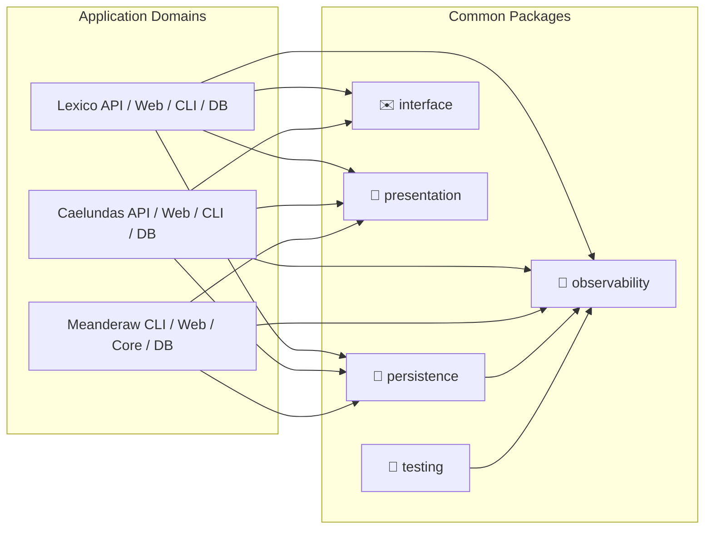

# Shared Common Packages

The codebase maintains **five** shared packages under `projects/common/` that the TypeScript application domains (Lexico, Caelundas, Meanderaw) depend on. Each package exports a focused set of utilities, types, and modules, and applications consume them via workspace protocol imports (e.g., `@codebase/persistence`). Affirmancy is a Python project and uses none of them.

---

## Persistence (`@codebase/persistence`)

**Path:** `projects/common/persistence`  
**Purpose:** The single Postgres integration every database-backed project uses (Lexico, Meanderaw, and Caelundas all keep their tables in Postgres). It provides the environment variable schema, TypeORM connection options and NestJS module, base entities, a Testcontainers harness, the `migration` Nx target, a `database` CLI for moving tables between Postgres databases, a `postgresql-erd` command for entity relationship diagrams, and graph rendering utilities for Mermaid flowcharts.

### Primary Exports (PostgreSQL)

| Export | Purpose |
|--------|---------|
| `postgresEnvironmentSchema` | Zod fragment for a project's six `<PROJECT>_POSTGRES_*` variables with defaults |
| `postgresConnection` / `postgresDataSourceOptions` | Connection object and TypeORM options (snake case, schema as search path, `synchronize: false`, `migrationsRun: false`) |
| `PostgresqlModule.forRoot` / `PostgresqlModule` | NestJS module wiring TypeORM through `ConfigService` (also exported as `DatabaseModule`) |
| `createDataSource` | `DataSource` a project's CLI entry exports, with migrations attached |
| `PostgresqlIdentifiableEntity` / `PostgresqlCreatableEntity` / `PostgresqlUpdatableEntity` / `PostgresqlDeletableEntity` | Base entities: uuidv7 id, created/updated/deleted timestamps, soft delete |
| `startPostgresContainer` | Testcontainers Postgres 18 container laid out like local Docker |
| `startDatabaseTestingModule` | Nest testing module connected to a migrated container |
| `PostgresqlErdModule` / `PostgresqlErdService` | Entity relationship diagram generation (Mermaid ER, JSON) |
| `GraphEdges`, `Graph`, `DirectedAcyclicGraph`, `RenderMermaidModule` | Graph rendering utilities for Mermaid flowcharts |
| `PostgresqlService` / `PostgresqlService` | Database service (also exported as `DatabaseService`) |

### Database / Schema / Role Naming Convention (PostgreSQL)

The package enforces a consistent naming scheme so a migration generated locally applies anywhere unchanged:

| Context | Database | Schema | Role |
|---------|----------|--------|------|
| Local Docker | `<project>_development` | `<project>` | `<project>_username` / `<project>_password` |
| Testcontainers | `<project>_testing` | `<project>` | same as local |

The schema carries no environment suffix; only the database name changes.

### How Applications Consume It (PostgreSQL)

1. **Spread the environment fragment** into the application's Zod schema:
   ```ts
   import { postgresEnvironmentSchema } from "@codebase/persistence";

   export const environmentSchema = z.object({
     ...postgresEnvironmentSchema({ project: "lexico" }),
   });
   ```
   This yields variables like `LEXICO_POSTGRES_HOST`, `LEXICO_POSTGRES_DATABASE`, etc., prefixed so the root `POSTGRES_*` admin credentials never reach the application.

2. **Create a database module** at `src/modules/<project>-database/` that imports `PostgresqlModule.forRoot`:
   ```ts
   @Module({
     exports: [PostgresqlModule],
     imports: [
       PostgresqlModule.forRoot({
         entities: [Meander],
         project: "meanderaw",
       }),
     ],
   })
   export class MeanderawDatabaseModule {}
   ```

3. **Export a CLI `DataSource`** beside the module (at `data-source.constants.ts`) with migrations:
   ```ts
   export const meanderawDataSource = createDataSource({
     entities: [Meander],
     migrations: ["src/modules/database/migrations/*.ts"],
     project: "meanderaw",
   });
   ```

### Critical Conventions

- **Never synchronize or run migrations on application start.** `synchronize` and `migrationsRun` are both `false` in the provided options. Migrations run as a separate step via the `migration` Nx target.
- **Every pooled connection pins `search_path` to the project's schema alone** (no `public` fallback). Unqualified SQL lands in the project's schema or fails.
- **Project names must be lowercase letters, digits, and underscores, starting with a letter** so they can prefix variables and name databases unquoted.
- **Test helpers live under `testing/`** (not `src/`), so dependency-cruiser's `no-test-imports-in-app` rule allows only tests and testing harnesses to import them.

### Migration Target

The `migration` target is defined once in root `nx.json` defaults. A database project opts in with:
```jsonc
"migration": { "options": { "module": "src/modules/database" } }
```
Paths derived from `module`:
- `<module>/data-source.constants.ts` — the `createDataSource(...)` export
- `<module>/migrations/` — generated migrations and extracted `.sql`

Commands: `migration:generate`, `migration:run`, `migration:revert`, `migration:show`, `migration:extract-sql-latest`, `migration:extract-sql-all`. The two extract targets run the `synchronization` command `extract-typeorm-migration-sql`, and `migration:generate` ends by running `lint-code:write`.

### Database CLI

The `database` command copies selected tables between two Postgres databases via `pg_dump`/`pg_restore`. Each command names its database by URI (no `<PROJECT>_POSTGRES_*` variables needed). Requires PostgreSQL 18 client tools (`scripts/local/software/persistence.sh` installs them).

### Base Entities

Each table's entity extends the narrowest base it needs, so a table without soft deletion carries no `deletedAt`:

| Base | Adds |
|------|------|
| `PostgresqlIdentifiableEntity` | `id` — a `uuid` the database assigns with Postgres 18's `uuidv7()` |
| `PostgresqlCreatableEntity` | `createdAt` (`timestamptz`) and nullable `createdBy` (`uuid`) |
| `PostgresqlUpdatableEntity` | `updatedAt` (`timestamptz`) and nullable `updatedBy` (`uuid`) |
| `PostgresqlDeletableEntity` | `deletedAt` (`timestamptz`, soft delete) and nullable `deletedBy` |

They are plain TypeORM, with no GraphQL; a project that exposes them over GraphQL adds its `@Field` decorators in a thin layer of its own. Nothing fills the `*By` columns but the application, so a command-line writer with no user identity leaves them empty. No entity names a schema: it comes from `<PROJECT>_POSTGRES_SCHEMA`.

### Integration Tests

`@codebase/persistence/testing` starts a throwaway `postgres:18-alpine`, laid out the way the local container is: a `<project>_username` role owning a `<project>_testing` database with a `<project>` schema in it. It then builds the schema by running the project's real migrations, so every integration suite exercises them too.

```ts
import { startDatabaseTestingModule } from "@codebase/persistence/testing";

const database = await startDatabaseTestingModule({
  entities: [Meander],
  imports: [DrawingModule],
  migrations: [InitialMigration1767225600000],
  project: "meanderaw",
  providers: [DrawCommand],
  validate: (config) => environmentSchema.parse(config),
});

const meanders = database.repository(Meander);
const command = database.module.get(DrawCommand);
// … database.dataSource, database.container

await database.close();
```

`startPostgresContainer` alone suits a suite that needs no Nest module. Docker must be running.

---

## Interface (`@codebase/interface`)

**Path:** `projects/common/interface`  
**Purpose:** Shared GraphQL package for the workspace's APIs and their clients. It has two independent modules behind separate entry points so a client never imports the NestJS decorators a server needs. It holds shared TypeScript types and Zod schemas.

### GraphQL Server (`@codebase/interface`)

For an API built on `@nestjs/graphql`:

| Export | Purpose |
|--------|---------|
| `PageInfo` | Relay page info object type |
| `Paginated`, `createEdgeType` | Mixins that build a node's Relay connection and edge object types |
| `createConnection`, `createEdge`, `mapConnection` | Build and map Relay connections |
| `toDeletableFields` | Maps an entity's soft-delete columns onto its GraphQL object |
| `toCursor`, `fromCursor`, `fromCursorSafe`, `encodeOffsetCursor`, `decodeOffsetCursor` | Opaque and offset cursors |
| `mapRelation`, `mapRelations`, `mapRelationConnection`, `mapNullable*` | Map an entity's relations, keeping `null` and unjoined relations |
| `Connection`, `Edge`, `GraphQLFields`, `GraphQLObjectOf`, `MappedFields`, `RelationKey`, `ClassConstructor`, `DeletableEntityFields`, `DeletableFields`, `GraphQLObjectViolations`, `Related` | Types, including the entity-to-GraphQL-object contract |

### GraphQL Client (`@codebase/interface/client`)

For a web client of such an API:

| Export | Purpose |
|--------|---------|
| `createGraphqlCodegenConfig` | GraphQL Code Generator configuration every client shares. A client's `codegen.ts` passes only the schema its API emits and gets typed operations, Zod validators, and MSW handlers. Pass `validators: false` to skip validators. |

### Testing (`@codebase/interface/testing`)

| Context | Exports |
|---------|---------|
| Client | `graphqlMockServer`, `startGraphqlMockServer`, `resetGraphqlMockServer`, `stopGraphqlMockServer` — MSW server tests answer GraphQL requests with |
| Server | `paginateArray`, `paginationMatrix`, `expectedPage`, `summarize` — oracle a SQL-backed page is checked against. Types: `MatrixOptions`, `PageRequest`, `PageSummary` |

### How Applications Consume It

- **Server:** Import from `@codebase/interface` and apply decorators to entity fields in a thin layer.
- **Client:** Import `createGraphqlCodegenConfig` from `@codebase/interface/client` in the project's `codegen.ts`, passing the schema URL.
- **Tests:** Import testing helpers from `@codebase/interface/testing`.

### Server/Client Split

The package's `src/index.ts` re-exports only server-side symbols. The client entry point is `src/modules/graphql-client/...` and is imported explicitly as `@codebase/interface/client`. This ensures a browser bundle never pulls in `@nestjs/graphql` decorators or TypeORM metadata.

---

## Presentation (`@codebase/presentation`)

**Path:** `projects/common/presentation`  
**Purpose:** Shared React component library built on **shadcn/ui** (New York style) and **Base UI primitives**, styled with Tailwind CSS. Provides 50+ accessible, themeable, tree-shakeable components.

### Primary Exports (from `src/index.ts`)

**Layout & Structure:**
- `Accordion`, `Card`, `Separator`, `Tabs`, `Sidebar`, `Resizable`, `AspectRatio`, `ScrollArea`, `Collapsible`

**Form Controls:**
- `Input`, `Textarea`, `Select`, `Checkbox`, `RadioGroup`, `Switch`, `Slider`, `Label`, `InputGroup`, `InputOTP`, `Field`, `Calendar`, `Form` (via React Hook Form)

**Buttons & Navigation:**
- `Button`, `ButtonGroup`, `NavigationMenu`, `Breadcrumb`, `DropdownMenu`, `Command`, `ContextMenu`, `Menubar`, `Pagination`

**Feedback & Status:**
- `Badge`, `Spinner`, `Skeleton`, `Progress`, `Alert`, `Toast` (via Sonner), `AlertDialog`, `HoverCard`, `Tooltip`, `Popover`, `Drawer`, `Sheet`, `Dialog`, `Empty`, `Avatar`, `Carousel`

**ReUI Components (Advanced):**
- `Cascader`, `CascaderEmpty`, `CascaderList`, `CascaderPanel`, `CascaderStatus`, `CascaderFooter`, `CascaderBreadcrumb`, `CascaderInput`, `CascaderNav`, `CascaderVirtualItems`, `CascaderColumns`, `useCascaderState`
- `EventCalendar`, `EventCalendarContent`
- `Filters`
- `Gantt`, `GanttColumn`, `GanttProps`, `GanttRenderEventProps`, `useGanttNavigation`, `GanttView`
- `ColorPicker`, `ColorPickerContent`, `ColorPickerTrigger`, `ColorPickerProps`
- `Badge` (as `PillBadge`), `Marker`, `Sortable`

**Hooks:**
- `useMediaQuery`, `useMobile` / `useBreakpoint`, `useCopyToClipboard`, `useFileUpload`, `useScrollPosition`, `useSliderInput`, `useIsMobile`, `useCascaderState`

**Utilities:**
- `cn` (classname merge helper from `lib/utils`)

### How Applications Consume It

```tsx
// In a consuming application (e.g., lexico-web)
import { Button, Card, Input } from "@codebase/presentation";
import "@codebase/presentation/styles/globals.css"; // Import once in root layout
```

Add the global CSS import to the root layout (e.g., `src/routes/__root.tsx` in a TanStack Start app).

### Adding Components

1. **From shadcn registry:**
   ```bash
   cd projects/common/presentation
   pnpx shadcn@latest add <component-name>  # e.g., dropdown-menu, command, sonner
   ```
2. **Export in `src/index.ts`:** `export * from "./components/ui/dropdown-menu";`
3. **Custom project-specific components** go in `src/components/` (not `ui/`), composed from the UI primitives.

**Never modify files in `src/components/ui/` directly** — they are managed by shadcn CLI and overwritten on updates.

### Theming

- **CSS variables** in `src/styles/globals.css` define light/dark palettes (`--background`, `--foreground`, `--primary`, etc.)
- **Dark mode** via `data-theme` attribute on `<html>` or `next-themes` `ThemeProvider`
- **Tailwind config** extends shared config with component-specific content paths

### Conventions

- **WCAG 2.1 AA compliant** — keyboard navigation, focus management, ARIA attributes, color contrast
- **Base UI primitives** handle complex accessibility (focus trapping, roving focus, screen reader announcements)
- **Bundle size ratchet:** 512 KB gzipped limit (warning at 384 KB) via `codometer`; React and Base UI are bundled, not externalized

---

## Observability (`@codebase/observability`)

**Path:** `projects/common/observability`  
**Purpose:** The single `LoggerService` every NestJS project in the codebase injects. Eliminates duplication of identical `src/modules/logger` directories across projects.

### Primary Exports

| Export | Responsibility |
|--------|----------------|
| `LoggerService` | Transient-scoped, `pino`-backed logger implementing Nest's `LoggerService` |
| `LoggerModule` | `@Global()` module providing and exporting `LoggerService` |

Also exports types: `LogData`, `LoggerServiceContract`, `ParsedLogMessage`

### How Applications Consume It

1. **Import `LoggerModule` once in the root module:**
   ```ts
   import { LoggerModule } from "@codebase/observability";

   @Module({
     imports: [LoggerModule],
   })
   export class MainModule {}
   ```
   Because it's `@Global()`, feature modules inject `LoggerService` without importing anything.

2. **Set context in each injecting class:**
   ```ts
   import { LoggerService } from "@codebase/observability";

   @Injectable()
   export class MyService {
     constructor(private readonly logger: LoggerService) {
       this.logger.setContext(MyService.name);
     }
   }
   ```
   `LoggerService` is `Scope.TRANSIENT` — each injecting class gets its own instance.

### Output Modes

| `NODE_ENV` | Output |
|------------|--------|
| `production` | Structured JSON on stdout |
| anything else | Human-readable, colorized `pino-pretty` single lines |

`LOG_LEVEL` sets the pino level (defaults to `info`). `pino-pretty` is a string transport target (real dependency) so it resolves wherever `pino` does.

### File Logging Helpers

Both are methods on `LoggerService`, not separate exports:

| Method | Returns |
|--------|---------|
| `buildErrorLogEntry(context, error)` | `{ errorMessage, logLine }` — normalizes `unknown` errors |
| `createTimestampedOutputLogFilePath(prefix)` | `<cwd>/output/<prefix>-<ISO timestamp>.log`, creating `output/` |

---

## Testing (`@codebase/testing`)

**Path:** `projects/common/testing`
**Purpose:** The shared test code every project's tests import, held once as subpath exports instead of copied into each project: temporary directories, output and exit-code capture, environment overrides, the fixed clock, fixtures, and mocks.

| Entry | Holds |
|-------|-------|
| `@codebase/testing` | Temporary directories, output and exit-code capture, environment overrides, the fixed clock, fixtures, mocks |
| `@codebase/testing/setup` | The shared Vitest setup file the base config lists |
| `@codebase/testing/end-to-end` | Tarball sandbox and Verdaccio plugin runners that test packed packages as a consumer installs them |
| `@codebase/testing/file-system` | The `mockFileSystem` factory helper, kept free of `node:fs` imports |
| `@codebase/testing/nestjs` | The testing-module builder, module-wiring assertions, and the Nx workspace tree |
| `@codebase/testing/react` | The route-render helper and the `createServerFn` and `matchMedia` stand-ins |
| `@codebase/testing/react/setup` | The shared jsdom setup |

Most TypeScript projects list it as a development dependency (see the consumer list below). Its `nestjs` entry depends on `@codebase/observability`, which in turn uses `@codebase/testing` for its own tests, so the two form a workspace dependency cycle that pnpm warns about.

---

## Integration Summary



Which project in each domain depends on which package (from each `package.json`):

- **Persistence:** `lexico-api`, `lexico-cli`, `lexico-db`, `caelundas-api`, `caelundas-cli`, `caelundas-db`, `meanderaw-cli`, `meanderaw-db`
- **Interface:** `lexico-api`, `lexico-web`, `caelundas-web`, `meanderaw-web` (dev dependency)
- **Presentation:** `lexico-web`, `caelundas-web`, `meanderaw-web`
- **Observability:** `lexico-api`, `lexico-cli`, `caelundas-api`, `caelundas-cli`, `meanderaw-cli`, and `persistence` itself
- **Testing:** `lexico-*`, `caelundas-*`, `meanderaw-cli`, `meanderaw-web`, `meanderaw-db`, and the `interface`, `observability`, and `persistence` packages
- **Affirmancy:** Python, with none of these
