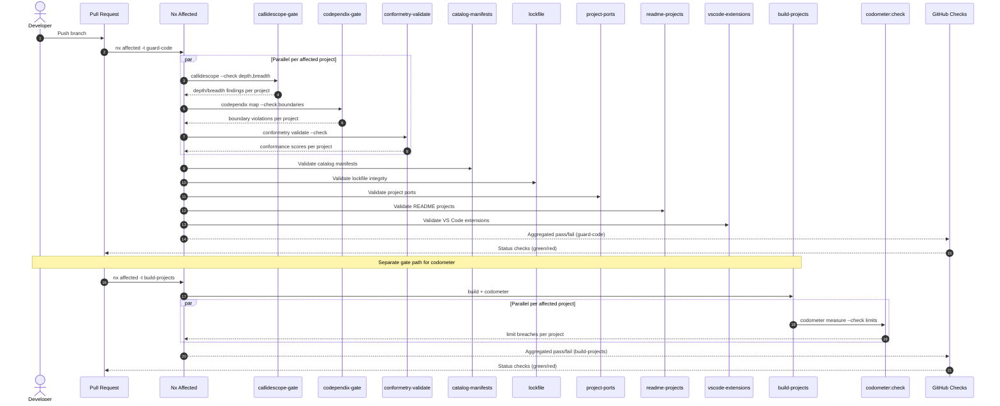
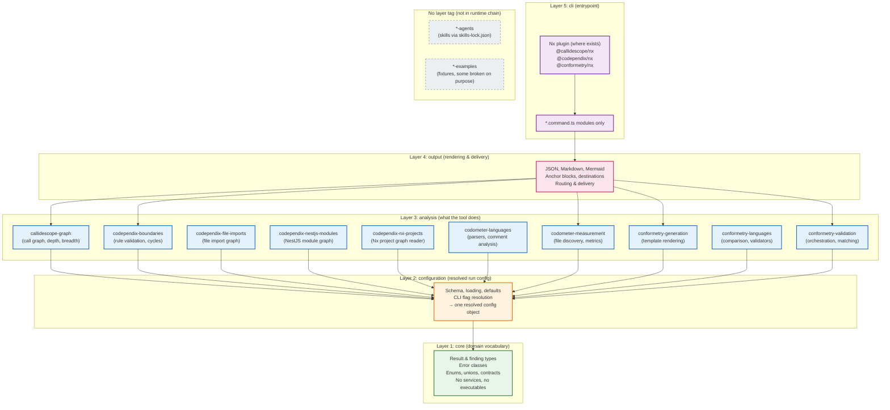

# IC Suite Toolchains

The **IC-Suite** is a family of four independently versioned, command-line toolchains published from this workspace: **callidescope**, **codependix**, **codometer**, and **conformetry**. Each suite is a product, not a directory — its packages version independently but are documented and discovered as one thing, named for the command a user runs (`callidescope`, `codependix`, `codometer`, `conformetry`).

All four suites share the same five-layer architectural spine, each layer depending only downward:

```
core → configuration → analysis → output → cli
                                     ↑
                                     └─ nx (optional plugin layer, tagged layer:cli)
```

<!-- openwiki: broken internal link [../documentation/adr/0013-name-the-ic-suite-layers.md] file "../documentation/adr/0013-name-the-ic-suite-layers.md" does not exist. Fix the href or restore the target, then delete this comment. -->
This convergence was deliberately landed as vocabulary first ([ADR 0013](../documentation/adr/0013-name-the-ic-suite-layers.md)), with `layer:*` tags applied in follow-up pull requests per toolchain.

## Five-Layer Spine

| Layer | Tag | Holds | Never holds |
|-------|-----|-------|-------------|
| **core** | `layer:core` | Domain vocabulary only: result and finding types, error classes, shared enums and unions, analyzer and validator contracts | Services, modules, anything executable |
| **configuration** | `layer:configuration` | The config file's schema, loading, defaults, and override resolution, **plus CLI flag resolution**, producing one resolved configuration object | Domain result types |
| **analysis** | `layer:analysis` | What the tool actually does. Per-suite names and per-suite shape | Rendering, command wiring |
| **output** | `layer:output` | Every render target: JSON, markdown, mermaid, anchor blocks, destination routing, delivery | Analysis |
| **cli** | `layer:cli` | `*.command.ts` modules and nothing else | Any logic |

### The `nx` plugin layer

Where a suite provides an Nx plugin (`@callidescope/nx`, `@codependix/nx`, `@conformetry/nx`), it sits **above `cli`** and carries `layer:cli` — not a sixth tag. This keeps the spine at five layers and the generic boundary rules at four. The `nx` plugin is a second host for the same underlying toolchain, not a new layer stacked above it.

### Core-versus-configuration test

The sharp test that decides where a type belongs:

> **If it describes what the tool produced, it is `core`; if it describes what the user wrote in `<tool>.config.ts`, it is `configuration`.**

Under this test `CodeStatisticsResult` belongs in `core` and `WriteMarkdownOutput` stays in `configuration` — despite reading like an output-layer type, it names a destination the user declared in the config file, which is what the test scores rather than the name. A `core` package that exports a live service, or a `configuration` package that exports a result type the tool produced rather than a value the user configured, has drifted out of its layer regardless of which package it physically sits in.

### Analysis layer does not converge on a name

Every other layer converges on one name across all four toolchains. The **analysis layer deliberately does not**: forcing it to would produce a sixty-file blob in codometer's case, where "analysis" would have to cover language measurement, size measurement, and everything else the tool does in one package. It stays named for what it analyzes — governed by a rule instead of a shared noun:

> **One package per independently usable analyzer, named for what it analyzes.**

| Suite | Analysis packages (`layer:analysis`) |
|-------|--------------------------------------|
| callidescope | `callidescope-graph` |
| codependix | `codependix-boundaries`, `codependix-file-imports`, `codependix-nestjs-modules`, `codependix-nx-projects` |
| codometer | `codometer-languages`, `codometer-measurement` |
| conformetry | `conformetry-generation`, `conformetry-languages`, `conformetry-validation` |

## Per-Suite Package Structure

### callidescope — Call stack tracing toolchain

Traces control flow through injected dependencies and reports where a stack got too deep.

| Package | Layer | Publishes | Purpose |
|---------|-------|-----------|---------|
| `@callidescope/core` | `core` | ✅ | Domain vocabulary: call graph, stack, frame, finding types |
| `@callidescope/configuration` | `configuration` | ✅ | Reads `callidescope.config.ts`, resolves CLI flags, depth/breadth limits |
| `@callidescope/graph` | `analysis` | ✅ | Builds call graph from TypeScript AST, measures depth/breadth |
| `@callidescope/output` | `output` | ✅ | Renders findings to markdown, mermaid, JSON |
| `@callidescope/cli` | `cli` | ✅ | `nest-commander` host, wires graph → output, gates depth |
| `@callidescope/nx` | `cli` (nx plugin) | ✅ | Nx plugin inferring per-project `trace`, `depth`, `breadth`, `gate` targets |
| `@callidescope/agents` | *(none)* | ❌ | Agent skills, travel via `skills-lock.json` |
| `@callidescope/examples` | *(none)* | ❌ | Fixture codebase with worked examples per rule/finding/output |

### codependix — Dependency graph export and boundary gating

Reads what each project depends on, renders graphs as JSON/Markdown/mermaid, gates rules those graphs are judged against.

| Package | Layer | Publishes | Purpose |
|---------|-------|-----------|---------|
| `@codependix/core` | `core` | ✅ | Graph models, boundary rule definitions, traversal contracts |
| `@codependix/configuration` | `configuration` | ✅ | Reads `codependix.config.ts`, resolves CLI, produces run config |
| `@codependix/file-imports` | `analysis` | ✅ | TypeScript/JS file-level import graph extraction |
| `@codependix/nestjs-modules` | `analysis` | ✅ | NestJS container module graph exploration |
| `@codependix/nx-projects` | `analysis` | ✅ | Reads Nx project graph, builds one-hop neighborhood |
| `@codependix/boundaries` | `analysis` | ✅ | Validates forbid/allow rules, detects cycles across all graph levels |
| `@codependix/output` | `output` | ✅ | Renders graphs as JSON, Markdown, mermaid, splices anchor blocks |
| `@codependix/cli` | `cli` | ✅ | Host exporting graphs and gating boundaries |
| `@codependix/nx` | `cli` (nx plugin) | ✅ | Nx plugin inferring per-project `codependix-gate` target |
| `@codependix/agents` | *(none)* | ❌ | Agent skills, travel via `skills-lock.json` |
| `@codependix/examples` | *(none)* | ❌ | 21 subjects built to be graphed, each carrying rendered guide |

<!-- openwiki: broken internal link [../documentation/adr/0013-name-the-ic-suite-layers.md#the-accepted-codependix-nx-projects-wart] file "../documentation/adr/0013-name-the-ic-suite-layers.md" does not exist. Fix the href or restore the target, then delete this comment. -->
> **Note on `codependix-nx-projects`**: It keeps its name even though it collides with the `nx` plugin layer. It is an **analysis-layer** graph builder that *reads* the Nx project graph, not a plugin registered in `nx.json`. This is a documented, deliberate exception ([ADR 0013](../documentation/adr/0013-name-the-ic-suite-layers.md#the-accepted-codependix-nx-projects-wart)).

### codometer — Repository measurement toolchain

Counts a codebase and reports what it found against configured limits.

| Package | Layer | Publishes | Purpose |
|---------|-------|-----------|---------|
| `@codometer/core` | `core` | ✅ | Statistics and report vocabulary, measurement errors |
| `@codometer/configuration` | `configuration` | ✅ | Reads `codometer.config.ts`, exclusion globs, output destinations, limits |
| `@codometer/languages` | `analysis` | ✅ | Language parsers (TS, JS, Python, JSON, MD, Jupyter) behind one `analyze()` |
| `@codometer/measurement` | `analysis` | ✅ | File discovery, size calculation, custom metric evaluation, limit enforcement |
| `@codometer/output` | `output` | ✅ | JSON reports, README badges, PR change reports, destination routing |
| `@codometer/cli` | `cli` | ✅ | Host measuring files, writing badge block/JSON report |
| `@codometer/agents` | *(none)* | ❌ | Agent skills, travel via `skills-lock.json` |
| `@codometer/examples` | *(none)* | ❌ | Sample corpus with known contents, runnable example per feature |

### conformetry — Template-driven generation and conformance validation

Scaffolds files from templates and validates implementations against them.

| Package | Layer | Publishes | Purpose |
|---------|-------|-----------|---------|
| `@conformetry/core` | `core` | ✅ | Difference, score, inventory, language validator types — no executable code |
| `@conformetry/configuration` | `configuration` | ✅ | Config loading, template/instance discovery, generator input resolution |
| `@conformetry/generation` | `analysis` | ✅ | Scaffold file generation, rendering templates through configuration |
| `@conformetry/languages` | `analysis` | ✅ | Multi-language file comparison, syntax validators, difference/scoring primitives |
| `@conformetry/validation` | `analysis` | ✅ | Validation orchestration, language routing, finding deduplication |
| `@conformetry/output` | `output` | ✅ | Validation report, template/instance inventory rendering |
| `@conformetry/cli` | `cli` | ✅ | Host expanding globs, prompting inputs, running generation/validation |
| `@conformetry/nx` | `cli` (nx plugin) | ✅ | Nx plugin with generators, executors, emitted-plugin bootstrap |
| `@conformetry/agents` | *(none)* | ❌ | Agent skills, travel via `skills-lock.json` |
| `@conformetry/examples` | *(none)* | ❌ | 11 runnable examples with config, templates, instances, guides (CI-executed) |

## Publishable vs Non-Publishable Packages

Each suite has **publishable packages** (sent to npm on release) and **non-publishable packages** (never published):

| Category | Packages | Reason |
|----------|----------|--------|
| **Publishable** | All `core`, `configuration`, `analysis`, `output`, `cli`, `nx` packages | Public library contracts and tooling consumers install |
| **Non-publishable** | `*-agents`, `*-examples` | Skills travel through `skills-lock.json`; examples are fixtures, several broken on purpose |

Three gates prevent non-publishable packages from reaching npm:
1. `private: true` in `package.json` (npm refuses to publish)
2. Orchestrator's `release.projects` filter in `nx.json`
3. Registry permissions

A package outside the publishable set is held by the first two, never by only one.

## Independent Versioning with Cascading Dependents

<!-- openwiki: broken internal link [../documentation/adr/0017-independent-package-versioning-with-cascading-dependents.md] file "../documentation/adr/0017-independent-package-versioning-with-cascading-dependents.md" does not exist. Fix the href or restore the target, then delete this comment. -->
The 29 publishable packages across the four suites version independently using **Nx Release** (`nx release`) with `projectsRelationship: "independent"` ([ADR 0017](../documentation/adr/0017-independent-package-versioning-with-cascading-dependents.md)).

- **Conventional commits** determine semver bump specifiers for every package a commit affects.
- **Cascade**: When a dependency package is bumped, Nx Release automatically cascades a **patch version bump** (`updateDependents: "auto"`) and updates manifest dependency constraints across all internal dependents.
- **Per-package git tags and changelogs**: Each package generates an independent tag (`{projectName}@{version}`, e.g., `conformetry-cli@0.1.0`) and maintains its own release notes.
- **Explicit exclusions**: The 8 non-publishable packages (`*-agents`, `*-examples`) are excluded in `nx.json` `release.projects` configuration.

### Two Release Tiers

1. **Repository root release**: Root monorepo uses `semantic-release` on merges to `main` for fixed-version repository releases (e.g., `v2.20.0`). No packages published to npm.
2. **Publishable packages release**: 29 library packages use `nx release` with independent versioning and per-package tags.

## Per-Toolchain Operational Reference

### callidescope — Call-Stack Depth & Breadth

**What it measures**: Call-stack depth (longest chain of nested calls) and breadth (fan-out: number of direct callees per callable) for every traced entry point in a project and its Nx dependencies.

**Configuration file**: `callidescope.config.ts` (per-project, spreading `projectDefaults` from `configuration/callidescope.config.ts`)

```ts
import { projectDefaults } from "../../../configuration/callidescope.config.js";

export default {
  ...projectDefaults,
  limits: { maximumBreadth: 8, maximumDepth: 6 },
};
```

**Workspace defaults**: `configuration/callidescope.config.ts` exports `projectDefaults` (entry-point decorators, exclude patterns, output destinations) and `workspaceLimits` (depth 17, breadth 2) — the latter serves only as a starting point for new projects; every existing traced project declares its own boundary-tested numbers. A project declaring a higher number keeps it — nothing clamps it down.

**CLI command**:
```bash
callidescope --config <path> [--check depth,breadth,reports] [--write] [--format markdown|mermaid|json]
```

| Flag | Purpose |
|------|---------|
| `--check depth` | Fail if any call stack exceeds the project's `maximumDepth` |
| `--check breadth` | Fail if any callable exceeds the project's `maximumBreadth` |
| `--check reports` | Fail if any configured output destination is stale (run on default branch) |
| `--write` | Write reports to configured destinations (README, JSON files) |
| `--format` | What to print to stdout: `markdown` (default), `mermaid`, or `json` |

**Nx targets** (inferred by `@callidescope/nx`):
- `callidescope-trace` — Print every call stack above/below each callable
- `callidescope-depth` — Print stacks for a single callable
- `callidescope-breadth` — Print one callable's direct callers/callees
- `callidescope-gate` — **Fail** if any traced call stack exceeds the project's declared limits (the gate CI reads)

**Gate semantics**:
- The gate runs over the project **and its Nx dependencies** (the trace follows the dependency graph).
- Only findings **charged to the project itself** fail its gate. A breach in a dependency fails that dependency's own gate.
- `nx affected -t callidescope-gate` scopes the gate to changed projects, so CI only runs what matters.
- A project with no traced files (empty scope) **fails** rather than passes — a green gate without a trace would be misleading.

**Findings charged to projects**: Each finding (`DeepStack`, `WideCallable`) carries the project that owns the callable. The gate counts only findings whose `projectName` matches the project under test.

---

### codependix — Dependency-Graph Boundaries

**What it measures**: Three graph levels — file imports (TypeScript/JS), NestJS modules, and Nx projects — and validates forbid/allow rules and cycle detection across all levels.

**Configuration file**: `codependix.config.ts` (workspace-level at `configuration/codependix.config.ts`; per-project configs spread `projectDefaults` for README anchor blocks)

**Boundary rules** (from `configuration/codependix.config.ts`):
- **Generic `layer:*` rules** — Apply to all four toolchains: a layer may reach its own layer and every layer beneath it (e.g., `layer:analysis` → `layer:analysis`, `layer:output`, `layer:cli`).
- **Per-package `name:*` rules** — Tighten generic rules, catching mis-tagged packages and cross-toolchain edges (`layer:*` cannot express `suite:*` tags).
- Rules are ANDed: every rule must pass. Rules are verified to hold across all projects before being written; a red rule on arrival is a backlog item, not a gate.

**CLI command**:
```bash
codependix map --config <path> [--check boundaries,reports] [--write] [--format markdown|json] [--projects <names>] [--tags <tags>]
```

| Flag | Purpose |
|------|---------|
| `--check boundaries` | Fail if any boundary rule is broken (runs on every PR) |
| `--check reports` | Fail if any configured README anchor block is stale (runs on default branch) |
| `--write` | Regenerate all configured graph exports into READMEs |
| `--format` | Output format for stdout |

**Nx target** (inferred by `@codependix/nx`):
- `codependix-gate` — **Fail** if any boundary rule is broken in the graphs built over the project and its dependencies. Only findings charged to the project itself cause a failure.

**Gate semantics**:
- Graphs are built over the project **and everything it depends on**.
- `nx affected -t codependix-gate` scopes to changed projects.
- The workspace-wide `configuration:codependix` target is **write-only** (regenerates README graphs on the default branch during release) and is not reachable from `guard-code`.

**Findings charged to projects**: Each boundary violation (`ForbidViolation`, `AllowViolation`, `Cycle`) carries the project that owns the importing file/module. The gate counts only violations whose `projectName` matches the project under test.

---

### codometer — Size, Count, and Comment Budgets

**What it measures**: File sizes (lines, bytes), symbol counts (functions, classes, methods, static methods), and comment-block word counts per language. Custom counters for project conventions (Module Files, Service Files, Unit Tests, etc.).

**Configuration file**: `codometer.config.ts` (per-project, spreading shared `codometerConfiguration` from `configuration/codometer.config.ts`)

**Shared configuration** (`configuration/codometer.config.ts`):
- **Custom statistics**: File-name patterns (`.module.ts`, `.service.ts`, `.command.ts`, etc.), symbol kinds (`static` methods), and comment budgets per language.
- **Comment budgets**: 128 words per block for all languages; 256 words for shell (looser for header documentation).
- **Limits**: Zero-tolerance (`value: 0`) on each comment budget's `custom.<label>` metric — counts blocks exceeding the budget.
- **Outputs**: JSON report (`codometer-report.json`) and Markdown badges in `README.md`.

**CLI command**:
```bash
codometer measure --config <path> [--check limits] [--output-json] [--output-markdown <path>] [--inputs <globs>]
```

| Flag | Purpose |
|------|---------|
| `--check limits` | Fail if any declared limit is exceeded (the gate) |
| `--output-json` | Write JSON report to `codometer-report.json` |
| `--output-markdown <path>` | Write/update badge block in specified file (typically `README.md`) |
| `--inputs <globs>` | Override configured inputs for a one-off run |

**Nx target** (defined in `nx.json` under `targetDefaults.codometer` with multiple overrides for different project depths):
- Configuration `check`: `measure --config codometer.config.ts --output-json --check limits`
- Configuration `write`: `measure --config codometer.config.ts --output-json --output-markdown README.md`
- Runs from the project root (`cwd: "{projectRoot}"`) so `--config codometer.config.ts` resolves the project's own file and limits address paths like `Compiled JavaScript.size`.

**Enforced limits**:
- **Max 512 lines per file** — enforced by codometer limits on file-size metrics.
- **Max 128 words per comment block** (256 for shell) — enforced by comment-budget counters with `maximumWords` and zero-tolerance limits.

**Gate semantics**:
- `codometer:check` writes the JSON report then fails if any declared limit is exceeded.
- `codometer:write` updates the project's README badges and the JSON report; runs on the default branch during release.
- `build-projects` depends on `build` and `codometer`, so a build that exceeds size limits fails before packaging.

**Findings charged to projects**: Each limit breach carries the `inputName` (e.g., `codebase`, `Compiled JavaScript`) and the metric path (e.g., `codebase.lines`, `codebase.custom.TypeScript Comment Budget`). The gate evaluates limits per input; a breach in a project's own inputs fails that project's gate.

---

### conformetry — Template Conformance

**What it measures**: Validates that generated code matches its declared template. Computes a similarity score (0–100) per instance against its template, using language-aware comparison (AST for TS/JS/Python, token-based for others).

**Configuration file**: `conformetry.config.ts` (workspace-level at `configuration/conformetry.config.ts`)

**Workspace configuration** defines generator groups (e.g., `jupyter-notebook-application`, `nestjs-command-project`, `react-component`) with:
- Template paths under `configuration/conformetry-templates/`
- Input schemas (Zod → JSON Schema for generator prompts)
- Instance globs and optional per-group substitutions
- Thresholds (minimum score to pass)

**CLI command**:
```bash
conformetry validate --config <path> [--check] [--templates <names>] [--instances <globs>]
conformetry generate --config <path> [--template <name>] [--inputs <json>]
```

| Flag | Purpose |
|------|---------|
| `validate --check` | Fail if any instance scores below its threshold (the gate) |
| `validate --templates` | Narrow validation to specific templates |
| `validate --instances` | Override instance globs for a one-off run |
| `generate` | Scaffold new files from a template (interactive prompts for inputs) |

**Nx target** (inferred by `@conformetry/nx`):
- `conformetry-validate` — Validate the project's instances against their templates. Fails if generated output diverges beyond the configured `threshold`.

**Gate semantics**:
- `nx affected -t conformetry-validate` scopes validation to changed projects.
- The `threshold` option (per instance group in config) controls how much divergence is tolerated before failing.
- Generated code (e.g., shadcn UI components) is excluded via pattern lists (`SHADCN_GENERATED_PATTERNS`) because editing vendored CLI output would be overwritten on the next `shadcn add`.

**Findings charged to projects**: Each validation result carries the `instancePath` and `templateName`. The gate fails the project owning the instance path when the score falls below the group's threshold.

---

## CI Gate Flow

The following sequence diagram shows how the toolchains gate a pull request in CI. There are **two separate gate paths**:

1. **`guard-code`** — Runs callidescope, codependix, and conformetry gates per affected project (plus other workspace integrity checks)
2. **`build-projects`** — Runs codometer measurement as part of every build



**Caption**: CI gate sequence. `nx affected -t guard-code` runs callidescope, codependix, and conformetry gates plus workspace integrity checks in parallel per affected project. Separately, `nx affected -t build-projects` runs the build plus codometer measurement. Each toolchain reports findings charged to each project, and Nx aggregates results into GitHub status checks.

### The `guard-code` Aggregator

Defined in `nx.json` under `targetDefaults.guard-code`, this `nx:noop` target depends on the per-project gates plus workspace integrity checks:

```json
"guard-code": {
  "cache": false,
  "configurations": {
    "check": {},
    "write": {}
  },
  "defaultConfiguration": "check",
  "dependsOn": [
    "callidescope-gate",
    "catalog-manifests",
    "codependix-gate",
    "conformetry-validate",
    "lockfile",
    "project-ports",
    "readme-projects",
    "vscode-extensions"
  ],
  "description": "Aggregator for guard-code. `callidescope-gate` and `codependix-gate` are the inferred per-project gates, call-stack depth and dependency boundaries; neither has configurations, so the one `guard-code` is run with falls through to their defaults. `codependix-gate` builds its graphs over the project it is run for and that project's dependencies, charges each finding to the project that owns it, and fails only for a finding charged to that project, so `nx affected` scopes it to the projects a change touched. The workspace-wide `configuration:codependix` target is not reachable from here: it is write-only, and the release workflow runs it on the default branch.",
  "executor": "nx:noop",
  "inputs": ["default"]
}
```

Running `nx run <project>:guard-code` (or `nx affected -t guard-code`) executes all three IC-Suite gates plus workspace integrity checks for the affected projects. Neither `callidescope-gate` nor `codependix-gate` has configurations, so the configuration passed to `guard-code` falls through to their defaults.

### The `build-projects` Aggregator

```json
"build-projects": {
  "dependsOn": ["build", "codometer"],
  "executor": "nx:noop"
}
```

Every build is measured by codometer; a size-limit breach fails the build.

### Pre-Commit Hooks

`lint-staged` (configured in `configuration/lint-staged.config.ts`) runs on every staged file:

```bash
nx affected --target=typecheck-code,lint-code,format-code,deprecate-code,guard-code,conformetry-validate --configuration=check --parallel=4 --base=HEAD --head=<staged-commit>
```

This runs the full quality suite including `guard-code` (hence callidescope, codependix, conformetry gates) before commit. Note: `conformetry-validate` is invoked separately (not through `guard-code`) and `codometer` is not part of the pre-commit gate — it runs in `build-projects` during CI.

### CI Workflow

GitHub Actions (`.github/workflows/continuous-integration.yml`) runs the same `nx affected` command on pull requests. The `validate-code` skill documents the full local validation workflow:

1. **Auto-fix** — `nx affected --target=typecheck-code,lint-code,format-code,deprecate-code,guard-code --configuration=write --base=main`
2. **Verify** — `nx affected --target=typecheck-code,lint-code,format-code,deprecate-code,guard-code --configuration=check --base=main`
3. **Coverage gate** (when required) — `nx run <project>:vitest --configuration=coverage`
4. **Type coverage gate** (when required) — `nx run <project>:type-coverage`

All checks must pass before proceeding. Failures are triaged with the `triage-integration` skill, which provides per-tool fix instructions.

## No-Shared-Package Constraint

<!-- openwiki: broken internal link [../documentation/adr/0013-name-the-ic-suite-layers.md#the-no-shared-package-constraint] file "../documentation/adr/0013-name-the-ic-suite-layers.md" does not exist. Fix the href or restore the target, then delete this comment. -->
The four toolchains share nothing today but a logger, and the layer vocabulary **must not change that**. No cross-toolchain `@ic-suite/*` package is created. The common `ConfigurationService` shape is a **convention, not an imported type** — each toolchain's `core` declares its own structurally identical shape, and no toolchain imports that shape from anywhere else. A later session that "simplifies" the four toolchains onto a shared dependency is undoing this decision, not completing it ([ADR 0013](../documentation/adr/0013-name-the-ic-suite-layers.md#the-no-shared-package-constraint)).

## Integration with Workspace

- **Nx plugins** (`callidescope-nx`, `codependix-nx`, `conformetry-nx`) integrate each suite into the Nx workspace, inferring per-project targets that follow the Nx dependency graph.
- **Agents** (`*-agents`) are skill packages installed back from `skills-lock.json` like any other vendored skill — they do not participate in the five-layer spine.
- **Examples** (`*-examples`) are test fixtures executed by CI so guides cannot rot; they are deliberately non-publishable.
- **Inline compilation**: Where one workspace package's code is compiled into another's build output, the published tarball carries it without naming it as a dependency. The dependency stays a single package in the workspace.

## Mermaid Diagram: Five-Layer Spine



## Related Documentation

- [Architecture Overview](../architecture/overview.md) — Workspace-wide architectural patterns
- [Callidescope Domain](../domain/callidescope.md) — Call stack tracing domain model
- [Codependix Domain](../domain/codependix.md) — Dependency graph and boundary domain model
- [Codomter Domain](../domain/codometer.md) — Repository measurement domain model
- [Conformetry Domain](../domain/conformetry.md) — Template generation and conformance domain model
- [Code Quality Gates](../workflows/code-quality.md) — Four IC-Suite quality gates and their integration into CI via Nx targets
- [Release Workflow](../workflows/release.md) — Independent versioning and cascading dependents in practice
<!-- openwiki: broken internal link [../documentation/adr/0013-name-the-ic-suite-layers.md] file "../documentation/adr/0013-name-the-ic-suite-layers.md" does not exist. Fix the href or restore the target, then delete this comment. -->
- [ADR 0013: Name the ic-suite layers](../documentation/adr/0013-name-the-ic-suite-layers.md) — Layer vocabulary, core-vs-configuration test, analysis layer rule
<!-- openwiki: broken internal link [../documentation/adr/0017-independent-package-versioning-with-cascading-dependents.md] file "../documentation/adr/0017-independent-package-versioning-with-cascading-dependents.md" does not exist. Fix the href or restore the target, then delete this comment. -->
- [ADR 0017: Independent package versioning with cascading dependents](../documentation/adr/0017-independent-package-versioning-with-cascading-dependents.md) — Nx Release configuration, cascade mechanics, two-tier releases
