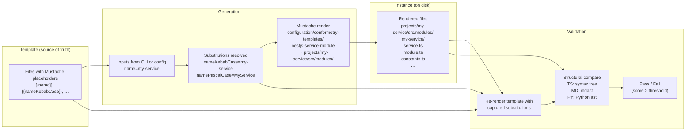

# Generator / Template / Instance Model

Conformetry scaffolding is built around three core concepts that form a closed loop: a **Template** is the source of truth, **Generation** renders it with substitutions into an **Instance** on disk, and **Validation** re-renders the same template with the same substitutions and structurally compares the result against the instance.



---

## Template

A **Template** is a directory of ordinary files containing Mustache placeholders (`{{name}}`, `{{nameKebabCase}}`, `{{namePascalCase}}`, etc.). It is the **single source of truth** for both generation and validation.

**Key properties:**

- **Ordinary files** — no special syntax beyond Mustache interpolation; any file type is valid (TypeScript, Python, Markdown, JSON, YAML, etc.)
- **Automatic name variants** — the generator resolves `name`, `nameKebabCase`, `namePascalCase`, `nameCamelCase`, `nameConstantCase`, `nameSnakeCase`, `nameLowerCase`, `nameUpperCase` from the `name` input
- **Placeholder capture** — during validation, placeholders whose values weren't supplied in configuration are inferred from the instance (first alignment wins) so the template can be re-rendered and compared faithfully
- **Directory vs file output** — a template producing a folder (e.g., `{{nameKebabCase}}/service.ts`) is matched against directory instances; a template producing loose files is matched against file instances

Templates live under `configuration/conformetry-templates/` and are referenced by `templatePath` in the generator registry.

---

## Generation

**Generation** is the act of rendering a template with resolved substitutions into a target directory, producing an instance.

The lifecycle is:

1. **Input resolution** — inputs declared in the generator definition (`inputs` in `conformetry.config.ts`) are collected from CLI flags, prompts, or configuration
2. **Substitution resolution** — the `name` input produces the full set of case variants; other inputs are passed through
3. **Pre-generation hook** — optional `preGenerate` hook runs before any file is written
4. **Render** — the template tree is walked; every path and file content is rendered with Mustache
5. **Post-generation hook** — optional `postGenerate` hook runs after rendering, before formatting
6. **Format** — generated files are formatted (Prettier for TS/JS/JSON/MD, Ruff for Python)

```bash
# CLI example
conformetry generate \
  --config configuration/conformetry.config.ts \
  --template nestjs-service-module \
  --name billing \
  --directory projects/lexico/billing/src/modules
```

```ts
// Programmatic example
await generationService.runGenerator({
  configurationDirectoryPath: "/workspace/configuration",
  definition: {
    name: "nestjs-service-module",
    templateDirectoryPath: "templates/nestjs-service-module",
  },
  inputs: { name: "billing" },
  instancePath: "packages/billing/src/modules",
});
```

---

## Instance

An **Instance** is the on-disk artifact that a generator produced (or that a developer wrote by hand). It is a concrete file tree — a whole module directory, a single file, or a set of files located together by one pattern.

Instances are **discovered**, not recorded. The generator definition declares `instances` groups with glob patterns and optional per-group substitutions:

```ts
// From configuration/conformetry.config.ts
{
  name: "nestjs-command-project",
  templatePath: "configuration/conformetry-templates/nestjs-command-project",
  inputs: defineInputs({
    name: z.string(),
    type: z.string(),
    workspaceRelativePrefix: z.string(),
  }),
  instances: [
    {
      patterns: ["projects/ic-suite/callidescope/callidescope-cli"],
      substitutions: {
        type: "projects/ic-suite/callidescope",
        workspaceRelativePrefix: "../../../../",
      },
    },
    {
      patterns: ["projects/ic-suite/codependix/codependix-cli"],
      substitutions: {
        type: "projects/ic-suite/codependix",
        workspaceRelativePrefix: "../../../../",
      },
    },
    // ...
  ],
}
```

**Instance matching** (performed during validation): validation does not record which template produced a file. Instead, every discovered instance is weighed against **every template** by the share of the template's files the instance already has, and the best fit wins. Two special outcomes are reported rather than skipped:

| Reason | Meaning |
|--------|---------|
| `no-match` | No template explains this instance well enough |
| `ambiguous` | Two or more templates tied, so they are indistinguishable here |

Matching logic lives in `InstanceDiscoveryMatchingService` (repo://projects/ic-suite/conformetry/conformetry-configuration/src/modules/instance-discovery/instance-discovery-matching.service.ts).

---

## Validation: Structural Comparison

Validation closes the loop. For each matched instance:

1. **Capture substitutions** — placeholder values are inferred from the instance (first alignment wins) so the template can be re-rendered with the same values
2. **Re-render** — the template is rendered again with the captured substitutions
3. **Structural compare** — the re-rendered template is compared against the instance **structurally, not textually**:

| Language | Comparison engine | What differs |
|----------|-------------------|--------------|
| **TypeScript** (`.ts`, `.tsx`) | TypeScript compiler syntax tree | Missing declarations, signatures, section comments |
| **Markdown** (`.md`) | mdast (Markdown AST) | Missing headings, lists, links, table structure |
| **Python** (`.py`) | Python `ast` module (via subprocess) | Missing classes, functions, decorators, docstrings |
| **JSON** (`.json`, `.jsonc`) | JSON path comparison | Missing keys, required values |
| **Jupyter** (`.ipynb`) | Delegates to JSON/Markdown/Python | Envelope, cell structure, cell contents |
| **Text** (fallback) | Line-by-line, duplicate-aware | Any unclaimed extension |

**What does NOT fail validation:** reformatting a file, renaming a local variable, adding a method, adding a section, reordering members.

**What DOES fail validation:** deleting a required export, dropping a declared file, losing a section comment, removing a required decorator.

The comparison is implemented per-language in `@conformetry/languages`:

- TypeScript: `TypescriptTreeService.compareTree` (repo://projects/ic-suite/conformetry/conformetry-languages/src/modules/typescript/typescript-tree.service.ts#L127-L183) walks syntax trees in parallel
- Markdown: `MarkdownTreeService.compareContainer` (repo://projects/ic-suite/conformetry/conformetry-languages/src/modules/markdown/markdown-tree.service.ts#L80-L150) walks mdast trees
- Python: `PythonBridgeService.validatePythonSource` (repo://projects/ic-suite/conformetry/conformetry-languages/src/modules/python/python-bridge.service.ts#L162-L185) spawns `python3` against a shipped `ast` module

---

## Generator Registry

The generator registry is declared in `configuration/conformetry.config.ts`. Each entry binds a template directory, input definitions (as Zod schemas converted to JSON Schema), and instance groups with patterns and optional per-group substitutions.

### Project-level generators (create new projects)

| Generator | Template | Description |
|-----------|----------|-------------|
| `jupyter-notebook-application` | `configuration/conformetry-templates/jupyter-notebook-application` | Standalone Python application with Jupyter notebook entry point, pytest/pyright/ruff, shared uv workspace venv |
| `nestjs-command-project` | `configuration/conformetry-templates/nestjs-command-project` | Standalone NestJS CLI application on nest-commander |
| `nestjs-graphql-application` | `configuration/conformetry-templates/nestjs-graphql-application` | Standalone NestJS GraphQL API application over HTTP |
| `nestjs-service-project` | `configuration/conformetry-templates/nestjs-service-project` | Standalone NestJS library package for internal workspace code |
| `tanstack-application` | `configuration/conformetry-templates/tanstack-application` | Standalone TanStack Start web application (SSR, file-based routes, Tailwind, Vitest) |

### Module/file generators (add to existing projects)

| Generator | Template | Target | Tags |
|-----------|----------|--------|------|
| `nestjs-command-module` | `configuration/conformetry-templates/nestjs-command-module` | `src/modules/*` | `framework:nest-commander` |
| `nestjs-dataloader-module` | `configuration/conformetry-templates/nestjs-dataloader-module` | `src/modules/*` | `framework:nestjs`, `language:graphql` |
| `nestjs-graphql-module` | `configuration/conformetry-templates/nestjs-graphql-module` | `src/modules/*` | `framework:nestjs`, `language:graphql` |
| `nestjs-resolver-file` | `configuration/conformetry-templates/nestjs-resolver-file` | `src/modules/*.resolver.ts` | `framework:nestjs`, `language:graphql` |
| `nestjs-service-file` | `configuration/conformetry-templates/nestjs-service-file` | `src/modules/*.service.ts` | `framework:nestjs` |
| `nestjs-service-module` | `configuration/conformetry-templates/nestjs-service-module` | `src/modules/*` | `framework:nestjs` |
| `react-component` | `configuration/conformetry-templates/react-component` | `src/components/` | `framework:react` |
| `react-hook` | `configuration/conformetry-templates/react-hook` | `src/hooks/` | `framework:react` |
| `tanstack-route` | `configuration/conformetry-templates/tanstack-route` | `src/routes/` | `framework:tanstack-start` |
| `tanstack-server-function` | `configuration/conformetry-templates/tanstack-server-function` | `src/modules/*` | `framework:tanstack-start` |

---

## Scoring and Thresholds

Each matched instance receives a **conformance score**:

```
score = (totalWeight - failedWeight) / totalWeight
```

- `totalWeight` — every requirement the template imposes (conforming documents included, so an instance is scored against all template requirements)
- `failedWeight` — sum of weights of reported differences
- **Weight** — a missing class is reported once but weighted for its whole subtree; a missing import is weighted only for itself (repo://projects/ic-suite/conformetry/conformetry-core/src/modules/conformetry-core/conformetry-core.types.ts#L42-L53)

**Threshold resolution** (strictest wins): `instanceGroup.threshold` ?? `generator.threshold` ?? `runThreshold` ?? `1`. An instance passes when `score ≥ threshold`. An unmatched instance (`no-match` or `ambiguous`) always fails.

---

## Related Pages

- [Common Packages](../architecture/common-packages.md) — conformetry package graph
- [IC Suite Architecture](../architecture/ic-suite.md) — workspace structure
- [Scaffolding Workflow](../workflows/scaffolding.md) — end-to-end generation and validation
