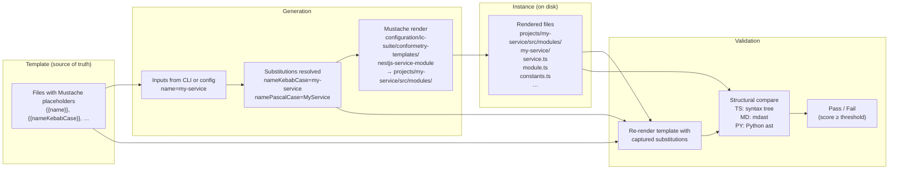

# Generator / Template / Instance Model

Conformetry scaffolding is built around three core concepts that form a closed loop: a **Template** is the source of truth, **Generation** renders it with substitutions into an **Instance** on disk, and **Validation** re-renders the same template with the same substitutions and structurally compares the result against the instance.



---

## Template

A **Template** is a directory of ordinary files containing Mustache placeholders (`{{name}}`, `{{nameKebabCase}}`, `{{namePascalCase}}`, etc.). It is the **single source of truth** for both generation and validation.

**Key properties:**

- **Ordinary files** — no special syntax beyond Mustache interpolation; any file type is valid (TypeScript, Python, Markdown, JSON, YAML, etc.)
- **Automatic name variants** — the generator resolves `name`, `nameKebabCase`, `namePascalCase`, `nameCamelCase`, `nameConstantCase`, `nameSnakeCase`, `nameLowerCase`, `nameUpperCase` from the `name` input
- **Placeholder capture** — during validation, placeholders whose values weren't supplied in configuration are inferred from the instance (first alignment wins) so the template can be re-rendered and compared faithfully
- **Directory vs file output** — a template producing a folder (e.g., `{{nameKebabCase}}/service.ts`) is matched against directory instances; a template producing loose files is matched against file instances

Templates live under `configuration/ic-suite/conformetry-templates/` and are referenced by `templatePath` in the generator registry.

Example template structure (`configuration/ic-suite/conformetry-templates/nestjs-service-module/{{nameKebabCase}}/{{nameKebabCase}}.module.ts`):

```ts
import { Module } from "@nestjs/common";

import { {{namePascalCase}}Service } from "./{{nameKebabCase}}.service";

/**
 * TODO: Document the {{nameCamelCase}} module.
 */
@Module({
  controllers: [],
  exports: [{{namePascalCase}}Service],
  imports: [],
  providers: [{{namePascalCase}}Service],
})
export class {{namePascalCase}}Module {}
```

---

## Generation

**Generation** is the act of rendering a template with resolved substitutions into a target directory, producing an instance.

The lifecycle is:

1. **Input resolution** — inputs declared in the generator definition (`inputs` in `conformetry.config.ts`) are collected from CLI flags, prompts, or configuration
2. **Substitution resolution** — the `name` input produces the full set of case variants; other inputs are passed through
3. **Pre-generation hook** — optional `preGenerate` hook runs before any file is written
4. **Render** — the template tree is walked; every path and file content is rendered with Mustache
5. **Post-generation hook** — optional `postGenerate` hook runs after rendering, before formatting
6. **Format** — generated files are formatted via the host's `FormatterAdapter` (Nx plugin uses `@nx/devkit` `formatFiles` for `--dry-run` support; CLI defers to the workspace formatter)

```bash
# CLI example
conformetry generate \
  --config configuration/ic-suite/conformetry.config.ts \
  --template nestjs-service-module \
  --name billing \
  --directory projects/lexico/billing/src/modules
```

```ts
// Programmatic example
await generationService.runGenerator({
  configurationDirectoryPath: "/workspace/configuration",
  definition: {
    name: "nestjs-service-module",
    templateDirectoryPath: "templates/nestjs-service-module",
  },
  inputs: { name: "billing" },
  instancePath: "packages/billing/src/modules",
});
```

**Two execution hosts** share the same generation runtime (`GenerationService`):

| Host | Filesystem | Formatting | Use case |
|------|------------|------------|----------|
| **CLI** (`conformetry-cli`) | Direct disk I/O (`defaultFileSystem`) | No-op (workspace formatter runs separately) | Interactive scaffolding, one-off generation |
| **Nx plugin** (`conformetry-nx`) | Nx `Tree` virtual filesystem (`AdapterService`) | `formatFiles` from `@nx/devkit` (enables `--dry-run` and change preview) | CI-integrated, `nx g` commands, affected projects |

The `GenerationService` accepts `FileSystemAdapter` and `FormatterAdapter` interfaces, so the core logic is host-agnostic.

---

## Instance

An **Instance** is the on-disk artifact that a generator produced (or that a developer wrote by hand). It is a concrete file tree — a whole module directory, a single file, or a set of files located together by one pattern.

Instances are **discovered**, not recorded. The generator definition declares `instances` groups with glob patterns and optional per-group substitutions:

```ts
// From configuration/ic-suite/conformetry.config.ts
{
  name: "nestjs-command-project",
  templatePath: "configuration/ic-suite/conformetry-templates/nestjs-command-project",
  inputs: defineInputs({
    name: z.string(),
    type: z.string(),
    workspaceRelativePrefix: z.string(),
  }),
  instances: [
    {
      patterns: ["projects/ic-suite/callidescope/callidescope-cli"],
      substitutions: {
        type: "projects/ic-suite/callidescope",
        workspaceRelativePrefix: "../../../../",
      },
    },
    {
      patterns: ["projects/ic-suite/codependix/codependix-cli"],
      substitutions: {
        type: "projects/ic-suite/codependix",
        workspaceRelativePrefix: "../../../../",
      },
    },
    // ...
  ],
}
```

Groups can be **workspace globs** (no tags) or **tag-scoped** (Nx plugin only):

```ts
// Module/file generator — instances found by tags on Nx projects
{
  name: "nestjs-service-module",
  templatePath: "configuration/ic-suite/conformetry-templates/nestjs-service-module",
  inputs: defineInputs({
    name: z.string(),
    project: z.string(),
  }),
  instances: [{ patterns: ["src/modules/*"], tags: ["framework:nestjs"] }],
}
```

### Instance Matching Algorithm

During validation, nothing records which template produced a file. Instead, every discovered instance is weighed against **every template** by the share of the template's files the instance already has, and the best fit wins.

Logic lives in `InstanceDiscoveryMatchingService` (`conformetry-configuration/src/modules/instance-discovery/instance-discovery-matching.service.ts`):

1. **Coverage ratio leads** — `matchRatio = matchedFileCount / template.filePaths.length` (prevents large templates from winning on weak partial matches)
2. **Absolute count breaks ties** — `matchedFileCount` (a five-file module template beats a two-file service-file template when both match completely)
3. **Name makes it deterministic** — `template.name.localeCompare`

**Two special outcomes** are reported rather than skipped:

| Reason | Meaning |
|--------|---------|
| `no-match` | No template explains this instance well enough (`matchedFileCount === 0` or `matchRatio ≤ MINIMUM_MATCH_RATIO`) |
| `ambiguous` | Two or more templates tied with equal `matchRatio` and `matchedFileCount`, but **not** a complete match (`matchRatio < COMPLETE_MATCH_RATIO`) |

A **complete tie** (`matchRatio === 1.0` for multiple templates) is **matched against all tied templates** — a module holding both a command and a service really is an instance of both `nestjs-command-module` and `nestjs-service-module`.

---

## Validation: Structural Comparison

Validation closes the loop. For each matched instance:

1. **Capture substitutions** — placeholder values are inferred from the instance (first alignment wins) so the template can be re-rendered with the same values
2. **Re-render** — the template is rendered again with the captured substitutions
3. **Structural compare** — the re-rendered template is compared against the instance **structurally, not textually**:

| Language | Comparison engine | What differs |
|----------|-------------------|--------------|
| **TypeScript** (`.ts`, `.tsx`) | TypeScript compiler syntax tree (`ts.SourceFile`) | Missing declarations, signatures, section comments |
| **Markdown** (`.md`) | mdast (Markdown AST) | Missing headings, lists, links, table structure |
| **Python** (`.py`) | Python `ast` module (via subprocess) | Missing classes, functions, decorators, docstrings |
| **JSON** (`.json`, `.jsonc`) | JSON path comparison | Missing keys, required values |
| **Jupyter** (`.ipynb`) | Delegates to JSON/Markdown/Python | Envelope, cell structure, cell contents |
| **Text** (fallback) | Line-by-line, duplicate-aware | Any unclaimed extension |

**What does NOT fail validation:** reformatting a file, renaming a local variable, adding a method, adding a section, reordering members.

**What DOES fail validation:** deleting a required export, dropping a declared file, losing a section comment, removing a required decorator.

### Language Modules and Comparison Strategies

"Language" here means a validator for one file format; the word "plugin" is reserved for the Nx plugin. The comparison is implemented per-language in `@conformetry/languages`:

- **TypeScript**: `TypescriptTreeService.compareTree` walks syntax trees in parallel. The template is a **structural subset** requirement: every declaration it makes must exist somewhere in the instance, but the instance may add anything and order members freely. Weight = subtree node count (a missing class costs its whole subtree).
- **Markdown**: `MarkdownTreeService.compareContainer` walks mdast trees. Order-preserving but not position-locked: each template node matches any instance sibling; the last match anchors the error location for what follows. Weight = subtree node count.
- **Python**: `PythonBridgeService.validatePythonSource` spawns `python3` against a shipped `ast` module (`conformetry-languages/src/modules/python/python/`). Synchronous subprocess because callers are synchronous. Bridge failures are reported as conformance differences (file could not be checked).
- **JSON**: `JsonService` compares by JSON path; missing keys and required values are reported.
- **Jupyter**: `JupyterService` validates envelope as JSON, then delegates cells to Markdown/Python validators.
- **Text**: `TextService` compares line-by-line with duplicate awareness (treats repeated identical lines as one requirement).

Language validators implement `ConformetryLanguageValidator` (descriptor + `validateDocument`). The `LanguagesService` resolves validators for the extensions present in a run; unclaimed extensions are never skipped: they are routed to the **Fallback**, the text Language widened to claim them and compared line by line, which is why the text Language is a floor under every run rather than one option among several.

---

## Generator Registry

The generator registry is declared in `configuration/ic-suite/conformetry.config.ts`. Each entry binds a template directory, input definitions (Zod schemas converted to JSON Schema), and instance groups with patterns and optional per-group substitutions.

### Project-level generators (create new projects)

| Generator | Template | Description |
|-----------|----------|-------------|
| `jupyter-notebook-application` | `configuration/ic-suite/conformetry-templates/jupyter-notebook-application` | Standalone Python application with Jupyter notebook entry point, pytest/pyright/ruff tooling, shared uv workspace venv |
| `nestjs-command-project` | `configuration/ic-suite/conformetry-templates/nestjs-command-project` | Standalone NestJS CLI application on nest-commander |
| `nestjs-graphql-application` | `configuration/ic-suite/conformetry-templates/nestjs-graphql-application` | Standalone NestJS GraphQL API application over HTTP |
| `nestjs-service-project` | `configuration/ic-suite/conformetry-templates/nestjs-service-project` | Standalone NestJS library package for internal workspace code |
| `tanstack-application` | `configuration/ic-suite/conformetry-templates/tanstack-application` | Standalone TanStack Start web application (SSR, file-based routes, Tailwind, Vitest) |

### Module/file generators (add to existing projects)

| Generator | Template | Target | Tags |
|-----------|----------|--------|------|
| `nestjs-command-module` | `configuration/ic-suite/conformetry-templates/nestjs-command-module` | `src/modules/*` | `framework:nest-commander` |
| `nestjs-dataloader-module` | `configuration/ic-suite/conformetry-templates/nestjs-dataloader-module` | `src/modules/*` | `framework:nestjs`, `language:graphql` |
| `nestjs-graphql-module` | `configuration/ic-suite/conformetry-templates/nestjs-graphql-module` | `src/modules/*` | `framework:nestjs`, `language:graphql` |
| `nestjs-resolver-file` | `configuration/ic-suite/conformetry-templates/nestjs-resolver-file` | `src/modules/*.resolver.ts` | `framework:nestjs`, `language:graphql` |
| `nestjs-service-file` | `configuration/ic-suite/conformetry-templates/nestjs-service-file` | `src/modules/*.service.ts` | `framework:nestjs` |
| `nestjs-service-module` | `configuration/ic-suite/conformetry-templates/nestjs-service-module` | `src/modules/*` | `framework:nestjs` |
| `react-component-folder` | `configuration/ic-suite/conformetry-templates/react-component-folder` | `src/components/*/*` | `framework:react`, `type:application` |
| `react-component-file` | `configuration/ic-suite/conformetry-templates/react-component-file` | `src/components/*/*/*.tsx` and its unit test | `framework:react`, `type:application` |
| `react-hook-folder` | `configuration/ic-suite/conformetry-templates/react-hook-folder` | `src/hooks/*` | `framework:react`, `type:application` |
| `react-hook-file` | `configuration/ic-suite/conformetry-templates/react-hook-file` | `src/hooks/*/use-*.ts` | `framework:react`, `type:application` |
| `tanstack-route` | `configuration/ic-suite/conformetry-templates/tanstack-route` | `src/routes/` | `framework:tanstack-start` |
| `tanstack-server-function` | `configuration/ic-suite/conformetry-templates/tanstack-server-function` | `src/modules/*` | `framework:tanstack-start` |

---

## Scoring and Thresholds

Each matched instance receives a **conformance score**:

```
score = (totalWeight - failedWeight) / totalWeight
```

- `totalWeight` — every requirement the template imposes (conforming documents included, so an instance is scored against all template requirements)
- `failedWeight` — sum of weights of reported differences
- **Weight** — a missing class is reported once but weighted for its whole subtree; a missing import is weighted only for itself (`ConformetryDifference.weight` defaults to `1`; subtree counting is in `TypescriptNodesService.countSubtree` and `MarkdownNodesService.countSubtree`)

**Threshold resolution** (strictest wins): `instanceGroup.threshold` ?? `generator.threshold` ?? `runThreshold` ?? `1`. An instance passes when `score ≥ threshold`. An unmatched instance (`no-match` or `ambiguous`) always fails.

Scoring arithmetic lives in `ScoringService.calculateScore` (edge cases: empty template scores `1`, negative scores clamped to `0`).

---

## Six-Step Conformance Loop

The complete loop from generator declaration to continuous validation:

1. **Declare** — Author adds a generator entry to `configuration/ic-suite/conformetry.config.ts` (template path, inputs, instance groups)
2. **Generate** — Run `conformetry generate` (CLI) or `nx g` (Nx plugin) with inputs; template rendered to instance directory
3. **Discover** — Validation finds instances via globs in `instances` groups (CLI) or per-project via tags (Nx plugin)
4. **Match** — Each instance weighed against all templates; best fit wins (`no-match` / `ambiguous` reported explicitly)
5. **Validate** — For each matched instance: capture substitutions → re-render → structural compare per language
6. **Report** — Scores computed, thresholds applied, report printed (CLI) or target succeeds/fails (Nx executor); CI gates on `success: false`

---

## Continuous Conformance

Conformetry enforces continuous conformance through two mechanisms:

- **Synchronization** — The `synchronization` project runs `nx run synchronization:conformetry-generators:write` to emit Nx plugin generator factories from the configuration, keeping the Nx plugin generators in sync with the source of truth.
- **CI Validation** — The `conformetry-validate` executor (inferred by `createNodes` onto every project holding instances) runs validation in CI. A failed validation (`success: false`) blocks merge.

---

## Related Pages

- [IC Suite Architecture](../architecture/ic-suite.md) — workspace structure
- [Common Packages](../architecture/common-packages.md) — conformetry package graph
- [Scaffolding Workflow](../workflows/scaffolding.md) — end-to-end generation and validation
- [Code Quality Workflow](../workflows/code-quality.md) — validation in CI
