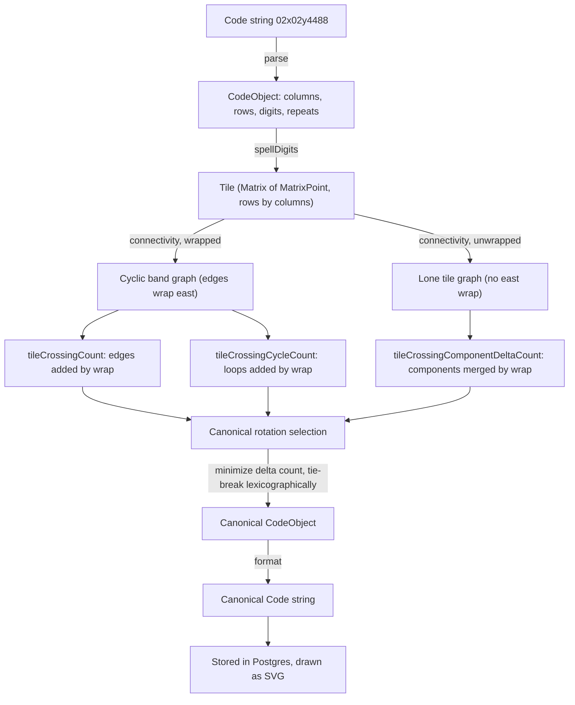

# Meander Theory

This page establishes the canonical vocabulary and structural theory for the meander domain. Every term is grounded in implementation across `meanderaw-cli` and its ADRs.

---

## Core Concepts

### Meander

> **Meander**: A single generated Greek key/fret ornament — a band of ink drawn from a Code, rendered as one SVG document.
> _Avoid_: Pattern, motif, key pattern

A meander is not a family, a style, or a classification. It is exactly one generated band of ink, completely determined by its Code, row count, and column count. Two meanders with the same Code at the same dimensions are the same meander; there is no hidden state.

### Code

> **Code**: The direction bits that are a meander: one hexadecimal digit per interior lattice point of one true repeat, read row-major and worth `8` north, `4` south, `2` east and `1` west. A meander is its Code — nothing else identifies it, and nothing about how it is drawn, measured, or named is stored separately from it.
> _Avoid_: Lattice address, hash, fingerprint

The Code is a **row-major string of hexadecimal digits**. Each digit encodes four direction bits at one interior lattice point:

| Bit | Value | Direction |
|-----|-------|-----------|
| 8   | 0b1000 | North    |
| 4   | 0b0100 | South    |
| 2   | 0b0010 | East     |
| 1   | 0b0001 | West     |

For example, the digit `5` (0b0101) means ink goes south and west; `c` (0b1100) means north and south (a vertical straight); `0` means no ink at that point (a dot).

The Code format in storage is `{columns}x{rows}y{digits}` (e.g., `02x02y4488`), with an optional `r{repeats}` suffix. The bare hexadecimal digits alone are the `lattice` column.

**Key properties:**

- **Read in place**: Every bit is decoded literally off its own digit at index `row * columns + column` — no re-derivation from neighbors.
- **Deliberately redundant**: Four bits per point describes `4 * columns * rows` bits where the tile has only `columns * (2 * rows - 1)` degrees of freedom, because every edge is written twice (once at each end). This redundancy is checked by `TileService.assertWellFormed`.
- **Self-contained**: A Code string carries its own dimensions; no external metadata is needed to decode it.

### Tile

> **Tile**: One repeat unit's worth of the lattice a meander is drawn on — the grid of points and edges a Code is spelled into.
> _Avoid_: Cell, unit, permutation

The tile is the decoded grid (`Matrix`) of `MatrixPoint` objects, each with four boolean directions. It is the runtime representation that characteristics and the renderer walk. A Code *spells into* a tile; a tile *spells back* to a Code (canonically, via `CodeService.spellCanonical`).

### Rows, Grid Unit, Channel

> **Rows**: The parameter that sets a meander's grid density. It does not change the canvas height, which stays fixed; instead it divides that fixed height into finer subdivisions, shrinking the grid unit and stroke width as rows increases.
> _Avoid_: Row count, height, N

> **Grid unit**: The base spacing a meander's coordinates are built from, derived from canvas height divided by rows. Stroke width and offsets are themselves derived from the grid unit, not set independently.
> _Avoid_: Cell size, spacing, step

> **Channel**: The white space separating two neighboring strokes. Exactly one stroke width wide everywhere inside a band, which is what makes a meander space-filling.
> _Avoid_: Gap, whitespace, margin

The channel invariant (invariant 2) is measured as `channelWidthCompliant` by the charter test. **ADR 0004** shows how the `cross` family's `interrupted` mode breaks the under-strand by exactly one grid pitch either side of a junction, leaving a gap of exactly one stroke width — the same width as every other channel — keeping invariant 2 intact while relaxing invariant 4 (no X-junctions).

---

## Rotation and Canonical Rotation

### Rotation

A cyclic column rotation of a Code represents the same infinite band cut at a different column. The same band cut at a different column is the same meander in a different rotation, so a meander has exactly one canonical rotation rather than many Codes. For a Code with `C` columns there are `C` possible rotations. (Earlier versions of this vocabulary called this a "phase"; ADR 0014 and `CodeService` now say rotation.)

### Canonical Rotation Selection

**ADR 0014** defines the canonical rotation as:

> The rotation (under the column-translation group) that minimizes `seamComponents`, breaking ties by choosing the lexicographically smallest Code.

`seamComponents` (now measured as `tileCrossingComponentDeltaCount`) is the number of connected components the tile boundary merges — pieces that are separate within one lone tile but join once the tile repeats. Minimizing this is exactly "the cut that strands the fewest fragments."

The group of transformations defaults to cyclic column rotation but is parameterized, allowing future transformation sets (e.g., including horizontal flips) to change which meanders count as the same one.

**Implementation**: `CodeService.canonicalRotation` evaluates every rotation in the group with a caller-supplied tile-crossing score (`TileCrossingComponentDeltaCountCharacteristicService` in practice) and picks the minimum, tie-breaking by the lexicographically smallest digits.

---

## Tile Crossing

> **Tile crossing**: The join where a tile's last column meets its first when a Code is read as a repeating band rather than as a finite drawing. What crosses it — a stranded end, a junction, a closed loop — is measured rather than assumed, and the measurement is what a canonical rotation is chosen to minimize.
> _Avoid_: Seam (formerly this project's own term), wrap, edge, border

When a tile repeats, edges leaving the last column wrap to the first column. The **tile crossing** is the set of these wrapping edges. What crosses this boundary is not assumed from the Code's digits — it is measured by comparing the graph of the cyclic band against the graph of the lone tile (with wrapping disabled).

Three characteristic services measure the tile crossing:

| Characteristic | What it measures | Formula |
|----------------|------------------|---------|
| `tileCrossingCount` | Edges that cross the boundary | \|E_band\| - \|E_tile\| |
| `tileCrossingCycleCount` | Loops that close only by wrapping | b₁(G_band) - b₁(G_tile) |
| `tileCrossingComponentDeltaCount` | Components merged by wrapping | b₀(G_tile) - b₀(G_band) |

These replace the retired `crossesTheSeam`, `seamCycles`, and `seamComponents` flags. They are **path-tier** characteristics (walk the ink as a graph over the cyclic band).

---

## Crossing / Interlace Mechanics

### One-Pitch Interlace Break (ADR 0004)

The `cross` family draws the complex Greek meander with interlaced crossings. To satisfy the charter invariants:
- **Invariant 2**: Every interior white channel is exactly one stroke width.
- **Invariant 4**: Ink contains no X-junctions (relaxed in `interrupted` mode).

The solution: **break the under-strand by exactly one grid pitch either side of the junction**. This leaves a gap of exactly one stroke width (satisfying invariant 2), and removes the X-junction from the ink graph (the crossing drops from degree 4 to degree 2).

Key consequences:
- **No ink X-junctions in interrupted mode**: Solid mode reports `inkXJunctions: 12` at 6 repeats; interrupted reports `0`.
- **Invariant 2 is not relaxed**: The break gives up a grid edge, never a lattice point.
- **Interlace reads from continuation, not gap width**: The broken strand resumes in line on the far side — a weaker visual signal than ink of two weights, but preserves the flat path model (invariant 6).
- **Minimum 6 rows for cross family**: Below 6 rows the upper remnant collapses to a zero-length run.

### Band Borders in Branch and Parallel (ADR 0006)

Both `branch` and `parallel` families now close the band at **top and bottom** in every mode, using the optional `MotifService.border` hook `boxes`.

- **Branch**: The figure is **inset by one lattice row** from each rule beside it, so a rule closes the band without landing on the ink. This preserves the crenellation and free ends.
- **Parallel**: Starts branching (relaxes no-branching invariant) under a structural condition — a rule meets a strand's rising end with west, east, and south ink at one lattice point.

The correction from the initial implementation (which ruled borders onto the figure) fixed two problems: branch modes collapsing to one picture, and branch incorrectly being recorded as having given up being acyclic.

---

## Characteristics

### Characteristic

> **Characteristic**: A measured structural property of a meander, read as a pattern over the Code's digits where one exists and by walking the tile where none does. Characteristics are an open, growing set — adding one changes no other module.
> _Avoid_: Property, metric, trait

Characteristics are the **only** way meanders are queried, filtered, and understood. They are:

- **Measured, not assigned**: Computed from the Code/tile at draw time.
- **Open set**: New characteristics are added by registering an evaluator; no schema migration, no classifier rewrite.
- **Typed**: Each yields a boolean, number, or (for letter groups) sixteen orientation counts.
- **Tiered**:
  - **submatrix** — reads local windows of the grid (single point or M×N sliding window)
  - **path** — walks the ink as a graph over the cyclic band
  - **compound** — combines other characteristics' values rather than reading the grid itself

Every characteristic is a self-describing service (`CharacteristicEvaluator`) with metadata: `key`, `name`, `description`, `formula` (LaTeX), `category`, `valueType`. Evaluators share a `CharacteristicContext` (code, rows, columns, matrix) prepared once per meander.

### Pattern Characteristic

> **Pattern characteristic**: A compound boolean Characteristic built only from other Characteristics — a named shape such as a whirl or an arcade. A meander can hold several at once, or none; it is found by filtering on them, never by a stored label.
> _Avoid_: Family, style, kind, category, classification

**ADR 0023** eliminated the single-family enum column. Former families are now **pattern characteristics** — compound booleans under `compound/pattern/` built only from other characteristics.

The current pattern characteristics (alphabetical):

- `isArcade`
- `isBars`
- `isBoxes`
- `isChain`
- `isClasps`
- `isComb`
- `isCross`
- `isDots`
- `isDoubleChain`
- `isFork`
- `isLines`
- `isMesh`
- `isParallel`
- `isPureTree`
- `isSnake`
- `isSwirl`
- `isWaterfalls`
- `isWhirl`

Each is a `CharacteristicEvaluator<boolean>` in `compound/pattern/` that injects and calls other evaluators. For example, `isChain` checks:

```
maxMonotonicTurnLength - tightestTurnCount ≥ 4  ∧  tileCrossingComponentDeltaCount = 1
```

A meander can satisfy multiple pattern characteristics simultaneously, or none. The draw run writes one HTML page per pattern characteristic (`output/patterns/<key>.html`), listing every meander it holds for.

---

## Lattice Address System

**ADR 0007** established that every meander is addressed by its lattice: one hexadecimal character per interior lattice point, worth `8` north, `4` south, `2` east and `1` west, spanning one true repeat, read off the rendered document rather than off the generator.

Today a meander is a row in the `meanders` table of the `meanderaw` Postgres schema, addressed by its **Code, its rows, and its columns** and nothing else. The formatted Code (`{columns}x{rows}y{lattice}r{repeats}`, `r` optional) spells out all three, so `code` alone is its identity; the row's `id` is a database-assigned uuidv7 that changes on every draw run and never reaches committed output. No row stores its drawing: the renderer draws each meander from its Code, rows, and columns.

Generation is lattice-first: a budgeted enumeration produces every structurally distinct repeat within reach (bounded by one edge budget, not a column cap, since a repeat of `rows` by `columns` holds `columns * (2 * rows - 1)` edges), and one generic renderer draws each one from its decoded Code.

---

## Families as Open Multi-Label Set (ADR 0015, superseded by 0023)

Historically, each meander was filed under exactly one architectural family (`whirl`, `box`, `snake`, etc.), encoded as a single `family` column with an enum constraint. This was fundamentally flawed:
- Overlapping definitions caused thousands of enumerated meanders to genuinely qualify as both `boxes` and `chain`, but the schema forced an arbitrary tie-break order.
- Hardcoded rules tightly binding grids to characteristics proved fragile.

**ADR 0015** dropped the single-family constraint, storing `families` and boolean `characteristics` as open string arrays. A meander earns a set of families rather than exactly one. The `drawingHash` (SHA-256) replaced the stored SVG column as a drift guard.

**ADR 0023** superseded this by eliminating families entirely — former families are now pattern characteristics (compound booleans), and filtering is by characteristics alone.

---

## Mermaid Diagram: Code → Lattice → Tile → Crossings → Canonical Rotation



**Caption**: From Code string through tile decoding, cyclic vs. lone-tile graph comparison, tile-crossing measurements, to canonical rotation selection and storage.

---

## ADR References

| ADR | Title | Concept |
|-----|-------|---------|
| 0004 | Draw crossings as a one-pitch interlace break | Channel invariant, tile crossing measurement, `cross` family |
| 0006 | Close both band borders in branch and parallel | Band border rules, figure inset, branching condition |
| 0007 | Address every meander by its lattice | Lattice address format, true repeat vs pitch, cross-family comparison |
| 0014 | Give Every Meander a Canonical Rotation | Canonical rotation definition, `seamComponents` → `tileCrossingComponentDeltaCount` |
| 0015 | Store Families as an Open Multi-Label Set | Superseded by 0023; introduced open boolean characteristics |
| 0018 | Store Every Characteristic in One Sparse JSON Map | Supersedes 0015's boolean array; single `characteristics` JSON column |
| 0019 | Drop the Drift Check and the Drawing Hash | Supersedes 0015's `drawingHash`; drawing is a pure function of Code |
| 0020 | Store Meanders in Postgres | Database storage of Code + characteristics |
| 0021 | Stop Committing the Meander Pages | Output pages are gitignored, streamed per pattern |
| 0023 | Filter Meanders by Characteristics Alone | Eliminates families; pattern characteristics as compound booleans |

---

## Related Concepts

- [Generator, Template, Instance, Language](../concepts/generator-template-instance.md) — Conformetry vocabulary (meanderaw uses conformetry for its own configuration)
- [Meanderaw Domain](../domain/meanderaw.md) — Project overview and architecture
- [Meanderaw Testing](../testing/meanderaw.md) — Charter tests, lattice/service tests, integration assertions
