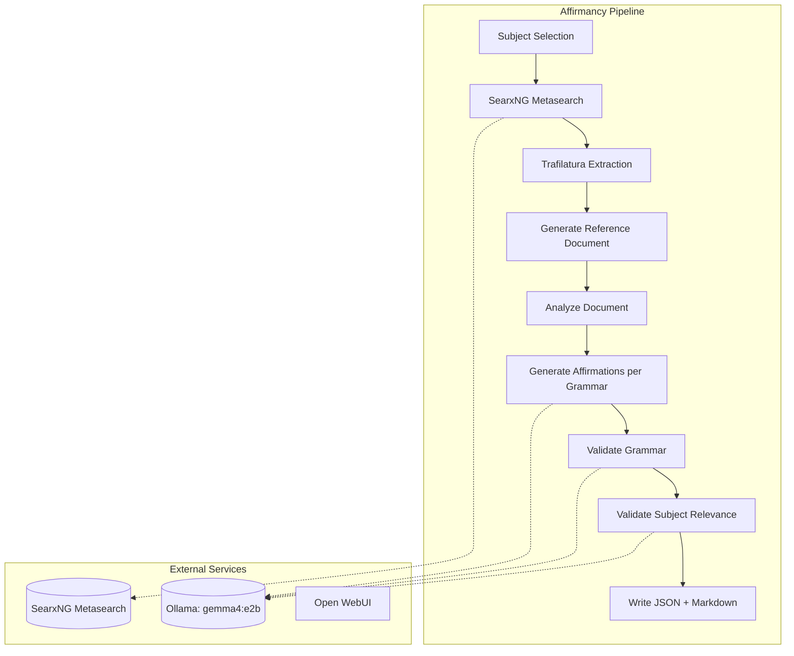

# Affirmancy — Affirmation Generation Pipeline

**Affirmancy** is a Python application that generates structured affirmations for spiritual practices (tarot, Lenormand, astrology, chakras, runes, kabbalah, solfeggio, and more). It uses a **LangGraph ReAct agent** to research each subject through a self-hosted **SearxNG** metasearch instance (aggregating 135+ engines including Wikipedia, DuckDuckGo, Google Scholar, ArXiv, and domain-specific spiritual sources), then generates affirmations across a full grammatical mood system using a local **gemma4:e2b** model via **Ollama**. All output is validated against **Pydantic** models before being written as JSON and Markdown files.

## Architecture Overview



### Core Components

| Component | Technology | Purpose |
|-----------|------------|---------|
| **LLM** | `ChatOllama` → `gemma4:e2b` | Local inference, 128k context window |
| **Agent Framework** | LangGraph `StateGraph` | Orchestrates research → generation → validation |
| **Research Tool** | SearxNG (self-hosted) | Metasearch across 135+ engines with hostname boosting for spiritual sources |
| **HTML Processing** | Trafilatura | Extracts clean text from search results |
| **Validation** | Pydantic v2 + LLM-as-judge | Structural + semantic validation of generated text |
| **Output** | JSON + Markdown | Structured files organized by practice category |

### Service Dependencies

| Service | Port | URL | Purpose |
|---------|------|-----|---------|
| **Ollama** | `11434` | `http://localhost:11434` | Local LLM server hosting `gemma4:e2b` |
| **Open WebUI** | `3001` | `http://localhost:3001` | Browser chat interface for Ollama |
| **SearxNG** | `8889` | `http://localhost:8889` | Metasearch engine with hostname boosting for spiritual sources |

Environment variables:
- `OLLAMA_HOST` (default: `http://localhost:11434`)
- `SEARXNG_HOST` (default: `http://localhost:8889`)

## Grammar System — 9 Axes as `DescribedEnum`

The grammar system is the distinctive feature of Affirmancy. Rather than producing flat "I am…" sentences, the pipeline enumerates **9 grammatical axes**, each modeled as a `DescribedEnum` that carries its own generation instruction and usage examples into the prompt. These compose into a `Grammar` model that the LLM is asked to write in.

### Axis Definitions (in `src/grammars.py`)

| Axis | Type | Values | Description |
|------|------|--------|-------------|
| **Mood** | `Mood` | INDICATIVE, SUBJUNCTIVE, CONDITIONAL, INTERROGATIVE, POTENTIAL, DUBITATIVE, PRESUMPTIVE, ENERGETIC, INFERENTIAL, SPECULATIVE, IMPERATIVE, PROHIBITIVE, JUSSIVE, HORTATIVE, OPTATIVE, COMMISSIVE, BENEDICTIVE, AORIST, DEBITIVE, PRECATIVE, PERMISSIVE, NECESSITATIVE (21 values) | Speaker's attitude toward the proposition (realis vs. irrealis, epistemic vs. deontic) |
| **Voice** | `Voice` | ACTIVE, PASSIVE (2 values) | Relationship between subject and verb |
| **Tense** | `Tense` | PAST, RECENT_PAST, REMOTE_PAST, PLUPERFECT, NONPAST, NONFUTURE, PRESENT, FUTURE, NEAR_FUTURE, REMOTE_FUTURE, FUTURE_PERFECT, FUTURE_IN_THE_PAST (12 values) | Temporal location of the event |
| **Aspect** | `Aspect` | SIMPLE, PERFECTIVE, IMPERFECTIVE, PROGRESSIVE, CONTINUOUS, STATIVE, HABITUAL, PROSPECTIVE, GNOMIC, EPISODIC, INCEPTIVE, TERMINATIVE, EXPERIENTIAL, PERFECT_PROGRESSIVE (14 values) | Internal temporal structure |
| **Person** | `Person` | FIRST, SECOND, THIRD (3 values) | Grammatical person of the subject |
| **Number** | `Number` | SINGULAR, PLURAL, DUAL, TRIPLE, EXISTENTIAL, UNIVERSAL, PAUCAL, SUPERPLURAL (8 values) | Grammatical number |
| **Polarity** | `Polarity` | POSITIVE, NEGATIVE (2 values) | Positive vs. negative assertion |
| **Deixis** | `Deixis` | PROXIMAL, MEDIAL, DISTAL, FAR_DISTAL, IMMEDIATE, PROXIMATE_TEMPORAL, REMOTE_TEMPORAL, INCLUSIVE, EXCLUSIVE (9 values) | Anchoring to speaker's "here and now" (spatial, temporal, personal) |
| **Form** | `Form` | FINITE, INFINITIVE, GERUND, PARTICIPLE, SUPINE (5 values) | Finite vs. non-finite verb forms |

### `DescribedEnum` Pattern

Each grammatical value is a `DescribedEnum` (a `StrEnum` subclass) carrying:

```python
class DescribedEnum(StrEnum):
    _description: str        # Imperative generation instruction for the LLM
    _examples: tuple[str, ...]  # Six short usage examples

    @property
    def description(self) -> str: ...

    @property
    def examples(self) -> tuple[str, ...]: ...
```

This lets the pipeline embed **per-value generation guidance** directly in the prompt — e.g., `Mood.INTERROGATIVE.description` includes "CRITICAL: The sentence MUST be a QUESTION and MUST end with '?'", while `Voice.PASSIVE.description` warns "The word immediately after the be-auxiliary MUST be a true past participle (a verb form), NOT a noun, adjective, or present participle".

### `Grammar` Composition Model

```python
class Grammar(BaseModel):
    emoji: str
    description: str
    examples: list[str]

    form: Form | None = None
    mood: Mood | None = None
    tense: Tense | None = None
    person: Person | None = None
    voice: Voice | None = None
    aspect: Aspect | None = None
    number: Number | None = None
    deixis: Deixis | None = None
    polarity: Polarity | None = None

    @computed_field
    @property
    def specifiers(self) -> list[str]: ...      # ["FINITE", "INDICATIVE", "ACTIVE", "PRESENT", "SIMPLE", "FIRST", "SINGULAR"]

    @computed_field
    @property
    def name(self) -> str: ...                   # "⭐ Indicative Active Present Simple First Singular"

    @computed_field
    @property
    def slug(self) -> str: ...                   # "indicative-active-present-simple-first-singular"

    @computed_field
    @property
    def specifier_descriptions(self) -> str: ... # Assembled imperative instructions for the prompt
```

All fields are optional — omitted fields are left to the LLM's discretion. This allows minimal grammars (e.g., `Grammar(mood=Mood.INDICATIVE)`) or fully-specified ones.

### Predefined Grammars (18)

The `GRAMMARS` list in `grammars.py` defines 18 reusable grammatical forms used by the pipeline:

| Grammar | Specifiers | Purpose |
|---------|------------|---------|
| `PAST` | Finite, Indicative, Active, Past, Simple, First, Singular | Grounds affirmation in completed past action |
| `PRESENT` | Finite, Indicative, Active, Present, Simple, First, Singular | Fundamental present-moment assertion |
| `FUTURE` | Finite, Indicative, Active, Future, Simple, First, Singular | Confident intention projection |
| `PERFECT_PROGRESSIVE` | Finite, Indicative, Active, Present, Perfect Progressive, First, Singular | Continuous progress from past to now |
| `FUTURE_PERFECT` | Finite, Indicative, Active, Future Perfect, Perfective, First, Singular | Visualize future completion |
| `FIRST_PLURAL` | Finite, Indicative, Active, Present, Simple, First, Plural | Shared collective strength |
| `THIRD_PRESENT` | Finite, Indicative, Active, Present, Simple, Third | Perspective beyond self |
| `POTENTIAL` | Finite, Potential, Active, Present, Simple, First, Singular | Capability and possibility |
| `OPTATIVE` | Finite, Optative, Active, First, Singular | Sincere wish or deep longing |
| `IMPERATIVE` | Finite, Imperative, Active, Second, Singular | Direct command to act |
| `INTERROGATIVE` | Finite, Interrogative, Active, Present, First, Singular, Negative | Challenge limiting beliefs |
| `INFINITIVE` | Infinitive, Active, Simple | Pure purpose/aspiration |
| `GERUND` | Gerund, Active | Affirm through process/action |
| `PASSIVE` | Finite, Indicative, Passive, Present, Simple, First, Singular | Openness to being received/supported |
| `HABITUAL` | Finite, Indicative, Active, Present, Habitual, First, Singular | Repeated practice reinforcement |
| `NEGATIVE` | Finite, Indicative, Active, Present, Simple, First, Singular, Negative | Negate false belief/limitation |

## Pipeline — Notebook-Driven LangGraph

The main pipeline lives in `src/affirmancy.ipynb` as a series of LangGraph `StateGraph` definitions. Each cell builds on the previous one, culminating in a full graph that processes all subjects.

### State Definitions

```python
class SubjectState(TypedDict):
    subject: Subject
    query: NotRequired[str]
    sources: NotRequired[str]

class GenerateDocumentFromSourcesState(SubjectState):
    document: NotRequired[str]

class GenerateDocumentFromAnalysisState(GenerateDocumentFromSourcesState):
    source_analysis: NotRequired[str]

class GenerateAffirmationsState(GenerateDocumentFromAnalysisState):
    document_analysis: NotRequired[str]
    grammars: list[Grammar]
    grammar_affirmations: NotRequired[list[GrammarAffirmations]]
    validation_failures: NotRequired[Annotated[list[str], operator.add]]
```

### Graph Nodes

| Node | Function | Description |
|------|----------|-------------|
| `search_sources` | `search_sources(state)` | SearxNG query → 12 results → Trafilatura extraction (32k chars each) |
| `analyze_sources` | `analyze_sources(state)` | LLM (analytical, 0.12 temp) produces research brief from sources |
| `generate_document` | `generate_document(state)` | LLM (generative, 0.24 temp) writes flowing prose reference document (≤1000 words) |
| `analyze_document` | `analyze_document(state)` | LLM (analytical) extracts key themes for affirmation generation |
| `generate_affirmations` | `generate_affirmations(state)` | For each `Grammar` in `GRAMMARS`, LLM (creative, 0.48 temp) generates affirmations matching the grammatical specifiers; output parsed via `Json5PydanticOutputParser` into `GeneratedAffirmations` |
| `validate_affirmations_grammars` | `validate_affirmations_grammars(state)` | LLM (validator, 0.06 temp) checks each affirmation against its grammar specifiers; failures collected |
| `validate_affirmations_subject` | `validate_affirmations_subject(state)` | LLM (validator) checks each affirmation for subject relevance using the reference document |
| `write_affirmations` | `write_affirmations(state)` | Writes `SubjectAffirmations` to JSON and Markdown via `output.py` |

### Retry Logic

All LLM calls use `tenacity.Retrying` with exponential backoff:
- 6 attempts max
- Wait: `wait_exponential(multiplier=1, min=1, max=10)`
- Logs each failure before retry

### LLM Temperature Strategy

| LLM Instance | Temperature | Purpose |
|--------------|-------------|---------|
| `llm_validator` | 0.06 | Strict validation (grammar + subject) |
| `llm_analytical` | 0.12 | Source analysis, document analysis |
| `llm_generative` | 0.24 | Reference document generation |
| `llm_creative` | 0.48 | Affirmation generation (maximal variety) |

### Output Structure

```
output/
├── affirmations/
│   └── {category-slug}/
│       ├── {order}-{slug}.json    # SubjectAffirmations model
│       └── {order}-{slug}.md      # Human-readable markdown
└── affirmations/documents/
    └── {category-slug}/
        └── {order}-{slug}.md      # Reference document
```

Example JSON structure:
```json
{
  "subject": { "name": "The Fool", "slug": "the-fool", "order": 0, "category": { "name": "Tarot Card", "slug": "tarot-card" } },
  "grammars": [
    {
      "grammar": { "emoji": "⭐", "description": "...", "specifiers": ["FINITE", "INDICATIVE", "ACTIVE", "PRESENT", "SIMPLE", "FIRST", "SINGULAR"], ... },
      "affirmations": [
        { "text": "I trust the journey unfolding before me" },
        { "text": "I embrace new beginnings with an open heart" }
      ]
    }
  ]
}
```

## Subject Categories

Subjects are declared in `src/subjects.py` as `Subject` instances with a `SubjectCategory`. The categories in place span:

| Category | Slug | Count | Notes |
|----------|------|-------|-------|
| Tarot Card | `tarot-card` | 78 | Major + Minor Arcana (RWS ordering) |
| Lenormand | `lenormand` | 38 | 36 cards + 2 additional |
| Astrology Sign | `astrology-sign` | 13 | 12 signs + Ophiuchus |
| Astrology Planet | `astrology-planet` | 10 | Traditional + modern planets |
| Astrology Node | `astrology-node` | 2 | North/South Node |
| Astrology Asteroid | `astrology-asteroid` | 4 | Ceres, Pallas, Juno, Vesta |
| Astrology Aspect | `astrology-aspect` | 5 | Conjunction, Opposition, Trine, Square, Sextile (metadata: angle, fraction) |
| Astrology House | `astrology-house` | 12 | Houses 1–12 |
| Modality | `modality` | 3 | Cardinal, Fixed, Mutable |
| Polarity | `polarity` | 2 | Yang/Masculine, Yin/Feminine |
| Chakra | `chakra` | 7 | Root through Crown |
| Rune | `rune` | 24 | Elder Futhark |
| Sephiroth | `sephiroth` | 10 | Tree of Life spheres |
| Hebrew Letter | `hebrew-letter` | 22 | Aleph through Tav (metadata: Hebrew character) |
| Kabbalah World | `kabbalah-world` | 4 | Atziluth, Beriah, Yetzirah, Assiyah |
| Solfeggio | `solfeggio` | 9 | 174Hz–963Hz frequencies |
| Weekday | `weekday` | 7 | Monday–Sunday |
| Element | `element` | 4 | Fire, Water, Air, Earth |
| Color | `color` | 12 | Basic + extended palette |
| Gemstone | `gemstone` | 38 | Crystals with metaphysical properties |
| Metal | `metal` | 7 | Traditional alchemical metals |
| Number | `number` | 32 | 1–32 with numerological meanings |

Total: **300+ subjects** across 21 categories. Adding a practice means adding its category and subjects to `subjects.py` — nothing else in the pipeline needs to change.

## SearxNG Configuration

`searxng.settings.yml` configures the metasearch instance for spiritual research:

- **Hostname boosting**: 100+ high-priority domains (sacred-texts.com, hermetic.com, biddytarot.com, astro.com, chabad.org, sefaria.org, crystalvaults.com, etc.) sorted to top of results
- **Low-priority**: SEO farms, generic horoscopes, dictionary definitions
- **Removed**: Non-English content farms (zhihu.com), medical sites, image-only (Pinterest), affiliate marketplaces (Etsy, Amazon)
- **Engine tuning**: Longer timeouts (8s/15s) for LLM tolerance; reduced suspension times for faster dev iteration
- **Safe search**: Disabled (0) — spiritual/occult content often misclassified
- **Formats**: HTML (UI) + JSON (LangGraph agent)

## Development Setup

This application is a member of the **uv workspace** declared in `configuration/pyproject.toml`, sharing `configuration/uv.lock` and the root `.venv`.

```bash
# Sync dependencies from repository root
uv sync --project configuration

# Start services
nx run affirmancy:ollama --configuration=start
nx run infrastructure:searxng:up
nx run infrastructure:open-webui:up

# Pull model (one-time)
nx run affirmancy:ollama --configuration=pull-small   # gemma4:e2b

# Open src/affirmancy.ipynb in VSCode and run cells sequentially
```

Python ≥3.14 required (pyproject.toml specifies `>=3.14,<3.15`).

## Testing

Pytest suite in `testing/` with unit and integration markers:

| Test File | Coverage |
|-----------|----------|
| `test_grammars.py` | Grammar model properties, specifier composition, `DescribedEnum` examples, `specifier_descriptions` assembly |
| `test_models.py` | Pydantic model construction, serialization round-trips, `GeneratedAffirmations` trailing-period stripping |
| `test_subjects.py` | Subject/category construction, counts per category, metadata presence, `SUBJECTS` aggregation |
| `test_prompts.py` | Prompt template rendering, variable substitution |
| `test_services.py` | `require_searxng` success/failure behavior |
| `test_output.py` | JSON/Markdown writers, directory creation, filename conventions |

Run with:
```bash
uv run pytest testing/ -v
uv run pytest testing/ -m unit      # fast mocked tests
uv run pytest testing/ -m integration  # requires real services
```

## Extension Points

| Extension | Location | Description |
|-----------|----------|-------------|
| New spiritual practice | `src/subjects.py` | Add `SubjectCategory` + `Subject` list |
| New grammatical axis | `src/grammars.py` | Add `DescribedEnum` subclass + update `Grammar` model |
| New predefined grammar | `src/grammars.py` | Add `Grammar` instance to `GRAMMARS` list |
| Custom validation | `src/prompts.py` | Add validation prompt templates |
| Output format | `src/output.py` | Add new writer functions |
| Search engines | `searxng.settings.yml` | Adjust hostname priorities, engine weights |

## Related Pages

<!-- openwiki: broken internal link [../overview.md] file "../overview.md" does not exist. Fix the href or restore the target, then delete this comment. -->
- [Overview](../overview.md) — Repository architecture
- [Ollama + SearxNG Integration](../integrations/ollama-searxng.md) — Service deployment details
- [Local Development](../operations/local-development.md) — Devcontainer, uv workspace, Nx commands
- [Affirmancy Testing](../testing/affirmancy.md) — Test organization and execution
