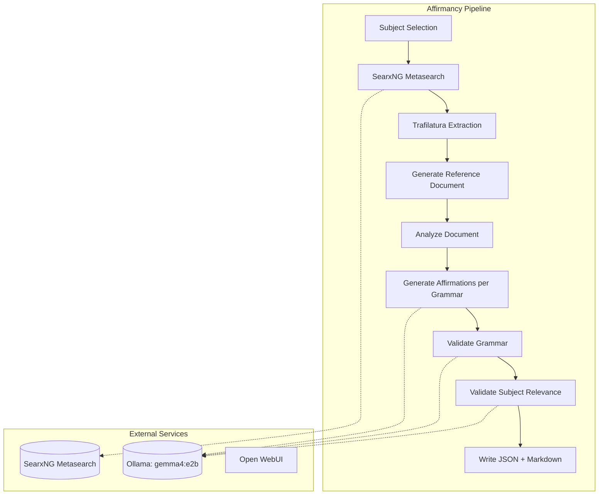

# Affirmancy — Affirmation Generation Pipeline

**Affirmancy** is a Python application that generates structured affirmations for spiritual practices (tarot, Lenormand, astrology, chakras, runes, kabbalah, solfeggio, and more). It uses a **LangGraph ReAct agent** to research each subject through a self-hosted **SearxNG** metasearch instance (aggregating 135+ engines including Wikipedia, DuckDuckGo, Google Scholar, ArXiv, and domain-specific spiritual sources), then generates affirmations across a full grammatical mood system using a local **gemma4:e2b** model via **Ollama**. All output is validated against **Pydantic** models before being written as JSON and Markdown files.

## Architecture Overview



### Core Components

| Component | Technology | Purpose |
|-----------|------------|---------|
| **LLM** | `ChatOllama` → `gemma4:e2b` | Local inference, 128k context window |
| **Agent Framework** | LangGraph `StateGraph` | Orchestrates research → generation → validation |
| **Research Tool** | SearxNG (self-hosted) | Metasearch across 135+ engines with hostname boosting for spiritual sources |
| **HTML Processing** | Trafilatura | Extracts clean text from search results |
| **Validation** | Pydantic v2 + LLM-as-judge | Structural + semantic validation of generated text |
| **Output** | JSON + Markdown | Structured files organized by practice category |

### Service Dependencies

| Service | Port | URL | Purpose |
|---------|------|-----|---------|
| **Ollama** | `11434` | `http://localhost:11434` | Local LLM server hosting `gemma4:e2b` |
| **Open WebUI** | `3001` | `http://localhost:3001` | Browser chat interface for Ollama |
| **SearxNG** | `8889` | `http://localhost:8889` | Metasearch engine with hostname boosting for spiritual sources |

Environment variables:
- `OLLAMA_HOST` (default: `http://localhost:11434`)
- `SEARXNG_HOST` (default: `http://localhost:8889`)

## Grammar System — 9 Axes as `DescribedEnum`

The grammar system is the distinctive feature of Affirmancy. Rather than producing flat "I am…" sentences, the pipeline enumerates **9 grammatical axes**, each modeled as a `DescribedEnum` that carries its own generation instruction and usage examples into the prompt. These compose into a `Grammar` model that the LLM is asked to write in.

### Axis Definitions (in `src/grammars.py`)

| Axis | Type | Values | Description |
|------|------|--------|-------------|
| **Form** | `Form` | FINITE, INFINITIVE, GERUND, PARTICIPLE, SUPINE (5 values) | Finite vs. non-finite verb forms |
| **Mood** | `Mood` | INDICATIVE, SUBJUNCTIVE, CONDITIONAL, INTERROGATIVE, POTENTIAL, DUBITATIVE, PRESUMPTIVE, ENERGETIC, INFERENTIAL, SPECULATIVE, IMPERATIVE, PROHIBITIVE, JUSSIVE, HORTATIVE, OPTATIVE, COMMISSIVE, BENEDICTIVE, AORIST, DEBITIVE, PRECATIVE, PERMISSIVE, NECESSITATIVE (21 values) | Speaker's attitude toward the proposition (realis vs. irrealis, epistemic vs. deontic) |
| **Voice** | `Voice` | ACTIVE, PASSIVE (2 values) | Relationship between subject and verb |
| **Tense** | `Tense` | PAST, RECENT_PAST, REMOTE_PAST, PLUPERFECT, NONPAST, NONFUTURE, PRESENT, FUTURE, NEAR_FUTURE, REMOTE_FUTURE, FUTURE_PERFECT, FUTURE_IN_THE_PAST (12 values) | Temporal location of the event |
| **Aspect** | `Aspect` | SIMPLE, PERFECTIVE, IMPERFECTIVE, PROGRESSIVE, CONTINUOUS, STATIVE, HABITUAL, PROSPECTIVE, GNOMIC, EPISODIC, INCEPTIVE, TERMINATIVE, EXPERIENTIAL, PERFECT_PROGRESSIVE (14 values) | Internal temporal structure |
| **Person** | `Person` | FIRST, SECOND, THIRD (3 values) | Grammatical person of the subject |
| **Number** | `Number` | SINGULAR, PLURAL, DUAL, TRIPLE, EXISTENTIAL, UNIVERSAL, PAUCAL, SUPERPLURAL (8 values) | Grammatical number |
| **Polarity** | `Polarity` | POSITIVE, NEGATIVE (2 values) | Positive vs. negative assertion |
| **Deixis** | `Deixis` | PROXIMAL, MEDIAL, DISTAL, FAR_DISTAL, IMMEDIATE, PROXIMATE_TEMPORAL, REMOTE_TEMPORAL, INCLUSIVE, EXCLUSIVE (9 values) | Anchoring to speaker's "here and now" (spatial, temporal, personal) |

Each axis is a `DescribedEnum` (a `StrEnum` subclass) that stores:
- **description**: Imperative generation instruction for the LLM
- **examples**: Six short usage examples demonstrating the specifier

### Predefined Grammar Compositions (`GRAMMARS`)

The `GRAMMARS` list in `src/grammars.py` defines 18 pre-composed `Grammar` objects that each select specific values across the axes:

| Grammar | Form | Mood | Voice | Tense | Aspect | Person | Number | Deixis | Polarity |
|---------|------|------|-------|-------|--------|--------|--------|--------|----------|
| PAST | FINITE | INDICATIVE | ACTIVE | PAST | SIMPLE | FIRST | SINGULAR | — | — |
| PRESENT | FINITE | INDICATIVE | ACTIVE | PRESENT | SIMPLE | FIRST | SINGULAR | — | — |
| FUTURE | FINITE | INDICATIVE | ACTIVE | FUTURE | SIMPLE | FIRST | SINGULAR | — | — |
| PERFECT_PROGRESSIVE | FINITE | INDICATIVE | ACTIVE | PRESENT | PERFECT_PROGRESSIVE | FIRST | SINGULAR | — | — |
| FUTURE_PERFECT | FINITE | INDICATIVE | ACTIVE | FUTURE_PERFECT | PERFECTIVE | FIRST | SINGULAR | — | — |
| FIRST_PLURAL | FINITE | INDICATIVE | ACTIVE | PRESENT | SIMPLE | FIRST | PLURAL | — | — |
| THIRD_PRESENT | FINITE | INDICATIVE | ACTIVE | PRESENT | SIMPLE | THIRD | — | — | — |
| POTENTIAL | FINITE | POTENTIAL | ACTIVE | PRESENT | SIMPLE | FIRST | SINGULAR | — | — |
| OPTATIVE | FINITE | OPTATIVE | ACTIVE | — | — | FIRST | SINGULAR | — | — |
| IMPERATIVE | FINITE | IMPERATIVE | ACTIVE | — | — | SECOND | SINGULAR | — | — |
| INTERROGATIVE | FINITE | INTERROGATIVE | ACTIVE | PRESENT | — | FIRST | SINGULAR | — | NEGATIVE |
| INFINITIVE | INFINITIVE | — | ACTIVE | — | SIMPLE | — | — | — | — |
| GERUND | GERUND | — | ACTIVE | — | — | — | — | — | — |
| PASSIVE | FINITE | INDICATIVE | PASSIVE | PRESENT | SIMPLE | FIRST | SINGULAR | — | — |
| HABITUAL | FINITE | INDICATIVE | ACTIVE | PRESENT | HABITUAL | FIRST | SINGULAR | — | — |
| NEGATIVE | FINITE | INDICATIVE | ACTIVE | PRESENT | SIMPLE | FIRST | SINGULAR | — | NEGATIVE |

Each `Grammar` object exposes computed properties:
- `specifiers` — ordered list of active specifier values (e.g., `["INDICATIVE", "ACTIVE", "PRESENT", "SIMPLE", "FIRST", "SINGULAR"]`)
- `name` — emoji-prefixed Capital Start Case name (e.g., `"⭐ Indicative Active Present Simple First Singular"`)
- `slug` — kebab-case slug for filenames (e.g., `"indicative-active-present-simple-first-singular"`)
- `specifier_descriptions` — assembled imperative instructions from active specifiers
- `description` — human-readable purpose of the grammar
- `examples` — template examples using `{adjective}`, `{noun}`, `{verb}`, `{verb-past}`, `{verbing}`, `{past-participle}`, `{time-unit}`, `{description}`

## Subject Taxonomy

Subjects are declared in `src/subjects.py` as `Subject` objects with a `SubjectCategory`. The taxonomy comprises 24 categories spanning major spiritual practices:

| Category | Slug | Count | Description |
|----------|------|-------|-------------|
| Tarot Card | `tarot-card` | 78 | Major Arcana (22) + Minor Arcana (56) |
| Lenormand | `lenormand` | 36 | 36 Lenormand cards |
| Astrology Sign | `astrology-sign` | 13 | 12 zodiac signs + Ophiuchus |
| Astrology Planet | `astrology-planet` | 10 | Classical + modern planets |
| Astrology Asteroid | `astrology-asteroid` | 6 | Chiron, Lilith, Ceres, Pallas, Juno, Vesta |
| Astrology Aspect | `astrology-aspect` | 17 | Major + minor aspects with angle metadata |
| Astrology House | `astrology-house` | 12 | 12 houses including angular houses |
| Modality | `modality` | 3 | Cardinal, Fixed, Mutable |
| Polarity | `polarity` | 2 | Negative, Positive |
| Chakra | `chakra` | 7 | 7 primary chakras (Muladhara → Sahasrara) |
| Rune | `rune` | 24 | Elder Futhark runes |
| Sephiroth | `sephiroth` | 10 | Tree of Life sephiroth |
| Hebrew Letter | `hebrew-letter` | 22 | 22 letters with Hebrew glyph metadata |
| Kabbalah World | `kabbalah-world` | 4 | Atziluth, Briah, Yetzirah, Assiah |
| Solfeggio | `solfeggio` | 7 | Do, Re, Mi, Fa, Sol, La, Ti |
| Weekday | `weekday` | 7 | Monday → Sunday |
| Element | `element` | 4 | Earth, Air, Fire, Water |
| Color | `color` | 12 | Black, White, Red, Orange, Yellow, Green, Blue, Indigo, Violet, Pink, Brown, Gray |
| Gemstone | `gemstone` | 12 | Garnet, Amethyst, Aquamarine, Diamond, Emerald, Pearl, Ruby, Peridot, Sapphire, Opal, Topaz, Turquoise |
| Metal | `metal` | 7 | Gold, Mercury, Copper, Silver, Iron, Tin, Lead |
| Number | `number` | 32 | One → Thirty Two |

**Total subjects: ~308** (combined `SUBJECTS` list)

Each `Subject` carries:
- `category` → `SubjectCategory(name, slug)`
- `name` — display name (e.g., "The Fool")
- `slug` — URL-safe identifier (e.g., "the-fool")
- `order` — integer sort order within category
- `metadata` — optional dict (e.g., astrology aspects store `{"angle": 120, "fraction": "1/3"}`)

Adding a new practice means adding its `SubjectCategory` and `Subject` entries to `src/subjects.py` — nothing else in the pipeline needs to change.

## Pipeline Execution Flow

The main pipeline lives in `src/affirmancy.ipynb` as a sequence of LangGraph `StateGraph` compilations that progressively build up the state:

### 1. Search Sources (`search_sources` node)
- Builds a query: `"{subject_name} {category_name} meaning interpretation significance symbolism themes"`
- Queries SearxNG via `SearxSearchWrapper` (12 results)
- Extracts text from each URL via Trafilatura (`fetch_url` → `extract`)
- Truncates each source to 32,000 chars
- Returns concatenated sources in state

### 2. Analyze Sources (`analyze_sources` node)
- Uses `llm_analytical` (temperature 0.12) with `affirmations_analyze_sources_prompt_template`
- Produces a concise factual research brief with uncertainty flags
- Retries up to 6 attempts with exponential backoff (tenacity)

### 3. Generate Document (`generate_document` node)
- Uses `llm_generative` (temperature 0.24) with `affirmations_generate_document_prompt_template`
- Produces a 1000-word flowing prose reference document (no markdown)

### 4. Analyze Document (`analyze_document` node)
- Uses `llm_analytical` with `affirmations_analyze_document_prompt_template`
- Extracts structured insights for affirmation generation

### 5. Generate Affirmations (`generate_affirmations` node)
- Iterates through all 18 `GRAMMARS` for each subject
- Uses `llm_creative` (temperature 0.48) with `affirmations_generate_affirmations_prompt_template`
- Each grammar receives the grammar's specifier descriptions and examples as prompt context
- Parses output via `Json5PydanticOutputParser` into `GeneratedAffirmations` (validated list of strings)

### 6. Validate Grammar (`validate_affirmations_grammars` node)
- Uses `llm_validator` (temperature 0.06) with `affirmations_validate_affirmation_prompt_template`
- Validates each affirmation against its grammar's specifier descriptions and examples
- LLM-as-judge returns `ValidationResult(valid: bool, reason: str?)`
- Collects failures for reporting

### 7. Validate Subject Relevance (`validate_affirmations_subject` node)
- Uses `llm_validator` with `affirmations_validate_affirmation_subject_prompt_template`
- Validates each affirmation against the original subject and reference document
- Ensures affirmations are semantically relevant, not just grammatically correct

### 8. Write Output (`write_affirmations` node)
- Writes `SubjectAffirmations` to JSON: `output/affirmations/{category}/{order}-{slug}.json`
- Writes human-readable Markdown: `output/affirmations/{category}/{order}-{slug}.md`

## Model Configuration

Four `ChatOllama` instances share the same `gemma4:e2b` model with different temperatures:

| Instance | Temperature | Use Case |
|----------|-------------|----------|
| `llm_validator` | 0.06 | Grammar + subject validation (deterministic) |
| `llm_analytical` | 0.12 | Source analysis, document analysis |
| `llm_generative` | 0.24 | Reference document generation |
| `llm_creative` | 0.48 | Affirmation generation |

All use:
- `base_url` from `OLLAMA_HOST` env var
- `keep_alive="12m"` to keep model loaded
- `reasoning=False`
- Token counting callback handler

## Output Structure

```
projects/affirmancy/output/
├── affirmations/
│   ├── documents/           # Reference documents (markdown)
│   │   ├── tarot-card/
│   │   ├── lenormand/
│   │   └── ...
│   ├── tarot-card/
│   │   ├── 0-the-fool.json
│   │   ├── 0-the-fool.md
│   │   └── ...
│   ├── lenormand/
│   │   └── ...
│   └── ...
└── semantic-documents/      # Semantic embedding documents
    ├── tarot-card/
    └── ...
```

## Development & Testing

### Nx Targets

The project defines the following Nx targets in `project.json`:

| Target | Purpose |
|--------|---------|
| `bandit` | Security linting |
| `lint-codebase` | General linting |
| `markdown-lint` | Markdown formatting |
| `nbstripout` | Strip notebook outputs |
| `ollama` | Manage Ollama service (configurations: `start`, `stop`, `pull-small` (gemma4:e2b), `pull-medium` (gemma4:e4b), `pull-large` (gemma4:e26b)) |
| `pyright` | Type checking |
| `pytest` | Unit/integration tests |
| `ruff-format` | Code formatting |
| `ruff-lint` | Python linting |
| `spell-check` | Spelling validation |
| `test-coverage` | Coverage reporting |
| `ty` | Type checking (ty) |
| `typecheck` | Combined type checking |
| `vulture` | Dead code detection |
| `yaml-lint` | YAML validation |
| `build-projects` / `deprecate-code` / `format-code` / `guard-code` / `lint-code` / `test-code` / `typecheck-code` | Composite targets |

### Test Suites (`projects/affirmancy/testing/`)

| Test File | Focus |
|-----------|-------|
| `test_grammars.py` | Grammar enum properties, specifiers, slugs, descriptions |
| `test_models.py` | Pydantic model validation, trailing period stripping |
| `test_output.py` | JSON/Markdown writers, path construction, content formatting |
| `test_prompts.py` | Prompt template rendering, variable substitution |
| `test_services.py` | `require_searxng` health checks (reachable, HTTP errors, unreachable with fix hint) |
| `test_subjects.py` | Subject/category completeness, slugs, ordering, metadata |

## Related Pages

- [Ollama + SearxNG Integration](../integrations/ollama-searxng.md) — Service deployment and configuration
- [Affirmancy Testing](../testing/affirmancy.md) — Test strategy and coverage
- [Development Workflows](../workflows/development.md) — Local development loop with Nx
