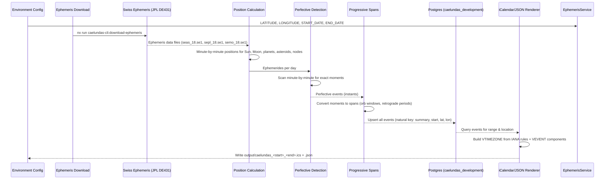

# Caelundas — Astronomical Calendar Generator

**Caelundas** turns the sky into a calendar. The CLI computes planetary positions minute-by-minute over a configurable date range using the Swiss Ephemeris (JPL DE431 data files), detects every astronomical event — aspects, phases, eclipses, retrogrades, ingresses, solstices, twilights, and more — stores them in Postgres, and renders an iCalendar (`.ics`) file and a companion JSON file. A TanStack Start web application connects to the same database and provides a browsable interface.

The name is a portmanteau of **caelum** (Latin: sky, heavens) and **calendar**.

## Architecture Overview

### System Components



### NestJS Module Structure (40+ modules)

The CLI is organized as a NestJS application with `nest-commander` for CLI handling. The root module (`caelundas-cli.module.ts`) imports all domain modules:

| Category | Modules |
|----------|---------|
| **Core** | `InputModule`, `MathModule`, `EphemerisModule`, `CalendarModule`, `DatabaseModule`, `CalendarEventsModule`, `DatetimeModule` |
| **Event Families** | `AspectsModule`, `MajorAspectsModule`, `MinorAspectsModule`, `TripleAspectsModule`, `QuadrupleAspectsModule`, `QuintupleAspectsModule`, `SextupleAspectsModule`, `SpecialtyAspectsModule`, `StelliumModule`, `EclipsesModule`, `RetrogradesModule`, `IngressesModule`, `DailyCyclesModule`, `MonthlyLunarCycleModule`, `AnnualSolarCycleModule`, `TwilightsModule`, `PhasesModule` |
| **Detection Pipeline** | `PerfectiveModule`, `ProgressiveModule` |
| **Utilities** | `EphemerisDownloadModule` |

Each domain module follows the standard structure: `<domain>.module.ts`, `<domain>.service.ts`, `<domain>.constants.ts`, `<domain>.types.ts`, and tests.

### Technology Stack

- **Framework**: NestJS (modules, DI, providers)
- **CLI runner**: `nest-commander` (`CommandRunner` + `@Command()` decorator)
- **Env validation**: `@nestjs/config` + `zod` (`environmentSchema` in `input.constants.ts`)
- **Logging**: `@codebase/observability` — `pino`-backed `LoggerService` (`Scope.TRANSIENT`)
- **Database**: Postgres via TypeORM and `@codebase/persistence`
- **Ephemeris**: Swiss Ephemeris (`sweph` native bindings) from JPL DE431
- **Web**: TanStack Start, TanStack Router, React 19, Tailwind CSS 4, Vite

## Configuration

All input comes from environment variables, validated on startup via Zod schema in `src/modules/input/input.constants.ts`.

```bash
LATITUDE="39.949309"          # Observer latitude, -90 to 90
LONGITUDE="-75.17169"         # Observer longitude, -180 to 180
START_DATE="2026-07-01"       # YYYY-MM-DD
END_DATE="2026-07-31"         # YYYY-MM-DD
OUTPUT_DIRECTORY="./output"
```

Every field is optional. The database connection is read from `CAELUNDAS_POSTGRES_HOST`, `_PORT`, `_USERNAME`, `_PASSWORD`, `_DATABASE`, and `_SCHEMA`, which default to the local Docker Postgres: the `caelundas_development` database, `caelundas` schema, and `caelundas_username` role. Location defaults to Philadelphia, and the date range to a two-month window centered on today.

**The timezone is derived from your coordinates** rather than configured separately — a calendar whose location and timezone could disagree is a calendar with silently wrong sunrise times. The `tzLookup` library (`@photostructure/tz-lookup`) resolves the IANA timezone from the latitude/longitude pair. Supported dates run from `1900-01-01` to `2100-12-31`, the span of the ephemeris data.

## Database Convention

<!-- openwiki: broken internal link [/documentation/adr/0022-give-every-database-project-its-own-database-schema-and-role.md] link "/documentation/adr/0022-give-every-database-project-its-own-database-schema-and-role.md" is root-absolute, which no real consumer resolves against the repository root (not a coding agent reading the page, not GitHub's Markdown renderer, not a local viewer); use a path relative to this file instead. Fix the href or restore the target, then delete this comment. -->
Per [ADR 0022](/documentation/adr/0022-give-every-database-project-its-own-database-schema-and-role.md), every project that keeps data in Postgres gets its own database, schema, and role:

| Context | Database | Schema | Role |
|---------|----------|--------|------|
| Local Docker | `caelundas_development` | `caelundas` | `caelundas_username` / `caelundas_password` |
| Testcontainers | `caelundas_testing` | `caelundas` | the same |
| Kubernetes, later | `caelundas_staging` / `caelundas_production` | `caelundas` | provisioned by that deployment |

The database name carries the environment; the schema name never does. TypeORM writes schema names into the SQL of every migration it generates, so an environment-free schema is what lets a migration generated locally apply anywhere unchanged. The role owns its database and its schema.

The project reads only its own `CAELUNDAS_POSTGRES_*` variables. The shared `@codebase/persistence` package provides the TypeORM options factory, `DatabaseModule.forRoot`, the command-line `createDataSource`, the Testcontainers harness, and the migration Nx target defaults. Migrations run as their own step (`nx run caelundas-cli:migration:run`); `synchronize` and `migrationsRun` are hard-coded off.

### Calendar Events Table

The `calendar_events` table (in the `caelundas` schema) stores one row per event per observer location:

- **Natural key**: `(summary, start, latitude, longitude)` — a run for the same place that detects the same event again updates the row it already wrote
- **Coordinates**: `numeric(8,6)` for latitude, `numeric(9,6)` for longitude so that key compares exactly
- **Times**: `timestamptz` for `start` and `end` (equal for instantaneous events), read back in UTC
- **Categories**: `text[]` with a GIN index for filtering
- **Optional**: `color`, `location`

```sql
CREATE TABLE caelundas.calendar_events (
  summary   text        NOT NULL,
  start     timestamptz NOT NULL,
  end       timestamptz NOT NULL,
  latitude  numeric(8,6) NOT NULL,
  longitude numeric(9,6) NOT NULL,
  categories text[]     NOT NULL,
  description text      NOT NULL,
  color     text,
  location  text,
  -- audit columns from UpdatableEntity
);
CREATE UNIQUE INDEX calendar_events_natural_key ON caelundas.calendar_events (summary, start, latitude, longitude);
CREATE INDEX calendar_events_categories_gin ON caelundas.calendar_events USING GIN (categories);
```

## Ephemeris Data

Positions come from the [Swiss Ephemeris](https://www.astro.com/swisseph/) (`sweph`), computed locally from JPL DE431 data files — no network calls, no API keys, no rate limits. The data files are not committed; download them once with `nx run caelundas-cli:download-ephemeris` into `data/ephemeris/`.

**Files required** (together they cover years 1800–2399):
- `seas_18.se1` — asteroids
- `sepl_18.se1` — planets
- `semo_18.se1` — Moon

**Fallback behavior**: Without the files the library quietly falls back to a less precise built-in Moshier ephemeris without saying so. To prevent silent precision loss, `EphemerisService.verifyFiles()` stops the run before it starts if any file is missing or empty, and any calculation the files did not answer is refused with an `EphemerisUnavailableError` that names the body and the tool that needed it.

## Two-Pass Detection Pipeline

Detection runs in two passes, orchestrated by `CaelundasCommand.run()`:

### Pass 1: Perfective — Exact Moments

`PerfectiveService.detect()` computes ephemerides day-by-day and scans minute-by-minute for the **instant** an event is exact:
- Aspect perfecting (forming → exact → dissolving)
- Planet stationing (retrograde → direct or vice versa)
- Body crossing a sign/decan/peak boundary
- Eclipse maximum
- Moon phase exact moment
- Solstice/equinox/cross-quarter exact moment
- Twilight transition (dawn/dusk)

The sweep seeds aspect-body state on the first day, then rolls it forward minute by minute, preserving which pairs are approaching, exact, or separating.

### Pass 2: Progressive — Spans from Moments

`ProgressiveService.detect()` takes the perfective events and turns them into the **periods** a reader actually wants on a calendar:
- Aspect in-orb span (from forming to dissolving)
- Retrograde period (from station retrograde to station direct)
- Sign ingress span (time in each sign/decan)
- Phase visibility spans (morning/evening star)
- Eclipse begin/maximum/end
- Phase spans (time between Moon phases)
- Daylight/twilight/night spans

```typescript
// CaelundasCommand.run() — simplified pipeline
const perfectiveEvents = this.perfectiveEventsService.detect(input);
const progressiveEvents = this.progressiveEventsService.detect(perfectiveEvents);
const allEvents = [...perfectiveEvents, ...progressiveEvents].toSorted((a, b) => a.start.valueOf() - b.start.valueOf());
await this.calendarEventsService.upsert(allEvents, coordinates);
const storedEvents = await this.calendarEventsService.findInRange({ ...coordinates, end: input.end.clone().add(1, 'day') });
await this.calendarService.write(storedEvents, input);
await this.calendarService.writeJson(storedEvents, input);
```

## Event Families and Types

| Family | Event Types |
|--------|-------------|
| **Aspects** | Major (conjunct, opposite, sextile, square, trine), minor, and harmonic aspects between the Sun, Moon, planets, Chiron, Lilith, four asteroids (Ceres, Juno, Pallas, Vesta), the north lunar node, and the lunar apogee; forming, exact, and dissolving moments, and the span between them |
| **Compound aspects** | Triple (grand trine, hammer, T-square, yod), quadruple (boomerang, butterfly, cradle, grand cross, hourglass, kite, mystic rectangle), pentagram, hexagram, and stelliums of four or more bodies |
| **Monthly lunar cycle** | The eight Moon phases (new, waxing crescent, first quarter, waxing gibbous, full, waning gibbous, last quarter, waning crescent), each as an instant and as the span until the next |
| **Planetary phases** | Mercury, Venus, and Mars: conjunctions (superior/inferior), Mars's opposition, greatest elongations of Mercury and Venus, brightest, rise and set, and morning- and evening-star visibility spans |
| **Eclipses** | Solar and lunar: begin, maximum, and end |
| **Retrogrades** | Stations (retrograde→direct, direct→retrograde) and retrograde periods |
| **Ingresses** | Sign, decan, and peak ingresses, and the span in each sign |
| **Annual solar cycle** | Solstices, equinoxes, cross-quarter days, hexadecans, perihelion and aphelion |
| **Lunar apsides** | Lunar apogee and perigee, where the Moon's radial speed changes sign |
| **Daily cycles** | Sunrise, sunset, solar zenith and nadir, moonrise, moonset, lunar zenith and nadir |
| **Twilights** | Civil, nautical, and astronomical dawn and dusk, with the Daylight, twilight, and Night spans |

## Output

Two files are written to `OUTPUT_DIRECTORY` (default `./output`):
- `caelundas_<START>_<END>.ics` — RFC 5545 iCalendar with `VTIMEZONE` built from the IANA zone rules for the observer's location, `VEVENT` for each event, deterministic `UID` for idempotent imports, and proper folding (75 octets/line)
- `caelundas_<START>_<END>.json` — same events as JSON array for programmatic use

## Quick Start

```bash
# 1. Download the Swiss Ephemeris data files (one-time, about 2 MB)
nx run caelundas-cli:download-ephemeris

# 2. Configure your observer location and date range
cp projects/caelundas/caelundas-cli/.env.default projects/caelundas/caelundas-cli/.env

# 3. Create the calendar_events table (needs the local Postgres container running)
nx run caelundas-cli:migration:run

# 4. Generate the calendar
nx run caelundas-cli:start
```

The result lands in `output/caelundas_<start>_<end>.ics`, with a `.json` file beside it. Import the calendar, or point a subscription at it.

## Web Application

The `caelundas-web` TanStack Start application (`projects/caelundas/caelundas-web`) connects to the same Postgres database and provides a browsable interface. It uses file-based routing from `src/routes/`, server-rendered React 19 with Tailwind CSS 4, and Vite for building.

```bash
nx run caelundas-web:start   # development server
nx run caelundas-web:vitest  # test suite
```
