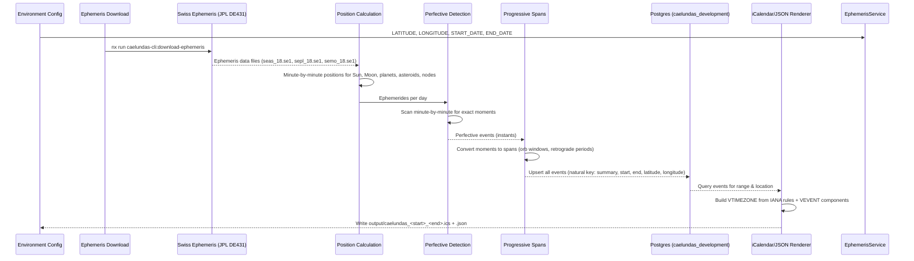

# Caelundas — Astronomical Calendar Generator

**Caelundas** turns the sky into a calendar. The CLI computes planetary positions minute-by-minute over a configurable date range using the Swiss Ephemeris (JPL DE431 data files), detects every astronomical event — aspects, phases, eclipses, retrogrades, ingresses, solstices, twilights, and more — stores them in Postgres, and renders an iCalendar (`.ics`) file and a companion JSON file. The domain is four projects: `caelundas-cli` (detection and ingest), `caelundas-db` (the shared Postgres schema), `caelundas-api` (a NestJS GraphQL API over that schema) and `caelundas-web` (a TanStack Start app that holds no data of its own and reads everything from the API).

The name is a portmanteau of **caelum** (Latin: sky, heavens) and **calendar**.

## Architecture Overview

### System Components



### Project Layout

| Project | Kind | Role |
|---------|------|------|
| `caelundas-cli` | NestJS CLI (nest-commander) | Detects events, upserts them into Postgres, renders `.ics` and JSON; also the `night-sky` and `download-ephemeris` commands |
| `caelundas-db` | NestJS library (`@codebase/caelundas-db`) | The TypeORM entities, the one migration, and the service that rebuilds the read model; the single definition of what an event is |
| `caelundas-api` | NestJS GraphQL application | Serves the stored events and the night sky to the web app over GraphQL, with Relay pagination and request-scoped dataloaders |
| `caelundas-web` | TanStack Start application | Browsable calendar UI with a night-sky backdrop; calls the API from the browser |

### CLI Module Structure

The CLI is a NestJS application using `nest-commander`. Modules live under `src/modules/`, nested where one belongs to another:

```text
src/modules/
├── caelundas/        # Root command: the pipeline
├── input/            # Coordinate and date validation, timezone lookup
├── ephemeris/        # Swiss Ephemeris access; child modules include datetime/, math/, ephemeris-download/
├── perfective/       # Exact-moment detection; children: eclipses/, phases/, retrogrades/, ingresses/, twilights/, daily-cycles/, annual-solar-cycle/, monthly-lunar-cycle/
├── aspects/          # Aspect detection; a child module per aspect family, plus stellium/
├── progressive/      # Spans derived from those moments
├── night-sky/        # Stars and constellation figures for the web's night sky
├── calendar-events/  # Upserting and range queries over stored events
├── tags/             # Resolving raw tag strings to nodes of the tag tree
└── calendar/         # iCalendar and JSON rendering and output
```

Each domain module follows the standard structure: `<domain>.module.ts`, `<domain>.service.ts`, `<domain>.constants.ts`, `<domain>.types.ts`, and tests.

### Technology Stack

- **Framework**: NestJS (modules, DI, providers)
- **CLI runner**: `nest-commander` (`CommandRunner` + `@Command()` decorator)
- **Env validation**: `@nestjs/config` + `zod` (`environmentSchema` in `src/constants.ts`, with the observer input schema in `input.constants.ts`)
- **Logging**: `@codebase/observability`, a `pino`-backed `LoggerService` (`Scope.TRANSIENT`)
- **Database**: Postgres 18 through TypeORM, `@codebase/persistence` and `@codebase/caelundas-db` (see ADR 0031, which moved Caelundas off SQLite)
- **API**: NestJS + Apollo GraphQL, code-first schema, Relay connections
- **Ephemeris**: Swiss Ephemeris (`sweph` native bindings) from JPL DE431
- **Web**: TanStack Start, TanStack Router, React 19, Tailwind CSS 4, Vite, a generated GraphQL client

## Configuration

All input comes from environment variables, validated on startup via Zod schema in `src/modules/input/input.constants.ts`.

```bash
LATITUDE="39.949309"          # Observer latitude, -90 to 90
LONGITUDE="-75.17169"         # Observer longitude, -180 to 180
START_DATE="2026-07-01"       # YYYY-MM-DD
END_DATE="2026-07-31"         # YYYY-MM-DD
OUTPUT_DIRECTORY="./output"
```

Every field is optional. Defaults:
- Location: Philadelphia, PA (39.949309°N, 75.17169°W)
- Date range: Previous month to next month (2-month window centered on today)
- Output directory: `./output`

**Timezone is derived from coordinates** via `@photostructure/tz-lookup` rather than configured separately — a calendar whose location and timezone could disagree is a calendar with silently wrong sunrise times.

The database is the `caelundas` schema of `caelundas_development`, read only through `CAELUNDAS_POSTGRES_*` variables (database, host, password, port, schema, username), each defaulting to the local Docker Postgres; the unprefixed `POSTGRES_*` admin login is never read.

**Supported date range**: `1900-01-01` to `2100-12-31` (the span of the JPL DE431 ephemeris data; the underlying files cover 1800–2399).

### Environment Variable Schema (Zod)

The schema in `input.constants.ts`:
1. Validates latitude (-90 to 90) and longitude (-180 to 180)
2. Validates date range within 1900-01-01 to 2100-12-31
3. Ensures end date is after start date
4. Transforms string dates into timezone-aware Moment objects using the derived IANA timezone
5. Returns an `Input` object with `start`, `end`, `latitude`, `longitude`, and `timezone`

## Ephemeris

Positions come from the [Swiss Ephemeris](https://www.astro.com/swisseph/) (`sweph`), computed locally from JPL DE431 data files — no network calls, no API keys, no rate limits.

### Data Files

Three files are required, downloaded once with `nx run caelundas-cli:download-ephemeris` into `data/ephemeris/`:

| File | Contents | Years Covered |
|------|----------|---------------|
| `seas_18.se1` | Asteroids (Ceres, Pallas, Juno, Vesta) | 1800–2399 |
| `sepl_18.se1` | Planets (Sun, Moon, Mercury–Neptune, Pluto, Chiron, Lilith, North/South Node) | 1800–2399 |
| `semo_18.se1` | Moon | 1800–2399 |

Files are fetched from `https://raw.githubusercontent.com/aloistr/swisseph/master/ephe/`. Each download writes to a `.part` file and renames only on success, so an interrupted download leaves nothing the next run would mistake for complete. Files already present are skipped.

### Fallback Behavior

Without the data files, the Swiss Ephemeris quietly falls back to a less precise built-in ephemeris (Moshier). Caelundas refuses this: `EphemerisService.verifyFiles()` runs at startup and throws `EphemerisFilesMissingError` naming the missing files and the download command if any file is absent or empty. Any calculation the files cannot answer is refused with an error naming the command that requested it.

## Two-Pass Event Detection

Detection runs in two distinct passes, each implemented as a NestJS module with its own service.

### Perfective Pass — Exact Moments

`PerfectiveService.detect(input: Input): DetectedCalendarEvent[]`

- Computes ephemerides day by day with a configurable margin (`MARGIN_MINUTES`, default 1440 minutes = 1 day) before/after each day to catch edge events
- Sweeps each day **minute-by-minute** using `DatetimeService.generateMinutes()`
- At each minute, delegates to specialized detector services for:
  - **Aspects** (major, minor, harmonic) — exact angular separations
  - **Eclipses** — solar and lunar begin/maximum/end
  - **Retrogrades** — station moments (direct → retrograde, retrograde → direct)
  - **Ingresses** — sign, decan, and peak boundary crossings
  - **Daily Cycles** — sunrise/sunset, moonrise/moonset, zenith/nadir
  - **Monthly Lunar Cycle** — eight Moon phases (New, Waxing Crescent, First Quarter, Waxing Gibbous, Full, Waning Gibbous, Last Quarter, Waning Crescent)
  - **Annual Solar Cycle** — solstices, equinoxes, cross-quarters, hexadecans, perihelion/aphelion
  - **Twilights** — civil/nautical/astronomical dawn and dusk
  - **Phases** — planetary phases (Mercury, Venus, Mars)
- Maintains rolling state for aspects (`AspectBodies` registry) across minutes to detect forming/exact/dissolving transitions
- Returns `DetectedCalendarEvent[]` — instantaneous events with `start === end`

### Progressive Pass — Spans Around Moments

`ProgressiveService.detect(perfectiveEvents: DetectedCalendarEvent[]): DetectedCalendarEvent[]`

- Takes the perfective events as input
- Fans out to each domain service's `detectProgressive()` method
- Each service pairs related perfective events into **duration events**:
  - **Aspects**: forming → exact → dissolving windows (orb spans)
  - **Retrogrades**: station → station periods
  - **Eclipses**: begin → maximum → end visibility spans
  - **Ingresses**: time spent in each sign/decan
  - **Monthly Lunar Cycle**: phase → next phase spans
  - **Twilights**: Daylight (civil dawn → civil dusk), Night (astronomical dusk → astronomical dawn)
  - **Phases**: morning/evening star visibility spans
  - **Annual Solar Cycle**: seasonal spans
- Returns `DetectedCalendarEvent[]` — duration events with `start < end`

### Pipeline Execution

```typescript
// In CaelundasCommand.run()
const perfectiveEvents = this.perfectiveEventsService.detect(input);
const progressiveEvents = this.progressiveEventsService.detect(perfectiveEvents);
const allEvents = [...perfectiveEvents, ...progressiveEvents].toSorted(
  (a, b) => a.start.valueOf() - b.start.valueOf(),
);
await this.calendarEventsService.upsert(allEvents, observer);
```

## Event Families

| Family | Events |
| ------ | ------ |
| **Aspects** | Major (conjunct 0°, opposite 180°, sextile 60°, square 90°, trine 120°), minor (semi-sextile 30°, semi-square 45°, sesquiquadrate 135°, quincunx 150°), and harmonic aspects between Sun, Moon, planets, Chiron, Lilith, four asteroids, north lunar node, lunar apogee; forming, exact, and dissolving moments, and the spans between them |
| **Compound Aspects** | Triple (grand trine, hammer, T-square, yod), quadruple (boomerang, butterfly, cradle, grand cross, hourglass, kite, mystic rectangle), pentagram, hexagram, and stelliums of three or more bodies |
| **Monthly Lunar Cycle** | Eight Moon phases, each as an instant and as the span until the next |
| **Planetary Phases** | Mercury, Venus, Mars: conjunctions, Mars's opposition, greatest elongations, brightest, rise/set, and morning/evening star visibility spans |
| **Eclipses** | Solar and lunar: begin, maximum, and end (geocentric and topocentric) |
| **Retrogrades** | Stations (direct/retrograde) and retrograde periods |
| **Ingresses** | Sign, decan (10° thirds), and peak (15° midpoint) ingresses, and spans in each sign |
| **Annual Solar Cycle** | Solstices, equinoxes, cross-quarter days, hexadecans, perihelion and aphelion |
| **Lunar Apsides** | Lunar apogee and perigee (radial speed sign changes) |
| **Daily Cycles** | Sunrise, sunset, solar zenith/nadir, moonrise, moonset, lunar zenith/nadir |
| **Twilights** | Civil, nautical, astronomical dawn and dusk; Daylight and Night spans |

### Astronomical Conventions

Where astronomy and astrology have multiple accepted definitions, Caelundas picks one explicitly:

- **Moon phases**: Timed by Moon's apparent geocentric ecliptic longitude minus Sun's (elongation E), normalized to [0°, 360°). Illumination is not used. Primary phases at 0°, 90°, 180°, 270°; intermediate phases at 45° octants. Each phase stamped at the nearest whole minute (matching US Naval Observatory rounding).
- **Lunar nodes**: True (osculating) node, not mean node — wobbles up to ~1.5° around mean.
- **Lilith vs. Lunar Apogee**: Both tracked separately — Lilith = mean apogee (smooth), lunar apogee = osculating (instantaneous, can stray tens of degrees).
- **Stelliums**: Three or more bodies pairwise conjunct within 8° orb (maximal cliques, not chains).
- **Decans**: Equal 10° thirds of a sign, numbered 1–3 from sign start. Decan 1 ingress only on retrograde re-entry from decan 2.
- **Peak ingress**: Body reaches 15° within its sign (sign midpoint) in either direction.
- **Zenith/nadir**: Local altitude extrema found minute-by-minute (not meridian transit).
- **Altitude**: Refracted (apparent) from Swiss Ephemeris (pressure 0, temperature 0°C).
- **Rise/set**: Topocentric with parallax; Sun upper limb -0.833°, Moon topocentric semidiameter.
- **Twilights**: Sun's refracted altitude crosses -6° (civil), -12° (nautical), -18° (astronomical). Daylight = civil dawn → civil dusk. Night = astronomical dusk → astronomical dawn.

## Database Schema (Postgres)

The schema lives in the `caelundas-db` library: TypeORM entities, one migration (with `-up.sql` and `-down.sql` beside it, linted by sqlfluff and checked by squawk) and `CaelundasDatabaseService`. The CLI writes through these entities and the API reads through them, so neither carries its own idea of the schema. Apply the migration with `nx run caelundas-db:migration:run` before the first run; nothing synchronizes or migrates on start.

| Entity | Table | Holds |
|--------|-------|-------|
| `CalendarEvent` | `calendar_events` | One detected event for one observer location |
| `Tag` | `tags`, `tags_closure` | The tag tree and its closure table |
| `CalendarEventTag` | `calendar_event_tags` | An event carrying a tag |
| `Star`, `Constellation`, `ConstellationLine` | `stars`, `constellations`, `constellation_lines` | The night sky the web backdrop is drawn from |
| `TagNode`, `CalendarEventTagNode` | `tag_nodes`, `calendar_event_tag_nodes` | Derived read-model tables |
| `CalendarEventDerivedTime` | `calendar_event_derived_times` | Derived view: an event's UTC and local year, day, hour and so on |

### Calendar events

`calendar_events` columns: `summary`, `description`, `start` and `end` (`timestamptz`, equal for an instant), nullable `color` and `location` display hints, `latitude` and `longitude` (`numeric(9,6)`, carried as exact text), `timezone` (the IANA zone derived from coordinates), plus a database-assigned `uuidv7()` id and audit columns.

**Natural key**: `(summary, start, end, latitude, longitude)`, unique.
- Re-running a range updates rows in place (`updated_at` advances, `created_at` unchanged).
- Overlapping ranges update the overlap and add new events.
- A second location adds its own rows.
- Edge-spanning events (e.g., a retrograde) are included in that range's files.

### Tag tables

Tags are not a column; they live in a tree with a closure table.

| Table | Purpose |
|-------|---------|
| `tags` | Tree of labels: a `name` unique among siblings and a nullable `parent_id`; roots are independent dimensions (Type, Planet, Sign, Element, Modality, Polarity, Decan, Aspect Nature, Aspect Harmonic, Phase, Lunar Phase, Synodic Stage, Motion, Temporality, Season, Domain, Dignity, Focal Body, Eclipse Frame, Time of Day) |
| `tags_closure` | `(ancestor_id, descendant_id)` per pair, self-pairs included, so ancestors, descendants and depth are plain joins |
| `calendar_event_tags` | Event-tag links keyed on `(calendar_event_id, tag_id)`, with a second index leading with the tag |

The upsert classifies each event's raw tags into paths of the tree using a static map in `src/modules/tags/`, inserting missing nodes; an unknown raw tag falls back to a root of its own. An event links only to the deepest node of each branch it is classified under and carries the nodes above through the closure table.

### Read model

The derived times are a plain view, computed from the event on every read. The two derived tag tables are rebuilt by `CaelundasDatabaseService.refreshReadModel`, one insert-select each, inside the same transaction that wrote the events, so a failed refresh stores nothing and a reader never sees the tables half rebuilt.

### Persistence details

- `CalendarEventsService.upsert` runs in one transaction, using `INSERT … ON CONFLICT (summary, start, end, latitude, longitude) DO UPDATE`
- Rows go in batches sized by their columns to stay under Postgres's 65,535 bind parameters per statement
- Postgres takes concurrent writers, but two runs that insert the same missing tag at once make the second fail on the tag's unique name; run it again

## CLI Commands

```bash
# One-time ephemeris download (~2 MB)
nx run caelundas-cli:download-ephemeris

# Create the schema in the local Postgres
nx run caelundas-db:migration:run

# Generate the calendar and store its events
nx run caelundas-cli:start

# Fill the stars and constellation figures the web night sky is drawn from
nx run caelundas-cli:start:night-sky --stars hygdata_v41.csv \
  --constellations constellations.json --lines constellations.lines.json

# REPL against the service graph
nx run caelundas-cli:repl

# Testing (integration and end-to-end start a Testcontainers Postgres; Docker must be running)
nx run caelundas-cli:vitest:unit
nx run caelundas-cli:vitest:integration
nx run caelundas-cli:vitest:end-to-end
```

The `night-sky` command reads three files downloaded beforehand and never committed: the HYG star database v4.1 (CC BY-SA 4.0), and d3-celestial's constellation names and figures. It stores stars to magnitude 6.5 at declination -45 or north, the 88 IAU constellations, and each figure's segments between two stored stars, replacing what an earlier run wrote in one transaction. `caelundas-api` reads them once at startup, so run it before starting the API.

## API (caelundas-api)

A NestJS + Apollo GraphQL application that reads the Caelundas Postgres through `CaelundasDatabaseModule` and serves events and the night sky to `caelundas-web`. The schema is code-first, emitted to the gitignored `src/schema.gql`; pagination is Relay connections and lookups go through request-scoped dataloaders. Because the web app calls it from another origin, it answers cross-origin requests from the origins listed in `CAELUNDAS_API_CORS_ORIGINS` (none are allowed when unset). Start it with `nx run caelundas-api:start`.

## Companion Web Application (caelundas-web)

**Type**: Server-rendered React 19 app (TanStack Start).

**Data**: The app holds no data of its own. Every event, facet, filter collection, calendar window and night-sky star comes from the `caelundas-api` GraphQL API, which reads the Caelundas Postgres. The API's address is `VITE_CAELUNDAS_API_URL` (default `http://localhost:6173/graphql`), read when the app is built or served, and the browser calls the API directly.

**Setup order**: migrate the database (`caelundas-db:migration:run`), fill it with events and the night sky (`caelundas-cli`), start the API (`caelundas-api:start`), then the app (`caelundas-web:start`, port 8967).

**Architecture**:
- **Routing**: TanStack Router, file-based from `src/routes/`
- **UI**: ReUI event calendar from `@codebase/presentation` (composed, never edited)
- **API client**: `src/graphql/generated/` is committed output of GraphQL Code Generator from the documents in `src/graphql/operations/` and the schema `caelundas-api` writes on boot (`nx run caelundas-web:codegen`, with `codegen:check` failing on a stale file); the build reads the committed files and never needs the API
- **Night sky**: the API returns an SVG from its `nightSky` query; the backdrop is tuned through `sky.*` link parameters (observer latitude and longitude, field of view, drift speed, magnitude limit, colors, constellation figures, the ecliptic)

**Responsive**: Verified at phone, tablet and desktop widths.

## Performance

**Execution time** (1-year range, all event types): 1–2 minutes local computation + quick upsert/read-back.

**Optimization strategies**:
- Temporal margins: fetch beyond date boundaries to catch edge events
- Lazy evaluation: minute-resolution only for detected event windows
- Day-by-day ephemeris computation with rolling aspect state

## Kubernetes Deployment

Runs as a **Kubernetes Job** (single execution, terminates on completion, output in PVC, no network exposure).

```bash
# 1. Push image (linux/amd64)
docker push ghcr.io/organizzolini/caelundas:latest

# 2. Deploy Job
helm upgrade --install <release-name> infrastructure/helm/kubernetes-job/ \
  --values infrastructure/helm/kubernetes-job/values/base.yaml \
  --set image.repository=ghcr.io/organizzolini/caelundas --set image.tag=latest

# 3. Monitor
kubectl wait --for=condition=complete job/<job-name> --timeout=600s

# 4. Clean up
helm uninstall <release-name>
kubectl delete pvc caelundas-output
```

Environment variables injected via Secret (`kubectl create secret generic caelundas-env-secret --from-env-file=.env`).

## Development

### Adding Business Logic

1. Implement root command logic in `caelundas.command.ts` `run()`, or delegate to injected services
2. Add domain command modules under `src/modules/<domain>/` with NestJS module, command, service, types, constants
3. Register in the root module
4. Extend `environmentSchema` in `src/constants.ts` (or `input.constants.ts`) for new env vars

### Logging

`LoggerService` and `LoggerModule` from `@codebase/observability` — add to dependencies, import `LoggerModule` once in root module (it's `@Global()`). `LoggerService` is `Scope.TRANSIENT`; call `setContext` in constructor. Structured JSON in production (`NODE_ENV=production`), pretty-printed in development.

### Writing Modules

Use the generator:
```bash
nx g conformetry:nestjs-service-module --name=<domain>
```
Creates five files in `src/modules/<domain>/`.

## Etymology

**Caelundas** — portmanteau of *caelum* (Latin: sky, heavens) and *calendar*.

## License

MIT — see [LICENSE](../../../LICENSE).
