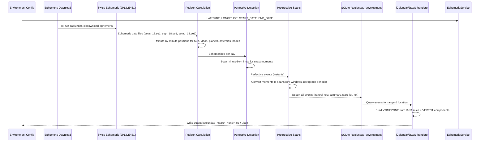

# Caelundas — Astronomical Calendar Generator

**Caelundas** turns the sky into a calendar. The CLI computes planetary positions minute-by-minute over a configurable date range using the Swiss Ephemeris (JPL DE431 data files), detects every astronomical event — aspects, phases, eclipses, retrogrades, ingresses, solstices, twilights, and more — stores them in SQLite, and renders an iCalendar (`.ics`) file and a companion JSON file. A TanStack Start web application reads the same SQLite database (bundled at build time) and provides a browsable interface.

The name is a portmanteau of **caelum** (Latin: sky, heavens) and **calendar**.

## Architecture Overview

### System Components



### NestJS Module Structure (40+ modules)

The CLI is organized as a NestJS application with `nest-commander` for CLI handling. The root module (`caelundas-cli.module.ts`) imports all domain modules:

| Category | Modules |
|----------|---------|
| **Core** | `InputModule`, `MathModule`, `EphemerisModule`, `CalendarModule`, `DatabaseModule`, `CalendarEventsModule`, `DatetimeModule` |
| **Event Families** | `AspectsModule`, `MajorAspectsModule`, `MinorAspectsModule`, `TripleAspectsModule`, `QuadrupleAspectsModule`, `QuintupleAspectsModule`, `SextupleAspectsModule`, `SpecialtyAspectsModule`, `StelliumModule`, `EclipsesModule`, `RetrogradesModule`, `IngressesModule`, `DailyCyclesModule`, `MonthlyLunarCycleModule`, `AnnualSolarCycleModule`, `TwilightsModule`, `PhasesModule` |
| **Detection Pipeline** | `PerfectiveModule`, `ProgressiveModule` |
| **Utilities** | `EphemerisDownloadModule` |

Each domain module follows the standard structure: `<domain>.module.ts`, `<domain>.service.ts`, `<domain>.constants.ts`, `<domain>.types.ts`, and tests.

### Technology Stack

- **Framework**: NestJS (modules, DI, providers)
- **CLI runner**: `nest-commander` (`CommandRunner` + `@Command()` decorator)
- **Env validation**: `@nestjs/config` + `zod` (`environmentSchema` in `input.constants.ts`)
- **Logging**: `@codebase/observability` — `pino`-backed `LoggerService` (`Scope.TRANSIENT`)
- **Database**: SQLite via TypeORM and `@codebase/persistence`
- **Ephemeris**: Swiss Ephemeris (`sweph` native bindings) from JPL DE431
- **Web**: TanStack Start, TanStack Router, React 19, Tailwind CSS 4, Vite, sqlite-wasm

## Configuration

All input comes from environment variables, validated on startup via Zod schema in `src/modules/input/input.constants.ts`.

```bash
LATITUDE="39.949309"          # Observer latitude, -90 to 90
LONGITUDE="-75.17169"         # Observer longitude, -180 to 180
START_DATE="2026-07-01"       # YYYY-MM-DD
END_DATE="2026-07-31"         # YYYY-MM-DD
OUTPUT_DIRECTORY="./output"
```

Every field is optional. Defaults:
- Location: Philadelphia, PA (39.949309°N, 75.17169°W)
- Date range: Previous month to next month (2-month window centered on today)
- Output directory: `./output`

**Timezone is derived from coordinates** via `@photostructure/tz-lookup` rather than configured separately — a calendar whose location and timezone could disagree is a calendar with silently wrong sunrise times.

**Supported date range**: `1900-01-01` to `2100-12-31` (the span of the JPL DE431 ephemeris data; the underlying files cover 1800–2399).

### Environment Variable Schema (Zod)

The schema in `input.constants.ts`:
1. Validates latitude (-90 to 90) and longitude (-180 to 180)
2. Validates date range within 1900-01-01 to 2100-12-31
3. Ensures end date is after start date
4. Transforms string dates into timezone-aware Moment objects using the derived IANA timezone
5. Returns an `Input` object with `start`, `end`, `latitude`, `longitude`, and `timezone`

## Ephemeris

Positions come from the [Swiss Ephemeris](https://www.astro.com/swisseph/) (`sweph`), computed locally from JPL DE431 data files — no network calls, no API keys, no rate limits.

### Data Files

Three files are required, downloaded once with `nx run caelundas-cli:download-ephemeris` into `data/ephemeris/`:

| File | Contents | Years Covered |
|------|----------|---------------|
| `seas_18.se1` | Asteroids (Ceres, Pallas, Juno, Vesta) | 1800–2399 |
| `sepl_18.se1` | Planets (Sun, Moon, Mercury–Neptune, Pluto, Chiron, Lilith, North/South Node) | 1800–2399 |
| `semo_18.se1` | Moon | 1800–2399 |

Files are fetched from `https://raw.githubusercontent.com/aloistr/swisseph/master/ephe/`. Each download writes to a `.part` file and renames only on success, so an interrupted download leaves nothing the next run would mistake for complete. Files already present are skipped.

### Fallback Behavior

Without the data files, the Swiss Ephemeris quietly falls back to a less precise built-in ephemeris (Moshier). Caelundas refuses this: `EphemerisService.verifyFiles()` runs at startup and throws `EphemerisFilesMissingError` naming the missing files and the download command if any file is absent or empty. Any calculation the files cannot answer is refused with an error naming the command that requested it.

## Two-Pass Event Detection

Detection runs in two distinct passes, each implemented as a NestJS module with its own service.

### Perfective Pass — Exact Moments

`PerfectiveService.detect(input: Input): DetectedCalendarEvent[]`

- Computes ephemerides day by day with a configurable margin (`MARGIN_MINUTES`, default 1440 minutes = 1 day) before/after each day to catch edge events
- Sweeps each day **minute-by-minute** using `DatetimeService.generateMinutes()`
- At each minute, delegates to specialized detector services for:
  - **Aspects** (major, minor, harmonic) — exact angular separations
  - **Eclipses** — solar and lunar begin/maximum/end
  - **Retrogrades** — station moments (direct → retrograde, retrograde → direct)
  - **Ingresses** — sign, decan, and peak boundary crossings
  - **Daily Cycles** — sunrise/sunset, moonrise/moonset, zenith/nadir
  - **Monthly Lunar Cycle** — eight Moon phases (New, Waxing Crescent, First Quarter, Waxing Gibbous, Full, Waning Gibbous, Last Quarter, Waning Crescent)
  - **Annual Solar Cycle** — solstices, equinoxes, cross-quarters, hexadecans, perihelion/aphelion
  - **Twilights** — civil/nautical/astronomical dawn and dusk
  - **Phases** — planetary phases (Mercury, Venus, Mars)
- Maintains rolling state for aspects (`AspectBodies` registry) across minutes to detect forming/exact/dissolving transitions
- Returns `DetectedCalendarEvent[]` — instantaneous events with `start === end`

### Progressive Pass — Spans Around Moments

`ProgressiveService.detect(perfectiveEvents: DetectedCalendarEvent[]): DetectedCalendarEvent[]`

- Takes the perfective events as input
- Fans out to each domain service's `detectProgressive()` method
- Each service pairs related perfective events into **duration events**:
  - **Aspects**: forming → exact → dissolving windows (orb spans)
  - **Retrogrades**: station → station periods
  - **Eclipses**: begin → maximum → end visibility spans
  - **Ingresses**: time spent in each sign/decan
  - **Monthly Lunar Cycle**: phase → next phase spans
  - **Twilights**: Daylight (civil dawn → civil dusk), Night (astronomical dusk → astronomical dawn)
  - **Phases**: morning/evening star visibility spans
  - **Annual Solar Cycle**: seasonal spans
- Returns `DetectedCalendarEvent[]` — duration events with `start < end`

### Pipeline Execution

```typescript
// In CaelundasCommand.run()
const perfectiveEvents = this.perfectiveEventsService.detect(input);
const progressiveEvents = this.progressiveEventsService.detect(perfectiveEvents);
const allEvents = [...perfectiveEvents, ...progressiveEvents].toSorted(
  (a, b) => a.start.valueOf() - b.start.valueOf(),
);
await this.calendarEventsService.upsert(allEvents, observer);
```

## Event Families

| Family | Events |
| ------ | ------ |
| **Aspects** | Major (conjunct 0°, opposite 180°, sextile 60°, square 90°, trine 120°), minor (semi-sextile 30°, semi-square 45°, sesquiquadrate 135°, quincunx 150°), and harmonic aspects between Sun, Moon, planets, Chiron, Lilith, four asteroids, north lunar node, lunar apogee; forming, exact, and dissolving moments, and the spans between them |
| **Compound Aspects** | Triple (grand trine, hammer, T-square, yod), quadruple (boomerang, butterfly, cradle, grand cross, hourglass, kite, mystic rectangle), pentagram, hexagram, and stelliums of four or more bodies |
| **Monthly Lunar Cycle** | Eight Moon phases, each as an instant and as the span until the next |
| **Planetary Phases** | Mercury, Venus, Mars: conjunctions, Mars's opposition, greatest elongations, brightest, rise/set, and morning/evening star visibility spans |
| **Eclipses** | Solar and lunar: begin, maximum, and end (geocentric and topocentric) |
| **Retrogrades** | Stations (direct/retrograde) and retrograde periods |
| **Ingresses** | Sign, decan (10° thirds), and peak (15° midpoint) ingresses, and spans in each sign |
| **Annual Solar Cycle** | Solstices, equinoxes, cross-quarter days, hexadecans, perihelion and aphelion |
| **Lunar Apsides** | Lunar apogee and perigee (radial speed sign changes) |
| **Daily Cycles** | Sunrise, sunset, solar zenith/nadir, moonrise, moonset, lunar zenith/nadir |
| **Twilights** | Civil, nautical, astronomical dawn and dusk; Daylight and Night spans |

### Astronomical Conventions

Where astronomy and astrology have multiple accepted definitions, Caelundas picks one explicitly:

- **Moon phases**: Timed by Moon's apparent geocentric ecliptic longitude minus Sun's (elongation E), normalized to [0°, 360°). Illumination is not used. Primary phases at 0°, 90°, 180°, 270°; intermediate phases at 45° octants. Each phase stamped at the nearest whole minute (matching US Naval Observatory rounding).
- **Lunar nodes**: True (osculating) node, not mean node — wobbles up to ~1.5° around mean.
- **Lilith vs. Lunar Apogee**: Both tracked separately — Lilith = mean apogee (smooth), lunar apogee = osculating (instantaneous, can stray tens of degrees).
- **Stelliums**: Four or more bodies pairwise conjunct within 8° orb (maximal cliques, not chains).
- **Decans**: Equal 10° thirds of a sign, numbered 1–3 from sign start. Decan 1 ingress only on retrograde re-entry from decan 2.
- **Peak ingress**: Body reaches 15° within its sign (sign midpoint) in either direction.
- **Zenith/nadir**: Local altitude extrema found minute-by-minute (not meridian transit).
- **Altitude**: Refracted (apparent) from Swiss Ephemeris (pressure 0, temperature 0°C).
- **Rise/set**: Topocentric with parallax; Sun upper limb -0.833°, Moon topocentric semidiameter.
- **Twilights**: Sun's refracted altitude crosses -6° (civil), -12° (nautical), -18° (astronomical). Daylight = civil dawn → civil dusk. Night = astronomical dusk → astronomical dawn.

## Database Schema (SQLite)

The SQLite file lives at `CAELUNDAS_SQLITE_DATABASE` (default: `output/database.sqlite` in the CLI project, gitignored). The migration runs on startup; a run creates the file and tables when missing.

### Core Tables

**`calendar_events`** — One row per detected event for an observer location.

| Column | Type | Purpose |
|--------|------|---------|
| `id` | UUID (v7) | Primary key |
| `summary` | TEXT | Event title |
| `description` | TEXT | Event detail |
| `start` | TEXT (ISO 8601 UTC) | Instant or span start |
| `end` | TEXT (ISO 8601 UTC) | Instant or span end |
| `color` | TEXT (nullable) | Display hint |
| `location` | TEXT (nullable) | Display hint |
| `latitude` | TEXT (6 decimals) | Observer latitude for natural key |
| `longitude` | TEXT (6 decimals) | Observer longitude for natural key |
| `timezone` | TEXT | IANA zone derived from coordinates |
| `created_at`, `updated_at` | TEXT (ISO 8601 UTC) | Audit columns |

**Natural key**: `(summary, start, end, latitude, longitude)` — unique.
- Re-running a range updates rows in place (`updated_at` advances, `created_at` unchanged).
- Overlapping ranges update overlap and add new events.
- A second location adds its own rows.
- Edge-spanning events (e.g., a retrograde) are included in that range's files.

**Times**: `start`/`end` are ISO 8601 UTC text (e.g., `2026-03-04T15:20:00.000Z`) stored via `createMomentTransformer` — they compare/sort as instants. `timezone` names the observer's IANA zone for local-time rendering.

### Tag Tables

Tags are not a column; they live in a tree with closure table for efficient ancestry queries.

| Table | Purpose |
|-------|---------|
| `tags` | Tree of labels: `name` (unique among siblings), nullable `parent_id`. Roots = dimensions (Type, Planet, Sign, Element, Modality, Polarity, Decan, Aspect Nature, Aspect Harmonic, Phase, Lunar Phase, Synodic Stage, Motion, Temporality, Season, Domain, Dignity, Focal Body, Eclipse Frame, Time of Day). |
| `tags_closure` | `(ancestor_id, descendant_id)` per pair, self-pairs included. Enables plain-join ancestor/descendant/depth queries. |
| `calendar_event_tags` | Event–tag links keyed on `(calendar_event_id, tag_id)`, cascading both ways. Second index leads with tag. |

**Upsert classification**: `classifyEvent` (in `tags.utilities.ts`) turns each event's raw tags into root-to-node paths, inserting missing nodes via `TreeRepository`. Static maps in `tags/tag-map.constants.ts` and `tags/tag-dimensions.constants.ts` resolve raw tags → paths. Unknown raw tags fall back to a root of their own. Each event links only to the deepest node of each branch; ancestors carried through closure table.

### Read Model for Web App

The same SQLite file is read by `caelundas-web`. The migration creates:
- `tag_nodes` — each tag's depth, root, and path (materialized, not a view)
- `calendar_event_tag_nodes` — one row per event and tag (ancestors included, `is_direct` marks given tags)
- `calendar_events_derived` view — each event with duration, temporality, and UTC time parts

These are stored tables (not views) because computing depth/root/path per tag via correlated subquery would repeat for every grouping. `CalendarEventsService.upsert` ends each transaction with `DatabaseService.refreshReadModel`, running `data/events-read-model.sql`, so the file is always web-ready.

### Persistence Details

- `CalendarEventsService.upsert` runs in one transaction
- Batches rows under SQLite's 32,766-parameter limit
- Uses `ON CONFLICT … DO UPDATE` on natural key
- Replaces each event's `calendar_event_tags` links with newly classified nodes
- Writes `created_at`/`updated_at` manually (TypeORM doesn't advance `updated_at` on conflict here)
- Reads back IDs with one select per batch (SQLite has no `RETURNING` through TypeORM)
- `TagsService.resolve` takes no lock; a second writer waits for the first's transaction
- SQLite allows one writer at a time; a second waits 5 seconds then fails with `SQLITE_BUSY`

## CLI Commands

```bash
# One-time ephemeris download (~2 MB)
nx run caelundas-cli:download-ephemeris

# Generate calendar (creates output/database.sqlite and tables on first run)
nx run caelundas-cli:start

# REPL against the service graph
nx run caelundas-cli:repl

# Static checks
nx run caelundas-cli:typecheck
nx run caelundas-cli:lint-code --configuration=write

# Testing (three tiers)
nx run caelundas-cli:vitest:unit          # Fast (<100ms) — pure logic, mocked DI
nx run caelundas-cli:vitest:integration   # Moderate (1-2s) — real database I/O
nx run caelundas-cli:vitest:end-to-end    # Slow (30-60s) — full CLI execution
```

## Companion Web Application (caelundas-web)

**Type**: Server-rendered React 19 app (TanStack Start), fully static in single-page mode.

**Data Pipeline**:
1. `caelundas-cli` owns the database and leaves it web-ready (read-model tables rewritten each run)
2. `scripts/build-events-database.ts` writes `output/events.sqlite`:
   - With `ingested` config: copies `caelundas-cli/output/database.sqlite`
   - Default (CI, `start`): creates from migration's `-up.sql`, seed `data/events-seed.sql`, and read-model SQL
3. `nx run caelundas-web:build-database` writes `output/events.sqlite` (gitignored)
4. Vite emits the database file, a Web Worker, and `sqlite-wasm` as fingerprinted assets
5. In browser: `events-database.worker.ts` downloads the file, opens read-only in memory with sqlite-wasm, answers selects

**Architecture**:
- **Routing**: TanStack Router, file-based from `src/routes/` (`index.tsx` is the calendar page)
- **UI**: ReUI event calendar from `@codebase/presentation` (composed, never edited)
- **Data**: `EventsDatabase` interface behind `SqlExecutor`; browser executor posts to worker, test executor uses `node:sqlite`
- **Filters**: `compileEventFilter` turns ReUI filter tree JSON into SQL conditions
- **Time handling**: Date, weekday, hour, duration computed in each event's own zone via `event_local_*` SQL functions registered in worker and tests

**Responsive**: Verified at 320/375px (phone), 768/800px (tablet), 1024/1280px (desktop). All views (Month, Week, Three-day, Day, Agenda, Timeline) work at all widths.

## Performance

**Execution time** (1-year range, all event types): 1–2 minutes local computation + quick upsert/read-back.

**Optimization strategies**:
- Temporal margins: fetch beyond date boundaries to catch edge events
- Lazy evaluation: minute-resolution only for detected event windows
- Day-by-day ephemeris computation with rolling aspect state

## Kubernetes Deployment

Runs as a **Kubernetes Job** (single execution, terminates on completion, output in PVC, no network exposure).

```bash
# 1. Push image (linux/amd64)
docker push ghcr.io/organizzolini/caelundas:latest

# 2. Deploy Job
helm upgrade --install <release-name> infrastructure/helm/kubernetes-job/ \
  --values infrastructure/helm/kubernetes-job/values/base.yaml \
  --set image.repository=ghcr.io/organizzolini/caelundas --set image.tag=latest

# 3. Monitor
kubectl wait --for=condition=complete job/<job-name> --timeout=600s

# 4. Clean up
helm uninstall <release-name>
kubectl delete pvc caelundas-output
```

Environment variables injected via Secret (`kubectl create secret generic caelundas-env-secret --from-env-file=.env`).

## Development

### Adding Business Logic

1. Implement root command logic in `caelundas.command.ts` `run()`, or delegate to injected services
2. Add domain command modules under `src/modules/<domain>/` with NestJS module, command, service, types, constants
3. Register in root module (`caelundas-cli.module.ts`)
4. Extend `environmentSchema` in `caelundas-cli.constants.ts` (or `input.constants.ts`) for new env vars

### Logging

`LoggerService` and `LoggerModule` from `@codebase/observability` — add to dependencies, import `LoggerModule` once in root module (it's `@Global()`). `LoggerService` is `Scope.TRANSIENT`; call `setContext` in constructor. Structured JSON in production (`NODE_ENV=production`), pretty-printed in development.

### Writing Modules

Use the generator:
```bash
nx g conformetry:nestjs-service-module --name=<domain>
```
Creates five files in `src/modules/<domain>/`.

## Etymology

**Caelundas** — portmanteau of *caelum* (Latin: sky, heavens) and *calendar*.

## License

MIT — see [LICENSE](../../../LICENSE).
