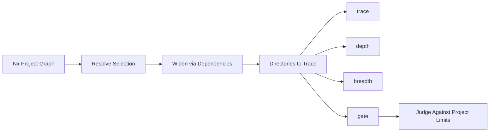

# Callidescope

Callidescope is a call stack tracing toolchain that follows control flow through injected dependencies and reports where a stack got too deep or a callable reached too wide. It builds one call graph for the whole workspace, measures how deep a stack can get below each entry point, and how many distinct callables one callable calls directly — then flags the ones that exceed per-project limits.

Published as **8 npm packages** under the `@callidescope` scope:

- [`@callidescope/agents`](repo://projects/ic-suite/callidescope/callidescope-agents) — Agent skills for the toolchain
- [`@callidescope/cli`](repo://projects/ic-suite/callidescope/callidescope-cli) — Command-line host that builds the call graph with the TypeScript compiler API, resolves NestJS injected dependencies, and reports the deepest stack below every entry point
- [`@callidescope/configuration`](repo://projects/ic-suite/callidescope/callidescope-configuration) — Reads `callidescope.config.ts` for entry-point rules, depth and breadth limits, exclusion globs, and output destinations
- [`@callidescope/core`](repo://projects/ic-suite/callidescope/callidescope-core) — The contracts leaf: the call graph, stack, frame, and finding vocabulary every other package speaks
- [`@callidescope/examples`](repo://projects/ic-suite/callidescope/callidescope-examples) — A small codebase built to be traced, carrying one worked example per rule, finding, and output
- [`@callidescope/graph`](repo://projects/ic-suite/callidescope/callidescope-graph) — Builds the call graph from traced TypeScript source and measures its depth and breadth
- [`@callidescope/nx`](repo://projects/ic-suite/callidescope/callidescope-nx) — Nx plugin inferring per-project `trace`, `depth`, `breadth`, and `gate` targets that follow the Nx dependency graph
- [`@callidescope/output`](repo://projects/ic-suite/callidescope/callidescope-output) — Renders call-graph findings into markdown, mermaid, and JSON output formats

---

## Core Concepts

The toolchain uses precise vocabulary. The terms below are the ones the code, reports, and flags use — alternative words are called out so a reader knows what to avoid.

| Concept | Definition | Avoid |
|---------|------------|-------|
| **Callable** | One function-like declaration the tool traces — a function, a method, an accessor, an arrow property, or a callback handed to another callable. Identified by its file and the byte offset its declaration starts at, addressed as `<file>#<qualified-name>`. | Function, symbol, node |
| **Stack** | One entry point and the single deepest path of frames below it. A stack whose path runs through a call nothing could follow reports a **floor** rather than a measurement. | Trace, path, chain |
| **Depth** | Frames on a stack, entry point inclusive, and one of the two things callidescope gates. Never used for nesting elsewhere. | Height, levels, layers |
| **Breadth** | Distinct callables one callable calls directly, and the other thing callidescope gates. Measured for every callable whether or not a limit exists to exceed. | Fan-out, width, spread |
| **Entry Point** | A callable that roots a stack, because a framework, a runtime, or nothing at all calls it. `declared` is the only kind a person chose; every other kind is inferred from a decorator, a file name, an export, or from nothing having called it. | Root, caller, top-level |

<!-- openwiki: broken internal link [../architecture/adr/0006-narrow-callidescope-to-depth-and-breadth.md] file "../architecture/adr/0006-narrow-callidescope-to-depth-and-breadth.md" does not exist. Fix the href or restore the target, then delete this comment. -->
**Key distinction**: Callidescope has no notion of a **module** and measures no **cohesion**. It once derived a `<project>:<subtree>` module identifier to report module spread and misplaced callables against; both findings and the identifier were removed — see [ADR 0006](../architecture/adr/0006-narrow-callidescope-to-depth-and-breadth.md). A callable belongs to a **project** and to a file, and to nothing between them.

---

## Architecture

```mermaid
graph TD
    subgraph "Configuration Layer"
        CFG[callidescope.config.ts] --> CFG_SVC[@callidescope/configuration]
    end

    subgraph "Core Contracts"
        CORE[@callidescope/core]
    end

    subgraph "Graph Construction"
        PROG[ProgramService] --> CALLS[CallablesService]
        CALLS --> ENTRIES[EntriesService]
        CALLS --> CLASS[ClassesService]
        CALLS --> EXT[ExternalService]
        CALLS --> GRAPH[GraphAssemblyService]
        GRAPH --> DEPTH[DepthMeasurement]
        GRAPH --> BREADTH[BreadthMeasurement]
    end

    subgraph "CLI & Nx Integration"
        CLI[@callidescope/cli] --> CFG_SVC
        CLI --> GRAPH
        CLI --> CORE
        NX[@callidescope/nx] --> CLI
        NX --> CFG_SVC
        NX --> CORE
    end

    subgraph "Output & Reporting"
        OUT[@callidescope/output] --> CORE
        OUT --> CFG_SVC
        MARKDOWN[MarkdownReportService]
        MERMAID[MermaidReportService]
        JSON[JsonReportService]
        PROJECTS[ProjectReportsService]
    end

    CFG_SVC --> CORE
    GRAPH --> CORE
    CLI --> OUT
```

---

## Package Responsibilities

### `@callidescope/core` — Contracts Leaf

The vocabulary every other package speaks. Holds no service and no NestJS module. Exports types for:

- **Call graph**: `CallGraph`, `CallEdge`, `CallableNode`, `CallableSignature`
- **Stacks & findings**: `CallStack`, `DeepStackFinding`, `WideCallableFinding`, `StackFrame`
- **Entry points**: `EntryPoint`, `EntryPointKind` (declared, decorated-method, exported-function, lifecycle, module-bootstrap, orphan-root)
- **Measurements**: `BreadthMeasurement`, `DepthMeasurement`, `CallableBreadth`
- **Locations & diagnostics**: `SourceLocation`, `UnresolvedCall`, `UnresolvedReason`
- **Results**: `CallGraphResult`, `CallGraphSummary`, `ProjectReport`

Source: `repo://projects/ic-suite/callidescope/callidescope-core/src/modules/callidescope-core/callidescope-core.types.ts`

### `@callidescope/configuration` — Configuration Reader

Finds, validates, and resolves `callidescope.config.ts`. Responsibilities:

1. **Workspace configuration** — The file a run is pointed at (`--config`). Never searched for, never defaulted.
2. **Project configuration** — A second `callidescope.config.ts` at each traced project's root (directory holding `tsconfig.json`). Found by name alone, no upward walk.
3. **Resolution** — Fills in every field the file left out so no analyzer has to know which options are optional.
4. **Flag precedence** — Every combination of command-line value with a configured one happens in `FlagResolutionService` under one rule: a flag that changes what a run judges or writes may only override a value the configuration already declares.
5. **Limit overrides** — Reach the number each project is really gated by. Applied to every project that declared the limit being overridden, and to no project that declared none.

**Two limits, both per project, both gated:**

| Limit | Default | Meaning |
|-------|---------|---------|
| `maximumDepth` | `6` | Frames a call stack may hold, entry point inclusive |
| `maximumBreadth` | **none** | Distinct callables one callable may call directly |

`maximumBreadth` has no default — a project that wants it gated has to declare its own measured number.

**Entry point rules** (all additive; `declared` is the only kind a person chose):

| Option | Default | Meaning |
|--------|---------|---------|
| `addresses` | none | Callables named outright as roots, each `<file>#<qualified-name>` |
| `decorators` | 13 framework decorators | Decorators whose methods a framework invokes |
| `includeExportedFunctions` | `true` | Treat every `src/index.ts` export as a root |
| `includeOrphans` | `true` | Promote callables nothing in the repository calls |
| `includeTests` | `false` | Trace test files too |

**Exclusions:**

- `exclude` — globs matched against file paths (additive to built-in defaults: `node_modules`, `dist`, `coverage`, `output`, `.nx`, `.conformetry`)
- `excludeFrom` — gitignore-syntax files listing paths to leave untraced
- `excludeCallees` — globs matched against a callable's display name (`Type.member`); calls landing on a match are dropped from the graph entirely

**Output destinations** (all optional; unconfigured is normal):

| Destination | Purpose |
|-------------|---------|
| `write.json` | Machine-readable report at `path`, indented by `indentation` |
| `write.markdown` | Marker-delimited block spliced into `path` |
| `write.mermaid` | Same block with call stacks drawn as mermaid flowchart |

The console format (`markdown`, `mermaid`, `json`) is a command-line concern (`--format`), never a configuration field.

Source: `repo://projects/ic-suite/callidescope/callidescope-configuration/README.md`, `repo://projects/ic-suite/callidescope/callidescope-configuration/src/modules/configuration/configuration.types.ts`

### `@callidescope/graph` — Graph Construction & Measurement

Builds the call graph from traced TypeScript source and measures its depth and breadth. Key services:

- **ProgramService** — Builds TypeScript programs for each project
- **CallablesService** — Collects every callable (functions, methods, accessors, arrow properties, callbacks, constructors)
- **ClassesService** — Builds class hierarchy for structural interface resolution
- **EntriesService** — Decides which callables are roots of a call stack
- **ExternalService** — Resolves calls crossing project boundaries
- **GraphAssemblyService** — Assembles the call graph, computes condensation for depth, measures breadth
- **FileFilterService** — Builds exclusion predicates from globs

**Depth measurement**: Longest path on the condensed graph (cycles collapsed into components). A stack whose path runs through an unresolved call reports a **floor** (lower bound) rather than a measurement.

**Breadth measurement**: Distinct direct callees per callable, measured on the raw graph (no condensation needed; breadth is well-defined even in cycles).

<!-- openwiki: broken internal link [../architecture/adr/0006-narrow-callidescope-to-depth-and-breadth.md] file "../architecture/adr/0006-narrow-callidescope-to-depth-and-breadth.md" does not exist. Fix the href or restore the target, then delete this comment. -->
**Implementation-candidate cap** (`MAXIMUM_IMPLEMENTATION_CANDIDATES = 8`): Where structural interface resolution stops guessing. Not a configuration field — it belongs with the resolution it governs. See [ADR 0006](../architecture/adr/0006-narrow-callidescope-to-depth-and-breadth.md).

Source: `repo://projects/ic-suite/callidescope/callidescope-graph/src/modules/graph/graph.service.ts`, `repo://projects/ic-suite/callidescope/callidescope-graph/src/modules/graph/graph-assembly.service.ts`, `repo://projects/ic-suite/callidescope/callidescope-graph/src/modules/entries/entries.service.ts`

### `@callidescope/cli` — Command-Line Host

The executable entry point. Wires all services together:

- **Commands**: `callidescope` (default, traces workspace), `depth <address>`, `breadth <address>`, `limits`
- **CallidescopeService** — Orchestrates discovery → collection → graph assembly → analysis → reporting
- **Configuration loading** — Via `@callidescope/configuration`
- **Output rendering** — Via `@callidescope/output`

Key behaviors:

- **NestJS injected dependency resolution** — When a command calls `this.someService.load()`, the hop into `SomeService.load` is resolved via the type checker
- **Structural interface resolution** — Calls to interface methods followed up to the implementation-candidate cap
- **Exclusion filtering** — Applied at collection (not at discovery): excluded files remain in the TypeScript program so they compile and type-check; their callables are just never collected
- **Orphan promotion** — After named entry-point rules run, any callable with no caller in the graph becomes an `orphan-root` entry point (safety net against missing rules)

Source: `repo://projects/ic-suite/callidescope/callidescope-cli/src/modules/callidescope/callidescope.service.ts`, `repo://projects/ic-suite/callidescope/callidescope-cli/README.md`

### `@callidescope/nx` — Nx Plugin

Infers per-project targets onto every project holding a `tsconfig.json` (except workspace root and excluded projects):

| Target | Executor | Purpose |
|--------|----------|---------|
| `trace` | `@callidescope/nx:trace` | Traces the resolved directories and renders the report |
| `depth` | `@callidescope/nx:depth` | Prints the deepest stack below one address |
| `breadth` | `@callidescope/nx:breadth` | Prints the direct callees of one address |
| `gate` | `@callidescope/nx:gate` | Traces and judges findings against limits; fails on violations |

**Scope resolution**: Selection widened along the Nx dependency graph by default (`withDependencies: true`). A trace reaches into the dependencies of what it was pointed at — a call into a dependency lands on a frame instead of stopping at the package boundary.

**Judging**: Only the projects the run was scoped to are judged. A trace reaches into dependencies, but a finding there belongs to the task named after the project that owns it. `nx affected --target=gate` selects the gate for changed projects and their dependents.

**Inferred targets**: Cacheable (`cache: true`), inputs include `default`, `^default`, and the workspace configuration path. Excluded projects get the three reporting targets but not `gate`.

Source: `repo://projects/ic-suite/callidescope/callidescope-nx/src/modules/plugin/plugin.service.ts`, `repo://projects/ic-suite/callidescope/callidescope-nx/src/modules/plugin/plugin.types.ts`

### `@callidescope/output` — Output Rendering

Renders findings into three formats:

- **MarkdownReportService** — Tree view with frames showing display name, documentation, signature, file/line
- **MermaidReportService** — Call stacks drawn as mermaid flowchart diagrams
- **JsonReportService** — Machine-readable `CallGraphResult`
- **ProjectReportsService** — Builds per-project reports, finds owned findings (deep stacks, wide callables), finds unread projects
- **OutputMarkdownService** — Splices generated blocks into markdown files between anchors; staleness decided by byte-for-byte comparison

Source: `repo://projects/ic-suite/callidescope/callidescope-output/src/modules/output-markdown/output-markdown.service.ts`, `repo://projects/ic-suite/callidescope/callidescope-output/src/modules/report-findings/report-findings.service.ts`

### `@callidescope/agents` — Agent Skills

Documentation for coding agents facing callidescope output:

- **callidescope-trace** — Running `callidescope`, `depth`, or `breadth`, and reading what any printed
- **callidescope-configure** — Telling a run what to do — flags and `callidescope.config.ts`
- **callidescope-triage** — A depth/breadth gate failed, a committed report went stale, or a run was refused

Installed via the skills CLI; no bundled scripts (capability lives in `@callidescope/cli`).

Source: `repo://projects/ic-suite/callidescope/callidescope-agents/README.md`

### `@callidescope/examples` — Worked Examples

A traceable codebase carrying one worked example per rule, finding, and output. Each example is a small TypeScript project demonstrating one behavior (e.g., `declared-entry-points`, `project-depth-limit`, `implementation-fan-out`). The examples package has its own `callidescope.config.ts` with `maximumDepth: 5` (one tighter than the workspace default of 6) so its fixtures breach deliberately.

Source: `repo://projects/ic-suite/callidescope/callidescope-examples/callidescope.config.ts`, `repo://projects/ic-suite/callidescope/callidescope-examples/README.md`

---

## Configuration: `callidescope.config.ts`

A workspace configuration file (required `--config`):

```ts
import { type CallidescopeConfiguration } from "@callidescope/configuration";

const callidescopeConfiguration: CallidescopeConfiguration = {
  // Projects to trace (directories holding tsconfig.json). Empty = all.
  directories: ["packages/*"],
  // Entry-point rules
  entryPoints: {
    addresses: ["packages/alpha/src/main.ts#bootstrap"],
    decorators: ["Command", "Cron", "Get", "Post", "OnEvent"],
    includeExportedFunctions: true,
    includeOrphans: true,
    includeTests: false,
  },
  // Exclusion globs (additive to built-in defaults)
  exclude: ["**/generated/**"],
  excludeFrom: [".callidescopeignore"],
  // Callees to drop from graph entirely (e.g., loggers)
  excludeCallees: ["Logger.*"],
  // Limits (both per project, both gated)
  limits: {
    maximumDepth: 6,
    maximumBreadth: 8,
  },
  // Output destinations (all optional)
  write: {
    json: { path: "callidescope-report.json", indentation: 2 },
    markdown: {
      heading: "# 🔭 Callidescope",
      path: "CALLIDESCOPE.md",
      previewCount: 3,
    },
    mermaid: {
      heading: "## Call Stack Diagram",
      path: "CALLIDESCOPE.mermaid.md",
    },
  },
};

export default callidescopeConfiguration;
```

A project configuration (at project root, spreads `projectDefaults` from workspace config):

```ts
import { projectDefaults } from "../../configuration/callidescope.config.js";

export default {
  ...projectDefaults,
  limits: { maximumBreadth: undefined, maximumDepth: 10 },
  exclude: ["src/generated/**"],
  write: {
    markdown: { heading: "## 🔭 Callidescope", path: "README.md" },
    mermaid: undefined,
  },
};
```

<!-- openwiki: broken internal link [../architecture/adr/0007-complete-project-configurations.md] file "../architecture/adr/0007-complete-project-configurations.md" does not exist. Fix the href or restore the target, then delete this comment. -->
**Every traced project has one, and every one is complete.** A traced project with no file at all is refused by name, as is a file that leaves a field out. `maximumBreadth: undefined` is a project saying outright it gates depth and not breadth — the one statement an absent field could never distinguish from a project that forgot. Nothing is inherited; the spread puts every number in the project's own file where a reader can see it. See [ADR 0007](../architecture/adr/0007-complete-project-configurations.md).

---

## Nx Plugin: Inferred Targets

The plugin infers four targets onto each eligible project:



- **`trace`** — Full trace with rendered report (markdown/mermaid/json)
- **`depth <address>`** — Deepest stack below one address
- **`breadth <address>`** — Direct callees of one address
- **`gate`** — Trace + judge; fails on `deepStacks` (always) and `wideCallables` (where `maximumBreadth` declared)

**Usage:**

```bash
# Gate changed projects and their dependents
nx affected --target=gate

# Full workspace trace to console
nx run-many --target=trace --all

# Write reports to configured destinations (on default branch)
nx run configuration:callidescope:write
```

---

## Command Line Interface

```bash
# Full workspace trace (default command)
callidescope --config configuration/callidescope.config.ts

# Check depth gate only
callidescope --config configuration/callidescope.config.ts --check depth

# Check breadth gate only
callidescope --config configuration/callidescope.config.ts --check breadth

# Check report staleness
callidescope --config configuration/callidescope.config.ts --check reports

# Write all configured destinations
callidescope --config configuration/callidescope.config.ts --write

# Scope to specific projects
callidescope --config configuration/callidescope.config.ts --directories packages/alpha,packages/beta

# Override limits for one run
callidescope --config configuration/callidescope.config.ts --maximum-depth 10 --maximum-breadth 12

# Output format
callidescope --config configuration/callidescope.config.ts --format mermaid
```

**Two failures no flag turns off:**

| Failure | Meaning |
|---------|---------|
| `🔭 Rejected a project it could not read` | A project's `tsconfig.json` could not be parsed, or a named directory holds none |
| `🔭 Traced nothing` | The run collected no callables at all |

Both exist because the alternative is a green gate over a workspace nobody looked at.

---

## Report Output

### Markdown Report

A marker-delimited block spliced into a file:

```markdown
<!-- callidescope:start -->
## 🔭 Callidescope

| Project | Depth Limit | Maximum Depth | Status |
|---------|-------------|---------------|--------|
| alpha   | 6           | 8             | 🚨 OVER |
| beta    | 6           | 5             | ✅ CLEAR |

### Deep Stacks

#### Stack #1 | 🚨 [DEPTH ≥ 8 > 6] (decorated-method)
🚀 AlphaCommand.run(...): Promise<void> [.../alpha.command.ts:42]
   ↳ Execute the alpha workflow.
  └─> AlphaService.process(...): ProcessResult [.../alpha.service.ts:18]
     ↳ Process the input through the pipeline.
    └─> PipelineStage.execute(...): StageResult [.../pipeline.stage.ts:27]
       ↳ Execute one pipeline stage.
      └─> Transformer.transform(...): Transformed [.../transformer.ts:55]
         ↳ Transform the payload.
        └─> Validator.validate(...): ValidationResult [.../validator.ts:12]
           ↳ Validate the transformed payload.
          └─> Normalizer.normalize(...): Normalized [.../normalizer.ts:8]
             ↳ Normalize the validated payload.
            └─> Persister.persist(...): PersistResult [.../persister.ts:14]
               ↳ Persist the normalized payload.
              └─> Notifier.notify(...): void [.../notifier.ts:9]
                 ↳ Notify downstream consumers.

<!-- callidescope:end -->
```

### Mermaid Diagram

Same block, stacks drawn as flowchart:

<!-- openwiki: mermaid parse failed and this diagram was converted to a text fence so it does not break rendering. Fix the diagram source and restore the mermaid fence. Parser error: Heuristic: an unescaped angle bracket inside a label breaks rendering; rephrase the label. -->
```text
flowchart TD
    AlphaCommand_run["AlphaCommand.run<br/>alpha.command.ts:42"]
    AlphaService_process["AlphaService.process<br/>alpha.service.ts:18"]
    PipelineStage_execute["PipelineStage.execute<br/>pipeline.stage.ts:27"]
    Transformer_transform["Transformer.transform<br/>transformer.ts:55"]
    Validator_validate["Validator.validate<br/>validator.ts:12"]
    Normalizer_normalize["Normalizer.normalize<br/>normalizer.ts:8"]
    Persister_persist["Persister.persist<br/>persister.ts:14"]
    Notifier_notify["Notifier.notify<br/>notifier.ts:9"]

    AlphaCommand_run --> AlphaService_process
    AlphaService_process --> PipelineStage_execute
    PipelineStage_execute --> Transformer_transform
    Transformer_transform --> Validator_validate
    Validator_validate --> Normalizer_normalize
    Normalizer_normalize --> Persister_persist
    Persister_persist --> Notifier_notify
```

### JSON Report

Machine-readable `CallGraphResult`:

```json
{
  "deepStacks": [...],
  "projects": [...],
  "summary": {
    "callableCount": 1247,
    "cyclicComponentCount": 3,
    "edgeCount": 3891,
    "entryPointCount": 42,
    "fileCount": 156,
    "maximumDepth": 8,
    "projectCount": 8,
    "unresolvedCallCount": 12
  },
  "wideCallables": [...]
}
```

---

## Limits & Gates

- **Depth gate** — Always judged. A stack deeper than `maximumDepth` fails.
- **Breadth gate** — Judged only where a project declares `maximumBreadth`. A callable calling more distinct callees directly than `maximumBreadth` fails.
- **Report staleness** — Separate check (`--check reports`); a configured destination no longer holding what a fresh run would write fails.

**Per-project ownership**: A run scoped to project `alpha` traces `alpha` and its dependencies. Findings in `beta` (a dependency) belong to `beta`'s gate, not `alpha`'s. `nx affected --target=gate` selects the right gates.

---

## Related Pages

- [IC Suite Architecture](../architecture/ic-suite.md) — Overall architecture of the ic-suite toolchain
<!-- openwiki: broken internal link [../testing/callidescope.md] file "../testing/callidescope.md" does not exist. Fix the href or restore the target, then delete this comment. -->
- [Callidescope Testing](../testing/callidescope.md) — Testing strategies for callidescope
- [Code Quality Workflows](../workflows/code-quality.md) — How callidescope integrates into quality gates
<!-- openwiki: broken internal link [../architecture/adr/0006-narrow-callidescope-to-depth-and-breadth.md] file "../architecture/adr/0006-narrow-callidescope-to-depth-and-breadth.md" does not exist. Fix the href or restore the target, then delete this comment. -->
- [ADR 0006](../architecture/adr/0006-narrow-callidescope-to-depth-and-breadth.md) — Decision to narrow to depth and breadth only
<!-- openwiki: broken internal link [../architecture/adr/0007-complete-project-configurations.md] file "../architecture/adr/0007-complete-project-configurations.md" does not exist. Fix the href or restore the target, then delete this comment. -->
- [ADR 0007](../architecture/adr/0007-complete-project-configurations.md) — Decision for complete project configurations

---

## Key Invariants

1. **One file, one role per run** — The workspace configuration file is never also read as a project's configuration.
2. **Complete project configurations** — Every traced project's file has all four fields (`entryPoints`, `exclude`, `limits`, `write`); an absent field is refused.
3. **No inheritance** — `projectDefaults` is spread, not inherited. Every number a project is judged by is written in that project's file.
4. **Measurement reaches into dependencies; publishing and judging do not** — A run scoped to one package traces its imports, but only writes to that package's README and only judges that package's limits.
5. **Exclusion filters collection, not discovery** — Excluded files remain in the TypeScript program; their callables are just never collected. A call into an excluded file becomes an unresolved call (floor).
6. **Orphan promotion is a safety net** — Without it, a missing entry-point rule silently removes whole subtrees; with it, they surface as `orphan-root` — visible, not invisible.
7. **Two limits, both gated** — All other limits (module spread, misplaced callables, implementation-candidate cap as config) were removed. The cap remains as a constant in `@callidescope/graph`.
