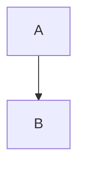

# Codependix — Dependency Graph Boundary Enforcement

**codependix** is a toolchain that extracts dependency graphs at three levels of a codebase — Nx projects, NestJS modules, and file imports — renders them as JSON, Markdown, and Mermaid diagrams, and gates declared boundary rules over those graphs. It is one of the four quality toolchains in the ic-suite monorepo (alongside codometer, callidescope, and conformetry), each owning a distinct gating word: codependix owns **boundary**, codometer owns **threshold**, callidescope owns **depth**, and conformetry owns **conformance**.

## Architecture Overview

The toolchain consists of **10 npm packages** under `projects/ic-suite/codependix/`, each with a single responsibility:

| Package | Purpose | Published as |
|---------|---------|--------------|
| **codependix-agents** | Agent skills installable by any workspace using codependix | `@codependix/agents` (private) |
| **codependix-boundaries** | Builds each level's graph, judges it against declared rules, reports violating edges and cycles | `@codependix/boundaries` |
| **codependix-cli** | Command-line host (`codependix` binary) that exports graphs and gates rules | `@codependix/cli` |
| **codependix-configuration** | Reads `codependix.config.ts`, resolves CLI flags over it, produces one resolved run configuration | `@codependix/configuration` |
| **codependix-core** | Contracts leaf: run/result vocabulary every other package states its types in | `@codependix/core` |
| **codependix-examples** | 21 subject projects built to be graphed, each carrying the guide codependix renders from it | `@codependix/examples` (private) |
| **codependix-file-imports** | Builds file-level import graphs — TypeScript (`ts.Program`) and Python (`import`/`from … import` parsing) | `@codependix/file-imports` |
| **codependix-nestjs-modules** | Explores a NestJS container and builds its module graph | `@codependix/nestjs-modules` |
| **codependix-nx** | Nx plugin inferring a per-project `codependix-gate` target that checks boundaries over a project's Nx dependency closure | `@codependix/nx` |
| **codependix-nx-projects** | Builds a project's one-hop Nx dependency neighborhood from the Nx project graph | `@codependix/nx-projects` |
| **codependix-output** | Renders every graph as JSON/Markdown/mermaid, routes to configured destinations, splices anchor blocks | `@codependix/output` |

<!-- openwiki: mermaid parse failed and this diagram was converted to a text fence so it does not break rendering. Fix the diagram source and restore the mermaid fence. Parser error: Heuristic: an unescaped angle bracket inside a label breaks rendering; rephrase the label. -->
```text
flowchart TD
    subgraph CLI["codependix-cli (command host)"]
        MapCmd["MapCommand\n--write / --check boundaries / --check reports"]
    end

    subgraph Config["codependix-configuration"]
        ConfigSvc["ConfigurationService\nloads codependix.config.ts\nresolves CLI overrides"]
    end

    subgraph GraphBuilders["Graph Builders (one per level)"]
        NxProjects["codependix-nx-projects\nNeighborhood / Workspace Graph"]
        NestJS["codependix-nestjs-modules\nModule Graph"]
        FileImports["codependix-file-imports\nTypeScript + Python Import Graphs"]
    end

    subgraph Boundaries["codependix-boundaries"]
        BoundaryCheck["BoundaryCheckService\njudges graphs against rules"]
        BoundariesSvc["BoundariesService\nevaluates allow/forbid/acyclic"]
        SelectorSvc["BoundarySelectorService\nmatches nodes by id/path/project/tags"]
    end

    subgraph Output["codependix-output"]
        GraphRun["GraphRunService\nrenders JSON + diagrams"]
        Delivery["DeliveryService\nwrites files, splices anchors"]
        Anchors["AnchorsService\nreads/rewrites <!-- codependix:start --> blocks"]
        Combined["CombinedOutputService\n--json-output / --markdown-output / --format"]
    end

    subgraph NxPlugin["codependix-nx (Nx plugin)"]
        Gate["GateService\ninfers codependix-gate target\nper project"]
    end

    MapCmd --> ConfigSvc
    ConfigSvc --> GraphBuilders
    GraphBuilders --> BoundaryCheck
    BoundaryCheck --> BoundariesSvc
    BoundariesSvc --> SelectorSvc
    GraphBuilders --> GraphRun
    GraphRun --> Delivery
    Delivery --> Anchors
    GraphRun --> Combined
    ConfigSvc --> Gate
```

## Core Vocabulary

The toolchain defines precise terminology (from `CONTEXT.md:249-286`):

| Term | Definition |
|------|------------|
| **Graph** | A dependency structure for one level — projects, NestJS modules, or files — built by exactly one codependix package (`codependix-nx-projects`, `codependix-nestjs-modules`, `codependix-file-imports`). Avoid: Diagram, tree, map. |
| **Neighborhood** | A project's own graph, scoped to its immediate one-hop dependencies and dependents. The default granularity codependix exports per project. Avoid: Local graph, one-hop graph, subgraph. |
| **Workspace Graph** | The whole-repository graph across every project, exported once at the workspace root rather than per project. Avoid: Full graph, global graph, root graph. |
| **Export** | A graph rendered to JSON or Markdown. An export is **descriptive**: it is written or found stale, never breached. Gating is the boundary's job, not the export's. Avoid: Report, output, artifact. |
| **Boundary** | A declared rule about what a graph is allowed to look like, and codependix's **gating word**. A rule is `allow`, `forbid`, or `acyclic`, keyed by the graph level it judges, and produces a **violation** — an edge or cycle it condemns. Never a breach (codometer's), a threshold (conformetry's), or a depth (callidescope's). Avoid: Constraint, policy, rule violation, breach. |
| **Anchor** | The comment marker codependix writes an export between in a Markdown file, read and rewritten in place on `--write`. Independent of conformetry's template mechanism — codependix owns its own anchor syntax and does not depend on any conformetry package. Avoid: Marker block, placeholder, template. |

## Three Graph Levels

Codependix builds and exports graphs at three independent levels:

### 1. Nx Projects (`nxProjects`)
- **Built by**: `codependix-nx-projects` (`NeighborhoodService`, `WorkspaceGraphService`)
- **Nodes**: Nx projects (name, root, tags)
- **Edges**: Explicit (import statements) and implicit (`implicitDependencies` in `project.json`)
- **Exports per project**: Neighborhood (one-hop deps + dependents)
- **Exports workspace**: Workspace Graph (all projects)
- **Boundary selectors**: `id`, `project`, `tags` globs; edge narrowing via `implicit: true/false`

### 2. NestJS Modules (`nestjsModules`)
- **Built by**: `codependix-nestjs-modules` (`ModuleGraphService`, `NestjsModulesWorkspaceGraphService`)
- **Nodes**: NestJS module classes (class name, declaring file, project)
- **Edges**: Module imports resolved by the NestJS container
- **Exports per project**: Module graph rooted at the application's `MainModule` (or synthetic root for libraries)
- **Exports workspace**: Workspace Graph aggregating all modules
- **Boundary selectors**: `id` (class name) globs only — no file path, no tags
- **Known limitation**: Two same-named modules in different packages collapse into one node, so `acyclic` rules at this level report name collisions as self-loops (see `configuration/codependix.config.ts:161-170`)

### 3. File Imports (`fileImports`)
- **Built by**: `codependix-file-imports`
  - **TypeScript**: `TypescriptImportGraphService` walks a `ts.Program` per project
  - **Python**: `PythonImportParserService` parses `import`/`from … import` statements
- **Nodes**: Files (project-relative path, project)
- **Edges**: Import statements, separated by language (no cross-language edges)
- **Exports per project**: File import graph
- **Exports workspace**: Workspace Graph aggregating all files
- **Boundary selectors**: `path` globs per language (`typescript`, `python`)

## Boundary Rules

Boundary rules are declared in `codependix.config.ts` under `boundaries`, keyed by graph level. Each rule produces **violations** (edges or cycles) when evaluated.

### Rule Kinds

| Kind | Semantics | Use Case |
|------|-----------|----------|
| **allow** | Reports every edge leaving `from` for anywhere `to` does **not** claim — states a node's whole permitted surface | Layer architecture: "configuration reaches core and configuration" |
| **forbid** | Reports every edge whose source matches `from` and target matches `to` | Anti-patterns: "types files must not reach services" |
| **acyclic** | Reports any cycle where **every node** in the cycle matches `nodes` selector | Prevent circular dependencies at project/module level |

### Selector Vocabulary

A `CodependixBoundarySelector` picks nodes at one end of an edge using globs matched via `path.matchesGlob`:

| Field | Matches | Levels Available |
|-------|---------|------------------|
| `id` | Node identifier (project name, file path, module class name) | All |
| `path` | Project-relative file path | `fileImports` only |
| `project` | Nx project name the node belongs to | All |
| `tags` | Nx tags on the project (one tag matching is enough) | `nxProjects`, `nestjsModules` (via project) |

A selector stating **no field at all is refused** (not read as "every node") — this prevents a typo from becoming a rule that judges the whole workspace.

### Edge Narrowing (Nx Projects Only)

`CodependixBoundaryEdgeSelector` narrows which edges a rule judges:
- `implicit: true` — only implicit edges (from `implicitDependencies`)
- `implicit: false` — only explicit edges (from import statements)
- Unset — judges both (stricter than ESLint's `@nx/enforce-module-boundaries` which sees only explicit edges)

This is why the ic-suite `codependix.config.ts` duplicates the 32 `depConstraints` from ESLint: codependix sees both explicit and implicit edges, so it gates at least as much, and sometimes more (e.g., `conformetry-examples` declares an implicit dependency on `conformetry-cli` that no import backs — caught only by codependix with `edges: { implicit: false }`).

### Example Rules (from `configuration/codependix.config.ts`)

```typescript
// File-level: types files must not import services
{
  from: { path: ["**/*.types.ts"] },
  kind: "forbid",
  to: { path: ["**/*.service.ts"] },
  name: "types-files-do-not-reach-services",
}

// Nx: applications depend only on packages (not other applications)
{
  from: { tags: ["type:application"] },
  kind: "allow",
  to: { tags: ["name:configuration", "type:package"] },
  name: "applications-depend-only-on-packages",
}

// Nx: acyclic rule — implicit edges close cycles too
{
  kind: "acyclic",
  name: "no-project-cycles",
}
```

## Anchor Blocks — Markdown Splicing

Codependix writes exports into Markdown files using **named anchor blocks** — HTML comments with a `name` attribute. This syntax is **owned entirely by codependix** and independent of conformetry's template mechanism (issue #242).

### Anchor Syntax

```markdown
<!-- codependix:start name="codependix-nx-projects" -->

<!-- codependix:end name="codependix-nx-projects" -->
```

- **Start marker**: `<!-- codependix:start name="anchor-name" -->`
- **End marker**: `<!-- codependix:end name="anchor-name" -->`
- **Anchor names** match the graph-building package: `codependix-nx-projects`, `codependix-nestjs-modules`, `codependix-file-imports`

### Anchor Behavior

| Operation | Behavior |
|-----------|----------|
| `--write` with existing anchor | Replaces content between markers, preserves markers |
| `--write` with missing anchor | Auto-creates `## 🕸️ Codependix` section (or appends to existing), inserts `### <subheading>` + anchor block |
| `--check reports` with missing anchor | Reports as stale (difference: "graph") |
| `--check reports` with drifted content | Reports as stale (difference: "graph" or "formatting") |
| Renaming an anchor | **Two-place change required**: rename in `projectDefaults` **and** re-splice every README in the same commit. A half-done rename leaves orphaned blocks that fail `markdown-lint` in the version commit's `prepare` hook, blocking the release. |

### Per-Project vs Workspace Exports

- **Per-project**: A project opts in by creating its own `codependix.config.ts` spreading `projectDefaults` (from `configuration/codependix.config.ts`). Exports go to the project's `README.md` under `## 🕸️ Codependix` with subheadings (`### Nx Neighborhood`, etc.).
- **Workspace**: Exported once to the root `README.md` under the same heading, using the same three anchor names. No per-project config needed — controlled by the root `codependix.config.ts`'s `workspace` section.

## CLI — `codependix` Command

The `codependix` binary (from `codependix-cli`) is the single entry point:

```bash
codependix map [options]
```

### Key Flags

| Flag | Purpose |
|------|---------|
| `--write` | Publishes every configured export (writes JSON/Markdown, splices anchors) |
| `--check boundaries` | Gates declared boundary rules — fails on any violation. Runs on **every pull request**. |
| `--check reports` | Gates stale exports — fails when a configured destination has drifted. Runs on **default branch**. |
| `--format json\|markdown\|mermaid` | Prints combined workspace graphs (and boundary report if `--check boundaries`) to stdout |
| `--json-output <path>` | Writes combined JSON to file |
| `--markdown-output <path>` | Writes combined Markdown to file |
| `--projects <globs>` / `--tags <globs>` | Narrows which projects are built and judged (defaults to dependency closure) |
| `--file-imports` / `--no-file-imports` | Enable/disable fileImports graph type |
| `--nx-projects` / `--no-nx-projects` | Enable/disable nxProjects graph type |
| `--nestjs-modules` / `--no-nestjs-modules` | Enable/disable nestjsModules graph type |

### Why Two Check Modes?

- **`--check boundaries`** belongs on **every pull request**: a broken boundary is caused by the branch and fixed by the branch.
- **`--check reports`** belongs on the **default branch**: an export moves with the workspace it describes; gating staleness on a branch would fail every branch that touched a project graph.

This split mirrors `callidescope`'s `--check depth` vs `--check reports`.

## Nx Plugin — `@codependix/nx`

The Nx plugin infers a `codependix-gate` target onto **every project** (except the workspace root) that runs `BoundaryCheckService` over that project's Nx dependency closure.

- **Inference**: `createNodes` in `codependix-nx/src/index.ts` matches `project.json` files, resolves plugin options + tool inputs + tsconfig inputs once, infers targets per project root.
- **Executor**: `gate` executor (defined in `executors.json`) loads `BoundaryCheckService` and runs it with the project's selection.
- **Hashing**: The gate target hashes the command line inputs and the tsconfig chain it compiles with, so configuration changes invalidate the cache correctly.

This lets Nx Cloud / affected commands run boundary checks only for changed projects and their dependents.

## Configuration — `codependix.config.ts`

The root `codependix.config.ts` (at `configuration/codependix.config.ts`) is the **single source of truth** for boundary rules and workspace-level exports. It exports:

- `projectDefaults` — per-project export config (anchor names, target: markdown) that projects spread into their own `codependix.config.ts`
- `boundaries` — all rules for all three levels (see examples above)
- `include: ["**"]` — every project participates in workspace graphs and boundary checking (opt-in for per-project exports via own config file)
- `nestjsModules.rootModules` — maps Nx project name → `{ export, file }` for application root modules
- `workspace` — workspace-level export config for all three graph types

A project with **no `codependix.config.ts`** still participates in workspace graphs and boundary checking, but produces no export of its own.

## Relationship to Other Toolchains

| Toolchain | Gating Word | What It Gates | Runs On |
|-----------|-------------|---------------|---------|
| **codependix** | **boundary** | Edge/cycle violating declared allow/forbid/acyclic rules | Every PR (`--check boundaries`) + default branch (`--check reports`) |
| **codometer** | **threshold** | Measurement limits (file size, complexity, etc.) | Default branch |
| **callidescope** | **depth** | Call stack depth | Every PR |
| **conformetry** | **conformance** | Template conformance scores | Every PR |

The boundary rules in `codependix.config.ts` **deliberately duplicate** ESLint's `depConstraints` because:
1. Codependix reads the Nx project graph (sees implicit edges), ESLint reads import statements (sees only explicit)
2. Codependix gates at least as much as ESLint, sometimes more
3. ESLint reports at the import site with line numbers — codependix reports at the project/graph level

Both run; neither replaces the other.

## Extension Points

| Extension Point | How to Extend |
|-----------------|---------------|
| **New graph level** | Add a package implementing graph builder + workspace graph, register in `BoundaryCheckService.graphTypeForLevel`, add selector vocabulary to `CodependixBoundarySelector` |
| **New boundary rule kind** | Extend `CodependixBoundaryRule` union in `configuration-boundaries.types.ts`, add evaluation in `BoundariesService` |
| **New export format** | Add renderer in `codependix-output`, wire into `DeliveryService` and `CombinedOutputService` |
| **New selector field** | Add to `CodependixBoundarySelector`, update `BoundarySelectorService.matches` |
| **Agent skills** | Add to `codependix-agents` (private package, installed by workspaces using codependix) |

## Testing

- **codependix-examples**: 21 subject projects under `projects/ic-suite/codependix/codependix-examples/` — each carries a guide the toolchain renders. Tests assert every number the guides quote.
- **Configuration resolution examples**: Worked examples for every configuration field and refusal type (`configuration-resolution`, `refusals` examples).
- **Unit tests**: Each package has Vitest suites covering graph builders, boundary evaluation, anchor splicing, configuration loading.

## Key Invariants

1. **Exports are descriptive, boundaries are prescriptive** — an export is written or found stale; a boundary violation fails the run.
2. **A level with no rules is never built** — judging NestJS means booting containers; judging TypeScript means building `ts.Program`. A workspace declaring only Nx rules pays for neither.
3. **Anchor syntax is codependix-owned** — zero dependency on conformetry; renaming anchors requires a coordinated commit.
4. **Selectors with no fields are refused** — prevents typos from becoming workspace-wide rules.
5. **`include` defaults to nothing** — participation in workspace graphs is always declared explicitly (`include: ["**"]` in root config).
6. **Two check modes, two branches** — `--check boundaries` on PRs, `--check reports` on default branch; they gate different findings.

## Related Pages

- [IC Suite Architecture](../architecture/ic-suite.md) — overall monorepo structure and toolchain relationships
<!-- openwiki: broken internal link [../testing/codependix.md] file "../testing/codependix.md" does not exist. Fix the href or restore the target, then delete this comment. -->
- [Codependix Testing](../testing/codependix.md) — test organization and example projects
- [Code Quality Workflows](../workflows/code-quality.md) — how codependix integrates into CI/PR gates
