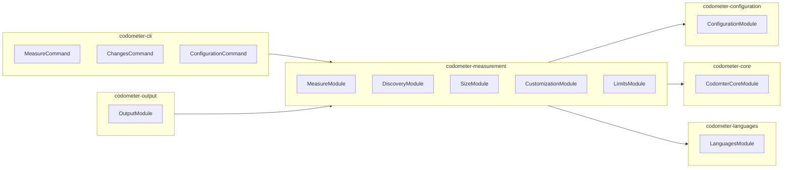

# Codometer — Repository Measurement & Limits

Codemeter is a repository measurement toolchain that counts a codebase and reports what it found. It measures TypeScript, JavaScript, Python, JSON, Markdown, and Jupyter notebooks; reports metrics (lines, counts, comment-block length); and enforces declared limits with a round-size convention.

## Core Concepts

The codometer domain model defines seven precise terms that govern how measurement, gating, and reporting work.

### Target

A **target** is a named set of files, defined by include and exclude globs, that codometer measures as a single unit. A target is a set of paths and nothing more — what gets computed over it is chosen separately. The name is the join key when comparing a pull-request report against the baseline on `main`.

### Analysis

An **analysis** is a kind of examination codometer runs over a target, producing metrics. Language analysis parses files and counts constructs (functions, classes, interfaces); size analysis compresses files and counts bytes. Every input declares which analyses it runs — `language` for source trees, `size` for build artifacts, or both.

### Metric

A **metric** is a single named number produced by one analysis over one target, addressed by a dotted path such as `codebase.typescript.interfaces` or `Compiled JavaScript.size`. A metric without a limit is measured and reported, never gated.

### Limit

A **limit** is a declared value a metric may not exceed. Limits are absolute: the metric is compared against the value and nothing else, with no baseline and no floor. A limit carries a severity (`fail` or `warn`), a numeric value (written as a number or a decimal-unit string like `"64 KB"`), and an optional label for rendering.

### Breach

A **breach** is a metric that exceeds its limit. Both `fail` and `warn` breaches are reported identically; only the consequence differs.

### Severity

**Severity** determines what a breach costs. `fail` is a gate — the run exits non-zero. `warn` is a report — the breach appears in output but the run succeeds. The default is `fail` because a limit exists to gate.

### Staleness

**Staleness** is a committed output no longer matching what a fresh run would produce. Distinct from a breach: staleness is about drift between the report and reality, a breach is about magnitude. Both fail a run, and they are never the same finding.

## Round-Size Convention

Limits on size metrics follow a **round-size convention**: values are powers of two or three times a power of two. The canonical sequence is:

```
4, 6, 12, 16, 24, 32, 48, 64, 96, 128, 192, 256, 384, 512 (and so on, in kilobytes)
```

This convention makes limits predictable and comparable across the workspace. The configuration files in this repository demonstrate it: `codometer-core` uses 3 KB, `codometer-configuration` uses 24 KB, `codometer-measurement` uses 32 KB, `codometer-output` uses 48 KB, and `codometer-cli` / `codometer-languages` / `codometer-examples` use 64 KB.

## Languages Package

The `codometer-languages` package exposes a single entry point: `LanguagesService.analyze()`. One call routes to eleven language analyzers:

- **TypeScript / JavaScript** — symbols (classes, interfaces, functions, methods, properties, getters, setters, enums), JSDoc comment blocks
- **Python** — functions, classes, decorators, comment blocks (via a subprocess calling the stdlib `tokenize` module)
- **JSON / JSONC** — objects, arrays, keys, nesting depth
- **Markdown** — headings, code blocks, tables, links, front matter
- **Jupyter Notebooks** — code cells, markdown cells, outputs (delegates to Python, JSON, Markdown analyzers)
- **CSS** — rules, selectors, declarations, at-rules, comment blocks
- **HCL** — blocks, attributes, comment blocks
- **Shell** — shebang, commands, functions, comment blocks
- **SQL** — statements, comment blocks
- **TOML** — tables, keys, arrays, comment blocks
- **YAML** — mappings, sequences, scalars, comment blocks

Comment budgets are measured centrally in `LanguagesService` rather than inside each analyzer, so Python's subprocess zeros cannot silently disable gating.

```mermaid
flowchart TD
    subgraph LanguagesService[LanguagesService.analyze()]
        direction TB
        TS[TypescriptService] --> Comments[LanguageCommentsService]
        Py[PythonService] --> Comments
        JSON[JsonService] --> Comments
        MD[MarkdownService] --> Comments
        Jup[JupyterService] --> Py
        Jup --> JSON
        Jup --> MD
        CSS[CssService] --> Comments
        HCL[HclService] --> Comments
        Shell[ShellService] --> Comments
        SQL[SqlService] --> Comments
        TOML[TomlService] --> Comments
        YAML[YamlService] --> Comments
    end
    Discover[DiscoveryService] --> LanguagesService
    Measure[MeasureService] --> Discover
    Measure --> LanguagesService
    Measure --> Size[SizeService]
    Measure --> Custom[CustomizationService]
```

## Package Architecture (7 Packages)

Codemeter factors its concerns into seven independently publishable npm packages under `projects/ic-suite/codometer/`:

| Package | Responsibility |
|---------|----------------|
| **codometer-agents** | Agent skills for writing and editing `codometer.config.ts` |
| **codometer-cli** | Command-line host: `measure`, `changes`, `configuration` commands; writes README badges, JSON reports, or both |
| **codometer-configuration** | Reads `codometer.config.ts` for exclusion globs, output destinations with render/write callbacks, Python interpreter, and the command line; resolves limits and inputs |
| **codometer-core** | Contracts leaf: statistics and report vocabulary a measurement produces, and the errors a configuration is refused with |
| **codometer-examples** | A sample corpus with known contents and one runnable example per thing codometer does, with tests that assert every number the guides quote |
| **codometer-languages** | Every input language analyzer, behind one `analyze()` call (see above) |
| **codometer-measurement** | Finds the files a run measures, counts their size and whatever a configuration declares its own counters for, and holds every metric to its declared limit |
| **codometer-output** | Every codometer output format — JSON reports, README badges, pull request change reports — plus the destinations a run writes them to |

Each package follows the IC-Suite five-layer spine (`layer:core`, `layer:configuration`, `layer:analysis`, `layer:output`, `layer:cli`) and versions independently via Nx Release.



## ADR References

- **ADR 0001** — [Absorb size-limit into codometer](repo://documentation/adr/0001-absorb-size-limit-into-codometer.md): Folded `size-limit`'s job into codometer as a general capability — any metric may carry a limit, and a build artifact is just another target.
- **ADR 0003** — [Fold bundle-size reporting into codometer as a general change report](repo://documentation/adr/0003-fold-bundle-reporting-into-codometer.md): Deleted `tools/reporting` and moved diffing onto `codometer-changes`, rendering onto `codometer-markdown` (shared with CLI badge output), and composed both in `codometer-cli`'s `changes` command.

## Configuration

A `codometer.config.ts` declares:

- **Inputs** (targets) with include/exclude globs and chosen analyses
- **Limits** on any metric path, with decimal-unit values (`"64 KB"` → 64000 bytes)
- **Custom statistics** — convention counters (file-suffix counts, symbol kinds) and comment budgets (`maximumWords`, `maximumLines`, `maximumCharacters`)
- **Outputs** — JSON files, Markdown badge blocks (with custom render/write callbacks), or both
- **Python interpreter** command for the Python analyzer subprocess

The built-in `codebase` input measures the repository root (every file not ignored by `.gitignore` and the default exclude globs: `.nx`, `build`, `coverage`, `dist`, `node_modules`).

## Measurement Pipeline

1. **Discovery** — walks the repository, applies ignore rules, categorizes files by language
2. **Language analysis** — `LanguagesService.analyze()` runs all eleven analyzers, produces per-language statistics and comment measurements
3. **Size analysis** — `SizeService` compresses each file independently (brotli, gzip, or none) and sums bytes
4. **Customization** — evaluates declared convention counters (file-suffix patterns, symbol matchers) and comment budgets
5. **Limits evaluation** — `LimitsService` binds every declared limit to exactly one metric (refusing ambiguous or unbound paths), compares measured value against limit value, records breach and severity
6. **Report assembly** — `ReportService` builds the `CodomterReport` with targets, metrics, limits, and failures
7. **Output** — `codometer-output` renders JSON, Markdown badges, or PR change reports

## Limit Evaluation Semantics

- A limit's `metric` path is a dotted string: `inputName.metricPath`. With a `defaultInput` configured, an unqualified path resolves to that input.
- A path resolving to zero metrics or more than one metric fails the run (refused rather than guessed).
- A target that matched no files **and** carries a limit fails: declaring a limit asserts the files exist.
- Multiple limits may address the same metric (e.g., a `warn` at 4000 and a `fail` at 5000); all are evaluated and reported.
- Limits carry their declared severity; the run fails if any `fail` limit is breached.

## Comment Budgets

Comment budgets are declared as `comment` custom statistics with a `language` and one of `maximumWords` (prose words after stripping markers), `maximumLines`, or `maximumCharacters`. Each language's budget is written separately — no inheritance — so "every language at 128 words, except shell at 256" means writing eight selectors. The budget is per **comment block** (a run of comment lines ended by a blank line), not per line or per file.

## Extending Codemeter

- **New language**: add a module under `codometer-languages/src/modules/<language>/` exporting a `Module`, `Service`, and `Input`/`Result` types; wire into `LanguagesModule` and `LanguagesService`.
- **New metric kind**: declare a custom statistic in configuration with a `symbol` or `comment` selector; the measurement pipeline will count it and the limits layer will gate it.
- **New output format**: implement a destination service in `codometer-output` and register it in the configuration's output callbacks.

## Related Pages

- [IC-Suite Architecture](../architecture/ic-suite.md) — five-layer spine and package organization
<!-- openwiki: broken internal link [../testing/codometer.md] file "../testing/codometer.md" does not exist. Fix the href or restore the target, then delete this comment. -->
- [Codemeter Testing](../testing/codometer.md) — test patterns, examples corpus, integration suites
- [Code Quality Workflows](../workflows/code-quality.md) — how codometer integrates with CI, pre-commit, and release
