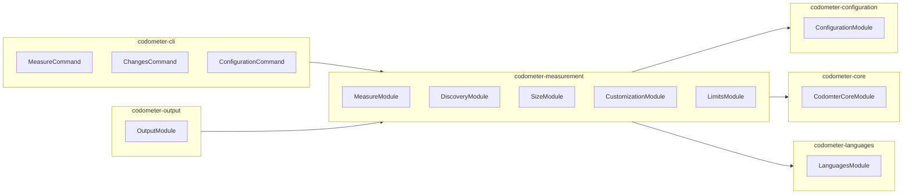

# Codometer — Repository Measurement & Limits

Codemeter is a repository measurement toolchain that counts a codebase and reports what it found. It measures TypeScript, JavaScript, Python, JSON, Markdown, and Jupyter notebooks; reports metrics (lines, counts, comment-block length); and enforces declared limits with a round-size convention.

## Core Concepts

The codometer domain model defines seven precise terms that govern how measurement, gating, and reporting work.

### Target

A **target** is a named set of files, defined by include and exclude globs, that codometer measures as a single unit. A target is a set of paths and nothing more — what gets computed over it is chosen separately. The name is the join key when comparing a pull-request report against the baseline on `main`.

### Analysis

An **analysis** is a kind of examination codometer runs over a target, producing metrics. Language analysis parses files and counts constructs (functions, classes, interfaces); size analysis compresses files and counts bytes. Every input declares which analyses it runs — `language` for source trees, `size` for build artifacts, or both.

### Metric

A **metric** is a single named number produced by one analysis over one target, addressed by a dotted path such as `codebase.typescript.interfaces` or `Compiled JavaScript.size`. A metric without a limit is measured and reported, never gated.

### Limit

A **limit** is a declared value a metric may not exceed. Limits are absolute: the metric is compared against the value and nothing else, with no baseline and no floor. A limit carries a severity (`fail` or `warn`), a numeric value (written as a number or a decimal-unit string like `"64 KB"`), and an optional label for rendering.

### Breach

A **breach** is a metric that exceeds its limit. Both `fail` and `warn` breaches are reported identically; only the consequence differs.

### Severity

**Severity** determines what a breach costs. `fail` is a gate — the run exits non-zero. `warn` is a report — the breach appears in output but the run succeeds. The default is `fail` because a limit exists to gate.

### Staleness

**Staleness** is a committed output no longer matching what a fresh run would produce. Distinct from a breach: staleness is about drift between the report and reality, a breach is about magnitude. Both fail a run, and they are never the same finding.

## Round-Size Convention

Limits on size metrics follow a **round-size convention**: values are powers of two or three times a power of two. The canonical sequence is:

```
4, 6, 12, 16, 24, 32, 48, 64, 96, 128, 192, 256, 384, 512 (and so on, in kilobytes)
```

This convention makes limits predictable and comparable across the workspace. The configuration files in this repository demonstrate it:
- `codometer-core` uses 3 KB
- `codometer-configuration` uses 24 KB
- `codometer-measurement` uses 32 KB
- `codometer-output` uses 48 KB
- `codometer-cli`, `codometer-languages`, `codometer-examples` use 64 KB

## Languages Package

The `codometer-languages` package exposes a single entry point: `LanguagesService.analyze()`. One call routes to eleven language analyzers:

- **TypeScript / JavaScript** — symbols (classes, interfaces, functions, methods, properties, getters, setters, enums), JSDoc comment blocks
- **Python** — functions, classes, decorators, comment blocks (via a subprocess calling the stdlib `tokenize` module)
- **JSON / JSONC** — objects, arrays, keys, nesting depth
- **Markdown** — headings, code blocks, tables, links, front matter
- **Jupyter Notebooks** — code cells, markdown cells, outputs (delegates to Python, JSON, Markdown analyzers)
- **CSS** — rules, selectors, declarations, at-rules, comment blocks
- **HCL** — blocks, attributes, comment blocks
- **Shell** — shebang, commands, functions, comment blocks
- **SQL** — statements, comment blocks
- **TOML** — tables, keys, arrays, comment blocks
- **YAML** — mappings, sequences, scalars, comment blocks

Comment budgets are measured centrally in `LanguagesService` rather than inside each analyzer, so Python's subprocess zeros cannot silently disable gating.

```mermaid
flowchart TD
    subgraph LanguagesService[LanguagesService.analyze()]
        direction TB
        TS[TypescriptService] --> Comments[LanguageCommentsService]
        Py[PythonService] --> Comments
        JSON[JsonService] --> Comments
        MD[MarkdownService] --> Comments
        Jup[JupyterService] --> Py
        Jup --> JSON
        Jup --> MD
        CSS[CssService] --> Comments
        HCL[HclService] --> Comments
        Shell[ShellService] --> Comments
        SQL[SqlService] --> Comments
        TOML[TomlService] --> Comments
        YAML[YamlService] --> Comments
    end
    Discover[DiscoveryService] --> LanguagesService
    Measure[MeasureService] --> Discover
    Measure --> LanguagesService
    Measure --> Size[SizeService]
    Measure --> Custom[CustomizationService]
```

## Package Architecture (8 Packages)

Codemeter factors its concerns into **eight** independently publishable npm packages under `projects/ic-suite/codometer/`:

| Package | Responsibility |
|---------|----------------|
| **codometer-agents** | Agent skills for writing and editing `codometer.config.ts` |
| **codometer-cli** | Command-line host: `measure`, `changes`, `configuration` commands; writes README badges, JSON reports, or both |
| **codometer-configuration** | Reads `codometer.config.ts` for exclusion globs, output destinations with render/write callbacks, Python interpreter, and the command line; resolves limits and inputs |
| **codometer-core** | Contracts leaf: statistics and report vocabulary a measurement produces, and the errors a configuration is refused with |
| **codometer-examples** | A sample corpus with known contents and one runnable example per thing codometer does, with tests that assert every number the guides quote |
| **codometer-languages** | Every input language analyzer, behind one `analyze()` call (see above) |
| **codometer-measurement** | Finds the files a run measures, counts their size and whatever a configuration declares its own counters for, and holds every metric to its declared limit |
| **codometer-output** | Every codometer output format — JSON reports, README badges, pull request change reports — plus the destinations a run writes them to |

Each package follows the IC-Suite five-layer spine (`layer:core`, `layer:configuration`, `layer:analysis`, `layer:output`, `layer:cli`) and versions independently via Nx Release.



## ADR References

- **ADR 0001** — [Absorb size-limit into codometer](repo://documentation/adr/0001-absorb-size-limit-into-codometer.md): Folded `size-limit`'s job into codometer as a general capability — any metric may carry a limit, and a build artifact is just another target.
- **ADR 0003** — [Fold bundle-size reporting into codometer as a general change report](repo://documentation/adr/0003-fold-bundle-reporting-into-codometer.md): Deleted `tools/reporting` and moved diffing onto `codometer-changes`, rendering onto `codometer-markdown` (shared with CLI badge output), and composed both in `codometer-cli`'s `changes` command.

## Configuration

A `codometer.config.ts` declares:

- **Inputs** (targets) with include/exclude globs and chosen analyses
- **Limits** on any metric path, with decimal-unit values (`"64 KB"` → 64000 bytes)
- **Custom statistics** — convention counters (file-suffix counts, symbol kinds) and comment budgets (`maximumWords`, `maximumLines`, `maximumCharacters`)
- **Outputs** — JSON files, Markdown badge blocks (with custom render/write callbacks), or both
- **Python interpreter** command for the Python analyzer subprocess

The built-in `codebase` input measures the repository root (every file not ignored by `.gitignore` and the default exclude globs: `.nx`, `build`, `coverage`, `dist`, `node_modules`).

### Example: Shared Configuration

The workspace-level [`configuration/codometer.config.ts`](repo://configuration/codometer.config.ts) exports a shared `codometerConfiguration` object that every project spreads:

```typescript
export const codometerConfiguration = {
  // Counters measured everywhere: file suffixes, symbol kinds, comment budgets
  custom: [
    { label: "Module Files", patterns: ["**/*.module.ts"] },
    { label: "Service Files", patterns: ["**/*.service.ts"] },
    { label: "Command Files", patterns: ["**/*.command.ts"] },
    { label: "Constants Files", patterns: ["**/*.constants.ts"] },
    { label: "Types Files", patterns: ["**/*.types.ts"] },
    { label: "Utilities Files", patterns: ["**/*.utilities.ts"] },
    { label: "TypeORM Entities", patterns: ["**/*.entity.ts"] },
    { label: "Unit Tests", patterns: ["**/*.unit.test.ts"] },
    { label: "Integration Tests", patterns: ["**/*.integration.test.ts"] },
    { label: "End To End Tests", patterns: ["**/*.end-to-end.test.ts"] },
    // Symbol counter rendered with TypeScript built-ins
    {
      color: "166534",
      group: "typescript",
      label: "Static Methods",
      symbols: { kinds: ["method"], modifiers: ["static"] },
    },
    // Comment budgets: 128 words per block for most languages, 256 for shell
    ...commentBudgets,
  ],
  // Unqualified limits resolve to this input
  defaultInput: "codebase",
  format: "markdown",
  // Gates: zero blocks exceeding the declared word budget
  limits: commentBudgetLimits,
  outputs: [
    { custom: selectAllLabels(customStatistics), path: "codometer-report.json", type: "json" },
    { custom: selectAllLabels(customStatistics), path: "README.md", type: "markdown" },
  ],
  python: { command: "uv run python" },
} satisfies CodometerConfiguration;
```

## Output Formats

### JSON Report (`codometer-report.json`)

The JSON output writes the entire `CodometerReport` object — targets, metrics, limits, failures — exactly as produced by the measurement pipeline. No timestamps, no tool version, no metadata that would make two identical runs differ.

```typescript
interface CodometerReport {
  failures: ReportFailure[];    // "input" (empty target) or "limit" (unresolvable path)
  targets: ReportTarget[];      // One per measured target
}

interface ReportTarget {
  empty: boolean;               // True when globs matched no files
  files: number;                // File count
  metrics: ReportMetric[];      // All metrics for this target
  name: string;                 // Target name (join key for PR diffs)
}

interface ReportMetric {
  name: string;                 // "target.metricPath" — stable across runs
  path: string;                 // Metric path within target
  value: number;                // Measured value
  unit: "bytes" | null;         // bytes for size, null for counts
  limits: ReportLimit[];        // Every limit on this metric (warn/fail)
  instances: CustomStatisticResultInstance[] | null; // Per-block comment breaches
}

interface ReportLimit {
  breached: boolean;
  label: string | null;         // Optional human label
  severity: "fail" | "warn";
  value: number;                // Declared limit value
}
```

**Sync/Check semantics** (`JsonService.sync`):
- **Writing**: Creates parent directories, writes pretty-printed JSON with trailing newline
- **Checking**: Returns `true` only when the file already holds exactly the current report; `false` for missing or stale files

### Markdown Badge Block (README.md)

The markdown output renders a badge table grouped by statistic group (language or `conventions`), wrapped in anchor markers (`<!-- codometer:start -->` / `<!-- codometer:end -->` by default) so it can be spliced into an existing README without rewriting the whole file.

**Badge format per group:**
```markdown
### TypeScript
| Metric | Value |
|--------|-------|
| Files | 142 |
| Interfaces | 87 |
| Classes | 234 |
```

**Configuration-driven rendering** (`MarkdownService`):
- Groups rendered in order: `repository` (scope header), then each language group, then `conventions` (only if configured counters exist)
- Each badge links to the shields.io endpoint with the measured value and configured color
- Custom `write` callbacks can override the entire rendering and file-writing behavior
- Per-destination `custom` array selects which top-level `custom` counters that destination renders (independently per output)

**Sync/Check semantics** (`MarkdownService.syncAnchoredBlock`):
- **Writing**: Splices rendered block between start/end markers, creating file if absent
- **Checking**: Returns `true` only when the anchored block already matches the current render

### Pull Request Change Report

The `changes` command (`codometer-cli`) diffs the current run against a baseline JSON report (collected on `main` by CI), rendering a collapsible per-project table showing:
- Metric label, current value, baseline value, delta (📈/📉)
- Breach icons (❌ fail, ❗ warn, 🗑️ removed, ⁉️ empty, 🆕 new)
- Failures (⚠️ could not measure) above the table
- Baseline comparison URL for traceability

## Statistics Vocabulary

### `CodeStatisticsResult` (codometer-core)

The aggregated statistics produced by the measurement pipeline, grouped by language:

```typescript
interface CodeStatisticsResult {
  // Per-language statistics
  typescript: TypescriptStatistics;
  javascript: JavascriptStatistics;
  python: PythonStatistics;
  json: JsonStatistics;
  markdown: MarkdownStatistics;
  jupyter: JupyterStatistics;
  css: CssStatistics;
  hcl: HclStatistics;
  shell: ShellStatistics;
  sql: SqlStatistics;
  toml: TomlStatistics;
  yaml: YamlStatistics;

  // Custom statistics (file-pattern, symbol, comment budgets)
  custom: CustomStatisticResult[];

  // Repository-level aggregates
  linesOfCode: number;
  sourceFiles: number;
  folders: number;
  repositoryBytes: number;  // Byte-precise uncompressed total
}
```

Each language statistics interface (e.g., `TypescriptStatistics`) contains:
- File counts (`files`, `testFiles`)
- Symbol counts by kind (`classes`, `interfaces`, `functions`, `methods`, `properties`, `enums`, `decorators`, `genericDeclarations`)
- Comment metrics (`comments`, `docComments`, `commentLines`, `docstringLines`, `docstrings`)

### `CustomStatisticResult`

```typescript
interface CustomStatisticResult {
  label: string;              // Configured label (badge key)
  count: number;              // Files (patterns) or declarations (symbols) or breaching blocks (comment)
  group: CodometerStatisticGroup; // "conventions" or language group
  color: string;              // Hex for badge
  instances?: CustomStatisticResultInstance[]; // For comment budgets: each breaching block
}

interface CustomStatisticResultInstance {
  file: string;               // Repository-relative path
  line: number;               // 1-indexed start line
  measured: number;           // Words/lines/characters measured
}
```

### `CodometerStatisticGroup`

```
"conventions" | "repository" | "typescript" | "javascript" | "python" |
"json" | "markdown" | "jupyter" | "css" | "hcl" | "shell" |
"sql" | "toml" | "yaml"
```

## Measurement Pipeline

1. **Discovery** — Walks the repository, applies ignore rules (`.gitignore` + `excludeFrom` files), categorizes files by language
2. **Language analysis** — `LanguagesService.analyze()` runs all eleven analyzers, produces per-language statistics and comment measurements
3. **Size analysis** — `SizeService` compresses each file independently (brotli, gzip, or none) and sums bytes
4. **Customization** — Evaluates declared convention counters (file-suffix patterns, symbol matchers) and comment budgets
5. **Limits evaluation** — `LimitsService` binds every declared limit to exactly one metric (refusing ambiguous or unbound paths), compares measured value against limit value, records breach and severity
6. **Report assembly** — `ReportService` builds the `CodometerReport` with targets, metrics, limits, and failures
7. **Output** — `codometer-output` renders JSON, Markdown badges, or PR change reports

## Limit Evaluation Semantics

- A limit's `metric` path is a dotted string: `inputName.metricPath`. With a `defaultInput` configured, an unqualified path resolves to that input.
- A path resolving to zero metrics or more than one metric fails the run (refused rather than guessed).
- A target that matched no files **and** carries a limit fails: declaring a limit asserts the files exist.
- Multiple limits may address the same metric (e.g., a `warn` at 4000 and a `fail` at 5000); all are evaluated and reported.
- Limits carry their declared severity; the run fails if any `fail` limit is breached.

<!-- openwiki: mermaid parse failed and this diagram was converted to a text fence so it does not break rendering. Fix the diagram source and restore the mermaid fence. Parser error: Heuristic: an unescaped angle bracket inside a label breaks rendering; rephrase the label. -->
```text
flowchart TD
    Limits[LimitsService.evaluate] --> ForEach[For each limit in configuration]
    ForEach --> Resolve[Resolve metric path]
    Resolve --> Bind{Bind to exactly<br/>one measured metric?}
    Bind -->|No| Fail[UnboundMetricError → failure]
    Bind -->|Empty target| Empty[EmptyTargetError → failure]
    Bind -->|Yes| Compare[measured > limit.value]
    Compare --> Breach{Breached?}
    Breach -->|Yes| Record[Record breach + severity]
    Breach -->|No| Record[Record pass]
    Record --> Next[Next limit]
    Next --> Done[Return all evaluated limits + failures]
```

## Comment Budgets

Comment budgets are declared as `comment` custom statistics with a `language` and one of `maximumWords` (prose words after stripping markers), `maximumLines`, or `maximumCharacters`. Each language's budget is written separately — no inheritance — so "every language at 128 words, except shell at 256" means writing eight selectors. The budget is per **comment block** (a run of comment lines ended by a blank line), not per line or per file.

A comment-budget counter's `value` is the **count of blocks that exceeded the budget**, not the word total. The gate is therefore a limit of `value: 0` on the `custom.<label>` metric. Each breaching block appears in the metric's `instances` array with file, line, and measured count.

```typescript
// From configuration/codometer.config.ts
const generalCommentBudgets = CODOMETER_COMMENT_LANGUAGES
  .filter(l => l !== "shell")
  .map(language => ({
    comment: { language, maximumWords: 128 },
    label: `${COMMENT_LANGUAGE_LABELS[language]} Comment Budget`,
  }));

const shellCommentBudget = {
  comment: { language: "shell", maximumWords: 256 },
  label: "Shell Comment Budget",
};
```

## CI Integration

Codemeter is integrated into the repository's Continuous Integration pipeline:

| Workflow | Job | Command |
|----------|-----|---------|
| **Continuous Integration** | `build-projects` (👷 Build) | `nx run configuration:codometer:write` via `integration/src/integration.main.ts run-affected` |
| **Continuous Deployment** | `push-releases` | `nx run-many --target=codometer --configuration=write --exclude=configuration` then `nx run configuration:codometer:write` |

The `build-projects` job depends on codometer because every publishable package declares a `size` limit on its compiled JavaScript output (`Compiled JavaScript.size`). A breach fails the Build job and names the project.

On pull requests, the `report-integration` action collects the codometer baseline on `main`, runs the affected projects' `codometer` targets, diffs the results, and posts the change report as a PR comment.

## Extending Codemeter

- **New language**: Add a module under `codometer-languages/src/modules/<language>/` exporting a `Module`, `Service`, and `Input`/`Result` types; wire into `LanguagesModule` and `LanguagesService`.
- **New metric kind**: Declare a custom statistic in configuration with a `symbol` or `comment` selector; the measurement pipeline will count it and the limits layer will gate it.
- **New output format**: Implement a destination service in `codometer-output` and register it in the configuration's output callbacks.

## Related Pages

- [IC-Suite Architecture](../architecture/ic-suite.md) — five-layer spine and package organization
- [Testing Strategy Overview](../testing/overview.md) — test patterns, coverage gates, integration suites
- [Code Quality Workflows](../workflows/code-quality.md) — how codometer integrates with CI, pre-commit, and release
