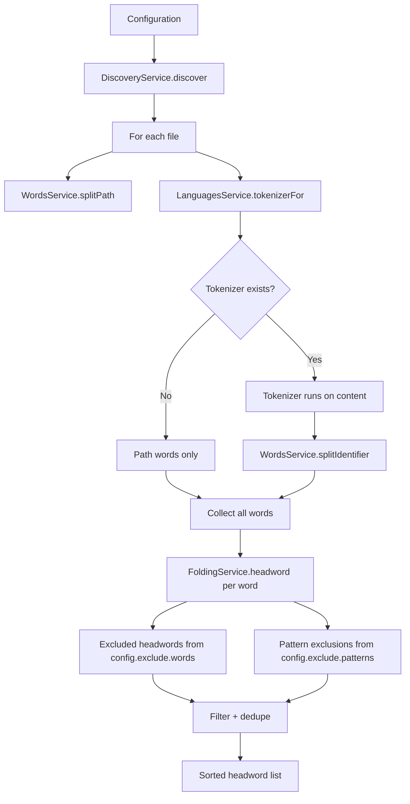

# Coinagerie — Vocabulary Toolchain

**Coinagerie** is a vocabulary toolchain that lists every identifier, object key, enum member, folder name, and file name in a codebase, splits them into lowercase words, folds surface forms into headwords, and keeps a markdown or JSON glossary in step with the code. It integrates with Nx to run per-project checks, and its CLI supports print, check, write, and batch modes.

---

## Architecture Overview

Coinagerie is organized as five spine packages, each with a single responsibility:

| Package | Responsibility |
|---------|----------------|
| `@coinagerie/core` | Shared types: `Glossary`, `GlossaryDifference`, `VocabularyReport`, error classes (`InvalidConfigurationError`, `MalformedGlossaryError`, `ConfigurationFileNotFoundError`). |
| `@coinagerie/configuration` | Loads, validates, and resolves `coinagerie.config.ts`. Merges CLI flags, makes paths absolute, evaluates `exclude.words` functions, and guards the custom `fold` function. |
| `@coinagerie/vocabulary` | Extraction pipeline: discovers files, tokenizes per language, splits paths and identifiers into words, folds words, applies exclusions, sorts and deduplicates. |
| `@coinagerie/output` | Renders and parses glossary blocks (markdown and JSON), compares vocabulary against destinations, writes reconciled glossaries while preserving definitions. |
| `@coinagerie/cli` | Commands: `collect` (print/check/write), `batch` (multi-project). Wires the pipeline together and handles terminal output. |

An Nx plugin `@coinagerie/nx` provides a `check` executor that infers a `coinagerie` target on every configured project, enabling `nx affected` to judge only touched projects.

---

## Vocabulary Extraction Pipeline

The pipeline runs in a single pass per project, one file at a time to avoid exhausting file descriptors.



### File Discovery

`DiscoveryService.discover` walks the project root honoring every `.gitignore` Git would honor — from the repository root down to the scan root — then applies the configuration's `include` and `exclude.paths` globs. Files listed in `outputs` are skipped so a run never reads its own glossary back. Symbolic links are ignored to prevent loops.

### Tokenization

`LanguagesService` selects a tokenizer by file extension. Each tokenizer extracts identifiers (variable names, function names, class names, keys, enum members) from the file content. If no tokenizer claims the extension, only the file path contributes words.

### Word Splitting

`WordsService` splits two sources:

- **Paths**: folder names and the file name without its final extension, split on separators and case changes.
- **Identifiers**: split on separators (`_`, `-`, `.`) and case boundaries, keeping acronyms whole (e.g., `XMLHttpRequest` → `xml`, `http`, `request`).

Every word leaves lowercase, at least two characters, and not a bare number.

### Folding

`FoldingService` maps each word to its **headword**:

1. Singularize via `pluralize` (e.g., `aspects` → `aspect`).
2. Lemmatize verbs via `wink-lemmatizer` (e.g., `configured` → `configure`).
3. Apply the configuration's optional `fold` function for repository-specific mappings (e.g., `config` → `configuration`, `arg` → `argument`).

Derivational families stay separate unless `fold` merges them (`configuration` keeps its own entry).

### Exclusion

Two exclusion layers run after folding:

1. **Exact words** from `exclude.words` (evaluated once at configuration load). A word and its headword are both added to the exclusion set.
2. **Regex patterns** from `exclude.patterns`. A word is dropped if the pattern matches the word **or** its headword.

Language keywords (TypeScript, Python, SQL, etc.) and a shared common-word list are baked in as default exclusions.

### Output

The pipeline returns a sorted, deduplicated array of headwords — the project's **vocabulary**.

---

## Glossary Block Format

A glossary destination is a file region delimited by anchor comments:

```markdown
<!-- coinagerie:start -->

## 🪙 Coinagerie

Optional description paragraph.

- **word**: Definition text that may span
  multiple indented lines.

- **another**: Another definition.

<!-- coinagerie:end -->
```

- **Anchors**: `<!-- coinagerie:start -->` and `<!-- coinagerie:end -->` must appear exactly once each, in order. Any other arrangement (missing, duplicate, reversed) is refused.
- **Heading**: `## 🪙 Coinagerie` is required and identifies the block.
- **Description**: Prose between the heading and the first bullet is preserved on rewrites unless the configuration supplies a `description` for that destination.
- **Bullets**: One per word, format `- **word**: definition`. The definition may be empty or multi-line (indented continuation lines).
- **Strict parsing**: `MarkdownService.parse` and `JsonService.parse` throw `MalformedGlossaryError` on any unrecognized line, duplicate word, or malformed anchor. A parse error stops the run before any write.

---

## Configuration

A `coinagerie.config.ts` in the project root (or passed via `--config`) controls the run. The folder containing the config file is the scan root.

```ts
export default {
  include: ["src/**"],
  exclude: {
    paths: ["**/*.test.ts", "**/*.spec.ts"],
    words: ["util", "helper"],          // exact words (headwords)
    patterns: [/^x[A-Z]/]              // regex against word or headword
  },
  fold: (word) => word === "cfg" ? "config" : word,
  outputs: [
    { description: "Words this project uses.", path: "README.md", type: "markdown" },
    { path: "glossary.json", type: "json" }
  ],
};
```

### Fields

| Field | Type | Default | Description |
|-------|------|---------|-------------|
| `include` | `string[]` | `["src/**"]` | Globs selecting files to scan. |
| `exclude.paths` | `string[]` | `[]` | Globs removing files from the selection. |
| `exclude.words` | `string[] \| (() => Promise<string[]>)` | `[]` | Exact headwords to exclude. Can be a function for dynamic lists. |
| `exclude.patterns` | `RegExp[]` | `[]` | Regex patterns; matches against the word or its headword. |
| `fold` | `(word: string) => string` | built-in folding | Custom mapping from folded word to headword. |
| `outputs` | `Output[]` | `[]` | Destinations. Each has `path` (absolute or relative to config), `type` (`"markdown"` \| `"json"`), and optional `description` (markdown only). |

### CLI Flag Overrides

Flags override the config file:

| Flag | Overrides |
|------|-----------|
| `--include` | `include` |
| `--exclude-paths` | `exclude.paths` |
| `--output-markdown <path>` | Adds/replaces a markdown output |
| `--output-json <path>` | Adds/replaces a JSON output |
| `--description <text>` | Sets description for markdown outputs created by flags |

---

## CLI Commands

The `@coinagerie/cli` package exposes the `coinagerie` command with three subcommands.

### `collect` (default)

```bash
coinagerie                       # print glossary block to stdout, write nothing
coinagerie --check               # exit 1 naming missing and stale words
coinagerie --write               # rewrite every glossary, keeping definitions
coinagerie --config path/to/coinagerie.config.ts --check
coinagerie --format json         # print as flat JSON object
```

- **Print mode** (no flags): renders the glossary block (markdown or JSON) to stdout with empty definitions.
- **Check mode** (`--check`): compares vocabulary against each destination. Exits 0 if all match; exits 1 and prints a report for each destination with `missing` (words the code uses that the glossary lacks) and `stale` (words the glossary has that the code no longer uses).
- **Write mode** (`--write`): rewrites each destination to hold exactly the vocabulary, sorted, preserving each kept word's existing definition. Stale words are removed with their definitions. A destination that already matches is untouched.
- **Malformed glossary**: if any destination cannot be parsed, the run aborts before any write.

### `batch`

```bash
coinagerie batch apps/api apps/web --write
```

Runs check or write across multiple project directories in one process, avoiding repeated startup. Each directory must have its own configuration. Output is a JSON array of verdicts:

```json
[
  { "directory": "apps/api", "ok": true, "report": "✅ Found every glossary in step with the code" },
  { "directory": "apps/web", "ok": false, "report": "🪙 Found a glossary out of step with the code..." }
]
```

Exit code is 1 if any verdict has `ok: false`.

---

## Nx Integration

The `@coinagerie/nx` plugin provides a `check` executor that is **inferred onto every project** with a `coinagerie.config.ts`. This enables:

```bash
# Check all projects
nx run-many -t coinagerie:check

# Check only affected projects
nx affected -t coinagerie:check

# Write glossaries for affected projects
nx affected -t coinagerie:check --write=true
```

### Executor Options

| Option | Type | Description |
|--------|------|-------------|
| `command` | `string` | Shell command that starts the `coinagerie` CLI (e.g., `npx @coinagerie/cli`). |
| `write` | `boolean` | When `true`, rewrites glossaries instead of judging. |

### Batch Execution

The executor groups tasks by `(mode, command)` so projects sharing the same command and mode run in a single `coinagerie batch` invocation. Each task receives its own verdict; a task whose project is unknown fails immediately.

---

## Core Vocabulary (from CONTEXT.md)

Coinagerie itself uses a controlled vocabulary defined in the repository's `CONTEXT.md`. These terms shape the domain language across the toolchain:

| Term | Meaning | Avoid |
|------|---------|-------|
| **Generator** | A named pairing of a template with the inputs needed to render it | Schematic, scaffold, blueprint |
| **Template** | A folder of ordinary files that a generator renders, and the standard every instance is measured against | Rule, fixture, boilerplate |
| **Instance** | Generated code on disk that a template explains | Copy, output, generated folder |
| **Language** | The comparison engine for one family of file types, selected by extension | Rule, validator rule, check |
| **Fallback** | Line-by-line text comparison for unclaimed extensions; the floor under validation | Default language, catch-all |
| **Difference** | Something a template declares that its instance lacks; extra content is never a difference | Finding, violation, failure |
| **Error** | A difference severe enough to fail a validation run | Finding, issue |
| **Conformance** | How completely an instance carries what its template declares | Compliance, passing, matching |

---

## Error Semantics

| Error | When Raised | Behavior |
|-------|-------------|----------|
| `ConfigurationFileNotFoundError` | Named config path does not exist | Run fails, names the path. |
| `InvalidConfigurationError` | Config schema validation fails, `fold` throws or returns invalid value, `exclude.words` throws, duplicate output paths | Run fails, names the file and reason. |
| `MalformedGlossaryError` | Glossary block has misplaced/duplicate anchors, unrecognized line, duplicate word, invalid JSON | Run fails before any write; names file, line, and reason. |

All errors are thrown, not returned, so the CLI and Nx executor catch them and produce a verdict with `ok: false`.

---

## Extension Points

1. **Custom tokenizer**: Add a language tokenizer to `@coinagerie/languages` and it will be picked up by file extension.
2. **Custom fold function**: Provide `fold` in configuration to merge derivational families (e.g., `configuration` → `config`).
3. **Dynamic exclusions**: `exclude.words` can be an async function for generated exclusion lists.
4. **New output format**: Implement `GlossaryFormatHandler` and register it in `DeliveryService.handlers`.
5. **Nx executor options**: The `command` option allows pointing to a workspace-local CLI build.

---

## Testing

Each package has unit tests for its services:

- `vocabulary.service.unit.test.ts` — pipeline integration with stubbed services
- `discovery.service.unit.test.ts` — gitignore handling, glob selection, skip logic
- `words.service.unit.test.ts` — identifier and path splitting edge cases
- `folding.service.unit.test.ts` — plural/verb folding, custom fold
- `markdown.service.unit.test.ts` — block parsing, rendering, splicing, anchor validation
- `json.service.unit.test.ts` — JSON parsing, rendering
- `comparison.service.unit.test.ts` — missing/stale detection, reconciliation
- `delivery.service.unit.test.ts` — check/write atomicity, definition preservation
- `configuration.service.unit.test.ts` — config loading, overrides, resolution
- `check.service.unit.test.ts` — per-project check/write verdicts
- `collect.command.unit.test.ts` — CLI flag parsing, mode selection
- `batch.command.unit.test.ts` — multi-project verdict aggregation
- Nx executor unit tests — task grouping, process spawning, verdict parsing

Run tests with `nx run <package>:vitest`.

---

## Related Pages

- [IC Suite Architecture](../architecture/ic-suite.md) — Monorepo structure and tooling
- [Ollama + SearXNG Integration](../integrations/ollama-searxng.md) — AI tooling used alongside Coinagerie
<!-- openwiki: broken internal link [../testing/ic-suite.md] file "../testing/ic-suite.md" does not exist. Fix the href or restore the target, then delete this comment. -->
- [Testing IC Suite](../testing/ic-suite.md) — Test strategies across the monorepo
- [Scaffolding Workflows](../workflows/scaffolding.md) — Conformetry generators and templates
