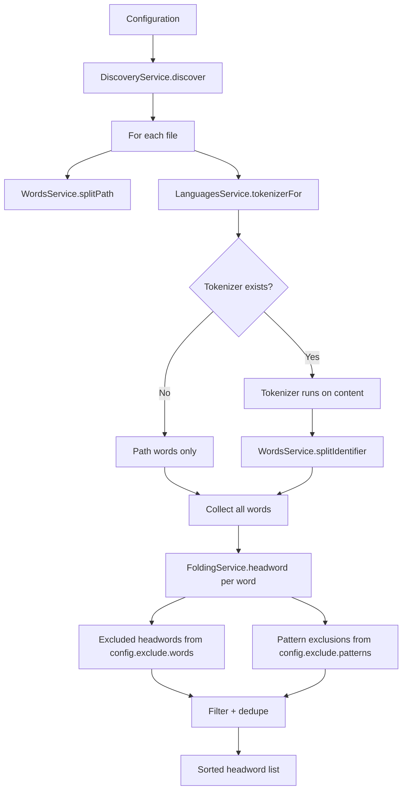

# Coinagerie — Vocabulary Toolchain

**Coinagerie** is a vocabulary toolchain that lists every identifier, object key, enum member, folder name, and file name in a codebase, splits them into lowercase words, folds surface forms into headwords, and keeps a markdown or JSON glossary in step with the code. It integrates with Nx to run per-project checks, and its CLI supports print, check, write, and batch modes.

---

## Architecture Overview

Coinagerie follows the IC-Suite five-layer spine, with seven published packages (plus the non-publishable agents and examples), each with a single responsibility:

| Package | Responsibility |
|---------|----------------|
| `@coinagerie/core` | Shared types: `Glossary`, `GlossaryDifference`, `VocabularyReport`, error classes (`InvalidConfigurationError`, `MalformedGlossaryError`, `ConfigurationFileNotFoundError`). |
| `@coinagerie/configuration` | Loads, validates, and resolves `coinagerie.config.ts`. Merges CLI flags, makes paths absolute, evaluates `exclude.words` functions, and guards the custom `fold` function. |
| `@coinagerie/languages` | Per-language tokenizers (CSS, HCL, JSON, Python, shell, SQL, TOML, TypeScript, YAML) that extract identifiers from file content, plus the language keyword lists the shared configuration excludes. |
| `@coinagerie/vocabulary` | Extraction pipeline: discovers files, tokenizes per language, splits paths and identifiers into words, folds words, applies exclusions, sorts and deduplicates. |
| `@coinagerie/output` | Renders and parses glossary blocks (markdown and JSON), compares vocabulary against destinations, writes reconciled glossaries while preserving definitions. |
| `@coinagerie/cli` | Commands: `collect` (print/check/write), `batch` (multi-project). Wires the pipeline together and handles terminal output. |
| `@coinagerie/nx` | Nx plugin: infers a `coinagerie-check` target on every project with a configuration, groups tasks by mode and command for batch execution via `coinagerie batch`, and supports `nx affected` for incremental checks. |

---

## Vocabulary Extraction Pipeline

The pipeline runs in a single pass per project, one file at a time to avoid exhausting file descriptors.



### File Discovery

`DiscoveryService.discover` walks the project root honoring every `.gitignore` Git would honor — from the repository root down to the scan root — then applies the configuration's `include` and `exclude.paths` globs. Files listed in `outputs` are skipped so a run never reads its own glossary back. Symbolic links are ignored to prevent loops.

### Tokenization

`LanguagesService` (in `@coinagerie/languages`) selects a tokenizer by file extension. Each tokenizer extracts identifiers (variable names, function names, class names, keys, enum members) from the file content. If no tokenizer claims the extension, only the file path contributes words.

Supported languages: CSS, HCL, JSON, Python, shell, SQL, TOML, TypeScript, YAML. Each language module provides a `ScannerService` that tokenizes its syntax and a service that extracts identifiers appropriate to that language.

### Word Splitting

`WordsService` splits two sources:

- **Paths**: folder names and the file name without its final extension, split on separators and case changes.
- **Identifiers**: split on separators (`_`, `-`, `.`) and case boundaries, keeping acronyms whole (e.g., `XMLHttpRequest` → `xml`, `http`, `request`).

Every word leaves lowercase, at least two characters, and not a bare number.

### Folding

`FoldingService` maps each word to its **headword**:

1. Singularize via `pluralize` (e.g., `aspects` → `aspect`).
2. Lemmatize verbs via `wink-lemmatizer` (e.g., `configured` → `configure`).
3. Apply the configuration's optional `fold` function for repository-specific mappings (e.g., `config` → `configuration`, `arg` → `argument`).

Derivational families stay separate unless `fold` merges them (`configuration` keeps its own entry).

### Exclusion

Two exclusion layers run after folding:

1. **Exact words** from `exclude.words` (evaluated once at configuration load). A word and its headword are both added to the exclusion set.
2. **Regex patterns** from `exclude.patterns`. A word is dropped if the pattern matches the word **or** its headword.

Language keywords (TypeScript, Python, SQL, etc.) and a shared common-word list are baked in as default exclusions.

### Output

The pipeline returns a sorted, deduplicated array of headwords — the project's **vocabulary**.

---

## Glossary Block Format

A glossary destination is a file region delimited by anchor comments:

```markdown
<!-- coinagerie:start -->

## 🪙 Coinagerie

Optional description paragraph.

- **word**: Definition text that may span
  multiple indented lines.

- **another**: Another definition.

<!-- coinagerie:end -->
```

- **Anchors**: `<!-- coinagerie:start -->` and `<!-- coinagerie:end -->` must appear exactly once each, in order. Any other arrangement (missing, duplicate, reversed) is refused.
- **Heading**: `## 🪙 Coinagerie` is required and identifies the block.
- **Description**: Prose between the heading and the first bullet is preserved on rewrites unless the configuration supplies a `description` for that destination.
- **Bullets**: One per word, format `- **word**: definition`. The definition may be empty or multi-line (indented continuation lines).
- **Strict parsing**: `MarkdownService.parse` and `JsonService.parse` throw `MalformedGlossaryError` on any unrecognized line, duplicate word, or malformed anchor. A parse error stops the run before any write.

The JSON glossary format is a flat object sorted by word, each value a definition string (empty string for no definition). The whole file is the glossary; writing replaces it.

---

## Configuration

A `coinagerie.config.ts` in the project root (or passed via `--config`) controls the run. The folder containing the config file is the scan root.

```ts
export default {
  include: ["src/**"],
  exclude: {
    paths: ["**/*.test.ts", "**/*.spec.ts"],
    words: ["util", "helper"],          // exact words (headwords)
    patterns: [/^x[A-Z]/]              // regex against word or headword
  },
  fold: (word) => word === "cfg" ? "config" : word,
  outputs: [
    { description: "Words this project uses.", path: "README.md", type: "markdown" },
    { path: "glossary.json", type: "json" }
  ],
};
```

### Fields

| Field | Type | Default | Description |
|-------|------|---------|-------------|
| `include` | `string[]` | `["src/**"]` | Globs selecting files to scan. |
| `exclude.paths` | `string[]` | `[]` | Globs removing files from the selection. |
| `exclude.words` | `string[] \| (() => Promise<string[]>)` | `[]` | Exact headwords to exclude. Can be a function for dynamic lists. |
| `exclude.patterns` | `RegExp[]` | `[]` | Regex patterns; matches against the word or its headword. |
| `fold` | `(word: string) => string` | built-in folding | Custom mapping from folded word to headword. |
| `outputs` | `Output[]` | `[]` | Destinations. Each has `path` (absolute or relative to config), `type` (`"markdown"` \| `"json"`), and optional `description` (markdown only). |

### CLI Flag Overrides

Flags override their configuration fields:

| Flag | Overrides |
|------|-----------|
| `--include <globs>` | `include` |
| `--exclude <globs>` | `exclude.paths` |
| `--output-markdown <path>` | Adds a markdown output (replaces `outputs` if any `--output-*` given) |
| `--output-json <path>` | Adds a JSON output (replaces `outputs` if any `--output-*` given) |
| `--description <text>` | Description for the markdown output added by `--output-markdown` |

`--config` is required: coinagerie never searches for or assumes a configuration file, and a run without it exits 1.

---

## CLI Commands

The CLI (`@coinagerie/cli`) provides two commands: `collect` and `batch`.

### `collect` — Single Project

```bash
coinagerie --config path/to/coinagerie.config.ts          # print the glossary block, write nothing
coinagerie --config path/to/coinagerie.config.ts --check  # exit 1 naming missing and stale words
coinagerie --config path/to/coinagerie.config.ts --write  # rewrite every glossary, keeping definitions
```

- **Print** (default): emits the markdown block to stdout, writes nothing.
- **`--check`**: compares vocabulary against every glossary destination. A word the code uses with no glossary entry (**missing**) and an entry for a word the code no longer uses (**stale**) both cause exit 1 with a report.
- **`--write`**: rewrites every glossary destination. Existing definitions are preserved; missing words get empty definitions; stale entries are removed.

A glossary block that cannot be fully parsed is never written.

### `batch` — Multi-Project

```bash
coinagerie batch \
  --project-configuration-path path/to/coinagerie.config.ts \
  [--write] \
  <directory> ...
```

Runs the vocabulary pipeline for each given directory (which must be a project root) in one process, printing a JSON array of verdicts (one per directory, each with `directory`, `ok`, `report`). Used internally by the Nx plugin's batch executor.

---

## Nx Plugin (`@coinagerie/nx`)

The Nx plugin adds a `coinagerie-check` target to every project that has a configuration file at the plugin's `projectConfigurationPath` (by default `configuration/coinagerie.config.ts` relative to the workspace root).

### Target Inference

The plugin reads the workspace's project graph and, for each project whose root contains the configured configuration path, infers a `coinagerie-check` target with:

- `executor: "@coinagerie/nx:check"`
- Options: `command`, `projectConfigurationPath`, `write: false`

The `write` configuration is added in `nx.json` under `targetDefaults["coinagerie-check"].configurations.write` so `nx run <project>:coinagerie-check:write` rewrites glossaries instead of judging them.

### Batch Executor

`coinagerie-check` tasks from `nx affected` are grouped by `(mode, command, projectConfigurationPath)` so each group shares one `coinagerie batch` process. The batch executor (`batch-executor.ts`) calls `runBatch`, which:

1. Groups tasks using `groupTasks` (by mode, command, config path)
2. For each group, runs `runGroup` → builds the shell command → spawns `coinagerie batch`
3. Parses JSON verdicts and assigns each task its own success/failure

This allows `nx affected --target=coinagerie-check` to judge only touched projects in a single batched run per group.

### Executors

- **`check` executor** (`executor.ts`): Judges one project's glossaries. Reads the project's root from the Nx project graph, calls `runGroup` with a single-task group, and returns `{ success: boolean }`.
- **`batch` executor** (`batch-executor.ts`): Judges every Nx-batched task in one command-line process. Each task still passes or fails independently and is cached separately.

Both executors are defined in `projects/ic-suite/coinagerie/coinagerie-nx/src/executors/check/`.

---

## Output & Comparison

`@coinagerie/output` handles glossary rendering, parsing, and comparison.

### Rendering

- **`MarkdownService.render`**: produces the anchor-delimited block with heading, optional description, and one bullet per word sorted alphabetically.
- **`JsonService.render`**: produces a sorted JSON object.

### Parsing

- **`MarkdownService.parse`**: strict parse of the anchor block. Throws `MalformedGlossaryError` on any unrecognized line, duplicate word, or malformed anchor.
- **`JsonService.parse`**: strict parse of the entire file as a JSON object.

### Comparison

`ComparisonService.compare` takes the current vocabulary (sorted headwords) and a parsed glossary, returning a `GlossaryDifference` with:

- `missing`: words in vocabulary but not in glossary
- `stale`: words in glossary but not in vocabulary
- `shared`: words present in both (with their definitions)

### Writing

`DeliveryService.writeGlossary` writes reconciled glossaries:

1. Parses existing glossary (if any)
2. Compares against vocabulary
3. Renders new block: keeps definitions for shared words, empty definitions for missing, drops stale
4. Splices into file (markdown: between anchors; JSON: replaces file)
5. Validates by re-parsing the written content

A glossary block that cannot be fully parsed is never written — the run aborts with `MalformedGlossaryError`.

---

## Cross-References

<!-- openwiki: broken internal link [../workflows/code-quality.md#coinagerie--words] heading anchor "coinagerie--words" does not exist in "../workflows/code-quality.md". Fix the href or restore the target, then delete this comment. -->
- **Code Quality Gates**: The `coinagerie-check` target is part of the workspace quality gates. See [Code Quality Gates](../workflows/code-quality.md#coinagerie--words).
- **Coinagerie Testing**: Unit tests for vocabulary extraction, folding, exclusion; integration tests for glossary generation; CLI packing tests. See [Coinagerie Testing](../testing/coinagerie.md).
- **IC-Suite Architecture**: Coinagerie is one of the five IC-Suite toolchains. See [IC-Suite Overview](../architecture/ic-suite.md).
- **Domain Overview**: How coinagerie fits in the domain. See [Domain Overview](../domain/overview.md).

---

## Key Invariants

1. **No implicit config**: `--config` is required; no file searching.
2. **No self-read**: Output files are excluded from discovery.
3. **Strict parsing**: A malformed glossary aborts the run before any write.
4. **Definitions preserved**: `--write` keeps existing definitions for words still in the vocabulary.
5. **Headwords are the unit**: Exclusion, folding, and comparison all operate on headwords.
6. **Batched by mode+command+config**: Nx batch executor groups tasks so each distinct (mode, command, config) tuple runs in one process.
7. **Incremental via `nx affected`**: Only projects whose files changed (or whose dependencies changed) run `coinagerie-check`.
