# Conformetry

**Conformetry** is the monorepo's template-driven generation and conformance validation toolchain. It replaces ad-hoc scaffolding and manual consistency checks with a single, versioned contract: a **Generator** pairs a **Template** with declared **Inputs**; rendering the template produces an **Instance** on disk; **Languages** compare the instance back to the template structurally; **Validation** reports **Differences** (missing template elements) and **Errors** (severe differences) with a **Conformance** score (0–1) that gates CI.

The toolchain is split into nine packages under `projects/ic-suite/conformetry/`, published as `@conformetry/*`, plus the configuration file at `configuration/conformetry.config.ts` and 14 templates under `configuration/conformetry-templates/`.

---

## Core Concepts

| Concept | Definition | Terminology to Avoid |
|---------|------------|----------------------|
| **Generator** | A named pairing of a template with the inputs needed to render it, declared once in the conformetry configuration and reachable from both the CLI and Nx hosts. | Schematic, scaffold, blueprint |
| **Template** | A folder of ordinary files (with `{{placeholder}}` syntax) that a generator renders, and the standard every instance is measured against afterwards. | Rule, fixture, boilerplate |
| **Instance** | Generated code on disk that a template explains — a whole module directory, a single file, or a set of files located together by one pattern. | Copy, output, generated folder |
| **Language** | The comparison engine for one family of file types, selected by file extension, that measures an instance against its template structurally (AST-aware where possible). | Rule, validator rule, check |
| **Fallback** | The line-by-line text comparison that every file extension no Language claims is routed to. An unclaimed extension is never skipped — the Fallback is the floor under a validation run, not a gap in it. | Default language, catch-all, unhandled |
| **Difference** | Something a template declares that its instance lacks. Content the instance adds is never a difference. | Finding, violation, failure |
| **Error** | A difference severe enough to fail a validation run (governed by per-type weights and the generator's `threshold`). | Finding, issue |
| **Conformance** | How completely an instance carries what its template declares, expressed as a score from 0 to 1. | Compliance, passing, matching |

---

## The 14 Templates

Defined in `configuration/conformetry.config.ts`, each with a `templatePath` under `configuration/conformetry-templates/`:

### Project-Level Generators (workspace-root instances)

| Generator | Template Path | Description |
|-----------|---------------|-------------|
| `jupyter-notebook-application` | `jupyter-notebook-application` | Standalone Python application with Jupyter notebook entry point, pytest/pyright/ruff tooling, shared uv workspace venv. |
| `nestjs-command-project` | `nestjs-command-project` | Standalone NestJS CLI application built on nest-commander, for a new command-line tool under `projects/`. |
| `nestjs-graphql-application` | `nestjs-graphql-application` | Standalone NestJS GraphQL API application exposing a GraphQL schema over HTTP. |
| `nestjs-service-project` | `nestjs-service-project` | Standalone NestJS library package for internal workspace code, no CLI entry point or HTTP server. |
| `tanstack-application` | `tanstack-application` | Standalone TanStack Start web application — server rendering, file-based routes, Tailwind CSS, Vitest. |

### Module/File Generators (inside existing projects, selected by Nx project tags)

| Generator | Template Path | Tags Required | Description |
|-----------|---------------|---------------|-------------|
| `nestjs-command-module` | `nestjs-command-module` | `framework:nest-commander` | nest-commander command module — command, module, constants, types, unit test. |
| `nestjs-dataloader-module` | `nestjs-dataloader-module` | `framework:nestjs`, `language:graphql` | GraphQL dataloader module — dataloader, module, types, unit test. |
| `nestjs-graphql-module` | `nestjs-graphql-module` | `framework:nestjs`, `language:graphql` | GraphQL module — resolver, entities, args/input types, factories, constants, unit test. |
| `nestjs-service-file` | `nestjs-service-file` | `framework:nestjs` | Service and unit test file for an existing NestJS module. |
| `nestjs-resolver-file` | `nestjs-resolver-file` | `framework:nestjs`, `language:graphql` | Resolver and unit test file for an existing NestJS module. |
| `nestjs-service-module` | `nestjs-service-module` | `framework:nestjs` | Plain service module — module, service, constants, types, unit test. |
| `react-component` | `react-component` | `framework:react` | React component and unit test file, placed in `src/components/`. |
| `react-hook` | `react-hook` | `framework:react` | React hook and unit test file, placed in `src/hooks/`, name must start with `use-`. |
| `tanstack-route` | `tanstack-route` | `framework:tanstack-start` | TanStack Start file route and integration test — the route and the page it renders. |
| `tanstack-server-function` | `tanstack-server-function` | `framework:tanstack-start` | TanStack Start server function module — GET/POST server functions, utilities, schemas, types, unit test. |

Each template folder contains files with `{{placeholder}}` syntax (Mustache-style) that the generator resolves from its declared inputs. For example, `jupyter-notebook-application` declares inputs `name` and `description`; `nestjs-command-module` declares `name` and `project`.

---

## Nine Packages

| Package | Responsibility | Key Exports |
|---------|----------------|-------------|
| **conformetry-agents** | Agent skills for the conformetry toolchain, published and installed back from the lockfile like any other vendored skill. | Internal only (`private: true`). |
| **conformetry-cli** | Command-line host that expands globs, prompts for inputs, and runs generation and validation. Entry point: `conformetry` binary. | `GenerateCommand`, `ValidateCommand`, `InstancesCommand`, `TemplatesCommand`, `MainModule`. |
| **conformetry-configuration** | Configuration loading, schema validation (Zod), template and instance discovery, generator input resolution, placeholder rendering. | `ConfigurationService`, `ConformetryConfiguration`, `ConformetryGeneratorDefinition`, `Instance` discovery types. |
| **conformetry-core** | Contracts leaf: `ConformetryDifference`, `ConformetryLanguageValidator`, `InstanceScore`, `InventoriedInstance`, `InventoriedPairing`, `InventoriedTemplate`, `LanguageValidatorDescriptor`, `LanguageValidatorResult`, and nothing executable. | Core types only. |
| **conformetry-examples** | Eleven runnable examples of the toolchain, each with its own configuration, template, instances, and guide, executed by CI so the guides cannot rot. | `private: true`, CI-only. |
| **conformetry-generation** | Scaffold file generation, rendering each template through the configuration layer. | `GenerationService`, `GenerationModule`, `FormatterAdapter`, `GeneratorDefinition`, `DirectoryEntry`, `FileSystemAdapter`. |
| **conformetry-languages** | Every language conformetry compares files with, as modules of one package (per ADR 0006), plus the resolution that picks them, the text fallback, the extension-agnostic existence pass, and the difference and scoring primitives they share. | `LanguagesService`, `TypescriptService`, `JsonService`, `MarkdownService`, `PythonService`, `JupyterService`, `TextService`, `ScoringService`, `DifferencesService`, `FilesService`. |
| **conformetry-nx** | Nx plugin host with generators, executors, and the emitted-plugin bootstrap. Provides `createNodes` that infers a `conformetry-validate` target onto every project holding instances. Emits `generators.json` and per-generator factories from the configuration. | `MainModule`, `AdapterService`, `GeneratorService`, `ScopeService`, `OptionsService`, `PluginService`, `runConformetryGenerator`, `createNodes`, `ConformetryNxConfiguration`, `ConformetryNxInstanceGroup`. |
| **conformetry-output** | Every render target: the validation report and the template and instance inventory. | `ReportingService`, `InventoryService`, `ReportingModule`, `InventoryModule`. |
| **conformetry-validation** | Validation orchestration, language routing, and finding deduplication. `ValidationService.validate` runs a full conformetry validation: match instances to templates, check files exist, then compare contents language by language. | `ValidationService`, `RunnerService`, `ValidationDeduplicationService`, `ValidationFindingsService`, `ValidationScoringService`. |

---

## Architecture & Control Flow

```mermaid
flowchart TD
    subgraph CLI["CLI Host (conformetry-cli)"]
        GenCmd[GenerateCommand]
        ValCmd[ValidateCommand]
        InstCmd[InstancesCommand]
        TmplCmd[TemplatesCommand]
    end

    subgraph NX["Nx Plugin (conformetry-nx)"]
        CreateNodes[createNodes]
        RunGen[runConformetryGenerator]
        GenService[GeneratorService]
        ScopeSvc[ScopeService]
    end

    subgraph Config["Configuration (conformetry-configuration)"]
        ConfigSvc[ConfigurationService]
        InstDiscovery[InstanceDiscoveryService]
        RenderSvc[RenderingService]
    end

    subgraph Gen["Generation (conformetry-generation)"]
        GenSvc[GenerationService]
    end

    subgraph Val["Validation (conformetry-validation)"]
        ValSvc[ValidationService]
        RunnerSvc[RunnerService]
        DedupSvc[ValidationDeduplicationService]
        FindingsSvc[ValidationFindingsService]
        ScoringSvc[ValidationScoringService]
    end

    subgraph Lang["Languages (conformetry-languages)"]
        LangSvc[LanguagesService]
        TSsvc[TypescriptService]
        JsonSvc[JsonService]
        MdSvc[MarkdownService]
        PySvc[PythonService]
        JupSvc[JupyterService]
        TextSvc[TextService]
        ScoringSvc2[ScoringService]
        DiffSvc[DifferencesService]
        FilesSvc[FilesService]
    end

    subgraph Out["Output (conformetry-output)"]
        ReportSvc[ReportingService]
        InvSvc[InventoryService]
    end

    GenCmd --> ConfigSvc
    GenCmd --> GenSvc
    GenCmd --> ReportSvc
    ValCmd --> ConfigSvc
    ValCmd --> ValSvc
    ValCmd --> ReportSvc
    InstCmd --> ConfigSvc
    TmplCmd --> ConfigSvc

    CreateNodes --> ConfigSvc
    CreateNodes --> ScopeSvc
    RunGen --> GenService
    GenService --> ConfigSvc

    ConfigSvc --> InstDiscovery
    ConfigSvc --> RenderSvc

    GenSvc --> ConfigSvc
    GenSvc --> RenderSvc

    ValSvc --> ConfigSvc
    ValSvc --> FilesSvc
    ValSvc --> LangSvc
    ValSvc --> RunnerSvc
    ValSvc --> DedupSvc
    ValSvc --> FindingsSvc
    ValSvc --> ScoringSvc

    RunnerSvc --> LangSvc
    LangSvc --> TSsvc
    LangSvc --> JsonSvc
    LangSvc --> MdSvc
    LangSvc --> PySvc
    LangSvc --> JupSvc
    LangSvc --> TextSvc

    ValSvc --> ReportSvc
    InvSvc --> ConfigSvc
```



### Generation Flow

1. **CLI** (`GenerateCommand`) or **Nx** (`runConformetryGenerator`) invokes generation with a generator name and input options.
2. **ConfigurationService** loads `conformetry.config.ts`, finds the generator definition, resolves inputs (prompting if needed via `prompts`).
3. **RenderingService** reads the template folder, processes `{{placeholder}}` values using Mustache.
4. **GenerationService** writes rendered files to the target instance path (respecting `instance.groups.patterns` and substitutions).
5. **ReportingService** prints a summary of generated files.

### Validation Flow

1. **CLI** (`ValidateCommand`) or **Nx executor** (`conformetry-validate`) invokes validation.
2. **ConfigurationService** loads configuration, discovers instances matching each generator's `instance.groups.patterns` (and `tags` for Nx).
3. **ValidationService** prepares documents for each matched instance:
   - **FilesService** checks file existence (missing files produce `differenceType: "file"` / `"directory"`).
   - **LanguagesService** selects validators for the extensions present in the instance:
     - Claiming languages: TypeScript, JSON, Markdown, Python, Jupyter (each declares its `fileExtensions`).
     - **Fallback** (`TextService`) widened to claim any unclaimed extensions — line-by-line text comparison.
   - **RunnerService** runs each validator: compares rendered template document vs. instance document.
   - Validators return `ConformetryDifference[]` with `differenceType` (`code`, `comment`, `placeholder`, etc.), `language`, `weight`, `fix`, and location info.
4. **ValidationDeduplicationService** deduplicates findings across languages (same template element reported by multiple passes).
5. **ValidationScoringService** computes `InstanceScore`:
   - `totalWeight` = sum of all template requirements (existence + content weights).
   - `missingWeight` = sum of weights of reported differences.
   - `score = 1 - missingWeight / totalWeight` (clamped 0–1).
   - Special cases: empty template → `EMPTY_TEMPLATE_SCORE` (1); perfect → `PERFECT_SCORE` (1).
6. **ValidationFindingsService** determines pass/fail against the generator's `threshold` (or CLI `--threshold`).
7. **ReportingService** renders console output and/or JSON report; **InventoryService** emits template/instance inventory.

---

## Nx Plugin (`@conformetry/nx`)

The Nx plugin provides two integration points:

### 1. `createNodes` (Project Graph Inference)

- Reads `configuration/conformetry.config.ts` once per workspace.
- For each generator, resolves its instance groups against Nx projects:
  - **Workspace groups** (`tags: undefined`) — globs relative to workspace root.
  - **Project groups** (`tags: string[]`) — globs relative to each matching project's root.
- Infers a `conformetry-validate` target onto every project that holds instances.
- This replaces the old per-file hook that reloaded configuration for each project.

### 2. Dynamic Generators (`generators.json` emission)

- The plugin does **not** ship scaffolding generators. Which generators exist is a property of the consumer's configuration.
- `GeneratorService` emits:
  - `generators.json` — maps generator name → factory path + schema path.
  - Per-generator factory files under `src/generators/<name>.ts` — each calls `runConformetryGenerator({ generatorName, options, tree })`.
  - Per-generator JSON schemas under `src/schemas/<name>.json` — derived from the generator's `inputs` (Zod → JSON Schema).
- Emission is kept honest by `nx sync:check` (compares emitted files to a fresh emit).
- Bootstrap entry point: `conformetry-nx-bootstrap-generators` (emitted to `src/conformetry-nx.main.mjs`) runs the emit at install time.

### Configuration Shape for Nx

```ts
// configuration/conformetry.config.ts
export type ConformetryNxConfiguration = ConformetryNxGeneratorDefinition[];

interface ConformetryNxGeneratorDefinition {
  description?: string;
  hooks?: GeneratorHooks;
  inputs: Record<string, ConformetryGeneratorInputDefinition>;
  instances?: ConformetryNxInstanceGroup[];
  name: string;
  templatePath: string;
  threshold?: number;
}

type ConformetryNxInstanceGroup =
  | ConformetryNxWorkspaceInstanceGroup  // patterns: string[]; tags?: undefined
  | ConformetryNxProjectInstanceGroup;   // patterns?: string[]; tags: string[]
```

The single-path-law principle (ADR 0011): `configuration/codebase-structure.json` holds universal path/naming rules; conformetry owns per-type shape via tags and validation.

---

## Language Validators (in `conformetry-languages`)

All six languages live in one package (ADR 0006). Each exports a `ConformetryLanguageValidator`:

| Language | Extensions | Comparison Strategy |
|----------|------------|---------------------|
| **TypeScript** | `.ts`, `.tsx`, `.mts`, `.cts` | AST-based (ts-morph): compares exports, declarations, imports, comments, JSDoc; structural, not textual. |
| **JSON** | `.json`, `.jsonc` | Parsed object comparison: keys, values, nesting; ignores formatting. |
| **Markdown** | `.md`, `.mdx` | AST-based (remark): compares headings, code fences, links, structure. |
| **Python** | `.py`, `.pyi` | AST-based (via `python3 -m ast` bridge): compares imports, classes, functions, decorators. |
| **Jupyter** | `.ipynb` | Delegates to JSON, Markdown, and Python validators for notebook cells. |
| **Text (Fallback)** | *any unclaimed* | Line-by-line text diff; only missing lines from template are differences. |

**Language resolution** (`LanguagesService.resolveValidators`):
- Input: set of file extensions present in the run.
- Returns validators for each claiming language that has at least one claimed extension in the run.
- Unclaimed extensions → `TextService` widened to claim them (Fallback).
- Result: every template file is compared by exactly one validator; no file is silently skipped.

---

## Instance Discovery & Matching

Instance matching infers which template an instance directory was generated from — nothing declares the answer, so the template is inferred from how much of its structure the instance already has.

### Matching Algorithm (`InstanceDiscoveryMatchingService`)

1. **Build substitutions** from the instance's stem (name variants) and instance-level `substitutions`.
2. **Score each template**: For every template, render it with the substitutions (filling missing placeholders with random stand-ins), then count how many template files exist in the instance.
3. **Rank by coverage ratio** (`matchedFileCount / template.filePaths.length`), then by absolute matched file count, then by template name.
4. **Outcomes**:
   - **Best fit** (`matchRatio >= MINIMUM_MATCH_RATIO`, currently 0): top-ranked template(s).
   - **No match** (`reason: "no-match"`): no template shares any file with the instance.
   - **Ambiguous** (`reason: "ambiguous"`): multiple templates tied for best ratio, but `matchRatio < 1` (incomplete match).
   - **Complete tie** (`matchRatio === 1`): instance satisfies multiple templates fully — all are applied (e.g., a module holding both a command and a service).

### Key Constants

| Constant | Value | Meaning |
|----------|-------|---------|
| `MINIMUM_MATCH_RATIO` | `0` | Any overlap puts a template in the running; ranking decides. Zero means drifted instances are never silently dropped. |
| `COMPLETE_MATCH_RATIO` | `1` | Coverage at which an instance has every file a template declares. Multiple templates reaching this are all applied. |

---

## Validation Orchestration & Finding Deduplication

### ValidationDeduplicationService

One file is usually covered by several instances (e.g., `logger.service.ts` reached by project glob, module glob, and service-file glob). Each matches a different template. Reporting all three would print the same defect multiple times.

**Deduplication strategy**:
- Orders instances by template size (smallest wins — narrowest fix context).
- For each instance file path, selects the owner instance with the smallest template.
- Collapses duplicate instance/template file pairs into one finding.
- Known trade-off: a requirement unique to a larger template goes unreported for files a smaller template also covers; acceptable while overlapping templates share file contents.

---

## Conformance Scoring

- **Weight**: Each difference carries a `weight` (default 1). A missing class stands for its whole subtree; a missing import stands for itself.
- **Total weight**: Sum of all template requirements (file existence + content elements per language).
- **Missing weight**: Sum of weights of reported differences (deduplicated).
- **Score**: `1 - missingWeight / totalWeight`, clamped to `[0, 1]`.
- **Threshold**: Generator-level `threshold` (0–1) or CLI `--threshold` gates pass/fail.
- **CI gating**: The `conformetry-validate` executor (Nx) or `ValidateCommand` (CLI) exits non-zero when any instance scores below its threshold.
- **Special scores**: Empty template → 1 (perfect); no requirements, nothing to violate.

---

## Extension Points

| Extension Point | How to Extend |
|-----------------|---------------|
| **New Generator** | Add entry to `configuration/conformetry.config.ts` with `name`, `templatePath`, `inputs`, `instances`, optional `threshold`. Template folder under `configuration/conformetry-templates/<name>/` with `{{placeholder}}` files. |
| **New Language** | Add module under `conformetry-languages/src/modules/<lang>/`, implement `ConformetryLanguageValidator`, register in `LanguagesService.claimingLanguages()`. Declares `fileExtensions` in its descriptor. |
| **Custom Generator Hooks** | In generator definition, add `hooks: { preGenerate?: (ctx) => Promise<void>; postGenerate?: (ctx) => Promise<void> }`. Context provides `generatorName`, `inputs`, `instancePath`, `templatePath`, `fs`. |
| **Custom Output Format** | Implement `FormatterAdapter` (from `conformetry-generation`) and pass to `GenerationService`; or extend `ReportingService` in `conformetry-output`. |
| **Per-Generator Threshold** | Set `threshold` on the generator definition; overrides run-level default. |
| **Per-Instance-Group Threshold** | Set `threshold` on an instance group; overrides generator-level threshold for that group's instances (useful for migrations). |

---

## Configuration & Operations

### Configuration File

`configuration/conformetry.config.ts` — loads as `ConformetryNxConfiguration` array. Each entry:

```ts
{
  description: string,
  inputs: Record<string, JsonSchemaDefinition>,  // from Zod via defineInputs()
  instances: ConformetryNxInstanceGroup[],
  name: string,
  templatePath: string,
  threshold?: number,  // 0–1, optional
}
```

`instance.group` fields:
- `patterns?: string[]` — globs locating instances (workspace-relative or project-relative via tags)
- `tags?: string[]` — Nx project tags selecting hosts
- `exclude?: string[]` — globs for paths to ignore (e.g., vendored/shadcn components)
- `substitutions?: Record<string, string>` — fixed placeholder values for this group
- `threshold?: number` — per-group conformance floor

### CLI Commands

```bash
# List available generators
conformetry templates

# List discovered instances
conformetry instances

# Generate a new instance (prompts for inputs)
conformetry generate <generator-name> [--input key=value ...]

# Validate all instances (or filter with --generator, --instance)
conformetry validate [--threshold 0.8] [--generator <name>] [--instance <path>]

# REPL for interactive exploration
conformetry repl
```

### Nx Targets

```bash
# Generate via Nx (uses emitted generator wrappers)
nx g @conformetry/nx:nestjs-command-module --name=my-command --project=my-cli

# Validate a project (inferred target)
nx run my-project:conformetry-validate

# Validate all affected
nx affected --target=conformetry-validate
```

### CI Integration

- `conformetry-validate` executor fails the task when any instance is below threshold.
- `nx sync:check` ensures emitted generator plugin matches current configuration.
- `conformetry-examples` runs all 11 examples in CI — configuration, template, instances, and guide all executed.

---

## Key Invariants

1. **No silent skips** — Every template file is compared. Unclaimed extensions fall back to line-by-line text comparison.
2. **Differences are template-centric** — Only missing template elements are differences; instance additions are ignored.
3. **Single source of truth for scope** — Instance groups declared once in configuration; Nx resolves them via tags (ADR 0011).
4. **Generator identity is configuration-driven** — No hard-coded generators in the plugin; `generators.json` emitted from config.
5. **Validation is synchronous** — After ADR 0006 consolidation, no dynamic imports; `ValidationService.validate` is sync.
6. **Scores are proportional** — Weighted findings ensure a missing class counts more than a missing import.

---

## Related Pages

- [IC Suite Architecture](../architecture/ic-suite.md) — monorepo structure and package relationships
- [Generator / Template / Instance Model](../concepts/generator-template-instance.md) — conceptual model shared by conformetry and codometer
<!-- openwiki: broken internal link [../testing/conformetry.md] file "../testing/conformetry.md" does not exist. Fix the href or restore the target, then delete this comment. -->
- [Conformetry Testing Guide](../testing/conformetry.md) — how to test generators, validators, and the toolchain itself
- [Code Quality Workflows](../workflows/code-quality.md) — where conformetry validation sits in the CI pipeline
- [Scaffolding Workflows](../workflows/scaffolding.md) — generator usage patterns

---

## Reference Files

| File | Purpose |
|------|---------|
| `configuration/conformetry.config.ts` | Generator definitions, inputs, instance groups, thresholds |
| `configuration/conformetry-templates/*/` | 14 template folders with `{{placeholder}}` files |
| `projects/ic-suite/conformetry/conformetry-core/src/modules/conformetry-core/conformetry-core.types.ts` | Core contracts (`ConformetryDifference`, `ConformetryLanguageValidator`, `InstanceScore`, etc.) |
| `projects/ic-suite/conformetry/conformetry-languages/src/modules/languages/languages.service.ts` | Language resolution, fallback widening |
| `projects/ic-suite/conformetry/conformetry-validation/src/modules/validation/validation.service.ts` | Validation orchestration, scoring, deduplication |
| `projects/ic-suite/conformetry/conformetry-nx/src/modules/generator/generator.service.ts` | Dynamic generator emission, `generators.json` |
| `projects/ic-suite/conformetry/conformetry-nx/src/index.ts` | Nx plugin entry, `createNodes`, `runConformetryGenerator` |
| `documentation/adr/0006-hold-every-conformetry-language-in-one-package.md` | ADR 0006 rationale |
| `documentation/adr/0011-hold-one-path-law-for-every-project-type.md` | ADR 0011 single-path-law principle |
