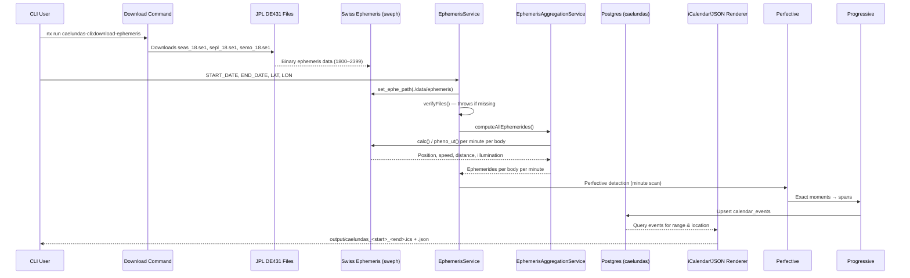

# Swiss Ephemeris Integration

Caelundas uses the **[Swiss Ephemeris](https://www.astro.com/swisseph/)** (`sweph` npm package) to compute planetary positions, aspects, and astronomical events locally from **JPL DE431** data files. All calculations run offline — no network calls, API keys, or rate limits.

## Data Files

The integration requires three binary data files (≈ 2 MB total) that are **not committed to the repository**:

| File | Contents |
|------|----------|
| `seas_18.se1` | Asteroids and lunar nodes/apses |
| `sepl_18.se1` | Planets (Mercury through Pluto) |
| `semo_18.se1` | Moon |

These files cover the years **1800–2399** (the `18` in the filename denotes the starting century). Caelundas constrains user-facing operations to **1900-01-01 through 2100-12-31**, the span explicitly validated at the input layer.

### Download Command

```bash
nx run caelundas-cli:download-ephemeris
```

This command:
- Downloads files from `https://raw.githubusercontent.com/aloistr/swisseph/master/ephe/` into `data/ephemeris/`
- Writes each file to a `.part` temporary file, then atomically renames it — an interrupted download leaves no partial file that could be mistaken for a complete one
- Skips files already present and non-empty (idempotent, safe to rerun)
- Runs from its own entry point (`ephemeris-download-cli.main.ts`) so it does not require a database connection

## Data Flow Architecture



*Caption: Ephemeris data flow from download through detection to calendar output.*

## Initialization

At application startup, `EphemerisService` constructor calls `initializeSwissEphemeris()` which points the `sweph` library at the data directory:

```typescript
// ephemeris.constants.ts
export function initializeSwissEphemeris(): void {
  set_ephe_path(resolveEphemerisDirectory());
}
```

This only sets the path; it does **not** verify the files exist. Verification is deferred to `EphemerisService.verifyFiles()` so that building the application never fails for want of the files.

## File Verification

Before any ephemeris calculation runs, the application calls `EphemerisService.verifyFiles()`, which invokes `assertEphemerisFilesPresent()`. If any of the three required files is missing or empty, it throws `EphemerisFilesMissingError` naming each missing file and the download command:

```
Swiss Ephemeris files are missing from ./data/ephemeris: seas_18.se1, sepl_18.se1. Download them with `nx run caelundas-cli:download-ephemeris`.
```

This check runs **once per invocation**, not per calculation.

## Fallback Behavior and Refusal

The Swiss Ephemeris library has a built-in Moshier ephemeris it falls back to silently when:
- The data files are missing, or
- The requested date lies outside the years the files cover (1800–2399)

The built-in ephemeris is **less precise**: for a slow-moving body it can shift an exact aspect event by hours; for asteroids there is no built-in data at all.

Caelundas **refuses** to use the fallback. Every `calc()` and `pheno_ut()` result is checked via `assertSwissEphemerisResult()`:

```typescript
// ephemeris.utilities.ts
export function assertSwissEphemerisResult(
  result: { error: string; flag: number },
  subject: SwissEphemerisSubject,
): void {
  if (result.flag < 0) {
    throw new Error(`${subject.tool} failed for ${subject.body}: ${result.error}`);
  }

  if ((result.flag & constants.SEFLG_SWIEPH) === 0) {
    throw new EphemerisUnavailableError(subject, result.error);
  }
}
```

`EphemerisUnavailableError` includes the **body name** and the **command/tool** that was refused, e.g.:

```
getCoordinateEphemeris for chiron did not use the Swiss Ephemeris files. They are missing (download them with `nx run caelundas-cli:download-ephemeris`), or the date lies outside 1800 to 2399, the years they cover. The built-in ephemeris has no data for this body.
```

This guarantees that every reported position, aspect, or event was computed from the JPL DE431 files.

## Computation Flags

All body calculations use the combined flag `SEFLG_SWIEPH | SEFLG_SPEED`:
- `SEFLG_SWIEPH` — use the Swiss Ephemeris data files (not the built-in)
- `SEFLG_SPEED` — request daily velocity alongside position (enables retrograde detection)

Topocentric calculations (horizon/azimuth-elevation) add `SEFLG_TOPOCTR` so the position includes parallax for the observer's location.

## Supported Bodies

The integration maps caelundas body identifiers to Swiss Ephemeris constants:

| Category | Bodies |
|----------|--------|
| **Planets** | Sun, Moon, Mercury, Venus, Mars, Jupiter, Saturn, Uranus, Neptune, Pluto |
| **Asteroids** | Ceres, Chiron, Juno, Lilith (mean apogee), Pallas, Vesta |
| **Lunar nodes/apses** | North/south lunar node (true/osculating), Lunar apogee (osculating), Lunar perigee (derived from osculating elements, no direct SE constant) |

## Date Range

| Constraint | Value | Source |
|------------|-------|--------|
| **Earliest supported** | 1900-01-01 | `input.constants.ts:minimumDate` |
| **Latest supported** | 2100-12-31 | `input.constants.ts:maximumDate` |
| **Data file coverage** | 1800–2399 | `ephemeris-download.constants.ts:EPHEMERIS_FIRST_YEAR/LAST_YEAR` |

Input validation rejects dates outside 1900–2100. The wider file coverage provides a margin and supports potential future extensions.

## Timezone Derivation

The **timezone is derived from coordinates** rather than configured separately — a calendar whose location and timezone could disagree is a calendar with silently wrong sunrise times. The input schema uses `@photostructure/tz-lookup` to determine the IANA timezone from the observer's latitude and longitude, then creates timezone-aware `moment` objects for all date parsing and computation.

## Architecture

<!-- openwiki: mermaid parse failed and this diagram was converted to a text fence so it does not break rendering. Fix the diagram source and restore the mermaid fence. Parser error: Heuristic: an unescaped angle bracket inside a label breaks rendering; rephrase the label. -->
```text
flowchart TD
    subgraph EphemSvc[EphemerisService]
        direction TB
        Coord[EphemerisCoordinateService<br/>ecliptic longitude/latitude + speed]
        Dist[EphemerisDistanceService<br/>AU distance + radial speed]
        Illum[EphemerisIlluminationService<br/>phase angle, illuminated fraction]
        Horiz[EphemerisHorizonService<br/>azimuth, elevation, rise/set/culmination]
        Phenom[EphemerisPhenomenaService<br/>planetary phenomena (phases, eclipses, etc.)]
        Time[EphemerisTimeService<br/>Julian day, delta T, sidereal time]
        Agg[EphemerisAggregationService<br/>single-pass computation for all bodies]
    end

    Coord --> Agg
    Dist --> Agg
    Illum --> Agg
    Horiz --> Agg
    Phenom --> Agg
    Time --> Agg
```

*Caption: EphemerisService orchestrator with specialized sub-services; AggregationService eliminates redundant calc() calls.*

`EphemerisAggregationService` computes coordinates, distance, illumination, and azimuth/elevation for all bodies in a single pass, eliminating redundant `calc()` calls.

### Key Sub-services

| Service | Responsibility |
|---------|----------------|
| `EphemerisCoordinateService` | Ecliptic longitude/latitude + speed for planets, asteroids, nodes |
| `EphemerisDistanceService` | Geocentric distance in AU + radial speed (for apogee/perigee detection) |
| `EphemerisIlluminationService` | Phase angle, illuminated fraction, apparent magnitude |
| `EphemerisHorizonService` | Topocentric azimuth, elevation, rise/set/culmination with refraction |
| `EphemerisPhenomenaService` | Planetary phenomena: phases, conjunctions, oppositions, eclipses |
| `EphemerisTimeService` | Julian day conversions, delta T, sidereal time, minute iteration |
| `EphemerisAggregationService` | Single-pass aggregation across all bodies and ephemeris types |

## Configuration

No runtime configuration beyond the download. The data directory is hardcoded to `./data/ephemeris` relative to the CLI working directory (`EPHEMERIS_DIRECTORY` constant). The download URL base is `https://raw.githubusercontent.com/aloistr/swisseph/master/ephe`.

## Testing

- Unit tests verify `EphemerisUnavailableError` is thrown when the `SEFLG_SWIEPH` bit is absent
- Integration tests exercise the full download → verify → compute cycle
- `ephemeris-horizon.service.integration.test.ts` validates rise/set/culmination against **JPL Horizons** reference values (e.g., Moon culmination elevation within 0.01°, moonrise upper limb on horizon within 0.1°)

```typescript
// ephemeris-horizon.service.integration.test.ts — validation against JPL Horizons
const horizonsRefractedCulminationElevation = 61.795438;
const horizonsAirlessMoonriseElevation = -0.771692;
// Tests assert Swiss Ephemeris results match Horizons within 0.01°–0.1°
```

## Error Summary

| Error | Trigger | Message Includes |
|-------|---------|------------------|
| `EphemerisFilesMissingError` | Any `.se1` file missing/empty at `verifyFiles()` | Missing filenames, download command |
| `EphemerisUnavailableError` | Calculation result lacks `SEFLG_SWIEPH` flag | Body name, tool/command name, download command, file year range, detail from library |
| Generic `Error` | `calc()`/`pheno_ut()` returns negative flag (library error) | Body name, tool/command name, library error text |

## Related Pages

- [Caelundas Domain](../domain/caelundas.md) — Overall architecture and body catalog
- [External Services](../integrations/external-services.md) — Other integrations (none for ephemeris; fully local)
- [Local Development](../operations/local-development.md) — Running the download command in development
- [Caelundas Testing](../testing/caelundas.md) — Testing strategy including JPL Horizons validation
