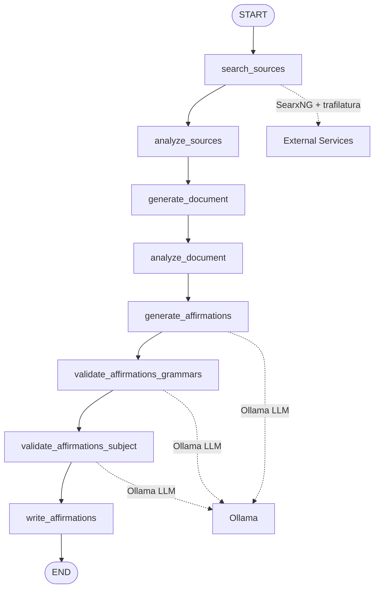

# Affirmancy Testing

This page documents the testing infrastructure, conventions, and tooling for the affirmancy project. The project uses pytest with a unit/integration split, runs two type checkers (pyright and ty), and includes Jupyter notebooks that require special handling. LangGraph agents interacting with Ollama and SearxNG are tested using mocked HTTP servers and service validation.

## Test Organization

Tests live under `projects/affirmancy/testing/` with one test file per source module:

| Test file | Source module | Purpose |
|-----------|---------------|---------|
| `test_grammars.py` | `src/grammars.py` | Grammar enum values, Grammar model construction, specifiers, slugs |
| `test_models.py` | `src/models.py` | Pydantic model construction, serialization, validation logic |
| `test_prompts.py` | `src/prompts.py` | LangChain prompt template formatting and message structure |
| `test_subjects.py` | `src/subjects.py` | Subject/SubjectCategory construction, predefined subject counts |
| `test_output.py` | `src/output.py` | JSON/Markdown file I/O, directory structure, content formatting |
| `test_services.py` | `src/services.py` | SearxNG health checks, service availability validation |

Each test file uses `@pytest.mark.unit` for fast unit tests with mocked I/O. Integration tests requiring real services use `@pytest.mark.integration`.

## Running Tests

From the project root (`projects/affirmancy`):

```bash
uv run pytest
```

This runs all tests (unit + integration). To filter:

```bash
# Unit tests only
uv run pytest -m unit

# Integration tests only
uv run pytest -m integration
```

The project exposes Nx targets for common test workflows:

- `nx run affirmancy:pytest` — all tests
- `nx run affirmancy:pytest:unit` — only unit tests
- `nx run affirmancy:pytest:integration` — only integration tests
- `nx run affirmancy:test-coverage` — all tests + coverage report

## Pytest Configuration

Configuration lives in `pyproject.toml` under `[tool.pytest.ini_options]`:

- **testpaths**: `["testing"]` — discovers tests only in the `testing/` directory
- **python_files**: `["test_*.py"]` — matches files named `test_*.py`
- **python_classes**: `["Test*"]` — matches classes named `Test*`
- **python_functions**: `["test_*"]` — matches functions named `test_*`
- **markers**: `unit` (fast, mocked I/O) and `integration` (requires real services)

## Type Checking

Two type checkers run in parallel as part of the type-checking gate:

### pyright (primary)

- Strict mode enabled via `projects/affirmancy/pyproject.toml`
- Reads only its local config (no config inheritance)
- Suppresses LangChain/LangGraph false positives for missing type stubs
- Uses the shared workspace venv at the repository root

### ty (supplementary)

- Pre-1.0 type checker with project-level config in `pyproject.toml`
- Configured for Python 3.14, root `./src`
- Ignores `invalid-argument-type` for LangGraph TypedDict subclasses

Run both via:

```bash
uv run pyright
uv run ty check
```

Or via Nx: `nx run affirmancy:typecheck` (runs both in parallel).

## Notebook Output Stripping

Jupyter notebooks in `src/` (e.g., `affirmancy.ipynb`, `prices.ipynb`, `semantics.ipynb`) have their outputs stripped on commit by `nbstripout`. This ensures diffs show code changes rather than the last run's results.

The tool is configured as a dev dependency in `pyproject.toml` and installed in the shared workspace. No manual action is needed — it runs automatically on `git commit`.

## LangGraph Agent Testing Patterns

The `affirmancy.ipynb` notebook contains multiple LangGraph agents that interact with Ollama (LLM) and SearxNG (search). These agents are structured as state graphs with typed state dictionaries. Key patterns for testing:

### Graph Structure

Agents are built using `StateGraph` with `TypedDict` state schemas:

```python
class SubjectState(TypedDict):
    subject: Subject
    query: NotRequired[str]
    sources: NotRequired[str]

class GenerateAffirmationsState(GenerateDocumentFromAnalysisState):
    document_analysis: NotRequired[str]
    grammars: list[Grammar]
    grammar_affirmations: NotRequired[list[GrammarAffirmations]]
    validation_failures: NotRequired[Annotated[list[str], operator.add]]
```

Nodes are plain functions that take state and return partial state updates. Edges form a linear or branching pipeline:

```
START → search_sources → analyze_sources → generate_document → analyze_document 
       → generate_affirmations → validate_affirmations_grammars 
       → validate_affirmations_subject → write_affirmations → END
```

### Testing Strategy for LangGraph Agents

1. **Unit test individual nodes** — Each node function can be tested in isolation with mocked LLM and search dependencies
2. **Mock Ollama** — Replace `ChatOllama` with a mock that returns deterministic responses
3. **Mock SearxNG** — Use the existing `require_searxng` validation with a test HTTP server (see `test_services.py`)
4. **Validate state transitions** — Assert that graph invocation produces expected state keys

Example pattern for mocking the LLM chain:

```python
from unittest.mock import MagicMock
from langchain_core.outputs import LLMResult, Generation

def test_generate_affirmations_node():
    # Arrange
    mock_llm = MagicMock()
    mock_llm.invoke.return_value = MagicMock(
        content='{"affirmations": ["I am brave.", "I am strong."]}'
    )
    # ... inject mock into chain
    
    # Act
    result = generate_affirmations(state_with_document_analysis)
    
    # Assert
    assert "grammar_affirmations" in result
    assert len(result["grammar_affirmations"]) > 0
```

### Validation Retry Logic

Nodes like `analyze_sources`, `generate_affirmations`, `validate_affirmations_grammars`, and `validate_affirmations_subject` use Tenacity retry logic:

```python
def attempts() -> Retrying:
    return Retrying(
        stop=stop_after_attempt(6),
        wait=wait_exponential(multiplier=1, min=1, max=10),
        before_sleep=before_sleep,
        reraise=True,
    )
```

Tests should verify both success paths and that failures propagate correctly after max retries.

## Ollama/SearxNG Mocking

### SearxNG Health Check Testing (`test_services.py`)

The `require_searxng()` function validates SearxNG availability. Tests use a fixture-based HTTP server:

```python
@pytest.fixture()
def serve() -> Iterator[Callable[[int], str]]:
    # Spawns HTTPServer on random port returning given status code
    ...

def test_reachable_host_returns_none(serve):
    assert require_searxng(serve(200)) is None

@pytest.mark.parametrize("status", [403, 404, 500])
def test_non_success_response_still_counts_as_running(serve, status):
    assert require_searxng(serve(status)) is None

def test_unreachable_host_raises_naming_host_and_fix(closed_host):
    with pytest.raises(RuntimeError) as error:
        require_searxng(closed_host)
    assert closed_host in str(error.value)
    assert START_COMMAND in str(error.value)
```

Key behaviors tested:
- HTTP 200 → service available (returns `None`)
- HTTP 4xx/5xx → service running but unhealthy (returns `None` — caller decides)
- Connection refused → raises `RuntimeError` with host URL and fix command

### Ollama Mocking Strategy

Ollama is accessed via `ChatOllama` from `langchain-ollama`. For unit tests:

1. **Mock the model class** — Patch `ChatOllama` to return a mock with controlled `invoke()`/`bind()` behavior
2. **Use JSON schema binding** — The notebook binds `GeneratedAffirmations.model_json_schema()` and `ValidationResult.model_json_schema()` to the model; mocks must honor this
3. **Handle the output parser** — `Json5PydanticOutputParser` strips markdown fences and parses lenient JSON; mocks should return valid JSON strings

## Grammar Axis Enum and Pydantic Model Validation Tests

### Grammar Enums (`test_grammars.py`)

The grammar system uses `DescribedEnum` (a `StrEnum` subclass) for axes: `Mood`, `Tense`, `Aspect`, `Form`, `Voice`, `Person`, `Number`. Each enum member carries a description and six examples.

Tests verify:
- **Emoji prefix**: `PRESENT.name.startswith("⭐")`
- **Title case naming**: `"Indicative" in PRESENT.name`
- **Slug format**: kebab-case, lowercase, no spaces/underscores
- **Specifier extraction**: `specifiers` property returns non-None axis values as uppercase strings
- **Predefined grammar properties**: `PAST.tense == Tense.PAST`, `FUTURE.aspect == Aspect.SIMPLE`
- **Example count**: all predefined grammars have ≥3 examples

### Pydantic Models (`test_models.py`)

Models under test: `Affirmation`, `GrammarAffirmations`, `SubjectAffirmations`, `GeneratedAffirmations`, `ValidationResult`.

Tests cover:
- **Construction**: required fields, optional fields with defaults
- **Serialization round-trip**: `model_dump_json()` → `json.loads()` → field equality
- **Nested serialization**: `SubjectAffirmations` containing `GrammarAffirmations` containing `Grammar` enum and `Affirmation` list
- **Custom validators**: `GeneratedAffirmations.strip_trailing_periods` removes trailing periods from each affirmation
- **Validation logic**: `ValidationResult` with `valid=True/False` and optional `reason`

### Prompt Template Tests (`test_prompts.py`)

LangChain prompt templates are tested for correct message structure:

```python
def test_generate_affirmations_prompt_format():
    messages = generate_affirmations_prompt_template.format_messages(...)
    assert len(messages) == 2
    assert isinstance(messages[0], SystemMessage)
    assert isinstance(messages[1], HumanMessage)
    content = str(messages[1].content)
    assert "The Fool" in content
    assert "Indicative" in content
```

Tests verify:
- Correct message types (`SystemMessage` + `HumanMessage`)
- Variable interpolation into template
- All required template variables present in output

### Subject Tests (`test_subjects.py`)

Tests verify predefined subject collections have expected counts:

| Collection | Expected count |
|------------|----------------|
| `TAROT_CARDS` | 78 |
| `LENORMAND_CARDS` | 38 |
| `ASTROLOGY_SIGNS` | 13 |
| `ASTROLOGY_HOUSES` | 12 |
| `CHAKRAS` | 7 |
| `RUNES` | 24 |
| `SEPHIROTH` | 10 |
| `HEBREW_LETTERS` | 22 |
| `ELEMENTS` | 4 |
| `NUMBERS` | 32 |

Also tests `SubjectCategory` and `Subject` construction, slug generation, and metadata handling.

### Output Tests (`test_output.py`)

Tests use `tmp_path` and `monkeypatch` to isolate filesystem writes:

```python
@pytest.fixture()
def output_dir(tmp_path: Path, monkeypatch: pytest.MonkeyPatch) -> Path:
    out = tmp_path / "output"
    monkeypatch.setattr(output_module, "PROJECT_DIRECTORY", tmp_path)
    monkeypatch.setattr(output_module, "OUTPUT_DIRECTORY", out)
    return out
```

Verifies:
- JSON/Markdown file creation at correct paths
- Directory structure: `output/affirmations/<category>/<order>-<slug>.json`
- Markdown headings: `# {subject.name} Affirmations`
- Grammar subheadings: `## {grammar.name}`
- Numbered lists: `1. ...`, `2. ...`
- Document and semantics document writing with markdown fence stripping

## Linting and Security

The test environment includes several static analysis tools:

- **ruff**: linting and formatting (extends shared workspace config, excludes notebooks)
- **vulture**: dead code detection (excludes `.vulture_whitelist.py`)
- **bandit**: security linting (excludes `testing/`, `output/`, `notebooks/`, skips B101)

Run all checks via:

```bash
nx run affirmancy:lint-codebase
nx run affirmancy:form-codebase
```

Or individually: `nx run affirmancy:ruff-lint`, `nx run affirmancy:vulture`, `nx run affirmancy:bandit`.

## Mermaid Diagram: LangGraph Agent Pipeline



Caption: LangGraph agent pipeline in `affirmancy.ipynb` showing node sequence and external service dependencies.

## Related Pages

- [Affirmancy Domain](../domain/affirmancy.md) — project overview and architecture
- [Ollama/SearxNG Integration](../integrations/ollama-searxng.md) — service setup and configuration
<!-- openwiki: broken internal link [../overview.md] file "../overview.md" does not exist. Fix the href or restore the target, then delete this comment. -->
- [Testing Overview](../overview.md) — workspace-wide testing conventions
