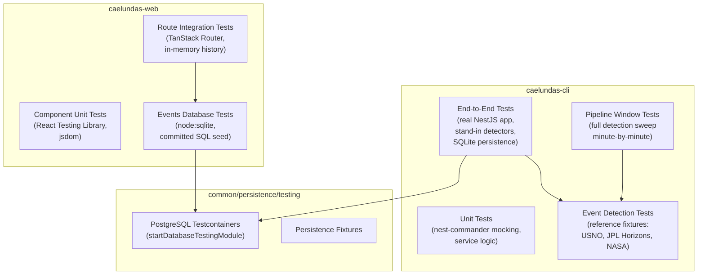

# Caelundas Testing

Caelundas operates two distinct test suites: a **CLI application** (`caelundas-cli`) that computes astronomical calendars using the Swiss Ephemeris, and a **web application** (`caelundas-web`) that renders those calendars in a TanStack Start SPA. Each suite has its own Vitest configuration, test utilities, and integration patterns, while sharing a common persistence testing layer for PostgreSQL.

## Architecture Overview



---

## CLI Application Testing (`caelundas-cli`)

### Vitest Configuration

The CLI suite extends a shared base configuration (`vitestConfig` from `@codebase/configuration/vitest.config.ts`) with CLI-specific coverage rules:

- **Environment**: Node (default)
- **Coverage exclusions**: Entity files (`*.entity.ts`) and test files (`*.test.ts`)
- **Setup file**: `testing/setup.ts` — creates `./output` directory, suppresses console output via `vi.spyOn`

### NestJS CLI Command Testing with `nest-commander`

The entry point `CaelundasCommand` (decorated with `@Command`) is tested at two levels:

#### Unit Tests (`src/caelundas-cli.main.unit.test.ts`)

Mocks `nest-commander`'s `CommandFactory.run` to verify bootstrap behavior without executing the command:

```typescript
vi.mock("nest-commander", async (importOriginal) => {
  const actual = await importOriginal<typeof NestCommanderModule>();
  return {
    ...actual,
    CommandFactory: { run: mockCommandFactoryRun },
  };
});
```

**Verified behaviors**:
- CommandFactory runs exactly once with `MainModule` as root module
- Options include `bufferLogs: true` and a logger instance
- `serviceErrorHandler` sets `process.exitCode = 1` and logs the error

#### End-to-End Tests (`src/caelundas-cli.main.end-to-end.test.ts`)

Boots a **real NestJS application context** per test run via `runCalendarCommand` utility. Only the two event detectors (`PerfectiveService`, `ProgressiveService`) are replaced with stand-ins; everything else (input parsing, ephemeris verification, calendar rendering, SQLite persistence) runs for real.

**Key utility**: `testing/calendar-command.utilities.ts`
- `runCalendarCommand(run, detectableEvents)` — stubs env vars (`START_DATE`, `END_DATE`, `LATITUDE`, `LONGITUDE`, `OUTPUT_DIRECTORY`), creates a dynamic module with stand-in detectors, executes `CaelundasCommand.run()`, reads generated `.ics` and `.json` files
- `detectable(summary, start, end?)` — factory for test events with UTC moments

**E2E test categories**:
| Category | Coverage |
|----------|----------|
| **ICS file generation** | Structure, VTIMEZONE, VEVENT, optional fields (LOCATION, COLOR) |
| **Input validation** | Coordinate transformation, timezone inference (IANA zones) |
| **Event detection** | Zodiac signs from longitude, major aspects with orb, progressive pairing |
| **Math utilities** | Degree normalization (360°, negative), angle across 0° boundary, combinations |
| **SQLite persistence** | Row upsert idempotency, overlapping range updates, multi-location separation, cross-range spanning events, boundary-day inclusion |

**Temporary database**: `testing/temporary-database.utilities.ts` creates a throwaway SQLite file in `os.tmpdir()`, runs migrations (`Migration1793045891250`), and points `CAELUNDAS_SQLITE_DATABASE` at it. Each test suite gets its own file; `close()` destroys the datasource and deletes the directory.

---

### Event Detection Accuracy Tests

The core of Caelundas testing is verifying Swiss Ephemeris calculations against **authoritative reference data**. Three categories of reference fixtures are committed:

| Source | Authority | Coverage |
|--------|-----------|----------|
| **USNO** | U.S. Naval Observatory | Moon phases, equinoxes/solstices, rise/set/twilight, solar/lunar eclipses (topocentric) |
| **JPL Horizons** | NASA JPL Solar System Dynamics | Planetary positions (longitude, latitude, distance), stelliums, compound aspects |
| **NASA** | NASA Eclipse Website | Solar/lunar eclipse circumstances (geocentric) |

Fixtures live in `testing/reference-fixtures/` and `testing/reference-longitudes/`. Each JSON file includes:
- `source`: { `name`, `url` }
- `retrieved`: ISO date of retrieval
- `toleranceMinutes`: acceptable delta (typically 1–5 minutes)
- `window`: { `startDate`, `endDate`, `latitude`, `longitude` }
- `events[]`: { `summary`, `start`, `end?`, `toleranceMinutes?` }
- `absent[]`: summaries that **must not** be detected
- `counts`: { `summary`: expected count }

#### Assertion Utility: `assertReferenceEvents`

Located in `testing/reference-fixtures.utilities.ts`, this is the primary verification function:

```typescript
assertReferenceEvents(detectedEvents: DetectedCalendarEvent[], fixture: ReferenceFixture): void
```

**Algorithm**:
1. Pair each reference event with the nearest detected event sharing its `summary`
2. Compute `startDeltaMinutes` (and `endDeltaMinutes` for spans)
3. Pass if `|delta| ≤ toleranceMinutes` (per-event or fixture default)
4. Fail if any `absent` summary appears, or any `counts` summary occurs ≠ expected times
5. Error message cites fixture source, retrieval date, and per-event deltas

**Unit tests for the assertion utility** (`reference-fixtures.utilities.unit.test.ts`) verify:
- Pass/fail at tolerance boundaries
- Nearest-event pairing (ignoring other summaries)
- End-time checking for spans
- Absent and counts enforcement

#### Detection Test Patterns

Each event family has dedicated test files using the reference fixtures:

| Test File | Event Family | Approach |
|-----------|--------------|----------|
| `moon-phases-reference.end-to-end.test.ts` | Primary Moon phases (New, 1Q, Full, 3Q) | Sweeps ±30 min around each USNO 2026 phase; computes Moon/Sun ephemeris via real `EphemerisService`; runs `MonthlyLunarCycleService.detect` minute-by-minute |
| `compound-aspects.end-to-end.test.ts` | T-squares, kites, stelliums | Runs full `PipelineWindowModule` (both perfective & progressive passes) over real windows; checks deduplication, T-square emission (1 boundary pair + 1 span), dissolution alignment with leg endings |
| `compound-aspect-seeding.end-to-end.test.ts` | Aspect seeding correctness | Verifies simple aspects forming at window start were **out of orb** one minute earlier using real ephemeris (not caelundas' own state) |
| `eclipse-test.utilities.ts` + `pipeline-window` tests | Solar/lunar eclipses | Synthetic track coordinates (Moon along/cross track through antisolar/Sun point); verifies contact limits (P1/P4, U1/U3) against independently computed geometry |
| `retrogrades.service.unit.test.ts` + `retrogrades.service.integration.test.ts` | Planetary stations (retrograde/direct) | Unit: spies private `isRetrograde`/`isDirect` predicates; Integration: 61-minute longitude windows (30 before/after) for all `retrogradeBodies`; verifies event shape (tags, summary, timestamp) |
| `stellium-reference.unit.test.ts` | Stelliums (≥3 conjunct bodies) | JPL Horizons longitude fixtures; builds conjunction registry at each boundary minute; runs `StelliumService.detect`/`detectProgressive`; compares boundaries and spans against fixture |

#### Pipeline Window Tests

`testing/pipeline-window.module.ts` assembles a minimal Nest module (`PerfectiveModule` + `ProgressiveModule`) for full detection sweeps. `testing/pipeline-window.functions.ts` provides `runPipelineWindow(window)` which:
1. Boots `PipelineWindowModule`
2. Computes ephemerides for the window
3. Runs perfective detection day-by-day, minute-by-minute
4. Runs progressive detection on perfective output
5. Returns `{ input, perfective, progressive, events }`

Used by compound-aspect, moon-phase, and seeding tests to exercise the **entire detection pipeline** against real ephemeris data.

---

### Swiss Ephemeris Calculation Verification

The `EphemerisService` orchestrates four computation types through sub-services:

| Sub-service | Computation | Swiss Ephemeris Calls |
|-------------|-------------|----------------------|
| `EphemerisCoordinateService` | Ecliptic longitude, latitude, distance | `calc()` per body per minute |
| `EphemerisHorizonService` | Azimuth, elevation, rise/set/transit | `calc()` + `azalt()` |
| `EphemerisPhenomenaService` | Phase angle, illumination, elongation | Derived from coordinate results |
| `EphemerisAggregationService` | Combines all four in single pass | Eliminates redundant `calc()` calls |

**Verification strategy**:
- **Unit level**: `EphemerisCoordinateService` etc. have unit tests with known inputs
- **Integration level**: Pipeline window tests compare aggregated output against reference fixtures
- **Regression level**: Reference fixtures are **committed JSON**; any Swiss Ephemeris version change or algorithm change will cause fixture mismatches, flagging the change

**Ephemeris file verification**: `EphemerisService.verifyFiles()` asserts required `.se1`/`.se2` files exist before any computation runs.

---

## Web Application Testing (`caelundas-web`)

### Vitest Configuration

Extends shared base config with web-specific settings:
- **Environment**: `jsdom`
- **Coverage exclusions**: Test files, browser-only files (`*.browser.ts`, `*.worker.ts`), server functions (`*.functions.ts`), router entry points (`client.tsx`, `router.tsx`, `routeTree.gen.ts`, `__root.tsx`)
- **Path alias**: `@` → `../../common/presentation/src` for vendored components

### Global Test Setup (`testing/setup.ts`)

jsdom lacks layout, scrolling, animation, and resize. Setup installs:
- `Element.prototype.scrollTo` → no-op
- `Element.prototype.getAnimations` → `[]`
- `globalThis.ResizeObserver` → fires callback immediately with `target.getBoundingClientRect()`
- `installViewport()` from `testing/viewport.ts` — simulates viewport dimensions for responsive components
- `@testing-library/react` cleanup after each test

### Component Unit Tests

Located in `src/components/*.unit.test.tsx`, using **React Testing Library** + Vitest:
- Render component with props
- Query by role/test-id/text
- Assert class names, structure, accessibility attributes
- Fire events (`fireEvent.click`, `fireEvent.keyDown`) for interactions
- Use `vi.fn()` for callback props

**Example**: `calendar-toolbar.unit.test.tsx` verifies:
- Class name application
- Period title rendering
- Compact (phone) vs. wide layout
- Navigation group (Previous/Next/Today) with heading
- Today button disabled state when current month includes today

### Route Integration Tests

`testing/render-route.tsx` renders the **full TanStack Start router** at a given path:

```typescript
export async function renderRoute(path: string, options: RenderRouteOptions = {}) {
  const router = getRouter();
  router.update({
    ...router.options,
    context: { eventsDatabase: options.eventsDatabase ?? createTestEventsDatabase() },
    history: createMemoryHistory({ initialEntries: [path] }),
    scrollRestoration: false,
  });
  if (options.waitForLoad === false) {
    render(<RouterProvider router={router} />);
    return;
  }
  await router.load();
  render(<RouterProvider router={router} />);
}
```

**Key features**:
- Mocks `__root.tsx` (which renders `<html>`) with a bare root route
- Injects test `eventsDatabase` (defaults to seeded SQLite)
- Runs route loader (`await router.load()`) before rendering
- Uses `createMemoryHistory` for navigation simulation

**Route test utilities** (`testing/calendar-page.ts`):
- `findToolbar()` — locates calendar toolbar
- `pickOption(name)` — clicks combobox option
- `startFilterRule(field, operator)` — opens filter builder, selects field & operator

**Event filter test utilities** (`testing/event-filters.ts`):
- `tagRule(root, operator, tags[])` — builds rule for seed tag hierarchy
- `filterGroup(combinator, rules[])` — builds filter query
- `filterLink(date, filter)` — encodes filter as URL search param
- `findMatchingEventIds(query, options?)` — compiles filter to SQL, executes against test database, returns event IDs

### Events Database Testing

`testing/events-database.ts` builds an **in-memory SQLite database** from committed SQL:

1. Reads migration `*-up.sql` files in order from `caelundas-cli/src/modules/database/migrations/`
2. Executes `data/events-seed.sql` (reference events)
3. Executes `data/events-read-model.sql` (derived tables, indexes)
4. Registers local-time SQL functions (`LOCAL_TIME_FUNCTIONS`)
5. Returns `EventsDatabase` interface backed by `node:sqlite` synchronous executor

**Test database variants**:
| Factory | Purpose |
|---------|---------|
| `createTestEventsDatabase(options?)` | Standard seeded database; `empty: true` skips seed; `extraSql` adds rows before read-model |
| `createFailingEventsDatabase(error)` | Wraps seeded DB; all reads reject with `error` until `recover()` called |
| `createRecordingEventsDatabase(delay)` | Records every `findEvents` query; adds `delay` ms after first query |
| `createTestSqlExecutor(options?)` | Bare executor for direct SQL (e.g., compiled filter verification) |

**Integration test example** (`src/routes/index.integration.test.tsx`):
- Renders `/` route, verifies heading and grid
- Clicks "Next" button, verifies month change and new events load
- Tests filter builder: opens panel, picks collection, applies tag rule, clears filters
- Tests error state: injects `createFailingEventsDatabase`, verifies error UI, recovers

---

## Common Persistence Testing (`common/persistence/testing`)

Provides **PostgreSQL Testcontainers** integration for any project needing a real database.

### `startDatabaseTestingModule(options)`

```typescript
const database = await startDatabaseTestingModule({
  project: "myproject",
  entities: [MyEntity],
  migrations: [Migration123],
  imports: [FeatureModule],
});
const repo = database.repository(MyEntity);
// ... test ...
await database.close();
```

**What it does**:
1. Starts throwaway PostgreSQL container via `startPostgresContainer` (Testcontainers)
2. Sets container's `<PROJECT>_POSTGRES_*` env vars on `process.env` (overriding existing)
3. Compiles NestJS testing module with:
   - Global `ConfigModule` (validates via optional `validate` fn)
   - `PostgresqlModule.forRoot({ entities, project, namingStrategy })` **or** project's own database module
   - `TypeOrmModule.forFeature(entities)`
   - Any additional `imports`/`providers`
4. Runs migrations
5. Returns `{ close, container, dataSource, module, repository }`
6. `close()`: destroys module, restores environment, stops container

**Use cases**: Integration tests requiring real PostgreSQL behavior (constraints, indexes, JSONB, full-text search) that SQLite cannot replicate.

---

## Test Organization Summary

### CLI Test Files

| Path | Purpose |
|------|---------|
| `src/caelundas-cli.main.unit.test.ts` | CLI bootstrap, error handling |
| `src/caelundas-cli.main.end-to-end.test.ts` | Full pipeline: input → detection → persistence → ICS/JSON |
| `testing/calendar-command.utilities.ts` | E2E command runner with stand-in detectors |
| `testing/temporary-database.utilities.ts` | Throwaway SQLite per test suite |
| `testing/reference-fixtures.utilities.ts` | `assertReferenceEvents`, fixture loading, comparison |
| `testing/reference-fixtures.utilities.unit.test.ts` | Assertion utility self-tests |
| `testing/aspect-test.utilities.ts` | Ephemeris fixtures for aspect detection |
| `testing/major-aspects.utilities.ts` | `createMajorAspectsService` for angular separation tests |
| `testing/eclipse-test.utilities.ts` | Synthetic eclipse track coordinates, contact limits |
| `testing/pipeline-window.*` | Full detection sweep module & runner |
| `testing/compound-aspects.end-to-end.test.ts` | Compound aspect deduplication, T-square shape |
| `testing/compound-aspect-seeding.end-to-end.test.ts` | Seeding correctness at window boundaries |
| `testing/moon-phases-reference.end-to-end.test.ts` | USNO Moon phase verification |
| `testing/stellium-reference.unit.test.ts` | JPL Horizons stellium verification |
| `testing/retrogrades.service.unit.test.ts` | Station detection predicates, progressive pairing |
| `testing/retrogrades.service.integration.test.ts` | Full retrograde/direct detection with 61-min windows |
| `src/modules/retrogrades/retrogrades.service.integration.test.ts` | Integration test for retrograde service |
| `src/modules/retrogrades/retrogrades.service.unit.test.ts` | Unit test for retrograde service |

### Web Test Files

| Path | Purpose |
|------|---------|
| `testing/setup.ts` | jsdom polyfills (ResizeObserver, scroll, animations) |
| `testing/render-route.tsx` | Full router render with test database |
| `testing/events-database.ts` | In-memory SQLite from committed SQL seed |
| `testing/event-filters.ts` | Filter query builders, SQL compilation verification |
| `testing/calendar-page.ts` | Filter builder interaction helpers |
| `testing/viewport.ts` | Viewport simulation for responsive components |
| `src/components/*.unit.test.tsx` | Component behavior, accessibility, layout |
| `src/lib/calendar/*.integration.test.tsx` | Calendar state transitions (filter clear, view changes) |
| `src/routes/index.integration.test.tsx` | Full route: render, navigation, filtering, error recovery |

### Common Persistence Test Files

| Path | Purpose |
|------|---------|
| `persistence-testing.utilities.ts` | `startDatabaseTestingModule` |
| `persistence-testing.types.ts` | `DatabaseTestingModule`, options types |
| `fixture-persistence.ts` | Fixture loading for persistence tests |
| `command-line-runner.ts` | CLI test runner for persistence |
| `mocks.ts` | Mock repositories, datasources |
| `setup.ts` | Global persistence test setup |

---

## Running Tests

### CLI Suite
```bash
# From caelundas-cli directory
pnpm test                    # All tests
pnpm test -- --run           # CI mode (no watch)
pnpm test src/caelundas-cli.main.end-to-end.test.ts  # Specific file
```

### Web Suite
```bash
# From caelundas-web directory
pnpm test                    # All tests (jsdom)
pnpm test -- --run           # CI mode
```

### Coverage
Both suites generate coverage reports (exclusions defined in respective `vitest.config.ts`). CLI excludes entities; web excludes routes, server functions, browser/worker code.

---

## Key Testing Principles

1. **Reference fixtures as contracts**: Committed JSON from USNO/JPL/NASA are the source of truth. Algorithm changes must update fixtures intentionally.
2. **Real ephemeris in detection tests**: Pipeline window tests compute actual Swiss Ephemeris positions; only detectors are stood in for E2E command tests.
3. **Stand-in detectors for speed**: `PerfectiveService`/`ProgressiveService` replaced in `runCalendarCommand` because Swiss Ephemeris computation takes minutes per day.
4. **SQLite for CLI persistence tests**: Fast, file-based, matches production schema via same migrations.
5. **node:sqlite for web tests**: Same SQL semantics as browser's sqlite-wasm worker; synchronous executor keeps test contract simple.
6. **Testcontainers for PostgreSQL**: Only when real Postgres behavior is required (e.g., JSONB, advisory locks, migration validation).
7. **jsdom polyfills for layout-dependent components**: ResizeObserver, scroll, animations mocked to avoid flakiness.
8. **TanStack Router integration tests**: Full router with loaders, not shallow component tests, to catch loader/context bugs.
