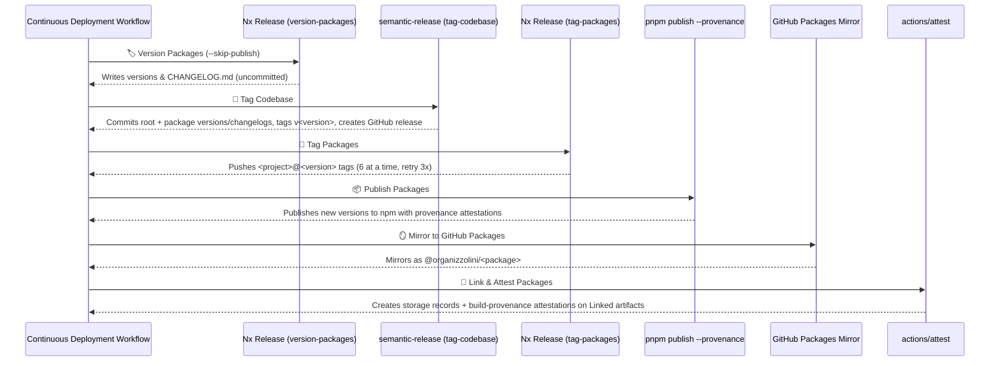

# CI/CD Pipelines

This page documents the three GitHub Actions workflows that form the CI/CD pipeline, the `setup-codebase` composite action that prepares every job, and the fully automated release process that runs on merge to `main`.

## Overview

| Workflow | Trigger | Purpose |
|----------|---------|---------|
| **Continuous Integration** | Push to `main`, PRs, merge queue | Lint, typecheck, test, build, security scan |
| **Continuous Deployment** | Push to `main`, devcontainer changes | Build devcontainer, release & publish packages |
| **Continuous Compliance** | Issues, PRs, merge queue, weekly schedule | Governance, commit conventions, issue metadata |

All workflows share the `setup-codebase` composite action for environment preparation and the `cleanup-codebase` action for cache persistence.

---

## setup-codebase Composite Action

**Location**: `.github/actions/setup-codebase/action.yml`

The `setup-codebase` action is a composite action that every CI job calls first. It installs tooling, restores caches, and configures the Nx workspace. Every optional step is gated by an input so a job pays only for what it uses.

### Key Responsibilities

1. **Package manager setup** — Installs the pnpm version pinned in `package.json`'s `packageManager` field via a cached `pnpm/action-setup` invocation (see `setup-pnpm` action).
2. **Node.js setup** — Installs the Node version from `.nvmrc` with pnpm cache.
3. **Nx SHAs resolution** — Runs `nrwl/nx-set-shas@v5` to compute `NX_BASE` and `NX_HEAD` for `nx affected`. The `nx-base` input controls the base strategy:
   - `last-successful` (default): Uses the last commit whose whole workflow succeeded.
   - `push-before`: Uses the push's own previous tip (for CI runs).
4. **Homebrew tools cache** — Weekly-rotating cache for `gitleaks` (secret scanning) and `trivy` (infrastructure scanning). Only the security gate enables this.
5. **PostgreSQL 18 client** — Installs `pg_dump`/`pg_restore` from PGDG apt for database integration tests.
6. **Nx graph cache** — Restores `.nx/workspace-data` (excluding task database) keyed by lockfile and project config hashes.
7. **Nx task cache** — Restores `.nx/cache` and `.nx/workspace-data/*.db*` per `nx-cache-scope`. Exact-match key includes `github.sha`; restore-keys fall back to scope+OS and scope-only.
8. **uv setup** — Installs uv with cache keyed by `configuration/uv.lock`.
9. **Python dependencies** — Runs `uv sync --frozen --project configuration` into shared root `.venv` (used by `yaml-lint` and `sqlfluff` on every TypeScript project).
10. **ESLint cache** — Restores `.eslintcache` for the lint job.
11. **node-gyp permissions repair** — Fixes executable bit on bundled `gyp_main.py` to avoid intermittent `Permission denied` during native builds.
12. **Node dependencies install** — Runs `pnpm install --frozen-lockfile` (skippable).
13. **Push-base bounding** — On CI pushes with `nx-base: push-before`, runs `bound-base-to-push` to ensure the base is an ancestor of HEAD.
14. **PR cache import** — On merge group runs, imports the PR's Nx cache from an artifact.
15. **Task database verification** — Discards corrupt databases from cancelled saves before first task runs.
16. **Task database adoption** — Renames restored database to current runner's machine ID so Nx reads it.

### Outputs

- `nx-cache-primary-key`: The exact-match cache key computed for this job (pass to `cleanup-codebase`).
- `nx-cache-scope`: The scope this job used (pass to `cleanup-codebase` for artifact naming).

---

## Continuous Integration Workflow

**File**: `.github/workflows/continuous-integration.yml`

### Triggers

- Push to `main`
- Pull requests (opened, reopened, synchronize, ready_for_review)
- Merge group
- Manual dispatch (with `verbose` input)

### Concurrency

- Group: `${{ workflow }}-${{ ref == main && sha || ref }}`
- Cancel in-progress for non-main refs

### Permissions

- `actions: read`, `contents: write`, `pull-requests: write`, `issues: write`

### Job Matrix (11 legs)

| Target | Name | Emoji | Timeout | Notes |
|--------|------|-------|---------|-------|
| `typecheck-code` | Typecheck | 🧑‍🎓 | 12m | |
| `format-code` | Format | 🧑‍🎨 | 12m | |
| `lint-code` | Lint | 🧑‍🔧 | 12m | ESLint cache enabled |
| `deprecate-code` | Deprecate | 🧟 | 12m | |
| `guard-code` | Guard | 💂 | 20m | Includes conformetry templates when changed |
| `test-code` | Test | 🧑‍🔬 | 12m | Excludes meanderaw-cli, caelundas, ic-suite |
| `test-code` | Test Caelundas | 🧑‍🔬 | 12m | Only projects/caelundas/** |
| `test-code` | Test Meanderaw | 🧑‍🔬 | 12m | Only meanderaw-cli |
| `test-code` | Test IC Suite | 🧑‍🔬 | 12m | Only projects/ic-suite/** |
| `secure-code` | Secure | 🕵️ | 12m | Gitleaks + Trivy scanning |
| `build-projects` | Build | 👷 | 12m | Allows failure, reports on main |
| `verify-publishable-packages` | Publishable Packages | 📦 | 15m | Packs & installs every publishable ic-suite package into an external consumer |

### Test Sharding Strategy

The test suite is split into four parallel shards so no single leg waits for slow projects:

| Shard | Projects Included | Rationale |
|-------|-------------------|-----------|
| **General** (default) | All projects except `meanderaw-cli`, `caelundas/**`, `ic-suite/**` | Baseline shard that the branch protection has always required |
| **Caelundas** | `projects/caelundas/**` | CLI cannot start until its ephemeris download finishes; runs alone |
| **Meanderaw** | `meanderaw-cli` | Took over 7 minutes uncached beside the rest; ~3 minutes alone |
| **IC Suite** | `projects/ic-suite/**` | 37 packages; was most of what remained after the above |

A leg with nothing affected runs nothing.

### Key Steps

1. **Skip Conditionally** — Avoids redundant runs for the same PR by checking for newer workflow runs.
2. **Checkout Repository** — Full history (`fetch-depth: 0`) for Nx affected.
3. **Setup Codebase** — Composite action with granular cache/toggle inputs per matrix leg.
4. **Run Check** — Executes `nx affected` with the target; `guard-code` includes conformetry templates when changed files touch `configuration/conformetry-templates/`.
5. **Report Integration** — Uploads results for build, typecheck, and test targets on main and PRs.
6. **Cleanup Codebase** — Saves Nx cache (skipped on merge group), exports PR cache as artifact on PR runs.

---

## Continuous Deployment Workflow

**File**: `.github/workflows/continuous-deployment.yml`

### Triggers

- Push to `main`
- Pull requests touching `.devcontainer/**`, `.env.default`, `infrastructure/docker/docker-compose.yml`, `package.json`, or this workflow
- Manual dispatch

### Concurrency

- Group: `${{ workflow }}-${{ ref }}`
- Cancel in-progress only for pull requests (never cancel a release run)

### Permissions

- `contents: write`, `packages: write`, `issues: write`, `pull-requests: write`
- `id-token: write` (for npm provenance attestations)
- `attestations: write`, `artifact-metadata: write` (for build-provenance attestations and Linked artifacts)

### Job Matrix (2 targets)

| ID | Name | Emoji | Timeout | Purpose |
|----|------|-------|---------|---------|
| `build-devcontainer` | Devcontainer | 🧑‍🏭 | 20m | Build and test the devcontainer image |
| `push-releases` | Releases | 🦸 | 32m | Full release automation (version, tag, publish, attest) |

### Devcontainer Build (🧑‍🏭)

1. **Skip Conditionally** — Checks if changed files match devcontainer-relevant patterns (`.devcontainer/**`, `.env.default`, `docker-compose.yml`, workflow file, or `packageManager` pin). If 300+ files changed, builds rather than guessing.
2. **Setup Environment** — Copies `.env.default` to `.env`, adds `LOCAL_WORKSPACE_FOLDER`.
3. **Docker Buildx** — Sets up multi-platform builder.
4. **Login to GHCR** — Uses `GITHUB_TOKEN`.
5. **Build Image** — Uses `devcontainers/ci@v0.3` with cloud config; pushes to `ghcr.io/organizzolini/codebase-devcontainer` only on push/workflow_dispatch to `main`.
6. **Test Image** — Runs `.devcontainer/scripts/test-devcontainer.sh` inside the built image (never pushes).

### Release Automation (🦸)

The release runs entirely on merge to `main`. When `main` moves during a release run, the run steps aside (see **Supersession Handling** below).

#### Release Pipeline Stages

#### Detailed Steps

1. **🏷️ Version Packages** — Runs `nx release --skip-publish` (via `publication/src/publication.main.ts version-packages`). Reads conventional commits since each package's last tag, determines independent semver bump, writes version to `package.json`, prepends changelog entry. Uses `MainTipService` to detect if `main` moved; sets `RELEASE_SUPERSEDED=true` if so.

2. **👷 Build Projects** — Runs `nx run-many --target=build` (all projects at the versions the release commit will carry).

3. **🔭 Trace Calls** — Runs `nx run configuration:callidescope:write` to generate call trace artifacts.

4. **🕸️ Graph Dependencies** — Runs `nx run configuration:codependix:write` to generate dependency graph artifacts.

5. **👔 Inventory Generators** — Runs `nx run-many --target=conformetry-generators --configuration=write`.

6. **🔗 Synchronize** — Runs conventional-config, devcontainer-configuration, pull-request-template, skill-exclusions with `--configuration=write`.

7. **📊 Measure Code** — Runs `codometer` with `--configuration=write` (excludes `configuration`).

8. **🔖 Tag Codebase** — Runs `semantic-release` (via `publication/src/publication.main.ts tag-codebase`):
   - Bumps root `package.json` version
   - Updates root `CHANGELOG.md`
   - Commits root version, root changelog, **and** all package versions/changelogs from step 1 as single commit: `chore(release): 🔖 tag codebase <version>`
   - Tags commit `v<version>` (e.g., `v2.34.0`), creates GitHub release (README badge points here)
   - Uses explicit `assets` list to commit only intended files

9. **🔖 Tag Packages** — Tags each newly versioned package `<project>@<version>` on the release commit:
   - Pushes 6 tags at a time (GitHub rejects >6 ref updates per push)
   - Retries rejected batches up to 3 times
   - Missing tags pushed by next run before versioning
   - If no codebase release (e.g., `no-release` commit), commits package versions/changelogs first as `chore(release): 🔖 tag packages`

10. **📦 Publish Packages** — Runs `pnpm -r publish --provenance` (via `publication/src/publication.main.ts publish-packages`):
    - Publishes every package in Nx release group whose version not on npm
    - Each gets npm **provenance attestation** linking to commit and workflow run
    - Uses pnpm (not `nx release publish`) because pnpm honors provenance only via `--provenance` flag
    - Skips versions already on npm (re-run completes partial run, but cannot attest skipped packages)

11. **🪞 Mirror to GitHub Packages** — Included in publish step:
    - Mirrors each package to GitHub Packages under owner scope (`@organizzolini/...`)
    - npm remains canonical registry for installation
    - Mirrored packages can start private; visibility changed only in package settings

12. **🔗 Link Packages** — Creates storage records on organization's **Linked artifacts** page for every npm version (npm registry, npmjs.com page, SHA-256, this repo). Tags versions published in this run for attestation.

13. **🔏 Attest Packages** — Runs `actions/attest@v4` for each npm tarball this run published, creating GitHub **build-provenance attestations** shown beside records on Linked artifacts page.

14. **🧹 Cleanup Codebase** — Saves Nx cache (covers whole graph at release commit versions).

#### Supersession Handling

A release run takes long enough that another PR often merges while it works. When `main` moves during the run:

1. **Version Packages step** checks `MainTipService` before starting; if `main` moved, sets `RELEASE_SUPERSEDED=true` and skips.
2. **Tag Codebase step** (semantic-release) checks before starting; if push rejected because `main` moved, sets `RELEASE_SUPERSEDED=true`.
3. **All subsequent steps** check `env.RELEASE_SUPERSEDED != 'true'` and skip.
4. **Newer commit's run** releases everything the superseded run would have.

This avoids failed pushes and duplicate releases.

---

## Continuous Compliance Workflow

**File**: `.github/workflows/continuous-compliance.yml`

### Triggers

- Push to `main`
- Issues (opened, reopened, unassigned, edited, labeled, unlabeled)
- Pull requests (opened, reopened, synchronize, edited, labeled, unlabeled, assigned, unassigned, ready_for_review)
- Merge group (checks_requested)
- Weekly schedule (Friday 8:18am UTC)
- Manual dispatch

### Concurrency

- Per-event-group; cancels in-progress for PRs

### Permissions

- `contents: read`, `issues: write`, `pull-requests: write`

### Jobs

#### 🧑‍💼 Issue

Runs on issue events, schedule, and manual dispatch (not dependabot).

1. **Checkout**, **Setup pnpm**, **Setup Node**
2. **Install Root Dependencies** — Only root, `synchronization...`, `validation...` (no Nx graph).
3. **Reconcile Issue Labels** — On `issues.opened` only; applies required labels from issue body.
4. **Ensure Issue Assignee** — Defaults unassigned issues to repository owner.
5. **Ensure Open Issues Have Assignees** — On schedule/manual, sweeps all open unassigned issues.
6. **Audit Single Issue Metadata** — On issue events, validates the issue's metadata.
7. **Audit All Open Issues Metadata** — On schedule/manual, sweeps all open issues and hierarchy relationships.

#### 👮 Enforce

Runs on push, merge group, schedule, manual, and non-draft PRs (includes dependabot).

1. **Checkout**, **Setup pnpm**, **Setup Node**
2. **Install Root Dependencies** — Same minimal filter.
3. **Audit Repository Governance** — Validates `CODEOWNERS` rules and workflow security.

#### 🧑‍⚖️ Comply

Runs on PR events, merge group, and non-draft PRs (includes dependabot; exempts dependabot from title/body checks).

1. **Resolve Merge Group PR** — Extracts PR number/author from `gh-readonly-queue` ref.
2. **Checkout**, **Setup pnpm**, **Setup Node**
3. **Install Root Dependencies**
4. **Reconcile PR Labels** — On PR events only; syncs labels from PR title.
5. **Validate Branch Name** — On PR events; validates against Conventional Commits.
6. **Validate PR Title** — On PR and merge group; validates Conventional Commits format (exempts dependabot).
7. **Validate PR Body** — On PR and merge group; validates required template sections (exempts dependabot).
8. **Validate Release Significance** — PR title significance must match or exceed commits.
9. **Validate Commit Message** — On push to main; validates latest commit subject (exempts dependabot).
10. **Validate Merge Group Commit Message** — On merge group; validates head commit subject (skips generic "Merge pull request #" subjects; exempts dependabot).

---

## Refresh Documentation Workflow

**File**: `.github/workflows/refresh-documentation.yml`

### Triggers

- Weekly schedule (Friday 8:18am UTC)
- Manual dispatch

### Concurrency

- Per-ref; cancels in-progress

### Permissions

- `contents: write`, `pull-requests: write`

### Steps

1. **Checkout** — Full history.
2. **Setup Codebase** — With `nx-shas: false` (no Nx affected needed).
3. **Restore OpenWiki Progress** — Caches `documentation/openwiki` keyed by SHA/run.
4. **Refresh Documentation** — Runs `nx run documentation:refresh-documentation` (uses OpenRouter free Nemotron 3 Ultra model).
5. **Save OpenWiki Progress** — Caches progress for resume on same commit or fallback to earlier.
6. **Import GPG Key** — For signed commits.
7. **Upsert Pull Request** — Creates/updates PR on `docs/codebase-refresh-documentation` branch with signed commits.

---

## Upgrade Dependencies Workflow

**File**: `.github/workflows/upgrade-dependencies.yml`

### Triggers

- Weekly schedule (Friday 8:18am UTC)
- Manual dispatch

### Concurrency

- Per-ref; cancels in-progress

### Permissions

- `contents: write`, `pull-requests: write`

### Steps

1. **Checkout**
2. **Setup Codebase** — With `nx-shas: false`.
3. **Upgrade Dependencies** — Runs `integration/src/integration.main.ts upgrade-dependencies` which upgrades in sequence: pnpm, Node, Python, lockfile, Python dependencies, skills, Impeccable. Failed upgrades are undone; rest continue. Outputs `has_dependency_updates` and `body_path`.
4. **Import GPG Key** — If upgrades found.
5. **Open Pull Request** — Creates PR on `chore/dependencies-upgrade` with required labels (`dependencies`, `automated`, `type:chore`, `scope:dependencies`, `source:agent`) and assignee.

---

## Related Pages

- [Release Process](../workflows/release.md) — Detailed release automation documentation
- [Code Quality Gates](../workflows/code-quality.md) — IC-Suite quality gates integrated into CI
- [Development Workflow](../workflows/development.md) — Agent development workflow
- [Infrastructure](../architecture/infrastructure.md) — Infrastructure and devcontainer details
