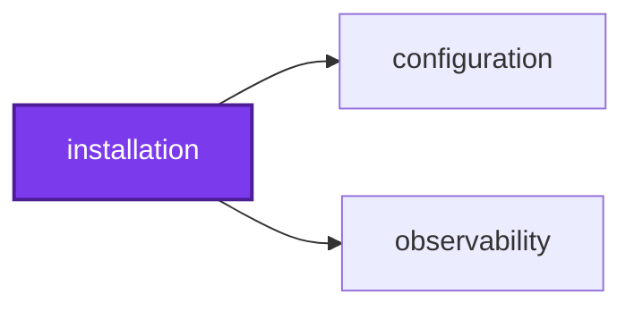
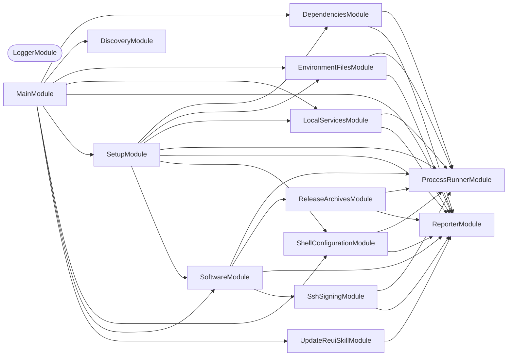

## Start

```bash
nx run installation:start
```

## Test

```bash
nx run installation:vitest
```

## 👔 Conformetry

This project was generated from the [nestjs-command-project](../../configuration/conformetry-templates/nestjs-command-project) conformetry template.

<!-- callidescope:start -->

## 🔭 Callidescope

Call stacks traced through `installation`, deepest first. Each frame shows what it takes, what it returns, and what its documentation says.

| Measure | Value |
| --- | --- |
| Callables | 175 |
| Files | 70 |
| Calls traced | 388 |
| Call stacks | 7 |
| Deepest stack | 13 |
| Stacks through recursion | 0 |
| Unfollowable calls | 9 |

### Limits

What this project is judged against, as declared in its own `callidescope.config.ts`.

| Limit | Value |
| --- | --- |
| `maximumDepth` | 17 |
| `maximumBreadth` | none |

### Call stacks (depth)

**1. `SetupCommand.run`** — depth ≥ 13 · decorated-method

```text
🚀 SetupCommand.run(): Promise<void> [installation/src/modules/setup/setup.command.ts:40]
   ↳ Sets up the machine.
  └─> SetupService.setUp(): Promise<void> [installation/src/modules/setup/setup.service.ts:103]
     ↳ Runs the steps for this operating system, stopping at the first that fails.
    └─> SetupService.setUpMac(): Promise<void> [installation/src/modules/setup/setup.service.ts:87]
       ↳ Sets up a developer's Mac.
      └─> SoftwareService.installSoftware(): Promise<void> [installation/src/modules/software/software.service.ts:69]
         ↳ Installs what this operating system gets, then makes SSH signatures verifiable.
        └─> SoftwareService.installWithHomebrew(): Promise<void> [installation/src/modules/software/software.service.ts:57]
           ↳ Installs what a Mac with Homebrew gets, in order.
          └─> SoftwareDatabaseService.installDatabaseTools(): void [installation/src/modules/software/software-database.service.ts:171]
             ↳ Installs squawk and the PostgreSQL 18 tools.
            └─> SoftwareDatabaseService.installPostgres(): void [installation/src/modules/software/software-database.service.ts:177]
               ↳ Installs PostgreSQL 18 unless its tools are already present.
              └─> SoftwareDatabaseService.installPostgresClient(): void [installation/src/modules/software/software-database.service.ts:94]
                 ↳ Installs PostgreSQL 18 on this machine, however its package manager does.
                └─> SoftwareDatabaseService.installPostgresWithApt(): void [installation/src/modules/software/software-database.service.ts:120]
                   ↳ Installs PostgreSQL 18 from the PostgreSQL apt repository, as root or through `sudo`.
                  └─> SoftwareDatabaseService.addAptRepository(codename: string): void [installation/src/modules/software/software-database.service.ts:51]
                     ↳ Adds the PostgreSQL apt source and its signing key.
                    └─> SoftwareDatabaseService.asRoot(command: string, args: string[]): void [installation/src/modules/software/software-database.service.ts:75]
                       ↳ Runs a command as root: directly when this process is root, else through `sudo`.
                      └─> ProcessRunnerService.runOrThrow(command: string, args: string[], options?: ProcessOptions): ProcessResult [installation/src/modules/process-runner/process-runner.service.ts:97]
                         ↳ Runs a command and throws when it does not exit 0.
                        └─> ProcessRunnerService.run(command: string, args: string[], options?: ProcessOptions): ProcessResult [installation/src/modules/process-runner/process-runner.service.ts:68]
                           ↳ Runs a command to completion.
```

**2. `SoftwareCommand.run`** — depth ≥ 11 · decorated-method

```text
🚀 SoftwareCommand.run(names?: readonly string[]): Promise<void> [installation/src/modules/software/software.command.ts:50]
   ↳ Installs the named software, or all of it when none is named.
  └─> SoftwareService.installSoftware(): Promise<void> [installation/src/modules/software/software.service.ts:69]
     ↳ Installs what this operating system gets, then makes SSH signatures verifiable.
    └─> SoftwareService.installWithHomebrew(): Promise<void> [installation/src/modules/software/software.service.ts:57]
       ↳ Installs what a Mac with Homebrew gets, in order.
      └─> SoftwareDatabaseService.installDatabaseTools(): void [installation/src/modules/software/software-database.service.ts:171]
         ↳ Installs squawk and the PostgreSQL 18 tools.
        └─> SoftwareDatabaseService.installPostgres(): void [installation/src/modules/software/software-database.service.ts:177]
           ↳ Installs PostgreSQL 18 unless its tools are already present.
          └─> SoftwareDatabaseService.installPostgresClient(): void [installation/src/modules/software/software-database.service.ts:94]
             ↳ Installs PostgreSQL 18 on this machine, however its package manager does.
            └─> SoftwareDatabaseService.installPostgresWithApt(): void [installation/src/modules/software/software-database.service.ts:120]
               ↳ Installs PostgreSQL 18 from the PostgreSQL apt repository, as root or through `sudo`.
              └─> SoftwareDatabaseService.addAptRepository(codename: string): void [installation/src/modules/software/software-database.service.ts:51]
                 ↳ Adds the PostgreSQL apt source and its signing key.
                └─> SoftwareDatabaseService.asRoot(command: string, args: string[]): void [installation/src/modules/software/software-database.service.ts:75]
                   ↳ Runs a command as root: directly when this process is root, else through `sudo`.
                  └─> ProcessRunnerService.runOrThrow(command: string, args: string[], options?: ProcessOptions): ProcessResult [installation/src/modules/process-runner/process-runner.service.ts:97]
                     ↳ Runs a command and throws when it does not exit 0.
                    └─> ProcessRunnerService.run(command: string, args: string[], options?: ProcessOptions): ProcessResult [installation/src/modules/process-runner/process-runner.service.ts:68]
                       ↳ Runs a command to completion.
```

**3. `DependenciesCommand.run`** — depth 6 · decorated-method

```text
🚀 DependenciesCommand.run(): Promise<void> [installation/src/modules/dependencies/dependencies.command.ts:40]
   ↳ Installs the dependencies.
  └─> DependenciesService.installDependencies(): void [installation/src/modules/dependencies/dependencies.service.ts:193]
     ↳ Installs every dependency and initializes Terraform and kubeconfig.
    └─> DependenciesService.writeKubeconfig(workspaceRoot: string): void [installation/src/modules/dependencies/dependencies.service.ts:160]
       ↳ Writes `~/.kube/config` from the cluster Terraform manages, when there is none.
      └─> DependenciesService.importCluster(…): void [installation/src/modules/dependencies/dependencies.service.ts:55]
         ↳ Imports the cluster into Terraform's state when it does not track it yet.
        └─> ProcessRunnerService.runOrThrow(command: string, args: string[], options?: ProcessOptions): ProcessResult [installation/src/modules/process-runner/process-runner.service.ts:97]
           ↳ Runs a command and throws when it does not exit 0.
          └─> ProcessRunnerService.run(command: string, args: string[], options?: ProcessOptions): ProcessResult [installation/src/modules/process-runner/process-runner.service.ts:68]
             ↳ Runs a command to completion.
```

<details>
<summary>4 more call stacks</summary>

**4. `LocalServicesCommand.run`** — depth 6 · decorated-method

```text
🚀 LocalServicesCommand.run(): Promise<void> [installation/src/modules/local-services/local-services.command.ts:40]
   ↳ Starts the local services.
  └─> LocalServicesService.startLocalServices(): Promise<void> [installation/src/modules/local-services/local-services.service.ts:114]
     ↳ Starts the Docker daemon when needed, then the Postgres container.
    └─> LocalServicesService.ensureDaemon(): Promise<boolean> [installation/src/modules/local-services/local-services.service.ts:47]
       ↳ Makes sure a daemon answers, starting one when this machine can.
      └─> LocalServicesService.startDaemon(): Promise<boolean> [installation/src/modules/local-services/local-services.service.ts:86]
         ↳ Starts a daemon of its own, detached, and waits for it to answer.
        └─> ProcessRunnerService.startDetached(command: string, args: string[]): void [installation/src/modules/process-runner/process-runner.service.ts:121]
           ↳ Starts a command that keeps running after this process, and does not wait for it.
          └─> ProcessRunnerService.on(…)(): void [installation/src/modules/process-runner/process-runner.service.ts:124]
```

**5. `ShellConfigurationCommand.run`** — depth ≥ 6 · decorated-method

```text
🚀 ShellConfigurationCommand.run(): Promise<void> [installation/src/modules/shell-configuration/shell-configuration.command.ts:40]
   ↳ Configures the shell.
  └─> ShellConfigurationService.configureShell(): void [installation/src/modules/shell-configuration/shell-configuration.service.ts:165]
     ↳ Configures the startup files of the shell this process was started from.
    └─> ShellConfigurationService.configureStartupFile(file: string): void [installation/src/modules/shell-configuration/shell-configuration.service.ts:99]
       ↳ Configures one startup file.
      └─> ShellConfigurationService.findNvmPrefix(): string [installation/src/modules/shell-configuration/shell-configuration.service.ts:118]
         ↳ Where Homebrew put nvm, which its startup script is sourced from.
        └─> ProcessRunnerService.runOrThrow(command: string, args: string[], options?: ProcessOptions): ProcessResult [installation/src/modules/process-runner/process-runner.service.ts:97]
           ↳ Runs a command and throws when it does not exit 0.
          └─> ProcessRunnerService.run(command: string, args: string[], options?: ProcessOptions): ProcessResult [installation/src/modules/process-runner/process-runner.service.ts:68]
             ↳ Runs a command to completion.
```

**6. `UpdateReuiSkillCommand.run`** — depth 5 · decorated-method

```text
🚀 UpdateReuiSkillCommand.run(): Promise<void> [installation/src/modules/update-reui-skill/update-reui-skill.command.ts:40]
   ↳ Refreshes the skill.
  └─> UpdateReuiSkillService.update(): Promise<void> [installation/src/modules/update-reui-skill/update-reui-skill.service.ts:193]
     ↳ Refreshes the skill, printing the retry command instead of failing.
    └─> UpdateReuiSkillService.refresh(root: string): Promise<void> [installation/src/modules/update-reui-skill/update-reui-skill.service.ts:158]
       ↳ Fetches, compares, and writes only when the pin or the folder differs.
      └─> UpdateReuiSkillService.fetchBundle(skillDirectory: string): Promise<SkillBundle> [installation/src/modules/update-reui-skill/update-reui-skill.service.ts:59]
         ↳ Fetches the bundle and refuses one that is empty, unsafe, or without `SKILL.md`.
        └─> UpdateReuiSkillService.map(…)(…): { content: Buffer<ArrayBuffer>; path: string; } [installation/src/modules/update-reui-skill/update-reui-skill.service.ts:77]
```

**7. `EnvironmentFilesCommand.run`** — depth 4 · decorated-method

```text
🚀 EnvironmentFilesCommand.run(): Promise<void> [installation/src/modules/environment-files/environment-files.command.ts:39]
   ↳ Creates the environment files.
  └─> EnvironmentFilesService.createEnvironmentFiles(): void [installation/src/modules/environment-files/environment-files.service.ts:113]
     ↳ Bootstraps every project's `.env` from its `.env.default`.
    └─> EnvironmentFilesService.findTargets(): EnvironmentFileTarget[] [installation/src/modules/environment-files/environment-files.service.ts:88]
       ↳ Lists every directory Git knows holds a `.env.default`, sorted and unique.
      └─> ProcessRunnerService.run(command: string, args: string[], options?: ProcessOptions): ProcessResult [installation/src/modules/process-runner/process-runner.service.ts:68]
         ↳ Runs a command to completion.
```

</details>

### Breadth

| Callable | Breadth | Calls directly | Location |
| --- | --- | --- | --- |
| `ReleaseArchivesService.install` | 8 | `ReporterService.print`, `ProcessRunnerService.locate`, `ReleaseArchivesService.resolveArchitecture`, `ReleaseArchivesService.resolveTemplate`, `ProcessRunnerService.runOrThrow`, `ReleaseArchivesService.fetch`, `ReleaseArchivesService.place`, `ProcessRunnerService.run` | `installation/src/modules/release-archives/release-archives.service.ts:163` |
| `ShellConfigurationService.configureStartupFile` | 7 | `ReporterService.print`, `ShellConfigurationService.appendBlock`, `ShellConfigurationService.buildNvmBlock`, `ShellConfigurationService.findNvmPrefix`, `ShellConfigurationService.appendCompletions`, `ShellConfigurationService.appendTerraformCompletion`, `ShellConfigurationService.removeProcessesBlock` | `installation/src/modules/shell-configuration/shell-configuration.service.ts:99` |
| `SoftwareLinuxService.installLinuxTools` | 7 | `SoftwareLinuxService.attempt(…)`, `SoftwareLinuxService.attempt`, `SoftwareLinuxService.attempt(…)`, `SoftwareLinuxService.attempt(…)`, `SoftwareLinuxService.attempt(…)`, `SoftwareLinuxService.attempt(…)`, `SoftwareLinuxService.attempt(…)` | `installation/src/modules/software/software-linux.service.ts:61` |

<details>
<summary>102 more callables</summary>

| Callable | Breadth | Calls directly | Location |
| --- | --- | --- | --- |
| `SshSigningService.configureSshSigning` | 6 | `SshSigningService.readGitSetting`, `ReporterService.print`, `SshSigningService.installSshKeygen`, `SshSigningService.readSignerKey`, `SshSigningService.writeAllowedSigners`, `ProcessRunnerService.runOrThrow` | `installation/src/modules/ssh-signing/ssh-signing.service.ts:139` |
| `SoftwareDockerService.installDocker` | 6 | `ReporterService.print`, `ProcessRunnerService.locate`, `ProcessRunnerService.runOrThrow`, `SoftwareDockerService.isRunning`, `SoftwareDockerService.readVersion`, `SoftwareDockerService.startDaemon` | `installation/src/modules/software/software-docker.service.ts:77` |
| `SoftwareOllamaService.installOllama` | 6 | `SoftwareBrewService.installOrCheck`, `ReporterService.print`, `SoftwareOllamaService.isRunning`, `SoftwareOllamaService.start`, `SoftwareOllamaService.waitUntilReady`, `ProcessRunnerService.runOrThrow` | `installation/src/modules/software/software-ollama.service.ts:81` |
| `SoftwareService.installWithHomebrew` | 6 | `SoftwarePythonService.installPython`, `SoftwareOllamaService.installOllama`, `SoftwareDockerService.installDocker`, `SoftwareGpgService.installGpgSigning`, `SoftwareInfraService.installInfrastructureTools`, `SoftwareDatabaseService.installDatabaseTools` | `installation/src/modules/software/software.service.ts:57` |
| `UpdateReuiSkillService.refresh` | 6 | `UpdateReuiSkillService.fetchBundle`, `UpdateReuiSkillService.readLock`, `UpdateReuiSkillService.hashFiles`, `UpdateReuiSkillService.readInstalledFiles`, `ReporterService.print`, `UpdateReuiSkillService.install` | `installation/src/modules/update-reui-skill/update-reui-skill.service.ts:158` |
| `DependenciesService.writeKubeconfig` | 5 | `ReporterService.print`, `DependenciesService.readEnvironmentFile`, `DependenciesService.importCluster`, `DependenciesService.toClusterId`, `DependenciesService.readKubeconfig` | `installation/src/modules/dependencies/dependencies.service.ts:160` |
| `SoftwareDatabaseService.installPostgresClient` | 5 | `ProcessRunnerService.platform`, `ProcessRunnerService.runOrThrow`, `ProcessRunnerService.locate`, `SoftwareDatabaseService.isRoot`, `SoftwareDatabaseService.installPostgresWithApt` | `installation/src/modules/software/software-database.service.ts:94` |
| `SoftwareDockerService.startDaemon` | 5 | `ReporterService.print`, `ProcessRunnerService.runOrThrow`, `SoftwareDockerService.isRunning`, `ProcessRunnerService.sleep`, `SoftwareDockerService.readVersion` | `installation/src/modules/software/software-docker.service.ts:49` |
| `SoftwareGpgService.installGpgSigning` | 5 | `SoftwareGpgService.installGpg`, `SoftwareGpgService.configureAgent`, `ReporterService.print`, `SoftwareGpgService.findSigningKeyId`, `SoftwareGpgService.configureSigning` | `installation/src/modules/software/software-gpg.service.ts:151` |
| `SoftwareInfraService.buildVersionLines` | 5 | `SoftwareInfraService.read`, `SoftwareInfraService.readMerged`, `SoftwareInfraService.readTerraformVersion`, `SoftwareInfraService.readTrivyVersion`, `SoftwareInfraService.readKubectlVersion` | `installation/src/modules/software/software-infra.service.ts:35` |
| `SoftwarePythonService.installUv` | 5 | `ReporterService.print`, `ProcessRunnerService.locate`, `ProcessRunnerService.runOrThrow`, `SoftwarePythonService.readUvVersion`, `SoftwareBrewService.listOutdated` | `installation/src/modules/software/software-python.service.ts:48` |
| `SoftwareNamedService.validate` | 5 | `SoftwareNamedService.filter(…)`, `unknownNamesMessage`, `ProcessRunnerService.platform`, `SoftwareNamedService.find(…)`, `archiveToolOnMacMessage` | `installation/src/modules/software/software-named.service.ts:89` |
| `SetupService.setUpMac` | 5 | `ShellConfigurationService.configureShell`, `SoftwareService.installSoftware`, `EnvironmentFilesService.createEnvironmentFiles`, `DependenciesService.installDependencies`, `SetupService.printCompletion` | `installation/src/modules/setup/setup.service.ts:87` |
| `DependenciesService.installDependencies` | 4 | `ReporterService.print`, `ProcessRunnerService.runOrThrow`, `DependenciesService.resetNxCache`, `DependenciesService.writeKubeconfig` | `installation/src/modules/dependencies/dependencies.service.ts:193` |
| `EnvironmentFilesService.createEnvironmentFiles` | 4 | `ReporterService.print`, `EnvironmentFilesService.findTargets`, `EnvironmentFilesService.createEnvironmentFile`, `EnvironmentFilesService.addWorkspaceVariable` | `installation/src/modules/environment-files/environment-files.service.ts:113` |
| `LocalServicesService.ensureDaemon` | 4 | `LocalServicesService.isDaemonRunning`, `ReporterService.print`, `ProcessRunnerService.locate`, `LocalServicesService.startDaemon` | `installation/src/modules/local-services/local-services.service.ts:47` |
| `LocalServicesService.startDaemon` | 4 | `ReporterService.print`, `ProcessRunnerService.startDetached`, `LocalServicesService.isDaemonRunning`, `ProcessRunnerService.sleep` | `installation/src/modules/local-services/local-services.service.ts:86` |
| `ReleaseArchivesService.fetch` | 4 | `ReleaseArchivesService.download`, `ReleaseArchivesService.resolveTemplate`, `ReleaseArchivesService.verify`, `ReleaseArchivesService.unpack` | `installation/src/modules/release-archives/release-archives.service.ts:50` |
| `SoftwareBrewService.installOrCheck` | 4 | `ReporterService.print`, `ProcessRunnerService.locate`, `ProcessRunnerService.runOrThrow`, `SoftwareBrewService.listOutdated` | `installation/src/modules/software/software-brew.service.ts:38` |
| `SoftwareDatabaseService.installPostgres` | 4 | `ReporterService.print`, `SoftwareDatabaseService.hasPostgres18`, `SoftwareDatabaseService.installPostgresClient`, `SoftwareDatabaseService.readVersion` | `installation/src/modules/software/software-database.service.ts:177` |
| `SoftwareDatabaseService.installSquawk` | 4 | `ReporterService.print`, `ProcessRunnerService.locate`, `ProcessRunnerService.runOrThrow`, `SoftwareDatabaseService.readVersion` | `installation/src/modules/software/software-database.service.ts:199` |
| `SoftwareGpgService.installGpg` | 4 | `ReporterService.print`, `ProcessRunnerService.locate`, `ProcessRunnerService.runOrThrow`, `ProcessRunnerService.run` | `installation/src/modules/software/software-gpg.service.ts:124` |
| `SoftwarePythonService.installPythonThroughUv` | 4 | `ReporterService.print`, `SoftwarePythonService.hasSupportedPython`, `ProcessRunnerService.run`, `ProcessRunnerService.runOrThrow` | `installation/src/modules/software/software-python.service.ts:89` |
| `SoftwareOllamaService.start` | 4 | `ReporterService.print`, `ProcessRunnerService.run`, `ProcessRunnerService.runOrThrow`, `ProcessRunnerService.startDetached` | `installation/src/modules/software/software-ollama.service.ts:51` |
| `SoftwareService.installSoftware` | 4 | `ProcessRunnerService.platform`, `SoftwareService.installWithHomebrew`, `SoftwareLinuxService.installLinuxTools`, `SshSigningService.configureSshSigning` | `installation/src/modules/software/software.service.ts:69` |
| `SetupService.setUpLinux` | 4 | `EnvironmentFilesService.createEnvironmentFiles`, `SoftwareService.installSoftware`, `LocalServicesService.startLocalServices`, `ReporterService.print` | `installation/src/modules/setup/setup.service.ts:78` |
| `DependenciesService.importCluster` | 3 | `ProcessRunnerService.run`, `ReporterService.print`, `ProcessRunnerService.runOrThrow` | `installation/src/modules/dependencies/dependencies.service.ts:55` |
| `LocalServicesService.startLocalServices` | 3 | `LocalServicesService.ensureDaemon`, `ReporterService.print`, `ProcessRunnerService.run` | `installation/src/modules/local-services/local-services.service.ts:114` |
| `ShellConfigurationService.appendCompletions` | 3 | `ShellConfigurationService.readStartupFile`, `ShellConfigurationService.map(…)`, `ShellConfigurationService.filter(…)` | `installation/src/modules/shell-configuration/shell-configuration.service.ts:58` |
| `ShellConfigurationService.configureShell` | 3 | `ReporterService.print`, `ShellConfigurationService.configureStartupFile`, `ShellConfigurationService.printManualInstructions` | `installation/src/modules/shell-configuration/shell-configuration.service.ts:165` |
| `ReleaseArchivesService.verify` | 3 | `ProcessRunnerService.runOrThrow`, `ReleaseArchivesService.resolveTemplate`, `ReleaseArchivesService.findPublishedChecksum` | `installation/src/modules/release-archives/release-archives.service.ts:137` |
| `SshSigningService.installSshKeygen` | 3 | `ProcessRunnerService.locate`, `ReporterService.print`, `ProcessRunnerService.run` | `installation/src/modules/ssh-signing/ssh-signing.service.ts:51` |
| `SoftwareDatabaseService.installPostgresWithApt` | 3 | `SoftwareDatabaseService.addAptRepository`, `SoftwareDatabaseService.asRoot`, `SoftwareDatabaseService.linkPostgresTools` | `installation/src/modules/software/software-database.service.ts:120` |
| `SoftwareGpgService.configureSigning` | 3 | `ReporterService.print`, `ProcessRunnerService.run`, `ProcessRunnerService.runOrThrow` | `installation/src/modules/software/software-gpg.service.ts:69` |
| `SoftwareInfraService.installInfrastructureTools` | 3 | `SoftwareBrewService.installOrCheck`, `ReporterService.print`, `SoftwareInfraService.buildVersionLines` | `installation/src/modules/software/software-infra.service.ts:108` |
| `SoftwareNamedService.installArchiveTool` | 3 | `SoftwareNamedService.find(…)`, `unknownNamesMessage`, `ReleaseArchivesService.install` | `installation/src/modules/software/software-named.service.ts:63` |
| `SoftwareNamedService.install` | 3 | `SoftwareNamedService.validate`, `SoftwareNamedService.installPostgresClient`, `SoftwareNamedService.installArchiveTool` | `installation/src/modules/software/software-named.service.ts:112` |
| `SoftwareOllamaService.waitUntilReady` | 3 | `ReporterService.print`, `SoftwareOllamaService.isRunning`, `ProcessRunnerService.sleep` | `installation/src/modules/software/software-ollama.service.ts:66` |
| `SetupService.setUp` | 3 | `ProcessRunnerService.platform`, `SetupService.setUpMac`, `SetupService.setUpLinux` | `installation/src/modules/setup/setup.service.ts:103` |
| `UpdateReuiSkillService.fetchBundle` | 3 | `UpdateReuiSkillService.map(…)`, `UpdateReuiSkillService.find(…)`, `UpdateReuiSkillService.some(…)` | `installation/src/modules/update-reui-skill/update-reui-skill.service.ts:59` |
| `DependenciesService.resetNxCache` | 2 | `ReporterService.print`, `ProcessRunnerService.runOrThrow` | `installation/src/modules/dependencies/dependencies.service.ts:138` |
| `EnvironmentFilesService.findTargets` | 2 | `ProcessRunnerService.run`, `EnvironmentFilesService.map(…)` | `installation/src/modules/environment-files/environment-files.service.ts:88` |
| `ShellConfigurationService.appendTerraformCompletion` | 2 | `ProcessRunnerService.locate`, `ShellConfigurationService.appendBlock` | `installation/src/modules/shell-configuration/shell-configuration.service.ts:75` |
| `ShellConfigurationService.printManualInstructions` | 2 | `ShellConfigurationService.findNvmPrefix`, `ReporterService.print` | `installation/src/modules/shell-configuration/shell-configuration.service.ts:125` |
| `ReleaseArchivesService.place` | 2 | `ProcessRunnerService.runOrThrow`, `ReleaseArchivesService.resolveTemplate` | `installation/src/modules/release-archives/release-archives.service.ts:77` |
| `SshSigningService.readSignerKey` | 2 | `ProcessRunnerService.run`, `readSshPublicKey` | `installation/src/modules/ssh-signing/ssh-signing.service.ts:95` |
| `SoftwareDatabaseService.addAptRepository` | 2 | `ProcessRunnerService.runOrThrow`, `SoftwareDatabaseService.asRoot` | `installation/src/modules/software/software-database.service.ts:51` |
| `SoftwareDatabaseService.asRoot` | 2 | `SoftwareDatabaseService.isRoot`, `ProcessRunnerService.runOrThrow` | `installation/src/modules/software/software-database.service.ts:75` |
| `SoftwareDatabaseService.hasPostgres18` | 2 | `ProcessRunnerService.locate`, `ProcessRunnerService.run` | `installation/src/modules/software/software-database.service.ts:84` |
| `SoftwareDatabaseService.installDatabaseTools` | 2 | `SoftwareDatabaseService.installSquawk`, `SoftwareDatabaseService.installPostgres` | `installation/src/modules/software/software-database.service.ts:171` |
| `SoftwareGpgService.configureAgent` | 2 | `ReporterService.print`, `ProcessRunnerService.runOrThrow` | `installation/src/modules/software/software-gpg.service.ts:40` |
| `SoftwareGpgService.findSigningKeyId` | 2 | `ProcessRunnerService.run`, `SoftwareGpgService.find(…)` | `installation/src/modules/software/software-gpg.service.ts:107` |
| `SoftwarePythonService.hasSupportedPython` | 2 | `ProcessRunnerService.locate`, `ProcessRunnerService.run` | `installation/src/modules/software/software-python.service.ts:38` |
| `SoftwarePythonService.installPython` | 2 | `SoftwarePythonService.installUv`, `SoftwarePythonService.installPythonThroughUv` | `installation/src/modules/software/software-python.service.ts:80` |
| `SoftwareNamedService.installPostgresClient` | 2 | `SoftwareDatabaseService.installPostgres`, `ProcessRunnerService.run` | `installation/src/modules/software/software-named.service.ts:76` |
| `SoftwareCommand.run` | 2 | `SoftwareNamedService.install`, `SoftwareService.installSoftware` | `installation/src/modules/software/software.command.ts:50` |
| `SetupService.printCompletion` | 2 | `SetupService.find(…)`, `ReporterService.print` | `installation/src/modules/setup/setup.service.ts:54` |
| `UpdateReuiSkillService.hashFiles` | 2 | `UpdateReuiSkillService.toSorted(…)`, `UpdateReuiSkillService.from(…)` | `installation/src/modules/update-reui-skill/update-reui-skill.service.ts:99` |
| `UpdateReuiSkillService.readInstalledFiles` | 2 | `UpdateReuiSkillService.map(…)`, `UpdateReuiSkillService.filter(…)` | `installation/src/modules/update-reui-skill/update-reui-skill.service.ts:124` |
| `UpdateReuiSkillService.update` | 2 | `UpdateReuiSkillService.refresh`, `ReporterService.print` | `installation/src/modules/update-reui-skill/update-reui-skill.service.ts:193` |
| `ProcessRunnerService.runOrThrow` | 1 | `ProcessRunnerService.run` | `installation/src/modules/process-runner/process-runner.service.ts:97` |
| `ProcessRunnerService.sleep` | 1 | `ProcessRunnerService.anonymous` | `installation/src/modules/process-runner/process-runner.service.ts:114` |
| `ProcessRunnerService.startDetached` | 1 | `ProcessRunnerService.on(…)` | `installation/src/modules/process-runner/process-runner.service.ts:121` |
| `DependenciesService.readKubeconfig` | 1 | `ProcessRunnerService.runOrThrow` | `installation/src/modules/dependencies/dependencies.service.ts:109` |
| `DependenciesCommand.run` | 1 | `DependenciesService.installDependencies` | `installation/src/modules/dependencies/dependencies.command.ts:40` |
| `EnvironmentFilesService.addWorkspaceVariable` | 1 | `ReporterService.print` | `installation/src/modules/environment-files/environment-files.service.ts:49` |
| `EnvironmentFilesService.createEnvironmentFile` | 1 | `ReporterService.print` | `installation/src/modules/environment-files/environment-files.service.ts:67` |
| `EnvironmentFilesCommand.run` | 1 | `EnvironmentFilesService.createEnvironmentFiles` | `installation/src/modules/environment-files/environment-files.command.ts:39` |
| `LocalServicesService.isDaemonRunning` | 1 | `ProcessRunnerService.run` | `installation/src/modules/local-services/local-services.service.ts:79` |
| `LocalServicesCommand.run` | 1 | `LocalServicesService.startLocalServices` | `installation/src/modules/local-services/local-services.command.ts:40` |
| `ShellConfigurationService.appendBlock` | 1 | `ShellConfigurationService.readStartupFile` | `installation/src/modules/shell-configuration/shell-configuration.service.ts:49` |
| `ShellConfigurationService.filter(…)` | 1 | `ProcessRunnerService.locate` | `installation/src/modules/shell-configuration/shell-configuration.service.ts:65` |
| `ShellConfigurationService.findNvmPrefix` | 1 | `ProcessRunnerService.runOrThrow` | `installation/src/modules/shell-configuration/shell-configuration.service.ts:118` |
| `ShellConfigurationService.removeProcessesBlock` | 1 | `ShellConfigurationService.readStartupFile` | `installation/src/modules/shell-configuration/shell-configuration.service.ts:150` |
| `ShellConfigurationCommand.run` | 1 | `ShellConfigurationService.configureShell` | `installation/src/modules/shell-configuration/shell-configuration.command.ts:40` |
| `ReleaseArchivesService.download` | 1 | `ProcessRunnerService.runOrThrow` | `installation/src/modules/release-archives/release-archives.service.ts:45` |
| `ReleaseArchivesService.resolveArchitecture` | 1 | `ProcessRunnerService.platform` | `installation/src/modules/release-archives/release-archives.service.ts:95` |
| `ReleaseArchivesService.unpack` | 1 | `ProcessRunnerService.runOrThrow` | `installation/src/modules/release-archives/release-archives.service.ts:122` |
| `readSshPublicKey` | 1 | `readString` | `installation/src/modules/ssh-signing/ssh-signing.utilities.ts:26` |
| `SshSigningService.readGitSetting` | 1 | `ProcessRunnerService.run` | `installation/src/modules/ssh-signing/ssh-signing.service.ts:86` |
| `SshSigningService.writeAllowedSigners` | 1 | `formatAllowedSigner` | `installation/src/modules/ssh-signing/ssh-signing.service.ts:116` |
| `SoftwareBrewService.listOutdated` | 1 | `ProcessRunnerService.run` | `installation/src/modules/software/software-brew.service.ts:59` |
| `SoftwareDatabaseService.linkPostgresTools` | 1 | `ProcessRunnerService.runOrThrow` | `installation/src/modules/software/software-database.service.ts:145` |
| `SoftwareDatabaseService.readVersion` | 1 | `ProcessRunnerService.run` | `installation/src/modules/software/software-database.service.ts:160` |
| `SoftwareDockerService.isRunning` | 1 | `ProcessRunnerService.run` | `installation/src/modules/software/software-docker.service.ts:35` |
| `SoftwareDockerService.readVersion` | 1 | `ProcessRunnerService.run` | `installation/src/modules/software/software-docker.service.ts:42` |
| `SoftwareInfraService.read` | 1 | `ProcessRunnerService.run` | `installation/src/modules/software/software-infra.service.ts:53` |
| `SoftwareInfraService.readKubectlVersion` | 1 | `SoftwareInfraService.read` | `installation/src/modules/software/software-infra.service.ts:60` |
| `SoftwareInfraService.readMerged` | 1 | `ProcessRunnerService.run` | `installation/src/modules/software/software-infra.service.ts:68` |
| `SoftwareInfraService.readTerraformVersion` | 1 | `SoftwareInfraService.read` | `installation/src/modules/software/software-infra.service.ts:75` |
| `SoftwareInfraService.readTrivyVersion` | 1 | `SoftwareInfraService.readMerged` | `installation/src/modules/software/software-infra.service.ts:97` |
| `SoftwarePythonService.readUvVersion` | 1 | `ProcessRunnerService.run` | `installation/src/modules/software/software-python.service.ts:71` |
| `SoftwareLinuxService.attempt` | 1 | `ReporterService.print` | `installation/src/modules/software/software-linux.service.ts:48` |
| `SoftwareLinuxService.attempt(…)` | 1 | `ReleaseArchivesService.install` | `installation/src/modules/software/software-linux.service.ts:63` |
| `SoftwareLinuxService.attempt(…)` | 1 | `SoftwarePythonService.installPythonThroughUv` | `installation/src/modules/software/software-linux.service.ts:68` |
| `SoftwareLinuxService.attempt(…)` | 1 | `ProcessRunnerService.runOrThrow` | `installation/src/modules/software/software-linux.service.ts:71` |
| `SoftwareLinuxService.attempt(…)` | 1 | `ProcessRunnerService.runOrThrow` | `installation/src/modules/software/software-linux.service.ts:78` |
| `SoftwareLinuxService.attempt(…)` | 1 | `SoftwareDatabaseService.installSquawk` | `installation/src/modules/software/software-linux.service.ts:81` |
| `SoftwareLinuxService.attempt(…)` | 1 | `SoftwareDatabaseService.installPostgres` | `installation/src/modules/software/software-linux.service.ts:84` |
| `SoftwareOllamaService.isRunning` | 1 | `ProcessRunnerService.run` | `installation/src/modules/software/software-ollama.service.ts:42` |
| `SetupCommand.run` | 1 | `SetupService.setUp` | `installation/src/modules/setup/setup.command.ts:40` |
| `UpdateReuiSkillCommand.run` | 1 | `UpdateReuiSkillService.update` | `installation/src/modules/update-reui-skill/update-reui-skill.command.ts:40` |

</details>
<!-- callidescope:end -->

## 🕸️ Codependix

Dependency graphs exported by [codependix](https://github.com/Organizzolini/codebase/tree/main/projects/ic-suite/codependix/codependix-cli), regenerated by `nx run configuration:codependix:write`.

### Nx Neighborhood

<!-- codependix:start name="codependix-nx-projects" -->

<!-- codependix:end name="codependix-nx-projects" -->

### NestJS Module Graph

<!-- codependix:start name="codependix-nestjs-modules" -->


_Rounded modules are global: every module can inject them, so their edges are left out._
<!-- codependix:end name="codependix-nestjs-modules" -->

### File Imports

<!-- codependix:start name="codependix-file-imports" -->
```mermaid
graph LR
  file_callidescope_config_ts["callidescope.config.ts"]
  file_codependix_config_ts["codependix.config.ts"]
  file_codometer_config_ts["codometer.config.ts"]
  file_eslint_config_ts["eslint.config.ts"]
  file_src_installation_constants_ts["src/installation.constants.ts"]
  file_src_installation_main_end_to_end_test_ts["src/installation.main.end-to-end.test.ts"]
  file_src_installation_main_ts["src/installation.main.ts"]
  file_src_installation_main_unit_test_ts["src/installation.main.unit.test.ts"]
  file_src_installation_module_ts["src/installation.module.ts"]
  file_src_installation_repl_ts["src/installation.repl.ts"]
  file_src_installation_repl_unit_test_ts["src/installation.repl.unit.test.ts"]
  file_src_modules_dependencies_dependencies_command_ts["src/modules/dependencies/dependencies.command.ts"]
  file_src_modules_dependencies_dependencies_command_unit_test_ts["src/modules/dependencies/dependencies.command.unit.test.ts"]
  file_src_modules_dependencies_dependencies_constants_ts["src/modules/dependencies/dependencies.constants.ts"]
  file_src_modules_dependencies_dependencies_module_ts["src/modules/dependencies/dependencies.module.ts"]
  file_src_modules_dependencies_dependencies_service_ts["src/modules/dependencies/dependencies.service.ts"]
  file_src_modules_dependencies_dependencies_service_unit_test_ts["src/modules/dependencies/dependencies.service.unit.test.ts"]
  file_src_modules_dependencies_dependencies_types_ts["src/modules/dependencies/dependencies.types.ts"]
  file_src_modules_environment_files_environment_files_command_ts["src/modules/environment-files/environment-files.command.ts"]
  file_src_modules_environment_files_environment_files_command_unit_test_ts["src/modules/environment-files/environment-files.command.unit.test.ts"]
  file_src_modules_environment_files_environment_files_constants_ts["src/modules/environment-files/environment-files.constants.ts"]
  file_src_modules_environment_files_environment_files_module_ts["src/modules/environment-files/environment-files.module.ts"]
  file_src_modules_environment_files_environment_files_service_ts["src/modules/environment-files/environment-files.service.ts"]
  file_src_modules_environment_files_environment_files_service_unit_test_ts["src/modules/environment-files/environment-files.service.unit.test.ts"]
  file_src_modules_environment_files_environment_files_types_ts["src/modules/environment-files/environment-files.types.ts"]
  file_src_modules_local_services_local_services_command_ts["src/modules/local-services/local-services.command.ts"]
  file_src_modules_local_services_local_services_command_unit_test_ts["src/modules/local-services/local-services.command.unit.test.ts"]
  file_src_modules_local_services_local_services_constants_ts["src/modules/local-services/local-services.constants.ts"]
  file_src_modules_local_services_local_services_module_ts["src/modules/local-services/local-services.module.ts"]
  file_src_modules_local_services_local_services_service_ts["src/modules/local-services/local-services.service.ts"]
  file_src_modules_local_services_local_services_service_unit_test_ts["src/modules/local-services/local-services.service.unit.test.ts"]
  file_src_modules_local_services_local_services_types_ts["src/modules/local-services/local-services.types.ts"]
  file_src_modules_process_runner_process_runner_constants_ts["src/modules/process-runner/process-runner.constants.ts"]
  file_src_modules_process_runner_process_runner_module_ts["src/modules/process-runner/process-runner.module.ts"]
  file_src_modules_process_runner_process_runner_service_ts["src/modules/process-runner/process-runner.service.ts"]
  file_src_modules_process_runner_process_runner_service_unit_test_ts["src/modules/process-runner/process-runner.service.unit.test.ts"]
  file_src_modules_process_runner_process_runner_types_ts["src/modules/process-runner/process-runner.types.ts"]
  file_src_modules_release_archives_release_archives_constants_integration_test_ts["src/modules/release-archives/release-archives.constants.integration.test.ts"]
  file_src_modules_release_archives_release_archives_constants_ts["src/modules/release-archives/release-archives.constants.ts"]
  file_src_modules_release_archives_release_archives_module_ts["src/modules/release-archives/release-archives.module.ts"]
  file_src_modules_release_archives_release_archives_service_ts["src/modules/release-archives/release-archives.service.ts"]
  file_src_modules_release_archives_release_archives_service_unit_test_ts["src/modules/release-archives/release-archives.service.unit.test.ts"]
  file_src_modules_release_archives_release_archives_types_ts["src/modules/release-archives/release-archives.types.ts"]
  file_src_modules_reporter_reporter_constants_ts["src/modules/reporter/reporter.constants.ts"]
  file_src_modules_reporter_reporter_module_ts["src/modules/reporter/reporter.module.ts"]
  file_src_modules_reporter_reporter_service_ts["src/modules/reporter/reporter.service.ts"]
  file_src_modules_reporter_reporter_service_unit_test_ts["src/modules/reporter/reporter.service.unit.test.ts"]
  file_src_modules_reporter_reporter_types_ts["src/modules/reporter/reporter.types.ts"]
  file_src_modules_setup_setup_command_ts["src/modules/setup/setup.command.ts"]
  file_src_modules_setup_setup_command_unit_test_ts["src/modules/setup/setup.command.unit.test.ts"]
  file_src_modules_setup_setup_constants_ts["src/modules/setup/setup.constants.ts"]
  file_src_modules_setup_setup_module_ts["src/modules/setup/setup.module.ts"]
  file_src_modules_setup_setup_service_ts["src/modules/setup/setup.service.ts"]
  file_src_modules_setup_setup_service_unit_test_ts["src/modules/setup/setup.service.unit.test.ts"]
  file_src_modules_setup_setup_types_ts["src/modules/setup/setup.types.ts"]
  file_src_modules_shell_configuration_shell_configuration_command_ts["src/modules/shell-configuration/shell-configuration.command.ts"]
  file_src_modules_shell_configuration_shell_configuration_command_unit_test_ts["src/modules/shell-configuration/shell-configuration.command.unit.test.ts"]
  file_src_modules_shell_configuration_shell_configuration_constants_ts["src/modules/shell-configuration/shell-configuration.constants.ts"]
  file_src_modules_shell_configuration_shell_configuration_module_ts["src/modules/shell-configuration/shell-configuration.module.ts"]
  file_src_modules_shell_configuration_shell_configuration_service_ts["src/modules/shell-configuration/shell-configuration.service.ts"]
  file_src_modules_shell_configuration_shell_configuration_service_unit_test_ts["src/modules/shell-configuration/shell-configuration.service.unit.test.ts"]
  file_src_modules_shell_configuration_shell_configuration_types_ts["src/modules/shell-configuration/shell-configuration.types.ts"]
  file_src_modules_software_software_brew_service_ts["src/modules/software/software-brew.service.ts"]
  file_src_modules_software_software_brew_service_unit_test_ts["src/modules/software/software-brew.service.unit.test.ts"]
  file_src_modules_software_software_database_service_ts["src/modules/software/software-database.service.ts"]
  file_src_modules_software_software_database_service_unit_test_ts["src/modules/software/software-database.service.unit.test.ts"]
  file_src_modules_software_software_docker_service_ts["src/modules/software/software-docker.service.ts"]
  file_src_modules_software_software_docker_service_unit_test_ts["src/modules/software/software-docker.service.unit.test.ts"]
  file_src_modules_software_software_gpg_service_ts["src/modules/software/software-gpg.service.ts"]
  file_src_modules_software_software_gpg_service_unit_test_ts["src/modules/software/software-gpg.service.unit.test.ts"]
  file_src_modules_software_software_infra_service_ts["src/modules/software/software-infra.service.ts"]
  file_src_modules_software_software_infra_service_unit_test_ts["src/modules/software/software-infra.service.unit.test.ts"]
  file_src_modules_software_software_linux_service_ts["src/modules/software/software-linux.service.ts"]
  file_src_modules_software_software_linux_service_unit_test_ts["src/modules/software/software-linux.service.unit.test.ts"]
  file_src_modules_software_software_named_service_ts["src/modules/software/software-named.service.ts"]
  file_src_modules_software_software_named_service_unit_test_ts["src/modules/software/software-named.service.unit.test.ts"]
  file_src_modules_software_software_ollama_service_ts["src/modules/software/software-ollama.service.ts"]
  file_src_modules_software_software_ollama_service_unit_test_ts["src/modules/software/software-ollama.service.unit.test.ts"]
  file_src_modules_software_software_python_service_ts["src/modules/software/software-python.service.ts"]
  file_src_modules_software_software_python_service_unit_test_ts["src/modules/software/software-python.service.unit.test.ts"]
  file_src_modules_software_software_command_ts["src/modules/software/software.command.ts"]
  file_src_modules_software_software_command_unit_test_ts["src/modules/software/software.command.unit.test.ts"]
  file_src_modules_software_software_constants_ts["src/modules/software/software.constants.ts"]
  file_src_modules_software_software_module_ts["src/modules/software/software.module.ts"]
  file_src_modules_software_software_service_ts["src/modules/software/software.service.ts"]
  file_src_modules_software_software_service_unit_test_ts["src/modules/software/software.service.unit.test.ts"]
  file_src_modules_software_software_types_ts["src/modules/software/software.types.ts"]
  file_src_modules_ssh_signing_ssh_signing_constants_ts["src/modules/ssh-signing/ssh-signing.constants.ts"]
  file_src_modules_ssh_signing_ssh_signing_module_ts["src/modules/ssh-signing/ssh-signing.module.ts"]
  file_src_modules_ssh_signing_ssh_signing_service_ts["src/modules/ssh-signing/ssh-signing.service.ts"]
  file_src_modules_ssh_signing_ssh_signing_service_unit_test_ts["src/modules/ssh-signing/ssh-signing.service.unit.test.ts"]
  file_src_modules_ssh_signing_ssh_signing_types_ts["src/modules/ssh-signing/ssh-signing.types.ts"]
  file_src_modules_ssh_signing_ssh_signing_utilities_ts["src/modules/ssh-signing/ssh-signing.utilities.ts"]
  file_src_modules_ssh_signing_ssh_signing_utilities_unit_test_ts["src/modules/ssh-signing/ssh-signing.utilities.unit.test.ts"]
  file_src_modules_update_reui_skill_update_reui_skill_command_ts["src/modules/update-reui-skill/update-reui-skill.command.ts"]
  file_src_modules_update_reui_skill_update_reui_skill_command_unit_test_ts["src/modules/update-reui-skill/update-reui-skill.command.unit.test.ts"]
  file_src_modules_update_reui_skill_update_reui_skill_constants_ts["src/modules/update-reui-skill/update-reui-skill.constants.ts"]
  file_src_modules_update_reui_skill_update_reui_skill_module_ts["src/modules/update-reui-skill/update-reui-skill.module.ts"]
  file_src_modules_update_reui_skill_update_reui_skill_service_ts["src/modules/update-reui-skill/update-reui-skill.service.ts"]
  file_src_modules_update_reui_skill_update_reui_skill_service_unit_test_ts["src/modules/update-reui-skill/update-reui-skill.service.unit.test.ts"]
  file_src_modules_update_reui_skill_update_reui_skill_types_ts["src/modules/update-reui-skill/update-reui-skill.types.ts"]
  file_testing_environment_ts["testing/environment.ts"]
  file_testing_fake_process_runner_ts["testing/fake-process-runner.ts"]
  file_testing_mocks_ts["testing/mocks.ts"]
  file_testing_report_ts["testing/report.ts"]
  file_testing_setup_ts["testing/setup.ts"]
  file_testing_ssh_signature_ts["testing/ssh-signature.ts"]
  file_testing_temporary_workspace_ts["testing/temporary-workspace.ts"]
  file_vitest_config_ts["vitest.config.ts"]
  file_src_installation_main_end_to_end_test_ts --> file_src_installation_constants_ts
  file_src_installation_main_ts --> file_src_installation_module_ts
  file_src_installation_module_ts --> file_src_installation_constants_ts
  file_src_installation_module_ts --> file_src_modules_dependencies_dependencies_module_ts
  file_src_installation_module_ts --> file_src_modules_environment_files_environment_files_module_ts
  file_src_installation_module_ts --> file_src_modules_local_services_local_services_module_ts
  file_src_installation_module_ts --> file_src_modules_reporter_reporter_module_ts
  file_src_installation_module_ts --> file_src_modules_setup_setup_module_ts
  file_src_installation_module_ts --> file_src_modules_shell_configuration_shell_configuration_module_ts
  file_src_installation_module_ts --> file_src_modules_software_software_module_ts
  file_src_installation_module_ts --> file_src_modules_update_reui_skill_update_reui_skill_module_ts
  file_src_installation_repl_ts --> file_src_installation_module_ts
  file_src_modules_dependencies_dependencies_command_ts --> file_src_modules_dependencies_dependencies_service_ts
  file_src_modules_dependencies_dependencies_command_unit_test_ts --> file_src_modules_dependencies_dependencies_command_ts
  file_src_modules_dependencies_dependencies_command_unit_test_ts --> file_src_modules_dependencies_dependencies_service_ts
  file_src_modules_dependencies_dependencies_command_unit_test_ts --> file_src_modules_process_runner_process_runner_service_ts
  file_src_modules_dependencies_dependencies_command_unit_test_ts --> file_src_modules_process_runner_process_runner_types_ts
  file_src_modules_dependencies_dependencies_command_unit_test_ts --> file_src_modules_reporter_reporter_service_ts
  file_src_modules_dependencies_dependencies_command_unit_test_ts --> file_testing_environment_ts
  file_src_modules_dependencies_dependencies_command_unit_test_ts --> file_testing_fake_process_runner_ts
  file_src_modules_dependencies_dependencies_command_unit_test_ts --> file_testing_report_ts
  file_src_modules_dependencies_dependencies_command_unit_test_ts --> file_testing_temporary_workspace_ts
  file_src_modules_dependencies_dependencies_module_ts --> file_src_modules_dependencies_dependencies_command_ts
  file_src_modules_dependencies_dependencies_module_ts --> file_src_modules_dependencies_dependencies_service_ts
  file_src_modules_dependencies_dependencies_module_ts --> file_src_modules_process_runner_process_runner_module_ts
  file_src_modules_dependencies_dependencies_module_ts --> file_src_modules_reporter_reporter_module_ts
  file_src_modules_dependencies_dependencies_service_ts --> file_src_modules_dependencies_dependencies_constants_ts
  file_src_modules_dependencies_dependencies_service_ts --> file_src_modules_dependencies_dependencies_types_ts
  file_src_modules_dependencies_dependencies_service_ts --> file_src_modules_process_runner_process_runner_service_ts
  file_src_modules_dependencies_dependencies_service_ts --> file_src_modules_reporter_reporter_service_ts
  file_src_modules_dependencies_dependencies_service_unit_test_ts --> file_src_modules_dependencies_dependencies_service_ts
  file_src_modules_dependencies_dependencies_service_unit_test_ts --> file_src_modules_process_runner_process_runner_service_ts
  file_src_modules_dependencies_dependencies_service_unit_test_ts --> file_src_modules_reporter_reporter_service_ts
  file_src_modules_environment_files_environment_files_command_ts --> file_src_modules_environment_files_environment_files_service_ts
  file_src_modules_environment_files_environment_files_command_unit_test_ts --> file_src_modules_environment_files_environment_files_command_ts
  file_src_modules_environment_files_environment_files_command_unit_test_ts --> file_src_modules_environment_files_environment_files_service_ts
  file_src_modules_environment_files_environment_files_command_unit_test_ts --> file_src_modules_process_runner_process_runner_service_ts
  file_src_modules_environment_files_environment_files_command_unit_test_ts --> file_src_modules_reporter_reporter_service_ts
  file_src_modules_environment_files_environment_files_command_unit_test_ts --> file_testing_environment_ts
  file_src_modules_environment_files_environment_files_command_unit_test_ts --> file_testing_fake_process_runner_ts
  file_src_modules_environment_files_environment_files_command_unit_test_ts --> file_testing_report_ts
  file_src_modules_environment_files_environment_files_command_unit_test_ts --> file_testing_temporary_workspace_ts
  file_src_modules_environment_files_environment_files_module_ts --> file_src_modules_environment_files_environment_files_command_ts
  file_src_modules_environment_files_environment_files_module_ts --> file_src_modules_environment_files_environment_files_service_ts
  file_src_modules_environment_files_environment_files_module_ts --> file_src_modules_process_runner_process_runner_module_ts
  file_src_modules_environment_files_environment_files_module_ts --> file_src_modules_reporter_reporter_module_ts
  file_src_modules_environment_files_environment_files_service_ts --> file_src_modules_environment_files_environment_files_constants_ts
  file_src_modules_environment_files_environment_files_service_ts --> file_src_modules_environment_files_environment_files_types_ts
  file_src_modules_environment_files_environment_files_service_ts --> file_src_modules_process_runner_process_runner_service_ts
  file_src_modules_environment_files_environment_files_service_ts --> file_src_modules_reporter_reporter_service_ts
  file_src_modules_environment_files_environment_files_service_unit_test_ts --> file_src_modules_environment_files_environment_files_service_ts
  file_src_modules_environment_files_environment_files_service_unit_test_ts --> file_src_modules_process_runner_process_runner_service_ts
  file_src_modules_environment_files_environment_files_service_unit_test_ts --> file_src_modules_reporter_reporter_service_ts
  file_src_modules_local_services_local_services_command_ts --> file_src_modules_local_services_local_services_service_ts
  file_src_modules_local_services_local_services_command_unit_test_ts --> file_src_modules_local_services_local_services_command_ts
  file_src_modules_local_services_local_services_command_unit_test_ts --> file_src_modules_local_services_local_services_service_ts
  file_src_modules_local_services_local_services_module_ts --> file_src_modules_local_services_local_services_command_ts
  file_src_modules_local_services_local_services_module_ts --> file_src_modules_local_services_local_services_service_ts
  file_src_modules_local_services_local_services_module_ts --> file_src_modules_process_runner_process_runner_module_ts
  file_src_modules_local_services_local_services_module_ts --> file_src_modules_reporter_reporter_module_ts
  file_src_modules_local_services_local_services_service_ts --> file_src_modules_local_services_local_services_constants_ts
  file_src_modules_local_services_local_services_service_ts --> file_src_modules_process_runner_process_runner_service_ts
  file_src_modules_local_services_local_services_service_ts --> file_src_modules_reporter_reporter_service_ts
  file_src_modules_local_services_local_services_service_unit_test_ts --> file_src_modules_local_services_local_services_service_ts
  file_src_modules_local_services_local_services_service_unit_test_ts --> file_src_modules_process_runner_process_runner_service_ts
  file_src_modules_local_services_local_services_service_unit_test_ts --> file_src_modules_reporter_reporter_service_ts
  file_src_modules_local_services_local_services_service_unit_test_ts --> file_testing_environment_ts
  file_src_modules_local_services_local_services_service_unit_test_ts --> file_testing_fake_process_runner_ts
  file_src_modules_local_services_local_services_service_unit_test_ts --> file_testing_report_ts
  file_src_modules_local_services_local_services_service_unit_test_ts --> file_testing_temporary_workspace_ts
  file_src_modules_process_runner_process_runner_module_ts --> file_src_modules_process_runner_process_runner_service_ts
  file_src_modules_process_runner_process_runner_service_ts --> file_src_modules_process_runner_process_runner_constants_ts
  file_src_modules_process_runner_process_runner_service_ts --> file_src_modules_process_runner_process_runner_types_ts
  file_src_modules_process_runner_process_runner_service_unit_test_ts --> file_src_modules_process_runner_process_runner_service_ts
  file_src_modules_process_runner_process_runner_service_unit_test_ts --> file_testing_temporary_workspace_ts
  file_src_modules_release_archives_release_archives_constants_integration_test_ts --> file_src_modules_release_archives_release_archives_constants_ts
  file_src_modules_release_archives_release_archives_constants_ts --> file_src_modules_release_archives_release_archives_types_ts
  file_src_modules_release_archives_release_archives_module_ts --> file_src_modules_process_runner_process_runner_module_ts
  file_src_modules_release_archives_release_archives_module_ts --> file_src_modules_release_archives_release_archives_service_ts
  file_src_modules_release_archives_release_archives_module_ts --> file_src_modules_reporter_reporter_module_ts
  file_src_modules_release_archives_release_archives_service_ts --> file_src_modules_process_runner_process_runner_service_ts
  file_src_modules_release_archives_release_archives_service_ts --> file_src_modules_release_archives_release_archives_types_ts
  file_src_modules_release_archives_release_archives_service_ts --> file_src_modules_reporter_reporter_service_ts
  file_src_modules_release_archives_release_archives_service_unit_test_ts --> file_src_modules_process_runner_process_runner_service_ts
  file_src_modules_release_archives_release_archives_service_unit_test_ts --> file_src_modules_release_archives_release_archives_service_ts
  file_src_modules_release_archives_release_archives_service_unit_test_ts --> file_src_modules_release_archives_release_archives_types_ts
  file_src_modules_release_archives_release_archives_service_unit_test_ts --> file_src_modules_reporter_reporter_service_ts
  file_src_modules_release_archives_release_archives_service_unit_test_ts --> file_testing_fake_process_runner_ts
  file_src_modules_reporter_reporter_module_ts --> file_src_modules_reporter_reporter_service_ts
  file_src_modules_reporter_reporter_service_unit_test_ts --> file_src_modules_reporter_reporter_service_ts
  file_src_modules_setup_setup_command_ts --> file_src_modules_setup_setup_service_ts
  file_src_modules_setup_setup_command_unit_test_ts --> file_src_modules_dependencies_dependencies_service_ts
  file_src_modules_setup_setup_command_unit_test_ts --> file_src_modules_environment_files_environment_files_service_ts
  file_src_modules_setup_setup_command_unit_test_ts --> file_src_modules_local_services_local_services_service_ts
  file_src_modules_setup_setup_command_unit_test_ts --> file_src_modules_process_runner_process_runner_service_ts
  file_src_modules_setup_setup_command_unit_test_ts --> file_src_modules_release_archives_release_archives_service_ts
  file_src_modules_setup_setup_command_unit_test_ts --> file_src_modules_reporter_reporter_service_ts
  file_src_modules_setup_setup_command_unit_test_ts --> file_src_modules_setup_setup_command_ts
  file_src_modules_setup_setup_command_unit_test_ts --> file_src_modules_setup_setup_service_ts
  file_src_modules_setup_setup_command_unit_test_ts --> file_src_modules_shell_configuration_shell_configuration_service_ts
  file_src_modules_setup_setup_command_unit_test_ts --> file_src_modules_software_software_brew_service_ts
  file_src_modules_setup_setup_command_unit_test_ts --> file_src_modules_software_software_database_service_ts
  file_src_modules_setup_setup_command_unit_test_ts --> file_src_modules_software_software_docker_service_ts
  file_src_modules_setup_setup_command_unit_test_ts --> file_src_modules_software_software_gpg_service_ts
  file_src_modules_setup_setup_command_unit_test_ts --> file_src_modules_software_software_infra_service_ts
  file_src_modules_setup_setup_command_unit_test_ts --> file_src_modules_software_software_linux_service_ts
  file_src_modules_setup_setup_command_unit_test_ts --> file_src_modules_software_software_ollama_service_ts
  file_src_modules_setup_setup_command_unit_test_ts --> file_src_modules_software_software_python_service_ts
  file_src_modules_setup_setup_command_unit_test_ts --> file_src_modules_software_software_service_ts
  file_src_modules_setup_setup_command_unit_test_ts --> file_src_modules_ssh_signing_ssh_signing_service_ts
  file_src_modules_setup_setup_command_unit_test_ts --> file_testing_environment_ts
  file_src_modules_setup_setup_command_unit_test_ts --> file_testing_fake_process_runner_ts
  file_src_modules_setup_setup_command_unit_test_ts --> file_testing_report_ts
  file_src_modules_setup_setup_command_unit_test_ts --> file_testing_temporary_workspace_ts
  file_src_modules_setup_setup_module_ts --> file_src_modules_dependencies_dependencies_module_ts
  file_src_modules_setup_setup_module_ts --> file_src_modules_environment_files_environment_files_module_ts
  file_src_modules_setup_setup_module_ts --> file_src_modules_local_services_local_services_module_ts
  file_src_modules_setup_setup_module_ts --> file_src_modules_process_runner_process_runner_module_ts
  file_src_modules_setup_setup_module_ts --> file_src_modules_reporter_reporter_module_ts
  file_src_modules_setup_setup_module_ts --> file_src_modules_setup_setup_command_ts
  file_src_modules_setup_setup_module_ts --> file_src_modules_setup_setup_service_ts
  file_src_modules_setup_setup_module_ts --> file_src_modules_shell_configuration_shell_configuration_module_ts
  file_src_modules_setup_setup_module_ts --> file_src_modules_software_software_module_ts
  file_src_modules_setup_setup_service_ts --> file_src_modules_dependencies_dependencies_service_ts
  file_src_modules_setup_setup_service_ts --> file_src_modules_environment_files_environment_files_service_ts
  file_src_modules_setup_setup_service_ts --> file_src_modules_local_services_local_services_service_ts
  file_src_modules_setup_setup_service_ts --> file_src_modules_process_runner_process_runner_service_ts
  file_src_modules_setup_setup_service_ts --> file_src_modules_reporter_reporter_service_ts
  file_src_modules_setup_setup_service_ts --> file_src_modules_setup_setup_constants_ts
  file_src_modules_setup_setup_service_ts --> file_src_modules_shell_configuration_shell_configuration_service_ts
  file_src_modules_setup_setup_service_ts --> file_src_modules_software_software_service_ts
  file_src_modules_setup_setup_service_unit_test_ts --> file_src_modules_dependencies_dependencies_service_ts
  file_src_modules_setup_setup_service_unit_test_ts --> file_src_modules_environment_files_environment_files_service_ts
  file_src_modules_setup_setup_service_unit_test_ts --> file_src_modules_local_services_local_services_service_ts
  file_src_modules_setup_setup_service_unit_test_ts --> file_src_modules_process_runner_process_runner_service_ts
  file_src_modules_setup_setup_service_unit_test_ts --> file_src_modules_reporter_reporter_service_ts
  file_src_modules_setup_setup_service_unit_test_ts --> file_src_modules_setup_setup_service_ts
  file_src_modules_setup_setup_service_unit_test_ts --> file_src_modules_shell_configuration_shell_configuration_service_ts
  file_src_modules_setup_setup_service_unit_test_ts --> file_src_modules_software_software_service_ts
  file_src_modules_setup_setup_service_unit_test_ts --> file_testing_fake_process_runner_ts
  file_src_modules_shell_configuration_shell_configuration_command_ts --> file_src_modules_shell_configuration_shell_configuration_service_ts
  file_src_modules_shell_configuration_shell_configuration_command_unit_test_ts --> file_src_modules_process_runner_process_runner_service_ts
  file_src_modules_shell_configuration_shell_configuration_command_unit_test_ts --> file_src_modules_reporter_reporter_service_ts
  file_src_modules_shell_configuration_shell_configuration_command_unit_test_ts --> file_src_modules_shell_configuration_shell_configuration_command_ts
  file_src_modules_shell_configuration_shell_configuration_command_unit_test_ts --> file_src_modules_shell_configuration_shell_configuration_service_ts
  file_src_modules_shell_configuration_shell_configuration_command_unit_test_ts --> file_testing_environment_ts
  file_src_modules_shell_configuration_shell_configuration_command_unit_test_ts --> file_testing_fake_process_runner_ts
  file_src_modules_shell_configuration_shell_configuration_command_unit_test_ts --> file_testing_report_ts
  file_src_modules_shell_configuration_shell_configuration_command_unit_test_ts --> file_testing_temporary_workspace_ts
  file_src_modules_shell_configuration_shell_configuration_module_ts --> file_src_modules_process_runner_process_runner_module_ts
  file_src_modules_shell_configuration_shell_configuration_module_ts --> file_src_modules_reporter_reporter_module_ts
  file_src_modules_shell_configuration_shell_configuration_module_ts --> file_src_modules_shell_configuration_shell_configuration_command_ts
  file_src_modules_shell_configuration_shell_configuration_module_ts --> file_src_modules_shell_configuration_shell_configuration_service_ts
  file_src_modules_shell_configuration_shell_configuration_service_ts --> file_src_modules_process_runner_process_runner_service_ts
  file_src_modules_shell_configuration_shell_configuration_service_ts --> file_src_modules_reporter_reporter_service_ts
  file_src_modules_shell_configuration_shell_configuration_service_ts --> file_src_modules_shell_configuration_shell_configuration_constants_ts
  file_src_modules_shell_configuration_shell_configuration_service_unit_test_ts --> file_src_modules_process_runner_process_runner_service_ts
  file_src_modules_shell_configuration_shell_configuration_service_unit_test_ts --> file_src_modules_reporter_reporter_service_ts
  file_src_modules_shell_configuration_shell_configuration_service_unit_test_ts --> file_src_modules_shell_configuration_shell_configuration_service_ts
  file_src_modules_software_software_brew_service_ts --> file_src_modules_process_runner_process_runner_service_ts
  file_src_modules_software_software_brew_service_ts --> file_src_modules_reporter_reporter_service_ts
  file_src_modules_software_software_brew_service_unit_test_ts --> file_src_modules_process_runner_process_runner_service_ts
  file_src_modules_software_software_brew_service_unit_test_ts --> file_src_modules_reporter_reporter_service_ts
  file_src_modules_software_software_brew_service_unit_test_ts --> file_src_modules_software_software_brew_service_ts
  file_src_modules_software_software_database_service_ts --> file_src_modules_process_runner_process_runner_service_ts
  file_src_modules_software_software_database_service_ts --> file_src_modules_reporter_reporter_service_ts
  file_src_modules_software_software_database_service_ts --> file_src_modules_software_software_constants_ts
  file_src_modules_software_software_database_service_unit_test_ts --> file_src_modules_process_runner_process_runner_service_ts
  file_src_modules_software_software_database_service_unit_test_ts --> file_src_modules_reporter_reporter_service_ts
  file_src_modules_software_software_database_service_unit_test_ts --> file_src_modules_software_software_database_service_ts
  file_src_modules_software_software_database_service_unit_test_ts --> file_testing_fake_process_runner_ts
  file_src_modules_software_software_docker_service_ts --> file_src_modules_process_runner_process_runner_service_ts
  file_src_modules_software_software_docker_service_ts --> file_src_modules_reporter_reporter_service_ts
  file_src_modules_software_software_docker_service_ts --> file_src_modules_software_software_constants_ts
  file_src_modules_software_software_docker_service_unit_test_ts --> file_src_modules_process_runner_process_runner_service_ts
  file_src_modules_software_software_docker_service_unit_test_ts --> file_src_modules_reporter_reporter_service_ts
  file_src_modules_software_software_docker_service_unit_test_ts --> file_src_modules_software_software_docker_service_ts
  file_src_modules_software_software_gpg_service_ts --> file_src_modules_process_runner_process_runner_service_ts
  file_src_modules_software_software_gpg_service_ts --> file_src_modules_reporter_reporter_service_ts
  file_src_modules_software_software_gpg_service_ts --> file_src_modules_software_software_constants_ts
  file_src_modules_software_software_gpg_service_unit_test_ts --> file_src_modules_process_runner_process_runner_service_ts
  file_src_modules_software_software_gpg_service_unit_test_ts --> file_src_modules_reporter_reporter_service_ts
  file_src_modules_software_software_gpg_service_unit_test_ts --> file_src_modules_software_software_gpg_service_ts
  file_src_modules_software_software_infra_service_ts --> file_src_modules_process_runner_process_runner_service_ts
  file_src_modules_software_software_infra_service_ts --> file_src_modules_reporter_reporter_service_ts
  file_src_modules_software_software_infra_service_ts --> file_src_modules_software_software_brew_service_ts
  file_src_modules_software_software_infra_service_ts --> file_src_modules_software_software_constants_ts
  file_src_modules_software_software_infra_service_unit_test_ts --> file_src_modules_process_runner_process_runner_service_ts
  file_src_modules_software_software_infra_service_unit_test_ts --> file_src_modules_reporter_reporter_service_ts
  file_src_modules_software_software_infra_service_unit_test_ts --> file_src_modules_software_software_brew_service_ts
  file_src_modules_software_software_infra_service_unit_test_ts --> file_src_modules_software_software_infra_service_ts
  file_src_modules_software_software_linux_service_ts --> file_src_modules_dependencies_dependencies_constants_ts
  file_src_modules_software_software_linux_service_ts --> file_src_modules_process_runner_process_runner_service_ts
  file_src_modules_software_software_linux_service_ts --> file_src_modules_release_archives_release_archives_constants_ts
  file_src_modules_software_software_linux_service_ts --> file_src_modules_release_archives_release_archives_service_ts
  file_src_modules_software_software_linux_service_ts --> file_src_modules_reporter_reporter_service_ts
  file_src_modules_software_software_linux_service_ts --> file_src_modules_software_software_database_service_ts
  file_src_modules_software_software_linux_service_ts --> file_src_modules_software_software_python_service_ts
  file_src_modules_software_software_linux_service_unit_test_ts --> file_src_modules_process_runner_process_runner_service_ts
  file_src_modules_software_software_linux_service_unit_test_ts --> file_src_modules_release_archives_release_archives_constants_ts
  file_src_modules_software_software_linux_service_unit_test_ts --> file_src_modules_release_archives_release_archives_service_ts
  file_src_modules_software_software_linux_service_unit_test_ts --> file_src_modules_reporter_reporter_service_ts
  file_src_modules_software_software_linux_service_unit_test_ts --> file_src_modules_software_software_database_service_ts
  file_src_modules_software_software_linux_service_unit_test_ts --> file_src_modules_software_software_linux_service_ts
  file_src_modules_software_software_linux_service_unit_test_ts --> file_src_modules_software_software_python_service_ts
  file_src_modules_software_software_linux_service_unit_test_ts --> file_testing_fake_process_runner_ts
  file_src_modules_software_software_named_service_ts --> file_src_modules_process_runner_process_runner_service_ts
  file_src_modules_software_software_named_service_ts --> file_src_modules_release_archives_release_archives_constants_ts
  file_src_modules_software_software_named_service_ts --> file_src_modules_release_archives_release_archives_service_ts
  file_src_modules_software_software_named_service_ts --> file_src_modules_software_software_database_service_ts
  file_src_modules_software_software_named_service_ts --> file_src_modules_software_software_constants_ts
  file_src_modules_software_software_named_service_ts --> file_src_modules_software_software_types_ts
  file_src_modules_software_software_named_service_unit_test_ts --> file_src_modules_process_runner_process_runner_service_ts
  file_src_modules_software_software_named_service_unit_test_ts --> file_src_modules_release_archives_release_archives_service_ts
  file_src_modules_software_software_named_service_unit_test_ts --> file_src_modules_release_archives_release_archives_types_ts
  file_src_modules_software_software_named_service_unit_test_ts --> file_src_modules_software_software_database_service_ts
  file_src_modules_software_software_named_service_unit_test_ts --> file_src_modules_software_software_named_service_ts
  file_src_modules_software_software_named_service_unit_test_ts --> file_testing_fake_process_runner_ts
  file_src_modules_software_software_ollama_service_ts --> file_src_modules_process_runner_process_runner_service_ts
  file_src_modules_software_software_ollama_service_ts --> file_src_modules_reporter_reporter_service_ts
  file_src_modules_software_software_ollama_service_ts --> file_src_modules_software_software_brew_service_ts
  file_src_modules_software_software_ollama_service_ts --> file_src_modules_software_software_constants_ts
  file_src_modules_software_software_ollama_service_unit_test_ts --> file_src_modules_process_runner_process_runner_service_ts
  file_src_modules_software_software_ollama_service_unit_test_ts --> file_src_modules_reporter_reporter_service_ts
  file_src_modules_software_software_ollama_service_unit_test_ts --> file_src_modules_software_software_brew_service_ts
  file_src_modules_software_software_ollama_service_unit_test_ts --> file_src_modules_software_software_ollama_service_ts
  file_src_modules_software_software_python_service_ts --> file_src_modules_process_runner_process_runner_service_ts
  file_src_modules_software_software_python_service_ts --> file_src_modules_reporter_reporter_service_ts
  file_src_modules_software_software_python_service_ts --> file_src_modules_software_software_brew_service_ts
  file_src_modules_software_software_python_service_ts --> file_src_modules_software_software_constants_ts
  file_src_modules_software_software_python_service_unit_test_ts --> file_src_modules_process_runner_process_runner_service_ts
  file_src_modules_software_software_python_service_unit_test_ts --> file_src_modules_reporter_reporter_service_ts
  file_src_modules_software_software_python_service_unit_test_ts --> file_src_modules_software_software_brew_service_ts
  file_src_modules_software_software_python_service_unit_test_ts --> file_src_modules_software_software_python_service_ts
  file_src_modules_software_software_command_ts --> file_src_modules_software_software_named_service_ts
  file_src_modules_software_software_command_ts --> file_src_modules_software_software_service_ts
  file_src_modules_software_software_command_unit_test_ts --> file_src_modules_process_runner_process_runner_service_ts
  file_src_modules_software_software_command_unit_test_ts --> file_src_modules_release_archives_release_archives_service_ts
  file_src_modules_software_software_command_unit_test_ts --> file_src_modules_reporter_reporter_service_ts
  file_src_modules_software_software_command_unit_test_ts --> file_src_modules_software_software_brew_service_ts
  file_src_modules_software_software_command_unit_test_ts --> file_src_modules_software_software_database_service_ts
  file_src_modules_software_software_command_unit_test_ts --> file_src_modules_software_software_docker_service_ts
  file_src_modules_software_software_command_unit_test_ts --> file_src_modules_software_software_gpg_service_ts
  file_src_modules_software_software_command_unit_test_ts --> file_src_modules_software_software_infra_service_ts
  file_src_modules_software_software_command_unit_test_ts --> file_src_modules_software_software_linux_service_ts
  file_src_modules_software_software_command_unit_test_ts --> file_src_modules_software_software_named_service_ts
  file_src_modules_software_software_command_unit_test_ts --> file_src_modules_software_software_ollama_service_ts
  file_src_modules_software_software_command_unit_test_ts --> file_src_modules_software_software_python_service_ts
  file_src_modules_software_software_command_unit_test_ts --> file_src_modules_software_software_command_ts
  file_src_modules_software_software_command_unit_test_ts --> file_src_modules_software_software_service_ts
  file_src_modules_software_software_command_unit_test_ts --> file_src_modules_ssh_signing_ssh_signing_service_ts
  file_src_modules_software_software_command_unit_test_ts --> file_testing_environment_ts
  file_src_modules_software_software_command_unit_test_ts --> file_testing_fake_process_runner_ts
  file_src_modules_software_software_command_unit_test_ts --> file_testing_report_ts
  file_src_modules_software_software_command_unit_test_ts --> file_testing_temporary_workspace_ts
  file_src_modules_software_software_constants_ts --> file_src_modules_release_archives_release_archives_constants_ts
  file_src_modules_software_software_constants_ts --> file_src_modules_software_software_types_ts
  file_src_modules_software_software_module_ts --> file_src_modules_process_runner_process_runner_module_ts
  file_src_modules_software_software_module_ts --> file_src_modules_release_archives_release_archives_module_ts
  file_src_modules_software_software_module_ts --> file_src_modules_reporter_reporter_module_ts
  file_src_modules_software_software_module_ts --> file_src_modules_software_software_brew_service_ts
  file_src_modules_software_software_module_ts --> file_src_modules_software_software_database_service_ts
  file_src_modules_software_software_module_ts --> file_src_modules_software_software_docker_service_ts
  file_src_modules_software_software_module_ts --> file_src_modules_software_software_gpg_service_ts
  file_src_modules_software_software_module_ts --> file_src_modules_software_software_infra_service_ts
  file_src_modules_software_software_module_ts --> file_src_modules_software_software_linux_service_ts
  file_src_modules_software_software_module_ts --> file_src_modules_software_software_named_service_ts
  file_src_modules_software_software_module_ts --> file_src_modules_software_software_ollama_service_ts
  file_src_modules_software_software_module_ts --> file_src_modules_software_software_python_service_ts
  file_src_modules_software_software_module_ts --> file_src_modules_software_software_command_ts
  file_src_modules_software_software_module_ts --> file_src_modules_software_software_service_ts
  file_src_modules_software_software_module_ts --> file_src_modules_ssh_signing_ssh_signing_module_ts
  file_src_modules_software_software_service_ts --> file_src_modules_process_runner_process_runner_service_ts
  file_src_modules_software_software_service_ts --> file_src_modules_software_software_database_service_ts
  file_src_modules_software_software_service_ts --> file_src_modules_software_software_docker_service_ts
  file_src_modules_software_software_service_ts --> file_src_modules_software_software_gpg_service_ts
  file_src_modules_software_software_service_ts --> file_src_modules_software_software_infra_service_ts
  file_src_modules_software_software_service_ts --> file_src_modules_software_software_linux_service_ts
  file_src_modules_software_software_service_ts --> file_src_modules_software_software_ollama_service_ts
  file_src_modules_software_software_service_ts --> file_src_modules_software_software_python_service_ts
  file_src_modules_software_software_service_ts --> file_src_modules_ssh_signing_ssh_signing_service_ts
  file_src_modules_software_software_service_unit_test_ts --> file_src_modules_process_runner_process_runner_service_ts
  file_src_modules_software_software_service_unit_test_ts --> file_src_modules_software_software_database_service_ts
  file_src_modules_software_software_service_unit_test_ts --> file_src_modules_software_software_docker_service_ts
  file_src_modules_software_software_service_unit_test_ts --> file_src_modules_software_software_gpg_service_ts
  file_src_modules_software_software_service_unit_test_ts --> file_src_modules_software_software_infra_service_ts
  file_src_modules_software_software_service_unit_test_ts --> file_src_modules_software_software_linux_service_ts
  file_src_modules_software_software_service_unit_test_ts --> file_src_modules_software_software_ollama_service_ts
  file_src_modules_software_software_service_unit_test_ts --> file_src_modules_software_software_python_service_ts
  file_src_modules_software_software_service_unit_test_ts --> file_src_modules_software_software_service_ts
  file_src_modules_software_software_service_unit_test_ts --> file_src_modules_ssh_signing_ssh_signing_service_ts
  file_src_modules_software_software_service_unit_test_ts --> file_testing_fake_process_runner_ts
  file_src_modules_software_software_types_ts --> file_src_installation_constants_ts
  file_src_modules_ssh_signing_ssh_signing_module_ts --> file_src_modules_process_runner_process_runner_module_ts
  file_src_modules_ssh_signing_ssh_signing_module_ts --> file_src_modules_reporter_reporter_module_ts
  file_src_modules_ssh_signing_ssh_signing_module_ts --> file_src_modules_ssh_signing_ssh_signing_service_ts
  file_src_modules_ssh_signing_ssh_signing_service_ts --> file_src_modules_process_runner_process_runner_service_ts
  file_src_modules_ssh_signing_ssh_signing_service_ts --> file_src_modules_reporter_reporter_service_ts
  file_src_modules_ssh_signing_ssh_signing_service_ts --> file_src_modules_ssh_signing_ssh_signing_constants_ts
  file_src_modules_ssh_signing_ssh_signing_service_ts --> file_src_modules_ssh_signing_ssh_signing_utilities_ts
  file_src_modules_ssh_signing_ssh_signing_service_unit_test_ts --> file_src_modules_process_runner_process_runner_service_ts
  file_src_modules_ssh_signing_ssh_signing_service_unit_test_ts --> file_src_modules_reporter_reporter_service_ts
  file_src_modules_ssh_signing_ssh_signing_service_unit_test_ts --> file_src_modules_ssh_signing_ssh_signing_service_ts
  file_src_modules_ssh_signing_ssh_signing_service_unit_test_ts --> file_testing_environment_ts
  file_src_modules_ssh_signing_ssh_signing_service_unit_test_ts --> file_testing_fake_process_runner_ts
  file_src_modules_ssh_signing_ssh_signing_service_unit_test_ts --> file_testing_report_ts
  file_src_modules_ssh_signing_ssh_signing_service_unit_test_ts --> file_testing_ssh_signature_ts
  file_src_modules_ssh_signing_ssh_signing_service_unit_test_ts --> file_testing_temporary_workspace_ts
  file_src_modules_ssh_signing_ssh_signing_utilities_ts --> file_src_modules_ssh_signing_ssh_signing_constants_ts
  file_src_modules_ssh_signing_ssh_signing_utilities_unit_test_ts --> file_src_modules_ssh_signing_ssh_signing_utilities_ts
  file_src_modules_ssh_signing_ssh_signing_utilities_unit_test_ts --> file_testing_ssh_signature_ts
  file_src_modules_update_reui_skill_update_reui_skill_command_ts --> file_src_modules_update_reui_skill_update_reui_skill_service_ts
  file_src_modules_update_reui_skill_update_reui_skill_command_unit_test_ts --> file_src_modules_reporter_reporter_service_ts
  file_src_modules_update_reui_skill_update_reui_skill_command_unit_test_ts --> file_src_modules_update_reui_skill_update_reui_skill_command_ts
  file_src_modules_update_reui_skill_update_reui_skill_command_unit_test_ts --> file_src_modules_update_reui_skill_update_reui_skill_constants_ts
  file_src_modules_update_reui_skill_update_reui_skill_command_unit_test_ts --> file_src_modules_update_reui_skill_update_reui_skill_service_ts
  file_src_modules_update_reui_skill_update_reui_skill_command_unit_test_ts --> file_testing_environment_ts
  file_src_modules_update_reui_skill_update_reui_skill_command_unit_test_ts --> file_testing_report_ts
  file_src_modules_update_reui_skill_update_reui_skill_command_unit_test_ts --> file_testing_temporary_workspace_ts
  file_src_modules_update_reui_skill_update_reui_skill_module_ts --> file_src_modules_reporter_reporter_module_ts
  file_src_modules_update_reui_skill_update_reui_skill_module_ts --> file_src_modules_update_reui_skill_update_reui_skill_command_ts
  file_src_modules_update_reui_skill_update_reui_skill_module_ts --> file_src_modules_update_reui_skill_update_reui_skill_service_ts
  file_src_modules_update_reui_skill_update_reui_skill_service_ts --> file_src_modules_reporter_reporter_service_ts
  file_src_modules_update_reui_skill_update_reui_skill_service_ts --> file_src_modules_update_reui_skill_update_reui_skill_constants_ts
  file_src_modules_update_reui_skill_update_reui_skill_service_ts --> file_src_modules_update_reui_skill_update_reui_skill_types_ts
  file_src_modules_update_reui_skill_update_reui_skill_service_unit_test_ts --> file_src_modules_reporter_reporter_service_ts
  file_src_modules_update_reui_skill_update_reui_skill_service_unit_test_ts --> file_src_modules_update_reui_skill_update_reui_skill_service_ts
  file_testing_environment_ts --> file_testing_temporary_workspace_ts
  file_testing_fake_process_runner_ts --> file_src_modules_process_runner_process_runner_service_ts
  file_testing_fake_process_runner_ts --> file_src_modules_process_runner_process_runner_types_ts
```
<!-- codependix:end name="codependix-file-imports" -->

<!-- codometer:start -->

## ⏲️ Codometer

### Project


### TypeScript


### JavaScript


### Python


### JSON


### YAML


### TOML


### Shell


### SQL


### HCL


### CSS


### Conventions


### Jupyter


### Markdown


<!-- codometer:end -->
