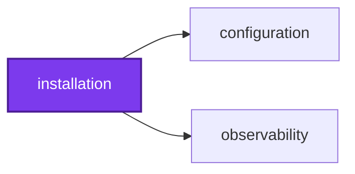
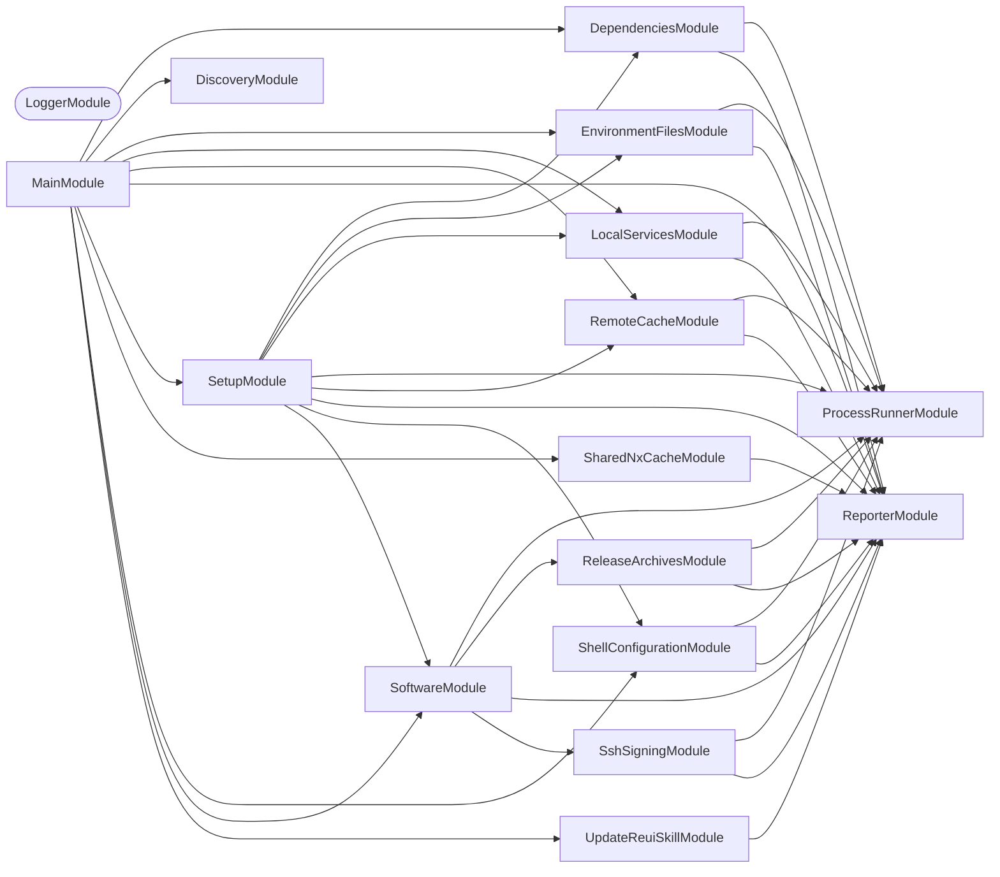

## 🕸️ Codependix

Dependency graphs exported by [codependix](https://github.com/Organizzolini/codebase/tree/main/projects/ic-suite/codependix/codependix-cli), regenerated by `nx run configuration:codependix:write`.

### Nx Neighborhood

<!-- codependix:start name="codependix-nx-projects" -->

<!-- codependix:end name="codependix-nx-projects" -->

### NestJS Module Graph

<!-- codependix:start name="codependix-nestjs-modules" -->


_Rounded modules are global: every module can inject them, so their edges are left out._
<!-- codependix:end name="codependix-nestjs-modules" -->

### File Imports

<!-- codependix:start name="codependix-file-imports" -->
```mermaid
graph LR
  file_callidescope_config_ts["callidescope.config.ts"]
  file_codependix_config_ts["codependix.config.ts"]
  file_codometer_config_ts["codometer.config.ts"]
  file_coinagerie_config_ts["coinagerie.config.ts"]
  file_eslint_config_ts["eslint.config.ts"]
  file_src_installation_constants_ts["src/installation.constants.ts"]
  file_src_installation_main_end_to_end_test_ts["src/installation.main.end-to-end.test.ts"]
  file_src_installation_main_ts["src/installation.main.ts"]
  file_src_installation_main_unit_test_ts["src/installation.main.unit.test.ts"]
  file_src_installation_module_ts["src/installation.module.ts"]
  file_src_installation_repl_ts["src/installation.repl.ts"]
  file_src_installation_repl_unit_test_ts["src/installation.repl.unit.test.ts"]
  file_src_modules_dependencies_dependencies_command_ts["src/modules/dependencies/dependencies.command.ts"]
  file_src_modules_dependencies_dependencies_command_unit_test_ts["src/modules/dependencies/dependencies.command.unit.test.ts"]
  file_src_modules_dependencies_dependencies_constants_ts["src/modules/dependencies/dependencies.constants.ts"]
  file_src_modules_dependencies_dependencies_module_ts["src/modules/dependencies/dependencies.module.ts"]
  file_src_modules_dependencies_dependencies_service_ts["src/modules/dependencies/dependencies.service.ts"]
  file_src_modules_dependencies_dependencies_service_unit_test_ts["src/modules/dependencies/dependencies.service.unit.test.ts"]
  file_src_modules_dependencies_dependencies_types_ts["src/modules/dependencies/dependencies.types.ts"]
  file_src_modules_environment_files_environment_files_command_ts["src/modules/environment-files/environment-files.command.ts"]
  file_src_modules_environment_files_environment_files_command_unit_test_ts["src/modules/environment-files/environment-files.command.unit.test.ts"]
  file_src_modules_environment_files_environment_files_constants_ts["src/modules/environment-files/environment-files.constants.ts"]
  file_src_modules_environment_files_environment_files_module_ts["src/modules/environment-files/environment-files.module.ts"]
  file_src_modules_environment_files_environment_files_service_ts["src/modules/environment-files/environment-files.service.ts"]
  file_src_modules_environment_files_environment_files_service_unit_test_ts["src/modules/environment-files/environment-files.service.unit.test.ts"]
  file_src_modules_environment_files_environment_files_types_ts["src/modules/environment-files/environment-files.types.ts"]
  file_src_modules_local_services_local_services_command_ts["src/modules/local-services/local-services.command.ts"]
  file_src_modules_local_services_local_services_command_unit_test_ts["src/modules/local-services/local-services.command.unit.test.ts"]
  file_src_modules_local_services_local_services_constants_ts["src/modules/local-services/local-services.constants.ts"]
  file_src_modules_local_services_local_services_module_ts["src/modules/local-services/local-services.module.ts"]
  file_src_modules_local_services_local_services_service_ts["src/modules/local-services/local-services.service.ts"]
  file_src_modules_local_services_local_services_service_unit_test_ts["src/modules/local-services/local-services.service.unit.test.ts"]
  file_src_modules_local_services_local_services_types_ts["src/modules/local-services/local-services.types.ts"]
  file_src_modules_process_runner_process_runner_constants_ts["src/modules/process-runner/process-runner.constants.ts"]
  file_src_modules_process_runner_process_runner_module_ts["src/modules/process-runner/process-runner.module.ts"]
  file_src_modules_process_runner_process_runner_service_ts["src/modules/process-runner/process-runner.service.ts"]
  file_src_modules_process_runner_process_runner_service_unit_test_ts["src/modules/process-runner/process-runner.service.unit.test.ts"]
  file_src_modules_process_runner_process_runner_types_ts["src/modules/process-runner/process-runner.types.ts"]
  file_src_modules_release_archives_release_archives_constants_integration_test_ts["src/modules/release-archives/release-archives.constants.integration.test.ts"]
  file_src_modules_release_archives_release_archives_constants_ts["src/modules/release-archives/release-archives.constants.ts"]
  file_src_modules_release_archives_release_archives_module_ts["src/modules/release-archives/release-archives.module.ts"]
  file_src_modules_release_archives_release_archives_service_ts["src/modules/release-archives/release-archives.service.ts"]
  file_src_modules_release_archives_release_archives_service_unit_test_ts["src/modules/release-archives/release-archives.service.unit.test.ts"]
  file_src_modules_release_archives_release_archives_types_ts["src/modules/release-archives/release-archives.types.ts"]
  file_src_modules_remote_cache_remote_cache_command_ts["src/modules/remote-cache/remote-cache.command.ts"]
  file_src_modules_remote_cache_remote_cache_command_unit_test_ts["src/modules/remote-cache/remote-cache.command.unit.test.ts"]
  file_src_modules_remote_cache_remote_cache_constants_ts["src/modules/remote-cache/remote-cache.constants.ts"]
  file_src_modules_remote_cache_remote_cache_module_ts["src/modules/remote-cache/remote-cache.module.ts"]
  file_src_modules_remote_cache_remote_cache_service_ts["src/modules/remote-cache/remote-cache.service.ts"]
  file_src_modules_remote_cache_remote_cache_service_unit_test_ts["src/modules/remote-cache/remote-cache.service.unit.test.ts"]
  file_src_modules_remote_cache_remote_cache_types_ts["src/modules/remote-cache/remote-cache.types.ts"]
  file_src_modules_reporter_reporter_constants_ts["src/modules/reporter/reporter.constants.ts"]
  file_src_modules_reporter_reporter_module_ts["src/modules/reporter/reporter.module.ts"]
  file_src_modules_reporter_reporter_service_ts["src/modules/reporter/reporter.service.ts"]
  file_src_modules_reporter_reporter_service_unit_test_ts["src/modules/reporter/reporter.service.unit.test.ts"]
  file_src_modules_reporter_reporter_types_ts["src/modules/reporter/reporter.types.ts"]
  file_src_modules_setup_setup_command_ts["src/modules/setup/setup.command.ts"]
  file_src_modules_setup_setup_command_unit_test_ts["src/modules/setup/setup.command.unit.test.ts"]
  file_src_modules_setup_setup_constants_ts["src/modules/setup/setup.constants.ts"]
  file_src_modules_setup_setup_module_ts["src/modules/setup/setup.module.ts"]
  file_src_modules_setup_setup_service_ts["src/modules/setup/setup.service.ts"]
  file_src_modules_setup_setup_service_unit_test_ts["src/modules/setup/setup.service.unit.test.ts"]
  file_src_modules_setup_setup_types_ts["src/modules/setup/setup.types.ts"]
  file_src_modules_shared_nx_cache_shared_nx_cache_remote_service_ts["src/modules/shared-nx-cache/shared-nx-cache-remote.service.ts"]
  file_src_modules_shared_nx_cache_shared_nx_cache_remote_service_unit_test_ts["src/modules/shared-nx-cache/shared-nx-cache-remote.service.unit.test.ts"]
  file_src_modules_shared_nx_cache_shared_nx_cache_server_service_integration_test_ts["src/modules/shared-nx-cache/shared-nx-cache-server.service.integration.test.ts"]
  file_src_modules_shared_nx_cache_shared_nx_cache_server_service_ts["src/modules/shared-nx-cache/shared-nx-cache-server.service.ts"]
  file_src_modules_shared_nx_cache_shared_nx_cache_server_service_unit_test_ts["src/modules/shared-nx-cache/shared-nx-cache-server.service.unit.test.ts"]
  file_src_modules_shared_nx_cache_shared_nx_cache_storage_service_ts["src/modules/shared-nx-cache/shared-nx-cache-storage.service.ts"]
  file_src_modules_shared_nx_cache_shared_nx_cache_storage_service_unit_test_ts["src/modules/shared-nx-cache/shared-nx-cache-storage.service.unit.test.ts"]
  file_src_modules_shared_nx_cache_shared_nx_cache_command_ts["src/modules/shared-nx-cache/shared-nx-cache.command.ts"]
  file_src_modules_shared_nx_cache_shared_nx_cache_command_unit_test_ts["src/modules/shared-nx-cache/shared-nx-cache.command.unit.test.ts"]
  file_src_modules_shared_nx_cache_shared_nx_cache_constants_ts["src/modules/shared-nx-cache/shared-nx-cache.constants.ts"]
  file_src_modules_shared_nx_cache_shared_nx_cache_module_ts["src/modules/shared-nx-cache/shared-nx-cache.module.ts"]
  file_src_modules_shared_nx_cache_shared_nx_cache_types_ts["src/modules/shared-nx-cache/shared-nx-cache.types.ts"]
  file_src_modules_shell_configuration_shell_configuration_command_ts["src/modules/shell-configuration/shell-configuration.command.ts"]
  file_src_modules_shell_configuration_shell_configuration_command_unit_test_ts["src/modules/shell-configuration/shell-configuration.command.unit.test.ts"]
  file_src_modules_shell_configuration_shell_configuration_constants_ts["src/modules/shell-configuration/shell-configuration.constants.ts"]
  file_src_modules_shell_configuration_shell_configuration_module_ts["src/modules/shell-configuration/shell-configuration.module.ts"]
  file_src_modules_shell_configuration_shell_configuration_service_ts["src/modules/shell-configuration/shell-configuration.service.ts"]
  file_src_modules_shell_configuration_shell_configuration_service_unit_test_ts["src/modules/shell-configuration/shell-configuration.service.unit.test.ts"]
  file_src_modules_shell_configuration_shell_configuration_types_ts["src/modules/shell-configuration/shell-configuration.types.ts"]
  file_src_modules_software_software_brew_service_ts["src/modules/software/software-brew.service.ts"]
  file_src_modules_software_software_brew_service_unit_test_ts["src/modules/software/software-brew.service.unit.test.ts"]
  file_src_modules_software_software_database_service_ts["src/modules/software/software-database.service.ts"]
  file_src_modules_software_software_database_service_unit_test_ts["src/modules/software/software-database.service.unit.test.ts"]
  file_src_modules_software_software_docker_service_ts["src/modules/software/software-docker.service.ts"]
  file_src_modules_software_software_docker_service_unit_test_ts["src/modules/software/software-docker.service.unit.test.ts"]
  file_src_modules_software_software_gpg_service_ts["src/modules/software/software-gpg.service.ts"]
  file_src_modules_software_software_gpg_service_unit_test_ts["src/modules/software/software-gpg.service.unit.test.ts"]
  file_src_modules_software_software_infra_service_ts["src/modules/software/software-infra.service.ts"]
  file_src_modules_software_software_infra_service_unit_test_ts["src/modules/software/software-infra.service.unit.test.ts"]
  file_src_modules_software_software_linux_service_ts["src/modules/software/software-linux.service.ts"]
  file_src_modules_software_software_linux_service_unit_test_ts["src/modules/software/software-linux.service.unit.test.ts"]
  file_src_modules_software_software_named_service_ts["src/modules/software/software-named.service.ts"]
  file_src_modules_software_software_named_service_unit_test_ts["src/modules/software/software-named.service.unit.test.ts"]
  file_src_modules_software_software_ollama_service_ts["src/modules/software/software-ollama.service.ts"]
  file_src_modules_software_software_ollama_service_unit_test_ts["src/modules/software/software-ollama.service.unit.test.ts"]
  file_src_modules_software_software_python_service_ts["src/modules/software/software-python.service.ts"]
  file_src_modules_software_software_python_service_unit_test_ts["src/modules/software/software-python.service.unit.test.ts"]
  file_src_modules_software_software_command_ts["src/modules/software/software.command.ts"]
  file_src_modules_software_software_command_unit_test_ts["src/modules/software/software.command.unit.test.ts"]
  file_src_modules_software_software_constants_ts["src/modules/software/software.constants.ts"]
  file_src_modules_software_software_module_ts["src/modules/software/software.module.ts"]
  file_src_modules_software_software_service_ts["src/modules/software/software.service.ts"]
  file_src_modules_software_software_service_unit_test_ts["src/modules/software/software.service.unit.test.ts"]
  file_src_modules_software_software_types_ts["src/modules/software/software.types.ts"]
  file_src_modules_ssh_signing_ssh_signing_constants_ts["src/modules/ssh-signing/ssh-signing.constants.ts"]
  file_src_modules_ssh_signing_ssh_signing_module_ts["src/modules/ssh-signing/ssh-signing.module.ts"]
  file_src_modules_ssh_signing_ssh_signing_service_ts["src/modules/ssh-signing/ssh-signing.service.ts"]
  file_src_modules_ssh_signing_ssh_signing_service_unit_test_ts["src/modules/ssh-signing/ssh-signing.service.unit.test.ts"]
  file_src_modules_ssh_signing_ssh_signing_types_ts["src/modules/ssh-signing/ssh-signing.types.ts"]
  file_src_modules_ssh_signing_ssh_signing_utilities_ts["src/modules/ssh-signing/ssh-signing.utilities.ts"]
  file_src_modules_ssh_signing_ssh_signing_utilities_unit_test_ts["src/modules/ssh-signing/ssh-signing.utilities.unit.test.ts"]
  file_src_modules_update_reui_skill_update_reui_skill_command_ts["src/modules/update-reui-skill/update-reui-skill.command.ts"]
  file_src_modules_update_reui_skill_update_reui_skill_command_unit_test_ts["src/modules/update-reui-skill/update-reui-skill.command.unit.test.ts"]
  file_src_modules_update_reui_skill_update_reui_skill_constants_ts["src/modules/update-reui-skill/update-reui-skill.constants.ts"]
  file_src_modules_update_reui_skill_update_reui_skill_module_ts["src/modules/update-reui-skill/update-reui-skill.module.ts"]
  file_src_modules_update_reui_skill_update_reui_skill_service_ts["src/modules/update-reui-skill/update-reui-skill.service.ts"]
  file_src_modules_update_reui_skill_update_reui_skill_service_unit_test_ts["src/modules/update-reui-skill/update-reui-skill.service.unit.test.ts"]
  file_src_modules_update_reui_skill_update_reui_skill_types_ts["src/modules/update-reui-skill/update-reui-skill.types.ts"]
  file_testing_environment_ts["testing/environment.ts"]
  file_testing_fake_process_runner_ts["testing/fake-process-runner.ts"]
  file_testing_mocks_ts["testing/mocks.ts"]
  file_testing_report_ts["testing/report.ts"]
  file_testing_setup_ts["testing/setup.ts"]
  file_testing_ssh_signature_ts["testing/ssh-signature.ts"]
  file_testing_temporary_workspace_ts["testing/temporary-workspace.ts"]
  file_vitest_config_ts["vitest.config.ts"]
  file_src_installation_main_end_to_end_test_ts --> file_src_installation_constants_ts
  file_src_installation_main_ts --> file_src_installation_module_ts
  file_src_installation_module_ts --> file_src_installation_constants_ts
  file_src_installation_module_ts --> file_src_modules_dependencies_dependencies_module_ts
  file_src_installation_module_ts --> file_src_modules_environment_files_environment_files_module_ts
  file_src_installation_module_ts --> file_src_modules_local_services_local_services_module_ts
  file_src_installation_module_ts --> file_src_modules_remote_cache_remote_cache_module_ts
  file_src_installation_module_ts --> file_src_modules_reporter_reporter_module_ts
  file_src_installation_module_ts --> file_src_modules_setup_setup_module_ts
  file_src_installation_module_ts --> file_src_modules_shared_nx_cache_shared_nx_cache_module_ts
  file_src_installation_module_ts --> file_src_modules_shell_configuration_shell_configuration_module_ts
  file_src_installation_module_ts --> file_src_modules_software_software_module_ts
  file_src_installation_module_ts --> file_src_modules_update_reui_skill_update_reui_skill_module_ts
  file_src_installation_repl_ts --> file_src_installation_module_ts
  file_src_modules_dependencies_dependencies_command_ts --> file_src_modules_dependencies_dependencies_service_ts
  file_src_modules_dependencies_dependencies_command_unit_test_ts --> file_src_modules_dependencies_dependencies_command_ts
  file_src_modules_dependencies_dependencies_command_unit_test_ts --> file_src_modules_dependencies_dependencies_service_ts
  file_src_modules_dependencies_dependencies_command_unit_test_ts --> file_src_modules_process_runner_process_runner_service_ts
  file_src_modules_dependencies_dependencies_command_unit_test_ts --> file_src_modules_process_runner_process_runner_types_ts
  file_src_modules_dependencies_dependencies_command_unit_test_ts --> file_src_modules_reporter_reporter_service_ts
  file_src_modules_dependencies_dependencies_command_unit_test_ts --> file_testing_environment_ts
  file_src_modules_dependencies_dependencies_command_unit_test_ts --> file_testing_fake_process_runner_ts
  file_src_modules_dependencies_dependencies_command_unit_test_ts --> file_testing_report_ts
  file_src_modules_dependencies_dependencies_command_unit_test_ts --> file_testing_temporary_workspace_ts
  file_src_modules_dependencies_dependencies_module_ts --> file_src_modules_dependencies_dependencies_command_ts
  file_src_modules_dependencies_dependencies_module_ts --> file_src_modules_dependencies_dependencies_service_ts
  file_src_modules_dependencies_dependencies_module_ts --> file_src_modules_process_runner_process_runner_module_ts
  file_src_modules_dependencies_dependencies_module_ts --> file_src_modules_reporter_reporter_module_ts
  file_src_modules_dependencies_dependencies_service_ts --> file_src_modules_dependencies_dependencies_constants_ts
  file_src_modules_dependencies_dependencies_service_ts --> file_src_modules_dependencies_dependencies_types_ts
  file_src_modules_dependencies_dependencies_service_ts --> file_src_modules_process_runner_process_runner_service_ts
  file_src_modules_dependencies_dependencies_service_ts --> file_src_modules_reporter_reporter_service_ts
  file_src_modules_dependencies_dependencies_service_unit_test_ts --> file_src_modules_dependencies_dependencies_service_ts
  file_src_modules_dependencies_dependencies_service_unit_test_ts --> file_src_modules_process_runner_process_runner_service_ts
  file_src_modules_dependencies_dependencies_service_unit_test_ts --> file_src_modules_reporter_reporter_service_ts
  file_src_modules_environment_files_environment_files_command_ts --> file_src_modules_environment_files_environment_files_service_ts
  file_src_modules_environment_files_environment_files_command_unit_test_ts --> file_src_modules_environment_files_environment_files_command_ts
  file_src_modules_environment_files_environment_files_command_unit_test_ts --> file_src_modules_environment_files_environment_files_service_ts
  file_src_modules_environment_files_environment_files_command_unit_test_ts --> file_src_modules_process_runner_process_runner_service_ts
  file_src_modules_environment_files_environment_files_command_unit_test_ts --> file_src_modules_reporter_reporter_service_ts
  file_src_modules_environment_files_environment_files_command_unit_test_ts --> file_testing_environment_ts
  file_src_modules_environment_files_environment_files_command_unit_test_ts --> file_testing_fake_process_runner_ts
  file_src_modules_environment_files_environment_files_command_unit_test_ts --> file_testing_report_ts
  file_src_modules_environment_files_environment_files_command_unit_test_ts --> file_testing_temporary_workspace_ts
  file_src_modules_environment_files_environment_files_module_ts --> file_src_modules_environment_files_environment_files_command_ts
  file_src_modules_environment_files_environment_files_module_ts --> file_src_modules_environment_files_environment_files_service_ts
  file_src_modules_environment_files_environment_files_module_ts --> file_src_modules_process_runner_process_runner_module_ts
  file_src_modules_environment_files_environment_files_module_ts --> file_src_modules_reporter_reporter_module_ts
  file_src_modules_environment_files_environment_files_service_ts --> file_src_modules_environment_files_environment_files_constants_ts
  file_src_modules_environment_files_environment_files_service_ts --> file_src_modules_environment_files_environment_files_types_ts
  file_src_modules_environment_files_environment_files_service_ts --> file_src_modules_process_runner_process_runner_service_ts
  file_src_modules_environment_files_environment_files_service_ts --> file_src_modules_reporter_reporter_service_ts
  file_src_modules_environment_files_environment_files_service_unit_test_ts --> file_src_modules_environment_files_environment_files_service_ts
  file_src_modules_environment_files_environment_files_service_unit_test_ts --> file_src_modules_process_runner_process_runner_service_ts
  file_src_modules_environment_files_environment_files_service_unit_test_ts --> file_src_modules_reporter_reporter_service_ts
  file_src_modules_local_services_local_services_command_ts --> file_src_modules_local_services_local_services_service_ts
  file_src_modules_local_services_local_services_command_unit_test_ts --> file_src_modules_local_services_local_services_command_ts
  file_src_modules_local_services_local_services_command_unit_test_ts --> file_src_modules_local_services_local_services_service_ts
  file_src_modules_local_services_local_services_module_ts --> file_src_modules_local_services_local_services_command_ts
  file_src_modules_local_services_local_services_module_ts --> file_src_modules_local_services_local_services_service_ts
  file_src_modules_local_services_local_services_module_ts --> file_src_modules_process_runner_process_runner_module_ts
  file_src_modules_local_services_local_services_module_ts --> file_src_modules_reporter_reporter_module_ts
  file_src_modules_local_services_local_services_service_ts --> file_src_modules_local_services_local_services_constants_ts
  file_src_modules_local_services_local_services_service_ts --> file_src_modules_process_runner_process_runner_service_ts
  file_src_modules_local_services_local_services_service_ts --> file_src_modules_reporter_reporter_service_ts
  file_src_modules_local_services_local_services_service_unit_test_ts --> file_src_modules_local_services_local_services_service_ts
  file_src_modules_local_services_local_services_service_unit_test_ts --> file_src_modules_process_runner_process_runner_service_ts
  file_src_modules_local_services_local_services_service_unit_test_ts --> file_src_modules_reporter_reporter_service_ts
  file_src_modules_local_services_local_services_service_unit_test_ts --> file_testing_environment_ts
  file_src_modules_local_services_local_services_service_unit_test_ts --> file_testing_fake_process_runner_ts
  file_src_modules_local_services_local_services_service_unit_test_ts --> file_testing_report_ts
  file_src_modules_local_services_local_services_service_unit_test_ts --> file_testing_temporary_workspace_ts
  file_src_modules_process_runner_process_runner_module_ts --> file_src_modules_process_runner_process_runner_service_ts
  file_src_modules_process_runner_process_runner_service_ts --> file_src_modules_process_runner_process_runner_constants_ts
  file_src_modules_process_runner_process_runner_service_ts --> file_src_modules_process_runner_process_runner_types_ts
  file_src_modules_process_runner_process_runner_service_unit_test_ts --> file_src_modules_process_runner_process_runner_service_ts
  file_src_modules_process_runner_process_runner_service_unit_test_ts --> file_testing_temporary_workspace_ts
  file_src_modules_release_archives_release_archives_constants_integration_test_ts --> file_src_modules_release_archives_release_archives_constants_ts
  file_src_modules_release_archives_release_archives_constants_ts --> file_src_modules_release_archives_release_archives_types_ts
  file_src_modules_release_archives_release_archives_module_ts --> file_src_modules_process_runner_process_runner_module_ts
  file_src_modules_release_archives_release_archives_module_ts --> file_src_modules_release_archives_release_archives_service_ts
  file_src_modules_release_archives_release_archives_module_ts --> file_src_modules_reporter_reporter_module_ts
  file_src_modules_release_archives_release_archives_service_ts --> file_src_modules_process_runner_process_runner_service_ts
  file_src_modules_release_archives_release_archives_service_ts --> file_src_modules_release_archives_release_archives_types_ts
  file_src_modules_release_archives_release_archives_service_ts --> file_src_modules_reporter_reporter_service_ts
  file_src_modules_release_archives_release_archives_service_unit_test_ts --> file_src_modules_process_runner_process_runner_service_ts
  file_src_modules_release_archives_release_archives_service_unit_test_ts --> file_src_modules_release_archives_release_archives_service_ts
  file_src_modules_release_archives_release_archives_service_unit_test_ts --> file_src_modules_release_archives_release_archives_types_ts
  file_src_modules_release_archives_release_archives_service_unit_test_ts --> file_src_modules_reporter_reporter_service_ts
  file_src_modules_release_archives_release_archives_service_unit_test_ts --> file_testing_fake_process_runner_ts
  file_src_modules_remote_cache_remote_cache_command_ts --> file_src_modules_remote_cache_remote_cache_service_ts
  file_src_modules_remote_cache_remote_cache_command_unit_test_ts --> file_src_modules_remote_cache_remote_cache_command_ts
  file_src_modules_remote_cache_remote_cache_command_unit_test_ts --> file_src_modules_remote_cache_remote_cache_service_ts
  file_src_modules_remote_cache_remote_cache_module_ts --> file_src_modules_process_runner_process_runner_module_ts
  file_src_modules_remote_cache_remote_cache_module_ts --> file_src_modules_remote_cache_remote_cache_command_ts
  file_src_modules_remote_cache_remote_cache_module_ts --> file_src_modules_remote_cache_remote_cache_service_ts
  file_src_modules_remote_cache_remote_cache_module_ts --> file_src_modules_reporter_reporter_module_ts
  file_src_modules_remote_cache_remote_cache_service_ts --> file_src_modules_process_runner_process_runner_service_ts
  file_src_modules_remote_cache_remote_cache_service_ts --> file_src_modules_remote_cache_remote_cache_constants_ts
  file_src_modules_remote_cache_remote_cache_service_ts --> file_src_modules_reporter_reporter_service_ts
  file_src_modules_remote_cache_remote_cache_service_unit_test_ts --> file_src_modules_process_runner_process_runner_service_ts
  file_src_modules_remote_cache_remote_cache_service_unit_test_ts --> file_src_modules_remote_cache_remote_cache_service_ts
  file_src_modules_remote_cache_remote_cache_service_unit_test_ts --> file_src_modules_reporter_reporter_service_ts
  file_src_modules_remote_cache_remote_cache_service_unit_test_ts --> file_testing_environment_ts
  file_src_modules_remote_cache_remote_cache_service_unit_test_ts --> file_testing_fake_process_runner_ts
  file_src_modules_remote_cache_remote_cache_service_unit_test_ts --> file_testing_report_ts
  file_src_modules_remote_cache_remote_cache_service_unit_test_ts --> file_testing_temporary_workspace_ts
  file_src_modules_remote_cache_remote_cache_types_ts --> file_src_modules_remote_cache_remote_cache_constants_ts
  file_src_modules_reporter_reporter_module_ts --> file_src_modules_reporter_reporter_service_ts
  file_src_modules_reporter_reporter_service_unit_test_ts --> file_src_modules_reporter_reporter_service_ts
  file_src_modules_setup_setup_command_ts --> file_src_modules_setup_setup_service_ts
  file_src_modules_setup_setup_command_unit_test_ts --> file_src_modules_dependencies_dependencies_service_ts
  file_src_modules_setup_setup_command_unit_test_ts --> file_src_modules_environment_files_environment_files_service_ts
  file_src_modules_setup_setup_command_unit_test_ts --> file_src_modules_local_services_local_services_service_ts
  file_src_modules_setup_setup_command_unit_test_ts --> file_src_modules_process_runner_process_runner_service_ts
  file_src_modules_setup_setup_command_unit_test_ts --> file_src_modules_release_archives_release_archives_service_ts
  file_src_modules_setup_setup_command_unit_test_ts --> file_src_modules_remote_cache_remote_cache_service_ts
  file_src_modules_setup_setup_command_unit_test_ts --> file_src_modules_reporter_reporter_service_ts
  file_src_modules_setup_setup_command_unit_test_ts --> file_src_modules_setup_setup_command_ts
  file_src_modules_setup_setup_command_unit_test_ts --> file_src_modules_setup_setup_service_ts
  file_src_modules_setup_setup_command_unit_test_ts --> file_src_modules_shell_configuration_shell_configuration_service_ts
  file_src_modules_setup_setup_command_unit_test_ts --> file_src_modules_software_software_brew_service_ts
  file_src_modules_setup_setup_command_unit_test_ts --> file_src_modules_software_software_database_service_ts
  file_src_modules_setup_setup_command_unit_test_ts --> file_src_modules_software_software_docker_service_ts
  file_src_modules_setup_setup_command_unit_test_ts --> file_src_modules_software_software_gpg_service_ts
  file_src_modules_setup_setup_command_unit_test_ts --> file_src_modules_software_software_infra_service_ts
  file_src_modules_setup_setup_command_unit_test_ts --> file_src_modules_software_software_linux_service_ts
  file_src_modules_setup_setup_command_unit_test_ts --> file_src_modules_software_software_ollama_service_ts
  file_src_modules_setup_setup_command_unit_test_ts --> file_src_modules_software_software_python_service_ts
  file_src_modules_setup_setup_command_unit_test_ts --> file_src_modules_software_software_service_ts
  file_src_modules_setup_setup_command_unit_test_ts --> file_src_modules_ssh_signing_ssh_signing_service_ts
  file_src_modules_setup_setup_command_unit_test_ts --> file_testing_environment_ts
  file_src_modules_setup_setup_command_unit_test_ts --> file_testing_fake_process_runner_ts
  file_src_modules_setup_setup_command_unit_test_ts --> file_testing_report_ts
  file_src_modules_setup_setup_command_unit_test_ts --> file_testing_temporary_workspace_ts
  file_src_modules_setup_setup_module_ts --> file_src_modules_dependencies_dependencies_module_ts
  file_src_modules_setup_setup_module_ts --> file_src_modules_environment_files_environment_files_module_ts
  file_src_modules_setup_setup_module_ts --> file_src_modules_local_services_local_services_module_ts
  file_src_modules_setup_setup_module_ts --> file_src_modules_process_runner_process_runner_module_ts
  file_src_modules_setup_setup_module_ts --> file_src_modules_remote_cache_remote_cache_module_ts
  file_src_modules_setup_setup_module_ts --> file_src_modules_reporter_reporter_module_ts
  file_src_modules_setup_setup_module_ts --> file_src_modules_setup_setup_command_ts
  file_src_modules_setup_setup_module_ts --> file_src_modules_setup_setup_service_ts
  file_src_modules_setup_setup_module_ts --> file_src_modules_shell_configuration_shell_configuration_module_ts
  file_src_modules_setup_setup_module_ts --> file_src_modules_software_software_module_ts
  file_src_modules_setup_setup_service_ts --> file_src_modules_dependencies_dependencies_service_ts
  file_src_modules_setup_setup_service_ts --> file_src_modules_environment_files_environment_files_service_ts
  file_src_modules_setup_setup_service_ts --> file_src_modules_local_services_local_services_service_ts
  file_src_modules_setup_setup_service_ts --> file_src_modules_process_runner_process_runner_service_ts
  file_src_modules_setup_setup_service_ts --> file_src_modules_remote_cache_remote_cache_service_ts
  file_src_modules_setup_setup_service_ts --> file_src_modules_reporter_reporter_service_ts
  file_src_modules_setup_setup_service_ts --> file_src_modules_setup_setup_constants_ts
  file_src_modules_setup_setup_service_ts --> file_src_modules_shell_configuration_shell_configuration_service_ts
  file_src_modules_setup_setup_service_ts --> file_src_modules_software_software_service_ts
  file_src_modules_setup_setup_service_unit_test_ts --> file_src_modules_dependencies_dependencies_service_ts
  file_src_modules_setup_setup_service_unit_test_ts --> file_src_modules_environment_files_environment_files_service_ts
  file_src_modules_setup_setup_service_unit_test_ts --> file_src_modules_local_services_local_services_service_ts
  file_src_modules_setup_setup_service_unit_test_ts --> file_src_modules_process_runner_process_runner_service_ts
  file_src_modules_setup_setup_service_unit_test_ts --> file_src_modules_remote_cache_remote_cache_service_ts
  file_src_modules_setup_setup_service_unit_test_ts --> file_src_modules_reporter_reporter_service_ts
  file_src_modules_setup_setup_service_unit_test_ts --> file_src_modules_setup_setup_service_ts
  file_src_modules_setup_setup_service_unit_test_ts --> file_src_modules_shell_configuration_shell_configuration_service_ts
  file_src_modules_setup_setup_service_unit_test_ts --> file_src_modules_software_software_service_ts
  file_src_modules_setup_setup_service_unit_test_ts --> file_testing_fake_process_runner_ts
  file_src_modules_shared_nx_cache_shared_nx_cache_remote_service_ts --> file_src_modules_shared_nx_cache_shared_nx_cache_constants_ts
  file_src_modules_shared_nx_cache_shared_nx_cache_remote_service_ts --> file_src_modules_shared_nx_cache_shared_nx_cache_types_ts
  file_src_modules_shared_nx_cache_shared_nx_cache_remote_service_unit_test_ts --> file_src_modules_shared_nx_cache_shared_nx_cache_remote_service_ts
  file_src_modules_shared_nx_cache_shared_nx_cache_server_service_integration_test_ts --> file_src_modules_shared_nx_cache_shared_nx_cache_remote_service_ts
  file_src_modules_shared_nx_cache_shared_nx_cache_server_service_integration_test_ts --> file_src_modules_shared_nx_cache_shared_nx_cache_server_service_ts
  file_src_modules_shared_nx_cache_shared_nx_cache_server_service_integration_test_ts --> file_src_modules_shared_nx_cache_shared_nx_cache_storage_service_ts
  file_src_modules_shared_nx_cache_shared_nx_cache_server_service_integration_test_ts --> file_src_modules_shared_nx_cache_shared_nx_cache_constants_ts
  file_src_modules_shared_nx_cache_shared_nx_cache_server_service_integration_test_ts --> file_src_modules_shared_nx_cache_shared_nx_cache_types_ts
  file_src_modules_shared_nx_cache_shared_nx_cache_server_service_integration_test_ts --> file_testing_temporary_workspace_ts
  file_src_modules_shared_nx_cache_shared_nx_cache_server_service_ts --> file_src_modules_shared_nx_cache_shared_nx_cache_remote_service_ts
  file_src_modules_shared_nx_cache_shared_nx_cache_server_service_ts --> file_src_modules_shared_nx_cache_shared_nx_cache_storage_service_ts
  file_src_modules_shared_nx_cache_shared_nx_cache_server_service_ts --> file_src_modules_shared_nx_cache_shared_nx_cache_constants_ts
  file_src_modules_shared_nx_cache_shared_nx_cache_server_service_ts --> file_src_modules_shared_nx_cache_shared_nx_cache_types_ts
  file_src_modules_shared_nx_cache_shared_nx_cache_server_service_unit_test_ts --> file_src_modules_shared_nx_cache_shared_nx_cache_remote_service_ts
  file_src_modules_shared_nx_cache_shared_nx_cache_server_service_unit_test_ts --> file_src_modules_shared_nx_cache_shared_nx_cache_server_service_ts
  file_src_modules_shared_nx_cache_shared_nx_cache_server_service_unit_test_ts --> file_src_modules_shared_nx_cache_shared_nx_cache_storage_service_ts
  file_src_modules_shared_nx_cache_shared_nx_cache_server_service_unit_test_ts --> file_src_modules_shared_nx_cache_shared_nx_cache_constants_ts
  file_src_modules_shared_nx_cache_shared_nx_cache_server_service_unit_test_ts --> file_src_modules_shared_nx_cache_shared_nx_cache_types_ts
  file_src_modules_shared_nx_cache_shared_nx_cache_storage_service_ts --> file_src_modules_shared_nx_cache_shared_nx_cache_constants_ts
  file_src_modules_shared_nx_cache_shared_nx_cache_storage_service_ts --> file_src_modules_shared_nx_cache_shared_nx_cache_types_ts
  file_src_modules_shared_nx_cache_shared_nx_cache_storage_service_unit_test_ts --> file_src_modules_shared_nx_cache_shared_nx_cache_storage_service_ts
  file_src_modules_shared_nx_cache_shared_nx_cache_storage_service_unit_test_ts --> file_src_modules_shared_nx_cache_shared_nx_cache_constants_ts
  file_src_modules_shared_nx_cache_shared_nx_cache_storage_service_unit_test_ts --> file_testing_temporary_workspace_ts
  file_src_modules_shared_nx_cache_shared_nx_cache_command_ts --> file_src_modules_reporter_reporter_service_ts
  file_src_modules_shared_nx_cache_shared_nx_cache_command_ts --> file_src_modules_shared_nx_cache_shared_nx_cache_server_service_ts
  file_src_modules_shared_nx_cache_shared_nx_cache_command_ts --> file_src_modules_shared_nx_cache_shared_nx_cache_constants_ts
  file_src_modules_shared_nx_cache_shared_nx_cache_command_ts --> file_src_modules_shared_nx_cache_shared_nx_cache_types_ts
  file_src_modules_shared_nx_cache_shared_nx_cache_command_unit_test_ts --> file_src_modules_reporter_reporter_service_ts
  file_src_modules_shared_nx_cache_shared_nx_cache_command_unit_test_ts --> file_src_modules_shared_nx_cache_shared_nx_cache_server_service_ts
  file_src_modules_shared_nx_cache_shared_nx_cache_command_unit_test_ts --> file_src_modules_shared_nx_cache_shared_nx_cache_command_ts
  file_src_modules_shared_nx_cache_shared_nx_cache_command_unit_test_ts --> file_src_modules_shared_nx_cache_shared_nx_cache_constants_ts
  file_src_modules_shared_nx_cache_shared_nx_cache_constants_ts --> file_src_modules_shared_nx_cache_shared_nx_cache_types_ts
  file_src_modules_shared_nx_cache_shared_nx_cache_module_ts --> file_src_modules_reporter_reporter_module_ts
  file_src_modules_shared_nx_cache_shared_nx_cache_module_ts --> file_src_modules_shared_nx_cache_shared_nx_cache_remote_service_ts
  file_src_modules_shared_nx_cache_shared_nx_cache_module_ts --> file_src_modules_shared_nx_cache_shared_nx_cache_server_service_ts
  file_src_modules_shared_nx_cache_shared_nx_cache_module_ts --> file_src_modules_shared_nx_cache_shared_nx_cache_storage_service_ts
  file_src_modules_shared_nx_cache_shared_nx_cache_module_ts --> file_src_modules_shared_nx_cache_shared_nx_cache_command_ts
  file_src_modules_shell_configuration_shell_configuration_command_ts --> file_src_modules_shell_configuration_shell_configuration_service_ts
  file_src_modules_shell_configuration_shell_configuration_command_unit_test_ts --> file_src_modules_process_runner_process_runner_service_ts
  file_src_modules_shell_configuration_shell_configuration_command_unit_test_ts --> file_src_modules_reporter_reporter_service_ts
  file_src_modules_shell_configuration_shell_configuration_command_unit_test_ts --> file_src_modules_shell_configuration_shell_configuration_command_ts
  file_src_modules_shell_configuration_shell_configuration_command_unit_test_ts --> file_src_modules_shell_configuration_shell_configuration_service_ts
  file_src_modules_shell_configuration_shell_configuration_command_unit_test_ts --> file_testing_environment_ts
  file_src_modules_shell_configuration_shell_configuration_command_unit_test_ts --> file_testing_fake_process_runner_ts
  file_src_modules_shell_configuration_shell_configuration_command_unit_test_ts --> file_testing_report_ts
  file_src_modules_shell_configuration_shell_configuration_command_unit_test_ts --> file_testing_temporary_workspace_ts
  file_src_modules_shell_configuration_shell_configuration_module_ts --> file_src_modules_process_runner_process_runner_module_ts
  file_src_modules_shell_configuration_shell_configuration_module_ts --> file_src_modules_reporter_reporter_module_ts
  file_src_modules_shell_configuration_shell_configuration_module_ts --> file_src_modules_shell_configuration_shell_configuration_command_ts
  file_src_modules_shell_configuration_shell_configuration_module_ts --> file_src_modules_shell_configuration_shell_configuration_service_ts
  file_src_modules_shell_configuration_shell_configuration_service_ts --> file_src_modules_process_runner_process_runner_service_ts
  file_src_modules_shell_configuration_shell_configuration_service_ts --> file_src_modules_reporter_reporter_service_ts
  file_src_modules_shell_configuration_shell_configuration_service_ts --> file_src_modules_shell_configuration_shell_configuration_constants_ts
  file_src_modules_shell_configuration_shell_configuration_service_unit_test_ts --> file_src_modules_process_runner_process_runner_service_ts
  file_src_modules_shell_configuration_shell_configuration_service_unit_test_ts --> file_src_modules_reporter_reporter_service_ts
  file_src_modules_shell_configuration_shell_configuration_service_unit_test_ts --> file_src_modules_shell_configuration_shell_configuration_service_ts
  file_src_modules_software_software_brew_service_ts --> file_src_modules_process_runner_process_runner_service_ts
  file_src_modules_software_software_brew_service_ts --> file_src_modules_reporter_reporter_service_ts
  file_src_modules_software_software_brew_service_unit_test_ts --> file_src_modules_process_runner_process_runner_service_ts
  file_src_modules_software_software_brew_service_unit_test_ts --> file_src_modules_reporter_reporter_service_ts
  file_src_modules_software_software_brew_service_unit_test_ts --> file_src_modules_software_software_brew_service_ts
  file_src_modules_software_software_database_service_ts --> file_src_modules_process_runner_process_runner_service_ts
  file_src_modules_software_software_database_service_ts --> file_src_modules_reporter_reporter_service_ts
  file_src_modules_software_software_database_service_ts --> file_src_modules_software_software_constants_ts
  file_src_modules_software_software_database_service_unit_test_ts --> file_src_modules_process_runner_process_runner_service_ts
  file_src_modules_software_software_database_service_unit_test_ts --> file_src_modules_reporter_reporter_service_ts
  file_src_modules_software_software_database_service_unit_test_ts --> file_src_modules_software_software_database_service_ts
  file_src_modules_software_software_database_service_unit_test_ts --> file_testing_fake_process_runner_ts
  file_src_modules_software_software_docker_service_ts --> file_src_modules_process_runner_process_runner_service_ts
  file_src_modules_software_software_docker_service_ts --> file_src_modules_reporter_reporter_service_ts
  file_src_modules_software_software_docker_service_ts --> file_src_modules_software_software_constants_ts
  file_src_modules_software_software_docker_service_unit_test_ts --> file_src_modules_process_runner_process_runner_service_ts
  file_src_modules_software_software_docker_service_unit_test_ts --> file_src_modules_reporter_reporter_service_ts
  file_src_modules_software_software_docker_service_unit_test_ts --> file_src_modules_software_software_docker_service_ts
  file_src_modules_software_software_gpg_service_ts --> file_src_modules_process_runner_process_runner_service_ts
  file_src_modules_software_software_gpg_service_ts --> file_src_modules_reporter_reporter_service_ts
  file_src_modules_software_software_gpg_service_ts --> file_src_modules_software_software_constants_ts
  file_src_modules_software_software_gpg_service_unit_test_ts --> file_src_modules_process_runner_process_runner_service_ts
  file_src_modules_software_software_gpg_service_unit_test_ts --> file_src_modules_reporter_reporter_service_ts
  file_src_modules_software_software_gpg_service_unit_test_ts --> file_src_modules_software_software_gpg_service_ts
  file_src_modules_software_software_infra_service_ts --> file_src_modules_process_runner_process_runner_service_ts
  file_src_modules_software_software_infra_service_ts --> file_src_modules_reporter_reporter_service_ts
  file_src_modules_software_software_infra_service_ts --> file_src_modules_software_software_brew_service_ts
  file_src_modules_software_software_infra_service_ts --> file_src_modules_software_software_constants_ts
  file_src_modules_software_software_infra_service_unit_test_ts --> file_src_modules_process_runner_process_runner_service_ts
  file_src_modules_software_software_infra_service_unit_test_ts --> file_src_modules_reporter_reporter_service_ts
  file_src_modules_software_software_infra_service_unit_test_ts --> file_src_modules_software_software_brew_service_ts
  file_src_modules_software_software_infra_service_unit_test_ts --> file_src_modules_software_software_infra_service_ts
  file_src_modules_software_software_linux_service_ts --> file_src_modules_dependencies_dependencies_constants_ts
  file_src_modules_software_software_linux_service_ts --> file_src_modules_process_runner_process_runner_service_ts
  file_src_modules_software_software_linux_service_ts --> file_src_modules_release_archives_release_archives_constants_ts
  file_src_modules_software_software_linux_service_ts --> file_src_modules_release_archives_release_archives_service_ts
  file_src_modules_software_software_linux_service_ts --> file_src_modules_reporter_reporter_service_ts
  file_src_modules_software_software_linux_service_ts --> file_src_modules_software_software_database_service_ts
  file_src_modules_software_software_linux_service_ts --> file_src_modules_software_software_python_service_ts
  file_src_modules_software_software_linux_service_unit_test_ts --> file_src_modules_process_runner_process_runner_service_ts
  file_src_modules_software_software_linux_service_unit_test_ts --> file_src_modules_release_archives_release_archives_constants_ts
  file_src_modules_software_software_linux_service_unit_test_ts --> file_src_modules_release_archives_release_archives_service_ts
  file_src_modules_software_software_linux_service_unit_test_ts --> file_src_modules_reporter_reporter_service_ts
  file_src_modules_software_software_linux_service_unit_test_ts --> file_src_modules_software_software_database_service_ts
  file_src_modules_software_software_linux_service_unit_test_ts --> file_src_modules_software_software_linux_service_ts
  file_src_modules_software_software_linux_service_unit_test_ts --> file_src_modules_software_software_python_service_ts
  file_src_modules_software_software_linux_service_unit_test_ts --> file_testing_fake_process_runner_ts
  file_src_modules_software_software_named_service_ts --> file_src_modules_process_runner_process_runner_service_ts
  file_src_modules_software_software_named_service_ts --> file_src_modules_release_archives_release_archives_constants_ts
  file_src_modules_software_software_named_service_ts --> file_src_modules_release_archives_release_archives_service_ts
  file_src_modules_software_software_named_service_ts --> file_src_modules_software_software_database_service_ts
  file_src_modules_software_software_named_service_ts --> file_src_modules_software_software_constants_ts
  file_src_modules_software_software_named_service_ts --> file_src_modules_software_software_types_ts
  file_src_modules_software_software_named_service_unit_test_ts --> file_src_modules_process_runner_process_runner_service_ts
  file_src_modules_software_software_named_service_unit_test_ts --> file_src_modules_release_archives_release_archives_service_ts
  file_src_modules_software_software_named_service_unit_test_ts --> file_src_modules_release_archives_release_archives_types_ts
  file_src_modules_software_software_named_service_unit_test_ts --> file_src_modules_software_software_database_service_ts
  file_src_modules_software_software_named_service_unit_test_ts --> file_src_modules_software_software_named_service_ts
  file_src_modules_software_software_named_service_unit_test_ts --> file_testing_fake_process_runner_ts
  file_src_modules_software_software_ollama_service_ts --> file_src_modules_process_runner_process_runner_service_ts
  file_src_modules_software_software_ollama_service_ts --> file_src_modules_reporter_reporter_service_ts
  file_src_modules_software_software_ollama_service_ts --> file_src_modules_software_software_brew_service_ts
  file_src_modules_software_software_ollama_service_ts --> file_src_modules_software_software_constants_ts
  file_src_modules_software_software_ollama_service_unit_test_ts --> file_src_modules_process_runner_process_runner_service_ts
  file_src_modules_software_software_ollama_service_unit_test_ts --> file_src_modules_reporter_reporter_service_ts
  file_src_modules_software_software_ollama_service_unit_test_ts --> file_src_modules_software_software_brew_service_ts
  file_src_modules_software_software_ollama_service_unit_test_ts --> file_src_modules_software_software_ollama_service_ts
  file_src_modules_software_software_python_service_ts --> file_src_modules_process_runner_process_runner_service_ts
  file_src_modules_software_software_python_service_ts --> file_src_modules_reporter_reporter_service_ts
  file_src_modules_software_software_python_service_ts --> file_src_modules_software_software_brew_service_ts
  file_src_modules_software_software_python_service_ts --> file_src_modules_software_software_constants_ts
  file_src_modules_software_software_python_service_unit_test_ts --> file_src_modules_process_runner_process_runner_service_ts
  file_src_modules_software_software_python_service_unit_test_ts --> file_src_modules_reporter_reporter_service_ts
  file_src_modules_software_software_python_service_unit_test_ts --> file_src_modules_software_software_brew_service_ts
  file_src_modules_software_software_python_service_unit_test_ts --> file_src_modules_software_software_python_service_ts
  file_src_modules_software_software_command_ts --> file_src_modules_software_software_named_service_ts
  file_src_modules_software_software_command_ts --> file_src_modules_software_software_service_ts
  file_src_modules_software_software_command_unit_test_ts --> file_src_modules_process_runner_process_runner_service_ts
  file_src_modules_software_software_command_unit_test_ts --> file_src_modules_release_archives_release_archives_service_ts
  file_src_modules_software_software_command_unit_test_ts --> file_src_modules_reporter_reporter_service_ts
  file_src_modules_software_software_command_unit_test_ts --> file_src_modules_software_software_brew_service_ts
  file_src_modules_software_software_command_unit_test_ts --> file_src_modules_software_software_database_service_ts
  file_src_modules_software_software_command_unit_test_ts --> file_src_modules_software_software_docker_service_ts
  file_src_modules_software_software_command_unit_test_ts --> file_src_modules_software_software_gpg_service_ts
  file_src_modules_software_software_command_unit_test_ts --> file_src_modules_software_software_infra_service_ts
  file_src_modules_software_software_command_unit_test_ts --> file_src_modules_software_software_linux_service_ts
  file_src_modules_software_software_command_unit_test_ts --> file_src_modules_software_software_named_service_ts
  file_src_modules_software_software_command_unit_test_ts --> file_src_modules_software_software_ollama_service_ts
  file_src_modules_software_software_command_unit_test_ts --> file_src_modules_software_software_python_service_ts
  file_src_modules_software_software_command_unit_test_ts --> file_src_modules_software_software_command_ts
  file_src_modules_software_software_command_unit_test_ts --> file_src_modules_software_software_service_ts
  file_src_modules_software_software_command_unit_test_ts --> file_src_modules_ssh_signing_ssh_signing_service_ts
  file_src_modules_software_software_command_unit_test_ts --> file_testing_environment_ts
  file_src_modules_software_software_command_unit_test_ts --> file_testing_fake_process_runner_ts
  file_src_modules_software_software_command_unit_test_ts --> file_testing_report_ts
  file_src_modules_software_software_command_unit_test_ts --> file_testing_temporary_workspace_ts
  file_src_modules_software_software_constants_ts --> file_src_modules_release_archives_release_archives_constants_ts
  file_src_modules_software_software_constants_ts --> file_src_modules_software_software_types_ts
  file_src_modules_software_software_module_ts --> file_src_modules_process_runner_process_runner_module_ts
  file_src_modules_software_software_module_ts --> file_src_modules_release_archives_release_archives_module_ts
  file_src_modules_software_software_module_ts --> file_src_modules_reporter_reporter_module_ts
  file_src_modules_software_software_module_ts --> file_src_modules_software_software_brew_service_ts
  file_src_modules_software_software_module_ts --> file_src_modules_software_software_database_service_ts
  file_src_modules_software_software_module_ts --> file_src_modules_software_software_docker_service_ts
  file_src_modules_software_software_module_ts --> file_src_modules_software_software_gpg_service_ts
  file_src_modules_software_software_module_ts --> file_src_modules_software_software_infra_service_ts
  file_src_modules_software_software_module_ts --> file_src_modules_software_software_linux_service_ts
  file_src_modules_software_software_module_ts --> file_src_modules_software_software_named_service_ts
  file_src_modules_software_software_module_ts --> file_src_modules_software_software_ollama_service_ts
  file_src_modules_software_software_module_ts --> file_src_modules_software_software_python_service_ts
  file_src_modules_software_software_module_ts --> file_src_modules_software_software_command_ts
  file_src_modules_software_software_module_ts --> file_src_modules_software_software_service_ts
  file_src_modules_software_software_module_ts --> file_src_modules_ssh_signing_ssh_signing_module_ts
  file_src_modules_software_software_service_ts --> file_src_modules_process_runner_process_runner_service_ts
  file_src_modules_software_software_service_ts --> file_src_modules_software_software_database_service_ts
  file_src_modules_software_software_service_ts --> file_src_modules_software_software_docker_service_ts
  file_src_modules_software_software_service_ts --> file_src_modules_software_software_gpg_service_ts
  file_src_modules_software_software_service_ts --> file_src_modules_software_software_infra_service_ts
  file_src_modules_software_software_service_ts --> file_src_modules_software_software_linux_service_ts
  file_src_modules_software_software_service_ts --> file_src_modules_software_software_ollama_service_ts
  file_src_modules_software_software_service_ts --> file_src_modules_software_software_python_service_ts
  file_src_modules_software_software_service_ts --> file_src_modules_ssh_signing_ssh_signing_service_ts
  file_src_modules_software_software_service_unit_test_ts --> file_src_modules_process_runner_process_runner_service_ts
  file_src_modules_software_software_service_unit_test_ts --> file_src_modules_software_software_database_service_ts
  file_src_modules_software_software_service_unit_test_ts --> file_src_modules_software_software_docker_service_ts
  file_src_modules_software_software_service_unit_test_ts --> file_src_modules_software_software_gpg_service_ts
  file_src_modules_software_software_service_unit_test_ts --> file_src_modules_software_software_infra_service_ts
  file_src_modules_software_software_service_unit_test_ts --> file_src_modules_software_software_linux_service_ts
  file_src_modules_software_software_service_unit_test_ts --> file_src_modules_software_software_ollama_service_ts
  file_src_modules_software_software_service_unit_test_ts --> file_src_modules_software_software_python_service_ts
  file_src_modules_software_software_service_unit_test_ts --> file_src_modules_software_software_service_ts
  file_src_modules_software_software_service_unit_test_ts --> file_src_modules_ssh_signing_ssh_signing_service_ts
  file_src_modules_software_software_service_unit_test_ts --> file_testing_fake_process_runner_ts
  file_src_modules_software_software_types_ts --> file_src_installation_constants_ts
  file_src_modules_ssh_signing_ssh_signing_module_ts --> file_src_modules_process_runner_process_runner_module_ts
  file_src_modules_ssh_signing_ssh_signing_module_ts --> file_src_modules_reporter_reporter_module_ts
  file_src_modules_ssh_signing_ssh_signing_module_ts --> file_src_modules_ssh_signing_ssh_signing_service_ts
  file_src_modules_ssh_signing_ssh_signing_service_ts --> file_src_modules_process_runner_process_runner_service_ts
  file_src_modules_ssh_signing_ssh_signing_service_ts --> file_src_modules_reporter_reporter_service_ts
  file_src_modules_ssh_signing_ssh_signing_service_ts --> file_src_modules_ssh_signing_ssh_signing_constants_ts
  file_src_modules_ssh_signing_ssh_signing_service_ts --> file_src_modules_ssh_signing_ssh_signing_utilities_ts
  file_src_modules_ssh_signing_ssh_signing_service_unit_test_ts --> file_src_modules_process_runner_process_runner_service_ts
  file_src_modules_ssh_signing_ssh_signing_service_unit_test_ts --> file_src_modules_reporter_reporter_service_ts
  file_src_modules_ssh_signing_ssh_signing_service_unit_test_ts --> file_src_modules_ssh_signing_ssh_signing_service_ts
  file_src_modules_ssh_signing_ssh_signing_service_unit_test_ts --> file_testing_environment_ts
  file_src_modules_ssh_signing_ssh_signing_service_unit_test_ts --> file_testing_fake_process_runner_ts
  file_src_modules_ssh_signing_ssh_signing_service_unit_test_ts --> file_testing_report_ts
  file_src_modules_ssh_signing_ssh_signing_service_unit_test_ts --> file_testing_ssh_signature_ts
  file_src_modules_ssh_signing_ssh_signing_service_unit_test_ts --> file_testing_temporary_workspace_ts
  file_src_modules_ssh_signing_ssh_signing_utilities_ts --> file_src_modules_ssh_signing_ssh_signing_constants_ts
  file_src_modules_ssh_signing_ssh_signing_utilities_unit_test_ts --> file_src_modules_ssh_signing_ssh_signing_utilities_ts
  file_src_modules_ssh_signing_ssh_signing_utilities_unit_test_ts --> file_testing_ssh_signature_ts
  file_src_modules_update_reui_skill_update_reui_skill_command_ts --> file_src_modules_update_reui_skill_update_reui_skill_service_ts
  file_src_modules_update_reui_skill_update_reui_skill_command_unit_test_ts --> file_src_modules_reporter_reporter_service_ts
  file_src_modules_update_reui_skill_update_reui_skill_command_unit_test_ts --> file_src_modules_update_reui_skill_update_reui_skill_command_ts
  file_src_modules_update_reui_skill_update_reui_skill_command_unit_test_ts --> file_src_modules_update_reui_skill_update_reui_skill_constants_ts
  file_src_modules_update_reui_skill_update_reui_skill_command_unit_test_ts --> file_src_modules_update_reui_skill_update_reui_skill_service_ts
  file_src_modules_update_reui_skill_update_reui_skill_command_unit_test_ts --> file_testing_environment_ts
  file_src_modules_update_reui_skill_update_reui_skill_command_unit_test_ts --> file_testing_report_ts
  file_src_modules_update_reui_skill_update_reui_skill_command_unit_test_ts --> file_testing_temporary_workspace_ts
  file_src_modules_update_reui_skill_update_reui_skill_module_ts --> file_src_modules_reporter_reporter_module_ts
  file_src_modules_update_reui_skill_update_reui_skill_module_ts --> file_src_modules_update_reui_skill_update_reui_skill_command_ts
  file_src_modules_update_reui_skill_update_reui_skill_module_ts --> file_src_modules_update_reui_skill_update_reui_skill_service_ts
  file_src_modules_update_reui_skill_update_reui_skill_service_ts --> file_src_modules_reporter_reporter_service_ts
  file_src_modules_update_reui_skill_update_reui_skill_service_ts --> file_src_modules_update_reui_skill_update_reui_skill_constants_ts
  file_src_modules_update_reui_skill_update_reui_skill_service_ts --> file_src_modules_update_reui_skill_update_reui_skill_types_ts
  file_src_modules_update_reui_skill_update_reui_skill_service_unit_test_ts --> file_src_modules_reporter_reporter_service_ts
  file_src_modules_update_reui_skill_update_reui_skill_service_unit_test_ts --> file_src_modules_update_reui_skill_update_reui_skill_service_ts
  file_testing_environment_ts --> file_testing_temporary_workspace_ts
  file_testing_fake_process_runner_ts --> file_src_modules_process_runner_process_runner_service_ts
  file_testing_fake_process_runner_ts --> file_src_modules_process_runner_process_runner_types_ts
```
<!-- codependix:end name="codependix-file-imports" -->
