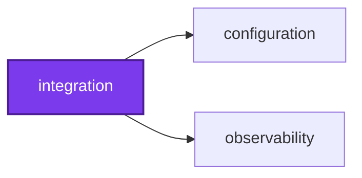
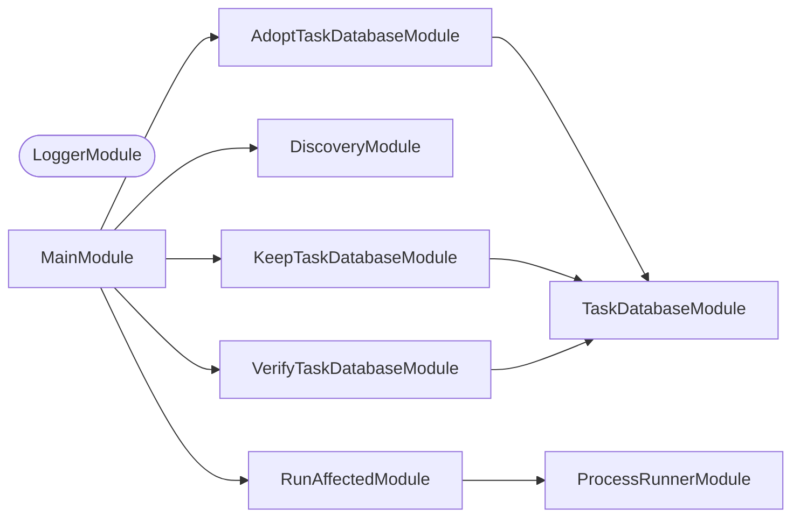

Continuous Integration plumbing: the steps that run around a CI job, as
commands. `run-affected` runs Nx affected over a change set corrected for
spelling files and conformetry templates, and the Nx task-database steps
`verify-task-database`, `adopt-task-database`, and `keep-task-database` carry
the Nx task-cache database between runs. "Integration" here means Continuous
Integration, not the `vitest:integration` test kind. See [AGENTS.md](AGENTS.md).

## Start

```bash
nx run integration:start
```

## Test

```bash
nx run integration:vitest
```

## 👔 Conformetry

This project was generated from the [nestjs-command-project](../configuration/conformetry-templates/nestjs-command-project) conformetry template.

<!-- callidescope:start -->

## 🔭 Callidescope

Call stacks traced through `integration`, deepest first. Each frame shows what it takes, what it returns, and what its documentation says.

| Measure | Value |
| --- | --- |
| Callables | 64 |
| Files | 37 |
| Calls traced | 52 |
| Call stacks | 4 |
| Deepest stack | 5 |
| Stacks through recursion | 0 |
| Unfollowable calls | 4 |

### Limits

What this project is judged against, as declared in its own `callidescope.config.ts`.

| Limit | Value |
| --- | --- |
| `maximumDepth` | 6 |
| `maximumBreadth` | 8 |

### Call stacks (depth)

**1. `AdoptTaskDatabaseCommand.run`** — depth 5 · decorated-method

```text
🚀 AdoptTaskDatabaseCommand.run(): Promise<void> [integration/src/modules/adopt-task-database/adopt-task-database.command.ts:42]
   ↳ Runs the step and prints what it reports.
  └─> TaskDatabaseService.adopt(): TaskDatabaseReport [integration/src/modules/task-database/task-database.service.ts:200]
     ↳ Renames the newest restored database to this machine's id, and discards the rest.
    └─> TaskDatabaseService.planAdoption(databases: readonly string[]): AdoptionPlan [integration/src/modules/task-database/task-database.service.ts:118]
       ↳ Decides what adopting would do, or why it should do nothing.
      └─> TaskDatabaseService.readMachineId(): string [integration/src/modules/task-database/task-database.service.ts:159]
         ↳ This machine's id, from the first readable, non-empty id file.
        └─> TaskDatabaseService.filter(…)(file: string): boolean [integration/src/modules/task-database/task-database.service.ts:163]
```

**2. `RunAffectedCommand.run`** — depth 5 · decorated-method

```text
🚀 RunAffectedCommand.run(): Promise<void> [integration/src/modules/run-affected/run-affected.command.ts:61]
   ↳ Plans the affected run, reports what it corrected, and runs it.
  └─> RunAffectedService.plan(): RunAffectedOutcome [integration/src/modules/run-affected/run-affected.service.ts:237]
     ↳ Works out the `nx affected` run this environment asks for.
    └─> RunAffectedService.findCorrections(inputs: RunAffectedInputs): RunAffectedCorrections | RunAffectedFailure [integration/src/modules/run-affected/run-affected.service.ts:90]
       ↳ Picks out the files that mislead Nx for this target, listing the change set only when the target asks for a correction.
      └─> RunAffectedService.listChangedFiles(base: string, head: string): RunAffectedFailure | string[] [integration/src/modules/run-affected/run-affected.service.ts:131]
         ↳ Lists the files changed between two revisions, or why that failed.
        └─> ProcessRunnerService.capture(executable: string, args: readonly string[]): CapturedProcess [integration/src/modules/process-runner/process-runner.service.ts:41]
           ↳ Runs a command to completion and returns what it printed.
```

**3. `VerifyTaskDatabaseCommand.run`** — depth 5 · decorated-method

```text
🚀 VerifyTaskDatabaseCommand.run(): Promise<void> [integration/src/modules/verify-task-database/verify-task-database.command.ts:39]
   ↳ Runs the step and prints what it reports.
  └─> TaskDatabaseService.verify(): TaskDatabaseReport [integration/src/modules/task-database/task-database.service.ts:262]
     ↳ Discards every database that fails `PRAGMA integrity_check`.
    └─> TaskDatabaseService.integrityOf(database: string): string [integration/src/modules/task-database/task-database.service.ts:81]
       ↳ Answers what SQLite itself says of a database: `ok` for a sound one, the problems found for a damaged one, or why it…
      └─> TaskDatabaseService.query(database: string, sql: string): string[] [integration/src/modules/task-database/task-database.service.ts:145]
         ↳ Runs one query, and returns the first column of every row as text.
        └─> TaskDatabaseService.map(…)(row: Record<string, SQLOutputValue>): string [integration/src/modules/task-database/task-database.service.ts:152]
```

<details>
<summary>1 more call stacks</summary>

**4. `KeepTaskDatabaseCommand.run`** — depth 4 · decorated-method

```text
🚀 KeepTaskDatabaseCommand.run(): Promise<void> [integration/src/modules/keep-task-database/keep-task-database.command.ts:41]
   ↳ Runs the step and prints what it reports.
  └─> TaskDatabaseService.keep(): TaskDatabaseReport [integration/src/modules/task-database/task-database.service.ts:232]
     ↳ Keeps only the newest database, warning when there was more than one. `adopt` renames the restored database to this…
    └─> TaskDatabaseService.list(): string[] [integration/src/modules/task-database/task-database.service.ts:90]
       ↳ Lists every task database, in name order, and nothing when there is none.
      └─> TaskDatabaseService.directory(): string [integration/src/modules/task-database/task-database.service.ts:55]
         ↳ Where Nx keeps the database, honouring the override Nx itself reads.
```

</details>

### Breadth

| Callable | Breadth | Calls directly | Location |
| --- | --- | --- | --- |
| `TaskDatabaseService.adopt` | 6 | `TaskDatabaseService.list`, `TaskDatabaseService.planAdoption`, `TaskDatabaseService.discardOthers`, `TaskDatabaseService.rename`, `adoptedMessage`, `TaskDatabaseService.countCachedResults` | `integration/src/modules/task-database/task-database.service.ts:200` |
| `TaskDatabaseService.keep` | 5 | `TaskDatabaseService.list`, `TaskDatabaseService.newest`, `TaskDatabaseService.discardOthers`, `duplicateMessage`, `TaskDatabaseService.map(…)` | `integration/src/modules/task-database/task-database.service.ts:232` |
| `RunAffectedCommand.run` | 5 | `RunAffectedService.plan`, `RunAffectedCommand.report`, `spellingFilesHeading`, `templateFilesHeading`, `RunAffectedService.execute` | `integration/src/modules/run-affected/run-affected.command.ts:61` |

<details>
<summary>18 more callables</summary>

| Callable | Breadth | Calls directly | Location |
| --- | --- | --- | --- |
| `TaskDatabaseService.planAdoption` | 4 | `TaskDatabaseService.readMachineId`, `TaskDatabaseService.newest`, `noSchemaMessage`, `TaskDatabaseService.directory` | `integration/src/modules/task-database/task-database.service.ts:118` |
| `TaskDatabaseService.verify` | 4 | `TaskDatabaseService.list`, `TaskDatabaseService.integrityOf`, `corruptMessage`, `TaskDatabaseService.discard` | `integration/src/modules/task-database/task-database.service.ts:262` |
| `RunAffectedService.findCorrections` | 4 | `RunAffectedService.listChangedFiles`, `RunAffectedService.pattern`, `RunAffectedService.filter(…)`, `RunAffectedService.filter(…)` | `integration/src/modules/run-affected/run-affected.service.ts:90` |
| `RunAffectedService.plan` | 4 | `RunAffectedService.readInputs`, `RunAffectedService.findCorrections`, `RunAffectedService.correctedPlan`, `RunAffectedService.revisionsPlan` | `integration/src/modules/run-affected/run-affected.service.ts:237` |
| `TaskDatabaseService.list` | 3 | `TaskDatabaseService.directory`, `TaskDatabaseService.map(…)`, `TaskDatabaseService.filter(…)` | `integration/src/modules/task-database/task-database.service.ts:90` |
| `RunAffectedService.listChangedFiles` | 2 | `ProcessRunnerService.capture`, `RunAffectedService.filter(…)` | `integration/src/modules/run-affected/run-affected.service.ts:131` |
| `TaskDatabaseService.countCachedResults` | 1 | `TaskDatabaseService.query` | `integration/src/modules/task-database/task-database.service.ts:46` |
| `TaskDatabaseService.discardOthers` | 1 | `TaskDatabaseService.discard` | `integration/src/modules/task-database/task-database.service.ts:69` |
| `TaskDatabaseService.integrityOf` | 1 | `TaskDatabaseService.query` | `integration/src/modules/task-database/task-database.service.ts:81` |
| `TaskDatabaseService.newest` | 1 | `TaskDatabaseService.reduce(…)` | `integration/src/modules/task-database/task-database.service.ts:110` |
| `TaskDatabaseService.query` | 1 | `TaskDatabaseService.map(…)` | `integration/src/modules/task-database/task-database.service.ts:145` |
| `TaskDatabaseService.readMachineId` | 1 | `TaskDatabaseService.filter(…)` | `integration/src/modules/task-database/task-database.service.ts:159` |
| `AdoptTaskDatabaseCommand.run` | 1 | `TaskDatabaseService.adopt` | `integration/src/modules/adopt-task-database/adopt-task-database.command.ts:42` |
| `KeepTaskDatabaseCommand.run` | 1 | `TaskDatabaseService.keep` | `integration/src/modules/keep-task-database/keep-task-database.command.ts:41` |
| `RunAffectedService.correctedPlan` | 1 | `RunAffectedService.filter(…)` | `integration/src/modules/run-affected/run-affected.service.ts:59` |
| `RunAffectedService.readInputs` | 1 | `RunAffectedService.filter(…)` | `integration/src/modules/run-affected/run-affected.service.ts:174` |
| `RunAffectedService.execute` | 1 | `ProcessRunnerService.stream` | `integration/src/modules/run-affected/run-affected.service.ts:228` |
| `VerifyTaskDatabaseCommand.run` | 1 | `TaskDatabaseService.verify` | `integration/src/modules/verify-task-database/verify-task-database.command.ts:39` |

</details>
<!-- callidescope:end -->

## 🕸️ Codependix

Dependency graphs exported by [codependix](https://github.com/Organizzolini/codebase/tree/main/projects/ic-suite/codependix/codependix-cli), regenerated by `nx run configuration:codependix:write`.

### Nx Neighborhood

<!-- codependix:start name="codependix-nx-projects" -->

<!-- codependix:end name="codependix-nx-projects" -->

### NestJS Module Graph

<!-- codependix:start name="codependix-nestjs-modules" -->


_Rounded modules are global: every module can inject them, so their edges are left out._
<!-- codependix:end name="codependix-nestjs-modules" -->

### File Imports

```mermaid
graph LR
  file_callidescope_config_ts["callidescope.config.ts"]
  file_codependix_config_ts["codependix.config.ts"]
  file_codometer_config_ts["codometer.config.ts"]
  file_eslint_config_ts["eslint.config.ts"]
  file_src_integration_constants_ts["src/integration.constants.ts"]
  file_src_integration_main_end_to_end_test_ts["src/integration.main.end-to-end.test.ts"]
  file_src_integration_main_ts["src/integration.main.ts"]
  file_src_integration_main_unit_test_ts["src/integration.main.unit.test.ts"]
  file_src_integration_module_ts["src/integration.module.ts"]
  file_src_integration_repl_ts["src/integration.repl.ts"]
  file_src_integration_repl_unit_test_ts["src/integration.repl.unit.test.ts"]
  file_src_integration_types_ts["src/integration.types.ts"]
  file_src_modules_adopt_task_database_adopt_task_database_command_ts["src/modules/adopt-task-database/adopt-task-database.command.ts"]
  file_src_modules_adopt_task_database_adopt_task_database_command_unit_test_ts["src/modules/adopt-task-database/adopt-task-database.command.unit.test.ts"]
  file_src_modules_adopt_task_database_adopt_task_database_constants_ts["src/modules/adopt-task-database/adopt-task-database.constants.ts"]
  file_src_modules_adopt_task_database_adopt_task_database_module_ts["src/modules/adopt-task-database/adopt-task-database.module.ts"]
  file_src_modules_adopt_task_database_adopt_task_database_module_unit_test_ts["src/modules/adopt-task-database/adopt-task-database.module.unit.test.ts"]
  file_src_modules_adopt_task_database_adopt_task_database_types_ts["src/modules/adopt-task-database/adopt-task-database.types.ts"]
  file_src_modules_keep_task_database_keep_task_database_command_ts["src/modules/keep-task-database/keep-task-database.command.ts"]
  file_src_modules_keep_task_database_keep_task_database_command_unit_test_ts["src/modules/keep-task-database/keep-task-database.command.unit.test.ts"]
  file_src_modules_keep_task_database_keep_task_database_constants_ts["src/modules/keep-task-database/keep-task-database.constants.ts"]
  file_src_modules_keep_task_database_keep_task_database_module_ts["src/modules/keep-task-database/keep-task-database.module.ts"]
  file_src_modules_keep_task_database_keep_task_database_module_unit_test_ts["src/modules/keep-task-database/keep-task-database.module.unit.test.ts"]
  file_src_modules_keep_task_database_keep_task_database_types_ts["src/modules/keep-task-database/keep-task-database.types.ts"]
  file_src_modules_process_runner_process_runner_constants_ts["src/modules/process-runner/process-runner.constants.ts"]
  file_src_modules_process_runner_process_runner_module_ts["src/modules/process-runner/process-runner.module.ts"]
  file_src_modules_process_runner_process_runner_module_unit_test_ts["src/modules/process-runner/process-runner.module.unit.test.ts"]
  file_src_modules_process_runner_process_runner_service_integration_test_ts["src/modules/process-runner/process-runner.service.integration.test.ts"]
  file_src_modules_process_runner_process_runner_service_ts["src/modules/process-runner/process-runner.service.ts"]
  file_src_modules_process_runner_process_runner_service_unit_test_ts["src/modules/process-runner/process-runner.service.unit.test.ts"]
  file_src_modules_process_runner_process_runner_types_ts["src/modules/process-runner/process-runner.types.ts"]
  file_src_modules_process_runner_process_runner_utilities_ts["src/modules/process-runner/process-runner.utilities.ts"]
  file_src_modules_process_runner_process_runner_utilities_unit_test_ts["src/modules/process-runner/process-runner.utilities.unit.test.ts"]
  file_src_modules_run_affected_run_affected_command_ts["src/modules/run-affected/run-affected.command.ts"]
  file_src_modules_run_affected_run_affected_command_unit_test_ts["src/modules/run-affected/run-affected.command.unit.test.ts"]
  file_src_modules_run_affected_run_affected_constants_ts["src/modules/run-affected/run-affected.constants.ts"]
  file_src_modules_run_affected_run_affected_module_ts["src/modules/run-affected/run-affected.module.ts"]
  file_src_modules_run_affected_run_affected_module_unit_test_ts["src/modules/run-affected/run-affected.module.unit.test.ts"]
  file_src_modules_run_affected_run_affected_service_ts["src/modules/run-affected/run-affected.service.ts"]
  file_src_modules_run_affected_run_affected_service_unit_test_ts["src/modules/run-affected/run-affected.service.unit.test.ts"]
  file_src_modules_run_affected_run_affected_types_ts["src/modules/run-affected/run-affected.types.ts"]
  file_src_modules_task_database_task_database_constants_ts["src/modules/task-database/task-database.constants.ts"]
  file_src_modules_task_database_task_database_module_ts["src/modules/task-database/task-database.module.ts"]
  file_src_modules_task_database_task_database_module_unit_test_ts["src/modules/task-database/task-database.module.unit.test.ts"]
  file_src_modules_task_database_task_database_service_ts["src/modules/task-database/task-database.service.ts"]
  file_src_modules_task_database_task_database_service_unit_test_ts["src/modules/task-database/task-database.service.unit.test.ts"]
  file_src_modules_task_database_task_database_types_ts["src/modules/task-database/task-database.types.ts"]
  file_src_modules_task_database_task_database_utilities_ts["src/modules/task-database/task-database.utilities.ts"]
  file_src_modules_task_database_task_database_utilities_unit_test_ts["src/modules/task-database/task-database.utilities.unit.test.ts"]
  file_src_modules_verify_task_database_verify_task_database_command_ts["src/modules/verify-task-database/verify-task-database.command.ts"]
  file_src_modules_verify_task_database_verify_task_database_command_unit_test_ts["src/modules/verify-task-database/verify-task-database.command.unit.test.ts"]
  file_src_modules_verify_task_database_verify_task_database_constants_ts["src/modules/verify-task-database/verify-task-database.constants.ts"]
  file_src_modules_verify_task_database_verify_task_database_module_ts["src/modules/verify-task-database/verify-task-database.module.ts"]
  file_src_modules_verify_task_database_verify_task_database_module_unit_test_ts["src/modules/verify-task-database/verify-task-database.module.unit.test.ts"]
  file_src_modules_verify_task_database_verify_task_database_types_ts["src/modules/verify-task-database/verify-task-database.types.ts"]
  file_testing_mocks_ts["testing/mocks.ts"]
  file_testing_setup_ts["testing/setup.ts"]
  file_vitest_config_ts["vitest.config.ts"]
  file_src_integration_main_end_to_end_test_ts --> file_src_integration_constants_ts
  file_src_integration_main_ts --> file_src_integration_module_ts
  file_src_integration_main_unit_test_ts --> file_src_modules_run_affected_run_affected_module_ts
  file_src_integration_module_ts --> file_src_integration_constants_ts
  file_src_integration_module_ts --> file_src_modules_adopt_task_database_adopt_task_database_module_ts
  file_src_integration_module_ts --> file_src_modules_keep_task_database_keep_task_database_module_ts
  file_src_integration_module_ts --> file_src_modules_run_affected_run_affected_module_ts
  file_src_integration_module_ts --> file_src_modules_verify_task_database_verify_task_database_module_ts
  file_src_integration_repl_ts --> file_src_integration_module_ts
  file_src_integration_types_ts --> file_src_integration_constants_ts
  file_src_modules_adopt_task_database_adopt_task_database_command_ts --> file_src_modules_task_database_task_database_service_ts
  file_src_modules_adopt_task_database_adopt_task_database_command_unit_test_ts --> file_src_modules_adopt_task_database_adopt_task_database_command_ts
  file_src_modules_adopt_task_database_adopt_task_database_command_unit_test_ts --> file_src_modules_task_database_task_database_service_ts
  file_src_modules_adopt_task_database_adopt_task_database_command_unit_test_ts --> file_testing_mocks_ts
  file_src_modules_adopt_task_database_adopt_task_database_module_ts --> file_src_modules_adopt_task_database_adopt_task_database_command_ts
  file_src_modules_adopt_task_database_adopt_task_database_module_ts --> file_src_modules_task_database_task_database_module_ts
  file_src_modules_adopt_task_database_adopt_task_database_module_unit_test_ts --> file_src_modules_adopt_task_database_adopt_task_database_command_ts
  file_src_modules_adopt_task_database_adopt_task_database_module_unit_test_ts --> file_src_modules_adopt_task_database_adopt_task_database_module_ts
  file_src_modules_adopt_task_database_adopt_task_database_module_unit_test_ts --> file_src_modules_task_database_task_database_module_ts
  file_src_modules_keep_task_database_keep_task_database_command_ts --> file_src_modules_task_database_task_database_service_ts
  file_src_modules_keep_task_database_keep_task_database_command_unit_test_ts --> file_src_modules_keep_task_database_keep_task_database_command_ts
  file_src_modules_keep_task_database_keep_task_database_command_unit_test_ts --> file_src_modules_task_database_task_database_service_ts
  file_src_modules_keep_task_database_keep_task_database_command_unit_test_ts --> file_testing_mocks_ts
  file_src_modules_keep_task_database_keep_task_database_module_ts --> file_src_modules_keep_task_database_keep_task_database_command_ts
  file_src_modules_keep_task_database_keep_task_database_module_ts --> file_src_modules_task_database_task_database_module_ts
  file_src_modules_keep_task_database_keep_task_database_module_unit_test_ts --> file_src_modules_keep_task_database_keep_task_database_command_ts
  file_src_modules_keep_task_database_keep_task_database_module_unit_test_ts --> file_src_modules_keep_task_database_keep_task_database_module_ts
  file_src_modules_keep_task_database_keep_task_database_module_unit_test_ts --> file_src_modules_task_database_task_database_module_ts
  file_src_modules_process_runner_process_runner_module_ts --> file_src_modules_process_runner_process_runner_service_ts
  file_src_modules_process_runner_process_runner_module_unit_test_ts --> file_src_modules_process_runner_process_runner_module_ts
  file_src_modules_process_runner_process_runner_module_unit_test_ts --> file_src_modules_process_runner_process_runner_service_ts
  file_src_modules_process_runner_process_runner_service_integration_test_ts --> file_src_modules_process_runner_process_runner_service_ts
  file_src_modules_process_runner_process_runner_service_ts --> file_src_modules_process_runner_process_runner_constants_ts
  file_src_modules_process_runner_process_runner_service_ts --> file_src_modules_process_runner_process_runner_types_ts
  file_src_modules_process_runner_process_runner_service_unit_test_ts --> file_src_modules_process_runner_process_runner_service_ts
  file_src_modules_process_runner_process_runner_utilities_ts --> file_src_modules_process_runner_process_runner_types_ts
  file_src_modules_process_runner_process_runner_utilities_unit_test_ts --> file_src_modules_process_runner_process_runner_utilities_ts
  file_src_modules_run_affected_run_affected_command_ts --> file_src_modules_run_affected_run_affected_constants_ts
  file_src_modules_run_affected_run_affected_command_ts --> file_src_modules_run_affected_run_affected_service_ts
  file_src_modules_run_affected_run_affected_command_unit_test_ts --> file_src_modules_process_runner_process_runner_service_ts
  file_src_modules_run_affected_run_affected_command_unit_test_ts --> file_src_modules_process_runner_process_runner_types_ts
  file_src_modules_run_affected_run_affected_command_unit_test_ts --> file_src_modules_run_affected_run_affected_command_ts
  file_src_modules_run_affected_run_affected_command_unit_test_ts --> file_src_modules_run_affected_run_affected_service_ts
  file_src_modules_run_affected_run_affected_command_unit_test_ts --> file_testing_mocks_ts
  file_src_modules_run_affected_run_affected_module_ts --> file_src_modules_process_runner_process_runner_module_ts
  file_src_modules_run_affected_run_affected_module_ts --> file_src_modules_run_affected_run_affected_command_ts
  file_src_modules_run_affected_run_affected_module_ts --> file_src_modules_run_affected_run_affected_service_ts
  file_src_modules_run_affected_run_affected_module_unit_test_ts --> file_src_modules_process_runner_process_runner_module_ts
  file_src_modules_run_affected_run_affected_module_unit_test_ts --> file_src_modules_run_affected_run_affected_command_ts
  file_src_modules_run_affected_run_affected_module_unit_test_ts --> file_src_modules_run_affected_run_affected_module_ts
  file_src_modules_run_affected_run_affected_module_unit_test_ts --> file_src_modules_run_affected_run_affected_service_ts
  file_src_modules_run_affected_run_affected_service_ts --> file_src_integration_types_ts
  file_src_modules_run_affected_run_affected_service_ts --> file_src_modules_process_runner_process_runner_service_ts
  file_src_modules_run_affected_run_affected_service_ts --> file_src_modules_run_affected_run_affected_constants_ts
  file_src_modules_run_affected_run_affected_service_ts --> file_src_modules_run_affected_run_affected_types_ts
  file_src_modules_run_affected_run_affected_service_unit_test_ts --> file_src_modules_process_runner_process_runner_service_ts
  file_src_modules_run_affected_run_affected_service_unit_test_ts --> file_src_modules_run_affected_run_affected_service_ts
  file_src_modules_task_database_task_database_module_ts --> file_src_modules_task_database_task_database_service_ts
  file_src_modules_task_database_task_database_module_unit_test_ts --> file_src_modules_task_database_task_database_module_ts
  file_src_modules_task_database_task_database_module_unit_test_ts --> file_src_modules_task_database_task_database_service_ts
  file_src_modules_task_database_task_database_service_ts --> file_src_integration_types_ts
  file_src_modules_task_database_task_database_service_ts --> file_src_modules_task_database_task_database_constants_ts
  file_src_modules_task_database_task_database_service_ts --> file_src_modules_task_database_task_database_types_ts
  file_src_modules_task_database_task_database_service_unit_test_ts --> file_src_modules_task_database_task_database_service_ts
  file_src_modules_task_database_task_database_utilities_ts --> file_src_modules_task_database_task_database_constants_ts
  file_src_modules_task_database_task_database_utilities_unit_test_ts --> file_src_modules_task_database_task_database_utilities_ts
  file_src_modules_verify_task_database_verify_task_database_command_ts --> file_src_modules_task_database_task_database_service_ts
  file_src_modules_verify_task_database_verify_task_database_command_unit_test_ts --> file_src_modules_task_database_task_database_service_ts
  file_src_modules_verify_task_database_verify_task_database_command_unit_test_ts --> file_src_modules_verify_task_database_verify_task_database_command_ts
  file_src_modules_verify_task_database_verify_task_database_command_unit_test_ts --> file_testing_mocks_ts
  file_src_modules_verify_task_database_verify_task_database_module_ts --> file_src_modules_task_database_task_database_module_ts
  file_src_modules_verify_task_database_verify_task_database_module_ts --> file_src_modules_verify_task_database_verify_task_database_command_ts
  file_src_modules_verify_task_database_verify_task_database_module_unit_test_ts --> file_src_modules_task_database_task_database_module_ts
  file_src_modules_verify_task_database_verify_task_database_module_unit_test_ts --> file_src_modules_verify_task_database_verify_task_database_command_ts
  file_src_modules_verify_task_database_verify_task_database_module_unit_test_ts --> file_src_modules_verify_task_database_verify_task_database_module_ts
  file_testing_mocks_ts --> file_src_modules_process_runner_process_runner_service_ts
  file_testing_mocks_ts --> file_src_modules_process_runner_process_runner_types_ts
```

<!-- codependix:start name="codependix-file-imports" -->

<!-- codependix:end name="codependix-file-imports" -->

<!-- codometer:start -->

## ⏲️ Codometer

### Project


### TypeScript


### JavaScript


### Python


### JSON


### YAML


### TOML


### Shell


### SQL


### HCL


### CSS


### Conventions


### Jupyter


### Markdown


<!-- codometer:end -->
