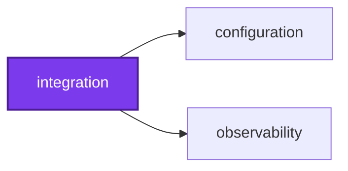
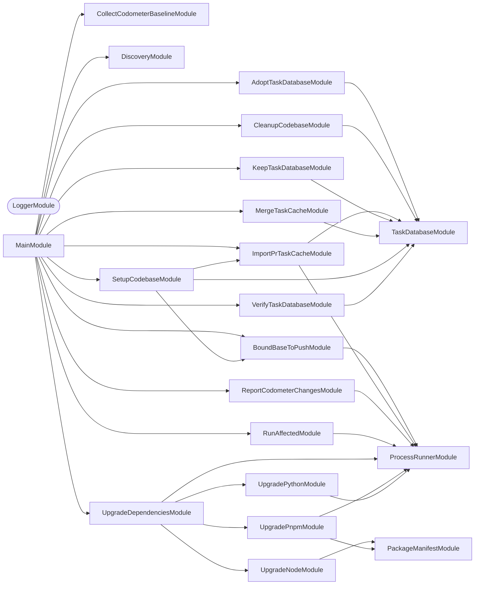

Continuous Integration plumbing: the steps that run around a CI job, as
commands. `setup-codebase` and `cleanup-codebase` ready and tidy a job's Nx base
and task-cache database, around the `setup-codebase` and `cleanup-codebase`
composite actions' cache restores and saves; the steps they run are commands too:
`bound-base-to-push`, `import-pr-task-cache`, `merge-task-cache`,
`verify-task-database`, `adopt-task-database`, and `keep-task-database`.
`run-affected` runs Nx affected, adding the conformetry config when a template
changed. `collect-codometer-baseline` and `report-codometer-changes` keep
codometer's baseline and write its changes onto a pull request.
`upgrade-dependencies` runs the weekly dependency upgrades, undoing and
reporting any that fail instead of failing the job. "Integration" here means
Continuous Integration, not the `vitest:integration` test kind. See
[AGENTS.md](AGENTS.md).

## Start

```bash
nx run integration:start
```

## Test

```bash
nx run integration:vitest
```

## 👔 Conformetry

This project was generated from the [nestjs-command-project](../configuration/conformetry-templates/nestjs-command-project) conformetry template.

<!-- callidescope:start -->

## 🔭 Callidescope

Call stacks traced through `integration`, deepest first. Each frame shows what it takes, what it returns, and what its documentation says.

| Measure | Value |
| --- | --- |
| Callables | 170 |
| Files | 92 |
| Calls traced | 190 |
| Call stacks | 12 |
| Deepest stack | 6 |
| Stacks through recursion | 0 |
| Unfollowable calls | 12 |

### Limits

What this project is judged against, as declared in its own `callidescope.config.ts`.

| Limit | Value |
| --- | --- |
| `maximumDepth` | 6 |
| `maximumBreadth` | 8 |

### Call stacks (depth)

**1. `ImportPrTaskCacheCommand.run`** — depth 6 · decorated-method

```text
🚀 ImportPrTaskCacheCommand.run(): Promise<void> [integration/src/modules/import-pr-task-cache/import-pr-task-cache.command.ts:43]
   ↳ Imports the cache and prints what happened.
  └─> ImportPrTaskCacheService.import(): TaskDatabaseReport [integration/src/modules/import-pr-task-cache/import-pr-task-cache.service.ts:177]
     ↳ Imports the pull request's cache when this run is a merge group's.
    └─> ImportPrTaskCacheService.locate(): ImportStop | LocatedArtifact [integration/src/modules/import-pr-task-cache/import-pr-task-cache.service.ts:132]
       ↳ Finds the artifact to import, or says why there is none.
      └─> ImportPrTaskCacheService.findPullRequest(): ImportStop | TrustedPullRequest [integration/src/modules/import-pr-task-cache/import-pr-task-cache.service.ts:105]
         ↳ Finds the pull request a merge group tests, when it comes from this repository, or says why there is nothing to import.
        └─> ImportPrTaskCacheService.api(args: readonly string[]): string [integration/src/modules/import-pr-task-cache/import-pr-task-cache.service.ts:62]
           ↳ Runs `gh api` and returns its trimmed output, or fails the import.
          └─> ProcessRunnerService.capture(executable: string, args: readonly string[]): CapturedProcess [integration/src/modules/process-runner/process-runner.service.ts:42]
             ↳ Runs a command to completion and returns what it printed.
```

**2. `SetupCodebaseCommand.run`** — depth 6 · decorated-method

```text
🚀 SetupCodebaseCommand.run(): Promise<void> [integration/src/modules/setup-codebase/setup-codebase.command.ts:98]
   ↳ Runs the steps this job asked for, prints what they decided, and sets the exit code.
  └─> ImportPrTaskCacheService.import(): TaskDatabaseReport [integration/src/modules/import-pr-task-cache/import-pr-task-cache.service.ts:177]
     ↳ Imports the pull request's cache when this run is a merge group's.
    └─> ImportPrTaskCacheService.locate(): ImportStop | LocatedArtifact [integration/src/modules/import-pr-task-cache/import-pr-task-cache.service.ts:132]
       ↳ Finds the artifact to import, or says why there is none.
      └─> ImportPrTaskCacheService.findPullRequest(): ImportStop | TrustedPullRequest [integration/src/modules/import-pr-task-cache/import-pr-task-cache.service.ts:105]
         ↳ Finds the pull request a merge group tests, when it comes from this repository, or says why there is nothing to import.
        └─> ImportPrTaskCacheService.api(args: readonly string[]): string [integration/src/modules/import-pr-task-cache/import-pr-task-cache.service.ts:62]
           ↳ Runs `gh api` and returns its trimmed output, or fails the import.
          └─> ProcessRunnerService.capture(executable: string, args: readonly string[]): CapturedProcess [integration/src/modules/process-runner/process-runner.service.ts:42]
             ↳ Runs a command to completion and returns what it printed.
```

**3. `UpgradeDependenciesCommand.run`** — depth 6 · decorated-method

```text
🚀 UpgradeDependenciesCommand.run(): Promise<void> [integration/src/modules/upgrade-dependencies/upgrade-dependencies.command.ts:85]
   ↳ Runs every upgrade in turn, then reports what came of them.
  └─> UpgradeDependenciesService.attempt(step: UpgradeStep): Promise<UpgradeOutcome> [integration/src/modules/upgrade-dependencies/upgrade-dependencies.service.ts:165]
     ↳ Runs one upgrade, undoing it if it fails.
    └─> UpgradeDependenciesService.work(step: UpgradeStep): Promise<UpgradeWork> [integration/src/modules/upgrade-dependencies/upgrade-dependencies.service.ts:144]
       ↳ Carries a step out: its commands run in order until one fails, and its task runs in its service, which throws to say…
      └─> UpgradeNodeService.upgrade(): Promise<string> [integration/src/modules/upgrade-node/upgrade-node.service.ts:59]
         ↳ Writes the newest release of the current major, when it is newer than the one in use.
        └─> UpgradeNodeService.fetchReleases(): Promise<string[]> [integration/src/modules/upgrade-node/upgrade-node.service.ts:37]
           ↳ Every release Node.js has published, as `v` and three numbers.
          └─> UpgradeNodeService.map(…)(release: { version: string; }): string [integration/src/modules/upgrade-node/upgrade-node.service.ts:46]
```

<details>
<summary>9 more call stacks</summary>

**4. `AdoptTaskDatabaseCommand.run`** — depth 5 · decorated-method

```text
🚀 AdoptTaskDatabaseCommand.run(): Promise<void> [integration/src/modules/adopt-task-database/adopt-task-database.command.ts:42]
   ↳ Runs the step and prints what it reports.
  └─> TaskDatabaseService.adopt(): TaskDatabaseReport [integration/src/modules/task-database/task-database.service.ts:359]
     ↳ Renames the newest restored database to this machine's id, and discards the rest.
    └─> TaskDatabaseService.planAdoption(databases: readonly string[]): AdoptionPlan [integration/src/modules/task-database/task-database.service.ts:253]
       ↳ Decides what adopting would do, or why it should do nothing.
      └─> TaskDatabaseService.readMachineId(): string [integration/src/modules/task-database/task-database.service.ts:318]
         ↳ This machine's id, from the first readable, non-empty id file.
        └─> TaskDatabaseService.filter(…)(file: string): boolean [integration/src/modules/task-database/task-database.service.ts:322]
```

**5. `MergeTaskCacheCommand.run`** — depth 5 · decorated-method

```text
🚀 MergeTaskCacheCommand.run(parameters: string[]): Promise<void> [integration/src/modules/merge-task-cache/merge-task-cache.command.ts:45]
   ↳ Merges the cache the first parameter names, and prints what happened.
  └─> TaskDatabaseService.merge(source: string): TaskDatabaseReport [integration/src/modules/task-database/task-database.service.ts:419]
     ↳ Merges another run's Nx cache into this one, so the tasks that run already finished are hits here too.
    └─> TaskDatabaseService.checkSource(source: string): MergeSource [integration/src/modules/task-database/task-database.service.ts:87]
       ↳ Finds the database a source would be merged from, or why it cannot be.
      └─> TaskDatabaseService.list(directory?: string): string[] [integration/src/modules/task-database/task-database.service.ts:209]
         ↳ Lists every task database in a directory, this cache's by default, in name order, and nothing when there is none.
        └─> TaskDatabaseService.map(…)(name: string): string [integration/src/modules/task-database/task-database.service.ts:218]
```

**6. `RunAffectedCommand.run`** — depth 5 · decorated-method

```text
🚀 RunAffectedCommand.run(): Promise<void> [integration/src/modules/run-affected/run-affected.command.ts:57]
   ↳ Plans the affected runs, reports what a template added, and makes them.
  └─> RunAffectedService.plan(): RunAffectedOutcome [integration/src/modules/run-affected/run-affected.service.ts:164]
     ↳ Works out the `nx affected` runs this environment asks for.
    └─> RunAffectedService.templatesChanged(inputs: RunAffectedInputs): RunAffectedFailure | string[] [integration/src/modules/run-affected/run-affected.service.ts:120]
       ↳ Picks out the changed templates, when the target asks for them.
      └─> RunAffectedService.listChangedFiles(base: string, head: string): RunAffectedFailure | string[] [integration/src/modules/run-affected/run-affected.service.ts:48]
         ↳ Lists the files changed between two revisions, or why that failed.
        └─> ProcessRunnerService.capture(executable: string, args: readonly string[]): CapturedProcess [integration/src/modules/process-runner/process-runner.service.ts:42]
           ↳ Runs a command to completion and returns what it printed.
```

**7. `CleanupCodebaseCommand.run`** — depth 4 · decorated-method

```text
🚀 CleanupCodebaseCommand.run(): Promise<void> [integration/src/modules/cleanup-codebase/cleanup-codebase.command.ts:49]
   ↳ Verifies the database, keeps the newest, and prints what they report.
  └─> TaskDatabaseService.verify(): TaskDatabaseReport [integration/src/modules/task-database/task-database.service.ts:454]
     ↳ Discards every database that fails `PRAGMA integrity_check`.
    └─> TaskDatabaseService.list(directory?: string): string[] [integration/src/modules/task-database/task-database.service.ts:209]
       ↳ Lists every task database in a directory, this cache's by default, in name order, and nothing when there is none.
      └─> TaskDatabaseService.map(…)(name: string): string [integration/src/modules/task-database/task-database.service.ts:218]
```

**8. `CollectCodometerBaselineCommand.run`** — depth 4 · decorated-method

```text
🚀 CollectCodometerBaselineCommand.run(): Promise<void> [integration/src/modules/collect-codometer-baseline/collect-codometer-baseline.command.ts:42]
   ↳ Gathers the reports and prints what it found.
  └─> CollectCodometerBaselineService.collect(root?: string): CollectCodometerBaselineReport [integration/src/modules/collect-codometer-baseline/collect-codometer-baseline.service.ts:67]
     ↳ Copies each report found beneath a root into the baseline directory.
    └─> CollectCodometerBaselineService.findReports(root: string, directory?: string): string[] [integration/src/modules/collect-codometer-baseline/collect-codometer-baseline.service.ts:34]
       ↳ Lists the reports beneath a directory, relative to the root, in name order.
      └─> CollectCodometerBaselineService.toSorted(…)(left: fs.Dirent<string>, right: fs.Dirent<string>): number [integration/src/modules/collect-codometer-baseline/collect-codometer-baseline.service.ts:40]
```

**9. `KeepTaskDatabaseCommand.run`** — depth 4 · decorated-method

```text
🚀 KeepTaskDatabaseCommand.run(): Promise<void> [integration/src/modules/keep-task-database/keep-task-database.command.ts:41]
   ↳ Runs the step and prints what it reports.
  └─> TaskDatabaseService.keep(): TaskDatabaseReport [integration/src/modules/task-database/task-database.service.ts:391]
     ↳ Keeps only the newest database, warning when there was more than one. `adopt` renames the restored database to this…
    └─> TaskDatabaseService.list(directory?: string): string[] [integration/src/modules/task-database/task-database.service.ts:209]
       ↳ Lists every task database in a directory, this cache's by default, in name order, and nothing when there is none.
      └─> TaskDatabaseService.map(…)(name: string): string [integration/src/modules/task-database/task-database.service.ts:218]
```

**10. `ReportCodometerChangesCommand.run`** — depth 4 · decorated-method

```text
🚀 ReportCodometerChangesCommand.run(): Promise<void> [integration/src/modules/report-codometer-changes/report-codometer-changes.command.ts:43]
   ↳ Reports the changes, prints what happened, and sets the exit code.
  └─> ReportCodometerChangesService.report(): ReportCodometerChangesOutcome [integration/src/modules/report-codometer-changes/report-codometer-changes.service.ts:184]
     ↳ Fetches the baseline, rewrites the pull request body with the changes against it, and saves the body.
    └─> ReportCodometerChangesService.fetchBaseline(): CodometerBaseline [integration/src/modules/report-codometer-changes/report-codometer-changes.service.ts:52]
       ↳ Downloads the baseline of the latest green `main` run, if there is one.
      └─> ProcessRunnerService.capture(executable: string, args: readonly string[]): CapturedProcess [integration/src/modules/process-runner/process-runner.service.ts:42]
         ↳ Runs a command to completion and returns what it printed.
```

**11. `VerifyTaskDatabaseCommand.run`** — depth 4 · decorated-method

```text
🚀 VerifyTaskDatabaseCommand.run(): Promise<void> [integration/src/modules/verify-task-database/verify-task-database.command.ts:39]
   ↳ Runs the step and prints what it reports.
  └─> TaskDatabaseService.verify(): TaskDatabaseReport [integration/src/modules/task-database/task-database.service.ts:454]
     ↳ Discards every database that fails `PRAGMA integrity_check`.
    └─> TaskDatabaseService.list(directory?: string): string[] [integration/src/modules/task-database/task-database.service.ts:209]
       ↳ Lists every task database in a directory, this cache's by default, in name order, and nothing when there is none.
      └─> TaskDatabaseService.map(…)(name: string): string [integration/src/modules/task-database/task-database.service.ts:218]
```

**12. `BoundBaseToPushCommand.run`** — depth 3 · decorated-method

```text
🚀 BoundBaseToPushCommand.run(): Promise<void> [integration/src/modules/bound-base-to-push/bound-base-to-push.command.ts:41]
   ↳ Bounds the base, prints what it decided, and sets the exit code.
  └─> BoundBaseToPushService.bound(): BoundBaseReport [integration/src/modules/bound-base-to-push/bound-base-to-push.service.ts:59]
     ↳ Decides the push's base, and writes a moved one to `GITHUB_ENV` for the later steps of the job.
    └─> BoundBaseToPushService.read(name: "BEFORE" | "GITHUB_ENV" | "NX_BASE" | "NX_HEAD"): string [integration/src/modules/bound-base-to-push/bound-base-to-push.service.ts:49]
       ↳ Reads one variable, an absent one as empty.
```

</details>

### Breadth

| Callable | Breadth | Calls directly | Location |
| --- | --- | --- | --- |
| `renderPullRequestBody` | 8 | `flatMap(…)`, `filter(…)`, `map(…)`, `map(…)`, `filter(…)`, `map(…)`, `map(…)`, `flatMap(…)` | `integration/src/modules/upgrade-dependencies/upgrade-dependencies.utilities.ts:17` |
| `UpgradeDependenciesService.attempt` | 7 | `UpgradeDependenciesService.snapshot`, `UpgradeDependenciesService.work`, `UpgradeDependenciesService.git`, `warningsOf`, `UpgradeDependenciesService.undo`, `unrestoredMessage`, `UpgradeDependenciesService.tail` | `integration/src/modules/upgrade-dependencies/upgrade-dependencies.service.ts:165` |
| `TaskDatabaseService.planMerge` | 6 | `TaskDatabaseService.cacheDirectory`, `TaskDatabaseService.directory`, `TaskDatabaseService.list`, `TaskDatabaseService.newest`, `schemaOf`, `schemaMismatchReason` | `integration/src/modules/task-database/task-database.service.ts:280` |

<details>
<summary>64 more callables</summary>

| Callable | Breadth | Calls directly | Location |
| --- | --- | --- | --- |
| `TaskDatabaseService.adopt` | 6 | `TaskDatabaseService.list`, `TaskDatabaseService.planAdoption`, `TaskDatabaseService.discardOthers`, `TaskDatabaseService.rename`, `adoptedMessage`, `TaskDatabaseService.countCachedResults` | `integration/src/modules/task-database/task-database.service.ts:359` |
| `ImportPrTaskCacheService.import` | 6 | `ImportPrTaskCacheService.read`, `ImportPrTaskCacheService.locate`, `ImportPrTaskCacheService.download`, `importingMessage`, `TaskDatabaseService.merge`, `couldNotImportMessage` | `integration/src/modules/import-pr-task-cache/import-pr-task-cache.service.ts:177` |
| `TaskDatabaseService.checkSource` | 5 | `TaskDatabaseService.list`, `TaskDatabaseService.newest`, `TaskDatabaseService.integrityOf`, `TaskDatabaseService.query`, `TaskDatabaseService.every(…)` | `integration/src/modules/task-database/task-database.service.ts:87` |
| `TaskDatabaseService.mergeRows` | 5 | `TaskDatabaseService.query`, `TaskDatabaseService.copyMissingOutputs`, `TaskDatabaseService.cacheDirectory`, `TaskDatabaseService.insertRows`, `mergedMessage` | `integration/src/modules/task-database/task-database.service.ts:227` |
| `TaskDatabaseService.keep` | 5 | `TaskDatabaseService.list`, `TaskDatabaseService.newest`, `TaskDatabaseService.discardOthers`, `duplicateMessage`, `TaskDatabaseService.map(…)` | `integration/src/modules/task-database/task-database.service.ts:391` |
| `TaskDatabaseService.merge` | 5 | `TaskDatabaseService.checkSource`, `notMergingMessage`, `TaskDatabaseService.planMerge`, `TaskDatabaseService.adoptSource`, `TaskDatabaseService.mergeRows` | `integration/src/modules/task-database/task-database.service.ts:419` |
| `BoundBaseToPushService.bound` | 5 | `BoundBaseToPushService.read`, `noPreviousTipMessage`, `ProcessRunnerService.capture`, `notAncestorMessage`, `boundingMessage` | `integration/src/modules/bound-base-to-push/bound-base-to-push.service.ts:59` |
| `ImportPrTaskCacheService.locate` | 5 | `ImportPrTaskCacheService.findPullRequest`, `ImportPrTaskCacheService.require`, `ImportPrTaskCacheService.api`, `artifactQuery`, `noArtifactMessage` | `integration/src/modules/import-pr-task-cache/import-pr-task-cache.service.ts:132` |
| `UpgradePythonService.upgrade` | 5 | `UpgradePythonService.newest`, `currentVersion`, `withRequiredVersion`, `withToolVersions`, `ProcessRunnerService.captureSequence` | `integration/src/modules/upgrade-python/upgrade-python.service.ts:77` |
| `TaskDatabaseService.planAdoption` | 4 | `TaskDatabaseService.readMachineId`, `TaskDatabaseService.newest`, `noSchemaMessage`, `TaskDatabaseService.directory` | `integration/src/modules/task-database/task-database.service.ts:253` |
| `TaskDatabaseService.verify` | 4 | `TaskDatabaseService.list`, `TaskDatabaseService.integrityOf`, `corruptMessage`, `TaskDatabaseService.discard` | `integration/src/modules/task-database/task-database.service.ts:454` |
| `ImportPrTaskCacheService.findPullRequest` | 4 | `ImportPrTaskCacheService.read`, `ImportPrTaskCacheService.require`, `ImportPrTaskCacheService.api`, `untrustedMessage` | `integration/src/modules/import-pr-task-cache/import-pr-task-cache.service.ts:105` |
| `RunAffectedCommand.run` | 4 | `RunAffectedService.plan`, `RunAffectedCommand.report`, `templateFilesHeading`, `RunAffectedService.execute` | `integration/src/modules/run-affected/run-affected.command.ts:57` |
| `SetupCodebaseCommand.run` | 4 | `SetupCodebaseCommand.boundBase`, `ImportPrTaskCacheService.import`, `TaskDatabaseService.verify`, `TaskDatabaseService.adopt` | `integration/src/modules/setup-codebase/setup-codebase.command.ts:98` |
| `UpgradeNodeService.upgrade` | 4 | `UpgradeNodeService.fetchReleases`, `UpgradeNodeService.toSorted(…)`, `UpgradeNodeService.filter(…)`, `PackageManifestService.replace` | `integration/src/modules/upgrade-node/upgrade-node.service.ts:59` |
| `UpgradeDependenciesService.work` | 4 | `ProcessRunnerService.captureSequence`, `UpgradeNodeService.upgrade`, `UpgradePnpmService.upgrade`, `UpgradePythonService.upgrade` | `integration/src/modules/upgrade-dependencies/upgrade-dependencies.service.ts:144` |
| `UpgradeDependenciesCommand.run` | 4 | `UpgradeDependenciesService.attempt`, `UpgradeDependenciesCommand.conclude`, `UpgradeDependenciesService.finish`, `UpgradeDependenciesCommand.some(…)` | `integration/src/modules/upgrade-dependencies/upgrade-dependencies.command.ts:85` |
| `TaskDatabaseService.adoptSource` | 3 | `TaskDatabaseService.cacheDirectory`, `TaskDatabaseService.directory`, `nothingToMergeIntoMessage` | `integration/src/modules/task-database/task-database.service.ts:67` |
| `ReportCodometerChangesService.rewriteBody` | 3 | `ProcessRunnerService.capture`, `failedMessage`, `ProcessRunnerService.stream` | `integration/src/modules/report-codometer-changes/report-codometer-changes.service.ts:109` |
| `ReportCodometerChangesService.report` | 3 | `ReportCodometerChangesService.fetchBaseline`, `ReportCodometerChangesService.rewriteBody`, `baselineFoundMessage` | `integration/src/modules/report-codometer-changes/report-codometer-changes.service.ts:184` |
| `RunAffectedService.plan` | 3 | `RunAffectedService.readInputs`, `RunAffectedService.templatesChanged`, `RunAffectedService.runOf` | `integration/src/modules/run-affected/run-affected.service.ts:164` |
| `UpgradeDependenciesService.undo` | 3 | `ProcessRunnerService.capture`, `ProcessRunnerService.captureSequence`, `UpgradeDependenciesService.tail` | `integration/src/modules/upgrade-dependencies/upgrade-dependencies.service.ts:114` |
| `TaskDatabaseService.list` | 2 | `TaskDatabaseService.map(…)`, `TaskDatabaseService.filter(…)` | `integration/src/modules/task-database/task-database.service.ts:209` |
| `CleanupCodebaseCommand.run` | 2 | `TaskDatabaseService.verify`, `TaskDatabaseService.keep` | `integration/src/modules/cleanup-codebase/cleanup-codebase.command.ts:49` |
| `CollectCodometerBaselineService.collect` | 2 | `CollectCodometerBaselineService.findReports`, `collectedMessage` | `integration/src/modules/collect-codometer-baseline/collect-codometer-baseline.service.ts:67` |
| `ImportPrTaskCacheService.download` | 2 | `ProcessRunnerService.captureToFile`, `ProcessRunnerService.capture` | `integration/src/modules/import-pr-task-cache/import-pr-task-cache.service.ts:73` |
| `ReportCodometerChangesService.fetchBaseline` | 2 | `ProcessRunnerService.capture`, `baselineSkippedMessage` | `integration/src/modules/report-codometer-changes/report-codometer-changes.service.ts:52` |
| `RunAffectedService.listChangedFiles` | 2 | `ProcessRunnerService.capture`, `RunAffectedService.filter(…)` | `integration/src/modules/run-affected/run-affected.service.ts:48` |
| `RunAffectedService.templatesChanged` | 2 | `RunAffectedService.listChangedFiles`, `RunAffectedService.filter(…)` | `integration/src/modules/run-affected/run-affected.service.ts:120` |
| `UpgradePnpmService.upgrade` | 2 | `ProcessRunnerService.capture`, `PackageManifestService.replace` | `integration/src/modules/upgrade-pnpm/upgrade-pnpm.service.ts:38` |
| `warningsOf` | 2 | `filter(…)`, `map(…)` | `integration/src/modules/upgrade-dependencies/upgrade-dependencies.utilities.ts:86` |
| `skippedBullet` | 2 | `code`, `reasonOf` | `integration/src/modules/upgrade-dependencies/upgrade-dependencies.utilities.ts:129` |
| `UpgradeDependenciesService.finish` | 2 | `UpgradeDependenciesService.git`, `renderPullRequestBody` | `integration/src/modules/upgrade-dependencies/upgrade-dependencies.service.ts:219` |
| `TaskDatabaseService.countCachedResults` | 1 | `TaskDatabaseService.query` | `integration/src/modules/task-database/task-database.service.ts:141` |
| `TaskDatabaseService.discardOthers` | 1 | `TaskDatabaseService.discard` | `integration/src/modules/task-database/task-database.service.ts:164` |
| `TaskDatabaseService.integrityOf` | 1 | `TaskDatabaseService.query` | `integration/src/modules/task-database/task-database.service.ts:197` |
| `TaskDatabaseService.newest` | 1 | `TaskDatabaseService.reduce(…)` | `integration/src/modules/task-database/task-database.service.ts:244` |
| `TaskDatabaseService.readMachineId` | 1 | `TaskDatabaseService.filter(…)` | `integration/src/modules/task-database/task-database.service.ts:318` |
| `AdoptTaskDatabaseCommand.run` | 1 | `TaskDatabaseService.adopt` | `integration/src/modules/adopt-task-database/adopt-task-database.command.ts:42` |
| `ProcessRunnerService.captureSequence` | 1 | `ProcessRunnerService.capture` | `integration/src/modules/process-runner/process-runner.service.ts:105` |
| `BoundBaseToPushCommand.run` | 1 | `BoundBaseToPushService.bound` | `integration/src/modules/bound-base-to-push/bound-base-to-push.command.ts:41` |
| `CollectCodometerBaselineService.findReports` | 1 | `CollectCodometerBaselineService.toSorted(…)` | `integration/src/modules/collect-codometer-baseline/collect-codometer-baseline.service.ts:34` |
| `CollectCodometerBaselineCommand.run` | 1 | `CollectCodometerBaselineService.collect` | `integration/src/modules/collect-codometer-baseline/collect-codometer-baseline.command.ts:42` |
| `ImportPrTaskCacheService.api` | 1 | `ProcessRunnerService.capture` | `integration/src/modules/import-pr-task-cache/import-pr-task-cache.service.ts:62` |
| `ImportPrTaskCacheCommand.run` | 1 | `ImportPrTaskCacheService.import` | `integration/src/modules/import-pr-task-cache/import-pr-task-cache.command.ts:43` |
| `KeepTaskDatabaseCommand.run` | 1 | `TaskDatabaseService.keep` | `integration/src/modules/keep-task-database/keep-task-database.command.ts:41` |
| `MergeTaskCacheCommand.run` | 1 | `TaskDatabaseService.merge` | `integration/src/modules/merge-task-cache/merge-task-cache.command.ts:45` |
| `ReportCodometerChangesCommand.run` | 1 | `ReportCodometerChangesService.report` | `integration/src/modules/report-codometer-changes/report-codometer-changes.command.ts:43` |
| `RunAffectedService.readInputs` | 1 | `RunAffectedService.filter(…)` | `integration/src/modules/run-affected/run-affected.service.ts:79` |
| `RunAffectedService.execute` | 1 | `ProcessRunnerService.stream` | `integration/src/modules/run-affected/run-affected.service.ts:147` |
| `SetupCodebaseCommand.boundBase` | 1 | `BoundBaseToPushService.bound` | `integration/src/modules/setup-codebase/setup-codebase.command.ts:69` |
| `PackageManifestService.replace` | 1 | `PackageManifestService.current` | `integration/src/modules/package-manifest/package-manifest.service.ts:49` |
| `UpgradeNodeService.fetchReleases` | 1 | `UpgradeNodeService.map(…)` | `integration/src/modules/upgrade-node/upgrade-node.service.ts:37` |
| `withRequiredVersion` | 1 | `nextVersion` | `integration/src/modules/upgrade-python/upgrade-python.utilities.ts:26` |
| `UpgradePythonService.newest` | 1 | `ProcessRunnerService.capture` | `integration/src/modules/upgrade-python/upgrade-python.service.ts:45` |
| `map(…)` | 1 | `skippedBullet` | `integration/src/modules/upgrade-dependencies/upgrade-dependencies.utilities.ts:38` |
| `map(…)` | 1 | `detailBullet` | `integration/src/modules/upgrade-dependencies/upgrade-dependencies.utilities.ts:41` |
| `map(…)` | 1 | `quoteSkipped` | `integration/src/modules/upgrade-dependencies/upgrade-dependencies.utilities.ts:65` |
| `flatMap(…)` | 1 | `map(…)` | `integration/src/modules/upgrade-dependencies/upgrade-dependencies.utilities.ts:74` |
| `map(…)` | 1 | `code` | `integration/src/modules/upgrade-dependencies/upgrade-dependencies.utilities.ts:76` |
| `UpgradeDependenciesService.git` | 1 | `ProcessRunnerService.capture` | `integration/src/modules/upgrade-dependencies/upgrade-dependencies.service.ts:79` |
| `UpgradeDependenciesService.snapshot` | 1 | `UpgradeDependenciesService.git` | `integration/src/modules/upgrade-dependencies/upgrade-dependencies.service.ts:84` |
| `UpgradeDependenciesCommand.conclude` | 1 | `skippedAnnotation` | `integration/src/modules/upgrade-dependencies/upgrade-dependencies.command.ts:57` |
| `VerifyTaskDatabaseCommand.run` | 1 | `TaskDatabaseService.verify` | `integration/src/modules/verify-task-database/verify-task-database.command.ts:39` |

</details>
<!-- callidescope:end -->

## 🕸️ Codependix

Dependency graphs exported by [codependix](https://github.com/Organizzolini/codebase/tree/main/projects/ic-suite/codependix/codependix-cli), regenerated by `nx run configuration:codependix:write`.

### Nx Neighborhood

<!-- codependix:start name="codependix-nx-projects" -->

<!-- codependix:end name="codependix-nx-projects" -->

### NestJS Module Graph

<!-- codependix:start name="codependix-nestjs-modules" -->


_Rounded modules are global: every module can inject them, so their edges are left out._
<!-- codependix:end name="codependix-nestjs-modules" -->

### File Imports

<!-- codependix:start name="codependix-file-imports" -->
```mermaid
graph LR
  file_callidescope_config_ts["callidescope.config.ts"]
  file_codependix_config_ts["codependix.config.ts"]
  file_codometer_config_ts["codometer.config.ts"]
  file_eslint_config_ts["eslint.config.ts"]
  file_src_integration_constants_ts["src/integration.constants.ts"]
  file_src_integration_main_end_to_end_test_ts["src/integration.main.end-to-end.test.ts"]
  file_src_integration_main_ts["src/integration.main.ts"]
  file_src_integration_main_unit_test_ts["src/integration.main.unit.test.ts"]
  file_src_integration_module_ts["src/integration.module.ts"]
  file_src_integration_repl_ts["src/integration.repl.ts"]
  file_src_integration_repl_unit_test_ts["src/integration.repl.unit.test.ts"]
  file_src_integration_types_ts["src/integration.types.ts"]
  file_src_modules_adopt_task_database_adopt_task_database_command_ts["src/modules/adopt-task-database/adopt-task-database.command.ts"]
  file_src_modules_adopt_task_database_adopt_task_database_command_unit_test_ts["src/modules/adopt-task-database/adopt-task-database.command.unit.test.ts"]
  file_src_modules_adopt_task_database_adopt_task_database_constants_ts["src/modules/adopt-task-database/adopt-task-database.constants.ts"]
  file_src_modules_adopt_task_database_adopt_task_database_module_ts["src/modules/adopt-task-database/adopt-task-database.module.ts"]
  file_src_modules_adopt_task_database_adopt_task_database_module_unit_test_ts["src/modules/adopt-task-database/adopt-task-database.module.unit.test.ts"]
  file_src_modules_adopt_task_database_adopt_task_database_types_ts["src/modules/adopt-task-database/adopt-task-database.types.ts"]
  file_src_modules_bound_base_to_push_bound_base_to_push_command_ts["src/modules/bound-base-to-push/bound-base-to-push.command.ts"]
  file_src_modules_bound_base_to_push_bound_base_to_push_command_unit_test_ts["src/modules/bound-base-to-push/bound-base-to-push.command.unit.test.ts"]
  file_src_modules_bound_base_to_push_bound_base_to_push_constants_ts["src/modules/bound-base-to-push/bound-base-to-push.constants.ts"]
  file_src_modules_bound_base_to_push_bound_base_to_push_module_ts["src/modules/bound-base-to-push/bound-base-to-push.module.ts"]
  file_src_modules_bound_base_to_push_bound_base_to_push_module_unit_test_ts["src/modules/bound-base-to-push/bound-base-to-push.module.unit.test.ts"]
  file_src_modules_bound_base_to_push_bound_base_to_push_service_ts["src/modules/bound-base-to-push/bound-base-to-push.service.ts"]
  file_src_modules_bound_base_to_push_bound_base_to_push_service_unit_test_ts["src/modules/bound-base-to-push/bound-base-to-push.service.unit.test.ts"]
  file_src_modules_bound_base_to_push_bound_base_to_push_types_ts["src/modules/bound-base-to-push/bound-base-to-push.types.ts"]
  file_src_modules_cleanup_codebase_cleanup_codebase_command_ts["src/modules/cleanup-codebase/cleanup-codebase.command.ts"]
  file_src_modules_cleanup_codebase_cleanup_codebase_command_unit_test_ts["src/modules/cleanup-codebase/cleanup-codebase.command.unit.test.ts"]
  file_src_modules_cleanup_codebase_cleanup_codebase_constants_ts["src/modules/cleanup-codebase/cleanup-codebase.constants.ts"]
  file_src_modules_cleanup_codebase_cleanup_codebase_module_ts["src/modules/cleanup-codebase/cleanup-codebase.module.ts"]
  file_src_modules_cleanup_codebase_cleanup_codebase_module_unit_test_ts["src/modules/cleanup-codebase/cleanup-codebase.module.unit.test.ts"]
  file_src_modules_cleanup_codebase_cleanup_codebase_types_ts["src/modules/cleanup-codebase/cleanup-codebase.types.ts"]
  file_src_modules_collect_codometer_baseline_collect_codometer_baseline_command_ts["src/modules/collect-codometer-baseline/collect-codometer-baseline.command.ts"]
  file_src_modules_collect_codometer_baseline_collect_codometer_baseline_command_unit_test_ts["src/modules/collect-codometer-baseline/collect-codometer-baseline.command.unit.test.ts"]
  file_src_modules_collect_codometer_baseline_collect_codometer_baseline_constants_ts["src/modules/collect-codometer-baseline/collect-codometer-baseline.constants.ts"]
  file_src_modules_collect_codometer_baseline_collect_codometer_baseline_module_ts["src/modules/collect-codometer-baseline/collect-codometer-baseline.module.ts"]
  file_src_modules_collect_codometer_baseline_collect_codometer_baseline_module_unit_test_ts["src/modules/collect-codometer-baseline/collect-codometer-baseline.module.unit.test.ts"]
  file_src_modules_collect_codometer_baseline_collect_codometer_baseline_service_ts["src/modules/collect-codometer-baseline/collect-codometer-baseline.service.ts"]
  file_src_modules_collect_codometer_baseline_collect_codometer_baseline_service_unit_test_ts["src/modules/collect-codometer-baseline/collect-codometer-baseline.service.unit.test.ts"]
  file_src_modules_collect_codometer_baseline_collect_codometer_baseline_types_ts["src/modules/collect-codometer-baseline/collect-codometer-baseline.types.ts"]
  file_src_modules_import_pr_task_cache_import_pr_task_cache_command_ts["src/modules/import-pr-task-cache/import-pr-task-cache.command.ts"]
  file_src_modules_import_pr_task_cache_import_pr_task_cache_command_unit_test_ts["src/modules/import-pr-task-cache/import-pr-task-cache.command.unit.test.ts"]
  file_src_modules_import_pr_task_cache_import_pr_task_cache_constants_ts["src/modules/import-pr-task-cache/import-pr-task-cache.constants.ts"]
  file_src_modules_import_pr_task_cache_import_pr_task_cache_module_ts["src/modules/import-pr-task-cache/import-pr-task-cache.module.ts"]
  file_src_modules_import_pr_task_cache_import_pr_task_cache_module_unit_test_ts["src/modules/import-pr-task-cache/import-pr-task-cache.module.unit.test.ts"]
  file_src_modules_import_pr_task_cache_import_pr_task_cache_service_ts["src/modules/import-pr-task-cache/import-pr-task-cache.service.ts"]
  file_src_modules_import_pr_task_cache_import_pr_task_cache_service_unit_test_ts["src/modules/import-pr-task-cache/import-pr-task-cache.service.unit.test.ts"]
  file_src_modules_import_pr_task_cache_import_pr_task_cache_types_ts["src/modules/import-pr-task-cache/import-pr-task-cache.types.ts"]
  file_src_modules_keep_task_database_keep_task_database_command_ts["src/modules/keep-task-database/keep-task-database.command.ts"]
  file_src_modules_keep_task_database_keep_task_database_command_unit_test_ts["src/modules/keep-task-database/keep-task-database.command.unit.test.ts"]
  file_src_modules_keep_task_database_keep_task_database_constants_ts["src/modules/keep-task-database/keep-task-database.constants.ts"]
  file_src_modules_keep_task_database_keep_task_database_module_ts["src/modules/keep-task-database/keep-task-database.module.ts"]
  file_src_modules_keep_task_database_keep_task_database_module_unit_test_ts["src/modules/keep-task-database/keep-task-database.module.unit.test.ts"]
  file_src_modules_keep_task_database_keep_task_database_types_ts["src/modules/keep-task-database/keep-task-database.types.ts"]
  file_src_modules_merge_task_cache_merge_task_cache_command_ts["src/modules/merge-task-cache/merge-task-cache.command.ts"]
  file_src_modules_merge_task_cache_merge_task_cache_command_unit_test_ts["src/modules/merge-task-cache/merge-task-cache.command.unit.test.ts"]
  file_src_modules_merge_task_cache_merge_task_cache_constants_ts["src/modules/merge-task-cache/merge-task-cache.constants.ts"]
  file_src_modules_merge_task_cache_merge_task_cache_module_ts["src/modules/merge-task-cache/merge-task-cache.module.ts"]
  file_src_modules_merge_task_cache_merge_task_cache_module_unit_test_ts["src/modules/merge-task-cache/merge-task-cache.module.unit.test.ts"]
  file_src_modules_merge_task_cache_merge_task_cache_types_ts["src/modules/merge-task-cache/merge-task-cache.types.ts"]
  file_src_modules_package_manifest_package_manifest_constants_ts["src/modules/package-manifest/package-manifest.constants.ts"]
  file_src_modules_package_manifest_package_manifest_module_ts["src/modules/package-manifest/package-manifest.module.ts"]
  file_src_modules_package_manifest_package_manifest_service_ts["src/modules/package-manifest/package-manifest.service.ts"]
  file_src_modules_package_manifest_package_manifest_service_unit_test_ts["src/modules/package-manifest/package-manifest.service.unit.test.ts"]
  file_src_modules_package_manifest_package_manifest_types_ts["src/modules/package-manifest/package-manifest.types.ts"]
  file_src_modules_process_runner_process_runner_constants_ts["src/modules/process-runner/process-runner.constants.ts"]
  file_src_modules_process_runner_process_runner_module_ts["src/modules/process-runner/process-runner.module.ts"]
  file_src_modules_process_runner_process_runner_module_unit_test_ts["src/modules/process-runner/process-runner.module.unit.test.ts"]
  file_src_modules_process_runner_process_runner_service_integration_test_ts["src/modules/process-runner/process-runner.service.integration.test.ts"]
  file_src_modules_process_runner_process_runner_service_ts["src/modules/process-runner/process-runner.service.ts"]
  file_src_modules_process_runner_process_runner_service_unit_test_ts["src/modules/process-runner/process-runner.service.unit.test.ts"]
  file_src_modules_process_runner_process_runner_types_ts["src/modules/process-runner/process-runner.types.ts"]
  file_src_modules_process_runner_process_runner_utilities_ts["src/modules/process-runner/process-runner.utilities.ts"]
  file_src_modules_process_runner_process_runner_utilities_unit_test_ts["src/modules/process-runner/process-runner.utilities.unit.test.ts"]
  file_src_modules_report_codometer_changes_report_codometer_changes_command_ts["src/modules/report-codometer-changes/report-codometer-changes.command.ts"]
  file_src_modules_report_codometer_changes_report_codometer_changes_command_unit_test_ts["src/modules/report-codometer-changes/report-codometer-changes.command.unit.test.ts"]
  file_src_modules_report_codometer_changes_report_codometer_changes_constants_ts["src/modules/report-codometer-changes/report-codometer-changes.constants.ts"]
  file_src_modules_report_codometer_changes_report_codometer_changes_module_ts["src/modules/report-codometer-changes/report-codometer-changes.module.ts"]
  file_src_modules_report_codometer_changes_report_codometer_changes_module_unit_test_ts["src/modules/report-codometer-changes/report-codometer-changes.module.unit.test.ts"]
  file_src_modules_report_codometer_changes_report_codometer_changes_service_ts["src/modules/report-codometer-changes/report-codometer-changes.service.ts"]
  file_src_modules_report_codometer_changes_report_codometer_changes_service_unit_test_ts["src/modules/report-codometer-changes/report-codometer-changes.service.unit.test.ts"]
  file_src_modules_report_codometer_changes_report_codometer_changes_types_ts["src/modules/report-codometer-changes/report-codometer-changes.types.ts"]
  file_src_modules_run_affected_run_affected_command_ts["src/modules/run-affected/run-affected.command.ts"]
  file_src_modules_run_affected_run_affected_command_unit_test_ts["src/modules/run-affected/run-affected.command.unit.test.ts"]
  file_src_modules_run_affected_run_affected_constants_ts["src/modules/run-affected/run-affected.constants.ts"]
  file_src_modules_run_affected_run_affected_module_ts["src/modules/run-affected/run-affected.module.ts"]
  file_src_modules_run_affected_run_affected_module_unit_test_ts["src/modules/run-affected/run-affected.module.unit.test.ts"]
  file_src_modules_run_affected_run_affected_service_ts["src/modules/run-affected/run-affected.service.ts"]
  file_src_modules_run_affected_run_affected_service_unit_test_ts["src/modules/run-affected/run-affected.service.unit.test.ts"]
  file_src_modules_run_affected_run_affected_types_ts["src/modules/run-affected/run-affected.types.ts"]
  file_src_modules_setup_codebase_setup_codebase_command_ts["src/modules/setup-codebase/setup-codebase.command.ts"]
  file_src_modules_setup_codebase_setup_codebase_command_unit_test_ts["src/modules/setup-codebase/setup-codebase.command.unit.test.ts"]
  file_src_modules_setup_codebase_setup_codebase_constants_ts["src/modules/setup-codebase/setup-codebase.constants.ts"]
  file_src_modules_setup_codebase_setup_codebase_module_ts["src/modules/setup-codebase/setup-codebase.module.ts"]
  file_src_modules_setup_codebase_setup_codebase_module_unit_test_ts["src/modules/setup-codebase/setup-codebase.module.unit.test.ts"]
  file_src_modules_setup_codebase_setup_codebase_types_ts["src/modules/setup-codebase/setup-codebase.types.ts"]
  file_src_modules_task_database_task_database_constants_ts["src/modules/task-database/task-database.constants.ts"]
  file_src_modules_task_database_task_database_module_ts["src/modules/task-database/task-database.module.ts"]
  file_src_modules_task_database_task_database_module_unit_test_ts["src/modules/task-database/task-database.module.unit.test.ts"]
  file_src_modules_task_database_task_database_service_ts["src/modules/task-database/task-database.service.ts"]
  file_src_modules_task_database_task_database_service_unit_test_ts["src/modules/task-database/task-database.service.unit.test.ts"]
  file_src_modules_task_database_task_database_types_ts["src/modules/task-database/task-database.types.ts"]
  file_src_modules_task_database_task_database_utilities_ts["src/modules/task-database/task-database.utilities.ts"]
  file_src_modules_task_database_task_database_utilities_unit_test_ts["src/modules/task-database/task-database.utilities.unit.test.ts"]
  file_src_modules_upgrade_dependencies_upgrade_dependencies_command_ts["src/modules/upgrade-dependencies/upgrade-dependencies.command.ts"]
  file_src_modules_upgrade_dependencies_upgrade_dependencies_command_unit_test_ts["src/modules/upgrade-dependencies/upgrade-dependencies.command.unit.test.ts"]
  file_src_modules_upgrade_dependencies_upgrade_dependencies_constants_ts["src/modules/upgrade-dependencies/upgrade-dependencies.constants.ts"]
  file_src_modules_upgrade_dependencies_upgrade_dependencies_module_ts["src/modules/upgrade-dependencies/upgrade-dependencies.module.ts"]
  file_src_modules_upgrade_dependencies_upgrade_dependencies_module_unit_test_ts["src/modules/upgrade-dependencies/upgrade-dependencies.module.unit.test.ts"]
  file_src_modules_upgrade_dependencies_upgrade_dependencies_service_ts["src/modules/upgrade-dependencies/upgrade-dependencies.service.ts"]
  file_src_modules_upgrade_dependencies_upgrade_dependencies_service_unit_test_ts["src/modules/upgrade-dependencies/upgrade-dependencies.service.unit.test.ts"]
  file_src_modules_upgrade_dependencies_upgrade_dependencies_types_ts["src/modules/upgrade-dependencies/upgrade-dependencies.types.ts"]
  file_src_modules_upgrade_dependencies_upgrade_dependencies_utilities_ts["src/modules/upgrade-dependencies/upgrade-dependencies.utilities.ts"]
  file_src_modules_upgrade_dependencies_upgrade_dependencies_utilities_unit_test_ts["src/modules/upgrade-dependencies/upgrade-dependencies.utilities.unit.test.ts"]
  file_src_modules_upgrade_node_upgrade_node_constants_ts["src/modules/upgrade-node/upgrade-node.constants.ts"]
  file_src_modules_upgrade_node_upgrade_node_module_ts["src/modules/upgrade-node/upgrade-node.module.ts"]
  file_src_modules_upgrade_node_upgrade_node_service_ts["src/modules/upgrade-node/upgrade-node.service.ts"]
  file_src_modules_upgrade_node_upgrade_node_service_unit_test_ts["src/modules/upgrade-node/upgrade-node.service.unit.test.ts"]
  file_src_modules_upgrade_node_upgrade_node_types_ts["src/modules/upgrade-node/upgrade-node.types.ts"]
  file_src_modules_upgrade_pnpm_upgrade_pnpm_constants_ts["src/modules/upgrade-pnpm/upgrade-pnpm.constants.ts"]
  file_src_modules_upgrade_pnpm_upgrade_pnpm_module_ts["src/modules/upgrade-pnpm/upgrade-pnpm.module.ts"]
  file_src_modules_upgrade_pnpm_upgrade_pnpm_service_ts["src/modules/upgrade-pnpm/upgrade-pnpm.service.ts"]
  file_src_modules_upgrade_pnpm_upgrade_pnpm_service_unit_test_ts["src/modules/upgrade-pnpm/upgrade-pnpm.service.unit.test.ts"]
  file_src_modules_upgrade_pnpm_upgrade_pnpm_types_ts["src/modules/upgrade-pnpm/upgrade-pnpm.types.ts"]
  file_src_modules_upgrade_python_upgrade_python_constants_ts["src/modules/upgrade-python/upgrade-python.constants.ts"]
  file_src_modules_upgrade_python_upgrade_python_module_ts["src/modules/upgrade-python/upgrade-python.module.ts"]
  file_src_modules_upgrade_python_upgrade_python_service_ts["src/modules/upgrade-python/upgrade-python.service.ts"]
  file_src_modules_upgrade_python_upgrade_python_service_unit_test_ts["src/modules/upgrade-python/upgrade-python.service.unit.test.ts"]
  file_src_modules_upgrade_python_upgrade_python_types_ts["src/modules/upgrade-python/upgrade-python.types.ts"]
  file_src_modules_upgrade_python_upgrade_python_utilities_ts["src/modules/upgrade-python/upgrade-python.utilities.ts"]
  file_src_modules_upgrade_python_upgrade_python_utilities_unit_test_ts["src/modules/upgrade-python/upgrade-python.utilities.unit.test.ts"]
  file_src_modules_verify_task_database_verify_task_database_command_ts["src/modules/verify-task-database/verify-task-database.command.ts"]
  file_src_modules_verify_task_database_verify_task_database_command_unit_test_ts["src/modules/verify-task-database/verify-task-database.command.unit.test.ts"]
  file_src_modules_verify_task_database_verify_task_database_constants_ts["src/modules/verify-task-database/verify-task-database.constants.ts"]
  file_src_modules_verify_task_database_verify_task_database_module_ts["src/modules/verify-task-database/verify-task-database.module.ts"]
  file_src_modules_verify_task_database_verify_task_database_module_unit_test_ts["src/modules/verify-task-database/verify-task-database.module.unit.test.ts"]
  file_src_modules_verify_task_database_verify_task_database_types_ts["src/modules/verify-task-database/verify-task-database.types.ts"]
  file_testing_mocks_ts["testing/mocks.ts"]
  file_testing_setup_ts["testing/setup.ts"]
  file_vitest_config_ts["vitest.config.ts"]
  file_src_integration_main_end_to_end_test_ts --> file_src_integration_constants_ts
  file_src_integration_main_ts --> file_src_integration_module_ts
  file_src_integration_main_unit_test_ts --> file_src_modules_run_affected_run_affected_module_ts
  file_src_integration_module_ts --> file_src_integration_constants_ts
  file_src_integration_module_ts --> file_src_modules_adopt_task_database_adopt_task_database_module_ts
  file_src_integration_module_ts --> file_src_modules_bound_base_to_push_bound_base_to_push_module_ts
  file_src_integration_module_ts --> file_src_modules_cleanup_codebase_cleanup_codebase_module_ts
  file_src_integration_module_ts --> file_src_modules_collect_codometer_baseline_collect_codometer_baseline_module_ts
  file_src_integration_module_ts --> file_src_modules_import_pr_task_cache_import_pr_task_cache_module_ts
  file_src_integration_module_ts --> file_src_modules_keep_task_database_keep_task_database_module_ts
  file_src_integration_module_ts --> file_src_modules_merge_task_cache_merge_task_cache_module_ts
  file_src_integration_module_ts --> file_src_modules_report_codometer_changes_report_codometer_changes_module_ts
  file_src_integration_module_ts --> file_src_modules_run_affected_run_affected_module_ts
  file_src_integration_module_ts --> file_src_modules_setup_codebase_setup_codebase_module_ts
  file_src_integration_module_ts --> file_src_modules_upgrade_dependencies_upgrade_dependencies_module_ts
  file_src_integration_module_ts --> file_src_modules_verify_task_database_verify_task_database_module_ts
  file_src_integration_repl_ts --> file_src_integration_module_ts
  file_src_integration_types_ts --> file_src_integration_constants_ts
  file_src_modules_adopt_task_database_adopt_task_database_command_ts --> file_src_modules_task_database_task_database_service_ts
  file_src_modules_adopt_task_database_adopt_task_database_command_unit_test_ts --> file_src_modules_adopt_task_database_adopt_task_database_command_ts
  file_src_modules_adopt_task_database_adopt_task_database_command_unit_test_ts --> file_src_modules_task_database_task_database_service_ts
  file_src_modules_adopt_task_database_adopt_task_database_command_unit_test_ts --> file_testing_mocks_ts
  file_src_modules_adopt_task_database_adopt_task_database_module_ts --> file_src_modules_adopt_task_database_adopt_task_database_command_ts
  file_src_modules_adopt_task_database_adopt_task_database_module_ts --> file_src_modules_task_database_task_database_module_ts
  file_src_modules_adopt_task_database_adopt_task_database_module_unit_test_ts --> file_src_modules_adopt_task_database_adopt_task_database_command_ts
  file_src_modules_adopt_task_database_adopt_task_database_module_unit_test_ts --> file_src_modules_adopt_task_database_adopt_task_database_module_ts
  file_src_modules_adopt_task_database_adopt_task_database_module_unit_test_ts --> file_src_modules_task_database_task_database_module_ts
  file_src_modules_bound_base_to_push_bound_base_to_push_command_ts --> file_src_modules_bound_base_to_push_bound_base_to_push_service_ts
  file_src_modules_bound_base_to_push_bound_base_to_push_command_unit_test_ts --> file_src_modules_bound_base_to_push_bound_base_to_push_command_ts
  file_src_modules_bound_base_to_push_bound_base_to_push_command_unit_test_ts --> file_src_modules_bound_base_to_push_bound_base_to_push_service_ts
  file_src_modules_bound_base_to_push_bound_base_to_push_command_unit_test_ts --> file_src_modules_process_runner_process_runner_service_ts
  file_src_modules_bound_base_to_push_bound_base_to_push_command_unit_test_ts --> file_testing_mocks_ts
  file_src_modules_bound_base_to_push_bound_base_to_push_module_ts --> file_src_modules_bound_base_to_push_bound_base_to_push_command_ts
  file_src_modules_bound_base_to_push_bound_base_to_push_module_ts --> file_src_modules_bound_base_to_push_bound_base_to_push_service_ts
  file_src_modules_bound_base_to_push_bound_base_to_push_module_ts --> file_src_modules_process_runner_process_runner_module_ts
  file_src_modules_bound_base_to_push_bound_base_to_push_module_unit_test_ts --> file_src_modules_bound_base_to_push_bound_base_to_push_command_ts
  file_src_modules_bound_base_to_push_bound_base_to_push_module_unit_test_ts --> file_src_modules_bound_base_to_push_bound_base_to_push_module_ts
  file_src_modules_bound_base_to_push_bound_base_to_push_module_unit_test_ts --> file_src_modules_bound_base_to_push_bound_base_to_push_service_ts
  file_src_modules_bound_base_to_push_bound_base_to_push_module_unit_test_ts --> file_src_modules_process_runner_process_runner_module_ts
  file_src_modules_bound_base_to_push_bound_base_to_push_service_ts --> file_src_integration_types_ts
  file_src_modules_bound_base_to_push_bound_base_to_push_service_ts --> file_src_modules_bound_base_to_push_bound_base_to_push_constants_ts
  file_src_modules_bound_base_to_push_bound_base_to_push_service_ts --> file_src_modules_bound_base_to_push_bound_base_to_push_types_ts
  file_src_modules_bound_base_to_push_bound_base_to_push_service_ts --> file_src_modules_process_runner_process_runner_service_ts
  file_src_modules_bound_base_to_push_bound_base_to_push_service_unit_test_ts --> file_src_modules_bound_base_to_push_bound_base_to_push_service_ts
  file_src_modules_bound_base_to_push_bound_base_to_push_service_unit_test_ts --> file_src_modules_process_runner_process_runner_service_ts
  file_src_modules_cleanup_codebase_cleanup_codebase_command_ts --> file_src_integration_types_ts
  file_src_modules_cleanup_codebase_cleanup_codebase_command_ts --> file_src_modules_cleanup_codebase_cleanup_codebase_constants_ts
  file_src_modules_cleanup_codebase_cleanup_codebase_command_ts --> file_src_modules_task_database_task_database_service_ts
  file_src_modules_cleanup_codebase_cleanup_codebase_command_unit_test_ts --> file_src_modules_cleanup_codebase_cleanup_codebase_command_ts
  file_src_modules_cleanup_codebase_cleanup_codebase_command_unit_test_ts --> file_src_modules_task_database_task_database_service_ts
  file_src_modules_cleanup_codebase_cleanup_codebase_module_ts --> file_src_modules_cleanup_codebase_cleanup_codebase_command_ts
  file_src_modules_cleanup_codebase_cleanup_codebase_module_ts --> file_src_modules_task_database_task_database_module_ts
  file_src_modules_cleanup_codebase_cleanup_codebase_module_unit_test_ts --> file_src_modules_cleanup_codebase_cleanup_codebase_command_ts
  file_src_modules_cleanup_codebase_cleanup_codebase_module_unit_test_ts --> file_src_modules_cleanup_codebase_cleanup_codebase_module_ts
  file_src_modules_cleanup_codebase_cleanup_codebase_module_unit_test_ts --> file_src_modules_task_database_task_database_module_ts
  file_src_modules_collect_codometer_baseline_collect_codometer_baseline_command_ts --> file_src_modules_collect_codometer_baseline_collect_codometer_baseline_service_ts
  file_src_modules_collect_codometer_baseline_collect_codometer_baseline_command_unit_test_ts --> file_src_modules_collect_codometer_baseline_collect_codometer_baseline_command_ts
  file_src_modules_collect_codometer_baseline_collect_codometer_baseline_command_unit_test_ts --> file_src_modules_collect_codometer_baseline_collect_codometer_baseline_service_ts
  file_src_modules_collect_codometer_baseline_collect_codometer_baseline_module_ts --> file_src_modules_collect_codometer_baseline_collect_codometer_baseline_command_ts
  file_src_modules_collect_codometer_baseline_collect_codometer_baseline_module_ts --> file_src_modules_collect_codometer_baseline_collect_codometer_baseline_service_ts
  file_src_modules_collect_codometer_baseline_collect_codometer_baseline_module_unit_test_ts --> file_src_modules_collect_codometer_baseline_collect_codometer_baseline_command_ts
  file_src_modules_collect_codometer_baseline_collect_codometer_baseline_module_unit_test_ts --> file_src_modules_collect_codometer_baseline_collect_codometer_baseline_module_ts
  file_src_modules_collect_codometer_baseline_collect_codometer_baseline_module_unit_test_ts --> file_src_modules_collect_codometer_baseline_collect_codometer_baseline_service_ts
  file_src_modules_collect_codometer_baseline_collect_codometer_baseline_service_ts --> file_src_modules_collect_codometer_baseline_collect_codometer_baseline_constants_ts
  file_src_modules_collect_codometer_baseline_collect_codometer_baseline_service_ts --> file_src_modules_collect_codometer_baseline_collect_codometer_baseline_types_ts
  file_src_modules_collect_codometer_baseline_collect_codometer_baseline_service_unit_test_ts --> file_src_modules_collect_codometer_baseline_collect_codometer_baseline_service_ts
  file_src_modules_collect_codometer_baseline_collect_codometer_baseline_service_unit_test_ts --> file_testing_mocks_ts
  file_src_modules_import_pr_task_cache_import_pr_task_cache_command_ts --> file_src_modules_import_pr_task_cache_import_pr_task_cache_service_ts
  file_src_modules_import_pr_task_cache_import_pr_task_cache_command_unit_test_ts --> file_src_modules_import_pr_task_cache_import_pr_task_cache_command_ts
  file_src_modules_import_pr_task_cache_import_pr_task_cache_command_unit_test_ts --> file_src_modules_import_pr_task_cache_import_pr_task_cache_service_ts
  file_src_modules_import_pr_task_cache_import_pr_task_cache_command_unit_test_ts --> file_src_modules_process_runner_process_runner_service_ts
  file_src_modules_import_pr_task_cache_import_pr_task_cache_command_unit_test_ts --> file_src_modules_process_runner_process_runner_types_ts
  file_src_modules_import_pr_task_cache_import_pr_task_cache_command_unit_test_ts --> file_src_modules_task_database_task_database_service_ts
  file_src_modules_import_pr_task_cache_import_pr_task_cache_command_unit_test_ts --> file_testing_mocks_ts
  file_src_modules_import_pr_task_cache_import_pr_task_cache_module_ts --> file_src_modules_import_pr_task_cache_import_pr_task_cache_command_ts
  file_src_modules_import_pr_task_cache_import_pr_task_cache_module_ts --> file_src_modules_import_pr_task_cache_import_pr_task_cache_service_ts
  file_src_modules_import_pr_task_cache_import_pr_task_cache_module_ts --> file_src_modules_process_runner_process_runner_module_ts
  file_src_modules_import_pr_task_cache_import_pr_task_cache_module_ts --> file_src_modules_task_database_task_database_module_ts
  file_src_modules_import_pr_task_cache_import_pr_task_cache_module_unit_test_ts --> file_src_modules_import_pr_task_cache_import_pr_task_cache_command_ts
  file_src_modules_import_pr_task_cache_import_pr_task_cache_module_unit_test_ts --> file_src_modules_import_pr_task_cache_import_pr_task_cache_module_ts
  file_src_modules_import_pr_task_cache_import_pr_task_cache_module_unit_test_ts --> file_src_modules_import_pr_task_cache_import_pr_task_cache_service_ts
  file_src_modules_import_pr_task_cache_import_pr_task_cache_module_unit_test_ts --> file_src_modules_process_runner_process_runner_module_ts
  file_src_modules_import_pr_task_cache_import_pr_task_cache_module_unit_test_ts --> file_src_modules_task_database_task_database_module_ts
  file_src_modules_import_pr_task_cache_import_pr_task_cache_service_ts --> file_src_integration_types_ts
  file_src_modules_import_pr_task_cache_import_pr_task_cache_service_ts --> file_src_modules_import_pr_task_cache_import_pr_task_cache_constants_ts
  file_src_modules_import_pr_task_cache_import_pr_task_cache_service_ts --> file_src_modules_import_pr_task_cache_import_pr_task_cache_types_ts
  file_src_modules_import_pr_task_cache_import_pr_task_cache_service_ts --> file_src_modules_process_runner_process_runner_service_ts
  file_src_modules_import_pr_task_cache_import_pr_task_cache_service_ts --> file_src_modules_task_database_task_database_service_ts
  file_src_modules_import_pr_task_cache_import_pr_task_cache_service_ts --> file_src_modules_task_database_task_database_types_ts
  file_src_modules_import_pr_task_cache_import_pr_task_cache_service_unit_test_ts --> file_src_modules_import_pr_task_cache_import_pr_task_cache_service_ts
  file_src_modules_import_pr_task_cache_import_pr_task_cache_service_unit_test_ts --> file_src_modules_process_runner_process_runner_service_ts
  file_src_modules_import_pr_task_cache_import_pr_task_cache_service_unit_test_ts --> file_src_modules_task_database_task_database_service_ts
  file_src_modules_keep_task_database_keep_task_database_command_ts --> file_src_modules_task_database_task_database_service_ts
  file_src_modules_keep_task_database_keep_task_database_command_unit_test_ts --> file_src_modules_keep_task_database_keep_task_database_command_ts
  file_src_modules_keep_task_database_keep_task_database_command_unit_test_ts --> file_src_modules_task_database_task_database_service_ts
  file_src_modules_keep_task_database_keep_task_database_command_unit_test_ts --> file_testing_mocks_ts
  file_src_modules_keep_task_database_keep_task_database_module_ts --> file_src_modules_keep_task_database_keep_task_database_command_ts
  file_src_modules_keep_task_database_keep_task_database_module_ts --> file_src_modules_task_database_task_database_module_ts
  file_src_modules_keep_task_database_keep_task_database_module_unit_test_ts --> file_src_modules_keep_task_database_keep_task_database_command_ts
  file_src_modules_keep_task_database_keep_task_database_module_unit_test_ts --> file_src_modules_keep_task_database_keep_task_database_module_ts
  file_src_modules_keep_task_database_keep_task_database_module_unit_test_ts --> file_src_modules_task_database_task_database_module_ts
  file_src_modules_merge_task_cache_merge_task_cache_command_ts --> file_src_modules_merge_task_cache_merge_task_cache_constants_ts
  file_src_modules_merge_task_cache_merge_task_cache_command_ts --> file_src_modules_task_database_task_database_service_ts
  file_src_modules_merge_task_cache_merge_task_cache_command_unit_test_ts --> file_src_modules_merge_task_cache_merge_task_cache_command_ts
  file_src_modules_merge_task_cache_merge_task_cache_command_unit_test_ts --> file_src_modules_task_database_task_database_service_ts
  file_src_modules_merge_task_cache_merge_task_cache_command_unit_test_ts --> file_testing_mocks_ts
  file_src_modules_merge_task_cache_merge_task_cache_module_ts --> file_src_modules_merge_task_cache_merge_task_cache_command_ts
  file_src_modules_merge_task_cache_merge_task_cache_module_ts --> file_src_modules_task_database_task_database_module_ts
  file_src_modules_merge_task_cache_merge_task_cache_module_unit_test_ts --> file_src_modules_merge_task_cache_merge_task_cache_command_ts
  file_src_modules_merge_task_cache_merge_task_cache_module_unit_test_ts --> file_src_modules_merge_task_cache_merge_task_cache_module_ts
  file_src_modules_merge_task_cache_merge_task_cache_module_unit_test_ts --> file_src_modules_task_database_task_database_module_ts
  file_src_modules_package_manifest_package_manifest_module_ts --> file_src_modules_package_manifest_package_manifest_service_ts
  file_src_modules_package_manifest_package_manifest_service_ts --> file_src_modules_package_manifest_package_manifest_constants_ts
  file_src_modules_package_manifest_package_manifest_service_ts --> file_src_modules_package_manifest_package_manifest_types_ts
  file_src_modules_package_manifest_package_manifest_service_unit_test_ts --> file_src_modules_package_manifest_package_manifest_service_ts
  file_src_modules_process_runner_process_runner_module_ts --> file_src_modules_process_runner_process_runner_service_ts
  file_src_modules_process_runner_process_runner_module_unit_test_ts --> file_src_modules_process_runner_process_runner_module_ts
  file_src_modules_process_runner_process_runner_module_unit_test_ts --> file_src_modules_process_runner_process_runner_service_ts
  file_src_modules_process_runner_process_runner_service_integration_test_ts --> file_src_modules_process_runner_process_runner_service_ts
  file_src_modules_process_runner_process_runner_service_integration_test_ts --> file_testing_mocks_ts
  file_src_modules_process_runner_process_runner_service_ts --> file_src_modules_process_runner_process_runner_constants_ts
  file_src_modules_process_runner_process_runner_service_ts --> file_src_modules_process_runner_process_runner_types_ts
  file_src_modules_process_runner_process_runner_service_unit_test_ts --> file_src_modules_process_runner_process_runner_service_ts
  file_src_modules_process_runner_process_runner_utilities_ts --> file_src_modules_process_runner_process_runner_types_ts
  file_src_modules_process_runner_process_runner_utilities_unit_test_ts --> file_src_modules_process_runner_process_runner_utilities_ts
  file_src_modules_report_codometer_changes_report_codometer_changes_command_ts --> file_src_modules_report_codometer_changes_report_codometer_changes_service_ts
  file_src_modules_report_codometer_changes_report_codometer_changes_command_unit_test_ts --> file_src_modules_report_codometer_changes_report_codometer_changes_command_ts
  file_src_modules_report_codometer_changes_report_codometer_changes_command_unit_test_ts --> file_src_modules_report_codometer_changes_report_codometer_changes_service_ts
  file_src_modules_report_codometer_changes_report_codometer_changes_module_ts --> file_src_modules_process_runner_process_runner_module_ts
  file_src_modules_report_codometer_changes_report_codometer_changes_module_ts --> file_src_modules_report_codometer_changes_report_codometer_changes_command_ts
  file_src_modules_report_codometer_changes_report_codometer_changes_module_ts --> file_src_modules_report_codometer_changes_report_codometer_changes_service_ts
  file_src_modules_report_codometer_changes_report_codometer_changes_module_unit_test_ts --> file_src_modules_process_runner_process_runner_module_ts
  file_src_modules_report_codometer_changes_report_codometer_changes_module_unit_test_ts --> file_src_modules_report_codometer_changes_report_codometer_changes_command_ts
  file_src_modules_report_codometer_changes_report_codometer_changes_module_unit_test_ts --> file_src_modules_report_codometer_changes_report_codometer_changes_module_ts
  file_src_modules_report_codometer_changes_report_codometer_changes_module_unit_test_ts --> file_src_modules_report_codometer_changes_report_codometer_changes_service_ts
  file_src_modules_report_codometer_changes_report_codometer_changes_service_ts --> file_src_integration_types_ts
  file_src_modules_report_codometer_changes_report_codometer_changes_service_ts --> file_src_modules_collect_codometer_baseline_collect_codometer_baseline_constants_ts
  file_src_modules_report_codometer_changes_report_codometer_changes_service_ts --> file_src_modules_process_runner_process_runner_service_ts
  file_src_modules_report_codometer_changes_report_codometer_changes_service_ts --> file_src_modules_report_codometer_changes_report_codometer_changes_constants_ts
  file_src_modules_report_codometer_changes_report_codometer_changes_service_ts --> file_src_modules_report_codometer_changes_report_codometer_changes_types_ts
  file_src_modules_report_codometer_changes_report_codometer_changes_service_unit_test_ts --> file_src_modules_process_runner_process_runner_service_ts
  file_src_modules_report_codometer_changes_report_codometer_changes_service_unit_test_ts --> file_src_modules_process_runner_process_runner_types_ts
  file_src_modules_report_codometer_changes_report_codometer_changes_service_unit_test_ts --> file_src_modules_report_codometer_changes_report_codometer_changes_service_ts
  file_src_modules_report_codometer_changes_report_codometer_changes_service_unit_test_ts --> file_src_modules_report_codometer_changes_report_codometer_changes_types_ts
  file_src_modules_report_codometer_changes_report_codometer_changes_service_unit_test_ts --> file_testing_mocks_ts
  file_src_modules_run_affected_run_affected_command_ts --> file_src_modules_run_affected_run_affected_constants_ts
  file_src_modules_run_affected_run_affected_command_ts --> file_src_modules_run_affected_run_affected_service_ts
  file_src_modules_run_affected_run_affected_command_unit_test_ts --> file_src_modules_process_runner_process_runner_service_ts
  file_src_modules_run_affected_run_affected_command_unit_test_ts --> file_src_modules_process_runner_process_runner_types_ts
  file_src_modules_run_affected_run_affected_command_unit_test_ts --> file_src_modules_run_affected_run_affected_command_ts
  file_src_modules_run_affected_run_affected_command_unit_test_ts --> file_src_modules_run_affected_run_affected_service_ts
  file_src_modules_run_affected_run_affected_command_unit_test_ts --> file_testing_mocks_ts
  file_src_modules_run_affected_run_affected_module_ts --> file_src_modules_process_runner_process_runner_module_ts
  file_src_modules_run_affected_run_affected_module_ts --> file_src_modules_run_affected_run_affected_command_ts
  file_src_modules_run_affected_run_affected_module_ts --> file_src_modules_run_affected_run_affected_service_ts
  file_src_modules_run_affected_run_affected_module_unit_test_ts --> file_src_modules_process_runner_process_runner_module_ts
  file_src_modules_run_affected_run_affected_module_unit_test_ts --> file_src_modules_run_affected_run_affected_command_ts
  file_src_modules_run_affected_run_affected_module_unit_test_ts --> file_src_modules_run_affected_run_affected_module_ts
  file_src_modules_run_affected_run_affected_module_unit_test_ts --> file_src_modules_run_affected_run_affected_service_ts
  file_src_modules_run_affected_run_affected_service_ts --> file_src_integration_types_ts
  file_src_modules_run_affected_run_affected_service_ts --> file_src_modules_process_runner_process_runner_service_ts
  file_src_modules_run_affected_run_affected_service_ts --> file_src_modules_run_affected_run_affected_constants_ts
  file_src_modules_run_affected_run_affected_service_ts --> file_src_modules_run_affected_run_affected_types_ts
  file_src_modules_run_affected_run_affected_service_unit_test_ts --> file_src_modules_process_runner_process_runner_service_ts
  file_src_modules_run_affected_run_affected_service_unit_test_ts --> file_src_modules_run_affected_run_affected_service_ts
  file_src_modules_setup_codebase_setup_codebase_command_ts --> file_src_integration_types_ts
  file_src_modules_setup_codebase_setup_codebase_command_ts --> file_src_modules_bound_base_to_push_bound_base_to_push_service_ts
  file_src_modules_setup_codebase_setup_codebase_command_ts --> file_src_modules_import_pr_task_cache_import_pr_task_cache_service_ts
  file_src_modules_setup_codebase_setup_codebase_command_ts --> file_src_modules_setup_codebase_setup_codebase_constants_ts
  file_src_modules_setup_codebase_setup_codebase_command_ts --> file_src_modules_task_database_task_database_service_ts
  file_src_modules_setup_codebase_setup_codebase_command_unit_test_ts --> file_src_modules_bound_base_to_push_bound_base_to_push_service_ts
  file_src_modules_setup_codebase_setup_codebase_command_unit_test_ts --> file_src_modules_import_pr_task_cache_import_pr_task_cache_service_ts
  file_src_modules_setup_codebase_setup_codebase_command_unit_test_ts --> file_src_modules_setup_codebase_setup_codebase_command_ts
  file_src_modules_setup_codebase_setup_codebase_command_unit_test_ts --> file_src_modules_task_database_task_database_service_ts
  file_src_modules_setup_codebase_setup_codebase_module_ts --> file_src_modules_bound_base_to_push_bound_base_to_push_module_ts
  file_src_modules_setup_codebase_setup_codebase_module_ts --> file_src_modules_import_pr_task_cache_import_pr_task_cache_module_ts
  file_src_modules_setup_codebase_setup_codebase_module_ts --> file_src_modules_setup_codebase_setup_codebase_command_ts
  file_src_modules_setup_codebase_setup_codebase_module_ts --> file_src_modules_task_database_task_database_module_ts
  file_src_modules_setup_codebase_setup_codebase_module_unit_test_ts --> file_src_modules_bound_base_to_push_bound_base_to_push_module_ts
  file_src_modules_setup_codebase_setup_codebase_module_unit_test_ts --> file_src_modules_import_pr_task_cache_import_pr_task_cache_module_ts
  file_src_modules_setup_codebase_setup_codebase_module_unit_test_ts --> file_src_modules_setup_codebase_setup_codebase_command_ts
  file_src_modules_setup_codebase_setup_codebase_module_unit_test_ts --> file_src_modules_setup_codebase_setup_codebase_module_ts
  file_src_modules_setup_codebase_setup_codebase_module_unit_test_ts --> file_src_modules_task_database_task_database_module_ts
  file_src_modules_task_database_task_database_module_ts --> file_src_modules_task_database_task_database_service_ts
  file_src_modules_task_database_task_database_module_unit_test_ts --> file_src_modules_task_database_task_database_module_ts
  file_src_modules_task_database_task_database_module_unit_test_ts --> file_src_modules_task_database_task_database_service_ts
  file_src_modules_task_database_task_database_service_ts --> file_src_integration_types_ts
  file_src_modules_task_database_task_database_service_ts --> file_src_modules_task_database_task_database_constants_ts
  file_src_modules_task_database_task_database_service_ts --> file_src_modules_task_database_task_database_types_ts
  file_src_modules_task_database_task_database_service_ts --> file_src_modules_task_database_task_database_utilities_ts
  file_src_modules_task_database_task_database_service_unit_test_ts --> file_src_modules_task_database_task_database_service_ts
  file_src_modules_task_database_task_database_utilities_ts --> file_src_modules_task_database_task_database_constants_ts
  file_src_modules_task_database_task_database_utilities_unit_test_ts --> file_src_modules_task_database_task_database_utilities_ts
  file_src_modules_upgrade_dependencies_upgrade_dependencies_command_ts --> file_src_modules_upgrade_dependencies_upgrade_dependencies_constants_ts
  file_src_modules_upgrade_dependencies_upgrade_dependencies_command_ts --> file_src_modules_upgrade_dependencies_upgrade_dependencies_service_ts
  file_src_modules_upgrade_dependencies_upgrade_dependencies_command_ts --> file_src_modules_upgrade_dependencies_upgrade_dependencies_types_ts
  file_src_modules_upgrade_dependencies_upgrade_dependencies_command_unit_test_ts --> file_src_modules_upgrade_dependencies_upgrade_dependencies_command_ts
  file_src_modules_upgrade_dependencies_upgrade_dependencies_command_unit_test_ts --> file_src_modules_upgrade_dependencies_upgrade_dependencies_constants_ts
  file_src_modules_upgrade_dependencies_upgrade_dependencies_command_unit_test_ts --> file_src_modules_upgrade_dependencies_upgrade_dependencies_service_ts
  file_src_modules_upgrade_dependencies_upgrade_dependencies_constants_ts --> file_src_modules_process_runner_process_runner_types_ts
  file_src_modules_upgrade_dependencies_upgrade_dependencies_constants_ts --> file_src_modules_upgrade_dependencies_upgrade_dependencies_types_ts
  file_src_modules_upgrade_dependencies_upgrade_dependencies_module_ts --> file_src_modules_process_runner_process_runner_module_ts
  file_src_modules_upgrade_dependencies_upgrade_dependencies_module_ts --> file_src_modules_upgrade_dependencies_upgrade_dependencies_command_ts
  file_src_modules_upgrade_dependencies_upgrade_dependencies_module_ts --> file_src_modules_upgrade_dependencies_upgrade_dependencies_service_ts
  file_src_modules_upgrade_dependencies_upgrade_dependencies_module_ts --> file_src_modules_upgrade_node_upgrade_node_module_ts
  file_src_modules_upgrade_dependencies_upgrade_dependencies_module_ts --> file_src_modules_upgrade_pnpm_upgrade_pnpm_module_ts
  file_src_modules_upgrade_dependencies_upgrade_dependencies_module_ts --> file_src_modules_upgrade_python_upgrade_python_module_ts
  file_src_modules_upgrade_dependencies_upgrade_dependencies_module_unit_test_ts --> file_src_modules_process_runner_process_runner_module_ts
  file_src_modules_upgrade_dependencies_upgrade_dependencies_module_unit_test_ts --> file_src_modules_upgrade_dependencies_upgrade_dependencies_command_ts
  file_src_modules_upgrade_dependencies_upgrade_dependencies_module_unit_test_ts --> file_src_modules_upgrade_dependencies_upgrade_dependencies_module_ts
  file_src_modules_upgrade_dependencies_upgrade_dependencies_service_ts --> file_src_integration_types_ts
  file_src_modules_upgrade_dependencies_upgrade_dependencies_service_ts --> file_src_modules_process_runner_process_runner_service_ts
  file_src_modules_upgrade_dependencies_upgrade_dependencies_service_ts --> file_src_modules_process_runner_process_runner_types_ts
  file_src_modules_upgrade_dependencies_upgrade_dependencies_service_ts --> file_src_modules_upgrade_dependencies_upgrade_dependencies_constants_ts
  file_src_modules_upgrade_dependencies_upgrade_dependencies_service_ts --> file_src_modules_upgrade_dependencies_upgrade_dependencies_types_ts
  file_src_modules_upgrade_dependencies_upgrade_dependencies_service_ts --> file_src_modules_upgrade_dependencies_upgrade_dependencies_utilities_ts
  file_src_modules_upgrade_dependencies_upgrade_dependencies_service_ts --> file_src_modules_upgrade_node_upgrade_node_service_ts
  file_src_modules_upgrade_dependencies_upgrade_dependencies_service_ts --> file_src_modules_upgrade_pnpm_upgrade_pnpm_service_ts
  file_src_modules_upgrade_dependencies_upgrade_dependencies_service_ts --> file_src_modules_upgrade_python_upgrade_python_service_ts
  file_src_modules_upgrade_dependencies_upgrade_dependencies_service_unit_test_ts --> file_src_modules_process_runner_process_runner_service_ts
  file_src_modules_upgrade_dependencies_upgrade_dependencies_service_unit_test_ts --> file_src_modules_process_runner_process_runner_types_ts
  file_src_modules_upgrade_dependencies_upgrade_dependencies_service_unit_test_ts --> file_src_modules_upgrade_dependencies_upgrade_dependencies_service_ts
  file_src_modules_upgrade_dependencies_upgrade_dependencies_service_unit_test_ts --> file_src_modules_upgrade_dependencies_upgrade_dependencies_types_ts
  file_src_modules_upgrade_dependencies_upgrade_dependencies_service_unit_test_ts --> file_src_modules_upgrade_node_upgrade_node_service_ts
  file_src_modules_upgrade_dependencies_upgrade_dependencies_service_unit_test_ts --> file_src_modules_upgrade_pnpm_upgrade_pnpm_service_ts
  file_src_modules_upgrade_dependencies_upgrade_dependencies_service_unit_test_ts --> file_src_modules_upgrade_python_upgrade_python_service_ts
  file_src_modules_upgrade_dependencies_upgrade_dependencies_types_ts --> file_src_modules_process_runner_process_runner_types_ts
  file_src_modules_upgrade_dependencies_upgrade_dependencies_utilities_ts --> file_src_modules_upgrade_dependencies_upgrade_dependencies_constants_ts
  file_src_modules_upgrade_dependencies_upgrade_dependencies_utilities_ts --> file_src_modules_upgrade_dependencies_upgrade_dependencies_types_ts
  file_src_modules_upgrade_dependencies_upgrade_dependencies_utilities_unit_test_ts --> file_src_modules_upgrade_dependencies_upgrade_dependencies_utilities_ts
  file_src_modules_upgrade_node_upgrade_node_module_ts --> file_src_modules_package_manifest_package_manifest_module_ts
  file_src_modules_upgrade_node_upgrade_node_module_ts --> file_src_modules_upgrade_node_upgrade_node_service_ts
  file_src_modules_upgrade_node_upgrade_node_service_ts --> file_src_modules_package_manifest_package_manifest_service_ts
  file_src_modules_upgrade_node_upgrade_node_service_ts --> file_src_modules_upgrade_node_upgrade_node_constants_ts
  file_src_modules_upgrade_node_upgrade_node_service_unit_test_ts --> file_src_modules_package_manifest_package_manifest_service_ts
  file_src_modules_upgrade_node_upgrade_node_service_unit_test_ts --> file_src_modules_upgrade_node_upgrade_node_service_ts
  file_src_modules_upgrade_pnpm_upgrade_pnpm_module_ts --> file_src_modules_package_manifest_package_manifest_module_ts
  file_src_modules_upgrade_pnpm_upgrade_pnpm_module_ts --> file_src_modules_process_runner_process_runner_module_ts
  file_src_modules_upgrade_pnpm_upgrade_pnpm_module_ts --> file_src_modules_upgrade_pnpm_upgrade_pnpm_service_ts
  file_src_modules_upgrade_pnpm_upgrade_pnpm_service_ts --> file_src_modules_package_manifest_package_manifest_service_ts
  file_src_modules_upgrade_pnpm_upgrade_pnpm_service_ts --> file_src_modules_process_runner_process_runner_service_ts
  file_src_modules_upgrade_pnpm_upgrade_pnpm_service_ts --> file_src_modules_upgrade_pnpm_upgrade_pnpm_constants_ts
  file_src_modules_upgrade_pnpm_upgrade_pnpm_service_unit_test_ts --> file_src_modules_package_manifest_package_manifest_service_ts
  file_src_modules_upgrade_pnpm_upgrade_pnpm_service_unit_test_ts --> file_src_modules_process_runner_process_runner_service_ts
  file_src_modules_upgrade_pnpm_upgrade_pnpm_service_unit_test_ts --> file_src_modules_upgrade_pnpm_upgrade_pnpm_service_ts
  file_src_modules_upgrade_python_upgrade_python_constants_ts --> file_src_modules_process_runner_process_runner_types_ts
  file_src_modules_upgrade_python_upgrade_python_module_ts --> file_src_modules_process_runner_process_runner_module_ts
  file_src_modules_upgrade_python_upgrade_python_module_ts --> file_src_modules_upgrade_python_upgrade_python_service_ts
  file_src_modules_upgrade_python_upgrade_python_service_ts --> file_src_modules_process_runner_process_runner_service_ts
  file_src_modules_upgrade_python_upgrade_python_service_ts --> file_src_modules_upgrade_python_upgrade_python_constants_ts
  file_src_modules_upgrade_python_upgrade_python_service_ts --> file_src_modules_upgrade_python_upgrade_python_utilities_ts
  file_src_modules_upgrade_python_upgrade_python_service_unit_test_ts --> file_src_modules_process_runner_process_runner_service_ts
  file_src_modules_upgrade_python_upgrade_python_service_unit_test_ts --> file_src_modules_upgrade_python_upgrade_python_constants_ts
  file_src_modules_upgrade_python_upgrade_python_service_unit_test_ts --> file_src_modules_upgrade_python_upgrade_python_service_ts
  file_src_modules_upgrade_python_upgrade_python_utilities_unit_test_ts --> file_src_modules_upgrade_python_upgrade_python_utilities_ts
  file_src_modules_verify_task_database_verify_task_database_command_ts --> file_src_modules_task_database_task_database_service_ts
  file_src_modules_verify_task_database_verify_task_database_command_unit_test_ts --> file_src_modules_task_database_task_database_service_ts
  file_src_modules_verify_task_database_verify_task_database_command_unit_test_ts --> file_src_modules_verify_task_database_verify_task_database_command_ts
  file_src_modules_verify_task_database_verify_task_database_command_unit_test_ts --> file_testing_mocks_ts
  file_src_modules_verify_task_database_verify_task_database_module_ts --> file_src_modules_task_database_task_database_module_ts
  file_src_modules_verify_task_database_verify_task_database_module_ts --> file_src_modules_verify_task_database_verify_task_database_command_ts
  file_src_modules_verify_task_database_verify_task_database_module_unit_test_ts --> file_src_modules_task_database_task_database_module_ts
  file_src_modules_verify_task_database_verify_task_database_module_unit_test_ts --> file_src_modules_verify_task_database_verify_task_database_command_ts
  file_src_modules_verify_task_database_verify_task_database_module_unit_test_ts --> file_src_modules_verify_task_database_verify_task_database_module_ts
  file_testing_mocks_ts --> file_src_modules_process_runner_process_runner_service_ts
  file_testing_mocks_ts --> file_src_modules_process_runner_process_runner_types_ts
```
<!-- codependix:end name="codependix-file-imports" -->

<!-- codometer:start -->

## ⏲️ Codometer

### Project


### TypeScript


### JavaScript


### Python


### JSON


### YAML


### TOML


### Shell


### SQL


### HCL


### CSS


### Conventions


### Jupyter


### Markdown


<!-- codometer:end -->
