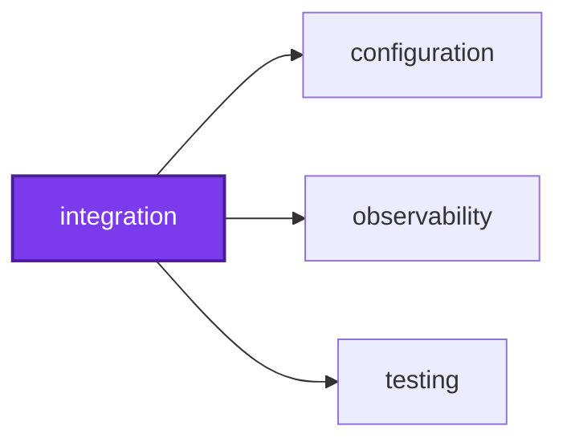
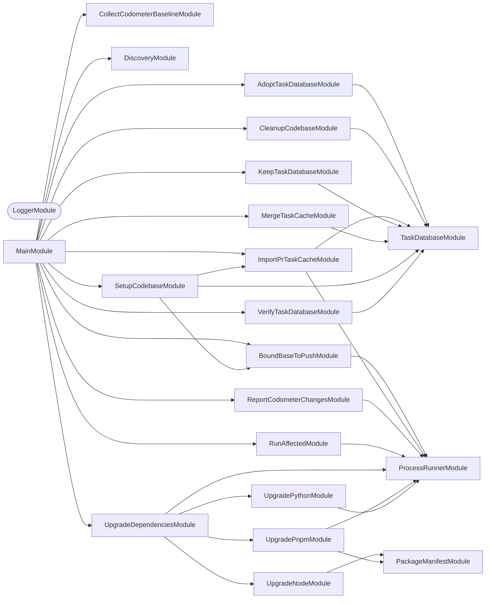

## 🕸️ Codependix

Dependency graphs exported by [codependix](https://github.com/Organizzolini/codebase/tree/main/projects/ic-suite/codependix/codependix-cli), regenerated by `nx run configuration:codependix:write`.

### Nx Neighborhood

<!-- codependix:start name="codependix-nx-projects" -->

<!-- codependix:end name="codependix-nx-projects" -->

### NestJS Module Graph

<!-- codependix:start name="codependix-nestjs-modules" -->


_Rounded modules are global: every module can inject them, so their edges are left out._
<!-- codependix:end name="codependix-nestjs-modules" -->

### File Imports

<!-- codependix:start name="codependix-file-imports" -->
```mermaid
graph LR
  file_callidescope_config_ts["callidescope.config.ts"]
  file_codependix_config_ts["codependix.config.ts"]
  file_codometer_config_ts["codometer.config.ts"]
  file_coinagerie_config_ts["coinagerie.config.ts"]
  file_eslint_config_ts["eslint.config.ts"]
  file_src_executors_codometer_batch_executor_ts["src/executors/codometer/batch-executor.ts"]
  file_src_executors_codometer_batch_executor_unit_test_ts["src/executors/codometer/batch-executor.unit.test.ts"]
  file_src_executors_codometer_codometer_constants_ts["src/executors/codometer/codometer.constants.ts"]
  file_src_executors_codometer_codometer_runner_ts["src/executors/codometer/codometer.runner.ts"]
  file_src_executors_codometer_codometer_runner_unit_test_ts["src/executors/codometer/codometer.runner.unit.test.ts"]
  file_src_executors_codometer_codometer_types_ts["src/executors/codometer/codometer.types.ts"]
  file_src_executors_codometer_codometer_utilities_ts["src/executors/codometer/codometer.utilities.ts"]
  file_src_executors_codometer_codometer_utilities_unit_test_ts["src/executors/codometer/codometer.utilities.unit.test.ts"]
  file_src_executors_codometer_executor_ts["src/executors/codometer/executor.ts"]
  file_src_executors_codometer_executor_unit_test_ts["src/executors/codometer/executor.unit.test.ts"]
  file_src_executors_knip_batch_executor_ts["src/executors/knip/batch-executor.ts"]
  file_src_executors_knip_batch_executor_unit_test_ts["src/executors/knip/batch-executor.unit.test.ts"]
  file_src_executors_knip_executor_ts["src/executors/knip/executor.ts"]
  file_src_executors_knip_executor_unit_test_ts["src/executors/knip/executor.unit.test.ts"]
  file_src_executors_knip_knip_constants_ts["src/executors/knip/knip.constants.ts"]
  file_src_executors_knip_knip_runner_ts["src/executors/knip/knip.runner.ts"]
  file_src_executors_knip_knip_types_ts["src/executors/knip/knip.types.ts"]
  file_src_executors_knip_knip_utilities_ts["src/executors/knip/knip.utilities.ts"]
  file_src_executors_knip_knip_utilities_unit_test_ts["src/executors/knip/knip.utilities.unit.test.ts"]
  file_src_executors_spell_check_batch_executor_ts["src/executors/spell-check/batch-executor.ts"]
  file_src_executors_spell_check_batch_executor_unit_test_ts["src/executors/spell-check/batch-executor.unit.test.ts"]
  file_src_executors_spell_check_executor_ts["src/executors/spell-check/executor.ts"]
  file_src_executors_spell_check_executor_unit_test_ts["src/executors/spell-check/executor.unit.test.ts"]
  file_src_executors_spell_check_spell_check_constants_ts["src/executors/spell-check/spell-check.constants.ts"]
  file_src_executors_spell_check_spell_check_runner_ts["src/executors/spell-check/spell-check.runner.ts"]
  file_src_executors_spell_check_spell_check_types_ts["src/executors/spell-check/spell-check.types.ts"]
  file_src_executors_spell_check_spell_check_utilities_ts["src/executors/spell-check/spell-check.utilities.ts"]
  file_src_executors_spell_check_spell_check_utilities_unit_test_ts["src/executors/spell-check/spell-check.utilities.unit.test.ts"]
  file_src_integration_constants_ts["src/integration.constants.ts"]
  file_src_integration_main_end_to_end_test_ts["src/integration.main.end-to-end.test.ts"]
  file_src_integration_main_ts["src/integration.main.ts"]
  file_src_integration_main_unit_test_ts["src/integration.main.unit.test.ts"]
  file_src_integration_module_ts["src/integration.module.ts"]
  file_src_integration_repl_ts["src/integration.repl.ts"]
  file_src_integration_repl_unit_test_ts["src/integration.repl.unit.test.ts"]
  file_src_integration_types_ts["src/integration.types.ts"]
  file_src_modules_adopt_task_database_adopt_task_database_command_ts["src/modules/adopt-task-database/adopt-task-database.command.ts"]
  file_src_modules_adopt_task_database_adopt_task_database_command_unit_test_ts["src/modules/adopt-task-database/adopt-task-database.command.unit.test.ts"]
  file_src_modules_adopt_task_database_adopt_task_database_constants_ts["src/modules/adopt-task-database/adopt-task-database.constants.ts"]
  file_src_modules_adopt_task_database_adopt_task_database_module_ts["src/modules/adopt-task-database/adopt-task-database.module.ts"]
  file_src_modules_adopt_task_database_adopt_task_database_module_unit_test_ts["src/modules/adopt-task-database/adopt-task-database.module.unit.test.ts"]
  file_src_modules_adopt_task_database_adopt_task_database_types_ts["src/modules/adopt-task-database/adopt-task-database.types.ts"]
  file_src_modules_bound_base_to_push_bound_base_to_push_command_ts["src/modules/bound-base-to-push/bound-base-to-push.command.ts"]
  file_src_modules_bound_base_to_push_bound_base_to_push_command_unit_test_ts["src/modules/bound-base-to-push/bound-base-to-push.command.unit.test.ts"]
  file_src_modules_bound_base_to_push_bound_base_to_push_constants_ts["src/modules/bound-base-to-push/bound-base-to-push.constants.ts"]
  file_src_modules_bound_base_to_push_bound_base_to_push_module_ts["src/modules/bound-base-to-push/bound-base-to-push.module.ts"]
  file_src_modules_bound_base_to_push_bound_base_to_push_module_unit_test_ts["src/modules/bound-base-to-push/bound-base-to-push.module.unit.test.ts"]
  file_src_modules_bound_base_to_push_bound_base_to_push_service_ts["src/modules/bound-base-to-push/bound-base-to-push.service.ts"]
  file_src_modules_bound_base_to_push_bound_base_to_push_service_unit_test_ts["src/modules/bound-base-to-push/bound-base-to-push.service.unit.test.ts"]
  file_src_modules_bound_base_to_push_bound_base_to_push_types_ts["src/modules/bound-base-to-push/bound-base-to-push.types.ts"]
  file_src_modules_cleanup_codebase_cleanup_codebase_command_ts["src/modules/cleanup-codebase/cleanup-codebase.command.ts"]
  file_src_modules_cleanup_codebase_cleanup_codebase_command_unit_test_ts["src/modules/cleanup-codebase/cleanup-codebase.command.unit.test.ts"]
  file_src_modules_cleanup_codebase_cleanup_codebase_constants_ts["src/modules/cleanup-codebase/cleanup-codebase.constants.ts"]
  file_src_modules_cleanup_codebase_cleanup_codebase_module_ts["src/modules/cleanup-codebase/cleanup-codebase.module.ts"]
  file_src_modules_cleanup_codebase_cleanup_codebase_module_unit_test_ts["src/modules/cleanup-codebase/cleanup-codebase.module.unit.test.ts"]
  file_src_modules_cleanup_codebase_cleanup_codebase_types_ts["src/modules/cleanup-codebase/cleanup-codebase.types.ts"]
  file_src_modules_collect_codometer_baseline_collect_codometer_baseline_command_ts["src/modules/collect-codometer-baseline/collect-codometer-baseline.command.ts"]
  file_src_modules_collect_codometer_baseline_collect_codometer_baseline_command_unit_test_ts["src/modules/collect-codometer-baseline/collect-codometer-baseline.command.unit.test.ts"]
  file_src_modules_collect_codometer_baseline_collect_codometer_baseline_constants_ts["src/modules/collect-codometer-baseline/collect-codometer-baseline.constants.ts"]
  file_src_modules_collect_codometer_baseline_collect_codometer_baseline_module_ts["src/modules/collect-codometer-baseline/collect-codometer-baseline.module.ts"]
  file_src_modules_collect_codometer_baseline_collect_codometer_baseline_module_unit_test_ts["src/modules/collect-codometer-baseline/collect-codometer-baseline.module.unit.test.ts"]
  file_src_modules_collect_codometer_baseline_collect_codometer_baseline_service_ts["src/modules/collect-codometer-baseline/collect-codometer-baseline.service.ts"]
  file_src_modules_collect_codometer_baseline_collect_codometer_baseline_service_unit_test_ts["src/modules/collect-codometer-baseline/collect-codometer-baseline.service.unit.test.ts"]
  file_src_modules_collect_codometer_baseline_collect_codometer_baseline_types_ts["src/modules/collect-codometer-baseline/collect-codometer-baseline.types.ts"]
  file_src_modules_import_pr_task_cache_import_pr_task_cache_command_ts["src/modules/import-pr-task-cache/import-pr-task-cache.command.ts"]
  file_src_modules_import_pr_task_cache_import_pr_task_cache_command_unit_test_ts["src/modules/import-pr-task-cache/import-pr-task-cache.command.unit.test.ts"]
  file_src_modules_import_pr_task_cache_import_pr_task_cache_constants_ts["src/modules/import-pr-task-cache/import-pr-task-cache.constants.ts"]
  file_src_modules_import_pr_task_cache_import_pr_task_cache_module_ts["src/modules/import-pr-task-cache/import-pr-task-cache.module.ts"]
  file_src_modules_import_pr_task_cache_import_pr_task_cache_module_unit_test_ts["src/modules/import-pr-task-cache/import-pr-task-cache.module.unit.test.ts"]
  file_src_modules_import_pr_task_cache_import_pr_task_cache_service_ts["src/modules/import-pr-task-cache/import-pr-task-cache.service.ts"]
  file_src_modules_import_pr_task_cache_import_pr_task_cache_service_unit_test_ts["src/modules/import-pr-task-cache/import-pr-task-cache.service.unit.test.ts"]
  file_src_modules_import_pr_task_cache_import_pr_task_cache_types_ts["src/modules/import-pr-task-cache/import-pr-task-cache.types.ts"]
  file_src_modules_keep_task_database_keep_task_database_command_ts["src/modules/keep-task-database/keep-task-database.command.ts"]
  file_src_modules_keep_task_database_keep_task_database_command_unit_test_ts["src/modules/keep-task-database/keep-task-database.command.unit.test.ts"]
  file_src_modules_keep_task_database_keep_task_database_constants_ts["src/modules/keep-task-database/keep-task-database.constants.ts"]
  file_src_modules_keep_task_database_keep_task_database_module_ts["src/modules/keep-task-database/keep-task-database.module.ts"]
  file_src_modules_keep_task_database_keep_task_database_module_unit_test_ts["src/modules/keep-task-database/keep-task-database.module.unit.test.ts"]
  file_src_modules_keep_task_database_keep_task_database_types_ts["src/modules/keep-task-database/keep-task-database.types.ts"]
  file_src_modules_merge_task_cache_merge_task_cache_command_ts["src/modules/merge-task-cache/merge-task-cache.command.ts"]
  file_src_modules_merge_task_cache_merge_task_cache_command_unit_test_ts["src/modules/merge-task-cache/merge-task-cache.command.unit.test.ts"]
  file_src_modules_merge_task_cache_merge_task_cache_constants_ts["src/modules/merge-task-cache/merge-task-cache.constants.ts"]
  file_src_modules_merge_task_cache_merge_task_cache_module_ts["src/modules/merge-task-cache/merge-task-cache.module.ts"]
  file_src_modules_merge_task_cache_merge_task_cache_module_unit_test_ts["src/modules/merge-task-cache/merge-task-cache.module.unit.test.ts"]
  file_src_modules_merge_task_cache_merge_task_cache_types_ts["src/modules/merge-task-cache/merge-task-cache.types.ts"]
  file_src_modules_package_manifest_package_manifest_constants_ts["src/modules/package-manifest/package-manifest.constants.ts"]
  file_src_modules_package_manifest_package_manifest_module_ts["src/modules/package-manifest/package-manifest.module.ts"]
  file_src_modules_package_manifest_package_manifest_service_ts["src/modules/package-manifest/package-manifest.service.ts"]
  file_src_modules_package_manifest_package_manifest_service_unit_test_ts["src/modules/package-manifest/package-manifest.service.unit.test.ts"]
  file_src_modules_package_manifest_package_manifest_types_ts["src/modules/package-manifest/package-manifest.types.ts"]
  file_src_modules_process_runner_process_runner_constants_ts["src/modules/process-runner/process-runner.constants.ts"]
  file_src_modules_process_runner_process_runner_module_ts["src/modules/process-runner/process-runner.module.ts"]
  file_src_modules_process_runner_process_runner_module_unit_test_ts["src/modules/process-runner/process-runner.module.unit.test.ts"]
  file_src_modules_process_runner_process_runner_service_integration_test_ts["src/modules/process-runner/process-runner.service.integration.test.ts"]
  file_src_modules_process_runner_process_runner_service_ts["src/modules/process-runner/process-runner.service.ts"]
  file_src_modules_process_runner_process_runner_service_unit_test_ts["src/modules/process-runner/process-runner.service.unit.test.ts"]
  file_src_modules_process_runner_process_runner_types_ts["src/modules/process-runner/process-runner.types.ts"]
  file_src_modules_process_runner_process_runner_utilities_ts["src/modules/process-runner/process-runner.utilities.ts"]
  file_src_modules_process_runner_process_runner_utilities_unit_test_ts["src/modules/process-runner/process-runner.utilities.unit.test.ts"]
  file_src_modules_report_codometer_changes_report_codometer_changes_command_ts["src/modules/report-codometer-changes/report-codometer-changes.command.ts"]
  file_src_modules_report_codometer_changes_report_codometer_changes_command_unit_test_ts["src/modules/report-codometer-changes/report-codometer-changes.command.unit.test.ts"]
  file_src_modules_report_codometer_changes_report_codometer_changes_constants_ts["src/modules/report-codometer-changes/report-codometer-changes.constants.ts"]
  file_src_modules_report_codometer_changes_report_codometer_changes_module_ts["src/modules/report-codometer-changes/report-codometer-changes.module.ts"]
  file_src_modules_report_codometer_changes_report_codometer_changes_module_unit_test_ts["src/modules/report-codometer-changes/report-codometer-changes.module.unit.test.ts"]
  file_src_modules_report_codometer_changes_report_codometer_changes_service_ts["src/modules/report-codometer-changes/report-codometer-changes.service.ts"]
  file_src_modules_report_codometer_changes_report_codometer_changes_service_unit_test_ts["src/modules/report-codometer-changes/report-codometer-changes.service.unit.test.ts"]
  file_src_modules_report_codometer_changes_report_codometer_changes_types_ts["src/modules/report-codometer-changes/report-codometer-changes.types.ts"]
  file_src_modules_run_affected_run_affected_command_ts["src/modules/run-affected/run-affected.command.ts"]
  file_src_modules_run_affected_run_affected_command_unit_test_ts["src/modules/run-affected/run-affected.command.unit.test.ts"]
  file_src_modules_run_affected_run_affected_constants_ts["src/modules/run-affected/run-affected.constants.ts"]
  file_src_modules_run_affected_run_affected_module_ts["src/modules/run-affected/run-affected.module.ts"]
  file_src_modules_run_affected_run_affected_module_unit_test_ts["src/modules/run-affected/run-affected.module.unit.test.ts"]
  file_src_modules_run_affected_run_affected_service_ts["src/modules/run-affected/run-affected.service.ts"]
  file_src_modules_run_affected_run_affected_service_unit_test_ts["src/modules/run-affected/run-affected.service.unit.test.ts"]
  file_src_modules_run_affected_run_affected_types_ts["src/modules/run-affected/run-affected.types.ts"]
  file_src_modules_setup_codebase_setup_codebase_command_ts["src/modules/setup-codebase/setup-codebase.command.ts"]
  file_src_modules_setup_codebase_setup_codebase_command_unit_test_ts["src/modules/setup-codebase/setup-codebase.command.unit.test.ts"]
  file_src_modules_setup_codebase_setup_codebase_constants_ts["src/modules/setup-codebase/setup-codebase.constants.ts"]
  file_src_modules_setup_codebase_setup_codebase_module_ts["src/modules/setup-codebase/setup-codebase.module.ts"]
  file_src_modules_setup_codebase_setup_codebase_module_unit_test_ts["src/modules/setup-codebase/setup-codebase.module.unit.test.ts"]
  file_src_modules_setup_codebase_setup_codebase_types_ts["src/modules/setup-codebase/setup-codebase.types.ts"]
  file_src_modules_task_database_task_database_constants_ts["src/modules/task-database/task-database.constants.ts"]
  file_src_modules_task_database_task_database_module_ts["src/modules/task-database/task-database.module.ts"]
  file_src_modules_task_database_task_database_module_unit_test_ts["src/modules/task-database/task-database.module.unit.test.ts"]
  file_src_modules_task_database_task_database_service_ts["src/modules/task-database/task-database.service.ts"]
  file_src_modules_task_database_task_database_service_unit_test_ts["src/modules/task-database/task-database.service.unit.test.ts"]
  file_src_modules_task_database_task_database_types_ts["src/modules/task-database/task-database.types.ts"]
  file_src_modules_task_database_task_database_utilities_ts["src/modules/task-database/task-database.utilities.ts"]
  file_src_modules_task_database_task_database_utilities_unit_test_ts["src/modules/task-database/task-database.utilities.unit.test.ts"]
  file_src_modules_upgrade_dependencies_upgrade_dependencies_command_ts["src/modules/upgrade-dependencies/upgrade-dependencies.command.ts"]
  file_src_modules_upgrade_dependencies_upgrade_dependencies_command_unit_test_ts["src/modules/upgrade-dependencies/upgrade-dependencies.command.unit.test.ts"]
  file_src_modules_upgrade_dependencies_upgrade_dependencies_constants_ts["src/modules/upgrade-dependencies/upgrade-dependencies.constants.ts"]
  file_src_modules_upgrade_dependencies_upgrade_dependencies_module_ts["src/modules/upgrade-dependencies/upgrade-dependencies.module.ts"]
  file_src_modules_upgrade_dependencies_upgrade_dependencies_module_unit_test_ts["src/modules/upgrade-dependencies/upgrade-dependencies.module.unit.test.ts"]
  file_src_modules_upgrade_dependencies_upgrade_dependencies_service_ts["src/modules/upgrade-dependencies/upgrade-dependencies.service.ts"]
  file_src_modules_upgrade_dependencies_upgrade_dependencies_service_unit_test_ts["src/modules/upgrade-dependencies/upgrade-dependencies.service.unit.test.ts"]
  file_src_modules_upgrade_dependencies_upgrade_dependencies_types_ts["src/modules/upgrade-dependencies/upgrade-dependencies.types.ts"]
  file_src_modules_upgrade_dependencies_upgrade_dependencies_utilities_ts["src/modules/upgrade-dependencies/upgrade-dependencies.utilities.ts"]
  file_src_modules_upgrade_dependencies_upgrade_dependencies_utilities_unit_test_ts["src/modules/upgrade-dependencies/upgrade-dependencies.utilities.unit.test.ts"]
  file_src_modules_upgrade_node_upgrade_node_constants_ts["src/modules/upgrade-node/upgrade-node.constants.ts"]
  file_src_modules_upgrade_node_upgrade_node_module_ts["src/modules/upgrade-node/upgrade-node.module.ts"]
  file_src_modules_upgrade_node_upgrade_node_service_ts["src/modules/upgrade-node/upgrade-node.service.ts"]
  file_src_modules_upgrade_node_upgrade_node_service_unit_test_ts["src/modules/upgrade-node/upgrade-node.service.unit.test.ts"]
  file_src_modules_upgrade_node_upgrade_node_types_ts["src/modules/upgrade-node/upgrade-node.types.ts"]
  file_src_modules_upgrade_pnpm_upgrade_pnpm_constants_ts["src/modules/upgrade-pnpm/upgrade-pnpm.constants.ts"]
  file_src_modules_upgrade_pnpm_upgrade_pnpm_module_ts["src/modules/upgrade-pnpm/upgrade-pnpm.module.ts"]
  file_src_modules_upgrade_pnpm_upgrade_pnpm_service_ts["src/modules/upgrade-pnpm/upgrade-pnpm.service.ts"]
  file_src_modules_upgrade_pnpm_upgrade_pnpm_service_unit_test_ts["src/modules/upgrade-pnpm/upgrade-pnpm.service.unit.test.ts"]
  file_src_modules_upgrade_pnpm_upgrade_pnpm_types_ts["src/modules/upgrade-pnpm/upgrade-pnpm.types.ts"]
  file_src_modules_upgrade_python_upgrade_python_constants_ts["src/modules/upgrade-python/upgrade-python.constants.ts"]
  file_src_modules_upgrade_python_upgrade_python_module_ts["src/modules/upgrade-python/upgrade-python.module.ts"]
  file_src_modules_upgrade_python_upgrade_python_service_ts["src/modules/upgrade-python/upgrade-python.service.ts"]
  file_src_modules_upgrade_python_upgrade_python_service_unit_test_ts["src/modules/upgrade-python/upgrade-python.service.unit.test.ts"]
  file_src_modules_upgrade_python_upgrade_python_types_ts["src/modules/upgrade-python/upgrade-python.types.ts"]
  file_src_modules_upgrade_python_upgrade_python_utilities_ts["src/modules/upgrade-python/upgrade-python.utilities.ts"]
  file_src_modules_upgrade_python_upgrade_python_utilities_unit_test_ts["src/modules/upgrade-python/upgrade-python.utilities.unit.test.ts"]
  file_src_modules_verify_task_database_verify_task_database_command_ts["src/modules/verify-task-database/verify-task-database.command.ts"]
  file_src_modules_verify_task_database_verify_task_database_command_unit_test_ts["src/modules/verify-task-database/verify-task-database.command.unit.test.ts"]
  file_src_modules_verify_task_database_verify_task_database_constants_ts["src/modules/verify-task-database/verify-task-database.constants.ts"]
  file_src_modules_verify_task_database_verify_task_database_module_ts["src/modules/verify-task-database/verify-task-database.module.ts"]
  file_src_modules_verify_task_database_verify_task_database_module_unit_test_ts["src/modules/verify-task-database/verify-task-database.module.unit.test.ts"]
  file_src_modules_verify_task_database_verify_task_database_types_ts["src/modules/verify-task-database/verify-task-database.types.ts"]
  file_testing_mocks_ts["testing/mocks.ts"]
  file_testing_setup_ts["testing/setup.ts"]
  file_vitest_config_ts["vitest.config.ts"]
  file_src_executors_codometer_batch_executor_ts --> file_src_executors_codometer_codometer_runner_ts
  file_src_executors_codometer_batch_executor_ts --> file_src_executors_codometer_codometer_types_ts
  file_src_executors_codometer_batch_executor_ts --> file_src_executors_codometer_codometer_utilities_ts
  file_src_executors_codometer_batch_executor_unit_test_ts --> file_src_executors_codometer_batch_executor_ts
  file_src_executors_codometer_batch_executor_unit_test_ts --> file_src_executors_codometer_codometer_types_ts
  file_src_executors_codometer_batch_executor_unit_test_ts --> file_src_modules_process_runner_process_runner_types_ts
  file_src_executors_codometer_codometer_runner_ts --> file_src_executors_codometer_codometer_constants_ts
  file_src_executors_codometer_codometer_runner_ts --> file_src_executors_codometer_codometer_types_ts
  file_src_executors_codometer_codometer_runner_ts --> file_src_executors_codometer_codometer_utilities_ts
  file_src_executors_codometer_codometer_runner_ts --> file_src_modules_process_runner_process_runner_service_ts
  file_src_executors_codometer_codometer_runner_ts --> file_src_modules_process_runner_process_runner_types_ts
  file_src_executors_codometer_codometer_runner_unit_test_ts --> file_src_executors_codometer_codometer_runner_ts
  file_src_executors_codometer_codometer_runner_unit_test_ts --> file_src_modules_process_runner_process_runner_types_ts
  file_src_executors_codometer_codometer_utilities_ts --> file_src_executors_codometer_codometer_constants_ts
  file_src_executors_codometer_codometer_utilities_ts --> file_src_executors_codometer_codometer_types_ts
  file_src_executors_codometer_codometer_utilities_ts --> file_src_modules_process_runner_process_runner_types_ts
  file_src_executors_codometer_codometer_utilities_unit_test_ts --> file_src_executors_codometer_codometer_utilities_ts
  file_src_executors_codometer_executor_ts --> file_src_executors_codometer_codometer_runner_ts
  file_src_executors_codometer_executor_ts --> file_src_executors_codometer_codometer_types_ts
  file_src_executors_codometer_executor_unit_test_ts --> file_src_executors_codometer_codometer_types_ts
  file_src_executors_codometer_executor_unit_test_ts --> file_src_executors_codometer_executor_ts
  file_src_executors_codometer_executor_unit_test_ts --> file_src_modules_process_runner_process_runner_types_ts
  file_src_executors_knip_batch_executor_ts --> file_src_executors_knip_knip_runner_ts
  file_src_executors_knip_batch_executor_ts --> file_src_executors_knip_knip_types_ts
  file_src_executors_knip_batch_executor_ts --> file_src_executors_knip_knip_utilities_ts
  file_src_executors_knip_batch_executor_unit_test_ts --> file_src_executors_knip_batch_executor_ts
  file_src_executors_knip_batch_executor_unit_test_ts --> file_src_executors_knip_knip_types_ts
  file_src_executors_knip_batch_executor_unit_test_ts --> file_src_modules_process_runner_process_runner_types_ts
  file_src_executors_knip_executor_ts --> file_src_executors_knip_knip_runner_ts
  file_src_executors_knip_executor_ts --> file_src_executors_knip_knip_types_ts
  file_src_executors_knip_executor_unit_test_ts --> file_src_executors_knip_executor_ts
  file_src_executors_knip_executor_unit_test_ts --> file_src_executors_knip_knip_types_ts
  file_src_executors_knip_executor_unit_test_ts --> file_src_modules_process_runner_process_runner_types_ts
  file_src_executors_knip_knip_runner_ts --> file_src_executors_knip_knip_constants_ts
  file_src_executors_knip_knip_runner_ts --> file_src_executors_knip_knip_types_ts
  file_src_executors_knip_knip_runner_ts --> file_src_executors_knip_knip_utilities_ts
  file_src_executors_knip_knip_runner_ts --> file_src_modules_process_runner_process_runner_service_ts
  file_src_executors_knip_knip_runner_ts --> file_src_modules_process_runner_process_runner_types_ts
  file_src_executors_knip_knip_utilities_ts --> file_src_executors_knip_knip_types_ts
  file_src_executors_knip_knip_utilities_unit_test_ts --> file_src_executors_knip_knip_utilities_ts
  file_src_executors_spell_check_batch_executor_ts --> file_src_executors_spell_check_spell_check_runner_ts
  file_src_executors_spell_check_batch_executor_ts --> file_src_executors_spell_check_spell_check_types_ts
  file_src_executors_spell_check_batch_executor_ts --> file_src_executors_spell_check_spell_check_utilities_ts
  file_src_executors_spell_check_batch_executor_unit_test_ts --> file_src_executors_spell_check_batch_executor_ts
  file_src_executors_spell_check_batch_executor_unit_test_ts --> file_src_executors_spell_check_spell_check_types_ts
  file_src_executors_spell_check_batch_executor_unit_test_ts --> file_src_modules_process_runner_process_runner_types_ts
  file_src_executors_spell_check_executor_ts --> file_src_executors_spell_check_spell_check_runner_ts
  file_src_executors_spell_check_executor_ts --> file_src_executors_spell_check_spell_check_types_ts
  file_src_executors_spell_check_executor_unit_test_ts --> file_src_executors_spell_check_executor_ts
  file_src_executors_spell_check_executor_unit_test_ts --> file_src_executors_spell_check_spell_check_types_ts
  file_src_executors_spell_check_executor_unit_test_ts --> file_src_modules_process_runner_process_runner_types_ts
  file_src_executors_spell_check_spell_check_runner_ts --> file_src_executors_spell_check_spell_check_constants_ts
  file_src_executors_spell_check_spell_check_runner_ts --> file_src_executors_spell_check_spell_check_types_ts
  file_src_executors_spell_check_spell_check_runner_ts --> file_src_executors_spell_check_spell_check_utilities_ts
  file_src_executors_spell_check_spell_check_runner_ts --> file_src_modules_process_runner_process_runner_service_ts
  file_src_executors_spell_check_spell_check_runner_ts --> file_src_modules_process_runner_process_runner_types_ts
  file_src_executors_spell_check_spell_check_utilities_ts --> file_src_executors_spell_check_spell_check_constants_ts
  file_src_executors_spell_check_spell_check_utilities_ts --> file_src_executors_spell_check_spell_check_types_ts
  file_src_executors_spell_check_spell_check_utilities_unit_test_ts --> file_src_executors_spell_check_spell_check_utilities_ts
  file_src_integration_main_end_to_end_test_ts --> file_src_integration_constants_ts
  file_src_integration_main_ts --> file_src_integration_module_ts
  file_src_integration_main_unit_test_ts --> file_src_modules_run_affected_run_affected_module_ts
  file_src_integration_module_ts --> file_src_integration_constants_ts
  file_src_integration_module_ts --> file_src_modules_adopt_task_database_adopt_task_database_module_ts
  file_src_integration_module_ts --> file_src_modules_bound_base_to_push_bound_base_to_push_module_ts
  file_src_integration_module_ts --> file_src_modules_cleanup_codebase_cleanup_codebase_module_ts
  file_src_integration_module_ts --> file_src_modules_collect_codometer_baseline_collect_codometer_baseline_module_ts
  file_src_integration_module_ts --> file_src_modules_import_pr_task_cache_import_pr_task_cache_module_ts
  file_src_integration_module_ts --> file_src_modules_keep_task_database_keep_task_database_module_ts
  file_src_integration_module_ts --> file_src_modules_merge_task_cache_merge_task_cache_module_ts
  file_src_integration_module_ts --> file_src_modules_report_codometer_changes_report_codometer_changes_module_ts
  file_src_integration_module_ts --> file_src_modules_run_affected_run_affected_module_ts
  file_src_integration_module_ts --> file_src_modules_setup_codebase_setup_codebase_module_ts
  file_src_integration_module_ts --> file_src_modules_upgrade_dependencies_upgrade_dependencies_module_ts
  file_src_integration_module_ts --> file_src_modules_verify_task_database_verify_task_database_module_ts
  file_src_integration_repl_ts --> file_src_integration_module_ts
  file_src_integration_types_ts --> file_src_integration_constants_ts
  file_src_modules_adopt_task_database_adopt_task_database_command_ts --> file_src_modules_task_database_task_database_service_ts
  file_src_modules_adopt_task_database_adopt_task_database_command_unit_test_ts --> file_src_modules_adopt_task_database_adopt_task_database_command_ts
  file_src_modules_adopt_task_database_adopt_task_database_command_unit_test_ts --> file_src_modules_task_database_task_database_service_ts
  file_src_modules_adopt_task_database_adopt_task_database_command_unit_test_ts --> file_testing_mocks_ts
  file_src_modules_adopt_task_database_adopt_task_database_module_ts --> file_src_modules_adopt_task_database_adopt_task_database_command_ts
  file_src_modules_adopt_task_database_adopt_task_database_module_ts --> file_src_modules_task_database_task_database_module_ts
  file_src_modules_adopt_task_database_adopt_task_database_module_unit_test_ts --> file_src_modules_adopt_task_database_adopt_task_database_command_ts
  file_src_modules_adopt_task_database_adopt_task_database_module_unit_test_ts --> file_src_modules_adopt_task_database_adopt_task_database_module_ts
  file_src_modules_adopt_task_database_adopt_task_database_module_unit_test_ts --> file_src_modules_task_database_task_database_module_ts
  file_src_modules_bound_base_to_push_bound_base_to_push_command_ts --> file_src_modules_bound_base_to_push_bound_base_to_push_service_ts
  file_src_modules_bound_base_to_push_bound_base_to_push_command_unit_test_ts --> file_src_modules_bound_base_to_push_bound_base_to_push_command_ts
  file_src_modules_bound_base_to_push_bound_base_to_push_command_unit_test_ts --> file_src_modules_bound_base_to_push_bound_base_to_push_service_ts
  file_src_modules_bound_base_to_push_bound_base_to_push_command_unit_test_ts --> file_src_modules_process_runner_process_runner_service_ts
  file_src_modules_bound_base_to_push_bound_base_to_push_command_unit_test_ts --> file_testing_mocks_ts
  file_src_modules_bound_base_to_push_bound_base_to_push_module_ts --> file_src_modules_bound_base_to_push_bound_base_to_push_command_ts
  file_src_modules_bound_base_to_push_bound_base_to_push_module_ts --> file_src_modules_bound_base_to_push_bound_base_to_push_service_ts
  file_src_modules_bound_base_to_push_bound_base_to_push_module_ts --> file_src_modules_process_runner_process_runner_module_ts
  file_src_modules_bound_base_to_push_bound_base_to_push_module_unit_test_ts --> file_src_modules_bound_base_to_push_bound_base_to_push_command_ts
  file_src_modules_bound_base_to_push_bound_base_to_push_module_unit_test_ts --> file_src_modules_bound_base_to_push_bound_base_to_push_module_ts
  file_src_modules_bound_base_to_push_bound_base_to_push_module_unit_test_ts --> file_src_modules_bound_base_to_push_bound_base_to_push_service_ts
  file_src_modules_bound_base_to_push_bound_base_to_push_module_unit_test_ts --> file_src_modules_process_runner_process_runner_module_ts
  file_src_modules_bound_base_to_push_bound_base_to_push_service_ts --> file_src_integration_types_ts
  file_src_modules_bound_base_to_push_bound_base_to_push_service_ts --> file_src_modules_bound_base_to_push_bound_base_to_push_constants_ts
  file_src_modules_bound_base_to_push_bound_base_to_push_service_ts --> file_src_modules_bound_base_to_push_bound_base_to_push_types_ts
  file_src_modules_bound_base_to_push_bound_base_to_push_service_ts --> file_src_modules_process_runner_process_runner_service_ts
  file_src_modules_bound_base_to_push_bound_base_to_push_service_unit_test_ts --> file_src_modules_bound_base_to_push_bound_base_to_push_service_ts
  file_src_modules_bound_base_to_push_bound_base_to_push_service_unit_test_ts --> file_src_modules_process_runner_process_runner_service_ts
  file_src_modules_cleanup_codebase_cleanup_codebase_command_ts --> file_src_integration_types_ts
  file_src_modules_cleanup_codebase_cleanup_codebase_command_ts --> file_src_modules_cleanup_codebase_cleanup_codebase_constants_ts
  file_src_modules_cleanup_codebase_cleanup_codebase_command_ts --> file_src_modules_task_database_task_database_service_ts
  file_src_modules_cleanup_codebase_cleanup_codebase_command_unit_test_ts --> file_src_modules_cleanup_codebase_cleanup_codebase_command_ts
  file_src_modules_cleanup_codebase_cleanup_codebase_command_unit_test_ts --> file_src_modules_task_database_task_database_service_ts
  file_src_modules_cleanup_codebase_cleanup_codebase_module_ts --> file_src_modules_cleanup_codebase_cleanup_codebase_command_ts
  file_src_modules_cleanup_codebase_cleanup_codebase_module_ts --> file_src_modules_task_database_task_database_module_ts
  file_src_modules_cleanup_codebase_cleanup_codebase_module_unit_test_ts --> file_src_modules_cleanup_codebase_cleanup_codebase_command_ts
  file_src_modules_cleanup_codebase_cleanup_codebase_module_unit_test_ts --> file_src_modules_cleanup_codebase_cleanup_codebase_module_ts
  file_src_modules_cleanup_codebase_cleanup_codebase_module_unit_test_ts --> file_src_modules_task_database_task_database_module_ts
  file_src_modules_collect_codometer_baseline_collect_codometer_baseline_command_ts --> file_src_modules_collect_codometer_baseline_collect_codometer_baseline_service_ts
  file_src_modules_collect_codometer_baseline_collect_codometer_baseline_command_unit_test_ts --> file_src_modules_collect_codometer_baseline_collect_codometer_baseline_command_ts
  file_src_modules_collect_codometer_baseline_collect_codometer_baseline_command_unit_test_ts --> file_src_modules_collect_codometer_baseline_collect_codometer_baseline_service_ts
  file_src_modules_collect_codometer_baseline_collect_codometer_baseline_module_ts --> file_src_modules_collect_codometer_baseline_collect_codometer_baseline_command_ts
  file_src_modules_collect_codometer_baseline_collect_codometer_baseline_module_ts --> file_src_modules_collect_codometer_baseline_collect_codometer_baseline_service_ts
  file_src_modules_collect_codometer_baseline_collect_codometer_baseline_module_unit_test_ts --> file_src_modules_collect_codometer_baseline_collect_codometer_baseline_command_ts
  file_src_modules_collect_codometer_baseline_collect_codometer_baseline_module_unit_test_ts --> file_src_modules_collect_codometer_baseline_collect_codometer_baseline_module_ts
  file_src_modules_collect_codometer_baseline_collect_codometer_baseline_module_unit_test_ts --> file_src_modules_collect_codometer_baseline_collect_codometer_baseline_service_ts
  file_src_modules_collect_codometer_baseline_collect_codometer_baseline_service_ts --> file_src_modules_collect_codometer_baseline_collect_codometer_baseline_constants_ts
  file_src_modules_collect_codometer_baseline_collect_codometer_baseline_service_ts --> file_src_modules_collect_codometer_baseline_collect_codometer_baseline_types_ts
  file_src_modules_collect_codometer_baseline_collect_codometer_baseline_service_unit_test_ts --> file_src_modules_collect_codometer_baseline_collect_codometer_baseline_service_ts
  file_src_modules_collect_codometer_baseline_collect_codometer_baseline_service_unit_test_ts --> file_testing_mocks_ts
  file_src_modules_import_pr_task_cache_import_pr_task_cache_command_ts --> file_src_modules_import_pr_task_cache_import_pr_task_cache_service_ts
  file_src_modules_import_pr_task_cache_import_pr_task_cache_command_unit_test_ts --> file_src_modules_import_pr_task_cache_import_pr_task_cache_command_ts
  file_src_modules_import_pr_task_cache_import_pr_task_cache_command_unit_test_ts --> file_src_modules_import_pr_task_cache_import_pr_task_cache_service_ts
  file_src_modules_import_pr_task_cache_import_pr_task_cache_command_unit_test_ts --> file_src_modules_process_runner_process_runner_service_ts
  file_src_modules_import_pr_task_cache_import_pr_task_cache_command_unit_test_ts --> file_src_modules_process_runner_process_runner_types_ts
  file_src_modules_import_pr_task_cache_import_pr_task_cache_command_unit_test_ts --> file_src_modules_task_database_task_database_service_ts
  file_src_modules_import_pr_task_cache_import_pr_task_cache_command_unit_test_ts --> file_testing_mocks_ts
  file_src_modules_import_pr_task_cache_import_pr_task_cache_module_ts --> file_src_modules_import_pr_task_cache_import_pr_task_cache_command_ts
  file_src_modules_import_pr_task_cache_import_pr_task_cache_module_ts --> file_src_modules_import_pr_task_cache_import_pr_task_cache_service_ts
  file_src_modules_import_pr_task_cache_import_pr_task_cache_module_ts --> file_src_modules_process_runner_process_runner_module_ts
  file_src_modules_import_pr_task_cache_import_pr_task_cache_module_ts --> file_src_modules_task_database_task_database_module_ts
  file_src_modules_import_pr_task_cache_import_pr_task_cache_module_unit_test_ts --> file_src_modules_import_pr_task_cache_import_pr_task_cache_command_ts
  file_src_modules_import_pr_task_cache_import_pr_task_cache_module_unit_test_ts --> file_src_modules_import_pr_task_cache_import_pr_task_cache_module_ts
  file_src_modules_import_pr_task_cache_import_pr_task_cache_module_unit_test_ts --> file_src_modules_import_pr_task_cache_import_pr_task_cache_service_ts
  file_src_modules_import_pr_task_cache_import_pr_task_cache_module_unit_test_ts --> file_src_modules_process_runner_process_runner_module_ts
  file_src_modules_import_pr_task_cache_import_pr_task_cache_module_unit_test_ts --> file_src_modules_task_database_task_database_module_ts
  file_src_modules_import_pr_task_cache_import_pr_task_cache_service_ts --> file_src_integration_types_ts
  file_src_modules_import_pr_task_cache_import_pr_task_cache_service_ts --> file_src_modules_import_pr_task_cache_import_pr_task_cache_constants_ts
  file_src_modules_import_pr_task_cache_import_pr_task_cache_service_ts --> file_src_modules_import_pr_task_cache_import_pr_task_cache_types_ts
  file_src_modules_import_pr_task_cache_import_pr_task_cache_service_ts --> file_src_modules_process_runner_process_runner_service_ts
  file_src_modules_import_pr_task_cache_import_pr_task_cache_service_ts --> file_src_modules_task_database_task_database_service_ts
  file_src_modules_import_pr_task_cache_import_pr_task_cache_service_ts --> file_src_modules_task_database_task_database_types_ts
  file_src_modules_import_pr_task_cache_import_pr_task_cache_service_unit_test_ts --> file_src_modules_import_pr_task_cache_import_pr_task_cache_service_ts
  file_src_modules_import_pr_task_cache_import_pr_task_cache_service_unit_test_ts --> file_src_modules_process_runner_process_runner_service_ts
  file_src_modules_import_pr_task_cache_import_pr_task_cache_service_unit_test_ts --> file_src_modules_task_database_task_database_service_ts
  file_src_modules_keep_task_database_keep_task_database_command_ts --> file_src_modules_task_database_task_database_service_ts
  file_src_modules_keep_task_database_keep_task_database_command_unit_test_ts --> file_src_modules_keep_task_database_keep_task_database_command_ts
  file_src_modules_keep_task_database_keep_task_database_command_unit_test_ts --> file_src_modules_task_database_task_database_service_ts
  file_src_modules_keep_task_database_keep_task_database_command_unit_test_ts --> file_testing_mocks_ts
  file_src_modules_keep_task_database_keep_task_database_module_ts --> file_src_modules_keep_task_database_keep_task_database_command_ts
  file_src_modules_keep_task_database_keep_task_database_module_ts --> file_src_modules_task_database_task_database_module_ts
  file_src_modules_keep_task_database_keep_task_database_module_unit_test_ts --> file_src_modules_keep_task_database_keep_task_database_command_ts
  file_src_modules_keep_task_database_keep_task_database_module_unit_test_ts --> file_src_modules_keep_task_database_keep_task_database_module_ts
  file_src_modules_keep_task_database_keep_task_database_module_unit_test_ts --> file_src_modules_task_database_task_database_module_ts
  file_src_modules_merge_task_cache_merge_task_cache_command_ts --> file_src_modules_merge_task_cache_merge_task_cache_constants_ts
  file_src_modules_merge_task_cache_merge_task_cache_command_ts --> file_src_modules_task_database_task_database_service_ts
  file_src_modules_merge_task_cache_merge_task_cache_command_unit_test_ts --> file_src_modules_merge_task_cache_merge_task_cache_command_ts
  file_src_modules_merge_task_cache_merge_task_cache_command_unit_test_ts --> file_src_modules_task_database_task_database_service_ts
  file_src_modules_merge_task_cache_merge_task_cache_command_unit_test_ts --> file_testing_mocks_ts
  file_src_modules_merge_task_cache_merge_task_cache_module_ts --> file_src_modules_merge_task_cache_merge_task_cache_command_ts
  file_src_modules_merge_task_cache_merge_task_cache_module_ts --> file_src_modules_task_database_task_database_module_ts
  file_src_modules_merge_task_cache_merge_task_cache_module_unit_test_ts --> file_src_modules_merge_task_cache_merge_task_cache_command_ts
  file_src_modules_merge_task_cache_merge_task_cache_module_unit_test_ts --> file_src_modules_merge_task_cache_merge_task_cache_module_ts
  file_src_modules_merge_task_cache_merge_task_cache_module_unit_test_ts --> file_src_modules_task_database_task_database_module_ts
  file_src_modules_package_manifest_package_manifest_module_ts --> file_src_modules_package_manifest_package_manifest_service_ts
  file_src_modules_package_manifest_package_manifest_service_ts --> file_src_modules_package_manifest_package_manifest_constants_ts
  file_src_modules_package_manifest_package_manifest_service_ts --> file_src_modules_package_manifest_package_manifest_types_ts
  file_src_modules_package_manifest_package_manifest_service_unit_test_ts --> file_src_modules_package_manifest_package_manifest_service_ts
  file_src_modules_process_runner_process_runner_module_ts --> file_src_modules_process_runner_process_runner_service_ts
  file_src_modules_process_runner_process_runner_module_unit_test_ts --> file_src_modules_process_runner_process_runner_module_ts
  file_src_modules_process_runner_process_runner_module_unit_test_ts --> file_src_modules_process_runner_process_runner_service_ts
  file_src_modules_process_runner_process_runner_service_integration_test_ts --> file_src_modules_process_runner_process_runner_service_ts
  file_src_modules_process_runner_process_runner_service_integration_test_ts --> file_testing_mocks_ts
  file_src_modules_process_runner_process_runner_service_ts --> file_src_modules_process_runner_process_runner_constants_ts
  file_src_modules_process_runner_process_runner_service_ts --> file_src_modules_process_runner_process_runner_types_ts
  file_src_modules_process_runner_process_runner_service_unit_test_ts --> file_src_modules_process_runner_process_runner_service_ts
  file_src_modules_process_runner_process_runner_utilities_ts --> file_src_modules_process_runner_process_runner_types_ts
  file_src_modules_process_runner_process_runner_utilities_unit_test_ts --> file_src_modules_process_runner_process_runner_utilities_ts
  file_src_modules_report_codometer_changes_report_codometer_changes_command_ts --> file_src_modules_report_codometer_changes_report_codometer_changes_service_ts
  file_src_modules_report_codometer_changes_report_codometer_changes_command_unit_test_ts --> file_src_modules_report_codometer_changes_report_codometer_changes_command_ts
  file_src_modules_report_codometer_changes_report_codometer_changes_command_unit_test_ts --> file_src_modules_report_codometer_changes_report_codometer_changes_service_ts
  file_src_modules_report_codometer_changes_report_codometer_changes_module_ts --> file_src_modules_process_runner_process_runner_module_ts
  file_src_modules_report_codometer_changes_report_codometer_changes_module_ts --> file_src_modules_report_codometer_changes_report_codometer_changes_command_ts
  file_src_modules_report_codometer_changes_report_codometer_changes_module_ts --> file_src_modules_report_codometer_changes_report_codometer_changes_service_ts
  file_src_modules_report_codometer_changes_report_codometer_changes_module_unit_test_ts --> file_src_modules_process_runner_process_runner_module_ts
  file_src_modules_report_codometer_changes_report_codometer_changes_module_unit_test_ts --> file_src_modules_report_codometer_changes_report_codometer_changes_command_ts
  file_src_modules_report_codometer_changes_report_codometer_changes_module_unit_test_ts --> file_src_modules_report_codometer_changes_report_codometer_changes_module_ts
  file_src_modules_report_codometer_changes_report_codometer_changes_module_unit_test_ts --> file_src_modules_report_codometer_changes_report_codometer_changes_service_ts
  file_src_modules_report_codometer_changes_report_codometer_changes_service_ts --> file_src_integration_types_ts
  file_src_modules_report_codometer_changes_report_codometer_changes_service_ts --> file_src_modules_collect_codometer_baseline_collect_codometer_baseline_constants_ts
  file_src_modules_report_codometer_changes_report_codometer_changes_service_ts --> file_src_modules_process_runner_process_runner_service_ts
  file_src_modules_report_codometer_changes_report_codometer_changes_service_ts --> file_src_modules_report_codometer_changes_report_codometer_changes_constants_ts
  file_src_modules_report_codometer_changes_report_codometer_changes_service_ts --> file_src_modules_report_codometer_changes_report_codometer_changes_types_ts
  file_src_modules_report_codometer_changes_report_codometer_changes_service_unit_test_ts --> file_src_modules_process_runner_process_runner_service_ts
  file_src_modules_report_codometer_changes_report_codometer_changes_service_unit_test_ts --> file_src_modules_process_runner_process_runner_types_ts
  file_src_modules_report_codometer_changes_report_codometer_changes_service_unit_test_ts --> file_src_modules_report_codometer_changes_report_codometer_changes_service_ts
  file_src_modules_report_codometer_changes_report_codometer_changes_service_unit_test_ts --> file_src_modules_report_codometer_changes_report_codometer_changes_types_ts
  file_src_modules_report_codometer_changes_report_codometer_changes_service_unit_test_ts --> file_testing_mocks_ts
  file_src_modules_run_affected_run_affected_command_ts --> file_src_modules_run_affected_run_affected_constants_ts
  file_src_modules_run_affected_run_affected_command_ts --> file_src_modules_run_affected_run_affected_service_ts
  file_src_modules_run_affected_run_affected_command_unit_test_ts --> file_src_modules_process_runner_process_runner_service_ts
  file_src_modules_run_affected_run_affected_command_unit_test_ts --> file_src_modules_process_runner_process_runner_types_ts
  file_src_modules_run_affected_run_affected_command_unit_test_ts --> file_src_modules_run_affected_run_affected_command_ts
  file_src_modules_run_affected_run_affected_command_unit_test_ts --> file_src_modules_run_affected_run_affected_service_ts
  file_src_modules_run_affected_run_affected_command_unit_test_ts --> file_testing_mocks_ts
  file_src_modules_run_affected_run_affected_module_ts --> file_src_modules_process_runner_process_runner_module_ts
  file_src_modules_run_affected_run_affected_module_ts --> file_src_modules_run_affected_run_affected_command_ts
  file_src_modules_run_affected_run_affected_module_ts --> file_src_modules_run_affected_run_affected_service_ts
  file_src_modules_run_affected_run_affected_module_unit_test_ts --> file_src_modules_process_runner_process_runner_module_ts
  file_src_modules_run_affected_run_affected_module_unit_test_ts --> file_src_modules_run_affected_run_affected_command_ts
  file_src_modules_run_affected_run_affected_module_unit_test_ts --> file_src_modules_run_affected_run_affected_module_ts
  file_src_modules_run_affected_run_affected_module_unit_test_ts --> file_src_modules_run_affected_run_affected_service_ts
  file_src_modules_run_affected_run_affected_service_ts --> file_src_integration_types_ts
  file_src_modules_run_affected_run_affected_service_ts --> file_src_modules_process_runner_process_runner_service_ts
  file_src_modules_run_affected_run_affected_service_ts --> file_src_modules_run_affected_run_affected_constants_ts
  file_src_modules_run_affected_run_affected_service_ts --> file_src_modules_run_affected_run_affected_types_ts
  file_src_modules_run_affected_run_affected_service_unit_test_ts --> file_src_modules_process_runner_process_runner_service_ts
  file_src_modules_run_affected_run_affected_service_unit_test_ts --> file_src_modules_run_affected_run_affected_service_ts
  file_src_modules_setup_codebase_setup_codebase_command_ts --> file_src_integration_types_ts
  file_src_modules_setup_codebase_setup_codebase_command_ts --> file_src_modules_bound_base_to_push_bound_base_to_push_service_ts
  file_src_modules_setup_codebase_setup_codebase_command_ts --> file_src_modules_import_pr_task_cache_import_pr_task_cache_service_ts
  file_src_modules_setup_codebase_setup_codebase_command_ts --> file_src_modules_setup_codebase_setup_codebase_constants_ts
  file_src_modules_setup_codebase_setup_codebase_command_ts --> file_src_modules_task_database_task_database_service_ts
  file_src_modules_setup_codebase_setup_codebase_command_unit_test_ts --> file_src_modules_bound_base_to_push_bound_base_to_push_service_ts
  file_src_modules_setup_codebase_setup_codebase_command_unit_test_ts --> file_src_modules_import_pr_task_cache_import_pr_task_cache_service_ts
  file_src_modules_setup_codebase_setup_codebase_command_unit_test_ts --> file_src_modules_setup_codebase_setup_codebase_command_ts
  file_src_modules_setup_codebase_setup_codebase_command_unit_test_ts --> file_src_modules_task_database_task_database_service_ts
  file_src_modules_setup_codebase_setup_codebase_module_ts --> file_src_modules_bound_base_to_push_bound_base_to_push_module_ts
  file_src_modules_setup_codebase_setup_codebase_module_ts --> file_src_modules_import_pr_task_cache_import_pr_task_cache_module_ts
  file_src_modules_setup_codebase_setup_codebase_module_ts --> file_src_modules_setup_codebase_setup_codebase_command_ts
  file_src_modules_setup_codebase_setup_codebase_module_ts --> file_src_modules_task_database_task_database_module_ts
  file_src_modules_setup_codebase_setup_codebase_module_unit_test_ts --> file_src_modules_bound_base_to_push_bound_base_to_push_module_ts
  file_src_modules_setup_codebase_setup_codebase_module_unit_test_ts --> file_src_modules_import_pr_task_cache_import_pr_task_cache_module_ts
  file_src_modules_setup_codebase_setup_codebase_module_unit_test_ts --> file_src_modules_setup_codebase_setup_codebase_command_ts
  file_src_modules_setup_codebase_setup_codebase_module_unit_test_ts --> file_src_modules_setup_codebase_setup_codebase_module_ts
  file_src_modules_setup_codebase_setup_codebase_module_unit_test_ts --> file_src_modules_task_database_task_database_module_ts
  file_src_modules_task_database_task_database_module_ts --> file_src_modules_task_database_task_database_service_ts
  file_src_modules_task_database_task_database_module_unit_test_ts --> file_src_modules_task_database_task_database_module_ts
  file_src_modules_task_database_task_database_module_unit_test_ts --> file_src_modules_task_database_task_database_service_ts
  file_src_modules_task_database_task_database_service_ts --> file_src_integration_types_ts
  file_src_modules_task_database_task_database_service_ts --> file_src_modules_task_database_task_database_constants_ts
  file_src_modules_task_database_task_database_service_ts --> file_src_modules_task_database_task_database_types_ts
  file_src_modules_task_database_task_database_service_ts --> file_src_modules_task_database_task_database_utilities_ts
  file_src_modules_task_database_task_database_service_unit_test_ts --> file_src_modules_task_database_task_database_service_ts
  file_src_modules_task_database_task_database_utilities_ts --> file_src_modules_task_database_task_database_constants_ts
  file_src_modules_task_database_task_database_utilities_unit_test_ts --> file_src_modules_task_database_task_database_utilities_ts
  file_src_modules_upgrade_dependencies_upgrade_dependencies_command_ts --> file_src_modules_upgrade_dependencies_upgrade_dependencies_constants_ts
  file_src_modules_upgrade_dependencies_upgrade_dependencies_command_ts --> file_src_modules_upgrade_dependencies_upgrade_dependencies_service_ts
  file_src_modules_upgrade_dependencies_upgrade_dependencies_command_ts --> file_src_modules_upgrade_dependencies_upgrade_dependencies_types_ts
  file_src_modules_upgrade_dependencies_upgrade_dependencies_command_unit_test_ts --> file_src_modules_upgrade_dependencies_upgrade_dependencies_command_ts
  file_src_modules_upgrade_dependencies_upgrade_dependencies_command_unit_test_ts --> file_src_modules_upgrade_dependencies_upgrade_dependencies_constants_ts
  file_src_modules_upgrade_dependencies_upgrade_dependencies_command_unit_test_ts --> file_src_modules_upgrade_dependencies_upgrade_dependencies_service_ts
  file_src_modules_upgrade_dependencies_upgrade_dependencies_constants_ts --> file_src_modules_process_runner_process_runner_types_ts
  file_src_modules_upgrade_dependencies_upgrade_dependencies_constants_ts --> file_src_modules_upgrade_dependencies_upgrade_dependencies_types_ts
  file_src_modules_upgrade_dependencies_upgrade_dependencies_module_ts --> file_src_modules_process_runner_process_runner_module_ts
  file_src_modules_upgrade_dependencies_upgrade_dependencies_module_ts --> file_src_modules_upgrade_dependencies_upgrade_dependencies_command_ts
  file_src_modules_upgrade_dependencies_upgrade_dependencies_module_ts --> file_src_modules_upgrade_dependencies_upgrade_dependencies_service_ts
  file_src_modules_upgrade_dependencies_upgrade_dependencies_module_ts --> file_src_modules_upgrade_node_upgrade_node_module_ts
  file_src_modules_upgrade_dependencies_upgrade_dependencies_module_ts --> file_src_modules_upgrade_pnpm_upgrade_pnpm_module_ts
  file_src_modules_upgrade_dependencies_upgrade_dependencies_module_ts --> file_src_modules_upgrade_python_upgrade_python_module_ts
  file_src_modules_upgrade_dependencies_upgrade_dependencies_module_unit_test_ts --> file_src_modules_process_runner_process_runner_module_ts
  file_src_modules_upgrade_dependencies_upgrade_dependencies_module_unit_test_ts --> file_src_modules_upgrade_dependencies_upgrade_dependencies_command_ts
  file_src_modules_upgrade_dependencies_upgrade_dependencies_module_unit_test_ts --> file_src_modules_upgrade_dependencies_upgrade_dependencies_module_ts
  file_src_modules_upgrade_dependencies_upgrade_dependencies_service_ts --> file_src_integration_types_ts
  file_src_modules_upgrade_dependencies_upgrade_dependencies_service_ts --> file_src_modules_process_runner_process_runner_service_ts
  file_src_modules_upgrade_dependencies_upgrade_dependencies_service_ts --> file_src_modules_process_runner_process_runner_types_ts
  file_src_modules_upgrade_dependencies_upgrade_dependencies_service_ts --> file_src_modules_upgrade_dependencies_upgrade_dependencies_constants_ts
  file_src_modules_upgrade_dependencies_upgrade_dependencies_service_ts --> file_src_modules_upgrade_dependencies_upgrade_dependencies_types_ts
  file_src_modules_upgrade_dependencies_upgrade_dependencies_service_ts --> file_src_modules_upgrade_dependencies_upgrade_dependencies_utilities_ts
  file_src_modules_upgrade_dependencies_upgrade_dependencies_service_ts --> file_src_modules_upgrade_node_upgrade_node_service_ts
  file_src_modules_upgrade_dependencies_upgrade_dependencies_service_ts --> file_src_modules_upgrade_pnpm_upgrade_pnpm_service_ts
  file_src_modules_upgrade_dependencies_upgrade_dependencies_service_ts --> file_src_modules_upgrade_python_upgrade_python_service_ts
  file_src_modules_upgrade_dependencies_upgrade_dependencies_service_unit_test_ts --> file_src_modules_process_runner_process_runner_service_ts
  file_src_modules_upgrade_dependencies_upgrade_dependencies_service_unit_test_ts --> file_src_modules_process_runner_process_runner_types_ts
  file_src_modules_upgrade_dependencies_upgrade_dependencies_service_unit_test_ts --> file_src_modules_upgrade_dependencies_upgrade_dependencies_service_ts
  file_src_modules_upgrade_dependencies_upgrade_dependencies_service_unit_test_ts --> file_src_modules_upgrade_dependencies_upgrade_dependencies_types_ts
  file_src_modules_upgrade_dependencies_upgrade_dependencies_service_unit_test_ts --> file_src_modules_upgrade_node_upgrade_node_service_ts
  file_src_modules_upgrade_dependencies_upgrade_dependencies_service_unit_test_ts --> file_src_modules_upgrade_pnpm_upgrade_pnpm_service_ts
  file_src_modules_upgrade_dependencies_upgrade_dependencies_service_unit_test_ts --> file_src_modules_upgrade_python_upgrade_python_service_ts
  file_src_modules_upgrade_dependencies_upgrade_dependencies_types_ts --> file_src_modules_process_runner_process_runner_types_ts
  file_src_modules_upgrade_dependencies_upgrade_dependencies_utilities_ts --> file_src_modules_upgrade_dependencies_upgrade_dependencies_constants_ts
  file_src_modules_upgrade_dependencies_upgrade_dependencies_utilities_ts --> file_src_modules_upgrade_dependencies_upgrade_dependencies_types_ts
  file_src_modules_upgrade_dependencies_upgrade_dependencies_utilities_unit_test_ts --> file_src_modules_upgrade_dependencies_upgrade_dependencies_utilities_ts
  file_src_modules_upgrade_node_upgrade_node_module_ts --> file_src_modules_package_manifest_package_manifest_module_ts
  file_src_modules_upgrade_node_upgrade_node_module_ts --> file_src_modules_upgrade_node_upgrade_node_service_ts
  file_src_modules_upgrade_node_upgrade_node_service_ts --> file_src_modules_package_manifest_package_manifest_service_ts
  file_src_modules_upgrade_node_upgrade_node_service_ts --> file_src_modules_upgrade_node_upgrade_node_constants_ts
  file_src_modules_upgrade_node_upgrade_node_service_unit_test_ts --> file_src_modules_package_manifest_package_manifest_service_ts
  file_src_modules_upgrade_node_upgrade_node_service_unit_test_ts --> file_src_modules_upgrade_node_upgrade_node_service_ts
  file_src_modules_upgrade_pnpm_upgrade_pnpm_module_ts --> file_src_modules_package_manifest_package_manifest_module_ts
  file_src_modules_upgrade_pnpm_upgrade_pnpm_module_ts --> file_src_modules_process_runner_process_runner_module_ts
  file_src_modules_upgrade_pnpm_upgrade_pnpm_module_ts --> file_src_modules_upgrade_pnpm_upgrade_pnpm_service_ts
  file_src_modules_upgrade_pnpm_upgrade_pnpm_service_ts --> file_src_modules_package_manifest_package_manifest_service_ts
  file_src_modules_upgrade_pnpm_upgrade_pnpm_service_ts --> file_src_modules_process_runner_process_runner_service_ts
  file_src_modules_upgrade_pnpm_upgrade_pnpm_service_ts --> file_src_modules_upgrade_pnpm_upgrade_pnpm_constants_ts
  file_src_modules_upgrade_pnpm_upgrade_pnpm_service_unit_test_ts --> file_src_modules_package_manifest_package_manifest_service_ts
  file_src_modules_upgrade_pnpm_upgrade_pnpm_service_unit_test_ts --> file_src_modules_process_runner_process_runner_service_ts
  file_src_modules_upgrade_pnpm_upgrade_pnpm_service_unit_test_ts --> file_src_modules_upgrade_pnpm_upgrade_pnpm_service_ts
  file_src_modules_upgrade_python_upgrade_python_constants_ts --> file_src_modules_process_runner_process_runner_types_ts
  file_src_modules_upgrade_python_upgrade_python_module_ts --> file_src_modules_process_runner_process_runner_module_ts
  file_src_modules_upgrade_python_upgrade_python_module_ts --> file_src_modules_upgrade_python_upgrade_python_service_ts
  file_src_modules_upgrade_python_upgrade_python_service_ts --> file_src_modules_process_runner_process_runner_service_ts
  file_src_modules_upgrade_python_upgrade_python_service_ts --> file_src_modules_upgrade_python_upgrade_python_constants_ts
  file_src_modules_upgrade_python_upgrade_python_service_ts --> file_src_modules_upgrade_python_upgrade_python_utilities_ts
  file_src_modules_upgrade_python_upgrade_python_service_unit_test_ts --> file_src_modules_process_runner_process_runner_service_ts
  file_src_modules_upgrade_python_upgrade_python_service_unit_test_ts --> file_src_modules_upgrade_python_upgrade_python_constants_ts
  file_src_modules_upgrade_python_upgrade_python_service_unit_test_ts --> file_src_modules_upgrade_python_upgrade_python_service_ts
  file_src_modules_upgrade_python_upgrade_python_utilities_unit_test_ts --> file_src_modules_upgrade_python_upgrade_python_utilities_ts
  file_src_modules_verify_task_database_verify_task_database_command_ts --> file_src_modules_task_database_task_database_service_ts
  file_src_modules_verify_task_database_verify_task_database_command_unit_test_ts --> file_src_modules_task_database_task_database_service_ts
  file_src_modules_verify_task_database_verify_task_database_command_unit_test_ts --> file_src_modules_verify_task_database_verify_task_database_command_ts
  file_src_modules_verify_task_database_verify_task_database_command_unit_test_ts --> file_testing_mocks_ts
  file_src_modules_verify_task_database_verify_task_database_module_ts --> file_src_modules_task_database_task_database_module_ts
  file_src_modules_verify_task_database_verify_task_database_module_ts --> file_src_modules_verify_task_database_verify_task_database_command_ts
  file_src_modules_verify_task_database_verify_task_database_module_unit_test_ts --> file_src_modules_task_database_task_database_module_ts
  file_src_modules_verify_task_database_verify_task_database_module_unit_test_ts --> file_src_modules_verify_task_database_verify_task_database_command_ts
  file_src_modules_verify_task_database_verify_task_database_module_unit_test_ts --> file_src_modules_verify_task_database_verify_task_database_module_ts
  file_testing_mocks_ts --> file_src_modules_process_runner_process_runner_service_ts
  file_testing_mocks_ts --> file_src_modules_process_runner_process_runner_types_ts
```
<!-- codependix:end name="codependix-file-imports" -->
