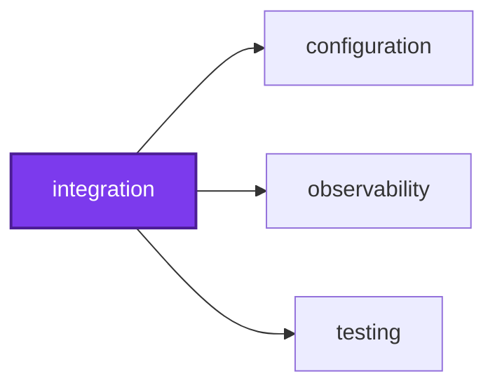
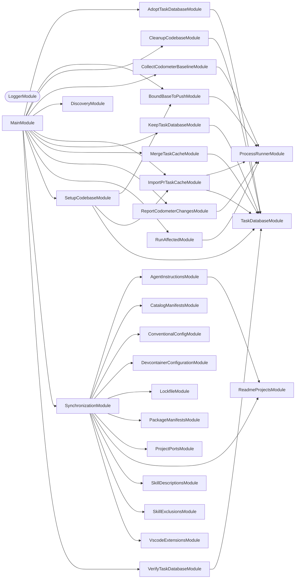

## 🕸️ Codependix

Dependency graphs exported by [codependix](https://github.com/Organizzolini/codebase/tree/main/projects/ic-suite/codependix/codependix-cli), regenerated by `nx run configuration:codependix:write`.

### Nx Neighborhood

<!-- codependix:start name="codependix-nx-projects" -->

<!-- codependix:end name="codependix-nx-projects" -->

### NestJS Module Graph

<!-- codependix:start name="codependix-nestjs-modules" -->


_Rounded modules are global: every module can inject them, so their edges are left out._
<!-- codependix:end name="codependix-nestjs-modules" -->

### File Imports

<!-- codependix:start name="codependix-file-imports" -->
```mermaid
graph LR
  file_configuration_callidescope_config_ts["configuration/callidescope.config.ts"]
  file_configuration_codependix_config_ts["configuration/codependix.config.ts"]
  file_configuration_codometer_config_ts["configuration/codometer.config.ts"]
  file_configuration_coinagerie_config_ts["configuration/coinagerie.config.ts"]
  file_configuration_eslint_config_ts["configuration/eslint.config.ts"]
  file_configuration_vitest_config_ts["configuration/vitest.config.ts"]
  file_src_executors_knip_batch_executor_ts["src/executors/knip/batch-executor.ts"]
  file_src_executors_knip_batch_executor_unit_test_ts["src/executors/knip/batch-executor.unit.test.ts"]
  file_src_executors_knip_executor_ts["src/executors/knip/executor.ts"]
  file_src_executors_knip_executor_unit_test_ts["src/executors/knip/executor.unit.test.ts"]
  file_src_executors_knip_knip_constants_ts["src/executors/knip/knip.constants.ts"]
  file_src_executors_knip_knip_runner_ts["src/executors/knip/knip.runner.ts"]
  file_src_executors_knip_knip_types_ts["src/executors/knip/knip.types.ts"]
  file_src_executors_knip_knip_utilities_ts["src/executors/knip/knip.utilities.ts"]
  file_src_executors_knip_knip_utilities_unit_test_ts["src/executors/knip/knip.utilities.unit.test.ts"]
  file_src_executors_spell_check_batch_executor_ts["src/executors/spell-check/batch-executor.ts"]
  file_src_executors_spell_check_batch_executor_unit_test_ts["src/executors/spell-check/batch-executor.unit.test.ts"]
  file_src_executors_spell_check_executor_ts["src/executors/spell-check/executor.ts"]
  file_src_executors_spell_check_executor_unit_test_ts["src/executors/spell-check/executor.unit.test.ts"]
  file_src_executors_spell_check_spell_check_constants_ts["src/executors/spell-check/spell-check.constants.ts"]
  file_src_executors_spell_check_spell_check_runner_ts["src/executors/spell-check/spell-check.runner.ts"]
  file_src_executors_spell_check_spell_check_types_ts["src/executors/spell-check/spell-check.types.ts"]
  file_src_executors_spell_check_spell_check_utilities_ts["src/executors/spell-check/spell-check.utilities.ts"]
  file_src_executors_spell_check_spell_check_utilities_unit_test_ts["src/executors/spell-check/spell-check.utilities.unit.test.ts"]
  file_src_integration_constants_ts["src/integration.constants.ts"]
  file_src_integration_main_end_to_end_test_ts["src/integration.main.end-to-end.test.ts"]
  file_src_integration_main_ts["src/integration.main.ts"]
  file_src_integration_main_unit_test_ts["src/integration.main.unit.test.ts"]
  file_src_integration_module_ts["src/integration.module.ts"]
  file_src_integration_repl_ts["src/integration.repl.ts"]
  file_src_integration_repl_unit_test_ts["src/integration.repl.unit.test.ts"]
  file_src_integration_types_ts["src/integration.types.ts"]
  file_src_modules_bound_base_to_push_bound_base_to_push_command_ts["src/modules/bound-base-to-push/bound-base-to-push.command.ts"]
  file_src_modules_bound_base_to_push_bound_base_to_push_command_unit_test_ts["src/modules/bound-base-to-push/bound-base-to-push.command.unit.test.ts"]
  file_src_modules_bound_base_to_push_bound_base_to_push_constants_ts["src/modules/bound-base-to-push/bound-base-to-push.constants.ts"]
  file_src_modules_bound_base_to_push_bound_base_to_push_module_ts["src/modules/bound-base-to-push/bound-base-to-push.module.ts"]
  file_src_modules_bound_base_to_push_bound_base_to_push_module_unit_test_ts["src/modules/bound-base-to-push/bound-base-to-push.module.unit.test.ts"]
  file_src_modules_bound_base_to_push_bound_base_to_push_service_ts["src/modules/bound-base-to-push/bound-base-to-push.service.ts"]
  file_src_modules_bound_base_to_push_bound_base_to_push_service_unit_test_ts["src/modules/bound-base-to-push/bound-base-to-push.service.unit.test.ts"]
  file_src_modules_bound_base_to_push_bound_base_to_push_types_ts["src/modules/bound-base-to-push/bound-base-to-push.types.ts"]
  file_src_modules_cleanup_codebase_cleanup_codebase_command_ts["src/modules/cleanup-codebase/cleanup-codebase.command.ts"]
  file_src_modules_cleanup_codebase_cleanup_codebase_command_unit_test_ts["src/modules/cleanup-codebase/cleanup-codebase.command.unit.test.ts"]
  file_src_modules_cleanup_codebase_cleanup_codebase_constants_ts["src/modules/cleanup-codebase/cleanup-codebase.constants.ts"]
  file_src_modules_cleanup_codebase_cleanup_codebase_module_ts["src/modules/cleanup-codebase/cleanup-codebase.module.ts"]
  file_src_modules_cleanup_codebase_cleanup_codebase_module_unit_test_ts["src/modules/cleanup-codebase/cleanup-codebase.module.unit.test.ts"]
  file_src_modules_cleanup_codebase_cleanup_codebase_types_ts["src/modules/cleanup-codebase/cleanup-codebase.types.ts"]
  file_src_modules_collect_codometer_baseline_collect_codometer_baseline_command_ts["src/modules/collect-codometer-baseline/collect-codometer-baseline.command.ts"]
  file_src_modules_collect_codometer_baseline_collect_codometer_baseline_command_unit_test_ts["src/modules/collect-codometer-baseline/collect-codometer-baseline.command.unit.test.ts"]
  file_src_modules_collect_codometer_baseline_collect_codometer_baseline_constants_ts["src/modules/collect-codometer-baseline/collect-codometer-baseline.constants.ts"]
  file_src_modules_collect_codometer_baseline_collect_codometer_baseline_module_ts["src/modules/collect-codometer-baseline/collect-codometer-baseline.module.ts"]
  file_src_modules_collect_codometer_baseline_collect_codometer_baseline_module_unit_test_ts["src/modules/collect-codometer-baseline/collect-codometer-baseline.module.unit.test.ts"]
  file_src_modules_collect_codometer_baseline_collect_codometer_baseline_service_ts["src/modules/collect-codometer-baseline/collect-codometer-baseline.service.ts"]
  file_src_modules_collect_codometer_baseline_collect_codometer_baseline_service_unit_test_ts["src/modules/collect-codometer-baseline/collect-codometer-baseline.service.unit.test.ts"]
  file_src_modules_collect_codometer_baseline_collect_codometer_baseline_types_ts["src/modules/collect-codometer-baseline/collect-codometer-baseline.types.ts"]
  file_src_modules_collect_codometer_baseline_collect_codometer_baseline_utilities_ts["src/modules/collect-codometer-baseline/collect-codometer-baseline.utilities.ts"]
  file_src_modules_import_pr_task_cache_import_pr_task_cache_command_ts["src/modules/import-pr-task-cache/import-pr-task-cache.command.ts"]
  file_src_modules_import_pr_task_cache_import_pr_task_cache_command_unit_test_ts["src/modules/import-pr-task-cache/import-pr-task-cache.command.unit.test.ts"]
  file_src_modules_import_pr_task_cache_import_pr_task_cache_constants_ts["src/modules/import-pr-task-cache/import-pr-task-cache.constants.ts"]
  file_src_modules_import_pr_task_cache_import_pr_task_cache_module_ts["src/modules/import-pr-task-cache/import-pr-task-cache.module.ts"]
  file_src_modules_import_pr_task_cache_import_pr_task_cache_module_unit_test_ts["src/modules/import-pr-task-cache/import-pr-task-cache.module.unit.test.ts"]
  file_src_modules_import_pr_task_cache_import_pr_task_cache_service_ts["src/modules/import-pr-task-cache/import-pr-task-cache.service.ts"]
  file_src_modules_import_pr_task_cache_import_pr_task_cache_service_unit_test_ts["src/modules/import-pr-task-cache/import-pr-task-cache.service.unit.test.ts"]
  file_src_modules_import_pr_task_cache_import_pr_task_cache_types_ts["src/modules/import-pr-task-cache/import-pr-task-cache.types.ts"]
  file_src_modules_process_runner_process_runner_constants_ts["src/modules/process-runner/process-runner.constants.ts"]
  file_src_modules_process_runner_process_runner_module_ts["src/modules/process-runner/process-runner.module.ts"]
  file_src_modules_process_runner_process_runner_module_unit_test_ts["src/modules/process-runner/process-runner.module.unit.test.ts"]
  file_src_modules_process_runner_process_runner_service_integration_test_ts["src/modules/process-runner/process-runner.service.integration.test.ts"]
  file_src_modules_process_runner_process_runner_service_ts["src/modules/process-runner/process-runner.service.ts"]
  file_src_modules_process_runner_process_runner_service_unit_test_ts["src/modules/process-runner/process-runner.service.unit.test.ts"]
  file_src_modules_process_runner_process_runner_types_ts["src/modules/process-runner/process-runner.types.ts"]
  file_src_modules_process_runner_process_runner_utilities_ts["src/modules/process-runner/process-runner.utilities.ts"]
  file_src_modules_process_runner_process_runner_utilities_unit_test_ts["src/modules/process-runner/process-runner.utilities.unit.test.ts"]
  file_src_modules_report_codometer_changes_report_codometer_changes_command_ts["src/modules/report-codometer-changes/report-codometer-changes.command.ts"]
  file_src_modules_report_codometer_changes_report_codometer_changes_command_unit_test_ts["src/modules/report-codometer-changes/report-codometer-changes.command.unit.test.ts"]
  file_src_modules_report_codometer_changes_report_codometer_changes_constants_ts["src/modules/report-codometer-changes/report-codometer-changes.constants.ts"]
  file_src_modules_report_codometer_changes_report_codometer_changes_module_ts["src/modules/report-codometer-changes/report-codometer-changes.module.ts"]
  file_src_modules_report_codometer_changes_report_codometer_changes_module_unit_test_ts["src/modules/report-codometer-changes/report-codometer-changes.module.unit.test.ts"]
  file_src_modules_report_codometer_changes_report_codometer_changes_service_ts["src/modules/report-codometer-changes/report-codometer-changes.service.ts"]
  file_src_modules_report_codometer_changes_report_codometer_changes_service_unit_test_ts["src/modules/report-codometer-changes/report-codometer-changes.service.unit.test.ts"]
  file_src_modules_report_codometer_changes_report_codometer_changes_types_ts["src/modules/report-codometer-changes/report-codometer-changes.types.ts"]
  file_src_modules_run_affected_run_affected_command_ts["src/modules/run-affected/run-affected.command.ts"]
  file_src_modules_run_affected_run_affected_command_unit_test_ts["src/modules/run-affected/run-affected.command.unit.test.ts"]
  file_src_modules_run_affected_run_affected_constants_ts["src/modules/run-affected/run-affected.constants.ts"]
  file_src_modules_run_affected_run_affected_module_ts["src/modules/run-affected/run-affected.module.ts"]
  file_src_modules_run_affected_run_affected_module_unit_test_ts["src/modules/run-affected/run-affected.module.unit.test.ts"]
  file_src_modules_run_affected_run_affected_service_ts["src/modules/run-affected/run-affected.service.ts"]
  file_src_modules_run_affected_run_affected_service_unit_test_ts["src/modules/run-affected/run-affected.service.unit.test.ts"]
  file_src_modules_run_affected_run_affected_types_ts["src/modules/run-affected/run-affected.types.ts"]
  file_src_modules_setup_codebase_setup_codebase_command_ts["src/modules/setup-codebase/setup-codebase.command.ts"]
  file_src_modules_setup_codebase_setup_codebase_command_unit_test_ts["src/modules/setup-codebase/setup-codebase.command.unit.test.ts"]
  file_src_modules_setup_codebase_setup_codebase_constants_ts["src/modules/setup-codebase/setup-codebase.constants.ts"]
  file_src_modules_setup_codebase_setup_codebase_module_ts["src/modules/setup-codebase/setup-codebase.module.ts"]
  file_src_modules_setup_codebase_setup_codebase_module_unit_test_ts["src/modules/setup-codebase/setup-codebase.module.unit.test.ts"]
  file_src_modules_setup_codebase_setup_codebase_types_ts["src/modules/setup-codebase/setup-codebase.types.ts"]
  file_src_modules_synchronization_modules_agent_instructions_agent_instructions_command_ts["src/modules/synchronization/modules/agent-instructions/agent-instructions.command.ts"]
  file_src_modules_synchronization_modules_agent_instructions_agent_instructions_command_unit_test_ts["src/modules/synchronization/modules/agent-instructions/agent-instructions.command.unit.test.ts"]
  file_src_modules_synchronization_modules_agent_instructions_agent_instructions_constants_ts["src/modules/synchronization/modules/agent-instructions/agent-instructions.constants.ts"]
  file_src_modules_synchronization_modules_agent_instructions_agent_instructions_module_ts["src/modules/synchronization/modules/agent-instructions/agent-instructions.module.ts"]
  file_src_modules_synchronization_modules_agent_instructions_agent_instructions_module_unit_test_ts["src/modules/synchronization/modules/agent-instructions/agent-instructions.module.unit.test.ts"]
  file_src_modules_synchronization_modules_agent_instructions_agent_instructions_service_ts["src/modules/synchronization/modules/agent-instructions/agent-instructions.service.ts"]
  file_src_modules_synchronization_modules_agent_instructions_agent_instructions_service_unit_test_ts["src/modules/synchronization/modules/agent-instructions/agent-instructions.service.unit.test.ts"]
  file_src_modules_synchronization_modules_agent_instructions_agent_instructions_types_ts["src/modules/synchronization/modules/agent-instructions/agent-instructions.types.ts"]
  file_src_modules_synchronization_modules_catalog_manifests_catalog_manifests_command_ts["src/modules/synchronization/modules/catalog-manifests/catalog-manifests.command.ts"]
  file_src_modules_synchronization_modules_catalog_manifests_catalog_manifests_command_unit_test_ts["src/modules/synchronization/modules/catalog-manifests/catalog-manifests.command.unit.test.ts"]
  file_src_modules_synchronization_modules_catalog_manifests_catalog_manifests_constants_ts["src/modules/synchronization/modules/catalog-manifests/catalog-manifests.constants.ts"]
  file_src_modules_synchronization_modules_catalog_manifests_catalog_manifests_module_ts["src/modules/synchronization/modules/catalog-manifests/catalog-manifests.module.ts"]
  file_src_modules_synchronization_modules_catalog_manifests_catalog_manifests_module_unit_test_ts["src/modules/synchronization/modules/catalog-manifests/catalog-manifests.module.unit.test.ts"]
  file_src_modules_synchronization_modules_catalog_manifests_catalog_manifests_service_ts["src/modules/synchronization/modules/catalog-manifests/catalog-manifests.service.ts"]
  file_src_modules_synchronization_modules_catalog_manifests_catalog_manifests_service_unit_test_ts["src/modules/synchronization/modules/catalog-manifests/catalog-manifests.service.unit.test.ts"]
  file_src_modules_synchronization_modules_catalog_manifests_catalog_manifests_types_ts["src/modules/synchronization/modules/catalog-manifests/catalog-manifests.types.ts"]
  file_src_modules_synchronization_modules_conventional_config_conventional_config_io_service_ts["src/modules/synchronization/modules/conventional-config/conventional-config-io.service.ts"]
  file_src_modules_synchronization_modules_conventional_config_conventional_config_io_service_unit_test_ts["src/modules/synchronization/modules/conventional-config/conventional-config-io.service.unit.test.ts"]
  file_src_modules_synchronization_modules_conventional_config_conventional_config_validators_service_ts["src/modules/synchronization/modules/conventional-config/conventional-config-validators.service.ts"]
  file_src_modules_synchronization_modules_conventional_config_conventional_config_validators_service_unit_test_ts["src/modules/synchronization/modules/conventional-config/conventional-config-validators.service.unit.test.ts"]
  file_src_modules_synchronization_modules_conventional_config_conventional_config_command_ts["src/modules/synchronization/modules/conventional-config/conventional-config.command.ts"]
  file_src_modules_synchronization_modules_conventional_config_conventional_config_command_unit_test_ts["src/modules/synchronization/modules/conventional-config/conventional-config.command.unit.test.ts"]
  file_src_modules_synchronization_modules_conventional_config_conventional_config_constants_integration_test_ts["src/modules/synchronization/modules/conventional-config/conventional-config.constants.integration.test.ts"]
  file_src_modules_synchronization_modules_conventional_config_conventional_config_constants_ts["src/modules/synchronization/modules/conventional-config/conventional-config.constants.ts"]
  file_src_modules_synchronization_modules_conventional_config_conventional_config_module_ts["src/modules/synchronization/modules/conventional-config/conventional-config.module.ts"]
  file_src_modules_synchronization_modules_conventional_config_conventional_config_service_ts["src/modules/synchronization/modules/conventional-config/conventional-config.service.ts"]
  file_src_modules_synchronization_modules_conventional_config_conventional_config_service_unit_test_ts["src/modules/synchronization/modules/conventional-config/conventional-config.service.unit.test.ts"]
  file_src_modules_synchronization_modules_conventional_config_conventional_config_types_ts["src/modules/synchronization/modules/conventional-config/conventional-config.types.ts"]
  file_src_modules_synchronization_modules_devcontainer_configuration_devcontainer_configuration_command_ts["src/modules/synchronization/modules/devcontainer-configuration/devcontainer-configuration.command.ts"]
  file_src_modules_synchronization_modules_devcontainer_configuration_devcontainer_configuration_command_unit_test_ts["src/modules/synchronization/modules/devcontainer-configuration/devcontainer-configuration.command.unit.test.ts"]
  file_src_modules_synchronization_modules_devcontainer_configuration_devcontainer_configuration_constants_ts["src/modules/synchronization/modules/devcontainer-configuration/devcontainer-configuration.constants.ts"]
  file_src_modules_synchronization_modules_devcontainer_configuration_devcontainer_configuration_module_ts["src/modules/synchronization/modules/devcontainer-configuration/devcontainer-configuration.module.ts"]
  file_src_modules_synchronization_modules_devcontainer_configuration_devcontainer_configuration_types_ts["src/modules/synchronization/modules/devcontainer-configuration/devcontainer-configuration.types.ts"]
  file_src_modules_synchronization_modules_lockfile_lockfile_command_ts["src/modules/synchronization/modules/lockfile/lockfile.command.ts"]
  file_src_modules_synchronization_modules_lockfile_lockfile_command_unit_test_ts["src/modules/synchronization/modules/lockfile/lockfile.command.unit.test.ts"]
  file_src_modules_synchronization_modules_lockfile_lockfile_constants_ts["src/modules/synchronization/modules/lockfile/lockfile.constants.ts"]
  file_src_modules_synchronization_modules_lockfile_lockfile_module_ts["src/modules/synchronization/modules/lockfile/lockfile.module.ts"]
  file_src_modules_synchronization_modules_lockfile_lockfile_module_unit_test_ts["src/modules/synchronization/modules/lockfile/lockfile.module.unit.test.ts"]
  file_src_modules_synchronization_modules_lockfile_lockfile_service_ts["src/modules/synchronization/modules/lockfile/lockfile.service.ts"]
  file_src_modules_synchronization_modules_lockfile_lockfile_service_unit_test_ts["src/modules/synchronization/modules/lockfile/lockfile.service.unit.test.ts"]
  file_src_modules_synchronization_modules_lockfile_lockfile_types_ts["src/modules/synchronization/modules/lockfile/lockfile.types.ts"]
  file_src_modules_synchronization_modules_package_manifests_package_manifests_command_ts["src/modules/synchronization/modules/package-manifests/package-manifests.command.ts"]
  file_src_modules_synchronization_modules_package_manifests_package_manifests_command_unit_test_ts["src/modules/synchronization/modules/package-manifests/package-manifests.command.unit.test.ts"]
  file_src_modules_synchronization_modules_package_manifests_package_manifests_constants_ts["src/modules/synchronization/modules/package-manifests/package-manifests.constants.ts"]
  file_src_modules_synchronization_modules_package_manifests_package_manifests_module_ts["src/modules/synchronization/modules/package-manifests/package-manifests.module.ts"]
  file_src_modules_synchronization_modules_package_manifests_package_manifests_service_ts["src/modules/synchronization/modules/package-manifests/package-manifests.service.ts"]
  file_src_modules_synchronization_modules_package_manifests_package_manifests_service_unit_test_ts["src/modules/synchronization/modules/package-manifests/package-manifests.service.unit.test.ts"]
  file_src_modules_synchronization_modules_package_manifests_package_manifests_types_ts["src/modules/synchronization/modules/package-manifests/package-manifests.types.ts"]
  file_src_modules_synchronization_modules_project_ports_project_ports_command_ts["src/modules/synchronization/modules/project-ports/project-ports.command.ts"]
  file_src_modules_synchronization_modules_project_ports_project_ports_command_unit_test_ts["src/modules/synchronization/modules/project-ports/project-ports.command.unit.test.ts"]
  file_src_modules_synchronization_modules_project_ports_project_ports_constants_ts["src/modules/synchronization/modules/project-ports/project-ports.constants.ts"]
  file_src_modules_synchronization_modules_project_ports_project_ports_module_ts["src/modules/synchronization/modules/project-ports/project-ports.module.ts"]
  file_src_modules_synchronization_modules_project_ports_project_ports_service_ts["src/modules/synchronization/modules/project-ports/project-ports.service.ts"]
  file_src_modules_synchronization_modules_project_ports_project_ports_service_unit_test_ts["src/modules/synchronization/modules/project-ports/project-ports.service.unit.test.ts"]
  file_src_modules_synchronization_modules_project_ports_project_ports_types_ts["src/modules/synchronization/modules/project-ports/project-ports.types.ts"]
  file_src_modules_synchronization_modules_readme_projects_readme_projects_command_ts["src/modules/synchronization/modules/readme-projects/readme-projects.command.ts"]
  file_src_modules_synchronization_modules_readme_projects_readme_projects_command_unit_test_ts["src/modules/synchronization/modules/readme-projects/readme-projects.command.unit.test.ts"]
  file_src_modules_synchronization_modules_readme_projects_readme_projects_constants_ts["src/modules/synchronization/modules/readme-projects/readme-projects.constants.ts"]
  file_src_modules_synchronization_modules_readme_projects_readme_projects_module_ts["src/modules/synchronization/modules/readme-projects/readme-projects.module.ts"]
  file_src_modules_synchronization_modules_readme_projects_readme_projects_module_unit_test_ts["src/modules/synchronization/modules/readme-projects/readme-projects.module.unit.test.ts"]
  file_src_modules_synchronization_modules_readme_projects_readme_projects_service_ts["src/modules/synchronization/modules/readme-projects/readme-projects.service.ts"]
  file_src_modules_synchronization_modules_readme_projects_readme_projects_service_unit_test_ts["src/modules/synchronization/modules/readme-projects/readme-projects.service.unit.test.ts"]
  file_src_modules_synchronization_modules_readme_projects_readme_projects_types_ts["src/modules/synchronization/modules/readme-projects/readme-projects.types.ts"]
  file_src_modules_synchronization_modules_skill_descriptions_skill_descriptions_command_ts["src/modules/synchronization/modules/skill-descriptions/skill-descriptions.command.ts"]
  file_src_modules_synchronization_modules_skill_descriptions_skill_descriptions_command_unit_test_ts["src/modules/synchronization/modules/skill-descriptions/skill-descriptions.command.unit.test.ts"]
  file_src_modules_synchronization_modules_skill_descriptions_skill_descriptions_constants_ts["src/modules/synchronization/modules/skill-descriptions/skill-descriptions.constants.ts"]
  file_src_modules_synchronization_modules_skill_descriptions_skill_descriptions_module_ts["src/modules/synchronization/modules/skill-descriptions/skill-descriptions.module.ts"]
  file_src_modules_synchronization_modules_skill_descriptions_skill_descriptions_module_unit_test_ts["src/modules/synchronization/modules/skill-descriptions/skill-descriptions.module.unit.test.ts"]
  file_src_modules_synchronization_modules_skill_descriptions_skill_descriptions_service_ts["src/modules/synchronization/modules/skill-descriptions/skill-descriptions.service.ts"]
  file_src_modules_synchronization_modules_skill_descriptions_skill_descriptions_service_unit_test_ts["src/modules/synchronization/modules/skill-descriptions/skill-descriptions.service.unit.test.ts"]
  file_src_modules_synchronization_modules_skill_descriptions_skill_descriptions_types_ts["src/modules/synchronization/modules/skill-descriptions/skill-descriptions.types.ts"]
  file_src_modules_synchronization_modules_skill_exclusions_skill_exclusions_command_ts["src/modules/synchronization/modules/skill-exclusions/skill-exclusions.command.ts"]
  file_src_modules_synchronization_modules_skill_exclusions_skill_exclusions_command_unit_test_ts["src/modules/synchronization/modules/skill-exclusions/skill-exclusions.command.unit.test.ts"]
  file_src_modules_synchronization_modules_skill_exclusions_skill_exclusions_constants_ts["src/modules/synchronization/modules/skill-exclusions/skill-exclusions.constants.ts"]
  file_src_modules_synchronization_modules_skill_exclusions_skill_exclusions_module_ts["src/modules/synchronization/modules/skill-exclusions/skill-exclusions.module.ts"]
  file_src_modules_synchronization_modules_skill_exclusions_skill_exclusions_types_ts["src/modules/synchronization/modules/skill-exclusions/skill-exclusions.types.ts"]
  file_src_modules_synchronization_modules_vscode_extensions_vscode_extensions_command_ts["src/modules/synchronization/modules/vscode-extensions/vscode-extensions.command.ts"]
  file_src_modules_synchronization_modules_vscode_extensions_vscode_extensions_command_unit_test_ts["src/modules/synchronization/modules/vscode-extensions/vscode-extensions.command.unit.test.ts"]
  file_src_modules_synchronization_modules_vscode_extensions_vscode_extensions_constants_ts["src/modules/synchronization/modules/vscode-extensions/vscode-extensions.constants.ts"]
  file_src_modules_synchronization_modules_vscode_extensions_vscode_extensions_module_ts["src/modules/synchronization/modules/vscode-extensions/vscode-extensions.module.ts"]
  file_src_modules_synchronization_modules_vscode_extensions_vscode_extensions_types_ts["src/modules/synchronization/modules/vscode-extensions/vscode-extensions.types.ts"]
  file_src_modules_synchronization_synchronization_markers_service_ts["src/modules/synchronization/synchronization-markers.service.ts"]
  file_src_modules_synchronization_synchronization_markers_service_unit_test_ts["src/modules/synchronization/synchronization-markers.service.unit.test.ts"]
  file_src_modules_synchronization_synchronization_command_ts["src/modules/synchronization/synchronization.command.ts"]
  file_src_modules_synchronization_synchronization_command_unit_test_ts["src/modules/synchronization/synchronization.command.unit.test.ts"]
  file_src_modules_synchronization_synchronization_constants_ts["src/modules/synchronization/synchronization.constants.ts"]
  file_src_modules_synchronization_synchronization_module_ts["src/modules/synchronization/synchronization.module.ts"]
  file_src_modules_synchronization_synchronization_module_unit_test_ts["src/modules/synchronization/synchronization.module.unit.test.ts"]
  file_src_modules_synchronization_synchronization_service_ts["src/modules/synchronization/synchronization.service.ts"]
  file_src_modules_synchronization_synchronization_service_unit_test_ts["src/modules/synchronization/synchronization.service.unit.test.ts"]
  file_src_modules_synchronization_synchronization_types_ts["src/modules/synchronization/synchronization.types.ts"]
  file_src_modules_task_database_modules_adopt_task_database_adopt_task_database_command_ts["src/modules/task-database/modules/adopt-task-database/adopt-task-database.command.ts"]
  file_src_modules_task_database_modules_adopt_task_database_adopt_task_database_command_unit_test_ts["src/modules/task-database/modules/adopt-task-database/adopt-task-database.command.unit.test.ts"]
  file_src_modules_task_database_modules_adopt_task_database_adopt_task_database_constants_ts["src/modules/task-database/modules/adopt-task-database/adopt-task-database.constants.ts"]
  file_src_modules_task_database_modules_adopt_task_database_adopt_task_database_module_ts["src/modules/task-database/modules/adopt-task-database/adopt-task-database.module.ts"]
  file_src_modules_task_database_modules_adopt_task_database_adopt_task_database_module_unit_test_ts["src/modules/task-database/modules/adopt-task-database/adopt-task-database.module.unit.test.ts"]
  file_src_modules_task_database_modules_adopt_task_database_adopt_task_database_types_ts["src/modules/task-database/modules/adopt-task-database/adopt-task-database.types.ts"]
  file_src_modules_task_database_modules_keep_task_database_keep_task_database_command_ts["src/modules/task-database/modules/keep-task-database/keep-task-database.command.ts"]
  file_src_modules_task_database_modules_keep_task_database_keep_task_database_command_unit_test_ts["src/modules/task-database/modules/keep-task-database/keep-task-database.command.unit.test.ts"]
  file_src_modules_task_database_modules_keep_task_database_keep_task_database_constants_ts["src/modules/task-database/modules/keep-task-database/keep-task-database.constants.ts"]
  file_src_modules_task_database_modules_keep_task_database_keep_task_database_module_ts["src/modules/task-database/modules/keep-task-database/keep-task-database.module.ts"]
  file_src_modules_task_database_modules_keep_task_database_keep_task_database_module_unit_test_ts["src/modules/task-database/modules/keep-task-database/keep-task-database.module.unit.test.ts"]
  file_src_modules_task_database_modules_keep_task_database_keep_task_database_types_ts["src/modules/task-database/modules/keep-task-database/keep-task-database.types.ts"]
  file_src_modules_task_database_modules_merge_task_cache_merge_task_cache_command_ts["src/modules/task-database/modules/merge-task-cache/merge-task-cache.command.ts"]
  file_src_modules_task_database_modules_merge_task_cache_merge_task_cache_command_unit_test_ts["src/modules/task-database/modules/merge-task-cache/merge-task-cache.command.unit.test.ts"]
  file_src_modules_task_database_modules_merge_task_cache_merge_task_cache_constants_ts["src/modules/task-database/modules/merge-task-cache/merge-task-cache.constants.ts"]
  file_src_modules_task_database_modules_merge_task_cache_merge_task_cache_module_ts["src/modules/task-database/modules/merge-task-cache/merge-task-cache.module.ts"]
  file_src_modules_task_database_modules_merge_task_cache_merge_task_cache_module_unit_test_ts["src/modules/task-database/modules/merge-task-cache/merge-task-cache.module.unit.test.ts"]
  file_src_modules_task_database_modules_merge_task_cache_merge_task_cache_types_ts["src/modules/task-database/modules/merge-task-cache/merge-task-cache.types.ts"]
  file_src_modules_task_database_modules_verify_task_database_verify_task_database_command_ts["src/modules/task-database/modules/verify-task-database/verify-task-database.command.ts"]
  file_src_modules_task_database_modules_verify_task_database_verify_task_database_command_unit_test_ts["src/modules/task-database/modules/verify-task-database/verify-task-database.command.unit.test.ts"]
  file_src_modules_task_database_modules_verify_task_database_verify_task_database_constants_ts["src/modules/task-database/modules/verify-task-database/verify-task-database.constants.ts"]
  file_src_modules_task_database_modules_verify_task_database_verify_task_database_module_ts["src/modules/task-database/modules/verify-task-database/verify-task-database.module.ts"]
  file_src_modules_task_database_modules_verify_task_database_verify_task_database_module_unit_test_ts["src/modules/task-database/modules/verify-task-database/verify-task-database.module.unit.test.ts"]
  file_src_modules_task_database_modules_verify_task_database_verify_task_database_types_ts["src/modules/task-database/modules/verify-task-database/verify-task-database.types.ts"]
  file_src_modules_task_database_task_database_constants_ts["src/modules/task-database/task-database.constants.ts"]
  file_src_modules_task_database_task_database_module_ts["src/modules/task-database/task-database.module.ts"]
  file_src_modules_task_database_task_database_module_unit_test_ts["src/modules/task-database/task-database.module.unit.test.ts"]
  file_src_modules_task_database_task_database_service_ts["src/modules/task-database/task-database.service.ts"]
  file_src_modules_task_database_task_database_service_unit_test_ts["src/modules/task-database/task-database.service.unit.test.ts"]
  file_src_modules_task_database_task_database_types_ts["src/modules/task-database/task-database.types.ts"]
  file_src_modules_task_database_task_database_utilities_ts["src/modules/task-database/task-database.utilities.ts"]
  file_src_modules_task_database_task_database_utilities_unit_test_ts["src/modules/task-database/task-database.utilities.unit.test.ts"]
  file_testing_mocks_ts["testing/mocks.ts"]
  file_src_executors_knip_batch_executor_ts --> file_src_executors_knip_knip_runner_ts
  file_src_executors_knip_batch_executor_ts --> file_src_executors_knip_knip_types_ts
  file_src_executors_knip_batch_executor_ts --> file_src_executors_knip_knip_utilities_ts
  file_src_executors_knip_batch_executor_unit_test_ts --> file_src_executors_knip_batch_executor_ts
  file_src_executors_knip_batch_executor_unit_test_ts --> file_src_executors_knip_knip_types_ts
  file_src_executors_knip_batch_executor_unit_test_ts --> file_src_modules_process_runner_process_runner_types_ts
  file_src_executors_knip_executor_ts --> file_src_executors_knip_knip_runner_ts
  file_src_executors_knip_executor_ts --> file_src_executors_knip_knip_types_ts
  file_src_executors_knip_executor_unit_test_ts --> file_src_executors_knip_executor_ts
  file_src_executors_knip_executor_unit_test_ts --> file_src_executors_knip_knip_types_ts
  file_src_executors_knip_executor_unit_test_ts --> file_src_modules_process_runner_process_runner_types_ts
  file_src_executors_knip_knip_runner_ts --> file_src_executors_knip_knip_constants_ts
  file_src_executors_knip_knip_runner_ts --> file_src_executors_knip_knip_types_ts
  file_src_executors_knip_knip_runner_ts --> file_src_executors_knip_knip_utilities_ts
  file_src_executors_knip_knip_runner_ts --> file_src_modules_process_runner_process_runner_service_ts
  file_src_executors_knip_knip_runner_ts --> file_src_modules_process_runner_process_runner_types_ts
  file_src_executors_knip_knip_utilities_ts --> file_src_executors_knip_knip_types_ts
  file_src_executors_knip_knip_utilities_unit_test_ts --> file_src_executors_knip_knip_utilities_ts
  file_src_executors_spell_check_batch_executor_ts --> file_src_executors_spell_check_spell_check_runner_ts
  file_src_executors_spell_check_batch_executor_ts --> file_src_executors_spell_check_spell_check_types_ts
  file_src_executors_spell_check_batch_executor_ts --> file_src_executors_spell_check_spell_check_utilities_ts
  file_src_executors_spell_check_batch_executor_unit_test_ts --> file_src_executors_spell_check_batch_executor_ts
  file_src_executors_spell_check_batch_executor_unit_test_ts --> file_src_executors_spell_check_spell_check_types_ts
  file_src_executors_spell_check_batch_executor_unit_test_ts --> file_src_modules_process_runner_process_runner_types_ts
  file_src_executors_spell_check_executor_ts --> file_src_executors_spell_check_spell_check_runner_ts
  file_src_executors_spell_check_executor_ts --> file_src_executors_spell_check_spell_check_types_ts
  file_src_executors_spell_check_executor_unit_test_ts --> file_src_executors_spell_check_executor_ts
  file_src_executors_spell_check_executor_unit_test_ts --> file_src_executors_spell_check_spell_check_types_ts
  file_src_executors_spell_check_executor_unit_test_ts --> file_src_modules_process_runner_process_runner_types_ts
  file_src_executors_spell_check_spell_check_runner_ts --> file_src_executors_spell_check_spell_check_constants_ts
  file_src_executors_spell_check_spell_check_runner_ts --> file_src_executors_spell_check_spell_check_types_ts
  file_src_executors_spell_check_spell_check_runner_ts --> file_src_executors_spell_check_spell_check_utilities_ts
  file_src_executors_spell_check_spell_check_runner_ts --> file_src_modules_process_runner_process_runner_service_ts
  file_src_executors_spell_check_spell_check_runner_ts --> file_src_modules_process_runner_process_runner_types_ts
  file_src_executors_spell_check_spell_check_utilities_ts --> file_src_executors_spell_check_spell_check_constants_ts
  file_src_executors_spell_check_spell_check_utilities_ts --> file_src_executors_spell_check_spell_check_types_ts
  file_src_executors_spell_check_spell_check_utilities_unit_test_ts --> file_src_executors_spell_check_spell_check_utilities_ts
  file_src_integration_main_end_to_end_test_ts --> file_src_integration_constants_ts
  file_src_integration_main_ts --> file_src_integration_module_ts
  file_src_integration_main_unit_test_ts --> file_src_modules_run_affected_run_affected_module_ts
  file_src_integration_module_ts --> file_src_integration_constants_ts
  file_src_integration_module_ts --> file_src_modules_bound_base_to_push_bound_base_to_push_module_ts
  file_src_integration_module_ts --> file_src_modules_cleanup_codebase_cleanup_codebase_module_ts
  file_src_integration_module_ts --> file_src_modules_collect_codometer_baseline_collect_codometer_baseline_module_ts
  file_src_integration_module_ts --> file_src_modules_import_pr_task_cache_import_pr_task_cache_module_ts
  file_src_integration_module_ts --> file_src_modules_report_codometer_changes_report_codometer_changes_module_ts
  file_src_integration_module_ts --> file_src_modules_run_affected_run_affected_module_ts
  file_src_integration_module_ts --> file_src_modules_setup_codebase_setup_codebase_module_ts
  file_src_integration_module_ts --> file_src_modules_synchronization_synchronization_module_ts
  file_src_integration_module_ts --> file_src_modules_task_database_modules_adopt_task_database_adopt_task_database_module_ts
  file_src_integration_module_ts --> file_src_modules_task_database_modules_keep_task_database_keep_task_database_module_ts
  file_src_integration_module_ts --> file_src_modules_task_database_modules_merge_task_cache_merge_task_cache_module_ts
  file_src_integration_module_ts --> file_src_modules_task_database_modules_verify_task_database_verify_task_database_module_ts
  file_src_integration_repl_ts --> file_src_integration_module_ts
  file_src_integration_types_ts --> file_src_integration_constants_ts
  file_src_modules_bound_base_to_push_bound_base_to_push_command_ts --> file_src_modules_bound_base_to_push_bound_base_to_push_service_ts
  file_src_modules_bound_base_to_push_bound_base_to_push_command_unit_test_ts --> file_src_modules_bound_base_to_push_bound_base_to_push_command_ts
  file_src_modules_bound_base_to_push_bound_base_to_push_command_unit_test_ts --> file_src_modules_bound_base_to_push_bound_base_to_push_service_ts
  file_src_modules_bound_base_to_push_bound_base_to_push_command_unit_test_ts --> file_src_modules_process_runner_process_runner_service_ts
  file_src_modules_bound_base_to_push_bound_base_to_push_command_unit_test_ts --> file_testing_mocks_ts
  file_src_modules_bound_base_to_push_bound_base_to_push_module_ts --> file_src_modules_bound_base_to_push_bound_base_to_push_command_ts
  file_src_modules_bound_base_to_push_bound_base_to_push_module_ts --> file_src_modules_bound_base_to_push_bound_base_to_push_service_ts
  file_src_modules_bound_base_to_push_bound_base_to_push_module_ts --> file_src_modules_process_runner_process_runner_module_ts
  file_src_modules_bound_base_to_push_bound_base_to_push_module_unit_test_ts --> file_src_modules_bound_base_to_push_bound_base_to_push_command_ts
  file_src_modules_bound_base_to_push_bound_base_to_push_module_unit_test_ts --> file_src_modules_bound_base_to_push_bound_base_to_push_module_ts
  file_src_modules_bound_base_to_push_bound_base_to_push_module_unit_test_ts --> file_src_modules_bound_base_to_push_bound_base_to_push_service_ts
  file_src_modules_bound_base_to_push_bound_base_to_push_module_unit_test_ts --> file_src_modules_process_runner_process_runner_module_ts
  file_src_modules_bound_base_to_push_bound_base_to_push_service_ts --> file_src_integration_types_ts
  file_src_modules_bound_base_to_push_bound_base_to_push_service_ts --> file_src_modules_bound_base_to_push_bound_base_to_push_constants_ts
  file_src_modules_bound_base_to_push_bound_base_to_push_service_ts --> file_src_modules_bound_base_to_push_bound_base_to_push_types_ts
  file_src_modules_bound_base_to_push_bound_base_to_push_service_ts --> file_src_modules_process_runner_process_runner_service_ts
  file_src_modules_bound_base_to_push_bound_base_to_push_service_unit_test_ts --> file_src_modules_bound_base_to_push_bound_base_to_push_service_ts
  file_src_modules_bound_base_to_push_bound_base_to_push_service_unit_test_ts --> file_src_modules_process_runner_process_runner_service_ts
  file_src_modules_cleanup_codebase_cleanup_codebase_command_ts --> file_src_integration_types_ts
  file_src_modules_cleanup_codebase_cleanup_codebase_command_ts --> file_src_modules_cleanup_codebase_cleanup_codebase_constants_ts
  file_src_modules_cleanup_codebase_cleanup_codebase_command_ts --> file_src_modules_task_database_task_database_service_ts
  file_src_modules_cleanup_codebase_cleanup_codebase_command_unit_test_ts --> file_src_modules_cleanup_codebase_cleanup_codebase_command_ts
  file_src_modules_cleanup_codebase_cleanup_codebase_command_unit_test_ts --> file_src_modules_task_database_task_database_service_ts
  file_src_modules_cleanup_codebase_cleanup_codebase_module_ts --> file_src_modules_cleanup_codebase_cleanup_codebase_command_ts
  file_src_modules_cleanup_codebase_cleanup_codebase_module_ts --> file_src_modules_task_database_task_database_module_ts
  file_src_modules_cleanup_codebase_cleanup_codebase_module_unit_test_ts --> file_src_modules_cleanup_codebase_cleanup_codebase_command_ts
  file_src_modules_cleanup_codebase_cleanup_codebase_module_unit_test_ts --> file_src_modules_cleanup_codebase_cleanup_codebase_module_ts
  file_src_modules_cleanup_codebase_cleanup_codebase_module_unit_test_ts --> file_src_modules_task_database_task_database_module_ts
  file_src_modules_collect_codometer_baseline_collect_codometer_baseline_command_ts --> file_src_modules_collect_codometer_baseline_collect_codometer_baseline_service_ts
  file_src_modules_collect_codometer_baseline_collect_codometer_baseline_command_unit_test_ts --> file_src_modules_collect_codometer_baseline_collect_codometer_baseline_command_ts
  file_src_modules_collect_codometer_baseline_collect_codometer_baseline_command_unit_test_ts --> file_src_modules_collect_codometer_baseline_collect_codometer_baseline_service_ts
  file_src_modules_collect_codometer_baseline_collect_codometer_baseline_module_ts --> file_src_modules_collect_codometer_baseline_collect_codometer_baseline_command_ts
  file_src_modules_collect_codometer_baseline_collect_codometer_baseline_module_ts --> file_src_modules_collect_codometer_baseline_collect_codometer_baseline_service_ts
  file_src_modules_collect_codometer_baseline_collect_codometer_baseline_module_ts --> file_src_modules_process_runner_process_runner_module_ts
  file_src_modules_collect_codometer_baseline_collect_codometer_baseline_module_unit_test_ts --> file_src_modules_collect_codometer_baseline_collect_codometer_baseline_command_ts
  file_src_modules_collect_codometer_baseline_collect_codometer_baseline_module_unit_test_ts --> file_src_modules_collect_codometer_baseline_collect_codometer_baseline_module_ts
  file_src_modules_collect_codometer_baseline_collect_codometer_baseline_module_unit_test_ts --> file_src_modules_collect_codometer_baseline_collect_codometer_baseline_service_ts
  file_src_modules_collect_codometer_baseline_collect_codometer_baseline_module_unit_test_ts --> file_src_modules_process_runner_process_runner_module_ts
  file_src_modules_collect_codometer_baseline_collect_codometer_baseline_service_ts --> file_src_integration_types_ts
  file_src_modules_collect_codometer_baseline_collect_codometer_baseline_service_ts --> file_src_modules_collect_codometer_baseline_collect_codometer_baseline_constants_ts
  file_src_modules_collect_codometer_baseline_collect_codometer_baseline_service_ts --> file_src_modules_collect_codometer_baseline_collect_codometer_baseline_types_ts
  file_src_modules_collect_codometer_baseline_collect_codometer_baseline_service_ts --> file_src_modules_collect_codometer_baseline_collect_codometer_baseline_utilities_ts
  file_src_modules_collect_codometer_baseline_collect_codometer_baseline_service_ts --> file_src_modules_process_runner_process_runner_service_ts
  file_src_modules_collect_codometer_baseline_collect_codometer_baseline_service_unit_test_ts --> file_src_modules_collect_codometer_baseline_collect_codometer_baseline_service_ts
  file_src_modules_collect_codometer_baseline_collect_codometer_baseline_service_unit_test_ts --> file_src_modules_process_runner_process_runner_service_ts
  file_src_modules_collect_codometer_baseline_collect_codometer_baseline_service_unit_test_ts --> file_src_modules_process_runner_process_runner_types_ts
  file_src_modules_collect_codometer_baseline_collect_codometer_baseline_service_unit_test_ts --> file_testing_mocks_ts
  file_src_modules_collect_codometer_baseline_collect_codometer_baseline_utilities_ts --> file_src_modules_collect_codometer_baseline_collect_codometer_baseline_constants_ts
  file_src_modules_import_pr_task_cache_import_pr_task_cache_command_ts --> file_src_modules_import_pr_task_cache_import_pr_task_cache_service_ts
  file_src_modules_import_pr_task_cache_import_pr_task_cache_command_unit_test_ts --> file_src_modules_import_pr_task_cache_import_pr_task_cache_command_ts
  file_src_modules_import_pr_task_cache_import_pr_task_cache_command_unit_test_ts --> file_src_modules_import_pr_task_cache_import_pr_task_cache_service_ts
  file_src_modules_import_pr_task_cache_import_pr_task_cache_command_unit_test_ts --> file_src_modules_process_runner_process_runner_service_ts
  file_src_modules_import_pr_task_cache_import_pr_task_cache_command_unit_test_ts --> file_src_modules_process_runner_process_runner_types_ts
  file_src_modules_import_pr_task_cache_import_pr_task_cache_command_unit_test_ts --> file_src_modules_task_database_task_database_service_ts
  file_src_modules_import_pr_task_cache_import_pr_task_cache_command_unit_test_ts --> file_testing_mocks_ts
  file_src_modules_import_pr_task_cache_import_pr_task_cache_module_ts --> file_src_modules_import_pr_task_cache_import_pr_task_cache_command_ts
  file_src_modules_import_pr_task_cache_import_pr_task_cache_module_ts --> file_src_modules_import_pr_task_cache_import_pr_task_cache_service_ts
  file_src_modules_import_pr_task_cache_import_pr_task_cache_module_ts --> file_src_modules_process_runner_process_runner_module_ts
  file_src_modules_import_pr_task_cache_import_pr_task_cache_module_ts --> file_src_modules_task_database_task_database_module_ts
  file_src_modules_import_pr_task_cache_import_pr_task_cache_module_unit_test_ts --> file_src_modules_import_pr_task_cache_import_pr_task_cache_command_ts
  file_src_modules_import_pr_task_cache_import_pr_task_cache_module_unit_test_ts --> file_src_modules_import_pr_task_cache_import_pr_task_cache_module_ts
  file_src_modules_import_pr_task_cache_import_pr_task_cache_module_unit_test_ts --> file_src_modules_import_pr_task_cache_import_pr_task_cache_service_ts
  file_src_modules_import_pr_task_cache_import_pr_task_cache_module_unit_test_ts --> file_src_modules_process_runner_process_runner_module_ts
  file_src_modules_import_pr_task_cache_import_pr_task_cache_module_unit_test_ts --> file_src_modules_task_database_task_database_module_ts
  file_src_modules_import_pr_task_cache_import_pr_task_cache_service_ts --> file_src_integration_types_ts
  file_src_modules_import_pr_task_cache_import_pr_task_cache_service_ts --> file_src_modules_import_pr_task_cache_import_pr_task_cache_constants_ts
  file_src_modules_import_pr_task_cache_import_pr_task_cache_service_ts --> file_src_modules_import_pr_task_cache_import_pr_task_cache_types_ts
  file_src_modules_import_pr_task_cache_import_pr_task_cache_service_ts --> file_src_modules_process_runner_process_runner_service_ts
  file_src_modules_import_pr_task_cache_import_pr_task_cache_service_ts --> file_src_modules_task_database_task_database_service_ts
  file_src_modules_import_pr_task_cache_import_pr_task_cache_service_ts --> file_src_modules_task_database_task_database_types_ts
  file_src_modules_import_pr_task_cache_import_pr_task_cache_service_unit_test_ts --> file_src_modules_import_pr_task_cache_import_pr_task_cache_service_ts
  file_src_modules_import_pr_task_cache_import_pr_task_cache_service_unit_test_ts --> file_src_modules_process_runner_process_runner_service_ts
  file_src_modules_import_pr_task_cache_import_pr_task_cache_service_unit_test_ts --> file_src_modules_task_database_task_database_service_ts
  file_src_modules_process_runner_process_runner_module_ts --> file_src_modules_process_runner_process_runner_service_ts
  file_src_modules_process_runner_process_runner_module_unit_test_ts --> file_src_modules_process_runner_process_runner_module_ts
  file_src_modules_process_runner_process_runner_module_unit_test_ts --> file_src_modules_process_runner_process_runner_service_ts
  file_src_modules_process_runner_process_runner_service_integration_test_ts --> file_src_modules_process_runner_process_runner_service_ts
  file_src_modules_process_runner_process_runner_service_integration_test_ts --> file_testing_mocks_ts
  file_src_modules_process_runner_process_runner_service_ts --> file_src_modules_process_runner_process_runner_constants_ts
  file_src_modules_process_runner_process_runner_service_ts --> file_src_modules_process_runner_process_runner_types_ts
  file_src_modules_process_runner_process_runner_service_unit_test_ts --> file_src_modules_process_runner_process_runner_service_ts
  file_src_modules_process_runner_process_runner_utilities_ts --> file_src_modules_process_runner_process_runner_types_ts
  file_src_modules_process_runner_process_runner_utilities_unit_test_ts --> file_src_modules_process_runner_process_runner_utilities_ts
  file_src_modules_report_codometer_changes_report_codometer_changes_command_ts --> file_src_modules_report_codometer_changes_report_codometer_changes_service_ts
  file_src_modules_report_codometer_changes_report_codometer_changes_command_unit_test_ts --> file_src_modules_report_codometer_changes_report_codometer_changes_command_ts
  file_src_modules_report_codometer_changes_report_codometer_changes_command_unit_test_ts --> file_src_modules_report_codometer_changes_report_codometer_changes_service_ts
  file_src_modules_report_codometer_changes_report_codometer_changes_module_ts --> file_src_modules_process_runner_process_runner_module_ts
  file_src_modules_report_codometer_changes_report_codometer_changes_module_ts --> file_src_modules_report_codometer_changes_report_codometer_changes_command_ts
  file_src_modules_report_codometer_changes_report_codometer_changes_module_ts --> file_src_modules_report_codometer_changes_report_codometer_changes_service_ts
  file_src_modules_report_codometer_changes_report_codometer_changes_module_unit_test_ts --> file_src_modules_process_runner_process_runner_module_ts
  file_src_modules_report_codometer_changes_report_codometer_changes_module_unit_test_ts --> file_src_modules_report_codometer_changes_report_codometer_changes_command_ts
  file_src_modules_report_codometer_changes_report_codometer_changes_module_unit_test_ts --> file_src_modules_report_codometer_changes_report_codometer_changes_module_ts
  file_src_modules_report_codometer_changes_report_codometer_changes_module_unit_test_ts --> file_src_modules_report_codometer_changes_report_codometer_changes_service_ts
  file_src_modules_report_codometer_changes_report_codometer_changes_service_ts --> file_src_integration_types_ts
  file_src_modules_report_codometer_changes_report_codometer_changes_service_ts --> file_src_modules_collect_codometer_baseline_collect_codometer_baseline_constants_ts
  file_src_modules_report_codometer_changes_report_codometer_changes_service_ts --> file_src_modules_collect_codometer_baseline_collect_codometer_baseline_utilities_ts
  file_src_modules_report_codometer_changes_report_codometer_changes_service_ts --> file_src_modules_process_runner_process_runner_service_ts
  file_src_modules_report_codometer_changes_report_codometer_changes_service_ts --> file_src_modules_report_codometer_changes_report_codometer_changes_constants_ts
  file_src_modules_report_codometer_changes_report_codometer_changes_service_ts --> file_src_modules_report_codometer_changes_report_codometer_changes_types_ts
  file_src_modules_report_codometer_changes_report_codometer_changes_service_unit_test_ts --> file_src_modules_process_runner_process_runner_service_ts
  file_src_modules_report_codometer_changes_report_codometer_changes_service_unit_test_ts --> file_src_modules_process_runner_process_runner_types_ts
  file_src_modules_report_codometer_changes_report_codometer_changes_service_unit_test_ts --> file_src_modules_report_codometer_changes_report_codometer_changes_service_ts
  file_src_modules_report_codometer_changes_report_codometer_changes_service_unit_test_ts --> file_src_modules_report_codometer_changes_report_codometer_changes_types_ts
  file_src_modules_report_codometer_changes_report_codometer_changes_service_unit_test_ts --> file_testing_mocks_ts
  file_src_modules_run_affected_run_affected_command_ts --> file_src_modules_run_affected_run_affected_constants_ts
  file_src_modules_run_affected_run_affected_command_ts --> file_src_modules_run_affected_run_affected_service_ts
  file_src_modules_run_affected_run_affected_command_unit_test_ts --> file_src_modules_process_runner_process_runner_service_ts
  file_src_modules_run_affected_run_affected_command_unit_test_ts --> file_src_modules_process_runner_process_runner_types_ts
  file_src_modules_run_affected_run_affected_command_unit_test_ts --> file_src_modules_run_affected_run_affected_command_ts
  file_src_modules_run_affected_run_affected_command_unit_test_ts --> file_src_modules_run_affected_run_affected_service_ts
  file_src_modules_run_affected_run_affected_module_ts --> file_src_modules_process_runner_process_runner_module_ts
  file_src_modules_run_affected_run_affected_module_ts --> file_src_modules_run_affected_run_affected_command_ts
  file_src_modules_run_affected_run_affected_module_ts --> file_src_modules_run_affected_run_affected_service_ts
  file_src_modules_run_affected_run_affected_module_unit_test_ts --> file_src_modules_process_runner_process_runner_module_ts
  file_src_modules_run_affected_run_affected_module_unit_test_ts --> file_src_modules_run_affected_run_affected_command_ts
  file_src_modules_run_affected_run_affected_module_unit_test_ts --> file_src_modules_run_affected_run_affected_module_ts
  file_src_modules_run_affected_run_affected_module_unit_test_ts --> file_src_modules_run_affected_run_affected_service_ts
  file_src_modules_run_affected_run_affected_service_ts --> file_src_integration_types_ts
  file_src_modules_run_affected_run_affected_service_ts --> file_src_modules_process_runner_process_runner_service_ts
  file_src_modules_run_affected_run_affected_service_ts --> file_src_modules_run_affected_run_affected_constants_ts
  file_src_modules_run_affected_run_affected_service_ts --> file_src_modules_run_affected_run_affected_types_ts
  file_src_modules_run_affected_run_affected_service_unit_test_ts --> file_src_modules_process_runner_process_runner_service_ts
  file_src_modules_run_affected_run_affected_service_unit_test_ts --> file_src_modules_run_affected_run_affected_service_ts
  file_src_modules_setup_codebase_setup_codebase_command_ts --> file_src_integration_types_ts
  file_src_modules_setup_codebase_setup_codebase_command_ts --> file_src_modules_bound_base_to_push_bound_base_to_push_service_ts
  file_src_modules_setup_codebase_setup_codebase_command_ts --> file_src_modules_import_pr_task_cache_import_pr_task_cache_service_ts
  file_src_modules_setup_codebase_setup_codebase_command_ts --> file_src_modules_setup_codebase_setup_codebase_constants_ts
  file_src_modules_setup_codebase_setup_codebase_command_ts --> file_src_modules_task_database_task_database_service_ts
  file_src_modules_setup_codebase_setup_codebase_command_unit_test_ts --> file_src_modules_bound_base_to_push_bound_base_to_push_service_ts
  file_src_modules_setup_codebase_setup_codebase_command_unit_test_ts --> file_src_modules_import_pr_task_cache_import_pr_task_cache_service_ts
  file_src_modules_setup_codebase_setup_codebase_command_unit_test_ts --> file_src_modules_setup_codebase_setup_codebase_command_ts
  file_src_modules_setup_codebase_setup_codebase_command_unit_test_ts --> file_src_modules_task_database_task_database_service_ts
  file_src_modules_setup_codebase_setup_codebase_module_ts --> file_src_modules_bound_base_to_push_bound_base_to_push_module_ts
  file_src_modules_setup_codebase_setup_codebase_module_ts --> file_src_modules_import_pr_task_cache_import_pr_task_cache_module_ts
  file_src_modules_setup_codebase_setup_codebase_module_ts --> file_src_modules_setup_codebase_setup_codebase_command_ts
  file_src_modules_setup_codebase_setup_codebase_module_ts --> file_src_modules_task_database_task_database_module_ts
  file_src_modules_setup_codebase_setup_codebase_module_unit_test_ts --> file_src_modules_bound_base_to_push_bound_base_to_push_module_ts
  file_src_modules_setup_codebase_setup_codebase_module_unit_test_ts --> file_src_modules_import_pr_task_cache_import_pr_task_cache_module_ts
  file_src_modules_setup_codebase_setup_codebase_module_unit_test_ts --> file_src_modules_setup_codebase_setup_codebase_command_ts
  file_src_modules_setup_codebase_setup_codebase_module_unit_test_ts --> file_src_modules_setup_codebase_setup_codebase_module_ts
  file_src_modules_setup_codebase_setup_codebase_module_unit_test_ts --> file_src_modules_task_database_task_database_module_ts
  file_src_modules_synchronization_modules_agent_instructions_agent_instructions_command_ts --> file_src_modules_synchronization_modules_agent_instructions_agent_instructions_service_ts
  file_src_modules_synchronization_modules_agent_instructions_agent_instructions_command_ts --> file_src_modules_synchronization_synchronization_service_ts
  file_src_modules_synchronization_modules_agent_instructions_agent_instructions_command_ts --> file_src_modules_synchronization_synchronization_types_ts
  file_src_modules_synchronization_modules_agent_instructions_agent_instructions_command_unit_test_ts --> file_src_modules_synchronization_modules_agent_instructions_agent_instructions_command_ts
  file_src_modules_synchronization_modules_agent_instructions_agent_instructions_command_unit_test_ts --> file_src_modules_synchronization_modules_agent_instructions_agent_instructions_service_ts
  file_src_modules_synchronization_modules_agent_instructions_agent_instructions_command_unit_test_ts --> file_src_modules_synchronization_synchronization_service_ts
  file_src_modules_synchronization_modules_agent_instructions_agent_instructions_module_ts --> file_src_modules_synchronization_modules_agent_instructions_agent_instructions_command_ts
  file_src_modules_synchronization_modules_agent_instructions_agent_instructions_module_ts --> file_src_modules_synchronization_modules_agent_instructions_agent_instructions_service_ts
  file_src_modules_synchronization_modules_agent_instructions_agent_instructions_module_ts --> file_src_modules_synchronization_modules_readme_projects_readme_projects_module_ts
  file_src_modules_synchronization_modules_agent_instructions_agent_instructions_module_ts --> file_src_modules_synchronization_synchronization_service_ts
  file_src_modules_synchronization_modules_agent_instructions_agent_instructions_module_unit_test_ts --> file_src_modules_synchronization_modules_agent_instructions_agent_instructions_command_ts
  file_src_modules_synchronization_modules_agent_instructions_agent_instructions_module_unit_test_ts --> file_src_modules_synchronization_modules_agent_instructions_agent_instructions_module_ts
  file_src_modules_synchronization_modules_agent_instructions_agent_instructions_module_unit_test_ts --> file_src_modules_synchronization_modules_agent_instructions_agent_instructions_service_ts
  file_src_modules_synchronization_modules_agent_instructions_agent_instructions_module_unit_test_ts --> file_src_modules_synchronization_modules_readme_projects_readme_projects_module_ts
  file_src_modules_synchronization_modules_agent_instructions_agent_instructions_module_unit_test_ts --> file_src_modules_synchronization_synchronization_service_ts
  file_src_modules_synchronization_modules_agent_instructions_agent_instructions_service_ts --> file_src_modules_synchronization_modules_agent_instructions_agent_instructions_constants_ts
  file_src_modules_synchronization_modules_agent_instructions_agent_instructions_service_ts --> file_src_modules_synchronization_modules_agent_instructions_agent_instructions_types_ts
  file_src_modules_synchronization_modules_agent_instructions_agent_instructions_service_ts --> file_src_modules_synchronization_modules_readme_projects_readme_projects_service_ts
  file_src_modules_synchronization_modules_agent_instructions_agent_instructions_service_unit_test_ts --> file_src_modules_synchronization_modules_agent_instructions_agent_instructions_service_ts
  file_src_modules_synchronization_modules_agent_instructions_agent_instructions_service_unit_test_ts --> file_src_modules_synchronization_modules_readme_projects_readme_projects_service_ts
  file_src_modules_synchronization_modules_catalog_manifests_catalog_manifests_command_ts --> file_src_modules_synchronization_modules_catalog_manifests_catalog_manifests_service_ts
  file_src_modules_synchronization_modules_catalog_manifests_catalog_manifests_command_ts --> file_src_modules_synchronization_synchronization_types_ts
  file_src_modules_synchronization_modules_catalog_manifests_catalog_manifests_command_unit_test_ts --> file_src_modules_synchronization_modules_catalog_manifests_catalog_manifests_command_ts
  file_src_modules_synchronization_modules_catalog_manifests_catalog_manifests_command_unit_test_ts --> file_src_modules_synchronization_modules_catalog_manifests_catalog_manifests_service_ts
  file_src_modules_synchronization_modules_catalog_manifests_catalog_manifests_constants_ts --> file_src_modules_synchronization_modules_catalog_manifests_catalog_manifests_types_ts
  file_src_modules_synchronization_modules_catalog_manifests_catalog_manifests_module_ts --> file_src_modules_synchronization_modules_catalog_manifests_catalog_manifests_command_ts
  file_src_modules_synchronization_modules_catalog_manifests_catalog_manifests_module_ts --> file_src_modules_synchronization_modules_catalog_manifests_catalog_manifests_service_ts
  file_src_modules_synchronization_modules_catalog_manifests_catalog_manifests_module_unit_test_ts --> file_src_modules_synchronization_modules_catalog_manifests_catalog_manifests_command_ts
  file_src_modules_synchronization_modules_catalog_manifests_catalog_manifests_module_unit_test_ts --> file_src_modules_synchronization_modules_catalog_manifests_catalog_manifests_module_ts
  file_src_modules_synchronization_modules_catalog_manifests_catalog_manifests_module_unit_test_ts --> file_src_modules_synchronization_modules_catalog_manifests_catalog_manifests_service_ts
  file_src_modules_synchronization_modules_catalog_manifests_catalog_manifests_service_ts --> file_src_modules_synchronization_modules_catalog_manifests_catalog_manifests_constants_ts
  file_src_modules_synchronization_modules_catalog_manifests_catalog_manifests_service_ts --> file_src_modules_synchronization_modules_catalog_manifests_catalog_manifests_types_ts
  file_src_modules_synchronization_modules_catalog_manifests_catalog_manifests_service_unit_test_ts --> file_src_modules_synchronization_modules_catalog_manifests_catalog_manifests_service_ts
  file_src_modules_synchronization_modules_catalog_manifests_catalog_manifests_service_unit_test_ts --> file_src_modules_synchronization_modules_catalog_manifests_catalog_manifests_types_ts
  file_src_modules_synchronization_modules_conventional_config_conventional_config_io_service_ts --> file_src_modules_synchronization_modules_conventional_config_conventional_config_constants_ts
  file_src_modules_synchronization_modules_conventional_config_conventional_config_io_service_ts --> file_src_modules_synchronization_modules_conventional_config_conventional_config_types_ts
  file_src_modules_synchronization_modules_conventional_config_conventional_config_io_service_unit_test_ts --> file_src_modules_synchronization_modules_conventional_config_conventional_config_io_service_ts
  file_src_modules_synchronization_modules_conventional_config_conventional_config_io_service_unit_test_ts --> file_src_modules_synchronization_modules_conventional_config_conventional_config_types_ts
  file_src_modules_synchronization_modules_conventional_config_conventional_config_validators_service_ts --> file_src_modules_synchronization_modules_conventional_config_conventional_config_io_service_ts
  file_src_modules_synchronization_modules_conventional_config_conventional_config_validators_service_ts --> file_src_modules_synchronization_modules_conventional_config_conventional_config_constants_ts
  file_src_modules_synchronization_modules_conventional_config_conventional_config_validators_service_ts --> file_src_modules_synchronization_modules_conventional_config_conventional_config_types_ts
  file_src_modules_synchronization_modules_conventional_config_conventional_config_validators_service_unit_test_ts --> file_src_modules_synchronization_modules_conventional_config_conventional_config_io_service_ts
  file_src_modules_synchronization_modules_conventional_config_conventional_config_validators_service_unit_test_ts --> file_src_modules_synchronization_modules_conventional_config_conventional_config_validators_service_ts
  file_src_modules_synchronization_modules_conventional_config_conventional_config_validators_service_unit_test_ts --> file_src_modules_synchronization_modules_conventional_config_conventional_config_types_ts
  file_src_modules_synchronization_modules_conventional_config_conventional_config_command_ts --> file_src_modules_synchronization_modules_conventional_config_conventional_config_service_ts
  file_src_modules_synchronization_modules_conventional_config_conventional_config_command_ts --> file_src_modules_synchronization_synchronization_service_ts
  file_src_modules_synchronization_modules_conventional_config_conventional_config_command_ts --> file_src_modules_synchronization_synchronization_types_ts
  file_src_modules_synchronization_modules_conventional_config_conventional_config_command_unit_test_ts --> file_src_modules_synchronization_modules_conventional_config_conventional_config_command_ts
  file_src_modules_synchronization_modules_conventional_config_conventional_config_command_unit_test_ts --> file_src_modules_synchronization_modules_conventional_config_conventional_config_service_ts
  file_src_modules_synchronization_modules_conventional_config_conventional_config_command_unit_test_ts --> file_src_modules_synchronization_synchronization_service_ts
  file_src_modules_synchronization_modules_conventional_config_conventional_config_constants_integration_test_ts --> file_src_modules_synchronization_modules_conventional_config_conventional_config_constants_ts
  file_src_modules_synchronization_modules_conventional_config_conventional_config_module_ts --> file_src_modules_synchronization_modules_conventional_config_conventional_config_io_service_ts
  file_src_modules_synchronization_modules_conventional_config_conventional_config_module_ts --> file_src_modules_synchronization_modules_conventional_config_conventional_config_validators_service_ts
  file_src_modules_synchronization_modules_conventional_config_conventional_config_module_ts --> file_src_modules_synchronization_modules_conventional_config_conventional_config_command_ts
  file_src_modules_synchronization_modules_conventional_config_conventional_config_module_ts --> file_src_modules_synchronization_modules_conventional_config_conventional_config_service_ts
  file_src_modules_synchronization_modules_conventional_config_conventional_config_module_ts --> file_src_modules_synchronization_synchronization_service_ts
  file_src_modules_synchronization_modules_conventional_config_conventional_config_service_ts --> file_src_modules_synchronization_modules_conventional_config_conventional_config_io_service_ts
  file_src_modules_synchronization_modules_conventional_config_conventional_config_service_ts --> file_src_modules_synchronization_modules_conventional_config_conventional_config_validators_service_ts
  file_src_modules_synchronization_modules_conventional_config_conventional_config_service_ts --> file_src_modules_synchronization_modules_conventional_config_conventional_config_constants_ts
  file_src_modules_synchronization_modules_conventional_config_conventional_config_service_ts --> file_src_modules_synchronization_modules_conventional_config_conventional_config_types_ts
  file_src_modules_synchronization_modules_conventional_config_conventional_config_service_unit_test_ts --> file_src_modules_synchronization_modules_conventional_config_conventional_config_io_service_ts
  file_src_modules_synchronization_modules_conventional_config_conventional_config_service_unit_test_ts --> file_src_modules_synchronization_modules_conventional_config_conventional_config_validators_service_ts
  file_src_modules_synchronization_modules_conventional_config_conventional_config_service_unit_test_ts --> file_src_modules_synchronization_modules_conventional_config_conventional_config_constants_ts
  file_src_modules_synchronization_modules_conventional_config_conventional_config_service_unit_test_ts --> file_src_modules_synchronization_modules_conventional_config_conventional_config_service_ts
  file_src_modules_synchronization_modules_conventional_config_conventional_config_service_unit_test_ts --> file_src_modules_synchronization_modules_conventional_config_conventional_config_types_ts
  file_src_modules_synchronization_modules_devcontainer_configuration_devcontainer_configuration_command_ts --> file_src_modules_synchronization_modules_devcontainer_configuration_devcontainer_configuration_constants_ts
  file_src_modules_synchronization_modules_devcontainer_configuration_devcontainer_configuration_command_ts --> file_src_modules_synchronization_modules_devcontainer_configuration_devcontainer_configuration_types_ts
  file_src_modules_synchronization_modules_devcontainer_configuration_devcontainer_configuration_command_ts --> file_src_modules_synchronization_synchronization_service_ts
  file_src_modules_synchronization_modules_devcontainer_configuration_devcontainer_configuration_command_ts --> file_src_modules_synchronization_synchronization_types_ts
  file_src_modules_synchronization_modules_devcontainer_configuration_devcontainer_configuration_command_unit_test_ts --> file_src_modules_synchronization_modules_devcontainer_configuration_devcontainer_configuration_command_ts
  file_src_modules_synchronization_modules_devcontainer_configuration_devcontainer_configuration_command_unit_test_ts --> file_src_modules_synchronization_synchronization_service_ts
  file_src_modules_synchronization_modules_devcontainer_configuration_devcontainer_configuration_module_ts --> file_src_modules_synchronization_modules_devcontainer_configuration_devcontainer_configuration_command_ts
  file_src_modules_synchronization_modules_devcontainer_configuration_devcontainer_configuration_module_ts --> file_src_modules_synchronization_synchronization_service_ts
  file_src_modules_synchronization_modules_lockfile_lockfile_command_ts --> file_src_modules_synchronization_modules_lockfile_lockfile_constants_ts
  file_src_modules_synchronization_modules_lockfile_lockfile_command_ts --> file_src_modules_synchronization_modules_lockfile_lockfile_service_ts
  file_src_modules_synchronization_modules_lockfile_lockfile_command_ts --> file_src_modules_synchronization_synchronization_types_ts
  file_src_modules_synchronization_modules_lockfile_lockfile_command_unit_test_ts --> file_src_modules_synchronization_modules_lockfile_lockfile_command_ts
  file_src_modules_synchronization_modules_lockfile_lockfile_command_unit_test_ts --> file_src_modules_synchronization_modules_lockfile_lockfile_service_ts
  file_src_modules_synchronization_modules_lockfile_lockfile_module_ts --> file_src_modules_synchronization_modules_lockfile_lockfile_command_ts
  file_src_modules_synchronization_modules_lockfile_lockfile_module_ts --> file_src_modules_synchronization_modules_lockfile_lockfile_service_ts
  file_src_modules_synchronization_modules_lockfile_lockfile_module_unit_test_ts --> file_src_modules_synchronization_modules_lockfile_lockfile_command_ts
  file_src_modules_synchronization_modules_lockfile_lockfile_module_unit_test_ts --> file_src_modules_synchronization_modules_lockfile_lockfile_module_ts
  file_src_modules_synchronization_modules_lockfile_lockfile_module_unit_test_ts --> file_src_modules_synchronization_modules_lockfile_lockfile_service_ts
  file_src_modules_synchronization_modules_lockfile_lockfile_service_ts --> file_src_modules_synchronization_modules_lockfile_lockfile_constants_ts
  file_src_modules_synchronization_modules_lockfile_lockfile_service_ts --> file_src_modules_synchronization_modules_lockfile_lockfile_types_ts
  file_src_modules_synchronization_modules_lockfile_lockfile_service_unit_test_ts --> file_src_modules_synchronization_modules_lockfile_lockfile_constants_ts
  file_src_modules_synchronization_modules_lockfile_lockfile_service_unit_test_ts --> file_src_modules_synchronization_modules_lockfile_lockfile_service_ts
  file_src_modules_synchronization_modules_package_manifests_package_manifests_command_ts --> file_src_modules_synchronization_modules_package_manifests_package_manifests_service_ts
  file_src_modules_synchronization_modules_package_manifests_package_manifests_command_ts --> file_src_modules_synchronization_synchronization_service_ts
  file_src_modules_synchronization_modules_package_manifests_package_manifests_command_ts --> file_src_modules_synchronization_synchronization_types_ts
  file_src_modules_synchronization_modules_package_manifests_package_manifests_command_unit_test_ts --> file_src_modules_synchronization_modules_package_manifests_package_manifests_command_ts
  file_src_modules_synchronization_modules_package_manifests_package_manifests_command_unit_test_ts --> file_src_modules_synchronization_modules_package_manifests_package_manifests_service_ts
  file_src_modules_synchronization_modules_package_manifests_package_manifests_command_unit_test_ts --> file_src_modules_synchronization_modules_package_manifests_package_manifests_types_ts
  file_src_modules_synchronization_modules_package_manifests_package_manifests_command_unit_test_ts --> file_src_modules_synchronization_synchronization_service_ts
  file_src_modules_synchronization_modules_package_manifests_package_manifests_module_ts --> file_src_modules_synchronization_modules_package_manifests_package_manifests_command_ts
  file_src_modules_synchronization_modules_package_manifests_package_manifests_module_ts --> file_src_modules_synchronization_modules_package_manifests_package_manifests_service_ts
  file_src_modules_synchronization_modules_package_manifests_package_manifests_module_ts --> file_src_modules_synchronization_synchronization_service_ts
  file_src_modules_synchronization_modules_package_manifests_package_manifests_service_ts --> file_src_modules_synchronization_modules_package_manifests_package_manifests_constants_ts
  file_src_modules_synchronization_modules_package_manifests_package_manifests_service_ts --> file_src_modules_synchronization_modules_package_manifests_package_manifests_types_ts
  file_src_modules_synchronization_modules_package_manifests_package_manifests_service_unit_test_ts --> file_src_modules_synchronization_modules_package_manifests_package_manifests_constants_ts
  file_src_modules_synchronization_modules_package_manifests_package_manifests_service_unit_test_ts --> file_src_modules_synchronization_modules_package_manifests_package_manifests_service_ts
  file_src_modules_synchronization_modules_package_manifests_package_manifests_service_unit_test_ts --> file_src_modules_synchronization_modules_package_manifests_package_manifests_types_ts
  file_src_modules_synchronization_modules_package_manifests_package_manifests_types_ts --> file_src_modules_synchronization_modules_package_manifests_package_manifests_constants_ts
  file_src_modules_synchronization_modules_project_ports_project_ports_command_ts --> file_src_modules_synchronization_modules_project_ports_project_ports_constants_ts
  file_src_modules_synchronization_modules_project_ports_project_ports_command_ts --> file_src_modules_synchronization_modules_project_ports_project_ports_service_ts
  file_src_modules_synchronization_modules_project_ports_project_ports_command_ts --> file_src_modules_synchronization_modules_project_ports_project_ports_types_ts
  file_src_modules_synchronization_modules_project_ports_project_ports_command_ts --> file_src_modules_synchronization_synchronization_service_ts
  file_src_modules_synchronization_modules_project_ports_project_ports_command_ts --> file_src_modules_synchronization_synchronization_types_ts
  file_src_modules_synchronization_modules_project_ports_project_ports_command_unit_test_ts --> file_src_modules_synchronization_modules_project_ports_project_ports_command_ts
  file_src_modules_synchronization_modules_project_ports_project_ports_command_unit_test_ts --> file_src_modules_synchronization_modules_project_ports_project_ports_service_ts
  file_src_modules_synchronization_modules_project_ports_project_ports_command_unit_test_ts --> file_src_modules_synchronization_synchronization_service_ts
  file_src_modules_synchronization_modules_project_ports_project_ports_constants_ts --> file_src_modules_synchronization_modules_project_ports_project_ports_types_ts
  file_src_modules_synchronization_modules_project_ports_project_ports_module_ts --> file_src_modules_synchronization_modules_project_ports_project_ports_command_ts
  file_src_modules_synchronization_modules_project_ports_project_ports_module_ts --> file_src_modules_synchronization_modules_project_ports_project_ports_service_ts
  file_src_modules_synchronization_modules_project_ports_project_ports_module_ts --> file_src_modules_synchronization_synchronization_service_ts
  file_src_modules_synchronization_modules_project_ports_project_ports_service_ts --> file_src_modules_synchronization_modules_project_ports_project_ports_constants_ts
  file_src_modules_synchronization_modules_project_ports_project_ports_service_unit_test_ts --> file_src_modules_synchronization_modules_project_ports_project_ports_service_ts
  file_src_modules_synchronization_modules_readme_projects_readme_projects_command_ts --> file_src_modules_synchronization_modules_readme_projects_readme_projects_service_ts
  file_src_modules_synchronization_modules_readme_projects_readme_projects_command_ts --> file_src_modules_synchronization_synchronization_types_ts
  file_src_modules_synchronization_modules_readme_projects_readme_projects_command_unit_test_ts --> file_src_modules_synchronization_modules_readme_projects_readme_projects_command_ts
  file_src_modules_synchronization_modules_readme_projects_readme_projects_command_unit_test_ts --> file_src_modules_synchronization_modules_readme_projects_readme_projects_service_ts
  file_src_modules_synchronization_modules_readme_projects_readme_projects_module_ts --> file_src_modules_synchronization_modules_readme_projects_readme_projects_command_ts
  file_src_modules_synchronization_modules_readme_projects_readme_projects_module_ts --> file_src_modules_synchronization_modules_readme_projects_readme_projects_service_ts
  file_src_modules_synchronization_modules_readme_projects_readme_projects_module_unit_test_ts --> file_src_modules_synchronization_modules_readme_projects_readme_projects_command_ts
  file_src_modules_synchronization_modules_readme_projects_readme_projects_module_unit_test_ts --> file_src_modules_synchronization_modules_readme_projects_readme_projects_module_ts
  file_src_modules_synchronization_modules_readme_projects_readme_projects_module_unit_test_ts --> file_src_modules_synchronization_modules_readme_projects_readme_projects_service_ts
  file_src_modules_synchronization_modules_readme_projects_readme_projects_service_ts --> file_src_modules_synchronization_modules_readme_projects_readme_projects_constants_ts
  file_src_modules_synchronization_modules_readme_projects_readme_projects_service_unit_test_ts --> file_src_modules_synchronization_modules_readme_projects_readme_projects_service_ts
  file_src_modules_synchronization_modules_skill_descriptions_skill_descriptions_command_ts --> file_src_modules_synchronization_modules_skill_descriptions_skill_descriptions_constants_ts
  file_src_modules_synchronization_modules_skill_descriptions_skill_descriptions_command_ts --> file_src_modules_synchronization_modules_skill_descriptions_skill_descriptions_service_ts
  file_src_modules_synchronization_modules_skill_descriptions_skill_descriptions_command_ts --> file_src_modules_synchronization_synchronization_types_ts
  file_src_modules_synchronization_modules_skill_descriptions_skill_descriptions_command_unit_test_ts --> file_src_modules_synchronization_modules_skill_descriptions_skill_descriptions_command_ts
  file_src_modules_synchronization_modules_skill_descriptions_skill_descriptions_command_unit_test_ts --> file_src_modules_synchronization_modules_skill_descriptions_skill_descriptions_service_ts
  file_src_modules_synchronization_modules_skill_descriptions_skill_descriptions_module_ts --> file_src_modules_synchronization_modules_skill_descriptions_skill_descriptions_command_ts
  file_src_modules_synchronization_modules_skill_descriptions_skill_descriptions_module_ts --> file_src_modules_synchronization_modules_skill_descriptions_skill_descriptions_service_ts
  file_src_modules_synchronization_modules_skill_descriptions_skill_descriptions_module_unit_test_ts --> file_src_modules_synchronization_modules_skill_descriptions_skill_descriptions_command_ts
  file_src_modules_synchronization_modules_skill_descriptions_skill_descriptions_module_unit_test_ts --> file_src_modules_synchronization_modules_skill_descriptions_skill_descriptions_module_ts
  file_src_modules_synchronization_modules_skill_descriptions_skill_descriptions_module_unit_test_ts --> file_src_modules_synchronization_modules_skill_descriptions_skill_descriptions_service_ts
  file_src_modules_synchronization_modules_skill_descriptions_skill_descriptions_service_ts --> file_src_modules_synchronization_modules_skill_descriptions_skill_descriptions_constants_ts
  file_src_modules_synchronization_modules_skill_descriptions_skill_descriptions_service_ts --> file_src_modules_synchronization_modules_skill_descriptions_skill_descriptions_types_ts
  file_src_modules_synchronization_modules_skill_descriptions_skill_descriptions_service_unit_test_ts --> file_src_modules_synchronization_modules_skill_descriptions_skill_descriptions_service_ts
  file_src_modules_synchronization_modules_skill_descriptions_skill_descriptions_types_ts --> file_src_modules_synchronization_modules_skill_descriptions_skill_descriptions_constants_ts
  file_src_modules_synchronization_modules_skill_exclusions_skill_exclusions_command_ts --> file_src_modules_synchronization_modules_skill_exclusions_skill_exclusions_constants_ts
  file_src_modules_synchronization_modules_skill_exclusions_skill_exclusions_command_ts --> file_src_modules_synchronization_modules_skill_exclusions_skill_exclusions_types_ts
  file_src_modules_synchronization_modules_skill_exclusions_skill_exclusions_command_ts --> file_src_modules_synchronization_synchronization_service_ts
  file_src_modules_synchronization_modules_skill_exclusions_skill_exclusions_command_ts --> file_src_modules_synchronization_synchronization_types_ts
  file_src_modules_synchronization_modules_skill_exclusions_skill_exclusions_command_unit_test_ts --> file_src_modules_synchronization_modules_skill_exclusions_skill_exclusions_command_ts
  file_src_modules_synchronization_modules_skill_exclusions_skill_exclusions_command_unit_test_ts --> file_src_modules_synchronization_modules_skill_exclusions_skill_exclusions_constants_ts
  file_src_modules_synchronization_modules_skill_exclusions_skill_exclusions_command_unit_test_ts --> file_src_modules_synchronization_modules_skill_exclusions_skill_exclusions_types_ts
  file_src_modules_synchronization_modules_skill_exclusions_skill_exclusions_command_unit_test_ts --> file_src_modules_synchronization_synchronization_service_ts
  file_src_modules_synchronization_modules_skill_exclusions_skill_exclusions_constants_ts --> file_src_modules_synchronization_modules_skill_exclusions_skill_exclusions_types_ts
  file_src_modules_synchronization_modules_skill_exclusions_skill_exclusions_module_ts --> file_src_modules_synchronization_modules_skill_exclusions_skill_exclusions_command_ts
  file_src_modules_synchronization_modules_skill_exclusions_skill_exclusions_module_ts --> file_src_modules_synchronization_synchronization_service_ts
  file_src_modules_synchronization_modules_vscode_extensions_vscode_extensions_command_ts --> file_src_modules_synchronization_modules_vscode_extensions_vscode_extensions_constants_ts
  file_src_modules_synchronization_modules_vscode_extensions_vscode_extensions_command_ts --> file_src_modules_synchronization_modules_vscode_extensions_vscode_extensions_types_ts
  file_src_modules_synchronization_modules_vscode_extensions_vscode_extensions_command_ts --> file_src_modules_synchronization_synchronization_service_ts
  file_src_modules_synchronization_modules_vscode_extensions_vscode_extensions_command_ts --> file_src_modules_synchronization_synchronization_types_ts
  file_src_modules_synchronization_modules_vscode_extensions_vscode_extensions_command_unit_test_ts --> file_src_modules_synchronization_modules_vscode_extensions_vscode_extensions_command_ts
  file_src_modules_synchronization_modules_vscode_extensions_vscode_extensions_command_unit_test_ts --> file_src_modules_synchronization_modules_vscode_extensions_vscode_extensions_constants_ts
  file_src_modules_synchronization_modules_vscode_extensions_vscode_extensions_command_unit_test_ts --> file_src_modules_synchronization_synchronization_service_ts
  file_src_modules_synchronization_modules_vscode_extensions_vscode_extensions_module_ts --> file_src_modules_synchronization_modules_vscode_extensions_vscode_extensions_command_ts
  file_src_modules_synchronization_modules_vscode_extensions_vscode_extensions_module_ts --> file_src_modules_synchronization_synchronization_service_ts
  file_src_modules_synchronization_synchronization_markers_service_unit_test_ts --> file_src_modules_synchronization_synchronization_markers_service_ts
  file_src_modules_synchronization_synchronization_command_ts --> file_src_modules_synchronization_synchronization_constants_ts
  file_src_modules_synchronization_synchronization_command_ts --> file_src_modules_synchronization_synchronization_service_ts
  file_src_modules_synchronization_synchronization_command_ts --> file_src_modules_synchronization_synchronization_types_ts
  file_src_modules_synchronization_synchronization_command_unit_test_ts --> file_src_modules_synchronization_synchronization_command_ts
  file_src_modules_synchronization_synchronization_command_unit_test_ts --> file_src_modules_synchronization_synchronization_constants_ts
  file_src_modules_synchronization_synchronization_command_unit_test_ts --> file_src_modules_synchronization_synchronization_service_ts
  file_src_modules_synchronization_synchronization_command_unit_test_ts --> file_src_modules_synchronization_synchronization_types_ts
  file_src_modules_synchronization_synchronization_module_ts --> file_src_modules_synchronization_modules_agent_instructions_agent_instructions_command_ts
  file_src_modules_synchronization_synchronization_module_ts --> file_src_modules_synchronization_modules_agent_instructions_agent_instructions_module_ts
  file_src_modules_synchronization_synchronization_module_ts --> file_src_modules_synchronization_modules_catalog_manifests_catalog_manifests_command_ts
  file_src_modules_synchronization_synchronization_module_ts --> file_src_modules_synchronization_modules_catalog_manifests_catalog_manifests_module_ts
  file_src_modules_synchronization_synchronization_module_ts --> file_src_modules_synchronization_modules_conventional_config_conventional_config_command_ts
  file_src_modules_synchronization_synchronization_module_ts --> file_src_modules_synchronization_modules_conventional_config_conventional_config_module_ts
  file_src_modules_synchronization_synchronization_module_ts --> file_src_modules_synchronization_modules_devcontainer_configuration_devcontainer_configuration_command_ts
  file_src_modules_synchronization_synchronization_module_ts --> file_src_modules_synchronization_modules_devcontainer_configuration_devcontainer_configuration_module_ts
  file_src_modules_synchronization_synchronization_module_ts --> file_src_modules_synchronization_modules_lockfile_lockfile_command_ts
  file_src_modules_synchronization_synchronization_module_ts --> file_src_modules_synchronization_modules_lockfile_lockfile_module_ts
  file_src_modules_synchronization_synchronization_module_ts --> file_src_modules_synchronization_modules_package_manifests_package_manifests_command_ts
  file_src_modules_synchronization_synchronization_module_ts --> file_src_modules_synchronization_modules_package_manifests_package_manifests_module_ts
  file_src_modules_synchronization_synchronization_module_ts --> file_src_modules_synchronization_modules_project_ports_project_ports_module_ts
  file_src_modules_synchronization_synchronization_module_ts --> file_src_modules_synchronization_modules_readme_projects_readme_projects_command_ts
  file_src_modules_synchronization_synchronization_module_ts --> file_src_modules_synchronization_modules_readme_projects_readme_projects_module_ts
  file_src_modules_synchronization_synchronization_module_ts --> file_src_modules_synchronization_modules_skill_descriptions_skill_descriptions_command_ts
  file_src_modules_synchronization_synchronization_module_ts --> file_src_modules_synchronization_modules_skill_descriptions_skill_descriptions_module_ts
  file_src_modules_synchronization_synchronization_module_ts --> file_src_modules_synchronization_modules_skill_exclusions_skill_exclusions_command_ts
  file_src_modules_synchronization_synchronization_module_ts --> file_src_modules_synchronization_modules_skill_exclusions_skill_exclusions_module_ts
  file_src_modules_synchronization_synchronization_module_ts --> file_src_modules_synchronization_modules_vscode_extensions_vscode_extensions_command_ts
  file_src_modules_synchronization_synchronization_module_ts --> file_src_modules_synchronization_modules_vscode_extensions_vscode_extensions_module_ts
  file_src_modules_synchronization_synchronization_module_ts --> file_src_modules_synchronization_synchronization_markers_service_ts
  file_src_modules_synchronization_synchronization_module_ts --> file_src_modules_synchronization_synchronization_command_ts
  file_src_modules_synchronization_synchronization_module_ts --> file_src_modules_synchronization_synchronization_constants_ts
  file_src_modules_synchronization_synchronization_module_ts --> file_src_modules_synchronization_synchronization_service_ts
  file_src_modules_synchronization_synchronization_module_ts --> file_src_modules_synchronization_synchronization_types_ts
  file_src_modules_synchronization_synchronization_module_unit_test_ts --> file_src_modules_synchronization_modules_agent_instructions_agent_instructions_module_ts
  file_src_modules_synchronization_synchronization_module_unit_test_ts --> file_src_modules_synchronization_modules_catalog_manifests_catalog_manifests_module_ts
  file_src_modules_synchronization_synchronization_module_unit_test_ts --> file_src_modules_synchronization_modules_conventional_config_conventional_config_module_ts
  file_src_modules_synchronization_synchronization_module_unit_test_ts --> file_src_modules_synchronization_modules_devcontainer_configuration_devcontainer_configuration_module_ts
  file_src_modules_synchronization_synchronization_module_unit_test_ts --> file_src_modules_synchronization_modules_lockfile_lockfile_module_ts
  file_src_modules_synchronization_synchronization_module_unit_test_ts --> file_src_modules_synchronization_modules_package_manifests_package_manifests_module_ts
  file_src_modules_synchronization_synchronization_module_unit_test_ts --> file_src_modules_synchronization_modules_project_ports_project_ports_module_ts
  file_src_modules_synchronization_synchronization_module_unit_test_ts --> file_src_modules_synchronization_modules_readme_projects_readme_projects_module_ts
  file_src_modules_synchronization_synchronization_module_unit_test_ts --> file_src_modules_synchronization_modules_skill_descriptions_skill_descriptions_module_ts
  file_src_modules_synchronization_synchronization_module_unit_test_ts --> file_src_modules_synchronization_modules_skill_exclusions_skill_exclusions_module_ts
  file_src_modules_synchronization_synchronization_module_unit_test_ts --> file_src_modules_synchronization_modules_vscode_extensions_vscode_extensions_module_ts
  file_src_modules_synchronization_synchronization_module_unit_test_ts --> file_src_modules_synchronization_synchronization_markers_service_ts
  file_src_modules_synchronization_synchronization_module_unit_test_ts --> file_src_modules_synchronization_synchronization_command_ts
  file_src_modules_synchronization_synchronization_module_unit_test_ts --> file_src_modules_synchronization_synchronization_module_ts
  file_src_modules_synchronization_synchronization_module_unit_test_ts --> file_src_modules_synchronization_synchronization_service_ts
  file_src_modules_synchronization_synchronization_service_ts --> file_src_modules_synchronization_synchronization_types_ts
  file_src_modules_synchronization_synchronization_service_unit_test_ts --> file_src_modules_synchronization_synchronization_service_ts
  file_src_modules_task_database_modules_adopt_task_database_adopt_task_database_command_ts --> file_src_modules_task_database_task_database_service_ts
  file_src_modules_task_database_modules_adopt_task_database_adopt_task_database_command_unit_test_ts --> file_src_modules_task_database_modules_adopt_task_database_adopt_task_database_command_ts
  file_src_modules_task_database_modules_adopt_task_database_adopt_task_database_command_unit_test_ts --> file_src_modules_task_database_task_database_service_ts
  file_src_modules_task_database_modules_adopt_task_database_adopt_task_database_command_unit_test_ts --> file_testing_mocks_ts
  file_src_modules_task_database_modules_adopt_task_database_adopt_task_database_module_ts --> file_src_modules_task_database_modules_adopt_task_database_adopt_task_database_command_ts
  file_src_modules_task_database_modules_adopt_task_database_adopt_task_database_module_ts --> file_src_modules_task_database_task_database_module_ts
  file_src_modules_task_database_modules_adopt_task_database_adopt_task_database_module_unit_test_ts --> file_src_modules_task_database_modules_adopt_task_database_adopt_task_database_command_ts
  file_src_modules_task_database_modules_adopt_task_database_adopt_task_database_module_unit_test_ts --> file_src_modules_task_database_modules_adopt_task_database_adopt_task_database_module_ts
  file_src_modules_task_database_modules_adopt_task_database_adopt_task_database_module_unit_test_ts --> file_src_modules_task_database_task_database_module_ts
  file_src_modules_task_database_modules_keep_task_database_keep_task_database_command_ts --> file_src_modules_task_database_task_database_service_ts
  file_src_modules_task_database_modules_keep_task_database_keep_task_database_command_unit_test_ts --> file_src_modules_task_database_modules_keep_task_database_keep_task_database_command_ts
  file_src_modules_task_database_modules_keep_task_database_keep_task_database_command_unit_test_ts --> file_src_modules_task_database_task_database_service_ts
  file_src_modules_task_database_modules_keep_task_database_keep_task_database_command_unit_test_ts --> file_testing_mocks_ts
  file_src_modules_task_database_modules_keep_task_database_keep_task_database_module_ts --> file_src_modules_task_database_modules_keep_task_database_keep_task_database_command_ts
  file_src_modules_task_database_modules_keep_task_database_keep_task_database_module_ts --> file_src_modules_task_database_task_database_module_ts
  file_src_modules_task_database_modules_keep_task_database_keep_task_database_module_unit_test_ts --> file_src_modules_task_database_modules_keep_task_database_keep_task_database_command_ts
  file_src_modules_task_database_modules_keep_task_database_keep_task_database_module_unit_test_ts --> file_src_modules_task_database_modules_keep_task_database_keep_task_database_module_ts
  file_src_modules_task_database_modules_keep_task_database_keep_task_database_module_unit_test_ts --> file_src_modules_task_database_task_database_module_ts
  file_src_modules_task_database_modules_merge_task_cache_merge_task_cache_command_ts --> file_src_modules_task_database_modules_merge_task_cache_merge_task_cache_constants_ts
  file_src_modules_task_database_modules_merge_task_cache_merge_task_cache_command_ts --> file_src_modules_task_database_task_database_service_ts
  file_src_modules_task_database_modules_merge_task_cache_merge_task_cache_command_unit_test_ts --> file_src_modules_task_database_modules_merge_task_cache_merge_task_cache_command_ts
  file_src_modules_task_database_modules_merge_task_cache_merge_task_cache_command_unit_test_ts --> file_src_modules_task_database_task_database_service_ts
  file_src_modules_task_database_modules_merge_task_cache_merge_task_cache_command_unit_test_ts --> file_testing_mocks_ts
  file_src_modules_task_database_modules_merge_task_cache_merge_task_cache_module_ts --> file_src_modules_task_database_modules_merge_task_cache_merge_task_cache_command_ts
  file_src_modules_task_database_modules_merge_task_cache_merge_task_cache_module_ts --> file_src_modules_task_database_task_database_module_ts
  file_src_modules_task_database_modules_merge_task_cache_merge_task_cache_module_unit_test_ts --> file_src_modules_task_database_modules_merge_task_cache_merge_task_cache_command_ts
  file_src_modules_task_database_modules_merge_task_cache_merge_task_cache_module_unit_test_ts --> file_src_modules_task_database_modules_merge_task_cache_merge_task_cache_module_ts
  file_src_modules_task_database_modules_merge_task_cache_merge_task_cache_module_unit_test_ts --> file_src_modules_task_database_task_database_module_ts
  file_src_modules_task_database_modules_verify_task_database_verify_task_database_command_ts --> file_src_modules_task_database_task_database_service_ts
  file_src_modules_task_database_modules_verify_task_database_verify_task_database_command_unit_test_ts --> file_src_modules_task_database_modules_verify_task_database_verify_task_database_command_ts
  file_src_modules_task_database_modules_verify_task_database_verify_task_database_command_unit_test_ts --> file_src_modules_task_database_task_database_service_ts
  file_src_modules_task_database_modules_verify_task_database_verify_task_database_command_unit_test_ts --> file_testing_mocks_ts
  file_src_modules_task_database_modules_verify_task_database_verify_task_database_module_ts --> file_src_modules_task_database_modules_verify_task_database_verify_task_database_command_ts
  file_src_modules_task_database_modules_verify_task_database_verify_task_database_module_ts --> file_src_modules_task_database_task_database_module_ts
  file_src_modules_task_database_modules_verify_task_database_verify_task_database_module_unit_test_ts --> file_src_modules_task_database_modules_verify_task_database_verify_task_database_command_ts
  file_src_modules_task_database_modules_verify_task_database_verify_task_database_module_unit_test_ts --> file_src_modules_task_database_modules_verify_task_database_verify_task_database_module_ts
  file_src_modules_task_database_modules_verify_task_database_verify_task_database_module_unit_test_ts --> file_src_modules_task_database_task_database_module_ts
  file_src_modules_task_database_task_database_module_ts --> file_src_modules_task_database_task_database_service_ts
  file_src_modules_task_database_task_database_module_unit_test_ts --> file_src_modules_task_database_task_database_module_ts
  file_src_modules_task_database_task_database_module_unit_test_ts --> file_src_modules_task_database_task_database_service_ts
  file_src_modules_task_database_task_database_service_ts --> file_src_integration_types_ts
  file_src_modules_task_database_task_database_service_ts --> file_src_modules_task_database_task_database_constants_ts
  file_src_modules_task_database_task_database_service_ts --> file_src_modules_task_database_task_database_types_ts
  file_src_modules_task_database_task_database_service_ts --> file_src_modules_task_database_task_database_utilities_ts
  file_src_modules_task_database_task_database_service_unit_test_ts --> file_src_modules_task_database_task_database_service_ts
  file_src_modules_task_database_task_database_utilities_ts --> file_src_modules_task_database_task_database_constants_ts
  file_src_modules_task_database_task_database_utilities_unit_test_ts --> file_src_modules_task_database_task_database_utilities_ts
```
<!-- codependix:end name="codependix-file-imports" -->
