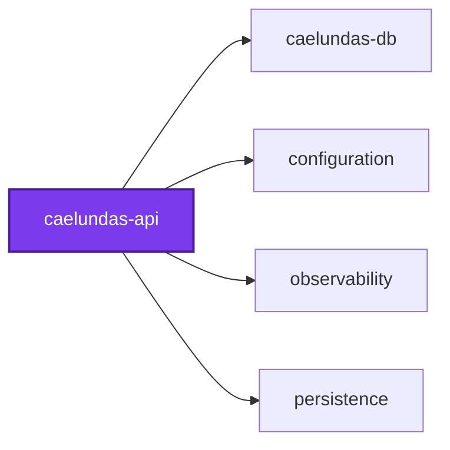
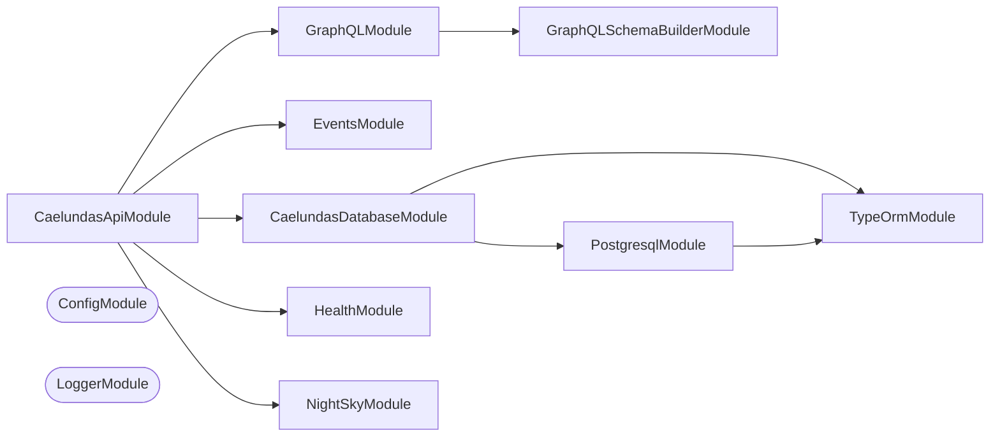

## Start

The API reads the Caelundas Postgres through `CaelundasDatabaseModule` from `caelundas-db`, so the database must be running and migrated first (`nx run caelundas-db:migration:run`). Copy `.env.default` to `.env`; the `CAELUNDAS_POSTGRES_*` values there match the shared Compose Postgres.

```bash
nx run caelundas-api:start
```

The web app calls the API from another origin, so the API answers cross-origin requests, including the `OPTIONS` preflight of a GraphQL POST. `CAELUNDAS_API_CORS_ORIGINS` lists the allowed origins, comma separated; `.env.default` allows the web app's dev server on port 8967, and leaving it unset allows every origin (`*`).

## Test

```bash
nx run caelundas-api:vitest
```

## 👔 Conformetry

This project was generated from the [nestjs-graphql-application](../../../configuration/conformetry-templates/nestjs-graphql-application) conformetry template.

<!-- coinagerie:start -->

## 🪙 Coinagerie

The words this project uses that the root glossary does not define, regenerated with `nx run caelundas-api:coinagerie-check:write`.

- **accept**:
- **alioth**:
- **altitude**:
- **anchor**:
- **angle**:
- **appearance**:
- **ascension**:
- **aspect**:
- **azimuth**:
- **binder**:
- **breadth**:
- **canonical**:
- **canonicalize**:
- **conjunct**:
- **constellation**:
- **db**:
- **declination**:
- **degree**:
- **designation**:
- **dubhe**:
- **early**:
- **earth**:
- **ecliptic**:
- **epoch**:
- **equinox**:
- **greenwich**:
- **harmonic**:
- **hip**:
- **horizon**:
- **ingress**:
- **instant**:
- **j2000**:
- **julian**:
- **july**:
- **latitude**:
- **longitude**:
- **lyra**:
- **magnitude**:
- **middleware**:
- **moon**:
- **negative**:
- **north**:
- **obliquity**:
- **observer**:
- **phase**:
- **planet**:
- **polar**:
- **pole**:
- **quarter**:
- **radius**:
- **reddest**:
- **retrograde**:
- **rotation**:
- **scorpius**:
- **sidereal**:
- **sky**:
- **south**:
- **southern**:
- **star**:
- **sun**:
- **temporality**:
- **trace**:
- **tuesday**:
- **unfinished**:
- **ursa**:
- **vega**:
- **visible**:
- **weekday**:
- **zodiac**:

<!-- coinagerie:end -->

<!-- callidescope:start -->

## 🔭 Callidescope

Call stacks traced through `projects/caelundas/caelundas-api`, deepest first. Each frame shows what it takes, what it returns, and what its documentation says.

| Measure | Value |
| --- | --- |
| Callables | 302 |
| Files | 77 |
| Calls traced | 219 |
| Call stacks | 15 |
| Deepest stack | 9 |
| Stacks through recursion | 0 |
| Unfollowable calls | 6 |

### Limits

What this project is judged against, as declared in its own `callidescope.config.ts`.

| Limit | Value |
| --- | --- |
| `maximumDepth` | 17 |
| `maximumBreadth` | none |

### Call stacks (depth)

**1. `EventsResolver.defaultFilterCollection`** — depth 9 · decorated-method

```text
🚀 EventsResolver.defaultFilterCollection(): Promise<EventFilterCollectionEntity | null> [projects/caelundas/caelundas-api/src/modules/events/events.resolver.ts:64]
   ↳ The collection the calendar opens on.
  └─> EventsService.findFilterCollections(): Promise<ResolvedEventFilterCollection[]> [projects/caelundas/caelundas-api/src/modules/events/events.service.ts:159]
     ↳ The named filter collections resolved against the tags the whole dataset has, in menu order.
    └─> EventsService.findFacets(…): Promise<EventFacetEntity[]> [projects/caelundas/caelundas-api/src/modules/events/events.service.ts:119]
       ↳ Every tag root with the tags beneath it, each counting the events that overlap the window and meet the filter, or every…
      └─> compileEventFilter(…): CompiledEventFilter | null [projects/caelundas/caelundas-api/src/modules/events/event-filter-compiler.utilities.ts:34]
         ↳ Compiles the filter tree to one parameterized boolean expression over the derived events view, aliased `e`, whose…
        └─> compileGroup(group: EventFilterGroup, binder: EventFilterBinder): null | string [projects/caelundas/caelundas-api/src/modules/events/event-filter-compiler.utilities.ts:53]
           ↳ Joins a group's compiled rules and nested groups under its combinator, in parentheses so that nesting keeps its…
          └─> compileRule(rule: EventFilterRule, binder: EventFilterBinder): null | string [projects/caelundas/caelundas-api/src/modules/events/event-filter-compiler.utilities.ts:83]
             ↳ Compiles one rule by its field, flipping it when the rule is negated.
            └─> compileTagNumberRule(…): string | null [projects/caelundas/caelundas-api/src/modules/events/event-filter-numbers.utilities.ts:100]
               ↳ Compiles a numeric rule on a tag root whose tags are named for numbers: events with a tag beneath the root whose number…
              └─> compileNumberCondition(…): NumberCondition | null [projects/caelundas/caelundas-api/src/modules/events/event-filter-numbers.utilities.ts:56]
                 ↳ Compiles a numeric comparison over a SQL expression for the events whose number meets it, reading the operands the…
                └─> isRangeOperator(operator: string): boolean [projects/caelundas/caelundas-api/src/modules/events/event-filter-numbers.utilities.ts:145]
                   ↳ Whether an operator compares a number with a range of two.
```

**2. `EventsResolver.filterCollections`** — depth 9 · decorated-method

```text
🚀 EventsResolver.filterCollections(): Promise<EventFilterCollectionEntity[]> [projects/caelundas/caelundas-api/src/modules/events/events.resolver.ts:134]
   ↳ The named filter collections.
  └─> EventsService.findFilterCollections(): Promise<ResolvedEventFilterCollection[]> [projects/caelundas/caelundas-api/src/modules/events/events.service.ts:159]
     ↳ The named filter collections resolved against the tags the whole dataset has, in menu order.
    └─> EventsService.findFacets(…): Promise<EventFacetEntity[]> [projects/caelundas/caelundas-api/src/modules/events/events.service.ts:119]
       ↳ Every tag root with the tags beneath it, each counting the events that overlap the window and meet the filter, or every…
      └─> compileEventFilter(…): CompiledEventFilter | null [projects/caelundas/caelundas-api/src/modules/events/event-filter-compiler.utilities.ts:34]
         ↳ Compiles the filter tree to one parameterized boolean expression over the derived events view, aliased `e`, whose…
        └─> compileGroup(group: EventFilterGroup, binder: EventFilterBinder): null | string [projects/caelundas/caelundas-api/src/modules/events/event-filter-compiler.utilities.ts:53]
           ↳ Joins a group's compiled rules and nested groups under its combinator, in parentheses so that nesting keeps its…
          └─> compileRule(rule: EventFilterRule, binder: EventFilterBinder): null | string [projects/caelundas/caelundas-api/src/modules/events/event-filter-compiler.utilities.ts:83]
             ↳ Compiles one rule by its field, flipping it when the rule is negated.
            └─> compileTagNumberRule(…): string | null [projects/caelundas/caelundas-api/src/modules/events/event-filter-numbers.utilities.ts:100]
               ↳ Compiles a numeric rule on a tag root whose tags are named for numbers: events with a tag beneath the root whose number…
              └─> compileNumberCondition(…): NumberCondition | null [projects/caelundas/caelundas-api/src/modules/events/event-filter-numbers.utilities.ts:56]
                 ↳ Compiles a numeric comparison over a SQL expression for the events whose number meets it, reading the operands the…
                └─> isRangeOperator(operator: string): boolean [projects/caelundas/caelundas-api/src/modules/events/event-filter-numbers.utilities.ts:145]
                   ↳ Whether an operator compares a number with a range of two.
```

**3. `NightSkyResolver.nightSky`** — depth 9 · decorated-method

```text
🚀 NightSkyResolver.nightSky(input: NightSkyInput): NightSkyEntity [projects/caelundas/caelundas-api/src/modules/night-sky/night-sky.resolver.ts:24]
   ↳ The night sky for a place and a window size.
  └─> NightSkyService.build(input: NightSkyInput): NightSky [projects/caelundas/caelundas-api/src/modules/night-sky/night-sky.service.ts:88]
     ↳ Builds the night sky a query asks for, from the stars and figures held in memory, refusing input the builder cannot…
    └─> NightSkyService.draw(input: ParsedNightSkyInput): NightSky [projects/caelundas/caelundas-api/src/modules/night-sky/night-sky.service.ts:50]
       ↳ Draws the sky for a canonical input.
      └─> buildNightSky(options: NightSkyOptions): NightSky [projects/caelundas/caelundas-api/src/modules/night-sky/night-sky.utilities.ts:68]
         ↳ Builds the night sky for a place and moment: the real fixed stars, drawn about the north celestial pole, which sits…
        └─> selectStars(geometry: SkyGeometry, options: ResolvedNightSkyOptions): SelectedStars [projects/caelundas/caelundas-api/src/modules/night-sky/night-sky.utilities.ts:455]
           ↳ Draws the stars bright enough and on rings that cross the window.
          └─> map(…)(star: StarRow): RenderedStar | undefined [projects/caelundas/caelundas-api/src/modules/night-sky/night-sky.utilities.ts:463]
            └─> renderStar(…): RenderedStar | undefined [projects/caelundas/caelundas-api/src/modules/night-sky/night-sky.utilities.ts:424]
               ↳ Draws one star, or returns nothing when its ring never crosses the window.
              └─> projectSkyPoint(…): ProjectedPoint [projects/caelundas/caelundas-api/src/modules/night-sky/night-sky-projection.utilities.ts:32]
                 ↳ Projects a point of the sky about the north celestial pole with a stereographic projection.
                └─> tangentOfHalfAngle(degrees: number): number [projects/caelundas/caelundas-api/src/modules/night-sky/night-sky-projection.utilities.ts:72]
                   ↳ The tangent of half an angle given in degrees, as the projection needs.
```

<details>
<summary>12 more call stacks</summary>

**4. `EventsResolver.events`** — depth 8 · decorated-method

```text
🚀 EventsResolver.events(…): Promise<CalendarEventEntity[]> [projects/caelundas/caelundas-api/src/modules/events/events.resolver.ts:82]
   ↳ The events that overlap a window and meet a filter.
  └─> EventsService.findEvents(…): Promise<CalendarEventEntity[]> [projects/caelundas/caelundas-api/src/modules/events/events.service.ts:75]
     ↳ The events that overlap the window and meet the filter, earliest first, each with the tags it was given and, for each…
    └─> compileEventFilter(…): CompiledEventFilter | null [projects/caelundas/caelundas-api/src/modules/events/event-filter-compiler.utilities.ts:34]
       ↳ Compiles the filter tree to one parameterized boolean expression over the derived events view, aliased `e`, whose…
      └─> compileGroup(group: EventFilterGroup, binder: EventFilterBinder): null | string [projects/caelundas/caelundas-api/src/modules/events/event-filter-compiler.utilities.ts:53]
         ↳ Joins a group's compiled rules and nested groups under its combinator, in parentheses so that nesting keeps its…
        └─> compileRule(rule: EventFilterRule, binder: EventFilterBinder): null | string [projects/caelundas/caelundas-api/src/modules/events/event-filter-compiler.utilities.ts:83]
           ↳ Compiles one rule by its field, flipping it when the rule is negated.
          └─> compileTagNumberRule(…): string | null [projects/caelundas/caelundas-api/src/modules/events/event-filter-numbers.utilities.ts:100]
             ↳ Compiles a numeric rule on a tag root whose tags are named for numbers: events with a tag beneath the root whose number…
            └─> compileNumberCondition(…): NumberCondition | null [projects/caelundas/caelundas-api/src/modules/events/event-filter-numbers.utilities.ts:56]
               ↳ Compiles a numeric comparison over a SQL expression for the events whose number meets it, reading the operands the…
              └─> isRangeOperator(operator: string): boolean [projects/caelundas/caelundas-api/src/modules/events/event-filter-numbers.utilities.ts:145]
                 ↳ Whether an operator compares a number with a range of two.
```

**5. `EventsResolver.facets`** — depth 8 · decorated-method

```text
🚀 EventsResolver.facets(…): Promise<EventFacetEntity[]> [projects/caelundas/caelundas-api/src/modules/events/events.resolver.ts:113]
   ↳ The tag facets, counted over a window.
  └─> EventsService.findFacets(…): Promise<EventFacetEntity[]> [projects/caelundas/caelundas-api/src/modules/events/events.service.ts:119]
     ↳ Every tag root with the tags beneath it, each counting the events that overlap the window and meet the filter, or every…
    └─> compileEventFilter(…): CompiledEventFilter | null [projects/caelundas/caelundas-api/src/modules/events/event-filter-compiler.utilities.ts:34]
       ↳ Compiles the filter tree to one parameterized boolean expression over the derived events view, aliased `e`, whose…
      └─> compileGroup(group: EventFilterGroup, binder: EventFilterBinder): null | string [projects/caelundas/caelundas-api/src/modules/events/event-filter-compiler.utilities.ts:53]
         ↳ Joins a group's compiled rules and nested groups under its combinator, in parentheses so that nesting keeps its…
        └─> compileRule(rule: EventFilterRule, binder: EventFilterBinder): null | string [projects/caelundas/caelundas-api/src/modules/events/event-filter-compiler.utilities.ts:83]
           ↳ Compiles one rule by its field, flipping it when the rule is negated.
          └─> compileTagNumberRule(…): string | null [projects/caelundas/caelundas-api/src/modules/events/event-filter-numbers.utilities.ts:100]
             ↳ Compiles a numeric rule on a tag root whose tags are named for numbers: events with a tag beneath the root whose number…
            └─> compileNumberCondition(…): NumberCondition | null [projects/caelundas/caelundas-api/src/modules/events/event-filter-numbers.utilities.ts:56]
               ↳ Compiles a numeric comparison over a SQL expression for the events whose number meets it, reading the operands the…
              └─> isRangeOperator(operator: string): boolean [projects/caelundas/caelundas-api/src/modules/events/event-filter-numbers.utilities.ts:145]
                 ↳ Whether an operator compares a number with a range of two.
```

**6. `EventsResolver.calendarWindows`** — depth 5 · decorated-method

```text
🚀 EventsResolver.calendarWindows(args: CalendarWindowsArguments): CalendarWindowsEntity [projects/caelundas/caelundas-api/src/modules/events/events.resolver.ts:37]
   ↳ The days a view shows and the window to read events for.
  └─> EventsService.findCalendarWindows(args: CalendarWindowsArguments): CalendarWindows [projects/caelundas/caelundas-api/src/modules/events/events.service.ts:63]
     ↳ The days a calendar view or a timeline scale shows around a day, and the window of events to read for them.
    └─> getCalendarWindows(…): CalendarWindows [projects/caelundas/caelundas-api/src/modules/events/calendar-windows.utilities.ts:33]
       ↳ The days a view shows around the day it opens on, as UTC midnights, and the window read for them, a day wider either…
      └─> getTimelineDays(scale: TimelineScale, anchor: Date): TimeWindow [projects/caelundas/caelundas-api/src/modules/events/calendar-windows.utilities.ts:71]
         ↳ The days the timeline's axis spans at a scale, as the Gantt lays them out: the day, the week from Sunday, the month,…
        └─> startOfDay(anchor: Date): Date [projects/caelundas/caelundas-api/src/modules/events/calendar-windows.utilities.ts:173]
           ↳ The UTC midnight that starts the day an instant falls on.
```

**7. `EventsResolver.dataset`** — depth 4 · decorated-method

```text
🚀 EventsResolver.dataset(): Promise<EventsDatasetEntity | null> [projects/caelundas/caelundas-api/src/modules/events/events.resolver.ts:51]
   ↳ The span and zone of the whole dataset.
  └─> EventsService.describeDataset(): Promise<EventsDatasetEntity | null> [projects/caelundas/caelundas-api/src/modules/events/events.service.ts:53]
     ↳ The span and zone of the whole dataset, or null when it holds no event.
    └─> EventsService.select(…): Promise<Row[]> [projects/caelundas/caelundas-api/src/modules/events/events.service.ts:170]
       ↳ Runs one statement with its `$n` parameters on the shared connection and parses every row with `schema`, so a column…
      └─> EventsService.map(…)(row: unknown): Row [projects/caelundas/caelundas-api/src/modules/events/events.service.ts:177]
```

**8. `decodeOffsetCursor`** — depth ≥ 3 · orphan-root

```text
🚀 decodeOffsetCursor(cursor?: null | string, defaultOffset?: number): number [projects/caelundas/caelundas-api/src/caelundas-api.utilities.ts:75]
   ↳ Decodes an offset-based cursor, returning the specified default offset if missing or invalid.
  └─> fromCursorSafe<T = unknown>(cursor?: null | string, parse?: (value: unknown) => T): null | T [projects/caelundas/caelundas-api/src/caelundas-api.utilities.ts:117]
     ↳ Safely decodes a cursor string, returning null if invalid, null, or undefined.
    └─> fromCursor<T = unknown>(cursor: string, parse?: (value: unknown) => T): T [projects/caelundas/caelundas-api/src/caelundas-api.utilities.ts:103]
       ↳ Decodes an opaque Base64 cursor string into structured data.
```

**9. `paginateArray`** — depth ≥ 3 · orphan-root

```text
🚀 paginateArray(…): { edges: Edge<T>[]; hasNextPage: boolean; hasPreviousPage: boolean; } [projects/caelundas/caelundas-api/src/caelundas-api.utilities.ts:134]
   ↳ Slices an array of items according to forward (first, after) Relay pagination parameters.
  └─> map(…)(item: T): Edge<T> [projects/caelundas/caelundas-api/src/caelundas-api.utilities.ts:169]
    └─> createEdge<T>(node: T, cursor: string): Edge<T> [projects/caelundas/caelundas-api/src/caelundas-api.utilities.ts:43]
       ↳ Creates a Relay Edge from a node and an encoded cursor string.
```

**10. `Paginated`** — depth ≥ 3 · orphan-root

```text
🚀 Paginated<T>(classReference: ClassConstructor<T>): ClassConstructor<Connection<T>> [projects/caelundas/caelundas-api/src/caelundas-api.utilities.ts:180]
   ↳ Mixin type factory producing a Relay Connection ObjectType for GraphQL schema generation.
  └─> createEdgeType<T>(classReference: ClassConstructor<T>): ClassConstructor<Edge<T>> [projects/caelundas/caelundas-api/src/caelundas-api.utilities.ts:50]
     ↳ Mixin type factory producing a Relay Edge ObjectType for GraphQL schema generation.
    └─> Field(…)(): StringConstructor [projects/caelundas/caelundas-api/src/caelundas-api.utilities.ts:60]
```

**11. `HealthResolver.health`** — depth 2 · decorated-method

```text
🚀 HealthResolver.health(): boolean [projects/caelundas/caelundas-api/src/modules/health/health.resolver.ts:22]
   ↳ Health check query.
  └─> HealthService.isHealthy(): boolean [projects/caelundas/caelundas-api/src/modules/health/health.service.ts:23]
     ↳ Returns true if the service is operational.
```

**12. `NightSkyService.onModuleInit`** — depth 2 · lifecycle

```text
🚀 NightSkyService.onModuleInit(): Promise<void> [projects/caelundas/caelundas-api/src/modules/night-sky/night-sky.service.ts:115]
   ↳ Reads the stars and constellation figures from the database, and sorts the stars brightest first, which is the order…
  └─> NightSkyService.flatMap(…)(…): { from: [number, number]; name: string; to: [number, number]; zodiac: boolean; }[] [projects/caelundas/caelundas-api/src/modules/night-sky/night-sky.service.ts:124]
```

**13. `encodeOffsetCursor`** — depth 2 · orphan-root

```text
🚀 encodeOffsetCursor(offset: number): string [projects/caelundas/caelundas-api/src/caelundas-api.utilities.ts:96]
   ↳ Encodes an offset-based integer cursor.
  └─> toCursor(data: unknown): string [projects/caelundas/caelundas-api/src/caelundas-api.utilities.ts:208]
     ↳ Encodes structured data into an opaque Base64 cursor string.
```

**14. `transform(…)`** — depth 2 · orphan-root

```text
🚀 transform(…)(origins: string): string[] [projects/caelundas/caelundas-api/src/caelundas-api.constants.ts:13]
  └─> filter(…)(origin: string): boolean [projects/caelundas/caelundas-api/src/caelundas-api.constants.ts:17]
```

**15. `bootstrap`** — depth 2 · orphan-root

```text
🚀 bootstrap(): Promise<void> [projects/caelundas/caelundas-api/src/caelundas-api.ts:16]
   ↳ Bootstraps the NestJS GraphQL API application.
  └─> corsOptions(origins: string[]): CorsOptions [projects/caelundas/caelundas-api/src/caelundas-api.utilities.ts:12]
     ↳ Builds the CORS options from the allowed origins: `*` allows every origin, otherwise only the listed ones are echoed…
```

</details>

### Breadth

| Callable | Breadth | Calls directly | Location |
| --- | --- | --- | --- |
| `compileDerivedRule` | 10 | `compileDateRule`, `readDateRange`, `compileDurationRule`, `readTexts`, `compileHourRule`, `readIntegerRange`, `compileTemporalityRule`, `compileTextRule`, `compileWeekdayRule`, `readIntegers` | `projects/caelundas/caelundas-api/src/modules/events/event-filter-derived.utilities.ts:27` |
| `buildNightSky` | 8 | `resolveOptions`, `computeGeometry`, `selectStars`, `computeMotion`, `buildViewport`, `formatConstellationLines`, `assembleSvg`, `formatEcliptic` | `projects/caelundas/caelundas-api/src/modules/night-sky/night-sky.utilities.ts:68` |
| `compileRule` | 7 | `isNumberOperator`, `compileTagNumberRule`, `compileTagRule`, `readTexts`, `isDerivedNumberRule`, `compileDerivedNumberRule`, `compileDerivedRule` | `projects/caelundas/caelundas-api/src/modules/events/event-filter-compiler.utilities.ts:83` |

<details>
<summary>94 more callables</summary>

| Callable | Breadth | Calls directly | Location |
| --- | --- | --- | --- |
| `EventsService.findEvents` | 7 | `compileEventFilter`, `compileEventGrouping`, `EventsService.select`, `EventsService.replace(…)`, `EventsService.replace(…)`, `toIsoString`, `EventsService.map(…)` | `projects/caelundas/caelundas-api/src/modules/events/events.service.ts:75` |
| `compileGroupLevel` | 5 | `filter(…)`, `replace(…)`, `bindParameter`, `find(…)`, `replace(…)` | `projects/caelundas/caelundas-api/src/modules/events/event-grouping-compiler.utilities.ts:49` |
| `getCalendarWindows` | 4 | `joinWindows`, `getTimelineDays`, `getVisibleDays`, `shiftDays` | `projects/caelundas/caelundas-api/src/modules/events/calendar-windows.utilities.ts:33` |
| `compileNumberCondition` | 4 | `isRangeOperator`, `readNumberRange`, `readSingleNumber`, `bindParameter` | `projects/caelundas/caelundas-api/src/modules/events/event-filter-numbers.utilities.ts:56` |
| `compileTagNumberRule` | 4 | `compileNumberCondition`, `bindParameter`, `replace(…)`, `replace(…)` | `projects/caelundas/caelundas-api/src/modules/events/event-filter-numbers.utilities.ts:100` |
| `EventsService.findFacets` | 4 | `compileEventFilter`, `EventsService.select`, `EventsService.replace(…)`, `toIsoString` | `projects/caelundas/caelundas-api/src/modules/events/events.service.ts:119` |
| `formatEcliptic` | 4 | `splitIntoRuns`, `traceEcliptic`, `normalizeHexadecimalColor`, `map(…)` | `projects/caelundas/caelundas-api/src/modules/night-sky/night-sky-ecliptic.utilities.ts:24` |
| `formatConstellationLines` | 4 | `filter(…)`, `map(…)`, `formatStroke`, `map(…)` | `projects/caelundas/caelundas-api/src/modules/night-sky/night-sky-lines.utilities.ts:29` |
| `resolveOptions` | 4 | `resolveAppearance`, `resolveView`, `resolveLineStyle`, `resolveEcliptic` | `projects/caelundas/caelundas-api/src/modules/night-sky/night-sky-options.utilities.ts:15` |
| `assembleSvg` | 4 | `formatSpin`, `formatGlowGroup`, `formatStarGroups`, `formatSkyDefinitions` | `projects/caelundas/caelundas-api/src/modules/night-sky/night-sky.utilities.ts:158` |
| `renderStar` | 4 | `projectSkyPoint`, `isOnVisibleRing`, `starRadius`, `colorBucketOf` | `projects/caelundas/caelundas-api/src/modules/night-sky/night-sky.utilities.ts:424` |
| `EventsResolver.events` | 3 | `EventsService.findEvents`, `parseEventFilter`, `parseEventGrouping` | `projects/caelundas/caelundas-api/src/modules/events/events.resolver.ts:82` |
| `createInputSchema` | 3 | `color`, `transform(…)`, `default(…)` | `projects/caelundas/caelundas-api/src/modules/night-sky/night-sky-input.utilities.ts:103` |
| `splitIntoRuns` | 3 | `projectSkyPoint`, `isOnVisibleRing`, `filter(…)` | `projects/caelundas/caelundas-api/src/modules/night-sky/night-sky-projection.utilities.ts:50` |
| `selectStars` | 3 | `filter(…)`, `filter(…)`, `map(…)` | `projects/caelundas/caelundas-api/src/modules/night-sky/night-sky.utilities.ts:455` |
| `NightSkyService.draw` | 3 | `buildNightSky`, `selectConstellationSegments`, `computeStartingSiderealDegrees` | `projects/caelundas/caelundas-api/src/modules/night-sky/night-sky.service.ts:50` |
| `NightSkyService.build` | 3 | `canonicalizeNightSkyInput`, `parseNightSkyInput`, `NightSkyService.draw` | `projects/caelundas/caelundas-api/src/modules/night-sky/night-sky.service.ts:88` |
| `NightSkyService.onModuleInit` | 3 | `NightSkyService.flatMap(…)`, `NightSkyService.toSorted(…)`, `NightSkyService.map(…)` | `projects/caelundas/caelundas-api/src/modules/night-sky/night-sky.service.ts:115` |
| `createEdgeType` | 2 | `Field(…)`, `Field(…)` | `projects/caelundas/caelundas-api/src/caelundas-api.utilities.ts:50` |
| `paginateArray` | 2 | `findIndex(…)`, `map(…)` | `projects/caelundas/caelundas-api/src/caelundas-api.utilities.ts:134` |
| `transform(…)` | 2 | `filter(…)`, `map(…)` | `projects/caelundas/caelundas-api/src/caelundas-api.constants.ts:13` |
| `getTimelineDays` | 2 | `startOfDay`, `shiftDays` | `projects/caelundas/caelundas-api/src/modules/events/calendar-windows.utilities.ts:71` |
| `getVisibleDays` | 2 | `startOfDay`, `shiftDays` | `projects/caelundas/caelundas-api/src/modules/events/calendar-windows.utilities.ts:113` |
| `compileDurationRule` | 2 | `filter(…)`, `bindParameter` | `projects/caelundas/caelundas-api/src/modules/events/event-filter-derived.utilities.ts:90` |
| `compileTagRule` | 2 | `replace(…)`, `bindParameter` | `projects/caelundas/caelundas-api/src/modules/events/event-filter-compiler.utilities.ts:114` |
| `EventsService.findFilterCollections` | 2 | `resolveEventFilterCollections`, `EventsService.findFacets` | `projects/caelundas/caelundas-api/src/modules/events/events.service.ts:159` |
| `EventsResolver.defaultFilterCollection` | 2 | `EventsService.findFilterCollections`, `EventsResolver.find(…)` | `projects/caelundas/caelundas-api/src/modules/events/events.resolver.ts:64` |
| `EventsResolver.facets` | 2 | `EventsService.findFacets`, `parseEventFilter` | `projects/caelundas/caelundas-api/src/modules/events/events.resolver.ts:113` |
| `transform(…)` | 2 | `filter(…)`, `map(…)` | `projects/caelundas/caelundas-api/src/modules/night-sky/night-sky-input.utilities.ts:118` |
| `map(…)` | 2 | `splitIntoRuns`, `interpolate` | `projects/caelundas/caelundas-api/src/modules/night-sky/night-sky-lines.utilities.ts:35` |
| `interpolate` | 2 | `toVector`, `from(…)` | `projects/caelundas/caelundas-api/src/modules/night-sky/night-sky-lines.utilities.ts:69` |
| `colorFromIndex` | 2 | `find(…)`, `map(…)` | `projects/caelundas/caelundas-api/src/modules/night-sky/night-sky.utilities.ts:240` |
| `computeGeometry` | 2 | `limitFieldOfView`, `tangentOfHalfAngle` | `projects/caelundas/caelundas-api/src/modules/night-sky/night-sky.utilities.ts:267` |
| `bootstrap` | 2 | `corsOptions`, `registerShutdownHandler(…)` | `projects/caelundas/caelundas-api/src/caelundas-api.ts:16` |
| `decodeOffsetCursor` | 1 | `fromCursorSafe` | `projects/caelundas/caelundas-api/src/caelundas-api.utilities.ts:75` |
| `encodeOffsetCursor` | 1 | `toCursor` | `projects/caelundas/caelundas-api/src/caelundas-api.utilities.ts:96` |
| `fromCursorSafe` | 1 | `fromCursor` | `projects/caelundas/caelundas-api/src/caelundas-api.utilities.ts:117` |
| `map(…)` | 1 | `createEdge` | `projects/caelundas/caelundas-api/src/caelundas-api.utilities.ts:169` |
| `Paginated` | 1 | `createEdgeType` | `projects/caelundas/caelundas-api/src/caelundas-api.utilities.ts:180` |
| `HealthResolver.health` | 1 | `HealthService.isHealthy` | `projects/caelundas/caelundas-api/src/modules/health/health.resolver.ts:22` |
| `resolveEventFilterCollections` | 1 | `resolveGroup` | `projects/caelundas/caelundas-api/src/modules/events/event-filter-collections.utilities.ts:20` |
| `resolveGroup` | 1 | `resolveRule` | `projects/caelundas/caelundas-api/src/modules/events/event-filter-collections.utilities.ts:46` |
| `readIntegerRange` | 1 | `readInteger` | `projects/caelundas/caelundas-api/src/modules/events/event-filter-values.utilities.ts:33` |
| `readIntegers` | 1 | `readInteger` | `projects/caelundas/caelundas-api/src/modules/events/event-filter-values.utilities.ts:57` |
| `readTexts` | 1 | `filter(…)` | `projects/caelundas/caelundas-api/src/modules/events/event-filter-values.utilities.ts:116` |
| `compileDateRule` | 1 | `bindParameter` | `projects/caelundas/caelundas-api/src/modules/events/event-filter-derived.utilities.ts:66` |
| `compileHourRule` | 1 | `bindParameter` | `projects/caelundas/caelundas-api/src/modules/events/event-filter-derived.utilities.ts:127` |
| `compileTemporalityRule` | 1 | `bindParameter` | `projects/caelundas/caelundas-api/src/modules/events/event-filter-derived.utilities.ts:150` |
| `compileTextRule` | 1 | `bindParameter` | `projects/caelundas/caelundas-api/src/modules/events/event-filter-derived.utilities.ts:174` |
| `compileWeekdayRule` | 1 | `bindParameter` | `projects/caelundas/caelundas-api/src/modules/events/event-filter-derived.utilities.ts:204` |
| `compileDerivedNumberRule` | 1 | `compileNumberCondition` | `projects/caelundas/caelundas-api/src/modules/events/event-filter-numbers.utilities.ts:32` |
| `isDerivedNumberRule` | 1 | `isNumberOperator` | `projects/caelundas/caelundas-api/src/modules/events/event-filter-numbers.utilities.ts:122` |
| `isNumberOperator` | 1 | `isRangeOperator` | `projects/caelundas/caelundas-api/src/modules/events/event-filter-numbers.utilities.ts:138` |
| `compileEventFilter` | 1 | `compileGroup` | `projects/caelundas/caelundas-api/src/modules/events/event-filter-compiler.utilities.ts:34` |
| `compileGroup` | 1 | `compileRule` | `projects/caelundas/caelundas-api/src/modules/events/event-filter-compiler.utilities.ts:53` |
| `replace(…)` | 1 | `bindParameter` | `projects/caelundas/caelundas-api/src/modules/events/event-filter-compiler.utilities.ts:131` |
| `compileEventGrouping` | 1 | `replace(…)` | `projects/caelundas/caelundas-api/src/modules/events/event-grouping-compiler.utilities.ts:29` |
| `replace(…)` | 1 | `compileGroupLevel` | `projects/caelundas/caelundas-api/src/modules/events/event-grouping-compiler.utilities.ts:38` |
| `replace(…)` | 1 | `bindParameter` | `projects/caelundas/caelundas-api/src/modules/events/event-grouping-compiler.utilities.ts:58` |
| `EventsService.describeDataset` | 1 | `EventsService.select` | `projects/caelundas/caelundas-api/src/modules/events/events.service.ts:53` |
| `EventsService.findCalendarWindows` | 1 | `getCalendarWindows` | `projects/caelundas/caelundas-api/src/modules/events/events.service.ts:63` |
| `EventsService.map(…)` | 1 | `EventsService.map(…)` | `projects/caelundas/caelundas-api/src/modules/events/events.service.ts:96` |
| `EventsService.select` | 1 | `EventsService.map(…)` | `projects/caelundas/caelundas-api/src/modules/events/events.service.ts:170` |
| `EventsResolver.calendarWindows` | 1 | `EventsService.findCalendarWindows` | `projects/caelundas/caelundas-api/src/modules/events/events.resolver.ts:37` |
| `EventsResolver.dataset` | 1 | `EventsService.describeDataset` | `projects/caelundas/caelundas-api/src/modules/events/events.resolver.ts:51` |
| `EventsResolver.filterCollections` | 1 | `EventsService.findFilterCollections` | `projects/caelundas/caelundas-api/src/modules/events/events.resolver.ts:134` |
| `formatSkyDefinitions` | 1 | `normalizeHexadecimalColor` | `projects/caelundas/caelundas-api/src/modules/night-sky/night-sky-colors.utilities.ts:14` |
| `normalizeHexadecimalColor` | 1 | `from(…)` | `projects/caelundas/caelundas-api/src/modules/night-sky/night-sky-colors.utilities.ts:31` |
| `canonicalizeNightSkyInput` | 1 | `bucket` | `projects/caelundas/caelundas-api/src/modules/night-sky/night-sky-input.utilities.ts:25` |
| `parseNightSkyInput` | 1 | `createInputSchema` | `projects/caelundas/caelundas-api/src/modules/night-sky/night-sky-input.utilities.ts:60` |
| `selectConstellationSegments` | 1 | `filter(…)` | `projects/caelundas/caelundas-api/src/modules/night-sky/night-sky-input.utilities.ts:74` |
| `filter(…)` | 1 | `normalizeConstellationName` | `projects/caelundas/caelundas-api/src/modules/night-sky/night-sky-input.utilities.ts:81` |
| `color` | 1 | `transform(…)` | `projects/caelundas/caelundas-api/src/modules/night-sky/night-sky-input.utilities.ts:91` |
| `transform(…)` | 1 | `normalizeHexadecimalColor` | `projects/caelundas/caelundas-api/src/modules/night-sky/night-sky-input.utilities.ts:96` |
| `map(…)` | 1 | `normalizeConstellationName` | `projects/caelundas/caelundas-api/src/modules/night-sky/night-sky-input.utilities.ts:120` |
| `formatPolyline` | 1 | `map(…)` | `projects/caelundas/caelundas-api/src/modules/night-sky/night-sky-projection.utilities.ts:10` |
| `projectSkyPoint` | 1 | `tangentOfHalfAngle` | `projects/caelundas/caelundas-api/src/modules/night-sky/night-sky-projection.utilities.ts:32` |
| `map(…)` | 1 | `formatPolyline` | `projects/caelundas/caelundas-api/src/modules/night-sky/night-sky-ecliptic.utilities.ts:39` |
| `traceEcliptic` | 1 | `from(…)` | `projects/caelundas/caelundas-api/src/modules/night-sky/night-sky-ecliptic.utilities.ts:63` |
| `from(…)` | 1 | `toEclipticPoint` | `projects/caelundas/caelundas-api/src/modules/night-sky/night-sky-ecliptic.utilities.ts:64` |
| `map(…)` | 1 | `formatPolyline` | `projects/caelundas/caelundas-api/src/modules/night-sky/night-sky-lines.utilities.ts:43` |
| `formatStroke` | 1 | `normalizeHexadecimalColor` | `projects/caelundas/caelundas-api/src/modules/night-sky/night-sky-lines.utilities.ts:56` |
| `from(…)` | 1 | `toSkyPoint` | `projects/caelundas/caelundas-api/src/modules/night-sky/night-sky-lines.utilities.ts:73` |
| `computeLocalSiderealDegrees` | 1 | `computeGreenwichMeanSiderealHours` | `projects/caelundas/caelundas-api/src/modules/night-sky/night-sky.utilities.ts:126` |
| `computeStartingSiderealDegrees` | 1 | `computeLocalSiderealDegrees` | `projects/caelundas/caelundas-api/src/modules/night-sky/night-sky.utilities.ts:142` |
| `buildDebugViewport` | 1 | `formatDebugOverlay` | `projects/caelundas/caelundas-api/src/modules/night-sky/night-sky.utilities.ts:188` |
| `buildViewport` | 1 | `buildDebugViewport` | `projects/caelundas/caelundas-api/src/modules/night-sky/night-sky.utilities.ts:208` |
| `formatDebugOverlay` | 1 | `formatRing` | `projects/caelundas/caelundas-api/src/modules/night-sky/night-sky.utilities.ts:314` |
| `formatGlowGroup` | 1 | `flatMap(…)` | `projects/caelundas/caelundas-api/src/modules/night-sky/night-sky.utilities.ts:336` |
| `formatStarGroups` | 1 | `from(…)` | `projects/caelundas/caelundas-api/src/modules/night-sky/night-sky.utilities.ts:377` |
| `from(…)` | 1 | `colorFromIndex` | `projects/caelundas/caelundas-api/src/modules/night-sky/night-sky.utilities.ts:389` |
| `map(…)` | 1 | `renderStar` | `projects/caelundas/caelundas-api/src/modules/night-sky/night-sky.utilities.ts:463` |
| `filter(…)` | 1 | `isRendered` | `projects/caelundas/caelundas-api/src/modules/night-sky/night-sky.utilities.ts:464` |
| `NightSkyResolver.nightSky` | 1 | `NightSkyService.build` | `projects/caelundas/caelundas-api/src/modules/night-sky/night-sky.resolver.ts:24` |

</details>
<!-- callidescope:end -->

## 🕸️ Codependix

Dependency graphs exported by [codependix](https://github.com/Organizzolini/codebase/tree/main/projects/ic-suite/codependix/codependix-cli), regenerated by `nx run configuration:codependix:write`.

### Nx Neighborhood

<!-- codependix:start name="codependix-nx-projects" -->

<!-- codependix:end name="codependix-nx-projects" -->

### NestJS Module Graph

<!-- codependix:start name="codependix-nestjs-modules" -->


_Rounded modules are global: every module can inject them, so their edges are left out._
<!-- codependix:end name="codependix-nestjs-modules" -->

### File Imports

<!-- codependix:start name="codependix-file-imports" -->
```mermaid
graph LR
  file_callidescope_config_ts["callidescope.config.ts"]
  file_codependix_config_ts["codependix.config.ts"]
  file_codometer_config_ts["codometer.config.ts"]
  file_coinagerie_config_ts["coinagerie.config.ts"]
  file_eslint_config_ts["eslint.config.ts"]
  file_src_caelundas_api_graphql_end_to_end_test_ts["src/caelundas-api-graphql.end-to-end.test.ts"]
  file_src_caelundas_api_night_sky_end_to_end_test_ts["src/caelundas-api-night-sky.end-to-end.test.ts"]
  file_src_caelundas_api_constants_ts["src/caelundas-api.constants.ts"]
  file_src_caelundas_api_constants_unit_test_ts["src/caelundas-api.constants.unit.test.ts"]
  file_src_caelundas_api_end_to_end_test_ts["src/caelundas-api.end-to-end.test.ts"]
  file_src_caelundas_api_entities_ts["src/caelundas-api.entities.ts"]
  file_src_caelundas_api_module_ts["src/caelundas-api.module.ts"]
  file_src_caelundas_api_module_unit_test_ts["src/caelundas-api.module.unit.test.ts"]
  file_src_caelundas_api_ts["src/caelundas-api.ts"]
  file_src_caelundas_api_types_ts["src/caelundas-api.types.ts"]
  file_src_caelundas_api_unit_test_ts["src/caelundas-api.unit.test.ts"]
  file_src_caelundas_api_utilities_ts["src/caelundas-api.utilities.ts"]
  file_src_caelundas_api_utilities_unit_test_ts["src/caelundas-api.utilities.unit.test.ts"]
  file_src_modules_events_calendar_event_tag_entities_ts["src/modules/events/calendar-event-tag.entities.ts"]
  file_src_modules_events_calendar_event_entities_ts["src/modules/events/calendar-event.entities.ts"]
  file_src_modules_events_calendar_view_entities_ts["src/modules/events/calendar-view.entities.ts"]
  file_src_modules_events_calendar_windows_arguments_entities_ts["src/modules/events/calendar-windows-arguments.entities.ts"]
  file_src_modules_events_calendar_windows_constants_ts["src/modules/events/calendar-windows.constants.ts"]
  file_src_modules_events_calendar_windows_entities_ts["src/modules/events/calendar-windows.entities.ts"]
  file_src_modules_events_calendar_windows_types_ts["src/modules/events/calendar-windows.types.ts"]
  file_src_modules_events_calendar_windows_utilities_ts["src/modules/events/calendar-windows.utilities.ts"]
  file_src_modules_events_calendar_windows_utilities_unit_test_ts["src/modules/events/calendar-windows.utilities.unit.test.ts"]
  file_src_modules_events_event_facet_value_entities_ts["src/modules/events/event-facet-value.entities.ts"]
  file_src_modules_events_event_facet_entities_ts["src/modules/events/event-facet.entities.ts"]
  file_src_modules_events_event_filter_binder_utilities_ts["src/modules/events/event-filter-binder.utilities.ts"]
  file_src_modules_events_event_filter_collection_entities_ts["src/modules/events/event-filter-collection.entities.ts"]
  file_src_modules_events_event_filter_collections_constants_ts["src/modules/events/event-filter-collections.constants.ts"]
  file_src_modules_events_event_filter_collections_types_ts["src/modules/events/event-filter-collections.types.ts"]
  file_src_modules_events_event_filter_collections_utilities_ts["src/modules/events/event-filter-collections.utilities.ts"]
  file_src_modules_events_event_filter_collections_utilities_unit_test_ts["src/modules/events/event-filter-collections.utilities.unit.test.ts"]
  file_src_modules_events_event_filter_combinator_entities_ts["src/modules/events/event-filter-combinator.entities.ts"]
  file_src_modules_events_event_filter_compiler_utilities_ts["src/modules/events/event-filter-compiler.utilities.ts"]
  file_src_modules_events_event_filter_compiler_utilities_unit_test_ts["src/modules/events/event-filter-compiler.utilities.unit.test.ts"]
  file_src_modules_events_event_filter_derived_utilities_ts["src/modules/events/event-filter-derived.utilities.ts"]
  file_src_modules_events_event_filter_fields_constants_ts["src/modules/events/event-filter-fields.constants.ts"]
  file_src_modules_events_event_filter_numbers_utilities_ts["src/modules/events/event-filter-numbers.utilities.ts"]
  file_src_modules_events_event_filter_rule_entities_ts["src/modules/events/event-filter-rule.entities.ts"]
  file_src_modules_events_event_filter_sql_constants_ts["src/modules/events/event-filter-sql.constants.ts"]
  file_src_modules_events_event_filter_values_constants_ts["src/modules/events/event-filter-values.constants.ts"]
  file_src_modules_events_event_filter_values_utilities_ts["src/modules/events/event-filter-values.utilities.ts"]
  file_src_modules_events_event_filter_constants_ts["src/modules/events/event-filter.constants.ts"]
  file_src_modules_events_event_filter_entities_ts["src/modules/events/event-filter.entities.ts"]
  file_src_modules_events_event_filter_types_ts["src/modules/events/event-filter.types.ts"]
  file_src_modules_events_event_filter_utilities_ts["src/modules/events/event-filter.utilities.ts"]
  file_src_modules_events_event_filter_utilities_unit_test_ts["src/modules/events/event-filter.utilities.unit.test.ts"]
  file_src_modules_events_event_group_key_entities_ts["src/modules/events/event-group-key.entities.ts"]
  file_src_modules_events_event_group_level_entities_ts["src/modules/events/event-group-level.entities.ts"]
  file_src_modules_events_event_grouping_compiler_utilities_ts["src/modules/events/event-grouping-compiler.utilities.ts"]
  file_src_modules_events_event_grouping_compiler_utilities_unit_test_ts["src/modules/events/event-grouping-compiler.utilities.unit.test.ts"]
  file_src_modules_events_event_grouping_constants_ts["src/modules/events/event-grouping.constants.ts"]
  file_src_modules_events_event_grouping_entities_ts["src/modules/events/event-grouping.entities.ts"]
  file_src_modules_events_event_grouping_types_ts["src/modules/events/event-grouping.types.ts"]
  file_src_modules_events_event_grouping_utilities_ts["src/modules/events/event-grouping.utilities.ts"]
  file_src_modules_events_event_grouping_utilities_unit_test_ts["src/modules/events/event-grouping.utilities.unit.test.ts"]
  file_src_modules_events_events_calendar_windows_resolver_end_to_end_test_ts["src/modules/events/events-calendar-windows.resolver.end-to-end.test.ts"]
  file_src_modules_events_events_filter_resolver_end_to_end_test_ts["src/modules/events/events-filter.resolver.end-to-end.test.ts"]
  file_src_modules_events_events_grouping_resolver_end_to_end_test_ts["src/modules/events/events-grouping.resolver.end-to-end.test.ts"]
  file_src_modules_events_events_window_input_entities_ts["src/modules/events/events-window-input.entities.ts"]
  file_src_modules_events_events_constants_ts["src/modules/events/events.constants.ts"]
  file_src_modules_events_events_entities_ts["src/modules/events/events.entities.ts"]
  file_src_modules_events_events_module_ts["src/modules/events/events.module.ts"]
  file_src_modules_events_events_resolver_end_to_end_test_ts["src/modules/events/events.resolver.end-to-end.test.ts"]
  file_src_modules_events_events_resolver_ts["src/modules/events/events.resolver.ts"]
  file_src_modules_events_events_resolver_unit_test_ts["src/modules/events/events.resolver.unit.test.ts"]
  file_src_modules_events_events_service_ts["src/modules/events/events.service.ts"]
  file_src_modules_events_events_service_unit_test_ts["src/modules/events/events.service.unit.test.ts"]
  file_src_modules_events_events_types_ts["src/modules/events/events.types.ts"]
  file_src_modules_events_events_utilities_ts["src/modules/events/events.utilities.ts"]
  file_src_modules_events_events_utilities_unit_test_ts["src/modules/events/events.utilities.unit.test.ts"]
  file_src_modules_events_time_window_entities_ts["src/modules/events/time-window.entities.ts"]
  file_src_modules_events_timeline_scale_entities_ts["src/modules/events/timeline-scale.entities.ts"]
  file_src_modules_health_health_constants_ts["src/modules/health/health.constants.ts"]
  file_src_modules_health_health_module_ts["src/modules/health/health.module.ts"]
  file_src_modules_health_health_module_unit_test_ts["src/modules/health/health.module.unit.test.ts"]
  file_src_modules_health_health_resolver_ts["src/modules/health/health.resolver.ts"]
  file_src_modules_health_health_resolver_unit_test_ts["src/modules/health/health.resolver.unit.test.ts"]
  file_src_modules_health_health_service_ts["src/modules/health/health.service.ts"]
  file_src_modules_health_health_service_unit_test_ts["src/modules/health/health.service.unit.test.ts"]
  file_src_modules_health_health_types_ts["src/modules/health/health.types.ts"]
  file_src_modules_night_sky_night_sky_colors_utilities_ts["src/modules/night-sky/night-sky-colors.utilities.ts"]
  file_src_modules_night_sky_night_sky_ecliptic_utilities_ts["src/modules/night-sky/night-sky-ecliptic.utilities.ts"]
  file_src_modules_night_sky_night_sky_ecliptic_utilities_unit_test_ts["src/modules/night-sky/night-sky-ecliptic.utilities.unit.test.ts"]
  file_src_modules_night_sky_night_sky_input_entities_ts["src/modules/night-sky/night-sky-input.entities.ts"]
  file_src_modules_night_sky_night_sky_input_utilities_ts["src/modules/night-sky/night-sky-input.utilities.ts"]
  file_src_modules_night_sky_night_sky_input_utilities_unit_test_ts["src/modules/night-sky/night-sky-input.utilities.unit.test.ts"]
  file_src_modules_night_sky_night_sky_lines_utilities_ts["src/modules/night-sky/night-sky-lines.utilities.ts"]
  file_src_modules_night_sky_night_sky_lines_utilities_unit_test_ts["src/modules/night-sky/night-sky-lines.utilities.unit.test.ts"]
  file_src_modules_night_sky_night_sky_measurements_entities_ts["src/modules/night-sky/night-sky-measurements.entities.ts"]
  file_src_modules_night_sky_night_sky_options_utilities_ts["src/modules/night-sky/night-sky-options.utilities.ts"]
  file_src_modules_night_sky_night_sky_options_utilities_unit_test_ts["src/modules/night-sky/night-sky-options.utilities.unit.test.ts"]
  file_src_modules_night_sky_night_sky_projection_utilities_ts["src/modules/night-sky/night-sky-projection.utilities.ts"]
  file_src_modules_night_sky_night_sky_constants_ts["src/modules/night-sky/night-sky.constants.ts"]
  file_src_modules_night_sky_night_sky_entities_ts["src/modules/night-sky/night-sky.entities.ts"]
  file_src_modules_night_sky_night_sky_module_ts["src/modules/night-sky/night-sky.module.ts"]
  file_src_modules_night_sky_night_sky_resolver_ts["src/modules/night-sky/night-sky.resolver.ts"]
  file_src_modules_night_sky_night_sky_resolver_unit_test_ts["src/modules/night-sky/night-sky.resolver.unit.test.ts"]
  file_src_modules_night_sky_night_sky_service_ts["src/modules/night-sky/night-sky.service.ts"]
  file_src_modules_night_sky_night_sky_service_unit_test_ts["src/modules/night-sky/night-sky.service.unit.test.ts"]
  file_src_modules_night_sky_night_sky_types_ts["src/modules/night-sky/night-sky.types.ts"]
  file_src_modules_night_sky_night_sky_utilities_ts["src/modules/night-sky/night-sky.utilities.ts"]
  file_src_modules_night_sky_night_sky_utilities_unit_test_ts["src/modules/night-sky/night-sky.utilities.unit.test.ts"]
  file_testing_events_application_ts["testing/events-application.ts"]
  file_testing_mocks_ts["testing/mocks.ts"]
  file_testing_no_database_constants_ts["testing/no-database.constants.ts"]
  file_testing_no_database_module_ts["testing/no-database.module.ts"]
  file_testing_setup_ts["testing/setup.ts"]
  file_vitest_config_ts["vitest.config.ts"]
  file_src_caelundas_api_graphql_end_to_end_test_ts --> file_src_caelundas_api_utilities_ts
  file_src_caelundas_api_graphql_end_to_end_test_ts --> file_src_modules_health_health_module_ts
  file_src_caelundas_api_night_sky_end_to_end_test_ts --> file_src_caelundas_api_module_ts
  file_src_caelundas_api_night_sky_end_to_end_test_ts --> file_testing_no_database_module_ts
  file_src_caelundas_api_end_to_end_test_ts --> file_src_caelundas_api_constants_ts
  file_src_caelundas_api_module_ts --> file_src_caelundas_api_constants_ts
  file_src_caelundas_api_module_ts --> file_src_modules_events_events_module_ts
  file_src_caelundas_api_module_ts --> file_src_modules_health_health_module_ts
  file_src_caelundas_api_module_ts --> file_src_modules_night_sky_night_sky_module_ts
  file_src_caelundas_api_module_unit_test_ts --> file_src_caelundas_api_module_ts
  file_src_caelundas_api_module_unit_test_ts --> file_src_modules_events_events_module_ts
  file_src_caelundas_api_ts --> file_src_caelundas_api_constants_ts
  file_src_caelundas_api_ts --> file_src_caelundas_api_module_ts
  file_src_caelundas_api_ts --> file_src_caelundas_api_utilities_ts
  file_src_caelundas_api_types_ts --> file_src_caelundas_api_entities_ts
  file_src_caelundas_api_utilities_ts --> file_src_caelundas_api_entities_ts
  file_src_caelundas_api_utilities_ts --> file_src_caelundas_api_types_ts
  file_src_caelundas_api_utilities_unit_test_ts --> file_src_caelundas_api_entities_ts
  file_src_caelundas_api_utilities_unit_test_ts --> file_src_caelundas_api_types_ts
  file_src_caelundas_api_utilities_unit_test_ts --> file_src_caelundas_api_utilities_ts
  file_src_modules_events_calendar_event_entities_ts --> file_src_modules_events_calendar_event_tag_entities_ts
  file_src_modules_events_calendar_event_entities_ts --> file_src_modules_events_event_group_key_entities_ts
  file_src_modules_events_calendar_windows_arguments_entities_ts --> file_src_modules_events_calendar_view_entities_ts
  file_src_modules_events_calendar_windows_arguments_entities_ts --> file_src_modules_events_timeline_scale_entities_ts
  file_src_modules_events_calendar_windows_constants_ts --> file_src_modules_events_timeline_scale_entities_ts
  file_src_modules_events_calendar_windows_entities_ts --> file_src_modules_events_time_window_entities_ts
  file_src_modules_events_calendar_windows_types_ts --> file_src_modules_events_timeline_scale_entities_ts
  file_src_modules_events_calendar_windows_utilities_ts --> file_src_modules_events_calendar_view_entities_ts
  file_src_modules_events_calendar_windows_utilities_ts --> file_src_modules_events_calendar_windows_constants_ts
  file_src_modules_events_calendar_windows_utilities_ts --> file_src_modules_events_calendar_windows_types_ts
  file_src_modules_events_calendar_windows_utilities_ts --> file_src_modules_events_timeline_scale_entities_ts
  file_src_modules_events_calendar_windows_utilities_unit_test_ts --> file_src_modules_events_calendar_view_entities_ts
  file_src_modules_events_calendar_windows_utilities_unit_test_ts --> file_src_modules_events_calendar_windows_types_ts
  file_src_modules_events_calendar_windows_utilities_unit_test_ts --> file_src_modules_events_calendar_windows_utilities_ts
  file_src_modules_events_calendar_windows_utilities_unit_test_ts --> file_src_modules_events_timeline_scale_entities_ts
  file_src_modules_events_event_facet_entities_ts --> file_src_modules_events_event_facet_value_entities_ts
  file_src_modules_events_event_filter_binder_utilities_ts --> file_src_modules_events_event_filter_sql_constants_ts
  file_src_modules_events_event_filter_binder_utilities_ts --> file_src_modules_events_event_filter_types_ts
  file_src_modules_events_event_filter_collection_entities_ts --> file_src_modules_events_event_filter_entities_ts
  file_src_modules_events_event_filter_collections_constants_ts --> file_src_modules_events_event_filter_collections_types_ts
  file_src_modules_events_event_filter_collections_constants_ts --> file_src_modules_events_event_filter_combinator_entities_ts
  file_src_modules_events_event_filter_collections_constants_ts --> file_src_modules_events_event_filter_fields_constants_ts
  file_src_modules_events_event_filter_collections_types_ts --> file_src_modules_events_event_facet_entities_ts
  file_src_modules_events_event_filter_collections_types_ts --> file_src_modules_events_event_filter_combinator_entities_ts
  file_src_modules_events_event_filter_collections_types_ts --> file_src_modules_events_event_filter_fields_constants_ts
  file_src_modules_events_event_filter_collections_types_ts --> file_src_modules_events_event_filter_entities_ts
  file_src_modules_events_event_filter_collections_utilities_ts --> file_src_modules_events_event_facet_entities_ts
  file_src_modules_events_event_filter_collections_utilities_ts --> file_src_modules_events_event_filter_collections_constants_ts
  file_src_modules_events_event_filter_collections_utilities_ts --> file_src_modules_events_event_filter_collections_types_ts
  file_src_modules_events_event_filter_collections_utilities_ts --> file_src_modules_events_event_filter_combinator_entities_ts
  file_src_modules_events_event_filter_collections_utilities_ts --> file_src_modules_events_event_filter_fields_constants_ts
  file_src_modules_events_event_filter_collections_utilities_ts --> file_src_modules_events_event_filter_rule_entities_ts
  file_src_modules_events_event_filter_collections_utilities_ts --> file_src_modules_events_event_filter_entities_ts
  file_src_modules_events_event_filter_collections_utilities_unit_test_ts --> file_src_modules_events_event_facet_entities_ts
  file_src_modules_events_event_filter_collections_utilities_unit_test_ts --> file_src_modules_events_event_filter_collections_constants_ts
  file_src_modules_events_event_filter_collections_utilities_unit_test_ts --> file_src_modules_events_event_filter_collections_utilities_ts
  file_src_modules_events_event_filter_compiler_utilities_ts --> file_src_modules_events_event_filter_binder_utilities_ts
  file_src_modules_events_event_filter_compiler_utilities_ts --> file_src_modules_events_event_filter_derived_utilities_ts
  file_src_modules_events_event_filter_compiler_utilities_ts --> file_src_modules_events_event_filter_fields_constants_ts
  file_src_modules_events_event_filter_compiler_utilities_ts --> file_src_modules_events_event_filter_numbers_utilities_ts
  file_src_modules_events_event_filter_compiler_utilities_ts --> file_src_modules_events_event_filter_sql_constants_ts
  file_src_modules_events_event_filter_compiler_utilities_ts --> file_src_modules_events_event_filter_values_constants_ts
  file_src_modules_events_event_filter_compiler_utilities_ts --> file_src_modules_events_event_filter_values_utilities_ts
  file_src_modules_events_event_filter_compiler_utilities_ts --> file_src_modules_events_event_filter_types_ts
  file_src_modules_events_event_filter_compiler_utilities_unit_test_ts --> file_src_modules_events_event_filter_compiler_utilities_ts
  file_src_modules_events_event_filter_compiler_utilities_unit_test_ts --> file_src_modules_events_event_filter_types_ts
  file_src_modules_events_event_filter_derived_utilities_ts --> file_src_modules_events_event_filter_binder_utilities_ts
  file_src_modules_events_event_filter_derived_utilities_ts --> file_src_modules_events_event_filter_fields_constants_ts
  file_src_modules_events_event_filter_derived_utilities_ts --> file_src_modules_events_event_filter_sql_constants_ts
  file_src_modules_events_event_filter_derived_utilities_ts --> file_src_modules_events_event_filter_values_utilities_ts
  file_src_modules_events_event_filter_derived_utilities_ts --> file_src_modules_events_event_filter_types_ts
  file_src_modules_events_event_filter_numbers_utilities_ts --> file_src_modules_events_event_filter_binder_utilities_ts
  file_src_modules_events_event_filter_numbers_utilities_ts --> file_src_modules_events_event_filter_fields_constants_ts
  file_src_modules_events_event_filter_numbers_utilities_ts --> file_src_modules_events_event_filter_sql_constants_ts
  file_src_modules_events_event_filter_numbers_utilities_ts --> file_src_modules_events_event_filter_values_utilities_ts
  file_src_modules_events_event_filter_numbers_utilities_ts --> file_src_modules_events_event_filter_types_ts
  file_src_modules_events_event_filter_values_utilities_ts --> file_src_modules_events_event_filter_values_constants_ts
  file_src_modules_events_event_filter_constants_ts --> file_src_modules_events_event_filter_types_ts
  file_src_modules_events_event_filter_entities_ts --> file_src_modules_events_event_filter_combinator_entities_ts
  file_src_modules_events_event_filter_entities_ts --> file_src_modules_events_event_filter_rule_entities_ts
  file_src_modules_events_event_filter_utilities_ts --> file_src_modules_events_event_filter_constants_ts
  file_src_modules_events_event_filter_utilities_ts --> file_src_modules_events_event_filter_types_ts
  file_src_modules_events_event_filter_utilities_unit_test_ts --> file_src_modules_events_event_filter_utilities_ts
  file_src_modules_events_event_grouping_compiler_utilities_ts --> file_src_modules_events_event_filter_binder_utilities_ts
  file_src_modules_events_event_grouping_compiler_utilities_ts --> file_src_modules_events_event_filter_fields_constants_ts
  file_src_modules_events_event_grouping_compiler_utilities_ts --> file_src_modules_events_event_filter_values_constants_ts
  file_src_modules_events_event_grouping_compiler_utilities_ts --> file_src_modules_events_event_filter_types_ts
  file_src_modules_events_event_grouping_compiler_utilities_ts --> file_src_modules_events_event_grouping_constants_ts
  file_src_modules_events_event_grouping_compiler_utilities_ts --> file_src_modules_events_event_grouping_types_ts
  file_src_modules_events_event_grouping_compiler_utilities_unit_test_ts --> file_src_modules_events_event_grouping_compiler_utilities_ts
  file_src_modules_events_event_grouping_compiler_utilities_unit_test_ts --> file_src_modules_events_event_grouping_types_ts
  file_src_modules_events_event_grouping_constants_ts --> file_src_modules_events_event_filter_fields_constants_ts
  file_src_modules_events_event_grouping_constants_ts --> file_src_modules_events_event_grouping_types_ts
  file_src_modules_events_event_grouping_entities_ts --> file_src_modules_events_event_group_level_entities_ts
  file_src_modules_events_event_grouping_utilities_ts --> file_src_modules_events_event_grouping_constants_ts
  file_src_modules_events_event_grouping_utilities_ts --> file_src_modules_events_event_grouping_types_ts
  file_src_modules_events_event_grouping_utilities_unit_test_ts --> file_src_modules_events_event_grouping_utilities_ts
  file_src_modules_events_events_calendar_windows_resolver_end_to_end_test_ts --> file_testing_events_application_ts
  file_src_modules_events_events_filter_resolver_end_to_end_test_ts --> file_testing_events_application_ts
  file_src_modules_events_events_grouping_resolver_end_to_end_test_ts --> file_testing_events_application_ts
  file_src_modules_events_events_module_ts --> file_src_modules_events_events_resolver_ts
  file_src_modules_events_events_module_ts --> file_src_modules_events_events_service_ts
  file_src_modules_events_events_resolver_end_to_end_test_ts --> file_testing_events_application_ts
  file_src_modules_events_events_resolver_ts --> file_src_modules_events_calendar_event_entities_ts
  file_src_modules_events_events_resolver_ts --> file_src_modules_events_calendar_windows_arguments_entities_ts
  file_src_modules_events_events_resolver_ts --> file_src_modules_events_calendar_windows_entities_ts
  file_src_modules_events_events_resolver_ts --> file_src_modules_events_event_facet_entities_ts
  file_src_modules_events_events_resolver_ts --> file_src_modules_events_event_filter_collection_entities_ts
  file_src_modules_events_events_resolver_ts --> file_src_modules_events_event_filter_collections_constants_ts
  file_src_modules_events_events_resolver_ts --> file_src_modules_events_event_filter_entities_ts
  file_src_modules_events_events_resolver_ts --> file_src_modules_events_event_filter_utilities_ts
  file_src_modules_events_events_resolver_ts --> file_src_modules_events_event_grouping_entities_ts
  file_src_modules_events_events_resolver_ts --> file_src_modules_events_event_grouping_utilities_ts
  file_src_modules_events_events_resolver_ts --> file_src_modules_events_events_window_input_entities_ts
  file_src_modules_events_events_resolver_ts --> file_src_modules_events_events_constants_ts
  file_src_modules_events_events_resolver_ts --> file_src_modules_events_events_entities_ts
  file_src_modules_events_events_resolver_ts --> file_src_modules_events_events_service_ts
  file_src_modules_events_events_resolver_unit_test_ts --> file_src_modules_events_calendar_event_entities_ts
  file_src_modules_events_events_resolver_unit_test_ts --> file_src_modules_events_calendar_view_entities_ts
  file_src_modules_events_events_resolver_unit_test_ts --> file_src_modules_events_event_facet_entities_ts
  file_src_modules_events_events_resolver_unit_test_ts --> file_src_modules_events_event_filter_collections_types_ts
  file_src_modules_events_events_resolver_unit_test_ts --> file_src_modules_events_event_filter_combinator_entities_ts
  file_src_modules_events_events_resolver_unit_test_ts --> file_src_modules_events_events_entities_ts
  file_src_modules_events_events_resolver_unit_test_ts --> file_src_modules_events_events_resolver_ts
  file_src_modules_events_events_resolver_unit_test_ts --> file_src_modules_events_events_service_ts
  file_src_modules_events_events_service_ts --> file_src_modules_events_calendar_event_entities_ts
  file_src_modules_events_events_service_ts --> file_src_modules_events_calendar_windows_arguments_entities_ts
  file_src_modules_events_events_service_ts --> file_src_modules_events_calendar_windows_types_ts
  file_src_modules_events_events_service_ts --> file_src_modules_events_calendar_windows_utilities_ts
  file_src_modules_events_events_service_ts --> file_src_modules_events_event_facet_entities_ts
  file_src_modules_events_events_service_ts --> file_src_modules_events_event_filter_collections_types_ts
  file_src_modules_events_events_service_ts --> file_src_modules_events_event_filter_collections_utilities_ts
  file_src_modules_events_events_service_ts --> file_src_modules_events_event_filter_compiler_utilities_ts
  file_src_modules_events_events_service_ts --> file_src_modules_events_event_filter_types_ts
  file_src_modules_events_events_service_ts --> file_src_modules_events_event_grouping_compiler_utilities_ts
  file_src_modules_events_events_service_ts --> file_src_modules_events_event_grouping_types_ts
  file_src_modules_events_events_service_ts --> file_src_modules_events_events_window_input_entities_ts
  file_src_modules_events_events_service_ts --> file_src_modules_events_events_constants_ts
  file_src_modules_events_events_service_ts --> file_src_modules_events_events_entities_ts
  file_src_modules_events_events_service_ts --> file_src_modules_events_events_utilities_ts
  file_src_modules_events_events_service_unit_test_ts --> file_src_modules_events_calendar_view_entities_ts
  file_src_modules_events_events_service_unit_test_ts --> file_src_modules_events_events_service_ts
  file_src_modules_events_events_service_unit_test_ts --> file_src_modules_events_timeline_scale_entities_ts
  file_src_modules_events_events_utilities_unit_test_ts --> file_src_modules_events_events_utilities_ts
  file_src_modules_health_health_module_ts --> file_src_modules_health_health_resolver_ts
  file_src_modules_health_health_module_ts --> file_src_modules_health_health_service_ts
  file_src_modules_health_health_module_unit_test_ts --> file_src_modules_health_health_module_ts
  file_src_modules_health_health_resolver_ts --> file_src_modules_health_health_service_ts
  file_src_modules_health_health_resolver_unit_test_ts --> file_src_modules_health_health_resolver_ts
  file_src_modules_health_health_resolver_unit_test_ts --> file_src_modules_health_health_service_ts
  file_src_modules_health_health_service_unit_test_ts --> file_src_modules_health_health_service_ts
  file_src_modules_night_sky_night_sky_colors_utilities_ts --> file_src_modules_night_sky_night_sky_constants_ts
  file_src_modules_night_sky_night_sky_ecliptic_utilities_ts --> file_src_modules_night_sky_night_sky_colors_utilities_ts
  file_src_modules_night_sky_night_sky_ecliptic_utilities_ts --> file_src_modules_night_sky_night_sky_projection_utilities_ts
  file_src_modules_night_sky_night_sky_ecliptic_utilities_ts --> file_src_modules_night_sky_night_sky_constants_ts
  file_src_modules_night_sky_night_sky_ecliptic_utilities_ts --> file_src_modules_night_sky_night_sky_types_ts
  file_src_modules_night_sky_night_sky_ecliptic_utilities_unit_test_ts --> file_src_modules_night_sky_night_sky_ecliptic_utilities_ts
  file_src_modules_night_sky_night_sky_ecliptic_utilities_unit_test_ts --> file_src_modules_night_sky_night_sky_types_ts
  file_src_modules_night_sky_night_sky_input_utilities_ts --> file_src_modules_night_sky_night_sky_colors_utilities_ts
  file_src_modules_night_sky_night_sky_input_utilities_ts --> file_src_modules_night_sky_night_sky_constants_ts
  file_src_modules_night_sky_night_sky_input_utilities_ts --> file_src_modules_night_sky_night_sky_types_ts
  file_src_modules_night_sky_night_sky_input_utilities_unit_test_ts --> file_src_modules_night_sky_night_sky_input_utilities_ts
  file_src_modules_night_sky_night_sky_input_utilities_unit_test_ts --> file_src_modules_night_sky_night_sky_types_ts
  file_src_modules_night_sky_night_sky_lines_utilities_ts --> file_src_modules_night_sky_night_sky_colors_utilities_ts
  file_src_modules_night_sky_night_sky_lines_utilities_ts --> file_src_modules_night_sky_night_sky_projection_utilities_ts
  file_src_modules_night_sky_night_sky_lines_utilities_ts --> file_src_modules_night_sky_night_sky_constants_ts
  file_src_modules_night_sky_night_sky_lines_utilities_ts --> file_src_modules_night_sky_night_sky_types_ts
  file_src_modules_night_sky_night_sky_lines_utilities_unit_test_ts --> file_src_modules_night_sky_night_sky_lines_utilities_ts
  file_src_modules_night_sky_night_sky_lines_utilities_unit_test_ts --> file_src_modules_night_sky_night_sky_projection_utilities_ts
  file_src_modules_night_sky_night_sky_lines_utilities_unit_test_ts --> file_src_modules_night_sky_night_sky_types_ts
  file_src_modules_night_sky_night_sky_options_utilities_ts --> file_src_modules_night_sky_night_sky_constants_ts
  file_src_modules_night_sky_night_sky_options_utilities_ts --> file_src_modules_night_sky_night_sky_types_ts
  file_src_modules_night_sky_night_sky_options_utilities_unit_test_ts --> file_src_modules_night_sky_night_sky_options_utilities_ts
  file_src_modules_night_sky_night_sky_options_utilities_unit_test_ts --> file_src_modules_night_sky_night_sky_constants_ts
  file_src_modules_night_sky_night_sky_projection_utilities_ts --> file_src_modules_night_sky_night_sky_constants_ts
  file_src_modules_night_sky_night_sky_projection_utilities_ts --> file_src_modules_night_sky_night_sky_types_ts
  file_src_modules_night_sky_night_sky_constants_ts --> file_src_modules_night_sky_night_sky_types_ts
  file_src_modules_night_sky_night_sky_entities_ts --> file_src_modules_night_sky_night_sky_measurements_entities_ts
  file_src_modules_night_sky_night_sky_module_ts --> file_src_modules_night_sky_night_sky_resolver_ts
  file_src_modules_night_sky_night_sky_module_ts --> file_src_modules_night_sky_night_sky_service_ts
  file_src_modules_night_sky_night_sky_resolver_ts --> file_src_modules_night_sky_night_sky_input_entities_ts
  file_src_modules_night_sky_night_sky_resolver_ts --> file_src_modules_night_sky_night_sky_entities_ts
  file_src_modules_night_sky_night_sky_resolver_ts --> file_src_modules_night_sky_night_sky_service_ts
  file_src_modules_night_sky_night_sky_resolver_unit_test_ts --> file_src_modules_night_sky_night_sky_resolver_ts
  file_src_modules_night_sky_night_sky_resolver_unit_test_ts --> file_src_modules_night_sky_night_sky_service_ts
  file_src_modules_night_sky_night_sky_service_ts --> file_src_modules_night_sky_night_sky_input_entities_ts
  file_src_modules_night_sky_night_sky_service_ts --> file_src_modules_night_sky_night_sky_input_utilities_ts
  file_src_modules_night_sky_night_sky_service_ts --> file_src_modules_night_sky_night_sky_constants_ts
  file_src_modules_night_sky_night_sky_service_ts --> file_src_modules_night_sky_night_sky_types_ts
  file_src_modules_night_sky_night_sky_service_ts --> file_src_modules_night_sky_night_sky_utilities_ts
  file_src_modules_night_sky_night_sky_service_unit_test_ts --> file_src_modules_night_sky_night_sky_constants_ts
  file_src_modules_night_sky_night_sky_service_unit_test_ts --> file_src_modules_night_sky_night_sky_service_ts
  file_src_modules_night_sky_night_sky_utilities_ts --> file_src_modules_night_sky_night_sky_colors_utilities_ts
  file_src_modules_night_sky_night_sky_utilities_ts --> file_src_modules_night_sky_night_sky_ecliptic_utilities_ts
  file_src_modules_night_sky_night_sky_utilities_ts --> file_src_modules_night_sky_night_sky_lines_utilities_ts
  file_src_modules_night_sky_night_sky_utilities_ts --> file_src_modules_night_sky_night_sky_options_utilities_ts
  file_src_modules_night_sky_night_sky_utilities_ts --> file_src_modules_night_sky_night_sky_projection_utilities_ts
  file_src_modules_night_sky_night_sky_utilities_ts --> file_src_modules_night_sky_night_sky_constants_ts
  file_src_modules_night_sky_night_sky_utilities_ts --> file_src_modules_night_sky_night_sky_types_ts
  file_src_modules_night_sky_night_sky_utilities_unit_test_ts --> file_src_modules_night_sky_night_sky_types_ts
  file_src_modules_night_sky_night_sky_utilities_unit_test_ts --> file_src_modules_night_sky_night_sky_utilities_ts
  file_testing_events_application_ts --> file_src_caelundas_api_constants_ts
  file_testing_events_application_ts --> file_src_modules_events_events_module_ts
  file_testing_no_database_module_ts --> file_testing_no_database_constants_ts
```
<!-- codependix:end name="codependix-file-imports" -->

<!-- codometer:start -->

## ⏲️ Codometer

### Project


### TypeScript


### JavaScript


### Python


### JSON


### YAML


### TOML


### Shell


### SQL


### HCL


### CSS


### Conventions


### Jupyter


### Markdown


<!-- codometer:end -->
