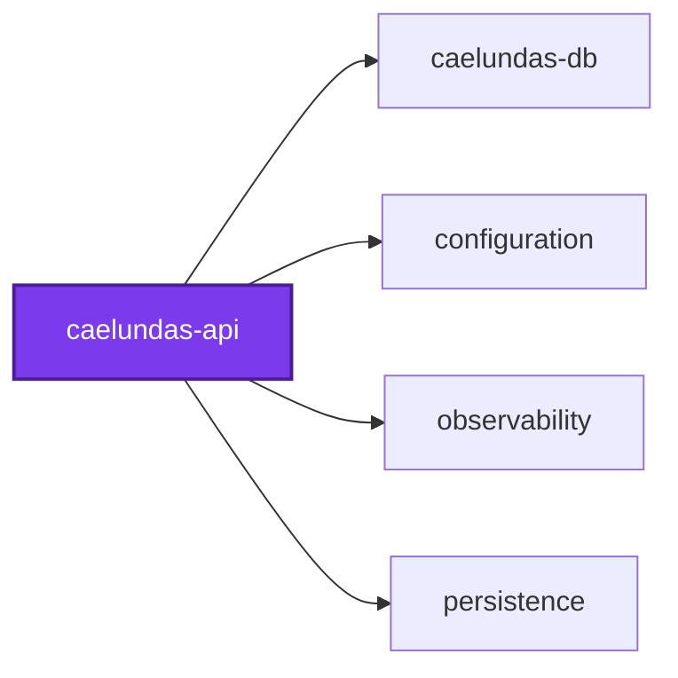
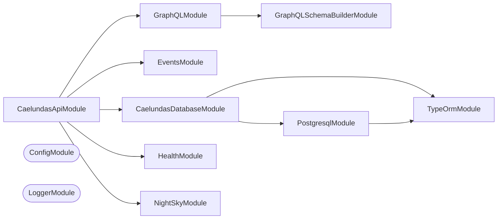

## 🕸️ Codependix

Dependency graphs exported by [codependix](https://github.com/Organizzolini/codebase/tree/main/projects/ic-suite/codependix/codependix-cli), regenerated by `nx run configuration:codependix:write`.

### Nx Neighborhood

<!-- codependix:start name="codependix-nx-projects" -->

<!-- codependix:end name="codependix-nx-projects" -->

### NestJS Module Graph

<!-- codependix:start name="codependix-nestjs-modules" -->


_Rounded modules are global: every module can inject them, so their edges are left out._
<!-- codependix:end name="codependix-nestjs-modules" -->

### File Imports

<!-- codependix:start name="codependix-file-imports" -->
```mermaid
graph LR
  file_callidescope_config_ts["callidescope.config.ts"]
  file_codependix_config_ts["codependix.config.ts"]
  file_codometer_config_ts["codometer.config.ts"]
  file_coinagerie_config_ts["coinagerie.config.ts"]
  file_eslint_config_ts["eslint.config.ts"]
  file_src_caelundas_api_graphql_end_to_end_test_ts["src/caelundas-api-graphql.end-to-end.test.ts"]
  file_src_caelundas_api_night_sky_end_to_end_test_ts["src/caelundas-api-night-sky.end-to-end.test.ts"]
  file_src_caelundas_api_constants_ts["src/caelundas-api.constants.ts"]
  file_src_caelundas_api_constants_unit_test_ts["src/caelundas-api.constants.unit.test.ts"]
  file_src_caelundas_api_end_to_end_test_ts["src/caelundas-api.end-to-end.test.ts"]
  file_src_caelundas_api_entities_ts["src/caelundas-api.entities.ts"]
  file_src_caelundas_api_module_ts["src/caelundas-api.module.ts"]
  file_src_caelundas_api_module_unit_test_ts["src/caelundas-api.module.unit.test.ts"]
  file_src_caelundas_api_ts["src/caelundas-api.ts"]
  file_src_caelundas_api_types_ts["src/caelundas-api.types.ts"]
  file_src_caelundas_api_unit_test_ts["src/caelundas-api.unit.test.ts"]
  file_src_caelundas_api_utilities_ts["src/caelundas-api.utilities.ts"]
  file_src_caelundas_api_utilities_unit_test_ts["src/caelundas-api.utilities.unit.test.ts"]
  file_src_modules_events_calendar_event_tag_entities_ts["src/modules/events/calendar-event-tag.entities.ts"]
  file_src_modules_events_calendar_event_entities_ts["src/modules/events/calendar-event.entities.ts"]
  file_src_modules_events_calendar_view_entities_ts["src/modules/events/calendar-view.entities.ts"]
  file_src_modules_events_calendar_windows_arguments_entities_ts["src/modules/events/calendar-windows-arguments.entities.ts"]
  file_src_modules_events_calendar_windows_constants_ts["src/modules/events/calendar-windows.constants.ts"]
  file_src_modules_events_calendar_windows_entities_ts["src/modules/events/calendar-windows.entities.ts"]
  file_src_modules_events_calendar_windows_types_ts["src/modules/events/calendar-windows.types.ts"]
  file_src_modules_events_calendar_windows_utilities_ts["src/modules/events/calendar-windows.utilities.ts"]
  file_src_modules_events_calendar_windows_utilities_unit_test_ts["src/modules/events/calendar-windows.utilities.unit.test.ts"]
  file_src_modules_events_event_facet_value_entities_ts["src/modules/events/event-facet-value.entities.ts"]
  file_src_modules_events_event_facet_entities_ts["src/modules/events/event-facet.entities.ts"]
  file_src_modules_events_event_filter_binder_utilities_ts["src/modules/events/event-filter-binder.utilities.ts"]
  file_src_modules_events_event_filter_collection_entities_ts["src/modules/events/event-filter-collection.entities.ts"]
  file_src_modules_events_event_filter_collections_constants_ts["src/modules/events/event-filter-collections.constants.ts"]
  file_src_modules_events_event_filter_collections_types_ts["src/modules/events/event-filter-collections.types.ts"]
  file_src_modules_events_event_filter_collections_utilities_ts["src/modules/events/event-filter-collections.utilities.ts"]
  file_src_modules_events_event_filter_collections_utilities_unit_test_ts["src/modules/events/event-filter-collections.utilities.unit.test.ts"]
  file_src_modules_events_event_filter_combinator_entities_ts["src/modules/events/event-filter-combinator.entities.ts"]
  file_src_modules_events_event_filter_compiler_utilities_ts["src/modules/events/event-filter-compiler.utilities.ts"]
  file_src_modules_events_event_filter_compiler_utilities_unit_test_ts["src/modules/events/event-filter-compiler.utilities.unit.test.ts"]
  file_src_modules_events_event_filter_derived_utilities_ts["src/modules/events/event-filter-derived.utilities.ts"]
  file_src_modules_events_event_filter_fields_constants_ts["src/modules/events/event-filter-fields.constants.ts"]
  file_src_modules_events_event_filter_numbers_utilities_ts["src/modules/events/event-filter-numbers.utilities.ts"]
  file_src_modules_events_event_filter_rule_entities_ts["src/modules/events/event-filter-rule.entities.ts"]
  file_src_modules_events_event_filter_sql_constants_ts["src/modules/events/event-filter-sql.constants.ts"]
  file_src_modules_events_event_filter_values_constants_ts["src/modules/events/event-filter-values.constants.ts"]
  file_src_modules_events_event_filter_values_utilities_ts["src/modules/events/event-filter-values.utilities.ts"]
  file_src_modules_events_event_filter_constants_ts["src/modules/events/event-filter.constants.ts"]
  file_src_modules_events_event_filter_entities_ts["src/modules/events/event-filter.entities.ts"]
  file_src_modules_events_event_filter_types_ts["src/modules/events/event-filter.types.ts"]
  file_src_modules_events_event_filter_utilities_ts["src/modules/events/event-filter.utilities.ts"]
  file_src_modules_events_event_filter_utilities_unit_test_ts["src/modules/events/event-filter.utilities.unit.test.ts"]
  file_src_modules_events_event_group_key_entities_ts["src/modules/events/event-group-key.entities.ts"]
  file_src_modules_events_event_group_level_entities_ts["src/modules/events/event-group-level.entities.ts"]
  file_src_modules_events_event_grouping_compiler_utilities_ts["src/modules/events/event-grouping-compiler.utilities.ts"]
  file_src_modules_events_event_grouping_compiler_utilities_unit_test_ts["src/modules/events/event-grouping-compiler.utilities.unit.test.ts"]
  file_src_modules_events_event_grouping_constants_ts["src/modules/events/event-grouping.constants.ts"]
  file_src_modules_events_event_grouping_entities_ts["src/modules/events/event-grouping.entities.ts"]
  file_src_modules_events_event_grouping_types_ts["src/modules/events/event-grouping.types.ts"]
  file_src_modules_events_event_grouping_utilities_ts["src/modules/events/event-grouping.utilities.ts"]
  file_src_modules_events_event_grouping_utilities_unit_test_ts["src/modules/events/event-grouping.utilities.unit.test.ts"]
  file_src_modules_events_events_calendar_windows_resolver_end_to_end_test_ts["src/modules/events/events-calendar-windows.resolver.end-to-end.test.ts"]
  file_src_modules_events_events_filter_resolver_end_to_end_test_ts["src/modules/events/events-filter.resolver.end-to-end.test.ts"]
  file_src_modules_events_events_grouping_resolver_end_to_end_test_ts["src/modules/events/events-grouping.resolver.end-to-end.test.ts"]
  file_src_modules_events_events_window_input_entities_ts["src/modules/events/events-window-input.entities.ts"]
  file_src_modules_events_events_constants_ts["src/modules/events/events.constants.ts"]
  file_src_modules_events_events_entities_ts["src/modules/events/events.entities.ts"]
  file_src_modules_events_events_module_ts["src/modules/events/events.module.ts"]
  file_src_modules_events_events_resolver_end_to_end_test_ts["src/modules/events/events.resolver.end-to-end.test.ts"]
  file_src_modules_events_events_resolver_ts["src/modules/events/events.resolver.ts"]
  file_src_modules_events_events_resolver_unit_test_ts["src/modules/events/events.resolver.unit.test.ts"]
  file_src_modules_events_events_service_ts["src/modules/events/events.service.ts"]
  file_src_modules_events_events_service_unit_test_ts["src/modules/events/events.service.unit.test.ts"]
  file_src_modules_events_events_types_ts["src/modules/events/events.types.ts"]
  file_src_modules_events_events_utilities_ts["src/modules/events/events.utilities.ts"]
  file_src_modules_events_events_utilities_unit_test_ts["src/modules/events/events.utilities.unit.test.ts"]
  file_src_modules_events_time_window_entities_ts["src/modules/events/time-window.entities.ts"]
  file_src_modules_events_timeline_scale_entities_ts["src/modules/events/timeline-scale.entities.ts"]
  file_src_modules_health_health_constants_ts["src/modules/health/health.constants.ts"]
  file_src_modules_health_health_module_ts["src/modules/health/health.module.ts"]
  file_src_modules_health_health_module_unit_test_ts["src/modules/health/health.module.unit.test.ts"]
  file_src_modules_health_health_resolver_ts["src/modules/health/health.resolver.ts"]
  file_src_modules_health_health_resolver_unit_test_ts["src/modules/health/health.resolver.unit.test.ts"]
  file_src_modules_health_health_service_ts["src/modules/health/health.service.ts"]
  file_src_modules_health_health_service_unit_test_ts["src/modules/health/health.service.unit.test.ts"]
  file_src_modules_health_health_types_ts["src/modules/health/health.types.ts"]
  file_src_modules_night_sky_night_sky_colors_utilities_ts["src/modules/night-sky/night-sky-colors.utilities.ts"]
  file_src_modules_night_sky_night_sky_ecliptic_utilities_ts["src/modules/night-sky/night-sky-ecliptic.utilities.ts"]
  file_src_modules_night_sky_night_sky_ecliptic_utilities_unit_test_ts["src/modules/night-sky/night-sky-ecliptic.utilities.unit.test.ts"]
  file_src_modules_night_sky_night_sky_input_entities_ts["src/modules/night-sky/night-sky-input.entities.ts"]
  file_src_modules_night_sky_night_sky_input_utilities_ts["src/modules/night-sky/night-sky-input.utilities.ts"]
  file_src_modules_night_sky_night_sky_input_utilities_unit_test_ts["src/modules/night-sky/night-sky-input.utilities.unit.test.ts"]
  file_src_modules_night_sky_night_sky_lines_utilities_ts["src/modules/night-sky/night-sky-lines.utilities.ts"]
  file_src_modules_night_sky_night_sky_lines_utilities_unit_test_ts["src/modules/night-sky/night-sky-lines.utilities.unit.test.ts"]
  file_src_modules_night_sky_night_sky_measurements_entities_ts["src/modules/night-sky/night-sky-measurements.entities.ts"]
  file_src_modules_night_sky_night_sky_options_utilities_ts["src/modules/night-sky/night-sky-options.utilities.ts"]
  file_src_modules_night_sky_night_sky_options_utilities_unit_test_ts["src/modules/night-sky/night-sky-options.utilities.unit.test.ts"]
  file_src_modules_night_sky_night_sky_projection_utilities_ts["src/modules/night-sky/night-sky-projection.utilities.ts"]
  file_src_modules_night_sky_night_sky_constants_ts["src/modules/night-sky/night-sky.constants.ts"]
  file_src_modules_night_sky_night_sky_entities_ts["src/modules/night-sky/night-sky.entities.ts"]
  file_src_modules_night_sky_night_sky_module_ts["src/modules/night-sky/night-sky.module.ts"]
  file_src_modules_night_sky_night_sky_resolver_ts["src/modules/night-sky/night-sky.resolver.ts"]
  file_src_modules_night_sky_night_sky_resolver_unit_test_ts["src/modules/night-sky/night-sky.resolver.unit.test.ts"]
  file_src_modules_night_sky_night_sky_service_ts["src/modules/night-sky/night-sky.service.ts"]
  file_src_modules_night_sky_night_sky_service_unit_test_ts["src/modules/night-sky/night-sky.service.unit.test.ts"]
  file_src_modules_night_sky_night_sky_types_ts["src/modules/night-sky/night-sky.types.ts"]
  file_src_modules_night_sky_night_sky_utilities_ts["src/modules/night-sky/night-sky.utilities.ts"]
  file_src_modules_night_sky_night_sky_utilities_unit_test_ts["src/modules/night-sky/night-sky.utilities.unit.test.ts"]
  file_testing_events_application_ts["testing/events-application.ts"]
  file_testing_mocks_ts["testing/mocks.ts"]
  file_testing_no_database_constants_ts["testing/no-database.constants.ts"]
  file_testing_no_database_module_ts["testing/no-database.module.ts"]
  file_testing_setup_ts["testing/setup.ts"]
  file_vitest_config_ts["vitest.config.ts"]
  file_src_caelundas_api_graphql_end_to_end_test_ts --> file_src_caelundas_api_utilities_ts
  file_src_caelundas_api_graphql_end_to_end_test_ts --> file_src_modules_health_health_module_ts
  file_src_caelundas_api_night_sky_end_to_end_test_ts --> file_src_caelundas_api_module_ts
  file_src_caelundas_api_night_sky_end_to_end_test_ts --> file_testing_no_database_module_ts
  file_src_caelundas_api_end_to_end_test_ts --> file_src_caelundas_api_constants_ts
  file_src_caelundas_api_module_ts --> file_src_caelundas_api_constants_ts
  file_src_caelundas_api_module_ts --> file_src_modules_events_events_module_ts
  file_src_caelundas_api_module_ts --> file_src_modules_health_health_module_ts
  file_src_caelundas_api_module_ts --> file_src_modules_night_sky_night_sky_module_ts
  file_src_caelundas_api_module_unit_test_ts --> file_src_caelundas_api_module_ts
  file_src_caelundas_api_module_unit_test_ts --> file_src_modules_events_events_module_ts
  file_src_caelundas_api_ts --> file_src_caelundas_api_constants_ts
  file_src_caelundas_api_ts --> file_src_caelundas_api_module_ts
  file_src_caelundas_api_ts --> file_src_caelundas_api_utilities_ts
  file_src_caelundas_api_types_ts --> file_src_caelundas_api_entities_ts
  file_src_caelundas_api_utilities_ts --> file_src_caelundas_api_entities_ts
  file_src_caelundas_api_utilities_ts --> file_src_caelundas_api_types_ts
  file_src_caelundas_api_utilities_unit_test_ts --> file_src_caelundas_api_entities_ts
  file_src_caelundas_api_utilities_unit_test_ts --> file_src_caelundas_api_types_ts
  file_src_caelundas_api_utilities_unit_test_ts --> file_src_caelundas_api_utilities_ts
  file_src_modules_events_calendar_event_entities_ts --> file_src_modules_events_calendar_event_tag_entities_ts
  file_src_modules_events_calendar_event_entities_ts --> file_src_modules_events_event_group_key_entities_ts
  file_src_modules_events_calendar_windows_arguments_entities_ts --> file_src_modules_events_calendar_view_entities_ts
  file_src_modules_events_calendar_windows_arguments_entities_ts --> file_src_modules_events_timeline_scale_entities_ts
  file_src_modules_events_calendar_windows_constants_ts --> file_src_modules_events_timeline_scale_entities_ts
  file_src_modules_events_calendar_windows_entities_ts --> file_src_modules_events_time_window_entities_ts
  file_src_modules_events_calendar_windows_types_ts --> file_src_modules_events_timeline_scale_entities_ts
  file_src_modules_events_calendar_windows_utilities_ts --> file_src_modules_events_calendar_view_entities_ts
  file_src_modules_events_calendar_windows_utilities_ts --> file_src_modules_events_calendar_windows_constants_ts
  file_src_modules_events_calendar_windows_utilities_ts --> file_src_modules_events_calendar_windows_types_ts
  file_src_modules_events_calendar_windows_utilities_ts --> file_src_modules_events_timeline_scale_entities_ts
  file_src_modules_events_calendar_windows_utilities_unit_test_ts --> file_src_modules_events_calendar_view_entities_ts
  file_src_modules_events_calendar_windows_utilities_unit_test_ts --> file_src_modules_events_calendar_windows_types_ts
  file_src_modules_events_calendar_windows_utilities_unit_test_ts --> file_src_modules_events_calendar_windows_utilities_ts
  file_src_modules_events_calendar_windows_utilities_unit_test_ts --> file_src_modules_events_timeline_scale_entities_ts
  file_src_modules_events_event_facet_entities_ts --> file_src_modules_events_event_facet_value_entities_ts
  file_src_modules_events_event_filter_binder_utilities_ts --> file_src_modules_events_event_filter_sql_constants_ts
  file_src_modules_events_event_filter_binder_utilities_ts --> file_src_modules_events_event_filter_types_ts
  file_src_modules_events_event_filter_collection_entities_ts --> file_src_modules_events_event_filter_entities_ts
  file_src_modules_events_event_filter_collections_constants_ts --> file_src_modules_events_event_filter_collections_types_ts
  file_src_modules_events_event_filter_collections_constants_ts --> file_src_modules_events_event_filter_combinator_entities_ts
  file_src_modules_events_event_filter_collections_constants_ts --> file_src_modules_events_event_filter_fields_constants_ts
  file_src_modules_events_event_filter_collections_types_ts --> file_src_modules_events_event_facet_entities_ts
  file_src_modules_events_event_filter_collections_types_ts --> file_src_modules_events_event_filter_combinator_entities_ts
  file_src_modules_events_event_filter_collections_types_ts --> file_src_modules_events_event_filter_fields_constants_ts
  file_src_modules_events_event_filter_collections_types_ts --> file_src_modules_events_event_filter_entities_ts
  file_src_modules_events_event_filter_collections_utilities_ts --> file_src_modules_events_event_facet_entities_ts
  file_src_modules_events_event_filter_collections_utilities_ts --> file_src_modules_events_event_filter_collections_constants_ts
  file_src_modules_events_event_filter_collections_utilities_ts --> file_src_modules_events_event_filter_collections_types_ts
  file_src_modules_events_event_filter_collections_utilities_ts --> file_src_modules_events_event_filter_combinator_entities_ts
  file_src_modules_events_event_filter_collections_utilities_ts --> file_src_modules_events_event_filter_fields_constants_ts
  file_src_modules_events_event_filter_collections_utilities_ts --> file_src_modules_events_event_filter_rule_entities_ts
  file_src_modules_events_event_filter_collections_utilities_ts --> file_src_modules_events_event_filter_entities_ts
  file_src_modules_events_event_filter_collections_utilities_unit_test_ts --> file_src_modules_events_event_facet_entities_ts
  file_src_modules_events_event_filter_collections_utilities_unit_test_ts --> file_src_modules_events_event_filter_collections_constants_ts
  file_src_modules_events_event_filter_collections_utilities_unit_test_ts --> file_src_modules_events_event_filter_collections_utilities_ts
  file_src_modules_events_event_filter_compiler_utilities_ts --> file_src_modules_events_event_filter_binder_utilities_ts
  file_src_modules_events_event_filter_compiler_utilities_ts --> file_src_modules_events_event_filter_derived_utilities_ts
  file_src_modules_events_event_filter_compiler_utilities_ts --> file_src_modules_events_event_filter_fields_constants_ts
  file_src_modules_events_event_filter_compiler_utilities_ts --> file_src_modules_events_event_filter_numbers_utilities_ts
  file_src_modules_events_event_filter_compiler_utilities_ts --> file_src_modules_events_event_filter_sql_constants_ts
  file_src_modules_events_event_filter_compiler_utilities_ts --> file_src_modules_events_event_filter_values_constants_ts
  file_src_modules_events_event_filter_compiler_utilities_ts --> file_src_modules_events_event_filter_values_utilities_ts
  file_src_modules_events_event_filter_compiler_utilities_ts --> file_src_modules_events_event_filter_types_ts
  file_src_modules_events_event_filter_compiler_utilities_unit_test_ts --> file_src_modules_events_event_filter_compiler_utilities_ts
  file_src_modules_events_event_filter_compiler_utilities_unit_test_ts --> file_src_modules_events_event_filter_types_ts
  file_src_modules_events_event_filter_derived_utilities_ts --> file_src_modules_events_event_filter_binder_utilities_ts
  file_src_modules_events_event_filter_derived_utilities_ts --> file_src_modules_events_event_filter_fields_constants_ts
  file_src_modules_events_event_filter_derived_utilities_ts --> file_src_modules_events_event_filter_sql_constants_ts
  file_src_modules_events_event_filter_derived_utilities_ts --> file_src_modules_events_event_filter_values_utilities_ts
  file_src_modules_events_event_filter_derived_utilities_ts --> file_src_modules_events_event_filter_types_ts
  file_src_modules_events_event_filter_numbers_utilities_ts --> file_src_modules_events_event_filter_binder_utilities_ts
  file_src_modules_events_event_filter_numbers_utilities_ts --> file_src_modules_events_event_filter_fields_constants_ts
  file_src_modules_events_event_filter_numbers_utilities_ts --> file_src_modules_events_event_filter_sql_constants_ts
  file_src_modules_events_event_filter_numbers_utilities_ts --> file_src_modules_events_event_filter_values_utilities_ts
  file_src_modules_events_event_filter_numbers_utilities_ts --> file_src_modules_events_event_filter_types_ts
  file_src_modules_events_event_filter_values_utilities_ts --> file_src_modules_events_event_filter_values_constants_ts
  file_src_modules_events_event_filter_constants_ts --> file_src_modules_events_event_filter_types_ts
  file_src_modules_events_event_filter_entities_ts --> file_src_modules_events_event_filter_combinator_entities_ts
  file_src_modules_events_event_filter_entities_ts --> file_src_modules_events_event_filter_rule_entities_ts
  file_src_modules_events_event_filter_utilities_ts --> file_src_modules_events_event_filter_constants_ts
  file_src_modules_events_event_filter_utilities_ts --> file_src_modules_events_event_filter_types_ts
  file_src_modules_events_event_filter_utilities_unit_test_ts --> file_src_modules_events_event_filter_utilities_ts
  file_src_modules_events_event_grouping_compiler_utilities_ts --> file_src_modules_events_event_filter_binder_utilities_ts
  file_src_modules_events_event_grouping_compiler_utilities_ts --> file_src_modules_events_event_filter_fields_constants_ts
  file_src_modules_events_event_grouping_compiler_utilities_ts --> file_src_modules_events_event_filter_values_constants_ts
  file_src_modules_events_event_grouping_compiler_utilities_ts --> file_src_modules_events_event_filter_types_ts
  file_src_modules_events_event_grouping_compiler_utilities_ts --> file_src_modules_events_event_grouping_constants_ts
  file_src_modules_events_event_grouping_compiler_utilities_ts --> file_src_modules_events_event_grouping_types_ts
  file_src_modules_events_event_grouping_compiler_utilities_unit_test_ts --> file_src_modules_events_event_grouping_compiler_utilities_ts
  file_src_modules_events_event_grouping_compiler_utilities_unit_test_ts --> file_src_modules_events_event_grouping_types_ts
  file_src_modules_events_event_grouping_constants_ts --> file_src_modules_events_event_filter_fields_constants_ts
  file_src_modules_events_event_grouping_constants_ts --> file_src_modules_events_event_grouping_types_ts
  file_src_modules_events_event_grouping_entities_ts --> file_src_modules_events_event_group_level_entities_ts
  file_src_modules_events_event_grouping_utilities_ts --> file_src_modules_events_event_grouping_constants_ts
  file_src_modules_events_event_grouping_utilities_ts --> file_src_modules_events_event_grouping_types_ts
  file_src_modules_events_event_grouping_utilities_unit_test_ts --> file_src_modules_events_event_grouping_utilities_ts
  file_src_modules_events_events_calendar_windows_resolver_end_to_end_test_ts --> file_testing_events_application_ts
  file_src_modules_events_events_filter_resolver_end_to_end_test_ts --> file_testing_events_application_ts
  file_src_modules_events_events_grouping_resolver_end_to_end_test_ts --> file_testing_events_application_ts
  file_src_modules_events_events_module_ts --> file_src_modules_events_events_resolver_ts
  file_src_modules_events_events_module_ts --> file_src_modules_events_events_service_ts
  file_src_modules_events_events_resolver_end_to_end_test_ts --> file_testing_events_application_ts
  file_src_modules_events_events_resolver_ts --> file_src_modules_events_calendar_event_entities_ts
  file_src_modules_events_events_resolver_ts --> file_src_modules_events_calendar_windows_arguments_entities_ts
  file_src_modules_events_events_resolver_ts --> file_src_modules_events_calendar_windows_entities_ts
  file_src_modules_events_events_resolver_ts --> file_src_modules_events_event_facet_entities_ts
  file_src_modules_events_events_resolver_ts --> file_src_modules_events_event_filter_collection_entities_ts
  file_src_modules_events_events_resolver_ts --> file_src_modules_events_event_filter_collections_constants_ts
  file_src_modules_events_events_resolver_ts --> file_src_modules_events_event_filter_entities_ts
  file_src_modules_events_events_resolver_ts --> file_src_modules_events_event_filter_utilities_ts
  file_src_modules_events_events_resolver_ts --> file_src_modules_events_event_grouping_entities_ts
  file_src_modules_events_events_resolver_ts --> file_src_modules_events_event_grouping_utilities_ts
  file_src_modules_events_events_resolver_ts --> file_src_modules_events_events_window_input_entities_ts
  file_src_modules_events_events_resolver_ts --> file_src_modules_events_events_constants_ts
  file_src_modules_events_events_resolver_ts --> file_src_modules_events_events_entities_ts
  file_src_modules_events_events_resolver_ts --> file_src_modules_events_events_service_ts
  file_src_modules_events_events_resolver_unit_test_ts --> file_src_modules_events_calendar_event_entities_ts
  file_src_modules_events_events_resolver_unit_test_ts --> file_src_modules_events_calendar_view_entities_ts
  file_src_modules_events_events_resolver_unit_test_ts --> file_src_modules_events_event_facet_entities_ts
  file_src_modules_events_events_resolver_unit_test_ts --> file_src_modules_events_event_filter_collections_types_ts
  file_src_modules_events_events_resolver_unit_test_ts --> file_src_modules_events_event_filter_combinator_entities_ts
  file_src_modules_events_events_resolver_unit_test_ts --> file_src_modules_events_events_entities_ts
  file_src_modules_events_events_resolver_unit_test_ts --> file_src_modules_events_events_resolver_ts
  file_src_modules_events_events_resolver_unit_test_ts --> file_src_modules_events_events_service_ts
  file_src_modules_events_events_service_ts --> file_src_modules_events_calendar_event_entities_ts
  file_src_modules_events_events_service_ts --> file_src_modules_events_calendar_windows_arguments_entities_ts
  file_src_modules_events_events_service_ts --> file_src_modules_events_calendar_windows_types_ts
  file_src_modules_events_events_service_ts --> file_src_modules_events_calendar_windows_utilities_ts
  file_src_modules_events_events_service_ts --> file_src_modules_events_event_facet_entities_ts
  file_src_modules_events_events_service_ts --> file_src_modules_events_event_filter_collections_types_ts
  file_src_modules_events_events_service_ts --> file_src_modules_events_event_filter_collections_utilities_ts
  file_src_modules_events_events_service_ts --> file_src_modules_events_event_filter_compiler_utilities_ts
  file_src_modules_events_events_service_ts --> file_src_modules_events_event_filter_types_ts
  file_src_modules_events_events_service_ts --> file_src_modules_events_event_grouping_compiler_utilities_ts
  file_src_modules_events_events_service_ts --> file_src_modules_events_event_grouping_types_ts
  file_src_modules_events_events_service_ts --> file_src_modules_events_events_window_input_entities_ts
  file_src_modules_events_events_service_ts --> file_src_modules_events_events_constants_ts
  file_src_modules_events_events_service_ts --> file_src_modules_events_events_entities_ts
  file_src_modules_events_events_service_ts --> file_src_modules_events_events_utilities_ts
  file_src_modules_events_events_service_unit_test_ts --> file_src_modules_events_calendar_view_entities_ts
  file_src_modules_events_events_service_unit_test_ts --> file_src_modules_events_events_service_ts
  file_src_modules_events_events_service_unit_test_ts --> file_src_modules_events_timeline_scale_entities_ts
  file_src_modules_events_events_utilities_unit_test_ts --> file_src_modules_events_events_utilities_ts
  file_src_modules_health_health_module_ts --> file_src_modules_health_health_resolver_ts
  file_src_modules_health_health_module_ts --> file_src_modules_health_health_service_ts
  file_src_modules_health_health_module_unit_test_ts --> file_src_modules_health_health_module_ts
  file_src_modules_health_health_resolver_ts --> file_src_modules_health_health_service_ts
  file_src_modules_health_health_resolver_unit_test_ts --> file_src_modules_health_health_resolver_ts
  file_src_modules_health_health_resolver_unit_test_ts --> file_src_modules_health_health_service_ts
  file_src_modules_health_health_service_unit_test_ts --> file_src_modules_health_health_service_ts
  file_src_modules_night_sky_night_sky_colors_utilities_ts --> file_src_modules_night_sky_night_sky_constants_ts
  file_src_modules_night_sky_night_sky_ecliptic_utilities_ts --> file_src_modules_night_sky_night_sky_colors_utilities_ts
  file_src_modules_night_sky_night_sky_ecliptic_utilities_ts --> file_src_modules_night_sky_night_sky_projection_utilities_ts
  file_src_modules_night_sky_night_sky_ecliptic_utilities_ts --> file_src_modules_night_sky_night_sky_constants_ts
  file_src_modules_night_sky_night_sky_ecliptic_utilities_ts --> file_src_modules_night_sky_night_sky_types_ts
  file_src_modules_night_sky_night_sky_ecliptic_utilities_unit_test_ts --> file_src_modules_night_sky_night_sky_ecliptic_utilities_ts
  file_src_modules_night_sky_night_sky_ecliptic_utilities_unit_test_ts --> file_src_modules_night_sky_night_sky_types_ts
  file_src_modules_night_sky_night_sky_input_utilities_ts --> file_src_modules_night_sky_night_sky_colors_utilities_ts
  file_src_modules_night_sky_night_sky_input_utilities_ts --> file_src_modules_night_sky_night_sky_constants_ts
  file_src_modules_night_sky_night_sky_input_utilities_ts --> file_src_modules_night_sky_night_sky_types_ts
  file_src_modules_night_sky_night_sky_input_utilities_unit_test_ts --> file_src_modules_night_sky_night_sky_input_utilities_ts
  file_src_modules_night_sky_night_sky_input_utilities_unit_test_ts --> file_src_modules_night_sky_night_sky_types_ts
  file_src_modules_night_sky_night_sky_lines_utilities_ts --> file_src_modules_night_sky_night_sky_colors_utilities_ts
  file_src_modules_night_sky_night_sky_lines_utilities_ts --> file_src_modules_night_sky_night_sky_projection_utilities_ts
  file_src_modules_night_sky_night_sky_lines_utilities_ts --> file_src_modules_night_sky_night_sky_constants_ts
  file_src_modules_night_sky_night_sky_lines_utilities_ts --> file_src_modules_night_sky_night_sky_types_ts
  file_src_modules_night_sky_night_sky_lines_utilities_unit_test_ts --> file_src_modules_night_sky_night_sky_lines_utilities_ts
  file_src_modules_night_sky_night_sky_lines_utilities_unit_test_ts --> file_src_modules_night_sky_night_sky_projection_utilities_ts
  file_src_modules_night_sky_night_sky_lines_utilities_unit_test_ts --> file_src_modules_night_sky_night_sky_types_ts
  file_src_modules_night_sky_night_sky_options_utilities_ts --> file_src_modules_night_sky_night_sky_constants_ts
  file_src_modules_night_sky_night_sky_options_utilities_ts --> file_src_modules_night_sky_night_sky_types_ts
  file_src_modules_night_sky_night_sky_options_utilities_unit_test_ts --> file_src_modules_night_sky_night_sky_options_utilities_ts
  file_src_modules_night_sky_night_sky_options_utilities_unit_test_ts --> file_src_modules_night_sky_night_sky_constants_ts
  file_src_modules_night_sky_night_sky_projection_utilities_ts --> file_src_modules_night_sky_night_sky_constants_ts
  file_src_modules_night_sky_night_sky_projection_utilities_ts --> file_src_modules_night_sky_night_sky_types_ts
  file_src_modules_night_sky_night_sky_constants_ts --> file_src_modules_night_sky_night_sky_types_ts
  file_src_modules_night_sky_night_sky_entities_ts --> file_src_modules_night_sky_night_sky_measurements_entities_ts
  file_src_modules_night_sky_night_sky_module_ts --> file_src_modules_night_sky_night_sky_resolver_ts
  file_src_modules_night_sky_night_sky_module_ts --> file_src_modules_night_sky_night_sky_service_ts
  file_src_modules_night_sky_night_sky_resolver_ts --> file_src_modules_night_sky_night_sky_input_entities_ts
  file_src_modules_night_sky_night_sky_resolver_ts --> file_src_modules_night_sky_night_sky_entities_ts
  file_src_modules_night_sky_night_sky_resolver_ts --> file_src_modules_night_sky_night_sky_service_ts
  file_src_modules_night_sky_night_sky_resolver_unit_test_ts --> file_src_modules_night_sky_night_sky_resolver_ts
  file_src_modules_night_sky_night_sky_resolver_unit_test_ts --> file_src_modules_night_sky_night_sky_service_ts
  file_src_modules_night_sky_night_sky_service_ts --> file_src_modules_night_sky_night_sky_input_entities_ts
  file_src_modules_night_sky_night_sky_service_ts --> file_src_modules_night_sky_night_sky_input_utilities_ts
  file_src_modules_night_sky_night_sky_service_ts --> file_src_modules_night_sky_night_sky_constants_ts
  file_src_modules_night_sky_night_sky_service_ts --> file_src_modules_night_sky_night_sky_types_ts
  file_src_modules_night_sky_night_sky_service_ts --> file_src_modules_night_sky_night_sky_utilities_ts
  file_src_modules_night_sky_night_sky_service_unit_test_ts --> file_src_modules_night_sky_night_sky_constants_ts
  file_src_modules_night_sky_night_sky_service_unit_test_ts --> file_src_modules_night_sky_night_sky_service_ts
  file_src_modules_night_sky_night_sky_utilities_ts --> file_src_modules_night_sky_night_sky_colors_utilities_ts
  file_src_modules_night_sky_night_sky_utilities_ts --> file_src_modules_night_sky_night_sky_ecliptic_utilities_ts
  file_src_modules_night_sky_night_sky_utilities_ts --> file_src_modules_night_sky_night_sky_lines_utilities_ts
  file_src_modules_night_sky_night_sky_utilities_ts --> file_src_modules_night_sky_night_sky_options_utilities_ts
  file_src_modules_night_sky_night_sky_utilities_ts --> file_src_modules_night_sky_night_sky_projection_utilities_ts
  file_src_modules_night_sky_night_sky_utilities_ts --> file_src_modules_night_sky_night_sky_constants_ts
  file_src_modules_night_sky_night_sky_utilities_ts --> file_src_modules_night_sky_night_sky_types_ts
  file_src_modules_night_sky_night_sky_utilities_unit_test_ts --> file_src_modules_night_sky_night_sky_types_ts
  file_src_modules_night_sky_night_sky_utilities_unit_test_ts --> file_src_modules_night_sky_night_sky_utilities_ts
  file_testing_events_application_ts --> file_src_caelundas_api_constants_ts
  file_testing_events_application_ts --> file_src_modules_events_events_module_ts
  file_testing_no_database_module_ts --> file_testing_no_database_constants_ts
```
<!-- codependix:end name="codependix-file-imports" -->
