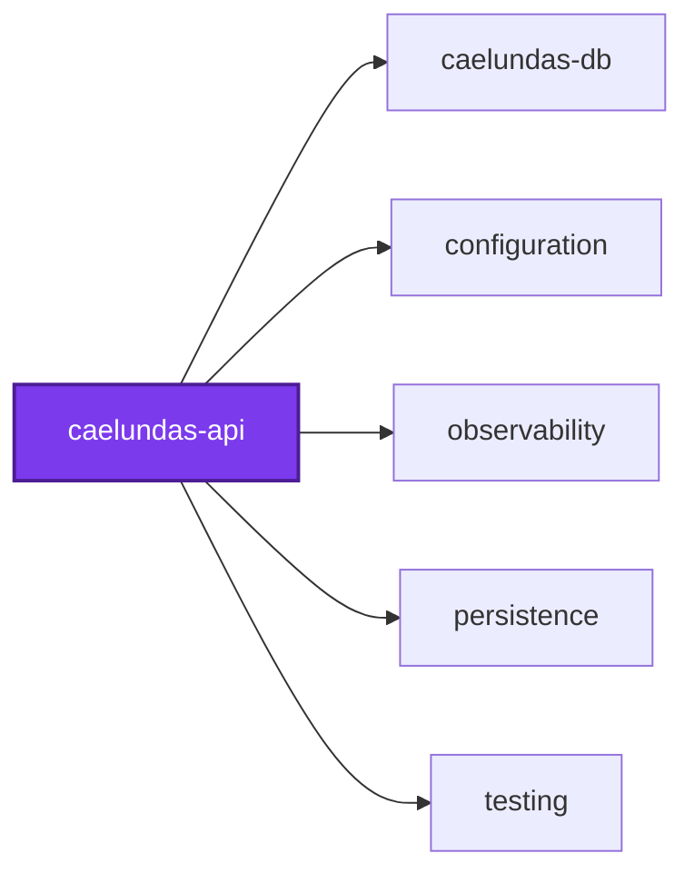
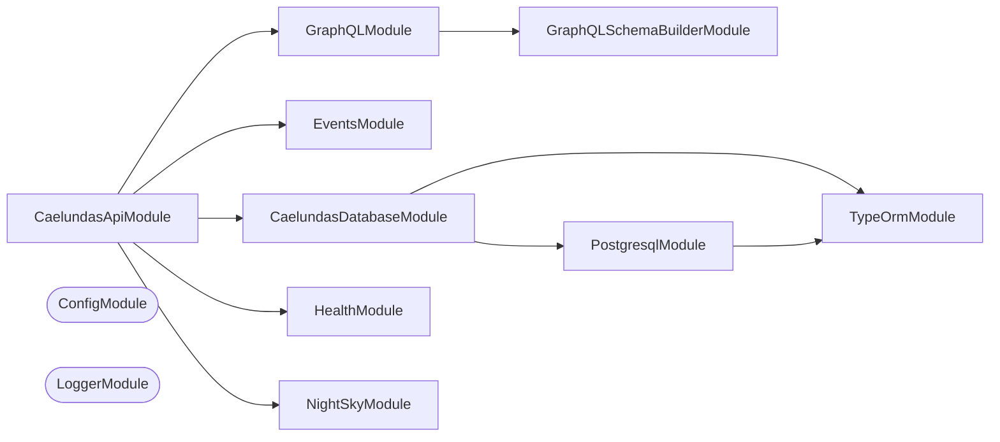

## 🕸️ Codependix

Dependency graphs exported by [codependix](https://github.com/Organizzolini/codebase/tree/main/projects/ic-suite/codependix/codependix-cli), regenerated by `nx run configuration:codependix:write`.

### Nx Neighborhood

<!-- codependix:start name="codependix-nx-projects" -->

<!-- codependix:end name="codependix-nx-projects" -->

### NestJS Module Graph

<!-- codependix:start name="codependix-nestjs-modules" -->


_Rounded modules are global: every module can inject them, so their edges are left out._
<!-- codependix:end name="codependix-nestjs-modules" -->

### File Imports

<!-- codependix:start name="codependix-file-imports" -->
```mermaid
graph LR
  file_configuration_callidescope_config_ts["configuration/callidescope.config.ts"]
  file_configuration_codependix_config_ts["configuration/codependix.config.ts"]
  file_configuration_codometer_config_ts["configuration/codometer.config.ts"]
  file_configuration_coinagerie_config_ts["configuration/coinagerie.config.ts"]
  file_configuration_eslint_config_ts["configuration/eslint.config.ts"]
  file_configuration_vitest_config_ts["configuration/vitest.config.ts"]
  file_src_caelundas_api_graphql_end_to_end_test_ts["src/caelundas-api-graphql.end-to-end.test.ts"]
  file_src_caelundas_api_night_sky_end_to_end_test_ts["src/caelundas-api-night-sky.end-to-end.test.ts"]
  file_src_caelundas_api_constants_ts["src/caelundas-api.constants.ts"]
  file_src_caelundas_api_constants_unit_test_ts["src/caelundas-api.constants.unit.test.ts"]
  file_src_caelundas_api_end_to_end_test_ts["src/caelundas-api.end-to-end.test.ts"]
  file_src_caelundas_api_module_ts["src/caelundas-api.module.ts"]
  file_src_caelundas_api_module_unit_test_ts["src/caelundas-api.module.unit.test.ts"]
  file_src_caelundas_api_ts["src/caelundas-api.ts"]
  file_src_caelundas_api_unit_test_ts["src/caelundas-api.unit.test.ts"]
  file_src_cors_service_ts["src/cors.service.ts"]
  file_src_cors_service_unit_test_ts["src/cors.service.unit.test.ts"]
  file_src_modules_events_events_constants_ts["src/modules/events/events.constants.ts"]
  file_src_modules_events_events_entities_ts["src/modules/events/events.entities.ts"]
  file_src_modules_events_events_module_ts["src/modules/events/events.module.ts"]
  file_src_modules_events_events_module_unit_test_ts["src/modules/events/events.module.unit.test.ts"]
  file_src_modules_events_events_resolver_end_to_end_test_ts["src/modules/events/events.resolver.end-to-end.test.ts"]
  file_src_modules_events_events_resolver_ts["src/modules/events/events.resolver.ts"]
  file_src_modules_events_events_resolver_unit_test_ts["src/modules/events/events.resolver.unit.test.ts"]
  file_src_modules_events_events_service_ts["src/modules/events/events.service.ts"]
  file_src_modules_events_events_service_unit_test_ts["src/modules/events/events.service.unit.test.ts"]
  file_src_modules_events_events_types_ts["src/modules/events/events.types.ts"]
  file_src_modules_events_modules_calendar_event_calendar_event_tag_entities_ts["src/modules/events/modules/calendar-event/calendar-event-tag.entities.ts"]
  file_src_modules_events_modules_calendar_event_calendar_event_entities_ts["src/modules/events/modules/calendar-event/calendar-event.entities.ts"]
  file_src_modules_events_modules_facets_event_facet_value_entities_ts["src/modules/events/modules/facets/event-facet-value.entities.ts"]
  file_src_modules_events_modules_facets_event_facet_entities_ts["src/modules/events/modules/facets/event-facet.entities.ts"]
  file_src_modules_events_modules_filtering_event_filter_constants_ts["src/modules/events/modules/filtering/event-filter.constants.ts"]
  file_src_modules_events_modules_filtering_event_filter_service_ts["src/modules/events/modules/filtering/event-filter.service.ts"]
  file_src_modules_events_modules_filtering_event_filter_service_unit_test_ts["src/modules/events/modules/filtering/event-filter.service.unit.test.ts"]
  file_src_modules_events_modules_filtering_event_filter_types_ts["src/modules/events/modules/filtering/event-filter.types.ts"]
  file_src_modules_events_modules_filtering_events_filter_resolver_end_to_end_test_ts["src/modules/events/modules/filtering/events-filter.resolver.end-to-end.test.ts"]
  file_src_modules_events_modules_filtering_modules_query_building_event_filter_calendar_fields_service_ts["src/modules/events/modules/filtering/modules/query-building/event-filter-calendar-fields.service.ts"]
  file_src_modules_events_modules_filtering_modules_query_building_event_filter_fields_constants_ts["src/modules/events/modules/filtering/modules/query-building/event-filter-fields.constants.ts"]
  file_src_modules_events_modules_filtering_modules_query_building_event_filter_parameters_service_ts["src/modules/events/modules/filtering/modules/query-building/event-filter-parameters.service.ts"]
  file_src_modules_events_modules_filtering_modules_query_building_event_filter_sql_constants_ts["src/modules/events/modules/filtering/modules/query-building/event-filter-sql.constants.ts"]
  file_src_modules_events_modules_filtering_modules_rules_event_filter_combinator_entities_ts["src/modules/events/modules/filtering/modules/rules/event-filter-combinator.entities.ts"]
  file_src_modules_events_modules_filtering_modules_rules_event_filter_rule_entities_ts["src/modules/events/modules/filtering/modules/rules/event-filter-rule.entities.ts"]
  file_src_modules_events_modules_filtering_modules_rules_event_filter_entities_ts["src/modules/events/modules/filtering/modules/rules/event-filter.entities.ts"]
  file_src_modules_events_modules_filtering_modules_values_event_filter_numbers_service_ts["src/modules/events/modules/filtering/modules/values/event-filter-numbers.service.ts"]
  file_src_modules_events_modules_filtering_modules_values_event_filter_values_constants_ts["src/modules/events/modules/filtering/modules/values/event-filter-values.constants.ts"]
  file_src_modules_events_modules_filtering_modules_values_event_filter_values_service_ts["src/modules/events/modules/filtering/modules/values/event-filter-values.service.ts"]
  file_src_modules_events_modules_grouping_event_group_key_entities_ts["src/modules/events/modules/grouping/event-group-key.entities.ts"]
  file_src_modules_events_modules_grouping_event_group_level_entities_ts["src/modules/events/modules/grouping/event-group-level.entities.ts"]
  file_src_modules_events_modules_grouping_event_grouping_constants_ts["src/modules/events/modules/grouping/event-grouping.constants.ts"]
  file_src_modules_events_modules_grouping_event_grouping_entities_ts["src/modules/events/modules/grouping/event-grouping.entities.ts"]
  file_src_modules_events_modules_grouping_event_grouping_service_ts["src/modules/events/modules/grouping/event-grouping.service.ts"]
  file_src_modules_events_modules_grouping_event_grouping_service_unit_test_ts["src/modules/events/modules/grouping/event-grouping.service.unit.test.ts"]
  file_src_modules_events_modules_grouping_event_grouping_types_ts["src/modules/events/modules/grouping/event-grouping.types.ts"]
  file_src_modules_events_modules_grouping_events_grouping_resolver_end_to_end_test_ts["src/modules/events/modules/grouping/events-grouping.resolver.end-to-end.test.ts"]
  file_src_modules_events_modules_presets_preset_entities_ts["src/modules/events/modules/presets/preset.entities.ts"]
  file_src_modules_events_modules_presets_presets_constants_ts["src/modules/events/modules/presets/presets.constants.ts"]
  file_src_modules_events_modules_presets_presets_service_ts["src/modules/events/modules/presets/presets.service.ts"]
  file_src_modules_events_modules_presets_presets_service_unit_test_ts["src/modules/events/modules/presets/presets.service.unit.test.ts"]
  file_src_modules_events_modules_presets_presets_types_ts["src/modules/events/modules/presets/presets.types.ts"]
  file_src_modules_events_modules_windows_calendar_window_entities_ts["src/modules/events/modules/windows/calendar-window.entities.ts"]
  file_src_modules_events_modules_windows_events_windows_resolver_end_to_end_test_ts["src/modules/events/modules/windows/events-windows.resolver.end-to-end.test.ts"]
  file_src_modules_events_modules_windows_period_input_entities_ts["src/modules/events/modules/windows/period-input.entities.ts"]
  file_src_modules_events_modules_windows_period_entities_ts["src/modules/events/modules/windows/period.entities.ts"]
  file_src_modules_events_modules_windows_timeline_scale_entities_ts["src/modules/events/modules/windows/timeline-scale.entities.ts"]
  file_src_modules_events_modules_windows_windows_arguments_entities_ts["src/modules/events/modules/windows/windows-arguments.entities.ts"]
  file_src_modules_events_modules_windows_windows_constants_ts["src/modules/events/modules/windows/windows.constants.ts"]
  file_src_modules_events_modules_windows_windows_entities_ts["src/modules/events/modules/windows/windows.entities.ts"]
  file_src_modules_events_modules_windows_windows_service_ts["src/modules/events/modules/windows/windows.service.ts"]
  file_src_modules_events_modules_windows_windows_service_unit_test_ts["src/modules/events/modules/windows/windows.service.unit.test.ts"]
  file_src_modules_events_modules_windows_windows_types_ts["src/modules/events/modules/windows/windows.types.ts"]
  file_src_modules_health_health_constants_ts["src/modules/health/health.constants.ts"]
  file_src_modules_health_health_module_ts["src/modules/health/health.module.ts"]
  file_src_modules_health_health_module_unit_test_ts["src/modules/health/health.module.unit.test.ts"]
  file_src_modules_health_health_resolver_ts["src/modules/health/health.resolver.ts"]
  file_src_modules_health_health_resolver_unit_test_ts["src/modules/health/health.resolver.unit.test.ts"]
  file_src_modules_health_health_service_ts["src/modules/health/health.service.ts"]
  file_src_modules_health_health_service_unit_test_ts["src/modules/health/health.service.unit.test.ts"]
  file_src_modules_health_health_types_ts["src/modules/health/health.types.ts"]
  file_src_modules_night_sky_modules_astronomy_night_sky_ecliptic_service_ts["src/modules/night-sky/modules/astronomy/night-sky-ecliptic.service.ts"]
  file_src_modules_night_sky_modules_astronomy_night_sky_ecliptic_service_unit_test_ts["src/modules/night-sky/modules/astronomy/night-sky-ecliptic.service.unit.test.ts"]
  file_src_modules_night_sky_modules_astronomy_night_sky_projection_service_ts["src/modules/night-sky/modules/astronomy/night-sky-projection.service.ts"]
  file_src_modules_night_sky_modules_astronomy_night_sky_projection_service_unit_test_ts["src/modules/night-sky/modules/astronomy/night-sky-projection.service.unit.test.ts"]
  file_src_modules_night_sky_modules_astronomy_night_sky_sidereal_time_service_ts["src/modules/night-sky/modules/astronomy/night-sky-sidereal-time.service.ts"]
  file_src_modules_night_sky_modules_astronomy_night_sky_sidereal_time_service_unit_test_ts["src/modules/night-sky/modules/astronomy/night-sky-sidereal-time.service.unit.test.ts"]
  file_src_modules_night_sky_modules_drawing_night_sky_colors_service_ts["src/modules/night-sky/modules/drawing/night-sky-colors.service.ts"]
  file_src_modules_night_sky_modules_drawing_night_sky_colors_service_unit_test_ts["src/modules/night-sky/modules/drawing/night-sky-colors.service.unit.test.ts"]
  file_src_modules_night_sky_modules_drawing_night_sky_lines_service_ts["src/modules/night-sky/modules/drawing/night-sky-lines.service.ts"]
  file_src_modules_night_sky_modules_drawing_night_sky_lines_service_unit_test_ts["src/modules/night-sky/modules/drawing/night-sky-lines.service.unit.test.ts"]
  file_src_modules_night_sky_modules_drawing_night_sky_stars_service_ts["src/modules/night-sky/modules/drawing/night-sky-stars.service.ts"]
  file_src_modules_night_sky_modules_drawing_night_sky_stars_service_unit_test_ts["src/modules/night-sky/modules/drawing/night-sky-stars.service.unit.test.ts"]
  file_src_modules_night_sky_modules_drawing_night_sky_svg_service_ts["src/modules/night-sky/modules/drawing/night-sky-svg.service.ts"]
  file_src_modules_night_sky_modules_drawing_night_sky_svg_service_unit_test_ts["src/modules/night-sky/modules/drawing/night-sky-svg.service.unit.test.ts"]
  file_src_modules_night_sky_modules_drawing_night_sky_view_service_ts["src/modules/night-sky/modules/drawing/night-sky-view.service.ts"]
  file_src_modules_night_sky_modules_drawing_night_sky_view_service_unit_test_ts["src/modules/night-sky/modules/drawing/night-sky-view.service.unit.test.ts"]
  file_src_modules_night_sky_modules_options_night_sky_input_entities_ts["src/modules/night-sky/modules/options/night-sky-input.entities.ts"]
  file_src_modules_night_sky_modules_options_night_sky_input_service_ts["src/modules/night-sky/modules/options/night-sky-input.service.ts"]
  file_src_modules_night_sky_modules_options_night_sky_input_service_unit_test_ts["src/modules/night-sky/modules/options/night-sky-input.service.unit.test.ts"]
  file_src_modules_night_sky_modules_options_night_sky_measurements_entities_ts["src/modules/night-sky/modules/options/night-sky-measurements.entities.ts"]
  file_src_modules_night_sky_modules_options_night_sky_options_service_ts["src/modules/night-sky/modules/options/night-sky-options.service.ts"]
  file_src_modules_night_sky_modules_options_night_sky_options_service_unit_test_ts["src/modules/night-sky/modules/options/night-sky-options.service.unit.test.ts"]
  file_src_modules_night_sky_night_sky_constants_ts["src/modules/night-sky/night-sky.constants.ts"]
  file_src_modules_night_sky_night_sky_entities_ts["src/modules/night-sky/night-sky.entities.ts"]
  file_src_modules_night_sky_night_sky_module_ts["src/modules/night-sky/night-sky.module.ts"]
  file_src_modules_night_sky_night_sky_module_unit_test_ts["src/modules/night-sky/night-sky.module.unit.test.ts"]
  file_src_modules_night_sky_night_sky_resolver_ts["src/modules/night-sky/night-sky.resolver.ts"]
  file_src_modules_night_sky_night_sky_resolver_unit_test_ts["src/modules/night-sky/night-sky.resolver.unit.test.ts"]
  file_src_modules_night_sky_night_sky_service_ts["src/modules/night-sky/night-sky.service.ts"]
  file_src_modules_night_sky_night_sky_service_unit_test_ts["src/modules/night-sky/night-sky.service.unit.test.ts"]
  file_src_modules_night_sky_night_sky_types_ts["src/modules/night-sky/night-sky.types.ts"]
  file_testing_events_application_ts["testing/events-application.ts"]
  file_testing_mocks_ts["testing/mocks.ts"]
  file_testing_no_database_constants_ts["testing/no-database.constants.ts"]
  file_testing_no_database_module_ts["testing/no-database.module.ts"]
  file_src_caelundas_api_graphql_end_to_end_test_ts --> file_src_cors_service_ts
  file_src_caelundas_api_graphql_end_to_end_test_ts --> file_src_modules_health_health_module_ts
  file_src_caelundas_api_night_sky_end_to_end_test_ts --> file_src_caelundas_api_module_ts
  file_src_caelundas_api_night_sky_end_to_end_test_ts --> file_testing_no_database_module_ts
  file_src_caelundas_api_end_to_end_test_ts --> file_src_caelundas_api_constants_ts
  file_src_caelundas_api_module_ts --> file_src_caelundas_api_constants_ts
  file_src_caelundas_api_module_ts --> file_src_modules_events_events_module_ts
  file_src_caelundas_api_module_ts --> file_src_modules_health_health_module_ts
  file_src_caelundas_api_module_ts --> file_src_modules_night_sky_night_sky_module_ts
  file_src_caelundas_api_module_unit_test_ts --> file_src_caelundas_api_module_ts
  file_src_caelundas_api_module_unit_test_ts --> file_src_modules_events_events_module_ts
  file_src_caelundas_api_ts --> file_src_caelundas_api_constants_ts
  file_src_caelundas_api_ts --> file_src_caelundas_api_module_ts
  file_src_caelundas_api_ts --> file_src_cors_service_ts
  file_src_cors_service_unit_test_ts --> file_src_cors_service_ts
  file_src_modules_events_events_module_ts --> file_src_modules_events_events_resolver_ts
  file_src_modules_events_events_module_ts --> file_src_modules_events_events_service_ts
  file_src_modules_events_events_module_ts --> file_src_modules_events_modules_filtering_event_filter_service_ts
  file_src_modules_events_events_module_ts --> file_src_modules_events_modules_filtering_modules_query_building_event_filter_calendar_fields_service_ts
  file_src_modules_events_events_module_ts --> file_src_modules_events_modules_filtering_modules_query_building_event_filter_parameters_service_ts
  file_src_modules_events_events_module_ts --> file_src_modules_events_modules_filtering_modules_values_event_filter_numbers_service_ts
  file_src_modules_events_events_module_ts --> file_src_modules_events_modules_filtering_modules_values_event_filter_values_service_ts
  file_src_modules_events_events_module_ts --> file_src_modules_events_modules_grouping_event_grouping_service_ts
  file_src_modules_events_events_module_ts --> file_src_modules_events_modules_presets_presets_service_ts
  file_src_modules_events_events_module_ts --> file_src_modules_events_modules_windows_windows_service_ts
  file_src_modules_events_events_module_unit_test_ts --> file_src_modules_events_events_module_ts
  file_src_modules_events_events_module_unit_test_ts --> file_src_modules_events_events_resolver_ts
  file_src_modules_events_events_module_unit_test_ts --> file_src_modules_events_events_service_ts
  file_src_modules_events_events_resolver_end_to_end_test_ts --> file_testing_events_application_ts
  file_src_modules_events_events_resolver_ts --> file_src_modules_events_events_constants_ts
  file_src_modules_events_events_resolver_ts --> file_src_modules_events_events_entities_ts
  file_src_modules_events_events_resolver_ts --> file_src_modules_events_events_service_ts
  file_src_modules_events_events_resolver_ts --> file_src_modules_events_modules_calendar_event_calendar_event_entities_ts
  file_src_modules_events_events_resolver_ts --> file_src_modules_events_modules_facets_event_facet_entities_ts
  file_src_modules_events_events_resolver_ts --> file_src_modules_events_modules_filtering_event_filter_service_ts
  file_src_modules_events_events_resolver_ts --> file_src_modules_events_modules_filtering_modules_rules_event_filter_entities_ts
  file_src_modules_events_events_resolver_ts --> file_src_modules_events_modules_grouping_event_grouping_entities_ts
  file_src_modules_events_events_resolver_ts --> file_src_modules_events_modules_grouping_event_grouping_service_ts
  file_src_modules_events_events_resolver_ts --> file_src_modules_events_modules_presets_preset_entities_ts
  file_src_modules_events_events_resolver_ts --> file_src_modules_events_modules_presets_presets_constants_ts
  file_src_modules_events_events_resolver_ts --> file_src_modules_events_modules_windows_period_input_entities_ts
  file_src_modules_events_events_resolver_ts --> file_src_modules_events_modules_windows_windows_arguments_entities_ts
  file_src_modules_events_events_resolver_ts --> file_src_modules_events_modules_windows_windows_entities_ts
  file_src_modules_events_events_resolver_unit_test_ts --> file_src_modules_events_events_entities_ts
  file_src_modules_events_events_resolver_unit_test_ts --> file_src_modules_events_events_resolver_ts
  file_src_modules_events_events_resolver_unit_test_ts --> file_src_modules_events_events_service_ts
  file_src_modules_events_events_resolver_unit_test_ts --> file_src_modules_events_modules_calendar_event_calendar_event_entities_ts
  file_src_modules_events_events_resolver_unit_test_ts --> file_src_modules_events_modules_facets_event_facet_entities_ts
  file_src_modules_events_events_resolver_unit_test_ts --> file_src_modules_events_modules_filtering_event_filter_service_ts
  file_src_modules_events_events_resolver_unit_test_ts --> file_src_modules_events_modules_filtering_modules_query_building_event_filter_calendar_fields_service_ts
  file_src_modules_events_events_resolver_unit_test_ts --> file_src_modules_events_modules_filtering_modules_query_building_event_filter_parameters_service_ts
  file_src_modules_events_events_resolver_unit_test_ts --> file_src_modules_events_modules_filtering_modules_rules_event_filter_combinator_entities_ts
  file_src_modules_events_events_resolver_unit_test_ts --> file_src_modules_events_modules_filtering_modules_values_event_filter_numbers_service_ts
  file_src_modules_events_events_resolver_unit_test_ts --> file_src_modules_events_modules_filtering_modules_values_event_filter_values_service_ts
  file_src_modules_events_events_resolver_unit_test_ts --> file_src_modules_events_modules_grouping_event_grouping_service_ts
  file_src_modules_events_events_resolver_unit_test_ts --> file_src_modules_events_modules_presets_presets_types_ts
  file_src_modules_events_events_resolver_unit_test_ts --> file_src_modules_events_modules_windows_calendar_window_entities_ts
  file_src_modules_events_events_service_ts --> file_src_modules_events_events_constants_ts
  file_src_modules_events_events_service_ts --> file_src_modules_events_events_entities_ts
  file_src_modules_events_events_service_ts --> file_src_modules_events_modules_calendar_event_calendar_event_entities_ts
  file_src_modules_events_events_service_ts --> file_src_modules_events_modules_facets_event_facet_entities_ts
  file_src_modules_events_events_service_ts --> file_src_modules_events_modules_filtering_event_filter_service_ts
  file_src_modules_events_events_service_ts --> file_src_modules_events_modules_filtering_event_filter_types_ts
  file_src_modules_events_events_service_ts --> file_src_modules_events_modules_grouping_event_grouping_service_ts
  file_src_modules_events_events_service_ts --> file_src_modules_events_modules_grouping_event_grouping_types_ts
  file_src_modules_events_events_service_ts --> file_src_modules_events_modules_presets_presets_service_ts
  file_src_modules_events_events_service_ts --> file_src_modules_events_modules_presets_presets_types_ts
  file_src_modules_events_events_service_ts --> file_src_modules_events_modules_windows_period_input_entities_ts
  file_src_modules_events_events_service_ts --> file_src_modules_events_modules_windows_windows_arguments_entities_ts
  file_src_modules_events_events_service_ts --> file_src_modules_events_modules_windows_windows_service_ts
  file_src_modules_events_events_service_ts --> file_src_modules_events_modules_windows_windows_types_ts
  file_src_modules_events_events_service_unit_test_ts --> file_src_modules_events_events_service_ts
  file_src_modules_events_events_service_unit_test_ts --> file_src_modules_events_modules_filtering_event_filter_service_ts
  file_src_modules_events_events_service_unit_test_ts --> file_src_modules_events_modules_filtering_modules_query_building_event_filter_calendar_fields_service_ts
  file_src_modules_events_events_service_unit_test_ts --> file_src_modules_events_modules_filtering_modules_query_building_event_filter_parameters_service_ts
  file_src_modules_events_events_service_unit_test_ts --> file_src_modules_events_modules_filtering_modules_values_event_filter_numbers_service_ts
  file_src_modules_events_events_service_unit_test_ts --> file_src_modules_events_modules_filtering_modules_values_event_filter_values_service_ts
  file_src_modules_events_events_service_unit_test_ts --> file_src_modules_events_modules_grouping_event_grouping_service_ts
  file_src_modules_events_events_service_unit_test_ts --> file_src_modules_events_modules_presets_presets_service_ts
  file_src_modules_events_events_service_unit_test_ts --> file_src_modules_events_modules_windows_calendar_window_entities_ts
  file_src_modules_events_events_service_unit_test_ts --> file_src_modules_events_modules_windows_timeline_scale_entities_ts
  file_src_modules_events_events_service_unit_test_ts --> file_src_modules_events_modules_windows_windows_service_ts
  file_src_modules_events_modules_calendar_event_calendar_event_entities_ts --> file_src_modules_events_modules_calendar_event_calendar_event_tag_entities_ts
  file_src_modules_events_modules_calendar_event_calendar_event_entities_ts --> file_src_modules_events_modules_grouping_event_group_key_entities_ts
  file_src_modules_events_modules_facets_event_facet_entities_ts --> file_src_modules_events_modules_facets_event_facet_value_entities_ts
  file_src_modules_events_modules_filtering_event_filter_constants_ts --> file_src_modules_events_modules_filtering_event_filter_types_ts
  file_src_modules_events_modules_filtering_event_filter_service_ts --> file_src_modules_events_modules_filtering_event_filter_constants_ts
  file_src_modules_events_modules_filtering_event_filter_service_ts --> file_src_modules_events_modules_filtering_event_filter_types_ts
  file_src_modules_events_modules_filtering_event_filter_service_ts --> file_src_modules_events_modules_filtering_modules_query_building_event_filter_calendar_fields_service_ts
  file_src_modules_events_modules_filtering_event_filter_service_ts --> file_src_modules_events_modules_filtering_modules_query_building_event_filter_fields_constants_ts
  file_src_modules_events_modules_filtering_event_filter_service_ts --> file_src_modules_events_modules_filtering_modules_query_building_event_filter_parameters_service_ts
  file_src_modules_events_modules_filtering_event_filter_service_ts --> file_src_modules_events_modules_filtering_modules_query_building_event_filter_sql_constants_ts
  file_src_modules_events_modules_filtering_event_filter_service_ts --> file_src_modules_events_modules_filtering_modules_values_event_filter_numbers_service_ts
  file_src_modules_events_modules_filtering_event_filter_service_ts --> file_src_modules_events_modules_filtering_modules_values_event_filter_values_constants_ts
  file_src_modules_events_modules_filtering_event_filter_service_ts --> file_src_modules_events_modules_filtering_modules_values_event_filter_values_service_ts
  file_src_modules_events_modules_filtering_event_filter_service_unit_test_ts --> file_src_modules_events_modules_filtering_event_filter_service_ts
  file_src_modules_events_modules_filtering_event_filter_service_unit_test_ts --> file_src_modules_events_modules_filtering_event_filter_types_ts
  file_src_modules_events_modules_filtering_event_filter_service_unit_test_ts --> file_src_modules_events_modules_filtering_modules_query_building_event_filter_calendar_fields_service_ts
  file_src_modules_events_modules_filtering_event_filter_service_unit_test_ts --> file_src_modules_events_modules_filtering_modules_query_building_event_filter_parameters_service_ts
  file_src_modules_events_modules_filtering_event_filter_service_unit_test_ts --> file_src_modules_events_modules_filtering_modules_values_event_filter_numbers_service_ts
  file_src_modules_events_modules_filtering_event_filter_service_unit_test_ts --> file_src_modules_events_modules_filtering_modules_values_event_filter_values_service_ts
  file_src_modules_events_modules_filtering_events_filter_resolver_end_to_end_test_ts --> file_testing_events_application_ts
  file_src_modules_events_modules_filtering_modules_query_building_event_filter_calendar_fields_service_ts --> file_src_modules_events_modules_filtering_event_filter_types_ts
  file_src_modules_events_modules_filtering_modules_query_building_event_filter_calendar_fields_service_ts --> file_src_modules_events_modules_filtering_modules_query_building_event_filter_fields_constants_ts
  file_src_modules_events_modules_filtering_modules_query_building_event_filter_calendar_fields_service_ts --> file_src_modules_events_modules_filtering_modules_query_building_event_filter_parameters_service_ts
  file_src_modules_events_modules_filtering_modules_query_building_event_filter_calendar_fields_service_ts --> file_src_modules_events_modules_filtering_modules_query_building_event_filter_sql_constants_ts
  file_src_modules_events_modules_filtering_modules_query_building_event_filter_calendar_fields_service_ts --> file_src_modules_events_modules_filtering_modules_values_event_filter_values_service_ts
  file_src_modules_events_modules_filtering_modules_query_building_event_filter_parameters_service_ts --> file_src_modules_events_modules_filtering_event_filter_types_ts
  file_src_modules_events_modules_filtering_modules_query_building_event_filter_parameters_service_ts --> file_src_modules_events_modules_filtering_modules_query_building_event_filter_sql_constants_ts
  file_src_modules_events_modules_filtering_modules_rules_event_filter_entities_ts --> file_src_modules_events_modules_filtering_modules_rules_event_filter_combinator_entities_ts
  file_src_modules_events_modules_filtering_modules_rules_event_filter_entities_ts --> file_src_modules_events_modules_filtering_modules_rules_event_filter_rule_entities_ts
  file_src_modules_events_modules_filtering_modules_values_event_filter_numbers_service_ts --> file_src_modules_events_modules_filtering_event_filter_types_ts
  file_src_modules_events_modules_filtering_modules_values_event_filter_numbers_service_ts --> file_src_modules_events_modules_filtering_modules_query_building_event_filter_fields_constants_ts
  file_src_modules_events_modules_filtering_modules_values_event_filter_numbers_service_ts --> file_src_modules_events_modules_filtering_modules_query_building_event_filter_parameters_service_ts
  file_src_modules_events_modules_filtering_modules_values_event_filter_numbers_service_ts --> file_src_modules_events_modules_filtering_modules_query_building_event_filter_sql_constants_ts
  file_src_modules_events_modules_filtering_modules_values_event_filter_numbers_service_ts --> file_src_modules_events_modules_filtering_modules_values_event_filter_values_service_ts
  file_src_modules_events_modules_filtering_modules_values_event_filter_values_service_ts --> file_src_modules_events_modules_filtering_modules_values_event_filter_values_constants_ts
  file_src_modules_events_modules_grouping_event_grouping_constants_ts --> file_src_modules_events_modules_filtering_modules_query_building_event_filter_fields_constants_ts
  file_src_modules_events_modules_grouping_event_grouping_constants_ts --> file_src_modules_events_modules_grouping_event_grouping_types_ts
  file_src_modules_events_modules_grouping_event_grouping_entities_ts --> file_src_modules_events_modules_grouping_event_group_level_entities_ts
  file_src_modules_events_modules_grouping_event_grouping_service_ts --> file_src_modules_events_modules_filtering_event_filter_types_ts
  file_src_modules_events_modules_grouping_event_grouping_service_ts --> file_src_modules_events_modules_filtering_modules_query_building_event_filter_fields_constants_ts
  file_src_modules_events_modules_grouping_event_grouping_service_ts --> file_src_modules_events_modules_filtering_modules_query_building_event_filter_parameters_service_ts
  file_src_modules_events_modules_grouping_event_grouping_service_ts --> file_src_modules_events_modules_filtering_modules_values_event_filter_values_constants_ts
  file_src_modules_events_modules_grouping_event_grouping_service_ts --> file_src_modules_events_modules_grouping_event_grouping_constants_ts
  file_src_modules_events_modules_grouping_event_grouping_service_ts --> file_src_modules_events_modules_grouping_event_grouping_types_ts
  file_src_modules_events_modules_grouping_event_grouping_service_unit_test_ts --> file_src_modules_events_modules_filtering_modules_query_building_event_filter_parameters_service_ts
  file_src_modules_events_modules_grouping_event_grouping_service_unit_test_ts --> file_src_modules_events_modules_grouping_event_grouping_service_ts
  file_src_modules_events_modules_grouping_event_grouping_service_unit_test_ts --> file_src_modules_events_modules_grouping_event_grouping_types_ts
  file_src_modules_events_modules_grouping_events_grouping_resolver_end_to_end_test_ts --> file_testing_events_application_ts
  file_src_modules_events_modules_presets_preset_entities_ts --> file_src_modules_events_modules_filtering_modules_rules_event_filter_entities_ts
  file_src_modules_events_modules_presets_presets_constants_ts --> file_src_modules_events_modules_filtering_modules_query_building_event_filter_fields_constants_ts
  file_src_modules_events_modules_presets_presets_constants_ts --> file_src_modules_events_modules_filtering_modules_rules_event_filter_combinator_entities_ts
  file_src_modules_events_modules_presets_presets_constants_ts --> file_src_modules_events_modules_presets_presets_types_ts
  file_src_modules_events_modules_presets_presets_service_ts --> file_src_modules_events_modules_facets_event_facet_entities_ts
  file_src_modules_events_modules_presets_presets_service_ts --> file_src_modules_events_modules_filtering_modules_query_building_event_filter_fields_constants_ts
  file_src_modules_events_modules_presets_presets_service_ts --> file_src_modules_events_modules_filtering_modules_rules_event_filter_combinator_entities_ts
  file_src_modules_events_modules_presets_presets_service_ts --> file_src_modules_events_modules_filtering_modules_rules_event_filter_rule_entities_ts
  file_src_modules_events_modules_presets_presets_service_ts --> file_src_modules_events_modules_filtering_modules_rules_event_filter_entities_ts
  file_src_modules_events_modules_presets_presets_service_ts --> file_src_modules_events_modules_presets_presets_constants_ts
  file_src_modules_events_modules_presets_presets_service_ts --> file_src_modules_events_modules_presets_presets_types_ts
  file_src_modules_events_modules_presets_presets_service_unit_test_ts --> file_src_modules_events_modules_facets_event_facet_entities_ts
  file_src_modules_events_modules_presets_presets_service_unit_test_ts --> file_src_modules_events_modules_presets_presets_constants_ts
  file_src_modules_events_modules_presets_presets_service_unit_test_ts --> file_src_modules_events_modules_presets_presets_service_ts
  file_src_modules_events_modules_presets_presets_types_ts --> file_src_modules_events_modules_facets_event_facet_entities_ts
  file_src_modules_events_modules_presets_presets_types_ts --> file_src_modules_events_modules_filtering_modules_query_building_event_filter_fields_constants_ts
  file_src_modules_events_modules_presets_presets_types_ts --> file_src_modules_events_modules_filtering_modules_rules_event_filter_combinator_entities_ts
  file_src_modules_events_modules_presets_presets_types_ts --> file_src_modules_events_modules_filtering_modules_rules_event_filter_entities_ts
  file_src_modules_events_modules_windows_events_windows_resolver_end_to_end_test_ts --> file_testing_events_application_ts
  file_src_modules_events_modules_windows_windows_arguments_entities_ts --> file_src_modules_events_modules_windows_calendar_window_entities_ts
  file_src_modules_events_modules_windows_windows_arguments_entities_ts --> file_src_modules_events_modules_windows_timeline_scale_entities_ts
  file_src_modules_events_modules_windows_windows_constants_ts --> file_src_modules_events_modules_windows_timeline_scale_entities_ts
  file_src_modules_events_modules_windows_windows_entities_ts --> file_src_modules_events_modules_windows_period_entities_ts
  file_src_modules_events_modules_windows_windows_service_ts --> file_src_modules_events_modules_windows_calendar_window_entities_ts
  file_src_modules_events_modules_windows_windows_service_ts --> file_src_modules_events_modules_windows_timeline_scale_entities_ts
  file_src_modules_events_modules_windows_windows_service_ts --> file_src_modules_events_modules_windows_windows_constants_ts
  file_src_modules_events_modules_windows_windows_service_ts --> file_src_modules_events_modules_windows_windows_types_ts
  file_src_modules_events_modules_windows_windows_service_unit_test_ts --> file_src_modules_events_modules_windows_calendar_window_entities_ts
  file_src_modules_events_modules_windows_windows_service_unit_test_ts --> file_src_modules_events_modules_windows_timeline_scale_entities_ts
  file_src_modules_events_modules_windows_windows_service_unit_test_ts --> file_src_modules_events_modules_windows_windows_service_ts
  file_src_modules_events_modules_windows_windows_service_unit_test_ts --> file_src_modules_events_modules_windows_windows_types_ts
  file_src_modules_events_modules_windows_windows_types_ts --> file_src_modules_events_modules_windows_timeline_scale_entities_ts
  file_src_modules_health_health_module_ts --> file_src_modules_health_health_resolver_ts
  file_src_modules_health_health_module_ts --> file_src_modules_health_health_service_ts
  file_src_modules_health_health_module_unit_test_ts --> file_src_modules_health_health_module_ts
  file_src_modules_health_health_module_unit_test_ts --> file_src_modules_health_health_resolver_ts
  file_src_modules_health_health_module_unit_test_ts --> file_src_modules_health_health_service_ts
  file_src_modules_health_health_resolver_ts --> file_src_modules_health_health_service_ts
  file_src_modules_health_health_resolver_unit_test_ts --> file_src_modules_health_health_resolver_ts
  file_src_modules_health_health_resolver_unit_test_ts --> file_src_modules_health_health_service_ts
  file_src_modules_health_health_service_unit_test_ts --> file_src_modules_health_health_service_ts
  file_src_modules_night_sky_modules_astronomy_night_sky_ecliptic_service_ts --> file_src_modules_night_sky_modules_astronomy_night_sky_projection_service_ts
  file_src_modules_night_sky_modules_astronomy_night_sky_ecliptic_service_ts --> file_src_modules_night_sky_modules_drawing_night_sky_colors_service_ts
  file_src_modules_night_sky_modules_astronomy_night_sky_ecliptic_service_ts --> file_src_modules_night_sky_night_sky_constants_ts
  file_src_modules_night_sky_modules_astronomy_night_sky_ecliptic_service_ts --> file_src_modules_night_sky_night_sky_types_ts
  file_src_modules_night_sky_modules_astronomy_night_sky_ecliptic_service_unit_test_ts --> file_src_modules_night_sky_modules_astronomy_night_sky_ecliptic_service_ts
  file_src_modules_night_sky_modules_astronomy_night_sky_ecliptic_service_unit_test_ts --> file_src_modules_night_sky_modules_astronomy_night_sky_projection_service_ts
  file_src_modules_night_sky_modules_astronomy_night_sky_ecliptic_service_unit_test_ts --> file_src_modules_night_sky_modules_drawing_night_sky_colors_service_ts
  file_src_modules_night_sky_modules_astronomy_night_sky_ecliptic_service_unit_test_ts --> file_src_modules_night_sky_night_sky_types_ts
  file_src_modules_night_sky_modules_astronomy_night_sky_projection_service_ts --> file_src_modules_night_sky_night_sky_constants_ts
  file_src_modules_night_sky_modules_astronomy_night_sky_projection_service_ts --> file_src_modules_night_sky_night_sky_types_ts
  file_src_modules_night_sky_modules_astronomy_night_sky_projection_service_unit_test_ts --> file_src_modules_night_sky_modules_astronomy_night_sky_projection_service_ts
  file_src_modules_night_sky_modules_astronomy_night_sky_projection_service_unit_test_ts --> file_src_modules_night_sky_night_sky_types_ts
  file_src_modules_night_sky_modules_astronomy_night_sky_sidereal_time_service_ts --> file_src_modules_night_sky_night_sky_constants_ts
  file_src_modules_night_sky_modules_astronomy_night_sky_sidereal_time_service_unit_test_ts --> file_src_modules_night_sky_modules_astronomy_night_sky_sidereal_time_service_ts
  file_src_modules_night_sky_modules_drawing_night_sky_colors_service_ts --> file_src_modules_night_sky_night_sky_constants_ts
  file_src_modules_night_sky_modules_drawing_night_sky_colors_service_unit_test_ts --> file_src_modules_night_sky_modules_drawing_night_sky_colors_service_ts
  file_src_modules_night_sky_modules_drawing_night_sky_lines_service_ts --> file_src_modules_night_sky_modules_astronomy_night_sky_projection_service_ts
  file_src_modules_night_sky_modules_drawing_night_sky_lines_service_ts --> file_src_modules_night_sky_modules_drawing_night_sky_colors_service_ts
  file_src_modules_night_sky_modules_drawing_night_sky_lines_service_ts --> file_src_modules_night_sky_night_sky_constants_ts
  file_src_modules_night_sky_modules_drawing_night_sky_lines_service_ts --> file_src_modules_night_sky_night_sky_types_ts
  file_src_modules_night_sky_modules_drawing_night_sky_lines_service_unit_test_ts --> file_src_modules_night_sky_modules_astronomy_night_sky_projection_service_ts
  file_src_modules_night_sky_modules_drawing_night_sky_lines_service_unit_test_ts --> file_src_modules_night_sky_modules_drawing_night_sky_colors_service_ts
  file_src_modules_night_sky_modules_drawing_night_sky_lines_service_unit_test_ts --> file_src_modules_night_sky_modules_drawing_night_sky_lines_service_ts
  file_src_modules_night_sky_modules_drawing_night_sky_lines_service_unit_test_ts --> file_src_modules_night_sky_night_sky_types_ts
  file_src_modules_night_sky_modules_drawing_night_sky_stars_service_ts --> file_src_modules_night_sky_modules_astronomy_night_sky_projection_service_ts
  file_src_modules_night_sky_modules_drawing_night_sky_stars_service_ts --> file_src_modules_night_sky_night_sky_constants_ts
  file_src_modules_night_sky_modules_drawing_night_sky_stars_service_ts --> file_src_modules_night_sky_night_sky_types_ts
  file_src_modules_night_sky_modules_drawing_night_sky_stars_service_unit_test_ts --> file_src_modules_night_sky_modules_astronomy_night_sky_projection_service_ts
  file_src_modules_night_sky_modules_drawing_night_sky_stars_service_unit_test_ts --> file_src_modules_night_sky_modules_drawing_night_sky_stars_service_ts
  file_src_modules_night_sky_modules_drawing_night_sky_stars_service_unit_test_ts --> file_src_modules_night_sky_night_sky_constants_ts
  file_src_modules_night_sky_modules_drawing_night_sky_stars_service_unit_test_ts --> file_src_modules_night_sky_night_sky_types_ts
  file_src_modules_night_sky_modules_drawing_night_sky_svg_service_ts --> file_src_modules_night_sky_modules_astronomy_night_sky_ecliptic_service_ts
  file_src_modules_night_sky_modules_drawing_night_sky_svg_service_ts --> file_src_modules_night_sky_modules_drawing_night_sky_colors_service_ts
  file_src_modules_night_sky_modules_drawing_night_sky_svg_service_ts --> file_src_modules_night_sky_modules_drawing_night_sky_lines_service_ts
  file_src_modules_night_sky_modules_drawing_night_sky_svg_service_ts --> file_src_modules_night_sky_modules_drawing_night_sky_stars_service_ts
  file_src_modules_night_sky_modules_drawing_night_sky_svg_service_ts --> file_src_modules_night_sky_modules_drawing_night_sky_view_service_ts
  file_src_modules_night_sky_modules_drawing_night_sky_svg_service_ts --> file_src_modules_night_sky_modules_options_night_sky_options_service_ts
  file_src_modules_night_sky_modules_drawing_night_sky_svg_service_ts --> file_src_modules_night_sky_night_sky_types_ts
  file_src_modules_night_sky_modules_drawing_night_sky_svg_service_unit_test_ts --> file_src_modules_night_sky_modules_astronomy_night_sky_ecliptic_service_ts
  file_src_modules_night_sky_modules_drawing_night_sky_svg_service_unit_test_ts --> file_src_modules_night_sky_modules_astronomy_night_sky_projection_service_ts
  file_src_modules_night_sky_modules_drawing_night_sky_svg_service_unit_test_ts --> file_src_modules_night_sky_modules_astronomy_night_sky_sidereal_time_service_ts
  file_src_modules_night_sky_modules_drawing_night_sky_svg_service_unit_test_ts --> file_src_modules_night_sky_modules_drawing_night_sky_colors_service_ts
  file_src_modules_night_sky_modules_drawing_night_sky_svg_service_unit_test_ts --> file_src_modules_night_sky_modules_drawing_night_sky_lines_service_ts
  file_src_modules_night_sky_modules_drawing_night_sky_svg_service_unit_test_ts --> file_src_modules_night_sky_modules_drawing_night_sky_stars_service_ts
  file_src_modules_night_sky_modules_drawing_night_sky_svg_service_unit_test_ts --> file_src_modules_night_sky_modules_drawing_night_sky_svg_service_ts
  file_src_modules_night_sky_modules_drawing_night_sky_svg_service_unit_test_ts --> file_src_modules_night_sky_modules_drawing_night_sky_view_service_ts
  file_src_modules_night_sky_modules_drawing_night_sky_svg_service_unit_test_ts --> file_src_modules_night_sky_modules_options_night_sky_options_service_ts
  file_src_modules_night_sky_modules_drawing_night_sky_svg_service_unit_test_ts --> file_src_modules_night_sky_night_sky_types_ts
  file_src_modules_night_sky_modules_drawing_night_sky_view_service_ts --> file_src_modules_night_sky_modules_astronomy_night_sky_projection_service_ts
  file_src_modules_night_sky_modules_drawing_night_sky_view_service_ts --> file_src_modules_night_sky_night_sky_constants_ts
  file_src_modules_night_sky_modules_drawing_night_sky_view_service_ts --> file_src_modules_night_sky_night_sky_types_ts
  file_src_modules_night_sky_modules_drawing_night_sky_view_service_unit_test_ts --> file_src_modules_night_sky_modules_astronomy_night_sky_projection_service_ts
  file_src_modules_night_sky_modules_drawing_night_sky_view_service_unit_test_ts --> file_src_modules_night_sky_modules_drawing_night_sky_view_service_ts
  file_src_modules_night_sky_modules_drawing_night_sky_view_service_unit_test_ts --> file_src_modules_night_sky_night_sky_constants_ts
  file_src_modules_night_sky_modules_drawing_night_sky_view_service_unit_test_ts --> file_src_modules_night_sky_night_sky_types_ts
  file_src_modules_night_sky_modules_options_night_sky_input_service_ts --> file_src_modules_night_sky_modules_drawing_night_sky_colors_service_ts
  file_src_modules_night_sky_modules_options_night_sky_input_service_ts --> file_src_modules_night_sky_night_sky_constants_ts
  file_src_modules_night_sky_modules_options_night_sky_input_service_ts --> file_src_modules_night_sky_night_sky_types_ts
  file_src_modules_night_sky_modules_options_night_sky_input_service_unit_test_ts --> file_src_modules_night_sky_modules_drawing_night_sky_colors_service_ts
  file_src_modules_night_sky_modules_options_night_sky_input_service_unit_test_ts --> file_src_modules_night_sky_modules_options_night_sky_input_service_ts
  file_src_modules_night_sky_modules_options_night_sky_input_service_unit_test_ts --> file_src_modules_night_sky_night_sky_types_ts
  file_src_modules_night_sky_modules_options_night_sky_options_service_ts --> file_src_modules_night_sky_night_sky_constants_ts
  file_src_modules_night_sky_modules_options_night_sky_options_service_ts --> file_src_modules_night_sky_night_sky_types_ts
  file_src_modules_night_sky_modules_options_night_sky_options_service_unit_test_ts --> file_src_modules_night_sky_modules_options_night_sky_options_service_ts
  file_src_modules_night_sky_modules_options_night_sky_options_service_unit_test_ts --> file_src_modules_night_sky_night_sky_constants_ts
  file_src_modules_night_sky_night_sky_constants_ts --> file_src_modules_night_sky_night_sky_types_ts
  file_src_modules_night_sky_night_sky_entities_ts --> file_src_modules_night_sky_modules_options_night_sky_measurements_entities_ts
  file_src_modules_night_sky_night_sky_module_ts --> file_src_modules_night_sky_modules_astronomy_night_sky_ecliptic_service_ts
  file_src_modules_night_sky_night_sky_module_ts --> file_src_modules_night_sky_modules_astronomy_night_sky_projection_service_ts
  file_src_modules_night_sky_night_sky_module_ts --> file_src_modules_night_sky_modules_astronomy_night_sky_sidereal_time_service_ts
  file_src_modules_night_sky_night_sky_module_ts --> file_src_modules_night_sky_modules_drawing_night_sky_colors_service_ts
  file_src_modules_night_sky_night_sky_module_ts --> file_src_modules_night_sky_modules_drawing_night_sky_lines_service_ts
  file_src_modules_night_sky_night_sky_module_ts --> file_src_modules_night_sky_modules_drawing_night_sky_stars_service_ts
  file_src_modules_night_sky_night_sky_module_ts --> file_src_modules_night_sky_modules_drawing_night_sky_svg_service_ts
  file_src_modules_night_sky_night_sky_module_ts --> file_src_modules_night_sky_modules_drawing_night_sky_view_service_ts
  file_src_modules_night_sky_night_sky_module_ts --> file_src_modules_night_sky_modules_options_night_sky_input_service_ts
  file_src_modules_night_sky_night_sky_module_ts --> file_src_modules_night_sky_modules_options_night_sky_options_service_ts
  file_src_modules_night_sky_night_sky_module_ts --> file_src_modules_night_sky_night_sky_resolver_ts
  file_src_modules_night_sky_night_sky_module_ts --> file_src_modules_night_sky_night_sky_service_ts
  file_src_modules_night_sky_night_sky_module_unit_test_ts --> file_src_modules_night_sky_night_sky_module_ts
  file_src_modules_night_sky_night_sky_module_unit_test_ts --> file_src_modules_night_sky_night_sky_resolver_ts
  file_src_modules_night_sky_night_sky_module_unit_test_ts --> file_src_modules_night_sky_night_sky_service_ts
  file_src_modules_night_sky_night_sky_resolver_ts --> file_src_modules_night_sky_modules_options_night_sky_input_entities_ts
  file_src_modules_night_sky_night_sky_resolver_ts --> file_src_modules_night_sky_night_sky_entities_ts
  file_src_modules_night_sky_night_sky_resolver_ts --> file_src_modules_night_sky_night_sky_service_ts
  file_src_modules_night_sky_night_sky_resolver_unit_test_ts --> file_src_modules_night_sky_modules_astronomy_night_sky_ecliptic_service_ts
  file_src_modules_night_sky_night_sky_resolver_unit_test_ts --> file_src_modules_night_sky_modules_astronomy_night_sky_projection_service_ts
  file_src_modules_night_sky_night_sky_resolver_unit_test_ts --> file_src_modules_night_sky_modules_astronomy_night_sky_sidereal_time_service_ts
  file_src_modules_night_sky_night_sky_resolver_unit_test_ts --> file_src_modules_night_sky_modules_drawing_night_sky_colors_service_ts
  file_src_modules_night_sky_night_sky_resolver_unit_test_ts --> file_src_modules_night_sky_modules_drawing_night_sky_lines_service_ts
  file_src_modules_night_sky_night_sky_resolver_unit_test_ts --> file_src_modules_night_sky_modules_drawing_night_sky_stars_service_ts
  file_src_modules_night_sky_night_sky_resolver_unit_test_ts --> file_src_modules_night_sky_modules_drawing_night_sky_svg_service_ts
  file_src_modules_night_sky_night_sky_resolver_unit_test_ts --> file_src_modules_night_sky_modules_drawing_night_sky_view_service_ts
  file_src_modules_night_sky_night_sky_resolver_unit_test_ts --> file_src_modules_night_sky_modules_options_night_sky_input_service_ts
  file_src_modules_night_sky_night_sky_resolver_unit_test_ts --> file_src_modules_night_sky_modules_options_night_sky_options_service_ts
  file_src_modules_night_sky_night_sky_resolver_unit_test_ts --> file_src_modules_night_sky_night_sky_resolver_ts
  file_src_modules_night_sky_night_sky_resolver_unit_test_ts --> file_src_modules_night_sky_night_sky_service_ts
  file_src_modules_night_sky_night_sky_service_ts --> file_src_modules_night_sky_modules_astronomy_night_sky_sidereal_time_service_ts
  file_src_modules_night_sky_night_sky_service_ts --> file_src_modules_night_sky_modules_drawing_night_sky_svg_service_ts
  file_src_modules_night_sky_night_sky_service_ts --> file_src_modules_night_sky_modules_options_night_sky_input_entities_ts
  file_src_modules_night_sky_night_sky_service_ts --> file_src_modules_night_sky_modules_options_night_sky_input_service_ts
  file_src_modules_night_sky_night_sky_service_ts --> file_src_modules_night_sky_night_sky_constants_ts
  file_src_modules_night_sky_night_sky_service_ts --> file_src_modules_night_sky_night_sky_types_ts
  file_src_modules_night_sky_night_sky_service_unit_test_ts --> file_src_modules_night_sky_modules_astronomy_night_sky_ecliptic_service_ts
  file_src_modules_night_sky_night_sky_service_unit_test_ts --> file_src_modules_night_sky_modules_astronomy_night_sky_projection_service_ts
  file_src_modules_night_sky_night_sky_service_unit_test_ts --> file_src_modules_night_sky_modules_astronomy_night_sky_sidereal_time_service_ts
  file_src_modules_night_sky_night_sky_service_unit_test_ts --> file_src_modules_night_sky_modules_drawing_night_sky_colors_service_ts
  file_src_modules_night_sky_night_sky_service_unit_test_ts --> file_src_modules_night_sky_modules_drawing_night_sky_lines_service_ts
  file_src_modules_night_sky_night_sky_service_unit_test_ts --> file_src_modules_night_sky_modules_drawing_night_sky_stars_service_ts
  file_src_modules_night_sky_night_sky_service_unit_test_ts --> file_src_modules_night_sky_modules_drawing_night_sky_svg_service_ts
  file_src_modules_night_sky_night_sky_service_unit_test_ts --> file_src_modules_night_sky_modules_drawing_night_sky_view_service_ts
  file_src_modules_night_sky_night_sky_service_unit_test_ts --> file_src_modules_night_sky_modules_options_night_sky_input_service_ts
  file_src_modules_night_sky_night_sky_service_unit_test_ts --> file_src_modules_night_sky_modules_options_night_sky_options_service_ts
  file_src_modules_night_sky_night_sky_service_unit_test_ts --> file_src_modules_night_sky_night_sky_constants_ts
  file_src_modules_night_sky_night_sky_service_unit_test_ts --> file_src_modules_night_sky_night_sky_service_ts
  file_testing_events_application_ts --> file_src_caelundas_api_constants_ts
  file_testing_events_application_ts --> file_src_modules_events_events_module_ts
  file_testing_no_database_module_ts --> file_testing_no_database_constants_ts
```
<!-- codependix:end name="codependix-file-imports" -->
