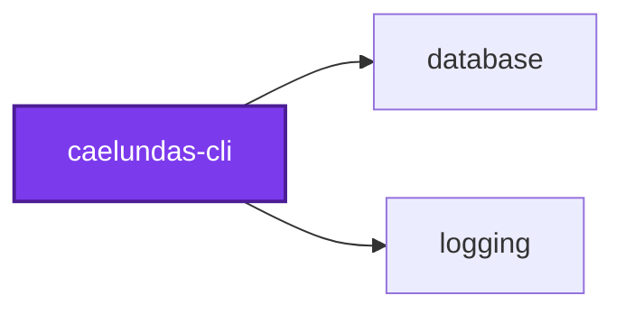
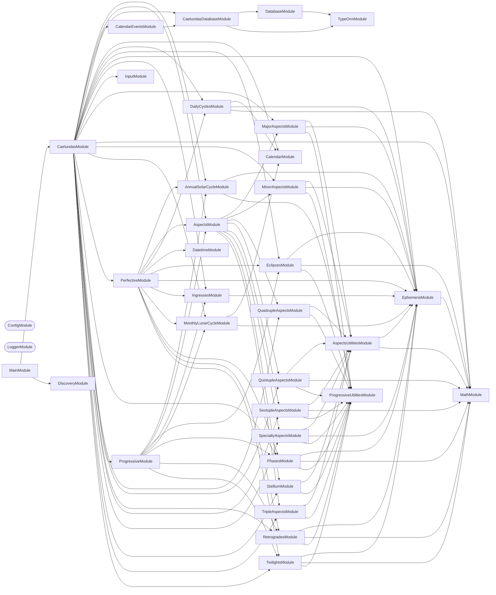

# 🛰️ Caelundas

**Turn the sky into a calendar.**

Caelundas computes planetary positions minute by minute over a date range,
detects the astronomical events in them — aspects, phases, eclipses,
retrogrades, ingresses, solstices, twilights — stores them in Postgres, and
renders an iCalendar file you can subscribe to in Google Calendar, Apple
Calendar, or anything else that reads `.ics`, plus a JSON file of the same
events.

## Quick Start

```bash
# 1. Download the Swiss Ephemeris data files (one-time, ~90 MB)
nx run caelundas-cli:download-ephemeris

# 2. Configure your observer location and date range
cp projects/caelundas/caelundas-cli/.env.default projects/caelundas/caelundas-cli/.env

# 3. Create the calendar_events table (needs the local Postgres container running)
nx run caelundas-cli:migration:run

# 4. Generate the calendar
nx run caelundas-cli:start
```

The result lands in `output/caelundas_<start>_<end>.ics`, with a `.json` file
beside it. Import the calendar, or point a subscription at it.

## Configuration

All input comes from environment variables, validated on startup.

```bash
LATITUDE="39.949309"          # Observer latitude, -90 to 90
LONGITUDE="-75.17169"         # Observer longitude, -180 to 180
START_DATE="2026-07-01"       # YYYY-MM-DD
END_DATE="2026-07-31"         # YYYY-MM-DD
OUTPUT_DIRECTORY="./output"
```

Every field is optional. The database connection is read from
`CAELUNDAS_POSTGRES_HOST`, `_PORT`, `_USERNAME`, `_PASSWORD`, `_DATABASE`, and
`_SCHEMA`,
which default to the local Docker Postgres: the `caelundas_development`
database, `caelundas` schema, and `caelundas_username` role. Location defaults to Philadelphia, and the date range
to a two-month window centered on today.

The **timezone is derived from your coordinates** rather than configured
separately — a calendar whose location and timezone could disagree is a
calendar with silently wrong sunrise times. Supported dates run from
`1900-01-01` to `2100-12-31`, the span of the ephemeris data.

## Ephemeris

Positions come from the [Swiss Ephemeris](https://www.astro.com/swisseph/)
(`sweph`), computed locally from JPL DE431 data files — no network calls, no
API keys, no rate limits. The data files are not committed; download them once
with `nx run caelundas-cli:download-ephemeris` into `data/ephemeris/`.

## Events

Detection runs in two passes.

**Perfective** — the moment something is exact. Ephemerides are computed
day by day and scanned at minute resolution for the instant an aspect
perfects, a planet stations, or a body crosses a sign boundary.

**Progressive** — the span around it. The same domain services turn those exact
moments into the periods a reader actually wants on a calendar: the days an
aspect is in orb, the weeks a planet is retrograde.

| Family | Events |
| ------ | ------ |
| Aspects | Major (conjunct, opposite, sextile, square, trine), minor, and harmonic aspects between the Sun, Moon, planets, Chiron, Lilith, four asteroids, the north lunar node, and the lunar apogee; forming, exact, and dissolving moments, and the span between them |
| Compound aspects | Triple (grand trine, hammer, T-square, yod), quadruple (boomerang, butterfly, cradle, grand cross, hourglass, kite, mystic rectangle), pentagram, hexagram, and stelliums of four or more bodies |
| Monthly lunar cycle | The eight Moon phases, each as an instant and as the span until the next |
| Planetary phases | Mercury, Venus, and Mars: conjunctions, Mars's opposition, the greatest elongations of Mercury and Venus, brightest, rise and set, and morning- and evening-star visibility spans |
| Eclipses | Solar and lunar: begin, maximum, and end |
| Retrogrades | Stations and retrograde periods |
| Ingresses | Sign, decan, and peak ingresses, and the span in each sign |
| Annual solar cycle | Solstices, equinoxes, cross-quarter days, hexadecans, perihelion and aphelion |
| Lunar apsides | Lunar apogee and perigee, where the Moon's radial speed changes sign |
| Daily cycles | Sunrise, sunset, solar zenith and nadir, moonrise, moonset, lunar zenith and nadir |
| Twilights | Civil, nautical, and astronomical dawn and dusk, with the Daylight, twilight, and Night spans |

## Conventions

Where astronomy and astrology each have more than one accepted definition,
caelundas picks one. These are the choices, so you can reconcile a caelundas
calendar with another source.

### Moon phases

Every Moon phase is timed by the Moon's apparent geocentric ecliptic longitude
minus the Sun's, E, normalized to [0°, 360°). Positions are Swiss Ephemeris
apparent geocentric values. Illumination is not used:

| Phase | E |
| ----- | - |
| New Moon | 0° |
| Waxing Crescent | 45° |
| First Quarter | 90° |
| Waxing Gibbous | 135° |
| Full Moon | 180° |
| Waning Gibbous | 225° |
| Last Quarter | 270° |
| Waning Crescent | 315° |

The four primary phases follow the definition the US Naval Observatory and
the almanacs publish. Each phase is stamped at the whole minute nearest the
crossing, which is how USNO rounds, so primary phases land within two minutes
of its times. The crescent and gibbous phases begin at the octants halfway
between them, so each of the eight phases spans 45° of elongation.
Illumination would put the crescent and gibbous boundaries near 60° and 120°,
not halfway, and its extremes miss New and Full Moon by up to half an hour.

### Lunar points

- **True node.** The north lunar node is Swiss Ephemeris's true (osculating)
  node, not the smoothed mean node. It wobbles by up to about 1.5° around the
  mean node, so it can differ from calendars that use the mean node and
  occasionally turns direct or retrograde on a different day. The south node
  is computed as the opposite point but used in no event, so it appears in no
  aspect or ingress.
- **Lilith and the lunar apogee.** Both are tracked, as separate bodies.
  Lilith is the mean lunar apogee, a smooth average. The lunar apogee is the
  osculating apogee, the instantaneous value, which can stray from the mean by
  tens of degrees. Most astrology software offers one or the other,
  so expect one of the two to match it.

### Stelliums

A stellium is four or more bodies that are all in conjunction with one
another. Conjunction uses the aspect orb, 8°, and every pair must be within
it, not just a chain of neighbors. Detection finds each maximal clique of
pairwise conjunct bodies with four or more members.

### Ingresses

- **Decans** are equal 10° thirds of a sign, numbered 1 to 3 from the sign's
  first degree. Decan 1 begins at the sign boundary, which is the sign
  ingress, so a decan ingress into decan 1 appears only when a body moves
  backward from decan 2.
- **Peak ingress** is the moment a body's longitude within its sign reaches
  15°, the midpoint of the sign, in either forward or retrograde direction.
  A retrograde re-entry across a sign boundary does not fire a peak ingress.

### Daily cycles

- **Zenith and nadir** are the highest and lowest altitude the body reaches,
  found as local extrema of its altitude each minute. This is not the
  meridian transit the US Naval Observatory lists: the two differ when the
  body's declination changes, and by most for the Moon.
- **Altitude** is the refracted (apparent) altitude from Swiss Ephemeris,
  not the geometric one: the call passes pressure 0, which Swiss Ephemeris
  estimates from the observer's height (sea level here), and 0 °C.
- **Sunrise, sunset, moonrise, and moonset** are times the body crosses the
  horizon with topocentric parallax, the standard upper-limb altitude for the
  Sun (-0.833°), and the Moon's topocentric semidiameter.

### Twilights

Civil, nautical, and astronomical twilight begin and end when the Sun's
refracted altitude (see Daily cycles) crosses -6°, -12°, and -18°. **Daylight**
runs from civil dawn to civil dusk, so it includes the civil twilights and is
longer than sunrise to sunset. **Night** runs from astronomical dusk to
astronomical dawn.

## Stored events

Each run upserts the events it detects into the `calendar_events` table, in the
`caelundas` schema, then queries the table back for the requested range and
location and renders the `.ics` and JSON files from those rows, so the files and
the database never disagree.

| Column | Holds |
| ------ | ----- |
| `summary`, `description` | The event's title and detail |
| `start`, `end` | `timestamptz`; equal for an instant |
| `categories` | `text[]`, GIN-indexed, so SQL can filter on one |
| `color`, `location` | Nullable display hints |
| `latitude`, `longitude` | The `numeric` observer location the event was computed for |
| `id`, `created_at`, `updated_at`, … | `uuidv7()` id and audit columns |

An event is unique on `(summary, start, latitude, longitude)`:

- Re-running a range updates rows in place. `updated_at` advances; `created_at`
  does not.
- An overlapping range updates the overlap and adds only the new events.
- A run for a second location adds rows of its own.
- An event spanning a range edge, like a retrograde, is included in that
  range's files.

Postgres returns `numeric` columns as strings, so compare coordinates as such.
The schema comes from a generated migration: `nx run caelundas-cli:migration:run`
applies it and `nx run caelundas-cli:migration:generate` creates the next one.
Both read the data source and migrations from
`src/modules/caelundas-database/`, the folder the `migration` target's
`module` option names.

## Structure

```text
src/
├── main.ts                  # CommandFactory bootstrap
├── constants.ts             # Environment schema (Zod)
└── modules/
    ├── caelundas/           # Root command — the pipeline
    ├── input/               # Coordinate and date validation, timezone lookup
    ├── ephemeris/           # Swiss Ephemeris access: positions, horizons, phenomena
    ├── perfective/          # Exact-moment detection across every event service
    ├── progressive/         # Spans derived from those moments
    ├── caelundas-database/  # Postgres connection, CalendarEvent entity, migrations
    ├── calendar-events/     # Upserting and range queries over stored calendar events
    ├── calendar/            # iCalendar and JSON rendering and output
    ├── datetime/, math/     # Time stepping and angular arithmetic
    └── aspects/, phases/, eclipses/, retrogrades/, ingresses/,
        annual-solar-cycle/, monthly-lunar-cycle/, daily-cycles/,
        twilights/, stellium/, …   # One service per event family
```

## Start

Generate a calendar from the configured location and date range:

```bash
nx run caelundas-cli:start
```

## Test

Integration and end-to-end suites start a throwaway Postgres 18 container, so
Docker must be running.

```bash
nx run caelundas-cli:vitest
```

```bash
nx run caelundas-cli:vitest:unit          # Fast tests only
nx run caelundas-cli:vitest:end-to-end    # Full pipeline, against a Postgres container
nx run caelundas-cli:vitest:integration   # Calendar events service, against a Postgres container
```

## Development

```bash
nx run caelundas-cli:repl                 # NestJS REPL against the graph
nx run caelundas-cli:typecheck
nx run caelundas-cli:lint-code --configuration=write
```

See [AGENTS.md](AGENTS.md) for the astronomical domain concepts, event
detection algorithms, and testing strategy.

## Etymology

**Caelundas** — a portmanteau of _caelum_ (Latin: sky, heavens) and _calendar_.

## License

MIT — see [LICENSE](../../../LICENSE).

## 👔 Conformetry

This project was generated from the [nestjs-command-project](../../../projects/configuration/conformetry-templates/nestjs-command-project) conformetry template.

<!-- callidescope:start -->

## 🔭 Callidescope

Call stacks traced through `projects/caelundas/caelundas-cli`, deepest first. Each frame shows what it takes, what it returns, and what its documentation says.

| Measure | Value |
| --- | --- |
| Callables | 947 |
| Files | 174 |
| Calls traced | 1242 |
| Call stacks | 96 |
| Deepest stack | 15 |
| Stacks through recursion | 0 |
| Unfollowable calls | 37 |

### Limits

What this project is judged against, as declared in its own `callidescope.config.ts`.

| Limit | Value |
| --- | --- |
| `maximumDepth` | 16 |
| `maximumBreadth` | 12 |

### Call stacks (depth)

**1. `CaelundasCommand.run`** — depth ≥ 15 · decorated-method

```text
🚀 CaelundasCommand.run(): Promise<void> [projects/caelundas/caelundas-cli/src/modules/caelundas/caelundas.command.ts:64]
   ↳ Executes the full calendar generation pipeline.
  └─> PerfectiveService.detect(input: Input, options?: PerfectiveOptions): DetectedCalendarEvent[] [projects/caelundas/caelundas-cli/src/modules/perfective/perfective.service.ts:245]
     ↳ Detects all perfective (instantaneous) astronomical events within the given date range.
    └─> PerfectiveService.detectDayEvents(…): { events: DetectedCalendarEvent[]; previousAspectBodies: AspectBodies[]; } [projects/caelundas/caelundas-cli/src/modules/perfective/perfective.service.ts:62]
       ↳ Sweeps one day minute-by-minute, aggregating perfective events and rolling aspect state forward.
      └─> PerfectiveService.detectMinuteEvents(…): { aspectBodies: AspectBodies[]; events: DetectedCalendarEvent[]; } [projects/caelundas/caelundas-cli/src/modules/perfective/perfective.service.ts:109]
         ↳ Detects all minute-level event families and returns both events and updated aspect-body state.
        └─> AspectsService.detect(…): { aspectBodies: AspectBodies[]; events: DetectedCalendarEvent[]; } [projects/caelundas/caelundas-cli/src/modules/aspects/aspects.service.ts:202]
           ↳ Detects all aspect events at a single minute, including 2-body and multi-body patterns.
          └─> AspectsService.detectCompositeAspects(…): DetectedCalendarEvent[] [projects/caelundas/caelundas-cli/src/modules/aspects/aspects.service.ts:84]
             ↳ Runs composite-aspect detectors against current and previous aspect-body snapshots.
            └─> QuintupleAspectsService.detect(…): DetectedCalendarEvent[] [projects/caelundas/caelundas-cli/src/modules/quintuple-aspects/quintuple-aspects.service.ts:38]
               ↳ Detects all quintuple aspect patterns from stored 2-body aspect events.
              └─> QuintupleAspectsComposerService.composePentagrams(args: ComposePentagramsArguments): DetectedCalendarEvent[] [projects/caelundas/caelundas-cli/src/modules/quintuple-aspects/quintuple-aspects-composer.service.ts:212]
                 ↳ Composes Pentagram patterns from stored 2-body aspects.
                └─> QuintupleAspectsComposerService.processPentagramCombinations(…): DetectedCalendarEvent[] [projects/caelundas/caelundas-cli/src/modules/quintuple-aspects/quintuple-aspects-composer.service.ts:349]
                   ↳ Processes pentagram combinations.
                  └─> QuintupleAspectsComposerService.buildPentagramEvent(…): DetectedCalendarEvent | null [projects/caelundas/caelundas-cli/src/modules/quintuple-aspects/quintuple-aspects-composer.service.ts:53]
                     ↳ Emits a pentagram boundary event when exactly five ordered bodies are available.
                    └─> QuintupleAspectsComposerService.getQuintupleAspectEvent(eventArguments: GetQuintupleAspectEventArguments): DetectedCalendarEvent [projects/caelundas/caelundas-cli/src/modules/quintuple-aspects/quintuple-aspects-composer.service.ts:288]
                       ↳ Creates one quintuple-aspect boundary event for the provided five bodies.
                      └─> QuintupleAspectsComposerService.buildQuintupleEventFromParameters(eventArguments: BuildQuintupleEventParameters): DetectedCalendarEvent [projects/caelundas/caelundas-cli/src/modules/quintuple-aspects/quintuple-aspects-composer.service.ts:158]
                         ↳ Materializes a finalized quintuple event from precomputed display fields.
                        └─> QuintupleAspectsComposerService.buildQuintupleAspectSummary(…): string [projects/caelundas/caelundas-cli/src/modules/quintuple-aspects/quintuple-aspects-composer.service.ts:142]
                           ↳ Formats summary as `phaseEmoji + aspectSymbol + symbolChain + description`.
                          └─> QuintupleAspectsComposerService.getPhaseEmoji(phase: AspectPhase): string [projects/caelundas/caelundas-cli/src/modules/quintuple-aspects/quintuple-aspects-composer.service.ts:283]
                             ↳ Maps phase to the event-summary marker prefix.
                            └─> AspectEventFormattingService.getPhaseEmoji(phase: AspectPhase): string [projects/caelundas/caelundas-cli/src/modules/aspects/aspect-event-formatting.service.ts:176]
                               ↳ Returns the summary prefix emoji for an aspect phase.
```

**2. `PhasesService.detect`** — depth 9 · orphan-root

```text
🚀 PhasesService.detect(args: DetectPlanetaryEventsArguments): DetectedCalendarEvent[] ⚠ deprecated [projects/caelundas/caelundas-cli/src/modules/phases/phases.service.ts:52]
   ↳ Detects all planetary phase events for a given minute. Combines detection from all three planets (Venus, Mercury, Mars).
  └─> PhasesService.getMartianPhaseEvents(args: MartianPhaseEventArguments): DetectedCalendarEvent[] [projects/caelundas/caelundas-cli/src/modules/phases/phases.service.ts:147]
     ↳ Produces Martian phase events for one minute using precomputed phase parameters.
    └─> MartianPhaseService.getMartianPhaseEvents(args: MartianPhaseEventArguments): DetectedCalendarEvent[] [projects/caelundas/caelundas-cli/src/modules/phases/martian-phase.service.ts:218]
       ↳ Produces Martian phase events for one minute using precomputed phase parameters.
      └─> MartianPhaseService.detectMartianPhases(parameters: PhaseParameters, minute: Moment): DetectedCalendarEvent[] [projects/caelundas/caelundas-cli/src/modules/phases/martian-phase.service.ts:61]
         ↳ Detects martian phases.
        └─> PhaseCalculationService.isMorningRise(args: RiseSetLongitudeArguments): boolean [projects/caelundas/caelundas-cli/src/modules/phases/phase-calculation.service.ts:347]
           ↳ Determines whether planet rises in morning.
          └─> PhaseCalculationService.isMorning(args: CurrentLongitudeArguments): boolean [projects/caelundas/caelundas-cli/src/modules/phases/phase-calculation.service.ts:340]
             ↳ Determines whether planet is in morning position (western).
            └─> PhaseCalculationService.isWestern(args: CurrentLongitudeArguments): boolean [projects/caelundas/caelundas-cli/src/modules/phases/phase-calculation.service.ts:413]
               ↳ Determines whether planet is west of sun, by the wrapped signed elongation.
              └─> PhaseCalculationService.getSignedElongation(args: CurrentLongitudeArguments): number [projects/caelundas/caelundas-cli/src/modules/phases/phase-calculation.service.ts:86]
                 ↳ Derives the signed elongation of the planet from the Sun, in (−180°, 180°].
                └─> MathService.normalizeDegrees(degrees: number): number [projects/caelundas/caelundas-cli/src/modules/math/math.service.ts:205]
                   ↳ Normalizes an angle in degrees to the range [0, 360).
```

**3. `MajorAspectsService.detect`** — depth ≥ 8 · orphan-root

```text
🚀 MajorAspectsService.detect(…): DetectedCalendarEvent | null [projects/caelundas/caelundas-cli/src/modules/major-aspects/major-aspects.service.ts:149]
  └─> MajorAspectsService.detectAspectForBodyPair(args: DetectAspectForBodyPairArguments): DetectedCalendarEvent | null [projects/caelundas/caelundas-cli/src/modules/major-aspects/major-aspects.service.ts:63]
     ↳ Detects aspect for body pair.
    └─> MajorAspectsService.buildMajorAspectEvent(…): DetectedCalendarEvent [projects/caelundas/caelundas-cli/src/modules/major-aspects/major-aspects.service.ts:128]
       ↳ Resolves the active major aspect for two bodies and assembles a typed event.
      └─> MajorAspectEventService.buildMajorAspectEvent(…): DetectedCalendarEvent [projects/caelundas/caelundas-cli/src/modules/major-aspects/major-aspect-event.service.ts:121]
         ↳ Resolves and builds a typed major-aspect event for two body longitudes.
        └─> MajorAspectEventService.getMajorAspect(args: { longitudeBody1: number; longitudeBody2: number; }): MajorAspect | null [projects/caelundas/caelundas-cli/src/modules/major-aspects/major-aspect-event.service.ts:156]
           ↳ Returns the first in-orb major aspect for two longitudes.
          └─> AspectsUtilitiesService.isAspect(…): boolean [projects/caelundas/caelundas-cli/src/modules/aspects/aspects-utilities.service.ts:328]
             ↳ Returns `true` when the angular separation between two bodies falls within the configured orb for the given aspect.
            └─> MathService.getAngle(longitude1: Longitude, longitude2: Longitude): number [projects/caelundas/caelundas-cli/src/modules/math/math.service.ts:86]
               ↳ Calculates the shortest angular distance between two ecliptic longitudes.
              └─> MathService.normalizeDegrees(degrees: number): number [projects/caelundas/caelundas-cli/src/modules/math/math.service.ts:205]
                 ↳ Normalizes an angle in degrees to the range [0, 360).
```

<details>
<summary>93 more call stacks</summary>

**4. `TripleAspectsService.detectProgressive`** — depth 8 · orphan-root

```text
🚀 TripleAspectsService.detectProgressive(events: DetectedCalendarEvent[]): DetectedCalendarEvent[] [projects/caelundas/caelundas-cli/src/modules/triple-aspects/triple-aspects.service.ts:111]
   ↳ Builds duration events by pairing forming/dissolving events per triple-aspect group key.
  └─> TripleAspectsComposerService.pairProgressiveGroup(groupEvents: DetectedCalendarEvent[]): DetectedCalendarEvent[] [projects/caelundas/caelundas-cli/src/modules/triple-aspects/triple-aspects-composer.service.ts:391]
     ↳ Pairs one triple-aspect group's boundaries into spans, one per occurrence.
    └─> TripleAspectsComposerService.flatMap(…)(…): DetectedCalendarEvent[] [projects/caelundas/caelundas-cli/src/modules/triple-aspects/triple-aspects-composer.service.ts:401]
      └─> TripleAspectsComposerService.buildProgressiveEvent(…): DetectedCalendarEvent | null [projects/caelundas/caelundas-cli/src/modules/triple-aspects/triple-aspects-composer.service.ts:238]
         ↳ Builds one triple-aspect duration event from a forming/dissolving pair.
        └─> TripleAspectsComposerService.buildProgressiveBodiesMeta(…): ProgressiveBodiesMeta | null [projects/caelundas/caelundas-cli/src/modules/triple-aspects/triple-aspects-composer.service.ts:55]
           ↳ Builds progressive bodies meta.
          └─> TripleAspectsComposerService.resolveProgressiveMeta(…): ProgressiveBodiesMeta | null [projects/caelundas/caelundas-cli/src/modules/triple-aspects/triple-aspects-composer.service.ts:188]
             ↳ Resolves progressive meta.
            └─> TripleAspectsComposerService.resolveTripleBody(displayName: string): Body | undefined [projects/caelundas/caelundas-cli/src/modules/triple-aspects/triple-aspects-composer.service.ts:227]
               ↳ Inverts a display name to a body tracked by triple aspects.
              └─> bodyFromDisplayName(displayName: string): Body | undefined [projects/caelundas/caelundas-cli/src/modules/caelundas/caelundas.types.ts:305]
                 ↳ Inverts {@link bodyDisplayName}: returns the body a display name belongs to, or `undefined` when the name is not a…
```

**5. `IngressesService.buildDecanIngressEvent`** — depth 7 · orphan-root

```text
🚀 IngressesService.buildDecanIngressEvent(args: { body: Body; date: Moment; longitude: number; }): DetectedCalendarEvent [projects/caelundas/caelundas-cli/src/modules/ingresses/ingresses.service.ts:91]
   ↳ Delegates decan-ingress event construction to the composer service.
  └─> IngressesComposerService.buildDecanIngressEvent(args: { body: Body; date: Moment; longitude: number; }): DetectedCalendarEvent [projects/caelundas/caelundas-cli/src/modules/ingresses/ingresses-composer.service.ts:95]
     ↳ Creates a decan ingress calendar event.
    └─> IngressesComposerService.buildDecanIngressEventObject(args: { body: Body; date: Moment; longitude: number; }): DetectedCalendarEvent [projects/caelundas/caelundas-cli/src/modules/ingresses/ingresses-composer.service.ts:111]
       ↳ Builds the decan ingress payload without logging side effects.
      └─> IngressesComposerService.resolveDecan(longitude: number): Decan [projects/caelundas/caelundas-cli/src/modules/ingresses/ingresses-composer.service.ts:423]
         ↳ Converts numeric decan to the validated `Decan` union and throws on invalid values.
        └─> IngressesComposerService.getDecan(longitude: number): number [projects/caelundas/caelundas-cli/src/modules/ingresses/ingresses-composer.service.ts:294]
           ↳ Maps longitude to decan number (1-3) relative to the current sign start degree.
          └─> IngressesComposerService.getSign(longitude: number): Sign [projects/caelundas/caelundas-cli/src/modules/ingresses/ingresses-composer.service.ts:74]
             ↳ Maps an ecliptic longitude to its containing zodiac sign range.
            └─> IngressesComposerService.find(…)(…): boolean [projects/caelundas/caelundas-cli/src/modules/ingresses/ingresses-composer.service.ts:77]
```

**6. `MinorAspectsComposerService.processAspectGroup`** — depth 7 · orphan-root

```text
🚀 MinorAspectsComposerService.processAspectGroup(…): DetectedCalendarEvent[] [projects/caelundas/caelundas-cli/src/modules/minor-aspects/minor-aspects-composer.service.ts:234]
   ↳ Processes aspect group.
  └─> MinorAspectsComposerService.map(…)(…): DetectedCalendarEvent [projects/caelundas/caelundas-cli/src/modules/minor-aspects/minor-aspects-composer.service.ts:252]
    └─> MinorAspectsComposerService.getMinorAspectProgressiveEvent(…): DetectedCalendarEvent [projects/caelundas/caelundas-cli/src/modules/minor-aspects/minor-aspects-composer.service.ts:197]
       ↳ Creates one minor-aspect duration event from a matched forming/dissolving pair.
      └─> MinorAspectsComposerService.extractAspectComponents(categories: string[]): ExtractAspectComponentsResult [projects/caelundas/caelundas-cli/src/modules/minor-aspects/minor-aspects-composer.service.ts:150]
         ↳ Extracts aspect components.
        └─> MinorAspectsComposerService.filter(…)(c: string): boolean [projects/caelundas/caelundas-cli/src/modules/minor-aspects/minor-aspects-composer.service.ts:152]
          └─> MinorAspectsComposerService.map(…)(b: string): string [projects/caelundas/caelundas-cli/src/modules/minor-aspects/minor-aspects-composer.service.ts:153]
            └─> bodyDisplayName(body: string): string [projects/caelundas/caelundas-cli/src/modules/caelundas/caelundas.types.ts:297]
               ↳ Names a body the way every summary, description, category and progressive grouping key does: lodash start case ("north…
```

**7. `EphemerisService.getAzimuthElevationEphemerisByBody`** — depth 6 · orphan-root

```text
🚀 EphemerisService.getAzimuthElevationEphemerisByBody(…): Record<"lunar apogee" | "lunar perigee" | "north lunar node" | "south lunar node" | "ceres" | "chiron" | "juno" | "lilith" | "pallas" | "vesta" | "jupiter" | "mars" | "mercury" | ... 6 more ... | "venus", AzimuthElevationEphemeris> [projects/caelundas/caelundas-cli/src/modules/ephemeris/ephemeris.service.ts:155]
   ↳ Computes minute-by-minute horizontal coordinates (azimuth, apparent elevation) for the requested bodies at the…
  └─> EphemerisHorizonService.computeAzimuthElevationForBody(…): AzimuthElevationEphemeris [projects/caelundas/caelundas-cli/src/modules/ephemeris/ephemeris-horizon.service.ts:46]
     ↳ Computes minute-by-minute horizontal coordinates (azimuth, apparent elevation) for a single body at the observer's…
    └─> EphemerisHorizonService.computeAzimuthElevationForMinute(…): HorizonPosition [projects/caelundas/caelundas-cli/src/modules/ephemeris/ephemeris-horizon.service.ts:76]
       ↳ Computes horizontal coordinates for a single body at a specific moment, from its topocentric position: parallax is…
      └─> EphemerisCoordinateService.getTopocentricBodyCoordinates(…): { distance: number; latitude: number; longitude: number; } [projects/caelundas/caelundas-cli/src/modules/ephemeris/ephemeris-coordinate.service.ts:227]
         ↳ Computes a body's apparent ecliptic coordinates as seen from an observer on the Earth's surface (sea level), rather…
        └─> EphemerisCoordinateService.computeBodyCoordinates(…): { distance: number; distanceSpeed: number; latitude: number; longitude: number; } [projects/caelundas/caelundas-cli/src/modules/ephemeris/ephemeris-coordinate.service.ts:42]
           ↳ Computes body ecliptic coordinates (longitude, latitude, distance) with the given flags.
          └─> EphemerisConstantsService.getSwissEphemerisConstantForBody(body: Exclude<Body, Node>): number [projects/caelundas/caelundas-cli/src/modules/ephemeris/ephemeris-constants.service.ts:43]
             ↳ Looks up the Swiss Ephemeris constant for a non-node body (planet or asteroid).
```

**8. `AspectsUtilitiesService.getValue`** — depth 6 · orphan-root

```text
🚀 AspectsUtilitiesService.getValue({ body1, body2 }: { body1: Body; body2: Body; }): AspectBodies | null [projects/caelundas/caelundas-cli/src/modules/aspects/aspects-utilities.service.ts:281]
  └─> AspectsUtilitiesService.find(…)(…): boolean [projects/caelundas/caelundas-cli/src/modules/aspects/aspects-utilities.service.ts:285]
    └─> AspectsUtilitiesService.every(…)(instant: "next" | "previous" | "current"): boolean [projects/caelundas/caelundas-cli/src/modules/aspects/aspects-utilities.service.ts:286]
      └─> AspectsUtilitiesService.isAspect(…): boolean [projects/caelundas/caelundas-cli/src/modules/aspects/aspects-utilities.service.ts:328]
         ↳ Returns `true` when the angular separation between two bodies falls within the configured orb for the given aspect.
        └─> MathService.getAngle(longitude1: Longitude, longitude2: Longitude): number [projects/caelundas/caelundas-cli/src/modules/math/math.service.ts:86]
           ↳ Calculates the shortest angular distance between two ecliptic longitudes.
          └─> MathService.normalizeDegrees(degrees: number): number [projects/caelundas/caelundas-cli/src/modules/math/math.service.ts:205]
             ↳ Normalizes an angle in degrees to the range [0, 360).
```

**9. `AspectsUtilitiesService.anonymous`** — depth 6 · orphan-root

```text
🚀 AspectsUtilitiesService.anonymous(longitudes: LongitudesWindow): "forming" | "dissolving" | "perfective" | null [projects/caelundas/caelundas-cli/src/modules/aspects/aspects-utilities.service.ts:312]
  └─> AspectsUtilitiesService.getAspectPhase(…): "forming" | "dissolving" | "perfective" | null [projects/caelundas/caelundas-cli/src/modules/aspects/aspects-utilities.service.ts:154]
     ↳ Resolves whether the aspect is entering, exacting, or leaving orb at the current minute.
    └─> AspectsUtilitiesService.isPerfective(…): boolean [projects/caelundas/caelundas-cli/src/modules/aspects/aspects-utilities.service.ts:194]
       ↳ Checks whether the aspect becomes exact between the previous and current minute.
      └─> AspectsUtilitiesService.isSignedOffsetSignChange(args: { aspectAngle: number; longitudes: LongitudesWindow; }): boolean [projects/caelundas/caelundas-cli/src/modules/aspects/aspects-utilities.service.ts:226]
         ↳ Detects perfection when the signed offset from the aspect angle changes sign, rejecting the jump across the ±180° wrap,…
        └─> AspectsUtilitiesService.getSignedOffset(…): number [projects/caelundas/caelundas-cli/src/modules/aspects/aspects-utilities.service.ts:180]
           ↳ Signed offset of body 1 from body 2 relative to an aspect angle, wrapped to [−180°, 180°).
          └─> MathService.normalizeDegrees(degrees: number): number [projects/caelundas/caelundas-cli/src/modules/math/math.service.ts:205]
             ↳ Normalizes an angle in degrees to the range [0, 360).
```

**10. `MajorAspectProgressiveService.getProgressiveEvent`** — depth ≥ 6 · orphan-root

```text
🚀 MajorAspectProgressiveService.getProgressiveEvent(…): DetectedCalendarEvent [projects/caelundas/caelundas-cli/src/modules/major-aspects/major-aspect-progressive.service.ts:105]
  └─> MajorAspectProgressiveService.getMajorAspectProgressiveEvent(…): DetectedCalendarEvent [projects/caelundas/caelundas-cli/src/modules/major-aspects/major-aspect-progressive.service.ts:50]
     ↳ Builds one progressive duration event from a forming/dissolving pair.
    └─> ProgressiveAspectService.createSimpleAspectProgressiveEvent(…): DetectedCalendarEvent [projects/caelundas/caelundas-cli/src/modules/progressive/progressive-aspect.service.ts:175]
       ↳ Create a single progressive event for a simple aspect (major, minor, or specialty).
      └─> ProgressiveAspectService.extractTypedAspectParts(…): TypedAspectParts<TAspect, TBody> [projects/caelundas/caelundas-cli/src/modules/progressive/progressive-aspect.service.ts:238]
         ↳ Extract typed body/aspect values from event categories using aspect/body registries.
        └─> ProgressiveAspectService.map(…)(body: TBody): string [projects/caelundas/caelundas-cli/src/modules/progressive/progressive-aspect.service.ts:251]
          └─> bodyDisplayName(body: string): string [projects/caelundas/caelundas-cli/src/modules/caelundas/caelundas.types.ts:297]
             ↳ Names a body the way every summary, description, category and progressive grouping key does: lodash start case ("north…
```

**11. `MajorAspectProgressiveService.getProgressiveEvent`** — depth ≥ 6 · orphan-root

```text
🚀 MajorAspectProgressiveService.getProgressiveEvent(…): DetectedCalendarEvent [projects/caelundas/caelundas-cli/src/modules/major-aspects/major-aspect-progressive.service.ts:131]
  └─> MajorAspectProgressiveService.getMajorAspectProgressiveEvent(…): DetectedCalendarEvent [projects/caelundas/caelundas-cli/src/modules/major-aspects/major-aspect-progressive.service.ts:50]
     ↳ Builds one progressive duration event from a forming/dissolving pair.
    └─> ProgressiveAspectService.createSimpleAspectProgressiveEvent(…): DetectedCalendarEvent [projects/caelundas/caelundas-cli/src/modules/progressive/progressive-aspect.service.ts:175]
       ↳ Create a single progressive event for a simple aspect (major, minor, or specialty).
      └─> ProgressiveAspectService.extractTypedAspectParts(…): TypedAspectParts<TAspect, TBody> [projects/caelundas/caelundas-cli/src/modules/progressive/progressive-aspect.service.ts:238]
         ↳ Extract typed body/aspect values from event categories using aspect/body registries.
        └─> ProgressiveAspectService.map(…)(body: TBody): string [projects/caelundas/caelundas-cli/src/modules/progressive/progressive-aspect.service.ts:251]
          └─> bodyDisplayName(body: string): string [projects/caelundas/caelundas-cli/src/modules/caelundas/caelundas.types.ts:297]
             ↳ Names a body the way every summary, description, category and progressive grouping key does: lodash start case ("north…
```

**12. `MinorAspectsProgressiveService.getProgressiveEvent`** — depth ≥ 6 · orphan-root

```text
🚀 MinorAspectsProgressiveService.getProgressiveEvent(…): DetectedCalendarEvent [projects/caelundas/caelundas-cli/src/modules/minor-aspects/minor-aspects-progressive.service.ts:85]
  └─> MinorAspectsProgressiveService.getMinorAspectProgressiveEvent(…): DetectedCalendarEvent [projects/caelundas/caelundas-cli/src/modules/minor-aspects/minor-aspects-progressive.service.ts:100]
     ↳ Creates one minor-aspect duration event from a matched forming/dissolving pair.
    └─> ProgressiveAspectService.createSimpleAspectProgressiveEvent(…): DetectedCalendarEvent [projects/caelundas/caelundas-cli/src/modules/progressive/progressive-aspect.service.ts:175]
       ↳ Create a single progressive event for a simple aspect (major, minor, or specialty).
      └─> ProgressiveAspectService.extractTypedAspectParts(…): TypedAspectParts<TAspect, TBody> [projects/caelundas/caelundas-cli/src/modules/progressive/progressive-aspect.service.ts:238]
         ↳ Extract typed body/aspect values from event categories using aspect/body registries.
        └─> ProgressiveAspectService.map(…)(body: TBody): string [projects/caelundas/caelundas-cli/src/modules/progressive/progressive-aspect.service.ts:251]
          └─> bodyDisplayName(body: string): string [projects/caelundas/caelundas-cli/src/modules/caelundas/caelundas.types.ts:297]
             ↳ Names a body the way every summary, description, category and progressive grouping key does: lodash start case ("north…
```

**13. `MinorAspectsProgressiveService.getProgressiveEvent`** — depth ≥ 6 · orphan-root

```text
🚀 MinorAspectsProgressiveService.getProgressiveEvent(…): DetectedCalendarEvent [projects/caelundas/caelundas-cli/src/modules/minor-aspects/minor-aspects-progressive.service.ts:131]
  └─> MinorAspectsProgressiveService.getMinorAspectProgressiveEvent(…): DetectedCalendarEvent [projects/caelundas/caelundas-cli/src/modules/minor-aspects/minor-aspects-progressive.service.ts:100]
     ↳ Creates one minor-aspect duration event from a matched forming/dissolving pair.
    └─> ProgressiveAspectService.createSimpleAspectProgressiveEvent(…): DetectedCalendarEvent [projects/caelundas/caelundas-cli/src/modules/progressive/progressive-aspect.service.ts:175]
       ↳ Create a single progressive event for a simple aspect (major, minor, or specialty).
      └─> ProgressiveAspectService.extractTypedAspectParts(…): TypedAspectParts<TAspect, TBody> [projects/caelundas/caelundas-cli/src/modules/progressive/progressive-aspect.service.ts:238]
         ↳ Extract typed body/aspect values from event categories using aspect/body registries.
        └─> ProgressiveAspectService.map(…)(body: TBody): string [projects/caelundas/caelundas-cli/src/modules/progressive/progressive-aspect.service.ts:251]
          └─> bodyDisplayName(body: string): string [projects/caelundas/caelundas-cli/src/modules/caelundas/caelundas.types.ts:297]
             ↳ Names a body the way every summary, description, category and progressive grouping key does: lodash start case ("north…
```

**14. `MinorAspectsService.detect`** — depth ≥ 6 · orphan-root

```text
🚀 MinorAspectsService.detect(…): DetectedCalendarEvent | null [projects/caelundas/caelundas-cli/src/modules/minor-aspects/minor-aspects.service.ts:183]
  └─> MinorAspectsService.detectBodyPairAspect(args: DetectBodyPairAspectArguments): DetectedCalendarEvent | null [projects/caelundas/caelundas-cli/src/modules/minor-aspects/minor-aspects.service.ts:64]
     ↳ Detects a minor-aspect event for one body pair at a specific minute window.
    └─> MinorAspectsEventService.getLongitudesWindowForBody(…): { current: number; next: number; previous: number; } [projects/caelundas/caelundas-cli/src/modules/minor-aspects/minor-aspects-event.service.ts:72]
       ↳ Returns previous/current/next longitudes for one body at minute resolution.
      └─> AspectCalculationSupportService.getLongitudesWindowForBody(…): { current: number; next: number; previous: number; } [projects/caelundas/caelundas-cli/src/modules/aspects/aspect-calculation-support.service.ts:86]
         ↳ Returns previous/current/next longitudes for one body from a body-keyed ephemeris map.
        └─> EphemerisService.getLongitudesWindow(…): { current: number; next: number; previous: number; } [projects/caelundas/caelundas-cli/src/modules/ephemeris/ephemeris.service.ts:389]
           ↳ Extracts the ecliptic longitude for a body at the previous, current, and next minute.
          └─> EphemerisService.getCoordinateFromEphemeris(…): number [projects/caelundas/caelundas-cli/src/modules/ephemeris/ephemeris.service.ts:244]
             ↳ Safely extracts coordinate data (longitude or latitude) from ephemeris at a timestamp.
```

**15. `QuadrupleAspectsComposerService.checkPatternExists`** — depth ≥ 6 · orphan-root

```text
🚀 QuadrupleAspectsComposerService.checkPatternExists(edges: AspectBodies[]): boolean [projects/caelundas/caelundas-cli/src/modules/quadruple-aspects/quadruple-aspects-composer.service.ts:289]
  └─> QuadrupleAspectsBaseService.checkGrandCrossPattern(…): boolean [projects/caelundas/caelundas-cli/src/modules/quadruple-aspects/quadruple-aspects-base.service.ts:97]
     ↳ Checks grand cross pattern.
    └─> QuadrupleAspectsBaseService.verifyGrandCrossSquares(…): boolean [projects/caelundas/caelundas-cli/src/modules/quadruple-aspects/quadruple-aspects-base.service.ts:412]
       ↳ Verifies grand cross squares.
      └─> QuadrupleAspectsBaseService.haveAspect(…): boolean [projects/caelundas/caelundas-cli/src/modules/quadruple-aspects/quadruple-aspects-base.service.ts:344]
         ↳ Returns `true` when an undirected body pair has the requested aspect in the edge set.
        └─> AspectGraphService.haveAspect(…): boolean [projects/caelundas/caelundas-cli/src/modules/aspects/aspect-graph.service.ts:70]
           ↳ Returns `true` when an undirected body pair has the requested aspect in the edge set.
          └─> AspectGraphService.some(…)(edge: AspectBodies): boolean [projects/caelundas/caelundas-cli/src/modules/aspects/aspect-graph.service.ts:78]
```

**16. `QuadrupleAspectsService.detectProgressive`** — depth 6 · orphan-root

```text
🚀 QuadrupleAspectsService.detectProgressive(events: DetectedCalendarEvent[]): DetectedCalendarEvent[] [projects/caelundas/caelundas-cli/src/modules/quadruple-aspects/quadruple-aspects.service.ts:75]
   ↳ Converts instantaneous quadruple aspect events into progressive events.
  └─> QuadrupleAspectsService.groupBy(…)(event: DetectedCalendarEvent): string [projects/caelundas/caelundas-cli/src/modules/quadruple-aspects/quadruple-aspects.service.ts:82]
    └─> QuadrupleAspectsBaseService.makeProgressiveGroupKey(event: DetectedCalendarEvent): string [projects/caelundas/caelundas-cli/src/modules/quadruple-aspects/quadruple-aspects-base.service.ts:356]
       ↳ Makes progressive group key.
      └─> QuadrupleAspectsBaseService.filter(…)(category: string): boolean [projects/caelundas/caelundas-cli/src/modules/quadruple-aspects/quadruple-aspects-base.service.ts:358]
        └─> QuadrupleAspectsBaseService.map(…)(…): string [projects/caelundas/caelundas-cli/src/modules/quadruple-aspects/quadruple-aspects-base.service.ts:360]
          └─> bodyDisplayName(body: string): string [projects/caelundas/caelundas-cli/src/modules/caelundas/caelundas.types.ts:297]
             ↳ Names a body the way every summary, description, category and progressive grouping key does: lodash start case ("north…
```

**17. `QuintupleAspectsService.detectProgressive`** — depth 6 · orphan-root

```text
🚀 QuintupleAspectsService.detectProgressive(events: DetectedCalendarEvent[]): DetectedCalendarEvent[] [projects/caelundas/caelundas-cli/src/modules/quintuple-aspects/quintuple-aspects.service.ts:58]
   ↳ Converts instantaneous quintuple aspect events into progressive events.
  └─> QuintupleAspectsComposerService.groupQuintupleEventsByKey(events: DetectedCalendarEvent[]): Record<string, DetectedCalendarEvent[]> [projects/caelundas/caelundas-cli/src/modules/quintuple-aspects/quintuple-aspects-composer.service.ts:328]
     ↳ Groups quintuple events by key.
    └─> QuintupleAspectsComposerService.groupBy(…)(event: DetectedCalendarEvent): string [projects/caelundas/caelundas-cli/src/modules/quintuple-aspects/quintuple-aspects-composer.service.ts:335]
      └─> QuintupleAspectsComposerService.filter(…)(category: string): boolean [projects/caelundas/caelundas-cli/src/modules/quintuple-aspects/quintuple-aspects-composer.service.ts:336]
        └─> QuintupleAspectsComposerService.map(…)(…): string [projects/caelundas/caelundas-cli/src/modules/quintuple-aspects/quintuple-aspects-composer.service.ts:337]
          └─> bodyDisplayName(body: string): string [projects/caelundas/caelundas-cli/src/modules/caelundas/caelundas.types.ts:297]
             ↳ Names a body the way every summary, description, category and progressive grouping key does: lodash start case ("north…
```

**18. `SextupleAspectsService.checkPatternExists`** — depth 6 · orphan-root

```text
🚀 SextupleAspectsService.checkPatternExists(edges: AspectBodies[]): boolean [projects/caelundas/caelundas-cli/src/modules/sextuple-aspects/sextuple-aspects.service.ts:86]
  └─> SextupleAspectsComposerService.findHexagramPattern(bodies: Body[], edges: AspectBodies[]): Body[] | null [projects/caelundas/caelundas-cli/src/modules/sextuple-aspects/sextuple-aspects-composer.service.ts:272]
     ↳ Checks if 6 bodies form a valid hexagram (Star of David) pattern.
    └─> SextupleAspectsComposerService.findValidHexagonArrangement(…): ("lunar apogee" | "lunar perigee" | "north lunar node" | "south lunar node" | "ceres" | "chiron" | "juno" | "lilith" | "pallas" | "vesta" | "jupiter" | "mars" | "mercury" | ... 6 more ... | "venus")[] | null [projects/caelundas/caelundas-cli/src/modules/sextuple-aspects/sextuple-aspects-composer.service.ts:295]
       ↳ Finds valid hexagon arrangement.
      └─> SextupleAspectsComposerService.tryHexagonArrangement(…): ("lunar apogee" | "lunar perigee" | "north lunar node" | "south lunar node" | "ceres" | "chiron" | "juno" | "lilith" | "pallas" | "vesta" | "jupiter" | "mars" | "mercury" | ... 6 more ... | "venus")[] | null [projects/caelundas/caelundas-cli/src/modules/sextuple-aspects/sextuple-aspects-composer.service.ts:459]
         ↳ Tries to hexagon arrangement.
        └─> SextupleAspectsComposerService.tryArrangementForPair(…): ("lunar apogee" | "lunar perigee" | "north lunar node" | "south lunar node" | "ceres" | "chiron" | "juno" | "lilith" | "pallas" | "vesta" | "jupiter" | "mars" | "mercury" | ... 6 more ... | "venus")[] | null [projects/caelundas/caelundas-cli/src/modules/sextuple-aspects/sextuple-aspects-composer.service.ts:425]
           ↳ Tries to arrangement for pair.
          └─> SextupleAspectsComposerService.find(…)(x: number): boolean [projects/caelundas/caelundas-cli/src/modules/sextuple-aspects/sextuple-aspects-composer.service.ts:436]
```

**19. `SextupleAspectsService.detectProgressive`** — depth 6 · orphan-root

```text
🚀 SextupleAspectsService.detectProgressive(events: DetectedCalendarEvent[]): DetectedCalendarEvent[] [projects/caelundas/caelundas-cli/src/modules/sextuple-aspects/sextuple-aspects.service.ts:136]
   ↳ Converts instantaneous sextuple aspect events into progressive events.
  └─> SextupleAspectsComposerService.groupSextupleEventsByKey(events: DetectedCalendarEvent[]): Record<string, DetectedCalendarEvent[]> [projects/caelundas/caelundas-cli/src/modules/sextuple-aspects/sextuple-aspects-composer.service.ts:387]
     ↳ Groups sextuple events by key.
    └─> SextupleAspectsComposerService.groupBy(…)(event: DetectedCalendarEvent): string [projects/caelundas/caelundas-cli/src/modules/sextuple-aspects/sextuple-aspects-composer.service.ts:394]
      └─> SextupleAspectsComposerService.filter(…)(category: string): boolean [projects/caelundas/caelundas-cli/src/modules/sextuple-aspects/sextuple-aspects-composer.service.ts:395]
        └─> SextupleAspectsComposerService.map(…)(…): string [projects/caelundas/caelundas-cli/src/modules/sextuple-aspects/sextuple-aspects-composer.service.ts:396]
          └─> bodyDisplayName(body: string): string [projects/caelundas/caelundas-cli/src/modules/caelundas/caelundas.types.ts:297]
             ↳ Names a body the way every summary, description, category and progressive grouping key does: lodash start case ("north…
```

**20. `SpecialtyAspectsProgressiveService.getProgressiveEvent`** — depth ≥ 6 · orphan-root

```text
🚀 SpecialtyAspectsProgressiveService.getProgressiveEvent(…): DetectedCalendarEvent [projects/caelundas/caelundas-cli/src/modules/specialty-aspects/specialty-aspects-progressive.service.ts:48]
  └─> SpecialtyAspectsProgressiveService.getSpecialtyAspectProgressiveEvent(…): DetectedCalendarEvent [projects/caelundas/caelundas-cli/src/modules/specialty-aspects/specialty-aspects-progressive.service.ts:89]
     ↳ Creates one specialty-aspect duration event from a forming/dissolving pair.
    └─> ProgressiveAspectService.createSimpleAspectProgressiveEvent(…): DetectedCalendarEvent [projects/caelundas/caelundas-cli/src/modules/progressive/progressive-aspect.service.ts:175]
       ↳ Create a single progressive event for a simple aspect (major, minor, or specialty).
      └─> ProgressiveAspectService.extractTypedAspectParts(…): TypedAspectParts<TAspect, TBody> [projects/caelundas/caelundas-cli/src/modules/progressive/progressive-aspect.service.ts:238]
         ↳ Extract typed body/aspect values from event categories using aspect/body registries.
        └─> ProgressiveAspectService.map(…)(body: TBody): string [projects/caelundas/caelundas-cli/src/modules/progressive/progressive-aspect.service.ts:251]
          └─> bodyDisplayName(body: string): string [projects/caelundas/caelundas-cli/src/modules/caelundas/caelundas.types.ts:297]
             ↳ Names a body the way every summary, description, category and progressive grouping key does: lodash start case ("north…
```

**21. `SpecialtyAspectsProgressiveService.getProgressiveEvent`** — depth ≥ 6 · orphan-root

```text
🚀 SpecialtyAspectsProgressiveService.getProgressiveEvent(…): DetectedCalendarEvent [projects/caelundas/caelundas-cli/src/modules/specialty-aspects/specialty-aspects-progressive.service.ts:120]
  └─> SpecialtyAspectsProgressiveService.getSpecialtyAspectProgressiveEvent(…): DetectedCalendarEvent [projects/caelundas/caelundas-cli/src/modules/specialty-aspects/specialty-aspects-progressive.service.ts:89]
     ↳ Creates one specialty-aspect duration event from a forming/dissolving pair.
    └─> ProgressiveAspectService.createSimpleAspectProgressiveEvent(…): DetectedCalendarEvent [projects/caelundas/caelundas-cli/src/modules/progressive/progressive-aspect.service.ts:175]
       ↳ Create a single progressive event for a simple aspect (major, minor, or specialty).
      └─> ProgressiveAspectService.extractTypedAspectParts(…): TypedAspectParts<TAspect, TBody> [projects/caelundas/caelundas-cli/src/modules/progressive/progressive-aspect.service.ts:238]
         ↳ Extract typed body/aspect values from event categories using aspect/body registries.
        └─> ProgressiveAspectService.map(…)(body: TBody): string [projects/caelundas/caelundas-cli/src/modules/progressive/progressive-aspect.service.ts:251]
          └─> bodyDisplayName(body: string): string [projects/caelundas/caelundas-cli/src/modules/caelundas/caelundas.types.ts:297]
             ↳ Names a body the way every summary, description, category and progressive grouping key does: lodash start case ("north…
```

**22. `SpecialtyAspectsService.detect`** — depth ≥ 6 · orphan-root

```text
🚀 SpecialtyAspectsService.detect(…): DetectedCalendarEvent | null [projects/caelundas/caelundas-cli/src/modules/specialty-aspects/specialty-aspects.service.ts:201]
  └─> SpecialtyAspectsService.detectBodyPairEvent(…): DetectedCalendarEvent | null [projects/caelundas/caelundas-cli/src/modules/specialty-aspects/specialty-aspects.service.ts:64]
     ↳ Detects a specialty-aspect event for one body pair using three-point longitude sampling.
    └─> SpecialtyAspectsService.detectBodyPairLongitudes(…): LongitudesWindow [projects/caelundas/caelundas-cli/src/modules/specialty-aspects/specialty-aspects.service.ts:101]
       ↳ Reads previous/current/next longitudes for a body pair from coordinate ephemerides.
      └─> SpecialtyAspectsEventService.getBodyLongitudesWindow(…): { current: number; next: number; previous: number; } [projects/caelundas/caelundas-cli/src/modules/specialty-aspects/specialty-aspects-event.service.ts:72]
         ↳ Returns previous/current/next longitudes for one body at minute resolution.
        └─> EphemerisService.getLongitudesWindow(…): { current: number; next: number; previous: number; } [projects/caelundas/caelundas-cli/src/modules/ephemeris/ephemeris.service.ts:389]
           ↳ Extracts the ecliptic longitude for a body at the previous, current, and next minute.
          └─> EphemerisService.getCoordinateFromEphemeris(…): number [projects/caelundas/caelundas-cli/src/modules/ephemeris/ephemeris.service.ts:244]
             ↳ Safely extracts coordinate data (longitude or latitude) from ephemeris at a timestamp.
```

**23. `StelliumService.detectProgressive`** — depth 6 · orphan-root

```text
🚀 StelliumService.detectProgressive(events: DetectedCalendarEvent[]): DetectedCalendarEvent[] [projects/caelundas/caelundas-cli/src/modules/stellium/stellium.service.ts:313]
   ↳ Converts instantaneous stellium events into progressive events.
  └─> StelliumService.groupBy(…)(event: DetectedCalendarEvent): string [projects/caelundas/caelundas-cli/src/modules/stellium/stellium.service.ts:318]
    └─> StelliumService.stelliumGroupKey(event: DetectedCalendarEvent): string [projects/caelundas/caelundas-cli/src/modules/stellium/stellium.service.ts:262]
       ↳ Handles stellium group key.
      └─> StelliumService.filter(…)(category: string): boolean [projects/caelundas/caelundas-cli/src/modules/stellium/stellium.service.ts:264]
        └─> StelliumService.map(…)(…): string [projects/caelundas/caelundas-cli/src/modules/stellium/stellium.service.ts:265]
          └─> bodyDisplayName(body: string): string [projects/caelundas/caelundas-cli/src/modules/caelundas/caelundas.types.ts:297]
             ↳ Names a body the way every summary, description, category and progressive grouping key does: lodash start case ("north…
```

**24. `downloadEphemerisFiles`** — depth ≥ 5 · orphan-root

```text
🚀 downloadEphemerisFiles(): Promise<void> [projects/caelundas/caelundas-cli/scripts/download-ephemeris.ts:25]
   ↳ Downloads required ephemeris data files into the local data directory.
  └─> downloadFile(url: string, destination: string): Promise<void> [projects/caelundas/caelundas-cli/scripts/download-ephemeris.ts:48]
     ↳ Streams a remote ephemeris file to disk and removes partial files on failure.
    └─> anonymous(…): void [projects/caelundas/caelundas-cli/scripts/download-ephemeris.ts:49]
      └─> get(…)(response: IncomingMessage): void [projects/caelundas/caelundas-cli/scripts/download-ephemeris.ts:52]
        └─> on(…)(): void [projects/caelundas/caelundas-cli/scripts/download-ephemeris.ts:64]
```

**25. `EphemerisService.getCoordinateEphemerisByBody`** — depth 5 · orphan-root

```text
🚀 EphemerisService.getCoordinateEphemerisByBody(…): Record<"lunar apogee" | "lunar perigee" | "north lunar node" | "south lunar node" | "ceres" | "chiron" | "juno" | "lilith" | "pallas" | "vesta" | "jupiter" | "mars" | "mercury" | ... 6 more ... | "venus", CoordinateEphemeris> [projects/caelundas/caelundas-cli/src/modules/ephemeris/ephemeris.service.ts:201]
   ↳ Computes minute-by-minute ecliptic coordinates for all requested bodies.
  └─> EphemerisCoordinateService.computeNodeBodyMinutes(args: { body: Node; end: Moment; start: Moment; }): CoordinateEphemeris [projects/caelundas/caelundas-cli/src/modules/ephemeris/ephemeris-coordinate.service.ts:178]
     ↳ Computes minute-by-minute coordinates for a node (lunar/solar nodes and lunar perigee).
    └─> EphemerisCoordinateService.computeNodeCoordinate(…): { latitude: number; longitude: number; } [projects/caelundas/caelundas-cli/src/modules/ephemeris/ephemeris-coordinate.service.ts:92]
       ↳ Computes node coordinate (lunar node or perigee). Dispatches to the appropriate computation based on node type.
      └─> EphemerisCoordinateService.computeLunarPerigeeCoordinate(julianDayUniversalTime: number): { latitude: number; longitude: number; } [projects/caelundas/caelundas-cli/src/modules/ephemeris/ephemeris-coordinate.service.ts:69]
         ↳ Computes lunar perigee (apogee in modern terms) ecliptic coordinates.
        └─> MathService.normalizeDegrees(degrees: number): number [projects/caelundas/caelundas-cli/src/modules/math/math.service.ts:205]
           ↳ Normalizes an angle in degrees to the range [0, 360).
```

**26. `MajorAspectProgressiveService.castAspectPartsToTypes`** — depth ≥ 5 · orphan-root

```text
🚀 MajorAspectProgressiveService.castAspectPartsToTypes(…): { aspect: "conjunct" | "opposite" | "sextile" | "square" | "trine"; body1: "lunar apogee" | "lunar perigee" | "north lunar node" | "south lunar node" | "ceres" | "chiron" | "juno" | ... 12 more ... | "venus"; body2: "lunar apogee" | ... 18 more ... | "venus"; } [projects/caelundas/caelundas-cli/src/modules/major-aspects/major-aspect-progressive.service.ts:72]
   ↳ Backward-compatible wrapper retained for existing unit tests.
  └─> ProgressiveAspectService.extractTypedAspectPartsOrThrow(…): TypedAspectParts<TAspect, TBody> [projects/caelundas/caelundas-cli/src/modules/progressive/progressive-aspect.service.ts:292]
     ↳ Typed extraction wrapper with a normalized error message for compatibility call sites.
    └─> ProgressiveAspectService.extractTypedAspectParts(…): TypedAspectParts<TAspect, TBody> [projects/caelundas/caelundas-cli/src/modules/progressive/progressive-aspect.service.ts:238]
       ↳ Extract typed body/aspect values from event categories using aspect/body registries.
      └─> ProgressiveAspectService.map(…)(body: TBody): string [projects/caelundas/caelundas-cli/src/modules/progressive/progressive-aspect.service.ts:251]
        └─> bodyDisplayName(body: string): string [projects/caelundas/caelundas-cli/src/modules/caelundas/caelundas.types.ts:297]
           ↳ Names a body the way every summary, description, category and progressive grouping key does: lodash start case ("north…
```

**27. `MajorAspectProgressiveService.getAspectGroupKey`** — depth 5 · orphan-root

```text
🚀 MajorAspectProgressiveService.getAspectGroupKey(event: DetectedCalendarEvent): string [projects/caelundas/caelundas-cli/src/modules/major-aspects/major-aspect-progressive.service.ts:104]
  └─> MajorAspectProgressiveService.getAspectGroupKey(event: DetectedCalendarEvent): string [projects/caelundas/caelundas-cli/src/modules/major-aspects/major-aspect-progressive.service.ts:39]
     ↳ Builds a stable grouping key from sorted bodies plus major-aspect label.
    └─> ProgressiveAspectService.buildAspectGroupKeyFromCategories(…): string [projects/caelundas/caelundas-cli/src/modules/progressive/progressive-aspect.service.ts:33]
       ↳ Create a stable group key from sorted body labels and aspect label.
      └─> ProgressiveAspectService.map(…)(body: string): string [projects/caelundas/caelundas-cli/src/modules/progressive/progressive-aspect.service.ts:42]
        └─> bodyDisplayName(body: string): string [projects/caelundas/caelundas-cli/src/modules/caelundas/caelundas.types.ts:297]
           ↳ Names a body the way every summary, description, category and progressive grouping key does: lodash start case ("north…
```

**28. `MajorAspectsService.getLongitudesWindow`** — depth 5 · orphan-root

```text
🚀 MajorAspectsService.getLongitudesWindow(…): { current: number; next: number; previous: number; } [projects/caelundas/caelundas-cli/src/modules/major-aspects/major-aspects.service.ts:164]
  └─> MajorAspectsService.getLongitudesWindowForBody(…): { current: number; next: number; previous: number; } [projects/caelundas/caelundas-cli/src/modules/major-aspects/major-aspects.service.ts:112]
     ↳ Derives longitudes window for body.
    └─> AspectCalculationSupportService.getLongitudesWindowForBody(…): { current: number; next: number; previous: number; } [projects/caelundas/caelundas-cli/src/modules/aspects/aspect-calculation-support.service.ts:86]
       ↳ Returns previous/current/next longitudes for one body from a body-keyed ephemeris map.
      └─> EphemerisService.getLongitudesWindow(…): { current: number; next: number; previous: number; } [projects/caelundas/caelundas-cli/src/modules/ephemeris/ephemeris.service.ts:389]
         ↳ Extracts the ecliptic longitude for a body at the previous, current, and next minute.
        └─> EphemerisService.getCoordinateFromEphemeris(…): number [projects/caelundas/caelundas-cli/src/modules/ephemeris/ephemeris.service.ts:244]
           ↳ Safely extracts coordinate data (longitude or latitude) from ephemeris at a timestamp.
```

**29. `MajorAspectsService.detectProgressive`** — depth ≥ 5 · orphan-root

```text
🚀 MajorAspectsService.detectProgressive(events: DetectedCalendarEvent[]): DetectedCalendarEvent[] [projects/caelundas/caelundas-cli/src/modules/major-aspects/major-aspects.service.ts:176]
   ↳ Builds duration events by pairing forming and dissolving events per body-pair/aspect key.
  └─> MajorAspectProgressiveService.detectProgressive(events: DetectedCalendarEvent[]): DetectedCalendarEvent[] [projects/caelundas/caelundas-cli/src/modules/major-aspects/major-aspect-progressive.service.ts:98]
     ↳ Builds progressive major-aspect events from detected minute-level events.
    └─> ProgressiveAspectService.buildSimpleAspectFamilyProgressiveEvents(…): DetectedCalendarEvent[] [projects/caelundas/caelundas-cli/src/modules/progressive/progressive-aspect.service.ts:135]
       ↳ Builds progressive events for one simple-aspect family, optionally constrained to one precomputed group key.
      └─> ProgressiveAspectService.buildProgressiveAspectEvents(…): DetectedCalendarEvent[] [projects/caelundas/caelundas-cli/src/modules/progressive/progressive-aspect.service.ts:62]
         ↳ Build progressive duration events for an aspect category by pairing Forming/Dissolving boundaries.
        └─> ProgressiveAspectService.filter(…)(event: DetectedCalendarEvent): boolean [projects/caelundas/caelundas-cli/src/modules/progressive/progressive-aspect.service.ts:84]
```

**30. `MajorAspectsService.getMajorAspect`** — depth 5 · orphan-root

```text
🚀 MajorAspectsService.getMajorAspect(…): "conjunct" | "opposite" | "sextile" | "square" | "trine" | null [projects/caelundas/caelundas-cli/src/modules/major-aspects/major-aspects.service.ts:183]
   ↳ Returns the first major aspect between two bodies, or `null` if none is within orb.
  └─> MajorAspectEventService.getMajorAspect(args: { longitudeBody1: number; longitudeBody2: number; }): MajorAspect | null [projects/caelundas/caelundas-cli/src/modules/major-aspects/major-aspect-event.service.ts:156]
     ↳ Returns the first in-orb major aspect for two longitudes.
    └─> AspectsUtilitiesService.isAspect(…): boolean [projects/caelundas/caelundas-cli/src/modules/aspects/aspects-utilities.service.ts:328]
       ↳ Returns `true` when the angular separation between two bodies falls within the configured orb for the given aspect.
      └─> MathService.getAngle(longitude1: Longitude, longitude2: Longitude): number [projects/caelundas/caelundas-cli/src/modules/math/math.service.ts:86]
         ↳ Calculates the shortest angular distance between two ecliptic longitudes.
        └─> MathService.normalizeDegrees(degrees: number): number [projects/caelundas/caelundas-cli/src/modules/math/math.service.ts:205]
           ↳ Normalizes an angle in degrees to the range [0, 360).
```

**31. `MinorAspectsProgressiveService.castAspectComponentsToTypes`** — depth ≥ 5 · orphan-root

```text
🚀 MinorAspectsProgressiveService.castAspectComponentsToTypes(…): { aspect: "quincunx" | "semisextile" | "semisquare" | "sesquiquadrate"; body1: "lunar apogee" | "lunar perigee" | "north lunar node" | "south lunar node" | "ceres" | "chiron" | ... 13 more ... | "venus"; body2: "lunar apogee" | ... 18 more ... | "venus"; } [projects/caelundas/caelundas-cli/src/modules/minor-aspects/minor-aspects-progressive.service.ts:52]
   ↳ Backward-compatible wrapper retained for existing unit tests.
  └─> ProgressiveAspectService.extractTypedAspectPartsOrThrow(…): TypedAspectParts<TAspect, TBody> [projects/caelundas/caelundas-cli/src/modules/progressive/progressive-aspect.service.ts:292]
     ↳ Typed extraction wrapper with a normalized error message for compatibility call sites.
    └─> ProgressiveAspectService.extractTypedAspectParts(…): TypedAspectParts<TAspect, TBody> [projects/caelundas/caelundas-cli/src/modules/progressive/progressive-aspect.service.ts:238]
       ↳ Extract typed body/aspect values from event categories using aspect/body registries.
      └─> ProgressiveAspectService.map(…)(body: TBody): string [projects/caelundas/caelundas-cli/src/modules/progressive/progressive-aspect.service.ts:251]
        └─> bodyDisplayName(body: string): string [projects/caelundas/caelundas-cli/src/modules/caelundas/caelundas.types.ts:297]
           ↳ Names a body the way every summary, description, category and progressive grouping key does: lodash start case ("north…
```

**32. `MinorAspectsProgressiveService.getAspectGroupKey`** — depth 5 · orphan-root

```text
🚀 MinorAspectsProgressiveService.getAspectGroupKey(event: DetectedCalendarEvent): string [projects/caelundas/caelundas-cli/src/modules/minor-aspects/minor-aspects-progressive.service.ts:84]
  └─> MinorAspectsProgressiveService.buildGroupKey(event: DetectedCalendarEvent): string [projects/caelundas/caelundas-cli/src/modules/minor-aspects/minor-aspects-progressive.service.ts:41]
     ↳ Builds a stable grouping key from sorted bodies plus aspect name for pairing.
    └─> ProgressiveAspectService.buildAspectGroupKeyFromCategories(…): string [projects/caelundas/caelundas-cli/src/modules/progressive/progressive-aspect.service.ts:33]
       ↳ Create a stable group key from sorted body labels and aspect label.
      └─> ProgressiveAspectService.map(…)(body: string): string [projects/caelundas/caelundas-cli/src/modules/progressive/progressive-aspect.service.ts:42]
        └─> bodyDisplayName(body: string): string [projects/caelundas/caelundas-cli/src/modules/caelundas/caelundas.types.ts:297]
           ↳ Names a body the way every summary, description, category and progressive grouping key does: lodash start case ("north…
```

**33. `MinorAspectsService.getLongitudesWindow`** — depth 5 · orphan-root

```text
🚀 MinorAspectsService.getLongitudesWindow(…): { current: number; next: number; previous: number; } [projects/caelundas/caelundas-cli/src/modules/minor-aspects/minor-aspects.service.ts:197]
  └─> MinorAspectsEventService.getLongitudesWindowForBody(…): { current: number; next: number; previous: number; } [projects/caelundas/caelundas-cli/src/modules/minor-aspects/minor-aspects-event.service.ts:72]
     ↳ Returns previous/current/next longitudes for one body at minute resolution.
    └─> AspectCalculationSupportService.getLongitudesWindowForBody(…): { current: number; next: number; previous: number; } [projects/caelundas/caelundas-cli/src/modules/aspects/aspect-calculation-support.service.ts:86]
       ↳ Returns previous/current/next longitudes for one body from a body-keyed ephemeris map.
      └─> EphemerisService.getLongitudesWindow(…): { current: number; next: number; previous: number; } [projects/caelundas/caelundas-cli/src/modules/ephemeris/ephemeris.service.ts:389]
         ↳ Extracts the ecliptic longitude for a body at the previous, current, and next minute.
        └─> EphemerisService.getCoordinateFromEphemeris(…): number [projects/caelundas/caelundas-cli/src/modules/ephemeris/ephemeris.service.ts:244]
           ↳ Safely extracts coordinate data (longitude or latitude) from ephemeris at a timestamp.
```

**34. `MinorAspectsService.detectProgressive`** — depth ≥ 5 · orphan-root

```text
🚀 MinorAspectsService.detectProgressive(events: DetectedCalendarEvent[]): DetectedCalendarEvent[] [projects/caelundas/caelundas-cli/src/modules/minor-aspects/minor-aspects.service.ts:215]
   ↳ Converts instantaneous minor aspect events into progressive events.
  └─> MinorAspectsProgressiveService.detectProgressive(events: DetectedCalendarEvent[]): DetectedCalendarEvent[] [projects/caelundas/caelundas-cli/src/modules/minor-aspects/minor-aspects-progressive.service.ts:78]
     ↳ Builds progressive minor-aspect events from detected minute-level events.
    └─> ProgressiveAspectService.buildSimpleAspectFamilyProgressiveEvents(…): DetectedCalendarEvent[] [projects/caelundas/caelundas-cli/src/modules/progressive/progressive-aspect.service.ts:135]
       ↳ Builds progressive events for one simple-aspect family, optionally constrained to one precomputed group key.
      └─> ProgressiveAspectService.buildProgressiveAspectEvents(…): DetectedCalendarEvent[] [projects/caelundas/caelundas-cli/src/modules/progressive/progressive-aspect.service.ts:62]
         ↳ Build progressive duration events for an aspect category by pairing Forming/Dissolving boundaries.
        └─> ProgressiveAspectService.filter(…)(event: DetectedCalendarEvent): boolean [projects/caelundas/caelundas-cli/src/modules/progressive/progressive-aspect.service.ts:84]
```

**35. `QuadrupleAspectsComposerService.checkPatternExists`** — depth 5 · orphan-root

```text
🚀 QuadrupleAspectsComposerService.checkPatternExists(edges: AspectBodies[]): boolean [projects/caelundas/caelundas-cli/src/modules/quadruple-aspects/quadruple-aspects-composer.service.ts:342]
  └─> QuadrupleAspectsBaseService.checkKitePattern(…): boolean [projects/caelundas/caelundas-cli/src/modules/quadruple-aspects/quadruple-aspects-base.service.ts:133]
     ↳ Checks kite pattern.
    └─> QuadrupleAspectsBaseService.haveAspect(…): boolean [projects/caelundas/caelundas-cli/src/modules/quadruple-aspects/quadruple-aspects-base.service.ts:344]
       ↳ Returns `true` when an undirected body pair has the requested aspect in the edge set.
      └─> AspectGraphService.haveAspect(…): boolean [projects/caelundas/caelundas-cli/src/modules/aspects/aspect-graph.service.ts:70]
         ↳ Returns `true` when an undirected body pair has the requested aspect in the edge set.
        └─> AspectGraphService.some(…)(edge: AspectBodies): boolean [projects/caelundas/caelundas-cli/src/modules/aspects/aspect-graph.service.ts:78]
```

**36. `SpecialtyAspectsProgressiveService.getAspectGroupKey`** — depth 5 · orphan-root

```text
🚀 SpecialtyAspectsProgressiveService.getAspectGroupKey(event: DetectedCalendarEvent): string [projects/caelundas/caelundas-cli/src/modules/specialty-aspects/specialty-aspects-progressive.service.ts:47]
  └─> SpecialtyAspectsProgressiveService.specialtyAspectGroupKey(event: DetectedCalendarEvent): string [projects/caelundas/caelundas-cli/src/modules/specialty-aspects/specialty-aspects-progressive.service.ts:135]
     ↳ Builds a stable grouping key from sorted bodies plus specialty-aspect label.
    └─> ProgressiveAspectService.buildAspectGroupKeyFromCategories(…): string [projects/caelundas/caelundas-cli/src/modules/progressive/progressive-aspect.service.ts:33]
       ↳ Create a stable group key from sorted body labels and aspect label.
      └─> ProgressiveAspectService.map(…)(body: string): string [projects/caelundas/caelundas-cli/src/modules/progressive/progressive-aspect.service.ts:42]
        └─> bodyDisplayName(body: string): string [projects/caelundas/caelundas-cli/src/modules/caelundas/caelundas.types.ts:297]
           ↳ Names a body the way every summary, description, category and progressive grouping key does: lodash start case ("north…
```

**37. `SpecialtyAspectsProgressiveService.extractTypedAspectValues`** — depth ≥ 5 · orphan-root

```text
🚀 SpecialtyAspectsProgressiveService.extractTypedAspectValues(…): { aspect: "biquintile" | "decile" | "novile" | "quintile" | "septile" | "tredecile" | "undecile"; body1: "lunar apogee" | "lunar perigee" | "north lunar node" | "south lunar node" | ... 15 more ... | "venus"; body2: "lunar apogee" | ... 18 more ... | "venus"; } [projects/caelundas/caelundas-cli/src/modules/specialty-aspects/specialty-aspects-progressive.service.ts:63]
   ↳ Backward-compatible wrapper retained for existing unit tests.
  └─> ProgressiveAspectService.extractTypedAspectPartsOrThrow(…): TypedAspectParts<TAspect, TBody> [projects/caelundas/caelundas-cli/src/modules/progressive/progressive-aspect.service.ts:292]
     ↳ Typed extraction wrapper with a normalized error message for compatibility call sites.
    └─> ProgressiveAspectService.extractTypedAspectParts(…): TypedAspectParts<TAspect, TBody> [projects/caelundas/caelundas-cli/src/modules/progressive/progressive-aspect.service.ts:238]
       ↳ Extract typed body/aspect values from event categories using aspect/body registries.
      └─> ProgressiveAspectService.map(…)(body: TBody): string [projects/caelundas/caelundas-cli/src/modules/progressive/progressive-aspect.service.ts:251]
        └─> bodyDisplayName(body: string): string [projects/caelundas/caelundas-cli/src/modules/caelundas/caelundas.types.ts:297]
           ↳ Names a body the way every summary, description, category and progressive grouping key does: lodash start case ("north…
```

**38. `SpecialtyAspectsService.detectProgressive`** — depth ≥ 5 · orphan-root

```text
🚀 SpecialtyAspectsService.detectProgressive(events: DetectedCalendarEvent[]): DetectedCalendarEvent[] [projects/caelundas/caelundas-cli/src/modules/specialty-aspects/specialty-aspects.service.ts:233]
   ↳ Converts instantaneous specialty aspect events into progressive events.
  └─> SpecialtyAspectsProgressiveService.detectProgressive(events: DetectedCalendarEvent[]): DetectedCalendarEvent[] [projects/caelundas/caelundas-cli/src/modules/specialty-aspects/specialty-aspects-progressive.service.ts:41]
     ↳ Builds progressive specialty-aspect events from detected minute-level events.
    └─> ProgressiveAspectService.buildSimpleAspectFamilyProgressiveEvents(…): DetectedCalendarEvent[] [projects/caelundas/caelundas-cli/src/modules/progressive/progressive-aspect.service.ts:135]
       ↳ Builds progressive events for one simple-aspect family, optionally constrained to one precomputed group key.
      └─> ProgressiveAspectService.buildProgressiveAspectEvents(…): DetectedCalendarEvent[] [projects/caelundas/caelundas-cli/src/modules/progressive/progressive-aspect.service.ts:62]
         ↳ Build progressive duration events for an aspect category by pairing Forming/Dissolving boundaries.
        └─> ProgressiveAspectService.filter(…)(event: DetectedCalendarEvent): boolean [projects/caelundas/caelundas-cli/src/modules/progressive/progressive-aspect.service.ts:84]
```

**39. `TripleAspectsDetectorService.checkPatternExists`** — depth 5 · orphan-root

```text
🚀 TripleAspectsDetectorService.checkPatternExists(edges: AspectBodies[]): boolean [projects/caelundas/caelundas-cli/src/modules/triple-aspects/triple-aspects-detector.service.ts:69]
  └─> TripleAspectsDetectorService.isGrandTrine(…): boolean [projects/caelundas/caelundas-cli/src/modules/triple-aspects/triple-aspects-detector.service.ts:233]
     ↳ Determines whether grand trine.
    └─> TripleAspectsComposerService.haveAspect(…): boolean [projects/caelundas/caelundas-cli/src/modules/triple-aspects/triple-aspects-composer.service.ts:379]
       ↳ Returns `true` when an undirected body pair has the requested aspect in the edge set.
      └─> AspectGraphService.haveAspect(…): boolean [projects/caelundas/caelundas-cli/src/modules/aspects/aspect-graph.service.ts:70]
         ↳ Returns `true` when an undirected body pair has the requested aspect in the edge set.
        └─> AspectGraphService.some(…)(edge: AspectBodies): boolean [projects/caelundas/caelundas-cli/src/modules/aspects/aspect-graph.service.ts:78]
```

**40. `TripleAspectsDetectorService.checkPatternExists`** — depth 5 · orphan-root

```text
🚀 TripleAspectsDetectorService.checkPatternExists(edges: AspectBodies[]): boolean [projects/caelundas/caelundas-cli/src/modules/triple-aspects/triple-aspects-detector.service.ts:119]
  └─> TripleAspectsDetectorService.isTSquare(…): boolean [projects/caelundas/caelundas-cli/src/modules/triple-aspects/triple-aspects-detector.service.ts:265]
     ↳ Determines whether the current edge set forms a t square pattern.
    └─> TripleAspectsComposerService.haveAspect(…): boolean [projects/caelundas/caelundas-cli/src/modules/triple-aspects/triple-aspects-composer.service.ts:379]
       ↳ Returns `true` when an undirected body pair has the requested aspect in the edge set.
      └─> AspectGraphService.haveAspect(…): boolean [projects/caelundas/caelundas-cli/src/modules/aspects/aspect-graph.service.ts:70]
         ↳ Returns `true` when an undirected body pair has the requested aspect in the edge set.
        └─> AspectGraphService.some(…)(edge: AspectBodies): boolean [projects/caelundas/caelundas-cli/src/modules/aspects/aspect-graph.service.ts:78]
```

**41. `TripleAspectsDetectorService.checkPatternExists`** — depth 5 · orphan-root

```text
🚀 TripleAspectsDetectorService.checkPatternExists(edges: AspectBodies[]): boolean [projects/caelundas/caelundas-cli/src/modules/triple-aspects/triple-aspects-detector.service.ts:170]
  └─> TripleAspectsDetectorService.isYod(…): boolean [projects/caelundas/caelundas-cli/src/modules/triple-aspects/triple-aspects-detector.service.ts:297]
     ↳ Determines whether yod.
    └─> TripleAspectsComposerService.haveAspect(…): boolean [projects/caelundas/caelundas-cli/src/modules/triple-aspects/triple-aspects-composer.service.ts:379]
       ↳ Returns `true` when an undirected body pair has the requested aspect in the edge set.
      └─> AspectGraphService.haveAspect(…): boolean [projects/caelundas/caelundas-cli/src/modules/aspects/aspect-graph.service.ts:70]
         ↳ Returns `true` when an undirected body pair has the requested aspect in the edge set.
        └─> AspectGraphService.some(…)(edge: AspectBodies): boolean [projects/caelundas/caelundas-cli/src/modules/aspects/aspect-graph.service.ts:78]
```

**42. `SpecialtyAspectsComposerService.getSpecialtyAspectProgressiveEvent`** — depth 5 · orphan-root

```text
🚀 SpecialtyAspectsComposerService.getSpecialtyAspectProgressiveEvent(…): DetectedCalendarEvent [projects/caelundas/caelundas-cli/src/modules/specialty-aspects/specialty-aspects-composer.service.ts:167]
   ↳ Creates one specialty-aspect duration event from a forming/dissolving pair.
  └─> SpecialtyAspectsComposerService.extractAspectBodiesFromCategories(…): { aspectCapitalized: string; body1Capitalized: string; body2Capitalized: string; } [projects/caelundas/caelundas-cli/src/modules/specialty-aspects/specialty-aspects-composer.service.ts:91]
     ↳ Extracts aspect bodies from categories.
    └─> SpecialtyAspectsComposerService.filter(…)(category: string): boolean [projects/caelundas/caelundas-cli/src/modules/specialty-aspects/specialty-aspects-composer.service.ts:97]
      └─> SpecialtyAspectsComposerService.map(…)(…): string [projects/caelundas/caelundas-cli/src/modules/specialty-aspects/specialty-aspects-composer.service.ts:98]
        └─> bodyDisplayName(body: string): string [projects/caelundas/caelundas-cli/src/modules/caelundas/caelundas.types.ts:297]
           ↳ Names a body the way every summary, description, category and progressive grouping key does: lodash start case ("north…
```

**43. `EphemerisService.getDistanceEphemerisByBody`** — depth 4 · orphan-root

```text
🚀 EphemerisService.getDistanceEphemerisByBody(…): Record<"lunar apogee" | "lunar perigee" | "north lunar node" | "south lunar node" | "ceres" | "chiron" | "juno" | "lilith" | "pallas" | "vesta" | "jupiter" | "mars" | "mercury" | ... 6 more ... | "venus", DistanceEphemeris> [projects/caelundas/caelundas-cli/src/modules/ephemeris/ephemeris.service.ts:259]
   ↳ Computes minute-by-minute geocentric distance for the requested bodies.
  └─> EphemerisCoordinateService.computeDistanceForBody(…): DistanceEphemeris [projects/caelundas/caelundas-cli/src/modules/ephemeris/ephemeris-coordinate.service.ts:154]
     ↳ * Computes minute-by-minute geocentric distance for a single body.
    └─> EphemerisCoordinateService.computeBodyCoordinates(…): { distance: number; distanceSpeed: number; latitude: number; longitude: number; } [projects/caelundas/caelundas-cli/src/modules/ephemeris/ephemeris-coordinate.service.ts:42]
       ↳ Computes body ecliptic coordinates (longitude, latitude, distance) with the given flags.
      └─> EphemerisConstantsService.getSwissEphemerisConstantForBody(body: Exclude<Body, Node>): number [projects/caelundas/caelundas-cli/src/modules/ephemeris/ephemeris-constants.service.ts:43]
         ↳ Looks up the Swiss Ephemeris constant for a non-node body (planet or asteroid).
```

**44. `IngressesService.buildPeakIngressEvent`** — depth 4 · orphan-root

```text
🚀 IngressesService.buildPeakIngressEvent(args: { body: Body; date: Moment; longitude: number; }): DetectedCalendarEvent [projects/caelundas/caelundas-cli/src/modules/ingresses/ingresses.service.ts:106]
   ↳ Creates a sign peak ingress calendar event.
  └─> IngressesComposerService.buildPeakIngressEvent(args: { body: Body; date: Moment; longitude: number; }): DetectedCalendarEvent [projects/caelundas/caelundas-cli/src/modules/ingresses/ingresses-composer.service.ts:144]
     ↳ Creates a sign peak ingress calendar event.
    └─> IngressesComposerService.getSign(longitude: number): Sign [projects/caelundas/caelundas-cli/src/modules/ingresses/ingresses-composer.service.ts:74]
       ↳ Maps an ecliptic longitude to its containing zodiac sign range.
      └─> IngressesComposerService.find(…)(…): boolean [projects/caelundas/caelundas-cli/src/modules/ingresses/ingresses-composer.service.ts:77]
```

**45. `IngressesService.buildSignIngressEvent`** — depth 4 · orphan-root

```text
🚀 IngressesService.buildSignIngressEvent(args: { body: Body; date: Moment; longitude: number; }): DetectedCalendarEvent [projects/caelundas/caelundas-cli/src/modules/ingresses/ingresses.service.ts:119]
   ↳ Creates a zodiac sign ingress calendar event.
  └─> IngressesComposerService.buildSignIngressEvent(args: { body: Body; date: Moment; longitude: number; }): DetectedCalendarEvent [projects/caelundas/caelundas-cli/src/modules/ingresses/ingresses-composer.service.ts:207]
     ↳ Creates a zodiac sign ingress calendar event.
    └─> IngressesComposerService.getSign(longitude: number): Sign [projects/caelundas/caelundas-cli/src/modules/ingresses/ingresses-composer.service.ts:74]
       ↳ Maps an ecliptic longitude to its containing zodiac sign range.
      └─> IngressesComposerService.find(…)(…): boolean [projects/caelundas/caelundas-cli/src/modules/ingresses/ingresses-composer.service.ts:77]
```

**46. `MajorAspectProgressiveService.pairProgressiveEvents`** — depth 4 · orphan-root

```text
🚀 MajorAspectProgressiveService.pairProgressiveEvents(…): [DetectedCalendarEvent, DetectedCalendarEvent][] [projects/caelundas/caelundas-cli/src/modules/major-aspects/major-aspect-progressive.service.ts:107]
  └─> ProgressiveUtilitiesService.pairProgressiveEvents(…): [DetectedCalendarEvent, DetectedCalendarEvent][] [projects/caelundas/caelundas-cli/src/modules/progressive/progressive-utilities.service.ts:107]
     ↳ Pairs each beginning with the earliest unused ending at or after it, as long as that ending comes no later than the…
    └─> ProgressiveUtilitiesService.pairInStartOrder(…): [DetectedCalendarEvent, DetectedCalendarEvent][] [projects/caelundas/caelundas-cli/src/modules/progressive/progressive-utilities.service.ts:33]
       ↳ Walks both lists in start order, pairing each beginning with the first ending at or after it unless the next beginning…
      └─> ProgressiveUtilitiesService.byStart(first: DetectedCalendarEvent, second: DetectedCalendarEvent): number [projects/caelundas/caelundas-cli/src/modules/progressive/progressive-utilities.service.ts:37]
```

**47. `MajorAspectProgressiveService.processAspectGroup`** — depth ≥ 4 · orphan-root

```text
🚀 MajorAspectProgressiveService.processAspectGroup(…): DetectedCalendarEvent[] [projects/caelundas/caelundas-cli/src/modules/major-aspects/major-aspect-progressive.service.ts:120]
   ↳ Pairs forming and dissolving events for one grouped body-pair/aspect key.
  └─> ProgressiveAspectService.buildSimpleAspectFamilyProgressiveEvents(…): DetectedCalendarEvent[] [projects/caelundas/caelundas-cli/src/modules/progressive/progressive-aspect.service.ts:135]
     ↳ Builds progressive events for one simple-aspect family, optionally constrained to one precomputed group key.
    └─> ProgressiveAspectService.buildProgressiveAspectEvents(…): DetectedCalendarEvent[] [projects/caelundas/caelundas-cli/src/modules/progressive/progressive-aspect.service.ts:62]
       ↳ Build progressive duration events for an aspect category by pairing Forming/Dissolving boundaries.
      └─> ProgressiveAspectService.filter(…)(event: DetectedCalendarEvent): boolean [projects/caelundas/caelundas-cli/src/modules/progressive/progressive-aspect.service.ts:84]
```

**48. `MajorAspectProgressiveService.pairProgressiveEvents`** — depth 4 · orphan-root

```text
🚀 MajorAspectProgressiveService.pairProgressiveEvents(…): [DetectedCalendarEvent, DetectedCalendarEvent][] [projects/caelundas/caelundas-cli/src/modules/major-aspects/major-aspect-progressive.service.ts:133]
  └─> ProgressiveUtilitiesService.pairProgressiveEvents(…): [DetectedCalendarEvent, DetectedCalendarEvent][] [projects/caelundas/caelundas-cli/src/modules/progressive/progressive-utilities.service.ts:107]
     ↳ Pairs each beginning with the earliest unused ending at or after it, as long as that ending comes no later than the…
    └─> ProgressiveUtilitiesService.pairInStartOrder(…): [DetectedCalendarEvent, DetectedCalendarEvent][] [projects/caelundas/caelundas-cli/src/modules/progressive/progressive-utilities.service.ts:33]
       ↳ Walks both lists in start order, pairing each beginning with the first ending at or after it unless the next beginning…
      └─> ProgressiveUtilitiesService.byStart(first: DetectedCalendarEvent, second: DetectedCalendarEvent): number [projects/caelundas/caelundas-cli/src/modules/progressive/progressive-utilities.service.ts:37]
```

**49. `MinorAspectsEventService.isMatchingAspect`** — depth 4 · orphan-root

```text
🚀 MinorAspectsEventService.isMatchingAspect(aspect: "quincunx" | "semisextile" | "semisquare" | "sesquiquadrate"): boolean [projects/caelundas/caelundas-cli/src/modules/minor-aspects/minor-aspects-event.service.ts:93]
  └─> AspectsUtilitiesService.isAspect(…): boolean [projects/caelundas/caelundas-cli/src/modules/aspects/aspects-utilities.service.ts:328]
     ↳ Returns `true` when the angular separation between two bodies falls within the configured orb for the given aspect.
    └─> MathService.getAngle(longitude1: Longitude, longitude2: Longitude): number [projects/caelundas/caelundas-cli/src/modules/math/math.service.ts:86]
       ↳ Calculates the shortest angular distance between two ecliptic longitudes.
      └─> MathService.normalizeDegrees(degrees: number): number [projects/caelundas/caelundas-cli/src/modules/math/math.service.ts:205]
         ↳ Normalizes an angle in degrees to the range [0, 360).
```

**50. `MinorAspectsProgressiveService.pairProgressiveEvents`** — depth 4 · orphan-root

```text
🚀 MinorAspectsProgressiveService.pairProgressiveEvents(…): [DetectedCalendarEvent, DetectedCalendarEvent][] [projects/caelundas/caelundas-cli/src/modules/minor-aspects/minor-aspects-progressive.service.ts:87]
  └─> ProgressiveUtilitiesService.pairProgressiveEvents(…): [DetectedCalendarEvent, DetectedCalendarEvent][] [projects/caelundas/caelundas-cli/src/modules/progressive/progressive-utilities.service.ts:107]
     ↳ Pairs each beginning with the earliest unused ending at or after it, as long as that ending comes no later than the…
    └─> ProgressiveUtilitiesService.pairInStartOrder(…): [DetectedCalendarEvent, DetectedCalendarEvent][] [projects/caelundas/caelundas-cli/src/modules/progressive/progressive-utilities.service.ts:33]
       ↳ Walks both lists in start order, pairing each beginning with the first ending at or after it unless the next beginning…
      └─> ProgressiveUtilitiesService.byStart(first: DetectedCalendarEvent, second: DetectedCalendarEvent): number [projects/caelundas/caelundas-cli/src/modules/progressive/progressive-utilities.service.ts:37]
```

**51. `MinorAspectsProgressiveService.processAspectGroup`** — depth ≥ 4 · orphan-root

```text
🚀 MinorAspectsProgressiveService.processAspectGroup(…): DetectedCalendarEvent[] [projects/caelundas/caelundas-cli/src/modules/minor-aspects/minor-aspects-progressive.service.ts:120]
   ↳ Pairs forming and dissolving events for one grouped body-pair/aspect key.
  └─> ProgressiveAspectService.buildSimpleAspectFamilyProgressiveEvents(…): DetectedCalendarEvent[] [projects/caelundas/caelundas-cli/src/modules/progressive/progressive-aspect.service.ts:135]
     ↳ Builds progressive events for one simple-aspect family, optionally constrained to one precomputed group key.
    └─> ProgressiveAspectService.buildProgressiveAspectEvents(…): DetectedCalendarEvent[] [projects/caelundas/caelundas-cli/src/modules/progressive/progressive-aspect.service.ts:62]
       ↳ Build progressive duration events for an aspect category by pairing Forming/Dissolving boundaries.
      └─> ProgressiveAspectService.filter(…)(event: DetectedCalendarEvent): boolean [projects/caelundas/caelundas-cli/src/modules/progressive/progressive-aspect.service.ts:84]
```

**52. `MinorAspectsProgressiveService.pairProgressiveEvents`** — depth 4 · orphan-root

```text
🚀 MinorAspectsProgressiveService.pairProgressiveEvents(…): [DetectedCalendarEvent, DetectedCalendarEvent][] [projects/caelundas/caelundas-cli/src/modules/minor-aspects/minor-aspects-progressive.service.ts:133]
  └─> ProgressiveUtilitiesService.pairProgressiveEvents(…): [DetectedCalendarEvent, DetectedCalendarEvent][] [projects/caelundas/caelundas-cli/src/modules/progressive/progressive-utilities.service.ts:107]
     ↳ Pairs each beginning with the earliest unused ending at or after it, as long as that ending comes no later than the…
    └─> ProgressiveUtilitiesService.pairInStartOrder(…): [DetectedCalendarEvent, DetectedCalendarEvent][] [projects/caelundas/caelundas-cli/src/modules/progressive/progressive-utilities.service.ts:33]
       ↳ Walks both lists in start order, pairing each beginning with the first ending at or after it unless the next beginning…
      └─> ProgressiveUtilitiesService.byStart(first: DetectedCalendarEvent, second: DetectedCalendarEvent): number [projects/caelundas/caelundas-cli/src/modules/progressive/progressive-utilities.service.ts:37]
```

**53. `QuintupleAspectsComposerService.checkPatternExists`** — depth 4 · orphan-root

```text
🚀 QuintupleAspectsComposerService.checkPatternExists(edges: AspectBodies[]): boolean [projects/caelundas/caelundas-cli/src/modules/quintuple-aspects/quintuple-aspects-composer.service.ts:372]
  └─> QuintupleAspectsComposerService.findPentagramPattern(bodies: Body[], edges: AspectBodies[]): Body[] | null [projects/caelundas/caelundas-cli/src/modules/quintuple-aspects/quintuple-aspects-composer.service.ts:258]
     ↳ Checks if 5 bodies form a valid pentagram pattern (5-pointed star).
    └─> QuintupleAspectsComposerService.traversePentagramPath(connections: Map<Body, Set<Body>>, bodies: Body[]): Body[] | null [projects/caelundas/caelundas-cli/src/modules/quintuple-aspects/quintuple-aspects-composer.service.ts:393]
       ↳ Traverses pentagram path.
      └─> QuintupleAspectsComposerService.find(…)(…): boolean [projects/caelundas/caelundas-cli/src/modules/quintuple-aspects/quintuple-aspects-composer.service.ts:404]
```

**54. `SpecialtyAspectsEventService.isMatchingAspect`** — depth 4 · orphan-root

```text
🚀 SpecialtyAspectsEventService.isMatchingAspect(…): boolean [projects/caelundas/caelundas-cli/src/modules/specialty-aspects/specialty-aspects-event.service.ts:98]
  └─> AspectsUtilitiesService.isAspect(…): boolean [projects/caelundas/caelundas-cli/src/modules/aspects/aspects-utilities.service.ts:328]
     ↳ Returns `true` when the angular separation between two bodies falls within the configured orb for the given aspect.
    └─> MathService.getAngle(longitude1: Longitude, longitude2: Longitude): number [projects/caelundas/caelundas-cli/src/modules/math/math.service.ts:86]
       ↳ Calculates the shortest angular distance between two ecliptic longitudes.
      └─> MathService.normalizeDegrees(degrees: number): number [projects/caelundas/caelundas-cli/src/modules/math/math.service.ts:205]
         ↳ Normalizes an angle in degrees to the range [0, 360).
```

**55. `SpecialtyAspectsProgressiveService.pairProgressiveEvents`** — depth 4 · orphan-root

```text
🚀 SpecialtyAspectsProgressiveService.pairProgressiveEvents(…): [DetectedCalendarEvent, DetectedCalendarEvent][] [projects/caelundas/caelundas-cli/src/modules/specialty-aspects/specialty-aspects-progressive.service.ts:50]
  └─> ProgressiveUtilitiesService.pairProgressiveEvents(…): [DetectedCalendarEvent, DetectedCalendarEvent][] [projects/caelundas/caelundas-cli/src/modules/progressive/progressive-utilities.service.ts:107]
     ↳ Pairs each beginning with the earliest unused ending at or after it, as long as that ending comes no later than the…
    └─> ProgressiveUtilitiesService.pairInStartOrder(…): [DetectedCalendarEvent, DetectedCalendarEvent][] [projects/caelundas/caelundas-cli/src/modules/progressive/progressive-utilities.service.ts:33]
       ↳ Walks both lists in start order, pairing each beginning with the first ending at or after it unless the next beginning…
      └─> ProgressiveUtilitiesService.byStart(first: DetectedCalendarEvent, second: DetectedCalendarEvent): number [projects/caelundas/caelundas-cli/src/modules/progressive/progressive-utilities.service.ts:37]
```

**56. `SpecialtyAspectsProgressiveService.processAspectGroup`** — depth ≥ 4 · orphan-root

```text
🚀 SpecialtyAspectsProgressiveService.processAspectGroup(…): DetectedCalendarEvent[] [projects/caelundas/caelundas-cli/src/modules/specialty-aspects/specialty-aspects-progressive.service.ts:109]
   ↳ Pairs forming and dissolving events for one grouped body-pair/aspect key.
  └─> ProgressiveAspectService.buildSimpleAspectFamilyProgressiveEvents(…): DetectedCalendarEvent[] [projects/caelundas/caelundas-cli/src/modules/progressive/progressive-aspect.service.ts:135]
     ↳ Builds progressive events for one simple-aspect family, optionally constrained to one precomputed group key.
    └─> ProgressiveAspectService.buildProgressiveAspectEvents(…): DetectedCalendarEvent[] [projects/caelundas/caelundas-cli/src/modules/progressive/progressive-aspect.service.ts:62]
       ↳ Build progressive duration events for an aspect category by pairing Forming/Dissolving boundaries.
      └─> ProgressiveAspectService.filter(…)(event: DetectedCalendarEvent): boolean [projects/caelundas/caelundas-cli/src/modules/progressive/progressive-aspect.service.ts:84]
```

**57. `SpecialtyAspectsProgressiveService.pairProgressiveEvents`** — depth 4 · orphan-root

```text
🚀 SpecialtyAspectsProgressiveService.pairProgressiveEvents(…): [DetectedCalendarEvent, DetectedCalendarEvent][] [projects/caelundas/caelundas-cli/src/modules/specialty-aspects/specialty-aspects-progressive.service.ts:122]
  └─> ProgressiveUtilitiesService.pairProgressiveEvents(…): [DetectedCalendarEvent, DetectedCalendarEvent][] [projects/caelundas/caelundas-cli/src/modules/progressive/progressive-utilities.service.ts:107]
     ↳ Pairs each beginning with the earliest unused ending at or after it, as long as that ending comes no later than the…
    └─> ProgressiveUtilitiesService.pairInStartOrder(…): [DetectedCalendarEvent, DetectedCalendarEvent][] [projects/caelundas/caelundas-cli/src/modules/progressive/progressive-utilities.service.ts:33]
       ↳ Walks both lists in start order, pairing each beginning with the first ending at or after it unless the next beginning…
      └─> ProgressiveUtilitiesService.byStart(first: DetectedCalendarEvent, second: DetectedCalendarEvent): number [projects/caelundas/caelundas-cli/src/modules/progressive/progressive-utilities.service.ts:37]
```

**58. `SpecialtyAspectsService.getLongitudesWindow`** — depth 4 · orphan-root

```text
🚀 SpecialtyAspectsService.getLongitudesWindow(…): { current: number; next: number; previous: number; } [projects/caelundas/caelundas-cli/src/modules/specialty-aspects/specialty-aspects.service.ts:215]
  └─> SpecialtyAspectsEventService.getBodyLongitudesWindow(…): { current: number; next: number; previous: number; } [projects/caelundas/caelundas-cli/src/modules/specialty-aspects/specialty-aspects-event.service.ts:72]
     ↳ Returns previous/current/next longitudes for one body at minute resolution.
    └─> EphemerisService.getLongitudesWindow(…): { current: number; next: number; previous: number; } [projects/caelundas/caelundas-cli/src/modules/ephemeris/ephemeris.service.ts:389]
       ↳ Extracts the ecliptic longitude for a body at the previous, current, and next minute.
      └─> EphemerisService.getCoordinateFromEphemeris(…): number [projects/caelundas/caelundas-cli/src/modules/ephemeris/ephemeris.service.ts:244]
         ↳ Safely extracts coordinate data (longitude or latitude) from ephemeris at a timestamp.
```

**59. `MinorAspectsComposerService.buildGroupKey`** — depth 4 · orphan-root

```text
🚀 MinorAspectsComposerService.buildGroupKey(event: DetectedCalendarEvent): string [projects/caelundas/caelundas-cli/src/modules/minor-aspects/minor-aspects-composer.service.ts:98]
   ↳ Builds a stable grouping key from sorted bodies plus aspect name for pairing.
  └─> MinorAspectsComposerService.filter(…)(category: string): boolean [projects/caelundas/caelundas-cli/src/modules/minor-aspects/minor-aspects-composer.service.ts:100]
    └─> MinorAspectsComposerService.map(…)(…): string [projects/caelundas/caelundas-cli/src/modules/minor-aspects/minor-aspects-composer.service.ts:102]
      └─> bodyDisplayName(body: string): string [projects/caelundas/caelundas-cli/src/modules/caelundas/caelundas.types.ts:297]
         ↳ Names a body the way every summary, description, category and progressive grouping key does: lodash start case ("north…
```

**60. `MinorAspectsComposerService.getLongitudesWindowForBody`** — depth 4 · orphan-root

```text
🚀 MinorAspectsComposerService.getLongitudesWindowForBody(…): { current: number; next: number; previous: number; } [projects/caelundas/caelundas-cli/src/modules/minor-aspects/minor-aspects-composer.service.ts:184]
   ↳ Returns previous/current/next longitudes for one body at minute resolution.
  └─> AspectCalculationSupportService.getLongitudesWindowForBody(…): { current: number; next: number; previous: number; } [projects/caelundas/caelundas-cli/src/modules/aspects/aspect-calculation-support.service.ts:86]
     ↳ Returns previous/current/next longitudes for one body from a body-keyed ephemeris map.
    └─> EphemerisService.getLongitudesWindow(…): { current: number; next: number; previous: number; } [projects/caelundas/caelundas-cli/src/modules/ephemeris/ephemeris.service.ts:389]
       ↳ Extracts the ecliptic longitude for a body at the previous, current, and next minute.
      └─> EphemerisService.getCoordinateFromEphemeris(…): number [projects/caelundas/caelundas-cli/src/modules/ephemeris/ephemeris.service.ts:244]
         ↳ Safely extracts coordinate data (longitude or latitude) from ephemeris at a timestamp.
```

**61. `SpecialtyAspectsComposerService.specialtyAspectGroupKey`** — depth 4 · orphan-root

```text
🚀 SpecialtyAspectsComposerService.specialtyAspectGroupKey(event: DetectedCalendarEvent): string [projects/caelundas/caelundas-cli/src/modules/specialty-aspects/specialty-aspects-composer.service.ts:240]
   ↳ Builds a stable grouping key from sorted bodies plus specialty-aspect label.
  └─> SpecialtyAspectsComposerService.filter(…)(category: string): boolean [projects/caelundas/caelundas-cli/src/modules/specialty-aspects/specialty-aspects-composer.service.ts:242]
    └─> SpecialtyAspectsComposerService.map(…)(…): string [projects/caelundas/caelundas-cli/src/modules/specialty-aspects/specialty-aspects-composer.service.ts:243]
      └─> bodyDisplayName(body: string): string [projects/caelundas/caelundas-cli/src/modules/caelundas/caelundas.types.ts:297]
         ↳ Names a body the way every summary, description, category and progressive grouping key does: lodash start case ("north…
```

**62. `EphemerisService.getIlluminationEphemerisByBody`** — depth 3 · orphan-root

```text
🚀 EphemerisService.getIlluminationEphemerisByBody(…): Record<"lunar apogee" | "lunar perigee" | "north lunar node" | "south lunar node" | "ceres" | "chiron" | "juno" | "lilith" | "pallas" | "vesta" | "jupiter" | "mars" | "mercury" | ... 6 more ... | "venus", IlluminationEphemeris> [projects/caelundas/caelundas-cli/src/modules/ephemeris/ephemeris.service.ts:341]
   ↳ Computes per-body illumination series for the requested range.
  └─> EphemerisPhenomenaService.computeIlluminationForBody(…): IlluminationEphemeris [projects/caelundas/caelundas-cli/src/modules/ephemeris/ephemeris-phenomena.service.ts:54]
     ↳ Computes minute-by-minute illumination fraction, apparent magnitude and phase angle for requested bodies.
    └─> EphemerisConstantsService.getSwissEphemerisConstantForBody(body: Exclude<Body, Node>): number [projects/caelundas/caelundas-cli/src/modules/ephemeris/ephemeris-constants.service.ts:43]
       ↳ Looks up the Swiss Ephemeris constant for a non-node body (planet or asteroid).
```

**63. `DailyCyclesService.buildLunarNadirEvent`** — depth ≥ 3 · orphan-root

```text
🚀 DailyCyclesService.buildLunarNadirEvent(date: Moment): DetectedCalendarEvent [projects/caelundas/caelundas-cli/src/modules/daily-cycles/daily-cycles.service.ts:80]
   ↳ Creates a lunar nadir calendar event.
  └─> DailyCyclesBuilderService.buildLunarNadirEvent(date: Moment): DetectedCalendarEvent [projects/caelundas/caelundas-cli/src/modules/daily-cycles/daily-cycles-builder.service.ts:96]
     ↳ Creates a lunar nadir calendar event.
    └─> CalendarService.buildInstantEvent(args: BuildInstantEventArguments): DetectedCalendarEvent [projects/caelundas/caelundas-cli/src/modules/calendar/calendar.service.ts:292]
       ↳ Builds a one-minute-point event where start and end are the same timestamp.
```

**64. `DailyCyclesService.buildLunarZenithEvent`** — depth ≥ 3 · orphan-root

```text
🚀 DailyCyclesService.buildLunarZenithEvent(date: Moment): DetectedCalendarEvent [projects/caelundas/caelundas-cli/src/modules/daily-cycles/daily-cycles.service.ts:87]
   ↳ Creates a lunar zenith (culmination) calendar event.
  └─> DailyCyclesBuilderService.buildLunarZenithEvent(date: Moment): DetectedCalendarEvent [projects/caelundas/caelundas-cli/src/modules/daily-cycles/daily-cycles-builder.service.ts:127]
     ↳ Creates a lunar zenith (culmination) calendar event.
    └─> CalendarService.buildInstantEvent(args: BuildInstantEventArguments): DetectedCalendarEvent [projects/caelundas/caelundas-cli/src/modules/calendar/calendar.service.ts:292]
       ↳ Builds a one-minute-point event where start and end are the same timestamp.
```

**65. `DailyCyclesService.buildMoonriseEvent`** — depth ≥ 3 · orphan-root

```text
🚀 DailyCyclesService.buildMoonriseEvent(date: Moment): DetectedCalendarEvent [projects/caelundas/caelundas-cli/src/modules/daily-cycles/daily-cycles.service.ts:94]
   ↳ Creates a moonrise calendar event.
  └─> DailyCyclesBuilderService.buildMoonriseEvent(date: Moment): DetectedCalendarEvent [projects/caelundas/caelundas-cli/src/modules/daily-cycles/daily-cycles-builder.service.ts:158]
     ↳ Creates a moonrise calendar event.
    └─> CalendarService.buildInstantEvent(args: BuildInstantEventArguments): DetectedCalendarEvent [projects/caelundas/caelundas-cli/src/modules/calendar/calendar.service.ts:292]
       ↳ Builds a one-minute-point event where start and end are the same timestamp.
```

**66. `DailyCyclesService.buildMoonsetEvent`** — depth ≥ 3 · orphan-root

```text
🚀 DailyCyclesService.buildMoonsetEvent(date: Moment): DetectedCalendarEvent [projects/caelundas/caelundas-cli/src/modules/daily-cycles/daily-cycles.service.ts:101]
   ↳ Creates a moonset calendar event.
  └─> DailyCyclesBuilderService.buildMoonsetEvent(date: Moment): DetectedCalendarEvent [projects/caelundas/caelundas-cli/src/modules/daily-cycles/daily-cycles-builder.service.ts:189]
     ↳ Creates a moonset calendar event.
    └─> CalendarService.buildInstantEvent(args: BuildInstantEventArguments): DetectedCalendarEvent [projects/caelundas/caelundas-cli/src/modules/calendar/calendar.service.ts:292]
       ↳ Builds a one-minute-point event where start and end are the same timestamp.
```

**67. `DailyCyclesService.buildSolarNadirEvent`** — depth ≥ 3 · orphan-root

```text
🚀 DailyCyclesService.buildSolarNadirEvent(date: Moment): DetectedCalendarEvent [projects/caelundas/caelundas-cli/src/modules/daily-cycles/daily-cycles.service.ts:108]
   ↳ Creates a formatted calendar event for solar nadir (solar midnight).
  └─> DailyCyclesBuilderService.buildSolarNadirEvent(date: Moment): DetectedCalendarEvent [projects/caelundas/caelundas-cli/src/modules/daily-cycles/daily-cycles-builder.service.ts:232]
     ↳ Creates a formatted calendar event for solar nadir (solar midnight).
    └─> CalendarService.buildInstantEvent(args: BuildInstantEventArguments): DetectedCalendarEvent [projects/caelundas/caelundas-cli/src/modules/calendar/calendar.service.ts:292]
       ↳ Builds a one-minute-point event where start and end are the same timestamp.
```

**68. `DailyCyclesService.buildSolarZenithEvent`** — depth ≥ 3 · orphan-root

```text
🚀 DailyCyclesService.buildSolarZenithEvent(date: Moment): DetectedCalendarEvent [projects/caelundas/caelundas-cli/src/modules/daily-cycles/daily-cycles.service.ts:115]
   ↳ Creates a formatted calendar event for solar zenith (solar noon).
  └─> DailyCyclesBuilderService.buildSolarZenithEvent(date: Moment): DetectedCalendarEvent [projects/caelundas/caelundas-cli/src/modules/daily-cycles/daily-cycles-builder.service.ts:274]
     ↳ Creates a formatted calendar event for solar zenith (solar noon).
    └─> CalendarService.buildInstantEvent(args: BuildInstantEventArguments): DetectedCalendarEvent [projects/caelundas/caelundas-cli/src/modules/calendar/calendar.service.ts:292]
       ↳ Builds a one-minute-point event where start and end are the same timestamp.
```

**69. `DailyCyclesService.buildSunriseEvent`** — depth ≥ 3 · orphan-root

```text
🚀 DailyCyclesService.buildSunriseEvent(date: Moment): DetectedCalendarEvent [projects/caelundas/caelundas-cli/src/modules/daily-cycles/daily-cycles.service.ts:122]
   ↳ Creates a formatted calendar event for sunrise.
  └─> DailyCyclesBuilderService.buildSunriseEvent(date: Moment): DetectedCalendarEvent [projects/caelundas/caelundas-cli/src/modules/daily-cycles/daily-cycles-builder.service.ts:314]
     ↳ Creates a formatted calendar event for sunrise.
    └─> CalendarService.buildInstantEvent(args: BuildInstantEventArguments): DetectedCalendarEvent [projects/caelundas/caelundas-cli/src/modules/calendar/calendar.service.ts:292]
       ↳ Builds a one-minute-point event where start and end are the same timestamp.
```

**70. `DailyCyclesService.buildSunsetEvent`** — depth ≥ 3 · orphan-root

```text
🚀 DailyCyclesService.buildSunsetEvent(date: Moment): DetectedCalendarEvent [projects/caelundas/caelundas-cli/src/modules/daily-cycles/daily-cycles.service.ts:129]
   ↳ Creates a formatted calendar event for sunset.
  └─> DailyCyclesBuilderService.buildSunsetEvent(date: Moment): DetectedCalendarEvent [projects/caelundas/caelundas-cli/src/modules/daily-cycles/daily-cycles-builder.service.ts:355]
     ↳ Creates a formatted calendar event for sunset.
    └─> CalendarService.buildInstantEvent(args: BuildInstantEventArguments): DetectedCalendarEvent [projects/caelundas/caelundas-cli/src/modules/calendar/calendar.service.ts:292]
       ↳ Builds a one-minute-point event where start and end are the same timestamp.
```

**71. `EclipsesService.buildLunarEclipseEvent`** — depth 3 · orphan-root

```text
🚀 EclipsesService.buildLunarEclipseEvent(…): DetectedCalendarEvent [projects/caelundas/caelundas-cli/src/modules/eclipses/eclipses.service.ts:48]
   ↳ Creates a lunar eclipse calendar event.
  └─> EclipseEventService.buildLunarEclipseEvent(…): DetectedCalendarEvent [projects/caelundas/caelundas-cli/src/modules/eclipses/eclipse-event.service.ts:155]
     ↳ Creates a lunar eclipse calendar event.
    └─> EclipseEventService.buildEclipseEvent(…): DetectedCalendarEvent [projects/caelundas/caelundas-cli/src/modules/eclipses/eclipse-event.service.ts:56]
       ↳ Builds one eclipse contact event, titled with its type, body and phase, for example "🌐 🌙🐉▶️ Total Lunar Eclipse…
```

**72. `EclipsesService.buildSolarEclipseEvent`** — depth 3 · orphan-root

```text
🚀 EclipsesService.buildSolarEclipseEvent(…): DetectedCalendarEvent [projects/caelundas/caelundas-cli/src/modules/eclipses/eclipses.service.ts:60]
   ↳ Creates a solar eclipse calendar event.
  └─> EclipseEventService.buildSolarEclipseEvent(…): DetectedCalendarEvent [projects/caelundas/caelundas-cli/src/modules/eclipses/eclipse-event.service.ts:167]
     ↳ Creates a solar eclipse calendar event.
    └─> EclipseEventService.buildEclipseEvent(…): DetectedCalendarEvent [projects/caelundas/caelundas-cli/src/modules/eclipses/eclipse-event.service.ts:56]
       ↳ Builds one eclipse contact event, titled with its type, body and phase, for example "🌐 🌙🐉▶️ Total Lunar Eclipse…
```

**73. `TwilightsService.buildAstronomicalDawnEvent`** — depth 3 · orphan-root

```text
🚀 TwilightsService.buildAstronomicalDawnEvent(date: Moment): DetectedCalendarEvent [projects/caelundas/caelundas-cli/src/modules/twilights/twilights.service.ts:61]
   ↳ Creates an astronomical dawn calendar event. Marks when the sky begins to lighten (Sun at -18° elevation).
  └─> TwilightsBuilderService.buildAstronomicalDawnEvent(date: Moment): DetectedCalendarEvent [projects/caelundas/caelundas-cli/src/modules/twilights/twilights-builder.service.ts:61]
     ↳ Builds the instant when Sun crosses -18 degrees upward.
    └─> TwilightsBuilderService.buildTransitionEvent(date: Moment, description: string, emoji: string): DetectedCalendarEvent [projects/caelundas/caelundas-cli/src/modules/twilights/twilights-builder.service.ts:32]
       ↳ Creates a timestamped twilight transition event and logs the detected boundary.
```

**74. `TwilightsService.buildAstronomicalDuskEvent`** — depth 3 · orphan-root

```text
🚀 TwilightsService.buildAstronomicalDuskEvent(date: Moment): DetectedCalendarEvent [projects/caelundas/caelundas-cli/src/modules/twilights/twilights.service.ts:71]
   ↳ Creates an astronomical dusk calendar event.
  └─> TwilightsBuilderService.buildAstronomicalDuskEvent(date: Moment): DetectedCalendarEvent [projects/caelundas/caelundas-cli/src/modules/twilights/twilights-builder.service.ts:68]
     ↳ Builds the instant when Sun crosses -18 degrees downward.
    └─> TwilightsBuilderService.buildTransitionEvent(date: Moment, description: string, emoji: string): DetectedCalendarEvent [projects/caelundas/caelundas-cli/src/modules/twilights/twilights-builder.service.ts:32]
       ↳ Creates a timestamped twilight transition event and logs the detected boundary.
```

**75. `TwilightsService.buildCivilDawnEvent`** — depth 3 · orphan-root

```text
🚀 TwilightsService.buildCivilDawnEvent(date: Moment): DetectedCalendarEvent [projects/caelundas/caelundas-cli/src/modules/twilights/twilights.service.ts:81]
   ↳ Creates a civil dawn calendar event.
  └─> TwilightsBuilderService.buildCivilDawnEvent(date: Moment): DetectedCalendarEvent [projects/caelundas/caelundas-cli/src/modules/twilights/twilights-builder.service.ts:75]
     ↳ Builds the instant when Sun crosses -6 degrees upward.
    └─> TwilightsBuilderService.buildTransitionEvent(date: Moment, description: string, emoji: string): DetectedCalendarEvent [projects/caelundas/caelundas-cli/src/modules/twilights/twilights-builder.service.ts:32]
       ↳ Creates a timestamped twilight transition event and logs the detected boundary.
```

**76. `TwilightsService.buildCivilDuskEvent`** — depth 3 · orphan-root

```text
🚀 TwilightsService.buildCivilDuskEvent(date: Moment): DetectedCalendarEvent [projects/caelundas/caelundas-cli/src/modules/twilights/twilights.service.ts:91]
   ↳ Creates a civil dusk calendar event.
  └─> TwilightsBuilderService.buildCivilDuskEvent(date: Moment): DetectedCalendarEvent [projects/caelundas/caelundas-cli/src/modules/twilights/twilights-builder.service.ts:82]
     ↳ Builds the instant when Sun crosses -6 degrees downward.
    └─> TwilightsBuilderService.buildTransitionEvent(date: Moment, description: string, emoji: string): DetectedCalendarEvent [projects/caelundas/caelundas-cli/src/modules/twilights/twilights-builder.service.ts:32]
       ↳ Creates a timestamped twilight transition event and logs the detected boundary.
```

**77. `TwilightsService.buildNauticalDawnEvent`** — depth 3 · orphan-root

```text
🚀 TwilightsService.buildNauticalDawnEvent(date: Moment): DetectedCalendarEvent [projects/caelundas/caelundas-cli/src/modules/twilights/twilights.service.ts:101]
   ↳ Creates a nautical dawn calendar event. Marks when the horizon becomes visible at sea (Sun at −12° elevation).
  └─> TwilightsBuilderService.buildNauticalDawnEvent(date: Moment): DetectedCalendarEvent [projects/caelundas/caelundas-cli/src/modules/twilights/twilights-builder.service.ts:89]
     ↳ Builds the instant when Sun crosses -12 degrees upward.
    └─> TwilightsBuilderService.buildTransitionEvent(date: Moment, description: string, emoji: string): DetectedCalendarEvent [projects/caelundas/caelundas-cli/src/modules/twilights/twilights-builder.service.ts:32]
       ↳ Creates a timestamped twilight transition event and logs the detected boundary.
```

**78. `TwilightsService.buildNauticalDuskEvent`** — depth 3 · orphan-root

```text
🚀 TwilightsService.buildNauticalDuskEvent(date: Moment): DetectedCalendarEvent [projects/caelundas/caelundas-cli/src/modules/twilights/twilights.service.ts:111]
   ↳ Creates a nautical dusk calendar event. Marks when the sea horizon becomes indistinguishable (Sun at −12° elevation).
  └─> TwilightsBuilderService.buildNauticalDuskEvent(date: Moment): DetectedCalendarEvent [projects/caelundas/caelundas-cli/src/modules/twilights/twilights-builder.service.ts:96]
     ↳ Builds the instant when Sun crosses -12 degrees downward.
    └─> TwilightsBuilderService.buildTransitionEvent(date: Moment, description: string, emoji: string): DetectedCalendarEvent [projects/caelundas/caelundas-cli/src/modules/twilights/twilights-builder.service.ts:32]
       ↳ Creates a timestamped twilight transition event and logs the detected boundary.
```

**79. `SpecialtyAspectsComposerService.getBodyLongitudesWindow`** — depth 3 · orphan-root

```text
🚀 SpecialtyAspectsComposerService.getBodyLongitudesWindow(…): { current: number; next: number; previous: number; } [projects/caelundas/caelundas-cli/src/modules/specialty-aspects/specialty-aspects-composer.service.ts:149]
   ↳ Returns previous/current/next longitudes for one body at minute resolution.
  └─> EphemerisService.getLongitudesWindow(…): { current: number; next: number; previous: number; } [projects/caelundas/caelundas-cli/src/modules/ephemeris/ephemeris.service.ts:389]
     ↳ Extracts the ecliptic longitude for a body at the previous, current, and next minute.
    └─> EphemerisService.getCoordinateFromEphemeris(…): number [projects/caelundas/caelundas-cli/src/modules/ephemeris/ephemeris.service.ts:244]
       ↳ Safely extracts coordinate data (longitude or latitude) from ephemeris at a timestamp.
```

**80. `map(…)`** — depth 2 · orphan-root

```text
🚀 map(…)(…): [string, "lunar apogee" | "lunar perigee" | "north lunar node" | "south lunar node" | "ceres" | "chiron" | "juno" | "lilith" | "pallas" | "vesta" | "jupiter" | "mars" | "mercury" | ... 6 more ... | "venus"] [projects/caelundas/caelundas-cli/src/modules/caelundas/caelundas.types.ts:481]
  └─> bodyDisplayName(body: string): string [projects/caelundas/caelundas-cli/src/modules/caelundas/caelundas.types.ts:297]
     ↳ Names a body the way every summary, description, category and progressive grouping key does: lodash start case ("north…
```

**81. `EphemerisService.constructor`** — depth 2 · orphan-root

```text
🚀 EphemerisService.constructor(…): EphemerisService [projects/caelundas/caelundas-cli/src/modules/ephemeris/ephemeris.service.ts:42]
  └─> initializeSwissEphemeris(): void [projects/caelundas/caelundas-cli/src/modules/ephemeris/ephemeris.constants.ts:92]
     ↳ Configures the Swiss Ephemeris data path before any calculations are performed.
```

**82. `IngressesService.getSign`** — depth 2 · orphan-root

```text
🚀 IngressesService.getSign(longitude: number): Sign [projects/caelundas/caelundas-cli/src/modules/ingresses/ingresses.service.ts:72]
   ↳ Determines which zodiac sign corresponds to an ecliptic longitude.
  └─> IngressesService.find(…)(…): boolean [projects/caelundas/caelundas-cli/src/modules/ingresses/ingresses.service.ts:75]
```

**83. `TwilightsComposerService.builder`** — depth 2 · orphan-root

```text
🚀 TwilightsComposerService.builder(…): DetectedCalendarEvent [projects/caelundas/caelundas-cli/src/modules/twilights/twilights-composer.service.ts:40]
  └─> TwilightsBuilderService.getAstronomicalTwilightMorningDurationEvent(…): DetectedCalendarEvent [projects/caelundas/caelundas-cli/src/modules/twilights/twilights-builder.service.ts:123]
     ↳ Builds morning astronomical-twilight interval from transition boundaries.
```

**84. `TwilightsComposerService.builder`** — depth 2 · orphan-root

```text
🚀 TwilightsComposerService.builder(…): DetectedCalendarEvent [projects/caelundas/caelundas-cli/src/modules/twilights/twilights-composer.service.ts:50]
  └─> TwilightsBuilderService.getNauticalTwilightMorningDurationEvent(…): DetectedCalendarEvent [projects/caelundas/caelundas-cli/src/modules/twilights/twilights-builder.service.ts:182]
     ↳ Builds morning nautical-twilight interval from transition boundaries.
```

**85. `TwilightsComposerService.builder`** — depth 2 · orphan-root

```text
🚀 TwilightsComposerService.builder(…): DetectedCalendarEvent [projects/caelundas/caelundas-cli/src/modules/twilights/twilights-composer.service.ts:80]
  └─> TwilightsBuilderService.getDaylightDurationEvent(…): DetectedCalendarEvent [projects/caelundas/caelundas-cli/src/modules/twilights/twilights-builder.service.ts:143]
     ↳ Builds daylight interval between civil dawn and civil dusk boundaries.
```

**86. `TwilightsComposerService.builder`** — depth 2 · orphan-root

```text
🚀 TwilightsComposerService.builder(…): DetectedCalendarEvent [projects/caelundas/caelundas-cli/src/modules/twilights/twilights-composer.service.ts:90]
  └─> TwilightsBuilderService.getNauticalTwilightEveningDurationEvent(…): DetectedCalendarEvent [projects/caelundas/caelundas-cli/src/modules/twilights/twilights-builder.service.ts:162]
     ↳ Builds evening nautical-twilight interval from transition boundaries.
```

**87. `TwilightsComposerService.builder`** — depth 2 · orphan-root

```text
🚀 TwilightsComposerService.builder(…): DetectedCalendarEvent [projects/caelundas/caelundas-cli/src/modules/twilights/twilights-composer.service.ts:100]
  └─> TwilightsBuilderService.getAstronomicalTwilightEveningDurationEvent(…): DetectedCalendarEvent [projects/caelundas/caelundas-cli/src/modules/twilights/twilights-builder.service.ts:103]
     ↳ Builds evening astronomical-twilight interval from transition boundaries.
```

**88. `TwilightsService.builder`** — depth 2 · orphan-root

```text
🚀 TwilightsService.builder(…): DetectedCalendarEvent [projects/caelundas/caelundas-cli/src/modules/twilights/twilights.service.ts:197]
  └─> TwilightsBuilderService.getNightDurationEvent(…): DetectedCalendarEvent [projects/caelundas/caelundas-cli/src/modules/twilights/twilights-builder.service.ts:202]
     ↳ Builds night interval spanning from astronomical dusk to next astronomical dawn.
```

**89. `MajorAspectsService.constructor`** — depth 2 · orphan-root

```text
🚀 MajorAspectsService.constructor(…): MajorAspectsService [projects/caelundas/caelundas-cli/src/modules/major-aspects/major-aspects.service.ts:37]
  └─> AspectsUtilitiesService.getIsAspect(aspectsToDetect: Aspect[]): (args: LongitudesWindow) => AspectPhase | null [projects/caelundas/caelundas-cli/src/modules/aspects/aspects-utilities.service.ts:309]
     ↳ Returns a phase-detection function bound to a specific set of aspects.
```

**90. `MinorAspectsService.constructor`** — depth 2 · orphan-root

```text
🚀 MinorAspectsService.constructor(…): MinorAspectsService [projects/caelundas/caelundas-cli/src/modules/minor-aspects/minor-aspects.service.ts:41]
  └─> AspectsUtilitiesService.getIsAspect(aspectsToDetect: Aspect[]): (args: LongitudesWindow) => AspectPhase | null [projects/caelundas/caelundas-cli/src/modules/aspects/aspects-utilities.service.ts:309]
     ↳ Returns a phase-detection function bound to a specific set of aspects.
```

**91. `QuadrupleAspectsService.getOtherBody`** — depth 2 · orphan-root

```text
🚀 QuadrupleAspectsService.getOtherBody(edge: AspectBodies, body: Body): Body | null [projects/caelundas/caelundas-cli/src/modules/quadruple-aspects/quadruple-aspects.service.ts:100]
   ↳ Returns the other body in an aspect edge relative to the given body.
  └─> QuadrupleAspectsBaseService.getOtherBody(edge: AspectBodies, body: Body): Body | null [projects/caelundas/caelundas-cli/src/modules/quadruple-aspects/quadruple-aspects-base.service.ts:265]
     ↳ Returns the other body in an aspect edge relative to the given body.
```

**92. `SpecialtyAspectsService.constructor`** — depth 2 · orphan-root

```text
🚀 SpecialtyAspectsService.constructor(…): SpecialtyAspectsService [projects/caelundas/caelundas-cli/src/modules/specialty-aspects/specialty-aspects.service.ts:41]
  └─> AspectsUtilitiesService.getIsAspect(aspectsToDetect: Aspect[]): (args: LongitudesWindow) => AspectPhase | null [projects/caelundas/caelundas-cli/src/modules/aspects/aspects-utilities.service.ts:309]
     ↳ Returns a phase-detection function bound to a specific set of aspects.
```

**93. `TripleAspectsService.findBodiesWithAspectTo`** — depth 2 · orphan-root

```text
🚀 TripleAspectsService.findBodiesWithAspectTo(body: Body, aspectType: Aspect, edges: AspectBodies[]): Body[] [projects/caelundas/caelundas-cli/src/modules/triple-aspects/triple-aspects.service.ts:36]
   ↳ Backward-compatible static utility retained for existing unit tests.
  └─> TripleAspectsService.map(…)(…): "lunar apogee" | "lunar perigee" | "north lunar node" | "south lunar node" | "ceres" | "chiron" | "juno" | "lilith" | "pallas" | "vesta" | "jupiter" | "mars" | "mercury" | "moon" | ... 5 more ... | "venus" [projects/caelundas/caelundas-cli/src/modules/triple-aspects/triple-aspects.service.ts:47]
```

**94. `TripleAspectsService.groupAspectsByType`** — depth ≥ 2 · orphan-root

```text
🚀 TripleAspectsService.groupAspectsByType<T extends AspectBodies>(edges: T[]): Map<Aspect, T[]> [projects/caelundas/caelundas-cli/src/modules/triple-aspects/triple-aspects.service.ts:55]
   ↳ Backward-compatible static utility retained for existing unit tests.
  └─> TripleAspectsService.groupByToMap(…)(…): "biquintile" | "decile" | "novile" | "quintile" | "septile" | "tredecile" | "undecile" | "quincunx" | "semisextile" | "semisquare" | "sesquiquadrate" | "conjunct" | "opposite" | "sextile" | "square" | "trine" [projects/caelundas/caelundas-cli/src/modules/triple-aspects/triple-aspects.service.ts:58]
```

**95. `TripleAspectsService.haveAspect`** — depth 2 · orphan-root

```text
🚀 TripleAspectsService.haveAspect(…): boolean [projects/caelundas/caelundas-cli/src/modules/triple-aspects/triple-aspects.service.ts:64]
   ↳ Backward-compatible static utility retained for existing unit tests.
  └─> TripleAspectsService.some(…)(edge: AspectBodies): boolean [projects/caelundas/caelundas-cli/src/modules/triple-aspects/triple-aspects.service.ts:72]
```

**96. `MinorAspectsComposerService.assembleMinorAspectEvent`** — depth 2 · orphan-root

```text
🚀 MinorAspectsComposerService.assembleMinorAspectEvent(args: AssembleMinorAspectEventArguments): DetectedCalendarEvent [projects/caelundas/caelundas-cli/src/modules/minor-aspects/minor-aspects-composer.service.ts:59]
   ↳ Assembles minor aspect event.
  └─> bodyDisplayName(body: string): string [projects/caelundas/caelundas-cli/src/modules/caelundas/caelundas.types.ts:297]
     ↳ Names a body the way every summary, description, category and progressive grouping key does: lodash start case ("north…
```

</details>

### Breadth

| Callable | Breadth | Calls directly | Location |
| --- | --- | --- | --- |
| `TwilightsDetectorService.buildTwilightTransitionEvents` | 12 | `TwilightsDetectorService.isAstronomicalDawn`, `TwilightsBuilderService.buildAstronomicalDawnEvent`, `TwilightsDetectorService.isNauticalDawn`, `TwilightsBuilderService.buildNauticalDawnEvent`, `TwilightsDetectorService.isCivilDawn`, `TwilightsBuilderService.buildCivilDawnEvent`, `TwilightsDetectorService.isCivilDusk`, `TwilightsBuilderService.buildCivilDuskEvent`, `TwilightsDetectorService.isNauticalDusk`, `TwilightsBuilderService.buildNauticalDuskEvent`, `TwilightsDetectorService.isAstronomicalDusk`, `TwilightsBuilderService.buildAstronomicalDuskEvent` | `projects/caelundas/caelundas-cli/src/modules/twilights/twilights-detector.service.ts:41` |
| `DailyCyclesService.getDailyLunarCycleEvents` | 10 | `DailyCyclesBuilderService.getElevationWindow`, `DailyCyclesBuilderService.getHorizonClearanceWindow`, `DailyCyclesBuilderService.isRise`, `DailyCyclesBuilderService.buildMoonriseEvent`, `MathService.isMaximum`, `DailyCyclesBuilderService.buildLunarZenithEvent`, `DailyCyclesBuilderService.isSet`, `DailyCyclesBuilderService.buildMoonsetEvent`, `MathService.isMinimum`, `DailyCyclesBuilderService.buildLunarNadirEvent` | `projects/caelundas/caelundas-cli/src/modules/daily-cycles/daily-cycles.service.ts:173` |
| `DailyCyclesService.getDailySolarCycleEvents` | 10 | `DailyCyclesBuilderService.getElevationWindow`, `DailyCyclesBuilderService.getHorizonClearanceWindow`, `DailyCyclesBuilderService.isRise`, `DailyCyclesBuilderService.buildSunriseEvent`, `MathService.isMaximum`, `DailyCyclesBuilderService.buildSolarZenithEvent`, `DailyCyclesBuilderService.isSet`, `DailyCyclesBuilderService.buildSunsetEvent`, `MathService.isMinimum`, `DailyCyclesBuilderService.buildSolarNadirEvent` | `projects/caelundas/caelundas-cli/src/modules/daily-cycles/daily-cycles.service.ts:222` |

<details>
<summary>602 more callables</summary>

| Callable | Breadth | Calls directly | Location |
| --- | --- | --- | --- |
| `EphemerisService.getCoordinateEphemerisByBody` | 9 | `EphemerisConstantsService.isNode`, `EphemerisService.getConstantsService`, `EphemerisCoordinateService.computeNodeBodyMinutes`, `EphemerisService.getCoordinateService`, `EphemerisTimeService.generateMinutes`, `EphemerisService.getTimeService`, `EphemerisTimeService.dateToJulianDays`, `EphemerisCoordinateService.computeBodyCoordinate`, `typedFromEntries` | `projects/caelundas/caelundas-cli/src/modules/ephemeris/ephemeris.service.ts:201` |
| `EclipseTopocentricService.getTopocentricEvents` | 9 | `EclipseTopocentricService.isInProgressGeocentrically(…)`, `EclipseTopocentricService.isInProgressGeocentrically`, `EclipseTopocentricService.isInProgressGeocentrically(…)`, `EclipseGeometryService.getAllTopocentricSamples`, `EclipseTopocentricService.getSolarTopocentricPhases`, `EclipseTopocentricService.continueSolarOccurrence`, `EclipseTopocentricService.getLunarTopocentricPhases`, `EclipseTopocentricService.map(…)`, `EclipseTopocentricService.map(…)` | `projects/caelundas/caelundas-cli/src/modules/eclipses/eclipse-topocentric.service.ts:370` |
| `AnnualSolarCycleEventsService.getAutumnEvents` | 8 | `AnnualSolarCycleEventsService.isAutumnalEquinox`, `AnnualSolarCycleEventsService.buildAutumnalEquinoxEvent`, `AnnualSolarCycleEventsService.isNinthHexadecan`, `AnnualSolarCycleEventsService.buildNinthHexadecanEvent`, `AnnualSolarCycleEventsService.isSamhain`, `AnnualSolarCycleEventsService.buildSamhainEvent`, `AnnualSolarCycleEventsService.isEleventhHexadecan`, `AnnualSolarCycleEventsService.buildEleventhHexadecanEvent` | `projects/caelundas/caelundas-cli/src/modules/annual-solar-cycle/annual-solar-cycle-events.service.ts:60` |
| `AnnualSolarCycleEventsService.getSpringEvents` | 8 | `AnnualSolarCycleEventsService.isVernalEquinox`, `AnnualSolarCycleEventsService.buildVernalEquinoxEvent`, `AnnualSolarCycleEventsService.isFirstHexadecan`, `AnnualSolarCycleEventsService.buildFirstHexadecanEvent`, `AnnualSolarCycleEventsService.isBeltane`, `AnnualSolarCycleEventsService.buildBeltaneEvent`, `AnnualSolarCycleEventsService.isThirdHexadecan`, `AnnualSolarCycleEventsService.buildThirdHexadecanEvent` | `projects/caelundas/caelundas-cli/src/modules/annual-solar-cycle/annual-solar-cycle-events.service.ts:81` |
| `AnnualSolarCycleEventsService.getSummerEvents` | 8 | `AnnualSolarCycleEventsService.isSummerSolstice`, `AnnualSolarCycleEventsService.buildSummerSolsticeEvent`, `AnnualSolarCycleEventsService.isFifthHexadecan`, `AnnualSolarCycleEventsService.buildFifthHexadecanEvent`, `AnnualSolarCycleEventsService.isLammas`, `AnnualSolarCycleEventsService.buildLammasEvent`, `AnnualSolarCycleEventsService.isSeventhHexadecan`, `AnnualSolarCycleEventsService.buildSeventhHexadecanEvent` | `projects/caelundas/caelundas-cli/src/modules/annual-solar-cycle/annual-solar-cycle-events.service.ts:102` |
| `AnnualSolarCycleEventsService.getWinterEvents` | 8 | `AnnualSolarCycleEventsService.isWinterSolstice`, `AnnualSolarCycleEventsService.buildWinterSolsticeEvent`, `AnnualSolarCycleEventsService.isThirteenthHexadecan`, `AnnualSolarCycleEventsService.buildThirteenthHexadecanEvent`, `AnnualSolarCycleEventsService.isImbolc`, `AnnualSolarCycleEventsService.buildImbolcEvent`, `AnnualSolarCycleEventsService.isFifteenthHexadecan`, `AnnualSolarCycleEventsService.buildFifteenthHexadecanEvent` | `projects/caelundas/caelundas-cli/src/modules/annual-solar-cycle/annual-solar-cycle-events.service.ts:123` |
| `PerfectiveService.detectOrbitalEvents` | 8 | `RetrogradesService.detect`, `IngressesService.detect`, `MonthlyLunarCycleService.detect`, `MonthlyLunarCycleService.detectApsides`, `AnnualSolarCycleService.detect`, `PhasesService.getMartianPhaseEvents`, `PhasesService.getMercurianPhaseEvents`, `PhasesService.getVenusianPhaseEvents` | `projects/caelundas/caelundas-cli/src/modules/perfective/perfective.service.ts:171` |
| `ProgressiveService.detect` | 8 | `AspectsService.detectProgressive`, `RetrogradesService.detectProgressive`, `EclipsesService.detectProgressive`, `IngressesService.detectProgressive`, `MonthlyLunarCycleService.detectProgressive`, `TwilightsService.detectProgressive`, `PhasesService.detectProgressive`, `AnnualSolarCycleService.detectProgressive` | `projects/caelundas/caelundas-cli/src/modules/progressive/progressive.service.ts:47` |
| `CaelundasCommand.run` | 8 | `InputService.parse`, `PerfectiveService.detect`, `ProgressiveService.detect`, `CaelundasCommand.toSorted(…)`, `CalendarEventsService.upsert`, `CalendarEventsService.findInRange`, `CalendarService.write`, `CalendarService.writeJson` | `projects/caelundas/caelundas-cli/src/modules/caelundas/caelundas.command.ts:64` |
| `PhasesService.detectProgressive` | 7 | `PhasesService.filter(…)`, `PhasesService.filter(…)`, `VenusianPhaseService.getVenusianPhaseProgressiveEvents`, `PhasesService.filter(…)`, `MercurianPhaseService.getMercurianPhaseProgressiveEvents`, `PhasesService.filter(…)`, `MartianPhaseService.getMartianPhaseProgressiveEvents` | `projects/caelundas/caelundas-cli/src/modules/phases/phases.service.ts:97` |
| `AspectsService.detectCompositeAspects` | 6 | `QuadrupleAspectsService.detect`, `QuintupleAspectsService.detect`, `SextupleAspectsService.detect`, `StelliumService.detect`, `TripleAspectsService.detect`, `AspectsService.compoundEventKey` | `projects/caelundas/caelundas-cli/src/modules/aspects/aspects.service.ts:84` |
| `EclipseClassificationService.getSolarEclipseType` | 6 | `EclipseClassificationService.isInProgress(…)`, `EclipseClassificationService.isInProgress`, `EclipseClassificationService.getClosestApproach(…)`, `EclipseClassificationService.getClosestApproach`, `EclipseClassificationService.getGamma`, `EclipseClassificationService.getUmbralRadius` | `projects/caelundas/caelundas-cli/src/modules/eclipses/eclipse-classification.service.ts:205` |
| `EclipseCalculationService.getGeocentricEvents` | 6 | `EclipseCalculationService.getSolarEclipsePhases`, `EclipseCalculationService.getLunarEclipsePhases`, `EclipseCalculationService.continueOccurrence`, `EclipseClassificationService.getSolarEclipseType`, `EclipseClassificationService.getLunarEclipseType`, `EclipseCalculationService.buildGeocentricEclipseEvents` | `projects/caelundas/caelundas-cli/src/modules/eclipses/eclipse-calculation.service.ts:178` |
| `RetrogradesService.detectBodyStations` | 6 | `EphemerisService.getCoordinateFromEphemeris`, `RetrogradesService.getPreviousLongitudes`, `RetrogradesService.getNextLongitudes`, `RetrogradesService.isRetrograde`, `RetrogradesService.buildRetrogradeEvent`, `RetrogradesService.isDirect` | `projects/caelundas/caelundas-cli/src/modules/retrogrades/retrogrades.service.ts:56` |
| `RetrogradesService.detectProgressive` | 6 | `RetrogradesService.filter(…)`, `bodyDisplayName`, `RetrogradesService.filter(…)`, `RetrogradesService.filter(…)`, `ProgressiveUtilitiesService.pairProgressiveEvents`, `RetrogradesService.map(…)` | `projects/caelundas/caelundas-cli/src/modules/retrogrades/retrogrades.service.ts:358` |
| `EphemerisAggregationService.processNonNodeBodyMinute` | 5 | `EphemerisTimeService.dateToJulianDays`, `EphemerisCoordinateService.getBodyCoordinatesWithDistance`, `EphemerisConstantsService.isHorizonBody`, `EphemerisHorizonService.computeAzimuthElevationForMinute`, `EphemerisPhenomenaService.computePhenoForMinute` | `projects/caelundas/caelundas-cli/src/modules/ephemeris/ephemeris-aggregation.service.ts:103` |
| `EphemerisService.computeAllEphemerides` | 5 | `EphemerisService.getAggregationService`, `EphemerisAggregationService.buildEphemerisFeatureSets`, `EphemerisAggregationService.buildEphemerisEntries`, `EphemerisAggregationService.accumulateBodyEphemeris`, `EphemerisAggregationService.entriesToEphemerides` | `projects/caelundas/caelundas-cli/src/modules/ephemeris/ephemeris.service.ts:106` |
| `AnnualSolarCycleService.detectProgressive` | 5 | `AnnualSolarCycleService.filter(…)`, `AnnualSolarCycleService.filter(…)`, `AnnualSolarCycleService.filter(…)`, `AnnualSolarCycleService.getAdvancingProgressiveEvents`, `AnnualSolarCycleService.getRetreatingProgressiveEvents` | `projects/caelundas/caelundas-cli/src/modules/annual-solar-cycle/annual-solar-cycle.service.ts:205` |
| `EclipseClassificationService.getLunarEclipseType` | 5 | `EclipseClassificationService.isInProgress(…)`, `EclipseClassificationService.isInProgress`, `EclipseClassificationService.getClosestApproach(…)`, `EclipseClassificationService.getClosestApproach`, `EclipseGeometryService.getDiscAngles` | `projects/caelundas/caelundas-cli/src/modules/eclipses/eclipse-classification.service.ts:161` |
| `EclipseEventService.getProgressiveEventsForFrame` | 5 | `EclipseEventService.filter(…)`, `EclipseEventService.filter(…)`, `EclipseEventService.filter(…)`, `ProgressiveUtilitiesService.pairProgressiveEvents`, `EclipseEventService.map(…)` | `projects/caelundas/caelundas-cli/src/modules/eclipses/eclipse-event.service.ts:122` |
| `MartianPhaseService.detectMartianPhases` | 5 | `PhaseCalculationService.isMorningRise`, `PhaseCalculationService.isMorningSet`, `PhaseCalculationService.isEveningRise`, `PhaseCalculationService.isEveningSet`, `MartianPhaseService.buildMartianPhaseEvent` | `projects/caelundas/caelundas-cli/src/modules/phases/martian-phase.service.ts:61` |
| `MercurianPhaseService.detectMercurianEveningPhases` | 5 | `PhaseCalculationService.isEveningRise`, `PhaseCalculationService.isEasternElongation`, `PhaseCalculationService.isEasternBrightest`, `PhaseCalculationService.isEveningSet`, `MercurianPhaseService.buildMercurianPhaseEvent` | `projects/caelundas/caelundas-cli/src/modules/phases/mercurian-phase.service.ts:61` |
| `MercurianPhaseService.detectMercurianMorningPhases` | 5 | `PhaseCalculationService.isMorningRise`, `PhaseCalculationService.isWesternBrightest`, `PhaseCalculationService.isWesternElongation`, `PhaseCalculationService.isMorningSet`, `MercurianPhaseService.buildMercurianPhaseEvent` | `projects/caelundas/caelundas-cli/src/modules/phases/mercurian-phase.service.ts:91` |
| `VenusianPhaseService.detectVenusianEveningPhases` | 5 | `PhaseCalculationService.isEveningRise`, `PhaseCalculationService.isEasternElongation`, `PhaseCalculationService.isEasternBrightest`, `PhaseCalculationService.isEveningSet`, `VenusianPhaseService.buildVenusianPhaseEvent` | `projects/caelundas/caelundas-cli/src/modules/phases/venusian-phase.service.ts:61` |
| `VenusianPhaseService.detectVenusianMorningPhases` | 5 | `PhaseCalculationService.isMorningRise`, `PhaseCalculationService.isWesternBrightest`, `PhaseCalculationService.isWesternElongation`, `PhaseCalculationService.isMorningSet`, `VenusianPhaseService.buildVenusianPhaseEvent` | `projects/caelundas/caelundas-cli/src/modules/phases/venusian-phase.service.ts:89` |
| `TwilightsService.detectProgressive` | 5 | `TwilightsService.filter(…)`, `TwilightsService.getEventsByCategory`, `TwilightsComposerService.buildDawnProgressiveEvents`, `TwilightsComposerService.buildDuskProgressiveEvents`, `TwilightsComposerService.pairAndBuild` | `projects/caelundas/caelundas-cli/src/modules/twilights/twilights.service.ts:163` |
| `ProgressiveAspectService.buildProgressiveAspectEvents` | 5 | `ProgressiveAspectService.filter(…)`, `ProgressiveAspectService.groupBy(…)`, `ProgressiveAspectService.filter(…)`, `ProgressiveAspectService.filter(…)`, `ProgressiveAspectService.map(…)` | `projects/caelundas/caelundas-cli/src/modules/progressive/progressive-aspect.service.ts:62` |
| `SextupleAspectsService.composeHexagrams` | 5 | `SextupleAspectsComposerService.groupAspectsByType`, `SextupleAspectsService.pruneHexagramCandidates`, `SextupleAspectsComposerService.collectTrineBodies`, `SextupleAspectsService.processHexagramCombinations`, `MathService.getCombinations` | `projects/caelundas/caelundas-cli/src/modules/sextuple-aspects/sextuple-aspects.service.ts:36` |
| `StelliumService.composeStelliums` | 5 | `StelliumService.findStelliumsByKey`, `StelliumService.map(…)`, `StelliumService.missingFrom`, `StelliumService.map(…)`, `StelliumService.map(…)` | `projects/caelundas/caelundas-cli/src/modules/stellium/stellium.service.ts:93` |
| `StelliumService.extendCliques` | 5 | `StelliumService.maxBy(…)`, `StelliumService.neighborsOf`, `StelliumService.filter(…)`, `StelliumService.filter(…)`, `StelliumService.filter(…)` | `projects/caelundas/caelundas-cli/src/modules/stellium/stellium.service.ts:157` |
| `TripleAspectsDetectorService.composeGrandTrines` | 5 | `AspectGraphService.unionAspectBodies`, `TripleAspectsDetectorService.groupAspectsByType`, `AspectGraphService.canonicalBodyOrder`, `TripleAspectsDetectorService.getUniqueBodyTriplets`, `TripleAspectsDetectorService.checkGrandTrineTriplet` | `projects/caelundas/caelundas-cli/src/modules/triple-aspects/triple-aspects-detector.service.ts:331` |
| `TripleAspectsDetectorService.composeTSquares` | 5 | `AspectGraphService.unionAspectBodies`, `TripleAspectsDetectorService.groupAspectsByType`, `TripleAspectsDetectorService.canonicalPair`, `TripleAspectsComposerService.findBodiesWithAspectTo`, `TripleAspectsDetectorService.checkTSquareFocalBody` | `projects/caelundas/caelundas-cli/src/modules/triple-aspects/triple-aspects-detector.service.ts:377` |
| `TripleAspectsDetectorService.composeYods` | 5 | `AspectGraphService.unionAspectBodies`, `TripleAspectsDetectorService.groupAspectsByType`, `TripleAspectsDetectorService.canonicalPair`, `TripleAspectsComposerService.findBodiesWithAspectTo`, `TripleAspectsDetectorService.checkYodApexBody` | `projects/caelundas/caelundas-cli/src/modules/triple-aspects/triple-aspects-detector.service.ts:432` |
| `CalendarService.buildTimezoneContent` | 4 | `CalendarService.flatMap(…)`, `CalendarService.buildObservance`, `CalendarService.map(…)`, `CalendarService.findTransitions` | `projects/caelundas/caelundas-cli/src/modules/calendar/calendar.service.ts:80` |
| `EphemerisAggregationService.accumulateBodyEphemeris` | 4 | `EphemerisConstantsService.isNode`, `EphemerisCoordinateService.computeNodeBodyMinutes`, `EphemerisConstantsService.getSwissEphemerisConstantForBody`, `EphemerisAggregationService.computeNonNodeBodyMinutes` | `projects/caelundas/caelundas-cli/src/modules/ephemeris/ephemeris-aggregation.service.ts:158` |
| `AnnualSolarCycleService.getSolarApsisEvents` | 4 | `AnnualSolarCycleService.getSolarDistanceSpeeds`, `AnnualSolarCycleService.getNearestApsisMinute`, `AnnualSolarCycleEventsService.buildAphelionEvent`, `AnnualSolarCycleEventsService.buildPerihelionEvent` | `projects/caelundas/caelundas-cli/src/modules/annual-solar-cycle/annual-solar-cycle.service.ts:292` |
| `EclipseTopocentricService.getClosestVisibleApproach` | 4 | `EclipseGeometryService.getTopocentricSample`, `EclipseGeometryService.getTopocentricSolarContactGeometry`, `EclipseTopocentricService.getVisibilityMargin`, `EclipseTopocentricService.getClosestApproach` | `projects/caelundas/caelundas-cli/src/modules/eclipses/eclipse-topocentric.service.ts:176` |
| `EclipseTopocentricService.getSolarTopocentricPhases` | 4 | `EclipseGeometryService.getTopocentricSolarContactGeometry`, `EclipseTopocentricService.getVisiblePhases`, `EclipseTopocentricService.getVisibilityMargin`, `MathService.isMinimum` | `projects/caelundas/caelundas-cli/src/modules/eclipses/eclipse-topocentric.service.ts:327` |
| `EclipseCalculationService.getContactPhases` | 4 | `MathService.crossesUpwardNearCurrent`, `EclipseCalculationService.values(…)`, `EclipseCalculationService.values`, `EclipseCalculationService.values(…)` | `projects/caelundas/caelundas-cli/src/modules/eclipses/eclipse-calculation.service.ts:122` |
| `EclipseCalculationService.getSolarEclipsePhases` | 4 | `EclipseGeometryService.getSolarContactGeometry`, `MathService.isMinimum`, `EclipseClassificationService.getSolarGamma`, `EclipseCalculationService.getContactPhases` | `projects/caelundas/caelundas-cli/src/modules/eclipses/eclipse-calculation.service.ts:259` |
| `IngressesComposerService.buildDecanIngressEventObject` | 4 | `IngressesComposerService.getSign`, `IngressesComposerService.resolveDecan`, `bodyDisplayName`, `capitalize` | `projects/caelundas/caelundas-cli/src/modules/ingresses/ingresses-composer.service.ts:111` |
| `IngressesService.getDecanIngressEvents` | 4 | `IngressesComposerService.getLongitudes`, `IngressesComposerService.isSignIngress`, `IngressesComposerService.isDecanIngress`, `IngressesComposerService.buildDecanIngressEvent` | `projects/caelundas/caelundas-cli/src/modules/ingresses/ingresses.service.ts:195` |
| `PerfectiveService.detectDayEvents` | 4 | `EphemerisService.getEphemerides`, `AspectsService.seed`, `DatetimeService.generateMinutes`, `PerfectiveService.detectMinuteEvents` | `projects/caelundas/caelundas-cli/src/modules/perfective/perfective.service.ts:62` |
| `ProgressiveAspectService.buildAspectGroupKeyFromCategories` | 4 | `ProgressiveAspectService.map(…)`, `ProgressiveAspectService.map(…)`, `ProgressiveAspectService.filter(…)`, `ProgressiveAspectService.find(…)` | `projects/caelundas/caelundas-cli/src/modules/progressive/progressive-aspect.service.ts:33` |
| `ProgressiveAspectService.extractTypedAspectParts` | 4 | `ProgressiveAspectService.map(…)`, `ProgressiveAspectService.map(…)`, `ProgressiveAspectService.filter(…)`, `ProgressiveAspectService.find(…)` | `projects/caelundas/caelundas-cli/src/modules/progressive/progressive-aspect.service.ts:238` |
| `QuadrupleAspectsBaseService.checkGrandCrossPattern` | 4 | `QuadrupleAspectsBaseService.groupAspectsByType`, `QuadrupleAspectsBaseService.haveAspect`, `QuadrupleAspectsBaseService.buildGrandCrossOppositeMap`, `QuadrupleAspectsBaseService.verifyGrandCrossSquares` | `projects/caelundas/caelundas-cli/src/modules/quadruple-aspects/quadruple-aspects-base.service.ts:97` |
| `QuadrupleAspectsBaseService.getQuadrupleAspectEvent` | 4 | `bodyDisplayName`, `QuadrupleAspectsBaseService.buildQuadrupleAspectDescription`, `QuadrupleAspectsBaseService.getPhaseEmoji`, `QuadrupleAspectsBaseService.makeQuadrupleAspectCategories` | `projects/caelundas/caelundas-cli/src/modules/quadruple-aspects/quadruple-aspects-base.service.ts:285` |
| `QuadrupleAspectsComposerService.composeKites` | 4 | `AspectGraphService.unionAspectBodies`, `QuadrupleAspectsBaseService.groupAspectsByType`, `QuadrupleAspectsBaseService.findGrandTrines`, `QuadrupleAspectsComposerService.collectKiteEventsForGrandTrine` | `projects/caelundas/caelundas-cli/src/modules/quadruple-aspects/quadruple-aspects-composer.service.ts:227` |
| `QuadrupleAspectsComposerService.tryBuildGrandCross` | 4 | `AspectGraphService.canonicalBodyOrder`, `QuadrupleAspectsBaseService.buildGrandCrossOppositeMap`, `QuadrupleAspectsBaseService.verifyGrandCrossSquares`, `QuadrupleAspectsComposerService.resolveGrandCrossEvent` | `projects/caelundas/caelundas-cli/src/modules/quadruple-aspects/quadruple-aspects-composer.service.ts:375` |
| `QuadrupleAspectsComposerService.tryBuildKite` | 4 | `QuadrupleAspectsComposerService.involvesBody`, `QuadrupleAspectsBaseService.getOtherBody`, `QuadrupleAspectsBaseService.haveAspect`, `QuadrupleAspectsComposerService.resolveKiteEvent` | `projects/caelundas/caelundas-cli/src/modules/quadruple-aspects/quadruple-aspects-composer.service.ts:421` |
| `QuintupleAspectsComposerService.composePentagrams` | 4 | `QuintupleAspectsComposerService.groupAspectsByType`, `QuintupleAspectsComposerService.collectQuintileBodies`, `QuintupleAspectsComposerService.processPentagramCombinations`, `MathService.getCombinations` | `projects/caelundas/caelundas-cli/src/modules/quintuple-aspects/quintuple-aspects-composer.service.ts:212` |
| `SextupleAspectsComposerService.tryArrangementForPair` | 4 | `SextupleAspectsComposerService.find(…)`, `SextupleAspectsComposerService.find(…)`, `SextupleAspectsComposerService.filter(…)`, `SextupleAspectsComposerService.checkHexagonSextiles` | `projects/caelundas/caelundas-cli/src/modules/sextuple-aspects/sextuple-aspects-composer.service.ts:425` |
| `StelliumService.findStelliumCliques` | 4 | `StelliumService.buildConjunctionNeighbors`, `StelliumService.extendCliques`, `StelliumService.map(…)`, `StelliumService.filter(…)` | `projects/caelundas/caelundas-cli/src/modules/stellium/stellium.service.ts:197` |
| `StelliumService.findStelliumsByKey` | 4 | `StelliumService.groupAspectsByType`, `AspectGraphService.unionAspectBodies`, `StelliumService.map(…)`, `StelliumService.findStelliumCliques` | `projects/caelundas/caelundas-cli/src/modules/stellium/stellium.service.ts:215` |
| `StelliumService.detectProgressive` | 4 | `StelliumService.filter(…)`, `StelliumService.groupBy(…)`, `ProgressiveUtilitiesService.pairCompoundBoundaries`, `StelliumService.buildProgressiveStelliumEvent` | `projects/caelundas/caelundas-cli/src/modules/stellium/stellium.service.ts:313` |
| `TripleAspectsComposerService.buildProgressiveBodiesMeta` | 4 | `TripleAspectsComposerService.map(…)`, `TripleAspectsComposerService.filter(…)`, `TripleAspectsComposerService.resolveAspectType`, `TripleAspectsComposerService.resolveProgressiveMeta` | `projects/caelundas/caelundas-cli/src/modules/triple-aspects/triple-aspects-composer.service.ts:55` |
| `TripleAspectsComposerService.buildTripleAspectEvent` | 4 | `bodyDisplayName`, `TripleAspectsComposerService.buildTripleAspectDescription`, `TripleAspectsComposerService.getPhaseEmoji`, `TripleAspectsComposerService.buildTripleAspectCategories` | `projects/caelundas/caelundas-cli/src/modules/triple-aspects/triple-aspects-composer.service.ts:284` |
| `MinorAspectsComposerService.processAspectGroup` | 4 | `MinorAspectsComposerService.filter(…)`, `MinorAspectsComposerService.filter(…)`, `ProgressiveUtilitiesService.pairProgressiveEvents`, `MinorAspectsComposerService.map(…)` | `projects/caelundas/caelundas-cli/src/modules/minor-aspects/minor-aspects-composer.service.ts:234` |
| `CalendarService.buildEventContent` | 3 | `CalendarService.generateUid`, `CalendarService.formatEventTime`, `CalendarService.buildEventProperties` | `projects/caelundas/caelundas-cli/src/modules/calendar/calendar.service.ts:221` |
| `CalendarService.buildFileContent` | 3 | `CalendarService.buildTimezoneContent`, `CalendarService.map(…)`, `CalendarService.toContentLines` | `projects/caelundas/caelundas-cli/src/modules/calendar/calendar.service.ts:264` |
| `EphemerisCoordinateService.computeDistanceForBody` | 3 | `EphemerisTimeService.generateMinutes`, `EphemerisTimeService.dateToJulianDays`, `EphemerisCoordinateService.computeBodyCoordinates` | `projects/caelundas/caelundas-cli/src/modules/ephemeris/ephemeris-coordinate.service.ts:154` |
| `EphemerisCoordinateService.computeNodeBodyMinutes` | 3 | `EphemerisTimeService.generateMinutes`, `EphemerisTimeService.dateToJulianDays`, `EphemerisCoordinateService.computeNodeCoordinate` | `projects/caelundas/caelundas-cli/src/modules/ephemeris/ephemeris-coordinate.service.ts:178` |
| `EphemerisHorizonService.computeAzimuthElevationForBody` | 3 | `EphemerisTimeService.generateMinutes`, `EphemerisTimeService.dateToJulianDays`, `EphemerisHorizonService.computeAzimuthElevationForMinute` | `projects/caelundas/caelundas-cli/src/modules/ephemeris/ephemeris-horizon.service.ts:46` |
| `EphemerisPhenomenaService.computeIlluminationForBody` | 3 | `EphemerisConstantsService.getSwissEphemerisConstantForBody`, `EphemerisTimeService.generateMinutes`, `EphemerisTimeService.dateToJulianDays` | `projects/caelundas/caelundas-cli/src/modules/ephemeris/ephemeris-phenomena.service.ts:54` |
| `EphemerisService.getAzimuthElevationEphemerisByBody` | 3 | `EphemerisHorizonService.computeAzimuthElevationForBody`, `EphemerisService.getHorizonService`, `typedFromEntries` | `projects/caelundas/caelundas-cli/src/modules/ephemeris/ephemeris.service.ts:155` |
| `EphemerisService.getDistanceEphemerisByBody` | 3 | `EphemerisCoordinateService.computeDistanceForBody`, `EphemerisService.getCoordinateService`, `typedFromEntries` | `projects/caelundas/caelundas-cli/src/modules/ephemeris/ephemeris.service.ts:259` |
| `EphemerisService.getIlluminationEphemerisByBody` | 3 | `EphemerisPhenomenaService.computeIlluminationForBody`, `EphemerisService.getPhenomenaService`, `typedFromEntries` | `projects/caelundas/caelundas-cli/src/modules/ephemeris/ephemeris.service.ts:341` |
| `ProgressiveUtilitiesService.pairCompoundBoundaries` | 3 | `ProgressiveUtilitiesService.filter(…)`, `ProgressiveUtilitiesService.pairProgressiveEvents`, `ProgressiveUtilitiesService.boundariesFor` | `projects/caelundas/caelundas-cli/src/modules/progressive/progressive-utilities.service.ts:77` |
| `AnnualSolarCycleService.getAnnualSolarCycleEvents` | 3 | `EphemerisService.getCoordinateFromEphemeris`, `AnnualSolarCycleEventsService.getVernalToAutumnalEvents`, `AnnualSolarCycleEventsService.getAutumnalToVernalEvents` | `projects/caelundas/caelundas-cli/src/modules/annual-solar-cycle/annual-solar-cycle.service.ts:229` |
| `AspectsService.detectSimpleAspects` | 3 | `MajorAspectsService.detect`, `MinorAspectsService.detect`, `SpecialtyAspectsService.detect` | `projects/caelundas/caelundas-cli/src/modules/aspects/aspects.service.ts:107` |
| `AspectsService.parseSimpleAspectEvent` | 3 | `AspectsService.map(…)`, `AspectsService.extractEventBodies`, `AspectsService.find(…)` | `projects/caelundas/caelundas-cli/src/modules/aspects/aspects.service.ts:145` |
| `AspectsService.computeAspectBodies` | 3 | `AspectsService.map(…)`, `AspectsService.map(…)`, `AspectsService.applyEventToMap` | `projects/caelundas/caelundas-cli/src/modules/aspects/aspects.service.ts:177` |
| `AspectsService.detect` | 3 | `AspectsService.detectSimpleAspects`, `AspectsService.computeAspectBodies`, `AspectsService.detectCompositeAspects` | `projects/caelundas/caelundas-cli/src/modules/aspects/aspects.service.ts:202` |
| `AspectsService.flatMap(…)` | 3 | `MajorAspectsService.detectActive`, `MinorAspectsService.detectActive`, `SpecialtyAspectsService.detectActive` | `projects/caelundas/caelundas-cli/src/modules/aspects/aspects.service.ts:263` |
| `EclipseGeometryService.getLunarContactGeometry` | 3 | `EclipseGeometryService.getDiscAngles`, `EclipseGeometryService.getAngularSeparation`, `EclipseGeometryService.getAntisolarPoint` | `projects/caelundas/caelundas-cli/src/modules/eclipses/eclipse-geometry.service.ts:272` |
| `EclipseGeometryService.getSolarContactGeometry` | 3 | `EclipseGeometryService.getDiscAngles`, `EclipseGeometryService.getAngularSeparation`, `EclipseGeometryService.getSunPosition` | `projects/caelundas/caelundas-cli/src/modules/eclipses/eclipse-geometry.service.ts:299` |
| `EclipseCalculationService.getLunarEclipsePhases` | 3 | `EclipseGeometryService.getLunarContactGeometry`, `MathService.isMinimum`, `EclipseCalculationService.getContactPhases` | `projects/caelundas/caelundas-cli/src/modules/eclipses/eclipse-calculation.service.ts:235` |
| `EclipsesService.detect` | 3 | `EclipseCalculationService.getAllEclipseCoordinates`, `EclipseCalculationService.getGeocentricEvents`, `EclipseCalculationService.getTopocentricEventsForDetect` | `projects/caelundas/caelundas-cli/src/modules/eclipses/eclipses.service.ts:72` |
| `IngressesComposerService.buildPeakIngressEvent` | 3 | `IngressesComposerService.getSign`, `bodyDisplayName`, `capitalize` | `projects/caelundas/caelundas-cli/src/modules/ingresses/ingresses-composer.service.ts:144` |
| `IngressesComposerService.extractSignAndBodyFromCategories` | 3 | `IngressesComposerService.find(…)`, `bodyFromDisplayName`, `isSign` | `projects/caelundas/caelundas-cli/src/modules/ingresses/ingresses-composer.service.ts:245` |
| `IngressesService.detect` | 3 | `IngressesService.getSignIngressEvents`, `IngressesService.getDecanIngressEvents`, `IngressesService.getPeakIngressEvents` | `projects/caelundas/caelundas-cli/src/modules/ingresses/ingresses.service.ts:131` |
| `IngressesService.detectProgressive` | 3 | `IngressesComposerService.filterSignIngressEvents`, `IngressesComposerService.groupSignIngressEventsByBody`, `IngressesComposerService.buildProgressiveSpansForBody` | `projects/caelundas/caelundas-cli/src/modules/ingresses/ingresses.service.ts:153` |
| `IngressesService.getPeakIngressEvents` | 3 | `IngressesComposerService.getLongitudes`, `IngressesComposerService.isPeakIngress`, `IngressesComposerService.buildPeakIngressEvent` | `projects/caelundas/caelundas-cli/src/modules/ingresses/ingresses.service.ts:252` |
| `IngressesService.getSignIngressEvents` | 3 | `IngressesComposerService.getLongitudes`, `IngressesComposerService.isSignIngress`, `IngressesComposerService.buildSignIngressEvent` | `projects/caelundas/caelundas-cli/src/modules/ingresses/ingresses.service.ts:309` |
| `LunarApsidesService.detect` | 3 | `LunarApsidesService.getRadialSpeed`, `LunarApsidesService.isApsis`, `LunarApsidesService.buildApsisEvent` | `projects/caelundas/caelundas-cli/src/modules/monthly-lunar-cycle/lunar-apsides.service.ts:136` |
| `MonthlyLunarCycleService.extractLunarPhaseFromCategories` | 3 | `MonthlyLunarCycleService.map(…)`, `MonthlyLunarCycleService.find(…)`, `isLunarPhase` | `projects/caelundas/caelundas-cli/src/modules/monthly-lunar-cycle/monthly-lunar-cycle.service.ts:77` |
| `MonthlyLunarCycleService.detectProgressive` | 3 | `MonthlyLunarCycleService.filter(…)`, `MonthlyLunarCycleService.sortBy(…)`, `MonthlyLunarCycleService.getMonthlyLunarCycleProgressiveEvent` | `projects/caelundas/caelundas-cli/src/modules/monthly-lunar-cycle/monthly-lunar-cycle.service.ts:347` |
| `PhaseCalculationService.gatherCurrentEphemeris` | 3 | `PhaseCalculationService.gatherPositions`, `EphemerisService.getMagnitudeFromEphemeris`, `EphemerisService.getPhaseAngleFromEphemeris` | `projects/caelundas/caelundas-cli/src/modules/phases/phase-calculation.service.ts:116` |
| `PhaseCalculationService.gatherPhaseParameters` | 3 | `PhaseCalculationService.gatherCurrentEphemeris`, `PhaseCalculationService.gatherMarginEphemeris`, `PhaseCalculationService.gatherPositions` | `projects/caelundas/caelundas-cli/src/modules/phases/phase-calculation.service.ts:185` |
| `MartianPhaseService.getMartianEveningProgressiveEvents` | 3 | `ProgressiveUtilitiesService.pairProgressiveEvents`, `PhaseCalculationService.filterByCategory`, `MartianPhaseService.map(…)` | `projects/caelundas/caelundas-cli/src/modules/phases/martian-phase.service.ts:174` |
| `MartianPhaseService.getMartianMorningProgressiveEvents` | 3 | `ProgressiveUtilitiesService.pairProgressiveEvents`, `PhaseCalculationService.filterByCategory`, `MartianPhaseService.map(…)` | `projects/caelundas/caelundas-cli/src/modules/phases/martian-phase.service.ts:196` |
| `MercurianPhaseService.getMercurianEveningProgressiveEvents` | 3 | `ProgressiveUtilitiesService.pairProgressiveEvents`, `PhaseCalculationService.filterByCategory`, `MercurianPhaseService.map(…)` | `projects/caelundas/caelundas-cli/src/modules/phases/mercurian-phase.service.ts:173` |
| `MercurianPhaseService.getMercurianMorningProgressiveEvents` | 3 | `ProgressiveUtilitiesService.pairProgressiveEvents`, `PhaseCalculationService.filterByCategory`, `MercurianPhaseService.map(…)` | `projects/caelundas/caelundas-cli/src/modules/phases/mercurian-phase.service.ts:195` |
| `MercurianPhaseService.getMercurianPhaseEvents` | 3 | `PhaseCalculationService.gatherPhaseParameters`, `MercurianPhaseService.detectMercurianMorningPhases`, `MercurianPhaseService.detectMercurianEveningPhases` | `projects/caelundas/caelundas-cli/src/modules/phases/mercurian-phase.service.ts:217` |
| `VenusianPhaseService.getVenusianEveningProgressiveEvents` | 3 | `ProgressiveUtilitiesService.pairProgressiveEvents`, `PhaseCalculationService.filterByCategory`, `VenusianPhaseService.map(…)` | `projects/caelundas/caelundas-cli/src/modules/phases/venusian-phase.service.ts:188` |
| `VenusianPhaseService.getVenusianMorningProgressiveEvents` | 3 | `ProgressiveUtilitiesService.pairProgressiveEvents`, `PhaseCalculationService.filterByCategory`, `VenusianPhaseService.map(…)` | `projects/caelundas/caelundas-cli/src/modules/phases/venusian-phase.service.ts:210` |
| `VenusianPhaseService.getVenusianPhaseEvents` | 3 | `PhaseCalculationService.gatherPhaseParameters`, `VenusianPhaseService.detectVenusianMorningPhases`, `VenusianPhaseService.detectVenusianEveningPhases` | `projects/caelundas/caelundas-cli/src/modules/phases/venusian-phase.service.ts:232` |
| `PhasesService.detect` | 3 | `PhasesService.getMartianPhaseEvents`, `PhasesService.getMercurianPhaseEvents`, `PhasesService.getVenusianPhaseEvents` | `projects/caelundas/caelundas-cli/src/modules/phases/phases.service.ts:52` |
| `PerfectiveService.detectMinuteEvents` | 3 | `AspectsService.detect`, `PerfectiveService.detectObservationalEvents`, `PerfectiveService.detectOrbitalEvents` | `projects/caelundas/caelundas-cli/src/modules/perfective/perfective.service.ts:109` |
| `PerfectiveService.detectObservationalEvents` | 3 | `EclipsesService.detect`, `DailyCyclesService.detect`, `TwilightsService.detect` | `projects/caelundas/caelundas-cli/src/modules/perfective/perfective.service.ts:132` |
| `MajorAspectsService.detectAspectForBodyPair` | 3 | `MajorAspectsService.getLongitudesWindowForBody`, `MajorAspectsService.detectPhaseFromWindows`, `MajorAspectsService.buildMajorAspectEvent` | `projects/caelundas/caelundas-cli/src/modules/major-aspects/major-aspects.service.ts:63` |
| `MinorAspectsService.detectBodyPairAspect` | 3 | `MinorAspectsEventService.getLongitudesWindowForBody`, `MinorAspectsService.detectPhaseFromWindows`, `MinorAspectsService.buildMinorAspectEvent` | `projects/caelundas/caelundas-cli/src/modules/minor-aspects/minor-aspects.service.ts:64` |
| `QuadrupleAspectsComposerService.collectProgressiveEventsFromGroup` | 3 | `QuadrupleAspectsBaseService.makeProgressiveGroupKey`, `ProgressiveUtilitiesService.pairCompoundBoundaries`, `QuadrupleAspectsBaseService.buildProgressiveEvent` | `projects/caelundas/caelundas-cli/src/modules/quadruple-aspects/quadruple-aspects-composer.service.ts:114` |
| `QuadrupleAspectsComposerService.composeGrandCrosses` | 3 | `AspectGraphService.unionAspectBodies`, `QuadrupleAspectsBaseService.groupAspectsByType`, `QuadrupleAspectsComposerService.collectGrandCrossesForOpp1` | `projects/caelundas/caelundas-cli/src/modules/quadruple-aspects/quadruple-aspects-composer.service.ts:164` |
| `QuadrupleAspectsService.detectProgressive` | 3 | `QuadrupleAspectsService.filter(…)`, `QuadrupleAspectsService.groupBy(…)`, `QuadrupleAspectsComposerService.collectProgressiveEventsFromGroup` | `projects/caelundas/caelundas-cli/src/modules/quadruple-aspects/quadruple-aspects.service.ts:75` |
| `QuintupleAspectsComposerService.findPentagramPattern` | 3 | `QuintupleAspectsComposerService.buildQuintileConnections`, `QuintupleAspectsComposerService.traversePentagramPath`, `QuintupleAspectsComposerService.countUniqueQuintilePairs` | `projects/caelundas/caelundas-cli/src/modules/quintuple-aspects/quintuple-aspects-composer.service.ts:258` |
| `QuintupleAspectsComposerService.getQuintupleAspectEvent` | 3 | `QuintupleAspectsComposerService.map(…)`, `QuintupleAspectsComposerService.map(…)`, `QuintupleAspectsComposerService.buildQuintupleEventFromParameters` | `projects/caelundas/caelundas-cli/src/modules/quintuple-aspects/quintuple-aspects-composer.service.ts:288` |
| `QuintupleAspectsComposerService.processPentagramCombinations` | 3 | `QuintupleAspectsComposerService.findPentagramPattern`, `AspectCalculationSupportService.determineCompoundPhaseFromSnapshots`, `QuintupleAspectsComposerService.buildPentagramEvent` | `projects/caelundas/caelundas-cli/src/modules/quintuple-aspects/quintuple-aspects-composer.service.ts:349` |
| `QuintupleAspectsService.detectProgressive` | 3 | `QuintupleAspectsComposerService.groupQuintupleEventsByKey`, `ProgressiveUtilitiesService.pairCompoundBoundaries`, `QuintupleAspectsComposerService.buildProgressiveQuintupleEvent` | `projects/caelundas/caelundas-cli/src/modules/quintuple-aspects/quintuple-aspects.service.ts:58` |
| `SextupleAspectsComposerService.buildAspectConnectionMaps` | 3 | `SextupleAspectsComposerService.map(…)`, `SextupleAspectsComposerService.map(…)`, `SextupleAspectsComposerService.addConnection` | `projects/caelundas/caelundas-cli/src/modules/sextuple-aspects/sextuple-aspects-composer.service.ts:62` |
| `SextupleAspectsComposerService.findHexagramPattern` | 3 | `SextupleAspectsComposerService.buildAspectConnectionMaps`, `SextupleAspectsComposerService.findGrandTrinePairs`, `SextupleAspectsComposerService.findValidHexagonArrangement` | `projects/caelundas/caelundas-cli/src/modules/sextuple-aspects/sextuple-aspects-composer.service.ts:272` |
| `SextupleAspectsComposerService.getSextupleAspectEvent` | 3 | `SextupleAspectsComposerService.map(…)`, `SextupleAspectsComposerService.map(…)`, `SextupleAspectsComposerService.buildSextupleEventFromParameters` | `projects/caelundas/caelundas-cli/src/modules/sextuple-aspects/sextuple-aspects-composer.service.ts:346` |
| `SextupleAspectsService.processHexagramCombinations` | 3 | `SextupleAspectsComposerService.findHexagramPattern`, `AspectCalculationSupportService.determineCompoundPhaseFromSnapshots`, `SextupleAspectsComposerService.buildHexagramEvent` | `projects/caelundas/caelundas-cli/src/modules/sextuple-aspects/sextuple-aspects.service.ts:62` |
| `SextupleAspectsService.detectProgressive` | 3 | `SextupleAspectsComposerService.groupSextupleEventsByKey`, `ProgressiveUtilitiesService.pairCompoundBoundaries`, `SextupleAspectsComposerService.buildProgressiveSextupleEvent` | `projects/caelundas/caelundas-cli/src/modules/sextuple-aspects/sextuple-aspects.service.ts:136` |
| `StelliumService.createStelliumEvent` | 3 | `StelliumService.map(…)`, `StelliumService.map(…)`, `StelliumService.phaseEmojiFor` | `projects/caelundas/caelundas-cli/src/modules/stellium/stellium.service.ts:117` |
| `TripleAspectsComposerService.getProgressiveGroupKey` | 3 | `TripleAspectsComposerService.map(…)`, `TripleAspectsComposerService.filter(…)`, `TripleAspectsComposerService.find(…)` | `projects/caelundas/caelundas-cli/src/modules/triple-aspects/triple-aspects-composer.service.ts:357` |
| `TripleAspectsComposerService.pairProgressiveGroup` | 3 | `TripleAspectsComposerService.getProgressiveGroupKey`, `ProgressiveUtilitiesService.pairCompoundBoundaries`, `TripleAspectsComposerService.flatMap(…)` | `projects/caelundas/caelundas-cli/src/modules/triple-aspects/triple-aspects-composer.service.ts:391` |
| `TripleAspectsDetectorService.checkGrandTrineTriplet` | 3 | `TripleAspectsDetectorService.isGrandTrine`, `AspectCalculationSupportService.determineCompoundPhaseFromSnapshots`, `TripleAspectsComposerService.buildTripleAspectEvent` | `projects/caelundas/caelundas-cli/src/modules/triple-aspects/triple-aspects-detector.service.ts:44` |
| `TripleAspectsDetectorService.checkTSquareFocalBody` | 3 | `TripleAspectsDetectorService.isTSquare`, `AspectCalculationSupportService.determineCompoundPhaseFromSnapshots`, `TripleAspectsComposerService.buildTripleAspectEvent` | `projects/caelundas/caelundas-cli/src/modules/triple-aspects/triple-aspects-detector.service.ts:94` |
| `TripleAspectsDetectorService.checkYodApexBody` | 3 | `TripleAspectsDetectorService.isYod`, `AspectCalculationSupportService.determineCompoundPhaseFromSnapshots`, `TripleAspectsComposerService.buildTripleAspectEvent` | `projects/caelundas/caelundas-cli/src/modules/triple-aspects/triple-aspects-detector.service.ts:145` |
| `TripleAspectsService.detect` | 3 | `TripleAspectsDetectorService.composeTSquares`, `TripleAspectsDetectorService.composeYods`, `TripleAspectsDetectorService.composeGrandTrines` | `projects/caelundas/caelundas-cli/src/modules/triple-aspects/triple-aspects.service.ts:82` |
| `TripleAspectsService.detectProgressive` | 3 | `TripleAspectsService.filter(…)`, `TripleAspectsService.groupBy(…)`, `TripleAspectsComposerService.pairProgressiveGroup` | `projects/caelundas/caelundas-cli/src/modules/triple-aspects/triple-aspects.service.ts:111` |
| `MinorAspectsComposerService.extractAspectComponents` | 3 | `MinorAspectsComposerService.filter(…)`, `MinorAspectsComposerService.find(…)`, `MinorAspectsComposerService.castAspectComponentsToTypes` | `projects/caelundas/caelundas-cli/src/modules/minor-aspects/minor-aspects-composer.service.ts:150` |
| `anonymous` | 2 | `on(…)`, `get(…)` | `projects/caelundas/caelundas-cli/scripts/download-ephemeris.ts:49` |
| `get(…)` | 2 | `on(…)`, `on(…)` | `projects/caelundas/caelundas-cli/scripts/download-ephemeris.ts:52` |
| `EphemerisCoordinateService.computeNodeCoordinate` | 2 | `EphemerisCoordinateService.computeLunarPerigeeCoordinate`, `EphemerisCoordinateService.computeRegularNodeCoordinate` | `projects/caelundas/caelundas-cli/src/modules/ephemeris/ephemeris-coordinate.service.ts:92` |
| `EphemerisHorizonService.computeAzimuthElevationForMinute` | 2 | `EphemerisCoordinateService.getTopocentricBodyCoordinates`, `EphemerisHorizonService.computeSemidiameter` | `projects/caelundas/caelundas-cli/src/modules/ephemeris/ephemeris-horizon.service.ts:76` |
| `EphemerisAggregationService.computeNonNodeBodyMinutes` | 2 | `EphemerisTimeService.generateMinutes`, `EphemerisAggregationService.processNonNodeBodyMinute` | `projects/caelundas/caelundas-cli/src/modules/ephemeris/ephemeris-aggregation.service.ts:55` |
| `ProgressiveUtilitiesService.boundariesFor` | 2 | `ProgressiveUtilitiesService.uniqBy(…)`, `ProgressiveUtilitiesService.filter(…)` | `projects/caelundas/caelundas-cli/src/modules/progressive/progressive-utilities.service.ts:81` |
| `AnnualSolarCycleEventsService.getAutumnalToVernalEvents` | 2 | `AnnualSolarCycleEventsService.getAutumnEvents`, `AnnualSolarCycleEventsService.getWinterEvents` | `projects/caelundas/caelundas-cli/src/modules/annual-solar-cycle/annual-solar-cycle-events.service.ts:335` |
| `AnnualSolarCycleEventsService.getVernalToAutumnalEvents` | 2 | `AnnualSolarCycleEventsService.getSpringEvents`, `AnnualSolarCycleEventsService.getSummerEvents` | `projects/caelundas/caelundas-cli/src/modules/annual-solar-cycle/annual-solar-cycle-events.service.ts:346` |
| `AnnualSolarCycleService.getAdvancingProgressiveEvents` | 2 | `ProgressiveUtilitiesService.pairProgressiveEvents`, `AnnualSolarCycleService.map(…)` | `projects/caelundas/caelundas-cli/src/modules/annual-solar-cycle/annual-solar-cycle.service.ts:58` |
| `AnnualSolarCycleService.getRetreatingProgressiveEvents` | 2 | `ProgressiveUtilitiesService.pairProgressiveEvents`, `AnnualSolarCycleService.map(…)` | `projects/caelundas/caelundas-cli/src/modules/annual-solar-cycle/annual-solar-cycle.service.ts:87` |
| `AnnualSolarCycleService.detect` | 2 | `AnnualSolarCycleService.getAnnualSolarCycleEvents`, `AnnualSolarCycleService.getSolarApsisEvents` | `projects/caelundas/caelundas-cli/src/modules/annual-solar-cycle/annual-solar-cycle.service.ts:185` |
| `AspectsService.applyEventToMap` | 2 | `AspectsService.parseSimpleAspectEvent`, `AspectsService.makeKey` | `projects/caelundas/caelundas-cli/src/modules/aspects/aspects.service.ts:56` |
| `AspectsService.seed` | 2 | `AspectsService.flatMap(…)`, `AspectsService.detectCompositeAspects` | `projects/caelundas/caelundas-cli/src/modules/aspects/aspects.service.ts:258` |
| `DailyCyclesService.detect` | 2 | `DailyCyclesService.getDailySolarCycleEvents`, `DailyCyclesService.getDailyLunarCycleEvents` | `projects/caelundas/caelundas-cli/src/modules/daily-cycles/daily-cycles.service.ts:136` |
| `EclipseGeometryService.getEclipseCoordinates` | 2 | `EphemerisService.getDistanceFromEphemeris`, `EclipseGeometryService.coordinate` | `projects/caelundas/caelundas-cli/src/modules/eclipses/eclipse-geometry.service.ts:90` |
| `EclipseClassificationService.getSolarGamma` | 2 | `EclipseClassificationService.getGamma`, `EclipseGeometryService.getSolarContactGeometry` | `projects/caelundas/caelundas-cli/src/modules/eclipses/eclipse-classification.service.ts:254` |
| `EclipseEventService.detectProgressive` | 2 | `EclipseEventService.filter(…)`, `EclipseEventService.getProgressiveEventsForFrame` | `projects/caelundas/caelundas-cli/src/modules/eclipses/eclipse-event.service.ts:179` |
| `EclipseTopocentricService.continueSolarOccurrence` | 2 | `EclipseTopocentricService.some(…)`, `EclipseTopocentricService.getFirstLocalSolarEclipseType` | `projects/caelundas/caelundas-cli/src/modules/eclipses/eclipse-topocentric.service.ts:146` |
| `EclipseTopocentricService.getFirstLocalSolarEclipseType` | 2 | `EclipseTopocentricService.getClosestVisibleApproach`, `EclipseTopocentricService.getLocalSolarEclipseType` | `projects/caelundas/caelundas-cli/src/modules/eclipses/eclipse-topocentric.service.ts:214` |
| `EclipseTopocentricService.getSolarVisibilityMargin` | 2 | `EclipseTopocentricService.getVisibilityMargin`, `EclipseGeometryService.getTopocentricSolarContactGeometry` | `projects/caelundas/caelundas-cli/src/modules/eclipses/eclipse-topocentric.service.ts:233` |
| `EclipseTopocentricService.getLunarTopocentricPhases` | 2 | `EclipseTopocentricService.getVisiblePhases`, `EclipseTopocentricService.margin` | `projects/caelundas/caelundas-cli/src/modules/eclipses/eclipse-topocentric.service.ts:294` |
| `EclipseTopocentricService.margin` | 2 | `EclipseTopocentricService.getVisibilityMargin`, `EclipseGeometryService.getLunarContactGeometry` | `projects/caelundas/caelundas-cli/src/modules/eclipses/eclipse-topocentric.service.ts:300` |
| `EclipseCalculationService.buildGeocentricEclipseEvents` | 2 | `EclipseCalculationService.map(…)`, `EclipseCalculationService.map(…)` | `projects/caelundas/caelundas-cli/src/modules/eclipses/eclipse-calculation.service.ts:92` |
| `IngressesComposerService.getSign` | 2 | `IngressesComposerService.find(…)`, `objectEntries` | `projects/caelundas/caelundas-cli/src/modules/ingresses/ingresses-composer.service.ts:74` |
| `IngressesComposerService.buildProgressiveSpansForBody` | 2 | `IngressesComposerService.sortBy(…)`, `IngressesComposerService.getSignIngressDurationEvent` | `projects/caelundas/caelundas-cli/src/modules/ingresses/ingresses-composer.service.ts:183` |
| `IngressesComposerService.buildSignIngressEvent` | 2 | `IngressesComposerService.getSign`, `bodyDisplayName` | `projects/caelundas/caelundas-cli/src/modules/ingresses/ingresses-composer.service.ts:207` |
| `IngressesComposerService.resolveDecan` | 2 | `IngressesComposerService.getDecan`, `isDecan` | `projects/caelundas/caelundas-cli/src/modules/ingresses/ingresses-composer.service.ts:423` |
| `IngressesService.getSign` | 2 | `IngressesService.find(…)`, `objectEntries` | `projects/caelundas/caelundas-cli/src/modules/ingresses/ingresses.service.ts:72` |
| `MonthlyLunarCycleService.getLunarPhases` | 2 | `MonthlyLunarCycleService.getElongationWindow`, `MonthlyLunarCycleService.filter(…)` | `projects/caelundas/caelundas-cli/src/modules/monthly-lunar-cycle/monthly-lunar-cycle.service.ts:144` |
| `MonthlyLunarCycleService.detect` | 2 | `MonthlyLunarCycleService.map(…)`, `MonthlyLunarCycleService.getLunarPhases` | `projects/caelundas/caelundas-cli/src/modules/monthly-lunar-cycle/monthly-lunar-cycle.service.ts:287` |
| `PhaseCalculationService.isEasternBrightest` | 2 | `PhaseCalculationService.isEastern`, `PhaseCalculationService.isBrightest` | `projects/caelundas/caelundas-cli/src/modules/phases/phase-calculation.service.ts:285` |
| `PhaseCalculationService.isEasternElongation` | 2 | `PhaseCalculationService.isElongation`, `PhaseCalculationService.isEastern` | `projects/caelundas/caelundas-cli/src/modules/phases/phase-calculation.service.ts:292` |
| `PhaseCalculationService.isElongation` | 2 | `MathService.isMaximum`, `PhaseCalculationService.getElongationAngle` | `projects/caelundas/caelundas-cli/src/modules/phases/phase-calculation.service.ts:299` |
| `PhaseCalculationService.isEveningRise` | 2 | `PhaseCalculationService.isEvening`, `PhaseCalculationService.isRise` | `projects/caelundas/caelundas-cli/src/modules/phases/phase-calculation.service.ts:326` |
| `PhaseCalculationService.isEveningSet` | 2 | `PhaseCalculationService.isEvening`, `PhaseCalculationService.isSet` | `projects/caelundas/caelundas-cli/src/modules/phases/phase-calculation.service.ts:333` |
| `PhaseCalculationService.isMorningRise` | 2 | `PhaseCalculationService.isMorning`, `PhaseCalculationService.isRise` | `projects/caelundas/caelundas-cli/src/modules/phases/phase-calculation.service.ts:347` |
| `PhaseCalculationService.isMorningSet` | 2 | `PhaseCalculationService.isMorning`, `PhaseCalculationService.isSet` | `projects/caelundas/caelundas-cli/src/modules/phases/phase-calculation.service.ts:354` |
| `PhaseCalculationService.isWesternBrightest` | 2 | `PhaseCalculationService.isWestern`, `PhaseCalculationService.isBrightest` | `projects/caelundas/caelundas-cli/src/modules/phases/phase-calculation.service.ts:420` |
| `PhaseCalculationService.isWesternElongation` | 2 | `PhaseCalculationService.isElongation`, `PhaseCalculationService.isWestern` | `projects/caelundas/caelundas-cli/src/modules/phases/phase-calculation.service.ts:427` |
| `MartianPhaseService.getMartianPhaseEvents` | 2 | `PhaseCalculationService.gatherPhaseParameters`, `MartianPhaseService.detectMartianPhases` | `projects/caelundas/caelundas-cli/src/modules/phases/martian-phase.service.ts:218` |
| `MartianPhaseService.getMartianPhaseProgressiveEvents` | 2 | `MartianPhaseService.getMartianMorningProgressiveEvents`, `MartianPhaseService.getMartianEveningProgressiveEvents` | `projects/caelundas/caelundas-cli/src/modules/phases/martian-phase.service.ts:241` |
| `MercurianPhaseService.getMercurianPhaseProgressiveEvents` | 2 | `MercurianPhaseService.getMercurianMorningProgressiveEvents`, `MercurianPhaseService.getMercurianEveningProgressiveEvents` | `projects/caelundas/caelundas-cli/src/modules/phases/mercurian-phase.service.ts:243` |
| `VenusianPhaseService.getVenusianPhaseProgressiveEvents` | 2 | `VenusianPhaseService.getVenusianMorningProgressiveEvents`, `VenusianPhaseService.getVenusianEveningProgressiveEvents` | `projects/caelundas/caelundas-cli/src/modules/phases/venusian-phase.service.ts:258` |
| `RetrogradesService.isDirect` | 2 | `RetrogradesService.every(…)`, `RetrogradesService.every(…)` | `projects/caelundas/caelundas-cli/src/modules/retrogrades/retrogrades.service.ts:154` |
| `RetrogradesService.isRetrograde` | 2 | `RetrogradesService.every(…)`, `RetrogradesService.every(…)` | `projects/caelundas/caelundas-cli/src/modules/retrogrades/retrogrades.service.ts:184` |
| `RetrogradesService.buildRetrogradeEvent` | 2 | `bodyDisplayName`, `capitalize` | `projects/caelundas/caelundas-cli/src/modules/retrogrades/retrogrades.service.ts:243` |
| `TwilightsComposerService.pairAndBuild` | 2 | `ProgressiveUtilitiesService.pairProgressiveEvents`, `TwilightsComposerService.map(…)` | `projects/caelundas/caelundas-cli/src/modules/twilights/twilights-composer.service.ts:114` |
| `TwilightsService.detect` | 2 | `TwilightsDetectorService.getSunElevations`, `TwilightsDetectorService.buildTwilightTransitionEvents` | `projects/caelundas/caelundas-cli/src/modules/twilights/twilights.service.ts:133` |
| `PerfectiveService.detect` | 2 | `DatetimeService.generateDates`, `PerfectiveService.detectDayEvents` | `projects/caelundas/caelundas-cli/src/modules/perfective/perfective.service.ts:245` |
| `AspectsUtilitiesService.isPerfective` | 2 | `AspectsUtilitiesService.isSignedOffsetSignChange`, `AspectsUtilitiesService.isPerfectiveByUnsignedAngle` | `projects/caelundas/caelundas-cli/src/modules/aspects/aspects-utilities.service.ts:194` |
| `AspectsUtilitiesService.getActiveAspectBodies` | 2 | `AspectsUtilitiesService.map(…)`, `AspectsUtilitiesService.scanUniqueBodyPairs` | `projects/caelundas/caelundas-cli/src/modules/aspects/aspects-utilities.service.ts:259` |
| `AspectsUtilitiesService.anonymous` | 2 | `AspectsUtilitiesService.computeAngles`, `AspectsUtilitiesService.getAspectPhase` | `projects/caelundas/caelundas-cli/src/modules/aspects/aspects-utilities.service.ts:312` |
| `MajorAspectEventService.buildMajorAspectEvent` | 2 | `MajorAspectEventService.getMajorAspect`, `MajorAspectEventService.assembleMajorAspectEvent` | `projects/caelundas/caelundas-cli/src/modules/major-aspects/major-aspect-event.service.ts:121` |
| `AspectEventFormattingService.assembleSimpleAspectEvent` | 2 | `bodyDisplayName`, `AspectEventFormattingService.resolveAspectPhaseDetails` | `projects/caelundas/caelundas-cli/src/modules/aspects/aspect-event-formatting.service.ts:73` |
| `AspectEventFormattingService.buildProgressiveCompoundEvent` | 2 | `AspectEventFormattingService.filter(…)`, `AspectEventFormattingService.spanTitle` | `projects/caelundas/caelundas-cli/src/modules/aspects/aspect-event-formatting.service.ts:131` |
| `AspectGraphService.findBodiesWithAspectTo` | 2 | `AspectGraphService.map(…)`, `AspectGraphService.filter(…)` | `projects/caelundas/caelundas-cli/src/modules/aspects/aspect-graph.service.ts:44` |
| `AspectGraphService.groupAspectsByType` | 2 | `AspectGraphService.groupByToMap(…)`, `groupByToMap` | `projects/caelundas/caelundas-cli/src/modules/aspects/aspect-graph.service.ts:63` |
| `MinorAspectsService.buildMinorAspectEvent` | 2 | `MinorAspectsService.getMinorAspect`, `MinorAspectsEventService.assembleMinorAspectEvent` | `projects/caelundas/caelundas-cli/src/modules/minor-aspects/minor-aspects.service.ts:130` |
| `QuadrupleAspectsBaseService.buildProgressiveEvent` | 2 | `QuadrupleAspectsBaseService.filter(…)`, `AspectEventFormattingService.spanTitle` | `projects/caelundas/caelundas-cli/src/modules/quadruple-aspects/quadruple-aspects-base.service.ts:59` |
| `QuadrupleAspectsBaseService.findGrandTrines` | 2 | `QuadrupleAspectsBaseService.checkTrineTriple`, `AspectGraphService.canonicalBodyOrder` | `projects/caelundas/caelundas-cli/src/modules/quadruple-aspects/quadruple-aspects-base.service.ts:229` |
| `QuadrupleAspectsBaseService.makeProgressiveGroupKey` | 2 | `QuadrupleAspectsBaseService.filter(…)`, `QuadrupleAspectsBaseService.find(…)` | `projects/caelundas/caelundas-cli/src/modules/quadruple-aspects/quadruple-aspects-base.service.ts:356` |
| `QuadrupleAspectsBaseService.verifyGrandCrossSquares` | 2 | `QuadrupleAspectsBaseService.filter(…)`, `QuadrupleAspectsBaseService.haveAspect` | `projects/caelundas/caelundas-cli/src/modules/quadruple-aspects/quadruple-aspects-base.service.ts:412` |
| `QuadrupleAspectsComposerService.collectKiteEventsForGrandTrine` | 2 | `QuadrupleAspectsComposerService.filter(…)`, `QuadrupleAspectsComposerService.tryBuildKite` | `projects/caelundas/caelundas-cli/src/modules/quadruple-aspects/quadruple-aspects-composer.service.ts:77` |
| `QuadrupleAspectsComposerService.resolveGrandCrossEvent` | 2 | `AspectCalculationSupportService.determineCompoundPhaseFromSnapshots`, `QuadrupleAspectsBaseService.getQuadrupleAspectEvent` | `projects/caelundas/caelundas-cli/src/modules/quadruple-aspects/quadruple-aspects-composer.service.ts:278` |
| `QuadrupleAspectsComposerService.resolveKiteEvent` | 2 | `AspectCalculationSupportService.determineCompoundPhaseFromSnapshots`, `QuadrupleAspectsBaseService.getQuadrupleAspectEvent` | `projects/caelundas/caelundas-cli/src/modules/quadruple-aspects/quadruple-aspects-composer.service.ts:320` |
| `QuadrupleAspectsService.detect` | 2 | `QuadrupleAspectsComposerService.composeGrandCrosses`, `QuadrupleAspectsComposerService.composeKites` | `projects/caelundas/caelundas-cli/src/modules/quadruple-aspects/quadruple-aspects.service.ts:46` |
| `QuintupleAspectsComposerService.buildQuintupleEventFromParameters` | 2 | `QuintupleAspectsComposerService.buildQuintupleAspectSummary`, `QuintupleAspectsComposerService.buildQuintupleAspectCategories` | `projects/caelundas/caelundas-cli/src/modules/quintuple-aspects/quintuple-aspects-composer.service.ts:158` |
| `QuintupleAspectsComposerService.countUniqueQuintilePairs` | 2 | `QuintupleAspectsComposerService.map(…)`, `QuintupleAspectsComposerService.filter(…)` | `projects/caelundas/caelundas-cli/src/modules/quintuple-aspects/quintuple-aspects-composer.service.ts:231` |
| `QuintupleAspectsComposerService.groupAspectsByType` | 2 | `QuintupleAspectsComposerService.groupByToMap(…)`, `groupByToMap` | `projects/caelundas/caelundas-cli/src/modules/quintuple-aspects/quintuple-aspects-composer.service.ts:321` |
| `QuintupleAspectsComposerService.groupQuintupleEventsByKey` | 2 | `QuintupleAspectsComposerService.filter(…)`, `QuintupleAspectsComposerService.groupBy(…)` | `projects/caelundas/caelundas-cli/src/modules/quintuple-aspects/quintuple-aspects-composer.service.ts:328` |
| `QuintupleAspectsComposerService.groupBy(…)` | 2 | `QuintupleAspectsComposerService.filter(…)`, `QuintupleAspectsComposerService.find(…)` | `projects/caelundas/caelundas-cli/src/modules/quintuple-aspects/quintuple-aspects-composer.service.ts:335` |
| `SextupleAspectsComposerService.buildSextupleEventFromParameters` | 2 | `SextupleAspectsComposerService.buildSextupleAspectSummary`, `SextupleAspectsComposerService.buildSextupleAspectCategories` | `projects/caelundas/caelundas-cli/src/modules/sextuple-aspects/sextuple-aspects-composer.service.ts:173` |
| `SextupleAspectsComposerService.findGrandTrinePairs` | 2 | `SextupleAspectsComposerService.getGrandTrineNeighbors`, `SextupleAspectsComposerService.forEach(…)` | `projects/caelundas/caelundas-cli/src/modules/sextuple-aspects/sextuple-aspects-composer.service.ts:242` |
| `SextupleAspectsComposerService.groupAspectsByType` | 2 | `SextupleAspectsComposerService.groupByToMap(…)`, `groupByToMap` | `projects/caelundas/caelundas-cli/src/modules/sextuple-aspects/sextuple-aspects-composer.service.ts:380` |
| `SextupleAspectsComposerService.groupSextupleEventsByKey` | 2 | `SextupleAspectsComposerService.filter(…)`, `SextupleAspectsComposerService.groupBy(…)` | `projects/caelundas/caelundas-cli/src/modules/sextuple-aspects/sextuple-aspects-composer.service.ts:387` |
| `SextupleAspectsComposerService.groupBy(…)` | 2 | `SextupleAspectsComposerService.filter(…)`, `SextupleAspectsComposerService.find(…)` | `projects/caelundas/caelundas-cli/src/modules/sextuple-aspects/sextuple-aspects-composer.service.ts:394` |
| `SextupleAspectsService.pruneHexagramCandidates` | 2 | `SextupleAspectsService.map(…)`, `SextupleAspectsService.filter(…)` | `projects/caelundas/caelundas-cli/src/modules/sextuple-aspects/sextuple-aspects.service.ts:168` |
| `SpecialtyAspectsService.detectBodyPairEvent` | 2 | `SpecialtyAspectsService.detectBodyPairLongitudes`, `SpecialtyAspectsService.buildSpecialtyAspectEvent` | `projects/caelundas/caelundas-cli/src/modules/specialty-aspects/specialty-aspects.service.ts:64` |
| `SpecialtyAspectsService.buildSpecialtyAspectEvent` | 2 | `SpecialtyAspectsService.getSpecialtyAspect`, `SpecialtyAspectsEventService.assembleSpecialtyAspectEvent` | `projects/caelundas/caelundas-cli/src/modules/specialty-aspects/specialty-aspects.service.ts:152` |
| `StelliumService.missingFrom` | 2 | `StelliumService.map(…)`, `StelliumService.filter(…)` | `projects/caelundas/caelundas-cli/src/modules/stellium/stellium.service.ts:243` |
| `StelliumService.stelliumGroupKey` | 2 | `StelliumService.filter(…)`, `StelliumService.find(…)` | `projects/caelundas/caelundas-cli/src/modules/stellium/stellium.service.ts:262` |
| `TripleAspectsComposerService.buildProgressiveEvent` | 2 | `TripleAspectsComposerService.buildProgressiveBodiesMeta`, `TripleAspectsComposerService.getFocalExtraInfo` | `projects/caelundas/caelundas-cli/src/modules/triple-aspects/triple-aspects-composer.service.ts:238` |
| `TripleAspectsComposerService.flatMap(…)` | 2 | `TripleAspectsComposerService.find(…)`, `TripleAspectsComposerService.buildProgressiveEvent` | `projects/caelundas/caelundas-cli/src/modules/triple-aspects/triple-aspects-composer.service.ts:401` |
| `TripleAspectsService.findBodiesWithAspectTo` | 2 | `TripleAspectsService.map(…)`, `TripleAspectsService.filter(…)` | `projects/caelundas/caelundas-cli/src/modules/triple-aspects/triple-aspects.service.ts:36` |
| `TripleAspectsService.groupAspectsByType` | 2 | `TripleAspectsService.groupByToMap(…)`, `groupByToMap` | `projects/caelundas/caelundas-cli/src/modules/triple-aspects/triple-aspects.service.ts:55` |
| `MinorAspectsComposerService.assembleMinorAspectEvent` | 2 | `bodyDisplayName`, `MinorAspectsComposerService.resolvePhaseDetails` | `projects/caelundas/caelundas-cli/src/modules/minor-aspects/minor-aspects-composer.service.ts:59` |
| `MinorAspectsComposerService.buildGroupKey` | 2 | `MinorAspectsComposerService.filter(…)`, `MinorAspectsComposerService.find(…)` | `projects/caelundas/caelundas-cli/src/modules/minor-aspects/minor-aspects-composer.service.ts:98` |
| `MinorAspectsComposerService.castAspectComponentsToTypes` | 2 | `isMinorAspect`, `isBody` | `projects/caelundas/caelundas-cli/src/modules/minor-aspects/minor-aspects-composer.service.ts:120` |
| `SpecialtyAspectsComposerService.extractAspectBodiesFromCategories` | 2 | `SpecialtyAspectsComposerService.filter(…)`, `SpecialtyAspectsComposerService.find(…)` | `projects/caelundas/caelundas-cli/src/modules/specialty-aspects/specialty-aspects-composer.service.ts:91` |
| `SpecialtyAspectsComposerService.extractTypedAspectValues` | 2 | `isSpecialtyAspect`, `isBody` | `projects/caelundas/caelundas-cli/src/modules/specialty-aspects/specialty-aspects-composer.service.ts:119` |
| `SpecialtyAspectsComposerService.getSpecialtyAspectProgressiveEvent` | 2 | `SpecialtyAspectsComposerService.extractAspectBodiesFromCategories`, `SpecialtyAspectsComposerService.extractTypedAspectValues` | `projects/caelundas/caelundas-cli/src/modules/specialty-aspects/specialty-aspects-composer.service.ts:167` |
| `SpecialtyAspectsComposerService.specialtyAspectGroupKey` | 2 | `SpecialtyAspectsComposerService.filter(…)`, `SpecialtyAspectsComposerService.find(…)` | `projects/caelundas/caelundas-cli/src/modules/specialty-aspects/specialty-aspects-composer.service.ts:240` |
| `downloadEphemerisFiles` | 1 | `downloadFile` | `projects/caelundas/caelundas-cli/scripts/download-ephemeris.ts:25` |
| `downloadFile` | 1 | `anonymous` | `projects/caelundas/caelundas-cli/scripts/download-ephemeris.ts:48` |
| `CalendarEventsService.toRow` | 1 | `formatCoordinate` | `projects/caelundas/caelundas-cli/src/modules/calendar-events/calendar-events.service.ts:48` |
| `CalendarEventsService.findInRange` | 1 | `formatCoordinate` | `projects/caelundas/caelundas-cli/src/modules/calendar-events/calendar-events.service.ts:73` |
| `CalendarEventsService.upsert` | 1 | `CalendarEventsService.toRow` | `projects/caelundas/caelundas-cli/src/modules/calendar-events/calendar-events.service.ts:100` |
| `CalendarService.buildObservance` | 1 | `CalendarService.formatOffset` | `projects/caelundas/caelundas-cli/src/modules/calendar/calendar.service.ts:57` |
| `CalendarService.map(…)` | 1 | `CalendarService.buildObservance` | `projects/caelundas/caelundas-cli/src/modules/calendar/calendar.service.ts:105` |
| `CalendarService.findTransitions` | 1 | `CalendarService.filter(…)` | `projects/caelundas/caelundas-cli/src/modules/calendar/calendar.service.ts:127` |
| `CalendarService.formatEventTime` | 1 | `CalendarService.some(…)` | `projects/caelundas/caelundas-cli/src/modules/calendar/calendar.service.ts:168` |
| `CalendarService.toContentLines` | 1 | `CalendarService.flatMap(…)` | `projects/caelundas/caelundas-cli/src/modules/calendar/calendar.service.ts:208` |
| `CalendarService.flatMap(…)` | 1 | `CalendarService.foldContentLine` | `projects/caelundas/caelundas-cli/src/modules/calendar/calendar.service.ts:210` |
| `CalendarService.map(…)` | 1 | `CalendarService.buildEventContent` | `projects/caelundas/caelundas-cli/src/modules/calendar/calendar.service.ts:282` |
| `CalendarService.write` | 1 | `CalendarService.buildFileContent` | `projects/caelundas/caelundas-cli/src/modules/calendar/calendar.service.ts:317` |
| `CalendarService.writeJson` | 1 | `CalendarService.map(…)` | `projects/caelundas/caelundas-cli/src/modules/calendar/calendar.service.ts:353` |
| `map(…)` | 1 | `bodyDisplayName` | `projects/caelundas/caelundas-cli/src/modules/caelundas/caelundas.types.ts:481` |
| `MathService.getAngle` | 1 | `MathService.normalizeDegrees` | `projects/caelundas/caelundas-cli/src/modules/math/math.service.ts:86` |
| `MathService.getCombinations` | 1 | `MathService.combine` | `projects/caelundas/caelundas-cli/src/modules/math/math.service.ts:141` |
| `EphemerisCoordinateService.computeBodyCoordinates` | 1 | `EphemerisConstantsService.getSwissEphemerisConstantForBody` | `projects/caelundas/caelundas-cli/src/modules/ephemeris/ephemeris-coordinate.service.ts:42` |
| `EphemerisCoordinateService.computeLunarPerigeeCoordinate` | 1 | `MathService.normalizeDegrees` | `projects/caelundas/caelundas-cli/src/modules/ephemeris/ephemeris-coordinate.service.ts:69` |
| `EphemerisCoordinateService.computeRegularNodeCoordinate` | 1 | `MathService.normalizeDegrees` | `projects/caelundas/caelundas-cli/src/modules/ephemeris/ephemeris-coordinate.service.ts:107` |
| `EphemerisCoordinateService.computeBodyCoordinate` | 1 | `EphemerisCoordinateService.getBodyCoordinatesWithDistance` | `projects/caelundas/caelundas-cli/src/modules/ephemeris/ephemeris-coordinate.service.ts:138` |
| `EphemerisCoordinateService.getBodyCoordinatesWithDistance` | 1 | `EphemerisCoordinateService.computeBodyCoordinates` | `projects/caelundas/caelundas-cli/src/modules/ephemeris/ephemeris-coordinate.service.ts:202` |
| `EphemerisCoordinateService.getTopocentricBodyCoordinates` | 1 | `EphemerisCoordinateService.computeBodyCoordinates` | `projects/caelundas/caelundas-cli/src/modules/ephemeris/ephemeris-coordinate.service.ts:227` |
| `EphemerisPhenomenaService.computePhenoForMinute` | 1 | `EphemerisPhenomenaService.computePhenoForBodyMinute` | `projects/caelundas/caelundas-cli/src/modules/ephemeris/ephemeris-phenomena.service.ts:129` |
| `EphemerisAggregationService.entriesToEphemerides` | 1 | `typedFromEntries` | `projects/caelundas/caelundas-cli/src/modules/ephemeris/ephemeris-aggregation.service.ts:241` |
| `EphemerisService.constructor` | 1 | `initializeSwissEphemeris` | `projects/caelundas/caelundas-cli/src/modules/ephemeris/ephemeris.service.ts:42` |
| `EphemerisService.getEphemerides` | 1 | `EphemerisService.computeAllEphemerides` | `projects/caelundas/caelundas-cli/src/modules/ephemeris/ephemeris.service.ts:314` |
| `EphemerisService.getLongitudesWindow` | 1 | `EphemerisService.getCoordinateFromEphemeris` | `projects/caelundas/caelundas-cli/src/modules/ephemeris/ephemeris.service.ts:389` |
| `ProgressiveUtilitiesService.pairInStartOrder` | 1 | `ProgressiveUtilitiesService.byStart` | `projects/caelundas/caelundas-cli/src/modules/progressive/progressive-utilities.service.ts:33` |
| `ProgressiveUtilitiesService.pairProgressiveEvents` | 1 | `ProgressiveUtilitiesService.pairInStartOrder` | `projects/caelundas/caelundas-cli/src/modules/progressive/progressive-utilities.service.ts:107` |
| `AnnualSolarCycleEventsService.buildAphelionEvent` | 1 | `AnnualSolarCycleEventsService.buildSolarCycleEvent` | `projects/caelundas/caelundas-cli/src/modules/annual-solar-cycle/annual-solar-cycle-events.service.ts:155` |
| `AnnualSolarCycleEventsService.buildAutumnalEquinoxEvent` | 1 | `AnnualSolarCycleEventsService.buildSolarCycleEvent` | `projects/caelundas/caelundas-cli/src/modules/annual-solar-cycle/annual-solar-cycle-events.service.ts:165` |
| `AnnualSolarCycleEventsService.buildBeltaneEvent` | 1 | `AnnualSolarCycleEventsService.buildSolarCycleEvent` | `projects/caelundas/caelundas-cli/src/modules/annual-solar-cycle/annual-solar-cycle-events.service.ts:175` |
| `AnnualSolarCycleEventsService.buildEleventhHexadecanEvent` | 1 | `AnnualSolarCycleEventsService.buildSolarCycleEvent` | `projects/caelundas/caelundas-cli/src/modules/annual-solar-cycle/annual-solar-cycle-events.service.ts:185` |
| `AnnualSolarCycleEventsService.buildFifteenthHexadecanEvent` | 1 | `AnnualSolarCycleEventsService.buildSolarCycleEvent` | `projects/caelundas/caelundas-cli/src/modules/annual-solar-cycle/annual-solar-cycle-events.service.ts:195` |
| `AnnualSolarCycleEventsService.buildFifthHexadecanEvent` | 1 | `AnnualSolarCycleEventsService.buildSolarCycleEvent` | `projects/caelundas/caelundas-cli/src/modules/annual-solar-cycle/annual-solar-cycle-events.service.ts:205` |
| `AnnualSolarCycleEventsService.buildFirstHexadecanEvent` | 1 | `AnnualSolarCycleEventsService.buildSolarCycleEvent` | `projects/caelundas/caelundas-cli/src/modules/annual-solar-cycle/annual-solar-cycle-events.service.ts:215` |
| `AnnualSolarCycleEventsService.buildImbolcEvent` | 1 | `AnnualSolarCycleEventsService.buildSolarCycleEvent` | `projects/caelundas/caelundas-cli/src/modules/annual-solar-cycle/annual-solar-cycle-events.service.ts:225` |
| `AnnualSolarCycleEventsService.buildLammasEvent` | 1 | `AnnualSolarCycleEventsService.buildSolarCycleEvent` | `projects/caelundas/caelundas-cli/src/modules/annual-solar-cycle/annual-solar-cycle-events.service.ts:235` |
| `AnnualSolarCycleEventsService.buildNinthHexadecanEvent` | 1 | `AnnualSolarCycleEventsService.buildSolarCycleEvent` | `projects/caelundas/caelundas-cli/src/modules/annual-solar-cycle/annual-solar-cycle-events.service.ts:245` |
| `AnnualSolarCycleEventsService.buildPerihelionEvent` | 1 | `AnnualSolarCycleEventsService.buildSolarCycleEvent` | `projects/caelundas/caelundas-cli/src/modules/annual-solar-cycle/annual-solar-cycle-events.service.ts:255` |
| `AnnualSolarCycleEventsService.buildSamhainEvent` | 1 | `AnnualSolarCycleEventsService.buildSolarCycleEvent` | `projects/caelundas/caelundas-cli/src/modules/annual-solar-cycle/annual-solar-cycle-events.service.ts:265` |
| `AnnualSolarCycleEventsService.buildSeventhHexadecanEvent` | 1 | `AnnualSolarCycleEventsService.buildSolarCycleEvent` | `projects/caelundas/caelundas-cli/src/modules/annual-solar-cycle/annual-solar-cycle-events.service.ts:275` |
| `AnnualSolarCycleEventsService.buildSummerSolsticeEvent` | 1 | `AnnualSolarCycleEventsService.buildSolarCycleEvent` | `projects/caelundas/caelundas-cli/src/modules/annual-solar-cycle/annual-solar-cycle-events.service.ts:285` |
| `AnnualSolarCycleEventsService.buildThirdHexadecanEvent` | 1 | `AnnualSolarCycleEventsService.buildSolarCycleEvent` | `projects/caelundas/caelundas-cli/src/modules/annual-solar-cycle/annual-solar-cycle-events.service.ts:295` |
| `AnnualSolarCycleEventsService.buildThirteenthHexadecanEvent` | 1 | `AnnualSolarCycleEventsService.buildSolarCycleEvent` | `projects/caelundas/caelundas-cli/src/modules/annual-solar-cycle/annual-solar-cycle-events.service.ts:305` |
| `AnnualSolarCycleEventsService.buildVernalEquinoxEvent` | 1 | `AnnualSolarCycleEventsService.buildSolarCycleEvent` | `projects/caelundas/caelundas-cli/src/modules/annual-solar-cycle/annual-solar-cycle-events.service.ts:315` |
| `AnnualSolarCycleEventsService.buildWinterSolsticeEvent` | 1 | `AnnualSolarCycleEventsService.buildSolarCycleEvent` | `projects/caelundas/caelundas-cli/src/modules/annual-solar-cycle/annual-solar-cycle-events.service.ts:325` |
| `AnnualSolarCycleEventsService.isAutumnalEquinox` | 1 | `AnnualSolarCycleEventsService.hasCrossedSolarLongitude` | `projects/caelundas/caelundas-cli/src/modules/annual-solar-cycle/annual-solar-cycle-events.service.ts:357` |
| `AnnualSolarCycleEventsService.isBeltane` | 1 | `AnnualSolarCycleEventsService.hasCrossedSolarLongitude` | `projects/caelundas/caelundas-cli/src/modules/annual-solar-cycle/annual-solar-cycle-events.service.ts:365` |
| `AnnualSolarCycleEventsService.isEleventhHexadecan` | 1 | `AnnualSolarCycleEventsService.hasCrossedSolarLongitude` | `projects/caelundas/caelundas-cli/src/modules/annual-solar-cycle/annual-solar-cycle-events.service.ts:373` |
| `AnnualSolarCycleEventsService.isFifteenthHexadecan` | 1 | `AnnualSolarCycleEventsService.hasCrossedSolarLongitude` | `projects/caelundas/caelundas-cli/src/modules/annual-solar-cycle/annual-solar-cycle-events.service.ts:381` |
| `AnnualSolarCycleEventsService.isFifthHexadecan` | 1 | `AnnualSolarCycleEventsService.hasCrossedSolarLongitude` | `projects/caelundas/caelundas-cli/src/modules/annual-solar-cycle/annual-solar-cycle-events.service.ts:389` |
| `AnnualSolarCycleEventsService.isFirstHexadecan` | 1 | `AnnualSolarCycleEventsService.hasCrossedSolarLongitude` | `projects/caelundas/caelundas-cli/src/modules/annual-solar-cycle/annual-solar-cycle-events.service.ts:397` |
| `AnnualSolarCycleEventsService.isImbolc` | 1 | `AnnualSolarCycleEventsService.hasCrossedSolarLongitude` | `projects/caelundas/caelundas-cli/src/modules/annual-solar-cycle/annual-solar-cycle-events.service.ts:405` |
| `AnnualSolarCycleEventsService.isLammas` | 1 | `AnnualSolarCycleEventsService.hasCrossedSolarLongitude` | `projects/caelundas/caelundas-cli/src/modules/annual-solar-cycle/annual-solar-cycle-events.service.ts:413` |
| `AnnualSolarCycleEventsService.isNinthHexadecan` | 1 | `AnnualSolarCycleEventsService.hasCrossedSolarLongitude` | `projects/caelundas/caelundas-cli/src/modules/annual-solar-cycle/annual-solar-cycle-events.service.ts:421` |
| `AnnualSolarCycleEventsService.isSamhain` | 1 | `AnnualSolarCycleEventsService.hasCrossedSolarLongitude` | `projects/caelundas/caelundas-cli/src/modules/annual-solar-cycle/annual-solar-cycle-events.service.ts:429` |
| `AnnualSolarCycleEventsService.isSeventhHexadecan` | 1 | `AnnualSolarCycleEventsService.hasCrossedSolarLongitude` | `projects/caelundas/caelundas-cli/src/modules/annual-solar-cycle/annual-solar-cycle-events.service.ts:437` |
| `AnnualSolarCycleEventsService.isSummerSolstice` | 1 | `AnnualSolarCycleEventsService.hasCrossedSolarLongitude` | `projects/caelundas/caelundas-cli/src/modules/annual-solar-cycle/annual-solar-cycle-events.service.ts:445` |
| `AnnualSolarCycleEventsService.isThirdHexadecan` | 1 | `AnnualSolarCycleEventsService.hasCrossedSolarLongitude` | `projects/caelundas/caelundas-cli/src/modules/annual-solar-cycle/annual-solar-cycle-events.service.ts:453` |
| `AnnualSolarCycleEventsService.isThirteenthHexadecan` | 1 | `AnnualSolarCycleEventsService.hasCrossedSolarLongitude` | `projects/caelundas/caelundas-cli/src/modules/annual-solar-cycle/annual-solar-cycle-events.service.ts:461` |
| `AnnualSolarCycleEventsService.isWinterSolstice` | 1 | `AnnualSolarCycleEventsService.hasCrossedSolarLongitude` | `projects/caelundas/caelundas-cli/src/modules/annual-solar-cycle/annual-solar-cycle-events.service.ts:475` |
| `AnnualSolarCycleService.map(…)` | 1 | `AnnualSolarCycleService.getSolarAdvancingDurationEvent` | `projects/caelundas/caelundas-cli/src/modules/annual-solar-cycle/annual-solar-cycle.service.ts:68` |
| `AnnualSolarCycleService.map(…)` | 1 | `AnnualSolarCycleService.getSolarRetreatingDurationEvent` | `projects/caelundas/caelundas-cli/src/modules/annual-solar-cycle/annual-solar-cycle.service.ts:97` |
| `AnnualSolarCycleService.getSolarDistanceSpeeds` | 1 | `EphemerisService.getDistanceSpeedFromEphemeris` | `projects/caelundas/caelundas-cli/src/modules/annual-solar-cycle/annual-solar-cycle.service.ts:120` |
| `AspectsService.find(…)` | 1 | `isAspect` | `projects/caelundas/caelundas-cli/src/modules/aspects/aspects.service.ts:161` |
| `AspectsService.map(…)` | 1 | `AspectsService.makeKey` | `projects/caelundas/caelundas-cli/src/modules/aspects/aspects.service.ts:182` |
| `DailyCyclesBuilderService.buildLunarNadirEvent` | 1 | `CalendarService.buildInstantEvent` | `projects/caelundas/caelundas-cli/src/modules/daily-cycles/daily-cycles-builder.service.ts:96` |
| `DailyCyclesBuilderService.buildLunarZenithEvent` | 1 | `CalendarService.buildInstantEvent` | `projects/caelundas/caelundas-cli/src/modules/daily-cycles/daily-cycles-builder.service.ts:127` |
| `DailyCyclesBuilderService.buildMoonriseEvent` | 1 | `CalendarService.buildInstantEvent` | `projects/caelundas/caelundas-cli/src/modules/daily-cycles/daily-cycles-builder.service.ts:158` |
| `DailyCyclesBuilderService.buildMoonsetEvent` | 1 | `CalendarService.buildInstantEvent` | `projects/caelundas/caelundas-cli/src/modules/daily-cycles/daily-cycles-builder.service.ts:189` |
| `DailyCyclesBuilderService.buildSolarNadirEvent` | 1 | `CalendarService.buildInstantEvent` | `projects/caelundas/caelundas-cli/src/modules/daily-cycles/daily-cycles-builder.service.ts:232` |
| `DailyCyclesBuilderService.buildSolarZenithEvent` | 1 | `CalendarService.buildInstantEvent` | `projects/caelundas/caelundas-cli/src/modules/daily-cycles/daily-cycles-builder.service.ts:274` |
| `DailyCyclesBuilderService.buildSunriseEvent` | 1 | `CalendarService.buildInstantEvent` | `projects/caelundas/caelundas-cli/src/modules/daily-cycles/daily-cycles-builder.service.ts:314` |
| `DailyCyclesBuilderService.buildSunsetEvent` | 1 | `CalendarService.buildInstantEvent` | `projects/caelundas/caelundas-cli/src/modules/daily-cycles/daily-cycles-builder.service.ts:355` |
| `DailyCyclesBuilderService.getElevationAt` | 1 | `EphemerisService.getAzimuthElevationFromEphemeris` | `projects/caelundas/caelundas-cli/src/modules/daily-cycles/daily-cycles-builder.service.ts:372` |
| `DailyCyclesBuilderService.getElevationWindow` | 1 | `DailyCyclesBuilderService.getElevationAt` | `projects/caelundas/caelundas-cli/src/modules/daily-cycles/daily-cycles-builder.service.ts:386` |
| `DailyCyclesBuilderService.getHorizonClearanceWindow` | 1 | `DailyCyclesBuilderService.clearanceAt` | `projects/caelundas/caelundas-cli/src/modules/daily-cycles/daily-cycles-builder.service.ts:415` |
| `DailyCyclesBuilderService.clearanceAt` | 1 | `EphemerisService.getAzimuthElevationFromEphemeris` | `projects/caelundas/caelundas-cli/src/modules/daily-cycles/daily-cycles-builder.service.ts:421` |
| `DailyCyclesBuilderService.isRise` | 1 | `DailyCyclesBuilderService.crossesUpwardNearCurrent` | `projects/caelundas/caelundas-cli/src/modules/daily-cycles/daily-cycles-builder.service.ts:450` |
| `DailyCyclesBuilderService.isSet` | 1 | `DailyCyclesBuilderService.crossesUpwardNearCurrent` | `projects/caelundas/caelundas-cli/src/modules/daily-cycles/daily-cycles-builder.service.ts:458` |
| `DailyCyclesService.buildLunarNadirEvent` | 1 | `DailyCyclesBuilderService.buildLunarNadirEvent` | `projects/caelundas/caelundas-cli/src/modules/daily-cycles/daily-cycles.service.ts:80` |
| `DailyCyclesService.buildLunarZenithEvent` | 1 | `DailyCyclesBuilderService.buildLunarZenithEvent` | `projects/caelundas/caelundas-cli/src/modules/daily-cycles/daily-cycles.service.ts:87` |
| `DailyCyclesService.buildMoonriseEvent` | 1 | `DailyCyclesBuilderService.buildMoonriseEvent` | `projects/caelundas/caelundas-cli/src/modules/daily-cycles/daily-cycles.service.ts:94` |
| `DailyCyclesService.buildMoonsetEvent` | 1 | `DailyCyclesBuilderService.buildMoonsetEvent` | `projects/caelundas/caelundas-cli/src/modules/daily-cycles/daily-cycles.service.ts:101` |
| `DailyCyclesService.buildSolarNadirEvent` | 1 | `DailyCyclesBuilderService.buildSolarNadirEvent` | `projects/caelundas/caelundas-cli/src/modules/daily-cycles/daily-cycles.service.ts:108` |
| `DailyCyclesService.buildSolarZenithEvent` | 1 | `DailyCyclesBuilderService.buildSolarZenithEvent` | `projects/caelundas/caelundas-cli/src/modules/daily-cycles/daily-cycles.service.ts:115` |
| `DailyCyclesService.buildSunriseEvent` | 1 | `DailyCyclesBuilderService.buildSunriseEvent` | `projects/caelundas/caelundas-cli/src/modules/daily-cycles/daily-cycles.service.ts:122` |
| `DailyCyclesService.buildSunsetEvent` | 1 | `DailyCyclesBuilderService.buildSunsetEvent` | `projects/caelundas/caelundas-cli/src/modules/daily-cycles/daily-cycles.service.ts:129` |
| `EclipseGeometryService.coordinate` | 1 | `EphemerisService.getCoordinateFromEphemeris` | `projects/caelundas/caelundas-cli/src/modules/eclipses/eclipse-geometry.service.ts:98` |
| `EclipseGeometryService.getTopocentricDisc` | 1 | `EclipseGeometryService.field` | `projects/caelundas/caelundas-cli/src/modules/eclipses/eclipse-geometry.service.ts:129` |
| `EclipseGeometryService.field` | 1 | `EphemerisService.getAzimuthElevationFromEphemeris` | `projects/caelundas/caelundas-cli/src/modules/eclipses/eclipse-geometry.service.ts:133` |
| `EclipseGeometryService.getAllEclipseCoordinates` | 1 | `EclipseGeometryService.getEclipseCoordinates` | `projects/caelundas/caelundas-cli/src/modules/eclipses/eclipse-geometry.service.ts:161` |
| `EclipseGeometryService.getAllTopocentricSamples` | 1 | `EclipseGeometryService.sample` | `projects/caelundas/caelundas-cli/src/modules/eclipses/eclipse-geometry.service.ts:199` |
| `EclipseGeometryService.sample` | 1 | `EclipseGeometryService.getTopocentricDisc` | `projects/caelundas/caelundas-cli/src/modules/eclipses/eclipse-geometry.service.ts:204` |
| `EclipseGeometryService.getDiscAngles` | 1 | `EclipseGeometryService.getSubtendedAngle` | `projects/caelundas/caelundas-cli/src/modules/eclipses/eclipse-geometry.service.ts:240` |
| `EclipseGeometryService.getTopocentricSample` | 1 | `EclipseGeometryService.getTopocentricDisc` | `projects/caelundas/caelundas-cli/src/modules/eclipses/eclipse-geometry.service.ts:333` |
| `EclipseGeometryService.getTopocentricSolarContactGeometry` | 1 | `EclipseGeometryService.getAngularSeparation` | `projects/caelundas/caelundas-cli/src/modules/eclipses/eclipse-geometry.service.ts:362` |
| `EclipseClassificationService.getClosestApproach` | 1 | `EclipseClassificationService.offset` | `projects/caelundas/caelundas-cli/src/modules/eclipses/eclipse-classification.service.ts:52` |
| `EclipseClassificationService.isInProgress` | 1 | `EclipseClassificationService.some(…)` | `projects/caelundas/caelundas-cli/src/modules/eclipses/eclipse-classification.service.ts:134` |
| `EclipseClassificationService.isInProgress(…)` | 1 | `EclipseGeometryService.getLunarContactGeometry` | `projects/caelundas/caelundas-cli/src/modules/eclipses/eclipse-classification.service.ts:168` |
| `EclipseClassificationService.getClosestApproach(…)` | 1 | `EclipseGeometryService.getAntisolarPoint` | `projects/caelundas/caelundas-cli/src/modules/eclipses/eclipse-classification.service.ts:176` |
| `EclipseClassificationService.isInProgress(…)` | 1 | `EclipseGeometryService.getSolarContactGeometry` | `projects/caelundas/caelundas-cli/src/modules/eclipses/eclipse-classification.service.ts:212` |
| `EclipseClassificationService.getClosestApproach(…)` | 1 | `EclipseGeometryService.getSunPosition` | `projects/caelundas/caelundas-cli/src/modules/eclipses/eclipse-classification.service.ts:220` |
| `EclipseEventService.getEclipseDurationEvent` | 1 | `EclipseEventService.find(…)` | `projects/caelundas/caelundas-cli/src/modules/eclipses/eclipse-event.service.ts:91` |
| `EclipseEventService.map(…)` | 1 | `EclipseEventService.getEclipseDurationEvent` | `projects/caelundas/caelundas-cli/src/modules/eclipses/eclipse-event.service.ts:145` |
| `EclipseEventService.buildLunarEclipseEvent` | 1 | `EclipseEventService.buildEclipseEvent` | `projects/caelundas/caelundas-cli/src/modules/eclipses/eclipse-event.service.ts:155` |
| `EclipseEventService.buildSolarEclipseEvent` | 1 | `EclipseEventService.buildEclipseEvent` | `projects/caelundas/caelundas-cli/src/modules/eclipses/eclipse-event.service.ts:167` |
| `EclipseTopocentricService.getClosestApproach` | 1 | `EclipseTopocentricService.reduce(…)` | `projects/caelundas/caelundas-cli/src/modules/eclipses/eclipse-topocentric.service.ts:69` |
| `EclipseTopocentricService.getVisibilityMargin` | 1 | `EclipseTopocentricService.getContactMargin` | `projects/caelundas/caelundas-cli/src/modules/eclipses/eclipse-topocentric.service.ts:129` |
| `EclipseTopocentricService.some(…)` | 1 | `EclipseTopocentricService.getSolarVisibilityMargin` | `projects/caelundas/caelundas-cli/src/modules/eclipses/eclipse-topocentric.service.ts:154` |
| `EclipseTopocentricService.getVisiblePhases` | 1 | `MathService.crossesUpwardNearCurrent` | `projects/caelundas/caelundas-cli/src/modules/eclipses/eclipse-topocentric.service.ts:247` |
| `EclipseTopocentricService.isInProgressGeocentrically` | 1 | `EclipseTopocentricService.some(…)` | `projects/caelundas/caelundas-cli/src/modules/eclipses/eclipse-topocentric.service.ts:274` |
| `EclipseTopocentricService.some(…)` | 1 | `EclipseTopocentricService.getContactMargin` | `projects/caelundas/caelundas-cli/src/modules/eclipses/eclipse-topocentric.service.ts:279` |
| `EclipseTopocentricService.isInProgressGeocentrically(…)` | 1 | `EclipseGeometryService.getSolarContactGeometry` | `projects/caelundas/caelundas-cli/src/modules/eclipses/eclipse-topocentric.service.ts:387` |
| `EclipseTopocentricService.isInProgressGeocentrically(…)` | 1 | `EclipseGeometryService.getLunarContactGeometry` | `projects/caelundas/caelundas-cli/src/modules/eclipses/eclipse-topocentric.service.ts:391` |
| `EclipseTopocentricService.map(…)` | 1 | `EclipseEventService.buildSolarEclipseEvent` | `projects/caelundas/caelundas-cli/src/modules/eclipses/eclipse-topocentric.service.ts:422` |
| `EclipseTopocentricService.map(…)` | 1 | `EclipseEventService.buildLunarEclipseEvent` | `projects/caelundas/caelundas-cli/src/modules/eclipses/eclipse-topocentric.service.ts:430` |
| `EclipseCalculationService.map(…)` | 1 | `EclipseEventService.buildSolarEclipseEvent` | `projects/caelundas/caelundas-cli/src/modules/eclipses/eclipse-calculation.service.ts:98` |
| `EclipseCalculationService.map(…)` | 1 | `EclipseEventService.buildLunarEclipseEvent` | `projects/caelundas/caelundas-cli/src/modules/eclipses/eclipse-calculation.service.ts:106` |
| `EclipseCalculationService.getAllEclipseCoordinates` | 1 | `EclipseGeometryService.getAllEclipseCoordinates` | `projects/caelundas/caelundas-cli/src/modules/eclipses/eclipse-calculation.service.ts:159` |
| `EclipseCalculationService.getTopocentricEventsForDetect` | 1 | `EclipseTopocentricService.getTopocentricEvents` | `projects/caelundas/caelundas-cli/src/modules/eclipses/eclipse-calculation.service.ts:283` |
| `EclipsesService.buildLunarEclipseEvent` | 1 | `EclipseEventService.buildLunarEclipseEvent` | `projects/caelundas/caelundas-cli/src/modules/eclipses/eclipses.service.ts:48` |
| `EclipsesService.buildSolarEclipseEvent` | 1 | `EclipseEventService.buildSolarEclipseEvent` | `projects/caelundas/caelundas-cli/src/modules/eclipses/eclipses.service.ts:60` |
| `EclipsesService.detectProgressive` | 1 | `EclipseEventService.detectProgressive` | `projects/caelundas/caelundas-cli/src/modules/eclipses/eclipses.service.ts:128` |
| `IngressesComposerService.buildDecanIngressEvent` | 1 | `IngressesComposerService.buildDecanIngressEventObject` | `projects/caelundas/caelundas-cli/src/modules/ingresses/ingresses-composer.service.ts:95` |
| `IngressesComposerService.find(…)` | 1 | `IngressesComposerService.map(…)` | `projects/caelundas/caelundas-cli/src/modules/ingresses/ingresses-composer.service.ts:254` |
| `IngressesComposerService.filterSignIngressEvents` | 1 | `IngressesComposerService.filter(…)` | `projects/caelundas/caelundas-cli/src/modules/ingresses/ingresses-composer.service.ts:280` |
| `IngressesComposerService.getDecan` | 1 | `IngressesComposerService.getSign` | `projects/caelundas/caelundas-cli/src/modules/ingresses/ingresses-composer.service.ts:294` |
| `IngressesComposerService.getLongitudes` | 1 | `EphemerisService.getCoordinateFromEphemeris` | `projects/caelundas/caelundas-cli/src/modules/ingresses/ingresses-composer.service.ts:304` |
| `IngressesComposerService.getSignIngressDurationEvent` | 1 | `IngressesComposerService.extractSignAndBodyFromCategories` | `projects/caelundas/caelundas-cli/src/modules/ingresses/ingresses-composer.service.ts:326` |
| `IngressesComposerService.groupSignIngressEventsByBody` | 1 | `IngressesComposerService.groupBy(…)` | `projects/caelundas/caelundas-cli/src/modules/ingresses/ingresses-composer.service.ts:356` |
| `IngressesComposerService.groupBy(…)` | 1 | `IngressesComposerService.find(…)` | `projects/caelundas/caelundas-cli/src/modules/ingresses/ingresses-composer.service.ts:359` |
| `IngressesComposerService.find(…)` | 1 | `IngressesComposerService.map(…)` | `projects/caelundas/caelundas-cli/src/modules/ingresses/ingresses-composer.service.ts:360` |
| `IngressesComposerService.map(…)` | 1 | `bodyDisplayName` | `projects/caelundas/caelundas-cli/src/modules/ingresses/ingresses-composer.service.ts:362` |
| `IngressesComposerService.isDecanIngress` | 1 | `IngressesComposerService.getDecan` | `projects/caelundas/caelundas-cli/src/modules/ingresses/ingresses-composer.service.ts:372` |
| `IngressesComposerService.isPeakIngress` | 1 | `IngressesComposerService.getSign` | `projects/caelundas/caelundas-cli/src/modules/ingresses/ingresses-composer.service.ts:388` |
| `IngressesComposerService.isSignIngress` | 1 | `IngressesComposerService.getSign` | `projects/caelundas/caelundas-cli/src/modules/ingresses/ingresses-composer.service.ts:409` |
| `IngressesService.buildDecanIngressEvent` | 1 | `IngressesComposerService.buildDecanIngressEvent` | `projects/caelundas/caelundas-cli/src/modules/ingresses/ingresses.service.ts:91` |
| `IngressesService.buildPeakIngressEvent` | 1 | `IngressesComposerService.buildPeakIngressEvent` | `projects/caelundas/caelundas-cli/src/modules/ingresses/ingresses.service.ts:106` |
| `IngressesService.buildSignIngressEvent` | 1 | `IngressesComposerService.buildSignIngressEvent` | `projects/caelundas/caelundas-cli/src/modules/ingresses/ingresses.service.ts:119` |
| `LunarApsidesService.buildApsisEvent` | 1 | `CalendarService.buildInstantEvent` | `projects/caelundas/caelundas-cli/src/modules/monthly-lunar-cycle/lunar-apsides.service.ts:41` |
| `LunarApsidesService.isApsis` | 1 | `LunarApsidesService.isCrossingAt` | `projects/caelundas/caelundas-cli/src/modules/monthly-lunar-cycle/lunar-apsides.service.ts:76` |
| `MonthlyLunarCycleService.getElongation` | 1 | `EphemerisService.getCoordinateFromEphemeris` | `projects/caelundas/caelundas-cli/src/modules/monthly-lunar-cycle/monthly-lunar-cycle.service.ts:109` |
| `MonthlyLunarCycleService.getElongationWindow` | 1 | `MonthlyLunarCycleService.getElongation` | `projects/caelundas/caelundas-cli/src/modules/monthly-lunar-cycle/monthly-lunar-cycle.service.ts:126` |
| `MonthlyLunarCycleService.filter(…)` | 1 | `MonthlyLunarCycleService.isElongationReached` | `projects/caelundas/caelundas-cli/src/modules/monthly-lunar-cycle/monthly-lunar-cycle.service.ts:146` |
| `MonthlyLunarCycleService.getMonthlyLunarCycleProgressiveEvent` | 1 | `MonthlyLunarCycleService.extractLunarPhaseFromCategories` | `projects/caelundas/caelundas-cli/src/modules/monthly-lunar-cycle/monthly-lunar-cycle.service.ts:157` |
| `MonthlyLunarCycleService.isElongationReached` | 1 | `MonthlyLunarCycleService.offset` | `projects/caelundas/caelundas-cli/src/modules/monthly-lunar-cycle/monthly-lunar-cycle.service.ts:195` |
| `MonthlyLunarCycleService.buildMonthlyLunarCycleEvent` | 1 | `CalendarService.buildInstantEvent` | `projects/caelundas/caelundas-cli/src/modules/monthly-lunar-cycle/monthly-lunar-cycle.service.ts:241` |
| `MonthlyLunarCycleService.map(…)` | 1 | `MonthlyLunarCycleService.buildMonthlyLunarCycleEvent` | `projects/caelundas/caelundas-cli/src/modules/monthly-lunar-cycle/monthly-lunar-cycle.service.ts:289` |
| `MonthlyLunarCycleService.detectApsides` | 1 | `LunarApsidesService.detect` | `projects/caelundas/caelundas-cli/src/modules/monthly-lunar-cycle/monthly-lunar-cycle.service.ts:299` |
| `PhaseCalculationService.gatherPositions` | 1 | `PhaseCalculationService.read` | `projects/caelundas/caelundas-cli/src/modules/phases/phase-calculation.service.ts:59` |
| `PhaseCalculationService.read` | 1 | `EphemerisService.getCoordinateFromEphemeris` | `projects/caelundas/caelundas-cli/src/modules/phases/phase-calculation.service.ts:62` |
| `PhaseCalculationService.getSignedElongation` | 1 | `MathService.normalizeDegrees` | `projects/caelundas/caelundas-cli/src/modules/phases/phase-calculation.service.ts:86` |
| `PhaseCalculationService.filterByCategory` | 1 | `PhaseCalculationService.filter(…)` | `projects/caelundas/caelundas-cli/src/modules/phases/phase-calculation.service.ts:99` |
| `PhaseCalculationService.gatherMarginEphemeris` | 1 | `PhaseCalculationService.from(…)` | `projects/caelundas/caelundas-cli/src/modules/phases/phase-calculation.service.ts:160` |
| `PhaseCalculationService.from(…)` | 1 | `EphemerisService.getMagnitudeFromEphemeris` | `projects/caelundas/caelundas-cli/src/modules/phases/phase-calculation.service.ts:167` |
| `PhaseCalculationService.getElongationAngle` | 1 | `MathService.getAngularSeparation` | `projects/caelundas/caelundas-cli/src/modules/phases/phase-calculation.service.ts:243` |
| `PhaseCalculationService.isBrightest` | 1 | `PhaseCalculationService.getElongationAngle` | `projects/caelundas/caelundas-cli/src/modules/phases/phase-calculation.service.ts:261` |
| `PhaseCalculationService.isEastern` | 1 | `PhaseCalculationService.getSignedElongation` | `projects/caelundas/caelundas-cli/src/modules/phases/phase-calculation.service.ts:278` |
| `PhaseCalculationService.isEvening` | 1 | `PhaseCalculationService.isEastern` | `projects/caelundas/caelundas-cli/src/modules/phases/phase-calculation.service.ts:319` |
| `PhaseCalculationService.isMorning` | 1 | `PhaseCalculationService.isWestern` | `projects/caelundas/caelundas-cli/src/modules/phases/phase-calculation.service.ts:340` |
| `PhaseCalculationService.isRise` | 1 | `MathService.getAngle` | `projects/caelundas/caelundas-cli/src/modules/phases/phase-calculation.service.ts:361` |
| `PhaseCalculationService.isSet` | 1 | `MathService.getAngle` | `projects/caelundas/caelundas-cli/src/modules/phases/phase-calculation.service.ts:387` |
| `PhaseCalculationService.isWestern` | 1 | `PhaseCalculationService.getSignedElongation` | `projects/caelundas/caelundas-cli/src/modules/phases/phase-calculation.service.ts:413` |
| `MartianPhaseService.buildMartianPhaseEvent` | 1 | `PhaseCalculationService.formatTimeZoneIso` | `projects/caelundas/caelundas-cli/src/modules/phases/martian-phase.service.ts:97` |
| `MartianPhaseService.map(…)` | 1 | `MartianPhaseService.getMarsEveningVisibilityDurationEvent` | `projects/caelundas/caelundas-cli/src/modules/phases/martian-phase.service.ts:188` |
| `MartianPhaseService.map(…)` | 1 | `MartianPhaseService.getMarsMorningVisibilityDurationEvent` | `projects/caelundas/caelundas-cli/src/modules/phases/martian-phase.service.ts:210` |
| `MercurianPhaseService.buildMercurianPhaseEvent` | 1 | `PhaseCalculationService.formatTimeZoneIso` | `projects/caelundas/caelundas-cli/src/modules/phases/mercurian-phase.service.ts:136` |
| `MercurianPhaseService.map(…)` | 1 | `MercurianPhaseService.getMercuryEveningVisibilityDurationEvent` | `projects/caelundas/caelundas-cli/src/modules/phases/mercurian-phase.service.ts:187` |
| `MercurianPhaseService.map(…)` | 1 | `MercurianPhaseService.getMercuryMorningVisibilityDurationEvent` | `projects/caelundas/caelundas-cli/src/modules/phases/mercurian-phase.service.ts:209` |
| `VenusianPhaseService.buildVenusianPhaseEvent` | 1 | `PhaseCalculationService.formatTimeZoneIso` | `projects/caelundas/caelundas-cli/src/modules/phases/venusian-phase.service.ts:131` |
| `VenusianPhaseService.map(…)` | 1 | `VenusianPhaseService.getVenusEveningVisibilityDurationEvent` | `projects/caelundas/caelundas-cli/src/modules/phases/venusian-phase.service.ts:202` |
| `VenusianPhaseService.map(…)` | 1 | `VenusianPhaseService.getVenusMorningVisibilityDurationEvent` | `projects/caelundas/caelundas-cli/src/modules/phases/venusian-phase.service.ts:224` |
| `PhasesService.getMartianPhaseEvents` | 1 | `MartianPhaseService.getMartianPhaseEvents` | `projects/caelundas/caelundas-cli/src/modules/phases/phases.service.ts:147` |
| `PhasesService.getMercurianPhaseEvents` | 1 | `MercurianPhaseService.getMercurianPhaseEvents` | `projects/caelundas/caelundas-cli/src/modules/phases/phases.service.ts:156` |
| `PhasesService.getVenusianPhaseEvents` | 1 | `VenusianPhaseService.getVenusianPhaseEvents` | `projects/caelundas/caelundas-cli/src/modules/phases/phases.service.ts:165` |
| `RetrogradesService.getNextLongitudes` | 1 | `RetrogradesService.from(…)` | `projects/caelundas/caelundas-cli/src/modules/retrogrades/retrogrades.service.ts:94` |
| `RetrogradesService.from(…)` | 1 | `EphemerisService.getCoordinateFromEphemeris` | `projects/caelundas/caelundas-cli/src/modules/retrogrades/retrogrades.service.ts:98` |
| `RetrogradesService.getPreviousLongitudes` | 1 | `RetrogradesService.from(…)` | `projects/caelundas/caelundas-cli/src/modules/retrogrades/retrogrades.service.ts:111` |
| `RetrogradesService.from(…)` | 1 | `EphemerisService.getCoordinateFromEphemeris` | `projects/caelundas/caelundas-cli/src/modules/retrogrades/retrogrades.service.ts:115` |
| `RetrogradesService.getRetrogradeProgressiveEvent` | 1 | `bodyDisplayName` | `projects/caelundas/caelundas-cli/src/modules/retrogrades/retrogrades.service.ts:128` |
| `RetrogradesService.every(…)` | 1 | `MathService.normalizeForComparison` | `projects/caelundas/caelundas-cli/src/modules/retrogrades/retrogrades.service.ts:161` |
| `RetrogradesService.every(…)` | 1 | `MathService.normalizeForComparison` | `projects/caelundas/caelundas-cli/src/modules/retrogrades/retrogrades.service.ts:170` |
| `RetrogradesService.every(…)` | 1 | `MathService.normalizeForComparison` | `projects/caelundas/caelundas-cli/src/modules/retrogrades/retrogrades.service.ts:191` |
| `RetrogradesService.every(…)` | 1 | `MathService.normalizeForComparison` | `projects/caelundas/caelundas-cli/src/modules/retrogrades/retrogrades.service.ts:200` |
| `RetrogradesService.detect` | 1 | `RetrogradesService.detectBodyStations` | `projects/caelundas/caelundas-cli/src/modules/retrogrades/retrogrades.service.ts:308` |
| `RetrogradesService.map(…)` | 1 | `RetrogradesService.getRetrogradeProgressiveEvent` | `projects/caelundas/caelundas-cli/src/modules/retrogrades/retrogrades.service.ts:384` |
| `TwilightsBuilderService.buildAstronomicalDawnEvent` | 1 | `TwilightsBuilderService.buildTransitionEvent` | `projects/caelundas/caelundas-cli/src/modules/twilights/twilights-builder.service.ts:61` |
| `TwilightsBuilderService.buildAstronomicalDuskEvent` | 1 | `TwilightsBuilderService.buildTransitionEvent` | `projects/caelundas/caelundas-cli/src/modules/twilights/twilights-builder.service.ts:68` |
| `TwilightsBuilderService.buildCivilDawnEvent` | 1 | `TwilightsBuilderService.buildTransitionEvent` | `projects/caelundas/caelundas-cli/src/modules/twilights/twilights-builder.service.ts:75` |
| `TwilightsBuilderService.buildCivilDuskEvent` | 1 | `TwilightsBuilderService.buildTransitionEvent` | `projects/caelundas/caelundas-cli/src/modules/twilights/twilights-builder.service.ts:82` |
| `TwilightsBuilderService.buildNauticalDawnEvent` | 1 | `TwilightsBuilderService.buildTransitionEvent` | `projects/caelundas/caelundas-cli/src/modules/twilights/twilights-builder.service.ts:89` |
| `TwilightsBuilderService.buildNauticalDuskEvent` | 1 | `TwilightsBuilderService.buildTransitionEvent` | `projects/caelundas/caelundas-cli/src/modules/twilights/twilights-builder.service.ts:96` |
| `TwilightsComposerService.buildDawnProgressiveEvents` | 1 | `TwilightsComposerService.pairAndBuild` | `projects/caelundas/caelundas-cli/src/modules/twilights/twilights-composer.service.ts:32` |
| `TwilightsComposerService.builder` | 1 | `TwilightsBuilderService.getAstronomicalTwilightMorningDurationEvent` | `projects/caelundas/caelundas-cli/src/modules/twilights/twilights-composer.service.ts:40` |
| `TwilightsComposerService.builder` | 1 | `TwilightsBuilderService.getNauticalTwilightMorningDurationEvent` | `projects/caelundas/caelundas-cli/src/modules/twilights/twilights-composer.service.ts:50` |
| `TwilightsComposerService.buildDuskProgressiveEvents` | 1 | `TwilightsComposerService.pairAndBuild` | `projects/caelundas/caelundas-cli/src/modules/twilights/twilights-composer.service.ts:64` |
| `TwilightsComposerService.builder` | 1 | `TwilightsBuilderService.getDaylightDurationEvent` | `projects/caelundas/caelundas-cli/src/modules/twilights/twilights-composer.service.ts:80` |
| `TwilightsComposerService.builder` | 1 | `TwilightsBuilderService.getNauticalTwilightEveningDurationEvent` | `projects/caelundas/caelundas-cli/src/modules/twilights/twilights-composer.service.ts:90` |
| `TwilightsComposerService.builder` | 1 | `TwilightsBuilderService.getAstronomicalTwilightEveningDurationEvent` | `projects/caelundas/caelundas-cli/src/modules/twilights/twilights-composer.service.ts:100` |
| `TwilightsDetectorService.getSunElevations` | 1 | `EphemerisService.getAzimuthElevationFromEphemeris` | `projects/caelundas/caelundas-cli/src/modules/twilights/twilights-detector.service.ts:84` |
| `TwilightsDetectorService.isAstronomicalDawn` | 1 | `TwilightsDetectorService.isDawn` | `projects/caelundas/caelundas-cli/src/modules/twilights/twilights-detector.service.ts:107` |
| `TwilightsDetectorService.isAstronomicalDusk` | 1 | `TwilightsDetectorService.isDusk` | `projects/caelundas/caelundas-cli/src/modules/twilights/twilights-detector.service.ts:117` |
| `TwilightsDetectorService.isCivilDawn` | 1 | `TwilightsDetectorService.isDawn` | `projects/caelundas/caelundas-cli/src/modules/twilights/twilights-detector.service.ts:127` |
| `TwilightsDetectorService.isCivilDusk` | 1 | `TwilightsDetectorService.isDusk` | `projects/caelundas/caelundas-cli/src/modules/twilights/twilights-detector.service.ts:137` |
| `TwilightsDetectorService.isNauticalDawn` | 1 | `TwilightsDetectorService.isDawn` | `projects/caelundas/caelundas-cli/src/modules/twilights/twilights-detector.service.ts:173` |
| `TwilightsDetectorService.isNauticalDusk` | 1 | `TwilightsDetectorService.isDusk` | `projects/caelundas/caelundas-cli/src/modules/twilights/twilights-detector.service.ts:183` |
| `TwilightsService.buildAstronomicalDawnEvent` | 1 | `TwilightsBuilderService.buildAstronomicalDawnEvent` | `projects/caelundas/caelundas-cli/src/modules/twilights/twilights.service.ts:61` |
| `TwilightsService.buildAstronomicalDuskEvent` | 1 | `TwilightsBuilderService.buildAstronomicalDuskEvent` | `projects/caelundas/caelundas-cli/src/modules/twilights/twilights.service.ts:71` |
| `TwilightsService.buildCivilDawnEvent` | 1 | `TwilightsBuilderService.buildCivilDawnEvent` | `projects/caelundas/caelundas-cli/src/modules/twilights/twilights.service.ts:81` |
| `TwilightsService.buildCivilDuskEvent` | 1 | `TwilightsBuilderService.buildCivilDuskEvent` | `projects/caelundas/caelundas-cli/src/modules/twilights/twilights.service.ts:91` |
| `TwilightsService.buildNauticalDawnEvent` | 1 | `TwilightsBuilderService.buildNauticalDawnEvent` | `projects/caelundas/caelundas-cli/src/modules/twilights/twilights.service.ts:101` |
| `TwilightsService.buildNauticalDuskEvent` | 1 | `TwilightsBuilderService.buildNauticalDuskEvent` | `projects/caelundas/caelundas-cli/src/modules/twilights/twilights.service.ts:111` |
| `TwilightsService.getEventsByCategory` | 1 | `TwilightsService.filter(…)` | `projects/caelundas/caelundas-cli/src/modules/twilights/twilights.service.ts:169` |
| `TwilightsService.builder` | 1 | `TwilightsBuilderService.getNightDurationEvent` | `projects/caelundas/caelundas-cli/src/modules/twilights/twilights.service.ts:197` |
| `AspectCalculationSupportService.determineCompoundPhaseFromSnapshots` | 1 | `AspectCalculationSupportService.filterByBodies` | `projects/caelundas/caelundas-cli/src/modules/aspects/aspect-calculation-support.service.ts:44` |
| `AspectCalculationSupportService.filterByBodies` | 1 | `AspectCalculationSupportService.filter(…)` | `projects/caelundas/caelundas-cli/src/modules/aspects/aspect-calculation-support.service.ts:59` |
| `AspectCalculationSupportService.getLongitudesWindowForBody` | 1 | `EphemerisService.getLongitudesWindow` | `projects/caelundas/caelundas-cli/src/modules/aspects/aspect-calculation-support.service.ts:86` |
| `AspectsUtilitiesService.scanUniqueBodyPairsAtMinute` | 1 | `AspectsUtilitiesService.scanUniqueBodyPairs` | `projects/caelundas/caelundas-cli/src/modules/aspects/aspects-utilities.service.ts:93` |
| `AspectsUtilitiesService.computeAngles` | 1 | `MathService.getAngle` | `projects/caelundas/caelundas-cli/src/modules/aspects/aspects-utilities.service.ts:125` |
| `AspectsUtilitiesService.getAspectPhase` | 1 | `AspectsUtilitiesService.isPerfective` | `projects/caelundas/caelundas-cli/src/modules/aspects/aspects-utilities.service.ts:154` |
| `AspectsUtilitiesService.getSignedOffset` | 1 | `MathService.normalizeDegrees` | `projects/caelundas/caelundas-cli/src/modules/aspects/aspects-utilities.service.ts:180` |
| `AspectsUtilitiesService.isSignedOffsetSignChange` | 1 | `AspectsUtilitiesService.getSignedOffset` | `projects/caelundas/caelundas-cli/src/modules/aspects/aspects-utilities.service.ts:226` |
| `AspectsUtilitiesService.getValue` | 1 | `AspectsUtilitiesService.find(…)` | `projects/caelundas/caelundas-cli/src/modules/aspects/aspects-utilities.service.ts:281` |
| `AspectsUtilitiesService.find(…)` | 1 | `AspectsUtilitiesService.every(…)` | `projects/caelundas/caelundas-cli/src/modules/aspects/aspects-utilities.service.ts:285` |
| `AspectsUtilitiesService.every(…)` | 1 | `AspectsUtilitiesService.isAspect` | `projects/caelundas/caelundas-cli/src/modules/aspects/aspects-utilities.service.ts:286` |
| `AspectsUtilitiesService.isAspect` | 1 | `MathService.getAngle` | `projects/caelundas/caelundas-cli/src/modules/aspects/aspects-utilities.service.ts:328` |
| `MajorAspectEventService.assembleMajorAspectEvent` | 1 | `MajorAspectEventService.buildAspectEventParts` | `projects/caelundas/caelundas-cli/src/modules/major-aspects/major-aspect-event.service.ts:54` |
| `MajorAspectEventService.buildAspectEventParts` | 1 | `bodyDisplayName` | `projects/caelundas/caelundas-cli/src/modules/major-aspects/major-aspect-event.service.ts:84` |
| `MajorAspectEventService.getMajorAspect` | 1 | `AspectsUtilitiesService.isAspect` | `projects/caelundas/caelundas-cli/src/modules/major-aspects/major-aspect-event.service.ts:156` |
| `ProgressiveAspectService.map(…)` | 1 | `bodyDisplayName` | `projects/caelundas/caelundas-cli/src/modules/progressive/progressive-aspect.service.ts:42` |
| `ProgressiveAspectService.buildSimpleAspectFamilyProgressiveEvents` | 1 | `ProgressiveAspectService.buildProgressiveAspectEvents` | `projects/caelundas/caelundas-cli/src/modules/progressive/progressive-aspect.service.ts:135` |
| `ProgressiveAspectService.createSimpleAspectProgressiveEvent` | 1 | `ProgressiveAspectService.extractTypedAspectParts` | `projects/caelundas/caelundas-cli/src/modules/progressive/progressive-aspect.service.ts:175` |
| `ProgressiveAspectService.map(…)` | 1 | `bodyDisplayName` | `projects/caelundas/caelundas-cli/src/modules/progressive/progressive-aspect.service.ts:251` |
| `ProgressiveAspectService.extractTypedAspectPartsOrThrow` | 1 | `ProgressiveAspectService.extractTypedAspectParts` | `projects/caelundas/caelundas-cli/src/modules/progressive/progressive-aspect.service.ts:292` |
| `MajorAspectProgressiveService.getAspectGroupKey` | 1 | `ProgressiveAspectService.buildAspectGroupKeyFromCategories` | `projects/caelundas/caelundas-cli/src/modules/major-aspects/major-aspect-progressive.service.ts:39` |
| `MajorAspectProgressiveService.getMajorAspectProgressiveEvent` | 1 | `ProgressiveAspectService.createSimpleAspectProgressiveEvent` | `projects/caelundas/caelundas-cli/src/modules/major-aspects/major-aspect-progressive.service.ts:50` |
| `MajorAspectProgressiveService.castAspectPartsToTypes` | 1 | `ProgressiveAspectService.extractTypedAspectPartsOrThrow` | `projects/caelundas/caelundas-cli/src/modules/major-aspects/major-aspect-progressive.service.ts:72` |
| `MajorAspectProgressiveService.detectProgressive` | 1 | `ProgressiveAspectService.buildSimpleAspectFamilyProgressiveEvents` | `projects/caelundas/caelundas-cli/src/modules/major-aspects/major-aspect-progressive.service.ts:98` |
| `MajorAspectProgressiveService.getAspectGroupKey` | 1 | `MajorAspectProgressiveService.getAspectGroupKey` | `projects/caelundas/caelundas-cli/src/modules/major-aspects/major-aspect-progressive.service.ts:104` |
| `MajorAspectProgressiveService.getProgressiveEvent` | 1 | `MajorAspectProgressiveService.getMajorAspectProgressiveEvent` | `projects/caelundas/caelundas-cli/src/modules/major-aspects/major-aspect-progressive.service.ts:105` |
| `MajorAspectProgressiveService.pairProgressiveEvents` | 1 | `ProgressiveUtilitiesService.pairProgressiveEvents` | `projects/caelundas/caelundas-cli/src/modules/major-aspects/major-aspect-progressive.service.ts:107` |
| `MajorAspectProgressiveService.processAspectGroup` | 1 | `ProgressiveAspectService.buildSimpleAspectFamilyProgressiveEvents` | `projects/caelundas/caelundas-cli/src/modules/major-aspects/major-aspect-progressive.service.ts:120` |
| `MajorAspectProgressiveService.getProgressiveEvent` | 1 | `MajorAspectProgressiveService.getMajorAspectProgressiveEvent` | `projects/caelundas/caelundas-cli/src/modules/major-aspects/major-aspect-progressive.service.ts:131` |
| `MajorAspectProgressiveService.pairProgressiveEvents` | 1 | `ProgressiveUtilitiesService.pairProgressiveEvents` | `projects/caelundas/caelundas-cli/src/modules/major-aspects/major-aspect-progressive.service.ts:133` |
| `MajorAspectsService.constructor` | 1 | `AspectsUtilitiesService.getIsAspect` | `projects/caelundas/caelundas-cli/src/modules/major-aspects/major-aspects.service.ts:37` |
| `MajorAspectsService.detectPhaseFromWindows` | 1 | `AspectsUtilitiesService.detectPhaseFromWindows` | `projects/caelundas/caelundas-cli/src/modules/major-aspects/major-aspects.service.ts:98` |
| `MajorAspectsService.getLongitudesWindowForBody` | 1 | `AspectCalculationSupportService.getLongitudesWindowForBody` | `projects/caelundas/caelundas-cli/src/modules/major-aspects/major-aspects.service.ts:112` |
| `MajorAspectsService.buildMajorAspectEvent` | 1 | `MajorAspectEventService.buildMajorAspectEvent` | `projects/caelundas/caelundas-cli/src/modules/major-aspects/major-aspects.service.ts:128` |
| `MajorAspectsService.detect` | 1 | `AspectsUtilitiesService.scanUniqueBodyPairsAtMinute` | `projects/caelundas/caelundas-cli/src/modules/major-aspects/major-aspects.service.ts:142` |
| `MajorAspectsService.detect` | 1 | `MajorAspectsService.detectAspectForBodyPair` | `projects/caelundas/caelundas-cli/src/modules/major-aspects/major-aspects.service.ts:149` |
| `MajorAspectsService.detectActive` | 1 | `AspectsUtilitiesService.getActiveAspectBodies` | `projects/caelundas/caelundas-cli/src/modules/major-aspects/major-aspects.service.ts:159` |
| `MajorAspectsService.getLongitudesWindow` | 1 | `MajorAspectsService.getLongitudesWindowForBody` | `projects/caelundas/caelundas-cli/src/modules/major-aspects/major-aspects.service.ts:164` |
| `MajorAspectsService.detectProgressive` | 1 | `MajorAspectProgressiveService.detectProgressive` | `projects/caelundas/caelundas-cli/src/modules/major-aspects/major-aspects.service.ts:176` |
| `MajorAspectsService.getMajorAspect` | 1 | `MajorAspectEventService.getMajorAspect` | `projects/caelundas/caelundas-cli/src/modules/major-aspects/major-aspects.service.ts:183` |
| `AspectGraphService.canonicalBodyOrder` | 1 | `AspectGraphService.toSorted(…)` | `projects/caelundas/caelundas-cli/src/modules/aspects/aspect-graph.service.ts:35` |
| `AspectGraphService.haveAspect` | 1 | `AspectGraphService.some(…)` | `projects/caelundas/caelundas-cli/src/modules/aspects/aspect-graph.service.ts:70` |
| `AspectGraphService.unionAspectBodies` | 1 | `AspectGraphService.edgeKey` | `projects/caelundas/caelundas-cli/src/modules/aspects/aspect-graph.service.ts:90` |
| `MinorAspectsEventService.assembleMinorAspectEvent` | 1 | `AspectEventFormattingService.assembleSimpleAspectEvent` | `projects/caelundas/caelundas-cli/src/modules/minor-aspects/minor-aspects-event.service.ts:47` |
| `MinorAspectsEventService.getLongitudesWindowForBody` | 1 | `AspectCalculationSupportService.getLongitudesWindowForBody` | `projects/caelundas/caelundas-cli/src/modules/minor-aspects/minor-aspects-event.service.ts:72` |
| `MinorAspectsEventService.getMinorAspect` | 1 | `AspectEventFormattingService.findFirstMatchingAspect` | `projects/caelundas/caelundas-cli/src/modules/minor-aspects/minor-aspects-event.service.ts:85` |
| `MinorAspectsEventService.isMatchingAspect` | 1 | `AspectsUtilitiesService.isAspect` | `projects/caelundas/caelundas-cli/src/modules/minor-aspects/minor-aspects-event.service.ts:93` |
| `MinorAspectsProgressiveService.buildGroupKey` | 1 | `ProgressiveAspectService.buildAspectGroupKeyFromCategories` | `projects/caelundas/caelundas-cli/src/modules/minor-aspects/minor-aspects-progressive.service.ts:41` |
| `MinorAspectsProgressiveService.castAspectComponentsToTypes` | 1 | `ProgressiveAspectService.extractTypedAspectPartsOrThrow` | `projects/caelundas/caelundas-cli/src/modules/minor-aspects/minor-aspects-progressive.service.ts:52` |
| `MinorAspectsProgressiveService.detectProgressive` | 1 | `ProgressiveAspectService.buildSimpleAspectFamilyProgressiveEvents` | `projects/caelundas/caelundas-cli/src/modules/minor-aspects/minor-aspects-progressive.service.ts:78` |
| `MinorAspectsProgressiveService.getAspectGroupKey` | 1 | `MinorAspectsProgressiveService.buildGroupKey` | `projects/caelundas/caelundas-cli/src/modules/minor-aspects/minor-aspects-progressive.service.ts:84` |
| `MinorAspectsProgressiveService.getProgressiveEvent` | 1 | `MinorAspectsProgressiveService.getMinorAspectProgressiveEvent` | `projects/caelundas/caelundas-cli/src/modules/minor-aspects/minor-aspects-progressive.service.ts:85` |
| `MinorAspectsProgressiveService.pairProgressiveEvents` | 1 | `ProgressiveUtilitiesService.pairProgressiveEvents` | `projects/caelundas/caelundas-cli/src/modules/minor-aspects/minor-aspects-progressive.service.ts:87` |
| `MinorAspectsProgressiveService.getMinorAspectProgressiveEvent` | 1 | `ProgressiveAspectService.createSimpleAspectProgressiveEvent` | `projects/caelundas/caelundas-cli/src/modules/minor-aspects/minor-aspects-progressive.service.ts:100` |
| `MinorAspectsProgressiveService.processAspectGroup` | 1 | `ProgressiveAspectService.buildSimpleAspectFamilyProgressiveEvents` | `projects/caelundas/caelundas-cli/src/modules/minor-aspects/minor-aspects-progressive.service.ts:120` |
| `MinorAspectsProgressiveService.getProgressiveEvent` | 1 | `MinorAspectsProgressiveService.getMinorAspectProgressiveEvent` | `projects/caelundas/caelundas-cli/src/modules/minor-aspects/minor-aspects-progressive.service.ts:131` |
| `MinorAspectsProgressiveService.pairProgressiveEvents` | 1 | `ProgressiveUtilitiesService.pairProgressiveEvents` | `projects/caelundas/caelundas-cli/src/modules/minor-aspects/minor-aspects-progressive.service.ts:133` |
| `MinorAspectsService.constructor` | 1 | `AspectsUtilitiesService.getIsAspect` | `projects/caelundas/caelundas-cli/src/modules/minor-aspects/minor-aspects.service.ts:41` |
| `MinorAspectsService.detectPhaseFromWindows` | 1 | `AspectsUtilitiesService.detectPhaseFromWindows` | `projects/caelundas/caelundas-cli/src/modules/minor-aspects/minor-aspects.service.ts:109` |
| `MinorAspectsService.detect` | 1 | `AspectsUtilitiesService.scanUniqueBodyPairsAtMinute` | `projects/caelundas/caelundas-cli/src/modules/minor-aspects/minor-aspects.service.ts:176` |
| `MinorAspectsService.detect` | 1 | `MinorAspectsService.detectBodyPairAspect` | `projects/caelundas/caelundas-cli/src/modules/minor-aspects/minor-aspects.service.ts:183` |
| `MinorAspectsService.detectActive` | 1 | `AspectsUtilitiesService.getActiveAspectBodies` | `projects/caelundas/caelundas-cli/src/modules/minor-aspects/minor-aspects.service.ts:192` |
| `MinorAspectsService.getLongitudesWindow` | 1 | `MinorAspectsEventService.getLongitudesWindowForBody` | `projects/caelundas/caelundas-cli/src/modules/minor-aspects/minor-aspects.service.ts:197` |
| `MinorAspectsService.detectProgressive` | 1 | `MinorAspectsProgressiveService.detectProgressive` | `projects/caelundas/caelundas-cli/src/modules/minor-aspects/minor-aspects.service.ts:215` |
| `MinorAspectsService.getMinorAspect` | 1 | `MinorAspectsEventService.getMinorAspect` | `projects/caelundas/caelundas-cli/src/modules/minor-aspects/minor-aspects.service.ts:223` |
| `QuadrupleAspectsBaseService.buildQuadrupleAspectDescription` | 1 | `bodyDisplayName` | `projects/caelundas/caelundas-cli/src/modules/quadruple-aspects/quadruple-aspects-base.service.ts:81` |
| `QuadrupleAspectsBaseService.checkKitePattern` | 1 | `QuadrupleAspectsBaseService.haveAspect` | `projects/caelundas/caelundas-cli/src/modules/quadruple-aspects/quadruple-aspects-base.service.ts:133` |
| `QuadrupleAspectsBaseService.checkTrineTriple` | 1 | `QuadrupleAspectsBaseService.haveAspect` | `projects/caelundas/caelundas-cli/src/modules/quadruple-aspects/quadruple-aspects-base.service.ts:184` |
| `QuadrupleAspectsBaseService.getPhaseEmoji` | 1 | `AspectEventFormattingService.getPhaseEmoji` | `projects/caelundas/caelundas-cli/src/modules/quadruple-aspects/quadruple-aspects-base.service.ts:278` |
| `QuadrupleAspectsBaseService.groupAspectsByType` | 1 | `AspectGraphService.groupAspectsByType` | `projects/caelundas/caelundas-cli/src/modules/quadruple-aspects/quadruple-aspects-base.service.ts:337` |
| `QuadrupleAspectsBaseService.haveAspect` | 1 | `AspectGraphService.haveAspect` | `projects/caelundas/caelundas-cli/src/modules/quadruple-aspects/quadruple-aspects-base.service.ts:344` |
| `QuadrupleAspectsBaseService.filter(…)` | 1 | `QuadrupleAspectsBaseService.map(…)` | `projects/caelundas/caelundas-cli/src/modules/quadruple-aspects/quadruple-aspects-base.service.ts:358` |
| `QuadrupleAspectsBaseService.map(…)` | 1 | `bodyDisplayName` | `projects/caelundas/caelundas-cli/src/modules/quadruple-aspects/quadruple-aspects-base.service.ts:360` |
| `QuadrupleAspectsBaseService.makeQuadrupleAspectCategories` | 1 | `bodyDisplayName` | `projects/caelundas/caelundas-cli/src/modules/quadruple-aspects/quadruple-aspects-base.service.ts:373` |
| `QuadrupleAspectsComposerService.collectGrandCrossesForOpp1` | 1 | `QuadrupleAspectsComposerService.tryBuildGrandCross` | `projects/caelundas/caelundas-cli/src/modules/quadruple-aspects/quadruple-aspects-composer.service.ts:39` |
| `QuadrupleAspectsComposerService.checkPatternExists` | 1 | `QuadrupleAspectsBaseService.checkGrandCrossPattern` | `projects/caelundas/caelundas-cli/src/modules/quadruple-aspects/quadruple-aspects-composer.service.ts:289` |
| `QuadrupleAspectsComposerService.checkPatternExists` | 1 | `QuadrupleAspectsBaseService.checkKitePattern` | `projects/caelundas/caelundas-cli/src/modules/quadruple-aspects/quadruple-aspects-composer.service.ts:342` |
| `QuadrupleAspectsService.groupBy(…)` | 1 | `QuadrupleAspectsBaseService.makeProgressiveGroupKey` | `projects/caelundas/caelundas-cli/src/modules/quadruple-aspects/quadruple-aspects.service.ts:82` |
| `QuadrupleAspectsService.getOtherBody` | 1 | `QuadrupleAspectsBaseService.getOtherBody` | `projects/caelundas/caelundas-cli/src/modules/quadruple-aspects/quadruple-aspects.service.ts:100` |
| `QuintupleAspectsComposerService.buildPentagramEvent` | 1 | `QuintupleAspectsComposerService.getQuintupleAspectEvent` | `projects/caelundas/caelundas-cli/src/modules/quintuple-aspects/quintuple-aspects-composer.service.ts:53` |
| `QuintupleAspectsComposerService.buildProgressiveQuintupleEvent` | 1 | `AspectEventFormattingService.buildProgressiveCompoundEvent` | `projects/caelundas/caelundas-cli/src/modules/quintuple-aspects/quintuple-aspects-composer.service.ts:83` |
| `QuintupleAspectsComposerService.buildQuintupleAspectSummary` | 1 | `QuintupleAspectsComposerService.getPhaseEmoji` | `projects/caelundas/caelundas-cli/src/modules/quintuple-aspects/quintuple-aspects-composer.service.ts:142` |
| `QuintupleAspectsComposerService.getPhaseEmoji` | 1 | `AspectEventFormattingService.getPhaseEmoji` | `projects/caelundas/caelundas-cli/src/modules/quintuple-aspects/quintuple-aspects-composer.service.ts:283` |
| `QuintupleAspectsComposerService.map(…)` | 1 | `bodyDisplayName` | `projects/caelundas/caelundas-cli/src/modules/quintuple-aspects/quintuple-aspects-composer.service.ts:303` |
| `QuintupleAspectsComposerService.filter(…)` | 1 | `QuintupleAspectsComposerService.map(…)` | `projects/caelundas/caelundas-cli/src/modules/quintuple-aspects/quintuple-aspects-composer.service.ts:336` |
| `QuintupleAspectsComposerService.map(…)` | 1 | `bodyDisplayName` | `projects/caelundas/caelundas-cli/src/modules/quintuple-aspects/quintuple-aspects-composer.service.ts:337` |
| `QuintupleAspectsComposerService.checkPatternExists` | 1 | `QuintupleAspectsComposerService.findPentagramPattern` | `projects/caelundas/caelundas-cli/src/modules/quintuple-aspects/quintuple-aspects-composer.service.ts:372` |
| `QuintupleAspectsComposerService.traversePentagramPath` | 1 | `QuintupleAspectsComposerService.find(…)` | `projects/caelundas/caelundas-cli/src/modules/quintuple-aspects/quintuple-aspects-composer.service.ts:393` |
| `QuintupleAspectsService.detect` | 1 | `QuintupleAspectsComposerService.composePentagrams` | `projects/caelundas/caelundas-cli/src/modules/quintuple-aspects/quintuple-aspects.service.ts:38` |
| `SextupleAspectsComposerService.buildHexagramEvent` | 1 | `SextupleAspectsComposerService.getSextupleAspectEvent` | `projects/caelundas/caelundas-cli/src/modules/sextuple-aspects/sextuple-aspects-composer.service.ts:93` |
| `SextupleAspectsComposerService.buildProgressiveSextupleEvent` | 1 | `AspectEventFormattingService.buildProgressiveCompoundEvent` | `projects/caelundas/caelundas-cli/src/modules/sextuple-aspects/sextuple-aspects-composer.service.ts:125` |
| `SextupleAspectsComposerService.buildSextupleAspectSummary` | 1 | `SextupleAspectsComposerService.getPhaseEmoji` | `projects/caelundas/caelundas-cli/src/modules/sextuple-aspects/sextuple-aspects-composer.service.ts:157` |
| `SextupleAspectsComposerService.findValidHexagonArrangement` | 1 | `SextupleAspectsComposerService.tryHexagonArrangement` | `projects/caelundas/caelundas-cli/src/modules/sextuple-aspects/sextuple-aspects-composer.service.ts:295` |
| `SextupleAspectsComposerService.getGrandTrineNeighbors` | 1 | `SextupleAspectsComposerService.isValidGrandTrine` | `projects/caelundas/caelundas-cli/src/modules/sextuple-aspects/sextuple-aspects-composer.service.ts:322` |
| `SextupleAspectsComposerService.getPhaseEmoji` | 1 | `AspectEventFormattingService.getPhaseEmoji` | `projects/caelundas/caelundas-cli/src/modules/sextuple-aspects/sextuple-aspects-composer.service.ts:339` |
| `SextupleAspectsComposerService.map(…)` | 1 | `bodyDisplayName` | `projects/caelundas/caelundas-cli/src/modules/sextuple-aspects/sextuple-aspects-composer.service.ts:362` |
| `SextupleAspectsComposerService.filter(…)` | 1 | `SextupleAspectsComposerService.map(…)` | `projects/caelundas/caelundas-cli/src/modules/sextuple-aspects/sextuple-aspects-composer.service.ts:395` |
| `SextupleAspectsComposerService.map(…)` | 1 | `bodyDisplayName` | `projects/caelundas/caelundas-cli/src/modules/sextuple-aspects/sextuple-aspects-composer.service.ts:396` |
| `SextupleAspectsComposerService.tryHexagonArrangement` | 1 | `SextupleAspectsComposerService.tryArrangementForPair` | `projects/caelundas/caelundas-cli/src/modules/sextuple-aspects/sextuple-aspects-composer.service.ts:459` |
| `SextupleAspectsService.checkPatternExists` | 1 | `SextupleAspectsComposerService.findHexagramPattern` | `projects/caelundas/caelundas-cli/src/modules/sextuple-aspects/sextuple-aspects.service.ts:86` |
| `SextupleAspectsService.detect` | 1 | `SextupleAspectsService.composeHexagrams` | `projects/caelundas/caelundas-cli/src/modules/sextuple-aspects/sextuple-aspects.service.ts:116` |
| `SpecialtyAspectsEventService.assembleSpecialtyAspectEvent` | 1 | `AspectEventFormattingService.assembleSimpleAspectEvent` | `projects/caelundas/caelundas-cli/src/modules/specialty-aspects/specialty-aspects-event.service.ts:47` |
| `SpecialtyAspectsEventService.getBodyLongitudesWindow` | 1 | `EphemerisService.getLongitudesWindow` | `projects/caelundas/caelundas-cli/src/modules/specialty-aspects/specialty-aspects-event.service.ts:72` |
| `SpecialtyAspectsEventService.getSpecialtyAspect` | 1 | `AspectEventFormattingService.findFirstMatchingAspect` | `projects/caelundas/caelundas-cli/src/modules/specialty-aspects/specialty-aspects-event.service.ts:90` |
| `SpecialtyAspectsEventService.isMatchingAspect` | 1 | `AspectsUtilitiesService.isAspect` | `projects/caelundas/caelundas-cli/src/modules/specialty-aspects/specialty-aspects-event.service.ts:98` |
| `SpecialtyAspectsProgressiveService.detectProgressive` | 1 | `ProgressiveAspectService.buildSimpleAspectFamilyProgressiveEvents` | `projects/caelundas/caelundas-cli/src/modules/specialty-aspects/specialty-aspects-progressive.service.ts:41` |
| `SpecialtyAspectsProgressiveService.getAspectGroupKey` | 1 | `SpecialtyAspectsProgressiveService.specialtyAspectGroupKey` | `projects/caelundas/caelundas-cli/src/modules/specialty-aspects/specialty-aspects-progressive.service.ts:47` |
| `SpecialtyAspectsProgressiveService.getProgressiveEvent` | 1 | `SpecialtyAspectsProgressiveService.getSpecialtyAspectProgressiveEvent` | `projects/caelundas/caelundas-cli/src/modules/specialty-aspects/specialty-aspects-progressive.service.ts:48` |
| `SpecialtyAspectsProgressiveService.pairProgressiveEvents` | 1 | `ProgressiveUtilitiesService.pairProgressiveEvents` | `projects/caelundas/caelundas-cli/src/modules/specialty-aspects/specialty-aspects-progressive.service.ts:50` |
| `SpecialtyAspectsProgressiveService.extractTypedAspectValues` | 1 | `ProgressiveAspectService.extractTypedAspectPartsOrThrow` | `projects/caelundas/caelundas-cli/src/modules/specialty-aspects/specialty-aspects-progressive.service.ts:63` |
| `SpecialtyAspectsProgressiveService.getSpecialtyAspectProgressiveEvent` | 1 | `ProgressiveAspectService.createSimpleAspectProgressiveEvent` | `projects/caelundas/caelundas-cli/src/modules/specialty-aspects/specialty-aspects-progressive.service.ts:89` |
| `SpecialtyAspectsProgressiveService.processAspectGroup` | 1 | `ProgressiveAspectService.buildSimpleAspectFamilyProgressiveEvents` | `projects/caelundas/caelundas-cli/src/modules/specialty-aspects/specialty-aspects-progressive.service.ts:109` |
| `SpecialtyAspectsProgressiveService.getProgressiveEvent` | 1 | `SpecialtyAspectsProgressiveService.getSpecialtyAspectProgressiveEvent` | `projects/caelundas/caelundas-cli/src/modules/specialty-aspects/specialty-aspects-progressive.service.ts:120` |
| `SpecialtyAspectsProgressiveService.pairProgressiveEvents` | 1 | `ProgressiveUtilitiesService.pairProgressiveEvents` | `projects/caelundas/caelundas-cli/src/modules/specialty-aspects/specialty-aspects-progressive.service.ts:122` |
| `SpecialtyAspectsProgressiveService.specialtyAspectGroupKey` | 1 | `ProgressiveAspectService.buildAspectGroupKeyFromCategories` | `projects/caelundas/caelundas-cli/src/modules/specialty-aspects/specialty-aspects-progressive.service.ts:135` |
| `SpecialtyAspectsService.constructor` | 1 | `AspectsUtilitiesService.getIsAspect` | `projects/caelundas/caelundas-cli/src/modules/specialty-aspects/specialty-aspects.service.ts:41` |
| `SpecialtyAspectsService.detectBodyPairLongitudes` | 1 | `SpecialtyAspectsEventService.getBodyLongitudesWindow` | `projects/caelundas/caelundas-cli/src/modules/specialty-aspects/specialty-aspects.service.ts:101` |
| `SpecialtyAspectsService.detect` | 1 | `AspectsUtilitiesService.scanUniqueBodyPairsAtMinute` | `projects/caelundas/caelundas-cli/src/modules/specialty-aspects/specialty-aspects.service.ts:194` |
| `SpecialtyAspectsService.detect` | 1 | `SpecialtyAspectsService.detectBodyPairEvent` | `projects/caelundas/caelundas-cli/src/modules/specialty-aspects/specialty-aspects.service.ts:201` |
| `SpecialtyAspectsService.detectActive` | 1 | `AspectsUtilitiesService.getActiveAspectBodies` | `projects/caelundas/caelundas-cli/src/modules/specialty-aspects/specialty-aspects.service.ts:210` |
| `SpecialtyAspectsService.getLongitudesWindow` | 1 | `SpecialtyAspectsEventService.getBodyLongitudesWindow` | `projects/caelundas/caelundas-cli/src/modules/specialty-aspects/specialty-aspects.service.ts:215` |
| `SpecialtyAspectsService.detectProgressive` | 1 | `SpecialtyAspectsProgressiveService.detectProgressive` | `projects/caelundas/caelundas-cli/src/modules/specialty-aspects/specialty-aspects.service.ts:233` |
| `SpecialtyAspectsService.getSpecialtyAspect` | 1 | `SpecialtyAspectsEventService.getSpecialtyAspect` | `projects/caelundas/caelundas-cli/src/modules/specialty-aspects/specialty-aspects.service.ts:241` |
| `StelliumService.buildProgressiveStelliumEvent` | 1 | `AspectEventFormattingService.buildProgressiveCompoundEvent` | `projects/caelundas/caelundas-cli/src/modules/stellium/stellium.service.ts:63` |
| `StelliumService.map(…)` | 1 | `StelliumService.createStelliumEvent` | `projects/caelundas/caelundas-cli/src/modules/stellium/stellium.service.ts:109` |
| `StelliumService.map(…)` | 1 | `bodyDisplayName` | `projects/caelundas/caelundas-cli/src/modules/stellium/stellium.service.ts:123` |
| `StelliumService.maxBy(…)` | 1 | `StelliumService.filter(…)` | `projects/caelundas/caelundas-cli/src/modules/stellium/stellium.service.ts:173` |
| `StelliumService.filter(…)` | 1 | `StelliumService.neighborsOf` | `projects/caelundas/caelundas-cli/src/modules/stellium/stellium.service.ts:173` |
| `StelliumService.map(…)` | 1 | `AspectGraphService.canonicalBodyOrder` | `projects/caelundas/caelundas-cli/src/modules/stellium/stellium.service.ts:209` |
| `StelliumService.groupAspectsByType` | 1 | `AspectGraphService.groupAspectsByType` | `projects/caelundas/caelundas-cli/src/modules/stellium/stellium.service.ts:234` |
| `StelliumService.filter(…)` | 1 | `StelliumService.map(…)` | `projects/caelundas/caelundas-cli/src/modules/stellium/stellium.service.ts:264` |
| `StelliumService.map(…)` | 1 | `bodyDisplayName` | `projects/caelundas/caelundas-cli/src/modules/stellium/stellium.service.ts:265` |
| `StelliumService.detect` | 1 | `StelliumService.composeStelliums` | `projects/caelundas/caelundas-cli/src/modules/stellium/stellium.service.ts:289` |
| `StelliumService.groupBy(…)` | 1 | `StelliumService.stelliumGroupKey` | `projects/caelundas/caelundas-cli/src/modules/stellium/stellium.service.ts:318` |
| `TripleAspectsComposerService.map(…)` | 1 | `bodyDisplayName` | `projects/caelundas/caelundas-cli/src/modules/triple-aspects/triple-aspects-composer.service.ts:60` |
| `TripleAspectsComposerService.buildTripleAspectCategories` | 1 | `bodyDisplayName` | `projects/caelundas/caelundas-cli/src/modules/triple-aspects/triple-aspects-composer.service.ts:86` |
| `TripleAspectsComposerService.buildTripleAspectDescription` | 1 | `bodyDisplayName` | `projects/caelundas/caelundas-cli/src/modules/triple-aspects/triple-aspects-composer.service.ts:125` |
| `TripleAspectsComposerService.getFocalExtraInfo` | 1 | `TripleAspectsComposerService.find(…)` | `projects/caelundas/caelundas-cli/src/modules/triple-aspects/triple-aspects-composer.service.ts:141` |
| `TripleAspectsComposerService.getPhaseEmoji` | 1 | `AspectEventFormattingService.getPhaseEmoji` | `projects/caelundas/caelundas-cli/src/modules/triple-aspects/triple-aspects-composer.service.ts:165` |
| `TripleAspectsComposerService.resolveProgressiveMeta` | 1 | `TripleAspectsComposerService.resolveTripleBody` | `projects/caelundas/caelundas-cli/src/modules/triple-aspects/triple-aspects-composer.service.ts:188` |
| `TripleAspectsComposerService.resolveTripleBody` | 1 | `bodyFromDisplayName` | `projects/caelundas/caelundas-cli/src/modules/triple-aspects/triple-aspects-composer.service.ts:227` |
| `TripleAspectsComposerService.findBodiesWithAspectTo` | 1 | `AspectGraphService.findBodiesWithAspectTo` | `projects/caelundas/caelundas-cli/src/modules/triple-aspects/triple-aspects-composer.service.ts:342` |
| `TripleAspectsComposerService.map(…)` | 1 | `bodyDisplayName` | `projects/caelundas/caelundas-cli/src/modules/triple-aspects/triple-aspects-composer.service.ts:359` |
| `TripleAspectsComposerService.haveAspect` | 1 | `AspectGraphService.haveAspect` | `projects/caelundas/caelundas-cli/src/modules/triple-aspects/triple-aspects-composer.service.ts:379` |
| `TripleAspectsDetectorService.canonicalPair` | 1 | `AspectGraphService.canonicalBodyOrder` | `projects/caelundas/caelundas-cli/src/modules/triple-aspects/triple-aspects-detector.service.ts:34` |
| `TripleAspectsDetectorService.checkPatternExists` | 1 | `TripleAspectsDetectorService.isGrandTrine` | `projects/caelundas/caelundas-cli/src/modules/triple-aspects/triple-aspects-detector.service.ts:69` |
| `TripleAspectsDetectorService.checkPatternExists` | 1 | `TripleAspectsDetectorService.isTSquare` | `projects/caelundas/caelundas-cli/src/modules/triple-aspects/triple-aspects-detector.service.ts:119` |
| `TripleAspectsDetectorService.checkPatternExists` | 1 | `TripleAspectsDetectorService.isYod` | `projects/caelundas/caelundas-cli/src/modules/triple-aspects/triple-aspects-detector.service.ts:170` |
| `TripleAspectsDetectorService.groupAspectsByType` | 1 | `AspectGraphService.groupAspectsByType` | `projects/caelundas/caelundas-cli/src/modules/triple-aspects/triple-aspects-detector.service.ts:224` |
| `TripleAspectsDetectorService.isGrandTrine` | 1 | `TripleAspectsComposerService.haveAspect` | `projects/caelundas/caelundas-cli/src/modules/triple-aspects/triple-aspects-detector.service.ts:233` |
| `TripleAspectsDetectorService.isTSquare` | 1 | `TripleAspectsComposerService.haveAspect` | `projects/caelundas/caelundas-cli/src/modules/triple-aspects/triple-aspects-detector.service.ts:265` |
| `TripleAspectsDetectorService.isYod` | 1 | `TripleAspectsComposerService.haveAspect` | `projects/caelundas/caelundas-cli/src/modules/triple-aspects/triple-aspects-detector.service.ts:297` |
| `TripleAspectsService.haveAspect` | 1 | `TripleAspectsService.some(…)` | `projects/caelundas/caelundas-cli/src/modules/triple-aspects/triple-aspects.service.ts:64` |
| `TripleAspectsService.groupBy(…)` | 1 | `TripleAspectsComposerService.getProgressiveGroupKey` | `projects/caelundas/caelundas-cli/src/modules/triple-aspects/triple-aspects.service.ts:115` |
| `MinorAspectsComposerService.filter(…)` | 1 | `MinorAspectsComposerService.map(…)` | `projects/caelundas/caelundas-cli/src/modules/minor-aspects/minor-aspects-composer.service.ts:100` |
| `MinorAspectsComposerService.map(…)` | 1 | `bodyDisplayName` | `projects/caelundas/caelundas-cli/src/modules/minor-aspects/minor-aspects-composer.service.ts:102` |
| `MinorAspectsComposerService.find(…)` | 1 | `MinorAspectsComposerService.map(…)` | `projects/caelundas/caelundas-cli/src/modules/minor-aspects/minor-aspects-composer.service.ts:106` |
| `MinorAspectsComposerService.filter(…)` | 1 | `MinorAspectsComposerService.map(…)` | `projects/caelundas/caelundas-cli/src/modules/minor-aspects/minor-aspects-composer.service.ts:152` |
| `MinorAspectsComposerService.map(…)` | 1 | `bodyDisplayName` | `projects/caelundas/caelundas-cli/src/modules/minor-aspects/minor-aspects-composer.service.ts:153` |
| `MinorAspectsComposerService.find(…)` | 1 | `MinorAspectsComposerService.map(…)` | `projects/caelundas/caelundas-cli/src/modules/minor-aspects/minor-aspects-composer.service.ts:156` |
| `MinorAspectsComposerService.getLongitudesWindowForBody` | 1 | `AspectCalculationSupportService.getLongitudesWindowForBody` | `projects/caelundas/caelundas-cli/src/modules/minor-aspects/minor-aspects-composer.service.ts:184` |
| `MinorAspectsComposerService.getMinorAspectProgressiveEvent` | 1 | `MinorAspectsComposerService.extractAspectComponents` | `projects/caelundas/caelundas-cli/src/modules/minor-aspects/minor-aspects-composer.service.ts:197` |
| `MinorAspectsComposerService.map(…)` | 1 | `MinorAspectsComposerService.getMinorAspectProgressiveEvent` | `projects/caelundas/caelundas-cli/src/modules/minor-aspects/minor-aspects-composer.service.ts:252` |
| `SpecialtyAspectsComposerService.filter(…)` | 1 | `SpecialtyAspectsComposerService.map(…)` | `projects/caelundas/caelundas-cli/src/modules/specialty-aspects/specialty-aspects-composer.service.ts:97` |
| `SpecialtyAspectsComposerService.map(…)` | 1 | `bodyDisplayName` | `projects/caelundas/caelundas-cli/src/modules/specialty-aspects/specialty-aspects-composer.service.ts:98` |
| `SpecialtyAspectsComposerService.find(…)` | 1 | `SpecialtyAspectsComposerService.map(…)` | `projects/caelundas/caelundas-cli/src/modules/specialty-aspects/specialty-aspects-composer.service.ts:101` |
| `SpecialtyAspectsComposerService.getBodyLongitudesWindow` | 1 | `EphemerisService.getLongitudesWindow` | `projects/caelundas/caelundas-cli/src/modules/specialty-aspects/specialty-aspects-composer.service.ts:149` |
| `SpecialtyAspectsComposerService.filter(…)` | 1 | `SpecialtyAspectsComposerService.map(…)` | `projects/caelundas/caelundas-cli/src/modules/specialty-aspects/specialty-aspects-composer.service.ts:242` |
| `SpecialtyAspectsComposerService.map(…)` | 1 | `bodyDisplayName` | `projects/caelundas/caelundas-cli/src/modules/specialty-aspects/specialty-aspects-composer.service.ts:243` |
| `SpecialtyAspectsComposerService.find(…)` | 1 | `SpecialtyAspectsComposerService.map(…)` | `projects/caelundas/caelundas-cli/src/modules/specialty-aspects/specialty-aspects-composer.service.ts:246` |

</details>
<!-- callidescope:end -->

## 🕸️ Codependix

Dependency graphs exported by [codependix](https://github.com/Organizzolini/codebase/tree/main/projects/ic-suite/codependix/codependix-cli), regenerated by `nx run configuration:codependix:write`.

### Nx Neighborhood

<!-- codependix:start name="codependix-nx-projects" -->

<!-- codependix:end name="codependix-nx-projects" -->

### NestJS Module Graph

<!-- codependix:start name="codependix-nestjs-modules" -->


_Rounded modules are global: every module can inject them, so their edges are left out._
<!-- codependix:end name="codependix-nestjs-modules" -->

### File Imports

<!-- codependix:start name="codependix-file-imports" -->
```mermaid
graph LR
  file_callidescope_config_ts["callidescope.config.ts"]
  file_codependix_config_ts["codependix.config.ts"]
  file_codometer_config_ts["codometer.config.ts"]
  file_eslint_config_ts["eslint.config.ts"]
  file_scripts_download_ephemeris_ts["scripts/download-ephemeris.ts"]
  file_src_constants_ts["src/constants.ts"]
  file_src_main_end_to_end_test_ts["src/main.end-to-end.test.ts"]
  file_src_main_module_ts["src/main.module.ts"]
  file_src_main_ts["src/main.ts"]
  file_src_main_unit_test_ts["src/main.unit.test.ts"]
  file_src_modules_annual_solar_cycle_annual_solar_cycle_events_service_ts["src/modules/annual-solar-cycle/annual-solar-cycle-events.service.ts"]
  file_src_modules_annual_solar_cycle_annual_solar_cycle_events_service_unit_test_ts["src/modules/annual-solar-cycle/annual-solar-cycle-events.service.unit.test.ts"]
  file_src_modules_annual_solar_cycle_annual_solar_cycle_constants_ts["src/modules/annual-solar-cycle/annual-solar-cycle.constants.ts"]
  file_src_modules_annual_solar_cycle_annual_solar_cycle_module_ts["src/modules/annual-solar-cycle/annual-solar-cycle.module.ts"]
  file_src_modules_annual_solar_cycle_annual_solar_cycle_service_ts["src/modules/annual-solar-cycle/annual-solar-cycle.service.ts"]
  file_src_modules_annual_solar_cycle_annual_solar_cycle_service_unit_test_ts["src/modules/annual-solar-cycle/annual-solar-cycle.service.unit.test.ts"]
  file_src_modules_annual_solar_cycle_annual_solar_cycle_types_ts["src/modules/annual-solar-cycle/annual-solar-cycle.types.ts"]
  file_src_modules_aspects_aspect_calculation_support_service_ts["src/modules/aspects/aspect-calculation-support.service.ts"]
  file_src_modules_aspects_aspect_calculation_support_service_unit_test_ts["src/modules/aspects/aspect-calculation-support.service.unit.test.ts"]
  file_src_modules_aspects_aspect_ephemeris_service_ts["src/modules/aspects/aspect-ephemeris.service.ts"]
  file_src_modules_aspects_aspect_ephemeris_service_unit_test_ts["src/modules/aspects/aspect-ephemeris.service.unit.test.ts"]
  file_src_modules_aspects_aspect_event_formatting_service_ts["src/modules/aspects/aspect-event-formatting.service.ts"]
  file_src_modules_aspects_aspect_event_formatting_service_unit_test_ts["src/modules/aspects/aspect-event-formatting.service.unit.test.ts"]
  file_src_modules_aspects_aspect_graph_service_ts["src/modules/aspects/aspect-graph.service.ts"]
  file_src_modules_aspects_aspect_graph_service_unit_test_ts["src/modules/aspects/aspect-graph.service.unit.test.ts"]
  file_src_modules_aspects_aspect_phase_emoji_service_ts["src/modules/aspects/aspect-phase-emoji.service.ts"]
  file_src_modules_aspects_aspect_phase_emoji_service_unit_test_ts["src/modules/aspects/aspect-phase-emoji.service.unit.test.ts"]
  file_src_modules_aspects_aspects_utilities_module_ts["src/modules/aspects/aspects-utilities.module.ts"]
  file_src_modules_aspects_aspects_utilities_service_ts["src/modules/aspects/aspects-utilities.service.ts"]
  file_src_modules_aspects_aspects_utilities_service_unit_test_ts["src/modules/aspects/aspects-utilities.service.unit.test.ts"]
  file_src_modules_aspects_aspects_constants_ts["src/modules/aspects/aspects.constants.ts"]
  file_src_modules_aspects_aspects_module_ts["src/modules/aspects/aspects.module.ts"]
  file_src_modules_aspects_aspects_service_ts["src/modules/aspects/aspects.service.ts"]
  file_src_modules_aspects_aspects_service_unit_test_ts["src/modules/aspects/aspects.service.unit.test.ts"]
  file_src_modules_aspects_aspects_types_ts["src/modules/aspects/aspects.types.ts"]
  file_src_modules_aspects_compound_phase_service_ts["src/modules/aspects/compound-phase.service.ts"]
  file_src_modules_aspects_compound_phase_service_unit_test_ts["src/modules/aspects/compound-phase.service.unit.test.ts"]
  file_src_modules_aspects_progressive_compound_event_service_ts["src/modules/aspects/progressive-compound-event.service.ts"]
  file_src_modules_aspects_progressive_compound_event_service_unit_test_ts["src/modules/aspects/progressive-compound-event.service.unit.test.ts"]
  file_src_modules_caelundas_database_caelundas_database_constants_ts["src/modules/caelundas-database/caelundas-database.constants.ts"]
  file_src_modules_caelundas_database_caelundas_database_module_ts["src/modules/caelundas-database/caelundas-database.module.ts"]
  file_src_modules_caelundas_database_caelundas_database_service_ts["src/modules/caelundas-database/caelundas-database.service.ts"]
  file_src_modules_caelundas_database_caelundas_database_service_unit_test_ts["src/modules/caelundas-database/caelundas-database.service.unit.test.ts"]
  file_src_modules_caelundas_database_caelundas_database_types_ts["src/modules/caelundas-database/caelundas-database.types.ts"]
  file_src_modules_caelundas_database_caelundas_database_utilities_ts["src/modules/caelundas-database/caelundas-database.utilities.ts"]
  file_src_modules_caelundas_database_caelundas_database_utilities_unit_test_ts["src/modules/caelundas-database/caelundas-database.utilities.unit.test.ts"]
  file_src_modules_caelundas_database_data_source_constants_ts["src/modules/caelundas-database/data-source.constants.ts"]
  file_src_modules_caelundas_database_entities_calendar_event_entity_ts["src/modules/caelundas-database/entities/calendar-event.entity.ts"]
  file_src_modules_caelundas_database_migrations_1791255787877_migration_ts["src/modules/caelundas-database/migrations/1791255787877-migration.ts"]
  file_src_modules_caelundas_caelundas_command_ts["src/modules/caelundas/caelundas.command.ts"]
  file_src_modules_caelundas_caelundas_command_unit_test_ts["src/modules/caelundas/caelundas.command.unit.test.ts"]
  file_src_modules_caelundas_caelundas_constants_ts["src/modules/caelundas/caelundas.constants.ts"]
  file_src_modules_caelundas_caelundas_module_ts["src/modules/caelundas/caelundas.module.ts"]
  file_src_modules_caelundas_caelundas_module_unit_test_ts["src/modules/caelundas/caelundas.module.unit.test.ts"]
  file_src_modules_caelundas_caelundas_types_ts["src/modules/caelundas/caelundas.types.ts"]
  file_src_modules_caelundas_caelundas_types_unit_test_ts["src/modules/caelundas/caelundas.types.unit.test.ts"]
  file_src_modules_caelundas_caelundas_utilities_ts["src/modules/caelundas/caelundas.utilities.ts"]
  file_src_modules_caelundas_symbol_caelundas_constants_ts["src/modules/caelundas/symbol-caelundas.constants.ts"]
  file_src_modules_calendar_events_calendar_events_constants_ts["src/modules/calendar-events/calendar-events.constants.ts"]
  file_src_modules_calendar_events_calendar_events_module_ts["src/modules/calendar-events/calendar-events.module.ts"]
  file_src_modules_calendar_events_calendar_events_service_integration_test_ts["src/modules/calendar-events/calendar-events.service.integration.test.ts"]
  file_src_modules_calendar_events_calendar_events_service_ts["src/modules/calendar-events/calendar-events.service.ts"]
  file_src_modules_calendar_events_calendar_events_service_unit_test_ts["src/modules/calendar-events/calendar-events.service.unit.test.ts"]
  file_src_modules_calendar_events_calendar_events_types_ts["src/modules/calendar-events/calendar-events.types.ts"]
  file_src_modules_calendar_events_calendar_events_utilities_ts["src/modules/calendar-events/calendar-events.utilities.ts"]
  file_src_modules_calendar_events_calendar_events_utilities_unit_test_ts["src/modules/calendar-events/calendar-events.utilities.unit.test.ts"]
  file_src_modules_calendar_calendar_constants_ts["src/modules/calendar/calendar.constants.ts"]
  file_src_modules_calendar_calendar_module_ts["src/modules/calendar/calendar.module.ts"]
  file_src_modules_calendar_calendar_service_ts["src/modules/calendar/calendar.service.ts"]
  file_src_modules_calendar_calendar_service_unit_test_ts["src/modules/calendar/calendar.service.unit.test.ts"]
  file_src_modules_calendar_calendar_types_ts["src/modules/calendar/calendar.types.ts"]
  file_src_modules_daily_cycles_daily_cycles_builder_service_ts["src/modules/daily-cycles/daily-cycles-builder.service.ts"]
  file_src_modules_daily_cycles_daily_cycles_builder_service_unit_test_ts["src/modules/daily-cycles/daily-cycles-builder.service.unit.test.ts"]
  file_src_modules_daily_cycles_daily_cycles_constants_ts["src/modules/daily-cycles/daily-cycles.constants.ts"]
  file_src_modules_daily_cycles_daily_cycles_module_ts["src/modules/daily-cycles/daily-cycles.module.ts"]
  file_src_modules_daily_cycles_daily_cycles_service_ts["src/modules/daily-cycles/daily-cycles.service.ts"]
  file_src_modules_daily_cycles_daily_cycles_service_unit_test_ts["src/modules/daily-cycles/daily-cycles.service.unit.test.ts"]
  file_src_modules_daily_cycles_daily_cycles_types_ts["src/modules/daily-cycles/daily-cycles.types.ts"]
  file_src_modules_datetime_datetime_constants_ts["src/modules/datetime/datetime.constants.ts"]
  file_src_modules_datetime_datetime_module_ts["src/modules/datetime/datetime.module.ts"]
  file_src_modules_datetime_datetime_service_ts["src/modules/datetime/datetime.service.ts"]
  file_src_modules_datetime_datetime_service_unit_test_ts["src/modules/datetime/datetime.service.unit.test.ts"]
  file_src_modules_datetime_datetime_types_ts["src/modules/datetime/datetime.types.ts"]
  file_src_modules_eclipses_eclipse_calculation_service_ts["src/modules/eclipses/eclipse-calculation.service.ts"]
  file_src_modules_eclipses_eclipse_calculation_service_unit_test_ts["src/modules/eclipses/eclipse-calculation.service.unit.test.ts"]
  file_src_modules_eclipses_eclipse_classification_service_ts["src/modules/eclipses/eclipse-classification.service.ts"]
  file_src_modules_eclipses_eclipse_classification_service_unit_test_ts["src/modules/eclipses/eclipse-classification.service.unit.test.ts"]
  file_src_modules_eclipses_eclipse_event_service_ts["src/modules/eclipses/eclipse-event.service.ts"]
  file_src_modules_eclipses_eclipse_event_service_unit_test_ts["src/modules/eclipses/eclipse-event.service.unit.test.ts"]
  file_src_modules_eclipses_eclipse_geometry_service_ts["src/modules/eclipses/eclipse-geometry.service.ts"]
  file_src_modules_eclipses_eclipse_geometry_service_unit_test_ts["src/modules/eclipses/eclipse-geometry.service.unit.test.ts"]
  file_src_modules_eclipses_eclipse_topocentric_service_ts["src/modules/eclipses/eclipse-topocentric.service.ts"]
  file_src_modules_eclipses_eclipse_topocentric_service_unit_test_ts["src/modules/eclipses/eclipse-topocentric.service.unit.test.ts"]
  file_src_modules_eclipses_eclipses_constants_ts["src/modules/eclipses/eclipses.constants.ts"]
  file_src_modules_eclipses_eclipses_module_ts["src/modules/eclipses/eclipses.module.ts"]
  file_src_modules_eclipses_eclipses_service_ts["src/modules/eclipses/eclipses.service.ts"]
  file_src_modules_eclipses_eclipses_service_unit_test_ts["src/modules/eclipses/eclipses.service.unit.test.ts"]
  file_src_modules_eclipses_eclipses_types_ts["src/modules/eclipses/eclipses.types.ts"]
  file_src_modules_ephemeris_ephemeris_aggregation_service_ts["src/modules/ephemeris/ephemeris-aggregation.service.ts"]
  file_src_modules_ephemeris_ephemeris_aggregation_service_unit_test_ts["src/modules/ephemeris/ephemeris-aggregation.service.unit.test.ts"]
  file_src_modules_ephemeris_ephemeris_constants_service_ts["src/modules/ephemeris/ephemeris-constants.service.ts"]
  file_src_modules_ephemeris_ephemeris_constants_service_unit_test_ts["src/modules/ephemeris/ephemeris-constants.service.unit.test.ts"]
  file_src_modules_ephemeris_ephemeris_coordinate_service_ts["src/modules/ephemeris/ephemeris-coordinate.service.ts"]
  file_src_modules_ephemeris_ephemeris_coordinate_service_unit_test_ts["src/modules/ephemeris/ephemeris-coordinate.service.unit.test.ts"]
  file_src_modules_ephemeris_ephemeris_horizon_service_integration_test_ts["src/modules/ephemeris/ephemeris-horizon.service.integration.test.ts"]
  file_src_modules_ephemeris_ephemeris_horizon_service_ts["src/modules/ephemeris/ephemeris-horizon.service.ts"]
  file_src_modules_ephemeris_ephemeris_horizon_service_unit_test_ts["src/modules/ephemeris/ephemeris-horizon.service.unit.test.ts"]
  file_src_modules_ephemeris_ephemeris_phenomena_service_ts["src/modules/ephemeris/ephemeris-phenomena.service.ts"]
  file_src_modules_ephemeris_ephemeris_phenomena_service_unit_test_ts["src/modules/ephemeris/ephemeris-phenomena.service.unit.test.ts"]
  file_src_modules_ephemeris_ephemeris_time_service_ts["src/modules/ephemeris/ephemeris-time.service.ts"]
  file_src_modules_ephemeris_ephemeris_time_service_unit_test_ts["src/modules/ephemeris/ephemeris-time.service.unit.test.ts"]
  file_src_modules_ephemeris_ephemeris_constants_ts["src/modules/ephemeris/ephemeris.constants.ts"]
  file_src_modules_ephemeris_ephemeris_constants_unit_test_ts["src/modules/ephemeris/ephemeris.constants.unit.test.ts"]
  file_src_modules_ephemeris_ephemeris_module_ts["src/modules/ephemeris/ephemeris.module.ts"]
  file_src_modules_ephemeris_ephemeris_service_ts["src/modules/ephemeris/ephemeris.service.ts"]
  file_src_modules_ephemeris_ephemeris_service_unit_test_ts["src/modules/ephemeris/ephemeris.service.unit.test.ts"]
  file_src_modules_ephemeris_ephemeris_types_ts["src/modules/ephemeris/ephemeris.types.ts"]
  file_src_modules_ephemeris_ephemeris_types_unit_test_ts["src/modules/ephemeris/ephemeris.types.unit.test.ts"]
  file_src_modules_ephemeris_internal_ephemeris_types_ts["src/modules/ephemeris/internal-ephemeris.types.ts"]
  file_src_modules_ingresses_ingresses_composer_service_ts["src/modules/ingresses/ingresses-composer.service.ts"]
  file_src_modules_ingresses_ingresses_composer_service_unit_test_ts["src/modules/ingresses/ingresses-composer.service.unit.test.ts"]
  file_src_modules_ingresses_ingresses_constants_ts["src/modules/ingresses/ingresses.constants.ts"]
  file_src_modules_ingresses_ingresses_module_ts["src/modules/ingresses/ingresses.module.ts"]
  file_src_modules_ingresses_ingresses_service_integration_test_ts["src/modules/ingresses/ingresses.service.integration.test.ts"]
  file_src_modules_ingresses_ingresses_service_ts["src/modules/ingresses/ingresses.service.ts"]
  file_src_modules_ingresses_ingresses_service_unit_test_ts["src/modules/ingresses/ingresses.service.unit.test.ts"]
  file_src_modules_ingresses_ingresses_types_ts["src/modules/ingresses/ingresses.types.ts"]
  file_src_modules_input_input_constants_ts["src/modules/input/input.constants.ts"]
  file_src_modules_input_input_module_ts["src/modules/input/input.module.ts"]
  file_src_modules_input_input_service_ts["src/modules/input/input.service.ts"]
  file_src_modules_input_input_service_unit_test_ts["src/modules/input/input.service.unit.test.ts"]
  file_src_modules_input_input_types_ts["src/modules/input/input.types.ts"]
  file_src_modules_major_aspects_major_aspect_event_service_ts["src/modules/major-aspects/major-aspect-event.service.ts"]
  file_src_modules_major_aspects_major_aspect_event_service_unit_test_ts["src/modules/major-aspects/major-aspect-event.service.unit.test.ts"]
  file_src_modules_major_aspects_major_aspect_progressive_service_ts["src/modules/major-aspects/major-aspect-progressive.service.ts"]
  file_src_modules_major_aspects_major_aspect_progressive_service_unit_test_ts["src/modules/major-aspects/major-aspect-progressive.service.unit.test.ts"]
  file_src_modules_major_aspects_major_aspects_constants_ts["src/modules/major-aspects/major-aspects.constants.ts"]
  file_src_modules_major_aspects_major_aspects_module_ts["src/modules/major-aspects/major-aspects.module.ts"]
  file_src_modules_major_aspects_major_aspects_service_integration_test_ts["src/modules/major-aspects/major-aspects.service.integration.test.ts"]
  file_src_modules_major_aspects_major_aspects_service_ts["src/modules/major-aspects/major-aspects.service.ts"]
  file_src_modules_major_aspects_major_aspects_service_unit_test_ts["src/modules/major-aspects/major-aspects.service.unit.test.ts"]
  file_src_modules_major_aspects_major_aspects_types_ts["src/modules/major-aspects/major-aspects.types.ts"]
  file_src_modules_math_math_constants_ts["src/modules/math/math.constants.ts"]
  file_src_modules_math_math_module_ts["src/modules/math/math.module.ts"]
  file_src_modules_math_math_service_ts["src/modules/math/math.service.ts"]
  file_src_modules_math_math_service_unit_test_ts["src/modules/math/math.service.unit.test.ts"]
  file_src_modules_math_math_types_ts["src/modules/math/math.types.ts"]
  file_src_modules_minor_aspects_minor_aspects_composer_service_ts["src/modules/minor-aspects/minor-aspects-composer.service.ts"]
  file_src_modules_minor_aspects_minor_aspects_composer_service_unit_test_ts["src/modules/minor-aspects/minor-aspects-composer.service.unit.test.ts"]
  file_src_modules_minor_aspects_minor_aspects_event_service_ts["src/modules/minor-aspects/minor-aspects-event.service.ts"]
  file_src_modules_minor_aspects_minor_aspects_event_service_unit_test_ts["src/modules/minor-aspects/minor-aspects-event.service.unit.test.ts"]
  file_src_modules_minor_aspects_minor_aspects_progressive_service_ts["src/modules/minor-aspects/minor-aspects-progressive.service.ts"]
  file_src_modules_minor_aspects_minor_aspects_progressive_service_unit_test_ts["src/modules/minor-aspects/minor-aspects-progressive.service.unit.test.ts"]
  file_src_modules_minor_aspects_minor_aspects_constants_ts["src/modules/minor-aspects/minor-aspects.constants.ts"]
  file_src_modules_minor_aspects_minor_aspects_module_ts["src/modules/minor-aspects/minor-aspects.module.ts"]
  file_src_modules_minor_aspects_minor_aspects_service_integration_test_ts["src/modules/minor-aspects/minor-aspects.service.integration.test.ts"]
  file_src_modules_minor_aspects_minor_aspects_service_ts["src/modules/minor-aspects/minor-aspects.service.ts"]
  file_src_modules_minor_aspects_minor_aspects_service_unit_test_ts["src/modules/minor-aspects/minor-aspects.service.unit.test.ts"]
  file_src_modules_minor_aspects_minor_aspects_types_ts["src/modules/minor-aspects/minor-aspects.types.ts"]
  file_src_modules_monthly_lunar_cycle_lunar_apsides_service_ts["src/modules/monthly-lunar-cycle/lunar-apsides.service.ts"]
  file_src_modules_monthly_lunar_cycle_lunar_apsides_service_unit_test_ts["src/modules/monthly-lunar-cycle/lunar-apsides.service.unit.test.ts"]
  file_src_modules_monthly_lunar_cycle_monthly_lunar_cycle_constants_ts["src/modules/monthly-lunar-cycle/monthly-lunar-cycle.constants.ts"]
  file_src_modules_monthly_lunar_cycle_monthly_lunar_cycle_module_ts["src/modules/monthly-lunar-cycle/monthly-lunar-cycle.module.ts"]
  file_src_modules_monthly_lunar_cycle_monthly_lunar_cycle_service_integration_test_ts["src/modules/monthly-lunar-cycle/monthly-lunar-cycle.service.integration.test.ts"]
  file_src_modules_monthly_lunar_cycle_monthly_lunar_cycle_service_ts["src/modules/monthly-lunar-cycle/monthly-lunar-cycle.service.ts"]
  file_src_modules_monthly_lunar_cycle_monthly_lunar_cycle_service_unit_test_ts["src/modules/monthly-lunar-cycle/monthly-lunar-cycle.service.unit.test.ts"]
  file_src_modules_monthly_lunar_cycle_monthly_lunar_cycle_types_ts["src/modules/monthly-lunar-cycle/monthly-lunar-cycle.types.ts"]
  file_src_modules_perfective_perfective_constants_ts["src/modules/perfective/perfective.constants.ts"]
  file_src_modules_perfective_perfective_module_ts["src/modules/perfective/perfective.module.ts"]
  file_src_modules_perfective_perfective_service_ts["src/modules/perfective/perfective.service.ts"]
  file_src_modules_perfective_perfective_service_unit_test_ts["src/modules/perfective/perfective.service.unit.test.ts"]
  file_src_modules_perfective_perfective_types_ts["src/modules/perfective/perfective.types.ts"]
  file_src_modules_phases_martian_phase_service_ts["src/modules/phases/martian-phase.service.ts"]
  file_src_modules_phases_martian_phase_service_unit_test_ts["src/modules/phases/martian-phase.service.unit.test.ts"]
  file_src_modules_phases_mercurian_phase_service_ts["src/modules/phases/mercurian-phase.service.ts"]
  file_src_modules_phases_mercurian_phase_service_unit_test_ts["src/modules/phases/mercurian-phase.service.unit.test.ts"]
  file_src_modules_phases_phase_calculation_service_integration_test_ts["src/modules/phases/phase-calculation.service.integration.test.ts"]
  file_src_modules_phases_phase_calculation_service_ts["src/modules/phases/phase-calculation.service.ts"]
  file_src_modules_phases_phase_calculation_service_unit_test_ts["src/modules/phases/phase-calculation.service.unit.test.ts"]
  file_src_modules_phases_phases_constants_ts["src/modules/phases/phases.constants.ts"]
  file_src_modules_phases_phases_module_ts["src/modules/phases/phases.module.ts"]
  file_src_modules_phases_phases_service_integration_test_ts["src/modules/phases/phases.service.integration.test.ts"]
  file_src_modules_phases_phases_service_ts["src/modules/phases/phases.service.ts"]
  file_src_modules_phases_phases_service_unit_test_ts["src/modules/phases/phases.service.unit.test.ts"]
  file_src_modules_phases_phases_types_ts["src/modules/phases/phases.types.ts"]
  file_src_modules_phases_venusian_phase_service_ts["src/modules/phases/venusian-phase.service.ts"]
  file_src_modules_phases_venusian_phase_service_unit_test_ts["src/modules/phases/venusian-phase.service.unit.test.ts"]
  file_src_modules_progressive_progressive_aspect_service_ts["src/modules/progressive/progressive-aspect.service.ts"]
  file_src_modules_progressive_progressive_aspect_service_unit_test_ts["src/modules/progressive/progressive-aspect.service.unit.test.ts"]
  file_src_modules_progressive_progressive_utilities_module_ts["src/modules/progressive/progressive-utilities.module.ts"]
  file_src_modules_progressive_progressive_utilities_service_ts["src/modules/progressive/progressive-utilities.service.ts"]
  file_src_modules_progressive_progressive_utilities_service_unit_test_ts["src/modules/progressive/progressive-utilities.service.unit.test.ts"]
  file_src_modules_progressive_progressive_constants_ts["src/modules/progressive/progressive.constants.ts"]
  file_src_modules_progressive_progressive_module_ts["src/modules/progressive/progressive.module.ts"]
  file_src_modules_progressive_progressive_service_integration_test_ts["src/modules/progressive/progressive.service.integration.test.ts"]
  file_src_modules_progressive_progressive_service_ts["src/modules/progressive/progressive.service.ts"]
  file_src_modules_progressive_progressive_service_unit_test_ts["src/modules/progressive/progressive.service.unit.test.ts"]
  file_src_modules_progressive_progressive_types_ts["src/modules/progressive/progressive.types.ts"]
  file_src_modules_quadruple_aspects_quadruple_aspects_base_service_ts["src/modules/quadruple-aspects/quadruple-aspects-base.service.ts"]
  file_src_modules_quadruple_aspects_quadruple_aspects_base_service_unit_test_ts["src/modules/quadruple-aspects/quadruple-aspects-base.service.unit.test.ts"]
  file_src_modules_quadruple_aspects_quadruple_aspects_composer_service_ts["src/modules/quadruple-aspects/quadruple-aspects-composer.service.ts"]
  file_src_modules_quadruple_aspects_quadruple_aspects_composer_service_unit_test_ts["src/modules/quadruple-aspects/quadruple-aspects-composer.service.unit.test.ts"]
  file_src_modules_quadruple_aspects_quadruple_aspects_constants_ts["src/modules/quadruple-aspects/quadruple-aspects.constants.ts"]
  file_src_modules_quadruple_aspects_quadruple_aspects_module_ts["src/modules/quadruple-aspects/quadruple-aspects.module.ts"]
  file_src_modules_quadruple_aspects_quadruple_aspects_service_integration_test_ts["src/modules/quadruple-aspects/quadruple-aspects.service.integration.test.ts"]
  file_src_modules_quadruple_aspects_quadruple_aspects_service_ts["src/modules/quadruple-aspects/quadruple-aspects.service.ts"]
  file_src_modules_quadruple_aspects_quadruple_aspects_service_unit_test_ts["src/modules/quadruple-aspects/quadruple-aspects.service.unit.test.ts"]
  file_src_modules_quadruple_aspects_quadruple_aspects_types_ts["src/modules/quadruple-aspects/quadruple-aspects.types.ts"]
  file_src_modules_quintuple_aspects_quintuple_aspects_composer_service_ts["src/modules/quintuple-aspects/quintuple-aspects-composer.service.ts"]
  file_src_modules_quintuple_aspects_quintuple_aspects_composer_service_unit_test_ts["src/modules/quintuple-aspects/quintuple-aspects-composer.service.unit.test.ts"]
  file_src_modules_quintuple_aspects_quintuple_aspects_constants_ts["src/modules/quintuple-aspects/quintuple-aspects.constants.ts"]
  file_src_modules_quintuple_aspects_quintuple_aspects_module_ts["src/modules/quintuple-aspects/quintuple-aspects.module.ts"]
  file_src_modules_quintuple_aspects_quintuple_aspects_service_integration_test_ts["src/modules/quintuple-aspects/quintuple-aspects.service.integration.test.ts"]
  file_src_modules_quintuple_aspects_quintuple_aspects_service_ts["src/modules/quintuple-aspects/quintuple-aspects.service.ts"]
  file_src_modules_quintuple_aspects_quintuple_aspects_service_unit_test_ts["src/modules/quintuple-aspects/quintuple-aspects.service.unit.test.ts"]
  file_src_modules_quintuple_aspects_quintuple_aspects_types_ts["src/modules/quintuple-aspects/quintuple-aspects.types.ts"]
  file_src_modules_retrogrades_retrogrades_constants_ts["src/modules/retrogrades/retrogrades.constants.ts"]
  file_src_modules_retrogrades_retrogrades_module_ts["src/modules/retrogrades/retrogrades.module.ts"]
  file_src_modules_retrogrades_retrogrades_service_integration_test_ts["src/modules/retrogrades/retrogrades.service.integration.test.ts"]
  file_src_modules_retrogrades_retrogrades_service_ts["src/modules/retrogrades/retrogrades.service.ts"]
  file_src_modules_retrogrades_retrogrades_service_unit_test_ts["src/modules/retrogrades/retrogrades.service.unit.test.ts"]
  file_src_modules_retrogrades_retrogrades_types_ts["src/modules/retrogrades/retrogrades.types.ts"]
  file_src_modules_sextuple_aspects_sextuple_aspects_composer_service_ts["src/modules/sextuple-aspects/sextuple-aspects-composer.service.ts"]
  file_src_modules_sextuple_aspects_sextuple_aspects_composer_service_unit_test_ts["src/modules/sextuple-aspects/sextuple-aspects-composer.service.unit.test.ts"]
  file_src_modules_sextuple_aspects_sextuple_aspects_constants_ts["src/modules/sextuple-aspects/sextuple-aspects.constants.ts"]
  file_src_modules_sextuple_aspects_sextuple_aspects_module_ts["src/modules/sextuple-aspects/sextuple-aspects.module.ts"]
  file_src_modules_sextuple_aspects_sextuple_aspects_service_integration_test_ts["src/modules/sextuple-aspects/sextuple-aspects.service.integration.test.ts"]
  file_src_modules_sextuple_aspects_sextuple_aspects_service_ts["src/modules/sextuple-aspects/sextuple-aspects.service.ts"]
  file_src_modules_sextuple_aspects_sextuple_aspects_service_unit_test_ts["src/modules/sextuple-aspects/sextuple-aspects.service.unit.test.ts"]
  file_src_modules_sextuple_aspects_sextuple_aspects_types_ts["src/modules/sextuple-aspects/sextuple-aspects.types.ts"]
  file_src_modules_specialty_aspects_specialty_aspects_composer_service_ts["src/modules/specialty-aspects/specialty-aspects-composer.service.ts"]
  file_src_modules_specialty_aspects_specialty_aspects_composer_service_unit_test_ts["src/modules/specialty-aspects/specialty-aspects-composer.service.unit.test.ts"]
  file_src_modules_specialty_aspects_specialty_aspects_event_service_ts["src/modules/specialty-aspects/specialty-aspects-event.service.ts"]
  file_src_modules_specialty_aspects_specialty_aspects_event_service_unit_test_ts["src/modules/specialty-aspects/specialty-aspects-event.service.unit.test.ts"]
  file_src_modules_specialty_aspects_specialty_aspects_progressive_service_ts["src/modules/specialty-aspects/specialty-aspects-progressive.service.ts"]
  file_src_modules_specialty_aspects_specialty_aspects_progressive_service_unit_test_ts["src/modules/specialty-aspects/specialty-aspects-progressive.service.unit.test.ts"]
  file_src_modules_specialty_aspects_specialty_aspects_constants_ts["src/modules/specialty-aspects/specialty-aspects.constants.ts"]
  file_src_modules_specialty_aspects_specialty_aspects_module_ts["src/modules/specialty-aspects/specialty-aspects.module.ts"]
  file_src_modules_specialty_aspects_specialty_aspects_service_ts["src/modules/specialty-aspects/specialty-aspects.service.ts"]
  file_src_modules_specialty_aspects_specialty_aspects_service_unit_test_ts["src/modules/specialty-aspects/specialty-aspects.service.unit.test.ts"]
  file_src_modules_specialty_aspects_specialty_aspects_types_ts["src/modules/specialty-aspects/specialty-aspects.types.ts"]
  file_src_modules_stellium_stellium_constants_ts["src/modules/stellium/stellium.constants.ts"]
  file_src_modules_stellium_stellium_module_ts["src/modules/stellium/stellium.module.ts"]
  file_src_modules_stellium_stellium_service_ts["src/modules/stellium/stellium.service.ts"]
  file_src_modules_stellium_stellium_service_unit_test_ts["src/modules/stellium/stellium.service.unit.test.ts"]
  file_src_modules_stellium_stellium_types_ts["src/modules/stellium/stellium.types.ts"]
  file_src_modules_triple_aspects_triple_aspects_composer_service_ts["src/modules/triple-aspects/triple-aspects-composer.service.ts"]
  file_src_modules_triple_aspects_triple_aspects_composer_service_unit_test_ts["src/modules/triple-aspects/triple-aspects-composer.service.unit.test.ts"]
  file_src_modules_triple_aspects_triple_aspects_detector_service_ts["src/modules/triple-aspects/triple-aspects-detector.service.ts"]
  file_src_modules_triple_aspects_triple_aspects_detector_service_unit_test_ts["src/modules/triple-aspects/triple-aspects-detector.service.unit.test.ts"]
  file_src_modules_triple_aspects_triple_aspects_constants_ts["src/modules/triple-aspects/triple-aspects.constants.ts"]
  file_src_modules_triple_aspects_triple_aspects_module_ts["src/modules/triple-aspects/triple-aspects.module.ts"]
  file_src_modules_triple_aspects_triple_aspects_service_integration_test_ts["src/modules/triple-aspects/triple-aspects.service.integration.test.ts"]
  file_src_modules_triple_aspects_triple_aspects_service_ts["src/modules/triple-aspects/triple-aspects.service.ts"]
  file_src_modules_triple_aspects_triple_aspects_service_unit_test_ts["src/modules/triple-aspects/triple-aspects.service.unit.test.ts"]
  file_src_modules_triple_aspects_triple_aspects_types_ts["src/modules/triple-aspects/triple-aspects.types.ts"]
  file_src_modules_twilights_twilights_builder_service_ts["src/modules/twilights/twilights-builder.service.ts"]
  file_src_modules_twilights_twilights_builder_service_unit_test_ts["src/modules/twilights/twilights-builder.service.unit.test.ts"]
  file_src_modules_twilights_twilights_composer_service_ts["src/modules/twilights/twilights-composer.service.ts"]
  file_src_modules_twilights_twilights_composer_service_unit_test_ts["src/modules/twilights/twilights-composer.service.unit.test.ts"]
  file_src_modules_twilights_twilights_detector_service_ts["src/modules/twilights/twilights-detector.service.ts"]
  file_src_modules_twilights_twilights_detector_service_unit_test_ts["src/modules/twilights/twilights-detector.service.unit.test.ts"]
  file_src_modules_twilights_twilights_constants_ts["src/modules/twilights/twilights.constants.ts"]
  file_src_modules_twilights_twilights_module_ts["src/modules/twilights/twilights.module.ts"]
  file_src_modules_twilights_twilights_service_ts["src/modules/twilights/twilights.service.ts"]
  file_src_modules_twilights_twilights_service_unit_test_ts["src/modules/twilights/twilights.service.unit.test.ts"]
  file_src_modules_twilights_twilights_types_ts["src/modules/twilights/twilights.types.ts"]
  file_src_repl_ts["src/repl.ts"]
  file_testing_aspect_test_utilities_ts["testing/aspect-test.utilities.ts"]
  file_testing_calendar_command_types_ts["testing/calendar-command.types.ts"]
  file_testing_calendar_command_utilities_ts["testing/calendar-command.utilities.ts"]
  file_testing_compound_aspect_seeding_end_to_end_test_ts["testing/compound-aspect-seeding.end-to-end.test.ts"]
  file_testing_compound_aspects_end_to_end_test_ts["testing/compound-aspects.end-to-end.test.ts"]
  file_testing_eclipse_test_constants_ts["testing/eclipse-test.constants.ts"]
  file_testing_eclipse_test_utilities_ts["testing/eclipse-test.utilities.ts"]
  file_testing_major_aspects_utilities_ts["testing/major-aspects.utilities.ts"]
  file_testing_mocks_ts["testing/mocks.ts"]
  file_testing_moon_phases_reference_end_to_end_test_ts["testing/moon-phases-reference.end-to-end.test.ts"]
  file_testing_pipeline_reference_1_end_to_end_test_ts["testing/pipeline-reference-1.end-to-end.test.ts"]
  file_testing_pipeline_reference_2_end_to_end_test_ts["testing/pipeline-reference-2.end-to-end.test.ts"]
  file_testing_pipeline_reference_3_end_to_end_test_ts["testing/pipeline-reference-3.end-to-end.test.ts"]
  file_testing_pipeline_reference_4_end_to_end_test_ts["testing/pipeline-reference-4.end-to-end.test.ts"]
  file_testing_pipeline_reference_functions_ts["testing/pipeline-reference.functions.ts"]
  file_testing_pipeline_window_constants_ts["testing/pipeline-window.constants.ts"]
  file_testing_pipeline_window_end_to_end_test_ts["testing/pipeline-window.end-to-end.test.ts"]
  file_testing_pipeline_window_functions_ts["testing/pipeline-window.functions.ts"]
  file_testing_pipeline_window_module_ts["testing/pipeline-window.module.ts"]
  file_testing_pipeline_window_types_ts["testing/pipeline-window.types.ts"]
  file_testing_reference_families_constants_ts["testing/reference-families.constants.ts"]
  file_testing_reference_families_utilities_ts["testing/reference-families.utilities.ts"]
  file_testing_reference_families_utilities_unit_test_ts["testing/reference-families.utilities.unit.test.ts"]
  file_testing_reference_fixture_names_constants_ts["testing/reference-fixture-names.constants.ts"]
  file_testing_reference_fixtures_constants_ts["testing/reference-fixtures.constants.ts"]
  file_testing_reference_fixtures_types_ts["testing/reference-fixtures.types.ts"]
  file_testing_reference_fixtures_utilities_ts["testing/reference-fixtures.utilities.ts"]
  file_testing_reference_fixtures_utilities_unit_test_ts["testing/reference-fixtures.utilities.unit.test.ts"]
  file_testing_reference_longitudes_constants_ts["testing/reference-longitudes.constants.ts"]
  file_testing_setup_ts["testing/setup.ts"]
  file_testing_stellium_cliques_unit_test_ts["testing/stellium-cliques.unit.test.ts"]
  file_testing_stellium_reference_unit_test_ts["testing/stellium-reference.unit.test.ts"]
  file_vitest_config_ts["vitest.config.ts"]
  file_src_main_end_to_end_test_ts --> file_src_constants_ts
  file_src_main_end_to_end_test_ts --> file_src_modules_caelundas_database_caelundas_database_module_ts
  file_src_main_end_to_end_test_ts --> file_src_modules_caelundas_database_entities_calendar_event_entity_ts
  file_src_main_end_to_end_test_ts --> file_src_modules_caelundas_database_migrations_1791255787877_migration_ts
  file_src_main_end_to_end_test_ts --> file_src_modules_calendar_calendar_service_ts
  file_src_main_end_to_end_test_ts --> file_src_modules_ephemeris_ephemeris_service_ts
  file_src_main_end_to_end_test_ts --> file_src_modules_ingresses_ingresses_service_ts
  file_src_main_end_to_end_test_ts --> file_src_modules_input_input_constants_ts
  file_src_main_end_to_end_test_ts --> file_src_modules_input_input_types_ts
  file_src_main_end_to_end_test_ts --> file_src_modules_math_math_service_ts
  file_src_main_end_to_end_test_ts --> file_src_modules_progressive_progressive_utilities_service_ts
  file_src_main_end_to_end_test_ts --> file_testing_calendar_command_types_ts
  file_src_main_end_to_end_test_ts --> file_testing_calendar_command_utilities_ts
  file_src_main_end_to_end_test_ts --> file_testing_major_aspects_utilities_ts
  file_src_main_module_ts --> file_src_constants_ts
  file_src_main_module_ts --> file_src_modules_caelundas_caelundas_module_ts
  file_src_main_ts --> file_src_main_module_ts
  file_src_main_unit_test_ts --> file_src_main_module_ts
  file_src_modules_annual_solar_cycle_annual_solar_cycle_events_service_ts --> file_src_modules_annual_solar_cycle_annual_solar_cycle_constants_ts
  file_src_modules_annual_solar_cycle_annual_solar_cycle_events_service_ts --> file_src_modules_annual_solar_cycle_annual_solar_cycle_types_ts
  file_src_modules_annual_solar_cycle_annual_solar_cycle_events_service_ts --> file_src_modules_caelundas_database_caelundas_database_types_ts
  file_src_modules_annual_solar_cycle_annual_solar_cycle_events_service_unit_test_ts --> file_src_modules_annual_solar_cycle_annual_solar_cycle_events_service_ts
  file_src_modules_annual_solar_cycle_annual_solar_cycle_module_ts --> file_src_modules_annual_solar_cycle_annual_solar_cycle_events_service_ts
  file_src_modules_annual_solar_cycle_annual_solar_cycle_module_ts --> file_src_modules_annual_solar_cycle_annual_solar_cycle_service_ts
  file_src_modules_annual_solar_cycle_annual_solar_cycle_module_ts --> file_src_modules_ephemeris_ephemeris_module_ts
  file_src_modules_annual_solar_cycle_annual_solar_cycle_module_ts --> file_src_modules_progressive_progressive_utilities_module_ts
  file_src_modules_annual_solar_cycle_annual_solar_cycle_service_ts --> file_src_modules_annual_solar_cycle_annual_solar_cycle_events_service_ts
  file_src_modules_annual_solar_cycle_annual_solar_cycle_service_ts --> file_src_modules_annual_solar_cycle_annual_solar_cycle_constants_ts
  file_src_modules_annual_solar_cycle_annual_solar_cycle_service_ts --> file_src_modules_annual_solar_cycle_annual_solar_cycle_types_ts
  file_src_modules_annual_solar_cycle_annual_solar_cycle_service_ts --> file_src_modules_caelundas_database_caelundas_database_types_ts
  file_src_modules_annual_solar_cycle_annual_solar_cycle_service_ts --> file_src_modules_ephemeris_ephemeris_service_ts
  file_src_modules_annual_solar_cycle_annual_solar_cycle_service_ts --> file_src_modules_ephemeris_ephemeris_types_ts
  file_src_modules_annual_solar_cycle_annual_solar_cycle_service_ts --> file_src_modules_progressive_progressive_utilities_service_ts
  file_src_modules_annual_solar_cycle_annual_solar_cycle_service_unit_test_ts --> file_src_modules_annual_solar_cycle_annual_solar_cycle_events_service_ts
  file_src_modules_annual_solar_cycle_annual_solar_cycle_service_unit_test_ts --> file_src_modules_annual_solar_cycle_annual_solar_cycle_service_ts
  file_src_modules_annual_solar_cycle_annual_solar_cycle_service_unit_test_ts --> file_src_modules_caelundas_database_caelundas_database_types_ts
  file_src_modules_annual_solar_cycle_annual_solar_cycle_service_unit_test_ts --> file_src_modules_caelundas_caelundas_constants_ts
  file_src_modules_annual_solar_cycle_annual_solar_cycle_service_unit_test_ts --> file_src_modules_ephemeris_ephemeris_module_ts
  file_src_modules_annual_solar_cycle_annual_solar_cycle_service_unit_test_ts --> file_src_modules_ephemeris_ephemeris_types_ts
  file_src_modules_annual_solar_cycle_annual_solar_cycle_service_unit_test_ts --> file_src_modules_progressive_progressive_utilities_service_ts
  file_src_modules_annual_solar_cycle_annual_solar_cycle_types_ts --> file_src_modules_ephemeris_ephemeris_types_ts
  file_src_modules_aspects_aspect_calculation_support_service_ts --> file_src_modules_aspects_aspects_types_ts
  file_src_modules_aspects_aspect_calculation_support_service_ts --> file_src_modules_caelundas_caelundas_types_ts
  file_src_modules_aspects_aspect_calculation_support_service_ts --> file_src_modules_ephemeris_ephemeris_service_ts
  file_src_modules_aspects_aspect_calculation_support_service_ts --> file_src_modules_ephemeris_ephemeris_types_ts
  file_src_modules_aspects_aspect_calculation_support_service_unit_test_ts --> file_src_modules_aspects_aspect_calculation_support_service_ts
  file_src_modules_aspects_aspect_calculation_support_service_unit_test_ts --> file_src_modules_ephemeris_ephemeris_service_ts
  file_src_modules_aspects_aspect_calculation_support_service_unit_test_ts --> file_src_modules_ephemeris_ephemeris_types_ts
  file_src_modules_aspects_aspect_ephemeris_service_ts --> file_src_modules_aspects_aspect_calculation_support_service_ts
  file_src_modules_aspects_aspect_ephemeris_service_ts --> file_src_modules_ephemeris_ephemeris_service_ts
  file_src_modules_aspects_aspect_ephemeris_service_unit_test_ts --> file_src_modules_aspects_aspect_ephemeris_service_ts
  file_src_modules_aspects_aspect_ephemeris_service_unit_test_ts --> file_src_modules_ephemeris_ephemeris_service_ts
  file_src_modules_aspects_aspect_event_formatting_service_ts --> file_src_modules_caelundas_database_caelundas_database_types_ts
  file_src_modules_aspects_aspect_event_formatting_service_ts --> file_src_modules_caelundas_caelundas_types_ts
  file_src_modules_aspects_aspect_event_formatting_service_ts --> file_src_modules_caelundas_symbol_caelundas_constants_ts
  file_src_modules_aspects_aspect_event_formatting_service_unit_test_ts --> file_src_modules_aspects_aspect_event_formatting_service_ts
  file_src_modules_aspects_aspect_graph_service_ts --> file_src_modules_aspects_aspects_types_ts
  file_src_modules_aspects_aspect_graph_service_ts --> file_src_modules_caelundas_caelundas_constants_ts
  file_src_modules_aspects_aspect_graph_service_ts --> file_src_modules_caelundas_caelundas_types_ts
  file_src_modules_aspects_aspect_graph_service_unit_test_ts --> file_src_modules_aspects_aspect_graph_service_ts
  file_src_modules_aspects_aspect_phase_emoji_service_ts --> file_src_modules_aspects_aspect_event_formatting_service_ts
  file_src_modules_aspects_aspect_phase_emoji_service_unit_test_ts --> file_src_modules_aspects_aspect_phase_emoji_service_ts
  file_src_modules_aspects_aspects_utilities_module_ts --> file_src_modules_aspects_aspect_calculation_support_service_ts
  file_src_modules_aspects_aspects_utilities_module_ts --> file_src_modules_aspects_aspect_ephemeris_service_ts
  file_src_modules_aspects_aspects_utilities_module_ts --> file_src_modules_aspects_aspect_event_formatting_service_ts
  file_src_modules_aspects_aspects_utilities_module_ts --> file_src_modules_aspects_aspect_graph_service_ts
  file_src_modules_aspects_aspects_utilities_module_ts --> file_src_modules_aspects_aspect_phase_emoji_service_ts
  file_src_modules_aspects_aspects_utilities_module_ts --> file_src_modules_aspects_aspects_utilities_service_ts
  file_src_modules_aspects_aspects_utilities_module_ts --> file_src_modules_aspects_compound_phase_service_ts
  file_src_modules_aspects_aspects_utilities_module_ts --> file_src_modules_aspects_progressive_compound_event_service_ts
  file_src_modules_aspects_aspects_utilities_module_ts --> file_src_modules_ephemeris_ephemeris_module_ts
  file_src_modules_aspects_aspects_utilities_module_ts --> file_src_modules_math_math_module_ts
  file_src_modules_aspects_aspects_utilities_service_ts --> file_src_modules_aspects_aspects_constants_ts
  file_src_modules_aspects_aspects_utilities_service_ts --> file_src_modules_aspects_aspects_types_ts
  file_src_modules_aspects_aspects_utilities_service_ts --> file_src_modules_caelundas_caelundas_constants_ts
  file_src_modules_aspects_aspects_utilities_service_ts --> file_src_modules_caelundas_caelundas_types_ts
  file_src_modules_aspects_aspects_utilities_service_ts --> file_src_modules_math_math_service_ts
  file_src_modules_aspects_aspects_utilities_service_unit_test_ts --> file_src_modules_aspects_aspects_utilities_service_ts
  file_src_modules_aspects_aspects_utilities_service_unit_test_ts --> file_src_modules_aspects_aspects_types_ts
  file_src_modules_aspects_aspects_utilities_service_unit_test_ts --> file_src_modules_caelundas_caelundas_constants_ts
  file_src_modules_aspects_aspects_utilities_service_unit_test_ts --> file_src_modules_caelundas_caelundas_types_ts
  file_src_modules_aspects_aspects_utilities_service_unit_test_ts --> file_src_modules_math_math_service_ts
  file_src_modules_aspects_aspects_module_ts --> file_src_modules_aspects_aspects_constants_ts
  file_src_modules_aspects_aspects_module_ts --> file_src_modules_aspects_aspects_service_ts
  file_src_modules_aspects_aspects_module_ts --> file_src_modules_aspects_aspects_types_ts
  file_src_modules_aspects_aspects_module_ts --> file_src_modules_major_aspects_major_aspects_module_ts
  file_src_modules_aspects_aspects_module_ts --> file_src_modules_major_aspects_major_aspects_service_ts
  file_src_modules_aspects_aspects_module_ts --> file_src_modules_minor_aspects_minor_aspects_module_ts
  file_src_modules_aspects_aspects_module_ts --> file_src_modules_minor_aspects_minor_aspects_service_ts
  file_src_modules_aspects_aspects_module_ts --> file_src_modules_quadruple_aspects_quadruple_aspects_module_ts
  file_src_modules_aspects_aspects_module_ts --> file_src_modules_quadruple_aspects_quadruple_aspects_service_ts
  file_src_modules_aspects_aspects_module_ts --> file_src_modules_quintuple_aspects_quintuple_aspects_module_ts
  file_src_modules_aspects_aspects_module_ts --> file_src_modules_quintuple_aspects_quintuple_aspects_service_ts
  file_src_modules_aspects_aspects_module_ts --> file_src_modules_sextuple_aspects_sextuple_aspects_module_ts
  file_src_modules_aspects_aspects_module_ts --> file_src_modules_sextuple_aspects_sextuple_aspects_service_ts
  file_src_modules_aspects_aspects_module_ts --> file_src_modules_specialty_aspects_specialty_aspects_module_ts
  file_src_modules_aspects_aspects_module_ts --> file_src_modules_specialty_aspects_specialty_aspects_service_ts
  file_src_modules_aspects_aspects_module_ts --> file_src_modules_stellium_stellium_module_ts
  file_src_modules_aspects_aspects_module_ts --> file_src_modules_stellium_stellium_service_ts
  file_src_modules_aspects_aspects_module_ts --> file_src_modules_triple_aspects_triple_aspects_module_ts
  file_src_modules_aspects_aspects_module_ts --> file_src_modules_triple_aspects_triple_aspects_service_ts
  file_src_modules_aspects_aspects_service_ts --> file_src_modules_aspects_aspects_constants_ts
  file_src_modules_aspects_aspects_service_ts --> file_src_modules_aspects_aspects_types_ts
  file_src_modules_aspects_aspects_service_ts --> file_src_modules_caelundas_database_caelundas_database_types_ts
  file_src_modules_aspects_aspects_service_ts --> file_src_modules_caelundas_caelundas_constants_ts
  file_src_modules_aspects_aspects_service_ts --> file_src_modules_caelundas_caelundas_types_ts
  file_src_modules_aspects_aspects_service_ts --> file_src_modules_ephemeris_ephemeris_types_ts
  file_src_modules_aspects_aspects_service_unit_test_ts --> file_src_modules_aspects_aspect_ephemeris_service_ts
  file_src_modules_aspects_aspects_service_unit_test_ts --> file_src_modules_aspects_aspect_event_formatting_service_ts
  file_src_modules_aspects_aspects_service_unit_test_ts --> file_src_modules_aspects_aspect_graph_service_ts
  file_src_modules_aspects_aspects_service_unit_test_ts --> file_src_modules_aspects_aspect_phase_emoji_service_ts
  file_src_modules_aspects_aspects_service_unit_test_ts --> file_src_modules_aspects_aspects_utilities_service_ts
  file_src_modules_aspects_aspects_service_unit_test_ts --> file_src_modules_aspects_aspects_constants_ts
  file_src_modules_aspects_aspects_service_unit_test_ts --> file_src_modules_aspects_aspects_service_ts
  file_src_modules_aspects_aspects_service_unit_test_ts --> file_src_modules_aspects_aspects_types_ts
  file_src_modules_aspects_aspects_service_unit_test_ts --> file_src_modules_aspects_compound_phase_service_ts
  file_src_modules_aspects_aspects_service_unit_test_ts --> file_src_modules_aspects_progressive_compound_event_service_ts
  file_src_modules_aspects_aspects_service_unit_test_ts --> file_src_modules_caelundas_database_caelundas_database_types_ts
  file_src_modules_aspects_aspects_service_unit_test_ts --> file_src_modules_caelundas_caelundas_types_ts
  file_src_modules_aspects_aspects_service_unit_test_ts --> file_src_modules_ephemeris_ephemeris_module_ts
  file_src_modules_aspects_aspects_service_unit_test_ts --> file_src_modules_ephemeris_ephemeris_types_ts
  file_src_modules_aspects_aspects_service_unit_test_ts --> file_src_modules_major_aspects_major_aspect_event_service_ts
  file_src_modules_aspects_aspects_service_unit_test_ts --> file_src_modules_major_aspects_major_aspect_progressive_service_ts
  file_src_modules_aspects_aspects_service_unit_test_ts --> file_src_modules_major_aspects_major_aspects_service_ts
  file_src_modules_aspects_aspects_service_unit_test_ts --> file_src_modules_math_math_service_ts
  file_src_modules_aspects_aspects_service_unit_test_ts --> file_src_modules_minor_aspects_minor_aspects_composer_service_ts
  file_src_modules_aspects_aspects_service_unit_test_ts --> file_src_modules_minor_aspects_minor_aspects_event_service_ts
  file_src_modules_aspects_aspects_service_unit_test_ts --> file_src_modules_minor_aspects_minor_aspects_progressive_service_ts
  file_src_modules_aspects_aspects_service_unit_test_ts --> file_src_modules_minor_aspects_minor_aspects_service_ts
  file_src_modules_aspects_aspects_service_unit_test_ts --> file_src_modules_progressive_progressive_aspect_service_ts
  file_src_modules_aspects_aspects_service_unit_test_ts --> file_src_modules_progressive_progressive_utilities_service_ts
  file_src_modules_aspects_aspects_service_unit_test_ts --> file_src_modules_quadruple_aspects_quadruple_aspects_base_service_ts
  file_src_modules_aspects_aspects_service_unit_test_ts --> file_src_modules_quadruple_aspects_quadruple_aspects_composer_service_ts
  file_src_modules_aspects_aspects_service_unit_test_ts --> file_src_modules_quadruple_aspects_quadruple_aspects_service_ts
  file_src_modules_aspects_aspects_service_unit_test_ts --> file_src_modules_quintuple_aspects_quintuple_aspects_composer_service_ts
  file_src_modules_aspects_aspects_service_unit_test_ts --> file_src_modules_quintuple_aspects_quintuple_aspects_service_ts
  file_src_modules_aspects_aspects_service_unit_test_ts --> file_src_modules_sextuple_aspects_sextuple_aspects_composer_service_ts
  file_src_modules_aspects_aspects_service_unit_test_ts --> file_src_modules_sextuple_aspects_sextuple_aspects_service_ts
  file_src_modules_aspects_aspects_service_unit_test_ts --> file_src_modules_specialty_aspects_specialty_aspects_composer_service_ts
  file_src_modules_aspects_aspects_service_unit_test_ts --> file_src_modules_specialty_aspects_specialty_aspects_event_service_ts
  file_src_modules_aspects_aspects_service_unit_test_ts --> file_src_modules_specialty_aspects_specialty_aspects_progressive_service_ts
  file_src_modules_aspects_aspects_service_unit_test_ts --> file_src_modules_specialty_aspects_specialty_aspects_service_ts
  file_src_modules_aspects_aspects_service_unit_test_ts --> file_src_modules_stellium_stellium_service_ts
  file_src_modules_aspects_aspects_service_unit_test_ts --> file_src_modules_triple_aspects_triple_aspects_composer_service_ts
  file_src_modules_aspects_aspects_service_unit_test_ts --> file_src_modules_triple_aspects_triple_aspects_detector_service_ts
  file_src_modules_aspects_aspects_service_unit_test_ts --> file_src_modules_triple_aspects_triple_aspects_service_ts
  file_src_modules_aspects_aspects_types_ts --> file_src_modules_caelundas_database_caelundas_database_types_ts
  file_src_modules_aspects_aspects_types_ts --> file_src_modules_caelundas_caelundas_types_ts
  file_src_modules_aspects_aspects_types_ts --> file_src_modules_ephemeris_ephemeris_types_ts
  file_src_modules_aspects_compound_phase_service_ts --> file_src_modules_aspects_aspect_calculation_support_service_ts
  file_src_modules_aspects_compound_phase_service_ts --> file_src_modules_ephemeris_ephemeris_service_ts
  file_src_modules_aspects_compound_phase_service_unit_test_ts --> file_src_modules_aspects_compound_phase_service_ts
  file_src_modules_aspects_progressive_compound_event_service_ts --> file_src_modules_aspects_aspect_event_formatting_service_ts
  file_src_modules_aspects_progressive_compound_event_service_unit_test_ts --> file_src_modules_aspects_progressive_compound_event_service_ts
  file_src_modules_caelundas_database_caelundas_database_constants_ts --> file_src_modules_caelundas_database_entities_calendar_event_entity_ts
  file_src_modules_caelundas_database_caelundas_database_module_ts --> file_src_modules_caelundas_database_caelundas_database_constants_ts
  file_src_modules_caelundas_database_caelundas_database_module_ts --> file_src_modules_caelundas_database_caelundas_database_service_ts
  file_src_modules_caelundas_database_caelundas_database_module_ts --> file_src_modules_caelundas_database_entities_calendar_event_entity_ts
  file_src_modules_caelundas_database_caelundas_database_service_unit_test_ts --> file_src_modules_caelundas_database_caelundas_database_service_ts
  file_src_modules_caelundas_database_caelundas_database_types_ts --> file_src_modules_caelundas_database_entities_calendar_event_entity_ts
  file_src_modules_caelundas_database_caelundas_database_utilities_unit_test_ts --> file_src_modules_caelundas_database_caelundas_database_utilities_ts
  file_src_modules_caelundas_database_data_source_constants_ts --> file_src_modules_caelundas_database_caelundas_database_constants_ts
  file_src_modules_caelundas_database_entities_calendar_event_entity_ts --> file_src_modules_caelundas_database_caelundas_database_utilities_ts
  file_src_modules_caelundas_caelundas_command_ts --> file_src_modules_calendar_events_calendar_events_service_ts
  file_src_modules_caelundas_caelundas_command_ts --> file_src_modules_calendar_calendar_service_ts
  file_src_modules_caelundas_caelundas_command_ts --> file_src_modules_input_input_service_ts
  file_src_modules_caelundas_caelundas_command_ts --> file_src_modules_perfective_perfective_service_ts
  file_src_modules_caelundas_caelundas_command_ts --> file_src_modules_progressive_progressive_service_ts
  file_src_modules_caelundas_caelundas_command_unit_test_ts --> file_src_modules_caelundas_database_caelundas_database_types_ts
  file_src_modules_caelundas_caelundas_command_unit_test_ts --> file_src_modules_caelundas_database_entities_calendar_event_entity_ts
  file_src_modules_caelundas_caelundas_command_unit_test_ts --> file_src_modules_caelundas_caelundas_command_ts
  file_src_modules_caelundas_caelundas_command_unit_test_ts --> file_src_modules_calendar_events_calendar_events_service_ts
  file_src_modules_caelundas_caelundas_command_unit_test_ts --> file_src_modules_calendar_calendar_service_ts
  file_src_modules_caelundas_caelundas_command_unit_test_ts --> file_src_modules_input_input_service_ts
  file_src_modules_caelundas_caelundas_command_unit_test_ts --> file_src_modules_input_input_types_ts
  file_src_modules_caelundas_caelundas_command_unit_test_ts --> file_src_modules_perfective_perfective_service_ts
  file_src_modules_caelundas_caelundas_command_unit_test_ts --> file_src_modules_progressive_progressive_service_ts
  file_src_modules_caelundas_caelundas_constants_ts --> file_src_modules_caelundas_caelundas_utilities_ts
  file_src_modules_caelundas_caelundas_constants_ts --> file_src_modules_caelundas_symbol_caelundas_constants_ts
  file_src_modules_caelundas_caelundas_module_ts --> file_src_modules_annual_solar_cycle_annual_solar_cycle_module_ts
  file_src_modules_caelundas_caelundas_module_ts --> file_src_modules_aspects_aspects_module_ts
  file_src_modules_caelundas_caelundas_module_ts --> file_src_modules_caelundas_database_caelundas_database_module_ts
  file_src_modules_caelundas_caelundas_module_ts --> file_src_modules_caelundas_caelundas_command_ts
  file_src_modules_caelundas_caelundas_module_ts --> file_src_modules_calendar_events_calendar_events_module_ts
  file_src_modules_caelundas_caelundas_module_ts --> file_src_modules_calendar_calendar_module_ts
  file_src_modules_caelundas_caelundas_module_ts --> file_src_modules_daily_cycles_daily_cycles_module_ts
  file_src_modules_caelundas_caelundas_module_ts --> file_src_modules_eclipses_eclipses_module_ts
  file_src_modules_caelundas_caelundas_module_ts --> file_src_modules_ephemeris_ephemeris_module_ts
  file_src_modules_caelundas_caelundas_module_ts --> file_src_modules_ingresses_ingresses_module_ts
  file_src_modules_caelundas_caelundas_module_ts --> file_src_modules_input_input_module_ts
  file_src_modules_caelundas_caelundas_module_ts --> file_src_modules_major_aspects_major_aspects_module_ts
  file_src_modules_caelundas_caelundas_module_ts --> file_src_modules_math_math_module_ts
  file_src_modules_caelundas_caelundas_module_ts --> file_src_modules_minor_aspects_minor_aspects_module_ts
  file_src_modules_caelundas_caelundas_module_ts --> file_src_modules_monthly_lunar_cycle_monthly_lunar_cycle_module_ts
  file_src_modules_caelundas_caelundas_module_ts --> file_src_modules_perfective_perfective_module_ts
  file_src_modules_caelundas_caelundas_module_ts --> file_src_modules_phases_phases_module_ts
  file_src_modules_caelundas_caelundas_module_ts --> file_src_modules_progressive_progressive_module_ts
  file_src_modules_caelundas_caelundas_module_ts --> file_src_modules_quadruple_aspects_quadruple_aspects_module_ts
  file_src_modules_caelundas_caelundas_module_ts --> file_src_modules_quintuple_aspects_quintuple_aspects_module_ts
  file_src_modules_caelundas_caelundas_module_ts --> file_src_modules_retrogrades_retrogrades_module_ts
  file_src_modules_caelundas_caelundas_module_ts --> file_src_modules_sextuple_aspects_sextuple_aspects_module_ts
  file_src_modules_caelundas_caelundas_module_ts --> file_src_modules_specialty_aspects_specialty_aspects_module_ts
  file_src_modules_caelundas_caelundas_module_ts --> file_src_modules_stellium_stellium_module_ts
  file_src_modules_caelundas_caelundas_module_ts --> file_src_modules_triple_aspects_triple_aspects_module_ts
  file_src_modules_caelundas_caelundas_module_ts --> file_src_modules_twilights_twilights_module_ts
  file_src_modules_caelundas_caelundas_types_ts --> file_src_modules_caelundas_caelundas_constants_ts
  file_src_modules_caelundas_caelundas_types_ts --> file_src_modules_caelundas_symbol_caelundas_constants_ts
  file_src_modules_caelundas_caelundas_types_unit_test_ts --> file_src_modules_caelundas_caelundas_constants_ts
  file_src_modules_caelundas_caelundas_types_unit_test_ts --> file_src_modules_caelundas_caelundas_types_ts
  file_src_modules_calendar_events_calendar_events_module_ts --> file_src_modules_caelundas_database_caelundas_database_module_ts
  file_src_modules_calendar_events_calendar_events_module_ts --> file_src_modules_calendar_events_calendar_events_service_ts
  file_src_modules_calendar_events_calendar_events_service_integration_test_ts --> file_src_constants_ts
  file_src_modules_calendar_events_calendar_events_service_integration_test_ts --> file_src_modules_caelundas_database_caelundas_database_module_ts
  file_src_modules_calendar_events_calendar_events_service_integration_test_ts --> file_src_modules_caelundas_database_caelundas_database_types_ts
  file_src_modules_calendar_events_calendar_events_service_integration_test_ts --> file_src_modules_caelundas_database_entities_calendar_event_entity_ts
  file_src_modules_calendar_events_calendar_events_service_integration_test_ts --> file_src_modules_caelundas_database_migrations_1791255787877_migration_ts
  file_src_modules_calendar_events_calendar_events_service_integration_test_ts --> file_src_modules_calendar_events_calendar_events_constants_ts
  file_src_modules_calendar_events_calendar_events_service_integration_test_ts --> file_src_modules_calendar_events_calendar_events_module_ts
  file_src_modules_calendar_events_calendar_events_service_integration_test_ts --> file_src_modules_calendar_events_calendar_events_service_ts
  file_src_modules_calendar_events_calendar_events_service_ts --> file_src_modules_caelundas_database_caelundas_database_types_ts
  file_src_modules_calendar_events_calendar_events_service_ts --> file_src_modules_caelundas_database_entities_calendar_event_entity_ts
  file_src_modules_calendar_events_calendar_events_service_ts --> file_src_modules_calendar_events_calendar_events_constants_ts
  file_src_modules_calendar_events_calendar_events_service_ts --> file_src_modules_calendar_events_calendar_events_types_ts
  file_src_modules_calendar_events_calendar_events_service_ts --> file_src_modules_calendar_events_calendar_events_utilities_ts
  file_src_modules_calendar_events_calendar_events_service_unit_test_ts --> file_src_modules_caelundas_database_entities_calendar_event_entity_ts
  file_src_modules_calendar_events_calendar_events_service_unit_test_ts --> file_src_modules_calendar_events_calendar_events_service_ts
  file_src_modules_calendar_events_calendar_events_utilities_ts --> file_src_modules_calendar_events_calendar_events_constants_ts
  file_src_modules_calendar_events_calendar_events_utilities_unit_test_ts --> file_src_modules_calendar_events_calendar_events_utilities_ts
  file_src_modules_calendar_calendar_module_ts --> file_src_modules_calendar_calendar_service_ts
  file_src_modules_calendar_calendar_service_ts --> file_src_modules_caelundas_database_caelundas_database_types_ts
  file_src_modules_calendar_calendar_service_ts --> file_src_modules_calendar_calendar_constants_ts
  file_src_modules_calendar_calendar_service_ts --> file_src_modules_calendar_calendar_types_ts
  file_src_modules_calendar_calendar_service_ts --> file_src_modules_input_input_types_ts
  file_src_modules_calendar_calendar_service_unit_test_ts --> file_src_modules_caelundas_database_caelundas_database_types_ts
  file_src_modules_calendar_calendar_service_unit_test_ts --> file_src_modules_calendar_calendar_service_ts
  file_src_modules_calendar_calendar_service_unit_test_ts --> file_testing_mocks_ts
  file_src_modules_calendar_calendar_types_ts --> file_src_modules_caelundas_database_caelundas_database_types_ts
  file_src_modules_daily_cycles_daily_cycles_builder_service_ts --> file_src_modules_caelundas_database_caelundas_database_types_ts
  file_src_modules_daily_cycles_daily_cycles_builder_service_ts --> file_src_modules_calendar_calendar_service_ts
  file_src_modules_daily_cycles_daily_cycles_builder_service_ts --> file_src_modules_ephemeris_ephemeris_constants_ts
  file_src_modules_daily_cycles_daily_cycles_builder_service_ts --> file_src_modules_ephemeris_ephemeris_service_ts
  file_src_modules_daily_cycles_daily_cycles_builder_service_ts --> file_src_modules_ephemeris_ephemeris_types_ts
  file_src_modules_daily_cycles_daily_cycles_builder_service_ts --> file_src_modules_math_math_service_ts
  file_src_modules_daily_cycles_daily_cycles_builder_service_unit_test_ts --> file_src_modules_calendar_calendar_service_ts
  file_src_modules_daily_cycles_daily_cycles_builder_service_unit_test_ts --> file_src_modules_daily_cycles_daily_cycles_builder_service_ts
  file_src_modules_daily_cycles_daily_cycles_builder_service_unit_test_ts --> file_src_modules_ephemeris_ephemeris_service_ts
  file_src_modules_daily_cycles_daily_cycles_module_ts --> file_src_modules_calendar_calendar_module_ts
  file_src_modules_daily_cycles_daily_cycles_module_ts --> file_src_modules_daily_cycles_daily_cycles_builder_service_ts
  file_src_modules_daily_cycles_daily_cycles_module_ts --> file_src_modules_daily_cycles_daily_cycles_service_ts
  file_src_modules_daily_cycles_daily_cycles_module_ts --> file_src_modules_ephemeris_ephemeris_module_ts
  file_src_modules_daily_cycles_daily_cycles_module_ts --> file_src_modules_math_math_module_ts
  file_src_modules_daily_cycles_daily_cycles_service_ts --> file_src_modules_caelundas_database_caelundas_database_types_ts
  file_src_modules_daily_cycles_daily_cycles_service_ts --> file_src_modules_daily_cycles_daily_cycles_builder_service_ts
  file_src_modules_daily_cycles_daily_cycles_service_ts --> file_src_modules_ephemeris_ephemeris_types_ts
  file_src_modules_daily_cycles_daily_cycles_service_ts --> file_src_modules_math_math_service_ts
  file_src_modules_daily_cycles_daily_cycles_service_unit_test_ts --> file_src_modules_calendar_calendar_service_ts
  file_src_modules_daily_cycles_daily_cycles_service_unit_test_ts --> file_src_modules_daily_cycles_daily_cycles_builder_service_ts
  file_src_modules_daily_cycles_daily_cycles_service_unit_test_ts --> file_src_modules_daily_cycles_daily_cycles_service_ts
  file_src_modules_daily_cycles_daily_cycles_service_unit_test_ts --> file_src_modules_ephemeris_ephemeris_module_ts
  file_src_modules_daily_cycles_daily_cycles_service_unit_test_ts --> file_src_modules_ephemeris_ephemeris_types_ts
  file_src_modules_daily_cycles_daily_cycles_service_unit_test_ts --> file_src_modules_math_math_service_ts
  file_src_modules_datetime_datetime_module_ts --> file_src_modules_datetime_datetime_service_ts
  file_src_modules_datetime_datetime_service_unit_test_ts --> file_src_modules_datetime_datetime_service_ts
  file_src_modules_eclipses_eclipse_calculation_service_ts --> file_src_modules_caelundas_database_caelundas_database_types_ts
  file_src_modules_eclipses_eclipse_calculation_service_ts --> file_src_modules_caelundas_caelundas_types_ts
  file_src_modules_eclipses_eclipse_calculation_service_ts --> file_src_modules_eclipses_eclipse_classification_service_ts
  file_src_modules_eclipses_eclipse_calculation_service_ts --> file_src_modules_eclipses_eclipse_event_service_ts
  file_src_modules_eclipses_eclipse_calculation_service_ts --> file_src_modules_eclipses_eclipse_geometry_service_ts
  file_src_modules_eclipses_eclipse_calculation_service_ts --> file_src_modules_eclipses_eclipse_topocentric_service_ts
  file_src_modules_eclipses_eclipse_calculation_service_ts --> file_src_modules_eclipses_eclipses_constants_ts
  file_src_modules_eclipses_eclipse_calculation_service_ts --> file_src_modules_eclipses_eclipses_types_ts
  file_src_modules_eclipses_eclipse_calculation_service_ts --> file_src_modules_ephemeris_ephemeris_types_ts
  file_src_modules_eclipses_eclipse_calculation_service_ts --> file_src_modules_math_math_service_ts
  file_src_modules_eclipses_eclipse_calculation_service_unit_test_ts --> file_src_modules_caelundas_database_caelundas_database_types_ts
  file_src_modules_eclipses_eclipse_calculation_service_unit_test_ts --> file_src_modules_caelundas_caelundas_types_ts
  file_src_modules_eclipses_eclipse_calculation_service_unit_test_ts --> file_src_modules_eclipses_eclipse_calculation_service_ts
  file_src_modules_eclipses_eclipse_calculation_service_unit_test_ts --> file_src_modules_eclipses_eclipse_classification_service_ts
  file_src_modules_eclipses_eclipse_calculation_service_unit_test_ts --> file_src_modules_eclipses_eclipse_event_service_ts
  file_src_modules_eclipses_eclipse_calculation_service_unit_test_ts --> file_src_modules_eclipses_eclipse_geometry_service_ts
  file_src_modules_eclipses_eclipse_calculation_service_unit_test_ts --> file_src_modules_eclipses_eclipse_topocentric_service_ts
  file_src_modules_eclipses_eclipse_calculation_service_unit_test_ts --> file_src_modules_ephemeris_ephemeris_service_ts
  file_src_modules_eclipses_eclipse_calculation_service_unit_test_ts --> file_src_modules_math_math_service_ts
  file_src_modules_eclipses_eclipse_calculation_service_unit_test_ts --> file_testing_eclipse_test_constants_ts
  file_src_modules_eclipses_eclipse_calculation_service_unit_test_ts --> file_testing_eclipse_test_utilities_ts
  file_src_modules_eclipses_eclipse_classification_service_ts --> file_src_modules_eclipses_eclipse_geometry_service_ts
  file_src_modules_eclipses_eclipse_classification_service_ts --> file_src_modules_eclipses_eclipses_constants_ts
  file_src_modules_eclipses_eclipse_classification_service_ts --> file_src_modules_eclipses_eclipses_types_ts
  file_src_modules_eclipses_eclipse_classification_service_ts --> file_src_modules_ephemeris_ephemeris_constants_ts
  file_src_modules_eclipses_eclipse_classification_service_unit_test_ts --> file_src_modules_eclipses_eclipse_classification_service_ts
  file_src_modules_eclipses_eclipse_classification_service_unit_test_ts --> file_src_modules_eclipses_eclipse_geometry_service_ts
  file_src_modules_eclipses_eclipse_classification_service_unit_test_ts --> file_src_modules_ephemeris_ephemeris_service_ts
  file_src_modules_eclipses_eclipse_classification_service_unit_test_ts --> file_testing_eclipse_test_utilities_ts
  file_src_modules_eclipses_eclipse_event_service_ts --> file_src_modules_caelundas_database_caelundas_database_types_ts
  file_src_modules_eclipses_eclipse_event_service_ts --> file_src_modules_caelundas_caelundas_types_ts
  file_src_modules_eclipses_eclipse_event_service_ts --> file_src_modules_eclipses_eclipses_constants_ts
  file_src_modules_eclipses_eclipse_event_service_ts --> file_src_modules_eclipses_eclipses_types_ts
  file_src_modules_eclipses_eclipse_event_service_ts --> file_src_modules_progressive_progressive_utilities_service_ts
  file_src_modules_eclipses_eclipse_event_service_unit_test_ts --> file_src_modules_caelundas_database_caelundas_database_types_ts
  file_src_modules_eclipses_eclipse_event_service_unit_test_ts --> file_src_modules_eclipses_eclipse_event_service_ts
  file_src_modules_eclipses_eclipse_event_service_unit_test_ts --> file_src_modules_progressive_progressive_utilities_service_ts
  file_src_modules_eclipses_eclipse_geometry_service_ts --> file_src_modules_eclipses_eclipses_constants_ts
  file_src_modules_eclipses_eclipse_geometry_service_ts --> file_src_modules_eclipses_eclipses_types_ts
  file_src_modules_eclipses_eclipse_geometry_service_ts --> file_src_modules_ephemeris_ephemeris_constants_ts
  file_src_modules_eclipses_eclipse_geometry_service_ts --> file_src_modules_ephemeris_ephemeris_service_ts
  file_src_modules_eclipses_eclipse_geometry_service_ts --> file_src_modules_ephemeris_ephemeris_types_ts
  file_src_modules_eclipses_eclipse_geometry_service_unit_test_ts --> file_src_modules_eclipses_eclipse_geometry_service_ts
  file_src_modules_eclipses_eclipse_geometry_service_unit_test_ts --> file_src_modules_ephemeris_ephemeris_service_ts
  file_src_modules_eclipses_eclipse_geometry_service_unit_test_ts --> file_testing_eclipse_test_utilities_ts
  file_src_modules_eclipses_eclipse_topocentric_service_ts --> file_src_modules_caelundas_database_caelundas_database_types_ts
  file_src_modules_eclipses_eclipse_topocentric_service_ts --> file_src_modules_caelundas_caelundas_types_ts
  file_src_modules_eclipses_eclipse_topocentric_service_ts --> file_src_modules_eclipses_eclipse_event_service_ts
  file_src_modules_eclipses_eclipse_topocentric_service_ts --> file_src_modules_eclipses_eclipse_geometry_service_ts
  file_src_modules_eclipses_eclipse_topocentric_service_ts --> file_src_modules_eclipses_eclipses_constants_ts
  file_src_modules_eclipses_eclipse_topocentric_service_ts --> file_src_modules_eclipses_eclipses_types_ts
  file_src_modules_eclipses_eclipse_topocentric_service_ts --> file_src_modules_ephemeris_ephemeris_types_ts
  file_src_modules_eclipses_eclipse_topocentric_service_ts --> file_src_modules_math_math_service_ts
  file_src_modules_eclipses_eclipse_topocentric_service_ts --> file_src_modules_math_math_types_ts
  file_src_modules_eclipses_eclipse_topocentric_service_unit_test_ts --> file_src_modules_caelundas_database_caelundas_database_types_ts
  file_src_modules_eclipses_eclipse_topocentric_service_unit_test_ts --> file_src_modules_eclipses_eclipse_event_service_ts
  file_src_modules_eclipses_eclipse_topocentric_service_unit_test_ts --> file_src_modules_eclipses_eclipse_geometry_service_ts
  file_src_modules_eclipses_eclipse_topocentric_service_unit_test_ts --> file_src_modules_eclipses_eclipse_topocentric_service_ts
  file_src_modules_eclipses_eclipse_topocentric_service_unit_test_ts --> file_src_modules_eclipses_eclipses_types_ts
  file_src_modules_eclipses_eclipse_topocentric_service_unit_test_ts --> file_src_modules_ephemeris_ephemeris_service_ts
  file_src_modules_eclipses_eclipse_topocentric_service_unit_test_ts --> file_src_modules_math_math_service_ts
  file_src_modules_eclipses_eclipse_topocentric_service_unit_test_ts --> file_testing_eclipse_test_utilities_ts
  file_src_modules_eclipses_eclipses_constants_ts --> file_src_modules_eclipses_eclipses_types_ts
  file_src_modules_eclipses_eclipses_module_ts --> file_src_modules_eclipses_eclipse_calculation_service_ts
  file_src_modules_eclipses_eclipses_module_ts --> file_src_modules_eclipses_eclipse_classification_service_ts
  file_src_modules_eclipses_eclipses_module_ts --> file_src_modules_eclipses_eclipse_event_service_ts
  file_src_modules_eclipses_eclipses_module_ts --> file_src_modules_eclipses_eclipse_geometry_service_ts
  file_src_modules_eclipses_eclipses_module_ts --> file_src_modules_eclipses_eclipse_topocentric_service_ts
  file_src_modules_eclipses_eclipses_module_ts --> file_src_modules_eclipses_eclipses_service_ts
  file_src_modules_eclipses_eclipses_module_ts --> file_src_modules_ephemeris_ephemeris_module_ts
  file_src_modules_eclipses_eclipses_module_ts --> file_src_modules_math_math_module_ts
  file_src_modules_eclipses_eclipses_module_ts --> file_src_modules_progressive_progressive_utilities_module_ts
  file_src_modules_eclipses_eclipses_service_ts --> file_src_modules_caelundas_database_caelundas_database_types_ts
  file_src_modules_eclipses_eclipses_service_ts --> file_src_modules_caelundas_caelundas_types_ts
  file_src_modules_eclipses_eclipses_service_ts --> file_src_modules_eclipses_eclipse_calculation_service_ts
  file_src_modules_eclipses_eclipses_service_ts --> file_src_modules_eclipses_eclipse_event_service_ts
  file_src_modules_eclipses_eclipses_service_ts --> file_src_modules_eclipses_eclipses_types_ts
  file_src_modules_eclipses_eclipses_service_ts --> file_src_modules_ephemeris_ephemeris_types_ts
  file_src_modules_eclipses_eclipses_service_unit_test_ts --> file_src_modules_caelundas_database_caelundas_database_types_ts
  file_src_modules_eclipses_eclipses_service_unit_test_ts --> file_src_modules_eclipses_eclipse_calculation_service_ts
  file_src_modules_eclipses_eclipses_service_unit_test_ts --> file_src_modules_eclipses_eclipse_event_service_ts
  file_src_modules_eclipses_eclipses_service_unit_test_ts --> file_src_modules_eclipses_eclipses_service_ts
  file_src_modules_ephemeris_ephemeris_aggregation_service_ts --> file_src_modules_caelundas_caelundas_types_ts
  file_src_modules_ephemeris_ephemeris_aggregation_service_ts --> file_src_modules_ephemeris_ephemeris_constants_service_ts
  file_src_modules_ephemeris_ephemeris_aggregation_service_ts --> file_src_modules_ephemeris_ephemeris_coordinate_service_ts
  file_src_modules_ephemeris_ephemeris_aggregation_service_ts --> file_src_modules_ephemeris_ephemeris_horizon_service_ts
  file_src_modules_ephemeris_ephemeris_aggregation_service_ts --> file_src_modules_ephemeris_ephemeris_phenomena_service_ts
  file_src_modules_ephemeris_ephemeris_aggregation_service_ts --> file_src_modules_ephemeris_ephemeris_time_service_ts
  file_src_modules_ephemeris_ephemeris_aggregation_service_ts --> file_src_modules_ephemeris_ephemeris_types_ts
  file_src_modules_ephemeris_ephemeris_aggregation_service_ts --> file_src_modules_ephemeris_internal_ephemeris_types_ts
  file_src_modules_ephemeris_ephemeris_aggregation_service_unit_test_ts --> file_src_modules_ephemeris_ephemeris_aggregation_service_ts
  file_src_modules_ephemeris_ephemeris_aggregation_service_unit_test_ts --> file_src_modules_ephemeris_ephemeris_constants_service_ts
  file_src_modules_ephemeris_ephemeris_aggregation_service_unit_test_ts --> file_src_modules_ephemeris_ephemeris_coordinate_service_ts
  file_src_modules_ephemeris_ephemeris_aggregation_service_unit_test_ts --> file_src_modules_ephemeris_ephemeris_horizon_service_ts
  file_src_modules_ephemeris_ephemeris_aggregation_service_unit_test_ts --> file_src_modules_ephemeris_ephemeris_phenomena_service_ts
  file_src_modules_ephemeris_ephemeris_aggregation_service_unit_test_ts --> file_src_modules_ephemeris_ephemeris_time_service_ts
  file_src_modules_ephemeris_ephemeris_constants_service_ts --> file_src_modules_caelundas_caelundas_constants_ts
  file_src_modules_ephemeris_ephemeris_constants_service_ts --> file_src_modules_caelundas_caelundas_types_ts
  file_src_modules_ephemeris_ephemeris_constants_service_ts --> file_src_modules_ephemeris_ephemeris_constants_ts
  file_src_modules_ephemeris_ephemeris_constants_service_ts --> file_src_modules_ephemeris_ephemeris_types_ts
  file_src_modules_ephemeris_ephemeris_constants_service_unit_test_ts --> file_src_modules_ephemeris_ephemeris_constants_service_ts
  file_src_modules_ephemeris_ephemeris_coordinate_service_ts --> file_src_modules_caelundas_caelundas_types_ts
  file_src_modules_ephemeris_ephemeris_coordinate_service_ts --> file_src_modules_ephemeris_ephemeris_constants_service_ts
  file_src_modules_ephemeris_ephemeris_coordinate_service_ts --> file_src_modules_ephemeris_ephemeris_time_service_ts
  file_src_modules_ephemeris_ephemeris_coordinate_service_ts --> file_src_modules_ephemeris_ephemeris_constants_ts
  file_src_modules_ephemeris_ephemeris_coordinate_service_ts --> file_src_modules_ephemeris_ephemeris_types_ts
  file_src_modules_ephemeris_ephemeris_coordinate_service_ts --> file_src_modules_math_math_service_ts
  file_src_modules_ephemeris_ephemeris_coordinate_service_unit_test_ts --> file_src_modules_ephemeris_ephemeris_constants_service_ts
  file_src_modules_ephemeris_ephemeris_coordinate_service_unit_test_ts --> file_src_modules_ephemeris_ephemeris_coordinate_service_ts
  file_src_modules_ephemeris_ephemeris_coordinate_service_unit_test_ts --> file_src_modules_ephemeris_ephemeris_time_service_ts
  file_src_modules_ephemeris_ephemeris_coordinate_service_unit_test_ts --> file_src_modules_ephemeris_ephemeris_constants_ts
  file_src_modules_ephemeris_ephemeris_coordinate_service_unit_test_ts --> file_src_modules_math_math_service_ts
  file_src_modules_ephemeris_ephemeris_horizon_service_integration_test_ts --> file_src_modules_ephemeris_ephemeris_constants_ts
  file_src_modules_ephemeris_ephemeris_horizon_service_integration_test_ts --> file_src_modules_ephemeris_ephemeris_module_ts
  file_src_modules_ephemeris_ephemeris_horizon_service_integration_test_ts --> file_src_modules_ephemeris_ephemeris_service_ts
  file_src_modules_ephemeris_ephemeris_horizon_service_integration_test_ts --> file_src_modules_ephemeris_ephemeris_types_ts
  file_src_modules_ephemeris_ephemeris_horizon_service_ts --> file_src_modules_ephemeris_ephemeris_coordinate_service_ts
  file_src_modules_ephemeris_ephemeris_horizon_service_ts --> file_src_modules_ephemeris_ephemeris_time_service_ts
  file_src_modules_ephemeris_ephemeris_horizon_service_ts --> file_src_modules_ephemeris_ephemeris_constants_ts
  file_src_modules_ephemeris_ephemeris_horizon_service_ts --> file_src_modules_ephemeris_ephemeris_types_ts
  file_src_modules_ephemeris_ephemeris_horizon_service_unit_test_ts --> file_src_modules_ephemeris_ephemeris_coordinate_service_ts
  file_src_modules_ephemeris_ephemeris_horizon_service_unit_test_ts --> file_src_modules_ephemeris_ephemeris_horizon_service_ts
  file_src_modules_ephemeris_ephemeris_horizon_service_unit_test_ts --> file_src_modules_ephemeris_ephemeris_time_service_ts
  file_src_modules_ephemeris_ephemeris_phenomena_service_ts --> file_src_modules_caelundas_caelundas_types_ts
  file_src_modules_ephemeris_ephemeris_phenomena_service_ts --> file_src_modules_ephemeris_ephemeris_constants_service_ts
  file_src_modules_ephemeris_ephemeris_phenomena_service_ts --> file_src_modules_ephemeris_ephemeris_time_service_ts
  file_src_modules_ephemeris_ephemeris_phenomena_service_ts --> file_src_modules_ephemeris_ephemeris_constants_ts
  file_src_modules_ephemeris_ephemeris_phenomena_service_ts --> file_src_modules_ephemeris_ephemeris_types_ts
  file_src_modules_ephemeris_ephemeris_phenomena_service_unit_test_ts --> file_src_modules_ephemeris_ephemeris_constants_service_ts
  file_src_modules_ephemeris_ephemeris_phenomena_service_unit_test_ts --> file_src_modules_ephemeris_ephemeris_phenomena_service_ts
  file_src_modules_ephemeris_ephemeris_phenomena_service_unit_test_ts --> file_src_modules_ephemeris_ephemeris_time_service_ts
  file_src_modules_ephemeris_ephemeris_time_service_ts --> file_src_modules_ephemeris_ephemeris_constants_ts
  file_src_modules_ephemeris_ephemeris_time_service_ts --> file_src_modules_ephemeris_internal_ephemeris_types_ts
  file_src_modules_ephemeris_ephemeris_time_service_unit_test_ts --> file_src_modules_ephemeris_ephemeris_time_service_ts
  file_src_modules_ephemeris_ephemeris_constants_ts --> file_src_modules_caelundas_caelundas_types_ts
  file_src_modules_ephemeris_ephemeris_constants_ts --> file_src_modules_ephemeris_ephemeris_types_ts
  file_src_modules_ephemeris_ephemeris_constants_unit_test_ts --> file_src_modules_ephemeris_ephemeris_constants_ts
  file_src_modules_ephemeris_ephemeris_module_ts --> file_src_modules_ephemeris_ephemeris_aggregation_service_ts
  file_src_modules_ephemeris_ephemeris_module_ts --> file_src_modules_ephemeris_ephemeris_constants_service_ts
  file_src_modules_ephemeris_ephemeris_module_ts --> file_src_modules_ephemeris_ephemeris_coordinate_service_ts
  file_src_modules_ephemeris_ephemeris_module_ts --> file_src_modules_ephemeris_ephemeris_horizon_service_ts
  file_src_modules_ephemeris_ephemeris_module_ts --> file_src_modules_ephemeris_ephemeris_phenomena_service_ts
  file_src_modules_ephemeris_ephemeris_module_ts --> file_src_modules_ephemeris_ephemeris_time_service_ts
  file_src_modules_ephemeris_ephemeris_module_ts --> file_src_modules_ephemeris_ephemeris_service_ts
  file_src_modules_ephemeris_ephemeris_module_ts --> file_src_modules_math_math_module_ts
  file_src_modules_ephemeris_ephemeris_service_ts --> file_src_modules_caelundas_caelundas_constants_ts
  file_src_modules_ephemeris_ephemeris_service_ts --> file_src_modules_caelundas_caelundas_types_ts
  file_src_modules_ephemeris_ephemeris_service_ts --> file_src_modules_ephemeris_ephemeris_aggregation_service_ts
  file_src_modules_ephemeris_ephemeris_service_ts --> file_src_modules_ephemeris_ephemeris_constants_service_ts
  file_src_modules_ephemeris_ephemeris_service_ts --> file_src_modules_ephemeris_ephemeris_coordinate_service_ts
  file_src_modules_ephemeris_ephemeris_service_ts --> file_src_modules_ephemeris_ephemeris_horizon_service_ts
  file_src_modules_ephemeris_ephemeris_service_ts --> file_src_modules_ephemeris_ephemeris_phenomena_service_ts
  file_src_modules_ephemeris_ephemeris_service_ts --> file_src_modules_ephemeris_ephemeris_time_service_ts
  file_src_modules_ephemeris_ephemeris_service_ts --> file_src_modules_ephemeris_ephemeris_constants_ts
  file_src_modules_ephemeris_ephemeris_service_ts --> file_src_modules_ephemeris_ephemeris_types_ts
  file_src_modules_ephemeris_ephemeris_service_unit_test_ts --> file_src_modules_ephemeris_ephemeris_aggregation_service_ts
  file_src_modules_ephemeris_ephemeris_service_unit_test_ts --> file_src_modules_ephemeris_ephemeris_constants_service_ts
  file_src_modules_ephemeris_ephemeris_service_unit_test_ts --> file_src_modules_ephemeris_ephemeris_coordinate_service_ts
  file_src_modules_ephemeris_ephemeris_service_unit_test_ts --> file_src_modules_ephemeris_ephemeris_horizon_service_ts
  file_src_modules_ephemeris_ephemeris_service_unit_test_ts --> file_src_modules_ephemeris_ephemeris_phenomena_service_ts
  file_src_modules_ephemeris_ephemeris_service_unit_test_ts --> file_src_modules_ephemeris_ephemeris_time_service_ts
  file_src_modules_ephemeris_ephemeris_service_unit_test_ts --> file_src_modules_ephemeris_ephemeris_constants_ts
  file_src_modules_ephemeris_ephemeris_service_unit_test_ts --> file_src_modules_ephemeris_ephemeris_service_ts
  file_src_modules_ephemeris_ephemeris_service_unit_test_ts --> file_src_modules_ephemeris_ephemeris_types_ts
  file_src_modules_ephemeris_ephemeris_service_unit_test_ts --> file_src_modules_ephemeris_internal_ephemeris_types_ts
  file_src_modules_ephemeris_ephemeris_types_ts --> file_src_modules_caelundas_caelundas_types_ts
  file_src_modules_ephemeris_ephemeris_types_unit_test_ts --> file_src_modules_ephemeris_ephemeris_types_ts
  file_src_modules_ephemeris_internal_ephemeris_types_ts --> file_src_modules_caelundas_caelundas_types_ts
  file_src_modules_ephemeris_internal_ephemeris_types_ts --> file_src_modules_ephemeris_ephemeris_types_ts
  file_src_modules_ingresses_ingresses_composer_service_ts --> file_src_modules_caelundas_database_caelundas_database_types_ts
  file_src_modules_ingresses_ingresses_composer_service_ts --> file_src_modules_caelundas_caelundas_constants_ts
  file_src_modules_ingresses_ingresses_composer_service_ts --> file_src_modules_caelundas_caelundas_types_ts
  file_src_modules_ingresses_ingresses_composer_service_ts --> file_src_modules_caelundas_symbol_caelundas_constants_ts
  file_src_modules_ingresses_ingresses_composer_service_ts --> file_src_modules_ephemeris_ephemeris_service_ts
  file_src_modules_ingresses_ingresses_composer_service_ts --> file_src_modules_ephemeris_ephemeris_types_ts
  file_src_modules_ingresses_ingresses_composer_service_unit_test_ts --> file_src_modules_ephemeris_ephemeris_service_ts
  file_src_modules_ingresses_ingresses_composer_service_unit_test_ts --> file_src_modules_ingresses_ingresses_composer_service_ts
  file_src_modules_ingresses_ingresses_module_ts --> file_src_modules_ephemeris_ephemeris_module_ts
  file_src_modules_ingresses_ingresses_module_ts --> file_src_modules_ingresses_ingresses_composer_service_ts
  file_src_modules_ingresses_ingresses_module_ts --> file_src_modules_ingresses_ingresses_service_ts
  file_src_modules_ingresses_ingresses_service_integration_test_ts --> file_src_modules_caelundas_database_caelundas_database_types_ts
  file_src_modules_ingresses_ingresses_service_integration_test_ts --> file_src_modules_caelundas_caelundas_constants_ts
  file_src_modules_ingresses_ingresses_service_integration_test_ts --> file_src_modules_caelundas_caelundas_types_ts
  file_src_modules_ingresses_ingresses_service_integration_test_ts --> file_src_modules_ephemeris_ephemeris_aggregation_service_ts
  file_src_modules_ingresses_ingresses_service_integration_test_ts --> file_src_modules_ephemeris_ephemeris_constants_service_ts
  file_src_modules_ingresses_ingresses_service_integration_test_ts --> file_src_modules_ephemeris_ephemeris_coordinate_service_ts
  file_src_modules_ingresses_ingresses_service_integration_test_ts --> file_src_modules_ephemeris_ephemeris_horizon_service_ts
  file_src_modules_ingresses_ingresses_service_integration_test_ts --> file_src_modules_ephemeris_ephemeris_phenomena_service_ts
  file_src_modules_ingresses_ingresses_service_integration_test_ts --> file_src_modules_ephemeris_ephemeris_time_service_ts
  file_src_modules_ingresses_ingresses_service_integration_test_ts --> file_src_modules_ephemeris_ephemeris_service_ts
  file_src_modules_ingresses_ingresses_service_integration_test_ts --> file_src_modules_ephemeris_ephemeris_types_ts
  file_src_modules_ingresses_ingresses_service_integration_test_ts --> file_src_modules_ingresses_ingresses_composer_service_ts
  file_src_modules_ingresses_ingresses_service_integration_test_ts --> file_src_modules_ingresses_ingresses_service_ts
  file_src_modules_ingresses_ingresses_service_ts --> file_src_modules_caelundas_database_caelundas_database_types_ts
  file_src_modules_ingresses_ingresses_service_ts --> file_src_modules_caelundas_caelundas_constants_ts
  file_src_modules_ingresses_ingresses_service_ts --> file_src_modules_caelundas_caelundas_types_ts
  file_src_modules_ingresses_ingresses_service_ts --> file_src_modules_ephemeris_ephemeris_types_ts
  file_src_modules_ingresses_ingresses_service_ts --> file_src_modules_ingresses_ingresses_composer_service_ts
  file_src_modules_ingresses_ingresses_service_unit_test_ts --> file_src_modules_caelundas_database_caelundas_database_types_ts
  file_src_modules_ingresses_ingresses_service_unit_test_ts --> file_src_modules_caelundas_caelundas_constants_ts
  file_src_modules_ingresses_ingresses_service_unit_test_ts --> file_src_modules_caelundas_caelundas_types_ts
  file_src_modules_ingresses_ingresses_service_unit_test_ts --> file_src_modules_ephemeris_ephemeris_module_ts
  file_src_modules_ingresses_ingresses_service_unit_test_ts --> file_src_modules_ephemeris_ephemeris_types_ts
  file_src_modules_ingresses_ingresses_service_unit_test_ts --> file_src_modules_ingresses_ingresses_composer_service_ts
  file_src_modules_ingresses_ingresses_service_unit_test_ts --> file_src_modules_ingresses_ingresses_service_ts
  file_src_modules_ingresses_ingresses_service_unit_test_ts --> file_src_modules_math_math_service_ts
  file_src_modules_input_input_module_ts --> file_src_modules_input_input_service_ts
  file_src_modules_input_input_service_ts --> file_src_modules_input_input_constants_ts
  file_src_modules_input_input_service_ts --> file_src_modules_input_input_types_ts
  file_src_modules_input_input_service_unit_test_ts --> file_src_constants_ts
  file_src_modules_input_input_service_unit_test_ts --> file_src_modules_input_input_constants_ts
  file_src_modules_input_input_service_unit_test_ts --> file_src_modules_input_input_service_ts
  file_src_modules_input_input_service_unit_test_ts --> file_src_modules_input_input_types_ts
  file_src_modules_input_input_service_unit_test_ts --> file_testing_mocks_ts
  file_src_modules_input_input_types_ts --> file_src_constants_ts
  file_src_modules_input_input_types_ts --> file_src_modules_input_input_constants_ts
  file_src_modules_major_aspects_major_aspect_event_service_ts --> file_src_modules_aspects_aspects_utilities_service_ts
  file_src_modules_major_aspects_major_aspect_event_service_ts --> file_src_modules_caelundas_database_caelundas_database_types_ts
  file_src_modules_major_aspects_major_aspect_event_service_ts --> file_src_modules_caelundas_caelundas_constants_ts
  file_src_modules_major_aspects_major_aspect_event_service_ts --> file_src_modules_caelundas_caelundas_types_ts
  file_src_modules_major_aspects_major_aspect_event_service_ts --> file_src_modules_caelundas_symbol_caelundas_constants_ts
  file_src_modules_major_aspects_major_aspect_event_service_unit_test_ts --> file_src_modules_aspects_aspects_utilities_service_ts
  file_src_modules_major_aspects_major_aspect_event_service_unit_test_ts --> file_src_modules_major_aspects_major_aspect_event_service_ts
  file_src_modules_major_aspects_major_aspect_event_service_unit_test_ts --> file_src_modules_math_math_service_ts
  file_src_modules_major_aspects_major_aspect_progressive_service_ts --> file_src_modules_caelundas_database_caelundas_database_types_ts
  file_src_modules_major_aspects_major_aspect_progressive_service_ts --> file_src_modules_caelundas_caelundas_constants_ts
  file_src_modules_major_aspects_major_aspect_progressive_service_ts --> file_src_modules_caelundas_caelundas_types_ts
  file_src_modules_major_aspects_major_aspect_progressive_service_ts --> file_src_modules_caelundas_symbol_caelundas_constants_ts
  file_src_modules_major_aspects_major_aspect_progressive_service_ts --> file_src_modules_progressive_progressive_aspect_service_ts
  file_src_modules_major_aspects_major_aspect_progressive_service_ts --> file_src_modules_progressive_progressive_utilities_service_ts
  file_src_modules_major_aspects_major_aspect_progressive_service_unit_test_ts --> file_src_modules_aspects_aspects_utilities_service_ts
  file_src_modules_major_aspects_major_aspect_progressive_service_unit_test_ts --> file_src_modules_caelundas_database_caelundas_database_types_ts
  file_src_modules_major_aspects_major_aspect_progressive_service_unit_test_ts --> file_src_modules_major_aspects_major_aspect_event_service_ts
  file_src_modules_major_aspects_major_aspect_progressive_service_unit_test_ts --> file_src_modules_major_aspects_major_aspect_progressive_service_ts
  file_src_modules_major_aspects_major_aspect_progressive_service_unit_test_ts --> file_src_modules_math_math_service_ts
  file_src_modules_major_aspects_major_aspect_progressive_service_unit_test_ts --> file_src_modules_progressive_progressive_aspect_service_ts
  file_src_modules_major_aspects_major_aspect_progressive_service_unit_test_ts --> file_src_modules_progressive_progressive_utilities_service_ts
  file_src_modules_major_aspects_major_aspects_module_ts --> file_src_modules_aspects_aspects_utilities_module_ts
  file_src_modules_major_aspects_major_aspects_module_ts --> file_src_modules_ephemeris_ephemeris_module_ts
  file_src_modules_major_aspects_major_aspects_module_ts --> file_src_modules_major_aspects_major_aspect_event_service_ts
  file_src_modules_major_aspects_major_aspects_module_ts --> file_src_modules_major_aspects_major_aspect_progressive_service_ts
  file_src_modules_major_aspects_major_aspects_module_ts --> file_src_modules_major_aspects_major_aspects_service_ts
  file_src_modules_major_aspects_major_aspects_module_ts --> file_src_modules_progressive_progressive_utilities_module_ts
  file_src_modules_major_aspects_major_aspects_service_integration_test_ts --> file_src_modules_aspects_aspect_ephemeris_service_ts
  file_src_modules_major_aspects_major_aspects_service_integration_test_ts --> file_src_modules_aspects_aspects_utilities_service_ts
  file_src_modules_major_aspects_major_aspects_service_integration_test_ts --> file_src_modules_caelundas_caelundas_constants_ts
  file_src_modules_major_aspects_major_aspects_service_integration_test_ts --> file_src_modules_caelundas_caelundas_types_ts
  file_src_modules_major_aspects_major_aspects_service_integration_test_ts --> file_src_modules_ephemeris_ephemeris_module_ts
  file_src_modules_major_aspects_major_aspects_service_integration_test_ts --> file_src_modules_ephemeris_ephemeris_types_ts
  file_src_modules_major_aspects_major_aspects_service_integration_test_ts --> file_src_modules_major_aspects_major_aspect_event_service_ts
  file_src_modules_major_aspects_major_aspects_service_integration_test_ts --> file_src_modules_major_aspects_major_aspect_progressive_service_ts
  file_src_modules_major_aspects_major_aspects_service_integration_test_ts --> file_src_modules_major_aspects_major_aspects_service_ts
  file_src_modules_major_aspects_major_aspects_service_integration_test_ts --> file_src_modules_math_math_service_ts
  file_src_modules_major_aspects_major_aspects_service_integration_test_ts --> file_src_modules_progressive_progressive_aspect_service_ts
  file_src_modules_major_aspects_major_aspects_service_integration_test_ts --> file_src_modules_progressive_progressive_utilities_service_ts
  file_src_modules_major_aspects_major_aspects_service_ts --> file_src_modules_aspects_aspect_ephemeris_service_ts
  file_src_modules_major_aspects_major_aspects_service_ts --> file_src_modules_aspects_aspects_utilities_service_ts
  file_src_modules_major_aspects_major_aspects_service_ts --> file_src_modules_aspects_aspects_types_ts
  file_src_modules_major_aspects_major_aspects_service_ts --> file_src_modules_caelundas_database_caelundas_database_types_ts
  file_src_modules_major_aspects_major_aspects_service_ts --> file_src_modules_caelundas_caelundas_constants_ts
  file_src_modules_major_aspects_major_aspects_service_ts --> file_src_modules_caelundas_caelundas_types_ts
  file_src_modules_major_aspects_major_aspects_service_ts --> file_src_modules_ephemeris_ephemeris_types_ts
  file_src_modules_major_aspects_major_aspects_service_ts --> file_src_modules_major_aspects_major_aspect_event_service_ts
  file_src_modules_major_aspects_major_aspects_service_ts --> file_src_modules_major_aspects_major_aspect_progressive_service_ts
  file_src_modules_major_aspects_major_aspects_service_ts --> file_src_modules_major_aspects_major_aspects_types_ts
  file_src_modules_major_aspects_major_aspects_service_unit_test_ts --> file_src_modules_aspects_aspect_ephemeris_service_ts
  file_src_modules_major_aspects_major_aspects_service_unit_test_ts --> file_src_modules_aspects_aspects_utilities_service_ts
  file_src_modules_major_aspects_major_aspects_service_unit_test_ts --> file_src_modules_caelundas_caelundas_constants_ts
  file_src_modules_major_aspects_major_aspects_service_unit_test_ts --> file_src_modules_caelundas_caelundas_types_ts
  file_src_modules_major_aspects_major_aspects_service_unit_test_ts --> file_src_modules_ephemeris_ephemeris_module_ts
  file_src_modules_major_aspects_major_aspects_service_unit_test_ts --> file_src_modules_ephemeris_ephemeris_types_ts
  file_src_modules_major_aspects_major_aspects_service_unit_test_ts --> file_src_modules_major_aspects_major_aspect_event_service_ts
  file_src_modules_major_aspects_major_aspects_service_unit_test_ts --> file_src_modules_major_aspects_major_aspect_progressive_service_ts
  file_src_modules_major_aspects_major_aspects_service_unit_test_ts --> file_src_modules_major_aspects_major_aspects_service_ts
  file_src_modules_major_aspects_major_aspects_service_unit_test_ts --> file_src_modules_math_math_service_ts
  file_src_modules_major_aspects_major_aspects_service_unit_test_ts --> file_src_modules_progressive_progressive_aspect_service_ts
  file_src_modules_major_aspects_major_aspects_service_unit_test_ts --> file_src_modules_progressive_progressive_utilities_service_ts
  file_src_modules_major_aspects_major_aspects_types_ts --> file_src_modules_caelundas_caelundas_types_ts
  file_src_modules_major_aspects_major_aspects_types_ts --> file_src_modules_ephemeris_ephemeris_types_ts
  file_src_modules_math_math_module_ts --> file_src_modules_math_math_service_ts
  file_src_modules_math_math_service_ts --> file_src_modules_ephemeris_ephemeris_types_ts
  file_src_modules_math_math_service_ts --> file_src_modules_math_math_types_ts
  file_src_modules_math_math_service_unit_test_ts --> file_src_modules_math_math_service_ts
  file_src_modules_minor_aspects_minor_aspects_composer_service_ts --> file_src_modules_aspects_aspect_ephemeris_service_ts
  file_src_modules_minor_aspects_minor_aspects_composer_service_ts --> file_src_modules_caelundas_database_caelundas_database_types_ts
  file_src_modules_minor_aspects_minor_aspects_composer_service_ts --> file_src_modules_caelundas_caelundas_constants_ts
  file_src_modules_minor_aspects_minor_aspects_composer_service_ts --> file_src_modules_caelundas_caelundas_types_ts
  file_src_modules_minor_aspects_minor_aspects_composer_service_ts --> file_src_modules_caelundas_symbol_caelundas_constants_ts
  file_src_modules_minor_aspects_minor_aspects_composer_service_ts --> file_src_modules_ephemeris_ephemeris_types_ts
  file_src_modules_minor_aspects_minor_aspects_composer_service_ts --> file_src_modules_minor_aspects_minor_aspects_types_ts
  file_src_modules_minor_aspects_minor_aspects_composer_service_ts --> file_src_modules_progressive_progressive_utilities_service_ts
  file_src_modules_minor_aspects_minor_aspects_composer_service_unit_test_ts --> file_src_modules_aspects_aspect_ephemeris_service_ts
  file_src_modules_minor_aspects_minor_aspects_composer_service_unit_test_ts --> file_src_modules_minor_aspects_minor_aspects_composer_service_ts
  file_src_modules_minor_aspects_minor_aspects_composer_service_unit_test_ts --> file_src_modules_progressive_progressive_utilities_service_ts
  file_src_modules_minor_aspects_minor_aspects_event_service_ts --> file_src_modules_aspects_aspect_ephemeris_service_ts
  file_src_modules_minor_aspects_minor_aspects_event_service_ts --> file_src_modules_aspects_aspect_event_formatting_service_ts
  file_src_modules_minor_aspects_minor_aspects_event_service_ts --> file_src_modules_aspects_aspects_utilities_service_ts
  file_src_modules_minor_aspects_minor_aspects_event_service_ts --> file_src_modules_caelundas_database_caelundas_database_types_ts
  file_src_modules_minor_aspects_minor_aspects_event_service_ts --> file_src_modules_caelundas_caelundas_constants_ts
  file_src_modules_minor_aspects_minor_aspects_event_service_ts --> file_src_modules_caelundas_caelundas_types_ts
  file_src_modules_minor_aspects_minor_aspects_event_service_ts --> file_src_modules_caelundas_symbol_caelundas_constants_ts
  file_src_modules_minor_aspects_minor_aspects_event_service_ts --> file_src_modules_ephemeris_ephemeris_types_ts
  file_src_modules_minor_aspects_minor_aspects_event_service_unit_test_ts --> file_src_modules_aspects_aspect_ephemeris_service_ts
  file_src_modules_minor_aspects_minor_aspects_event_service_unit_test_ts --> file_src_modules_aspects_aspect_event_formatting_service_ts
  file_src_modules_minor_aspects_minor_aspects_event_service_unit_test_ts --> file_src_modules_aspects_aspects_utilities_service_ts
  file_src_modules_minor_aspects_minor_aspects_event_service_unit_test_ts --> file_src_modules_minor_aspects_minor_aspects_event_service_ts
  file_src_modules_minor_aspects_minor_aspects_progressive_service_ts --> file_src_modules_caelundas_database_caelundas_database_types_ts
  file_src_modules_minor_aspects_minor_aspects_progressive_service_ts --> file_src_modules_caelundas_caelundas_constants_ts
  file_src_modules_minor_aspects_minor_aspects_progressive_service_ts --> file_src_modules_caelundas_caelundas_types_ts
  file_src_modules_minor_aspects_minor_aspects_progressive_service_ts --> file_src_modules_caelundas_symbol_caelundas_constants_ts
  file_src_modules_minor_aspects_minor_aspects_progressive_service_ts --> file_src_modules_progressive_progressive_aspect_service_ts
  file_src_modules_minor_aspects_minor_aspects_progressive_service_ts --> file_src_modules_progressive_progressive_utilities_service_ts
  file_src_modules_minor_aspects_minor_aspects_progressive_service_unit_test_ts --> file_src_modules_caelundas_database_caelundas_database_types_ts
  file_src_modules_minor_aspects_minor_aspects_progressive_service_unit_test_ts --> file_src_modules_minor_aspects_minor_aspects_progressive_service_ts
  file_src_modules_minor_aspects_minor_aspects_progressive_service_unit_test_ts --> file_src_modules_progressive_progressive_aspect_service_ts
  file_src_modules_minor_aspects_minor_aspects_progressive_service_unit_test_ts --> file_src_modules_progressive_progressive_utilities_service_ts
  file_src_modules_minor_aspects_minor_aspects_module_ts --> file_src_modules_aspects_aspects_utilities_module_ts
  file_src_modules_minor_aspects_minor_aspects_module_ts --> file_src_modules_ephemeris_ephemeris_module_ts
  file_src_modules_minor_aspects_minor_aspects_module_ts --> file_src_modules_minor_aspects_minor_aspects_event_service_ts
  file_src_modules_minor_aspects_minor_aspects_module_ts --> file_src_modules_minor_aspects_minor_aspects_progressive_service_ts
  file_src_modules_minor_aspects_minor_aspects_module_ts --> file_src_modules_minor_aspects_minor_aspects_service_ts
  file_src_modules_minor_aspects_minor_aspects_module_ts --> file_src_modules_progressive_progressive_utilities_module_ts
  file_src_modules_minor_aspects_minor_aspects_service_integration_test_ts --> file_src_modules_aspects_aspect_ephemeris_service_ts
  file_src_modules_minor_aspects_minor_aspects_service_integration_test_ts --> file_src_modules_aspects_aspect_event_formatting_service_ts
  file_src_modules_minor_aspects_minor_aspects_service_integration_test_ts --> file_src_modules_aspects_aspects_utilities_service_ts
  file_src_modules_minor_aspects_minor_aspects_service_integration_test_ts --> file_src_modules_caelundas_caelundas_constants_ts
  file_src_modules_minor_aspects_minor_aspects_service_integration_test_ts --> file_src_modules_caelundas_caelundas_types_ts
  file_src_modules_minor_aspects_minor_aspects_service_integration_test_ts --> file_src_modules_ephemeris_ephemeris_module_ts
  file_src_modules_minor_aspects_minor_aspects_service_integration_test_ts --> file_src_modules_ephemeris_ephemeris_types_ts
  file_src_modules_minor_aspects_minor_aspects_service_integration_test_ts --> file_src_modules_math_math_service_ts
  file_src_modules_minor_aspects_minor_aspects_service_integration_test_ts --> file_src_modules_minor_aspects_minor_aspects_event_service_ts
  file_src_modules_minor_aspects_minor_aspects_service_integration_test_ts --> file_src_modules_minor_aspects_minor_aspects_progressive_service_ts
  file_src_modules_minor_aspects_minor_aspects_service_integration_test_ts --> file_src_modules_minor_aspects_minor_aspects_service_ts
  file_src_modules_minor_aspects_minor_aspects_service_integration_test_ts --> file_src_modules_progressive_progressive_aspect_service_ts
  file_src_modules_minor_aspects_minor_aspects_service_integration_test_ts --> file_src_modules_progressive_progressive_utilities_service_ts
  file_src_modules_minor_aspects_minor_aspects_service_ts --> file_src_modules_aspects_aspects_utilities_service_ts
  file_src_modules_minor_aspects_minor_aspects_service_ts --> file_src_modules_aspects_aspects_types_ts
  file_src_modules_minor_aspects_minor_aspects_service_ts --> file_src_modules_caelundas_database_caelundas_database_types_ts
  file_src_modules_minor_aspects_minor_aspects_service_ts --> file_src_modules_caelundas_caelundas_constants_ts
  file_src_modules_minor_aspects_minor_aspects_service_ts --> file_src_modules_caelundas_caelundas_types_ts
  file_src_modules_minor_aspects_minor_aspects_service_ts --> file_src_modules_ephemeris_ephemeris_types_ts
  file_src_modules_minor_aspects_minor_aspects_service_ts --> file_src_modules_minor_aspects_minor_aspects_event_service_ts
  file_src_modules_minor_aspects_minor_aspects_service_ts --> file_src_modules_minor_aspects_minor_aspects_progressive_service_ts
  file_src_modules_minor_aspects_minor_aspects_service_ts --> file_src_modules_minor_aspects_minor_aspects_types_ts
  file_src_modules_minor_aspects_minor_aspects_service_unit_test_ts --> file_src_modules_aspects_aspect_ephemeris_service_ts
  file_src_modules_minor_aspects_minor_aspects_service_unit_test_ts --> file_src_modules_aspects_aspect_event_formatting_service_ts
  file_src_modules_minor_aspects_minor_aspects_service_unit_test_ts --> file_src_modules_aspects_aspects_utilities_service_ts
  file_src_modules_minor_aspects_minor_aspects_service_unit_test_ts --> file_src_modules_caelundas_database_caelundas_database_types_ts
  file_src_modules_minor_aspects_minor_aspects_service_unit_test_ts --> file_src_modules_caelundas_caelundas_constants_ts
  file_src_modules_minor_aspects_minor_aspects_service_unit_test_ts --> file_src_modules_caelundas_caelundas_types_ts
  file_src_modules_minor_aspects_minor_aspects_service_unit_test_ts --> file_src_modules_ephemeris_ephemeris_module_ts
  file_src_modules_minor_aspects_minor_aspects_service_unit_test_ts --> file_src_modules_ephemeris_ephemeris_types_ts
  file_src_modules_minor_aspects_minor_aspects_service_unit_test_ts --> file_src_modules_math_math_service_ts
  file_src_modules_minor_aspects_minor_aspects_service_unit_test_ts --> file_src_modules_minor_aspects_minor_aspects_event_service_ts
  file_src_modules_minor_aspects_minor_aspects_service_unit_test_ts --> file_src_modules_minor_aspects_minor_aspects_progressive_service_ts
  file_src_modules_minor_aspects_minor_aspects_service_unit_test_ts --> file_src_modules_minor_aspects_minor_aspects_service_ts
  file_src_modules_minor_aspects_minor_aspects_service_unit_test_ts --> file_src_modules_progressive_progressive_aspect_service_ts
  file_src_modules_minor_aspects_minor_aspects_service_unit_test_ts --> file_src_modules_progressive_progressive_utilities_service_ts
  file_src_modules_minor_aspects_minor_aspects_types_ts --> file_src_modules_caelundas_caelundas_types_ts
  file_src_modules_minor_aspects_minor_aspects_types_ts --> file_src_modules_ephemeris_ephemeris_types_ts
  file_src_modules_monthly_lunar_cycle_lunar_apsides_service_ts --> file_src_modules_caelundas_database_caelundas_database_types_ts
  file_src_modules_monthly_lunar_cycle_lunar_apsides_service_ts --> file_src_modules_calendar_calendar_service_ts
  file_src_modules_monthly_lunar_cycle_lunar_apsides_service_ts --> file_src_modules_ephemeris_ephemeris_types_ts
  file_src_modules_monthly_lunar_cycle_lunar_apsides_service_ts --> file_src_modules_monthly_lunar_cycle_monthly_lunar_cycle_constants_ts
  file_src_modules_monthly_lunar_cycle_lunar_apsides_service_unit_test_ts --> file_src_modules_caelundas_database_caelundas_database_types_ts
  file_src_modules_monthly_lunar_cycle_lunar_apsides_service_unit_test_ts --> file_src_modules_calendar_calendar_service_ts
  file_src_modules_monthly_lunar_cycle_lunar_apsides_service_unit_test_ts --> file_src_modules_ephemeris_ephemeris_types_ts
  file_src_modules_monthly_lunar_cycle_lunar_apsides_service_unit_test_ts --> file_src_modules_monthly_lunar_cycle_lunar_apsides_service_ts
  file_src_modules_monthly_lunar_cycle_monthly_lunar_cycle_constants_ts --> file_src_modules_caelundas_caelundas_types_ts
  file_src_modules_monthly_lunar_cycle_monthly_lunar_cycle_module_ts --> file_src_modules_calendar_calendar_module_ts
  file_src_modules_monthly_lunar_cycle_monthly_lunar_cycle_module_ts --> file_src_modules_ephemeris_ephemeris_module_ts
  file_src_modules_monthly_lunar_cycle_monthly_lunar_cycle_module_ts --> file_src_modules_monthly_lunar_cycle_lunar_apsides_service_ts
  file_src_modules_monthly_lunar_cycle_monthly_lunar_cycle_module_ts --> file_src_modules_monthly_lunar_cycle_monthly_lunar_cycle_service_ts
  file_src_modules_monthly_lunar_cycle_monthly_lunar_cycle_service_integration_test_ts --> file_src_modules_calendar_calendar_service_ts
  file_src_modules_monthly_lunar_cycle_monthly_lunar_cycle_service_integration_test_ts --> file_src_modules_ephemeris_ephemeris_module_ts
  file_src_modules_monthly_lunar_cycle_monthly_lunar_cycle_service_integration_test_ts --> file_src_modules_ephemeris_ephemeris_types_ts
  file_src_modules_monthly_lunar_cycle_monthly_lunar_cycle_service_integration_test_ts --> file_src_modules_math_math_service_ts
  file_src_modules_monthly_lunar_cycle_monthly_lunar_cycle_service_integration_test_ts --> file_src_modules_monthly_lunar_cycle_lunar_apsides_service_ts
  file_src_modules_monthly_lunar_cycle_monthly_lunar_cycle_service_integration_test_ts --> file_src_modules_monthly_lunar_cycle_monthly_lunar_cycle_service_ts
  file_src_modules_monthly_lunar_cycle_monthly_lunar_cycle_service_ts --> file_src_modules_caelundas_database_caelundas_database_types_ts
  file_src_modules_monthly_lunar_cycle_monthly_lunar_cycle_service_ts --> file_src_modules_caelundas_caelundas_constants_ts
  file_src_modules_monthly_lunar_cycle_monthly_lunar_cycle_service_ts --> file_src_modules_caelundas_caelundas_types_ts
  file_src_modules_monthly_lunar_cycle_monthly_lunar_cycle_service_ts --> file_src_modules_caelundas_symbol_caelundas_constants_ts
  file_src_modules_monthly_lunar_cycle_monthly_lunar_cycle_service_ts --> file_src_modules_calendar_calendar_service_ts
  file_src_modules_monthly_lunar_cycle_monthly_lunar_cycle_service_ts --> file_src_modules_ephemeris_ephemeris_service_ts
  file_src_modules_monthly_lunar_cycle_monthly_lunar_cycle_service_ts --> file_src_modules_ephemeris_ephemeris_types_ts
  file_src_modules_monthly_lunar_cycle_monthly_lunar_cycle_service_ts --> file_src_modules_monthly_lunar_cycle_lunar_apsides_service_ts
  file_src_modules_monthly_lunar_cycle_monthly_lunar_cycle_service_ts --> file_src_modules_monthly_lunar_cycle_monthly_lunar_cycle_constants_ts
  file_src_modules_monthly_lunar_cycle_monthly_lunar_cycle_service_ts --> file_src_modules_monthly_lunar_cycle_monthly_lunar_cycle_types_ts
  file_src_modules_monthly_lunar_cycle_monthly_lunar_cycle_service_unit_test_ts --> file_src_modules_caelundas_database_caelundas_database_types_ts
  file_src_modules_monthly_lunar_cycle_monthly_lunar_cycle_service_unit_test_ts --> file_src_modules_caelundas_caelundas_types_ts
  file_src_modules_monthly_lunar_cycle_monthly_lunar_cycle_service_unit_test_ts --> file_src_modules_caelundas_symbol_caelundas_constants_ts
  file_src_modules_monthly_lunar_cycle_monthly_lunar_cycle_service_unit_test_ts --> file_src_modules_calendar_calendar_service_ts
  file_src_modules_monthly_lunar_cycle_monthly_lunar_cycle_service_unit_test_ts --> file_src_modules_ephemeris_ephemeris_module_ts
  file_src_modules_monthly_lunar_cycle_monthly_lunar_cycle_service_unit_test_ts --> file_src_modules_ephemeris_ephemeris_types_ts
  file_src_modules_monthly_lunar_cycle_monthly_lunar_cycle_service_unit_test_ts --> file_src_modules_math_math_service_ts
  file_src_modules_monthly_lunar_cycle_monthly_lunar_cycle_service_unit_test_ts --> file_src_modules_monthly_lunar_cycle_lunar_apsides_service_ts
  file_src_modules_monthly_lunar_cycle_monthly_lunar_cycle_service_unit_test_ts --> file_src_modules_monthly_lunar_cycle_monthly_lunar_cycle_service_ts
  file_src_modules_monthly_lunar_cycle_monthly_lunar_cycle_types_ts --> file_src_modules_ephemeris_ephemeris_types_ts
  file_src_modules_perfective_perfective_module_ts --> file_src_modules_annual_solar_cycle_annual_solar_cycle_module_ts
  file_src_modules_perfective_perfective_module_ts --> file_src_modules_aspects_aspects_module_ts
  file_src_modules_perfective_perfective_module_ts --> file_src_modules_daily_cycles_daily_cycles_module_ts
  file_src_modules_perfective_perfective_module_ts --> file_src_modules_datetime_datetime_module_ts
  file_src_modules_perfective_perfective_module_ts --> file_src_modules_eclipses_eclipses_module_ts
  file_src_modules_perfective_perfective_module_ts --> file_src_modules_ephemeris_ephemeris_module_ts
  file_src_modules_perfective_perfective_module_ts --> file_src_modules_ingresses_ingresses_module_ts
  file_src_modules_perfective_perfective_module_ts --> file_src_modules_monthly_lunar_cycle_monthly_lunar_cycle_module_ts
  file_src_modules_perfective_perfective_module_ts --> file_src_modules_perfective_perfective_service_ts
  file_src_modules_perfective_perfective_module_ts --> file_src_modules_phases_phases_module_ts
  file_src_modules_perfective_perfective_module_ts --> file_src_modules_retrogrades_retrogrades_module_ts
  file_src_modules_perfective_perfective_module_ts --> file_src_modules_twilights_twilights_module_ts
  file_src_modules_perfective_perfective_service_ts --> file_src_modules_annual_solar_cycle_annual_solar_cycle_service_ts
  file_src_modules_perfective_perfective_service_ts --> file_src_modules_aspects_aspects_service_ts
  file_src_modules_perfective_perfective_service_ts --> file_src_modules_aspects_aspects_types_ts
  file_src_modules_perfective_perfective_service_ts --> file_src_modules_caelundas_database_caelundas_database_types_ts
  file_src_modules_perfective_perfective_service_ts --> file_src_modules_caelundas_caelundas_constants_ts
  file_src_modules_perfective_perfective_service_ts --> file_src_modules_daily_cycles_daily_cycles_service_ts
  file_src_modules_perfective_perfective_service_ts --> file_src_modules_datetime_datetime_service_ts
  file_src_modules_perfective_perfective_service_ts --> file_src_modules_eclipses_eclipses_service_ts
  file_src_modules_perfective_perfective_service_ts --> file_src_modules_ephemeris_ephemeris_service_ts
  file_src_modules_perfective_perfective_service_ts --> file_src_modules_ephemeris_ephemeris_types_ts
  file_src_modules_perfective_perfective_service_ts --> file_src_modules_ingresses_ingresses_service_ts
  file_src_modules_perfective_perfective_service_ts --> file_src_modules_input_input_types_ts
  file_src_modules_perfective_perfective_service_ts --> file_src_modules_monthly_lunar_cycle_monthly_lunar_cycle_service_ts
  file_src_modules_perfective_perfective_service_ts --> file_src_modules_perfective_perfective_constants_ts
  file_src_modules_perfective_perfective_service_ts --> file_src_modules_perfective_perfective_types_ts
  file_src_modules_perfective_perfective_service_ts --> file_src_modules_phases_phases_service_ts
  file_src_modules_perfective_perfective_service_ts --> file_src_modules_retrogrades_retrogrades_service_ts
  file_src_modules_perfective_perfective_service_ts --> file_src_modules_twilights_twilights_service_ts
  file_src_modules_perfective_perfective_service_unit_test_ts --> file_src_modules_annual_solar_cycle_annual_solar_cycle_service_ts
  file_src_modules_perfective_perfective_service_unit_test_ts --> file_src_modules_aspects_aspects_service_ts
  file_src_modules_perfective_perfective_service_unit_test_ts --> file_src_modules_aspects_aspects_types_ts
  file_src_modules_perfective_perfective_service_unit_test_ts --> file_src_modules_caelundas_database_caelundas_database_types_ts
  file_src_modules_perfective_perfective_service_unit_test_ts --> file_src_modules_daily_cycles_daily_cycles_service_ts
  file_src_modules_perfective_perfective_service_unit_test_ts --> file_src_modules_datetime_datetime_service_ts
  file_src_modules_perfective_perfective_service_unit_test_ts --> file_src_modules_eclipses_eclipses_service_ts
  file_src_modules_perfective_perfective_service_unit_test_ts --> file_src_modules_ephemeris_ephemeris_service_ts
  file_src_modules_perfective_perfective_service_unit_test_ts --> file_src_modules_ingresses_ingresses_service_ts
  file_src_modules_perfective_perfective_service_unit_test_ts --> file_src_modules_input_input_types_ts
  file_src_modules_perfective_perfective_service_unit_test_ts --> file_src_modules_monthly_lunar_cycle_monthly_lunar_cycle_service_ts
  file_src_modules_perfective_perfective_service_unit_test_ts --> file_src_modules_perfective_perfective_service_ts
  file_src_modules_perfective_perfective_service_unit_test_ts --> file_src_modules_phases_phases_service_ts
  file_src_modules_perfective_perfective_service_unit_test_ts --> file_src_modules_phases_phases_types_ts
  file_src_modules_perfective_perfective_service_unit_test_ts --> file_src_modules_retrogrades_retrogrades_service_ts
  file_src_modules_perfective_perfective_service_unit_test_ts --> file_src_modules_twilights_twilights_service_ts
  file_src_modules_perfective_perfective_types_ts --> file_src_modules_perfective_perfective_constants_ts
  file_src_modules_phases_martian_phase_service_ts --> file_src_modules_caelundas_database_caelundas_database_types_ts
  file_src_modules_phases_martian_phase_service_ts --> file_src_modules_caelundas_caelundas_types_ts
  file_src_modules_phases_martian_phase_service_ts --> file_src_modules_caelundas_symbol_caelundas_constants_ts
  file_src_modules_phases_martian_phase_service_ts --> file_src_modules_phases_phase_calculation_service_ts
  file_src_modules_phases_martian_phase_service_ts --> file_src_modules_phases_phases_constants_ts
  file_src_modules_phases_martian_phase_service_ts --> file_src_modules_phases_phases_types_ts
  file_src_modules_phases_martian_phase_service_ts --> file_src_modules_progressive_progressive_utilities_service_ts
  file_src_modules_phases_martian_phase_service_unit_test_ts --> file_src_modules_caelundas_database_caelundas_database_types_ts
  file_src_modules_phases_martian_phase_service_unit_test_ts --> file_src_modules_caelundas_symbol_caelundas_constants_ts
  file_src_modules_phases_martian_phase_service_unit_test_ts --> file_src_modules_phases_martian_phase_service_ts
  file_src_modules_phases_martian_phase_service_unit_test_ts --> file_src_modules_phases_phase_calculation_service_ts
  file_src_modules_phases_martian_phase_service_unit_test_ts --> file_src_modules_phases_phases_constants_ts
  file_src_modules_phases_martian_phase_service_unit_test_ts --> file_src_modules_phases_phases_types_ts
  file_src_modules_phases_martian_phase_service_unit_test_ts --> file_src_modules_progressive_progressive_utilities_service_ts
  file_src_modules_phases_mercurian_phase_service_ts --> file_src_modules_caelundas_database_caelundas_database_types_ts
  file_src_modules_phases_mercurian_phase_service_ts --> file_src_modules_caelundas_caelundas_types_ts
  file_src_modules_phases_mercurian_phase_service_ts --> file_src_modules_caelundas_symbol_caelundas_constants_ts
  file_src_modules_phases_mercurian_phase_service_ts --> file_src_modules_phases_phase_calculation_service_ts
  file_src_modules_phases_mercurian_phase_service_ts --> file_src_modules_phases_phases_constants_ts
  file_src_modules_phases_mercurian_phase_service_ts --> file_src_modules_phases_phases_types_ts
  file_src_modules_phases_mercurian_phase_service_ts --> file_src_modules_progressive_progressive_utilities_service_ts
  file_src_modules_phases_mercurian_phase_service_unit_test_ts --> file_src_modules_caelundas_database_caelundas_database_types_ts
  file_src_modules_phases_mercurian_phase_service_unit_test_ts --> file_src_modules_caelundas_symbol_caelundas_constants_ts
  file_src_modules_phases_mercurian_phase_service_unit_test_ts --> file_src_modules_phases_mercurian_phase_service_ts
  file_src_modules_phases_mercurian_phase_service_unit_test_ts --> file_src_modules_phases_phase_calculation_service_ts
  file_src_modules_phases_mercurian_phase_service_unit_test_ts --> file_src_modules_phases_phases_constants_ts
  file_src_modules_phases_mercurian_phase_service_unit_test_ts --> file_src_modules_phases_phases_types_ts
  file_src_modules_phases_mercurian_phase_service_unit_test_ts --> file_src_modules_progressive_progressive_utilities_service_ts
  file_src_modules_phases_phase_calculation_service_integration_test_ts --> file_src_modules_caelundas_caelundas_constants_ts
  file_src_modules_phases_phase_calculation_service_integration_test_ts --> file_src_modules_ephemeris_ephemeris_service_ts
  file_src_modules_phases_phase_calculation_service_integration_test_ts --> file_src_modules_ephemeris_ephemeris_types_ts
  file_src_modules_phases_phase_calculation_service_integration_test_ts --> file_src_modules_math_math_service_ts
  file_src_modules_phases_phase_calculation_service_integration_test_ts --> file_src_modules_phases_phase_calculation_service_ts
  file_src_modules_phases_phase_calculation_service_integration_test_ts --> file_src_modules_phases_phases_types_ts
  file_src_modules_phases_phase_calculation_service_ts --> file_src_modules_caelundas_database_caelundas_database_types_ts
  file_src_modules_phases_phase_calculation_service_ts --> file_src_modules_caelundas_caelundas_constants_ts
  file_src_modules_phases_phase_calculation_service_ts --> file_src_modules_ephemeris_ephemeris_service_ts
  file_src_modules_phases_phase_calculation_service_ts --> file_src_modules_ephemeris_ephemeris_types_ts
  file_src_modules_phases_phase_calculation_service_ts --> file_src_modules_math_math_service_ts
  file_src_modules_phases_phase_calculation_service_ts --> file_src_modules_phases_phases_constants_ts
  file_src_modules_phases_phase_calculation_service_ts --> file_src_modules_phases_phases_types_ts
  file_src_modules_phases_phase_calculation_service_unit_test_ts --> file_src_modules_ephemeris_ephemeris_service_ts
  file_src_modules_phases_phase_calculation_service_unit_test_ts --> file_src_modules_math_math_service_ts
  file_src_modules_phases_phase_calculation_service_unit_test_ts --> file_src_modules_phases_phase_calculation_service_ts
  file_src_modules_phases_phases_module_ts --> file_src_modules_ephemeris_ephemeris_module_ts
  file_src_modules_phases_phases_module_ts --> file_src_modules_math_math_module_ts
  file_src_modules_phases_phases_module_ts --> file_src_modules_phases_martian_phase_service_ts
  file_src_modules_phases_phases_module_ts --> file_src_modules_phases_mercurian_phase_service_ts
  file_src_modules_phases_phases_module_ts --> file_src_modules_phases_phase_calculation_service_ts
  file_src_modules_phases_phases_module_ts --> file_src_modules_phases_phases_service_ts
  file_src_modules_phases_phases_module_ts --> file_src_modules_phases_venusian_phase_service_ts
  file_src_modules_phases_phases_module_ts --> file_src_modules_progressive_progressive_utilities_module_ts
  file_src_modules_phases_phases_service_integration_test_ts --> file_src_modules_caelundas_caelundas_constants_ts
  file_src_modules_phases_phases_service_integration_test_ts --> file_src_modules_ephemeris_ephemeris_service_ts
  file_src_modules_phases_phases_service_integration_test_ts --> file_src_modules_math_math_service_ts
  file_src_modules_phases_phases_service_integration_test_ts --> file_src_modules_phases_martian_phase_service_ts
  file_src_modules_phases_phases_service_integration_test_ts --> file_src_modules_phases_mercurian_phase_service_ts
  file_src_modules_phases_phases_service_integration_test_ts --> file_src_modules_phases_phase_calculation_service_ts
  file_src_modules_phases_phases_service_integration_test_ts --> file_src_modules_phases_phases_service_ts
  file_src_modules_phases_phases_service_integration_test_ts --> file_src_modules_phases_venusian_phase_service_ts
  file_src_modules_phases_phases_service_integration_test_ts --> file_src_modules_progressive_progressive_utilities_service_ts
  file_src_modules_phases_phases_service_ts --> file_src_modules_caelundas_database_caelundas_database_types_ts
  file_src_modules_phases_phases_service_ts --> file_src_modules_phases_martian_phase_service_ts
  file_src_modules_phases_phases_service_ts --> file_src_modules_phases_mercurian_phase_service_ts
  file_src_modules_phases_phases_service_ts --> file_src_modules_phases_phases_constants_ts
  file_src_modules_phases_phases_service_ts --> file_src_modules_phases_phases_types_ts
  file_src_modules_phases_phases_service_ts --> file_src_modules_phases_venusian_phase_service_ts
  file_src_modules_phases_phases_service_unit_test_ts --> file_src_modules_caelundas_database_caelundas_database_types_ts
  file_src_modules_phases_phases_service_unit_test_ts --> file_src_modules_phases_martian_phase_service_ts
  file_src_modules_phases_phases_service_unit_test_ts --> file_src_modules_phases_mercurian_phase_service_ts
  file_src_modules_phases_phases_service_unit_test_ts --> file_src_modules_phases_phases_service_ts
  file_src_modules_phases_phases_service_unit_test_ts --> file_src_modules_phases_phases_types_ts
  file_src_modules_phases_phases_service_unit_test_ts --> file_src_modules_phases_venusian_phase_service_ts
  file_src_modules_phases_phases_types_ts --> file_src_modules_ephemeris_ephemeris_types_ts
  file_src_modules_phases_venusian_phase_service_ts --> file_src_modules_caelundas_database_caelundas_database_types_ts
  file_src_modules_phases_venusian_phase_service_ts --> file_src_modules_caelundas_caelundas_types_ts
  file_src_modules_phases_venusian_phase_service_ts --> file_src_modules_caelundas_symbol_caelundas_constants_ts
  file_src_modules_phases_venusian_phase_service_ts --> file_src_modules_phases_phase_calculation_service_ts
  file_src_modules_phases_venusian_phase_service_ts --> file_src_modules_phases_phases_constants_ts
  file_src_modules_phases_venusian_phase_service_ts --> file_src_modules_phases_phases_types_ts
  file_src_modules_phases_venusian_phase_service_ts --> file_src_modules_progressive_progressive_utilities_service_ts
  file_src_modules_phases_venusian_phase_service_unit_test_ts --> file_src_modules_caelundas_database_caelundas_database_types_ts
  file_src_modules_phases_venusian_phase_service_unit_test_ts --> file_src_modules_caelundas_symbol_caelundas_constants_ts
  file_src_modules_phases_venusian_phase_service_unit_test_ts --> file_src_modules_phases_phase_calculation_service_ts
  file_src_modules_phases_venusian_phase_service_unit_test_ts --> file_src_modules_phases_phases_constants_ts
  file_src_modules_phases_venusian_phase_service_unit_test_ts --> file_src_modules_phases_phases_types_ts
  file_src_modules_phases_venusian_phase_service_unit_test_ts --> file_src_modules_phases_venusian_phase_service_ts
  file_src_modules_phases_venusian_phase_service_unit_test_ts --> file_src_modules_progressive_progressive_utilities_service_ts
  file_src_modules_progressive_progressive_aspect_service_ts --> file_src_modules_caelundas_database_caelundas_database_types_ts
  file_src_modules_progressive_progressive_aspect_service_ts --> file_src_modules_caelundas_caelundas_types_ts
  file_src_modules_progressive_progressive_aspect_service_ts --> file_src_modules_progressive_progressive_types_ts
  file_src_modules_progressive_progressive_aspect_service_unit_test_ts --> file_src_modules_caelundas_database_caelundas_database_types_ts
  file_src_modules_progressive_progressive_aspect_service_unit_test_ts --> file_src_modules_progressive_progressive_aspect_service_ts
  file_src_modules_progressive_progressive_utilities_module_ts --> file_src_modules_progressive_progressive_aspect_service_ts
  file_src_modules_progressive_progressive_utilities_module_ts --> file_src_modules_progressive_progressive_utilities_service_ts
  file_src_modules_progressive_progressive_utilities_service_ts --> file_src_modules_caelundas_database_caelundas_database_types_ts
  file_src_modules_progressive_progressive_utilities_service_unit_test_ts --> file_src_modules_caelundas_database_caelundas_database_types_ts
  file_src_modules_progressive_progressive_utilities_service_unit_test_ts --> file_src_modules_progressive_progressive_utilities_service_ts
  file_src_modules_progressive_progressive_module_ts --> file_src_modules_annual_solar_cycle_annual_solar_cycle_module_ts
  file_src_modules_progressive_progressive_module_ts --> file_src_modules_aspects_aspects_module_ts
  file_src_modules_progressive_progressive_module_ts --> file_src_modules_eclipses_eclipses_module_ts
  file_src_modules_progressive_progressive_module_ts --> file_src_modules_ingresses_ingresses_module_ts
  file_src_modules_progressive_progressive_module_ts --> file_src_modules_monthly_lunar_cycle_monthly_lunar_cycle_module_ts
  file_src_modules_progressive_progressive_module_ts --> file_src_modules_phases_phases_module_ts
  file_src_modules_progressive_progressive_module_ts --> file_src_modules_progressive_progressive_service_ts
  file_src_modules_progressive_progressive_module_ts --> file_src_modules_retrogrades_retrogrades_module_ts
  file_src_modules_progressive_progressive_module_ts --> file_src_modules_twilights_twilights_module_ts
  file_src_modules_progressive_progressive_service_integration_test_ts --> file_src_modules_caelundas_database_caelundas_database_types_ts
  file_src_modules_progressive_progressive_service_integration_test_ts --> file_src_modules_major_aspects_major_aspect_event_service_ts
  file_src_modules_progressive_progressive_service_integration_test_ts --> file_src_modules_progressive_progressive_module_ts
  file_src_modules_progressive_progressive_service_integration_test_ts --> file_src_modules_progressive_progressive_service_ts
  file_src_modules_progressive_progressive_service_integration_test_ts --> file_src_modules_retrogrades_retrogrades_service_ts
  file_src_modules_progressive_progressive_service_integration_test_ts --> file_src_modules_twilights_twilights_service_ts
  file_src_modules_progressive_progressive_service_ts --> file_src_modules_annual_solar_cycle_annual_solar_cycle_service_ts
  file_src_modules_progressive_progressive_service_ts --> file_src_modules_aspects_aspects_service_ts
  file_src_modules_progressive_progressive_service_ts --> file_src_modules_caelundas_database_caelundas_database_types_ts
  file_src_modules_progressive_progressive_service_ts --> file_src_modules_eclipses_eclipses_service_ts
  file_src_modules_progressive_progressive_service_ts --> file_src_modules_ingresses_ingresses_service_ts
  file_src_modules_progressive_progressive_service_ts --> file_src_modules_monthly_lunar_cycle_monthly_lunar_cycle_service_ts
  file_src_modules_progressive_progressive_service_ts --> file_src_modules_phases_phases_service_ts
  file_src_modules_progressive_progressive_service_ts --> file_src_modules_retrogrades_retrogrades_service_ts
  file_src_modules_progressive_progressive_service_ts --> file_src_modules_twilights_twilights_service_ts
  file_src_modules_progressive_progressive_service_unit_test_ts --> file_src_modules_annual_solar_cycle_annual_solar_cycle_service_ts
  file_src_modules_progressive_progressive_service_unit_test_ts --> file_src_modules_aspects_aspects_service_ts
  file_src_modules_progressive_progressive_service_unit_test_ts --> file_src_modules_caelundas_database_caelundas_database_types_ts
  file_src_modules_progressive_progressive_service_unit_test_ts --> file_src_modules_eclipses_eclipses_service_ts
  file_src_modules_progressive_progressive_service_unit_test_ts --> file_src_modules_ingresses_ingresses_service_ts
  file_src_modules_progressive_progressive_service_unit_test_ts --> file_src_modules_monthly_lunar_cycle_monthly_lunar_cycle_service_ts
  file_src_modules_progressive_progressive_service_unit_test_ts --> file_src_modules_phases_phases_service_ts
  file_src_modules_progressive_progressive_service_unit_test_ts --> file_src_modules_progressive_progressive_utilities_service_ts
  file_src_modules_progressive_progressive_service_unit_test_ts --> file_src_modules_progressive_progressive_service_ts
  file_src_modules_progressive_progressive_service_unit_test_ts --> file_src_modules_retrogrades_retrogrades_service_ts
  file_src_modules_progressive_progressive_service_unit_test_ts --> file_src_modules_twilights_twilights_service_ts
  file_src_modules_quadruple_aspects_quadruple_aspects_base_service_ts --> file_src_modules_aspects_aspect_graph_service_ts
  file_src_modules_quadruple_aspects_quadruple_aspects_base_service_ts --> file_src_modules_aspects_aspect_phase_emoji_service_ts
  file_src_modules_quadruple_aspects_quadruple_aspects_base_service_ts --> file_src_modules_aspects_aspects_types_ts
  file_src_modules_quadruple_aspects_quadruple_aspects_base_service_ts --> file_src_modules_caelundas_database_caelundas_database_types_ts
  file_src_modules_quadruple_aspects_quadruple_aspects_base_service_ts --> file_src_modules_caelundas_caelundas_constants_ts
  file_src_modules_quadruple_aspects_quadruple_aspects_base_service_ts --> file_src_modules_caelundas_caelundas_types_ts
  file_src_modules_quadruple_aspects_quadruple_aspects_base_service_ts --> file_src_modules_caelundas_symbol_caelundas_constants_ts
  file_src_modules_quadruple_aspects_quadruple_aspects_base_service_ts --> file_src_modules_quadruple_aspects_quadruple_aspects_types_ts
  file_src_modules_quadruple_aspects_quadruple_aspects_base_service_unit_test_ts --> file_src_modules_aspects_aspect_graph_service_ts
  file_src_modules_quadruple_aspects_quadruple_aspects_base_service_unit_test_ts --> file_src_modules_aspects_aspect_phase_emoji_service_ts
  file_src_modules_quadruple_aspects_quadruple_aspects_base_service_unit_test_ts --> file_src_modules_aspects_aspects_types_ts
  file_src_modules_quadruple_aspects_quadruple_aspects_base_service_unit_test_ts --> file_src_modules_caelundas_database_caelundas_database_types_ts
  file_src_modules_quadruple_aspects_quadruple_aspects_base_service_unit_test_ts --> file_src_modules_caelundas_caelundas_types_ts
  file_src_modules_quadruple_aspects_quadruple_aspects_base_service_unit_test_ts --> file_src_modules_quadruple_aspects_quadruple_aspects_base_service_ts
  file_src_modules_quadruple_aspects_quadruple_aspects_composer_service_ts --> file_src_modules_aspects_aspect_graph_service_ts
  file_src_modules_quadruple_aspects_quadruple_aspects_composer_service_ts --> file_src_modules_aspects_aspects_types_ts
  file_src_modules_quadruple_aspects_quadruple_aspects_composer_service_ts --> file_src_modules_aspects_compound_phase_service_ts
  file_src_modules_quadruple_aspects_quadruple_aspects_composer_service_ts --> file_src_modules_caelundas_database_caelundas_database_types_ts
  file_src_modules_quadruple_aspects_quadruple_aspects_composer_service_ts --> file_src_modules_caelundas_caelundas_types_ts
  file_src_modules_quadruple_aspects_quadruple_aspects_composer_service_ts --> file_src_modules_progressive_progressive_utilities_service_ts
  file_src_modules_quadruple_aspects_quadruple_aspects_composer_service_ts --> file_src_modules_quadruple_aspects_quadruple_aspects_base_service_ts
  file_src_modules_quadruple_aspects_quadruple_aspects_composer_service_unit_test_ts --> file_src_modules_aspects_aspect_graph_service_ts
  file_src_modules_quadruple_aspects_quadruple_aspects_composer_service_unit_test_ts --> file_src_modules_aspects_aspect_phase_emoji_service_ts
  file_src_modules_quadruple_aspects_quadruple_aspects_composer_service_unit_test_ts --> file_src_modules_aspects_aspects_types_ts
  file_src_modules_quadruple_aspects_quadruple_aspects_composer_service_unit_test_ts --> file_src_modules_aspects_compound_phase_service_ts
  file_src_modules_quadruple_aspects_quadruple_aspects_composer_service_unit_test_ts --> file_src_modules_caelundas_database_caelundas_database_types_ts
  file_src_modules_quadruple_aspects_quadruple_aspects_composer_service_unit_test_ts --> file_src_modules_caelundas_caelundas_types_ts
  file_src_modules_quadruple_aspects_quadruple_aspects_composer_service_unit_test_ts --> file_src_modules_progressive_progressive_utilities_service_ts
  file_src_modules_quadruple_aspects_quadruple_aspects_composer_service_unit_test_ts --> file_src_modules_quadruple_aspects_quadruple_aspects_base_service_ts
  file_src_modules_quadruple_aspects_quadruple_aspects_composer_service_unit_test_ts --> file_src_modules_quadruple_aspects_quadruple_aspects_composer_service_ts
  file_src_modules_quadruple_aspects_quadruple_aspects_module_ts --> file_src_modules_aspects_aspects_utilities_module_ts
  file_src_modules_quadruple_aspects_quadruple_aspects_module_ts --> file_src_modules_progressive_progressive_utilities_module_ts
  file_src_modules_quadruple_aspects_quadruple_aspects_module_ts --> file_src_modules_quadruple_aspects_quadruple_aspects_base_service_ts
  file_src_modules_quadruple_aspects_quadruple_aspects_module_ts --> file_src_modules_quadruple_aspects_quadruple_aspects_composer_service_ts
  file_src_modules_quadruple_aspects_quadruple_aspects_module_ts --> file_src_modules_quadruple_aspects_quadruple_aspects_service_ts
  file_src_modules_quadruple_aspects_quadruple_aspects_service_integration_test_ts --> file_src_modules_aspects_aspect_graph_service_ts
  file_src_modules_quadruple_aspects_quadruple_aspects_service_integration_test_ts --> file_src_modules_aspects_aspect_phase_emoji_service_ts
  file_src_modules_quadruple_aspects_quadruple_aspects_service_integration_test_ts --> file_src_modules_aspects_aspects_types_ts
  file_src_modules_quadruple_aspects_quadruple_aspects_service_integration_test_ts --> file_src_modules_aspects_compound_phase_service_ts
  file_src_modules_quadruple_aspects_quadruple_aspects_service_integration_test_ts --> file_src_modules_caelundas_database_caelundas_database_types_ts
  file_src_modules_quadruple_aspects_quadruple_aspects_service_integration_test_ts --> file_src_modules_progressive_progressive_utilities_service_ts
  file_src_modules_quadruple_aspects_quadruple_aspects_service_integration_test_ts --> file_src_modules_quadruple_aspects_quadruple_aspects_base_service_ts
  file_src_modules_quadruple_aspects_quadruple_aspects_service_integration_test_ts --> file_src_modules_quadruple_aspects_quadruple_aspects_composer_service_ts
  file_src_modules_quadruple_aspects_quadruple_aspects_service_integration_test_ts --> file_src_modules_quadruple_aspects_quadruple_aspects_service_ts
  file_src_modules_quadruple_aspects_quadruple_aspects_service_ts --> file_src_modules_aspects_aspects_types_ts
  file_src_modules_quadruple_aspects_quadruple_aspects_service_ts --> file_src_modules_caelundas_database_caelundas_database_types_ts
  file_src_modules_quadruple_aspects_quadruple_aspects_service_ts --> file_src_modules_caelundas_caelundas_types_ts
  file_src_modules_quadruple_aspects_quadruple_aspects_service_ts --> file_src_modules_quadruple_aspects_quadruple_aspects_base_service_ts
  file_src_modules_quadruple_aspects_quadruple_aspects_service_ts --> file_src_modules_quadruple_aspects_quadruple_aspects_composer_service_ts
  file_src_modules_quadruple_aspects_quadruple_aspects_service_unit_test_ts --> file_src_modules_aspects_aspect_graph_service_ts
  file_src_modules_quadruple_aspects_quadruple_aspects_service_unit_test_ts --> file_src_modules_aspects_aspect_phase_emoji_service_ts
  file_src_modules_quadruple_aspects_quadruple_aspects_service_unit_test_ts --> file_src_modules_aspects_aspects_types_ts
  file_src_modules_quadruple_aspects_quadruple_aspects_service_unit_test_ts --> file_src_modules_aspects_compound_phase_service_ts
  file_src_modules_quadruple_aspects_quadruple_aspects_service_unit_test_ts --> file_src_modules_caelundas_database_caelundas_database_types_ts
  file_src_modules_quadruple_aspects_quadruple_aspects_service_unit_test_ts --> file_src_modules_caelundas_caelundas_types_ts
  file_src_modules_quadruple_aspects_quadruple_aspects_service_unit_test_ts --> file_src_modules_progressive_progressive_utilities_service_ts
  file_src_modules_quadruple_aspects_quadruple_aspects_service_unit_test_ts --> file_src_modules_quadruple_aspects_quadruple_aspects_base_service_ts
  file_src_modules_quadruple_aspects_quadruple_aspects_service_unit_test_ts --> file_src_modules_quadruple_aspects_quadruple_aspects_composer_service_ts
  file_src_modules_quadruple_aspects_quadruple_aspects_service_unit_test_ts --> file_src_modules_quadruple_aspects_quadruple_aspects_service_ts
  file_src_modules_quadruple_aspects_quadruple_aspects_types_ts --> file_src_modules_caelundas_caelundas_types_ts
  file_src_modules_quintuple_aspects_quintuple_aspects_composer_service_ts --> file_src_modules_aspects_aspect_phase_emoji_service_ts
  file_src_modules_quintuple_aspects_quintuple_aspects_composer_service_ts --> file_src_modules_aspects_aspects_types_ts
  file_src_modules_quintuple_aspects_quintuple_aspects_composer_service_ts --> file_src_modules_aspects_compound_phase_service_ts
  file_src_modules_quintuple_aspects_quintuple_aspects_composer_service_ts --> file_src_modules_aspects_progressive_compound_event_service_ts
  file_src_modules_quintuple_aspects_quintuple_aspects_composer_service_ts --> file_src_modules_caelundas_database_caelundas_database_types_ts
  file_src_modules_quintuple_aspects_quintuple_aspects_composer_service_ts --> file_src_modules_caelundas_caelundas_constants_ts
  file_src_modules_quintuple_aspects_quintuple_aspects_composer_service_ts --> file_src_modules_caelundas_caelundas_types_ts
  file_src_modules_quintuple_aspects_quintuple_aspects_composer_service_ts --> file_src_modules_caelundas_symbol_caelundas_constants_ts
  file_src_modules_quintuple_aspects_quintuple_aspects_composer_service_ts --> file_src_modules_math_math_service_ts
  file_src_modules_quintuple_aspects_quintuple_aspects_composer_service_ts --> file_src_modules_quintuple_aspects_quintuple_aspects_types_ts
  file_src_modules_quintuple_aspects_quintuple_aspects_composer_service_unit_test_ts --> file_src_modules_aspects_aspect_phase_emoji_service_ts
  file_src_modules_quintuple_aspects_quintuple_aspects_composer_service_unit_test_ts --> file_src_modules_aspects_compound_phase_service_ts
  file_src_modules_quintuple_aspects_quintuple_aspects_composer_service_unit_test_ts --> file_src_modules_aspects_progressive_compound_event_service_ts
  file_src_modules_quintuple_aspects_quintuple_aspects_composer_service_unit_test_ts --> file_src_modules_caelundas_caelundas_types_ts
  file_src_modules_quintuple_aspects_quintuple_aspects_composer_service_unit_test_ts --> file_src_modules_math_math_service_ts
  file_src_modules_quintuple_aspects_quintuple_aspects_composer_service_unit_test_ts --> file_src_modules_quintuple_aspects_quintuple_aspects_composer_service_ts
  file_src_modules_quintuple_aspects_quintuple_aspects_module_ts --> file_src_modules_aspects_aspects_utilities_module_ts
  file_src_modules_quintuple_aspects_quintuple_aspects_module_ts --> file_src_modules_math_math_module_ts
  file_src_modules_quintuple_aspects_quintuple_aspects_module_ts --> file_src_modules_progressive_progressive_utilities_module_ts
  file_src_modules_quintuple_aspects_quintuple_aspects_module_ts --> file_src_modules_quintuple_aspects_quintuple_aspects_composer_service_ts
  file_src_modules_quintuple_aspects_quintuple_aspects_module_ts --> file_src_modules_quintuple_aspects_quintuple_aspects_service_ts
  file_src_modules_quintuple_aspects_quintuple_aspects_service_integration_test_ts --> file_src_modules_aspects_aspect_phase_emoji_service_ts
  file_src_modules_quintuple_aspects_quintuple_aspects_service_integration_test_ts --> file_src_modules_aspects_aspects_types_ts
  file_src_modules_quintuple_aspects_quintuple_aspects_service_integration_test_ts --> file_src_modules_aspects_compound_phase_service_ts
  file_src_modules_quintuple_aspects_quintuple_aspects_service_integration_test_ts --> file_src_modules_aspects_progressive_compound_event_service_ts
  file_src_modules_quintuple_aspects_quintuple_aspects_service_integration_test_ts --> file_src_modules_caelundas_database_caelundas_database_types_ts
  file_src_modules_quintuple_aspects_quintuple_aspects_service_integration_test_ts --> file_src_modules_math_math_service_ts
  file_src_modules_quintuple_aspects_quintuple_aspects_service_integration_test_ts --> file_src_modules_progressive_progressive_utilities_service_ts
  file_src_modules_quintuple_aspects_quintuple_aspects_service_integration_test_ts --> file_src_modules_quintuple_aspects_quintuple_aspects_composer_service_ts
  file_src_modules_quintuple_aspects_quintuple_aspects_service_integration_test_ts --> file_src_modules_quintuple_aspects_quintuple_aspects_service_ts
  file_src_modules_quintuple_aspects_quintuple_aspects_service_ts --> file_src_modules_aspects_aspects_types_ts
  file_src_modules_quintuple_aspects_quintuple_aspects_service_ts --> file_src_modules_caelundas_database_caelundas_database_types_ts
  file_src_modules_quintuple_aspects_quintuple_aspects_service_ts --> file_src_modules_progressive_progressive_utilities_service_ts
  file_src_modules_quintuple_aspects_quintuple_aspects_service_ts --> file_src_modules_quintuple_aspects_quintuple_aspects_composer_service_ts
  file_src_modules_quintuple_aspects_quintuple_aspects_service_unit_test_ts --> file_src_modules_aspects_aspect_phase_emoji_service_ts
  file_src_modules_quintuple_aspects_quintuple_aspects_service_unit_test_ts --> file_src_modules_aspects_aspects_types_ts
  file_src_modules_quintuple_aspects_quintuple_aspects_service_unit_test_ts --> file_src_modules_aspects_compound_phase_service_ts
  file_src_modules_quintuple_aspects_quintuple_aspects_service_unit_test_ts --> file_src_modules_aspects_progressive_compound_event_service_ts
  file_src_modules_quintuple_aspects_quintuple_aspects_service_unit_test_ts --> file_src_modules_caelundas_database_caelundas_database_types_ts
  file_src_modules_quintuple_aspects_quintuple_aspects_service_unit_test_ts --> file_src_modules_math_math_service_ts
  file_src_modules_quintuple_aspects_quintuple_aspects_service_unit_test_ts --> file_src_modules_progressive_progressive_utilities_service_ts
  file_src_modules_quintuple_aspects_quintuple_aspects_service_unit_test_ts --> file_src_modules_quintuple_aspects_quintuple_aspects_composer_service_ts
  file_src_modules_quintuple_aspects_quintuple_aspects_service_unit_test_ts --> file_src_modules_quintuple_aspects_quintuple_aspects_service_ts
  file_src_modules_quintuple_aspects_quintuple_aspects_types_ts --> file_src_modules_aspects_aspects_types_ts
  file_src_modules_quintuple_aspects_quintuple_aspects_types_ts --> file_src_modules_caelundas_caelundas_types_ts
  file_src_modules_retrogrades_retrogrades_module_ts --> file_src_modules_ephemeris_ephemeris_module_ts
  file_src_modules_retrogrades_retrogrades_module_ts --> file_src_modules_math_math_module_ts
  file_src_modules_retrogrades_retrogrades_module_ts --> file_src_modules_progressive_progressive_utilities_module_ts
  file_src_modules_retrogrades_retrogrades_module_ts --> file_src_modules_retrogrades_retrogrades_service_ts
  file_src_modules_retrogrades_retrogrades_service_integration_test_ts --> file_src_modules_caelundas_caelundas_constants_ts
  file_src_modules_retrogrades_retrogrades_service_integration_test_ts --> file_src_modules_caelundas_caelundas_types_ts
  file_src_modules_retrogrades_retrogrades_service_integration_test_ts --> file_src_modules_ephemeris_ephemeris_module_ts
  file_src_modules_retrogrades_retrogrades_service_integration_test_ts --> file_src_modules_ephemeris_ephemeris_types_ts
  file_src_modules_retrogrades_retrogrades_service_integration_test_ts --> file_src_modules_math_math_service_ts
  file_src_modules_retrogrades_retrogrades_service_integration_test_ts --> file_src_modules_progressive_progressive_utilities_service_ts
  file_src_modules_retrogrades_retrogrades_service_integration_test_ts --> file_src_modules_retrogrades_retrogrades_service_ts
  file_src_modules_retrogrades_retrogrades_service_ts --> file_src_modules_caelundas_database_caelundas_database_types_ts
  file_src_modules_retrogrades_retrogrades_service_ts --> file_src_modules_caelundas_caelundas_constants_ts
  file_src_modules_retrogrades_retrogrades_service_ts --> file_src_modules_caelundas_caelundas_types_ts
  file_src_modules_retrogrades_retrogrades_service_ts --> file_src_modules_caelundas_symbol_caelundas_constants_ts
  file_src_modules_retrogrades_retrogrades_service_ts --> file_src_modules_ephemeris_ephemeris_service_ts
  file_src_modules_retrogrades_retrogrades_service_ts --> file_src_modules_ephemeris_ephemeris_types_ts
  file_src_modules_retrogrades_retrogrades_service_ts --> file_src_modules_math_math_service_ts
  file_src_modules_retrogrades_retrogrades_service_ts --> file_src_modules_progressive_progressive_utilities_service_ts
  file_src_modules_retrogrades_retrogrades_service_unit_test_ts --> file_src_modules_caelundas_database_caelundas_database_types_ts
  file_src_modules_retrogrades_retrogrades_service_unit_test_ts --> file_src_modules_caelundas_caelundas_constants_ts
  file_src_modules_retrogrades_retrogrades_service_unit_test_ts --> file_src_modules_caelundas_caelundas_types_ts
  file_src_modules_retrogrades_retrogrades_service_unit_test_ts --> file_src_modules_ephemeris_ephemeris_module_ts
  file_src_modules_retrogrades_retrogrades_service_unit_test_ts --> file_src_modules_ephemeris_ephemeris_types_ts
  file_src_modules_retrogrades_retrogrades_service_unit_test_ts --> file_src_modules_math_math_service_ts
  file_src_modules_retrogrades_retrogrades_service_unit_test_ts --> file_src_modules_progressive_progressive_utilities_service_ts
  file_src_modules_retrogrades_retrogrades_service_unit_test_ts --> file_src_modules_retrogrades_retrogrades_service_ts
  file_src_modules_sextuple_aspects_sextuple_aspects_composer_service_ts --> file_src_modules_aspects_aspect_phase_emoji_service_ts
  file_src_modules_sextuple_aspects_sextuple_aspects_composer_service_ts --> file_src_modules_aspects_aspects_types_ts
  file_src_modules_sextuple_aspects_sextuple_aspects_composer_service_ts --> file_src_modules_aspects_progressive_compound_event_service_ts
  file_src_modules_sextuple_aspects_sextuple_aspects_composer_service_ts --> file_src_modules_caelundas_database_caelundas_database_types_ts
  file_src_modules_sextuple_aspects_sextuple_aspects_composer_service_ts --> file_src_modules_caelundas_caelundas_constants_ts
  file_src_modules_sextuple_aspects_sextuple_aspects_composer_service_ts --> file_src_modules_caelundas_caelundas_types_ts
  file_src_modules_sextuple_aspects_sextuple_aspects_composer_service_ts --> file_src_modules_caelundas_symbol_caelundas_constants_ts
  file_src_modules_sextuple_aspects_sextuple_aspects_composer_service_ts --> file_src_modules_sextuple_aspects_sextuple_aspects_types_ts
  file_src_modules_sextuple_aspects_sextuple_aspects_composer_service_unit_test_ts --> file_src_modules_aspects_aspect_phase_emoji_service_ts
  file_src_modules_sextuple_aspects_sextuple_aspects_composer_service_unit_test_ts --> file_src_modules_aspects_progressive_compound_event_service_ts
  file_src_modules_sextuple_aspects_sextuple_aspects_composer_service_unit_test_ts --> file_src_modules_caelundas_caelundas_types_ts
  file_src_modules_sextuple_aspects_sextuple_aspects_composer_service_unit_test_ts --> file_src_modules_sextuple_aspects_sextuple_aspects_composer_service_ts
  file_src_modules_sextuple_aspects_sextuple_aspects_module_ts --> file_src_modules_aspects_aspects_utilities_module_ts
  file_src_modules_sextuple_aspects_sextuple_aspects_module_ts --> file_src_modules_math_math_module_ts
  file_src_modules_sextuple_aspects_sextuple_aspects_module_ts --> file_src_modules_progressive_progressive_utilities_module_ts
  file_src_modules_sextuple_aspects_sextuple_aspects_module_ts --> file_src_modules_sextuple_aspects_sextuple_aspects_composer_service_ts
  file_src_modules_sextuple_aspects_sextuple_aspects_module_ts --> file_src_modules_sextuple_aspects_sextuple_aspects_service_ts
  file_src_modules_sextuple_aspects_sextuple_aspects_service_integration_test_ts --> file_src_modules_aspects_aspect_phase_emoji_service_ts
  file_src_modules_sextuple_aspects_sextuple_aspects_service_integration_test_ts --> file_src_modules_aspects_aspects_types_ts
  file_src_modules_sextuple_aspects_sextuple_aspects_service_integration_test_ts --> file_src_modules_aspects_compound_phase_service_ts
  file_src_modules_sextuple_aspects_sextuple_aspects_service_integration_test_ts --> file_src_modules_aspects_progressive_compound_event_service_ts
  file_src_modules_sextuple_aspects_sextuple_aspects_service_integration_test_ts --> file_src_modules_caelundas_database_caelundas_database_types_ts
  file_src_modules_sextuple_aspects_sextuple_aspects_service_integration_test_ts --> file_src_modules_math_math_service_ts
  file_src_modules_sextuple_aspects_sextuple_aspects_service_integration_test_ts --> file_src_modules_progressive_progressive_utilities_service_ts
  file_src_modules_sextuple_aspects_sextuple_aspects_service_integration_test_ts --> file_src_modules_sextuple_aspects_sextuple_aspects_composer_service_ts
  file_src_modules_sextuple_aspects_sextuple_aspects_service_integration_test_ts --> file_src_modules_sextuple_aspects_sextuple_aspects_service_ts
  file_src_modules_sextuple_aspects_sextuple_aspects_service_ts --> file_src_modules_aspects_aspects_types_ts
  file_src_modules_sextuple_aspects_sextuple_aspects_service_ts --> file_src_modules_aspects_compound_phase_service_ts
  file_src_modules_sextuple_aspects_sextuple_aspects_service_ts --> file_src_modules_caelundas_database_caelundas_database_types_ts
  file_src_modules_sextuple_aspects_sextuple_aspects_service_ts --> file_src_modules_caelundas_caelundas_types_ts
  file_src_modules_sextuple_aspects_sextuple_aspects_service_ts --> file_src_modules_math_math_service_ts
  file_src_modules_sextuple_aspects_sextuple_aspects_service_ts --> file_src_modules_progressive_progressive_utilities_service_ts
  file_src_modules_sextuple_aspects_sextuple_aspects_service_ts --> file_src_modules_sextuple_aspects_sextuple_aspects_composer_service_ts
  file_src_modules_sextuple_aspects_sextuple_aspects_service_ts --> file_src_modules_sextuple_aspects_sextuple_aspects_types_ts
  file_src_modules_sextuple_aspects_sextuple_aspects_service_unit_test_ts --> file_src_modules_aspects_aspect_phase_emoji_service_ts
  file_src_modules_sextuple_aspects_sextuple_aspects_service_unit_test_ts --> file_src_modules_aspects_aspects_types_ts
  file_src_modules_sextuple_aspects_sextuple_aspects_service_unit_test_ts --> file_src_modules_aspects_compound_phase_service_ts
  file_src_modules_sextuple_aspects_sextuple_aspects_service_unit_test_ts --> file_src_modules_aspects_progressive_compound_event_service_ts
  file_src_modules_sextuple_aspects_sextuple_aspects_service_unit_test_ts --> file_src_modules_caelundas_database_caelundas_database_types_ts
  file_src_modules_sextuple_aspects_sextuple_aspects_service_unit_test_ts --> file_src_modules_caelundas_caelundas_types_ts
  file_src_modules_sextuple_aspects_sextuple_aspects_service_unit_test_ts --> file_src_modules_math_math_service_ts
  file_src_modules_sextuple_aspects_sextuple_aspects_service_unit_test_ts --> file_src_modules_progressive_progressive_utilities_service_ts
  file_src_modules_sextuple_aspects_sextuple_aspects_service_unit_test_ts --> file_src_modules_sextuple_aspects_sextuple_aspects_composer_service_ts
  file_src_modules_sextuple_aspects_sextuple_aspects_service_unit_test_ts --> file_src_modules_sextuple_aspects_sextuple_aspects_service_ts
  file_src_modules_sextuple_aspects_sextuple_aspects_types_ts --> file_src_modules_aspects_aspects_types_ts
  file_src_modules_sextuple_aspects_sextuple_aspects_types_ts --> file_src_modules_caelundas_caelundas_types_ts
  file_src_modules_specialty_aspects_specialty_aspects_composer_service_ts --> file_src_modules_caelundas_database_caelundas_database_types_ts
  file_src_modules_specialty_aspects_specialty_aspects_composer_service_ts --> file_src_modules_caelundas_caelundas_constants_ts
  file_src_modules_specialty_aspects_specialty_aspects_composer_service_ts --> file_src_modules_caelundas_caelundas_types_ts
  file_src_modules_specialty_aspects_specialty_aspects_composer_service_ts --> file_src_modules_caelundas_symbol_caelundas_constants_ts
  file_src_modules_specialty_aspects_specialty_aspects_composer_service_ts --> file_src_modules_ephemeris_ephemeris_service_ts
  file_src_modules_specialty_aspects_specialty_aspects_composer_service_ts --> file_src_modules_ephemeris_ephemeris_types_ts
  file_src_modules_specialty_aspects_specialty_aspects_composer_service_unit_test_ts --> file_src_modules_ephemeris_ephemeris_service_ts
  file_src_modules_specialty_aspects_specialty_aspects_composer_service_unit_test_ts --> file_src_modules_specialty_aspects_specialty_aspects_composer_service_ts
  file_src_modules_specialty_aspects_specialty_aspects_event_service_ts --> file_src_modules_aspects_aspect_event_formatting_service_ts
  file_src_modules_specialty_aspects_specialty_aspects_event_service_ts --> file_src_modules_aspects_aspects_utilities_service_ts
  file_src_modules_specialty_aspects_specialty_aspects_event_service_ts --> file_src_modules_caelundas_database_caelundas_database_types_ts
  file_src_modules_specialty_aspects_specialty_aspects_event_service_ts --> file_src_modules_caelundas_caelundas_constants_ts
  file_src_modules_specialty_aspects_specialty_aspects_event_service_ts --> file_src_modules_caelundas_caelundas_types_ts
  file_src_modules_specialty_aspects_specialty_aspects_event_service_ts --> file_src_modules_caelundas_symbol_caelundas_constants_ts
  file_src_modules_specialty_aspects_specialty_aspects_event_service_ts --> file_src_modules_ephemeris_ephemeris_service_ts
  file_src_modules_specialty_aspects_specialty_aspects_event_service_ts --> file_src_modules_ephemeris_ephemeris_types_ts
  file_src_modules_specialty_aspects_specialty_aspects_event_service_unit_test_ts --> file_src_modules_aspects_aspect_event_formatting_service_ts
  file_src_modules_specialty_aspects_specialty_aspects_event_service_unit_test_ts --> file_src_modules_aspects_aspects_utilities_service_ts
  file_src_modules_specialty_aspects_specialty_aspects_event_service_unit_test_ts --> file_src_modules_ephemeris_ephemeris_service_ts
  file_src_modules_specialty_aspects_specialty_aspects_event_service_unit_test_ts --> file_src_modules_specialty_aspects_specialty_aspects_event_service_ts
  file_src_modules_specialty_aspects_specialty_aspects_progressive_service_ts --> file_src_modules_caelundas_database_caelundas_database_types_ts
  file_src_modules_specialty_aspects_specialty_aspects_progressive_service_ts --> file_src_modules_caelundas_caelundas_constants_ts
  file_src_modules_specialty_aspects_specialty_aspects_progressive_service_ts --> file_src_modules_caelundas_caelundas_types_ts
  file_src_modules_specialty_aspects_specialty_aspects_progressive_service_ts --> file_src_modules_caelundas_symbol_caelundas_constants_ts
  file_src_modules_specialty_aspects_specialty_aspects_progressive_service_ts --> file_src_modules_progressive_progressive_aspect_service_ts
  file_src_modules_specialty_aspects_specialty_aspects_progressive_service_ts --> file_src_modules_progressive_progressive_utilities_service_ts
  file_src_modules_specialty_aspects_specialty_aspects_progressive_service_unit_test_ts --> file_src_modules_caelundas_database_caelundas_database_types_ts
  file_src_modules_specialty_aspects_specialty_aspects_progressive_service_unit_test_ts --> file_src_modules_progressive_progressive_aspect_service_ts
  file_src_modules_specialty_aspects_specialty_aspects_progressive_service_unit_test_ts --> file_src_modules_progressive_progressive_utilities_service_ts
  file_src_modules_specialty_aspects_specialty_aspects_progressive_service_unit_test_ts --> file_src_modules_specialty_aspects_specialty_aspects_progressive_service_ts
  file_src_modules_specialty_aspects_specialty_aspects_module_ts --> file_src_modules_aspects_aspects_utilities_module_ts
  file_src_modules_specialty_aspects_specialty_aspects_module_ts --> file_src_modules_ephemeris_ephemeris_module_ts
  file_src_modules_specialty_aspects_specialty_aspects_module_ts --> file_src_modules_progressive_progressive_utilities_module_ts
  file_src_modules_specialty_aspects_specialty_aspects_module_ts --> file_src_modules_specialty_aspects_specialty_aspects_event_service_ts
  file_src_modules_specialty_aspects_specialty_aspects_module_ts --> file_src_modules_specialty_aspects_specialty_aspects_progressive_service_ts
  file_src_modules_specialty_aspects_specialty_aspects_module_ts --> file_src_modules_specialty_aspects_specialty_aspects_service_ts
  file_src_modules_specialty_aspects_specialty_aspects_service_ts --> file_src_modules_aspects_aspects_utilities_service_ts
  file_src_modules_specialty_aspects_specialty_aspects_service_ts --> file_src_modules_aspects_aspects_types_ts
  file_src_modules_specialty_aspects_specialty_aspects_service_ts --> file_src_modules_caelundas_database_caelundas_database_types_ts
  file_src_modules_specialty_aspects_specialty_aspects_service_ts --> file_src_modules_caelundas_caelundas_constants_ts
  file_src_modules_specialty_aspects_specialty_aspects_service_ts --> file_src_modules_caelundas_caelundas_types_ts
  file_src_modules_specialty_aspects_specialty_aspects_service_ts --> file_src_modules_ephemeris_ephemeris_types_ts
  file_src_modules_specialty_aspects_specialty_aspects_service_ts --> file_src_modules_specialty_aspects_specialty_aspects_event_service_ts
  file_src_modules_specialty_aspects_specialty_aspects_service_ts --> file_src_modules_specialty_aspects_specialty_aspects_progressive_service_ts
  file_src_modules_specialty_aspects_specialty_aspects_service_unit_test_ts --> file_src_modules_aspects_aspect_event_formatting_service_ts
  file_src_modules_specialty_aspects_specialty_aspects_service_unit_test_ts --> file_src_modules_aspects_aspects_utilities_service_ts
  file_src_modules_specialty_aspects_specialty_aspects_service_unit_test_ts --> file_src_modules_caelundas_database_caelundas_database_types_ts
  file_src_modules_specialty_aspects_specialty_aspects_service_unit_test_ts --> file_src_modules_caelundas_caelundas_constants_ts
  file_src_modules_specialty_aspects_specialty_aspects_service_unit_test_ts --> file_src_modules_caelundas_caelundas_types_ts
  file_src_modules_specialty_aspects_specialty_aspects_service_unit_test_ts --> file_src_modules_ephemeris_ephemeris_module_ts
  file_src_modules_specialty_aspects_specialty_aspects_service_unit_test_ts --> file_src_modules_ephemeris_ephemeris_types_ts
  file_src_modules_specialty_aspects_specialty_aspects_service_unit_test_ts --> file_src_modules_math_math_service_ts
  file_src_modules_specialty_aspects_specialty_aspects_service_unit_test_ts --> file_src_modules_progressive_progressive_aspect_service_ts
  file_src_modules_specialty_aspects_specialty_aspects_service_unit_test_ts --> file_src_modules_progressive_progressive_utilities_service_ts
  file_src_modules_specialty_aspects_specialty_aspects_service_unit_test_ts --> file_src_modules_specialty_aspects_specialty_aspects_event_service_ts
  file_src_modules_specialty_aspects_specialty_aspects_service_unit_test_ts --> file_src_modules_specialty_aspects_specialty_aspects_progressive_service_ts
  file_src_modules_specialty_aspects_specialty_aspects_service_unit_test_ts --> file_src_modules_specialty_aspects_specialty_aspects_service_ts
  file_src_modules_stellium_stellium_constants_ts --> file_src_modules_caelundas_symbol_caelundas_constants_ts
  file_src_modules_stellium_stellium_module_ts --> file_src_modules_aspects_aspects_utilities_module_ts
  file_src_modules_stellium_stellium_module_ts --> file_src_modules_progressive_progressive_utilities_module_ts
  file_src_modules_stellium_stellium_module_ts --> file_src_modules_stellium_stellium_service_ts
  file_src_modules_stellium_stellium_service_ts --> file_src_modules_aspects_aspect_graph_service_ts
  file_src_modules_stellium_stellium_service_ts --> file_src_modules_aspects_aspects_types_ts
  file_src_modules_stellium_stellium_service_ts --> file_src_modules_aspects_progressive_compound_event_service_ts
  file_src_modules_stellium_stellium_service_ts --> file_src_modules_caelundas_database_caelundas_database_types_ts
  file_src_modules_stellium_stellium_service_ts --> file_src_modules_caelundas_caelundas_constants_ts
  file_src_modules_stellium_stellium_service_ts --> file_src_modules_caelundas_caelundas_types_ts
  file_src_modules_stellium_stellium_service_ts --> file_src_modules_caelundas_symbol_caelundas_constants_ts
  file_src_modules_stellium_stellium_service_ts --> file_src_modules_progressive_progressive_utilities_service_ts
  file_src_modules_stellium_stellium_service_ts --> file_src_modules_stellium_stellium_constants_ts
  file_src_modules_stellium_stellium_service_ts --> file_src_modules_stellium_stellium_types_ts
  file_src_modules_stellium_stellium_service_unit_test_ts --> file_src_modules_aspects_aspect_graph_service_ts
  file_src_modules_stellium_stellium_service_unit_test_ts --> file_src_modules_aspects_aspects_types_ts
  file_src_modules_stellium_stellium_service_unit_test_ts --> file_src_modules_aspects_progressive_compound_event_service_ts
  file_src_modules_stellium_stellium_service_unit_test_ts --> file_src_modules_caelundas_database_caelundas_database_types_ts
  file_src_modules_stellium_stellium_service_unit_test_ts --> file_src_modules_caelundas_caelundas_constants_ts
  file_src_modules_stellium_stellium_service_unit_test_ts --> file_src_modules_caelundas_caelundas_types_ts
  file_src_modules_stellium_stellium_service_unit_test_ts --> file_src_modules_progressive_progressive_utilities_service_ts
  file_src_modules_stellium_stellium_service_unit_test_ts --> file_src_modules_stellium_stellium_service_ts
  file_src_modules_triple_aspects_triple_aspects_composer_service_ts --> file_src_modules_aspects_aspect_graph_service_ts
  file_src_modules_triple_aspects_triple_aspects_composer_service_ts --> file_src_modules_aspects_aspect_phase_emoji_service_ts
  file_src_modules_triple_aspects_triple_aspects_composer_service_ts --> file_src_modules_aspects_aspects_types_ts
  file_src_modules_triple_aspects_triple_aspects_composer_service_ts --> file_src_modules_caelundas_database_caelundas_database_types_ts
  file_src_modules_triple_aspects_triple_aspects_composer_service_ts --> file_src_modules_caelundas_caelundas_constants_ts
  file_src_modules_triple_aspects_triple_aspects_composer_service_ts --> file_src_modules_caelundas_caelundas_types_ts
  file_src_modules_triple_aspects_triple_aspects_composer_service_ts --> file_src_modules_caelundas_symbol_caelundas_constants_ts
  file_src_modules_triple_aspects_triple_aspects_composer_service_ts --> file_src_modules_progressive_progressive_utilities_service_ts
  file_src_modules_triple_aspects_triple_aspects_composer_service_ts --> file_src_modules_triple_aspects_triple_aspects_types_ts
  file_src_modules_triple_aspects_triple_aspects_composer_service_unit_test_ts --> file_src_modules_aspects_aspect_graph_service_ts
  file_src_modules_triple_aspects_triple_aspects_composer_service_unit_test_ts --> file_src_modules_aspects_aspect_phase_emoji_service_ts
  file_src_modules_triple_aspects_triple_aspects_composer_service_unit_test_ts --> file_src_modules_aspects_aspects_types_ts
  file_src_modules_triple_aspects_triple_aspects_composer_service_unit_test_ts --> file_src_modules_aspects_compound_phase_service_ts
  file_src_modules_triple_aspects_triple_aspects_composer_service_unit_test_ts --> file_src_modules_caelundas_database_caelundas_database_types_ts
  file_src_modules_triple_aspects_triple_aspects_composer_service_unit_test_ts --> file_src_modules_progressive_progressive_utilities_service_ts
  file_src_modules_triple_aspects_triple_aspects_composer_service_unit_test_ts --> file_src_modules_triple_aspects_triple_aspects_composer_service_ts
  file_src_modules_triple_aspects_triple_aspects_detector_service_ts --> file_src_modules_aspects_aspect_graph_service_ts
  file_src_modules_triple_aspects_triple_aspects_detector_service_ts --> file_src_modules_aspects_aspects_types_ts
  file_src_modules_triple_aspects_triple_aspects_detector_service_ts --> file_src_modules_aspects_compound_phase_service_ts
  file_src_modules_triple_aspects_triple_aspects_detector_service_ts --> file_src_modules_caelundas_database_caelundas_database_types_ts
  file_src_modules_triple_aspects_triple_aspects_detector_service_ts --> file_src_modules_caelundas_caelundas_types_ts
  file_src_modules_triple_aspects_triple_aspects_detector_service_ts --> file_src_modules_triple_aspects_triple_aspects_composer_service_ts
  file_src_modules_triple_aspects_triple_aspects_detector_service_unit_test_ts --> file_src_modules_aspects_aspect_graph_service_ts
  file_src_modules_triple_aspects_triple_aspects_detector_service_unit_test_ts --> file_src_modules_aspects_aspect_phase_emoji_service_ts
  file_src_modules_triple_aspects_triple_aspects_detector_service_unit_test_ts --> file_src_modules_aspects_aspects_types_ts
  file_src_modules_triple_aspects_triple_aspects_detector_service_unit_test_ts --> file_src_modules_aspects_compound_phase_service_ts
  file_src_modules_triple_aspects_triple_aspects_detector_service_unit_test_ts --> file_src_modules_caelundas_caelundas_types_ts
  file_src_modules_triple_aspects_triple_aspects_detector_service_unit_test_ts --> file_src_modules_progressive_progressive_utilities_service_ts
  file_src_modules_triple_aspects_triple_aspects_detector_service_unit_test_ts --> file_src_modules_triple_aspects_triple_aspects_composer_service_ts
  file_src_modules_triple_aspects_triple_aspects_detector_service_unit_test_ts --> file_src_modules_triple_aspects_triple_aspects_detector_service_ts
  file_src_modules_triple_aspects_triple_aspects_module_ts --> file_src_modules_aspects_aspects_utilities_module_ts
  file_src_modules_triple_aspects_triple_aspects_module_ts --> file_src_modules_progressive_progressive_utilities_module_ts
  file_src_modules_triple_aspects_triple_aspects_module_ts --> file_src_modules_triple_aspects_triple_aspects_composer_service_ts
  file_src_modules_triple_aspects_triple_aspects_module_ts --> file_src_modules_triple_aspects_triple_aspects_detector_service_ts
  file_src_modules_triple_aspects_triple_aspects_module_ts --> file_src_modules_triple_aspects_triple_aspects_service_ts
  file_src_modules_triple_aspects_triple_aspects_service_integration_test_ts --> file_src_modules_aspects_aspect_graph_service_ts
  file_src_modules_triple_aspects_triple_aspects_service_integration_test_ts --> file_src_modules_aspects_aspect_phase_emoji_service_ts
  file_src_modules_triple_aspects_triple_aspects_service_integration_test_ts --> file_src_modules_aspects_aspects_types_ts
  file_src_modules_triple_aspects_triple_aspects_service_integration_test_ts --> file_src_modules_aspects_compound_phase_service_ts
  file_src_modules_triple_aspects_triple_aspects_service_integration_test_ts --> file_src_modules_caelundas_database_caelundas_database_types_ts
  file_src_modules_triple_aspects_triple_aspects_service_integration_test_ts --> file_src_modules_progressive_progressive_utilities_service_ts
  file_src_modules_triple_aspects_triple_aspects_service_integration_test_ts --> file_src_modules_triple_aspects_triple_aspects_composer_service_ts
  file_src_modules_triple_aspects_triple_aspects_service_integration_test_ts --> file_src_modules_triple_aspects_triple_aspects_detector_service_ts
  file_src_modules_triple_aspects_triple_aspects_service_integration_test_ts --> file_src_modules_triple_aspects_triple_aspects_service_ts
  file_src_modules_triple_aspects_triple_aspects_service_ts --> file_src_modules_aspects_aspects_types_ts
  file_src_modules_triple_aspects_triple_aspects_service_ts --> file_src_modules_caelundas_database_caelundas_database_types_ts
  file_src_modules_triple_aspects_triple_aspects_service_ts --> file_src_modules_caelundas_caelundas_types_ts
  file_src_modules_triple_aspects_triple_aspects_service_ts --> file_src_modules_triple_aspects_triple_aspects_composer_service_ts
  file_src_modules_triple_aspects_triple_aspects_service_ts --> file_src_modules_triple_aspects_triple_aspects_detector_service_ts
  file_src_modules_triple_aspects_triple_aspects_service_unit_test_ts --> file_src_modules_aspects_aspect_graph_service_ts
  file_src_modules_triple_aspects_triple_aspects_service_unit_test_ts --> file_src_modules_aspects_aspect_phase_emoji_service_ts
  file_src_modules_triple_aspects_triple_aspects_service_unit_test_ts --> file_src_modules_aspects_aspects_types_ts
  file_src_modules_triple_aspects_triple_aspects_service_unit_test_ts --> file_src_modules_aspects_compound_phase_service_ts
  file_src_modules_triple_aspects_triple_aspects_service_unit_test_ts --> file_src_modules_caelundas_database_caelundas_database_types_ts
  file_src_modules_triple_aspects_triple_aspects_service_unit_test_ts --> file_src_modules_caelundas_caelundas_types_ts
  file_src_modules_triple_aspects_triple_aspects_service_unit_test_ts --> file_src_modules_progressive_progressive_utilities_service_ts
  file_src_modules_triple_aspects_triple_aspects_service_unit_test_ts --> file_src_modules_triple_aspects_triple_aspects_composer_service_ts
  file_src_modules_triple_aspects_triple_aspects_service_unit_test_ts --> file_src_modules_triple_aspects_triple_aspects_detector_service_ts
  file_src_modules_triple_aspects_triple_aspects_service_unit_test_ts --> file_src_modules_triple_aspects_triple_aspects_service_ts
  file_src_modules_triple_aspects_triple_aspects_types_ts --> file_src_modules_caelundas_caelundas_types_ts
  file_src_modules_twilights_twilights_builder_service_ts --> file_src_modules_caelundas_database_caelundas_database_types_ts
  file_src_modules_twilights_twilights_builder_service_unit_test_ts --> file_src_modules_caelundas_database_caelundas_database_types_ts
  file_src_modules_twilights_twilights_builder_service_unit_test_ts --> file_src_modules_twilights_twilights_builder_service_ts
  file_src_modules_twilights_twilights_composer_service_ts --> file_src_modules_caelundas_database_caelundas_database_types_ts
  file_src_modules_twilights_twilights_composer_service_ts --> file_src_modules_progressive_progressive_utilities_service_ts
  file_src_modules_twilights_twilights_composer_service_ts --> file_src_modules_twilights_twilights_builder_service_ts
  file_src_modules_twilights_twilights_composer_service_unit_test_ts --> file_src_modules_caelundas_database_caelundas_database_types_ts
  file_src_modules_twilights_twilights_composer_service_unit_test_ts --> file_src_modules_progressive_progressive_utilities_service_ts
  file_src_modules_twilights_twilights_composer_service_unit_test_ts --> file_src_modules_twilights_twilights_builder_service_ts
  file_src_modules_twilights_twilights_composer_service_unit_test_ts --> file_src_modules_twilights_twilights_composer_service_ts
  file_src_modules_twilights_twilights_detector_service_ts --> file_src_modules_caelundas_database_caelundas_database_types_ts
  file_src_modules_twilights_twilights_detector_service_ts --> file_src_modules_ephemeris_ephemeris_service_ts
  file_src_modules_twilights_twilights_detector_service_ts --> file_src_modules_ephemeris_ephemeris_types_ts
  file_src_modules_twilights_twilights_detector_service_ts --> file_src_modules_twilights_twilights_builder_service_ts
  file_src_modules_twilights_twilights_detector_service_ts --> file_src_modules_twilights_twilights_types_ts
  file_src_modules_twilights_twilights_detector_service_unit_test_ts --> file_src_modules_ephemeris_ephemeris_service_ts
  file_src_modules_twilights_twilights_detector_service_unit_test_ts --> file_src_modules_ephemeris_ephemeris_types_ts
  file_src_modules_twilights_twilights_detector_service_unit_test_ts --> file_src_modules_twilights_twilights_builder_service_ts
  file_src_modules_twilights_twilights_detector_service_unit_test_ts --> file_src_modules_twilights_twilights_detector_service_ts
  file_src_modules_twilights_twilights_module_ts --> file_src_modules_ephemeris_ephemeris_module_ts
  file_src_modules_twilights_twilights_module_ts --> file_src_modules_math_math_module_ts
  file_src_modules_twilights_twilights_module_ts --> file_src_modules_progressive_progressive_utilities_module_ts
  file_src_modules_twilights_twilights_module_ts --> file_src_modules_twilights_twilights_builder_service_ts
  file_src_modules_twilights_twilights_module_ts --> file_src_modules_twilights_twilights_composer_service_ts
  file_src_modules_twilights_twilights_module_ts --> file_src_modules_twilights_twilights_detector_service_ts
  file_src_modules_twilights_twilights_module_ts --> file_src_modules_twilights_twilights_service_ts
  file_src_modules_twilights_twilights_service_ts --> file_src_modules_caelundas_database_caelundas_database_types_ts
  file_src_modules_twilights_twilights_service_ts --> file_src_modules_ephemeris_ephemeris_types_ts
  file_src_modules_twilights_twilights_service_ts --> file_src_modules_math_math_service_ts
  file_src_modules_twilights_twilights_service_ts --> file_src_modules_twilights_twilights_builder_service_ts
  file_src_modules_twilights_twilights_service_ts --> file_src_modules_twilights_twilights_composer_service_ts
  file_src_modules_twilights_twilights_service_ts --> file_src_modules_twilights_twilights_detector_service_ts
  file_src_modules_twilights_twilights_service_ts --> file_src_modules_twilights_twilights_types_ts
  file_src_modules_twilights_twilights_service_unit_test_ts --> file_src_modules_caelundas_database_caelundas_database_types_ts
  file_src_modules_twilights_twilights_service_unit_test_ts --> file_src_modules_ephemeris_ephemeris_module_ts
  file_src_modules_twilights_twilights_service_unit_test_ts --> file_src_modules_ephemeris_ephemeris_types_ts
  file_src_modules_twilights_twilights_service_unit_test_ts --> file_src_modules_math_math_service_ts
  file_src_modules_twilights_twilights_service_unit_test_ts --> file_src_modules_progressive_progressive_utilities_service_ts
  file_src_modules_twilights_twilights_service_unit_test_ts --> file_src_modules_twilights_twilights_builder_service_ts
  file_src_modules_twilights_twilights_service_unit_test_ts --> file_src_modules_twilights_twilights_composer_service_ts
  file_src_modules_twilights_twilights_service_unit_test_ts --> file_src_modules_twilights_twilights_detector_service_ts
  file_src_modules_twilights_twilights_service_unit_test_ts --> file_src_modules_twilights_twilights_service_ts
  file_src_repl_ts --> file_src_main_module_ts
  file_testing_aspect_test_utilities_ts --> file_src_modules_caelundas_database_caelundas_database_types_ts
  file_testing_aspect_test_utilities_ts --> file_src_modules_caelundas_caelundas_constants_ts
  file_testing_aspect_test_utilities_ts --> file_src_modules_caelundas_caelundas_types_ts
  file_testing_aspect_test_utilities_ts --> file_src_modules_ephemeris_ephemeris_types_ts
  file_testing_calendar_command_utilities_ts --> file_src_constants_ts
  file_testing_calendar_command_utilities_ts --> file_src_modules_caelundas_database_caelundas_database_types_ts
  file_testing_calendar_command_utilities_ts --> file_src_modules_caelundas_caelundas_command_ts
  file_testing_calendar_command_utilities_ts --> file_src_modules_calendar_events_calendar_events_module_ts
  file_testing_calendar_command_utilities_ts --> file_src_modules_calendar_calendar_module_ts
  file_testing_calendar_command_utilities_ts --> file_src_modules_input_input_module_ts
  file_testing_calendar_command_utilities_ts --> file_src_modules_input_input_types_ts
  file_testing_calendar_command_utilities_ts --> file_src_modules_perfective_perfective_service_ts
  file_testing_calendar_command_utilities_ts --> file_src_modules_progressive_progressive_service_ts
  file_testing_calendar_command_utilities_ts --> file_testing_calendar_command_types_ts
  file_testing_compound_aspect_seeding_end_to_end_test_ts --> file_src_modules_aspects_aspects_utilities_service_ts
  file_testing_compound_aspect_seeding_end_to_end_test_ts --> file_src_modules_caelundas_database_caelundas_database_types_ts
  file_testing_compound_aspect_seeding_end_to_end_test_ts --> file_src_modules_caelundas_caelundas_constants_ts
  file_testing_compound_aspect_seeding_end_to_end_test_ts --> file_src_modules_caelundas_caelundas_types_ts
  file_testing_compound_aspect_seeding_end_to_end_test_ts --> file_src_modules_ephemeris_ephemeris_service_ts
  file_testing_compound_aspect_seeding_end_to_end_test_ts --> file_testing_pipeline_window_constants_ts
  file_testing_compound_aspect_seeding_end_to_end_test_ts --> file_testing_pipeline_window_functions_ts
  file_testing_compound_aspect_seeding_end_to_end_test_ts --> file_testing_pipeline_window_module_ts
  file_testing_compound_aspects_end_to_end_test_ts --> file_src_modules_caelundas_database_caelundas_database_types_ts
  file_testing_compound_aspects_end_to_end_test_ts --> file_src_modules_caelundas_caelundas_constants_ts
  file_testing_compound_aspects_end_to_end_test_ts --> file_testing_pipeline_window_constants_ts
  file_testing_compound_aspects_end_to_end_test_ts --> file_testing_pipeline_window_functions_ts
  file_testing_eclipse_test_utilities_ts --> file_src_modules_eclipses_eclipses_types_ts
  file_testing_eclipse_test_utilities_ts --> file_testing_eclipse_test_constants_ts
  file_testing_major_aspects_utilities_ts --> file_src_modules_aspects_aspect_ephemeris_service_ts
  file_testing_major_aspects_utilities_ts --> file_src_modules_aspects_aspects_utilities_service_ts
  file_testing_major_aspects_utilities_ts --> file_src_modules_ephemeris_ephemeris_service_ts
  file_testing_major_aspects_utilities_ts --> file_src_modules_major_aspects_major_aspect_event_service_ts
  file_testing_major_aspects_utilities_ts --> file_src_modules_major_aspects_major_aspect_progressive_service_ts
  file_testing_major_aspects_utilities_ts --> file_src_modules_major_aspects_major_aspects_service_ts
  file_testing_major_aspects_utilities_ts --> file_src_modules_math_math_service_ts
  file_testing_major_aspects_utilities_ts --> file_src_modules_progressive_progressive_aspect_service_ts
  file_testing_major_aspects_utilities_ts --> file_src_modules_progressive_progressive_utilities_service_ts
  file_testing_moon_phases_reference_end_to_end_test_ts --> file_src_modules_caelundas_database_caelundas_database_types_ts
  file_testing_moon_phases_reference_end_to_end_test_ts --> file_src_modules_ephemeris_ephemeris_service_ts
  file_testing_moon_phases_reference_end_to_end_test_ts --> file_src_modules_monthly_lunar_cycle_monthly_lunar_cycle_service_ts
  file_testing_moon_phases_reference_end_to_end_test_ts --> file_testing_pipeline_window_constants_ts
  file_testing_moon_phases_reference_end_to_end_test_ts --> file_testing_pipeline_window_module_ts
  file_testing_moon_phases_reference_end_to_end_test_ts --> file_testing_reference_fixtures_types_ts
  file_testing_moon_phases_reference_end_to_end_test_ts --> file_testing_reference_fixtures_utilities_ts
  file_testing_pipeline_reference_1_end_to_end_test_ts --> file_testing_pipeline_reference_functions_ts
  file_testing_pipeline_reference_2_end_to_end_test_ts --> file_testing_pipeline_reference_functions_ts
  file_testing_pipeline_reference_3_end_to_end_test_ts --> file_testing_pipeline_reference_functions_ts
  file_testing_pipeline_reference_4_end_to_end_test_ts --> file_testing_pipeline_reference_functions_ts
  file_testing_pipeline_reference_functions_ts --> file_testing_pipeline_window_constants_ts
  file_testing_pipeline_reference_functions_ts --> file_testing_pipeline_window_functions_ts
  file_testing_pipeline_reference_functions_ts --> file_testing_reference_families_utilities_ts
  file_testing_pipeline_reference_functions_ts --> file_testing_reference_fixture_names_constants_ts
  file_testing_pipeline_reference_functions_ts --> file_testing_reference_fixtures_utilities_ts
  file_testing_pipeline_window_end_to_end_test_ts --> file_testing_pipeline_window_constants_ts
  file_testing_pipeline_window_end_to_end_test_ts --> file_testing_pipeline_window_functions_ts
  file_testing_pipeline_window_functions_ts --> file_src_modules_input_input_constants_ts
  file_testing_pipeline_window_functions_ts --> file_src_modules_perfective_perfective_service_ts
  file_testing_pipeline_window_functions_ts --> file_src_modules_progressive_progressive_service_ts
  file_testing_pipeline_window_functions_ts --> file_testing_pipeline_window_module_ts
  file_testing_pipeline_window_functions_ts --> file_testing_pipeline_window_types_ts
  file_testing_pipeline_window_module_ts --> file_src_modules_perfective_perfective_module_ts
  file_testing_pipeline_window_module_ts --> file_src_modules_progressive_progressive_module_ts
  file_testing_pipeline_window_types_ts --> file_src_modules_caelundas_database_caelundas_database_types_ts
  file_testing_pipeline_window_types_ts --> file_src_modules_input_input_types_ts
  file_testing_pipeline_window_types_ts --> file_src_modules_perfective_perfective_types_ts
  file_testing_reference_families_constants_ts --> file_src_modules_perfective_perfective_types_ts
  file_testing_reference_families_utilities_ts --> file_src_modules_perfective_perfective_types_ts
  file_testing_reference_families_utilities_ts --> file_testing_reference_families_constants_ts
  file_testing_reference_families_utilities_ts --> file_testing_reference_fixtures_types_ts
  file_testing_reference_families_utilities_unit_test_ts --> file_testing_reference_families_utilities_ts
  file_testing_reference_families_utilities_unit_test_ts --> file_testing_reference_fixtures_types_ts
  file_testing_reference_fixtures_types_ts --> file_src_modules_caelundas_database_caelundas_database_types_ts
  file_testing_reference_fixtures_types_ts --> file_testing_reference_fixtures_constants_ts
  file_testing_reference_fixtures_utilities_ts --> file_src_modules_caelundas_database_caelundas_database_types_ts
  file_testing_reference_fixtures_utilities_ts --> file_testing_reference_fixtures_constants_ts
  file_testing_reference_fixtures_utilities_ts --> file_testing_reference_fixtures_types_ts
  file_testing_reference_fixtures_utilities_unit_test_ts --> file_src_modules_caelundas_database_caelundas_database_types_ts
  file_testing_reference_fixtures_utilities_unit_test_ts --> file_testing_reference_fixtures_types_ts
  file_testing_reference_fixtures_utilities_unit_test_ts --> file_testing_reference_fixtures_utilities_ts
  file_testing_reference_longitudes_constants_ts --> file_src_modules_caelundas_caelundas_constants_ts
  file_testing_reference_longitudes_constants_ts --> file_testing_reference_fixtures_constants_ts
  file_testing_stellium_cliques_unit_test_ts --> file_src_modules_aspects_aspect_graph_service_ts
  file_testing_stellium_cliques_unit_test_ts --> file_src_modules_aspects_aspects_types_ts
  file_testing_stellium_cliques_unit_test_ts --> file_src_modules_aspects_progressive_compound_event_service_ts
  file_testing_stellium_cliques_unit_test_ts --> file_src_modules_caelundas_caelundas_types_ts
  file_testing_stellium_cliques_unit_test_ts --> file_src_modules_progressive_progressive_utilities_service_ts
  file_testing_stellium_cliques_unit_test_ts --> file_src_modules_stellium_stellium_service_ts
  file_testing_stellium_reference_unit_test_ts --> file_src_modules_aspects_aspect_graph_service_ts
  file_testing_stellium_reference_unit_test_ts --> file_src_modules_aspects_aspects_types_ts
  file_testing_stellium_reference_unit_test_ts --> file_src_modules_aspects_progressive_compound_event_service_ts
  file_testing_stellium_reference_unit_test_ts --> file_src_modules_caelundas_database_caelundas_database_types_ts
  file_testing_stellium_reference_unit_test_ts --> file_src_modules_caelundas_caelundas_constants_ts
  file_testing_stellium_reference_unit_test_ts --> file_src_modules_progressive_progressive_utilities_service_ts
  file_testing_stellium_reference_unit_test_ts --> file_src_modules_stellium_stellium_service_ts
  file_testing_stellium_reference_unit_test_ts --> file_testing_reference_longitudes_constants_ts
```
<!-- codependix:end name="codependix-file-imports" -->

<!-- codometer:start -->

## ⏲️ Codometer

### Project


### Measured Targets


### TypeScript


### JavaScript


### Python


### JSON


### YAML


### TOML


### Shell


### SQL


### HCL


### CSS


### Conventions


### Jupyter


### Markdown


<!-- codometer:end -->
