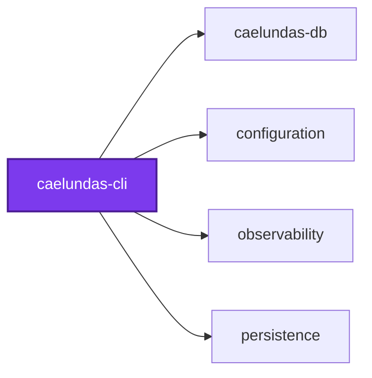
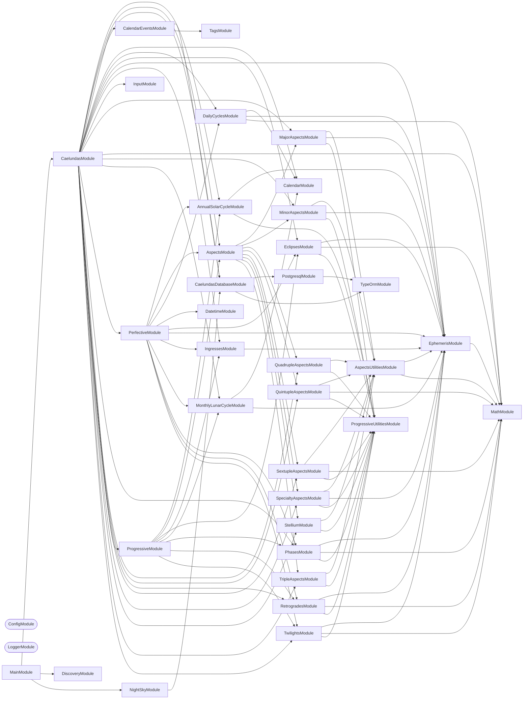

## 🕸️ Codependix

Dependency graphs exported by [codependix](https://github.com/Organizzolini/codebase/tree/main/projects/ic-suite/codependix/codependix-cli), regenerated by `nx run configuration:codependix:write`.

### Nx Neighborhood

<!-- codependix:start name="codependix-nx-projects" -->

<!-- codependix:end name="codependix-nx-projects" -->

### NestJS Module Graph

<!-- codependix:start name="codependix-nestjs-modules" -->


_Rounded modules are global: every module can inject them, so their edges are left out._
<!-- codependix:end name="codependix-nestjs-modules" -->

### File Imports

<!-- codependix:start name="codependix-file-imports" -->
```mermaid
graph LR
  file_callidescope_config_ts["callidescope.config.ts"]
  file_codependix_config_ts["codependix.config.ts"]
  file_codometer_config_ts["codometer.config.ts"]
  file_coinagerie_config_ts["coinagerie.config.ts"]
  file_eslint_config_ts["eslint.config.ts"]
  file_src_caelundas_cli_constants_ts["src/caelundas-cli.constants.ts"]
  file_src_caelundas_cli_main_end_to_end_test_ts["src/caelundas-cli.main.end-to-end.test.ts"]
  file_src_caelundas_cli_main_ts["src/caelundas-cli.main.ts"]
  file_src_caelundas_cli_main_unit_test_ts["src/caelundas-cli.main.unit.test.ts"]
  file_src_caelundas_cli_module_ts["src/caelundas-cli.module.ts"]
  file_src_caelundas_cli_repl_ts["src/caelundas-cli.repl.ts"]
  file_src_ephemeris_download_cli_main_ts["src/ephemeris-download-cli.main.ts"]
  file_src_ephemeris_download_cli_module_ts["src/ephemeris-download-cli.module.ts"]
  file_src_modules_annual_solar_cycle_annual_solar_cycle_events_service_ts["src/modules/annual-solar-cycle/annual-solar-cycle-events.service.ts"]
  file_src_modules_annual_solar_cycle_annual_solar_cycle_events_service_unit_test_ts["src/modules/annual-solar-cycle/annual-solar-cycle-events.service.unit.test.ts"]
  file_src_modules_annual_solar_cycle_annual_solar_cycle_constants_ts["src/modules/annual-solar-cycle/annual-solar-cycle.constants.ts"]
  file_src_modules_annual_solar_cycle_annual_solar_cycle_module_ts["src/modules/annual-solar-cycle/annual-solar-cycle.module.ts"]
  file_src_modules_annual_solar_cycle_annual_solar_cycle_service_ts["src/modules/annual-solar-cycle/annual-solar-cycle.service.ts"]
  file_src_modules_annual_solar_cycle_annual_solar_cycle_service_unit_test_ts["src/modules/annual-solar-cycle/annual-solar-cycle.service.unit.test.ts"]
  file_src_modules_annual_solar_cycle_annual_solar_cycle_types_ts["src/modules/annual-solar-cycle/annual-solar-cycle.types.ts"]
  file_src_modules_aspects_aspect_calculation_support_service_ts["src/modules/aspects/aspect-calculation-support.service.ts"]
  file_src_modules_aspects_aspect_calculation_support_service_unit_test_ts["src/modules/aspects/aspect-calculation-support.service.unit.test.ts"]
  file_src_modules_aspects_aspect_ephemeris_service_ts["src/modules/aspects/aspect-ephemeris.service.ts"]
  file_src_modules_aspects_aspect_ephemeris_service_unit_test_ts["src/modules/aspects/aspect-ephemeris.service.unit.test.ts"]
  file_src_modules_aspects_aspect_event_formatting_service_ts["src/modules/aspects/aspect-event-formatting.service.ts"]
  file_src_modules_aspects_aspect_event_formatting_service_unit_test_ts["src/modules/aspects/aspect-event-formatting.service.unit.test.ts"]
  file_src_modules_aspects_aspect_graph_service_ts["src/modules/aspects/aspect-graph.service.ts"]
  file_src_modules_aspects_aspect_graph_service_unit_test_ts["src/modules/aspects/aspect-graph.service.unit.test.ts"]
  file_src_modules_aspects_aspect_phase_emoji_service_ts["src/modules/aspects/aspect-phase-emoji.service.ts"]
  file_src_modules_aspects_aspect_phase_emoji_service_unit_test_ts["src/modules/aspects/aspect-phase-emoji.service.unit.test.ts"]
  file_src_modules_aspects_aspects_utilities_module_ts["src/modules/aspects/aspects-utilities.module.ts"]
  file_src_modules_aspects_aspects_utilities_service_ts["src/modules/aspects/aspects-utilities.service.ts"]
  file_src_modules_aspects_aspects_utilities_service_unit_test_ts["src/modules/aspects/aspects-utilities.service.unit.test.ts"]
  file_src_modules_aspects_aspects_constants_ts["src/modules/aspects/aspects.constants.ts"]
  file_src_modules_aspects_aspects_module_ts["src/modules/aspects/aspects.module.ts"]
  file_src_modules_aspects_aspects_service_ts["src/modules/aspects/aspects.service.ts"]
  file_src_modules_aspects_aspects_service_unit_test_ts["src/modules/aspects/aspects.service.unit.test.ts"]
  file_src_modules_aspects_aspects_types_ts["src/modules/aspects/aspects.types.ts"]
  file_src_modules_aspects_compound_phase_service_ts["src/modules/aspects/compound-phase.service.ts"]
  file_src_modules_aspects_compound_phase_service_unit_test_ts["src/modules/aspects/compound-phase.service.unit.test.ts"]
  file_src_modules_aspects_progressive_compound_event_service_ts["src/modules/aspects/progressive-compound-event.service.ts"]
  file_src_modules_aspects_progressive_compound_event_service_unit_test_ts["src/modules/aspects/progressive-compound-event.service.unit.test.ts"]
  file_src_modules_caelundas_caelundas_command_ts["src/modules/caelundas/caelundas.command.ts"]
  file_src_modules_caelundas_caelundas_command_unit_test_ts["src/modules/caelundas/caelundas.command.unit.test.ts"]
  file_src_modules_caelundas_caelundas_constants_ts["src/modules/caelundas/caelundas.constants.ts"]
  file_src_modules_caelundas_caelundas_module_ts["src/modules/caelundas/caelundas.module.ts"]
  file_src_modules_caelundas_caelundas_module_unit_test_ts["src/modules/caelundas/caelundas.module.unit.test.ts"]
  file_src_modules_caelundas_caelundas_types_ts["src/modules/caelundas/caelundas.types.ts"]
  file_src_modules_caelundas_caelundas_types_unit_test_ts["src/modules/caelundas/caelundas.types.unit.test.ts"]
  file_src_modules_caelundas_caelundas_utilities_ts["src/modules/caelundas/caelundas.utilities.ts"]
  file_src_modules_caelundas_symbol_caelundas_constants_ts["src/modules/caelundas/symbol-caelundas.constants.ts"]
  file_src_modules_calendar_events_calendar_events_constants_ts["src/modules/calendar-events/calendar-events.constants.ts"]
  file_src_modules_calendar_events_calendar_events_constants_unit_test_ts["src/modules/calendar-events/calendar-events.constants.unit.test.ts"]
  file_src_modules_calendar_events_calendar_events_module_ts["src/modules/calendar-events/calendar-events.module.ts"]
  file_src_modules_calendar_events_calendar_events_service_integration_test_ts["src/modules/calendar-events/calendar-events.service.integration.test.ts"]
  file_src_modules_calendar_events_calendar_events_service_ts["src/modules/calendar-events/calendar-events.service.ts"]
  file_src_modules_calendar_events_calendar_events_service_unit_test_ts["src/modules/calendar-events/calendar-events.service.unit.test.ts"]
  file_src_modules_calendar_events_calendar_events_types_ts["src/modules/calendar-events/calendar-events.types.ts"]
  file_src_modules_calendar_calendar_constants_ts["src/modules/calendar/calendar.constants.ts"]
  file_src_modules_calendar_calendar_module_ts["src/modules/calendar/calendar.module.ts"]
  file_src_modules_calendar_calendar_service_ts["src/modules/calendar/calendar.service.ts"]
  file_src_modules_calendar_calendar_service_unit_test_ts["src/modules/calendar/calendar.service.unit.test.ts"]
  file_src_modules_calendar_calendar_types_ts["src/modules/calendar/calendar.types.ts"]
  file_src_modules_daily_cycles_daily_cycles_builder_service_ts["src/modules/daily-cycles/daily-cycles-builder.service.ts"]
  file_src_modules_daily_cycles_daily_cycles_builder_service_unit_test_ts["src/modules/daily-cycles/daily-cycles-builder.service.unit.test.ts"]
  file_src_modules_daily_cycles_daily_cycles_constants_ts["src/modules/daily-cycles/daily-cycles.constants.ts"]
  file_src_modules_daily_cycles_daily_cycles_module_ts["src/modules/daily-cycles/daily-cycles.module.ts"]
  file_src_modules_daily_cycles_daily_cycles_service_ts["src/modules/daily-cycles/daily-cycles.service.ts"]
  file_src_modules_daily_cycles_daily_cycles_service_unit_test_ts["src/modules/daily-cycles/daily-cycles.service.unit.test.ts"]
  file_src_modules_daily_cycles_daily_cycles_types_ts["src/modules/daily-cycles/daily-cycles.types.ts"]
  file_src_modules_datetime_datetime_constants_ts["src/modules/datetime/datetime.constants.ts"]
  file_src_modules_datetime_datetime_module_ts["src/modules/datetime/datetime.module.ts"]
  file_src_modules_datetime_datetime_service_ts["src/modules/datetime/datetime.service.ts"]
  file_src_modules_datetime_datetime_service_unit_test_ts["src/modules/datetime/datetime.service.unit.test.ts"]
  file_src_modules_datetime_datetime_types_ts["src/modules/datetime/datetime.types.ts"]
  file_src_modules_eclipses_eclipse_calculation_service_ts["src/modules/eclipses/eclipse-calculation.service.ts"]
  file_src_modules_eclipses_eclipse_calculation_service_unit_test_ts["src/modules/eclipses/eclipse-calculation.service.unit.test.ts"]
  file_src_modules_eclipses_eclipse_classification_service_ts["src/modules/eclipses/eclipse-classification.service.ts"]
  file_src_modules_eclipses_eclipse_classification_service_unit_test_ts["src/modules/eclipses/eclipse-classification.service.unit.test.ts"]
  file_src_modules_eclipses_eclipse_event_service_ts["src/modules/eclipses/eclipse-event.service.ts"]
  file_src_modules_eclipses_eclipse_event_service_unit_test_ts["src/modules/eclipses/eclipse-event.service.unit.test.ts"]
  file_src_modules_eclipses_eclipse_geometry_service_ts["src/modules/eclipses/eclipse-geometry.service.ts"]
  file_src_modules_eclipses_eclipse_geometry_service_unit_test_ts["src/modules/eclipses/eclipse-geometry.service.unit.test.ts"]
  file_src_modules_eclipses_eclipse_topocentric_service_ts["src/modules/eclipses/eclipse-topocentric.service.ts"]
  file_src_modules_eclipses_eclipse_topocentric_service_unit_test_ts["src/modules/eclipses/eclipse-topocentric.service.unit.test.ts"]
  file_src_modules_eclipses_eclipses_constants_ts["src/modules/eclipses/eclipses.constants.ts"]
  file_src_modules_eclipses_eclipses_module_ts["src/modules/eclipses/eclipses.module.ts"]
  file_src_modules_eclipses_eclipses_service_ts["src/modules/eclipses/eclipses.service.ts"]
  file_src_modules_eclipses_eclipses_service_unit_test_ts["src/modules/eclipses/eclipses.service.unit.test.ts"]
  file_src_modules_eclipses_eclipses_types_ts["src/modules/eclipses/eclipses.types.ts"]
  file_src_modules_ephemeris_download_ephemeris_download_command_ts["src/modules/ephemeris-download/ephemeris-download.command.ts"]
  file_src_modules_ephemeris_download_ephemeris_download_command_unit_test_ts["src/modules/ephemeris-download/ephemeris-download.command.unit.test.ts"]
  file_src_modules_ephemeris_download_ephemeris_download_constants_ts["src/modules/ephemeris-download/ephemeris-download.constants.ts"]
  file_src_modules_ephemeris_download_ephemeris_download_module_ts["src/modules/ephemeris-download/ephemeris-download.module.ts"]
  file_src_modules_ephemeris_download_ephemeris_download_service_ts["src/modules/ephemeris-download/ephemeris-download.service.ts"]
  file_src_modules_ephemeris_download_ephemeris_download_service_unit_test_ts["src/modules/ephemeris-download/ephemeris-download.service.unit.test.ts"]
  file_src_modules_ephemeris_download_ephemeris_download_types_ts["src/modules/ephemeris-download/ephemeris-download.types.ts"]
  file_src_modules_ephemeris_download_ephemeris_download_utilities_ts["src/modules/ephemeris-download/ephemeris-download.utilities.ts"]
  file_src_modules_ephemeris_download_ephemeris_download_utilities_unit_test_ts["src/modules/ephemeris-download/ephemeris-download.utilities.unit.test.ts"]
  file_src_modules_ephemeris_ephemeris_aggregation_service_ts["src/modules/ephemeris/ephemeris-aggregation.service.ts"]
  file_src_modules_ephemeris_ephemeris_aggregation_service_unit_test_ts["src/modules/ephemeris/ephemeris-aggregation.service.unit.test.ts"]
  file_src_modules_ephemeris_ephemeris_constants_service_ts["src/modules/ephemeris/ephemeris-constants.service.ts"]
  file_src_modules_ephemeris_ephemeris_constants_service_unit_test_ts["src/modules/ephemeris/ephemeris-constants.service.unit.test.ts"]
  file_src_modules_ephemeris_ephemeris_coordinate_service_ts["src/modules/ephemeris/ephemeris-coordinate.service.ts"]
  file_src_modules_ephemeris_ephemeris_coordinate_service_unit_test_ts["src/modules/ephemeris/ephemeris-coordinate.service.unit.test.ts"]
  file_src_modules_ephemeris_ephemeris_horizon_service_integration_test_ts["src/modules/ephemeris/ephemeris-horizon.service.integration.test.ts"]
  file_src_modules_ephemeris_ephemeris_horizon_service_ts["src/modules/ephemeris/ephemeris-horizon.service.ts"]
  file_src_modules_ephemeris_ephemeris_horizon_service_unit_test_ts["src/modules/ephemeris/ephemeris-horizon.service.unit.test.ts"]
  file_src_modules_ephemeris_ephemeris_phenomena_service_ts["src/modules/ephemeris/ephemeris-phenomena.service.ts"]
  file_src_modules_ephemeris_ephemeris_phenomena_service_unit_test_ts["src/modules/ephemeris/ephemeris-phenomena.service.unit.test.ts"]
  file_src_modules_ephemeris_ephemeris_time_service_ts["src/modules/ephemeris/ephemeris-time.service.ts"]
  file_src_modules_ephemeris_ephemeris_time_service_unit_test_ts["src/modules/ephemeris/ephemeris-time.service.unit.test.ts"]
  file_src_modules_ephemeris_ephemeris_constants_ts["src/modules/ephemeris/ephemeris.constants.ts"]
  file_src_modules_ephemeris_ephemeris_constants_unit_test_ts["src/modules/ephemeris/ephemeris.constants.unit.test.ts"]
  file_src_modules_ephemeris_ephemeris_module_ts["src/modules/ephemeris/ephemeris.module.ts"]
  file_src_modules_ephemeris_ephemeris_service_ts["src/modules/ephemeris/ephemeris.service.ts"]
  file_src_modules_ephemeris_ephemeris_service_unit_test_ts["src/modules/ephemeris/ephemeris.service.unit.test.ts"]
  file_src_modules_ephemeris_ephemeris_types_ts["src/modules/ephemeris/ephemeris.types.ts"]
  file_src_modules_ephemeris_ephemeris_types_unit_test_ts["src/modules/ephemeris/ephemeris.types.unit.test.ts"]
  file_src_modules_ephemeris_ephemeris_utilities_ts["src/modules/ephemeris/ephemeris.utilities.ts"]
  file_src_modules_ephemeris_ephemeris_utilities_unit_test_ts["src/modules/ephemeris/ephemeris.utilities.unit.test.ts"]
  file_src_modules_ephemeris_internal_ephemeris_types_ts["src/modules/ephemeris/internal-ephemeris.types.ts"]
  file_src_modules_ingresses_ingresses_composer_service_ts["src/modules/ingresses/ingresses-composer.service.ts"]
  file_src_modules_ingresses_ingresses_composer_service_unit_test_ts["src/modules/ingresses/ingresses-composer.service.unit.test.ts"]
  file_src_modules_ingresses_ingresses_constants_ts["src/modules/ingresses/ingresses.constants.ts"]
  file_src_modules_ingresses_ingresses_module_ts["src/modules/ingresses/ingresses.module.ts"]
  file_src_modules_ingresses_ingresses_service_integration_test_ts["src/modules/ingresses/ingresses.service.integration.test.ts"]
  file_src_modules_ingresses_ingresses_service_ts["src/modules/ingresses/ingresses.service.ts"]
  file_src_modules_ingresses_ingresses_service_unit_test_ts["src/modules/ingresses/ingresses.service.unit.test.ts"]
  file_src_modules_ingresses_ingresses_types_ts["src/modules/ingresses/ingresses.types.ts"]
  file_src_modules_input_input_constants_ts["src/modules/input/input.constants.ts"]
  file_src_modules_input_input_module_ts["src/modules/input/input.module.ts"]
  file_src_modules_input_input_service_ts["src/modules/input/input.service.ts"]
  file_src_modules_input_input_service_unit_test_ts["src/modules/input/input.service.unit.test.ts"]
  file_src_modules_input_input_types_ts["src/modules/input/input.types.ts"]
  file_src_modules_major_aspects_major_aspect_event_service_ts["src/modules/major-aspects/major-aspect-event.service.ts"]
  file_src_modules_major_aspects_major_aspect_event_service_unit_test_ts["src/modules/major-aspects/major-aspect-event.service.unit.test.ts"]
  file_src_modules_major_aspects_major_aspect_progressive_service_ts["src/modules/major-aspects/major-aspect-progressive.service.ts"]
  file_src_modules_major_aspects_major_aspect_progressive_service_unit_test_ts["src/modules/major-aspects/major-aspect-progressive.service.unit.test.ts"]
  file_src_modules_major_aspects_major_aspects_constants_ts["src/modules/major-aspects/major-aspects.constants.ts"]
  file_src_modules_major_aspects_major_aspects_module_ts["src/modules/major-aspects/major-aspects.module.ts"]
  file_src_modules_major_aspects_major_aspects_service_integration_test_ts["src/modules/major-aspects/major-aspects.service.integration.test.ts"]
  file_src_modules_major_aspects_major_aspects_service_ts["src/modules/major-aspects/major-aspects.service.ts"]
  file_src_modules_major_aspects_major_aspects_service_unit_test_ts["src/modules/major-aspects/major-aspects.service.unit.test.ts"]
  file_src_modules_major_aspects_major_aspects_types_ts["src/modules/major-aspects/major-aspects.types.ts"]
  file_src_modules_math_math_constants_ts["src/modules/math/math.constants.ts"]
  file_src_modules_math_math_module_ts["src/modules/math/math.module.ts"]
  file_src_modules_math_math_service_ts["src/modules/math/math.service.ts"]
  file_src_modules_math_math_service_unit_test_ts["src/modules/math/math.service.unit.test.ts"]
  file_src_modules_math_math_types_ts["src/modules/math/math.types.ts"]
  file_src_modules_minor_aspects_minor_aspects_composer_service_ts["src/modules/minor-aspects/minor-aspects-composer.service.ts"]
  file_src_modules_minor_aspects_minor_aspects_composer_service_unit_test_ts["src/modules/minor-aspects/minor-aspects-composer.service.unit.test.ts"]
  file_src_modules_minor_aspects_minor_aspects_event_service_ts["src/modules/minor-aspects/minor-aspects-event.service.ts"]
  file_src_modules_minor_aspects_minor_aspects_event_service_unit_test_ts["src/modules/minor-aspects/minor-aspects-event.service.unit.test.ts"]
  file_src_modules_minor_aspects_minor_aspects_progressive_service_ts["src/modules/minor-aspects/minor-aspects-progressive.service.ts"]
  file_src_modules_minor_aspects_minor_aspects_progressive_service_unit_test_ts["src/modules/minor-aspects/minor-aspects-progressive.service.unit.test.ts"]
  file_src_modules_minor_aspects_minor_aspects_constants_ts["src/modules/minor-aspects/minor-aspects.constants.ts"]
  file_src_modules_minor_aspects_minor_aspects_module_ts["src/modules/minor-aspects/minor-aspects.module.ts"]
  file_src_modules_minor_aspects_minor_aspects_service_integration_test_ts["src/modules/minor-aspects/minor-aspects.service.integration.test.ts"]
  file_src_modules_minor_aspects_minor_aspects_service_ts["src/modules/minor-aspects/minor-aspects.service.ts"]
  file_src_modules_minor_aspects_minor_aspects_service_unit_test_ts["src/modules/minor-aspects/minor-aspects.service.unit.test.ts"]
  file_src_modules_minor_aspects_minor_aspects_types_ts["src/modules/minor-aspects/minor-aspects.types.ts"]
  file_src_modules_monthly_lunar_cycle_lunar_apsides_service_ts["src/modules/monthly-lunar-cycle/lunar-apsides.service.ts"]
  file_src_modules_monthly_lunar_cycle_lunar_apsides_service_unit_test_ts["src/modules/monthly-lunar-cycle/lunar-apsides.service.unit.test.ts"]
  file_src_modules_monthly_lunar_cycle_monthly_lunar_cycle_constants_ts["src/modules/monthly-lunar-cycle/monthly-lunar-cycle.constants.ts"]
  file_src_modules_monthly_lunar_cycle_monthly_lunar_cycle_module_ts["src/modules/monthly-lunar-cycle/monthly-lunar-cycle.module.ts"]
  file_src_modules_monthly_lunar_cycle_monthly_lunar_cycle_service_integration_test_ts["src/modules/monthly-lunar-cycle/monthly-lunar-cycle.service.integration.test.ts"]
  file_src_modules_monthly_lunar_cycle_monthly_lunar_cycle_service_ts["src/modules/monthly-lunar-cycle/monthly-lunar-cycle.service.ts"]
  file_src_modules_monthly_lunar_cycle_monthly_lunar_cycle_service_unit_test_ts["src/modules/monthly-lunar-cycle/monthly-lunar-cycle.service.unit.test.ts"]
  file_src_modules_monthly_lunar_cycle_monthly_lunar_cycle_types_ts["src/modules/monthly-lunar-cycle/monthly-lunar-cycle.types.ts"]
  file_src_modules_night_sky_night_sky_command_ts["src/modules/night-sky/night-sky.command.ts"]
  file_src_modules_night_sky_night_sky_command_unit_test_ts["src/modules/night-sky/night-sky.command.unit.test.ts"]
  file_src_modules_night_sky_night_sky_constants_ts["src/modules/night-sky/night-sky.constants.ts"]
  file_src_modules_night_sky_night_sky_module_ts["src/modules/night-sky/night-sky.module.ts"]
  file_src_modules_night_sky_night_sky_service_integration_test_ts["src/modules/night-sky/night-sky.service.integration.test.ts"]
  file_src_modules_night_sky_night_sky_service_ts["src/modules/night-sky/night-sky.service.ts"]
  file_src_modules_night_sky_night_sky_service_unit_test_ts["src/modules/night-sky/night-sky.service.unit.test.ts"]
  file_src_modules_night_sky_night_sky_types_ts["src/modules/night-sky/night-sky.types.ts"]
  file_src_modules_night_sky_night_sky_utilities_ts["src/modules/night-sky/night-sky.utilities.ts"]
  file_src_modules_night_sky_night_sky_utilities_unit_test_ts["src/modules/night-sky/night-sky.utilities.unit.test.ts"]
  file_src_modules_perfective_perfective_constants_ts["src/modules/perfective/perfective.constants.ts"]
  file_src_modules_perfective_perfective_module_ts["src/modules/perfective/perfective.module.ts"]
  file_src_modules_perfective_perfective_service_ts["src/modules/perfective/perfective.service.ts"]
  file_src_modules_perfective_perfective_service_unit_test_ts["src/modules/perfective/perfective.service.unit.test.ts"]
  file_src_modules_perfective_perfective_types_ts["src/modules/perfective/perfective.types.ts"]
  file_src_modules_phases_martian_phase_service_ts["src/modules/phases/martian-phase.service.ts"]
  file_src_modules_phases_martian_phase_service_unit_test_ts["src/modules/phases/martian-phase.service.unit.test.ts"]
  file_src_modules_phases_mercurian_phase_service_ts["src/modules/phases/mercurian-phase.service.ts"]
  file_src_modules_phases_mercurian_phase_service_unit_test_ts["src/modules/phases/mercurian-phase.service.unit.test.ts"]
  file_src_modules_phases_phase_calculation_service_integration_test_ts["src/modules/phases/phase-calculation.service.integration.test.ts"]
  file_src_modules_phases_phase_calculation_service_ts["src/modules/phases/phase-calculation.service.ts"]
  file_src_modules_phases_phase_calculation_service_unit_test_ts["src/modules/phases/phase-calculation.service.unit.test.ts"]
  file_src_modules_phases_phases_constants_ts["src/modules/phases/phases.constants.ts"]
  file_src_modules_phases_phases_module_ts["src/modules/phases/phases.module.ts"]
  file_src_modules_phases_phases_service_integration_test_ts["src/modules/phases/phases.service.integration.test.ts"]
  file_src_modules_phases_phases_service_ts["src/modules/phases/phases.service.ts"]
  file_src_modules_phases_phases_service_unit_test_ts["src/modules/phases/phases.service.unit.test.ts"]
  file_src_modules_phases_phases_types_ts["src/modules/phases/phases.types.ts"]
  file_src_modules_phases_venusian_phase_service_ts["src/modules/phases/venusian-phase.service.ts"]
  file_src_modules_phases_venusian_phase_service_unit_test_ts["src/modules/phases/venusian-phase.service.unit.test.ts"]
  file_src_modules_progressive_progressive_aspect_service_ts["src/modules/progressive/progressive-aspect.service.ts"]
  file_src_modules_progressive_progressive_aspect_service_unit_test_ts["src/modules/progressive/progressive-aspect.service.unit.test.ts"]
  file_src_modules_progressive_progressive_utilities_module_ts["src/modules/progressive/progressive-utilities.module.ts"]
  file_src_modules_progressive_progressive_utilities_service_ts["src/modules/progressive/progressive-utilities.service.ts"]
  file_src_modules_progressive_progressive_utilities_service_unit_test_ts["src/modules/progressive/progressive-utilities.service.unit.test.ts"]
  file_src_modules_progressive_progressive_constants_ts["src/modules/progressive/progressive.constants.ts"]
  file_src_modules_progressive_progressive_module_ts["src/modules/progressive/progressive.module.ts"]
  file_src_modules_progressive_progressive_service_integration_test_ts["src/modules/progressive/progressive.service.integration.test.ts"]
  file_src_modules_progressive_progressive_service_ts["src/modules/progressive/progressive.service.ts"]
  file_src_modules_progressive_progressive_service_unit_test_ts["src/modules/progressive/progressive.service.unit.test.ts"]
  file_src_modules_progressive_progressive_types_ts["src/modules/progressive/progressive.types.ts"]
  file_src_modules_quadruple_aspects_quadruple_aspects_base_service_ts["src/modules/quadruple-aspects/quadruple-aspects-base.service.ts"]
  file_src_modules_quadruple_aspects_quadruple_aspects_base_service_unit_test_ts["src/modules/quadruple-aspects/quadruple-aspects-base.service.unit.test.ts"]
  file_src_modules_quadruple_aspects_quadruple_aspects_composer_service_ts["src/modules/quadruple-aspects/quadruple-aspects-composer.service.ts"]
  file_src_modules_quadruple_aspects_quadruple_aspects_composer_service_unit_test_ts["src/modules/quadruple-aspects/quadruple-aspects-composer.service.unit.test.ts"]
  file_src_modules_quadruple_aspects_quadruple_aspects_constants_ts["src/modules/quadruple-aspects/quadruple-aspects.constants.ts"]
  file_src_modules_quadruple_aspects_quadruple_aspects_module_ts["src/modules/quadruple-aspects/quadruple-aspects.module.ts"]
  file_src_modules_quadruple_aspects_quadruple_aspects_service_integration_test_ts["src/modules/quadruple-aspects/quadruple-aspects.service.integration.test.ts"]
  file_src_modules_quadruple_aspects_quadruple_aspects_service_ts["src/modules/quadruple-aspects/quadruple-aspects.service.ts"]
  file_src_modules_quadruple_aspects_quadruple_aspects_service_unit_test_ts["src/modules/quadruple-aspects/quadruple-aspects.service.unit.test.ts"]
  file_src_modules_quadruple_aspects_quadruple_aspects_types_ts["src/modules/quadruple-aspects/quadruple-aspects.types.ts"]
  file_src_modules_quintuple_aspects_quintuple_aspects_composer_service_ts["src/modules/quintuple-aspects/quintuple-aspects-composer.service.ts"]
  file_src_modules_quintuple_aspects_quintuple_aspects_composer_service_unit_test_ts["src/modules/quintuple-aspects/quintuple-aspects-composer.service.unit.test.ts"]
  file_src_modules_quintuple_aspects_quintuple_aspects_constants_ts["src/modules/quintuple-aspects/quintuple-aspects.constants.ts"]
  file_src_modules_quintuple_aspects_quintuple_aspects_module_ts["src/modules/quintuple-aspects/quintuple-aspects.module.ts"]
  file_src_modules_quintuple_aspects_quintuple_aspects_service_integration_test_ts["src/modules/quintuple-aspects/quintuple-aspects.service.integration.test.ts"]
  file_src_modules_quintuple_aspects_quintuple_aspects_service_ts["src/modules/quintuple-aspects/quintuple-aspects.service.ts"]
  file_src_modules_quintuple_aspects_quintuple_aspects_service_unit_test_ts["src/modules/quintuple-aspects/quintuple-aspects.service.unit.test.ts"]
  file_src_modules_quintuple_aspects_quintuple_aspects_types_ts["src/modules/quintuple-aspects/quintuple-aspects.types.ts"]
  file_src_modules_retrogrades_retrogrades_constants_ts["src/modules/retrogrades/retrogrades.constants.ts"]
  file_src_modules_retrogrades_retrogrades_module_ts["src/modules/retrogrades/retrogrades.module.ts"]
  file_src_modules_retrogrades_retrogrades_service_integration_test_ts["src/modules/retrogrades/retrogrades.service.integration.test.ts"]
  file_src_modules_retrogrades_retrogrades_service_ts["src/modules/retrogrades/retrogrades.service.ts"]
  file_src_modules_retrogrades_retrogrades_service_unit_test_ts["src/modules/retrogrades/retrogrades.service.unit.test.ts"]
  file_src_modules_retrogrades_retrogrades_types_ts["src/modules/retrogrades/retrogrades.types.ts"]
  file_src_modules_sextuple_aspects_sextuple_aspects_composer_service_ts["src/modules/sextuple-aspects/sextuple-aspects-composer.service.ts"]
  file_src_modules_sextuple_aspects_sextuple_aspects_composer_service_unit_test_ts["src/modules/sextuple-aspects/sextuple-aspects-composer.service.unit.test.ts"]
  file_src_modules_sextuple_aspects_sextuple_aspects_constants_ts["src/modules/sextuple-aspects/sextuple-aspects.constants.ts"]
  file_src_modules_sextuple_aspects_sextuple_aspects_module_ts["src/modules/sextuple-aspects/sextuple-aspects.module.ts"]
  file_src_modules_sextuple_aspects_sextuple_aspects_service_integration_test_ts["src/modules/sextuple-aspects/sextuple-aspects.service.integration.test.ts"]
  file_src_modules_sextuple_aspects_sextuple_aspects_service_ts["src/modules/sextuple-aspects/sextuple-aspects.service.ts"]
  file_src_modules_sextuple_aspects_sextuple_aspects_service_unit_test_ts["src/modules/sextuple-aspects/sextuple-aspects.service.unit.test.ts"]
  file_src_modules_sextuple_aspects_sextuple_aspects_types_ts["src/modules/sextuple-aspects/sextuple-aspects.types.ts"]
  file_src_modules_specialty_aspects_specialty_aspects_composer_service_ts["src/modules/specialty-aspects/specialty-aspects-composer.service.ts"]
  file_src_modules_specialty_aspects_specialty_aspects_composer_service_unit_test_ts["src/modules/specialty-aspects/specialty-aspects-composer.service.unit.test.ts"]
  file_src_modules_specialty_aspects_specialty_aspects_event_service_ts["src/modules/specialty-aspects/specialty-aspects-event.service.ts"]
  file_src_modules_specialty_aspects_specialty_aspects_event_service_unit_test_ts["src/modules/specialty-aspects/specialty-aspects-event.service.unit.test.ts"]
  file_src_modules_specialty_aspects_specialty_aspects_progressive_service_ts["src/modules/specialty-aspects/specialty-aspects-progressive.service.ts"]
  file_src_modules_specialty_aspects_specialty_aspects_progressive_service_unit_test_ts["src/modules/specialty-aspects/specialty-aspects-progressive.service.unit.test.ts"]
  file_src_modules_specialty_aspects_specialty_aspects_constants_ts["src/modules/specialty-aspects/specialty-aspects.constants.ts"]
  file_src_modules_specialty_aspects_specialty_aspects_module_ts["src/modules/specialty-aspects/specialty-aspects.module.ts"]
  file_src_modules_specialty_aspects_specialty_aspects_service_ts["src/modules/specialty-aspects/specialty-aspects.service.ts"]
  file_src_modules_specialty_aspects_specialty_aspects_service_unit_test_ts["src/modules/specialty-aspects/specialty-aspects.service.unit.test.ts"]
  file_src_modules_specialty_aspects_specialty_aspects_types_ts["src/modules/specialty-aspects/specialty-aspects.types.ts"]
  file_src_modules_stellium_stellium_constants_ts["src/modules/stellium/stellium.constants.ts"]
  file_src_modules_stellium_stellium_module_ts["src/modules/stellium/stellium.module.ts"]
  file_src_modules_stellium_stellium_service_ts["src/modules/stellium/stellium.service.ts"]
  file_src_modules_stellium_stellium_service_unit_test_ts["src/modules/stellium/stellium.service.unit.test.ts"]
  file_src_modules_stellium_stellium_types_ts["src/modules/stellium/stellium.types.ts"]
  file_src_modules_tags_tag_dimensions_constants_ts["src/modules/tags/tag-dimensions.constants.ts"]
  file_src_modules_tags_tag_map_constants_ts["src/modules/tags/tag-map.constants.ts"]
  file_src_modules_tags_tag_map_constants_unit_test_ts["src/modules/tags/tag-map.constants.unit.test.ts"]
  file_src_modules_tags_tag_map_functions_ts["src/modules/tags/tag-map.functions.ts"]
  file_src_modules_tags_tags_constants_ts["src/modules/tags/tags.constants.ts"]
  file_src_modules_tags_tags_module_ts["src/modules/tags/tags.module.ts"]
  file_src_modules_tags_tags_service_ts["src/modules/tags/tags.service.ts"]
  file_src_modules_tags_tags_service_unit_test_ts["src/modules/tags/tags.service.unit.test.ts"]
  file_src_modules_tags_tags_types_ts["src/modules/tags/tags.types.ts"]
  file_src_modules_tags_tags_utilities_ts["src/modules/tags/tags.utilities.ts"]
  file_src_modules_tags_tags_utilities_unit_test_ts["src/modules/tags/tags.utilities.unit.test.ts"]
  file_src_modules_triple_aspects_triple_aspects_composer_service_ts["src/modules/triple-aspects/triple-aspects-composer.service.ts"]
  file_src_modules_triple_aspects_triple_aspects_composer_service_unit_test_ts["src/modules/triple-aspects/triple-aspects-composer.service.unit.test.ts"]
  file_src_modules_triple_aspects_triple_aspects_detector_service_ts["src/modules/triple-aspects/triple-aspects-detector.service.ts"]
  file_src_modules_triple_aspects_triple_aspects_detector_service_unit_test_ts["src/modules/triple-aspects/triple-aspects-detector.service.unit.test.ts"]
  file_src_modules_triple_aspects_triple_aspects_constants_ts["src/modules/triple-aspects/triple-aspects.constants.ts"]
  file_src_modules_triple_aspects_triple_aspects_module_ts["src/modules/triple-aspects/triple-aspects.module.ts"]
  file_src_modules_triple_aspects_triple_aspects_service_integration_test_ts["src/modules/triple-aspects/triple-aspects.service.integration.test.ts"]
  file_src_modules_triple_aspects_triple_aspects_service_ts["src/modules/triple-aspects/triple-aspects.service.ts"]
  file_src_modules_triple_aspects_triple_aspects_service_unit_test_ts["src/modules/triple-aspects/triple-aspects.service.unit.test.ts"]
  file_src_modules_triple_aspects_triple_aspects_types_ts["src/modules/triple-aspects/triple-aspects.types.ts"]
  file_src_modules_twilights_twilights_builder_service_ts["src/modules/twilights/twilights-builder.service.ts"]
  file_src_modules_twilights_twilights_builder_service_unit_test_ts["src/modules/twilights/twilights-builder.service.unit.test.ts"]
  file_src_modules_twilights_twilights_composer_service_ts["src/modules/twilights/twilights-composer.service.ts"]
  file_src_modules_twilights_twilights_composer_service_unit_test_ts["src/modules/twilights/twilights-composer.service.unit.test.ts"]
  file_src_modules_twilights_twilights_detector_service_ts["src/modules/twilights/twilights-detector.service.ts"]
  file_src_modules_twilights_twilights_detector_service_unit_test_ts["src/modules/twilights/twilights-detector.service.unit.test.ts"]
  file_src_modules_twilights_twilights_constants_ts["src/modules/twilights/twilights.constants.ts"]
  file_src_modules_twilights_twilights_module_ts["src/modules/twilights/twilights.module.ts"]
  file_src_modules_twilights_twilights_service_ts["src/modules/twilights/twilights.service.ts"]
  file_src_modules_twilights_twilights_service_unit_test_ts["src/modules/twilights/twilights.service.unit.test.ts"]
  file_src_modules_twilights_twilights_types_ts["src/modules/twilights/twilights.types.ts"]
  file_testing_aspect_test_utilities_ts["testing/aspect-test.utilities.ts"]
  file_testing_calendar_command_types_ts["testing/calendar-command.types.ts"]
  file_testing_calendar_command_utilities_ts["testing/calendar-command.utilities.ts"]
  file_testing_compound_aspect_seeding_end_to_end_test_ts["testing/compound-aspect-seeding.end-to-end.test.ts"]
  file_testing_compound_aspects_end_to_end_test_ts["testing/compound-aspects.end-to-end.test.ts"]
  file_testing_database_ts["testing/database.ts"]
  file_testing_eclipse_test_constants_ts["testing/eclipse-test.constants.ts"]
  file_testing_eclipse_test_utilities_ts["testing/eclipse-test.utilities.ts"]
  file_testing_major_aspects_utilities_ts["testing/major-aspects.utilities.ts"]
  file_testing_mocks_ts["testing/mocks.ts"]
  file_testing_moon_phases_reference_end_to_end_test_ts["testing/moon-phases-reference.end-to-end.test.ts"]
  file_testing_pipeline_reference_1_end_to_end_test_ts["testing/pipeline-reference-1.end-to-end.test.ts"]
  file_testing_pipeline_reference_2_end_to_end_test_ts["testing/pipeline-reference-2.end-to-end.test.ts"]
  file_testing_pipeline_reference_3_end_to_end_test_ts["testing/pipeline-reference-3.end-to-end.test.ts"]
  file_testing_pipeline_reference_4_end_to_end_test_ts["testing/pipeline-reference-4.end-to-end.test.ts"]
  file_testing_pipeline_reference_functions_ts["testing/pipeline-reference.functions.ts"]
  file_testing_pipeline_window_constants_ts["testing/pipeline-window.constants.ts"]
  file_testing_pipeline_window_end_to_end_test_ts["testing/pipeline-window.end-to-end.test.ts"]
  file_testing_pipeline_window_functions_ts["testing/pipeline-window.functions.ts"]
  file_testing_pipeline_window_module_ts["testing/pipeline-window.module.ts"]
  file_testing_pipeline_window_types_ts["testing/pipeline-window.types.ts"]
  file_testing_reference_families_constants_ts["testing/reference-families.constants.ts"]
  file_testing_reference_families_utilities_ts["testing/reference-families.utilities.ts"]
  file_testing_reference_families_utilities_unit_test_ts["testing/reference-families.utilities.unit.test.ts"]
  file_testing_reference_fixture_names_constants_ts["testing/reference-fixture-names.constants.ts"]
  file_testing_reference_fixtures_constants_ts["testing/reference-fixtures.constants.ts"]
  file_testing_reference_fixtures_types_ts["testing/reference-fixtures.types.ts"]
  file_testing_reference_fixtures_utilities_ts["testing/reference-fixtures.utilities.ts"]
  file_testing_reference_fixtures_utilities_unit_test_ts["testing/reference-fixtures.utilities.unit.test.ts"]
  file_testing_reference_longitudes_constants_ts["testing/reference-longitudes.constants.ts"]
  file_testing_setup_ts["testing/setup.ts"]
  file_testing_stellium_cliques_unit_test_ts["testing/stellium-cliques.unit.test.ts"]
  file_testing_stellium_reference_unit_test_ts["testing/stellium-reference.unit.test.ts"]
  file_vitest_config_ts["vitest.config.ts"]
  file_src_caelundas_cli_main_end_to_end_test_ts --> file_src_caelundas_cli_constants_ts
  file_src_caelundas_cli_main_end_to_end_test_ts --> file_src_modules_calendar_calendar_service_ts
  file_src_caelundas_cli_main_end_to_end_test_ts --> file_src_modules_ephemeris_ephemeris_service_ts
  file_src_caelundas_cli_main_end_to_end_test_ts --> file_src_modules_ingresses_ingresses_service_ts
  file_src_caelundas_cli_main_end_to_end_test_ts --> file_src_modules_input_input_constants_ts
  file_src_caelundas_cli_main_end_to_end_test_ts --> file_src_modules_input_input_types_ts
  file_src_caelundas_cli_main_end_to_end_test_ts --> file_src_modules_math_math_service_ts
  file_src_caelundas_cli_main_end_to_end_test_ts --> file_src_modules_progressive_progressive_utilities_service_ts
  file_src_caelundas_cli_main_end_to_end_test_ts --> file_testing_calendar_command_types_ts
  file_src_caelundas_cli_main_end_to_end_test_ts --> file_testing_calendar_command_utilities_ts
  file_src_caelundas_cli_main_end_to_end_test_ts --> file_testing_database_ts
  file_src_caelundas_cli_main_end_to_end_test_ts --> file_testing_major_aspects_utilities_ts
  file_src_caelundas_cli_main_ts --> file_src_caelundas_cli_module_ts
  file_src_caelundas_cli_main_unit_test_ts --> file_src_caelundas_cli_module_ts
  file_src_caelundas_cli_module_ts --> file_src_caelundas_cli_constants_ts
  file_src_caelundas_cli_module_ts --> file_src_modules_caelundas_caelundas_module_ts
  file_src_caelundas_cli_module_ts --> file_src_modules_night_sky_night_sky_module_ts
  file_src_caelundas_cli_repl_ts --> file_src_caelundas_cli_module_ts
  file_src_ephemeris_download_cli_main_ts --> file_src_ephemeris_download_cli_module_ts
  file_src_ephemeris_download_cli_module_ts --> file_src_modules_ephemeris_download_ephemeris_download_module_ts
  file_src_modules_annual_solar_cycle_annual_solar_cycle_events_service_ts --> file_src_modules_annual_solar_cycle_annual_solar_cycle_constants_ts
  file_src_modules_annual_solar_cycle_annual_solar_cycle_events_service_ts --> file_src_modules_annual_solar_cycle_annual_solar_cycle_types_ts
  file_src_modules_annual_solar_cycle_annual_solar_cycle_events_service_ts --> file_src_modules_calendar_events_calendar_events_types_ts
  file_src_modules_annual_solar_cycle_annual_solar_cycle_events_service_unit_test_ts --> file_src_modules_annual_solar_cycle_annual_solar_cycle_events_service_ts
  file_src_modules_annual_solar_cycle_annual_solar_cycle_module_ts --> file_src_modules_annual_solar_cycle_annual_solar_cycle_events_service_ts
  file_src_modules_annual_solar_cycle_annual_solar_cycle_module_ts --> file_src_modules_annual_solar_cycle_annual_solar_cycle_service_ts
  file_src_modules_annual_solar_cycle_annual_solar_cycle_module_ts --> file_src_modules_ephemeris_ephemeris_module_ts
  file_src_modules_annual_solar_cycle_annual_solar_cycle_module_ts --> file_src_modules_progressive_progressive_utilities_module_ts
  file_src_modules_annual_solar_cycle_annual_solar_cycle_service_ts --> file_src_modules_annual_solar_cycle_annual_solar_cycle_events_service_ts
  file_src_modules_annual_solar_cycle_annual_solar_cycle_service_ts --> file_src_modules_annual_solar_cycle_annual_solar_cycle_constants_ts
  file_src_modules_annual_solar_cycle_annual_solar_cycle_service_ts --> file_src_modules_annual_solar_cycle_annual_solar_cycle_types_ts
  file_src_modules_annual_solar_cycle_annual_solar_cycle_service_ts --> file_src_modules_calendar_events_calendar_events_types_ts
  file_src_modules_annual_solar_cycle_annual_solar_cycle_service_ts --> file_src_modules_ephemeris_ephemeris_service_ts
  file_src_modules_annual_solar_cycle_annual_solar_cycle_service_ts --> file_src_modules_ephemeris_ephemeris_types_ts
  file_src_modules_annual_solar_cycle_annual_solar_cycle_service_ts --> file_src_modules_progressive_progressive_utilities_service_ts
  file_src_modules_annual_solar_cycle_annual_solar_cycle_service_unit_test_ts --> file_src_modules_annual_solar_cycle_annual_solar_cycle_events_service_ts
  file_src_modules_annual_solar_cycle_annual_solar_cycle_service_unit_test_ts --> file_src_modules_annual_solar_cycle_annual_solar_cycle_service_ts
  file_src_modules_annual_solar_cycle_annual_solar_cycle_service_unit_test_ts --> file_src_modules_caelundas_caelundas_constants_ts
  file_src_modules_annual_solar_cycle_annual_solar_cycle_service_unit_test_ts --> file_src_modules_calendar_events_calendar_events_types_ts
  file_src_modules_annual_solar_cycle_annual_solar_cycle_service_unit_test_ts --> file_src_modules_ephemeris_ephemeris_module_ts
  file_src_modules_annual_solar_cycle_annual_solar_cycle_service_unit_test_ts --> file_src_modules_ephemeris_ephemeris_types_ts
  file_src_modules_annual_solar_cycle_annual_solar_cycle_service_unit_test_ts --> file_src_modules_progressive_progressive_utilities_service_ts
  file_src_modules_annual_solar_cycle_annual_solar_cycle_types_ts --> file_src_modules_ephemeris_ephemeris_types_ts
  file_src_modules_aspects_aspect_calculation_support_service_ts --> file_src_modules_aspects_aspects_types_ts
  file_src_modules_aspects_aspect_calculation_support_service_ts --> file_src_modules_caelundas_caelundas_types_ts
  file_src_modules_aspects_aspect_calculation_support_service_ts --> file_src_modules_ephemeris_ephemeris_service_ts
  file_src_modules_aspects_aspect_calculation_support_service_ts --> file_src_modules_ephemeris_ephemeris_types_ts
  file_src_modules_aspects_aspect_calculation_support_service_unit_test_ts --> file_src_modules_aspects_aspect_calculation_support_service_ts
  file_src_modules_aspects_aspect_calculation_support_service_unit_test_ts --> file_src_modules_ephemeris_ephemeris_service_ts
  file_src_modules_aspects_aspect_calculation_support_service_unit_test_ts --> file_src_modules_ephemeris_ephemeris_types_ts
  file_src_modules_aspects_aspect_ephemeris_service_ts --> file_src_modules_aspects_aspect_calculation_support_service_ts
  file_src_modules_aspects_aspect_ephemeris_service_ts --> file_src_modules_ephemeris_ephemeris_service_ts
  file_src_modules_aspects_aspect_ephemeris_service_unit_test_ts --> file_src_modules_aspects_aspect_ephemeris_service_ts
  file_src_modules_aspects_aspect_ephemeris_service_unit_test_ts --> file_src_modules_ephemeris_ephemeris_service_ts
  file_src_modules_aspects_aspect_event_formatting_service_ts --> file_src_modules_aspects_aspects_constants_ts
  file_src_modules_aspects_aspect_event_formatting_service_ts --> file_src_modules_caelundas_caelundas_types_ts
  file_src_modules_aspects_aspect_event_formatting_service_ts --> file_src_modules_caelundas_symbol_caelundas_constants_ts
  file_src_modules_aspects_aspect_event_formatting_service_ts --> file_src_modules_calendar_events_calendar_events_types_ts
  file_src_modules_aspects_aspect_event_formatting_service_unit_test_ts --> file_src_modules_aspects_aspect_event_formatting_service_ts
  file_src_modules_aspects_aspect_graph_service_ts --> file_src_modules_aspects_aspects_types_ts
  file_src_modules_aspects_aspect_graph_service_ts --> file_src_modules_caelundas_caelundas_constants_ts
  file_src_modules_aspects_aspect_graph_service_ts --> file_src_modules_caelundas_caelundas_types_ts
  file_src_modules_aspects_aspect_graph_service_unit_test_ts --> file_src_modules_aspects_aspect_graph_service_ts
  file_src_modules_aspects_aspect_phase_emoji_service_ts --> file_src_modules_aspects_aspect_event_formatting_service_ts
  file_src_modules_aspects_aspect_phase_emoji_service_unit_test_ts --> file_src_modules_aspects_aspect_phase_emoji_service_ts
  file_src_modules_aspects_aspects_utilities_module_ts --> file_src_modules_aspects_aspect_calculation_support_service_ts
  file_src_modules_aspects_aspects_utilities_module_ts --> file_src_modules_aspects_aspect_ephemeris_service_ts
  file_src_modules_aspects_aspects_utilities_module_ts --> file_src_modules_aspects_aspect_event_formatting_service_ts
  file_src_modules_aspects_aspects_utilities_module_ts --> file_src_modules_aspects_aspect_graph_service_ts
  file_src_modules_aspects_aspects_utilities_module_ts --> file_src_modules_aspects_aspect_phase_emoji_service_ts
  file_src_modules_aspects_aspects_utilities_module_ts --> file_src_modules_aspects_aspects_utilities_service_ts
  file_src_modules_aspects_aspects_utilities_module_ts --> file_src_modules_aspects_compound_phase_service_ts
  file_src_modules_aspects_aspects_utilities_module_ts --> file_src_modules_aspects_progressive_compound_event_service_ts
  file_src_modules_aspects_aspects_utilities_module_ts --> file_src_modules_ephemeris_ephemeris_module_ts
  file_src_modules_aspects_aspects_utilities_module_ts --> file_src_modules_math_math_module_ts
  file_src_modules_aspects_aspects_utilities_service_ts --> file_src_modules_aspects_aspects_constants_ts
  file_src_modules_aspects_aspects_utilities_service_ts --> file_src_modules_aspects_aspects_types_ts
  file_src_modules_aspects_aspects_utilities_service_ts --> file_src_modules_caelundas_caelundas_constants_ts
  file_src_modules_aspects_aspects_utilities_service_ts --> file_src_modules_caelundas_caelundas_types_ts
  file_src_modules_aspects_aspects_utilities_service_ts --> file_src_modules_math_math_service_ts
  file_src_modules_aspects_aspects_utilities_service_unit_test_ts --> file_src_modules_aspects_aspects_utilities_service_ts
  file_src_modules_aspects_aspects_utilities_service_unit_test_ts --> file_src_modules_aspects_aspects_types_ts
  file_src_modules_aspects_aspects_utilities_service_unit_test_ts --> file_src_modules_caelundas_caelundas_constants_ts
  file_src_modules_aspects_aspects_utilities_service_unit_test_ts --> file_src_modules_caelundas_caelundas_types_ts
  file_src_modules_aspects_aspects_utilities_service_unit_test_ts --> file_src_modules_math_math_service_ts
  file_src_modules_aspects_aspects_module_ts --> file_src_modules_aspects_aspects_constants_ts
  file_src_modules_aspects_aspects_module_ts --> file_src_modules_aspects_aspects_service_ts
  file_src_modules_aspects_aspects_module_ts --> file_src_modules_aspects_aspects_types_ts
  file_src_modules_aspects_aspects_module_ts --> file_src_modules_major_aspects_major_aspects_module_ts
  file_src_modules_aspects_aspects_module_ts --> file_src_modules_major_aspects_major_aspects_service_ts
  file_src_modules_aspects_aspects_module_ts --> file_src_modules_minor_aspects_minor_aspects_module_ts
  file_src_modules_aspects_aspects_module_ts --> file_src_modules_minor_aspects_minor_aspects_service_ts
  file_src_modules_aspects_aspects_module_ts --> file_src_modules_quadruple_aspects_quadruple_aspects_module_ts
  file_src_modules_aspects_aspects_module_ts --> file_src_modules_quadruple_aspects_quadruple_aspects_service_ts
  file_src_modules_aspects_aspects_module_ts --> file_src_modules_quintuple_aspects_quintuple_aspects_module_ts
  file_src_modules_aspects_aspects_module_ts --> file_src_modules_quintuple_aspects_quintuple_aspects_service_ts
  file_src_modules_aspects_aspects_module_ts --> file_src_modules_sextuple_aspects_sextuple_aspects_module_ts
  file_src_modules_aspects_aspects_module_ts --> file_src_modules_sextuple_aspects_sextuple_aspects_service_ts
  file_src_modules_aspects_aspects_module_ts --> file_src_modules_specialty_aspects_specialty_aspects_module_ts
  file_src_modules_aspects_aspects_module_ts --> file_src_modules_specialty_aspects_specialty_aspects_service_ts
  file_src_modules_aspects_aspects_module_ts --> file_src_modules_stellium_stellium_module_ts
  file_src_modules_aspects_aspects_module_ts --> file_src_modules_stellium_stellium_service_ts
  file_src_modules_aspects_aspects_module_ts --> file_src_modules_triple_aspects_triple_aspects_module_ts
  file_src_modules_aspects_aspects_module_ts --> file_src_modules_triple_aspects_triple_aspects_service_ts
  file_src_modules_aspects_aspects_service_ts --> file_src_modules_aspects_aspects_constants_ts
  file_src_modules_aspects_aspects_service_ts --> file_src_modules_aspects_aspects_types_ts
  file_src_modules_aspects_aspects_service_ts --> file_src_modules_caelundas_caelundas_constants_ts
  file_src_modules_aspects_aspects_service_ts --> file_src_modules_caelundas_caelundas_types_ts
  file_src_modules_aspects_aspects_service_ts --> file_src_modules_calendar_events_calendar_events_types_ts
  file_src_modules_aspects_aspects_service_ts --> file_src_modules_ephemeris_ephemeris_types_ts
  file_src_modules_aspects_aspects_service_unit_test_ts --> file_src_modules_aspects_aspect_ephemeris_service_ts
  file_src_modules_aspects_aspects_service_unit_test_ts --> file_src_modules_aspects_aspect_event_formatting_service_ts
  file_src_modules_aspects_aspects_service_unit_test_ts --> file_src_modules_aspects_aspect_graph_service_ts
  file_src_modules_aspects_aspects_service_unit_test_ts --> file_src_modules_aspects_aspect_phase_emoji_service_ts
  file_src_modules_aspects_aspects_service_unit_test_ts --> file_src_modules_aspects_aspects_utilities_service_ts
  file_src_modules_aspects_aspects_service_unit_test_ts --> file_src_modules_aspects_aspects_constants_ts
  file_src_modules_aspects_aspects_service_unit_test_ts --> file_src_modules_aspects_aspects_service_ts
  file_src_modules_aspects_aspects_service_unit_test_ts --> file_src_modules_aspects_aspects_types_ts
  file_src_modules_aspects_aspects_service_unit_test_ts --> file_src_modules_aspects_compound_phase_service_ts
  file_src_modules_aspects_aspects_service_unit_test_ts --> file_src_modules_aspects_progressive_compound_event_service_ts
  file_src_modules_aspects_aspects_service_unit_test_ts --> file_src_modules_caelundas_caelundas_types_ts
  file_src_modules_aspects_aspects_service_unit_test_ts --> file_src_modules_calendar_events_calendar_events_types_ts
  file_src_modules_aspects_aspects_service_unit_test_ts --> file_src_modules_ephemeris_ephemeris_module_ts
  file_src_modules_aspects_aspects_service_unit_test_ts --> file_src_modules_ephemeris_ephemeris_types_ts
  file_src_modules_aspects_aspects_service_unit_test_ts --> file_src_modules_major_aspects_major_aspect_event_service_ts
  file_src_modules_aspects_aspects_service_unit_test_ts --> file_src_modules_major_aspects_major_aspect_progressive_service_ts
  file_src_modules_aspects_aspects_service_unit_test_ts --> file_src_modules_major_aspects_major_aspects_service_ts
  file_src_modules_aspects_aspects_service_unit_test_ts --> file_src_modules_math_math_service_ts
  file_src_modules_aspects_aspects_service_unit_test_ts --> file_src_modules_minor_aspects_minor_aspects_composer_service_ts
  file_src_modules_aspects_aspects_service_unit_test_ts --> file_src_modules_minor_aspects_minor_aspects_event_service_ts
  file_src_modules_aspects_aspects_service_unit_test_ts --> file_src_modules_minor_aspects_minor_aspects_progressive_service_ts
  file_src_modules_aspects_aspects_service_unit_test_ts --> file_src_modules_minor_aspects_minor_aspects_service_ts
  file_src_modules_aspects_aspects_service_unit_test_ts --> file_src_modules_progressive_progressive_aspect_service_ts
  file_src_modules_aspects_aspects_service_unit_test_ts --> file_src_modules_progressive_progressive_utilities_service_ts
  file_src_modules_aspects_aspects_service_unit_test_ts --> file_src_modules_quadruple_aspects_quadruple_aspects_base_service_ts
  file_src_modules_aspects_aspects_service_unit_test_ts --> file_src_modules_quadruple_aspects_quadruple_aspects_composer_service_ts
  file_src_modules_aspects_aspects_service_unit_test_ts --> file_src_modules_quadruple_aspects_quadruple_aspects_service_ts
  file_src_modules_aspects_aspects_service_unit_test_ts --> file_src_modules_quintuple_aspects_quintuple_aspects_composer_service_ts
  file_src_modules_aspects_aspects_service_unit_test_ts --> file_src_modules_quintuple_aspects_quintuple_aspects_service_ts
  file_src_modules_aspects_aspects_service_unit_test_ts --> file_src_modules_sextuple_aspects_sextuple_aspects_composer_service_ts
  file_src_modules_aspects_aspects_service_unit_test_ts --> file_src_modules_sextuple_aspects_sextuple_aspects_service_ts
  file_src_modules_aspects_aspects_service_unit_test_ts --> file_src_modules_specialty_aspects_specialty_aspects_composer_service_ts
  file_src_modules_aspects_aspects_service_unit_test_ts --> file_src_modules_specialty_aspects_specialty_aspects_event_service_ts
  file_src_modules_aspects_aspects_service_unit_test_ts --> file_src_modules_specialty_aspects_specialty_aspects_progressive_service_ts
  file_src_modules_aspects_aspects_service_unit_test_ts --> file_src_modules_specialty_aspects_specialty_aspects_service_ts
  file_src_modules_aspects_aspects_service_unit_test_ts --> file_src_modules_stellium_stellium_service_ts
  file_src_modules_aspects_aspects_service_unit_test_ts --> file_src_modules_triple_aspects_triple_aspects_composer_service_ts
  file_src_modules_aspects_aspects_service_unit_test_ts --> file_src_modules_triple_aspects_triple_aspects_detector_service_ts
  file_src_modules_aspects_aspects_service_unit_test_ts --> file_src_modules_triple_aspects_triple_aspects_service_ts
  file_src_modules_aspects_aspects_types_ts --> file_src_modules_caelundas_caelundas_types_ts
  file_src_modules_aspects_aspects_types_ts --> file_src_modules_calendar_events_calendar_events_types_ts
  file_src_modules_aspects_aspects_types_ts --> file_src_modules_ephemeris_ephemeris_types_ts
  file_src_modules_aspects_compound_phase_service_ts --> file_src_modules_aspects_aspect_calculation_support_service_ts
  file_src_modules_aspects_compound_phase_service_ts --> file_src_modules_ephemeris_ephemeris_service_ts
  file_src_modules_aspects_compound_phase_service_unit_test_ts --> file_src_modules_aspects_compound_phase_service_ts
  file_src_modules_aspects_progressive_compound_event_service_ts --> file_src_modules_aspects_aspect_event_formatting_service_ts
  file_src_modules_aspects_progressive_compound_event_service_unit_test_ts --> file_src_modules_aspects_progressive_compound_event_service_ts
  file_src_modules_caelundas_caelundas_command_ts --> file_src_modules_calendar_events_calendar_events_service_ts
  file_src_modules_caelundas_caelundas_command_ts --> file_src_modules_calendar_calendar_service_ts
  file_src_modules_caelundas_caelundas_command_ts --> file_src_modules_ephemeris_ephemeris_service_ts
  file_src_modules_caelundas_caelundas_command_ts --> file_src_modules_input_input_service_ts
  file_src_modules_caelundas_caelundas_command_ts --> file_src_modules_perfective_perfective_service_ts
  file_src_modules_caelundas_caelundas_command_ts --> file_src_modules_progressive_progressive_service_ts
  file_src_modules_caelundas_caelundas_command_unit_test_ts --> file_src_modules_caelundas_caelundas_command_ts
  file_src_modules_caelundas_caelundas_command_unit_test_ts --> file_src_modules_calendar_events_calendar_events_service_ts
  file_src_modules_caelundas_caelundas_command_unit_test_ts --> file_src_modules_calendar_events_calendar_events_types_ts
  file_src_modules_caelundas_caelundas_command_unit_test_ts --> file_src_modules_calendar_calendar_service_ts
  file_src_modules_caelundas_caelundas_command_unit_test_ts --> file_src_modules_ephemeris_ephemeris_service_ts
  file_src_modules_caelundas_caelundas_command_unit_test_ts --> file_src_modules_input_input_service_ts
  file_src_modules_caelundas_caelundas_command_unit_test_ts --> file_src_modules_input_input_types_ts
  file_src_modules_caelundas_caelundas_command_unit_test_ts --> file_src_modules_perfective_perfective_service_ts
  file_src_modules_caelundas_caelundas_command_unit_test_ts --> file_src_modules_progressive_progressive_service_ts
  file_src_modules_caelundas_caelundas_constants_ts --> file_src_modules_caelundas_caelundas_utilities_ts
  file_src_modules_caelundas_caelundas_constants_ts --> file_src_modules_caelundas_symbol_caelundas_constants_ts
  file_src_modules_caelundas_caelundas_module_ts --> file_src_modules_annual_solar_cycle_annual_solar_cycle_module_ts
  file_src_modules_caelundas_caelundas_module_ts --> file_src_modules_aspects_aspects_module_ts
  file_src_modules_caelundas_caelundas_module_ts --> file_src_modules_caelundas_caelundas_command_ts
  file_src_modules_caelundas_caelundas_module_ts --> file_src_modules_calendar_events_calendar_events_module_ts
  file_src_modules_caelundas_caelundas_module_ts --> file_src_modules_calendar_calendar_module_ts
  file_src_modules_caelundas_caelundas_module_ts --> file_src_modules_daily_cycles_daily_cycles_module_ts
  file_src_modules_caelundas_caelundas_module_ts --> file_src_modules_eclipses_eclipses_module_ts
  file_src_modules_caelundas_caelundas_module_ts --> file_src_modules_ephemeris_ephemeris_module_ts
  file_src_modules_caelundas_caelundas_module_ts --> file_src_modules_ingresses_ingresses_module_ts
  file_src_modules_caelundas_caelundas_module_ts --> file_src_modules_input_input_module_ts
  file_src_modules_caelundas_caelundas_module_ts --> file_src_modules_major_aspects_major_aspects_module_ts
  file_src_modules_caelundas_caelundas_module_ts --> file_src_modules_math_math_module_ts
  file_src_modules_caelundas_caelundas_module_ts --> file_src_modules_minor_aspects_minor_aspects_module_ts
  file_src_modules_caelundas_caelundas_module_ts --> file_src_modules_monthly_lunar_cycle_monthly_lunar_cycle_module_ts
  file_src_modules_caelundas_caelundas_module_ts --> file_src_modules_perfective_perfective_module_ts
  file_src_modules_caelundas_caelundas_module_ts --> file_src_modules_phases_phases_module_ts
  file_src_modules_caelundas_caelundas_module_ts --> file_src_modules_progressive_progressive_module_ts
  file_src_modules_caelundas_caelundas_module_ts --> file_src_modules_quadruple_aspects_quadruple_aspects_module_ts
  file_src_modules_caelundas_caelundas_module_ts --> file_src_modules_quintuple_aspects_quintuple_aspects_module_ts
  file_src_modules_caelundas_caelundas_module_ts --> file_src_modules_retrogrades_retrogrades_module_ts
  file_src_modules_caelundas_caelundas_module_ts --> file_src_modules_sextuple_aspects_sextuple_aspects_module_ts
  file_src_modules_caelundas_caelundas_module_ts --> file_src_modules_specialty_aspects_specialty_aspects_module_ts
  file_src_modules_caelundas_caelundas_module_ts --> file_src_modules_stellium_stellium_module_ts
  file_src_modules_caelundas_caelundas_module_ts --> file_src_modules_triple_aspects_triple_aspects_module_ts
  file_src_modules_caelundas_caelundas_module_ts --> file_src_modules_twilights_twilights_module_ts
  file_src_modules_caelundas_caelundas_types_ts --> file_src_modules_caelundas_caelundas_constants_ts
  file_src_modules_caelundas_caelundas_types_ts --> file_src_modules_caelundas_symbol_caelundas_constants_ts
  file_src_modules_caelundas_caelundas_types_unit_test_ts --> file_src_modules_caelundas_caelundas_constants_ts
  file_src_modules_caelundas_caelundas_types_unit_test_ts --> file_src_modules_caelundas_caelundas_types_ts
  file_src_modules_calendar_events_calendar_events_constants_ts --> file_src_caelundas_cli_constants_ts
  file_src_modules_calendar_events_calendar_events_constants_unit_test_ts --> file_src_caelundas_cli_constants_ts
  file_src_modules_calendar_events_calendar_events_constants_unit_test_ts --> file_src_modules_calendar_events_calendar_events_constants_ts
  file_src_modules_calendar_events_calendar_events_module_ts --> file_src_modules_calendar_events_calendar_events_service_ts
  file_src_modules_calendar_events_calendar_events_module_ts --> file_src_modules_tags_tags_module_ts
  file_src_modules_calendar_events_calendar_events_service_integration_test_ts --> file_src_modules_calendar_events_calendar_events_constants_ts
  file_src_modules_calendar_events_calendar_events_service_integration_test_ts --> file_src_modules_calendar_events_calendar_events_module_ts
  file_src_modules_calendar_events_calendar_events_service_integration_test_ts --> file_src_modules_calendar_events_calendar_events_service_ts
  file_src_modules_calendar_events_calendar_events_service_integration_test_ts --> file_src_modules_calendar_events_calendar_events_types_ts
  file_src_modules_calendar_events_calendar_events_service_integration_test_ts --> file_testing_database_ts
  file_src_modules_calendar_events_calendar_events_service_ts --> file_src_caelundas_cli_constants_ts
  file_src_modules_calendar_events_calendar_events_service_ts --> file_src_modules_calendar_events_calendar_events_constants_ts
  file_src_modules_calendar_events_calendar_events_service_ts --> file_src_modules_calendar_events_calendar_events_types_ts
  file_src_modules_calendar_events_calendar_events_service_ts --> file_src_modules_tags_tags_service_ts
  file_src_modules_calendar_events_calendar_events_service_ts --> file_src_modules_tags_tags_types_ts
  file_src_modules_calendar_events_calendar_events_service_ts --> file_src_modules_tags_tags_utilities_ts
  file_src_modules_calendar_events_calendar_events_service_unit_test_ts --> file_src_modules_calendar_events_calendar_events_service_ts
  file_src_modules_calendar_events_calendar_events_service_unit_test_ts --> file_src_modules_tags_tags_service_ts
  file_src_modules_calendar_events_calendar_events_service_unit_test_ts --> file_src_modules_tags_tags_types_ts
  file_src_modules_calendar_events_calendar_events_service_unit_test_ts --> file_src_modules_tags_tags_utilities_ts
  file_src_modules_calendar_calendar_module_ts --> file_src_modules_calendar_calendar_service_ts
  file_src_modules_calendar_calendar_service_ts --> file_src_modules_calendar_events_calendar_events_types_ts
  file_src_modules_calendar_calendar_service_ts --> file_src_modules_calendar_calendar_constants_ts
  file_src_modules_calendar_calendar_service_ts --> file_src_modules_calendar_calendar_types_ts
  file_src_modules_calendar_calendar_service_ts --> file_src_modules_input_input_types_ts
  file_src_modules_calendar_calendar_service_unit_test_ts --> file_src_modules_calendar_events_calendar_events_types_ts
  file_src_modules_calendar_calendar_service_unit_test_ts --> file_src_modules_calendar_calendar_service_ts
  file_src_modules_calendar_calendar_service_unit_test_ts --> file_testing_mocks_ts
  file_src_modules_calendar_calendar_types_ts --> file_src_modules_calendar_events_calendar_events_types_ts
  file_src_modules_daily_cycles_daily_cycles_builder_service_ts --> file_src_modules_calendar_events_calendar_events_types_ts
  file_src_modules_daily_cycles_daily_cycles_builder_service_ts --> file_src_modules_calendar_calendar_service_ts
  file_src_modules_daily_cycles_daily_cycles_builder_service_ts --> file_src_modules_ephemeris_ephemeris_constants_ts
  file_src_modules_daily_cycles_daily_cycles_builder_service_ts --> file_src_modules_ephemeris_ephemeris_service_ts
  file_src_modules_daily_cycles_daily_cycles_builder_service_ts --> file_src_modules_ephemeris_ephemeris_types_ts
  file_src_modules_daily_cycles_daily_cycles_builder_service_ts --> file_src_modules_math_math_service_ts
  file_src_modules_daily_cycles_daily_cycles_builder_service_unit_test_ts --> file_src_modules_calendar_calendar_service_ts
  file_src_modules_daily_cycles_daily_cycles_builder_service_unit_test_ts --> file_src_modules_daily_cycles_daily_cycles_builder_service_ts
  file_src_modules_daily_cycles_daily_cycles_builder_service_unit_test_ts --> file_src_modules_ephemeris_ephemeris_service_ts
  file_src_modules_daily_cycles_daily_cycles_module_ts --> file_src_modules_calendar_calendar_module_ts
  file_src_modules_daily_cycles_daily_cycles_module_ts --> file_src_modules_daily_cycles_daily_cycles_builder_service_ts
  file_src_modules_daily_cycles_daily_cycles_module_ts --> file_src_modules_daily_cycles_daily_cycles_service_ts
  file_src_modules_daily_cycles_daily_cycles_module_ts --> file_src_modules_ephemeris_ephemeris_module_ts
  file_src_modules_daily_cycles_daily_cycles_module_ts --> file_src_modules_math_math_module_ts
  file_src_modules_daily_cycles_daily_cycles_service_ts --> file_src_modules_calendar_events_calendar_events_types_ts
  file_src_modules_daily_cycles_daily_cycles_service_ts --> file_src_modules_daily_cycles_daily_cycles_builder_service_ts
  file_src_modules_daily_cycles_daily_cycles_service_ts --> file_src_modules_ephemeris_ephemeris_types_ts
  file_src_modules_daily_cycles_daily_cycles_service_ts --> file_src_modules_math_math_service_ts
  file_src_modules_daily_cycles_daily_cycles_service_unit_test_ts --> file_src_modules_calendar_calendar_service_ts
  file_src_modules_daily_cycles_daily_cycles_service_unit_test_ts --> file_src_modules_daily_cycles_daily_cycles_builder_service_ts
  file_src_modules_daily_cycles_daily_cycles_service_unit_test_ts --> file_src_modules_daily_cycles_daily_cycles_service_ts
  file_src_modules_daily_cycles_daily_cycles_service_unit_test_ts --> file_src_modules_ephemeris_ephemeris_module_ts
  file_src_modules_daily_cycles_daily_cycles_service_unit_test_ts --> file_src_modules_ephemeris_ephemeris_types_ts
  file_src_modules_daily_cycles_daily_cycles_service_unit_test_ts --> file_src_modules_math_math_service_ts
  file_src_modules_datetime_datetime_module_ts --> file_src_modules_datetime_datetime_service_ts
  file_src_modules_datetime_datetime_service_unit_test_ts --> file_src_modules_datetime_datetime_service_ts
  file_src_modules_eclipses_eclipse_calculation_service_ts --> file_src_modules_caelundas_caelundas_types_ts
  file_src_modules_eclipses_eclipse_calculation_service_ts --> file_src_modules_calendar_events_calendar_events_types_ts
  file_src_modules_eclipses_eclipse_calculation_service_ts --> file_src_modules_eclipses_eclipse_classification_service_ts
  file_src_modules_eclipses_eclipse_calculation_service_ts --> file_src_modules_eclipses_eclipse_event_service_ts
  file_src_modules_eclipses_eclipse_calculation_service_ts --> file_src_modules_eclipses_eclipse_geometry_service_ts
  file_src_modules_eclipses_eclipse_calculation_service_ts --> file_src_modules_eclipses_eclipse_topocentric_service_ts
  file_src_modules_eclipses_eclipse_calculation_service_ts --> file_src_modules_eclipses_eclipses_constants_ts
  file_src_modules_eclipses_eclipse_calculation_service_ts --> file_src_modules_eclipses_eclipses_types_ts
  file_src_modules_eclipses_eclipse_calculation_service_ts --> file_src_modules_ephemeris_ephemeris_types_ts
  file_src_modules_eclipses_eclipse_calculation_service_ts --> file_src_modules_math_math_service_ts
  file_src_modules_eclipses_eclipse_calculation_service_unit_test_ts --> file_src_modules_caelundas_caelundas_types_ts
  file_src_modules_eclipses_eclipse_calculation_service_unit_test_ts --> file_src_modules_calendar_events_calendar_events_types_ts
  file_src_modules_eclipses_eclipse_calculation_service_unit_test_ts --> file_src_modules_eclipses_eclipse_calculation_service_ts
  file_src_modules_eclipses_eclipse_calculation_service_unit_test_ts --> file_src_modules_eclipses_eclipse_classification_service_ts
  file_src_modules_eclipses_eclipse_calculation_service_unit_test_ts --> file_src_modules_eclipses_eclipse_event_service_ts
  file_src_modules_eclipses_eclipse_calculation_service_unit_test_ts --> file_src_modules_eclipses_eclipse_geometry_service_ts
  file_src_modules_eclipses_eclipse_calculation_service_unit_test_ts --> file_src_modules_eclipses_eclipse_topocentric_service_ts
  file_src_modules_eclipses_eclipse_calculation_service_unit_test_ts --> file_src_modules_ephemeris_ephemeris_service_ts
  file_src_modules_eclipses_eclipse_calculation_service_unit_test_ts --> file_src_modules_math_math_service_ts
  file_src_modules_eclipses_eclipse_calculation_service_unit_test_ts --> file_testing_eclipse_test_constants_ts
  file_src_modules_eclipses_eclipse_calculation_service_unit_test_ts --> file_testing_eclipse_test_utilities_ts
  file_src_modules_eclipses_eclipse_classification_service_ts --> file_src_modules_eclipses_eclipse_geometry_service_ts
  file_src_modules_eclipses_eclipse_classification_service_ts --> file_src_modules_eclipses_eclipses_constants_ts
  file_src_modules_eclipses_eclipse_classification_service_ts --> file_src_modules_eclipses_eclipses_types_ts
  file_src_modules_eclipses_eclipse_classification_service_ts --> file_src_modules_ephemeris_ephemeris_constants_ts
  file_src_modules_eclipses_eclipse_classification_service_unit_test_ts --> file_src_modules_eclipses_eclipse_classification_service_ts
  file_src_modules_eclipses_eclipse_classification_service_unit_test_ts --> file_src_modules_eclipses_eclipse_geometry_service_ts
  file_src_modules_eclipses_eclipse_classification_service_unit_test_ts --> file_src_modules_ephemeris_ephemeris_service_ts
  file_src_modules_eclipses_eclipse_classification_service_unit_test_ts --> file_testing_eclipse_test_utilities_ts
  file_src_modules_eclipses_eclipse_event_service_ts --> file_src_modules_caelundas_caelundas_types_ts
  file_src_modules_eclipses_eclipse_event_service_ts --> file_src_modules_calendar_events_calendar_events_types_ts
  file_src_modules_eclipses_eclipse_event_service_ts --> file_src_modules_eclipses_eclipses_constants_ts
  file_src_modules_eclipses_eclipse_event_service_ts --> file_src_modules_eclipses_eclipses_types_ts
  file_src_modules_eclipses_eclipse_event_service_ts --> file_src_modules_progressive_progressive_utilities_service_ts
  file_src_modules_eclipses_eclipse_event_service_unit_test_ts --> file_src_modules_calendar_events_calendar_events_types_ts
  file_src_modules_eclipses_eclipse_event_service_unit_test_ts --> file_src_modules_eclipses_eclipse_event_service_ts
  file_src_modules_eclipses_eclipse_event_service_unit_test_ts --> file_src_modules_progressive_progressive_utilities_service_ts
  file_src_modules_eclipses_eclipse_geometry_service_ts --> file_src_modules_eclipses_eclipses_constants_ts
  file_src_modules_eclipses_eclipse_geometry_service_ts --> file_src_modules_eclipses_eclipses_types_ts
  file_src_modules_eclipses_eclipse_geometry_service_ts --> file_src_modules_ephemeris_ephemeris_constants_ts
  file_src_modules_eclipses_eclipse_geometry_service_ts --> file_src_modules_ephemeris_ephemeris_service_ts
  file_src_modules_eclipses_eclipse_geometry_service_ts --> file_src_modules_ephemeris_ephemeris_types_ts
  file_src_modules_eclipses_eclipse_geometry_service_unit_test_ts --> file_src_modules_eclipses_eclipse_geometry_service_ts
  file_src_modules_eclipses_eclipse_geometry_service_unit_test_ts --> file_src_modules_ephemeris_ephemeris_service_ts
  file_src_modules_eclipses_eclipse_geometry_service_unit_test_ts --> file_testing_eclipse_test_utilities_ts
  file_src_modules_eclipses_eclipse_topocentric_service_ts --> file_src_modules_caelundas_caelundas_types_ts
  file_src_modules_eclipses_eclipse_topocentric_service_ts --> file_src_modules_calendar_events_calendar_events_types_ts
  file_src_modules_eclipses_eclipse_topocentric_service_ts --> file_src_modules_eclipses_eclipse_event_service_ts
  file_src_modules_eclipses_eclipse_topocentric_service_ts --> file_src_modules_eclipses_eclipse_geometry_service_ts
  file_src_modules_eclipses_eclipse_topocentric_service_ts --> file_src_modules_eclipses_eclipses_constants_ts
  file_src_modules_eclipses_eclipse_topocentric_service_ts --> file_src_modules_eclipses_eclipses_types_ts
  file_src_modules_eclipses_eclipse_topocentric_service_ts --> file_src_modules_ephemeris_ephemeris_types_ts
  file_src_modules_eclipses_eclipse_topocentric_service_ts --> file_src_modules_math_math_service_ts
  file_src_modules_eclipses_eclipse_topocentric_service_ts --> file_src_modules_math_math_types_ts
  file_src_modules_eclipses_eclipse_topocentric_service_unit_test_ts --> file_src_modules_calendar_events_calendar_events_types_ts
  file_src_modules_eclipses_eclipse_topocentric_service_unit_test_ts --> file_src_modules_eclipses_eclipse_event_service_ts
  file_src_modules_eclipses_eclipse_topocentric_service_unit_test_ts --> file_src_modules_eclipses_eclipse_geometry_service_ts
  file_src_modules_eclipses_eclipse_topocentric_service_unit_test_ts --> file_src_modules_eclipses_eclipse_topocentric_service_ts
  file_src_modules_eclipses_eclipse_topocentric_service_unit_test_ts --> file_src_modules_eclipses_eclipses_types_ts
  file_src_modules_eclipses_eclipse_topocentric_service_unit_test_ts --> file_src_modules_ephemeris_ephemeris_service_ts
  file_src_modules_eclipses_eclipse_topocentric_service_unit_test_ts --> file_src_modules_math_math_service_ts
  file_src_modules_eclipses_eclipse_topocentric_service_unit_test_ts --> file_testing_eclipse_test_utilities_ts
  file_src_modules_eclipses_eclipses_constants_ts --> file_src_modules_eclipses_eclipses_types_ts
  file_src_modules_eclipses_eclipses_module_ts --> file_src_modules_eclipses_eclipse_calculation_service_ts
  file_src_modules_eclipses_eclipses_module_ts --> file_src_modules_eclipses_eclipse_classification_service_ts
  file_src_modules_eclipses_eclipses_module_ts --> file_src_modules_eclipses_eclipse_event_service_ts
  file_src_modules_eclipses_eclipses_module_ts --> file_src_modules_eclipses_eclipse_geometry_service_ts
  file_src_modules_eclipses_eclipses_module_ts --> file_src_modules_eclipses_eclipse_topocentric_service_ts
  file_src_modules_eclipses_eclipses_module_ts --> file_src_modules_eclipses_eclipses_service_ts
  file_src_modules_eclipses_eclipses_module_ts --> file_src_modules_ephemeris_ephemeris_module_ts
  file_src_modules_eclipses_eclipses_module_ts --> file_src_modules_math_math_module_ts
  file_src_modules_eclipses_eclipses_module_ts --> file_src_modules_progressive_progressive_utilities_module_ts
  file_src_modules_eclipses_eclipses_service_ts --> file_src_modules_caelundas_caelundas_types_ts
  file_src_modules_eclipses_eclipses_service_ts --> file_src_modules_calendar_events_calendar_events_types_ts
  file_src_modules_eclipses_eclipses_service_ts --> file_src_modules_eclipses_eclipse_calculation_service_ts
  file_src_modules_eclipses_eclipses_service_ts --> file_src_modules_eclipses_eclipse_event_service_ts
  file_src_modules_eclipses_eclipses_service_ts --> file_src_modules_eclipses_eclipses_types_ts
  file_src_modules_eclipses_eclipses_service_ts --> file_src_modules_ephemeris_ephemeris_types_ts
  file_src_modules_eclipses_eclipses_service_unit_test_ts --> file_src_modules_calendar_events_calendar_events_types_ts
  file_src_modules_eclipses_eclipses_service_unit_test_ts --> file_src_modules_eclipses_eclipse_calculation_service_ts
  file_src_modules_eclipses_eclipses_service_unit_test_ts --> file_src_modules_eclipses_eclipse_event_service_ts
  file_src_modules_eclipses_eclipses_service_unit_test_ts --> file_src_modules_eclipses_eclipses_service_ts
  file_src_modules_ephemeris_download_ephemeris_download_command_ts --> file_src_modules_ephemeris_download_ephemeris_download_service_ts
  file_src_modules_ephemeris_download_ephemeris_download_command_unit_test_ts --> file_src_modules_ephemeris_download_ephemeris_download_command_ts
  file_src_modules_ephemeris_download_ephemeris_download_command_unit_test_ts --> file_src_modules_ephemeris_download_ephemeris_download_service_ts
  file_src_modules_ephemeris_download_ephemeris_download_module_ts --> file_src_modules_ephemeris_download_ephemeris_download_command_ts
  file_src_modules_ephemeris_download_ephemeris_download_module_ts --> file_src_modules_ephemeris_download_ephemeris_download_service_ts
  file_src_modules_ephemeris_download_ephemeris_download_service_ts --> file_src_modules_ephemeris_download_ephemeris_download_constants_ts
  file_src_modules_ephemeris_download_ephemeris_download_service_ts --> file_src_modules_ephemeris_download_ephemeris_download_utilities_ts
  file_src_modules_ephemeris_download_ephemeris_download_service_unit_test_ts --> file_src_modules_ephemeris_download_ephemeris_download_constants_ts
  file_src_modules_ephemeris_download_ephemeris_download_service_unit_test_ts --> file_src_modules_ephemeris_download_ephemeris_download_service_ts
  file_src_modules_ephemeris_download_ephemeris_download_types_ts --> file_src_modules_ephemeris_download_ephemeris_download_constants_ts
  file_src_modules_ephemeris_download_ephemeris_download_utilities_ts --> file_src_modules_ephemeris_download_ephemeris_download_constants_ts
  file_src_modules_ephemeris_download_ephemeris_download_utilities_ts --> file_src_modules_ephemeris_download_ephemeris_download_types_ts
  file_src_modules_ephemeris_download_ephemeris_download_utilities_unit_test_ts --> file_src_modules_ephemeris_download_ephemeris_download_constants_ts
  file_src_modules_ephemeris_download_ephemeris_download_utilities_unit_test_ts --> file_src_modules_ephemeris_download_ephemeris_download_utilities_ts
  file_src_modules_ephemeris_ephemeris_aggregation_service_ts --> file_src_modules_caelundas_caelundas_types_ts
  file_src_modules_ephemeris_ephemeris_aggregation_service_ts --> file_src_modules_ephemeris_ephemeris_constants_service_ts
  file_src_modules_ephemeris_ephemeris_aggregation_service_ts --> file_src_modules_ephemeris_ephemeris_coordinate_service_ts
  file_src_modules_ephemeris_ephemeris_aggregation_service_ts --> file_src_modules_ephemeris_ephemeris_horizon_service_ts
  file_src_modules_ephemeris_ephemeris_aggregation_service_ts --> file_src_modules_ephemeris_ephemeris_phenomena_service_ts
  file_src_modules_ephemeris_ephemeris_aggregation_service_ts --> file_src_modules_ephemeris_ephemeris_time_service_ts
  file_src_modules_ephemeris_ephemeris_aggregation_service_ts --> file_src_modules_ephemeris_ephemeris_types_ts
  file_src_modules_ephemeris_ephemeris_aggregation_service_ts --> file_src_modules_ephemeris_internal_ephemeris_types_ts
  file_src_modules_ephemeris_ephemeris_aggregation_service_unit_test_ts --> file_src_modules_ephemeris_ephemeris_aggregation_service_ts
  file_src_modules_ephemeris_ephemeris_aggregation_service_unit_test_ts --> file_src_modules_ephemeris_ephemeris_constants_service_ts
  file_src_modules_ephemeris_ephemeris_aggregation_service_unit_test_ts --> file_src_modules_ephemeris_ephemeris_coordinate_service_ts
  file_src_modules_ephemeris_ephemeris_aggregation_service_unit_test_ts --> file_src_modules_ephemeris_ephemeris_horizon_service_ts
  file_src_modules_ephemeris_ephemeris_aggregation_service_unit_test_ts --> file_src_modules_ephemeris_ephemeris_phenomena_service_ts
  file_src_modules_ephemeris_ephemeris_aggregation_service_unit_test_ts --> file_src_modules_ephemeris_ephemeris_time_service_ts
  file_src_modules_ephemeris_ephemeris_constants_service_ts --> file_src_modules_caelundas_caelundas_constants_ts
  file_src_modules_ephemeris_ephemeris_constants_service_ts --> file_src_modules_caelundas_caelundas_types_ts
  file_src_modules_ephemeris_ephemeris_constants_service_ts --> file_src_modules_ephemeris_ephemeris_constants_ts
  file_src_modules_ephemeris_ephemeris_constants_service_ts --> file_src_modules_ephemeris_ephemeris_types_ts
  file_src_modules_ephemeris_ephemeris_constants_service_unit_test_ts --> file_src_modules_ephemeris_ephemeris_constants_service_ts
  file_src_modules_ephemeris_ephemeris_coordinate_service_ts --> file_src_modules_caelundas_caelundas_types_ts
  file_src_modules_ephemeris_ephemeris_coordinate_service_ts --> file_src_modules_ephemeris_ephemeris_constants_service_ts
  file_src_modules_ephemeris_ephemeris_coordinate_service_ts --> file_src_modules_ephemeris_ephemeris_time_service_ts
  file_src_modules_ephemeris_ephemeris_coordinate_service_ts --> file_src_modules_ephemeris_ephemeris_constants_ts
  file_src_modules_ephemeris_ephemeris_coordinate_service_ts --> file_src_modules_ephemeris_ephemeris_types_ts
  file_src_modules_ephemeris_ephemeris_coordinate_service_ts --> file_src_modules_ephemeris_ephemeris_utilities_ts
  file_src_modules_ephemeris_ephemeris_coordinate_service_ts --> file_src_modules_math_math_service_ts
  file_src_modules_ephemeris_ephemeris_coordinate_service_unit_test_ts --> file_src_modules_ephemeris_ephemeris_constants_service_ts
  file_src_modules_ephemeris_ephemeris_coordinate_service_unit_test_ts --> file_src_modules_ephemeris_ephemeris_coordinate_service_ts
  file_src_modules_ephemeris_ephemeris_coordinate_service_unit_test_ts --> file_src_modules_ephemeris_ephemeris_time_service_ts
  file_src_modules_ephemeris_ephemeris_coordinate_service_unit_test_ts --> file_src_modules_ephemeris_ephemeris_constants_ts
  file_src_modules_ephemeris_ephemeris_coordinate_service_unit_test_ts --> file_src_modules_math_math_service_ts
  file_src_modules_ephemeris_ephemeris_horizon_service_integration_test_ts --> file_src_modules_ephemeris_ephemeris_constants_ts
  file_src_modules_ephemeris_ephemeris_horizon_service_integration_test_ts --> file_src_modules_ephemeris_ephemeris_module_ts
  file_src_modules_ephemeris_ephemeris_horizon_service_integration_test_ts --> file_src_modules_ephemeris_ephemeris_service_ts
  file_src_modules_ephemeris_ephemeris_horizon_service_integration_test_ts --> file_src_modules_ephemeris_ephemeris_types_ts
  file_src_modules_ephemeris_ephemeris_horizon_service_ts --> file_src_modules_ephemeris_ephemeris_coordinate_service_ts
  file_src_modules_ephemeris_ephemeris_horizon_service_ts --> file_src_modules_ephemeris_ephemeris_time_service_ts
  file_src_modules_ephemeris_ephemeris_horizon_service_ts --> file_src_modules_ephemeris_ephemeris_constants_ts
  file_src_modules_ephemeris_ephemeris_horizon_service_ts --> file_src_modules_ephemeris_ephemeris_types_ts
  file_src_modules_ephemeris_ephemeris_horizon_service_unit_test_ts --> file_src_modules_ephemeris_ephemeris_coordinate_service_ts
  file_src_modules_ephemeris_ephemeris_horizon_service_unit_test_ts --> file_src_modules_ephemeris_ephemeris_horizon_service_ts
  file_src_modules_ephemeris_ephemeris_horizon_service_unit_test_ts --> file_src_modules_ephemeris_ephemeris_time_service_ts
  file_src_modules_ephemeris_ephemeris_phenomena_service_ts --> file_src_modules_caelundas_caelundas_types_ts
  file_src_modules_ephemeris_ephemeris_phenomena_service_ts --> file_src_modules_ephemeris_ephemeris_constants_service_ts
  file_src_modules_ephemeris_ephemeris_phenomena_service_ts --> file_src_modules_ephemeris_ephemeris_time_service_ts
  file_src_modules_ephemeris_ephemeris_phenomena_service_ts --> file_src_modules_ephemeris_ephemeris_constants_ts
  file_src_modules_ephemeris_ephemeris_phenomena_service_ts --> file_src_modules_ephemeris_ephemeris_types_ts
  file_src_modules_ephemeris_ephemeris_phenomena_service_ts --> file_src_modules_ephemeris_ephemeris_utilities_ts
  file_src_modules_ephemeris_ephemeris_phenomena_service_unit_test_ts --> file_src_modules_ephemeris_ephemeris_constants_service_ts
  file_src_modules_ephemeris_ephemeris_phenomena_service_unit_test_ts --> file_src_modules_ephemeris_ephemeris_phenomena_service_ts
  file_src_modules_ephemeris_ephemeris_phenomena_service_unit_test_ts --> file_src_modules_ephemeris_ephemeris_time_service_ts
  file_src_modules_ephemeris_ephemeris_time_service_ts --> file_src_modules_ephemeris_ephemeris_constants_ts
  file_src_modules_ephemeris_ephemeris_time_service_ts --> file_src_modules_ephemeris_internal_ephemeris_types_ts
  file_src_modules_ephemeris_ephemeris_time_service_unit_test_ts --> file_src_modules_ephemeris_ephemeris_time_service_ts
  file_src_modules_ephemeris_ephemeris_constants_ts --> file_src_modules_caelundas_caelundas_types_ts
  file_src_modules_ephemeris_ephemeris_constants_ts --> file_src_modules_ephemeris_download_ephemeris_download_constants_ts
  file_src_modules_ephemeris_ephemeris_constants_ts --> file_src_modules_ephemeris_download_ephemeris_download_utilities_ts
  file_src_modules_ephemeris_ephemeris_constants_ts --> file_src_modules_ephemeris_ephemeris_types_ts
  file_src_modules_ephemeris_ephemeris_constants_unit_test_ts --> file_src_modules_ephemeris_ephemeris_constants_ts
  file_src_modules_ephemeris_ephemeris_module_ts --> file_src_modules_ephemeris_ephemeris_aggregation_service_ts
  file_src_modules_ephemeris_ephemeris_module_ts --> file_src_modules_ephemeris_ephemeris_constants_service_ts
  file_src_modules_ephemeris_ephemeris_module_ts --> file_src_modules_ephemeris_ephemeris_coordinate_service_ts
  file_src_modules_ephemeris_ephemeris_module_ts --> file_src_modules_ephemeris_ephemeris_horizon_service_ts
  file_src_modules_ephemeris_ephemeris_module_ts --> file_src_modules_ephemeris_ephemeris_phenomena_service_ts
  file_src_modules_ephemeris_ephemeris_module_ts --> file_src_modules_ephemeris_ephemeris_time_service_ts
  file_src_modules_ephemeris_ephemeris_module_ts --> file_src_modules_ephemeris_ephemeris_service_ts
  file_src_modules_ephemeris_ephemeris_module_ts --> file_src_modules_math_math_module_ts
  file_src_modules_ephemeris_ephemeris_service_ts --> file_src_modules_caelundas_caelundas_constants_ts
  file_src_modules_ephemeris_ephemeris_service_ts --> file_src_modules_caelundas_caelundas_types_ts
  file_src_modules_ephemeris_ephemeris_service_ts --> file_src_modules_ephemeris_download_ephemeris_download_utilities_ts
  file_src_modules_ephemeris_ephemeris_service_ts --> file_src_modules_ephemeris_ephemeris_aggregation_service_ts
  file_src_modules_ephemeris_ephemeris_service_ts --> file_src_modules_ephemeris_ephemeris_constants_service_ts
  file_src_modules_ephemeris_ephemeris_service_ts --> file_src_modules_ephemeris_ephemeris_coordinate_service_ts
  file_src_modules_ephemeris_ephemeris_service_ts --> file_src_modules_ephemeris_ephemeris_horizon_service_ts
  file_src_modules_ephemeris_ephemeris_service_ts --> file_src_modules_ephemeris_ephemeris_phenomena_service_ts
  file_src_modules_ephemeris_ephemeris_service_ts --> file_src_modules_ephemeris_ephemeris_time_service_ts
  file_src_modules_ephemeris_ephemeris_service_ts --> file_src_modules_ephemeris_ephemeris_constants_ts
  file_src_modules_ephemeris_ephemeris_service_ts --> file_src_modules_ephemeris_ephemeris_types_ts
  file_src_modules_ephemeris_ephemeris_service_unit_test_ts --> file_src_modules_ephemeris_download_ephemeris_download_utilities_ts
  file_src_modules_ephemeris_ephemeris_service_unit_test_ts --> file_src_modules_ephemeris_ephemeris_aggregation_service_ts
  file_src_modules_ephemeris_ephemeris_service_unit_test_ts --> file_src_modules_ephemeris_ephemeris_constants_service_ts
  file_src_modules_ephemeris_ephemeris_service_unit_test_ts --> file_src_modules_ephemeris_ephemeris_coordinate_service_ts
  file_src_modules_ephemeris_ephemeris_service_unit_test_ts --> file_src_modules_ephemeris_ephemeris_horizon_service_ts
  file_src_modules_ephemeris_ephemeris_service_unit_test_ts --> file_src_modules_ephemeris_ephemeris_phenomena_service_ts
  file_src_modules_ephemeris_ephemeris_service_unit_test_ts --> file_src_modules_ephemeris_ephemeris_time_service_ts
  file_src_modules_ephemeris_ephemeris_service_unit_test_ts --> file_src_modules_ephemeris_ephemeris_constants_ts
  file_src_modules_ephemeris_ephemeris_service_unit_test_ts --> file_src_modules_ephemeris_ephemeris_service_ts
  file_src_modules_ephemeris_ephemeris_service_unit_test_ts --> file_src_modules_ephemeris_ephemeris_types_ts
  file_src_modules_ephemeris_ephemeris_service_unit_test_ts --> file_src_modules_ephemeris_internal_ephemeris_types_ts
  file_src_modules_ephemeris_ephemeris_types_ts --> file_src_modules_caelundas_caelundas_types_ts
  file_src_modules_ephemeris_ephemeris_types_unit_test_ts --> file_src_modules_ephemeris_ephemeris_types_ts
  file_src_modules_ephemeris_ephemeris_utilities_ts --> file_src_modules_ephemeris_ephemeris_constants_ts
  file_src_modules_ephemeris_ephemeris_utilities_ts --> file_src_modules_ephemeris_ephemeris_types_ts
  file_src_modules_ephemeris_ephemeris_utilities_unit_test_ts --> file_src_modules_ephemeris_ephemeris_constants_ts
  file_src_modules_ephemeris_ephemeris_utilities_unit_test_ts --> file_src_modules_ephemeris_ephemeris_utilities_ts
  file_src_modules_ephemeris_internal_ephemeris_types_ts --> file_src_modules_caelundas_caelundas_types_ts
  file_src_modules_ephemeris_internal_ephemeris_types_ts --> file_src_modules_ephemeris_ephemeris_types_ts
  file_src_modules_ingresses_ingresses_composer_service_ts --> file_src_modules_caelundas_caelundas_constants_ts
  file_src_modules_ingresses_ingresses_composer_service_ts --> file_src_modules_caelundas_caelundas_types_ts
  file_src_modules_ingresses_ingresses_composer_service_ts --> file_src_modules_caelundas_symbol_caelundas_constants_ts
  file_src_modules_ingresses_ingresses_composer_service_ts --> file_src_modules_calendar_events_calendar_events_types_ts
  file_src_modules_ingresses_ingresses_composer_service_ts --> file_src_modules_ephemeris_ephemeris_service_ts
  file_src_modules_ingresses_ingresses_composer_service_ts --> file_src_modules_ephemeris_ephemeris_types_ts
  file_src_modules_ingresses_ingresses_composer_service_ts --> file_src_modules_ingresses_ingresses_constants_ts
  file_src_modules_ingresses_ingresses_composer_service_unit_test_ts --> file_src_modules_ephemeris_ephemeris_service_ts
  file_src_modules_ingresses_ingresses_composer_service_unit_test_ts --> file_src_modules_ingresses_ingresses_composer_service_ts
  file_src_modules_ingresses_ingresses_constants_ts --> file_src_modules_caelundas_caelundas_types_ts
  file_src_modules_ingresses_ingresses_module_ts --> file_src_modules_ephemeris_ephemeris_module_ts
  file_src_modules_ingresses_ingresses_module_ts --> file_src_modules_ingresses_ingresses_composer_service_ts
  file_src_modules_ingresses_ingresses_module_ts --> file_src_modules_ingresses_ingresses_service_ts
  file_src_modules_ingresses_ingresses_service_integration_test_ts --> file_src_modules_caelundas_caelundas_constants_ts
  file_src_modules_ingresses_ingresses_service_integration_test_ts --> file_src_modules_caelundas_caelundas_types_ts
  file_src_modules_ingresses_ingresses_service_integration_test_ts --> file_src_modules_calendar_events_calendar_events_types_ts
  file_src_modules_ingresses_ingresses_service_integration_test_ts --> file_src_modules_ephemeris_ephemeris_aggregation_service_ts
  file_src_modules_ingresses_ingresses_service_integration_test_ts --> file_src_modules_ephemeris_ephemeris_constants_service_ts
  file_src_modules_ingresses_ingresses_service_integration_test_ts --> file_src_modules_ephemeris_ephemeris_coordinate_service_ts
  file_src_modules_ingresses_ingresses_service_integration_test_ts --> file_src_modules_ephemeris_ephemeris_horizon_service_ts
  file_src_modules_ingresses_ingresses_service_integration_test_ts --> file_src_modules_ephemeris_ephemeris_phenomena_service_ts
  file_src_modules_ingresses_ingresses_service_integration_test_ts --> file_src_modules_ephemeris_ephemeris_time_service_ts
  file_src_modules_ingresses_ingresses_service_integration_test_ts --> file_src_modules_ephemeris_ephemeris_service_ts
  file_src_modules_ingresses_ingresses_service_integration_test_ts --> file_src_modules_ephemeris_ephemeris_types_ts
  file_src_modules_ingresses_ingresses_service_integration_test_ts --> file_src_modules_ingresses_ingresses_composer_service_ts
  file_src_modules_ingresses_ingresses_service_integration_test_ts --> file_src_modules_ingresses_ingresses_service_ts
  file_src_modules_ingresses_ingresses_service_ts --> file_src_modules_caelundas_caelundas_constants_ts
  file_src_modules_ingresses_ingresses_service_ts --> file_src_modules_caelundas_caelundas_types_ts
  file_src_modules_ingresses_ingresses_service_ts --> file_src_modules_calendar_events_calendar_events_types_ts
  file_src_modules_ingresses_ingresses_service_ts --> file_src_modules_ephemeris_ephemeris_types_ts
  file_src_modules_ingresses_ingresses_service_ts --> file_src_modules_ingresses_ingresses_composer_service_ts
  file_src_modules_ingresses_ingresses_service_unit_test_ts --> file_src_modules_caelundas_caelundas_constants_ts
  file_src_modules_ingresses_ingresses_service_unit_test_ts --> file_src_modules_caelundas_caelundas_types_ts
  file_src_modules_ingresses_ingresses_service_unit_test_ts --> file_src_modules_calendar_events_calendar_events_types_ts
  file_src_modules_ingresses_ingresses_service_unit_test_ts --> file_src_modules_ephemeris_ephemeris_module_ts
  file_src_modules_ingresses_ingresses_service_unit_test_ts --> file_src_modules_ephemeris_ephemeris_types_ts
  file_src_modules_ingresses_ingresses_service_unit_test_ts --> file_src_modules_ingresses_ingresses_composer_service_ts
  file_src_modules_ingresses_ingresses_service_unit_test_ts --> file_src_modules_ingresses_ingresses_service_ts
  file_src_modules_ingresses_ingresses_service_unit_test_ts --> file_src_modules_math_math_service_ts
  file_src_modules_input_input_module_ts --> file_src_modules_input_input_service_ts
  file_src_modules_input_input_service_ts --> file_src_modules_input_input_constants_ts
  file_src_modules_input_input_service_ts --> file_src_modules_input_input_types_ts
  file_src_modules_input_input_service_unit_test_ts --> file_src_caelundas_cli_constants_ts
  file_src_modules_input_input_service_unit_test_ts --> file_src_modules_input_input_constants_ts
  file_src_modules_input_input_service_unit_test_ts --> file_src_modules_input_input_service_ts
  file_src_modules_input_input_service_unit_test_ts --> file_src_modules_input_input_types_ts
  file_src_modules_input_input_service_unit_test_ts --> file_testing_mocks_ts
  file_src_modules_input_input_types_ts --> file_src_caelundas_cli_constants_ts
  file_src_modules_input_input_types_ts --> file_src_modules_input_input_constants_ts
  file_src_modules_major_aspects_major_aspect_event_service_ts --> file_src_modules_aspects_aspects_utilities_service_ts
  file_src_modules_major_aspects_major_aspect_event_service_ts --> file_src_modules_aspects_aspects_constants_ts
  file_src_modules_major_aspects_major_aspect_event_service_ts --> file_src_modules_caelundas_caelundas_constants_ts
  file_src_modules_major_aspects_major_aspect_event_service_ts --> file_src_modules_caelundas_caelundas_types_ts
  file_src_modules_major_aspects_major_aspect_event_service_ts --> file_src_modules_caelundas_symbol_caelundas_constants_ts
  file_src_modules_major_aspects_major_aspect_event_service_ts --> file_src_modules_calendar_events_calendar_events_types_ts
  file_src_modules_major_aspects_major_aspect_event_service_unit_test_ts --> file_src_modules_aspects_aspects_utilities_service_ts
  file_src_modules_major_aspects_major_aspect_event_service_unit_test_ts --> file_src_modules_major_aspects_major_aspect_event_service_ts
  file_src_modules_major_aspects_major_aspect_event_service_unit_test_ts --> file_src_modules_math_math_service_ts
  file_src_modules_major_aspects_major_aspect_progressive_service_ts --> file_src_modules_caelundas_caelundas_constants_ts
  file_src_modules_major_aspects_major_aspect_progressive_service_ts --> file_src_modules_caelundas_caelundas_types_ts
  file_src_modules_major_aspects_major_aspect_progressive_service_ts --> file_src_modules_calendar_events_calendar_events_types_ts
  file_src_modules_major_aspects_major_aspect_progressive_service_ts --> file_src_modules_progressive_progressive_aspect_service_ts
  file_src_modules_major_aspects_major_aspect_progressive_service_ts --> file_src_modules_progressive_progressive_utilities_service_ts
  file_src_modules_major_aspects_major_aspect_progressive_service_unit_test_ts --> file_src_modules_aspects_aspects_utilities_service_ts
  file_src_modules_major_aspects_major_aspect_progressive_service_unit_test_ts --> file_src_modules_caelundas_caelundas_types_ts
  file_src_modules_major_aspects_major_aspect_progressive_service_unit_test_ts --> file_src_modules_caelundas_symbol_caelundas_constants_ts
  file_src_modules_major_aspects_major_aspect_progressive_service_unit_test_ts --> file_src_modules_calendar_events_calendar_events_types_ts
  file_src_modules_major_aspects_major_aspect_progressive_service_unit_test_ts --> file_src_modules_major_aspects_major_aspect_event_service_ts
  file_src_modules_major_aspects_major_aspect_progressive_service_unit_test_ts --> file_src_modules_major_aspects_major_aspect_progressive_service_ts
  file_src_modules_major_aspects_major_aspect_progressive_service_unit_test_ts --> file_src_modules_math_math_service_ts
  file_src_modules_major_aspects_major_aspect_progressive_service_unit_test_ts --> file_src_modules_progressive_progressive_aspect_service_ts
  file_src_modules_major_aspects_major_aspect_progressive_service_unit_test_ts --> file_src_modules_progressive_progressive_utilities_service_ts
  file_src_modules_major_aspects_major_aspects_module_ts --> file_src_modules_aspects_aspects_utilities_module_ts
  file_src_modules_major_aspects_major_aspects_module_ts --> file_src_modules_ephemeris_ephemeris_module_ts
  file_src_modules_major_aspects_major_aspects_module_ts --> file_src_modules_major_aspects_major_aspect_event_service_ts
  file_src_modules_major_aspects_major_aspects_module_ts --> file_src_modules_major_aspects_major_aspect_progressive_service_ts
  file_src_modules_major_aspects_major_aspects_module_ts --> file_src_modules_major_aspects_major_aspects_service_ts
  file_src_modules_major_aspects_major_aspects_module_ts --> file_src_modules_progressive_progressive_utilities_module_ts
  file_src_modules_major_aspects_major_aspects_service_integration_test_ts --> file_src_modules_aspects_aspect_ephemeris_service_ts
  file_src_modules_major_aspects_major_aspects_service_integration_test_ts --> file_src_modules_aspects_aspects_utilities_service_ts
  file_src_modules_major_aspects_major_aspects_service_integration_test_ts --> file_src_modules_caelundas_caelundas_constants_ts
  file_src_modules_major_aspects_major_aspects_service_integration_test_ts --> file_src_modules_caelundas_caelundas_types_ts
  file_src_modules_major_aspects_major_aspects_service_integration_test_ts --> file_src_modules_ephemeris_ephemeris_module_ts
  file_src_modules_major_aspects_major_aspects_service_integration_test_ts --> file_src_modules_ephemeris_ephemeris_types_ts
  file_src_modules_major_aspects_major_aspects_service_integration_test_ts --> file_src_modules_major_aspects_major_aspect_event_service_ts
  file_src_modules_major_aspects_major_aspects_service_integration_test_ts --> file_src_modules_major_aspects_major_aspect_progressive_service_ts
  file_src_modules_major_aspects_major_aspects_service_integration_test_ts --> file_src_modules_major_aspects_major_aspects_service_ts
  file_src_modules_major_aspects_major_aspects_service_integration_test_ts --> file_src_modules_math_math_service_ts
  file_src_modules_major_aspects_major_aspects_service_integration_test_ts --> file_src_modules_progressive_progressive_aspect_service_ts
  file_src_modules_major_aspects_major_aspects_service_integration_test_ts --> file_src_modules_progressive_progressive_utilities_service_ts
  file_src_modules_major_aspects_major_aspects_service_ts --> file_src_modules_aspects_aspect_ephemeris_service_ts
  file_src_modules_major_aspects_major_aspects_service_ts --> file_src_modules_aspects_aspects_utilities_service_ts
  file_src_modules_major_aspects_major_aspects_service_ts --> file_src_modules_aspects_aspects_types_ts
  file_src_modules_major_aspects_major_aspects_service_ts --> file_src_modules_caelundas_caelundas_constants_ts
  file_src_modules_major_aspects_major_aspects_service_ts --> file_src_modules_caelundas_caelundas_types_ts
  file_src_modules_major_aspects_major_aspects_service_ts --> file_src_modules_calendar_events_calendar_events_types_ts
  file_src_modules_major_aspects_major_aspects_service_ts --> file_src_modules_ephemeris_ephemeris_types_ts
  file_src_modules_major_aspects_major_aspects_service_ts --> file_src_modules_major_aspects_major_aspect_event_service_ts
  file_src_modules_major_aspects_major_aspects_service_ts --> file_src_modules_major_aspects_major_aspect_progressive_service_ts
  file_src_modules_major_aspects_major_aspects_service_ts --> file_src_modules_major_aspects_major_aspects_types_ts
  file_src_modules_major_aspects_major_aspects_service_unit_test_ts --> file_src_modules_aspects_aspect_ephemeris_service_ts
  file_src_modules_major_aspects_major_aspects_service_unit_test_ts --> file_src_modules_aspects_aspects_utilities_service_ts
  file_src_modules_major_aspects_major_aspects_service_unit_test_ts --> file_src_modules_caelundas_caelundas_constants_ts
  file_src_modules_major_aspects_major_aspects_service_unit_test_ts --> file_src_modules_caelundas_caelundas_types_ts
  file_src_modules_major_aspects_major_aspects_service_unit_test_ts --> file_src_modules_ephemeris_ephemeris_module_ts
  file_src_modules_major_aspects_major_aspects_service_unit_test_ts --> file_src_modules_ephemeris_ephemeris_types_ts
  file_src_modules_major_aspects_major_aspects_service_unit_test_ts --> file_src_modules_major_aspects_major_aspect_event_service_ts
  file_src_modules_major_aspects_major_aspects_service_unit_test_ts --> file_src_modules_major_aspects_major_aspect_progressive_service_ts
  file_src_modules_major_aspects_major_aspects_service_unit_test_ts --> file_src_modules_major_aspects_major_aspects_service_ts
  file_src_modules_major_aspects_major_aspects_service_unit_test_ts --> file_src_modules_math_math_service_ts
  file_src_modules_major_aspects_major_aspects_service_unit_test_ts --> file_src_modules_progressive_progressive_aspect_service_ts
  file_src_modules_major_aspects_major_aspects_service_unit_test_ts --> file_src_modules_progressive_progressive_utilities_service_ts
  file_src_modules_major_aspects_major_aspects_types_ts --> file_src_modules_caelundas_caelundas_types_ts
  file_src_modules_major_aspects_major_aspects_types_ts --> file_src_modules_ephemeris_ephemeris_types_ts
  file_src_modules_math_math_module_ts --> file_src_modules_math_math_service_ts
  file_src_modules_math_math_service_ts --> file_src_modules_ephemeris_ephemeris_types_ts
  file_src_modules_math_math_service_ts --> file_src_modules_math_math_types_ts
  file_src_modules_math_math_service_unit_test_ts --> file_src_modules_math_math_service_ts
  file_src_modules_minor_aspects_minor_aspects_composer_service_ts --> file_src_modules_aspects_aspect_ephemeris_service_ts
  file_src_modules_minor_aspects_minor_aspects_composer_service_ts --> file_src_modules_aspects_aspects_constants_ts
  file_src_modules_minor_aspects_minor_aspects_composer_service_ts --> file_src_modules_caelundas_caelundas_constants_ts
  file_src_modules_minor_aspects_minor_aspects_composer_service_ts --> file_src_modules_caelundas_caelundas_types_ts
  file_src_modules_minor_aspects_minor_aspects_composer_service_ts --> file_src_modules_caelundas_symbol_caelundas_constants_ts
  file_src_modules_minor_aspects_minor_aspects_composer_service_ts --> file_src_modules_calendar_events_calendar_events_types_ts
  file_src_modules_minor_aspects_minor_aspects_composer_service_ts --> file_src_modules_ephemeris_ephemeris_types_ts
  file_src_modules_minor_aspects_minor_aspects_composer_service_ts --> file_src_modules_minor_aspects_minor_aspects_types_ts
  file_src_modules_minor_aspects_minor_aspects_composer_service_ts --> file_src_modules_progressive_progressive_utilities_service_ts
  file_src_modules_minor_aspects_minor_aspects_composer_service_unit_test_ts --> file_src_modules_aspects_aspect_ephemeris_service_ts
  file_src_modules_minor_aspects_minor_aspects_composer_service_unit_test_ts --> file_src_modules_minor_aspects_minor_aspects_composer_service_ts
  file_src_modules_minor_aspects_minor_aspects_composer_service_unit_test_ts --> file_src_modules_progressive_progressive_utilities_service_ts
  file_src_modules_minor_aspects_minor_aspects_event_service_ts --> file_src_modules_aspects_aspect_ephemeris_service_ts
  file_src_modules_minor_aspects_minor_aspects_event_service_ts --> file_src_modules_aspects_aspect_event_formatting_service_ts
  file_src_modules_minor_aspects_minor_aspects_event_service_ts --> file_src_modules_aspects_aspects_utilities_service_ts
  file_src_modules_minor_aspects_minor_aspects_event_service_ts --> file_src_modules_caelundas_caelundas_constants_ts
  file_src_modules_minor_aspects_minor_aspects_event_service_ts --> file_src_modules_caelundas_caelundas_types_ts
  file_src_modules_minor_aspects_minor_aspects_event_service_ts --> file_src_modules_caelundas_symbol_caelundas_constants_ts
  file_src_modules_minor_aspects_minor_aspects_event_service_ts --> file_src_modules_calendar_events_calendar_events_types_ts
  file_src_modules_minor_aspects_minor_aspects_event_service_ts --> file_src_modules_ephemeris_ephemeris_types_ts
  file_src_modules_minor_aspects_minor_aspects_event_service_unit_test_ts --> file_src_modules_aspects_aspect_ephemeris_service_ts
  file_src_modules_minor_aspects_minor_aspects_event_service_unit_test_ts --> file_src_modules_aspects_aspect_event_formatting_service_ts
  file_src_modules_minor_aspects_minor_aspects_event_service_unit_test_ts --> file_src_modules_aspects_aspects_utilities_service_ts
  file_src_modules_minor_aspects_minor_aspects_event_service_unit_test_ts --> file_src_modules_minor_aspects_minor_aspects_event_service_ts
  file_src_modules_minor_aspects_minor_aspects_progressive_service_ts --> file_src_modules_caelundas_caelundas_constants_ts
  file_src_modules_minor_aspects_minor_aspects_progressive_service_ts --> file_src_modules_caelundas_caelundas_types_ts
  file_src_modules_minor_aspects_minor_aspects_progressive_service_ts --> file_src_modules_calendar_events_calendar_events_types_ts
  file_src_modules_minor_aspects_minor_aspects_progressive_service_ts --> file_src_modules_progressive_progressive_aspect_service_ts
  file_src_modules_minor_aspects_minor_aspects_progressive_service_ts --> file_src_modules_progressive_progressive_utilities_service_ts
  file_src_modules_minor_aspects_minor_aspects_progressive_service_unit_test_ts --> file_src_modules_calendar_events_calendar_events_types_ts
  file_src_modules_minor_aspects_minor_aspects_progressive_service_unit_test_ts --> file_src_modules_minor_aspects_minor_aspects_progressive_service_ts
  file_src_modules_minor_aspects_minor_aspects_progressive_service_unit_test_ts --> file_src_modules_progressive_progressive_aspect_service_ts
  file_src_modules_minor_aspects_minor_aspects_progressive_service_unit_test_ts --> file_src_modules_progressive_progressive_utilities_service_ts
  file_src_modules_minor_aspects_minor_aspects_module_ts --> file_src_modules_aspects_aspects_utilities_module_ts
  file_src_modules_minor_aspects_minor_aspects_module_ts --> file_src_modules_ephemeris_ephemeris_module_ts
  file_src_modules_minor_aspects_minor_aspects_module_ts --> file_src_modules_minor_aspects_minor_aspects_event_service_ts
  file_src_modules_minor_aspects_minor_aspects_module_ts --> file_src_modules_minor_aspects_minor_aspects_progressive_service_ts
  file_src_modules_minor_aspects_minor_aspects_module_ts --> file_src_modules_minor_aspects_minor_aspects_service_ts
  file_src_modules_minor_aspects_minor_aspects_module_ts --> file_src_modules_progressive_progressive_utilities_module_ts
  file_src_modules_minor_aspects_minor_aspects_service_integration_test_ts --> file_src_modules_aspects_aspect_ephemeris_service_ts
  file_src_modules_minor_aspects_minor_aspects_service_integration_test_ts --> file_src_modules_aspects_aspect_event_formatting_service_ts
  file_src_modules_minor_aspects_minor_aspects_service_integration_test_ts --> file_src_modules_aspects_aspects_utilities_service_ts
  file_src_modules_minor_aspects_minor_aspects_service_integration_test_ts --> file_src_modules_caelundas_caelundas_constants_ts
  file_src_modules_minor_aspects_minor_aspects_service_integration_test_ts --> file_src_modules_caelundas_caelundas_types_ts
  file_src_modules_minor_aspects_minor_aspects_service_integration_test_ts --> file_src_modules_ephemeris_ephemeris_module_ts
  file_src_modules_minor_aspects_minor_aspects_service_integration_test_ts --> file_src_modules_ephemeris_ephemeris_types_ts
  file_src_modules_minor_aspects_minor_aspects_service_integration_test_ts --> file_src_modules_math_math_service_ts
  file_src_modules_minor_aspects_minor_aspects_service_integration_test_ts --> file_src_modules_minor_aspects_minor_aspects_event_service_ts
  file_src_modules_minor_aspects_minor_aspects_service_integration_test_ts --> file_src_modules_minor_aspects_minor_aspects_progressive_service_ts
  file_src_modules_minor_aspects_minor_aspects_service_integration_test_ts --> file_src_modules_minor_aspects_minor_aspects_service_ts
  file_src_modules_minor_aspects_minor_aspects_service_integration_test_ts --> file_src_modules_progressive_progressive_aspect_service_ts
  file_src_modules_minor_aspects_minor_aspects_service_integration_test_ts --> file_src_modules_progressive_progressive_utilities_service_ts
  file_src_modules_minor_aspects_minor_aspects_service_ts --> file_src_modules_aspects_aspects_utilities_service_ts
  file_src_modules_minor_aspects_minor_aspects_service_ts --> file_src_modules_aspects_aspects_types_ts
  file_src_modules_minor_aspects_minor_aspects_service_ts --> file_src_modules_caelundas_caelundas_constants_ts
  file_src_modules_minor_aspects_minor_aspects_service_ts --> file_src_modules_caelundas_caelundas_types_ts
  file_src_modules_minor_aspects_minor_aspects_service_ts --> file_src_modules_calendar_events_calendar_events_types_ts
  file_src_modules_minor_aspects_minor_aspects_service_ts --> file_src_modules_ephemeris_ephemeris_types_ts
  file_src_modules_minor_aspects_minor_aspects_service_ts --> file_src_modules_minor_aspects_minor_aspects_event_service_ts
  file_src_modules_minor_aspects_minor_aspects_service_ts --> file_src_modules_minor_aspects_minor_aspects_progressive_service_ts
  file_src_modules_minor_aspects_minor_aspects_service_ts --> file_src_modules_minor_aspects_minor_aspects_types_ts
  file_src_modules_minor_aspects_minor_aspects_service_unit_test_ts --> file_src_modules_aspects_aspect_ephemeris_service_ts
  file_src_modules_minor_aspects_minor_aspects_service_unit_test_ts --> file_src_modules_aspects_aspect_event_formatting_service_ts
  file_src_modules_minor_aspects_minor_aspects_service_unit_test_ts --> file_src_modules_aspects_aspects_utilities_service_ts
  file_src_modules_minor_aspects_minor_aspects_service_unit_test_ts --> file_src_modules_caelundas_caelundas_constants_ts
  file_src_modules_minor_aspects_minor_aspects_service_unit_test_ts --> file_src_modules_caelundas_caelundas_types_ts
  file_src_modules_minor_aspects_minor_aspects_service_unit_test_ts --> file_src_modules_calendar_events_calendar_events_types_ts
  file_src_modules_minor_aspects_minor_aspects_service_unit_test_ts --> file_src_modules_ephemeris_ephemeris_module_ts
  file_src_modules_minor_aspects_minor_aspects_service_unit_test_ts --> file_src_modules_ephemeris_ephemeris_types_ts
  file_src_modules_minor_aspects_minor_aspects_service_unit_test_ts --> file_src_modules_math_math_service_ts
  file_src_modules_minor_aspects_minor_aspects_service_unit_test_ts --> file_src_modules_minor_aspects_minor_aspects_event_service_ts
  file_src_modules_minor_aspects_minor_aspects_service_unit_test_ts --> file_src_modules_minor_aspects_minor_aspects_progressive_service_ts
  file_src_modules_minor_aspects_minor_aspects_service_unit_test_ts --> file_src_modules_minor_aspects_minor_aspects_service_ts
  file_src_modules_minor_aspects_minor_aspects_service_unit_test_ts --> file_src_modules_progressive_progressive_aspect_service_ts
  file_src_modules_minor_aspects_minor_aspects_service_unit_test_ts --> file_src_modules_progressive_progressive_utilities_service_ts
  file_src_modules_minor_aspects_minor_aspects_types_ts --> file_src_modules_caelundas_caelundas_types_ts
  file_src_modules_minor_aspects_minor_aspects_types_ts --> file_src_modules_ephemeris_ephemeris_types_ts
  file_src_modules_monthly_lunar_cycle_lunar_apsides_service_ts --> file_src_modules_calendar_events_calendar_events_types_ts
  file_src_modules_monthly_lunar_cycle_lunar_apsides_service_ts --> file_src_modules_calendar_calendar_service_ts
  file_src_modules_monthly_lunar_cycle_lunar_apsides_service_ts --> file_src_modules_ephemeris_ephemeris_types_ts
  file_src_modules_monthly_lunar_cycle_lunar_apsides_service_ts --> file_src_modules_monthly_lunar_cycle_monthly_lunar_cycle_constants_ts
  file_src_modules_monthly_lunar_cycle_lunar_apsides_service_unit_test_ts --> file_src_modules_calendar_events_calendar_events_types_ts
  file_src_modules_monthly_lunar_cycle_lunar_apsides_service_unit_test_ts --> file_src_modules_calendar_calendar_service_ts
  file_src_modules_monthly_lunar_cycle_lunar_apsides_service_unit_test_ts --> file_src_modules_ephemeris_ephemeris_types_ts
  file_src_modules_monthly_lunar_cycle_lunar_apsides_service_unit_test_ts --> file_src_modules_monthly_lunar_cycle_lunar_apsides_service_ts
  file_src_modules_monthly_lunar_cycle_monthly_lunar_cycle_constants_ts --> file_src_modules_caelundas_caelundas_types_ts
  file_src_modules_monthly_lunar_cycle_monthly_lunar_cycle_module_ts --> file_src_modules_calendar_calendar_module_ts
  file_src_modules_monthly_lunar_cycle_monthly_lunar_cycle_module_ts --> file_src_modules_ephemeris_ephemeris_module_ts
  file_src_modules_monthly_lunar_cycle_monthly_lunar_cycle_module_ts --> file_src_modules_monthly_lunar_cycle_lunar_apsides_service_ts
  file_src_modules_monthly_lunar_cycle_monthly_lunar_cycle_module_ts --> file_src_modules_monthly_lunar_cycle_monthly_lunar_cycle_service_ts
  file_src_modules_monthly_lunar_cycle_monthly_lunar_cycle_service_integration_test_ts --> file_src_modules_calendar_calendar_service_ts
  file_src_modules_monthly_lunar_cycle_monthly_lunar_cycle_service_integration_test_ts --> file_src_modules_ephemeris_ephemeris_module_ts
  file_src_modules_monthly_lunar_cycle_monthly_lunar_cycle_service_integration_test_ts --> file_src_modules_ephemeris_ephemeris_types_ts
  file_src_modules_monthly_lunar_cycle_monthly_lunar_cycle_service_integration_test_ts --> file_src_modules_math_math_service_ts
  file_src_modules_monthly_lunar_cycle_monthly_lunar_cycle_service_integration_test_ts --> file_src_modules_monthly_lunar_cycle_lunar_apsides_service_ts
  file_src_modules_monthly_lunar_cycle_monthly_lunar_cycle_service_integration_test_ts --> file_src_modules_monthly_lunar_cycle_monthly_lunar_cycle_service_ts
  file_src_modules_monthly_lunar_cycle_monthly_lunar_cycle_service_ts --> file_src_modules_caelundas_caelundas_constants_ts
  file_src_modules_monthly_lunar_cycle_monthly_lunar_cycle_service_ts --> file_src_modules_caelundas_caelundas_types_ts
  file_src_modules_monthly_lunar_cycle_monthly_lunar_cycle_service_ts --> file_src_modules_caelundas_symbol_caelundas_constants_ts
  file_src_modules_monthly_lunar_cycle_monthly_lunar_cycle_service_ts --> file_src_modules_calendar_events_calendar_events_types_ts
  file_src_modules_monthly_lunar_cycle_monthly_lunar_cycle_service_ts --> file_src_modules_calendar_calendar_service_ts
  file_src_modules_monthly_lunar_cycle_monthly_lunar_cycle_service_ts --> file_src_modules_ephemeris_ephemeris_service_ts
  file_src_modules_monthly_lunar_cycle_monthly_lunar_cycle_service_ts --> file_src_modules_ephemeris_ephemeris_types_ts
  file_src_modules_monthly_lunar_cycle_monthly_lunar_cycle_service_ts --> file_src_modules_monthly_lunar_cycle_lunar_apsides_service_ts
  file_src_modules_monthly_lunar_cycle_monthly_lunar_cycle_service_ts --> file_src_modules_monthly_lunar_cycle_monthly_lunar_cycle_constants_ts
  file_src_modules_monthly_lunar_cycle_monthly_lunar_cycle_service_ts --> file_src_modules_monthly_lunar_cycle_monthly_lunar_cycle_types_ts
  file_src_modules_monthly_lunar_cycle_monthly_lunar_cycle_service_unit_test_ts --> file_src_modules_caelundas_caelundas_types_ts
  file_src_modules_monthly_lunar_cycle_monthly_lunar_cycle_service_unit_test_ts --> file_src_modules_caelundas_symbol_caelundas_constants_ts
  file_src_modules_monthly_lunar_cycle_monthly_lunar_cycle_service_unit_test_ts --> file_src_modules_calendar_events_calendar_events_types_ts
  file_src_modules_monthly_lunar_cycle_monthly_lunar_cycle_service_unit_test_ts --> file_src_modules_calendar_calendar_service_ts
  file_src_modules_monthly_lunar_cycle_monthly_lunar_cycle_service_unit_test_ts --> file_src_modules_ephemeris_ephemeris_module_ts
  file_src_modules_monthly_lunar_cycle_monthly_lunar_cycle_service_unit_test_ts --> file_src_modules_ephemeris_ephemeris_types_ts
  file_src_modules_monthly_lunar_cycle_monthly_lunar_cycle_service_unit_test_ts --> file_src_modules_math_math_service_ts
  file_src_modules_monthly_lunar_cycle_monthly_lunar_cycle_service_unit_test_ts --> file_src_modules_monthly_lunar_cycle_lunar_apsides_service_ts
  file_src_modules_monthly_lunar_cycle_monthly_lunar_cycle_service_unit_test_ts --> file_src_modules_monthly_lunar_cycle_monthly_lunar_cycle_service_ts
  file_src_modules_monthly_lunar_cycle_monthly_lunar_cycle_types_ts --> file_src_modules_ephemeris_ephemeris_types_ts
  file_src_modules_night_sky_night_sky_command_ts --> file_src_modules_night_sky_night_sky_constants_ts
  file_src_modules_night_sky_night_sky_command_ts --> file_src_modules_night_sky_night_sky_service_ts
  file_src_modules_night_sky_night_sky_command_ts --> file_src_modules_night_sky_night_sky_types_ts
  file_src_modules_night_sky_night_sky_command_unit_test_ts --> file_src_modules_night_sky_night_sky_command_ts
  file_src_modules_night_sky_night_sky_command_unit_test_ts --> file_src_modules_night_sky_night_sky_constants_ts
  file_src_modules_night_sky_night_sky_command_unit_test_ts --> file_src_modules_night_sky_night_sky_service_ts
  file_src_modules_night_sky_night_sky_module_ts --> file_src_modules_night_sky_night_sky_command_ts
  file_src_modules_night_sky_night_sky_module_ts --> file_src_modules_night_sky_night_sky_service_ts
  file_src_modules_night_sky_night_sky_service_integration_test_ts --> file_src_modules_night_sky_night_sky_module_ts
  file_src_modules_night_sky_night_sky_service_integration_test_ts --> file_src_modules_night_sky_night_sky_service_ts
  file_src_modules_night_sky_night_sky_service_integration_test_ts --> file_src_modules_night_sky_night_sky_types_ts
  file_src_modules_night_sky_night_sky_service_integration_test_ts --> file_testing_database_ts
  file_src_modules_night_sky_night_sky_service_ts --> file_src_caelundas_cli_constants_ts
  file_src_modules_night_sky_night_sky_service_ts --> file_src_modules_night_sky_night_sky_types_ts
  file_src_modules_night_sky_night_sky_service_ts --> file_src_modules_night_sky_night_sky_utilities_ts
  file_src_modules_night_sky_night_sky_service_unit_test_ts --> file_src_caelundas_cli_constants_ts
  file_src_modules_night_sky_night_sky_service_unit_test_ts --> file_src_modules_night_sky_night_sky_service_ts
  file_src_modules_night_sky_night_sky_service_unit_test_ts --> file_src_modules_night_sky_night_sky_types_ts
  file_src_modules_night_sky_night_sky_utilities_ts --> file_src_modules_night_sky_night_sky_constants_ts
  file_src_modules_night_sky_night_sky_utilities_ts --> file_src_modules_night_sky_night_sky_types_ts
  file_src_modules_night_sky_night_sky_utilities_unit_test_ts --> file_src_modules_night_sky_night_sky_constants_ts
  file_src_modules_night_sky_night_sky_utilities_unit_test_ts --> file_src_modules_night_sky_night_sky_types_ts
  file_src_modules_night_sky_night_sky_utilities_unit_test_ts --> file_src_modules_night_sky_night_sky_utilities_ts
  file_src_modules_perfective_perfective_module_ts --> file_src_modules_annual_solar_cycle_annual_solar_cycle_module_ts
  file_src_modules_perfective_perfective_module_ts --> file_src_modules_aspects_aspects_module_ts
  file_src_modules_perfective_perfective_module_ts --> file_src_modules_daily_cycles_daily_cycles_module_ts
  file_src_modules_perfective_perfective_module_ts --> file_src_modules_datetime_datetime_module_ts
  file_src_modules_perfective_perfective_module_ts --> file_src_modules_eclipses_eclipses_module_ts
  file_src_modules_perfective_perfective_module_ts --> file_src_modules_ephemeris_ephemeris_module_ts
  file_src_modules_perfective_perfective_module_ts --> file_src_modules_ingresses_ingresses_module_ts
  file_src_modules_perfective_perfective_module_ts --> file_src_modules_monthly_lunar_cycle_monthly_lunar_cycle_module_ts
  file_src_modules_perfective_perfective_module_ts --> file_src_modules_perfective_perfective_service_ts
  file_src_modules_perfective_perfective_module_ts --> file_src_modules_phases_phases_module_ts
  file_src_modules_perfective_perfective_module_ts --> file_src_modules_retrogrades_retrogrades_module_ts
  file_src_modules_perfective_perfective_module_ts --> file_src_modules_twilights_twilights_module_ts
  file_src_modules_perfective_perfective_service_ts --> file_src_modules_annual_solar_cycle_annual_solar_cycle_service_ts
  file_src_modules_perfective_perfective_service_ts --> file_src_modules_aspects_aspects_service_ts
  file_src_modules_perfective_perfective_service_ts --> file_src_modules_aspects_aspects_types_ts
  file_src_modules_perfective_perfective_service_ts --> file_src_modules_caelundas_caelundas_constants_ts
  file_src_modules_perfective_perfective_service_ts --> file_src_modules_calendar_events_calendar_events_types_ts
  file_src_modules_perfective_perfective_service_ts --> file_src_modules_daily_cycles_daily_cycles_service_ts
  file_src_modules_perfective_perfective_service_ts --> file_src_modules_datetime_datetime_service_ts
  file_src_modules_perfective_perfective_service_ts --> file_src_modules_eclipses_eclipses_service_ts
  file_src_modules_perfective_perfective_service_ts --> file_src_modules_ephemeris_ephemeris_service_ts
  file_src_modules_perfective_perfective_service_ts --> file_src_modules_ephemeris_ephemeris_types_ts
  file_src_modules_perfective_perfective_service_ts --> file_src_modules_ingresses_ingresses_service_ts
  file_src_modules_perfective_perfective_service_ts --> file_src_modules_input_input_types_ts
  file_src_modules_perfective_perfective_service_ts --> file_src_modules_monthly_lunar_cycle_monthly_lunar_cycle_service_ts
  file_src_modules_perfective_perfective_service_ts --> file_src_modules_perfective_perfective_constants_ts
  file_src_modules_perfective_perfective_service_ts --> file_src_modules_perfective_perfective_types_ts
  file_src_modules_perfective_perfective_service_ts --> file_src_modules_phases_phases_service_ts
  file_src_modules_perfective_perfective_service_ts --> file_src_modules_retrogrades_retrogrades_service_ts
  file_src_modules_perfective_perfective_service_ts --> file_src_modules_twilights_twilights_service_ts
  file_src_modules_perfective_perfective_service_unit_test_ts --> file_src_modules_annual_solar_cycle_annual_solar_cycle_service_ts
  file_src_modules_perfective_perfective_service_unit_test_ts --> file_src_modules_aspects_aspects_service_ts
  file_src_modules_perfective_perfective_service_unit_test_ts --> file_src_modules_aspects_aspects_types_ts
  file_src_modules_perfective_perfective_service_unit_test_ts --> file_src_modules_calendar_events_calendar_events_types_ts
  file_src_modules_perfective_perfective_service_unit_test_ts --> file_src_modules_daily_cycles_daily_cycles_service_ts
  file_src_modules_perfective_perfective_service_unit_test_ts --> file_src_modules_datetime_datetime_service_ts
  file_src_modules_perfective_perfective_service_unit_test_ts --> file_src_modules_eclipses_eclipses_service_ts
  file_src_modules_perfective_perfective_service_unit_test_ts --> file_src_modules_ephemeris_ephemeris_service_ts
  file_src_modules_perfective_perfective_service_unit_test_ts --> file_src_modules_ingresses_ingresses_service_ts
  file_src_modules_perfective_perfective_service_unit_test_ts --> file_src_modules_input_input_types_ts
  file_src_modules_perfective_perfective_service_unit_test_ts --> file_src_modules_monthly_lunar_cycle_monthly_lunar_cycle_service_ts
  file_src_modules_perfective_perfective_service_unit_test_ts --> file_src_modules_perfective_perfective_service_ts
  file_src_modules_perfective_perfective_service_unit_test_ts --> file_src_modules_phases_phases_service_ts
  file_src_modules_perfective_perfective_service_unit_test_ts --> file_src_modules_phases_phases_types_ts
  file_src_modules_perfective_perfective_service_unit_test_ts --> file_src_modules_retrogrades_retrogrades_service_ts
  file_src_modules_perfective_perfective_service_unit_test_ts --> file_src_modules_twilights_twilights_service_ts
  file_src_modules_perfective_perfective_types_ts --> file_src_modules_perfective_perfective_constants_ts
  file_src_modules_phases_martian_phase_service_ts --> file_src_modules_caelundas_caelundas_types_ts
  file_src_modules_phases_martian_phase_service_ts --> file_src_modules_caelundas_symbol_caelundas_constants_ts
  file_src_modules_phases_martian_phase_service_ts --> file_src_modules_calendar_events_calendar_events_types_ts
  file_src_modules_phases_martian_phase_service_ts --> file_src_modules_phases_phase_calculation_service_ts
  file_src_modules_phases_martian_phase_service_ts --> file_src_modules_phases_phases_constants_ts
  file_src_modules_phases_martian_phase_service_ts --> file_src_modules_phases_phases_types_ts
  file_src_modules_phases_martian_phase_service_ts --> file_src_modules_progressive_progressive_utilities_service_ts
  file_src_modules_phases_martian_phase_service_unit_test_ts --> file_src_modules_caelundas_symbol_caelundas_constants_ts
  file_src_modules_phases_martian_phase_service_unit_test_ts --> file_src_modules_calendar_events_calendar_events_types_ts
  file_src_modules_phases_martian_phase_service_unit_test_ts --> file_src_modules_phases_martian_phase_service_ts
  file_src_modules_phases_martian_phase_service_unit_test_ts --> file_src_modules_phases_phase_calculation_service_ts
  file_src_modules_phases_martian_phase_service_unit_test_ts --> file_src_modules_phases_phases_constants_ts
  file_src_modules_phases_martian_phase_service_unit_test_ts --> file_src_modules_phases_phases_types_ts
  file_src_modules_phases_martian_phase_service_unit_test_ts --> file_src_modules_progressive_progressive_utilities_service_ts
  file_src_modules_phases_mercurian_phase_service_ts --> file_src_modules_caelundas_caelundas_types_ts
  file_src_modules_phases_mercurian_phase_service_ts --> file_src_modules_caelundas_symbol_caelundas_constants_ts
  file_src_modules_phases_mercurian_phase_service_ts --> file_src_modules_calendar_events_calendar_events_types_ts
  file_src_modules_phases_mercurian_phase_service_ts --> file_src_modules_phases_phase_calculation_service_ts
  file_src_modules_phases_mercurian_phase_service_ts --> file_src_modules_phases_phases_constants_ts
  file_src_modules_phases_mercurian_phase_service_ts --> file_src_modules_phases_phases_types_ts
  file_src_modules_phases_mercurian_phase_service_ts --> file_src_modules_progressive_progressive_utilities_service_ts
  file_src_modules_phases_mercurian_phase_service_unit_test_ts --> file_src_modules_caelundas_symbol_caelundas_constants_ts
  file_src_modules_phases_mercurian_phase_service_unit_test_ts --> file_src_modules_calendar_events_calendar_events_types_ts
  file_src_modules_phases_mercurian_phase_service_unit_test_ts --> file_src_modules_phases_mercurian_phase_service_ts
  file_src_modules_phases_mercurian_phase_service_unit_test_ts --> file_src_modules_phases_phase_calculation_service_ts
  file_src_modules_phases_mercurian_phase_service_unit_test_ts --> file_src_modules_phases_phases_constants_ts
  file_src_modules_phases_mercurian_phase_service_unit_test_ts --> file_src_modules_phases_phases_types_ts
  file_src_modules_phases_mercurian_phase_service_unit_test_ts --> file_src_modules_progressive_progressive_utilities_service_ts
  file_src_modules_phases_phase_calculation_service_integration_test_ts --> file_src_modules_caelundas_caelundas_constants_ts
  file_src_modules_phases_phase_calculation_service_integration_test_ts --> file_src_modules_ephemeris_ephemeris_service_ts
  file_src_modules_phases_phase_calculation_service_integration_test_ts --> file_src_modules_ephemeris_ephemeris_types_ts
  file_src_modules_phases_phase_calculation_service_integration_test_ts --> file_src_modules_math_math_service_ts
  file_src_modules_phases_phase_calculation_service_integration_test_ts --> file_src_modules_phases_phase_calculation_service_ts
  file_src_modules_phases_phase_calculation_service_integration_test_ts --> file_src_modules_phases_phases_types_ts
  file_src_modules_phases_phase_calculation_service_ts --> file_src_modules_caelundas_caelundas_constants_ts
  file_src_modules_phases_phase_calculation_service_ts --> file_src_modules_calendar_events_calendar_events_types_ts
  file_src_modules_phases_phase_calculation_service_ts --> file_src_modules_ephemeris_ephemeris_service_ts
  file_src_modules_phases_phase_calculation_service_ts --> file_src_modules_ephemeris_ephemeris_types_ts
  file_src_modules_phases_phase_calculation_service_ts --> file_src_modules_math_math_service_ts
  file_src_modules_phases_phase_calculation_service_ts --> file_src_modules_phases_phases_constants_ts
  file_src_modules_phases_phase_calculation_service_ts --> file_src_modules_phases_phases_types_ts
  file_src_modules_phases_phase_calculation_service_unit_test_ts --> file_src_modules_ephemeris_ephemeris_service_ts
  file_src_modules_phases_phase_calculation_service_unit_test_ts --> file_src_modules_math_math_service_ts
  file_src_modules_phases_phase_calculation_service_unit_test_ts --> file_src_modules_phases_phase_calculation_service_ts
  file_src_modules_phases_phases_module_ts --> file_src_modules_ephemeris_ephemeris_module_ts
  file_src_modules_phases_phases_module_ts --> file_src_modules_math_math_module_ts
  file_src_modules_phases_phases_module_ts --> file_src_modules_phases_martian_phase_service_ts
  file_src_modules_phases_phases_module_ts --> file_src_modules_phases_mercurian_phase_service_ts
  file_src_modules_phases_phases_module_ts --> file_src_modules_phases_phase_calculation_service_ts
  file_src_modules_phases_phases_module_ts --> file_src_modules_phases_phases_service_ts
  file_src_modules_phases_phases_module_ts --> file_src_modules_phases_venusian_phase_service_ts
  file_src_modules_phases_phases_module_ts --> file_src_modules_progressive_progressive_utilities_module_ts
  file_src_modules_phases_phases_service_integration_test_ts --> file_src_modules_caelundas_caelundas_constants_ts
  file_src_modules_phases_phases_service_integration_test_ts --> file_src_modules_ephemeris_ephemeris_service_ts
  file_src_modules_phases_phases_service_integration_test_ts --> file_src_modules_math_math_service_ts
  file_src_modules_phases_phases_service_integration_test_ts --> file_src_modules_phases_martian_phase_service_ts
  file_src_modules_phases_phases_service_integration_test_ts --> file_src_modules_phases_mercurian_phase_service_ts
  file_src_modules_phases_phases_service_integration_test_ts --> file_src_modules_phases_phase_calculation_service_ts
  file_src_modules_phases_phases_service_integration_test_ts --> file_src_modules_phases_phases_service_ts
  file_src_modules_phases_phases_service_integration_test_ts --> file_src_modules_phases_venusian_phase_service_ts
  file_src_modules_phases_phases_service_integration_test_ts --> file_src_modules_progressive_progressive_utilities_service_ts
  file_src_modules_phases_phases_service_ts --> file_src_modules_calendar_events_calendar_events_types_ts
  file_src_modules_phases_phases_service_ts --> file_src_modules_phases_martian_phase_service_ts
  file_src_modules_phases_phases_service_ts --> file_src_modules_phases_mercurian_phase_service_ts
  file_src_modules_phases_phases_service_ts --> file_src_modules_phases_phases_constants_ts
  file_src_modules_phases_phases_service_ts --> file_src_modules_phases_phases_types_ts
  file_src_modules_phases_phases_service_ts --> file_src_modules_phases_venusian_phase_service_ts
  file_src_modules_phases_phases_service_unit_test_ts --> file_src_modules_calendar_events_calendar_events_types_ts
  file_src_modules_phases_phases_service_unit_test_ts --> file_src_modules_phases_martian_phase_service_ts
  file_src_modules_phases_phases_service_unit_test_ts --> file_src_modules_phases_mercurian_phase_service_ts
  file_src_modules_phases_phases_service_unit_test_ts --> file_src_modules_phases_phases_service_ts
  file_src_modules_phases_phases_service_unit_test_ts --> file_src_modules_phases_phases_types_ts
  file_src_modules_phases_phases_service_unit_test_ts --> file_src_modules_phases_venusian_phase_service_ts
  file_src_modules_phases_phases_types_ts --> file_src_modules_ephemeris_ephemeris_types_ts
  file_src_modules_phases_venusian_phase_service_ts --> file_src_modules_caelundas_caelundas_types_ts
  file_src_modules_phases_venusian_phase_service_ts --> file_src_modules_caelundas_symbol_caelundas_constants_ts
  file_src_modules_phases_venusian_phase_service_ts --> file_src_modules_calendar_events_calendar_events_types_ts
  file_src_modules_phases_venusian_phase_service_ts --> file_src_modules_phases_phase_calculation_service_ts
  file_src_modules_phases_venusian_phase_service_ts --> file_src_modules_phases_phases_constants_ts
  file_src_modules_phases_venusian_phase_service_ts --> file_src_modules_phases_phases_types_ts
  file_src_modules_phases_venusian_phase_service_ts --> file_src_modules_progressive_progressive_utilities_service_ts
  file_src_modules_phases_venusian_phase_service_unit_test_ts --> file_src_modules_caelundas_symbol_caelundas_constants_ts
  file_src_modules_phases_venusian_phase_service_unit_test_ts --> file_src_modules_calendar_events_calendar_events_types_ts
  file_src_modules_phases_venusian_phase_service_unit_test_ts --> file_src_modules_phases_phase_calculation_service_ts
  file_src_modules_phases_venusian_phase_service_unit_test_ts --> file_src_modules_phases_phases_constants_ts
  file_src_modules_phases_venusian_phase_service_unit_test_ts --> file_src_modules_phases_phases_types_ts
  file_src_modules_phases_venusian_phase_service_unit_test_ts --> file_src_modules_phases_venusian_phase_service_ts
  file_src_modules_phases_venusian_phase_service_unit_test_ts --> file_src_modules_progressive_progressive_utilities_service_ts
  file_src_modules_progressive_progressive_aspect_service_ts --> file_src_modules_aspects_aspects_constants_ts
  file_src_modules_progressive_progressive_aspect_service_ts --> file_src_modules_caelundas_caelundas_types_ts
  file_src_modules_progressive_progressive_aspect_service_ts --> file_src_modules_calendar_events_calendar_events_types_ts
  file_src_modules_progressive_progressive_aspect_service_ts --> file_src_modules_progressive_progressive_types_ts
  file_src_modules_progressive_progressive_aspect_service_unit_test_ts --> file_src_modules_calendar_events_calendar_events_types_ts
  file_src_modules_progressive_progressive_aspect_service_unit_test_ts --> file_src_modules_progressive_progressive_aspect_service_ts
  file_src_modules_progressive_progressive_utilities_module_ts --> file_src_modules_progressive_progressive_aspect_service_ts
  file_src_modules_progressive_progressive_utilities_module_ts --> file_src_modules_progressive_progressive_utilities_service_ts
  file_src_modules_progressive_progressive_utilities_service_ts --> file_src_modules_calendar_events_calendar_events_types_ts
  file_src_modules_progressive_progressive_utilities_service_unit_test_ts --> file_src_modules_calendar_events_calendar_events_types_ts
  file_src_modules_progressive_progressive_utilities_service_unit_test_ts --> file_src_modules_progressive_progressive_utilities_service_ts
  file_src_modules_progressive_progressive_module_ts --> file_src_modules_annual_solar_cycle_annual_solar_cycle_module_ts
  file_src_modules_progressive_progressive_module_ts --> file_src_modules_aspects_aspects_module_ts
  file_src_modules_progressive_progressive_module_ts --> file_src_modules_eclipses_eclipses_module_ts
  file_src_modules_progressive_progressive_module_ts --> file_src_modules_ingresses_ingresses_module_ts
  file_src_modules_progressive_progressive_module_ts --> file_src_modules_monthly_lunar_cycle_monthly_lunar_cycle_module_ts
  file_src_modules_progressive_progressive_module_ts --> file_src_modules_phases_phases_module_ts
  file_src_modules_progressive_progressive_module_ts --> file_src_modules_progressive_progressive_service_ts
  file_src_modules_progressive_progressive_module_ts --> file_src_modules_retrogrades_retrogrades_module_ts
  file_src_modules_progressive_progressive_module_ts --> file_src_modules_twilights_twilights_module_ts
  file_src_modules_progressive_progressive_service_integration_test_ts --> file_src_modules_calendar_events_calendar_events_types_ts
  file_src_modules_progressive_progressive_service_integration_test_ts --> file_src_modules_major_aspects_major_aspect_event_service_ts
  file_src_modules_progressive_progressive_service_integration_test_ts --> file_src_modules_progressive_progressive_module_ts
  file_src_modules_progressive_progressive_service_integration_test_ts --> file_src_modules_progressive_progressive_service_ts
  file_src_modules_progressive_progressive_service_integration_test_ts --> file_src_modules_retrogrades_retrogrades_service_ts
  file_src_modules_progressive_progressive_service_integration_test_ts --> file_src_modules_twilights_twilights_service_ts
  file_src_modules_progressive_progressive_service_ts --> file_src_modules_annual_solar_cycle_annual_solar_cycle_service_ts
  file_src_modules_progressive_progressive_service_ts --> file_src_modules_aspects_aspects_service_ts
  file_src_modules_progressive_progressive_service_ts --> file_src_modules_calendar_events_calendar_events_types_ts
  file_src_modules_progressive_progressive_service_ts --> file_src_modules_eclipses_eclipses_service_ts
  file_src_modules_progressive_progressive_service_ts --> file_src_modules_ingresses_ingresses_service_ts
  file_src_modules_progressive_progressive_service_ts --> file_src_modules_monthly_lunar_cycle_monthly_lunar_cycle_service_ts
  file_src_modules_progressive_progressive_service_ts --> file_src_modules_phases_phases_service_ts
  file_src_modules_progressive_progressive_service_ts --> file_src_modules_retrogrades_retrogrades_service_ts
  file_src_modules_progressive_progressive_service_ts --> file_src_modules_twilights_twilights_service_ts
  file_src_modules_progressive_progressive_service_unit_test_ts --> file_src_modules_annual_solar_cycle_annual_solar_cycle_service_ts
  file_src_modules_progressive_progressive_service_unit_test_ts --> file_src_modules_aspects_aspects_service_ts
  file_src_modules_progressive_progressive_service_unit_test_ts --> file_src_modules_calendar_events_calendar_events_types_ts
  file_src_modules_progressive_progressive_service_unit_test_ts --> file_src_modules_eclipses_eclipses_service_ts
  file_src_modules_progressive_progressive_service_unit_test_ts --> file_src_modules_ingresses_ingresses_service_ts
  file_src_modules_progressive_progressive_service_unit_test_ts --> file_src_modules_monthly_lunar_cycle_monthly_lunar_cycle_service_ts
  file_src_modules_progressive_progressive_service_unit_test_ts --> file_src_modules_phases_phases_service_ts
  file_src_modules_progressive_progressive_service_unit_test_ts --> file_src_modules_progressive_progressive_utilities_service_ts
  file_src_modules_progressive_progressive_service_unit_test_ts --> file_src_modules_progressive_progressive_service_ts
  file_src_modules_progressive_progressive_service_unit_test_ts --> file_src_modules_retrogrades_retrogrades_service_ts
  file_src_modules_progressive_progressive_service_unit_test_ts --> file_src_modules_twilights_twilights_service_ts
  file_src_modules_quadruple_aspects_quadruple_aspects_base_service_ts --> file_src_modules_aspects_aspect_graph_service_ts
  file_src_modules_quadruple_aspects_quadruple_aspects_base_service_ts --> file_src_modules_aspects_aspect_phase_emoji_service_ts
  file_src_modules_quadruple_aspects_quadruple_aspects_base_service_ts --> file_src_modules_aspects_aspects_constants_ts
  file_src_modules_quadruple_aspects_quadruple_aspects_base_service_ts --> file_src_modules_aspects_aspects_types_ts
  file_src_modules_quadruple_aspects_quadruple_aspects_base_service_ts --> file_src_modules_caelundas_caelundas_constants_ts
  file_src_modules_quadruple_aspects_quadruple_aspects_base_service_ts --> file_src_modules_caelundas_caelundas_types_ts
  file_src_modules_quadruple_aspects_quadruple_aspects_base_service_ts --> file_src_modules_caelundas_symbol_caelundas_constants_ts
  file_src_modules_quadruple_aspects_quadruple_aspects_base_service_ts --> file_src_modules_calendar_events_calendar_events_types_ts
  file_src_modules_quadruple_aspects_quadruple_aspects_base_service_ts --> file_src_modules_quadruple_aspects_quadruple_aspects_types_ts
  file_src_modules_quadruple_aspects_quadruple_aspects_base_service_unit_test_ts --> file_src_modules_aspects_aspect_graph_service_ts
  file_src_modules_quadruple_aspects_quadruple_aspects_base_service_unit_test_ts --> file_src_modules_aspects_aspect_phase_emoji_service_ts
  file_src_modules_quadruple_aspects_quadruple_aspects_base_service_unit_test_ts --> file_src_modules_aspects_aspects_types_ts
  file_src_modules_quadruple_aspects_quadruple_aspects_base_service_unit_test_ts --> file_src_modules_caelundas_caelundas_types_ts
  file_src_modules_quadruple_aspects_quadruple_aspects_base_service_unit_test_ts --> file_src_modules_calendar_events_calendar_events_types_ts
  file_src_modules_quadruple_aspects_quadruple_aspects_base_service_unit_test_ts --> file_src_modules_quadruple_aspects_quadruple_aspects_base_service_ts
  file_src_modules_quadruple_aspects_quadruple_aspects_composer_service_ts --> file_src_modules_aspects_aspect_graph_service_ts
  file_src_modules_quadruple_aspects_quadruple_aspects_composer_service_ts --> file_src_modules_aspects_aspects_types_ts
  file_src_modules_quadruple_aspects_quadruple_aspects_composer_service_ts --> file_src_modules_aspects_compound_phase_service_ts
  file_src_modules_quadruple_aspects_quadruple_aspects_composer_service_ts --> file_src_modules_caelundas_caelundas_types_ts
  file_src_modules_quadruple_aspects_quadruple_aspects_composer_service_ts --> file_src_modules_calendar_events_calendar_events_types_ts
  file_src_modules_quadruple_aspects_quadruple_aspects_composer_service_ts --> file_src_modules_progressive_progressive_utilities_service_ts
  file_src_modules_quadruple_aspects_quadruple_aspects_composer_service_ts --> file_src_modules_quadruple_aspects_quadruple_aspects_base_service_ts
  file_src_modules_quadruple_aspects_quadruple_aspects_composer_service_unit_test_ts --> file_src_modules_aspects_aspect_graph_service_ts
  file_src_modules_quadruple_aspects_quadruple_aspects_composer_service_unit_test_ts --> file_src_modules_aspects_aspect_phase_emoji_service_ts
  file_src_modules_quadruple_aspects_quadruple_aspects_composer_service_unit_test_ts --> file_src_modules_aspects_aspects_types_ts
  file_src_modules_quadruple_aspects_quadruple_aspects_composer_service_unit_test_ts --> file_src_modules_aspects_compound_phase_service_ts
  file_src_modules_quadruple_aspects_quadruple_aspects_composer_service_unit_test_ts --> file_src_modules_caelundas_caelundas_types_ts
  file_src_modules_quadruple_aspects_quadruple_aspects_composer_service_unit_test_ts --> file_src_modules_calendar_events_calendar_events_types_ts
  file_src_modules_quadruple_aspects_quadruple_aspects_composer_service_unit_test_ts --> file_src_modules_progressive_progressive_utilities_service_ts
  file_src_modules_quadruple_aspects_quadruple_aspects_composer_service_unit_test_ts --> file_src_modules_quadruple_aspects_quadruple_aspects_base_service_ts
  file_src_modules_quadruple_aspects_quadruple_aspects_composer_service_unit_test_ts --> file_src_modules_quadruple_aspects_quadruple_aspects_composer_service_ts
  file_src_modules_quadruple_aspects_quadruple_aspects_module_ts --> file_src_modules_aspects_aspects_utilities_module_ts
  file_src_modules_quadruple_aspects_quadruple_aspects_module_ts --> file_src_modules_progressive_progressive_utilities_module_ts
  file_src_modules_quadruple_aspects_quadruple_aspects_module_ts --> file_src_modules_quadruple_aspects_quadruple_aspects_base_service_ts
  file_src_modules_quadruple_aspects_quadruple_aspects_module_ts --> file_src_modules_quadruple_aspects_quadruple_aspects_composer_service_ts
  file_src_modules_quadruple_aspects_quadruple_aspects_module_ts --> file_src_modules_quadruple_aspects_quadruple_aspects_service_ts
  file_src_modules_quadruple_aspects_quadruple_aspects_service_integration_test_ts --> file_src_modules_aspects_aspect_graph_service_ts
  file_src_modules_quadruple_aspects_quadruple_aspects_service_integration_test_ts --> file_src_modules_aspects_aspect_phase_emoji_service_ts
  file_src_modules_quadruple_aspects_quadruple_aspects_service_integration_test_ts --> file_src_modules_aspects_aspects_types_ts
  file_src_modules_quadruple_aspects_quadruple_aspects_service_integration_test_ts --> file_src_modules_aspects_compound_phase_service_ts
  file_src_modules_quadruple_aspects_quadruple_aspects_service_integration_test_ts --> file_src_modules_calendar_events_calendar_events_types_ts
  file_src_modules_quadruple_aspects_quadruple_aspects_service_integration_test_ts --> file_src_modules_progressive_progressive_utilities_service_ts
  file_src_modules_quadruple_aspects_quadruple_aspects_service_integration_test_ts --> file_src_modules_quadruple_aspects_quadruple_aspects_base_service_ts
  file_src_modules_quadruple_aspects_quadruple_aspects_service_integration_test_ts --> file_src_modules_quadruple_aspects_quadruple_aspects_composer_service_ts
  file_src_modules_quadruple_aspects_quadruple_aspects_service_integration_test_ts --> file_src_modules_quadruple_aspects_quadruple_aspects_service_ts
  file_src_modules_quadruple_aspects_quadruple_aspects_service_ts --> file_src_modules_aspects_aspects_types_ts
  file_src_modules_quadruple_aspects_quadruple_aspects_service_ts --> file_src_modules_caelundas_caelundas_types_ts
  file_src_modules_quadruple_aspects_quadruple_aspects_service_ts --> file_src_modules_calendar_events_calendar_events_types_ts
  file_src_modules_quadruple_aspects_quadruple_aspects_service_ts --> file_src_modules_quadruple_aspects_quadruple_aspects_base_service_ts
  file_src_modules_quadruple_aspects_quadruple_aspects_service_ts --> file_src_modules_quadruple_aspects_quadruple_aspects_composer_service_ts
  file_src_modules_quadruple_aspects_quadruple_aspects_service_unit_test_ts --> file_src_modules_aspects_aspect_graph_service_ts
  file_src_modules_quadruple_aspects_quadruple_aspects_service_unit_test_ts --> file_src_modules_aspects_aspect_phase_emoji_service_ts
  file_src_modules_quadruple_aspects_quadruple_aspects_service_unit_test_ts --> file_src_modules_aspects_aspects_types_ts
  file_src_modules_quadruple_aspects_quadruple_aspects_service_unit_test_ts --> file_src_modules_aspects_compound_phase_service_ts
  file_src_modules_quadruple_aspects_quadruple_aspects_service_unit_test_ts --> file_src_modules_caelundas_caelundas_types_ts
  file_src_modules_quadruple_aspects_quadruple_aspects_service_unit_test_ts --> file_src_modules_calendar_events_calendar_events_types_ts
  file_src_modules_quadruple_aspects_quadruple_aspects_service_unit_test_ts --> file_src_modules_progressive_progressive_utilities_service_ts
  file_src_modules_quadruple_aspects_quadruple_aspects_service_unit_test_ts --> file_src_modules_quadruple_aspects_quadruple_aspects_base_service_ts
  file_src_modules_quadruple_aspects_quadruple_aspects_service_unit_test_ts --> file_src_modules_quadruple_aspects_quadruple_aspects_composer_service_ts
  file_src_modules_quadruple_aspects_quadruple_aspects_service_unit_test_ts --> file_src_modules_quadruple_aspects_quadruple_aspects_service_ts
  file_src_modules_quadruple_aspects_quadruple_aspects_types_ts --> file_src_modules_caelundas_caelundas_types_ts
  file_src_modules_quintuple_aspects_quintuple_aspects_composer_service_ts --> file_src_modules_aspects_aspects_constants_ts
  file_src_modules_quintuple_aspects_quintuple_aspects_composer_service_ts --> file_src_modules_aspects_aspects_types_ts
  file_src_modules_quintuple_aspects_quintuple_aspects_composer_service_ts --> file_src_modules_aspects_compound_phase_service_ts
  file_src_modules_quintuple_aspects_quintuple_aspects_composer_service_ts --> file_src_modules_aspects_progressive_compound_event_service_ts
  file_src_modules_quintuple_aspects_quintuple_aspects_composer_service_ts --> file_src_modules_caelundas_caelundas_constants_ts
  file_src_modules_quintuple_aspects_quintuple_aspects_composer_service_ts --> file_src_modules_caelundas_caelundas_types_ts
  file_src_modules_quintuple_aspects_quintuple_aspects_composer_service_ts --> file_src_modules_caelundas_symbol_caelundas_constants_ts
  file_src_modules_quintuple_aspects_quintuple_aspects_composer_service_ts --> file_src_modules_calendar_events_calendar_events_types_ts
  file_src_modules_quintuple_aspects_quintuple_aspects_composer_service_ts --> file_src_modules_math_math_service_ts
  file_src_modules_quintuple_aspects_quintuple_aspects_composer_service_ts --> file_src_modules_quintuple_aspects_quintuple_aspects_types_ts
  file_src_modules_quintuple_aspects_quintuple_aspects_composer_service_unit_test_ts --> file_src_modules_aspects_compound_phase_service_ts
  file_src_modules_quintuple_aspects_quintuple_aspects_composer_service_unit_test_ts --> file_src_modules_aspects_progressive_compound_event_service_ts
  file_src_modules_quintuple_aspects_quintuple_aspects_composer_service_unit_test_ts --> file_src_modules_caelundas_caelundas_types_ts
  file_src_modules_quintuple_aspects_quintuple_aspects_composer_service_unit_test_ts --> file_src_modules_math_math_service_ts
  file_src_modules_quintuple_aspects_quintuple_aspects_composer_service_unit_test_ts --> file_src_modules_quintuple_aspects_quintuple_aspects_composer_service_ts
  file_src_modules_quintuple_aspects_quintuple_aspects_module_ts --> file_src_modules_aspects_aspects_utilities_module_ts
  file_src_modules_quintuple_aspects_quintuple_aspects_module_ts --> file_src_modules_math_math_module_ts
  file_src_modules_quintuple_aspects_quintuple_aspects_module_ts --> file_src_modules_progressive_progressive_utilities_module_ts
  file_src_modules_quintuple_aspects_quintuple_aspects_module_ts --> file_src_modules_quintuple_aspects_quintuple_aspects_composer_service_ts
  file_src_modules_quintuple_aspects_quintuple_aspects_module_ts --> file_src_modules_quintuple_aspects_quintuple_aspects_service_ts
  file_src_modules_quintuple_aspects_quintuple_aspects_service_integration_test_ts --> file_src_modules_aspects_aspects_types_ts
  file_src_modules_quintuple_aspects_quintuple_aspects_service_integration_test_ts --> file_src_modules_aspects_compound_phase_service_ts
  file_src_modules_quintuple_aspects_quintuple_aspects_service_integration_test_ts --> file_src_modules_aspects_progressive_compound_event_service_ts
  file_src_modules_quintuple_aspects_quintuple_aspects_service_integration_test_ts --> file_src_modules_calendar_events_calendar_events_types_ts
  file_src_modules_quintuple_aspects_quintuple_aspects_service_integration_test_ts --> file_src_modules_math_math_service_ts
  file_src_modules_quintuple_aspects_quintuple_aspects_service_integration_test_ts --> file_src_modules_progressive_progressive_utilities_service_ts
  file_src_modules_quintuple_aspects_quintuple_aspects_service_integration_test_ts --> file_src_modules_quintuple_aspects_quintuple_aspects_composer_service_ts
  file_src_modules_quintuple_aspects_quintuple_aspects_service_integration_test_ts --> file_src_modules_quintuple_aspects_quintuple_aspects_service_ts
  file_src_modules_quintuple_aspects_quintuple_aspects_service_ts --> file_src_modules_aspects_aspects_types_ts
  file_src_modules_quintuple_aspects_quintuple_aspects_service_ts --> file_src_modules_calendar_events_calendar_events_types_ts
  file_src_modules_quintuple_aspects_quintuple_aspects_service_ts --> file_src_modules_progressive_progressive_utilities_service_ts
  file_src_modules_quintuple_aspects_quintuple_aspects_service_ts --> file_src_modules_quintuple_aspects_quintuple_aspects_composer_service_ts
  file_src_modules_quintuple_aspects_quintuple_aspects_service_unit_test_ts --> file_src_modules_aspects_aspects_types_ts
  file_src_modules_quintuple_aspects_quintuple_aspects_service_unit_test_ts --> file_src_modules_aspects_compound_phase_service_ts
  file_src_modules_quintuple_aspects_quintuple_aspects_service_unit_test_ts --> file_src_modules_aspects_progressive_compound_event_service_ts
  file_src_modules_quintuple_aspects_quintuple_aspects_service_unit_test_ts --> file_src_modules_calendar_events_calendar_events_types_ts
  file_src_modules_quintuple_aspects_quintuple_aspects_service_unit_test_ts --> file_src_modules_math_math_service_ts
  file_src_modules_quintuple_aspects_quintuple_aspects_service_unit_test_ts --> file_src_modules_progressive_progressive_utilities_service_ts
  file_src_modules_quintuple_aspects_quintuple_aspects_service_unit_test_ts --> file_src_modules_quintuple_aspects_quintuple_aspects_composer_service_ts
  file_src_modules_quintuple_aspects_quintuple_aspects_service_unit_test_ts --> file_src_modules_quintuple_aspects_quintuple_aspects_service_ts
  file_src_modules_quintuple_aspects_quintuple_aspects_types_ts --> file_src_modules_aspects_aspects_types_ts
  file_src_modules_quintuple_aspects_quintuple_aspects_types_ts --> file_src_modules_caelundas_caelundas_types_ts
  file_src_modules_retrogrades_retrogrades_module_ts --> file_src_modules_ephemeris_ephemeris_module_ts
  file_src_modules_retrogrades_retrogrades_module_ts --> file_src_modules_math_math_module_ts
  file_src_modules_retrogrades_retrogrades_module_ts --> file_src_modules_progressive_progressive_utilities_module_ts
  file_src_modules_retrogrades_retrogrades_module_ts --> file_src_modules_retrogrades_retrogrades_service_ts
  file_src_modules_retrogrades_retrogrades_service_integration_test_ts --> file_src_modules_caelundas_caelundas_constants_ts
  file_src_modules_retrogrades_retrogrades_service_integration_test_ts --> file_src_modules_caelundas_caelundas_types_ts
  file_src_modules_retrogrades_retrogrades_service_integration_test_ts --> file_src_modules_ephemeris_ephemeris_module_ts
  file_src_modules_retrogrades_retrogrades_service_integration_test_ts --> file_src_modules_ephemeris_ephemeris_types_ts
  file_src_modules_retrogrades_retrogrades_service_integration_test_ts --> file_src_modules_math_math_service_ts
  file_src_modules_retrogrades_retrogrades_service_integration_test_ts --> file_src_modules_progressive_progressive_utilities_service_ts
  file_src_modules_retrogrades_retrogrades_service_integration_test_ts --> file_src_modules_retrogrades_retrogrades_service_ts
  file_src_modules_retrogrades_retrogrades_service_ts --> file_src_modules_caelundas_caelundas_constants_ts
  file_src_modules_retrogrades_retrogrades_service_ts --> file_src_modules_caelundas_caelundas_types_ts
  file_src_modules_retrogrades_retrogrades_service_ts --> file_src_modules_caelundas_symbol_caelundas_constants_ts
  file_src_modules_retrogrades_retrogrades_service_ts --> file_src_modules_calendar_events_calendar_events_types_ts
  file_src_modules_retrogrades_retrogrades_service_ts --> file_src_modules_ephemeris_ephemeris_service_ts
  file_src_modules_retrogrades_retrogrades_service_ts --> file_src_modules_ephemeris_ephemeris_types_ts
  file_src_modules_retrogrades_retrogrades_service_ts --> file_src_modules_math_math_service_ts
  file_src_modules_retrogrades_retrogrades_service_ts --> file_src_modules_progressive_progressive_utilities_service_ts
  file_src_modules_retrogrades_retrogrades_service_unit_test_ts --> file_src_modules_caelundas_caelundas_constants_ts
  file_src_modules_retrogrades_retrogrades_service_unit_test_ts --> file_src_modules_caelundas_caelundas_types_ts
  file_src_modules_retrogrades_retrogrades_service_unit_test_ts --> file_src_modules_calendar_events_calendar_events_types_ts
  file_src_modules_retrogrades_retrogrades_service_unit_test_ts --> file_src_modules_ephemeris_ephemeris_module_ts
  file_src_modules_retrogrades_retrogrades_service_unit_test_ts --> file_src_modules_ephemeris_ephemeris_types_ts
  file_src_modules_retrogrades_retrogrades_service_unit_test_ts --> file_src_modules_math_math_service_ts
  file_src_modules_retrogrades_retrogrades_service_unit_test_ts --> file_src_modules_progressive_progressive_utilities_service_ts
  file_src_modules_retrogrades_retrogrades_service_unit_test_ts --> file_src_modules_retrogrades_retrogrades_service_ts
  file_src_modules_sextuple_aspects_sextuple_aspects_composer_service_ts --> file_src_modules_aspects_aspects_constants_ts
  file_src_modules_sextuple_aspects_sextuple_aspects_composer_service_ts --> file_src_modules_aspects_aspects_types_ts
  file_src_modules_sextuple_aspects_sextuple_aspects_composer_service_ts --> file_src_modules_aspects_progressive_compound_event_service_ts
  file_src_modules_sextuple_aspects_sextuple_aspects_composer_service_ts --> file_src_modules_caelundas_caelundas_constants_ts
  file_src_modules_sextuple_aspects_sextuple_aspects_composer_service_ts --> file_src_modules_caelundas_caelundas_types_ts
  file_src_modules_sextuple_aspects_sextuple_aspects_composer_service_ts --> file_src_modules_caelundas_symbol_caelundas_constants_ts
  file_src_modules_sextuple_aspects_sextuple_aspects_composer_service_ts --> file_src_modules_calendar_events_calendar_events_types_ts
  file_src_modules_sextuple_aspects_sextuple_aspects_composer_service_ts --> file_src_modules_sextuple_aspects_sextuple_aspects_types_ts
  file_src_modules_sextuple_aspects_sextuple_aspects_composer_service_unit_test_ts --> file_src_modules_aspects_progressive_compound_event_service_ts
  file_src_modules_sextuple_aspects_sextuple_aspects_composer_service_unit_test_ts --> file_src_modules_caelundas_caelundas_types_ts
  file_src_modules_sextuple_aspects_sextuple_aspects_composer_service_unit_test_ts --> file_src_modules_sextuple_aspects_sextuple_aspects_composer_service_ts
  file_src_modules_sextuple_aspects_sextuple_aspects_module_ts --> file_src_modules_aspects_aspects_utilities_module_ts
  file_src_modules_sextuple_aspects_sextuple_aspects_module_ts --> file_src_modules_math_math_module_ts
  file_src_modules_sextuple_aspects_sextuple_aspects_module_ts --> file_src_modules_progressive_progressive_utilities_module_ts
  file_src_modules_sextuple_aspects_sextuple_aspects_module_ts --> file_src_modules_sextuple_aspects_sextuple_aspects_composer_service_ts
  file_src_modules_sextuple_aspects_sextuple_aspects_module_ts --> file_src_modules_sextuple_aspects_sextuple_aspects_service_ts
  file_src_modules_sextuple_aspects_sextuple_aspects_service_integration_test_ts --> file_src_modules_aspects_aspects_types_ts
  file_src_modules_sextuple_aspects_sextuple_aspects_service_integration_test_ts --> file_src_modules_aspects_compound_phase_service_ts
  file_src_modules_sextuple_aspects_sextuple_aspects_service_integration_test_ts --> file_src_modules_aspects_progressive_compound_event_service_ts
  file_src_modules_sextuple_aspects_sextuple_aspects_service_integration_test_ts --> file_src_modules_calendar_events_calendar_events_types_ts
  file_src_modules_sextuple_aspects_sextuple_aspects_service_integration_test_ts --> file_src_modules_math_math_service_ts
  file_src_modules_sextuple_aspects_sextuple_aspects_service_integration_test_ts --> file_src_modules_progressive_progressive_utilities_service_ts
  file_src_modules_sextuple_aspects_sextuple_aspects_service_integration_test_ts --> file_src_modules_sextuple_aspects_sextuple_aspects_composer_service_ts
  file_src_modules_sextuple_aspects_sextuple_aspects_service_integration_test_ts --> file_src_modules_sextuple_aspects_sextuple_aspects_service_ts
  file_src_modules_sextuple_aspects_sextuple_aspects_service_ts --> file_src_modules_aspects_aspects_types_ts
  file_src_modules_sextuple_aspects_sextuple_aspects_service_ts --> file_src_modules_aspects_compound_phase_service_ts
  file_src_modules_sextuple_aspects_sextuple_aspects_service_ts --> file_src_modules_caelundas_caelundas_types_ts
  file_src_modules_sextuple_aspects_sextuple_aspects_service_ts --> file_src_modules_calendar_events_calendar_events_types_ts
  file_src_modules_sextuple_aspects_sextuple_aspects_service_ts --> file_src_modules_math_math_service_ts
  file_src_modules_sextuple_aspects_sextuple_aspects_service_ts --> file_src_modules_progressive_progressive_utilities_service_ts
  file_src_modules_sextuple_aspects_sextuple_aspects_service_ts --> file_src_modules_sextuple_aspects_sextuple_aspects_composer_service_ts
  file_src_modules_sextuple_aspects_sextuple_aspects_service_ts --> file_src_modules_sextuple_aspects_sextuple_aspects_types_ts
  file_src_modules_sextuple_aspects_sextuple_aspects_service_unit_test_ts --> file_src_modules_aspects_aspects_types_ts
  file_src_modules_sextuple_aspects_sextuple_aspects_service_unit_test_ts --> file_src_modules_aspects_compound_phase_service_ts
  file_src_modules_sextuple_aspects_sextuple_aspects_service_unit_test_ts --> file_src_modules_aspects_progressive_compound_event_service_ts
  file_src_modules_sextuple_aspects_sextuple_aspects_service_unit_test_ts --> file_src_modules_caelundas_caelundas_types_ts
  file_src_modules_sextuple_aspects_sextuple_aspects_service_unit_test_ts --> file_src_modules_calendar_events_calendar_events_types_ts
  file_src_modules_sextuple_aspects_sextuple_aspects_service_unit_test_ts --> file_src_modules_math_math_service_ts
  file_src_modules_sextuple_aspects_sextuple_aspects_service_unit_test_ts --> file_src_modules_progressive_progressive_utilities_service_ts
  file_src_modules_sextuple_aspects_sextuple_aspects_service_unit_test_ts --> file_src_modules_sextuple_aspects_sextuple_aspects_composer_service_ts
  file_src_modules_sextuple_aspects_sextuple_aspects_service_unit_test_ts --> file_src_modules_sextuple_aspects_sextuple_aspects_service_ts
  file_src_modules_sextuple_aspects_sextuple_aspects_types_ts --> file_src_modules_aspects_aspects_types_ts
  file_src_modules_sextuple_aspects_sextuple_aspects_types_ts --> file_src_modules_caelundas_caelundas_types_ts
  file_src_modules_specialty_aspects_specialty_aspects_composer_service_ts --> file_src_modules_aspects_aspects_constants_ts
  file_src_modules_specialty_aspects_specialty_aspects_composer_service_ts --> file_src_modules_caelundas_caelundas_constants_ts
  file_src_modules_specialty_aspects_specialty_aspects_composer_service_ts --> file_src_modules_caelundas_caelundas_types_ts
  file_src_modules_specialty_aspects_specialty_aspects_composer_service_ts --> file_src_modules_calendar_events_calendar_events_types_ts
  file_src_modules_specialty_aspects_specialty_aspects_composer_service_ts --> file_src_modules_ephemeris_ephemeris_service_ts
  file_src_modules_specialty_aspects_specialty_aspects_composer_service_ts --> file_src_modules_ephemeris_ephemeris_types_ts
  file_src_modules_specialty_aspects_specialty_aspects_composer_service_unit_test_ts --> file_src_modules_ephemeris_ephemeris_service_ts
  file_src_modules_specialty_aspects_specialty_aspects_composer_service_unit_test_ts --> file_src_modules_specialty_aspects_specialty_aspects_composer_service_ts
  file_src_modules_specialty_aspects_specialty_aspects_event_service_ts --> file_src_modules_aspects_aspect_event_formatting_service_ts
  file_src_modules_specialty_aspects_specialty_aspects_event_service_ts --> file_src_modules_aspects_aspects_utilities_service_ts
  file_src_modules_specialty_aspects_specialty_aspects_event_service_ts --> file_src_modules_caelundas_caelundas_constants_ts
  file_src_modules_specialty_aspects_specialty_aspects_event_service_ts --> file_src_modules_caelundas_caelundas_types_ts
  file_src_modules_specialty_aspects_specialty_aspects_event_service_ts --> file_src_modules_caelundas_symbol_caelundas_constants_ts
  file_src_modules_specialty_aspects_specialty_aspects_event_service_ts --> file_src_modules_calendar_events_calendar_events_types_ts
  file_src_modules_specialty_aspects_specialty_aspects_event_service_ts --> file_src_modules_ephemeris_ephemeris_service_ts
  file_src_modules_specialty_aspects_specialty_aspects_event_service_ts --> file_src_modules_ephemeris_ephemeris_types_ts
  file_src_modules_specialty_aspects_specialty_aspects_event_service_unit_test_ts --> file_src_modules_aspects_aspect_event_formatting_service_ts
  file_src_modules_specialty_aspects_specialty_aspects_event_service_unit_test_ts --> file_src_modules_aspects_aspects_utilities_service_ts
  file_src_modules_specialty_aspects_specialty_aspects_event_service_unit_test_ts --> file_src_modules_ephemeris_ephemeris_service_ts
  file_src_modules_specialty_aspects_specialty_aspects_event_service_unit_test_ts --> file_src_modules_specialty_aspects_specialty_aspects_event_service_ts
  file_src_modules_specialty_aspects_specialty_aspects_progressive_service_ts --> file_src_modules_caelundas_caelundas_constants_ts
  file_src_modules_specialty_aspects_specialty_aspects_progressive_service_ts --> file_src_modules_caelundas_caelundas_types_ts
  file_src_modules_specialty_aspects_specialty_aspects_progressive_service_ts --> file_src_modules_calendar_events_calendar_events_types_ts
  file_src_modules_specialty_aspects_specialty_aspects_progressive_service_ts --> file_src_modules_progressive_progressive_aspect_service_ts
  file_src_modules_specialty_aspects_specialty_aspects_progressive_service_ts --> file_src_modules_progressive_progressive_utilities_service_ts
  file_src_modules_specialty_aspects_specialty_aspects_progressive_service_unit_test_ts --> file_src_modules_calendar_events_calendar_events_types_ts
  file_src_modules_specialty_aspects_specialty_aspects_progressive_service_unit_test_ts --> file_src_modules_progressive_progressive_aspect_service_ts
  file_src_modules_specialty_aspects_specialty_aspects_progressive_service_unit_test_ts --> file_src_modules_progressive_progressive_utilities_service_ts
  file_src_modules_specialty_aspects_specialty_aspects_progressive_service_unit_test_ts --> file_src_modules_specialty_aspects_specialty_aspects_progressive_service_ts
  file_src_modules_specialty_aspects_specialty_aspects_module_ts --> file_src_modules_aspects_aspects_utilities_module_ts
  file_src_modules_specialty_aspects_specialty_aspects_module_ts --> file_src_modules_ephemeris_ephemeris_module_ts
  file_src_modules_specialty_aspects_specialty_aspects_module_ts --> file_src_modules_progressive_progressive_utilities_module_ts
  file_src_modules_specialty_aspects_specialty_aspects_module_ts --> file_src_modules_specialty_aspects_specialty_aspects_event_service_ts
  file_src_modules_specialty_aspects_specialty_aspects_module_ts --> file_src_modules_specialty_aspects_specialty_aspects_progressive_service_ts
  file_src_modules_specialty_aspects_specialty_aspects_module_ts --> file_src_modules_specialty_aspects_specialty_aspects_service_ts
  file_src_modules_specialty_aspects_specialty_aspects_service_ts --> file_src_modules_aspects_aspects_utilities_service_ts
  file_src_modules_specialty_aspects_specialty_aspects_service_ts --> file_src_modules_aspects_aspects_types_ts
  file_src_modules_specialty_aspects_specialty_aspects_service_ts --> file_src_modules_caelundas_caelundas_constants_ts
  file_src_modules_specialty_aspects_specialty_aspects_service_ts --> file_src_modules_caelundas_caelundas_types_ts
  file_src_modules_specialty_aspects_specialty_aspects_service_ts --> file_src_modules_calendar_events_calendar_events_types_ts
  file_src_modules_specialty_aspects_specialty_aspects_service_ts --> file_src_modules_ephemeris_ephemeris_types_ts
  file_src_modules_specialty_aspects_specialty_aspects_service_ts --> file_src_modules_specialty_aspects_specialty_aspects_event_service_ts
  file_src_modules_specialty_aspects_specialty_aspects_service_ts --> file_src_modules_specialty_aspects_specialty_aspects_progressive_service_ts
  file_src_modules_specialty_aspects_specialty_aspects_service_unit_test_ts --> file_src_modules_aspects_aspect_event_formatting_service_ts
  file_src_modules_specialty_aspects_specialty_aspects_service_unit_test_ts --> file_src_modules_aspects_aspects_utilities_service_ts
  file_src_modules_specialty_aspects_specialty_aspects_service_unit_test_ts --> file_src_modules_caelundas_caelundas_constants_ts
  file_src_modules_specialty_aspects_specialty_aspects_service_unit_test_ts --> file_src_modules_caelundas_caelundas_types_ts
  file_src_modules_specialty_aspects_specialty_aspects_service_unit_test_ts --> file_src_modules_calendar_events_calendar_events_types_ts
  file_src_modules_specialty_aspects_specialty_aspects_service_unit_test_ts --> file_src_modules_ephemeris_ephemeris_module_ts
  file_src_modules_specialty_aspects_specialty_aspects_service_unit_test_ts --> file_src_modules_ephemeris_ephemeris_types_ts
  file_src_modules_specialty_aspects_specialty_aspects_service_unit_test_ts --> file_src_modules_math_math_service_ts
  file_src_modules_specialty_aspects_specialty_aspects_service_unit_test_ts --> file_src_modules_progressive_progressive_aspect_service_ts
  file_src_modules_specialty_aspects_specialty_aspects_service_unit_test_ts --> file_src_modules_progressive_progressive_utilities_service_ts
  file_src_modules_specialty_aspects_specialty_aspects_service_unit_test_ts --> file_src_modules_specialty_aspects_specialty_aspects_event_service_ts
  file_src_modules_specialty_aspects_specialty_aspects_service_unit_test_ts --> file_src_modules_specialty_aspects_specialty_aspects_progressive_service_ts
  file_src_modules_specialty_aspects_specialty_aspects_service_unit_test_ts --> file_src_modules_specialty_aspects_specialty_aspects_service_ts
  file_src_modules_stellium_stellium_constants_ts --> file_src_modules_caelundas_symbol_caelundas_constants_ts
  file_src_modules_stellium_stellium_module_ts --> file_src_modules_aspects_aspects_utilities_module_ts
  file_src_modules_stellium_stellium_module_ts --> file_src_modules_progressive_progressive_utilities_module_ts
  file_src_modules_stellium_stellium_module_ts --> file_src_modules_stellium_stellium_service_ts
  file_src_modules_stellium_stellium_service_ts --> file_src_modules_aspects_aspect_graph_service_ts
  file_src_modules_stellium_stellium_service_ts --> file_src_modules_aspects_aspects_constants_ts
  file_src_modules_stellium_stellium_service_ts --> file_src_modules_aspects_aspects_types_ts
  file_src_modules_stellium_stellium_service_ts --> file_src_modules_aspects_progressive_compound_event_service_ts
  file_src_modules_stellium_stellium_service_ts --> file_src_modules_caelundas_caelundas_constants_ts
  file_src_modules_stellium_stellium_service_ts --> file_src_modules_caelundas_caelundas_types_ts
  file_src_modules_stellium_stellium_service_ts --> file_src_modules_caelundas_symbol_caelundas_constants_ts
  file_src_modules_stellium_stellium_service_ts --> file_src_modules_calendar_events_calendar_events_types_ts
  file_src_modules_stellium_stellium_service_ts --> file_src_modules_progressive_progressive_utilities_service_ts
  file_src_modules_stellium_stellium_service_ts --> file_src_modules_stellium_stellium_constants_ts
  file_src_modules_stellium_stellium_service_ts --> file_src_modules_stellium_stellium_types_ts
  file_src_modules_stellium_stellium_service_unit_test_ts --> file_src_modules_aspects_aspect_graph_service_ts
  file_src_modules_stellium_stellium_service_unit_test_ts --> file_src_modules_aspects_aspects_types_ts
  file_src_modules_stellium_stellium_service_unit_test_ts --> file_src_modules_aspects_progressive_compound_event_service_ts
  file_src_modules_stellium_stellium_service_unit_test_ts --> file_src_modules_caelundas_caelundas_constants_ts
  file_src_modules_stellium_stellium_service_unit_test_ts --> file_src_modules_caelundas_caelundas_types_ts
  file_src_modules_stellium_stellium_service_unit_test_ts --> file_src_modules_calendar_events_calendar_events_types_ts
  file_src_modules_stellium_stellium_service_unit_test_ts --> file_src_modules_progressive_progressive_utilities_service_ts
  file_src_modules_stellium_stellium_service_unit_test_ts --> file_src_modules_stellium_stellium_service_ts
  file_src_modules_tags_tag_dimensions_constants_ts --> file_src_modules_caelundas_caelundas_types_ts
  file_src_modules_tags_tag_map_constants_ts --> file_src_modules_caelundas_caelundas_constants_ts
  file_src_modules_tags_tag_map_constants_ts --> file_src_modules_caelundas_caelundas_types_ts
  file_src_modules_tags_tag_map_constants_ts --> file_src_modules_caelundas_symbol_caelundas_constants_ts
  file_src_modules_tags_tag_map_constants_ts --> file_src_modules_eclipses_eclipses_constants_ts
  file_src_modules_tags_tag_map_constants_ts --> file_src_modules_ingresses_ingresses_constants_ts
  file_src_modules_tags_tag_map_constants_ts --> file_src_modules_tags_tag_dimensions_constants_ts
  file_src_modules_tags_tag_map_constants_ts --> file_src_modules_tags_tag_map_functions_ts
  file_src_modules_tags_tag_map_constants_ts --> file_src_modules_tags_tags_constants_ts
  file_src_modules_tags_tag_map_constants_ts --> file_src_modules_tags_tags_types_ts
  file_src_modules_tags_tag_map_constants_unit_test_ts --> file_src_modules_caelundas_caelundas_constants_ts
  file_src_modules_tags_tag_map_constants_unit_test_ts --> file_src_modules_caelundas_caelundas_types_ts
  file_src_modules_tags_tag_map_constants_unit_test_ts --> file_src_modules_caelundas_symbol_caelundas_constants_ts
  file_src_modules_tags_tag_map_constants_unit_test_ts --> file_src_modules_eclipses_eclipses_constants_ts
  file_src_modules_tags_tag_map_constants_unit_test_ts --> file_src_modules_ingresses_ingresses_constants_ts
  file_src_modules_tags_tag_map_constants_unit_test_ts --> file_src_modules_tags_tags_constants_ts
  file_src_modules_tags_tag_map_constants_unit_test_ts --> file_src_modules_tags_tags_types_ts
  file_src_modules_tags_tag_map_constants_unit_test_ts --> file_src_modules_tags_tags_utilities_ts
  file_src_modules_tags_tag_map_functions_ts --> file_src_modules_caelundas_caelundas_types_ts
  file_src_modules_tags_tag_map_functions_ts --> file_src_modules_tags_tag_dimensions_constants_ts
  file_src_modules_tags_tag_map_functions_ts --> file_src_modules_tags_tags_constants_ts
  file_src_modules_tags_tag_map_functions_ts --> file_src_modules_tags_tags_types_ts
  file_src_modules_tags_tags_module_ts --> file_src_modules_tags_tags_service_ts
  file_src_modules_tags_tags_service_ts --> file_src_modules_tags_tags_types_ts
  file_src_modules_tags_tags_service_ts --> file_src_modules_tags_tags_utilities_ts
  file_src_modules_tags_tags_service_unit_test_ts --> file_src_modules_tags_tags_service_ts
  file_src_modules_tags_tags_types_ts --> file_src_modules_calendar_events_calendar_events_types_ts
  file_src_modules_tags_tags_utilities_ts --> file_src_modules_caelundas_caelundas_types_ts
  file_src_modules_tags_tags_utilities_ts --> file_src_modules_tags_tag_dimensions_constants_ts
  file_src_modules_tags_tags_utilities_ts --> file_src_modules_tags_tag_map_constants_ts
  file_src_modules_tags_tags_utilities_ts --> file_src_modules_tags_tags_constants_ts
  file_src_modules_tags_tags_utilities_ts --> file_src_modules_tags_tags_types_ts
  file_src_modules_tags_tags_utilities_unit_test_ts --> file_src_modules_caelundas_caelundas_constants_ts
  file_src_modules_tags_tags_utilities_unit_test_ts --> file_src_modules_tags_tags_types_ts
  file_src_modules_tags_tags_utilities_unit_test_ts --> file_src_modules_tags_tags_utilities_ts
  file_src_modules_triple_aspects_triple_aspects_composer_service_ts --> file_src_modules_aspects_aspect_graph_service_ts
  file_src_modules_triple_aspects_triple_aspects_composer_service_ts --> file_src_modules_aspects_aspects_constants_ts
  file_src_modules_triple_aspects_triple_aspects_composer_service_ts --> file_src_modules_aspects_aspects_types_ts
  file_src_modules_triple_aspects_triple_aspects_composer_service_ts --> file_src_modules_caelundas_caelundas_constants_ts
  file_src_modules_triple_aspects_triple_aspects_composer_service_ts --> file_src_modules_caelundas_caelundas_types_ts
  file_src_modules_triple_aspects_triple_aspects_composer_service_ts --> file_src_modules_caelundas_symbol_caelundas_constants_ts
  file_src_modules_triple_aspects_triple_aspects_composer_service_ts --> file_src_modules_calendar_events_calendar_events_types_ts
  file_src_modules_triple_aspects_triple_aspects_composer_service_ts --> file_src_modules_progressive_progressive_utilities_service_ts
  file_src_modules_triple_aspects_triple_aspects_composer_service_ts --> file_src_modules_triple_aspects_triple_aspects_types_ts
  file_src_modules_triple_aspects_triple_aspects_composer_service_unit_test_ts --> file_src_modules_aspects_aspect_graph_service_ts
  file_src_modules_triple_aspects_triple_aspects_composer_service_unit_test_ts --> file_src_modules_aspects_aspects_types_ts
  file_src_modules_triple_aspects_triple_aspects_composer_service_unit_test_ts --> file_src_modules_aspects_compound_phase_service_ts
  file_src_modules_triple_aspects_triple_aspects_composer_service_unit_test_ts --> file_src_modules_calendar_events_calendar_events_types_ts
  file_src_modules_triple_aspects_triple_aspects_composer_service_unit_test_ts --> file_src_modules_progressive_progressive_utilities_service_ts
  file_src_modules_triple_aspects_triple_aspects_composer_service_unit_test_ts --> file_src_modules_triple_aspects_triple_aspects_composer_service_ts
  file_src_modules_triple_aspects_triple_aspects_detector_service_ts --> file_src_modules_aspects_aspect_graph_service_ts
  file_src_modules_triple_aspects_triple_aspects_detector_service_ts --> file_src_modules_aspects_aspects_types_ts
  file_src_modules_triple_aspects_triple_aspects_detector_service_ts --> file_src_modules_aspects_compound_phase_service_ts
  file_src_modules_triple_aspects_triple_aspects_detector_service_ts --> file_src_modules_caelundas_caelundas_types_ts
  file_src_modules_triple_aspects_triple_aspects_detector_service_ts --> file_src_modules_calendar_events_calendar_events_types_ts
  file_src_modules_triple_aspects_triple_aspects_detector_service_ts --> file_src_modules_triple_aspects_triple_aspects_composer_service_ts
  file_src_modules_triple_aspects_triple_aspects_detector_service_unit_test_ts --> file_src_modules_aspects_aspect_graph_service_ts
  file_src_modules_triple_aspects_triple_aspects_detector_service_unit_test_ts --> file_src_modules_aspects_aspects_types_ts
  file_src_modules_triple_aspects_triple_aspects_detector_service_unit_test_ts --> file_src_modules_aspects_compound_phase_service_ts
  file_src_modules_triple_aspects_triple_aspects_detector_service_unit_test_ts --> file_src_modules_caelundas_caelundas_types_ts
  file_src_modules_triple_aspects_triple_aspects_detector_service_unit_test_ts --> file_src_modules_progressive_progressive_utilities_service_ts
  file_src_modules_triple_aspects_triple_aspects_detector_service_unit_test_ts --> file_src_modules_triple_aspects_triple_aspects_composer_service_ts
  file_src_modules_triple_aspects_triple_aspects_detector_service_unit_test_ts --> file_src_modules_triple_aspects_triple_aspects_detector_service_ts
  file_src_modules_triple_aspects_triple_aspects_module_ts --> file_src_modules_aspects_aspects_utilities_module_ts
  file_src_modules_triple_aspects_triple_aspects_module_ts --> file_src_modules_progressive_progressive_utilities_module_ts
  file_src_modules_triple_aspects_triple_aspects_module_ts --> file_src_modules_triple_aspects_triple_aspects_composer_service_ts
  file_src_modules_triple_aspects_triple_aspects_module_ts --> file_src_modules_triple_aspects_triple_aspects_detector_service_ts
  file_src_modules_triple_aspects_triple_aspects_module_ts --> file_src_modules_triple_aspects_triple_aspects_service_ts
  file_src_modules_triple_aspects_triple_aspects_service_integration_test_ts --> file_src_modules_aspects_aspect_graph_service_ts
  file_src_modules_triple_aspects_triple_aspects_service_integration_test_ts --> file_src_modules_aspects_aspects_types_ts
  file_src_modules_triple_aspects_triple_aspects_service_integration_test_ts --> file_src_modules_aspects_compound_phase_service_ts
  file_src_modules_triple_aspects_triple_aspects_service_integration_test_ts --> file_src_modules_calendar_events_calendar_events_types_ts
  file_src_modules_triple_aspects_triple_aspects_service_integration_test_ts --> file_src_modules_progressive_progressive_utilities_service_ts
  file_src_modules_triple_aspects_triple_aspects_service_integration_test_ts --> file_src_modules_triple_aspects_triple_aspects_composer_service_ts
  file_src_modules_triple_aspects_triple_aspects_service_integration_test_ts --> file_src_modules_triple_aspects_triple_aspects_detector_service_ts
  file_src_modules_triple_aspects_triple_aspects_service_integration_test_ts --> file_src_modules_triple_aspects_triple_aspects_service_ts
  file_src_modules_triple_aspects_triple_aspects_service_ts --> file_src_modules_aspects_aspects_types_ts
  file_src_modules_triple_aspects_triple_aspects_service_ts --> file_src_modules_caelundas_caelundas_types_ts
  file_src_modules_triple_aspects_triple_aspects_service_ts --> file_src_modules_calendar_events_calendar_events_types_ts
  file_src_modules_triple_aspects_triple_aspects_service_ts --> file_src_modules_triple_aspects_triple_aspects_composer_service_ts
  file_src_modules_triple_aspects_triple_aspects_service_ts --> file_src_modules_triple_aspects_triple_aspects_detector_service_ts
  file_src_modules_triple_aspects_triple_aspects_service_unit_test_ts --> file_src_modules_aspects_aspect_graph_service_ts
  file_src_modules_triple_aspects_triple_aspects_service_unit_test_ts --> file_src_modules_aspects_aspects_types_ts
  file_src_modules_triple_aspects_triple_aspects_service_unit_test_ts --> file_src_modules_aspects_compound_phase_service_ts
  file_src_modules_triple_aspects_triple_aspects_service_unit_test_ts --> file_src_modules_caelundas_caelundas_types_ts
  file_src_modules_triple_aspects_triple_aspects_service_unit_test_ts --> file_src_modules_calendar_events_calendar_events_types_ts
  file_src_modules_triple_aspects_triple_aspects_service_unit_test_ts --> file_src_modules_progressive_progressive_utilities_service_ts
  file_src_modules_triple_aspects_triple_aspects_service_unit_test_ts --> file_src_modules_triple_aspects_triple_aspects_composer_service_ts
  file_src_modules_triple_aspects_triple_aspects_service_unit_test_ts --> file_src_modules_triple_aspects_triple_aspects_detector_service_ts
  file_src_modules_triple_aspects_triple_aspects_service_unit_test_ts --> file_src_modules_triple_aspects_triple_aspects_service_ts
  file_src_modules_triple_aspects_triple_aspects_types_ts --> file_src_modules_caelundas_caelundas_types_ts
  file_src_modules_twilights_twilights_builder_service_ts --> file_src_modules_calendar_events_calendar_events_types_ts
  file_src_modules_twilights_twilights_builder_service_unit_test_ts --> file_src_modules_calendar_events_calendar_events_types_ts
  file_src_modules_twilights_twilights_builder_service_unit_test_ts --> file_src_modules_twilights_twilights_builder_service_ts
  file_src_modules_twilights_twilights_composer_service_ts --> file_src_modules_calendar_events_calendar_events_types_ts
  file_src_modules_twilights_twilights_composer_service_ts --> file_src_modules_progressive_progressive_utilities_service_ts
  file_src_modules_twilights_twilights_composer_service_ts --> file_src_modules_twilights_twilights_builder_service_ts
  file_src_modules_twilights_twilights_composer_service_unit_test_ts --> file_src_modules_calendar_events_calendar_events_types_ts
  file_src_modules_twilights_twilights_composer_service_unit_test_ts --> file_src_modules_progressive_progressive_utilities_service_ts
  file_src_modules_twilights_twilights_composer_service_unit_test_ts --> file_src_modules_twilights_twilights_builder_service_ts
  file_src_modules_twilights_twilights_composer_service_unit_test_ts --> file_src_modules_twilights_twilights_composer_service_ts
  file_src_modules_twilights_twilights_detector_service_ts --> file_src_modules_calendar_events_calendar_events_types_ts
  file_src_modules_twilights_twilights_detector_service_ts --> file_src_modules_ephemeris_ephemeris_service_ts
  file_src_modules_twilights_twilights_detector_service_ts --> file_src_modules_ephemeris_ephemeris_types_ts
  file_src_modules_twilights_twilights_detector_service_ts --> file_src_modules_twilights_twilights_builder_service_ts
  file_src_modules_twilights_twilights_detector_service_ts --> file_src_modules_twilights_twilights_types_ts
  file_src_modules_twilights_twilights_detector_service_unit_test_ts --> file_src_modules_ephemeris_ephemeris_service_ts
  file_src_modules_twilights_twilights_detector_service_unit_test_ts --> file_src_modules_ephemeris_ephemeris_types_ts
  file_src_modules_twilights_twilights_detector_service_unit_test_ts --> file_src_modules_twilights_twilights_builder_service_ts
  file_src_modules_twilights_twilights_detector_service_unit_test_ts --> file_src_modules_twilights_twilights_detector_service_ts
  file_src_modules_twilights_twilights_module_ts --> file_src_modules_ephemeris_ephemeris_module_ts
  file_src_modules_twilights_twilights_module_ts --> file_src_modules_math_math_module_ts
  file_src_modules_twilights_twilights_module_ts --> file_src_modules_progressive_progressive_utilities_module_ts
  file_src_modules_twilights_twilights_module_ts --> file_src_modules_twilights_twilights_builder_service_ts
  file_src_modules_twilights_twilights_module_ts --> file_src_modules_twilights_twilights_composer_service_ts
  file_src_modules_twilights_twilights_module_ts --> file_src_modules_twilights_twilights_detector_service_ts
  file_src_modules_twilights_twilights_module_ts --> file_src_modules_twilights_twilights_service_ts
  file_src_modules_twilights_twilights_service_ts --> file_src_modules_calendar_events_calendar_events_types_ts
  file_src_modules_twilights_twilights_service_ts --> file_src_modules_ephemeris_ephemeris_types_ts
  file_src_modules_twilights_twilights_service_ts --> file_src_modules_math_math_service_ts
  file_src_modules_twilights_twilights_service_ts --> file_src_modules_twilights_twilights_builder_service_ts
  file_src_modules_twilights_twilights_service_ts --> file_src_modules_twilights_twilights_composer_service_ts
  file_src_modules_twilights_twilights_service_ts --> file_src_modules_twilights_twilights_detector_service_ts
  file_src_modules_twilights_twilights_service_ts --> file_src_modules_twilights_twilights_types_ts
  file_src_modules_twilights_twilights_service_unit_test_ts --> file_src_modules_calendar_events_calendar_events_types_ts
  file_src_modules_twilights_twilights_service_unit_test_ts --> file_src_modules_ephemeris_ephemeris_module_ts
  file_src_modules_twilights_twilights_service_unit_test_ts --> file_src_modules_ephemeris_ephemeris_types_ts
  file_src_modules_twilights_twilights_service_unit_test_ts --> file_src_modules_math_math_service_ts
  file_src_modules_twilights_twilights_service_unit_test_ts --> file_src_modules_progressive_progressive_utilities_service_ts
  file_src_modules_twilights_twilights_service_unit_test_ts --> file_src_modules_twilights_twilights_builder_service_ts
  file_src_modules_twilights_twilights_service_unit_test_ts --> file_src_modules_twilights_twilights_composer_service_ts
  file_src_modules_twilights_twilights_service_unit_test_ts --> file_src_modules_twilights_twilights_detector_service_ts
  file_src_modules_twilights_twilights_service_unit_test_ts --> file_src_modules_twilights_twilights_service_ts
  file_testing_aspect_test_utilities_ts --> file_src_modules_caelundas_caelundas_constants_ts
  file_testing_aspect_test_utilities_ts --> file_src_modules_caelundas_caelundas_types_ts
  file_testing_aspect_test_utilities_ts --> file_src_modules_calendar_events_calendar_events_types_ts
  file_testing_aspect_test_utilities_ts --> file_src_modules_ephemeris_ephemeris_types_ts
  file_testing_calendar_command_utilities_ts --> file_src_caelundas_cli_constants_ts
  file_testing_calendar_command_utilities_ts --> file_src_modules_caelundas_caelundas_command_ts
  file_testing_calendar_command_utilities_ts --> file_src_modules_calendar_events_calendar_events_module_ts
  file_testing_calendar_command_utilities_ts --> file_src_modules_calendar_events_calendar_events_types_ts
  file_testing_calendar_command_utilities_ts --> file_src_modules_calendar_calendar_module_ts
  file_testing_calendar_command_utilities_ts --> file_src_modules_ephemeris_ephemeris_service_ts
  file_testing_calendar_command_utilities_ts --> file_src_modules_input_input_module_ts
  file_testing_calendar_command_utilities_ts --> file_src_modules_input_input_types_ts
  file_testing_calendar_command_utilities_ts --> file_src_modules_perfective_perfective_service_ts
  file_testing_calendar_command_utilities_ts --> file_src_modules_progressive_progressive_service_ts
  file_testing_calendar_command_utilities_ts --> file_testing_calendar_command_types_ts
  file_testing_compound_aspect_seeding_end_to_end_test_ts --> file_src_modules_aspects_aspects_utilities_service_ts
  file_testing_compound_aspect_seeding_end_to_end_test_ts --> file_src_modules_caelundas_caelundas_constants_ts
  file_testing_compound_aspect_seeding_end_to_end_test_ts --> file_src_modules_caelundas_caelundas_types_ts
  file_testing_compound_aspect_seeding_end_to_end_test_ts --> file_src_modules_calendar_events_calendar_events_types_ts
  file_testing_compound_aspect_seeding_end_to_end_test_ts --> file_src_modules_ephemeris_ephemeris_service_ts
  file_testing_compound_aspect_seeding_end_to_end_test_ts --> file_testing_pipeline_window_constants_ts
  file_testing_compound_aspect_seeding_end_to_end_test_ts --> file_testing_pipeline_window_functions_ts
  file_testing_compound_aspect_seeding_end_to_end_test_ts --> file_testing_pipeline_window_module_ts
  file_testing_compound_aspects_end_to_end_test_ts --> file_src_modules_caelundas_caelundas_constants_ts
  file_testing_compound_aspects_end_to_end_test_ts --> file_src_modules_calendar_events_calendar_events_types_ts
  file_testing_compound_aspects_end_to_end_test_ts --> file_testing_pipeline_window_constants_ts
  file_testing_compound_aspects_end_to_end_test_ts --> file_testing_pipeline_window_functions_ts
  file_testing_database_ts --> file_src_caelundas_cli_constants_ts
  file_testing_eclipse_test_utilities_ts --> file_src_modules_eclipses_eclipses_types_ts
  file_testing_eclipse_test_utilities_ts --> file_testing_eclipse_test_constants_ts
  file_testing_major_aspects_utilities_ts --> file_src_modules_aspects_aspect_ephemeris_service_ts
  file_testing_major_aspects_utilities_ts --> file_src_modules_aspects_aspects_utilities_service_ts
  file_testing_major_aspects_utilities_ts --> file_src_modules_ephemeris_ephemeris_service_ts
  file_testing_major_aspects_utilities_ts --> file_src_modules_major_aspects_major_aspect_event_service_ts
  file_testing_major_aspects_utilities_ts --> file_src_modules_major_aspects_major_aspect_progressive_service_ts
  file_testing_major_aspects_utilities_ts --> file_src_modules_major_aspects_major_aspects_service_ts
  file_testing_major_aspects_utilities_ts --> file_src_modules_math_math_service_ts
  file_testing_major_aspects_utilities_ts --> file_src_modules_progressive_progressive_aspect_service_ts
  file_testing_major_aspects_utilities_ts --> file_src_modules_progressive_progressive_utilities_service_ts
  file_testing_moon_phases_reference_end_to_end_test_ts --> file_src_modules_calendar_events_calendar_events_types_ts
  file_testing_moon_phases_reference_end_to_end_test_ts --> file_src_modules_ephemeris_ephemeris_service_ts
  file_testing_moon_phases_reference_end_to_end_test_ts --> file_src_modules_monthly_lunar_cycle_monthly_lunar_cycle_service_ts
  file_testing_moon_phases_reference_end_to_end_test_ts --> file_testing_pipeline_window_constants_ts
  file_testing_moon_phases_reference_end_to_end_test_ts --> file_testing_pipeline_window_module_ts
  file_testing_moon_phases_reference_end_to_end_test_ts --> file_testing_reference_fixtures_types_ts
  file_testing_moon_phases_reference_end_to_end_test_ts --> file_testing_reference_fixtures_utilities_ts
  file_testing_pipeline_reference_1_end_to_end_test_ts --> file_testing_pipeline_reference_functions_ts
  file_testing_pipeline_reference_2_end_to_end_test_ts --> file_testing_pipeline_reference_functions_ts
  file_testing_pipeline_reference_3_end_to_end_test_ts --> file_testing_pipeline_reference_functions_ts
  file_testing_pipeline_reference_4_end_to_end_test_ts --> file_testing_pipeline_reference_functions_ts
  file_testing_pipeline_reference_functions_ts --> file_testing_pipeline_window_constants_ts
  file_testing_pipeline_reference_functions_ts --> file_testing_pipeline_window_functions_ts
  file_testing_pipeline_reference_functions_ts --> file_testing_reference_families_utilities_ts
  file_testing_pipeline_reference_functions_ts --> file_testing_reference_fixture_names_constants_ts
  file_testing_pipeline_reference_functions_ts --> file_testing_reference_fixtures_utilities_ts
  file_testing_pipeline_window_end_to_end_test_ts --> file_testing_pipeline_window_constants_ts
  file_testing_pipeline_window_end_to_end_test_ts --> file_testing_pipeline_window_functions_ts
  file_testing_pipeline_window_functions_ts --> file_src_modules_input_input_constants_ts
  file_testing_pipeline_window_functions_ts --> file_src_modules_perfective_perfective_service_ts
  file_testing_pipeline_window_functions_ts --> file_src_modules_progressive_progressive_service_ts
  file_testing_pipeline_window_functions_ts --> file_testing_pipeline_window_module_ts
  file_testing_pipeline_window_functions_ts --> file_testing_pipeline_window_types_ts
  file_testing_pipeline_window_module_ts --> file_src_modules_perfective_perfective_module_ts
  file_testing_pipeline_window_module_ts --> file_src_modules_progressive_progressive_module_ts
  file_testing_pipeline_window_types_ts --> file_src_modules_calendar_events_calendar_events_types_ts
  file_testing_pipeline_window_types_ts --> file_src_modules_input_input_types_ts
  file_testing_pipeline_window_types_ts --> file_src_modules_perfective_perfective_types_ts
  file_testing_reference_families_constants_ts --> file_src_modules_perfective_perfective_types_ts
  file_testing_reference_families_utilities_ts --> file_src_modules_perfective_perfective_types_ts
  file_testing_reference_families_utilities_ts --> file_testing_reference_families_constants_ts
  file_testing_reference_families_utilities_ts --> file_testing_reference_fixtures_types_ts
  file_testing_reference_families_utilities_unit_test_ts --> file_testing_reference_families_utilities_ts
  file_testing_reference_families_utilities_unit_test_ts --> file_testing_reference_fixtures_types_ts
  file_testing_reference_fixtures_types_ts --> file_src_modules_calendar_events_calendar_events_types_ts
  file_testing_reference_fixtures_types_ts --> file_testing_reference_fixtures_constants_ts
  file_testing_reference_fixtures_utilities_ts --> file_src_modules_calendar_events_calendar_events_types_ts
  file_testing_reference_fixtures_utilities_ts --> file_testing_reference_fixtures_constants_ts
  file_testing_reference_fixtures_utilities_ts --> file_testing_reference_fixtures_types_ts
  file_testing_reference_fixtures_utilities_unit_test_ts --> file_src_modules_calendar_events_calendar_events_types_ts
  file_testing_reference_fixtures_utilities_unit_test_ts --> file_testing_reference_fixtures_types_ts
  file_testing_reference_fixtures_utilities_unit_test_ts --> file_testing_reference_fixtures_utilities_ts
  file_testing_reference_longitudes_constants_ts --> file_src_modules_caelundas_caelundas_constants_ts
  file_testing_reference_longitudes_constants_ts --> file_testing_reference_fixtures_constants_ts
  file_testing_stellium_cliques_unit_test_ts --> file_src_modules_aspects_aspect_graph_service_ts
  file_testing_stellium_cliques_unit_test_ts --> file_src_modules_aspects_aspects_types_ts
  file_testing_stellium_cliques_unit_test_ts --> file_src_modules_aspects_progressive_compound_event_service_ts
  file_testing_stellium_cliques_unit_test_ts --> file_src_modules_caelundas_caelundas_types_ts
  file_testing_stellium_cliques_unit_test_ts --> file_src_modules_progressive_progressive_utilities_service_ts
  file_testing_stellium_cliques_unit_test_ts --> file_src_modules_stellium_stellium_service_ts
  file_testing_stellium_reference_unit_test_ts --> file_src_modules_aspects_aspect_graph_service_ts
  file_testing_stellium_reference_unit_test_ts --> file_src_modules_aspects_aspects_types_ts
  file_testing_stellium_reference_unit_test_ts --> file_src_modules_aspects_progressive_compound_event_service_ts
  file_testing_stellium_reference_unit_test_ts --> file_src_modules_caelundas_caelundas_constants_ts
  file_testing_stellium_reference_unit_test_ts --> file_src_modules_calendar_events_calendar_events_types_ts
  file_testing_stellium_reference_unit_test_ts --> file_src_modules_progressive_progressive_utilities_service_ts
  file_testing_stellium_reference_unit_test_ts --> file_src_modules_stellium_stellium_service_ts
  file_testing_stellium_reference_unit_test_ts --> file_testing_reference_longitudes_constants_ts
```
<!-- codependix:end name="codependix-file-imports" -->
