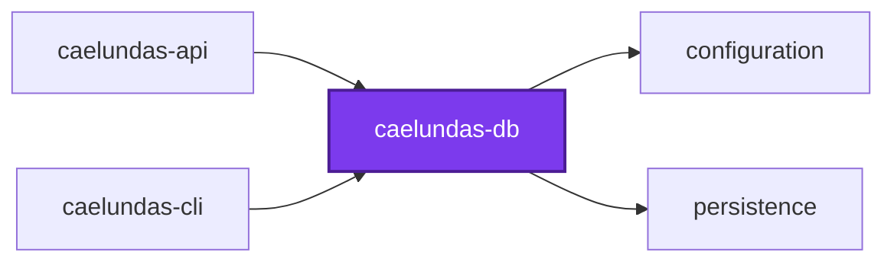
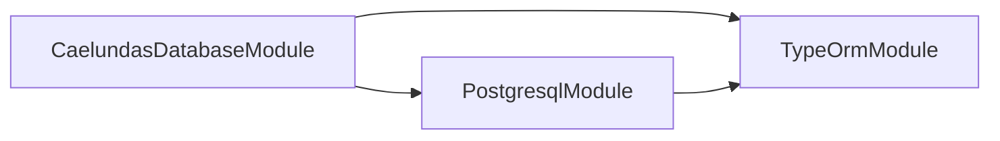

# 🌌 Caelundas Database

**The calendar's shape.** The Postgres schema for
[caelundas-cli](../caelundas-cli/README.md) and caelundas-api: the TypeORM
entities, the one migration, and the service that rebuilds the read model.

This package is the single definition of what a Caelundas event _is_. The
command line writes through these entities and the API reads through them, so
neither carries its own idea of the schema. It names no SQLite, and registers
nothing on a connection.

## Usage

```ts
import { CaelundasDatabaseModule, CalendarEvent } from "@codebase/caelundas-db";
```

`CaelundasDatabaseModule` connects to `caelundas_development`.`caelundas` as
`caelundas_username` through
[`@codebase/persistence`](../../common/persistence/README.md)'s
`DatabaseModule.forRoot`, with its shared plural snake-case naming strategy.
`caelundasDataSource`, in `src/modules/caelundas-database/data-source.constants.ts`,
is the same configuration as a standalone `DataSource`, built with the shared
`createDataSource`, which is what the migration command line runs against.
Neither synchronizes nor runs migrations on start, so only the data source and
the test harness are given `CAELUNDAS_DATABASE_MIGRATIONS`.

Both read only `CAELUNDAS_POSTGRES_*`, never the root's unprefixed
`POSTGRES_*`, which are the shared container's admin login. The importing
application's `ConfigModule` must be global, and spreads
`postgresEnvironmentSchema({ project: "caelundas" })` into its own schema.

| Variable                      | Default                 |
| ----------------------------- | ----------------------- |
| `CAELUNDAS_POSTGRES_HOST`     | `localhost`             |
| `CAELUNDAS_POSTGRES_PORT`     | `5432`                  |
| `CAELUNDAS_POSTGRES_USERNAME` | `caelundas_username`    |
| `CAELUNDAS_POSTGRES_PASSWORD` | `caelundas_password`    |
| `CAELUNDAS_POSTGRES_DATABASE` | `caelundas_development` |
| `CAELUNDAS_POSTGRES_SCHEMA`   | `caelundas`             |

## The schema

| Entity                     | Table                          | Holds                                                             |
| -------------------------- | ------------------------------ | ----------------------------------------------------------------- |
| `CalendarEvent`            | `calendar_events`              | One detected event for one observer location                      |
| `Tag`                      | `tags`, `tags_closure`         | The tag tree, a closure table TypeORM keeps in step               |
| `CalendarEventTag`         | `calendar_event_tags`          | An event carrying a tag                                           |
| `Star`                     | `stars`                        | A star of the HYG catalog, keyed by its Hipparcos number          |
| `Constellation`            | `constellations`               | One of the 88 IAU constellations                                  |
| `ConstellationLine`        | `constellation_lines`          | A segment of a constellation's figure                             |
| `TagNode`                  | `tag_nodes`                    | Derived: a tag with its depth, root, and path                     |
| `CalendarEventTagNode`     | `calendar_event_tag_nodes`     | Derived: an event and every tag it carries, ancestors too         |
| `CalendarEventDerivedTime` | `calendar_event_derived_times` | Derived view: an event's UTC and local year, day, hour, and so on |

Entities are named by class: the shared naming strategy makes the tables
plural and the columns snake case, so no entity names a table or a schema.

- **Ids are `uuidv7`s the database assigns,** through
  `@codebase/persistence`'s `PostgresqlUpdatableEntity`, for `calendar_events`
  and `tags`. The tag closure, the join table, the star catalog, and the
  derived tables keep their natural keys.
- **`calendar_events` upserts on its natural key,** `(summary, start, end,
  latitude, longitude)`, so a re-run updates the row it wrote and a second
  place adds rows of its own.
- **`start` and `end` are `timestamptz`,** carried as `Moment`s in UTC by
  `createMomentTransformer`. **Latitude and longitude are `numeric(9,6)`,**
  carried as the text the driver returns, so the key compares exactly.
- **Whole numbers are `bigint`,** read back as numbers.

## The read model

The derived times are a plain view, so there is nothing to refresh: Postgres
computes them from the event on every read, and the local day and hour,
`start_local_day` and `start_local_hour`, are `start AT TIME ZONE timezone`.

The two derived tag tables are rebuilt by
`CaelundasDatabaseService.refreshReadModel(manager)`, one insert-select
statement each, inside the caller's transaction: a command line ingest ends
with it, and a reader never sees the tables half rebuilt.

## Migrations

```bash
nx run caelundas-db:migration:generate           # Diff entities → new migration
nx run caelundas-db:migration:run                # Apply pending migrations
nx run caelundas-db:migration:revert             # Roll back the last one
nx run caelundas-db:migration:show               # List applied and pending
```

The `migration` target is the shared one from the root `nx.json` target
defaults, declared here as
`"migration": { "options": { "module": "src/modules/caelundas-database" } }`.
There is one migration, with its `-up.sql` and `-down.sql` beside it, linted
by `sqlfluff` and checked by `squawk`. It carries two hand edits after
`generate`: it creates `typeorm_metadata` for the view's row, and its SQL
files open with the lock and statement timeouts the other projects' carry.
See [ADR 0031](../../../documentation/adr/0031-move-caelundas-from-sqlite-to-postgres.md).

## Test

```bash
nx run caelundas-db:vitest:unit
nx run caelundas-db:vitest:integration   # needs Docker
```

The integration suites start a throwaway Postgres 18, run the real migration,
insert base rows, refresh, and assert the derived tables and the view.

## 👔 Conformetry

This project was generated from the [nestjs-service-project](../../../configuration/conformetry-templates/nestjs-service-project) conformetry template.

<!-- callidescope:start -->

## 🔭 Callidescope

Call stacks traced through `projects/caelundas/caelundas-db`, deepest first. Each frame shows what it takes, what it returns, and what its documentation says.

| Measure | Value |
| --- | --- |
| Callables | 20 |
| Files | 22 |
| Calls traced | 1 |
| Call stacks | 0 |
| Deepest stack | 0 |
| Stacks through recursion | 0 |
| Unfollowable calls | 0 |

### Limits

What this project is judged against, as declared in its own `callidescope.config.ts`.

| Limit | Value |
| --- | --- |
| `maximumDepth` | 2 |
| `maximumBreadth` | 1 |

### Call stacks (depth)

None.

### Breadth

| Callable | Breadth | Calls directly | Location |
| --- | --- | --- | --- |
| `CaelundasDatabaseService.refreshReadModel` | 1 | `CaelundasDatabaseService.transaction(…)` | `projects/caelundas/caelundas-db/src/modules/caelundas-database/caelundas-database.service.ts:45` |
<!-- callidescope:end -->

## 🕸️ Codependix

Dependency graphs exported by [codependix](https://github.com/Organizzolini/codebase/tree/main/projects/ic-suite/codependix/codependix-cli), regenerated by `nx run configuration:codependix:write`.

### Nx Neighborhood

<!-- codependix:start name="codependix-nx-projects" -->

<!-- codependix:end name="codependix-nx-projects" -->

### NestJS Module Graph

<!-- codependix:start name="codependix-nestjs-modules" -->

<!-- codependix:end name="codependix-nestjs-modules" -->

### File Imports

```mermaid
graph LR
  file_callidescope_config_ts["callidescope.config.ts"]
  file_codependix_config_ts["codependix.config.ts"]
  file_codometer_config_ts["codometer.config.ts"]
  file_coinagerie_config_ts["coinagerie.config.ts"]
  file_eslint_config_ts["eslint.config.ts"]
  file_src_index_ts["src/index.ts"]
  file_src_modules_caelundas_database_caelundas_database_constants_ts["src/modules/caelundas-database/caelundas-database.constants.ts"]
  file_src_modules_caelundas_database_caelundas_database_module_integration_test_ts["src/modules/caelundas-database/caelundas-database.module.integration.test.ts"]
  file_src_modules_caelundas_database_caelundas_database_module_ts["src/modules/caelundas-database/caelundas-database.module.ts"]
  file_src_modules_caelundas_database_caelundas_database_service_integration_test_ts["src/modules/caelundas-database/caelundas-database.service.integration.test.ts"]
  file_src_modules_caelundas_database_caelundas_database_service_ts["src/modules/caelundas-database/caelundas-database.service.ts"]
  file_src_modules_caelundas_database_caelundas_database_service_unit_test_ts["src/modules/caelundas-database/caelundas-database.service.unit.test.ts"]
  file_src_modules_caelundas_database_caelundas_database_types_ts["src/modules/caelundas-database/caelundas-database.types.ts"]
  file_src_modules_caelundas_database_caelundas_database_utilities_ts["src/modules/caelundas-database/caelundas-database.utilities.ts"]
  file_src_modules_caelundas_database_caelundas_database_utilities_unit_test_ts["src/modules/caelundas-database/caelundas-database.utilities.unit.test.ts"]
  file_src_modules_caelundas_database_data_source_constants_ts["src/modules/caelundas-database/data-source.constants.ts"]
  file_src_modules_caelundas_database_entities_calendar_event_derived_time_entity_ts["src/modules/caelundas-database/entities/calendar-event-derived-time.entity.ts"]
  file_src_modules_caelundas_database_entities_calendar_event_tag_node_entity_ts["src/modules/caelundas-database/entities/calendar-event-tag-node.entity.ts"]
  file_src_modules_caelundas_database_entities_calendar_event_tag_entity_ts["src/modules/caelundas-database/entities/calendar-event-tag.entity.ts"]
  file_src_modules_caelundas_database_entities_calendar_event_entity_ts["src/modules/caelundas-database/entities/calendar-event.entity.ts"]
  file_src_modules_caelundas_database_entities_constellation_line_entity_ts["src/modules/caelundas-database/entities/constellation-line.entity.ts"]
  file_src_modules_caelundas_database_entities_constellation_entity_ts["src/modules/caelundas-database/entities/constellation.entity.ts"]
  file_src_modules_caelundas_database_entities_star_entity_ts["src/modules/caelundas-database/entities/star.entity.ts"]
  file_src_modules_caelundas_database_entities_tag_node_entity_ts["src/modules/caelundas-database/entities/tag-node.entity.ts"]
  file_src_modules_caelundas_database_entities_tag_entity_ts["src/modules/caelundas-database/entities/tag.entity.ts"]
  file_src_modules_caelundas_database_migrations_1793990506900_migration_ts["src/modules/caelundas-database/migrations/1793990506900-migration.ts"]
  file_testing_mocks_ts["testing/mocks.ts"]
  file_testing_setup_ts["testing/setup.ts"]
  file_vitest_config_ts["vitest.config.ts"]
  file_src_modules_caelundas_database_caelundas_database_module_integration_test_ts --> file_src_modules_caelundas_database_caelundas_database_module_ts
  file_src_modules_caelundas_database_caelundas_database_module_integration_test_ts --> file_src_modules_caelundas_database_caelundas_database_service_ts
  file_src_modules_caelundas_database_caelundas_database_module_integration_test_ts --> file_src_modules_caelundas_database_data_source_constants_ts
  file_src_modules_caelundas_database_caelundas_database_module_integration_test_ts --> file_src_modules_caelundas_database_entities_calendar_event_entity_ts
  file_src_modules_caelundas_database_caelundas_database_module_ts --> file_src_modules_caelundas_database_caelundas_database_constants_ts
  file_src_modules_caelundas_database_caelundas_database_module_ts --> file_src_modules_caelundas_database_caelundas_database_service_ts
  file_src_modules_caelundas_database_caelundas_database_module_ts --> file_src_modules_caelundas_database_data_source_constants_ts
  file_src_modules_caelundas_database_caelundas_database_service_integration_test_ts --> file_src_modules_caelundas_database_caelundas_database_module_ts
  file_src_modules_caelundas_database_caelundas_database_service_integration_test_ts --> file_src_modules_caelundas_database_caelundas_database_service_ts
  file_src_modules_caelundas_database_caelundas_database_service_integration_test_ts --> file_src_modules_caelundas_database_data_source_constants_ts
  file_src_modules_caelundas_database_caelundas_database_service_integration_test_ts --> file_src_modules_caelundas_database_entities_calendar_event_derived_time_entity_ts
  file_src_modules_caelundas_database_caelundas_database_service_integration_test_ts --> file_src_modules_caelundas_database_entities_calendar_event_tag_node_entity_ts
  file_src_modules_caelundas_database_caelundas_database_service_integration_test_ts --> file_src_modules_caelundas_database_entities_calendar_event_tag_entity_ts
  file_src_modules_caelundas_database_caelundas_database_service_integration_test_ts --> file_src_modules_caelundas_database_entities_calendar_event_entity_ts
  file_src_modules_caelundas_database_caelundas_database_service_integration_test_ts --> file_src_modules_caelundas_database_entities_tag_node_entity_ts
  file_src_modules_caelundas_database_caelundas_database_service_integration_test_ts --> file_src_modules_caelundas_database_entities_tag_entity_ts
  file_src_modules_caelundas_database_caelundas_database_service_ts --> file_src_modules_caelundas_database_caelundas_database_constants_ts
  file_src_modules_caelundas_database_caelundas_database_service_unit_test_ts --> file_src_modules_caelundas_database_caelundas_database_constants_ts
  file_src_modules_caelundas_database_caelundas_database_service_unit_test_ts --> file_src_modules_caelundas_database_caelundas_database_service_ts
  file_src_modules_caelundas_database_caelundas_database_utilities_ts --> file_src_modules_caelundas_database_caelundas_database_constants_ts
  file_src_modules_caelundas_database_caelundas_database_utilities_unit_test_ts --> file_src_modules_caelundas_database_caelundas_database_utilities_ts
  file_src_modules_caelundas_database_data_source_constants_ts --> file_src_modules_caelundas_database_caelundas_database_constants_ts
  file_src_modules_caelundas_database_data_source_constants_ts --> file_src_modules_caelundas_database_entities_calendar_event_derived_time_entity_ts
  file_src_modules_caelundas_database_data_source_constants_ts --> file_src_modules_caelundas_database_entities_calendar_event_tag_node_entity_ts
  file_src_modules_caelundas_database_data_source_constants_ts --> file_src_modules_caelundas_database_entities_calendar_event_tag_entity_ts
  file_src_modules_caelundas_database_data_source_constants_ts --> file_src_modules_caelundas_database_entities_calendar_event_entity_ts
  file_src_modules_caelundas_database_data_source_constants_ts --> file_src_modules_caelundas_database_entities_constellation_line_entity_ts
  file_src_modules_caelundas_database_data_source_constants_ts --> file_src_modules_caelundas_database_entities_constellation_entity_ts
  file_src_modules_caelundas_database_data_source_constants_ts --> file_src_modules_caelundas_database_entities_star_entity_ts
  file_src_modules_caelundas_database_data_source_constants_ts --> file_src_modules_caelundas_database_entities_tag_node_entity_ts
  file_src_modules_caelundas_database_data_source_constants_ts --> file_src_modules_caelundas_database_entities_tag_entity_ts
  file_src_modules_caelundas_database_data_source_constants_ts --> file_src_modules_caelundas_database_migrations_1793990506900_migration_ts
  file_src_modules_caelundas_database_entities_calendar_event_tag_node_entity_ts --> file_src_modules_caelundas_database_caelundas_database_utilities_ts
  file_src_modules_caelundas_database_entities_calendar_event_tag_entity_ts --> file_src_modules_caelundas_database_entities_calendar_event_entity_ts
  file_src_modules_caelundas_database_entities_calendar_event_tag_entity_ts --> file_src_modules_caelundas_database_entities_tag_entity_ts
  file_src_modules_caelundas_database_entities_calendar_event_entity_ts --> file_src_modules_caelundas_database_caelundas_database_constants_ts
  file_src_modules_caelundas_database_entities_calendar_event_entity_ts --> file_src_modules_caelundas_database_caelundas_database_utilities_ts
  file_src_modules_caelundas_database_entities_constellation_line_entity_ts --> file_src_modules_caelundas_database_caelundas_database_utilities_ts
  file_src_modules_caelundas_database_entities_constellation_line_entity_ts --> file_src_modules_caelundas_database_entities_constellation_entity_ts
  file_src_modules_caelundas_database_entities_constellation_line_entity_ts --> file_src_modules_caelundas_database_entities_star_entity_ts
  file_src_modules_caelundas_database_entities_star_entity_ts --> file_src_modules_caelundas_database_caelundas_database_utilities_ts
  file_src_modules_caelundas_database_entities_tag_node_entity_ts --> file_src_modules_caelundas_database_caelundas_database_utilities_ts
```

<!-- codependix:start name="codependix-file-imports" -->

<!-- codependix:end name="codependix-file-imports" -->

<!-- codometer:start -->

## ⏲️ Codometer

### Project


### TypeScript


### JavaScript


### Python


### JSON


### YAML


### TOML


### Shell


### SQL


### HCL


### CSS


### Conventions


### Jupyter


### Markdown


<!-- codometer:end -->

<!-- coinagerie:start -->

## 🪙 Coinagerie

The words this project uses that the root glossary does not define, regenerated with `nx run caelundas-db:coinagerie-check:write`.

- **ascension**:
- **breadth**:
- **cascade**:
- **constellation**:
- **coordinate**:
- **declination**:
- **degree**:
- **descendant**:
- **designation**:
- **dow**:
- **doy**:
- **epoch**:
- **hip**:
- **latitude**:
- **longitude**:
- **magnitude**:
- **mod**:
- **planet**:
- **quarter**:
- **retrograde**:
- **sibling**:
- **star**:
- **temporality**:
- **updatable**:
- **weekday**:
- **zodiac**:

<!-- coinagerie:end -->
