[Pegasus, Andromeda](#pegasus-andromeda) · [Cetus](#cetus-cassiopeia) · [Cassiopeia](#cetus-cassiopeia) · [Pisces](#pisces-sculptor-triangulum-aries) · [Sculptor](#pisces-sculptor-triangulum-aries) · [Triangulum](#pisces-sculptor-triangulum-aries) · [Aries](#pisces-sculptor-triangulum-aries) · [Eridanus](#eridanus) · [Perseus](#perseus-fornax) · [Fornax](#perseus-fornax) · [Taurus, Auriga](#taurus-auriga-camelopardalis-caelum) · [Camelopardalis](#taurus-auriga-camelopardalis-caelum) · [Caelum](#taurus-auriga-camelopardalis-caelum) · [Orion](#orion-lepus-columba) · [Lepus](#orion-lepus-columba) · [Columba](#orion-lepus-columba) · [Gemini](#gemini-lynx-canis-major-monoceros) · [Lynx](#gemini-lynx-canis-major-monoceros) · [Canis Major](#gemini-lynx-canis-major-monoceros) · [Monoceros](#gemini-lynx-canis-major-monoceros) · [Puppis, Pyxis](#puppis-pyxis-canis-minor-ursa-major) · [Canis Minor](#puppis-pyxis-canis-minor-ursa-major) · [Ursa Major](#puppis-pyxis-canis-minor-ursa-major) · [Hydra](#hydra-cancer-antlia-vela-sextans) · [Cancer](#hydra-cancer-antlia-vela-sextans) · [Antlia](#hydra-cancer-antlia-vela-sextans) · [Vela](#hydra-cancer-antlia-vela-sextans) · [Sextans](#hydra-cancer-antlia-vela-sextans) · [Leo](#leo-leo-minor-crater-virgo) · [Leo Minor](#leo-leo-minor-crater-virgo) · [Crater](#leo-leo-minor-crater-virgo) · [Virgo](#leo-leo-minor-crater-virgo) · [Corvus](#corvus-draco-canes-venatici-coma-berenices-boötes) · [Draco](#corvus-draco-canes-venatici-coma-berenices-boötes) · [Canes Venatici](#corvus-draco-canes-venatici-coma-berenices-boötes) · [Coma Berenices](#corvus-draco-canes-venatici-coma-berenices-boötes) · [Boötes](#corvus-draco-canes-venatici-coma-berenices-boötes) · [Centaurus](#centaurus-ursa-minor-libra-lupus-corona-borealis) · [Ursa Minor](#centaurus-ursa-minor-libra-lupus-corona-borealis) · [Libra](#centaurus-ursa-minor-libra-lupus-corona-borealis) · [Lupus](#centaurus-ursa-minor-libra-lupus-corona-borealis) · [Corona Borealis](#centaurus-ursa-minor-libra-lupus-corona-borealis) · [Serpens, Ophiuchus](#serpens-ophiuchus) · [Scorpius](#scorpius-hercules) · [Hercules](#scorpius-hercules) · [Sagittarius](#sagittarius-scutum-lyra) · [Scutum](#sagittarius-scutum-lyra) · [Lyra](#sagittarius-scutum-lyra) · [Corona Austrina](#corona-austrina-aquila-vulpecula-cygnus-sagitta) · [Aquila](#corona-austrina-aquila-vulpecula-cygnus-sagitta) · [Vulpecula](#corona-austrina-aquila-vulpecula-cygnus-sagitta) · [Cygnus](#corona-austrina-aquila-vulpecula-cygnus-sagitta) · [Sagitta](#corona-austrina-aquila-vulpecula-cygnus-sagitta) · [Capricornus](#capricornus-cepheus-delphinus-aquarius) · [Cepheus](#capricornus-cepheus-delphinus-aquarius) · [Delphinus](#capricornus-cepheus-delphinus-aquarius) · [Aquarius](#capricornus-cepheus-delphinus-aquarius) · [Microscopium](#microscopium-equuleus-piscis-austrinus-grus-lacerta) · [Equuleus](#microscopium-equuleus-piscis-austrinus-grus-lacerta) · [Piscis Austrinus](#microscopium-equuleus-piscis-austrinus-grus-lacerta) · [Grus](#microscopium-equuleus-piscis-austrinus-grus-lacerta) · [Lacerta](#microscopium-equuleus-piscis-austrinus-grus-lacerta)

## Pegasus, Andromeda

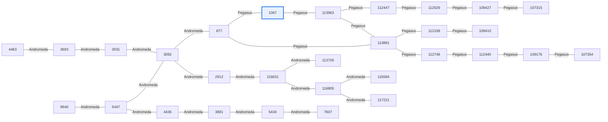

## Cetus, Cassiopeia

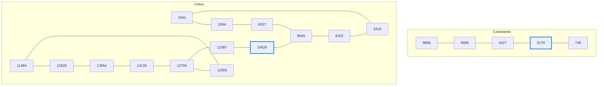

## Pisces, Sculptor, Triangulum, Aries

```mermaid
flowchart LR
    classDef root fill:#e8f0fe,stroke:#1a73e8,stroke-width:3px
    subgraph nb3["Pisces"]
        direction LR
        n13["3786"] --- n14["118268"] --- n608["116771"] --- n605["115830"] --- n602["115227"] --- n595["114971"] --- n596["113889"]
        n22["4906"] --- n13
        n26["5571"] --- n27["7097"] --- n35["8198"] --- n38["9487"] --- n41["8833"] --- n36["7884"] --- n34["7007"] --- n30["5737"] --- n22
        n28["5586"] --- n29["6193"] --- n31["5742"] --- n26
        n31 --- n28
        n595 --- n597["115738"] --- n604["116928"] --- n611["117245"] --- n608
    end
    subgraph nb4["Sculptor"]
        direction LR
        n20["4577"] --- n21["117452"] --- n600["115102"] --- n601["116231"]
    end
    subgraph nb5["Triangulum"]
        direction LR
        n39["8796"] --- n40["10064"] --- n47["10670"] --- n39
    end
    subgraph nb6["Aries"]
        direction LR
        n43["8903"] --- n44["8832"]
        n46["9884"] --- n43
        n62["13209"] --- n46
    end
    nb3 ~~~ nb4 ~~~ nb5
    class n596,n600,n40,n62 root
```

## Eridanus

## Perseus, Fornax

```mermaid
flowchart LR
    classDef root fill:#e8f0fe,stroke:#1a73e8,stroke-width:3px
    subgraph nb8["Perseus"]
        direction LR
        n56["12777"] --- n57["8068"]
        n63["13268"] --- n64["13531"] --- n65["14632"] --- n56
        n69["13879"] --- n70["13949"] --- n71["14576"] --- n76["14817"] --- n75["14354"] --- n69
        n74["14328"] --- n63
        n65 --- n77["14668"] --- n71
        n81["15863"] --- n74
        n88["16826"] --- n81
        n90["17358"] --- n88
        n92["17448"] --- n93["18246"] --- n101["18614"] --- n102["18532"] --- n94["17529"] --- n90 --- n107["19343"] --- n106["19812"] --- n105["19167"]
    end
    subgraph nb9["Fornax"]
        direction LR
        n60["13147"] --- n61["9677"]
        n78["14879"] --- n60
    end
    nb8 ~~~ nb9
    class n56,n60 root
```

## Taurus, Auriga, Camelopardalis, Caelum

```mermaid
flowchart LR
    classDef root fill:#e8f0fe,stroke:#1a73e8,stroke-width:3px
    subgraph nb10["Taurus, Auriga"]
        direction LR
        n82["15900"] ---|"Taurus"| n83["16852"]
        n84["16083"] ---|"Taurus"| n82
        n84 ---|"Taurus"| n85["18907"]
        n104["18724"] ---|"Taurus"| n84
        n110["20205"] ---|"Taurus"| n104
        n110 ---|"Taurus"| n111["20455"] ---|"Taurus"| n112["20889"] ---|"Taurus"| n114["25428"] ---|"Auriga"| n132["23015"] ---|"Auriga"| n141["23767"] ---|"Auriga"| n148["24608"] ---|"Auriga"| n136["23416"] ---|"Auriga"| n137["23453"]
        n115["20894"] ---|"Taurus"| n110
        n118["21421"] ---|"Taurus"| n115
        n114 ---|"Auriga"| n152["28380"] ---|"Auriga"| n170["28360"] ---|"Auriga"| n148 ---|"Auriga"| n169["28358"] ---|"Auriga"| n170
        n157["26451"] ---|"Taurus"| n118
    end
    subgraph nb11["Camelopardalis"]
        direction LR
        n98["17884"] --- n99["16228"]
        n100["17959"] --- n98
        n127["22783"] --- n100
        n127 --- n128["29997"] --- n177["33694"]
        n133["23040"] --- n134["23522"] --- n127
    end
    subgraph nb12["Caelum"]
        direction LR
        n116["21060"] --- n117["21770"] --- n120["21861"] --- n121["23595"]
    end
    nb10 ~~~ nb11 ~~~ nb12
    class n82,n99,n116 root
```

## Orion, Lepus, Columba

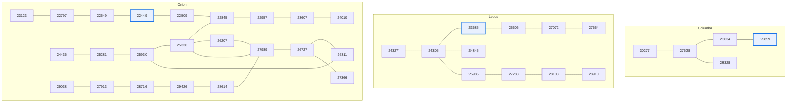

## Gemini, Lynx, Canis Major, Monoceros

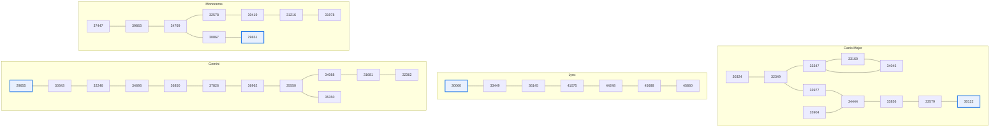

## Puppis, Pyxis, Canis Minor, Ursa Major

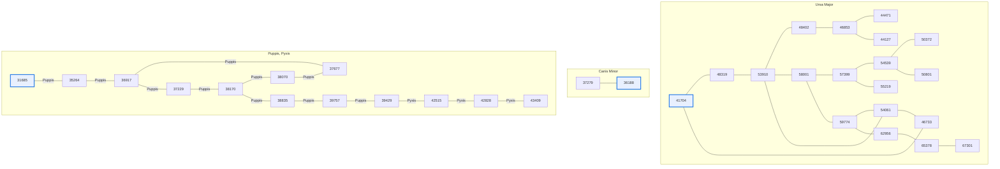

## Hydra, Cancer, Antlia, Vela, Sextans

```mermaid
flowchart LR
    classDef root fill:#e8f0fe,stroke:#1a73e8,stroke-width:3px
    subgraph nb23["Hydra"]
        direction LR
        n229["42313"] --- n230["43109"] --- n239["43234"] --- n233["42799"] --- n231["42402"] --- n229
        n230 --- n240["43813"] --- n241["45336"] --- n246["47431"] --- n248["46390"] --- n249["48356"] --- n257["49841"] --- n270["51069"] --- n275["52943"] --- n279["56343"] --- n294["57936"] --- n302["64962"] --- n324["68895"] --- n337["72571"]
    end
    subgraph nb24["Cancer"]
        direction LR
        n234["42806"] --- n235["43100"]
        n237["42911"] --- n238["40526"]
        n237 --- n234
        n242["44066"] --- n237
    end
    subgraph nb25["Antlia"]
        direction LR
        n250["46515"] --- n251["51172"] --- n276["53502"]
    end
    subgraph nb26["Vela"]
        direction LR
        n252["46651"] --- n253["44816"]
        n271["50191"] --- n252
    end
    subgraph nb27["Sextans"]
        direction LR
        n259["48437"] --- n260["51362"] --- n278["51437"]
        n268["49641"] --- n259
    end
    nb23 ~~~ nb24 ~~~ nb25
    nb26 ~~~ nb27
    class n229,n238,n250,n253,n259 root
```

## Leo, Leo Minor, Crater, Virgo

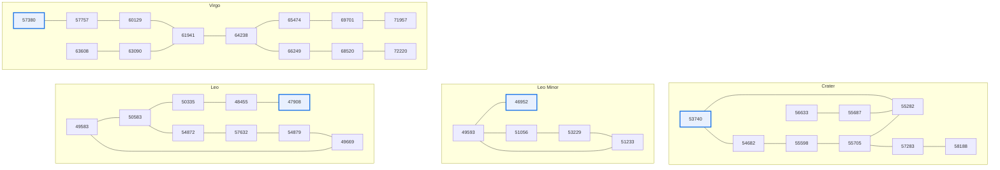

## Corvus, Draco, Canes Venatici, Coma Berenices, Boötes

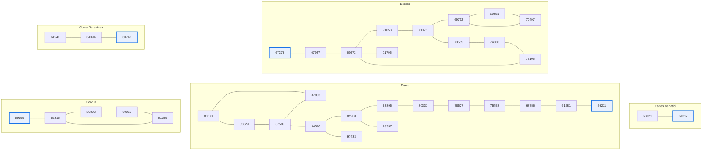

## Centaurus, Ursa Minor, Libra, Lupus, Corona Borealis

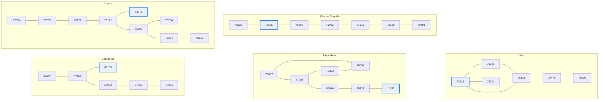

## Serpens, Ophiuchus

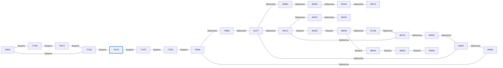

## Scorpius, Hercules

```mermaid
flowchart LR
    classDef root fill:#e8f0fe,stroke:#1a73e8,stroke-width:3px
    subgraph nb43["Scorpius"]
        direction LR
        n385["78265"] --- n386["78401"] --- n388["78820"]
        n386 --- n389["80112"] --- n396["80763"] --- n403["81266"] --- n408["82396"] --- n414["82514"] --- n415["82729"] --- n416["84143"] --- n422["86228"] --- n432["87073"] --- n434["86670"] --- n435["85927"]
    end
    subgraph nb44["Hercules"]
        direction LR
        n391["79101"] --- n392["77760"]
        n395["79992"] --- n391
        n397["80170"] --- n398["80816"] --- n404["81693"] --- n410["81833"] --- n407["81126"] --- n395
        n404 --- n411["83207"] --- n418["84379"] --- n424["86974"] --- n437["87933"] --- n442["88794"]
        n410 --- n412["84380"] --- n411
        n423["84345"] --- n398
        n426["85112"] --- n412
        n441["87808"] --- n426
    end
    nb43 ~~~ nb44
    class n385,n392 root
```

## Sagittarius, Scutum, Lyra

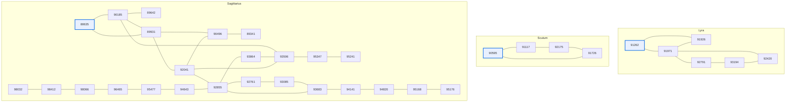

## Corona Austrina, Aquila, Vulpecula, Cygnus, Sagitta

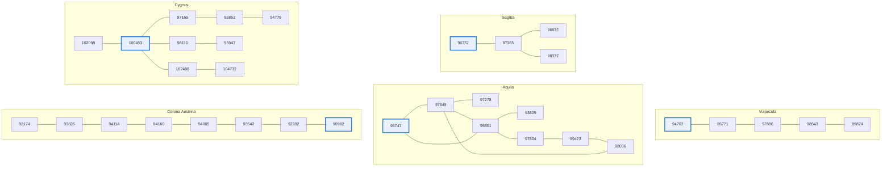

## Capricornus, Cepheus, Delphinus, Aquarius

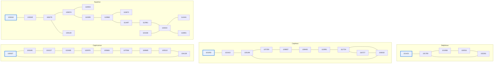

## Microscopium, Equuleus, Piscis Austrinus, Grus, Lacerta

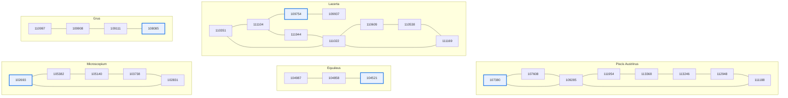
