# Metric expressions

Each metric is a tree in `metric_expressions`: an operator over its operands, a
measure, another metric, or a literal. Every diagram below draws one metric's
tree, top to bottom, in plain Mermaid with no HTML: the metric as a stadium,
operators as hexagons, measures as rectangles, referenced metrics as stadiums
and literals as circles. Operands of a divide or subtract are numbered by their
position; operands of an add or multiply are not, since order does not matter.
Run `nx run caelundas-db:metric-expressions` to rewrite the
block between the markers from the local database, and
`nx run caelundas-db:metric-expressions:check` to verify it. Do not edit the
generated content between the markers.

<!-- metric-expressions:start -->

## Metrics

| Metric                   | Slug                          | Unit     | Expression                                                |
| ------------------------ | ----------------------------- | -------- | --------------------------------------------------------- |
| Average duration         | `average-duration`            | duration | `metric:duration ÷ progressive-events`                    |
| Time covered             | `covered-duration`            | duration | `covered-duration`                                        |
| Percent of time covered  | `covered-percent`             | none     | `covered-clipped-duration % of period-length`             |
| Days with events         | `days-with-events`            | count    | `days-with-events`                                        |
| Duration                 | `duration`                    | duration | `duration`                                                |
| Events                   | `events`                      | count    | `events`                                                  |
| First start              | `first-start`                 | instant  | `first-start`                                             |
| Last start               | `last-start`                  | instant  | `last-start`                                              |
| Longest duration         | `longest-duration`            | duration | `longest-progressive-duration`                            |
| Median duration          | `median-duration`             | duration | `median-progressive-duration`                             |
| Perfective events        | `perfective-events`           | count    | `perfective-events`                                       |
| Progressive time covered | `progressive-covered-percent` | none     | `progressive-covered-clipped-duration % of period-length` |
| Progressive events       | `progressive-events`          | count    | `progressive-events`                                      |
| Progressive time counted | `progressive-total-percent`   | none     | `progressive-clipped-duration % of period-length`         |
| Shortest duration        | `shortest-duration`           | duration | `shortest-progressive-duration`                           |
| Time counted             | `total-time-percent`          | none     | `clipped-duration % of period-length`                     |
| Unique names             | `unique-names`                | count    | `unique-names`                                            |
| Unique tags              | `unique-tags`                 | count    | `unique-tags`                                             |

## Diagrams

### Average duration

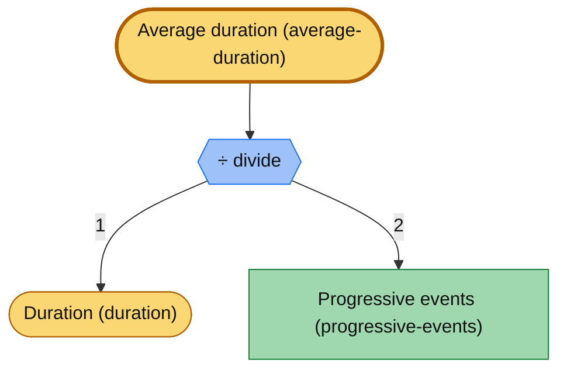

### Time covered

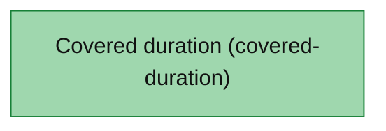

### Percent of time covered

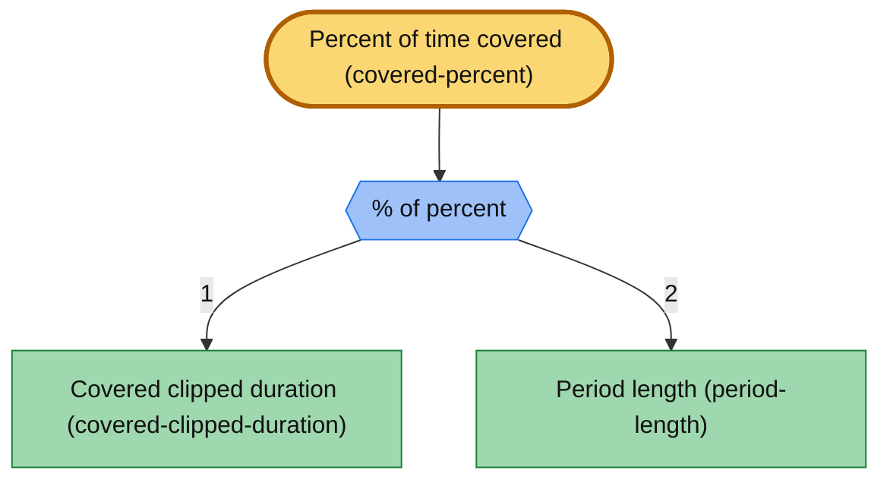

### Days with events

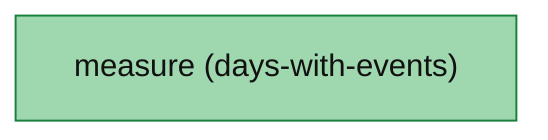

### Duration

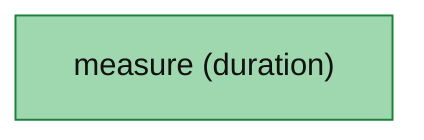

### Events

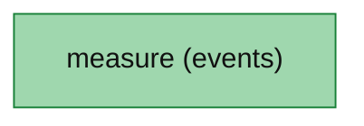

### First start

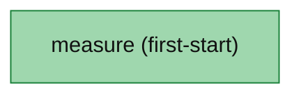

### Last start

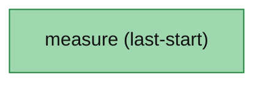

### Longest duration

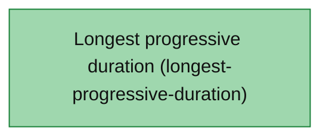

### Median duration

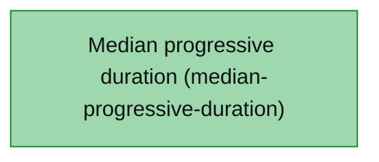

### Perfective events

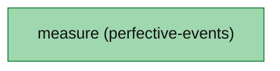

### Progressive time covered

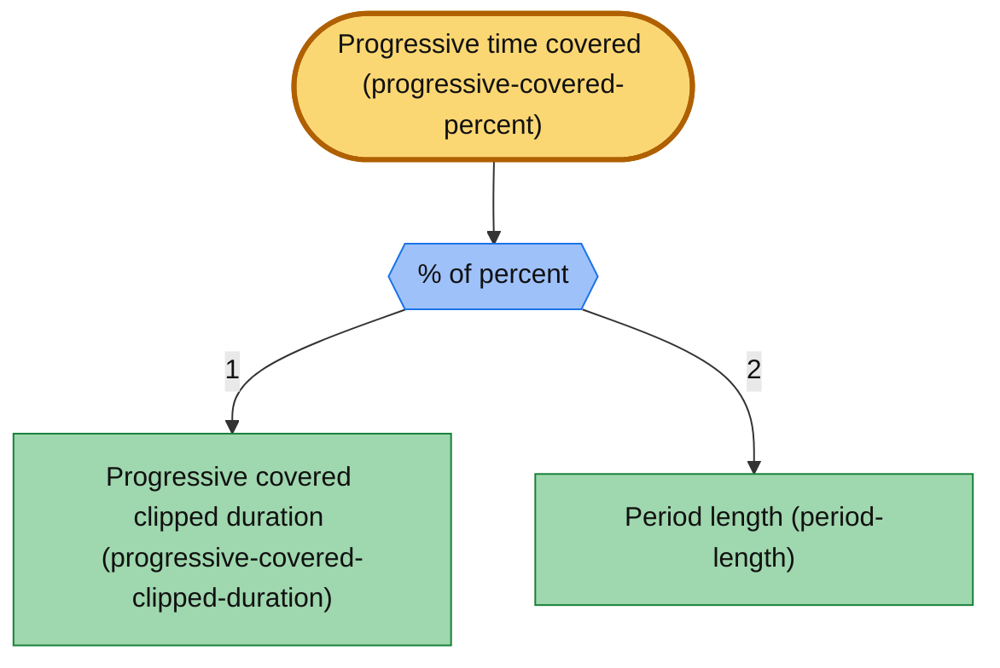

### Progressive events

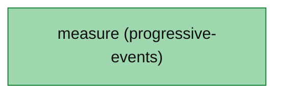

### Progressive time counted

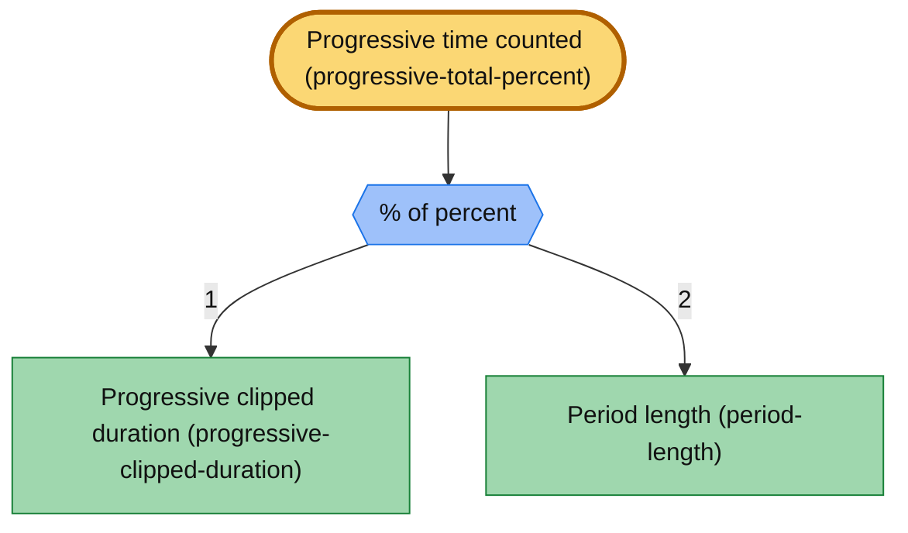

### Shortest duration

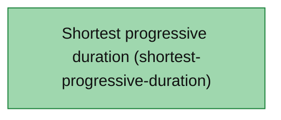

### Time counted

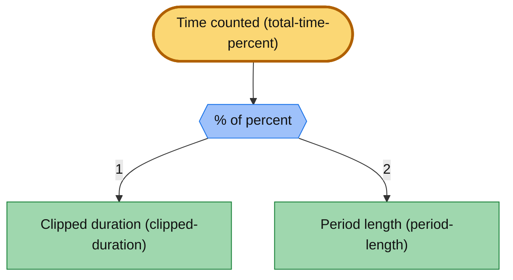

### Unique names

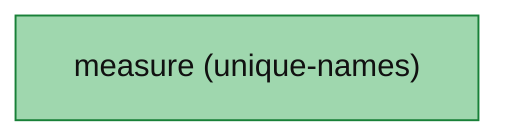

### Unique tags

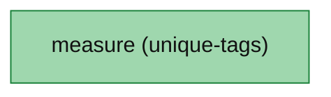

<!-- metric-expressions:end -->
