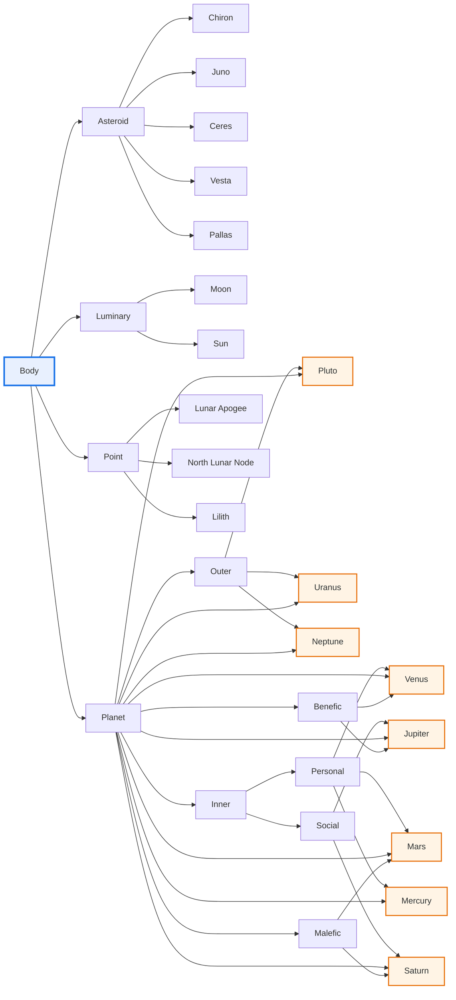
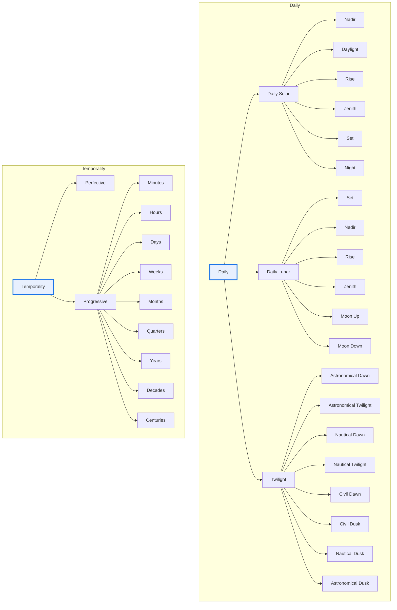
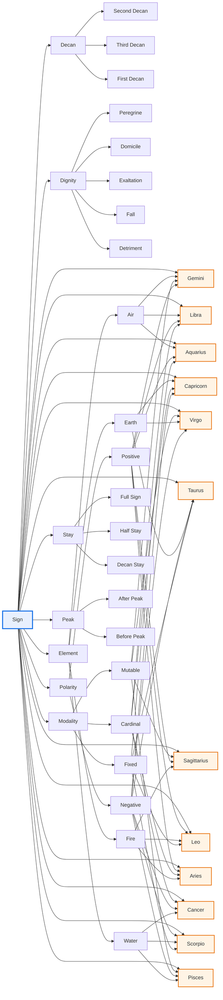
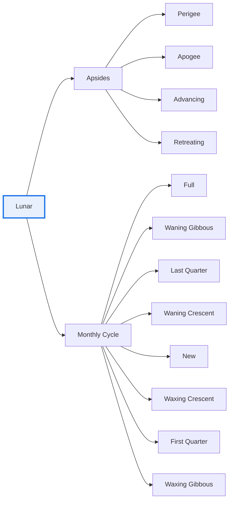
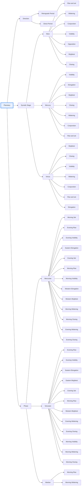
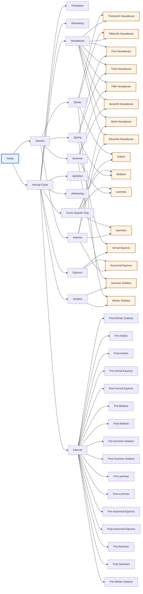
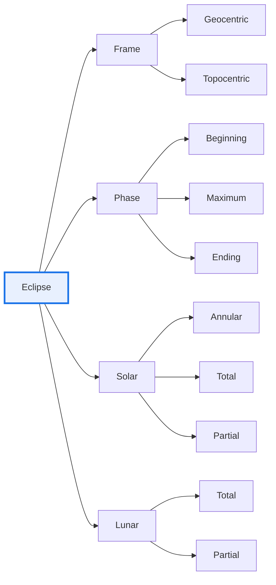

[Aspect](#aspect) · [Body](#body) · [Temporality](#temporality-daily) · [Daily](#temporality-daily) · [Sign](#sign) · [Lunar](#lunar) · [Planetary](#planetary) · [Yearly](#yearly) · [Eclipse](#eclipse)

## Aspect

```mermaid
flowchart LR
    classDef root fill:#e8f0fe,stroke:#1a73e8,stroke-width:3px
    classDef shared fill:#fff4e5,stroke:#e8710a,stroke-width:2px
    n0["Aspect"] --> n1["Harmonic"] & n2["Nature"] & n3["Phase"] & n4["Compound"] & n5["Simple"]
    n1 --> n47["Harmonic 4"] & n48["Harmonic 12"] & n49["Harmonic 11"] & n50["Harmonic 5"] & n51["Harmonic 9"] & n52["Harmonic 10"] & n53["Harmonic 6"] & n54["Harmonic 8"] & n55["Harmonic 1"] & n56["Harmonic 7"] & n57["Harmonic 2"] & n58["Harmonic 3"]
    n2 --> n59["Hard"] & n60["Neutral"] & n61["Soft"]
    n62["Focal Body"] --> n63["Chiron Focal"] & n64["Venus Focal"] & n65["Moon Focal"] & n66["Ceres Focal"] & n67["Juno Focal"] & n68["Jupiter Focal"] & n69["Saturn Focal"] & n70["Neptune Focal"] & n71["Uranus Focal"] & n72["Pluto Focal"] & n73["Lunar Apogee Focal"] & n74["Lilith Focal"] & n75["Pallas Focal"] & n76["Mercury Focal"] & n77["Mars Focal"] & n78["Sun Focal"] & n79["North Lunar Node Focal"] & n80["Vesta Focal"]
    n3 --> n81["Exact"]
    n4 --> n62 & n93["Triple"] & n94["Quadruple"] & n95["Stellium"] & n96["Sextuple"]
    n5 --> n116["Minor"] & n117["Specialty"] & n118["Major"]
    n47 --> n195["T Square"] & n196["Grand Cross"] & n197["Square"]
    n59 --> n195 & n196 & n197 & n198["Sesquiquadrate"] & n199["Semisquare"] & n200["Opposite"]
    n93 --> n195 & n201["Yod"] & n202["Grand Trine"]
    n94 --> n196 & n203["Kite"]
    n48 --> n201 & n204["Quincunx"] & n205["Semisextile"]
    n60 --> n95 & n201 & n204 & n206["Undecile"] & n207["Conjunct"] & n208["Septile"]
    n116 --> n204 & n198 & n199 & n205
    n49 --> n206
    n117 --> n206 & n217["Quintile"] & n218["Novile"] & n219["Tredecile"] & n208 & n220["Decile"] & n221["Biquintile"]
    n50 --> n217 & n221
    n61 --> n217 & n218 & n219 & n222["Sextile"] & n205 & n220 & n221 & n223["Trine"] & n202 & n203 & n224["Hexagram"]
    n51 --> n218
    n52 --> n219 & n220
    n118 --> n197 & n222 & n207 & n200 & n223
    n53 --> n222 & n203 & n224
    n54 --> n198 & n199
    n55 --> n95 & n207
    n56 --> n208
    n57 --> n200
    n58 --> n223 & n202
    n95 --> n229["4 Body"] & n230["5 Body"] & n231["6 Body"] & n232["7 Body"] & n233["3 Body"]
    n96 --> n224
    class n0 root
    class n95,n195,n196,n197,n198,n199,n200,n201,n202,n203,n204,n205,n206,n207,n208,n217,n218,n219,n220,n221,n222,n223,n224 shared
```

## Body

## Temporality, Daily

## Sign

## Lunar

## Planetary

## Yearly

## Eclipse

