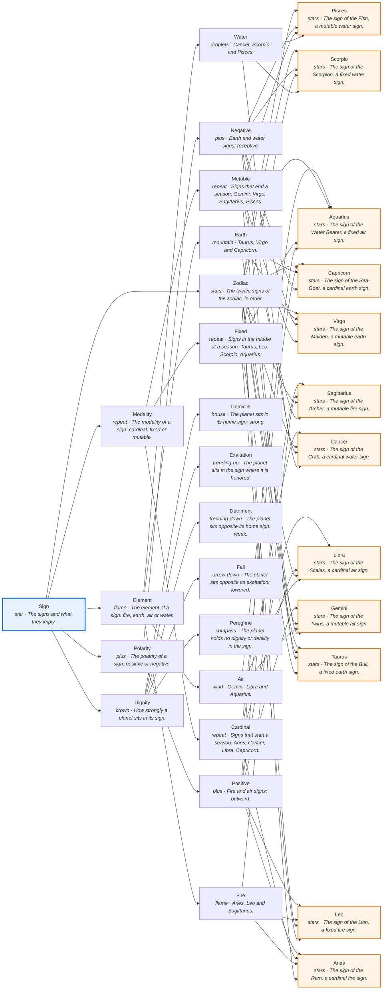
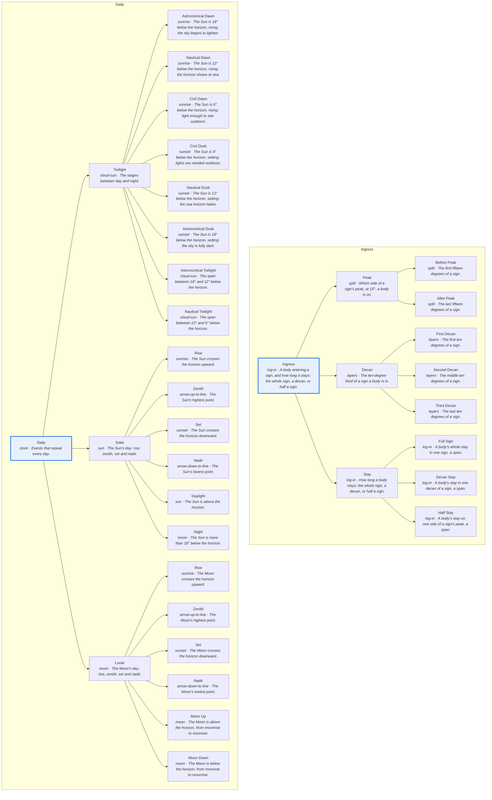
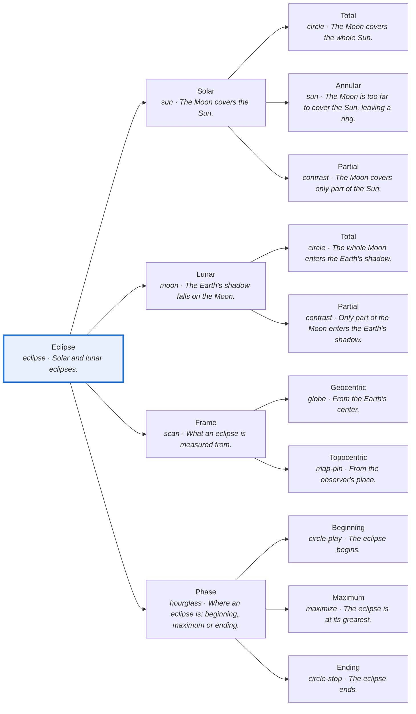
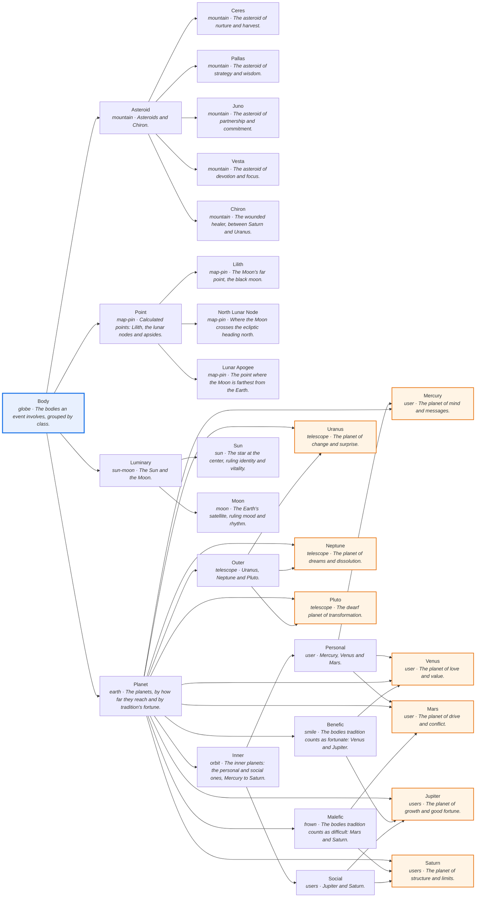
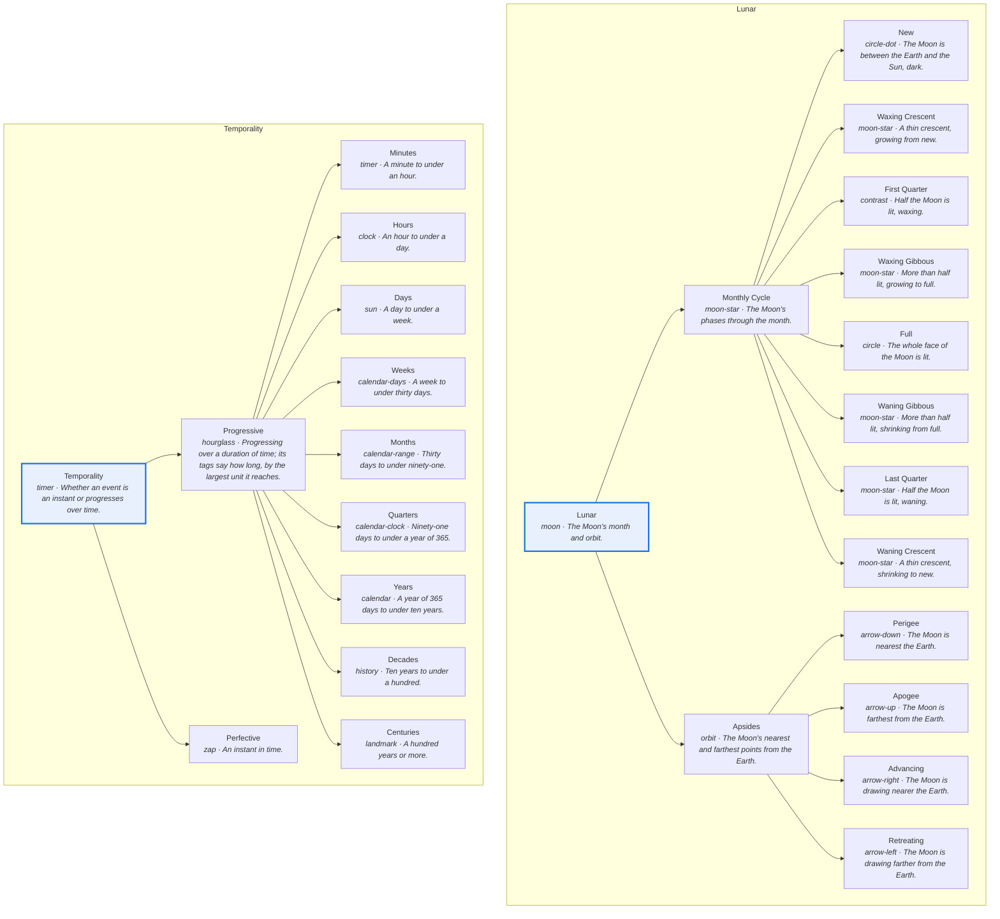

[Aspect](#aspect) · [Yearly](#yearly) · [Planetary](#planetary) · [Sign](#sign) · [Daily](#daily-ingress) · [Ingress](#daily-ingress) · [Eclipse](#eclipse) · [Body](#body) · [Temporality](#temporality-lunar) · [Lunar](#temporality-lunar)

## Aspect

```mermaid
flowchart LR
    classDef root fill:#e8f0fe,stroke:#1a73e8,stroke-width:3px
    classDef shared fill:#fff4e5,stroke:#e8710a,stroke-width:2px
    n270["Stellium<br/><i>sparkles · Bodies bunched together, counted by how many.</i>"] --> n0["3 Body<br/><i>circle</i>"] & n1["4 Body<br/><i>circle</i>"] & n2["5 Body<br/><i>circle</i>"] & n3["6 Body<br/><i>circle</i>"] & n4["7 Body<br/><i>circle</i>"]
    n273["Focal Body<br/><i>crosshair · The body a compound pattern points at.</i>"] --> n10["Ceres Focal<br/><i>crosshair · The pattern points at Ceres.</i>"] & n11["Chiron Focal<br/><i>crosshair · The pattern points at Chiron.</i>"] & n53["Juno Focal<br/><i>crosshair · The pattern points at Juno.</i>"] & n54["Jupiter Focal<br/><i>crosshair · The pattern points at Jupiter.</i>"] & n57["Lilith Focal<br/><i>crosshair · The pattern points at Lilith.</i>"] & n58["Lunar Apogee Focal<br/><i>crosshair · The pattern points at Lunar Apogee.</i>"] & n59["Mars Focal<br/><i>crosshair · The pattern points at Mars.</i>"] & n60["Mercury Focal<br/><i>crosshair · The pattern points at Mercury.</i>"] & n61["Moon Focal<br/><i>crosshair · The pattern points at Moon.</i>"] & n73["Neptune Focal<br/><i>crosshair · The pattern points at Neptune.</i>"] & n75["North Lunar Node Focal<br/><i>crosshair · The pattern points at North Lunar Node.</i>"] & n77["Pallas Focal<br/><i>crosshair · The pattern points at Pallas.</i>"] & n78["Pluto Focal<br/><i>crosshair · The pattern points at Pluto.</i>"] & n83["Saturn Focal<br/><i>crosshair · The pattern points at Saturn.</i>"] & n86["Sun Focal<br/><i>crosshair · The pattern points at Sun.</i>"] & n90["Uranus Focal<br/><i>crosshair · The pattern points at Uranus.</i>"] & n91["Venus Focal<br/><i>crosshair · The pattern points at Venus.</i>"] & n93["Vesta Focal<br/><i>crosshair · The pattern points at Vesta.</i>"]
    n45["Harmonic 4<br/><i>audio-waveform · The aspects of the 4th harmonic: the square, a circle in quarters.</i>"] --> n37["Grand Cross<br/><i>square · Four bodies in squares and oppositions: a tense cross.</i>"] & n87["T Square<br/><i>triangle · Two bodies in opposition, both square a third.</i>"] & n226["Square<br/><i>star · Bodies 90° apart: friction that pushes toward action.</i>"]
    n119["Hard<br/><i>zap · Tense aspects, such as squares.</i>"] --> n37 & n87 & n183["Semisquare<br/><i>sparkle · Bodies 45° apart: a small irritation.</i>"] & n222["Sesquiquadrate<br/><i>sparkle · Bodies 135° apart: agitation that demands release.</i>"] & n226 & n263["Opposite<br/><i>star · Bodies 180° apart: two sides pulling against each other.</i>"]
    n181["Quadruple<br/><i>square · Patterns of four bodies.</i>"] --> n37 & n55["Kite<br/><i>square · A grand trine with a fourth body opposite one of its points.</i>"]
    n148["Triple<br/><i>triangle · Patterns of three bodies.</i>"] --> n38["Grand Trine<br/><i>triangle · Three bodies 120° apart: a closed triangle of ease.</i>"] & n87 & n104["Yod<br/><i>triangle · Two bodies in sextile, both quincunx a third.</i>"]
    n186["Soft<br/><i>waves · Easy aspects, such as trines.</i>"] --> n38 & n51["Hexagram<br/><i>hexagon · Six bodies in two interlocking grand trines, the Star of David.</i>"] & n55 & n137["Semisextile<br/><i>sparkle · Bodies 30° apart: a mild, easily missed link.</i>"] & n159["Decile<br/><i>gem · Bodies 36° apart: a faint, creative link.</i>"] & n184["Sextile<br/><i>star · Bodies 60° apart: an easy opening to cooperate.</i>"] & n218["Novile<br/><i>gem · Bodies 40° apart: a subtle link of completion.</i>"] & n248["Trine<br/><i>star · Bodies 120° apart: a harmonious flow.</i>"] & n268["Quintile<br/><i>gem · Bodies 72° apart: a creative, talent-making link.</i>"] & n279["Tredecile<br/><i>gem · Bodies 108° apart: a gentle, talented link.</i>"] & n285["Biquintile<br/><i>gem · Bodies 144° apart: a creative, gifted link.</i>"]
    n44["Harmonic 3<br/><i>audio-waveform · The aspects of the 3rd harmonic: the trine, a circle in thirds.</i>"] --> n38 & n248
    n233["Harmonic<br/><i>audio-waveform · The harmonic of an aspect: 1 for a conjunction, 2 an opposition, 3 a trine, 4 a square, and so on.</i>"] --> n39["Harmonic 1<br/><i>audio-waveform · The aspects of the 1st harmonic: the conjunction, a circle undivided.</i>"] & n40["Harmonic 10<br/><i>audio-waveform · The aspects of the 10th harmonic: the decile and tredecile, a circle in tenths.</i>"] & n41["Harmonic 11<br/><i>audio-waveform · The aspects of the 11th harmonic: the undecile, a circle in elevenths.</i>"] & n42["Harmonic 12<br/><i>audio-waveform · The aspects of the 12th harmonic: the semisextile and quincunx, a circle in twelfths.</i>"] & n43["Harmonic 2<br/><i>audio-waveform · The aspects of the 2nd harmonic: the opposition, a circle in halves.</i>"] & n44 & n45 & n46["Harmonic 5<br/><i>audio-waveform · The aspects of the 5th harmonic: the quintile family, a circle in fifths.</i>"] & n47["Harmonic 6<br/><i>audio-waveform · The aspects of the 6th harmonic: the sextile, a circle in sixths.</i>"] & n48["Harmonic 7<br/><i>audio-waveform · The aspects of the 7th harmonic: the septile family, a circle in sevenths.</i>"] & n49["Harmonic 8<br/><i>audio-waveform · The aspects of the 8th harmonic: the semisquare and sesquiquadrate, a circle in eighths.</i>"] & n50["Harmonic 9<br/><i>audio-waveform · The aspects of the 9th harmonic: the novile, a circle in ninths.</i>"]
    n47 --> n51 & n55 & n184
    n247["Sextuple<br/><i>hexagon · Patterns of six bodies.</i>"] --> n51
    n42 --> n104 & n137 & n244["Quincunx<br/><i>sparkle · Bodies 150° apart: awkward, needing adjustment.</i>"]
    n217["Neutral<br/><i>circle · Aspects that are neither.</i>"] --> n104 & n111["Conjunct<br/><i>star · Bodies at the same longitude, 0°: their energies merge.</i>"] & n149["Undecile<br/><i>gem · Bodies about 32.7° apart: a faint, unusual link.</i>"] & n244 & n246["Septile<br/><i>gem · Bodies about 51.4° apart: a fated, elusive link.</i>"] & n270
    n122["Major<br/><i>star · The five classical aspects.</i>"] --> n111 & n184 & n226 & n248 & n263
    n39 --> n111 & n270
    n265["Phase<br/><i>hourglass · Whether an aspect is the moment it is exact.</i>"] --> n114["Exact<br/><i>circle-dot · The moment the aspect is exact.</i>"]
    n216["Nature<br/><i>scale · Whether an aspect is hard, soft or neutral.</i>"] --> n119 & n186 & n217
    n139["Simple<br/><i>triangle · Aspects between two bodies.</i>"] --> n122 & n170["Minor<br/><i>sparkle · Aspects of the second rank.</i>"] & n225["Specialty<br/><i>gem · Rare aspects of higher harmonics.</i>"]
    n170 --> n137 & n183 & n222 & n244
    n198["Aspect<br/><i>shapes · Angles between bodies, and the patterns they form.</i>"] --> n139 & n156["Compound<br/><i>hexagon · Patterns of three or more bodies linked by aspects.</i>"] & n216 & n233 & n265
    n156 --> n148 & n181 & n247 & n270 & n273
    n41 --> n149
    n225 --> n149 & n159 & n218 & n246 & n268 & n279 & n285
    n40 --> n159 & n279
    n49 --> n183 & n222
    n50 --> n218
    n48 --> n246
    n43 --> n263
    n46 --> n268 & n285
    class n198 root
    class n37,n38,n51,n55,n87,n104,n111,n137,n149,n159,n183,n184,n218,n222,n226,n244,n246,n248,n263,n268,n270,n279,n285 shared
```

## Yearly

```mermaid
flowchart LR
    classDef root fill:#e8f0fe,stroke:#1a73e8,stroke-width:3px
    classDef shared fill:#fff4e5,stroke:#e8710a,stroke-width:2px
    n163["Equinox<br/><i>equal · Day and night are of equal length.</i>"] --> n5["Autumnal Equinox<br/><i>equal · Day and night are equal, as the year turns toward winter.</i>"] & n92["Vernal Equinox<br/><i>equal · Day and night are equal, as the year turns toward summer.</i>"]
    n200["Autumn<br/><i>leaf · The season from the autumn equinox to the winter solstice.</i>"] --> n5 & n21["Eleventh Hexadecan<br/><i>grid-2x2 · The point 11/16 of the way round the year.</i>"] & n74["Ninth Hexadecan<br/><i>grid-2x2 · The point 9/16 of the way round the year.</i>"] & n82["Samhain<br/><i>calendar-check · Midway from the autumn equinox to the winter solstice.</i>"]
    n202["Cross-Quarter Day<br/><i>calendar-check · Days midway between a solstice and an equinox.</i>"] --> n6["Beltane<br/><i>calendar-check · Midway from the spring equinox to the summer solstice.</i>"] & n52["Imbolc<br/><i>calendar-check · Midway from the winter solstice to the spring equinox.</i>"] & n56["Lammas<br/><i>calendar-check · Midway from the summer solstice to the autumn equinox.</i>"] & n82
    n143["Spring<br/><i>sprout · The season from the spring equinox to the summer solstice.</i>"] --> n6 & n36["First Hexadecan<br/><i>grid-2x2 · The point 1/16 of the way round the year.</i>"] & n88["Third Hexadecan<br/><i>grid-2x2 · The point 3/16 of the way round the year.</i>"] & n92
    n234["Hexadecan<br/><i>grid-2x2 · The sixteen divisions of the year.</i>"] --> n21 & n34["Fifteenth Hexadecan<br/><i>grid-2x2 · The point 15/16 of the way round the year.</i>"] & n35["Fifth Hexadecan<br/><i>grid-2x2 · The point 5/16 of the way round the year.</i>"] & n36 & n74 & n84["Seventh Hexadecan<br/><i>grid-2x2 · The point 7/16 of the way round the year.</i>"] & n88 & n89["Thirteenth Hexadecan<br/><i>grid-2x2 · The point 13/16 of the way round the year.</i>"]
    n253["Winter<br/><i>snowflake · The season from the winter solstice to the spring equinox.</i>"] --> n34 & n52 & n89 & n103["Winter Solstice<br/><i>sun-medium · The shortest day of the year.</i>"]
    n187["Summer<br/><i>sun · The season from the summer solstice to the autumn equinox.</i>"] --> n35 & n56 & n84 & n85["Summer Solstice<br/><i>sun-medium · The longest day of the year.</i>"]
    n142["Solstice<br/><i>sun-medium · The longest and shortest days.</i>"] --> n85 & n103
    n258["Interval<br/><i>ruler · The sixteen spans between the year's points, each after a named point or before the next.</i>"] --> n133["Post-Vernal Equinox<br/><i>ruler · From Vernal Equinox to the hexadecan after it.</i>"] & n179["Pre-Beltane<br/><i>ruler · From the hexadecan before Beltane to it.</i>"] & n221["Post-Beltane<br/><i>ruler · From Beltane to the hexadecan after it.</i>"] & n243["Pre-Summer Solstice<br/><i>ruler · From the hexadecan before Summer Solstice to it.</i>"] & n267["Post-Summer Solstice<br/><i>ruler · From Summer Solstice to the hexadecan after it.</i>"] & n277["Pre-Lammas<br/><i>ruler · From the hexadecan before Lammas to it.</i>"] & n289["Post-Lammas<br/><i>ruler · From Lammas to the hexadecan after it.</i>"] & n297["Pre-Autumnal Equinox<br/><i>ruler · From the hexadecan before Autumnal Equinox to it.</i>"] & n303["Post-Autumnal Equinox<br/><i>ruler · From Autumnal Equinox to the hexadecan after it.</i>"] & n308["Pre-Samhain<br/><i>ruler · From the hexadecan before Samhain to it.</i>"] & n313["Post-Samhain<br/><i>ruler · From Samhain to the hexadecan after it.</i>"] & n316["Pre-Winter Solstice<br/><i>ruler · From the hexadecan before Winter Solstice to it.</i>"] & n317["Post-Winter Solstice<br/><i>ruler · From Winter Solstice to the hexadecan after it.</i>"] & n318["Pre-Imbolc<br/><i>ruler · From the hexadecan before Imbolc to it.</i>"] & n319["Post-Imbolc<br/><i>ruler · From Imbolc to the hexadecan after it.</i>"] & n320["Pre-Vernal Equinox<br/><i>ruler · From the hexadecan before Vernal Equinox to it.</i>"]
    n290["Yearly<br/><i>sun · The Sun's year.</i>"] --> n142 & n163 & n202 & n234 & n258 & n276["Perihelion<br/><i>arrow-down-left · The Earth is nearest the Sun.</i>"] & n283["Aphelion<br/><i>arrow-up-right · The Earth is farthest from the Sun.</i>"] & n292["Advancing<br/><i>arrow-right · The Sun's days are growing longer.</i>"] & n304["Retreating<br/><i>arrow-left · The Sun's days are growing shorter.</i>"] & n309["Season<br/><i>leaf · The season of the year.</i>"]
    n309 --> n143 & n187 & n200 & n253
    class n290 root
    class n5,n6,n21,n34,n35,n36,n52,n56,n74,n82,n84,n85,n88,n89,n92,n103 shared
```

## Planetary

```mermaid
flowchart LR
    classDef root fill:#e8f0fe,stroke:#1a73e8,stroke-width:3px
    n125["Mercury<br/><i>milestone · Mercury's stages in its cycle with the Sun.</i>"] --> n7["Brightest<br/><i>milestone · The planet shines at its brightest.</i>"] & n12["Closing<br/><i>fold-horizontal · The span the planet closes on the Sun, from greatest elongation or opposition to set.</i>"] & n16["Conjunction<br/><i>milestone · The planet lines up with the Sun.</i>"] & n22["Elongation<br/><i>milestone · The planet stands farthest from the Sun.</i>"] & n80["Rise and set<br/><i>milestone · The planet rises or sets with the Sun's light.</i>"] & n94["Visibility<br/><i>milestone · The span the planet is seen at one end of the day.</i>"] & n101["Widening<br/><i>unfold-horizontal · The span the planet widens from the Sun, from rise to greatest elongation or opposition.</i>"]
    n191["Venus<br/><i>milestone · Venus's stages in its cycle with the Sun.</i>"] --> n8["Brightest<br/><i>milestone · The planet shines at its brightest.</i>"] & n13["Closing<br/><i>fold-horizontal · The span the planet closes on the Sun, from greatest elongation or opposition to set.</i>"] & n17["Conjunction<br/><i>milestone · The planet lines up with the Sun.</i>"] & n23["Elongation<br/><i>milestone · The planet stands farthest from the Sun.</i>"] & n81["Rise and set<br/><i>milestone · The planet rises or sets with the Sun's light.</i>"] & n95["Visibility<br/><i>milestone · The span the planet is seen at one end of the day.</i>"] & n102["Widening<br/><i>unfold-horizontal · The span the planet widens from the Sun, from rise to greatest elongation or opposition.</i>"]
    n212["Mars<br/><i>milestone · Mars's stages in its cycle with the Sun.</i>"] --> n9["Brightest<br/><i>milestone · The planet shines at its brightest.</i>"] & n14["Closing<br/><i>fold-horizontal · The span the planet closes on the Sun, from greatest elongation or opposition to set.</i>"] & n15["Conjunction<br/><i>milestone · The planet lines up with the Sun.</i>"] & n76["Opposition<br/><i>milestone · The planet is opposite the Sun.</i>"] & n79["Rise and set<br/><i>milestone · The planet rises or sets with the Sun's light.</i>"] & n96["Visibility<br/><i>milestone · The span the planet is seen at one end of the day.</i>"] & n100["Widening<br/><i>unfold-horizontal · The span the planet widens from the Sun, from rise to greatest elongation or opposition.</i>"]
    n192["Venusian<br/><i>refresh-cw · Venus's cycle of visibility with the Sun.</i>"] --> n18["Eastern Brightest<br/><i>refresh-cw · The planet shines brightest in the evening sky.</i>"] & n20["Eastern Elongation<br/><i>refresh-cw · The planet stands farthest east of the Sun.</i>"] & n25["Evening Closing<br/><i>fold-horizontal · The span from greatest elongation, or Mars's opposition, to set, as the planet closes on the Sun.</i>"] & n27["Evening Rise<br/><i>sunrise · The planet rises in the evening.</i>"] & n29["Evening Set<br/><i>sunset · The planet sets in the evening.</i>"] & n31["Evening Visibility<br/><i>refresh-cw · The span the planet is seen in the evening.</i>"] & n33["Evening Widening<br/><i>unfold-horizontal · The span from rise to greatest elongation, as the planet widens from the Sun.</i>"] & n63["Morning Closing<br/><i>fold-horizontal · The span from greatest elongation to set, as the planet closes on the Sun.</i>"] & n66["Morning Rise<br/><i>sunrise · The planet rises in the morning.</i>"] & n69["Morning Visibility<br/><i>refresh-cw · The span the planet is seen in the morning.</i>"] & n72["Morning Widening<br/><i>unfold-horizontal · The span from rise to greatest elongation, or Mars's opposition, as the planet widens from the Sun.</i>"] & n97["Western Brightest<br/><i>refresh-cw · The planet shines brightest in the morning sky.</i>"]
    n123["Mercurian<br/><i>refresh-cw · Mercury's cycle of visibility with the Sun.</i>"] --> n19["Eastern Elongation<br/><i>refresh-cw · The planet stands farthest east of the Sun.</i>"] & n24["Evening Closing<br/><i>fold-horizontal · The span from greatest elongation, or Mars's opposition, to set, as the planet closes on the Sun.</i>"] & n26["Evening Rise<br/><i>sunrise · The planet rises in the evening.</i>"] & n28["Evening Set<br/><i>sunset · The planet sets in the evening.</i>"] & n30["Evening Visibility<br/><i>refresh-cw · The span the planet is seen in the evening.</i>"] & n32["Evening Widening<br/><i>unfold-horizontal · The span from rise to greatest elongation, as the planet widens from the Sun.</i>"] & n62["Morning Closing<br/><i>fold-horizontal · The span from greatest elongation to set, as the planet closes on the Sun.</i>"] & n65["Morning Rise<br/><i>sunrise · The planet rises in the morning.</i>"] & n67["Morning Set<br/><i>sunset · The planet sets in the morning.</i>"] & n68["Morning Visibility<br/><i>refresh-cw · The span the planet is seen in the morning.</i>"] & n70["Morning Widening<br/><i>unfold-horizontal · The span from rise to greatest elongation, or Mars's opposition, as the planet widens from the Sun.</i>"] & n98["Western Brightest<br/><i>refresh-cw · The planet shines brightest in the morning sky.</i>"] & n99["Western Elongation<br/><i>refresh-cw · The planet stands farthest west of the Sun.</i>"]
    n213["Martian<br/><i>refresh-cw · Mars's cycle of visibility with the Sun.</i>"] --> n64["Morning Rise<br/><i>sunrise · The planet rises in the morning.</i>"] & n71["Morning Widening<br/><i>unfold-horizontal · The span from rise to greatest elongation, or Mars's opposition, as the planet widens from the Sun.</i>"]
    n266["Planetary<br/><i>orbit · The planets' own cycles.</i>"] --> n112["Direction<br/><i>compass · A planet's apparent direction against the stars.</i>"] & n177["Phase<br/><i>refresh-cw · The phases of Mercury, Venus and Mars in their cycles with the Sun.</i>"] & n227["Synodic Stage<br/><i>milestone · A planet's stage in its cycle with the Sun.</i>"]
    n177 --> n123 & n192 & n213
    n227 --> n125 & n191 & n212
    n112 --> n134["Retrograde Period<br/><i>rotate-ccw · The span a planet moves backward.</i>"] & n160["Direct Period<br/><i>rotate-cw · The span a planet moves forward.</i>"]
    class n266 root
```

## Sign

## Daily, Ingress

## Eclipse

## Body

## Temporality, Lunar

