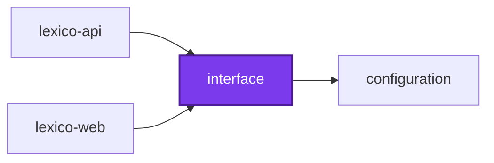
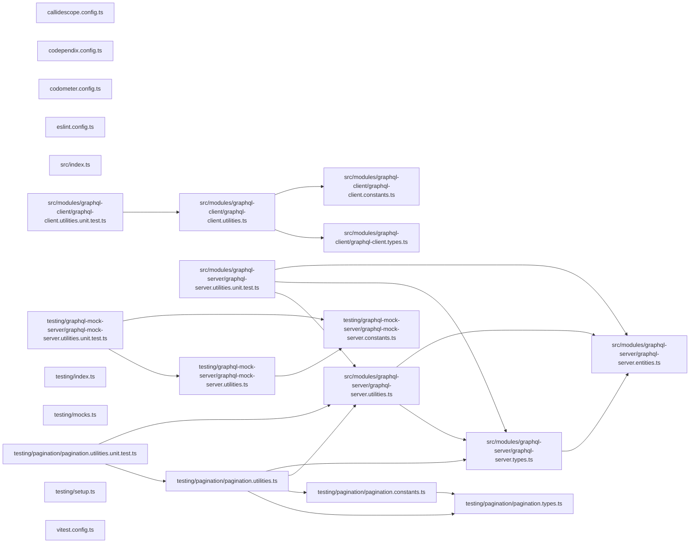

# interface

Shared GraphQL package for the workspace's APIs and their clients, as
[persistence](../persistence) is for Postgres. Two modules, one for each side
of the wire, each behind its own entry so a client never imports the Nest
decorators a server needs.

## graphql-server

From `@codebase/interface`, for an API built on `@nestjs/graphql`:

| Export                                                                                       | What it is                                                        |
| -------------------------------------------------------------------------------------------- | ----------------------------------------------------------------- |
| `PageInfo`                                                                                   | Relay page info object type                                       |
| `Paginated`, `createEdgeType`                                                                | Mixins that build a node's Relay connection and edge object types |
| `createConnection`, `createEdge`, `mapConnection`                                            | Build and map Relay connections                                   |
| `toCursor`, `fromCursor`, `fromCursorSafe`, `encodeOffsetCursor`, `decodeOffsetCursor`       | Opaque and offset cursors                                         |
| `mapRelation`, `mapRelations`, `mapRelationConnection`, `mapNullable*`                       | Map an entity's relations, keeping `null` and unjoined relations  |
| `Connection`, `Edge`, `GraphQLFields`, `GraphQLObjectOf`, `MappedFields`, `RelationKey`, ... | Types, including the entity-to-GraphQL-object contract            |

## graphql-client

From `@codebase/interface/client`, for a web client of such an API:
`createGraphqlCodegenConfig`, the GraphQL Code Generator configuration every
client shares. A client's `codegen.ts` passes only the schema its API emits and
gets typed operations, Zod validators, and MSW handlers.

## Testing

The GraphQL test helpers live with this package as
`@codebase/interface/testing`: for a client, `graphqlMockServer` with
`startGraphqlMockServer`, `resetGraphqlMockServer`, and
`stopGraphqlMockServer`, the MSW server its tests answer GraphQL requests
with; for a server, `paginateArray`, `paginationMatrix`, `expectedPage`, and
`summarize`, the oracle a SQL-backed page is checked against.

## Test

```bash
nx run interface:vitest
```

## 👔 Conformetry

This project was generated from the [nestjs-service-project](../../../configuration/conformetry-templates/nestjs-service-project) conformetry template.

## 🕸️ Codependix

Dependency graphs exported by [codependix](https://github.com/Organizzolini/codebase/tree/main/projects/ic-suite/codependix/codependix-cli), regenerated by `nx run configuration:codependix:write`.

### Nx Neighborhood

<!-- codependix:start name="codependix-nx-projects" -->

<!-- codependix:end name="codependix-nx-projects" -->

### File Imports

<!-- codependix:start name="codependix-file-imports" -->

<!-- codependix:end name="codependix-file-imports" -->
