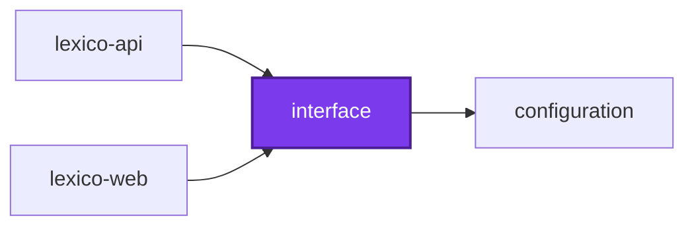
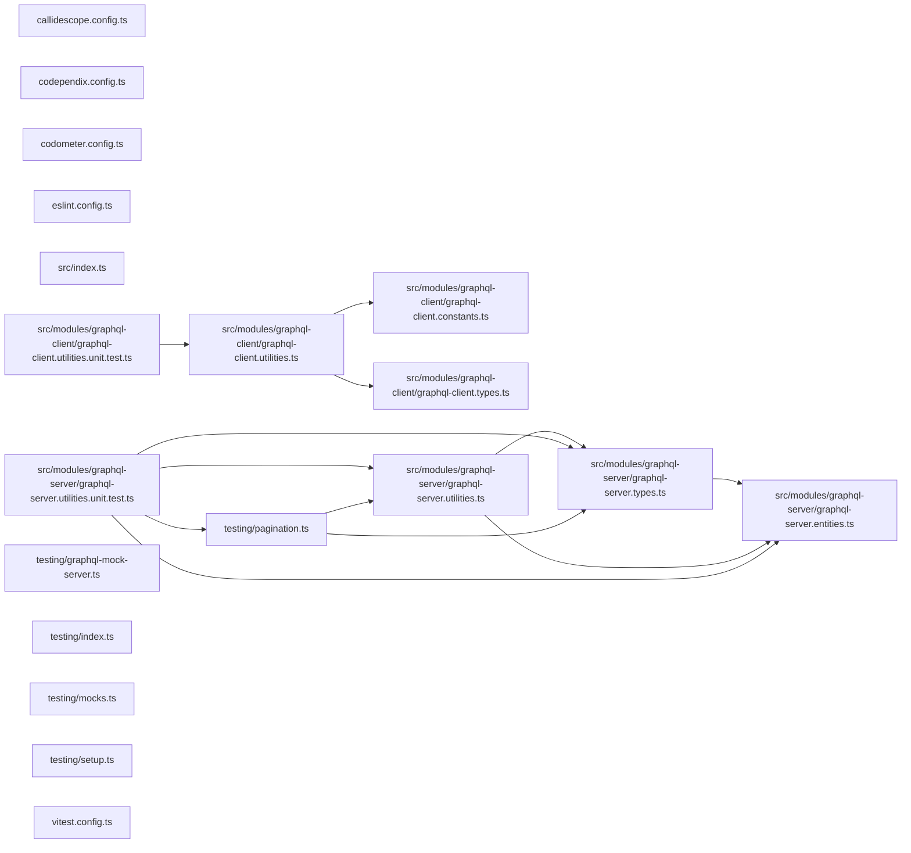

# interface

Shared GraphQL package for the workspace's APIs and their clients, as
[persistence](../persistence) is for Postgres. Two modules, one for each side
of the wire, each behind its own entry so a client never imports the Nest
decorators a server needs.

## graphql-server

From `@codebase/interface`, for an API built on `@nestjs/graphql`:

| Export                                                                                       | What it is                                                        |
| -------------------------------------------------------------------------------------------- | ----------------------------------------------------------------- |
| `PageInfo`                                                                                   | Relay page info object type                                       |
| `Paginated`, `createEdgeType`                                                                | Mixins that build a node's Relay connection and edge object types |
| `createConnection`, `createEdge`, `mapConnection`                                            | Build and map Relay connections                                   |
| `toCursor`, `fromCursor`, `fromCursorSafe`, `encodeOffsetCursor`, `decodeOffsetCursor`       | Opaque and offset cursors                                         |
| `mapRelation`, `mapRelations`, `mapRelationConnection`, `mapNullable*`                       | Map an entity's relations, keeping `null` and unjoined relations  |
| `Connection`, `Edge`, `GraphQLFields`, `GraphQLObjectOf`, `MappedFields`, `RelationKey`, ... | Types, including the entity-to-GraphQL-object contract            |

## graphql-client

From `@codebase/interface/client`, for a web client of such an API:
`createGraphqlCodegenConfig`, the GraphQL Code Generator configuration every
client shares. A client's `codegen.ts` passes only the schema its API emits and
gets typed operations, Zod validators, and MSW handlers.

## Testing

From `@codebase/interface/testing`:

- For a client: `graphqlMockServer` with `startGraphqlMockServer`,
  `resetGraphqlMockServer`, and `stopGraphqlMockServer`, the MSW server its
  tests answer GraphQL requests with.
- For a server: `paginateArray`, `paginationMatrix`, `expectedPage`, and
  `summarize`, the oracle a SQL-backed page is checked against.

## Test

```bash
nx run interface:vitest
```

## 👔 Conformetry

This project was generated from the [nestjs-service-project](../../../configuration/conformetry-templates/nestjs-service-project) conformetry template.

## 🕸️ Codependix

Dependency graphs exported by [codependix](https://github.com/Organizzolini/codebase/tree/main/projects/ic-suite/codependix/codependix-cli), regenerated by `nx run configuration:codependix:write`.

### Nx Neighborhood

<!-- codependix:start name="codependix-nx-projects" -->

<!-- codependix:end name="codependix-nx-projects" -->

### File Imports

<!-- codependix:start name="codependix-file-imports" -->

<!-- codependix:end name="codependix-file-imports" -->

<!-- callidescope:start -->

## 🔭 Callidescope

Call stacks traced through `projects/common/interface`, deepest first. Each frame shows what it takes, what it returns, and what its documentation says.

| Measure | Value |
| --- | --- |
| Callables | 29 |
| Files | 12 |
| Calls traced | 16 |
| Call stacks | 3 |
| Deepest stack | 3 |
| Stacks through recursion | 0 |
| Unfollowable calls | 8 |

### Limits

What this project is judged against, as declared in its own `callidescope.config.ts`.

| Limit | Value |
| --- | --- |
| `maximumDepth` | 7 |
| `maximumBreadth` | 7 |

### Call stacks (depth)

**1. `decodeOffsetCursor`** — depth ≥ 3 · orphan-root

```text
🚀 decodeOffsetCursor(cursor?: null | string, defaultOffset?: number): number [projects/common/interface/src/modules/graphql-server/graphql-server.utilities.ts:72]
   ↳ Decodes an offset-based cursor, returning the specified default offset if missing or invalid.
  └─> fromCursorSafe<T = unknown>(cursor?: null | string, parse?: (value: unknown) => T): null | T [projects/common/interface/src/modules/graphql-server/graphql-server.utilities.ts:114]
     ↳ Safely decodes a cursor string, returning null if invalid, null, or undefined.
    └─> fromCursor<T = unknown>(cursor: string, parse?: (value: unknown) => T): T [projects/common/interface/src/modules/graphql-server/graphql-server.utilities.ts:100]
       ↳ Decodes an opaque Base64 cursor string into structured data.
```

**2. `mapNullableRelations`** — depth ≥ 3 · orphan-root

```text
🚀 mapNullableRelations(…): Mapped[] | null | undefined [projects/common/interface/src/modules/graphql-server/graphql-server.utilities.ts:169]
   ↳ Maps a nullable to-many relation to its GraphQL types, keeping `null`, and leaving one its query did not join unset, as…
  └─> mapRelations(…): Mapped[] | undefined [projects/common/interface/src/modules/graphql-server/graphql-server.utilities.ts:214]
     ↳ Maps each row of a to-many relation to its GraphQL type, leaving one its query did not join unset, as {@link…
    └─> map(…)(relation: Entity): Mapped [projects/common/interface/src/modules/graphql-server/graphql-server.utilities.ts:218]
```

**3. `Paginated`** — depth ≥ 3 · orphan-root

```text
🚀 Paginated(…): ClassConstructor<Connection<T>> [projects/common/interface/src/modules/graphql-server/graphql-server.utilities.ts:225]
   ↳ Mixin type factory producing a Relay Connection ObjectType for GraphQL schema generation, named after the node's…
  └─> createEdgeType(…): ClassConstructor<Edge<T>> [projects/common/interface/src/modules/graphql-server/graphql-server.utilities.ts:46]
     ↳ Mixin type factory producing a Relay Edge ObjectType for GraphQL schema generation, named after the node's GraphQL type…
    └─> Field(…)(): StringConstructor [projects/common/interface/src/modules/graphql-server/graphql-server.utilities.ts:57]
```

### Breadth

| Callable | Breadth | Calls directly | Location |
| --- | --- | --- | --- |
| `createEdgeType` | 2 | `Field(…)`, `Field(…)` | `projects/common/interface/src/modules/graphql-server/graphql-server.utilities.ts:46` |
| `mapRelationConnection` | 2 | `createConnection`, `map(…)` | `projects/common/interface/src/modules/graphql-server/graphql-server.utilities.ts:192` |
| `map(…)` | 2 | `createEdge`, `encodeOffsetCursor` | `projects/common/interface/src/modules/graphql-server/graphql-server.utilities.ts:201` |

<details>
<summary>10 more callables</summary>

| Callable | Breadth | Calls directly | Location |
| --- | --- | --- | --- |
| `decodeOffsetCursor` | 1 | `fromCursorSafe` | `projects/common/interface/src/modules/graphql-server/graphql-server.utilities.ts:72` |
| `encodeOffsetCursor` | 1 | `toCursor` | `projects/common/interface/src/modules/graphql-server/graphql-server.utilities.ts:93` |
| `fromCursorSafe` | 1 | `fromCursor` | `projects/common/interface/src/modules/graphql-server/graphql-server.utilities.ts:114` |
| `mapConnection` | 1 | `map(…)` | `projects/common/interface/src/modules/graphql-server/graphql-server.utilities.ts:131` |
| `map(…)` | 1 | `createEdge` | `projects/common/interface/src/modules/graphql-server/graphql-server.utilities.ts:136` |
| `mapNullableRelation` | 1 | `mapRelation` | `projects/common/interface/src/modules/graphql-server/graphql-server.utilities.ts:148` |
| `mapNullableRelationConnection` | 1 | `mapRelationConnection` | `projects/common/interface/src/modules/graphql-server/graphql-server.utilities.ts:158` |
| `mapNullableRelations` | 1 | `mapRelations` | `projects/common/interface/src/modules/graphql-server/graphql-server.utilities.ts:169` |
| `mapRelations` | 1 | `map(…)` | `projects/common/interface/src/modules/graphql-server/graphql-server.utilities.ts:214` |
| `Paginated` | 1 | `createEdgeType` | `projects/common/interface/src/modules/graphql-server/graphql-server.utilities.ts:225` |

</details>
<!-- callidescope:end -->
