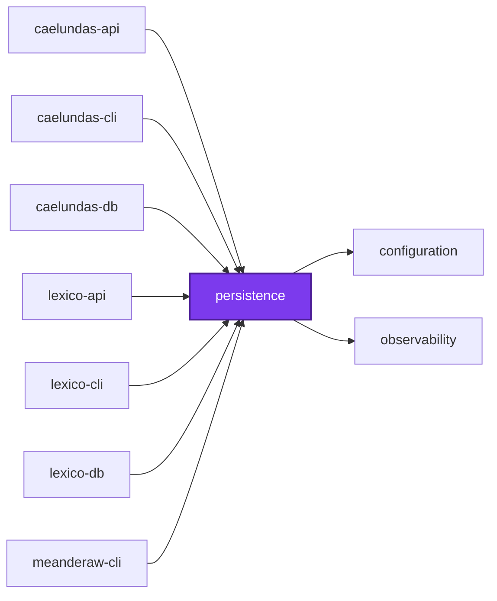
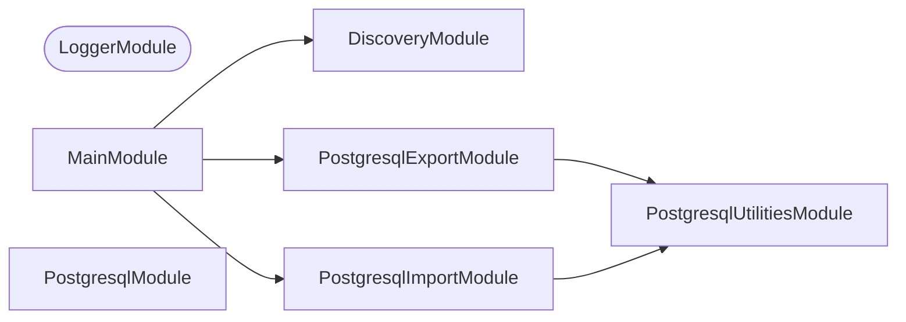

## 🕸️ Codependix

Dependency graphs exported by [codependix](https://github.com/Organizzolini/codebase/tree/main/projects/ic-suite/codependix/codependix-cli), regenerated by `nx run configuration:codependix:write`.

### Nx Neighborhood

<!-- codependix:start name="codependix-nx-projects" -->

<!-- codependix:end name="codependix-nx-projects" -->

### NestJS Module Graph

<!-- codependix:start name="codependix-nestjs-modules" -->


_Rounded modules are global: every module can inject them, so their edges are left out._
<!-- codependix:end name="codependix-nestjs-modules" -->

### File Imports

<!-- codependix:start name="codependix-file-imports" -->
```mermaid
graph LR
  file_callidescope_config_ts["callidescope.config.ts"]
  file_codependix_config_ts["codependix.config.ts"]
  file_codometer_config_ts["codometer.config.ts"]
  file_coinagerie_config_ts["coinagerie.config.ts"]
  file_eslint_config_ts["eslint.config.ts"]
  file_src_index_ts["src/index.ts"]
  file_src_modules_postgresql_export_postgresql_export_arguments_command_integration_test_ts["src/modules/postgresql-export/postgresql-export-arguments.command.integration.test.ts"]
  file_src_modules_postgresql_export_postgresql_export_dry_run_command_integration_test_ts["src/modules/postgresql-export/postgresql-export-dry-run.command.integration.test.ts"]
  file_src_modules_postgresql_export_postgresql_export_dry_run_command_unit_test_ts["src/modules/postgresql-export/postgresql-export-dry-run.command.unit.test.ts"]
  file_src_modules_postgresql_export_postgresql_export_log_convention_command_unit_test_ts["src/modules/postgresql-export/postgresql-export-log-convention.command.unit.test.ts"]
  file_src_modules_postgresql_export_postgresql_export_missing_table_command_integration_test_ts["src/modules/postgresql-export/postgresql-export-missing-table.command.integration.test.ts"]
  file_src_modules_postgresql_export_postgresql_export_missing_table_command_unit_test_ts["src/modules/postgresql-export/postgresql-export-missing-table.command.unit.test.ts"]
  file_src_modules_postgresql_export_postgresql_export_preflight_command_integration_test_ts["src/modules/postgresql-export/postgresql-export-preflight.command.integration.test.ts"]
  file_src_modules_postgresql_export_postgresql_export_schema_command_unit_test_ts["src/modules/postgresql-export/postgresql-export-schema.command.unit.test.ts"]
  file_src_modules_postgresql_export_postgresql_export_command_integration_test_ts["src/modules/postgresql-export/postgresql-export.command.integration.test.ts"]
  file_src_modules_postgresql_export_postgresql_export_command_ts["src/modules/postgresql-export/postgresql-export.command.ts"]
  file_src_modules_postgresql_export_postgresql_export_command_unit_test_ts["src/modules/postgresql-export/postgresql-export.command.unit.test.ts"]
  file_src_modules_postgresql_export_postgresql_export_constants_ts["src/modules/postgresql-export/postgresql-export.constants.ts"]
  file_src_modules_postgresql_export_postgresql_export_module_ts["src/modules/postgresql-export/postgresql-export.module.ts"]
  file_src_modules_postgresql_export_postgresql_export_types_ts["src/modules/postgresql-export/postgresql-export.types.ts"]
  file_src_modules_postgresql_import_postgresql_import_clean_data_command_integration_test_ts["src/modules/postgresql-import/postgresql-import-clean-data.command.integration.test.ts"]
  file_src_modules_postgresql_import_postgresql_import_clean_data_command_unit_test_ts["src/modules/postgresql-import/postgresql-import-clean-data.command.unit.test.ts"]
  file_src_modules_postgresql_import_postgresql_import_clean_command_integration_test_ts["src/modules/postgresql-import/postgresql-import-clean.command.integration.test.ts"]
  file_src_modules_postgresql_import_postgresql_import_clean_command_unit_test_ts["src/modules/postgresql-import/postgresql-import-clean.command.unit.test.ts"]
  file_src_modules_postgresql_import_postgresql_import_dry_run_command_integration_test_ts["src/modules/postgresql-import/postgresql-import-dry-run.command.integration.test.ts"]
  file_src_modules_postgresql_import_postgresql_import_dry_run_command_unit_test_ts["src/modules/postgresql-import/postgresql-import-dry-run.command.unit.test.ts"]
  file_src_modules_postgresql_import_postgresql_import_preflight_command_integration_test_ts["src/modules/postgresql-import/postgresql-import-preflight.command.integration.test.ts"]
  file_src_modules_postgresql_import_postgresql_import_schema_command_integration_test_ts["src/modules/postgresql-import/postgresql-import-schema.command.integration.test.ts"]
  file_src_modules_postgresql_import_postgresql_import_schema_command_unit_test_ts["src/modules/postgresql-import/postgresql-import-schema.command.unit.test.ts"]
  file_src_modules_postgresql_import_postgresql_import_command_integration_test_ts["src/modules/postgresql-import/postgresql-import.command.integration.test.ts"]
  file_src_modules_postgresql_import_postgresql_import_command_ts["src/modules/postgresql-import/postgresql-import.command.ts"]
  file_src_modules_postgresql_import_postgresql_import_command_unit_test_ts["src/modules/postgresql-import/postgresql-import.command.unit.test.ts"]
  file_src_modules_postgresql_import_postgresql_import_constants_ts["src/modules/postgresql-import/postgresql-import.constants.ts"]
  file_src_modules_postgresql_import_postgresql_import_module_ts["src/modules/postgresql-import/postgresql-import.module.ts"]
  file_src_modules_postgresql_import_postgresql_import_types_ts["src/modules/postgresql-import/postgresql-import.types.ts"]
  file_src_modules_postgresql_utilities_postgresql_dump_utilities_ts["src/modules/postgresql-utilities/postgresql-dump.utilities.ts"]
  file_src_modules_postgresql_utilities_postgresql_dump_utilities_unit_test_ts["src/modules/postgresql-utilities/postgresql-dump.utilities.unit.test.ts"]
  file_src_modules_postgresql_utilities_postgresql_truncate_utilities_ts["src/modules/postgresql-utilities/postgresql-truncate.utilities.ts"]
  file_src_modules_postgresql_utilities_postgresql_truncate_utilities_unit_test_ts["src/modules/postgresql-utilities/postgresql-truncate.utilities.unit.test.ts"]
  file_src_modules_postgresql_utilities_postgresql_utilities_constants_ts["src/modules/postgresql-utilities/postgresql-utilities.constants.ts"]
  file_src_modules_postgresql_utilities_postgresql_utilities_module_ts["src/modules/postgresql-utilities/postgresql-utilities.module.ts"]
  file_src_modules_postgresql_utilities_postgresql_utilities_service_ts["src/modules/postgresql-utilities/postgresql-utilities.service.ts"]
  file_src_modules_postgresql_utilities_postgresql_utilities_service_unit_test_ts["src/modules/postgresql-utilities/postgresql-utilities.service.unit.test.ts"]
  file_src_modules_postgresql_utilities_postgresql_utilities_types_ts["src/modules/postgresql-utilities/postgresql-utilities.types.ts"]
  file_src_modules_postgresql_utilities_postgresql_utilities_utilities_ts["src/modules/postgresql-utilities/postgresql-utilities.utilities.ts"]
  file_src_modules_postgresql_utilities_postgresql_utilities_utilities_unit_test_ts["src/modules/postgresql-utilities/postgresql-utilities.utilities.unit.test.ts"]
  file_src_modules_postgresql_entities_creatable_entity_ts["src/modules/postgresql/entities/creatable.entity.ts"]
  file_src_modules_postgresql_entities_deletable_entity_ts["src/modules/postgresql/entities/deletable.entity.ts"]
  file_src_modules_postgresql_entities_identifiable_entity_ts["src/modules/postgresql/entities/identifiable.entity.ts"]
  file_src_modules_postgresql_entities_updatable_entity_ts["src/modules/postgresql/entities/updatable.entity.ts"]
  file_src_modules_postgresql_postgresql_constants_ts["src/modules/postgresql/postgresql.constants.ts"]
  file_src_modules_postgresql_postgresql_constants_unit_test_ts["src/modules/postgresql/postgresql.constants.unit.test.ts"]
  file_src_modules_postgresql_postgresql_module_integration_test_ts["src/modules/postgresql/postgresql.module.integration.test.ts"]
  file_src_modules_postgresql_postgresql_module_ts["src/modules/postgresql/postgresql.module.ts"]
  file_src_modules_postgresql_postgresql_service_ts["src/modules/postgresql/postgresql.service.ts"]
  file_src_modules_postgresql_postgresql_service_unit_test_ts["src/modules/postgresql/postgresql.service.unit.test.ts"]
  file_src_modules_postgresql_postgresql_types_ts["src/modules/postgresql/postgresql.types.ts"]
  file_src_modules_postgresql_postgresql_utilities_ts["src/modules/postgresql/postgresql.utilities.ts"]
  file_src_modules_postgresql_postgresql_utilities_unit_test_ts["src/modules/postgresql/postgresql.utilities.unit.test.ts"]
  file_src_persistence_main_end_to_end_test_ts["src/persistence.main.end-to-end.test.ts"]
  file_src_persistence_main_ts["src/persistence.main.ts"]
  file_src_persistence_main_unit_test_ts["src/persistence.main.unit.test.ts"]
  file_src_persistence_module_ts["src/persistence.module.ts"]
  file_src_persistence_module_unit_test_ts["src/persistence.module.unit.test.ts"]
  file_src_persistence_repl_ts["src/persistence.repl.ts"]
  file_src_persistence_repl_unit_test_ts["src/persistence.repl.unit.test.ts"]
  file_testing_command_line_runner_ts["testing/command-line-runner.ts"]
  file_testing_database_testing_database_testing_types_ts["testing/database-testing/database-testing.types.ts"]
  file_testing_database_testing_database_testing_utilities_integration_test_ts["testing/database-testing/database-testing.utilities.integration.test.ts"]
  file_testing_database_testing_database_testing_utilities_ts["testing/database-testing/database-testing.utilities.ts"]
  file_testing_fixture_persistence_ts["testing/fixture-persistence.ts"]
  file_testing_fixtures_fixture_persistence_module_ts["testing/fixtures/fixture-persistence.module.ts"]
  file_testing_fixtures_gadget_entity_ts["testing/fixtures/gadget.entity.ts"]
  file_testing_fixtures_migrations_1767225600000_create_widgets_ts["testing/fixtures/migrations/1767225600000-create-widgets.ts"]
  file_testing_fixtures_migrations_1767225600001_create_parts_ts["testing/fixtures/migrations/1767225600001-create-parts.ts"]
  file_testing_fixtures_sample_greeting_constants_ts["testing/fixtures/sample-greeting.constants.ts"]
  file_testing_fixtures_sample_greeting_module_ts["testing/fixtures/sample-greeting.module.ts"]
  file_testing_fixtures_sample_widgets_module_ts["testing/fixtures/sample-widgets.module.ts"]
  file_testing_fixtures_sample_widgets_service_ts["testing/fixtures/sample-widgets.service.ts"]
  file_testing_fixtures_widget_entity_ts["testing/fixtures/widget.entity.ts"]
  file_testing_index_ts["testing/index.ts"]
  file_testing_mocks_ts["testing/mocks.ts"]
  file_testing_postgres_container_postgres_container_constants_ts["testing/postgres-container/postgres-container.constants.ts"]
  file_testing_postgres_container_postgres_container_types_ts["testing/postgres-container/postgres-container.types.ts"]
  file_testing_postgres_container_postgres_container_utilities_integration_test_ts["testing/postgres-container/postgres-container.utilities.integration.test.ts"]
  file_testing_postgres_container_postgres_container_utilities_ts["testing/postgres-container/postgres-container.utilities.ts"]
  file_testing_setup_ts["testing/setup.ts"]
  file_vitest_config_ts["vitest.config.ts"]
  file_src_modules_postgresql_export_postgresql_export_arguments_command_integration_test_ts --> file_testing_command_line_runner_ts
  file_src_modules_postgresql_export_postgresql_export_arguments_command_integration_test_ts --> file_testing_fixture_persistence_ts
  file_src_modules_postgresql_export_postgresql_export_dry_run_command_integration_test_ts --> file_testing_command_line_runner_ts
  file_src_modules_postgresql_export_postgresql_export_dry_run_command_integration_test_ts --> file_testing_fixture_persistence_ts
  file_src_modules_postgresql_export_postgresql_export_dry_run_command_unit_test_ts --> file_testing_command_line_runner_ts
  file_src_modules_postgresql_export_postgresql_export_dry_run_command_unit_test_ts --> file_testing_mocks_ts
  file_src_modules_postgresql_export_postgresql_export_log_convention_command_unit_test_ts --> file_src_modules_postgresql_export_postgresql_export_constants_ts
  file_src_modules_postgresql_export_postgresql_export_log_convention_command_unit_test_ts --> file_testing_command_line_runner_ts
  file_src_modules_postgresql_export_postgresql_export_log_convention_command_unit_test_ts --> file_testing_mocks_ts
  file_src_modules_postgresql_export_postgresql_export_missing_table_command_integration_test_ts --> file_testing_command_line_runner_ts
  file_src_modules_postgresql_export_postgresql_export_missing_table_command_integration_test_ts --> file_testing_fixture_persistence_ts
  file_src_modules_postgresql_export_postgresql_export_missing_table_command_unit_test_ts --> file_testing_command_line_runner_ts
  file_src_modules_postgresql_export_postgresql_export_missing_table_command_unit_test_ts --> file_testing_mocks_ts
  file_src_modules_postgresql_export_postgresql_export_preflight_command_integration_test_ts --> file_testing_command_line_runner_ts
  file_src_modules_postgresql_export_postgresql_export_preflight_command_integration_test_ts --> file_testing_fixture_persistence_ts
  file_src_modules_postgresql_export_postgresql_export_schema_command_unit_test_ts --> file_testing_command_line_runner_ts
  file_src_modules_postgresql_export_postgresql_export_schema_command_unit_test_ts --> file_testing_mocks_ts
  file_src_modules_postgresql_export_postgresql_export_command_integration_test_ts --> file_src_modules_postgresql_utilities_postgresql_utilities_types_ts
  file_src_modules_postgresql_export_postgresql_export_command_integration_test_ts --> file_src_modules_postgresql_utilities_postgresql_utilities_utilities_ts
  file_src_modules_postgresql_export_postgresql_export_command_integration_test_ts --> file_src_modules_postgresql_postgresql_types_ts
  file_src_modules_postgresql_export_postgresql_export_command_integration_test_ts --> file_testing_command_line_runner_ts
  file_src_modules_postgresql_export_postgresql_export_command_integration_test_ts --> file_testing_fixture_persistence_ts
  file_src_modules_postgresql_export_postgresql_export_command_integration_test_ts --> file_testing_index_ts
  file_src_modules_postgresql_export_postgresql_export_command_ts --> file_src_modules_postgresql_export_postgresql_export_constants_ts
  file_src_modules_postgresql_export_postgresql_export_command_ts --> file_src_modules_postgresql_export_postgresql_export_types_ts
  file_src_modules_postgresql_export_postgresql_export_command_ts --> file_src_modules_postgresql_utilities_postgresql_dump_utilities_ts
  file_src_modules_postgresql_export_postgresql_export_command_ts --> file_src_modules_postgresql_utilities_postgresql_utilities_constants_ts
  file_src_modules_postgresql_export_postgresql_export_command_ts --> file_src_modules_postgresql_utilities_postgresql_utilities_service_ts
  file_src_modules_postgresql_export_postgresql_export_command_ts --> file_src_modules_postgresql_utilities_postgresql_utilities_types_ts
  file_src_modules_postgresql_export_postgresql_export_command_ts --> file_src_modules_postgresql_utilities_postgresql_utilities_utilities_ts
  file_src_modules_postgresql_export_postgresql_export_command_unit_test_ts --> file_src_modules_postgresql_export_postgresql_export_command_ts
  file_src_modules_postgresql_export_postgresql_export_command_unit_test_ts --> file_src_modules_postgresql_utilities_postgresql_utilities_service_ts
  file_src_modules_postgresql_export_postgresql_export_command_unit_test_ts --> file_testing_command_line_runner_ts
  file_src_modules_postgresql_export_postgresql_export_command_unit_test_ts --> file_testing_mocks_ts
  file_src_modules_postgresql_export_postgresql_export_constants_ts --> file_src_modules_postgresql_export_postgresql_export_types_ts
  file_src_modules_postgresql_export_postgresql_export_constants_ts --> file_src_modules_postgresql_utilities_postgresql_utilities_utilities_ts
  file_src_modules_postgresql_export_postgresql_export_module_ts --> file_src_modules_postgresql_export_postgresql_export_command_ts
  file_src_modules_postgresql_export_postgresql_export_module_ts --> file_src_modules_postgresql_utilities_postgresql_utilities_module_ts
  file_src_modules_postgresql_export_postgresql_export_types_ts --> file_src_modules_postgresql_utilities_postgresql_utilities_types_ts
  file_src_modules_postgresql_import_postgresql_import_clean_data_command_integration_test_ts --> file_testing_command_line_runner_ts
  file_src_modules_postgresql_import_postgresql_import_clean_data_command_integration_test_ts --> file_testing_fixture_persistence_ts
  file_src_modules_postgresql_import_postgresql_import_clean_data_command_integration_test_ts --> file_testing_index_ts
  file_src_modules_postgresql_import_postgresql_import_clean_data_command_unit_test_ts --> file_src_modules_postgresql_utilities_postgresql_utilities_constants_ts
  file_src_modules_postgresql_import_postgresql_import_clean_data_command_unit_test_ts --> file_src_modules_postgresql_utilities_postgresql_utilities_service_ts
  file_src_modules_postgresql_import_postgresql_import_clean_data_command_unit_test_ts --> file_testing_command_line_runner_ts
  file_src_modules_postgresql_import_postgresql_import_clean_data_command_unit_test_ts --> file_testing_mocks_ts
  file_src_modules_postgresql_import_postgresql_import_clean_command_integration_test_ts --> file_testing_command_line_runner_ts
  file_src_modules_postgresql_import_postgresql_import_clean_command_integration_test_ts --> file_testing_fixture_persistence_ts
  file_src_modules_postgresql_import_postgresql_import_clean_command_integration_test_ts --> file_testing_index_ts
  file_src_modules_postgresql_import_postgresql_import_clean_command_integration_test_ts --> file_testing_mocks_ts
  file_src_modules_postgresql_import_postgresql_import_clean_command_unit_test_ts --> file_testing_command_line_runner_ts
  file_src_modules_postgresql_import_postgresql_import_clean_command_unit_test_ts --> file_testing_mocks_ts
  file_src_modules_postgresql_import_postgresql_import_dry_run_command_integration_test_ts --> file_testing_command_line_runner_ts
  file_src_modules_postgresql_import_postgresql_import_dry_run_command_integration_test_ts --> file_testing_fixture_persistence_ts
  file_src_modules_postgresql_import_postgresql_import_dry_run_command_integration_test_ts --> file_testing_index_ts
  file_src_modules_postgresql_import_postgresql_import_dry_run_command_unit_test_ts --> file_testing_command_line_runner_ts
  file_src_modules_postgresql_import_postgresql_import_dry_run_command_unit_test_ts --> file_testing_mocks_ts
  file_src_modules_postgresql_import_postgresql_import_preflight_command_integration_test_ts --> file_testing_command_line_runner_ts
  file_src_modules_postgresql_import_postgresql_import_preflight_command_integration_test_ts --> file_testing_fixture_persistence_ts
  file_src_modules_postgresql_import_postgresql_import_schema_command_integration_test_ts --> file_testing_command_line_runner_ts
  file_src_modules_postgresql_import_postgresql_import_schema_command_integration_test_ts --> file_testing_fixture_persistence_ts
  file_src_modules_postgresql_import_postgresql_import_schema_command_unit_test_ts --> file_src_modules_postgresql_utilities_postgresql_utilities_service_ts
  file_src_modules_postgresql_import_postgresql_import_schema_command_unit_test_ts --> file_testing_command_line_runner_ts
  file_src_modules_postgresql_import_postgresql_import_schema_command_unit_test_ts --> file_testing_mocks_ts
  file_src_modules_postgresql_import_postgresql_import_command_integration_test_ts --> file_testing_command_line_runner_ts
  file_src_modules_postgresql_import_postgresql_import_command_integration_test_ts --> file_testing_fixture_persistence_ts
  file_src_modules_postgresql_import_postgresql_import_command_integration_test_ts --> file_testing_index_ts
  file_src_modules_postgresql_import_postgresql_import_command_ts --> file_src_modules_postgresql_import_postgresql_import_constants_ts
  file_src_modules_postgresql_import_postgresql_import_command_ts --> file_src_modules_postgresql_import_postgresql_import_types_ts
  file_src_modules_postgresql_import_postgresql_import_command_ts --> file_src_modules_postgresql_utilities_postgresql_dump_utilities_ts
  file_src_modules_postgresql_import_postgresql_import_command_ts --> file_src_modules_postgresql_utilities_postgresql_utilities_constants_ts
  file_src_modules_postgresql_import_postgresql_import_command_ts --> file_src_modules_postgresql_utilities_postgresql_utilities_service_ts
  file_src_modules_postgresql_import_postgresql_import_command_ts --> file_src_modules_postgresql_utilities_postgresql_utilities_types_ts
  file_src_modules_postgresql_import_postgresql_import_command_ts --> file_src_modules_postgresql_utilities_postgresql_utilities_utilities_ts
  file_src_modules_postgresql_import_postgresql_import_command_unit_test_ts --> file_src_modules_postgresql_import_postgresql_import_command_ts
  file_src_modules_postgresql_import_postgresql_import_command_unit_test_ts --> file_src_modules_postgresql_utilities_postgresql_utilities_service_ts
  file_src_modules_postgresql_import_postgresql_import_command_unit_test_ts --> file_testing_command_line_runner_ts
  file_src_modules_postgresql_import_postgresql_import_command_unit_test_ts --> file_testing_mocks_ts
  file_src_modules_postgresql_import_postgresql_import_constants_ts --> file_src_modules_postgresql_import_postgresql_import_types_ts
  file_src_modules_postgresql_import_postgresql_import_constants_ts --> file_src_modules_postgresql_utilities_postgresql_utilities_types_ts
  file_src_modules_postgresql_import_postgresql_import_constants_ts --> file_src_modules_postgresql_utilities_postgresql_utilities_utilities_ts
  file_src_modules_postgresql_import_postgresql_import_module_ts --> file_src_modules_postgresql_import_postgresql_import_command_ts
  file_src_modules_postgresql_import_postgresql_import_module_ts --> file_src_modules_postgresql_utilities_postgresql_utilities_module_ts
  file_src_modules_postgresql_import_postgresql_import_types_ts --> file_src_modules_postgresql_utilities_postgresql_utilities_types_ts
  file_src_modules_postgresql_utilities_postgresql_dump_utilities_ts --> file_src_modules_postgresql_utilities_postgresql_utilities_constants_ts
  file_src_modules_postgresql_utilities_postgresql_dump_utilities_ts --> file_src_modules_postgresql_utilities_postgresql_utilities_types_ts
  file_src_modules_postgresql_utilities_postgresql_dump_utilities_unit_test_ts --> file_src_modules_postgresql_utilities_postgresql_dump_utilities_ts
  file_src_modules_postgresql_utilities_postgresql_truncate_utilities_ts --> file_src_modules_postgresql_utilities_postgresql_utilities_constants_ts
  file_src_modules_postgresql_utilities_postgresql_truncate_utilities_ts --> file_src_modules_postgresql_utilities_postgresql_utilities_types_ts
  file_src_modules_postgresql_utilities_postgresql_truncate_utilities_unit_test_ts --> file_src_modules_postgresql_utilities_postgresql_truncate_utilities_ts
  file_src_modules_postgresql_utilities_postgresql_truncate_utilities_unit_test_ts --> file_src_modules_postgresql_utilities_postgresql_utilities_constants_ts
  file_src_modules_postgresql_utilities_postgresql_truncate_utilities_unit_test_ts --> file_src_modules_postgresql_utilities_postgresql_utilities_types_ts
  file_src_modules_postgresql_utilities_postgresql_utilities_constants_ts --> file_src_modules_postgresql_utilities_postgresql_utilities_types_ts
  file_src_modules_postgresql_utilities_postgresql_utilities_module_ts --> file_src_modules_postgresql_utilities_postgresql_utilities_service_ts
  file_src_modules_postgresql_utilities_postgresql_utilities_service_ts --> file_src_modules_postgresql_utilities_postgresql_dump_utilities_ts
  file_src_modules_postgresql_utilities_postgresql_utilities_service_ts --> file_src_modules_postgresql_utilities_postgresql_truncate_utilities_ts
  file_src_modules_postgresql_utilities_postgresql_utilities_service_ts --> file_src_modules_postgresql_utilities_postgresql_utilities_constants_ts
  file_src_modules_postgresql_utilities_postgresql_utilities_service_ts --> file_src_modules_postgresql_utilities_postgresql_utilities_types_ts
  file_src_modules_postgresql_utilities_postgresql_utilities_service_ts --> file_src_modules_postgresql_utilities_postgresql_utilities_utilities_ts
  file_src_modules_postgresql_utilities_postgresql_utilities_service_unit_test_ts --> file_src_modules_postgresql_utilities_postgresql_utilities_constants_ts
  file_src_modules_postgresql_utilities_postgresql_utilities_service_unit_test_ts --> file_src_modules_postgresql_utilities_postgresql_utilities_service_ts
  file_src_modules_postgresql_utilities_postgresql_utilities_service_unit_test_ts --> file_src_modules_postgresql_utilities_postgresql_utilities_types_ts
  file_src_modules_postgresql_utilities_postgresql_utilities_service_unit_test_ts --> file_testing_mocks_ts
  file_src_modules_postgresql_utilities_postgresql_utilities_utilities_ts --> file_src_modules_postgresql_utilities_postgresql_utilities_constants_ts
  file_src_modules_postgresql_utilities_postgresql_utilities_utilities_ts --> file_src_modules_postgresql_utilities_postgresql_utilities_types_ts
  file_src_modules_postgresql_utilities_postgresql_utilities_utilities_ts --> file_src_modules_postgresql_postgresql_constants_ts
  file_src_modules_postgresql_utilities_postgresql_utilities_utilities_unit_test_ts --> file_src_modules_postgresql_utilities_postgresql_utilities_constants_ts
  file_src_modules_postgresql_utilities_postgresql_utilities_utilities_unit_test_ts --> file_src_modules_postgresql_utilities_postgresql_utilities_types_ts
  file_src_modules_postgresql_utilities_postgresql_utilities_utilities_unit_test_ts --> file_src_modules_postgresql_utilities_postgresql_utilities_utilities_ts
  file_src_modules_postgresql_entities_creatable_entity_ts --> file_src_modules_postgresql_entities_identifiable_entity_ts
  file_src_modules_postgresql_entities_deletable_entity_ts --> file_src_modules_postgresql_entities_updatable_entity_ts
  file_src_modules_postgresql_entities_updatable_entity_ts --> file_src_modules_postgresql_entities_creatable_entity_ts
  file_src_modules_postgresql_postgresql_constants_unit_test_ts --> file_src_modules_postgresql_postgresql_constants_ts
  file_src_modules_postgresql_postgresql_module_integration_test_ts --> file_src_modules_postgresql_postgresql_module_ts
  file_src_modules_postgresql_postgresql_module_integration_test_ts --> file_src_modules_postgresql_postgresql_utilities_ts
  file_src_modules_postgresql_postgresql_module_integration_test_ts --> file_testing_fixtures_gadget_entity_ts
  file_src_modules_postgresql_postgresql_module_integration_test_ts --> file_testing_fixtures_migrations_1767225600000_create_widgets_ts
  file_src_modules_postgresql_postgresql_module_integration_test_ts --> file_testing_fixtures_widget_entity_ts
  file_src_modules_postgresql_postgresql_module_integration_test_ts --> file_testing_index_ts
  file_src_modules_postgresql_postgresql_module_ts --> file_src_modules_postgresql_postgresql_constants_ts
  file_src_modules_postgresql_postgresql_module_ts --> file_src_modules_postgresql_postgresql_service_ts
  file_src_modules_postgresql_postgresql_module_ts --> file_src_modules_postgresql_postgresql_types_ts
  file_src_modules_postgresql_postgresql_service_ts --> file_src_modules_postgresql_postgresql_constants_ts
  file_src_modules_postgresql_postgresql_service_ts --> file_src_modules_postgresql_postgresql_types_ts
  file_src_modules_postgresql_postgresql_service_ts --> file_src_modules_postgresql_postgresql_utilities_ts
  file_src_modules_postgresql_postgresql_service_unit_test_ts --> file_src_modules_postgresql_postgresql_constants_ts
  file_src_modules_postgresql_postgresql_service_unit_test_ts --> file_src_modules_postgresql_postgresql_service_ts
  file_src_modules_postgresql_postgresql_types_ts --> file_src_modules_postgresql_postgresql_constants_ts
  file_src_modules_postgresql_postgresql_utilities_ts --> file_src_modules_postgresql_postgresql_constants_ts
  file_src_modules_postgresql_postgresql_utilities_ts --> file_src_modules_postgresql_postgresql_types_ts
  file_src_modules_postgresql_postgresql_utilities_unit_test_ts --> file_src_modules_postgresql_postgresql_constants_ts
  file_src_modules_postgresql_postgresql_utilities_unit_test_ts --> file_src_modules_postgresql_postgresql_types_ts
  file_src_modules_postgresql_postgresql_utilities_unit_test_ts --> file_src_modules_postgresql_postgresql_utilities_ts
  file_src_persistence_main_ts --> file_src_persistence_module_ts
  file_src_persistence_module_ts --> file_src_modules_postgresql_export_postgresql_export_module_ts
  file_src_persistence_module_ts --> file_src_modules_postgresql_import_postgresql_import_module_ts
  file_src_persistence_module_unit_test_ts --> file_src_persistence_module_ts
  file_src_persistence_module_unit_test_ts --> file_testing_command_line_runner_ts
  file_src_persistence_repl_ts --> file_src_persistence_module_ts
  file_testing_command_line_runner_ts --> file_src_persistence_module_ts
  file_testing_database_testing_database_testing_types_ts --> file_src_modules_postgresql_postgresql_types_ts
  file_testing_database_testing_database_testing_types_ts --> file_testing_postgres_container_postgres_container_types_ts
  file_testing_database_testing_database_testing_utilities_integration_test_ts --> file_src_modules_postgresql_postgresql_utilities_ts
  file_testing_database_testing_database_testing_utilities_integration_test_ts --> file_testing_database_testing_database_testing_types_ts
  file_testing_database_testing_database_testing_utilities_integration_test_ts --> file_testing_database_testing_database_testing_utilities_ts
  file_testing_database_testing_database_testing_utilities_integration_test_ts --> file_testing_fixtures_fixture_persistence_module_ts
  file_testing_database_testing_database_testing_utilities_integration_test_ts --> file_testing_fixtures_migrations_1767225600000_create_widgets_ts
  file_testing_database_testing_database_testing_utilities_integration_test_ts --> file_testing_fixtures_sample_greeting_constants_ts
  file_testing_database_testing_database_testing_utilities_integration_test_ts --> file_testing_fixtures_sample_greeting_module_ts
  file_testing_database_testing_database_testing_utilities_integration_test_ts --> file_testing_fixtures_sample_widgets_module_ts
  file_testing_database_testing_database_testing_utilities_integration_test_ts --> file_testing_fixtures_sample_widgets_service_ts
  file_testing_database_testing_database_testing_utilities_integration_test_ts --> file_testing_fixtures_widget_entity_ts
  file_testing_database_testing_database_testing_utilities_ts --> file_src_modules_postgresql_postgresql_module_ts
  file_testing_database_testing_database_testing_utilities_ts --> file_testing_database_testing_database_testing_types_ts
  file_testing_database_testing_database_testing_utilities_ts --> file_testing_postgres_container_postgres_container_utilities_ts
  file_testing_fixture_persistence_ts --> file_src_modules_postgresql_postgresql_types_ts
  file_testing_fixture_persistence_ts --> file_testing_fixtures_migrations_1767225600000_create_widgets_ts
  file_testing_fixture_persistence_ts --> file_testing_fixtures_migrations_1767225600001_create_parts_ts
  file_testing_fixture_persistence_ts --> file_testing_index_ts
  file_testing_fixtures_fixture_persistence_module_ts --> file_src_modules_postgresql_postgresql_module_ts
  file_testing_fixtures_fixture_persistence_module_ts --> file_testing_fixtures_widget_entity_ts
  file_testing_fixtures_gadget_entity_ts --> file_src_modules_postgresql_entities_identifiable_entity_ts
  file_testing_fixtures_sample_greeting_module_ts --> file_testing_fixtures_sample_greeting_constants_ts
  file_testing_fixtures_sample_widgets_module_ts --> file_testing_fixtures_fixture_persistence_module_ts
  file_testing_fixtures_sample_widgets_module_ts --> file_testing_fixtures_sample_widgets_service_ts
  file_testing_fixtures_sample_widgets_module_ts --> file_testing_fixtures_widget_entity_ts
  file_testing_fixtures_sample_widgets_service_ts --> file_testing_fixtures_widget_entity_ts
  file_testing_fixtures_widget_entity_ts --> file_src_modules_postgresql_entities_deletable_entity_ts
  file_testing_postgres_container_postgres_container_types_ts --> file_src_modules_postgresql_postgresql_types_ts
  file_testing_postgres_container_postgres_container_utilities_integration_test_ts --> file_testing_fixtures_migrations_1767225600000_create_widgets_ts
  file_testing_postgres_container_postgres_container_utilities_integration_test_ts --> file_testing_postgres_container_postgres_container_constants_ts
  file_testing_postgres_container_postgres_container_utilities_integration_test_ts --> file_testing_postgres_container_postgres_container_utilities_ts
  file_testing_postgres_container_postgres_container_utilities_ts --> file_src_modules_postgresql_postgresql_types_ts
  file_testing_postgres_container_postgres_container_utilities_ts --> file_src_modules_postgresql_postgresql_utilities_ts
  file_testing_postgres_container_postgres_container_utilities_ts --> file_testing_postgres_container_postgres_container_constants_ts
  file_testing_postgres_container_postgres_container_utilities_ts --> file_testing_postgres_container_postgres_container_types_ts
```
<!-- codependix:end name="codependix-file-imports" -->
