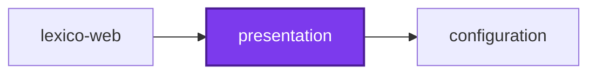

# 🎨 Components

**Shared React component library built on shadcn/ui and Base UI primitives.**

A collection of accessible, customizable UI components for the codebase, providing a consistent design system across applications. Built with Tailwind CSS, TypeScript, and shadcn/ui (New York style).

The interface half of the [Lexico](../lexico/lexico-web/README.md) suite:

| Project | Role |
| ------- | ---- |
| 🐺 [lexico-web](../lexico/lexico-web/README.md) | The SSR web application |
| 🎨 [presentation](README.md) | This package — shared React components |
| 📖 [lexico-entities](../lexico/lexico-entities/README.md) | TypeORM entities and migrations |
| 🚰 [lexico-cli](../lexico/lexico-cli/README.md) | Dictionary and literature ingestion |

## Features

- **50+ UI Components**: Buttons, cards, forms, dialogs, navigation, feedback, and more
- **Accessible**: WCAG 2.1 AA compliant, keyboard navigation, screen reader support
- **Themeable**: CSS variables for light/dark mode, customizable colors
- **Type-Safe**: Full TypeScript support with strict mode
- **Tree-Shakeable**: Only bundle components you actually use
- **Base UI Primitives**: Built on high-quality, unstyled component primitives

## Quick Start

### Installation

This package is already available in the codebase via workspace protocol. Import from consuming applications:

```tsx
// In projects/lexico/lexico-web/src/routes/example.tsx
import { Button, Card, Input } from "@codebase/presentation";
import "@codebase/presentation/styles/globals.css"; // Import once in root layout

function ExamplePage() {
  return (
    <Card>
      <CardHeader>
        <CardTitle>Example Card</CardTitle>
      </CardHeader>
      <CardContent>
        <Input placeholder="Enter text..." />
        <Button>Submit</Button>
      </CardContent>
    </Card>
  );
}
```

### Import Styles

Add global CSS import to your root layout:

```tsx
// projects/lexico/lexico-web/src/routes/__root.tsx
import "@codebase/presentation/styles/globals.css";
```

## Component Categories

### Layout & Structure

- **Card**: Content containers with header, content, footer sections
- **Separator**: Divider lines for visual separation
- **Accordion**: Collapsible content sections
- **Tabs**: Tabbed navigation and content
- **Sidebar**: Navigation sidebar with collapsible sections
- **Resizable**: Resizable panel layouts

### Form Controls

- **Input**: Text input field
- **Textarea**: Multi-line text input
- **Select**: Dropdown selection menu
- **Checkbox**: Boolean selection control
- **Radio Group**: Single selection from multiple options
- **Switch**: Toggle control for binary states
- **Slider**: Range selection control
- **Label**: Form field labels with accessibility

### Buttons & Navigation

- **Button**: Primary action buttons with variants
- **Button Group**: Grouped button controls
- **Navigation Menu**: Multi-level navigation menus
- **Breadcrumb**: Hierarchical path display
- **Dropdown Menu**: Context menus with actions
- **Command**: Cmd+K style command palette

### Feedback & Status

- **Badge**: Status indicators and labels
- **Spinner**: Loading indicator
- **Skeleton**: Loading placeholder animation
- **Progress**: Progress bar indicator
- **Alert**: Informational messages
- **Toast (Sonner)**: Temporary notification messages

### Overlays & Dialogs

- **Dialog**: Modal dialogs
- **Sheet**: Slide-over panels
- **Drawer**: Mobile-friendly bottom sheets
- **Popover**: Floating content containers
- **Tooltip**: Hover hints and descriptions
- **Hover Card**: Rich hover previews

## Adding Components

### Add from shadcn Registry

```bash
# Navigate to package directory
cd projects/common/presentation

# Add component
pnpx shadcn@latest add <component-name>

# Examples
pnpx shadcn@latest add dropdown-menu
pnpx shadcn@latest add command
pnpx shadcn@latest add sonner
```

### Export in Index

After adding a component, export it in [src/index.ts](src/index.ts):

```typescript
export * from "./components/ui/dropdown-menu";
```

### Create Custom Components

For project-specific components, create in `src/components/` (not `ui/`):

```tsx
// src/components/word-card.tsx
import { Card, CardContent, CardHeader, CardTitle } from "@/components/ui/card";

export interface WordCardProps {
  word: string;
  definition: string;
}

export function WordCard({ word, definition }: WordCardProps) {
  return (
    <Card>
      <CardHeader>
        <CardTitle>{word}</CardTitle>
      </CardHeader>
      <CardContent>
        <p>{definition}</p>
      </CardContent>
    </Card>
  );
}
```

**⚠️ Important**: Never modify files in `src/components/ui/` directly - they are managed by shadcn CLI and will be overwritten on updates.

## Theming

### CSS Variables

Customize colors by editing [src/styles/globals.css](src/styles/globals.css):

```css
:root {
  --background: 0 0% 100%;
  --foreground: 0 0% 3.9%;
  --primary: 0 0% 9%;
  --primary-foreground: 0 0% 98%;
  /* ... more colors */
}

[data-theme="dark"] {
  --background: 0 0% 3.9%;
  --foreground: 0 0% 98%;
  /* ... dark mode colors */
}
```

### Using Theme Colors

```tsx
<div className="bg-background text-foreground">
  <button className="bg-primary text-primary-foreground hover:bg-primary/90">
    Button
  </button>
</div>
```

### Dark Mode

Set `data-theme` attribute on root element:

```tsx
document.documentElement.setAttribute("data-theme", "dark");
```

Or use next-themes for automatic theme switching:

```tsx
import { ThemeProvider } from "next-themes";

<ThemeProvider
  attribute="data-theme"
  defaultTheme="system"
>
  {children}
</ThemeProvider>;
```

## Development

### Build Library

```bash
nx run components:build
```

### Type Checking

```bash
nx run components:typecheck
```

### Type Coverage

```bash
nx run components:type-coverage
# Target: 99.84%
```

### Bundle Size Analysis

```bash
nx run components:codometer
# Limit: 512 KB gzipped, warning at 384 KB
```

The 512 KB limit is a ratchet against the measured size, not a design target — the Vite library build bundles React and Base UI into the output rather than externalizing them, even though React is a `peerDependency`. See `codometer.config.ts` for the full note.

## Usage Examples

### Button Variants

```tsx
<Button variant="default">Default</Button>
<Button variant="secondary">Secondary</Button>
<Button variant="destructive">Delete</Button>
<Button variant="ghost">Ghost</Button>
<Button variant="link">Link</Button>

<Button size="sm">Small</Button>
<Button size="default">Default</Button>
<Button size="lg">Large</Button>
```

### Form with Validation

```tsx
import { Input, Label, Button } from "@codebase/presentation";

function LoginForm() {
  return (
    <form>
      <div>
        <Label htmlFor="email">Email</Label>
        <Input
          id="email"
          type="email"
          placeholder="you@example.com"
        />
      </div>
      <div>
        <Label htmlFor="password">Password</Label>
        <Input
          id="password"
          type="password"
        />
      </div>
      <Button type="submit">Sign In</Button>
    </form>
  );
}
```

### Dialog

```tsx
import {
  Dialog,
  DialogContent,
  DialogHeader,
  DialogTitle,
  DialogTrigger,
  Button,
} from "@codebase/presentation";

function ConfirmDialog() {
  return (
    <Dialog>
      <DialogTrigger render={<Button />}>Open Dialog</DialogTrigger>
      <DialogContent>
        <DialogHeader>
          <DialogTitle>Are you sure?</DialogTitle>
        </DialogHeader>
        <p>This action cannot be undone.</p>
        <Button>Confirm</Button>
      </DialogContent>
    </Dialog>
  );
}
```

### Dropdown Menu

```tsx
import {
  DropdownMenu,
  DropdownMenuContent,
  DropdownMenuItem,
  DropdownMenuTrigger,
  Button,
} from "@codebase/presentation";

function UserMenu() {
  return (
    <DropdownMenu>
      <DropdownMenuTrigger render={<Button variant="ghost" />}>
        Menu
      </DropdownMenuTrigger>
      <DropdownMenuContent>
        <DropdownMenuItem>Profile</DropdownMenuItem>
        <DropdownMenuItem>Settings</DropdownMenuItem>
        <DropdownMenuItem>Sign Out</DropdownMenuItem>
      </DropdownMenuContent>
    </DropdownMenu>
  );
}
```

## Configuration

### shadcn Config ([components.json](components.json))

```json
{
  "style": "new-york",
  "tailwind": {
    "baseColor": "gray",
    "cssVariables": true
  },
  "iconLibrary": "lucide"
}
```

### Tailwind Config ([tailwind.config.cjs](tailwind.config.cjs))

Extends shared Tailwind configuration with component-specific patterns:

```js
content: [
  "./src/**/*.{ts,tsx}",
  "../components/src/**/*.{ts,tsx}",
];
```

## Accessibility

All components follow WCAG 2.1 Level AA standards:

- ✅ Keyboard navigation (Tab, Enter, Space, Arrow keys)
- ✅ Focus management (visible focus indicators)
- ✅ ARIA attributes (screen reader announcements)
- ✅ Color contrast (4.5:1 for text, 3:1 for UI)

Built on Base UI primitives which handle complex accessibility patterns automatically:

- Focus trapping in dialogs
- Roving focus in menus
- Screen reader announcements
- Keyboard shortcuts

## Troubleshooting

### Styles Not Applied

Import global CSS in your root layout:

```tsx
import "@codebase/presentation/styles/globals.css";
```

### Import Errors

Verify TypeScript path mapping in `tsconfig.json`:

```json
{
  "compilerOptions": {
    "paths": {
      "@codebase/presentation": [
        "../components/src/index.ts"
      ]
    }
  }
}
```

### Dark Mode Not Working

Set `data-theme` attribute on `<html>` or use ThemeProvider.

## Documentation

For detailed architecture, component patterns, and development workflows:

- **[AGENTS.md](AGENTS.md)**: Complete architectural documentation
- **[Main AGENTS.md](../../AGENTS.md)**: Codebase architecture and Nx workflows
- **[lexico-web](../lexico/lexico-web/README.md)**: The application these components build

External resources:

- [shadcn/ui Documentation](https://ui.shadcn.com/docs): Component reference and CLI
- [Base UI Documentation](https://base-ui.com/react/overview/quick-start): Primitive APIs
- [Tailwind CSS Documentation](https://tailwindcss.com/docs): Utility classes

## License

See [LICENSE](../../LICENSE) for licensing information.

<!-- callidescope:start -->

## 🔭 Callidescope

Call stacks traced through `projects/common/presentation`, deepest first. Each frame shows what it takes, what it returns, and what its documentation says.

| Measure | Value |
| --- | --- |
| Callables | 1 |
| Files | 6 |
| Calls traced | 0 |
| Call stacks | 0 |
| Deepest stack | 0 |
| Stacks through recursion | 0 |
| Unfollowable calls | 0 |

### Limits

What this project is judged against, as declared in its own `callidescope.config.ts`.

| Limit | Value |
| --- | --- |
| `maximumDepth` | 3 |
| `maximumBreadth` | 7 |

### Call stacks (depth)

None.

### Breadth

None.
<!-- callidescope:end -->

## 🕸️ Codependix

Dependency graphs exported by [codependix](https://github.com/Organizzolini/codebase/tree/main/projects/ic-suite/codependix/codependix-cli), regenerated by `nx run configuration:codependix:write`.

### Nx Neighborhood

<!-- codependix:start name="codependix-nx-projects" -->

<!-- codependix:end name="codependix-nx-projects" -->

### File Imports

<!-- codependix:start name="codependix-file-imports" -->
```mermaid
graph LR
  file_callidescope_config_ts["callidescope.config.ts"]
  file_codependix_config_ts["codependix.config.ts"]
  file_codometer_config_ts["codometer.config.ts"]
  file_eslint_config_ts["eslint.config.ts"]
  file_src_components_examples_c_sidebar_1_tsx["src/components/examples/c-sidebar-1.tsx"]
  file_src_components_reui_alert_tsx["src/components/reui/alert.tsx"]
  file_src_components_reui_autocomplete_tsx["src/components/reui/autocomplete.tsx"]
  file_src_components_reui_badge_tsx["src/components/reui/badge.tsx"]
  file_src_components_reui_cascader_cascader_async_tsx["src/components/reui/cascader/cascader-async.tsx"]
  file_src_components_reui_cascader_cascader_columns_tsx["src/components/reui/cascader/cascader-columns.tsx"]
  file_src_components_reui_cascader_cascader_context_tsx["src/components/reui/cascader/cascader-context.tsx"]
  file_src_components_reui_cascader_cascader_footer_tsx["src/components/reui/cascader/cascader-footer.tsx"]
  file_src_components_reui_cascader_cascader_i18n_tsx["src/components/reui/cascader/cascader-i18n.tsx"]
  file_src_components_reui_cascader_cascader_item_tsx["src/components/reui/cascader/cascader-item.tsx"]
  file_src_components_reui_cascader_cascader_lib_tsx["src/components/reui/cascader/cascader-lib.tsx"]
  file_src_components_reui_cascader_cascader_nav_tsx["src/components/reui/cascader/cascader-nav.tsx"]
  file_src_components_reui_cascader_cascader_types_tsx["src/components/reui/cascader/cascader-types.tsx"]
  file_src_components_reui_cascader_cascader_virtual_tsx["src/components/reui/cascader/cascader-virtual.tsx"]
  file_src_components_reui_cascader_cascader_tsx["src/components/reui/cascader/cascader.tsx"]
  file_src_components_reui_code_block_code_block_highlight_tsx["src/components/reui/code-block/code-block-highlight.tsx"]
  file_src_components_reui_code_block_code_block_tsx["src/components/reui/code-block/code-block.tsx"]
  file_src_components_reui_color_picker_tsx["src/components/reui/color-picker.tsx"]
  file_src_components_reui_data_grid_data_grid_cell_selection_tsx["src/components/reui/data-grid/data-grid-cell-selection.tsx"]
  file_src_components_reui_data_grid_data_grid_column_filter_tsx["src/components/reui/data-grid/data-grid-column-filter.tsx"]
  file_src_components_reui_data_grid_data_grid_column_header_tsx["src/components/reui/data-grid/data-grid-column-header.tsx"]
  file_src_components_reui_data_grid_data_grid_column_visibility_tsx["src/components/reui/data-grid/data-grid-column-visibility.tsx"]
  file_src_components_reui_data_grid_data_grid_i18n_tsx["src/components/reui/data-grid/data-grid-i18n.tsx"]
  file_src_components_reui_data_grid_data_grid_pagination_tsx["src/components/reui/data-grid/data-grid-pagination.tsx"]
  file_src_components_reui_data_grid_data_grid_scroll_area_tsx["src/components/reui/data-grid/data-grid-scroll-area.tsx"]
  file_src_components_reui_data_grid_data_grid_table_dnd_rows_tsx["src/components/reui/data-grid/data-grid-table-dnd-rows.tsx"]
  file_src_components_reui_data_grid_data_grid_table_dnd_tsx["src/components/reui/data-grid/data-grid-table-dnd.tsx"]
  file_src_components_reui_data_grid_data_grid_table_virtual_tsx["src/components/reui/data-grid/data-grid-table-virtual.tsx"]
  file_src_components_reui_data_grid_data_grid_table_tsx["src/components/reui/data-grid/data-grid-table.tsx"]
  file_src_components_reui_data_grid_data_grid_tsx["src/components/reui/data-grid/data-grid.tsx"]
  file_src_components_reui_date_selector_tsx["src/components/reui/date-selector.tsx"]
  file_src_components_reui_emoji_picker_tsx["src/components/reui/emoji-picker.tsx"]
  file_src_components_reui_event_calendar_event_calendar_agenda_view_tsx["src/components/reui/event-calendar/event-calendar-agenda-view.tsx"]
  file_src_components_reui_event_calendar_event_calendar_content_tsx["src/components/reui/event-calendar/event-calendar-content.tsx"]
  file_src_components_reui_event_calendar_event_calendar_dnd_tsx["src/components/reui/event-calendar/event-calendar-dnd.tsx"]
  file_src_components_reui_event_calendar_event_calendar_event_tsx["src/components/reui/event-calendar/event-calendar-event.tsx"]
  file_src_components_reui_event_calendar_event_calendar_i18n_tsx["src/components/reui/event-calendar/event-calendar-i18n.tsx"]
  file_src_components_reui_event_calendar_event_calendar_lib_tsx["src/components/reui/event-calendar/event-calendar-lib.tsx"]
  file_src_components_reui_event_calendar_event_calendar_month_view_tsx["src/components/reui/event-calendar/event-calendar-month-view.tsx"]
  file_src_components_reui_event_calendar_event_calendar_nav_tsx["src/components/reui/event-calendar/event-calendar-nav.tsx"]
  file_src_components_reui_event_calendar_event_calendar_recurrence_tsx["src/components/reui/event-calendar/event-calendar-recurrence.tsx"]
  file_src_components_reui_event_calendar_event_calendar_resource_view_tsx["src/components/reui/event-calendar/event-calendar-resource-view.tsx"]
  file_src_components_reui_event_calendar_event_calendar_time_grid_tsx["src/components/reui/event-calendar/event-calendar-time-grid.tsx"]
  file_src_components_reui_event_calendar_event_calendar_types_tsx["src/components/reui/event-calendar/event-calendar-types.tsx"]
  file_src_components_reui_event_calendar_event_calendar_tsx["src/components/reui/event-calendar/event-calendar.tsx"]
  file_src_components_reui_file_type_tsx["src/components/reui/file-type.tsx"]
  file_src_components_reui_filters_filters_advanced_tsx["src/components/reui/filters/filters-advanced.tsx"]
  file_src_components_reui_filters_filters_builder_tsx["src/components/reui/filters/filters-builder.tsx"]
  file_src_components_reui_filters_filters_chip_tsx["src/components/reui/filters/filters-chip.tsx"]
  file_src_components_reui_filters_filters_context_tsx["src/components/reui/filters/filters-context.tsx"]
  file_src_components_reui_filters_filters_date_tsx["src/components/reui/filters/filters-date.tsx"]
  file_src_components_reui_filters_filters_dnd_tsx["src/components/reui/filters/filters-dnd.tsx"]
  file_src_components_reui_filters_filters_draft_tsx["src/components/reui/filters/filters-draft.tsx"]
  file_src_components_reui_filters_filters_editors_tsx["src/components/reui/filters/filters-editors.tsx"]
  file_src_components_reui_filters_filters_i18n_tsx["src/components/reui/filters/filters-i18n.tsx"]
  file_src_components_reui_filters_filters_lib_tsx["src/components/reui/filters/filters-lib.tsx"]
  file_src_components_reui_filters_filters_operators_tsx["src/components/reui/filters/filters-operators.tsx"]
  file_src_components_reui_filters_filters_query_tsx["src/components/reui/filters/filters-query.tsx"]
  file_src_components_reui_filters_filters_types_tsx["src/components/reui/filters/filters-types.tsx"]
  file_src_components_reui_filters_filters_tsx["src/components/reui/filters/filters.tsx"]
  file_src_components_reui_frame_tsx["src/components/reui/frame.tsx"]
  file_src_components_reui_gantt_gantt_bar_tsx["src/components/reui/gantt/gantt-bar.tsx"]
  file_src_components_reui_gantt_gantt_dnd_tsx["src/components/reui/gantt/gantt-dnd.tsx"]
  file_src_components_reui_gantt_gantt_i18n_tsx["src/components/reui/gantt/gantt-i18n.tsx"]
  file_src_components_reui_gantt_gantt_lib_tsx["src/components/reui/gantt/gantt-lib.tsx"]
  file_src_components_reui_gantt_gantt_nav_tsx["src/components/reui/gantt/gantt-nav.tsx"]
  file_src_components_reui_gantt_gantt_recurrence_tsx["src/components/reui/gantt/gantt-recurrence.tsx"]
  file_src_components_reui_gantt_gantt_types_tsx["src/components/reui/gantt/gantt-types.tsx"]
  file_src_components_reui_gantt_gantt_view_tsx["src/components/reui/gantt/gantt-view.tsx"]
  file_src_components_reui_gantt_gantt_tsx["src/components/reui/gantt/gantt.tsx"]
  file_src_components_reui_icon_stack_tsx["src/components/reui/icon-stack.tsx"]
  file_src_components_reui_icon_tile_tsx["src/components/reui/icon-tile.tsx"]
  file_src_components_reui_kanban_tsx["src/components/reui/kanban.tsx"]
  file_src_components_reui_number_field_tsx["src/components/reui/number-field.tsx"]
  file_src_components_reui_phone_input_tsx["src/components/reui/phone-input.tsx"]
  file_src_components_reui_rating_tsx["src/components/reui/rating.tsx"]
  file_src_components_reui_scrollspy_tsx["src/components/reui/scrollspy.tsx"]
  file_src_components_reui_signature_pad_tsx["src/components/reui/signature-pad.tsx"]
  file_src_components_reui_sortable_tsx["src/components/reui/sortable.tsx"]
  file_src_components_reui_stepper_tsx["src/components/reui/stepper.tsx"]
  file_src_components_reui_time_picker_tsx["src/components/reui/time-picker.tsx"]
  file_src_components_reui_timeline_tsx["src/components/reui/timeline.tsx"]
  file_src_components_reui_tree_tsx["src/components/reui/tree.tsx"]
  file_src_components_ui_accordion_tsx["src/components/ui/accordion.tsx"]
  file_src_components_ui_alert_dialog_tsx["src/components/ui/alert-dialog.tsx"]
  file_src_components_ui_alert_tsx["src/components/ui/alert.tsx"]
  file_src_components_ui_aspect_ratio_tsx["src/components/ui/aspect-ratio.tsx"]
  file_src_components_ui_avatar_tsx["src/components/ui/avatar.tsx"]
  file_src_components_ui_badge_tsx["src/components/ui/badge.tsx"]
  file_src_components_ui_breadcrumb_tsx["src/components/ui/breadcrumb.tsx"]
  file_src_components_ui_button_group_tsx["src/components/ui/button-group.tsx"]
  file_src_components_ui_button_tsx["src/components/ui/button.tsx"]
  file_src_components_ui_calendar_tsx["src/components/ui/calendar.tsx"]
  file_src_components_ui_card_tsx["src/components/ui/card.tsx"]
  file_src_components_ui_carousel_tsx["src/components/ui/carousel.tsx"]
  file_src_components_ui_chart_tsx["src/components/ui/chart.tsx"]
  file_src_components_ui_checkbox_tsx["src/components/ui/checkbox.tsx"]
  file_src_components_ui_collapsible_tsx["src/components/ui/collapsible.tsx"]
  file_src_components_ui_combobox_tsx["src/components/ui/combobox.tsx"]
  file_src_components_ui_command_tsx["src/components/ui/command.tsx"]
  file_src_components_ui_context_menu_tsx["src/components/ui/context-menu.tsx"]
  file_src_components_ui_dialog_tsx["src/components/ui/dialog.tsx"]
  file_src_components_ui_drawer_tsx["src/components/ui/drawer.tsx"]
  file_src_components_ui_dropdown_menu_tsx["src/components/ui/dropdown-menu.tsx"]
  file_src_components_ui_empty_tsx["src/components/ui/empty.tsx"]
  file_src_components_ui_field_tsx["src/components/ui/field.tsx"]
  file_src_components_ui_hover_card_tsx["src/components/ui/hover-card.tsx"]
  file_src_components_ui_input_group_tsx["src/components/ui/input-group.tsx"]
  file_src_components_ui_input_otp_tsx["src/components/ui/input-otp.tsx"]
  file_src_components_ui_input_tsx["src/components/ui/input.tsx"]
  file_src_components_ui_item_tsx["src/components/ui/item.tsx"]
  file_src_components_ui_kbd_tsx["src/components/ui/kbd.tsx"]
  file_src_components_ui_label_tsx["src/components/ui/label.tsx"]
  file_src_components_ui_menubar_tsx["src/components/ui/menubar.tsx"]
  file_src_components_ui_navigation_menu_tsx["src/components/ui/navigation-menu.tsx"]
  file_src_components_ui_pagination_tsx["src/components/ui/pagination.tsx"]
  file_src_components_ui_popover_tsx["src/components/ui/popover.tsx"]
  file_src_components_ui_progress_tsx["src/components/ui/progress.tsx"]
  file_src_components_ui_radio_group_tsx["src/components/ui/radio-group.tsx"]
  file_src_components_ui_resizable_tsx["src/components/ui/resizable.tsx"]
  file_src_components_ui_scroll_area_tsx["src/components/ui/scroll-area.tsx"]
  file_src_components_ui_select_tsx["src/components/ui/select.tsx"]
  file_src_components_ui_separator_tsx["src/components/ui/separator.tsx"]
  file_src_components_ui_sheet_tsx["src/components/ui/sheet.tsx"]
  file_src_components_ui_sidebar_tsx["src/components/ui/sidebar.tsx"]
  file_src_components_ui_skeleton_tsx["src/components/ui/skeleton.tsx"]
  file_src_components_ui_slider_tsx["src/components/ui/slider.tsx"]
  file_src_components_ui_sonner_tsx["src/components/ui/sonner.tsx"]
  file_src_components_ui_spinner_tsx["src/components/ui/spinner.tsx"]
  file_src_components_ui_switch_tsx["src/components/ui/switch.tsx"]
  file_src_components_ui_table_tsx["src/components/ui/table.tsx"]
  file_src_components_ui_tabs_tsx["src/components/ui/tabs.tsx"]
  file_src_components_ui_textarea_tsx["src/components/ui/textarea.tsx"]
  file_src_components_ui_toggle_group_tsx["src/components/ui/toggle-group.tsx"]
  file_src_components_ui_toggle_tsx["src/components/ui/toggle.tsx"]
  file_src_components_ui_tooltip_tsx["src/components/ui/tooltip.tsx"]
  file_src_hooks_use_copy_to_clipboard_ts["src/hooks/use-copy-to-clipboard.ts"]
  file_src_hooks_use_file_upload_ts["src/hooks/use-file-upload.ts"]
  file_src_hooks_use_media_query_ts["src/hooks/use-media-query.ts"]
  file_src_hooks_use_mobile_ts["src/hooks/use-mobile.ts"]
  file_src_hooks_use_scroll_position_ts["src/hooks/use-scroll-position.ts"]
  file_src_hooks_use_slider_input_ts["src/hooks/use-slider-input.ts"]
  file_src_index_ts["src/index.ts"]
  file_src_lib_utils_ts["src/lib/utils.ts"]
  file_vite_config_mts["vite.config.mts"]
  file_src_components_examples_c_sidebar_1_tsx --> file_src_components_ui_avatar_tsx
  file_src_components_examples_c_sidebar_1_tsx --> file_src_components_ui_breadcrumb_tsx
  file_src_components_examples_c_sidebar_1_tsx --> file_src_components_ui_button_tsx
  file_src_components_examples_c_sidebar_1_tsx --> file_src_components_ui_card_tsx
  file_src_components_examples_c_sidebar_1_tsx --> file_src_components_ui_dropdown_menu_tsx
  file_src_components_examples_c_sidebar_1_tsx --> file_src_components_ui_sidebar_tsx
  file_src_components_reui_autocomplete_tsx --> file_src_components_ui_scroll_area_tsx
  file_src_components_reui_cascader_cascader_async_tsx --> file_src_components_reui_cascader_cascader_context_tsx
  file_src_components_reui_cascader_cascader_async_tsx --> file_src_components_reui_cascader_cascader_lib_tsx
  file_src_components_reui_cascader_cascader_async_tsx --> file_src_components_reui_cascader_cascader_types_tsx
  file_src_components_reui_cascader_cascader_columns_tsx --> file_src_components_reui_cascader_cascader_context_tsx
  file_src_components_reui_cascader_cascader_columns_tsx --> file_src_components_reui_cascader_cascader_item_tsx
  file_src_components_reui_cascader_cascader_columns_tsx --> file_src_components_reui_cascader_cascader_lib_tsx
  file_src_components_reui_cascader_cascader_columns_tsx --> file_src_components_ui_scroll_area_tsx
  file_src_components_reui_cascader_cascader_context_tsx --> file_src_components_reui_cascader_cascader_types_tsx
  file_src_components_reui_cascader_cascader_footer_tsx --> file_src_components_reui_cascader_cascader_context_tsx
  file_src_components_reui_cascader_cascader_footer_tsx --> file_src_components_reui_cascader_cascader_item_tsx
  file_src_components_reui_cascader_cascader_footer_tsx --> file_src_components_reui_cascader_cascader_lib_tsx
  file_src_components_reui_cascader_cascader_footer_tsx --> file_src_components_reui_cascader_cascader_types_tsx
  file_src_components_reui_cascader_cascader_i18n_tsx --> file_src_components_reui_cascader_cascader_types_tsx
  file_src_components_reui_cascader_cascader_item_tsx --> file_src_components_reui_cascader_cascader_context_tsx
  file_src_components_reui_cascader_cascader_item_tsx --> file_src_components_reui_cascader_cascader_lib_tsx
  file_src_components_reui_cascader_cascader_item_tsx --> file_src_components_reui_cascader_cascader_types_tsx
  file_src_components_reui_cascader_cascader_item_tsx --> file_src_components_ui_spinner_tsx
  file_src_components_reui_cascader_cascader_lib_tsx --> file_src_components_reui_cascader_cascader_types_tsx
  file_src_components_reui_cascader_cascader_nav_tsx --> file_src_components_reui_cascader_cascader_context_tsx
  file_src_components_reui_cascader_cascader_nav_tsx --> file_src_components_reui_cascader_cascader_i18n_tsx
  file_src_components_reui_cascader_cascader_nav_tsx --> file_src_components_reui_cascader_cascader_lib_tsx
  file_src_components_reui_cascader_cascader_nav_tsx --> file_src_components_reui_cascader_cascader_types_tsx
  file_src_components_reui_cascader_cascader_virtual_tsx --> file_src_components_reui_cascader_cascader_columns_tsx
  file_src_components_reui_cascader_cascader_virtual_tsx --> file_src_components_reui_cascader_cascader_context_tsx
  file_src_components_reui_cascader_cascader_virtual_tsx --> file_src_components_reui_cascader_cascader_item_tsx
  file_src_components_reui_cascader_cascader_tsx --> file_src_components_reui_cascader_cascader_async_tsx
  file_src_components_reui_cascader_cascader_tsx --> file_src_components_reui_cascader_cascader_context_tsx
  file_src_components_reui_cascader_cascader_tsx --> file_src_components_reui_cascader_cascader_i18n_tsx
  file_src_components_reui_cascader_cascader_tsx --> file_src_components_reui_cascader_cascader_lib_tsx
  file_src_components_reui_cascader_cascader_tsx --> file_src_components_reui_cascader_cascader_types_tsx
  file_src_components_reui_cascader_cascader_tsx --> file_src_components_ui_scroll_area_tsx
  file_src_components_reui_code_block_code_block_tsx --> file_src_components_reui_code_block_code_block_highlight_tsx
  file_src_components_reui_code_block_code_block_tsx --> file_src_components_ui_button_tsx
  file_src_components_reui_color_picker_tsx --> file_src_components_ui_button_tsx
  file_src_components_reui_color_picker_tsx --> file_src_components_ui_dropdown_menu_tsx
  file_src_components_reui_color_picker_tsx --> file_src_components_ui_input_group_tsx
  file_src_components_reui_color_picker_tsx --> file_src_components_ui_popover_tsx
  file_src_components_reui_color_picker_tsx --> file_src_components_ui_separator_tsx
  file_src_components_reui_data_grid_data_grid_cell_selection_tsx --> file_src_components_reui_data_grid_data_grid_tsx
  file_src_components_reui_data_grid_data_grid_cell_selection_tsx --> file_src_components_ui_button_tsx
  file_src_components_reui_data_grid_data_grid_column_filter_tsx --> file_src_components_reui_badge_tsx
  file_src_components_reui_data_grid_data_grid_column_filter_tsx --> file_src_components_reui_data_grid_data_grid_tsx
  file_src_components_reui_data_grid_data_grid_column_filter_tsx --> file_src_components_ui_button_tsx
  file_src_components_reui_data_grid_data_grid_column_filter_tsx --> file_src_components_ui_input_tsx
  file_src_components_reui_data_grid_data_grid_column_filter_tsx --> file_src_components_ui_popover_tsx
  file_src_components_reui_data_grid_data_grid_column_filter_tsx --> file_src_components_ui_separator_tsx
  file_src_components_reui_data_grid_data_grid_column_header_tsx --> file_src_components_reui_data_grid_data_grid_tsx
  file_src_components_reui_data_grid_data_grid_column_header_tsx --> file_src_components_ui_button_tsx
  file_src_components_reui_data_grid_data_grid_column_header_tsx --> file_src_components_ui_dropdown_menu_tsx
  file_src_components_reui_data_grid_data_grid_column_visibility_tsx --> file_src_components_reui_data_grid_data_grid_tsx
  file_src_components_reui_data_grid_data_grid_column_visibility_tsx --> file_src_components_ui_dropdown_menu_tsx
  file_src_components_reui_data_grid_data_grid_pagination_tsx --> file_src_components_reui_data_grid_data_grid_tsx
  file_src_components_reui_data_grid_data_grid_pagination_tsx --> file_src_components_ui_button_tsx
  file_src_components_reui_data_grid_data_grid_pagination_tsx --> file_src_components_ui_select_tsx
  file_src_components_reui_data_grid_data_grid_pagination_tsx --> file_src_components_ui_skeleton_tsx
  file_src_components_reui_data_grid_data_grid_scroll_area_tsx --> file_src_components_reui_data_grid_data_grid_tsx
  file_src_components_reui_data_grid_data_grid_table_dnd_rows_tsx --> file_src_components_reui_data_grid_data_grid_table_tsx
  file_src_components_reui_data_grid_data_grid_table_dnd_rows_tsx --> file_src_components_reui_data_grid_data_grid_tsx
  file_src_components_reui_data_grid_data_grid_table_dnd_rows_tsx --> file_src_components_ui_button_tsx
  file_src_components_reui_data_grid_data_grid_table_dnd_tsx --> file_src_components_reui_data_grid_data_grid_table_tsx
  file_src_components_reui_data_grid_data_grid_table_dnd_tsx --> file_src_components_reui_data_grid_data_grid_tsx
  file_src_components_reui_data_grid_data_grid_table_dnd_tsx --> file_src_components_ui_button_tsx
  file_src_components_reui_data_grid_data_grid_table_virtual_tsx --> file_src_components_reui_data_grid_data_grid_table_tsx
  file_src_components_reui_data_grid_data_grid_table_virtual_tsx --> file_src_components_reui_data_grid_data_grid_tsx
  file_src_components_reui_data_grid_data_grid_table_virtual_tsx --> file_src_components_ui_spinner_tsx
  file_src_components_reui_data_grid_data_grid_table_tsx --> file_src_components_reui_data_grid_data_grid_tsx
  file_src_components_reui_data_grid_data_grid_table_tsx --> file_src_components_ui_button_tsx
  file_src_components_reui_data_grid_data_grid_table_tsx --> file_src_components_ui_checkbox_tsx
  file_src_components_reui_data_grid_data_grid_table_tsx --> file_src_components_ui_spinner_tsx
  file_src_components_reui_data_grid_data_grid_tsx --> file_src_components_reui_data_grid_data_grid_i18n_tsx
  file_src_components_reui_date_selector_tsx --> file_src_components_ui_button_tsx
  file_src_components_reui_date_selector_tsx --> file_src_components_ui_calendar_tsx
  file_src_components_reui_date_selector_tsx --> file_src_components_ui_input_tsx
  file_src_components_reui_date_selector_tsx --> file_src_components_ui_scroll_area_tsx
  file_src_components_reui_date_selector_tsx --> file_src_components_ui_tabs_tsx
  file_src_components_reui_date_selector_tsx --> file_src_hooks_use_mobile_ts
  file_src_components_reui_emoji_picker_tsx --> file_src_components_ui_button_tsx
  file_src_components_reui_emoji_picker_tsx --> file_src_components_ui_dropdown_menu_tsx
  file_src_components_reui_emoji_picker_tsx --> file_src_components_ui_empty_tsx
  file_src_components_reui_emoji_picker_tsx --> file_src_components_ui_input_group_tsx
  file_src_components_reui_emoji_picker_tsx --> file_src_components_ui_popover_tsx
  file_src_components_reui_emoji_picker_tsx --> file_src_components_ui_skeleton_tsx
  file_src_components_reui_emoji_picker_tsx --> file_src_components_ui_tabs_tsx
  file_src_components_reui_event_calendar_event_calendar_agenda_view_tsx --> file_src_components_reui_event_calendar_event_calendar_event_tsx
  file_src_components_reui_event_calendar_event_calendar_agenda_view_tsx --> file_src_components_reui_event_calendar_event_calendar_lib_tsx
  file_src_components_reui_event_calendar_event_calendar_agenda_view_tsx --> file_src_components_reui_event_calendar_event_calendar_types_tsx
  file_src_components_reui_event_calendar_event_calendar_agenda_view_tsx --> file_src_components_reui_event_calendar_event_calendar_tsx
  file_src_components_reui_event_calendar_event_calendar_agenda_view_tsx --> file_src_components_reui_icon_stack_tsx
  file_src_components_reui_event_calendar_event_calendar_agenda_view_tsx --> file_src_components_ui_scroll_area_tsx
  file_src_components_reui_event_calendar_event_calendar_content_tsx --> file_src_components_reui_event_calendar_event_calendar_agenda_view_tsx
  file_src_components_reui_event_calendar_event_calendar_content_tsx --> file_src_components_reui_event_calendar_event_calendar_month_view_tsx
  file_src_components_reui_event_calendar_event_calendar_content_tsx --> file_src_components_reui_event_calendar_event_calendar_resource_view_tsx
  file_src_components_reui_event_calendar_event_calendar_content_tsx --> file_src_components_reui_event_calendar_event_calendar_time_grid_tsx
  file_src_components_reui_event_calendar_event_calendar_content_tsx --> file_src_components_reui_event_calendar_event_calendar_types_tsx
  file_src_components_reui_event_calendar_event_calendar_content_tsx --> file_src_components_reui_event_calendar_event_calendar_tsx
  file_src_components_reui_event_calendar_event_calendar_dnd_tsx --> file_src_components_reui_event_calendar_event_calendar_lib_tsx
  file_src_components_reui_event_calendar_event_calendar_dnd_tsx --> file_src_components_reui_event_calendar_event_calendar_types_tsx
  file_src_components_reui_event_calendar_event_calendar_dnd_tsx --> file_src_components_reui_event_calendar_event_calendar_tsx
  file_src_components_reui_event_calendar_event_calendar_event_tsx --> file_src_components_reui_event_calendar_event_calendar_dnd_tsx
  file_src_components_reui_event_calendar_event_calendar_event_tsx --> file_src_components_reui_event_calendar_event_calendar_lib_tsx
  file_src_components_reui_event_calendar_event_calendar_event_tsx --> file_src_components_reui_event_calendar_event_calendar_types_tsx
  file_src_components_reui_event_calendar_event_calendar_event_tsx --> file_src_components_reui_event_calendar_event_calendar_tsx
  file_src_components_reui_event_calendar_event_calendar_event_tsx --> file_src_components_ui_tooltip_tsx
  file_src_components_reui_event_calendar_event_calendar_i18n_tsx --> file_src_components_reui_event_calendar_event_calendar_types_tsx
  file_src_components_reui_event_calendar_event_calendar_lib_tsx --> file_src_components_reui_event_calendar_event_calendar_recurrence_tsx
  file_src_components_reui_event_calendar_event_calendar_lib_tsx --> file_src_components_reui_event_calendar_event_calendar_types_tsx
  file_src_components_reui_event_calendar_event_calendar_month_view_tsx --> file_src_components_reui_event_calendar_event_calendar_dnd_tsx
  file_src_components_reui_event_calendar_event_calendar_month_view_tsx --> file_src_components_reui_event_calendar_event_calendar_event_tsx
  file_src_components_reui_event_calendar_event_calendar_month_view_tsx --> file_src_components_reui_event_calendar_event_calendar_lib_tsx
  file_src_components_reui_event_calendar_event_calendar_month_view_tsx --> file_src_components_reui_event_calendar_event_calendar_types_tsx
  file_src_components_reui_event_calendar_event_calendar_month_view_tsx --> file_src_components_reui_event_calendar_event_calendar_tsx
  file_src_components_reui_event_calendar_event_calendar_month_view_tsx --> file_src_components_ui_popover_tsx
  file_src_components_reui_event_calendar_event_calendar_month_view_tsx --> file_src_components_ui_scroll_area_tsx
  file_src_components_reui_event_calendar_event_calendar_nav_tsx --> file_src_components_reui_event_calendar_event_calendar_lib_tsx
  file_src_components_reui_event_calendar_event_calendar_nav_tsx --> file_src_components_reui_event_calendar_event_calendar_types_tsx
  file_src_components_reui_event_calendar_event_calendar_nav_tsx --> file_src_components_reui_event_calendar_event_calendar_tsx
  file_src_components_reui_event_calendar_event_calendar_nav_tsx --> file_src_components_ui_button_tsx
  file_src_components_reui_event_calendar_event_calendar_nav_tsx --> file_src_components_ui_calendar_tsx
  file_src_components_reui_event_calendar_event_calendar_nav_tsx --> file_src_components_ui_dropdown_menu_tsx
  file_src_components_reui_event_calendar_event_calendar_nav_tsx --> file_src_components_ui_popover_tsx
  file_src_components_reui_event_calendar_event_calendar_nav_tsx --> file_src_components_ui_tooltip_tsx
  file_src_components_reui_event_calendar_event_calendar_recurrence_tsx --> file_src_components_reui_event_calendar_event_calendar_types_tsx
  file_src_components_reui_event_calendar_event_calendar_resource_view_tsx --> file_src_components_reui_event_calendar_event_calendar_dnd_tsx
  file_src_components_reui_event_calendar_event_calendar_resource_view_tsx --> file_src_components_reui_event_calendar_event_calendar_event_tsx
  file_src_components_reui_event_calendar_event_calendar_resource_view_tsx --> file_src_components_reui_event_calendar_event_calendar_lib_tsx
  file_src_components_reui_event_calendar_event_calendar_resource_view_tsx --> file_src_components_reui_event_calendar_event_calendar_time_grid_tsx
  file_src_components_reui_event_calendar_event_calendar_resource_view_tsx --> file_src_components_reui_event_calendar_event_calendar_types_tsx
  file_src_components_reui_event_calendar_event_calendar_resource_view_tsx --> file_src_components_reui_event_calendar_event_calendar_tsx
  file_src_components_reui_event_calendar_event_calendar_resource_view_tsx --> file_src_components_ui_scroll_area_tsx
  file_src_components_reui_event_calendar_event_calendar_time_grid_tsx --> file_src_components_reui_event_calendar_event_calendar_dnd_tsx
  file_src_components_reui_event_calendar_event_calendar_time_grid_tsx --> file_src_components_reui_event_calendar_event_calendar_event_tsx
  file_src_components_reui_event_calendar_event_calendar_time_grid_tsx --> file_src_components_reui_event_calendar_event_calendar_lib_tsx
  file_src_components_reui_event_calendar_event_calendar_time_grid_tsx --> file_src_components_reui_event_calendar_event_calendar_types_tsx
  file_src_components_reui_event_calendar_event_calendar_time_grid_tsx --> file_src_components_reui_event_calendar_event_calendar_tsx
  file_src_components_reui_event_calendar_event_calendar_time_grid_tsx --> file_src_components_ui_scroll_area_tsx
  file_src_components_reui_event_calendar_event_calendar_tsx --> file_src_components_reui_event_calendar_event_calendar_i18n_tsx
  file_src_components_reui_event_calendar_event_calendar_tsx --> file_src_components_reui_event_calendar_event_calendar_lib_tsx
  file_src_components_reui_event_calendar_event_calendar_tsx --> file_src_components_reui_event_calendar_event_calendar_types_tsx
  file_src_components_reui_filters_filters_advanced_tsx --> file_src_components_reui_filters_filters_builder_tsx
  file_src_components_reui_filters_filters_advanced_tsx --> file_src_components_reui_filters_filters_chip_tsx
  file_src_components_reui_filters_filters_advanced_tsx --> file_src_components_reui_filters_filters_context_tsx
  file_src_components_reui_filters_filters_advanced_tsx --> file_src_components_reui_filters_filters_dnd_tsx
  file_src_components_reui_filters_filters_advanced_tsx --> file_src_components_reui_filters_filters_i18n_tsx
  file_src_components_reui_filters_filters_advanced_tsx --> file_src_components_reui_filters_filters_lib_tsx
  file_src_components_reui_filters_filters_advanced_tsx --> file_src_components_reui_filters_filters_operators_tsx
  file_src_components_reui_filters_filters_advanced_tsx --> file_src_components_reui_filters_filters_query_tsx
  file_src_components_reui_filters_filters_advanced_tsx --> file_src_components_reui_filters_filters_types_tsx
  file_src_components_reui_filters_filters_advanced_tsx --> file_src_components_ui_button_tsx
  file_src_components_reui_filters_filters_advanced_tsx --> file_src_components_ui_dropdown_menu_tsx
  file_src_components_reui_filters_filters_advanced_tsx --> file_src_components_ui_input_tsx
  file_src_components_reui_filters_filters_advanced_tsx --> file_src_components_ui_popover_tsx
  file_src_components_reui_filters_filters_advanced_tsx --> file_src_components_ui_tooltip_tsx
  file_src_components_reui_filters_filters_builder_tsx --> file_src_components_reui_cascader_cascader_footer_tsx
  file_src_components_reui_filters_filters_builder_tsx --> file_src_components_reui_cascader_cascader_nav_tsx
  file_src_components_reui_filters_filters_builder_tsx --> file_src_components_reui_cascader_cascader_types_tsx
  file_src_components_reui_filters_filters_builder_tsx --> file_src_components_reui_cascader_cascader_virtual_tsx
  file_src_components_reui_filters_filters_builder_tsx --> file_src_components_reui_cascader_cascader_tsx
  file_src_components_reui_filters_filters_builder_tsx --> file_src_components_reui_filters_filters_context_tsx
  file_src_components_reui_filters_filters_builder_tsx --> file_src_components_reui_filters_filters_lib_tsx
  file_src_components_reui_filters_filters_builder_tsx --> file_src_components_reui_filters_filters_operators_tsx
  file_src_components_reui_filters_filters_builder_tsx --> file_src_components_reui_filters_filters_types_tsx
  file_src_components_reui_filters_filters_builder_tsx --> file_src_components_ui_button_tsx
  file_src_components_reui_filters_filters_builder_tsx --> file_src_components_ui_popover_tsx
  file_src_components_reui_filters_filters_chip_tsx --> file_src_components_reui_filters_filters_context_tsx
  file_src_components_reui_filters_filters_chip_tsx --> file_src_components_reui_filters_filters_editors_tsx
  file_src_components_reui_filters_filters_chip_tsx --> file_src_components_reui_filters_filters_lib_tsx
  file_src_components_reui_filters_filters_chip_tsx --> file_src_components_reui_filters_filters_operators_tsx
  file_src_components_reui_filters_filters_chip_tsx --> file_src_components_reui_filters_filters_query_tsx
  file_src_components_reui_filters_filters_chip_tsx --> file_src_components_reui_filters_filters_types_tsx
  file_src_components_reui_filters_filters_chip_tsx --> file_src_components_ui_button_group_tsx
  file_src_components_reui_filters_filters_chip_tsx --> file_src_components_ui_button_tsx
  file_src_components_reui_filters_filters_chip_tsx --> file_src_components_ui_dropdown_menu_tsx
  file_src_components_reui_filters_filters_chip_tsx --> file_src_components_ui_popover_tsx
  file_src_components_reui_filters_filters_chip_tsx --> file_src_components_ui_tooltip_tsx
  file_src_components_reui_filters_filters_context_tsx --> file_src_components_reui_filters_filters_draft_tsx
  file_src_components_reui_filters_filters_context_tsx --> file_src_components_reui_filters_filters_lib_tsx
  file_src_components_reui_filters_filters_context_tsx --> file_src_components_reui_filters_filters_types_tsx
  file_src_components_reui_filters_filters_draft_tsx --> file_src_components_reui_filters_filters_types_tsx
  file_src_components_reui_filters_filters_editors_tsx --> file_src_components_reui_cascader_cascader_context_tsx
  file_src_components_reui_filters_filters_editors_tsx --> file_src_components_reui_cascader_cascader_footer_tsx
  file_src_components_reui_filters_filters_editors_tsx --> file_src_components_reui_cascader_cascader_item_tsx
  file_src_components_reui_filters_filters_editors_tsx --> file_src_components_reui_cascader_cascader_nav_tsx
  file_src_components_reui_filters_filters_editors_tsx --> file_src_components_reui_cascader_cascader_types_tsx
  file_src_components_reui_filters_filters_editors_tsx --> file_src_components_reui_cascader_cascader_tsx
  file_src_components_reui_filters_filters_editors_tsx --> file_src_components_reui_filters_filters_context_tsx
  file_src_components_reui_filters_filters_editors_tsx --> file_src_components_reui_filters_filters_lib_tsx
  file_src_components_reui_filters_filters_editors_tsx --> file_src_components_reui_filters_filters_types_tsx
  file_src_components_reui_filters_filters_editors_tsx --> file_src_components_ui_button_group_tsx
  file_src_components_reui_filters_filters_editors_tsx --> file_src_components_ui_button_tsx
  file_src_components_reui_filters_filters_editors_tsx --> file_src_components_ui_input_tsx
  file_src_components_reui_filters_filters_i18n_tsx --> file_src_components_reui_filters_filters_types_tsx
  file_src_components_reui_filters_filters_lib_tsx --> file_src_components_reui_cascader_cascader_lib_tsx
  file_src_components_reui_filters_filters_lib_tsx --> file_src_components_reui_cascader_cascader_types_tsx
  file_src_components_reui_filters_filters_lib_tsx --> file_src_components_reui_filters_filters_types_tsx
  file_src_components_reui_filters_filters_operators_tsx --> file_src_components_reui_filters_filters_types_tsx
  file_src_components_reui_filters_filters_query_tsx --> file_src_components_reui_filters_filters_types_tsx
  file_src_components_reui_filters_filters_tsx --> file_src_components_reui_filters_filters_advanced_tsx
  file_src_components_reui_filters_filters_tsx --> file_src_components_reui_filters_filters_builder_tsx
  file_src_components_reui_filters_filters_tsx --> file_src_components_reui_filters_filters_chip_tsx
  file_src_components_reui_filters_filters_tsx --> file_src_components_reui_filters_filters_context_tsx
  file_src_components_reui_filters_filters_tsx --> file_src_components_reui_filters_filters_draft_tsx
  file_src_components_reui_filters_filters_tsx --> file_src_components_reui_filters_filters_editors_tsx
  file_src_components_reui_filters_filters_tsx --> file_src_components_reui_filters_filters_i18n_tsx
  file_src_components_reui_filters_filters_tsx --> file_src_components_reui_filters_filters_lib_tsx
  file_src_components_reui_filters_filters_tsx --> file_src_components_reui_filters_filters_operators_tsx
  file_src_components_reui_filters_filters_tsx --> file_src_components_reui_filters_filters_query_tsx
  file_src_components_reui_filters_filters_tsx --> file_src_components_reui_filters_filters_types_tsx
  file_src_components_reui_filters_filters_tsx --> file_src_components_ui_button_tsx
  file_src_components_reui_gantt_gantt_bar_tsx --> file_src_components_reui_gantt_gantt_dnd_tsx
  file_src_components_reui_gantt_gantt_bar_tsx --> file_src_components_reui_gantt_gantt_lib_tsx
  file_src_components_reui_gantt_gantt_bar_tsx --> file_src_components_reui_gantt_gantt_types_tsx
  file_src_components_reui_gantt_gantt_bar_tsx --> file_src_components_reui_gantt_gantt_tsx
  file_src_components_reui_gantt_gantt_bar_tsx --> file_src_components_ui_context_menu_tsx
  file_src_components_reui_gantt_gantt_bar_tsx --> file_src_components_ui_tooltip_tsx
  file_src_components_reui_gantt_gantt_dnd_tsx --> file_src_components_reui_gantt_gantt_lib_tsx
  file_src_components_reui_gantt_gantt_dnd_tsx --> file_src_components_reui_gantt_gantt_types_tsx
  file_src_components_reui_gantt_gantt_dnd_tsx --> file_src_components_reui_gantt_gantt_tsx
  file_src_components_reui_gantt_gantt_i18n_tsx --> file_src_components_reui_gantt_gantt_types_tsx
  file_src_components_reui_gantt_gantt_lib_tsx --> file_src_components_reui_gantt_gantt_recurrence_tsx
  file_src_components_reui_gantt_gantt_lib_tsx --> file_src_components_reui_gantt_gantt_types_tsx
  file_src_components_reui_gantt_gantt_nav_tsx --> file_src_components_reui_gantt_gantt_lib_tsx
  file_src_components_reui_gantt_gantt_nav_tsx --> file_src_components_reui_gantt_gantt_types_tsx
  file_src_components_reui_gantt_gantt_nav_tsx --> file_src_components_reui_gantt_gantt_tsx
  file_src_components_reui_gantt_gantt_nav_tsx --> file_src_components_ui_button_tsx
  file_src_components_reui_gantt_gantt_nav_tsx --> file_src_components_ui_calendar_tsx
  file_src_components_reui_gantt_gantt_nav_tsx --> file_src_components_ui_dropdown_menu_tsx
  file_src_components_reui_gantt_gantt_nav_tsx --> file_src_components_ui_popover_tsx
  file_src_components_reui_gantt_gantt_nav_tsx --> file_src_components_ui_tooltip_tsx
  file_src_components_reui_gantt_gantt_recurrence_tsx --> file_src_components_reui_gantt_gantt_types_tsx
  file_src_components_reui_gantt_gantt_view_tsx --> file_src_components_reui_gantt_gantt_bar_tsx
  file_src_components_reui_gantt_gantt_view_tsx --> file_src_components_reui_gantt_gantt_dnd_tsx
  file_src_components_reui_gantt_gantt_view_tsx --> file_src_components_reui_gantt_gantt_lib_tsx
  file_src_components_reui_gantt_gantt_view_tsx --> file_src_components_reui_gantt_gantt_types_tsx
  file_src_components_reui_gantt_gantt_view_tsx --> file_src_components_reui_gantt_gantt_tsx
  file_src_components_reui_gantt_gantt_view_tsx --> file_src_components_ui_button_tsx
  file_src_components_reui_gantt_gantt_view_tsx --> file_src_components_ui_checkbox_tsx
  file_src_components_reui_gantt_gantt_view_tsx --> file_src_components_ui_context_menu_tsx
  file_src_components_reui_gantt_gantt_view_tsx --> file_src_components_ui_scroll_area_tsx
  file_src_components_reui_gantt_gantt_view_tsx --> file_src_components_ui_tooltip_tsx
  file_src_components_reui_gantt_gantt_tsx --> file_src_components_reui_gantt_gantt_i18n_tsx
  file_src_components_reui_gantt_gantt_tsx --> file_src_components_reui_gantt_gantt_lib_tsx
  file_src_components_reui_gantt_gantt_tsx --> file_src_components_reui_gantt_gantt_types_tsx
  file_src_components_reui_number_field_tsx --> file_src_components_ui_label_tsx
  file_src_components_reui_phone_input_tsx --> file_src_components_ui_button_tsx
  file_src_components_reui_phone_input_tsx --> file_src_components_ui_combobox_tsx
  file_src_components_reui_phone_input_tsx --> file_src_components_ui_input_tsx
  file_src_components_reui_phone_input_tsx --> file_src_components_ui_scroll_area_tsx
  file_src_components_reui_signature_pad_tsx --> file_src_components_ui_button_tsx
  file_src_components_reui_time_picker_tsx --> file_src_components_ui_button_tsx
  file_src_components_reui_time_picker_tsx --> file_src_components_ui_input_group_tsx
  file_src_components_reui_time_picker_tsx --> file_src_components_ui_popover_tsx
  file_src_components_ui_alert_dialog_tsx --> file_src_components_ui_button_tsx
  file_src_components_ui_button_group_tsx --> file_src_components_ui_separator_tsx
  file_src_components_ui_calendar_tsx --> file_src_components_ui_button_tsx
  file_src_components_ui_carousel_tsx --> file_src_components_ui_button_tsx
  file_src_components_ui_combobox_tsx --> file_src_components_ui_button_tsx
  file_src_components_ui_combobox_tsx --> file_src_components_ui_input_group_tsx
  file_src_components_ui_command_tsx --> file_src_components_ui_dialog_tsx
  file_src_components_ui_command_tsx --> file_src_components_ui_input_group_tsx
  file_src_components_ui_dialog_tsx --> file_src_components_ui_button_tsx
  file_src_components_ui_field_tsx --> file_src_components_ui_label_tsx
  file_src_components_ui_field_tsx --> file_src_components_ui_separator_tsx
  file_src_components_ui_input_group_tsx --> file_src_components_ui_button_tsx
  file_src_components_ui_input_group_tsx --> file_src_components_ui_input_tsx
  file_src_components_ui_input_group_tsx --> file_src_components_ui_textarea_tsx
  file_src_components_ui_item_tsx --> file_src_components_ui_separator_tsx
  file_src_components_ui_menubar_tsx --> file_src_components_ui_dropdown_menu_tsx
  file_src_components_ui_pagination_tsx --> file_src_components_ui_button_tsx
  file_src_components_ui_sheet_tsx --> file_src_components_ui_button_tsx
  file_src_components_ui_sidebar_tsx --> file_src_components_ui_button_tsx
  file_src_components_ui_sidebar_tsx --> file_src_components_ui_input_tsx
  file_src_components_ui_sidebar_tsx --> file_src_components_ui_separator_tsx
  file_src_components_ui_sidebar_tsx --> file_src_components_ui_sheet_tsx
  file_src_components_ui_sidebar_tsx --> file_src_components_ui_skeleton_tsx
  file_src_components_ui_sidebar_tsx --> file_src_components_ui_tooltip_tsx
  file_src_components_ui_sidebar_tsx --> file_src_hooks_use_mobile_ts
  file_src_components_ui_toggle_group_tsx --> file_src_components_ui_toggle_tsx
```
<!-- codependix:end name="codependix-file-imports" -->

<!-- codometer:start -->

## ⏲️ Codometer

### Project


### Measured Targets


### TypeScript


### JavaScript


### Python


### JSON


### YAML


### TOML


### Shell


### SQL


### HCL


### CSS


### Conventions


### Jupyter


### Markdown


<!-- codometer:end -->

<!-- coinagerie:start -->

## 🪙 Coinagerie

The words this project uses that the root glossary does not define, regenerated with `nx run presentation:coinagerie-check:write`.

- **accept**: Names the cascader's predicate or option type that decides which nodes a commit may accept.
- **account**: A reui account, meaning the free plan whose daily request allowance governs fetching components through the MCP server.
- **adapter**: A positional adapter in filters-lib that maps a filter's arguments onto the shape each filter type expects.
- **adopt**: The autoSize.adopt call that takes over a column's measured size during preview in the data grid table.
- **agenda**: The event calendar's agenda view, a list layout of events that the README lists as one of its calendar components.
- **anchor**: The positioning reference element that a popup or menu attaches to, and the single point codometer measures against.
- **apple**: The Apple emoji set, which the emoji picker loads ahead of Twemoji when it draws an emoji.
- **archive**: A file category for compressed bundles such as zip and 7z, and the Archive label in example sidebar menus.
- **arity**: The number of values a filter operator takes, such as one or none, which decides how its input renders.
- **arm**: The part of the cascader predicate that decides whether a node may be committed, one arm of its commit rule.
- **arrive**: Refers to children loaded later in the cascader, which must be requested per level as they arrive.
- **aspect**: The aspect ratio component, a ui wrapper that keeps a child at a fixed width-to-height proportion.
- **autocomplete**: The reui autocomplete component, a searchable input with a suggestion list that the presentation package exports.
- **backdrop**: The overlay element behind a popup or sheet, exposed as the Backdrop part of the autocomplete primitive.
- **backward**: Moves toward an earlier date or item, as the event calendar steps its anchor date one period backward.
- **band**: A horizontal strip in the data grid, such as the footer band that holds pinned or summary cells.
- **baseline**: The text alignment reference line that code-block labels sit on, and the value used for vertical alignment.
- **best**: The best match when searching emoji by term, where an exact hit beats a prefix hit and a prefix beats a substring.
- **binary**: Describes a file that contains raw bytes, which grep skips, and the color-picker's binary-looking colour values.
- **blue**: A Tailwind colour family used for file-type video badges and chart and status accents across the presentation package.
- **border**: The border styling utility that frames cards, inputs, and cells, the most used class family in the presentation package.
- **boundary**: The edge limit that a popup or overflow respects, as the example sidebar notes the boundary holds under all eight styles.
- **br**: The HTML line-break element, used in code-block output to render an empty line with no tokens.
- **breadth**: The number of direct calls a callable makes, measured by callidescope and reported in this project's Breadth table.
- **brightness**: The colour-picker brightness channel, one of the axes the picker exposes alongside hue and saturation.
- **brush**: The gantt drag gesture for selecting a time range, which a stray long press can start by accident.
- **calendar**: The shadcn calendar component, which date-selector and event-calendar depend on and AGENTS treats as a special case.
- **canonical**: The color-picker function that normalizes colour text into one canonical form before the picker compares or stores it.
- **cascade**: The stacked, multi-level selection flow of the cascader, where each choice loads and opens the next level.
- **category**: The file-type category, such as audio, video, or archive, that the reui file-type table assigns to each extension.
- **ceiling**: The upper limit a codometer metric reports against, which an advisory stays beneath before a failure is raised.
- **center**: The text-center and centred alignment utilities used across the presentation components and example layouts.
- **ch**: The CSS ch unit, the width of one digit in a monospace font, used to size code-block line numbers and gutters.
- **chain**: The ancestor chain of a cascader node, the list of parent labels shown for a deep or global search hit.
- **claim**: Filters-context method that takes ownership of a field's selected values for one filter row, so a value is not claimed twice.
- **clearance**: CSS variable and layout reserve in the code block that leaves a row of space for the expand control on long blocks.
- **closure**: Captured function scope that cascader and filter code must keep current, because a stale closure would read outdated state.
- **cluster**: Group of overlapping calendar events laid out side by side, computed inside the event-calendar layout library.
- **collapse**: Action or state where a cascader trail, code block, or tree shrinks to a summary, configured by a collapse mode option.
- **collapsible**: Prop deciding whether a sidebar section or code block can fold closed, such as the sidebar collapsible setting.
- **collision**: Floating-element behavior that flips a popup to the opposite side when it would overflow, as used in calendar navigation.
- **combinator**: Filters-builder column and control that joins sibling rows with AND or OR, rendered as the leading column of a group.
- **committable**: Cascader property deciding whether a branch can be selected as a value, set by the selectable option or a predicate.
- **compression**: Codometer configuration key naming the gzip compression applied when measuring the size of the built bundle.
- **counter**: CSS counter that numbers code block lines, plus a counter-driven gutter number that a row patch can replace.
- **cut**: Cell-selection action that clears the source cells after a copy, applied as a clear-or-cut batch in data-grid.
- **cycle**: Circular reference or dependency loop that cascader and tree code guard against with depth limits and visited checks.
- **dark**: Theme variant applied through Tailwind dark variants and data-theme attributes across the component library.
- **dataset**: HTML data attributes read through element.dataset in drag-and-drop code, such as row ids and calendar day markers.
- **descendant**: CSS and React tree relation in cascader code, where a React descendant can render outside the DOM subtree it belongs to.
- **design**: Shadcn and Base UI component set this package provides, including the docs picker that marks design-system menus.
- **detach**: Filters drag operation that removes a node from its parent tree, leaving a gap that a move must close.
- **detect**: Check in calendar drag code that recognizes a blocked-drag state, mirrored by the ec-dragging class name.
- **dimension**: Word with no occurrence in tracked source, appearing only as a glossary heading and naming no measurement in this project.
- **direction**: Text direction of left-to-right or right-to-left layout, read through useDirection and dir attributes in cascader and data-grid.
- **dissolve**: Gradient lead-in effect in gantt where scrolled column headers fade into the timeline edge rather than cutting off.
- **distance**: Pixel measurement in code block scroll logic that decides how close the viewer is to the bottom before auto-scrolling.
- **draw**: Painting work in this package, such as SVG icons drawn with fill and stroke and table lines drawn by leaf columns.
- **drift**: Divergence from an intended state, such as a Base UI upgrade that could drift a cascader footer from its list.
- **duration**: Animation duration class in Tailwind data-open and data-closed transitions for popups, menus, and drawers.
- **earlier**: Adverb in comments describing a block or render that happened before the current one, such as an earlier code block.
- **ec**: Event-calendar prefix in data attributes and class names, such as data-ec-day and the ec-dragging state marker.
- **effect**: React effect hook or effect phase where cascader and data-grid code syncs state, with a level effect that refetches children.
- **effective**: Resolved view settings object in the event calendar, where effective.weekends reflects the settings after defaults are applied.
- **element**: DOM node or React element, such as the Base UI element a cascader column renders or the svg element an icon uses.
- **emojibase**: Emoji dataset package and locale source used by the emoji picker, pinned to a release and fetched by default.
- **english**: Default language for the component strings, held in i18n files and used for announcements that dnd-kit provides.
- **enter**: Key press handled by the cascader footer and combobox list, which clicks the highlighted row when pressed.
- **envelope**: Bounding span of a set of gantt bars, returned as track fractions and used to roll up parent rows.
- **epoch**: Counter ref in cascader async loading that increments on each request, so stale responses can be detected and dropped.
- **estimate**: Verb or pre-measurement value in data-grid and cascader virtualization, used to size rows before real measurement.
- **exact**: Adjective in comments meaning a ref is precisely current, and in breadcrumb docs for an exact depth in the trail.
- **exclusive**: Interval end convention in calendar code, where the end instant is exclusive and not part of the covered range.
- **executable**: File-type category for runnable files such as exe, dmg, and deb, drawn with the neutral color in the icon map.
- **facet**: Filter or grouping view in data-grid that summarizes a column's values, registered through facet row models.
- **family**: Pinning family in data-grid, the group of pinned columns whose ids carry a shared prefix above the leaf row.
- **far**: Adverb in color-picker and cell-selection code measuring how distant a clipped color or a preview range lies from its target.
- **final**: Adjective in code comments naming the last item, such as the final segment of a cascader trail or the final empty line.
- **fire**: Verb for triggering a request or callback, such as a paging fetch that fires once per cursor in cascader async.
- **flap**: Visual flap shape in file-type icons that squares every radius in the Lyra and Sera style presets.
- **flatten**: Depth-first conversion of a nested resource tree into a flat list, used by calendar and gantt resource grouping.
- **flush**: Layout adjective where a list or panel sits against an edge with no inset, such as rows that sit flush.
- **fraction**: Ratio between zero and one used for slider positions in the color picker and for gantt track placement.
- **frame**: Surrounding container of a rendered example or preview, referenced in sidebar examples as the viewport frame.
- **fresh**: Adjective in comments for a newly built object, which is kept out of memoized store identity to avoid rebuilds.
- **future**: Date or time after now, used in calendar and date-selector code to decide whether a period lies in the past or future.
- **gap**: Tailwind gap utility spacing flex and grid children, used across layout examples and component class lists.
- **geometry**: Layout measurements such as heights, offsets, and widths, computed for virtualized cascader and data-grid positioning.
- **glyph**: Character or symbol drawn in text, such as the plus and minus diff glyph or the glyph shown beside sidebar brand marks.
- **grand**: Word with no occurrence in tracked source, appearing only as a glossary heading and naming no component in this project.
- **half**: Portion of a state object, such as the volatile half rebuilt by a keystroke, split from the actions in the cascader.
- **hand**: Adverb or verb for manual work, such as hand-authored components or a cursor that the user drags by hand.
- **handoff**: Filters-builder action where focus passes from one editing step to the next, such as handing focus to the value popover.
- **holder**: Object that stores timer handles in cascader async, so a pending prefetch timer can be cleared on the next call.
- **horizon**: Word with no occurrence in tracked source, appearing only as a glossary heading and naming no concept in this project.
- **horizontal**: Orientation option or layout axis, such as a horizontal Separator or a horizontal scroll area in the code block.
- **imperative**: Adjective for methods called directly on a ref handle, such as the imperative setter that the cascader exposes to consumers.
- **incomplete**: Filters-chip state for a rule that has no operator yet, which adds an incomplete label and a data attribute to the chip.
- **ink**: Emoji picker flag set when a glyph measures as drawn by the device font, so the picker knows the emoji is supported.
- **instant**: Scroll behavior value that jumps to the target without animation, used by data-grid when moving focus to a cell.
- **kana**: Local name in emoji search normalization for a Japanese kana character, converted from hiragana to katakana by a code offset.
- **kanban**: Board component in this package, built on dnd-kit with draggable item cards that move between status columns.
- **kappa**: CIE Lab constant used by the color picker in its linear-branch threshold and division, set to 24389 over 27.
- **lane**: Horizontal row in a calendar all-day area or gantt view where events are placed, and a column in kanban boards.
- **later**: Adverb in comments for a render, value, or match that happens after the current step, such as a later mount or match.
- **leaf**: Terminal tree node with no children, which cascader selection and data-grid leaf columns treat differently from branches.
- **letter**: Single character typed for typeahead matching in the cascader, and a letter that a file extension must contain to count.
- **literature**: Reader typography class in the global stylesheet, a text style for long-form reading that the lexico apps use.
- **live**: Aria-live regions that announce changes to assistive tech in cascader and data-grid, and live data in example content.
- **lock**: Locked state for a vertical drag, or a skills entry marked local in skills-lock.json so the update command skips it.
- **magnitude**: Size of a relative date offset in the filters date editor, parsed from counted text and signed by past or future direction.
- **margin**: Tailwind margin utility or spacing value, such as negative inline margins that align cascader rules and list rows.
- **marker**: Element or attribute that tags a node for styling or tests, such as the marker a test reads to find cascader expander state.
- **mid**: Middle or in-progress state, such as a popup closing mid-flight or the midpoint used in calendar and gantt layout math.
- **milestone**: Zero-duration gantt occurrence drawn as a diamond rather than a bar, and a recurrence event with no length.
- **mini**: Small size variant for file-type icons at eighteen pixels and below, where closer lines merge and the outline darkens.
- **monthly**: Recurrence frequency for events that repeat each month, with a period length in the calendar recurrence table.
- **motion**: Animation and motion preferences, such as streaming-only motion in the code block and the reduced motion handling it respects.
- **multiselect**: Filter field type and editor for choosing several values, which maps to the multi-select filter editor.
- **nature**: Emoji category label for animals and nature, mapped to the nature key in the emoji picker category table.
- **notice**: User-facing status message, such as an exhausted allowance answer or live-region announcement, shown without failing the component.
- **observer**: Browser instance created to react when DOM children or subtrees change, used to re-measure layout after updates.
- **occupant**: Item or event that already holds a time slot or lane, which the gantt layout places new bars around.
- **occurrence**: One instance of a repeated item, such as a recurring calendar event or a duplicate selection key.
- **old**: Previous or superseded value kept briefly to reject stale responses, such as an older request result after an abort.
- **operator**: Filter comparison such as equals or does not equal, selected for each filter row in the filters component.
- **ordinal**: Numeric position of a weekday within a month, such as first or last, parsed for event calendar recurrence rules.
- **orientation**: Horizontal or vertical direction of a control such as a slider, separator, or list, exposed as aria-orientation.
- **passive**: Effect that runs after the browser paints rather than blocking it, used for measurements that follow layout changes.
- **past**: Beyond a boundary or edge, such as a child margin pushing content past its parent panel.
- **person**: Placeholder user or sample entity in demo and example code, such as avatars or invented endpoints, not a domain type.
- **pin**: Fix a column or item in place so it stays visible, as with pinned data grid columns and their header menu.
- **place**: Position an item occupies in a layout, such as a spinner that replaces an expander in place within a tree row.
- **placement**: Where a floating element sits relative to its anchor, such as the header or floating copy button in code block.
- **plural**: Helper variable choosing the singular or plural unit in relative date labels such as in 1 day or 2 days.
- **presentation**: Name of this package, the shared React component library, and the presentation category used for PowerPoint file types.
- **preset**: Predefined option list, such as the preset colors a color picker offers as swatches under its default panel.
- **primitive**: Unstyled Base UI building block a shadcn wrapper renders, styled by Tailwind classes and passed through props.
- **prop**: Input passed to a React component, such as a styling or behavior prop forwarded through a shadcn wrapper.
- **prune**: Remove unused or dead entries, such as unused translation keys or filter groups, while keeping intentionally shipped ones.
- **qualifier**: Adjective such as last or next in a relative date phrase, parsed from weekday text by the filters date parser.
- **quarter**: A three-month calendar period, one of the period choices for date filters and the quarter string value.
- **radius**: Corner rounding value, such as rounded-lg in the shadcn components, which the theme tokens scale per style variant.
- **rail**: Scrollbar track or edge zone that engages a horizontal drag or scroll restriction, as in the timeline's horizontal rail.
- **re**: Prefix meaning again, appearing in comments and names such as re-apply, re-size, or re-pin in the components.
- **ready**: Loaded state of async data, such as the emoji picker status value ready, shown after data finishes loading.
- **recent**: Most recently used or added item, such as recent colors in the picker or recent deployments in card examples.
- **recurrence**: Rule describing how a calendar event repeats, expanded by event-calendar-recurrence into individual occurrences.
- **region**: ARIA landmark or live region, such as the announcement region that screen readers read when component state changes.
- **rejection**: Promise rejection path that the cascader and code block treat as a routine, non-fatal failure rather than a crash.
- **reserve**: Layout step that reserves lane space in a month cell so event bars passing through it never overlap.
- **restrict**: Drag modifier that clamps movement inside a table's bounds, used by the data-grid row drag-and-drop.
- **reveal**: Cascader reopen mode that navigates the open panel to the level holding the current selection.
- **reverse**: Array reversal used in cascader path building, where the chain of ancestors is flipped into display order.
- **rewrite**: Describes a change to row order that could only rewrite hidden order, which is why such rows get no drag grip.
- **ring**: Tailwind outline ring utility that draws the focus halo and inset borders on inputs, cards, and menus.
- **role**: ARIA role attribute set on components such as the alert, navigation sidebar, and carousel for assistive technology.
- **rotate**: Tailwind transform class that turns icons, such as the cascader expander chevron, and flips them in RTL layouts.
- **schedulable**: Gantt row flag that marks a track as accepting drag-create and move, so bars can be scheduled on it.
- **seam**: Deliberate extension point, such as the cascader column replacement hook or test-only code-block reset, where other code plugs in.
- **selector**: CSS selector string or state-picking function, such as the projecting selector that gives each cell its own subscription.
- **self**: Refers to the component or package itself, as in the self-referential path alias in the eslint configuration.
- **settle**: Cascader async helper that finalizes a pending load and resolves its promise, so navigation waits for a real result.
- **severity**: Codometer threshold level, warn or error, attached to a metric's limit in the package codometer configuration.
- **shade**: Color lightness band in the color picker, labelled dark or light depending on the lightness of the chosen swatch.
- **shallow**: Merge or comparison that goes one level deep, as cascader i18n layers consumer labels over defaults.
- **shortcut**: Keyboard hint or key binding for an action, such as the view-switcher hint characters in the event calendar.
- **sibling**: Adjacent element at the same level in the DOM, as in the sidebar count badge placed beside its button.
- **skin**: Emoji skin-tone modifier; the emoji picker offers five toned variants that the user picks from its header.
- **snapshot**: Frozen copy of state taken at render, used in data-grid and cell selection so callbacks read a stable view.
- **soft**: Describes gentle styling, such as code block soft wrap that keeps long lines in view and faint event tints.
- **space**: Keyboard Space key handling or Tailwind spacing scale, used across cascader footer and item padding.
- **span**: HTML span element or CSS grid span, used as the inline wrapper for labels and as grid column spans in layout.
- **speed**: Drag or scroll velocity, such as the eased auto-scroll speed in event calendar and gantt drag, capped per frame.
- **spin**: Tailwind animate-spin class on loader icons, used to show loading inside cascader rows and buttons.
- **splice**: Array splice call that moves a data-grid column to a new index, reordering the column list in place.
- **square**: Shape term for equal width and height, as in the square code block copy button and square corner radius styles.
- **squelch**: Click-blocking handler in data-grid cell selection that swallows the click after a drag so the selection is kept.
- **stable**: Referentially unchanged value kept across renders, such as the stable empty result that avoids re-render churn.
- **stale**: Outdated async result that a guard discards, such as out-of-order cascader responses rejected by a monotonic key.
- **star**: Rating icon glyph, the StarIcon that the rating component fills for each step and leaves empty otherwise.
- **subtype**: MIME subtype, the part after the slash, that the file-type component parses to find the extension it names.
- **sweep**: Cascade pass that walks every loaded node to count or mutate them, such as the cascade sweep counting selections.
- **term**: Single search word that the emoji picker ranks, where an exact match beats a prefix and a prefix beats a substring.
- **th**: Table header cell element, which the data-grid finds with closest when a column header is the event target.
- **third**: Ordinal item in a sequence, such as the third silent refusal site in the cascader or the third color channel.
- **threshold**: Numeric cutoff that gates an action, such as the event calendar activation distance before a drag starts.
- **tile**: Square product or workspace mark in the sidebar, sized as a 24px tile that the example scales with its frame.
- **timeline**: Horizontal time axis of the gantt chart, where bars are positioned and panned by drag or wheel input.
- **tolerance**: Movement distance allowed before a long press becomes a drag, such as 5px for touch in event calendar drag.
- **tone**: Color tone word the color picker derives from chroma, labelling swatches as grayish or vibrant in names.
- **track**: Scrollbar or slider rail, the groove a thumb moves along, and the row region of the gantt or data grid.
- **tracker**: No identifier named tracker appears in this package, so the word names no concept in the component library.
- **transition**: CSS transition class that animates property changes, used across the autocomplete and sidebar components.
- **translate**: Tailwind translate utility that offsets elements, centring popups and nudging icons by fractional amounts.
- **triple**: Three-element tuple type for a color or matrix row, used in OKLab and color channel conversions.
- **unchanged**: Describes a value that stayed the same, such as a fresh object for an unchanged state that must not rebuild.
- **undo**: Reverse an edit or class, such as the Tailwind classes that undo a separator's width in the sidebar example.
- **unforward**: Teardown function that removes a wheel listener from the gantt tree viewport when the effect cleans up.
- **ungroup**: Filter action that removes a row from its group, one of the commands in the cascader filter menu.
- **unmark**: Filter state call that clears a row's marked flag in the row state store, the reverse of marking it.
- **unresolved**: State where a stored filter value has no matching option yet, shown while the options still load.
- **unwrap**: Reverses a wrapped filter group so the query round-trips back to its original structure.
- **upload**: File-upload hook in the hooks folder that validates file count and size before accepting attachments.
- **upper**: Maximum end of a range, such as the gantt splitter upper bound in pixels or the OKLCH hue boundary.
- **velocity**: Pointer speed used in signature pad smoothing and in the drag sizing mode that varies pen width.
- **verdict**: Result of a drop-eligibility check, such as the canDropEvent verdict that drives invalid drop styling.
- **visibility**: CSS visibility or content-visibility property, which the code block avoids skipping for measured layout reasons.
- **visible**: Shown on screen, such as the visible label text that an aria-label would replace in accessible names.
- **wall**: Time zone term in recurrence code meaning local wall-clock time, interpreted in the display zone not the machine zone.
- **want**: Plain English verb in comments, such as wanting a taller control; it names no identifier or API here.
- **weak**: Not used as a name in this package; the word appears in no source file, so it describes nothing here.
- **weekday**: Day-of-week value, such as the EEEE formatted weekday heading in the agenda view group header.
- **wheel**: Color wheel control in the color picker, plus the mouse wheel event that the gantt tree viewport listens for.
- **window**: Browser global or a windowed render range, such as the virtual window kept around the highlighted cascader row.
- **within**: Preposition in error messages and comments, such as useCascaderState must be used within a Cascader provider.
- **xs**: Tailwind text-xs size class and breakpoint prefix, used for small caption text in the sidebar and cascader meta.
- **year**: Calendar unit used by the date selector's year picker and the event calendar's yearly recurrence step.
- **zone**: Time zone for calendar display, plus a pointer edge region that drives auto-scroll during event calendar drags.

<!-- coinagerie:end -->
