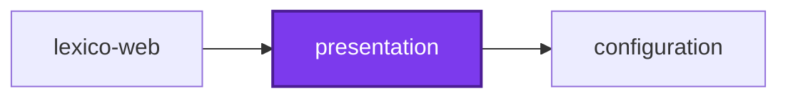

# 🎨 Components

**Shared React component library built on shadcn/ui and Base UI primitives.**

A collection of accessible, customizable UI components for the codebase, providing a consistent design system across applications. Built with Tailwind CSS, TypeScript, and shadcn/ui (New York style).

The interface half of the [Lexico](../lexico/lexico-web/README.md) suite:

| Project | Role |
| ------- | ---- |
| 🐺 [lexico-web](../lexico/lexico-web/README.md) | The SSR web application |
| 🎨 [presentation](README.md) | This package — shared React components |
| 📖 [lexico-entities](../lexico/lexico-entities/README.md) | TypeORM entities and migrations |
| 🚰 [lexico-cli](../lexico/lexico-cli/README.md) | Dictionary and literature ingestion |

## Features

- **50+ UI Components**: Buttons, cards, forms, dialogs, navigation, feedback, and more
- **Accessible**: WCAG 2.1 AA compliant, keyboard navigation, screen reader support
- **Themeable**: CSS variables for light/dark mode, customizable colors
- **Type-Safe**: Full TypeScript support with strict mode
- **Tree-Shakeable**: Only bundle components you actually use
- **Base UI Primitives**: Built on high-quality, unstyled component primitives

## Quick Start

### Installation

This package is already available in the codebase via workspace protocol. Import from consuming applications:

```tsx
// In projects/lexico/lexico-web/src/routes/example.tsx
import { Button, Card, Input } from "@codebase/presentation";
import "@codebase/presentation/styles/globals.css"; // Import once in root layout

function ExamplePage() {
  return (
    <Card>
      <CardHeader>
        <CardTitle>Example Card</CardTitle>
      </CardHeader>
      <CardContent>
        <Input placeholder="Enter text..." />
        <Button>Submit</Button>
      </CardContent>
    </Card>
  );
}
```

### Import Styles

Add global CSS import to your root layout:

```tsx
// projects/lexico/lexico-web/src/routes/__root.tsx
import "@codebase/presentation/styles/globals.css";
```

## Component Categories

### Layout & Structure

- **Card**: Content containers with header, content, footer sections
- **Separator**: Divider lines for visual separation
- **Accordion**: Collapsible content sections
- **Tabs**: Tabbed navigation and content
- **Sidebar**: Navigation sidebar with collapsible sections
- **Resizable**: Resizable panel layouts

### Form Controls

- **Input**: Text input field
- **Textarea**: Multi-line text input
- **Select**: Dropdown selection menu
- **Checkbox**: Boolean selection control
- **Radio Group**: Single selection from multiple options
- **Switch**: Toggle control for binary states
- **Slider**: Range selection control
- **Label**: Form field labels with accessibility

### Buttons & Navigation

- **Button**: Primary action buttons with variants
- **Button Group**: Grouped button controls
- **Navigation Menu**: Multi-level navigation menus
- **Breadcrumb**: Hierarchical path display
- **Dropdown Menu**: Context menus with actions
- **Command**: Cmd+K style command palette

### Feedback & Status

- **Badge**: Status indicators and labels
- **Spinner**: Loading indicator
- **Skeleton**: Loading placeholder animation
- **Progress**: Progress bar indicator
- **Alert**: Informational messages
- **Toast (Sonner)**: Temporary notification messages

### Overlays & Dialogs

- **Dialog**: Modal dialogs
- **Sheet**: Slide-over panels
- **Drawer**: Mobile-friendly bottom sheets
- **Popover**: Floating content containers
- **Tooltip**: Hover hints and descriptions
- **Hover Card**: Rich hover previews

## Adding Components

### Add from shadcn Registry

```bash
# Navigate to package directory
cd projects/common/presentation

# Add component
pnpx shadcn@latest add <component-name>

# Examples
pnpx shadcn@latest add dropdown-menu
pnpx shadcn@latest add command
pnpx shadcn@latest add sonner
```

### Export in Index

After adding a component, export it in [src/index.ts](src/index.ts):

```typescript
export * from "./components/ui/dropdown-menu";
```

### Create Custom Components

For project-specific components, create in `src/components/` (not `ui/`):

```tsx
// src/components/word-card.tsx
import { Card, CardContent, CardHeader, CardTitle } from "@/components/ui/card";

export interface WordCardProps {
  word: string;
  definition: string;
}

export function WordCard({ word, definition }: WordCardProps) {
  return (
    <Card>
      <CardHeader>
        <CardTitle>{word}</CardTitle>
      </CardHeader>
      <CardContent>
        <p>{definition}</p>
      </CardContent>
    </Card>
  );
}
```

**⚠️ Important**: Never modify files in `src/components/ui/` directly - they are managed by shadcn CLI and will be overwritten on updates.

## Theming

### CSS Variables

Customize colors by editing [src/styles/globals.css](src/styles/globals.css):

```css
:root {
  --background: 0 0% 100%;
  --foreground: 0 0% 3.9%;
  --primary: 0 0% 9%;
  --primary-foreground: 0 0% 98%;
  /* ... more colors */
}

[data-theme="dark"] {
  --background: 0 0% 3.9%;
  --foreground: 0 0% 98%;
  /* ... dark mode colors */
}
```

### Using Theme Colors

```tsx
<div className="bg-background text-foreground">
  <button className="bg-primary text-primary-foreground hover:bg-primary/90">
    Button
  </button>
</div>
```

### Dark Mode

Set `data-theme` attribute on root element:

```tsx
document.documentElement.setAttribute("data-theme", "dark");
```

Or use next-themes for automatic theme switching:

```tsx
import { ThemeProvider } from "next-themes";

<ThemeProvider
  attribute="data-theme"
  defaultTheme="system"
>
  {children}
</ThemeProvider>;
```

## Development

### Build Library

```bash
nx run components:build
```

### Type Checking

```bash
nx run components:typecheck
```

### Type Coverage

```bash
nx run components:type-coverage
# Target: 99.84%
```

### Bundle Size Analysis

```bash
nx run components:codometer
# Limit: 512 KB gzipped, warning at 384 KB
```

The 512 KB limit is a ratchet against the measured size, not a design target — the Vite library build bundles React and Base UI into the output rather than externalizing them, even though React is a `peerDependency`. See `codometer.config.ts` for the full note.

## Usage Examples

### Button Variants

```tsx
<Button variant="default">Default</Button>
<Button variant="secondary">Secondary</Button>
<Button variant="destructive">Delete</Button>
<Button variant="ghost">Ghost</Button>
<Button variant="link">Link</Button>

<Button size="sm">Small</Button>
<Button size="default">Default</Button>
<Button size="lg">Large</Button>
```

### Form with Validation

```tsx
import { Input, Label, Button } from "@codebase/presentation";

function LoginForm() {
  return (
    <form>
      <div>
        <Label htmlFor="email">Email</Label>
        <Input
          id="email"
          type="email"
          placeholder="you@example.com"
        />
      </div>
      <div>
        <Label htmlFor="password">Password</Label>
        <Input
          id="password"
          type="password"
        />
      </div>
      <Button type="submit">Sign In</Button>
    </form>
  );
}
```

### Dialog

```tsx
import {
  Dialog,
  DialogContent,
  DialogHeader,
  DialogTitle,
  DialogTrigger,
  Button,
} from "@codebase/presentation";

function ConfirmDialog() {
  return (
    <Dialog>
      <DialogTrigger render={<Button />}>Open Dialog</DialogTrigger>
      <DialogContent>
        <DialogHeader>
          <DialogTitle>Are you sure?</DialogTitle>
        </DialogHeader>
        <p>This action cannot be undone.</p>
        <Button>Confirm</Button>
      </DialogContent>
    </Dialog>
  );
}
```

### Dropdown Menu

```tsx
import {
  DropdownMenu,
  DropdownMenuContent,
  DropdownMenuItem,
  DropdownMenuTrigger,
  Button,
} from "@codebase/presentation";

function UserMenu() {
  return (
    <DropdownMenu>
      <DropdownMenuTrigger render={<Button variant="ghost" />}>
        Menu
      </DropdownMenuTrigger>
      <DropdownMenuContent>
        <DropdownMenuItem>Profile</DropdownMenuItem>
        <DropdownMenuItem>Settings</DropdownMenuItem>
        <DropdownMenuItem>Sign Out</DropdownMenuItem>
      </DropdownMenuContent>
    </DropdownMenu>
  );
}
```

## Configuration

### shadcn Config ([components.json](components.json))

```json
{
  "style": "new-york",
  "tailwind": {
    "baseColor": "gray",
    "cssVariables": true
  },
  "iconLibrary": "lucide"
}
```

### Tailwind Config ([tailwind.config.cjs](tailwind.config.cjs))

Extends shared Tailwind configuration with component-specific patterns:

```js
content: [
  "./src/**/*.{ts,tsx}",
  "../components/src/**/*.{ts,tsx}",
];
```

## Accessibility

All components follow WCAG 2.1 Level AA standards:

- ✅ Keyboard navigation (Tab, Enter, Space, Arrow keys)
- ✅ Focus management (visible focus indicators)
- ✅ ARIA attributes (screen reader announcements)
- ✅ Color contrast (4.5:1 for text, 3:1 for UI)

Built on Base UI primitives which handle complex accessibility patterns automatically:

- Focus trapping in dialogs
- Roving focus in menus
- Screen reader announcements
- Keyboard shortcuts

## Troubleshooting

### Styles Not Applied

Import global CSS in your root layout:

```tsx
import "@codebase/presentation/styles/globals.css";
```

### Import Errors

Verify TypeScript path mapping in `tsconfig.json`:

```json
{
  "compilerOptions": {
    "paths": {
      "@codebase/presentation": [
        "../components/src/index.ts"
      ]
    }
  }
}
```

### Dark Mode Not Working

Set `data-theme` attribute on `<html>` or use ThemeProvider.

## Documentation

For detailed architecture, component patterns, and development workflows:

- **[AGENTS.md](AGENTS.md)**: Complete architectural documentation
- **[Main AGENTS.md](../../AGENTS.md)**: Codebase architecture and Nx workflows
- **[lexico-web](../lexico/lexico-web/README.md)**: The application these components build

External resources:

- [shadcn/ui Documentation](https://ui.shadcn.com/docs): Component reference and CLI
- [Base UI Documentation](https://base-ui.com/react/overview/quick-start): Primitive APIs
- [Tailwind CSS Documentation](https://tailwindcss.com/docs): Utility classes

## License

See [LICENSE](../../LICENSE) for licensing information.

<!-- callidescope:start -->

## 🔭 Callidescope

Call stacks traced through `projects/common/presentation`, deepest first. Each frame shows what it takes, what it returns, and what its documentation says.

| Measure | Value |
| --- | --- |
| Callables | 1 |
| Files | 6 |
| Calls traced | 0 |
| Call stacks | 0 |
| Deepest stack | 0 |
| Stacks through recursion | 0 |
| Unfollowable calls | 0 |

### Limits

What this project is judged against, as declared in its own `callidescope.config.ts`.

| Limit | Value |
| --- | --- |
| `maximumDepth` | 3 |
| `maximumBreadth` | 7 |

### Call stacks (depth)

None.

### Breadth

None.
<!-- callidescope:end -->

## 🕸️ Codependix

Dependency graphs exported by [codependix](https://github.com/Organizzolini/codebase/tree/main/projects/ic-suite/codependix/codependix-cli), regenerated by `nx run configuration:codependix:write`.

### Nx Neighborhood

<!-- codependix:start name="codependix-nx-projects" -->

<!-- codependix:end name="codependix-nx-projects" -->

### File Imports

<!-- codependix:start name="codependix-file-imports" -->
```mermaid
graph LR
  file_callidescope_config_ts["callidescope.config.ts"]
  file_codependix_config_ts["codependix.config.ts"]
  file_codometer_config_ts["codometer.config.ts"]
  file_eslint_config_ts["eslint.config.ts"]
  file_src_components_examples_c_sidebar_1_tsx["src/components/examples/c-sidebar-1.tsx"]
  file_src_components_reui_alert_tsx["src/components/reui/alert.tsx"]
  file_src_components_reui_autocomplete_tsx["src/components/reui/autocomplete.tsx"]
  file_src_components_reui_badge_tsx["src/components/reui/badge.tsx"]
  file_src_components_reui_cascader_cascader_async_tsx["src/components/reui/cascader/cascader-async.tsx"]
  file_src_components_reui_cascader_cascader_columns_tsx["src/components/reui/cascader/cascader-columns.tsx"]
  file_src_components_reui_cascader_cascader_context_tsx["src/components/reui/cascader/cascader-context.tsx"]
  file_src_components_reui_cascader_cascader_footer_tsx["src/components/reui/cascader/cascader-footer.tsx"]
  file_src_components_reui_cascader_cascader_i18n_tsx["src/components/reui/cascader/cascader-i18n.tsx"]
  file_src_components_reui_cascader_cascader_item_tsx["src/components/reui/cascader/cascader-item.tsx"]
  file_src_components_reui_cascader_cascader_lib_tsx["src/components/reui/cascader/cascader-lib.tsx"]
  file_src_components_reui_cascader_cascader_nav_tsx["src/components/reui/cascader/cascader-nav.tsx"]
  file_src_components_reui_cascader_cascader_types_tsx["src/components/reui/cascader/cascader-types.tsx"]
  file_src_components_reui_cascader_cascader_virtual_tsx["src/components/reui/cascader/cascader-virtual.tsx"]
  file_src_components_reui_cascader_cascader_tsx["src/components/reui/cascader/cascader.tsx"]
  file_src_components_reui_code_block_code_block_highlight_tsx["src/components/reui/code-block/code-block-highlight.tsx"]
  file_src_components_reui_code_block_code_block_tsx["src/components/reui/code-block/code-block.tsx"]
  file_src_components_reui_color_picker_tsx["src/components/reui/color-picker.tsx"]
  file_src_components_reui_data_grid_data_grid_cell_selection_tsx["src/components/reui/data-grid/data-grid-cell-selection.tsx"]
  file_src_components_reui_data_grid_data_grid_column_filter_tsx["src/components/reui/data-grid/data-grid-column-filter.tsx"]
  file_src_components_reui_data_grid_data_grid_column_header_tsx["src/components/reui/data-grid/data-grid-column-header.tsx"]
  file_src_components_reui_data_grid_data_grid_column_visibility_tsx["src/components/reui/data-grid/data-grid-column-visibility.tsx"]
  file_src_components_reui_data_grid_data_grid_i18n_tsx["src/components/reui/data-grid/data-grid-i18n.tsx"]
  file_src_components_reui_data_grid_data_grid_pagination_tsx["src/components/reui/data-grid/data-grid-pagination.tsx"]
  file_src_components_reui_data_grid_data_grid_scroll_area_tsx["src/components/reui/data-grid/data-grid-scroll-area.tsx"]
  file_src_components_reui_data_grid_data_grid_table_dnd_rows_tsx["src/components/reui/data-grid/data-grid-table-dnd-rows.tsx"]
  file_src_components_reui_data_grid_data_grid_table_dnd_tsx["src/components/reui/data-grid/data-grid-table-dnd.tsx"]
  file_src_components_reui_data_grid_data_grid_table_virtual_tsx["src/components/reui/data-grid/data-grid-table-virtual.tsx"]
  file_src_components_reui_data_grid_data_grid_table_tsx["src/components/reui/data-grid/data-grid-table.tsx"]
  file_src_components_reui_data_grid_data_grid_tsx["src/components/reui/data-grid/data-grid.tsx"]
  file_src_components_reui_date_selector_tsx["src/components/reui/date-selector.tsx"]
  file_src_components_reui_emoji_picker_tsx["src/components/reui/emoji-picker.tsx"]
  file_src_components_reui_event_calendar_event_calendar_agenda_view_tsx["src/components/reui/event-calendar/event-calendar-agenda-view.tsx"]
  file_src_components_reui_event_calendar_event_calendar_content_tsx["src/components/reui/event-calendar/event-calendar-content.tsx"]
  file_src_components_reui_event_calendar_event_calendar_dnd_tsx["src/components/reui/event-calendar/event-calendar-dnd.tsx"]
  file_src_components_reui_event_calendar_event_calendar_event_tsx["src/components/reui/event-calendar/event-calendar-event.tsx"]
  file_src_components_reui_event_calendar_event_calendar_i18n_tsx["src/components/reui/event-calendar/event-calendar-i18n.tsx"]
  file_src_components_reui_event_calendar_event_calendar_lib_tsx["src/components/reui/event-calendar/event-calendar-lib.tsx"]
  file_src_components_reui_event_calendar_event_calendar_month_view_tsx["src/components/reui/event-calendar/event-calendar-month-view.tsx"]
  file_src_components_reui_event_calendar_event_calendar_nav_tsx["src/components/reui/event-calendar/event-calendar-nav.tsx"]
  file_src_components_reui_event_calendar_event_calendar_recurrence_tsx["src/components/reui/event-calendar/event-calendar-recurrence.tsx"]
  file_src_components_reui_event_calendar_event_calendar_resource_view_tsx["src/components/reui/event-calendar/event-calendar-resource-view.tsx"]
  file_src_components_reui_event_calendar_event_calendar_time_grid_tsx["src/components/reui/event-calendar/event-calendar-time-grid.tsx"]
  file_src_components_reui_event_calendar_event_calendar_types_tsx["src/components/reui/event-calendar/event-calendar-types.tsx"]
  file_src_components_reui_event_calendar_event_calendar_tsx["src/components/reui/event-calendar/event-calendar.tsx"]
  file_src_components_reui_file_type_tsx["src/components/reui/file-type.tsx"]
  file_src_components_reui_filters_filters_advanced_tsx["src/components/reui/filters/filters-advanced.tsx"]
  file_src_components_reui_filters_filters_builder_tsx["src/components/reui/filters/filters-builder.tsx"]
  file_src_components_reui_filters_filters_chip_tsx["src/components/reui/filters/filters-chip.tsx"]
  file_src_components_reui_filters_filters_context_tsx["src/components/reui/filters/filters-context.tsx"]
  file_src_components_reui_filters_filters_date_tsx["src/components/reui/filters/filters-date.tsx"]
  file_src_components_reui_filters_filters_dnd_tsx["src/components/reui/filters/filters-dnd.tsx"]
  file_src_components_reui_filters_filters_draft_tsx["src/components/reui/filters/filters-draft.tsx"]
  file_src_components_reui_filters_filters_editors_tsx["src/components/reui/filters/filters-editors.tsx"]
  file_src_components_reui_filters_filters_i18n_tsx["src/components/reui/filters/filters-i18n.tsx"]
  file_src_components_reui_filters_filters_lib_tsx["src/components/reui/filters/filters-lib.tsx"]
  file_src_components_reui_filters_filters_operators_tsx["src/components/reui/filters/filters-operators.tsx"]
  file_src_components_reui_filters_filters_query_tsx["src/components/reui/filters/filters-query.tsx"]
  file_src_components_reui_filters_filters_types_tsx["src/components/reui/filters/filters-types.tsx"]
  file_src_components_reui_filters_filters_tsx["src/components/reui/filters/filters.tsx"]
  file_src_components_reui_frame_tsx["src/components/reui/frame.tsx"]
  file_src_components_reui_gantt_gantt_bar_tsx["src/components/reui/gantt/gantt-bar.tsx"]
  file_src_components_reui_gantt_gantt_dnd_tsx["src/components/reui/gantt/gantt-dnd.tsx"]
  file_src_components_reui_gantt_gantt_i18n_tsx["src/components/reui/gantt/gantt-i18n.tsx"]
  file_src_components_reui_gantt_gantt_lib_tsx["src/components/reui/gantt/gantt-lib.tsx"]
  file_src_components_reui_gantt_gantt_nav_tsx["src/components/reui/gantt/gantt-nav.tsx"]
  file_src_components_reui_gantt_gantt_recurrence_tsx["src/components/reui/gantt/gantt-recurrence.tsx"]
  file_src_components_reui_gantt_gantt_types_tsx["src/components/reui/gantt/gantt-types.tsx"]
  file_src_components_reui_gantt_gantt_view_tsx["src/components/reui/gantt/gantt-view.tsx"]
  file_src_components_reui_gantt_gantt_tsx["src/components/reui/gantt/gantt.tsx"]
  file_src_components_reui_icon_stack_tsx["src/components/reui/icon-stack.tsx"]
  file_src_components_reui_icon_tile_tsx["src/components/reui/icon-tile.tsx"]
  file_src_components_reui_kanban_tsx["src/components/reui/kanban.tsx"]
  file_src_components_reui_number_field_tsx["src/components/reui/number-field.tsx"]
  file_src_components_reui_phone_input_tsx["src/components/reui/phone-input.tsx"]
  file_src_components_reui_rating_tsx["src/components/reui/rating.tsx"]
  file_src_components_reui_scrollspy_tsx["src/components/reui/scrollspy.tsx"]
  file_src_components_reui_signature_pad_tsx["src/components/reui/signature-pad.tsx"]
  file_src_components_reui_sortable_tsx["src/components/reui/sortable.tsx"]
  file_src_components_reui_stepper_tsx["src/components/reui/stepper.tsx"]
  file_src_components_reui_time_picker_tsx["src/components/reui/time-picker.tsx"]
  file_src_components_reui_timeline_tsx["src/components/reui/timeline.tsx"]
  file_src_components_reui_tree_tsx["src/components/reui/tree.tsx"]
  file_src_components_ui_accordion_tsx["src/components/ui/accordion.tsx"]
  file_src_components_ui_alert_dialog_tsx["src/components/ui/alert-dialog.tsx"]
  file_src_components_ui_alert_tsx["src/components/ui/alert.tsx"]
  file_src_components_ui_aspect_ratio_tsx["src/components/ui/aspect-ratio.tsx"]
  file_src_components_ui_avatar_tsx["src/components/ui/avatar.tsx"]
  file_src_components_ui_badge_tsx["src/components/ui/badge.tsx"]
  file_src_components_ui_breadcrumb_tsx["src/components/ui/breadcrumb.tsx"]
  file_src_components_ui_button_group_tsx["src/components/ui/button-group.tsx"]
  file_src_components_ui_button_tsx["src/components/ui/button.tsx"]
  file_src_components_ui_calendar_tsx["src/components/ui/calendar.tsx"]
  file_src_components_ui_card_tsx["src/components/ui/card.tsx"]
  file_src_components_ui_carousel_tsx["src/components/ui/carousel.tsx"]
  file_src_components_ui_chart_tsx["src/components/ui/chart.tsx"]
  file_src_components_ui_checkbox_tsx["src/components/ui/checkbox.tsx"]
  file_src_components_ui_collapsible_tsx["src/components/ui/collapsible.tsx"]
  file_src_components_ui_combobox_tsx["src/components/ui/combobox.tsx"]
  file_src_components_ui_command_tsx["src/components/ui/command.tsx"]
  file_src_components_ui_context_menu_tsx["src/components/ui/context-menu.tsx"]
  file_src_components_ui_dialog_tsx["src/components/ui/dialog.tsx"]
  file_src_components_ui_drawer_tsx["src/components/ui/drawer.tsx"]
  file_src_components_ui_dropdown_menu_tsx["src/components/ui/dropdown-menu.tsx"]
  file_src_components_ui_empty_tsx["src/components/ui/empty.tsx"]
  file_src_components_ui_field_tsx["src/components/ui/field.tsx"]
  file_src_components_ui_hover_card_tsx["src/components/ui/hover-card.tsx"]
  file_src_components_ui_input_group_tsx["src/components/ui/input-group.tsx"]
  file_src_components_ui_input_otp_tsx["src/components/ui/input-otp.tsx"]
  file_src_components_ui_input_tsx["src/components/ui/input.tsx"]
  file_src_components_ui_item_tsx["src/components/ui/item.tsx"]
  file_src_components_ui_kbd_tsx["src/components/ui/kbd.tsx"]
  file_src_components_ui_label_tsx["src/components/ui/label.tsx"]
  file_src_components_ui_menubar_tsx["src/components/ui/menubar.tsx"]
  file_src_components_ui_navigation_menu_tsx["src/components/ui/navigation-menu.tsx"]
  file_src_components_ui_pagination_tsx["src/components/ui/pagination.tsx"]
  file_src_components_ui_popover_tsx["src/components/ui/popover.tsx"]
  file_src_components_ui_progress_tsx["src/components/ui/progress.tsx"]
  file_src_components_ui_radio_group_tsx["src/components/ui/radio-group.tsx"]
  file_src_components_ui_resizable_tsx["src/components/ui/resizable.tsx"]
  file_src_components_ui_scroll_area_tsx["src/components/ui/scroll-area.tsx"]
  file_src_components_ui_select_tsx["src/components/ui/select.tsx"]
  file_src_components_ui_separator_tsx["src/components/ui/separator.tsx"]
  file_src_components_ui_sheet_tsx["src/components/ui/sheet.tsx"]
  file_src_components_ui_sidebar_tsx["src/components/ui/sidebar.tsx"]
  file_src_components_ui_skeleton_tsx["src/components/ui/skeleton.tsx"]
  file_src_components_ui_slider_tsx["src/components/ui/slider.tsx"]
  file_src_components_ui_sonner_tsx["src/components/ui/sonner.tsx"]
  file_src_components_ui_spinner_tsx["src/components/ui/spinner.tsx"]
  file_src_components_ui_switch_tsx["src/components/ui/switch.tsx"]
  file_src_components_ui_table_tsx["src/components/ui/table.tsx"]
  file_src_components_ui_tabs_tsx["src/components/ui/tabs.tsx"]
  file_src_components_ui_textarea_tsx["src/components/ui/textarea.tsx"]
  file_src_components_ui_toggle_group_tsx["src/components/ui/toggle-group.tsx"]
  file_src_components_ui_toggle_tsx["src/components/ui/toggle.tsx"]
  file_src_components_ui_tooltip_tsx["src/components/ui/tooltip.tsx"]
  file_src_hooks_use_copy_to_clipboard_ts["src/hooks/use-copy-to-clipboard.ts"]
  file_src_hooks_use_file_upload_ts["src/hooks/use-file-upload.ts"]
  file_src_hooks_use_media_query_ts["src/hooks/use-media-query.ts"]
  file_src_hooks_use_mobile_ts["src/hooks/use-mobile.ts"]
  file_src_hooks_use_scroll_position_ts["src/hooks/use-scroll-position.ts"]
  file_src_hooks_use_slider_input_ts["src/hooks/use-slider-input.ts"]
  file_src_index_ts["src/index.ts"]
  file_src_lib_utils_ts["src/lib/utils.ts"]
  file_vite_config_mts["vite.config.mts"]
  file_src_components_examples_c_sidebar_1_tsx --> file_src_components_ui_avatar_tsx
  file_src_components_examples_c_sidebar_1_tsx --> file_src_components_ui_breadcrumb_tsx
  file_src_components_examples_c_sidebar_1_tsx --> file_src_components_ui_button_tsx
  file_src_components_examples_c_sidebar_1_tsx --> file_src_components_ui_card_tsx
  file_src_components_examples_c_sidebar_1_tsx --> file_src_components_ui_dropdown_menu_tsx
  file_src_components_examples_c_sidebar_1_tsx --> file_src_components_ui_sidebar_tsx
  file_src_components_reui_autocomplete_tsx --> file_src_components_ui_scroll_area_tsx
  file_src_components_reui_cascader_cascader_async_tsx --> file_src_components_reui_cascader_cascader_context_tsx
  file_src_components_reui_cascader_cascader_async_tsx --> file_src_components_reui_cascader_cascader_lib_tsx
  file_src_components_reui_cascader_cascader_async_tsx --> file_src_components_reui_cascader_cascader_types_tsx
  file_src_components_reui_cascader_cascader_columns_tsx --> file_src_components_reui_cascader_cascader_context_tsx
  file_src_components_reui_cascader_cascader_columns_tsx --> file_src_components_reui_cascader_cascader_item_tsx
  file_src_components_reui_cascader_cascader_columns_tsx --> file_src_components_reui_cascader_cascader_lib_tsx
  file_src_components_reui_cascader_cascader_columns_tsx --> file_src_components_ui_scroll_area_tsx
  file_src_components_reui_cascader_cascader_context_tsx --> file_src_components_reui_cascader_cascader_types_tsx
  file_src_components_reui_cascader_cascader_footer_tsx --> file_src_components_reui_cascader_cascader_context_tsx
  file_src_components_reui_cascader_cascader_footer_tsx --> file_src_components_reui_cascader_cascader_item_tsx
  file_src_components_reui_cascader_cascader_footer_tsx --> file_src_components_reui_cascader_cascader_lib_tsx
  file_src_components_reui_cascader_cascader_footer_tsx --> file_src_components_reui_cascader_cascader_types_tsx
  file_src_components_reui_cascader_cascader_i18n_tsx --> file_src_components_reui_cascader_cascader_types_tsx
  file_src_components_reui_cascader_cascader_item_tsx --> file_src_components_reui_cascader_cascader_context_tsx
  file_src_components_reui_cascader_cascader_item_tsx --> file_src_components_reui_cascader_cascader_lib_tsx
  file_src_components_reui_cascader_cascader_item_tsx --> file_src_components_reui_cascader_cascader_types_tsx
  file_src_components_reui_cascader_cascader_item_tsx --> file_src_components_ui_spinner_tsx
  file_src_components_reui_cascader_cascader_lib_tsx --> file_src_components_reui_cascader_cascader_types_tsx
  file_src_components_reui_cascader_cascader_nav_tsx --> file_src_components_reui_cascader_cascader_context_tsx
  file_src_components_reui_cascader_cascader_nav_tsx --> file_src_components_reui_cascader_cascader_i18n_tsx
  file_src_components_reui_cascader_cascader_nav_tsx --> file_src_components_reui_cascader_cascader_lib_tsx
  file_src_components_reui_cascader_cascader_nav_tsx --> file_src_components_reui_cascader_cascader_types_tsx
  file_src_components_reui_cascader_cascader_virtual_tsx --> file_src_components_reui_cascader_cascader_columns_tsx
  file_src_components_reui_cascader_cascader_virtual_tsx --> file_src_components_reui_cascader_cascader_context_tsx
  file_src_components_reui_cascader_cascader_virtual_tsx --> file_src_components_reui_cascader_cascader_item_tsx
  file_src_components_reui_cascader_cascader_tsx --> file_src_components_reui_cascader_cascader_async_tsx
  file_src_components_reui_cascader_cascader_tsx --> file_src_components_reui_cascader_cascader_context_tsx
  file_src_components_reui_cascader_cascader_tsx --> file_src_components_reui_cascader_cascader_i18n_tsx
  file_src_components_reui_cascader_cascader_tsx --> file_src_components_reui_cascader_cascader_lib_tsx
  file_src_components_reui_cascader_cascader_tsx --> file_src_components_reui_cascader_cascader_types_tsx
  file_src_components_reui_cascader_cascader_tsx --> file_src_components_ui_scroll_area_tsx
  file_src_components_reui_code_block_code_block_tsx --> file_src_components_reui_code_block_code_block_highlight_tsx
  file_src_components_reui_code_block_code_block_tsx --> file_src_components_ui_button_tsx
  file_src_components_reui_color_picker_tsx --> file_src_components_ui_button_tsx
  file_src_components_reui_color_picker_tsx --> file_src_components_ui_dropdown_menu_tsx
  file_src_components_reui_color_picker_tsx --> file_src_components_ui_input_group_tsx
  file_src_components_reui_color_picker_tsx --> file_src_components_ui_popover_tsx
  file_src_components_reui_color_picker_tsx --> file_src_components_ui_separator_tsx
  file_src_components_reui_data_grid_data_grid_cell_selection_tsx --> file_src_components_reui_data_grid_data_grid_tsx
  file_src_components_reui_data_grid_data_grid_cell_selection_tsx --> file_src_components_ui_button_tsx
  file_src_components_reui_data_grid_data_grid_column_filter_tsx --> file_src_components_reui_badge_tsx
  file_src_components_reui_data_grid_data_grid_column_filter_tsx --> file_src_components_reui_data_grid_data_grid_tsx
  file_src_components_reui_data_grid_data_grid_column_filter_tsx --> file_src_components_ui_button_tsx
  file_src_components_reui_data_grid_data_grid_column_filter_tsx --> file_src_components_ui_input_tsx
  file_src_components_reui_data_grid_data_grid_column_filter_tsx --> file_src_components_ui_popover_tsx
  file_src_components_reui_data_grid_data_grid_column_filter_tsx --> file_src_components_ui_separator_tsx
  file_src_components_reui_data_grid_data_grid_column_header_tsx --> file_src_components_reui_data_grid_data_grid_tsx
  file_src_components_reui_data_grid_data_grid_column_header_tsx --> file_src_components_ui_button_tsx
  file_src_components_reui_data_grid_data_grid_column_header_tsx --> file_src_components_ui_dropdown_menu_tsx
  file_src_components_reui_data_grid_data_grid_column_visibility_tsx --> file_src_components_reui_data_grid_data_grid_tsx
  file_src_components_reui_data_grid_data_grid_column_visibility_tsx --> file_src_components_ui_dropdown_menu_tsx
  file_src_components_reui_data_grid_data_grid_pagination_tsx --> file_src_components_reui_data_grid_data_grid_tsx
  file_src_components_reui_data_grid_data_grid_pagination_tsx --> file_src_components_ui_button_tsx
  file_src_components_reui_data_grid_data_grid_pagination_tsx --> file_src_components_ui_select_tsx
  file_src_components_reui_data_grid_data_grid_pagination_tsx --> file_src_components_ui_skeleton_tsx
  file_src_components_reui_data_grid_data_grid_scroll_area_tsx --> file_src_components_reui_data_grid_data_grid_tsx
  file_src_components_reui_data_grid_data_grid_table_dnd_rows_tsx --> file_src_components_reui_data_grid_data_grid_table_tsx
  file_src_components_reui_data_grid_data_grid_table_dnd_rows_tsx --> file_src_components_reui_data_grid_data_grid_tsx
  file_src_components_reui_data_grid_data_grid_table_dnd_rows_tsx --> file_src_components_ui_button_tsx
  file_src_components_reui_data_grid_data_grid_table_dnd_tsx --> file_src_components_reui_data_grid_data_grid_table_tsx
  file_src_components_reui_data_grid_data_grid_table_dnd_tsx --> file_src_components_reui_data_grid_data_grid_tsx
  file_src_components_reui_data_grid_data_grid_table_dnd_tsx --> file_src_components_ui_button_tsx
  file_src_components_reui_data_grid_data_grid_table_virtual_tsx --> file_src_components_reui_data_grid_data_grid_table_tsx
  file_src_components_reui_data_grid_data_grid_table_virtual_tsx --> file_src_components_reui_data_grid_data_grid_tsx
  file_src_components_reui_data_grid_data_grid_table_virtual_tsx --> file_src_components_ui_spinner_tsx
  file_src_components_reui_data_grid_data_grid_table_tsx --> file_src_components_reui_data_grid_data_grid_tsx
  file_src_components_reui_data_grid_data_grid_table_tsx --> file_src_components_ui_button_tsx
  file_src_components_reui_data_grid_data_grid_table_tsx --> file_src_components_ui_checkbox_tsx
  file_src_components_reui_data_grid_data_grid_table_tsx --> file_src_components_ui_spinner_tsx
  file_src_components_reui_data_grid_data_grid_tsx --> file_src_components_reui_data_grid_data_grid_i18n_tsx
  file_src_components_reui_date_selector_tsx --> file_src_components_ui_button_tsx
  file_src_components_reui_date_selector_tsx --> file_src_components_ui_calendar_tsx
  file_src_components_reui_date_selector_tsx --> file_src_components_ui_input_tsx
  file_src_components_reui_date_selector_tsx --> file_src_components_ui_scroll_area_tsx
  file_src_components_reui_date_selector_tsx --> file_src_components_ui_tabs_tsx
  file_src_components_reui_date_selector_tsx --> file_src_hooks_use_mobile_ts
  file_src_components_reui_emoji_picker_tsx --> file_src_components_ui_button_tsx
  file_src_components_reui_emoji_picker_tsx --> file_src_components_ui_dropdown_menu_tsx
  file_src_components_reui_emoji_picker_tsx --> file_src_components_ui_empty_tsx
  file_src_components_reui_emoji_picker_tsx --> file_src_components_ui_input_group_tsx
  file_src_components_reui_emoji_picker_tsx --> file_src_components_ui_popover_tsx
  file_src_components_reui_emoji_picker_tsx --> file_src_components_ui_skeleton_tsx
  file_src_components_reui_emoji_picker_tsx --> file_src_components_ui_tabs_tsx
  file_src_components_reui_event_calendar_event_calendar_agenda_view_tsx --> file_src_components_reui_event_calendar_event_calendar_event_tsx
  file_src_components_reui_event_calendar_event_calendar_agenda_view_tsx --> file_src_components_reui_event_calendar_event_calendar_lib_tsx
  file_src_components_reui_event_calendar_event_calendar_agenda_view_tsx --> file_src_components_reui_event_calendar_event_calendar_types_tsx
  file_src_components_reui_event_calendar_event_calendar_agenda_view_tsx --> file_src_components_reui_event_calendar_event_calendar_tsx
  file_src_components_reui_event_calendar_event_calendar_agenda_view_tsx --> file_src_components_reui_icon_stack_tsx
  file_src_components_reui_event_calendar_event_calendar_agenda_view_tsx --> file_src_components_ui_scroll_area_tsx
  file_src_components_reui_event_calendar_event_calendar_content_tsx --> file_src_components_reui_event_calendar_event_calendar_agenda_view_tsx
  file_src_components_reui_event_calendar_event_calendar_content_tsx --> file_src_components_reui_event_calendar_event_calendar_month_view_tsx
  file_src_components_reui_event_calendar_event_calendar_content_tsx --> file_src_components_reui_event_calendar_event_calendar_resource_view_tsx
  file_src_components_reui_event_calendar_event_calendar_content_tsx --> file_src_components_reui_event_calendar_event_calendar_time_grid_tsx
  file_src_components_reui_event_calendar_event_calendar_content_tsx --> file_src_components_reui_event_calendar_event_calendar_types_tsx
  file_src_components_reui_event_calendar_event_calendar_content_tsx --> file_src_components_reui_event_calendar_event_calendar_tsx
  file_src_components_reui_event_calendar_event_calendar_dnd_tsx --> file_src_components_reui_event_calendar_event_calendar_lib_tsx
  file_src_components_reui_event_calendar_event_calendar_dnd_tsx --> file_src_components_reui_event_calendar_event_calendar_types_tsx
  file_src_components_reui_event_calendar_event_calendar_dnd_tsx --> file_src_components_reui_event_calendar_event_calendar_tsx
  file_src_components_reui_event_calendar_event_calendar_event_tsx --> file_src_components_reui_event_calendar_event_calendar_dnd_tsx
  file_src_components_reui_event_calendar_event_calendar_event_tsx --> file_src_components_reui_event_calendar_event_calendar_lib_tsx
  file_src_components_reui_event_calendar_event_calendar_event_tsx --> file_src_components_reui_event_calendar_event_calendar_types_tsx
  file_src_components_reui_event_calendar_event_calendar_event_tsx --> file_src_components_reui_event_calendar_event_calendar_tsx
  file_src_components_reui_event_calendar_event_calendar_event_tsx --> file_src_components_ui_tooltip_tsx
  file_src_components_reui_event_calendar_event_calendar_i18n_tsx --> file_src_components_reui_event_calendar_event_calendar_types_tsx
  file_src_components_reui_event_calendar_event_calendar_lib_tsx --> file_src_components_reui_event_calendar_event_calendar_recurrence_tsx
  file_src_components_reui_event_calendar_event_calendar_lib_tsx --> file_src_components_reui_event_calendar_event_calendar_types_tsx
  file_src_components_reui_event_calendar_event_calendar_month_view_tsx --> file_src_components_reui_event_calendar_event_calendar_dnd_tsx
  file_src_components_reui_event_calendar_event_calendar_month_view_tsx --> file_src_components_reui_event_calendar_event_calendar_event_tsx
  file_src_components_reui_event_calendar_event_calendar_month_view_tsx --> file_src_components_reui_event_calendar_event_calendar_lib_tsx
  file_src_components_reui_event_calendar_event_calendar_month_view_tsx --> file_src_components_reui_event_calendar_event_calendar_types_tsx
  file_src_components_reui_event_calendar_event_calendar_month_view_tsx --> file_src_components_reui_event_calendar_event_calendar_tsx
  file_src_components_reui_event_calendar_event_calendar_month_view_tsx --> file_src_components_ui_popover_tsx
  file_src_components_reui_event_calendar_event_calendar_month_view_tsx --> file_src_components_ui_scroll_area_tsx
  file_src_components_reui_event_calendar_event_calendar_nav_tsx --> file_src_components_reui_event_calendar_event_calendar_lib_tsx
  file_src_components_reui_event_calendar_event_calendar_nav_tsx --> file_src_components_reui_event_calendar_event_calendar_types_tsx
  file_src_components_reui_event_calendar_event_calendar_nav_tsx --> file_src_components_reui_event_calendar_event_calendar_tsx
  file_src_components_reui_event_calendar_event_calendar_nav_tsx --> file_src_components_ui_button_tsx
  file_src_components_reui_event_calendar_event_calendar_nav_tsx --> file_src_components_ui_calendar_tsx
  file_src_components_reui_event_calendar_event_calendar_nav_tsx --> file_src_components_ui_dropdown_menu_tsx
  file_src_components_reui_event_calendar_event_calendar_nav_tsx --> file_src_components_ui_popover_tsx
  file_src_components_reui_event_calendar_event_calendar_nav_tsx --> file_src_components_ui_tooltip_tsx
  file_src_components_reui_event_calendar_event_calendar_recurrence_tsx --> file_src_components_reui_event_calendar_event_calendar_types_tsx
  file_src_components_reui_event_calendar_event_calendar_resource_view_tsx --> file_src_components_reui_event_calendar_event_calendar_dnd_tsx
  file_src_components_reui_event_calendar_event_calendar_resource_view_tsx --> file_src_components_reui_event_calendar_event_calendar_event_tsx
  file_src_components_reui_event_calendar_event_calendar_resource_view_tsx --> file_src_components_reui_event_calendar_event_calendar_lib_tsx
  file_src_components_reui_event_calendar_event_calendar_resource_view_tsx --> file_src_components_reui_event_calendar_event_calendar_time_grid_tsx
  file_src_components_reui_event_calendar_event_calendar_resource_view_tsx --> file_src_components_reui_event_calendar_event_calendar_types_tsx
  file_src_components_reui_event_calendar_event_calendar_resource_view_tsx --> file_src_components_reui_event_calendar_event_calendar_tsx
  file_src_components_reui_event_calendar_event_calendar_resource_view_tsx --> file_src_components_ui_scroll_area_tsx
  file_src_components_reui_event_calendar_event_calendar_time_grid_tsx --> file_src_components_reui_event_calendar_event_calendar_dnd_tsx
  file_src_components_reui_event_calendar_event_calendar_time_grid_tsx --> file_src_components_reui_event_calendar_event_calendar_event_tsx
  file_src_components_reui_event_calendar_event_calendar_time_grid_tsx --> file_src_components_reui_event_calendar_event_calendar_lib_tsx
  file_src_components_reui_event_calendar_event_calendar_time_grid_tsx --> file_src_components_reui_event_calendar_event_calendar_types_tsx
  file_src_components_reui_event_calendar_event_calendar_time_grid_tsx --> file_src_components_reui_event_calendar_event_calendar_tsx
  file_src_components_reui_event_calendar_event_calendar_time_grid_tsx --> file_src_components_ui_scroll_area_tsx
  file_src_components_reui_event_calendar_event_calendar_tsx --> file_src_components_reui_event_calendar_event_calendar_i18n_tsx
  file_src_components_reui_event_calendar_event_calendar_tsx --> file_src_components_reui_event_calendar_event_calendar_lib_tsx
  file_src_components_reui_event_calendar_event_calendar_tsx --> file_src_components_reui_event_calendar_event_calendar_types_tsx
  file_src_components_reui_filters_filters_advanced_tsx --> file_src_components_reui_filters_filters_builder_tsx
  file_src_components_reui_filters_filters_advanced_tsx --> file_src_components_reui_filters_filters_chip_tsx
  file_src_components_reui_filters_filters_advanced_tsx --> file_src_components_reui_filters_filters_context_tsx
  file_src_components_reui_filters_filters_advanced_tsx --> file_src_components_reui_filters_filters_dnd_tsx
  file_src_components_reui_filters_filters_advanced_tsx --> file_src_components_reui_filters_filters_i18n_tsx
  file_src_components_reui_filters_filters_advanced_tsx --> file_src_components_reui_filters_filters_lib_tsx
  file_src_components_reui_filters_filters_advanced_tsx --> file_src_components_reui_filters_filters_operators_tsx
  file_src_components_reui_filters_filters_advanced_tsx --> file_src_components_reui_filters_filters_query_tsx
  file_src_components_reui_filters_filters_advanced_tsx --> file_src_components_reui_filters_filters_types_tsx
  file_src_components_reui_filters_filters_advanced_tsx --> file_src_components_ui_button_tsx
  file_src_components_reui_filters_filters_advanced_tsx --> file_src_components_ui_dropdown_menu_tsx
  file_src_components_reui_filters_filters_advanced_tsx --> file_src_components_ui_input_tsx
  file_src_components_reui_filters_filters_advanced_tsx --> file_src_components_ui_popover_tsx
  file_src_components_reui_filters_filters_advanced_tsx --> file_src_components_ui_tooltip_tsx
  file_src_components_reui_filters_filters_builder_tsx --> file_src_components_reui_cascader_cascader_footer_tsx
  file_src_components_reui_filters_filters_builder_tsx --> file_src_components_reui_cascader_cascader_nav_tsx
  file_src_components_reui_filters_filters_builder_tsx --> file_src_components_reui_cascader_cascader_types_tsx
  file_src_components_reui_filters_filters_builder_tsx --> file_src_components_reui_cascader_cascader_virtual_tsx
  file_src_components_reui_filters_filters_builder_tsx --> file_src_components_reui_cascader_cascader_tsx
  file_src_components_reui_filters_filters_builder_tsx --> file_src_components_reui_filters_filters_context_tsx
  file_src_components_reui_filters_filters_builder_tsx --> file_src_components_reui_filters_filters_lib_tsx
  file_src_components_reui_filters_filters_builder_tsx --> file_src_components_reui_filters_filters_operators_tsx
  file_src_components_reui_filters_filters_builder_tsx --> file_src_components_reui_filters_filters_types_tsx
  file_src_components_reui_filters_filters_builder_tsx --> file_src_components_ui_button_tsx
  file_src_components_reui_filters_filters_builder_tsx --> file_src_components_ui_popover_tsx
  file_src_components_reui_filters_filters_chip_tsx --> file_src_components_reui_filters_filters_context_tsx
  file_src_components_reui_filters_filters_chip_tsx --> file_src_components_reui_filters_filters_editors_tsx
  file_src_components_reui_filters_filters_chip_tsx --> file_src_components_reui_filters_filters_lib_tsx
  file_src_components_reui_filters_filters_chip_tsx --> file_src_components_reui_filters_filters_operators_tsx
  file_src_components_reui_filters_filters_chip_tsx --> file_src_components_reui_filters_filters_query_tsx
  file_src_components_reui_filters_filters_chip_tsx --> file_src_components_reui_filters_filters_types_tsx
  file_src_components_reui_filters_filters_chip_tsx --> file_src_components_ui_button_group_tsx
  file_src_components_reui_filters_filters_chip_tsx --> file_src_components_ui_button_tsx
  file_src_components_reui_filters_filters_chip_tsx --> file_src_components_ui_dropdown_menu_tsx
  file_src_components_reui_filters_filters_chip_tsx --> file_src_components_ui_popover_tsx
  file_src_components_reui_filters_filters_chip_tsx --> file_src_components_ui_tooltip_tsx
  file_src_components_reui_filters_filters_context_tsx --> file_src_components_reui_filters_filters_draft_tsx
  file_src_components_reui_filters_filters_context_tsx --> file_src_components_reui_filters_filters_lib_tsx
  file_src_components_reui_filters_filters_context_tsx --> file_src_components_reui_filters_filters_types_tsx
  file_src_components_reui_filters_filters_draft_tsx --> file_src_components_reui_filters_filters_types_tsx
  file_src_components_reui_filters_filters_editors_tsx --> file_src_components_reui_cascader_cascader_context_tsx
  file_src_components_reui_filters_filters_editors_tsx --> file_src_components_reui_cascader_cascader_footer_tsx
  file_src_components_reui_filters_filters_editors_tsx --> file_src_components_reui_cascader_cascader_item_tsx
  file_src_components_reui_filters_filters_editors_tsx --> file_src_components_reui_cascader_cascader_nav_tsx
  file_src_components_reui_filters_filters_editors_tsx --> file_src_components_reui_cascader_cascader_types_tsx
  file_src_components_reui_filters_filters_editors_tsx --> file_src_components_reui_cascader_cascader_tsx
  file_src_components_reui_filters_filters_editors_tsx --> file_src_components_reui_filters_filters_context_tsx
  file_src_components_reui_filters_filters_editors_tsx --> file_src_components_reui_filters_filters_lib_tsx
  file_src_components_reui_filters_filters_editors_tsx --> file_src_components_reui_filters_filters_types_tsx
  file_src_components_reui_filters_filters_editors_tsx --> file_src_components_ui_button_group_tsx
  file_src_components_reui_filters_filters_editors_tsx --> file_src_components_ui_button_tsx
  file_src_components_reui_filters_filters_editors_tsx --> file_src_components_ui_input_tsx
  file_src_components_reui_filters_filters_i18n_tsx --> file_src_components_reui_filters_filters_types_tsx
  file_src_components_reui_filters_filters_lib_tsx --> file_src_components_reui_cascader_cascader_lib_tsx
  file_src_components_reui_filters_filters_lib_tsx --> file_src_components_reui_cascader_cascader_types_tsx
  file_src_components_reui_filters_filters_lib_tsx --> file_src_components_reui_filters_filters_types_tsx
  file_src_components_reui_filters_filters_operators_tsx --> file_src_components_reui_filters_filters_types_tsx
  file_src_components_reui_filters_filters_query_tsx --> file_src_components_reui_filters_filters_types_tsx
  file_src_components_reui_filters_filters_tsx --> file_src_components_reui_filters_filters_advanced_tsx
  file_src_components_reui_filters_filters_tsx --> file_src_components_reui_filters_filters_builder_tsx
  file_src_components_reui_filters_filters_tsx --> file_src_components_reui_filters_filters_chip_tsx
  file_src_components_reui_filters_filters_tsx --> file_src_components_reui_filters_filters_context_tsx
  file_src_components_reui_filters_filters_tsx --> file_src_components_reui_filters_filters_draft_tsx
  file_src_components_reui_filters_filters_tsx --> file_src_components_reui_filters_filters_editors_tsx
  file_src_components_reui_filters_filters_tsx --> file_src_components_reui_filters_filters_i18n_tsx
  file_src_components_reui_filters_filters_tsx --> file_src_components_reui_filters_filters_lib_tsx
  file_src_components_reui_filters_filters_tsx --> file_src_components_reui_filters_filters_operators_tsx
  file_src_components_reui_filters_filters_tsx --> file_src_components_reui_filters_filters_query_tsx
  file_src_components_reui_filters_filters_tsx --> file_src_components_reui_filters_filters_types_tsx
  file_src_components_reui_filters_filters_tsx --> file_src_components_ui_button_tsx
  file_src_components_reui_gantt_gantt_bar_tsx --> file_src_components_reui_gantt_gantt_dnd_tsx
  file_src_components_reui_gantt_gantt_bar_tsx --> file_src_components_reui_gantt_gantt_lib_tsx
  file_src_components_reui_gantt_gantt_bar_tsx --> file_src_components_reui_gantt_gantt_types_tsx
  file_src_components_reui_gantt_gantt_bar_tsx --> file_src_components_reui_gantt_gantt_tsx
  file_src_components_reui_gantt_gantt_bar_tsx --> file_src_components_ui_context_menu_tsx
  file_src_components_reui_gantt_gantt_bar_tsx --> file_src_components_ui_tooltip_tsx
  file_src_components_reui_gantt_gantt_dnd_tsx --> file_src_components_reui_gantt_gantt_lib_tsx
  file_src_components_reui_gantt_gantt_dnd_tsx --> file_src_components_reui_gantt_gantt_types_tsx
  file_src_components_reui_gantt_gantt_dnd_tsx --> file_src_components_reui_gantt_gantt_tsx
  file_src_components_reui_gantt_gantt_i18n_tsx --> file_src_components_reui_gantt_gantt_types_tsx
  file_src_components_reui_gantt_gantt_lib_tsx --> file_src_components_reui_gantt_gantt_recurrence_tsx
  file_src_components_reui_gantt_gantt_lib_tsx --> file_src_components_reui_gantt_gantt_types_tsx
  file_src_components_reui_gantt_gantt_nav_tsx --> file_src_components_reui_gantt_gantt_lib_tsx
  file_src_components_reui_gantt_gantt_nav_tsx --> file_src_components_reui_gantt_gantt_types_tsx
  file_src_components_reui_gantt_gantt_nav_tsx --> file_src_components_reui_gantt_gantt_tsx
  file_src_components_reui_gantt_gantt_nav_tsx --> file_src_components_ui_button_tsx
  file_src_components_reui_gantt_gantt_nav_tsx --> file_src_components_ui_calendar_tsx
  file_src_components_reui_gantt_gantt_nav_tsx --> file_src_components_ui_dropdown_menu_tsx
  file_src_components_reui_gantt_gantt_nav_tsx --> file_src_components_ui_popover_tsx
  file_src_components_reui_gantt_gantt_nav_tsx --> file_src_components_ui_tooltip_tsx
  file_src_components_reui_gantt_gantt_recurrence_tsx --> file_src_components_reui_gantt_gantt_types_tsx
  file_src_components_reui_gantt_gantt_view_tsx --> file_src_components_reui_gantt_gantt_bar_tsx
  file_src_components_reui_gantt_gantt_view_tsx --> file_src_components_reui_gantt_gantt_dnd_tsx
  file_src_components_reui_gantt_gantt_view_tsx --> file_src_components_reui_gantt_gantt_lib_tsx
  file_src_components_reui_gantt_gantt_view_tsx --> file_src_components_reui_gantt_gantt_types_tsx
  file_src_components_reui_gantt_gantt_view_tsx --> file_src_components_reui_gantt_gantt_tsx
  file_src_components_reui_gantt_gantt_view_tsx --> file_src_components_ui_button_tsx
  file_src_components_reui_gantt_gantt_view_tsx --> file_src_components_ui_checkbox_tsx
  file_src_components_reui_gantt_gantt_view_tsx --> file_src_components_ui_context_menu_tsx
  file_src_components_reui_gantt_gantt_view_tsx --> file_src_components_ui_scroll_area_tsx
  file_src_components_reui_gantt_gantt_view_tsx --> file_src_components_ui_tooltip_tsx
  file_src_components_reui_gantt_gantt_tsx --> file_src_components_reui_gantt_gantt_i18n_tsx
  file_src_components_reui_gantt_gantt_tsx --> file_src_components_reui_gantt_gantt_lib_tsx
  file_src_components_reui_gantt_gantt_tsx --> file_src_components_reui_gantt_gantt_types_tsx
  file_src_components_reui_number_field_tsx --> file_src_components_ui_label_tsx
  file_src_components_reui_phone_input_tsx --> file_src_components_ui_button_tsx
  file_src_components_reui_phone_input_tsx --> file_src_components_ui_combobox_tsx
  file_src_components_reui_phone_input_tsx --> file_src_components_ui_input_tsx
  file_src_components_reui_phone_input_tsx --> file_src_components_ui_scroll_area_tsx
  file_src_components_reui_signature_pad_tsx --> file_src_components_ui_button_tsx
  file_src_components_reui_time_picker_tsx --> file_src_components_ui_button_tsx
  file_src_components_reui_time_picker_tsx --> file_src_components_ui_input_group_tsx
  file_src_components_reui_time_picker_tsx --> file_src_components_ui_popover_tsx
  file_src_components_ui_alert_dialog_tsx --> file_src_components_ui_button_tsx
  file_src_components_ui_button_group_tsx --> file_src_components_ui_separator_tsx
  file_src_components_ui_calendar_tsx --> file_src_components_ui_button_tsx
  file_src_components_ui_carousel_tsx --> file_src_components_ui_button_tsx
  file_src_components_ui_combobox_tsx --> file_src_components_ui_button_tsx
  file_src_components_ui_combobox_tsx --> file_src_components_ui_input_group_tsx
  file_src_components_ui_command_tsx --> file_src_components_ui_dialog_tsx
  file_src_components_ui_command_tsx --> file_src_components_ui_input_group_tsx
  file_src_components_ui_dialog_tsx --> file_src_components_ui_button_tsx
  file_src_components_ui_field_tsx --> file_src_components_ui_label_tsx
  file_src_components_ui_field_tsx --> file_src_components_ui_separator_tsx
  file_src_components_ui_input_group_tsx --> file_src_components_ui_button_tsx
  file_src_components_ui_input_group_tsx --> file_src_components_ui_input_tsx
  file_src_components_ui_input_group_tsx --> file_src_components_ui_textarea_tsx
  file_src_components_ui_item_tsx --> file_src_components_ui_separator_tsx
  file_src_components_ui_menubar_tsx --> file_src_components_ui_dropdown_menu_tsx
  file_src_components_ui_pagination_tsx --> file_src_components_ui_button_tsx
  file_src_components_ui_sheet_tsx --> file_src_components_ui_button_tsx
  file_src_components_ui_sidebar_tsx --> file_src_components_ui_button_tsx
  file_src_components_ui_sidebar_tsx --> file_src_components_ui_input_tsx
  file_src_components_ui_sidebar_tsx --> file_src_components_ui_separator_tsx
  file_src_components_ui_sidebar_tsx --> file_src_components_ui_sheet_tsx
  file_src_components_ui_sidebar_tsx --> file_src_components_ui_skeleton_tsx
  file_src_components_ui_sidebar_tsx --> file_src_components_ui_tooltip_tsx
  file_src_components_ui_sidebar_tsx --> file_src_hooks_use_mobile_ts
  file_src_components_ui_toggle_group_tsx --> file_src_components_ui_toggle_tsx
```
<!-- codependix:end name="codependix-file-imports" -->

<!-- codometer:start -->

## ⏲️ Codometer

### Project


### Measured Targets


### TypeScript


### JavaScript


### Python


### JSON


### YAML


### TOML


### Shell


### SQL


### HCL


### CSS


### Conventions


### Jupyter


### Markdown


<!-- codometer:end -->

<!-- coinagerie:start -->

## 🪙 Coinagerie

The words this project uses that the root glossary does not define, regenerated with `nx run presentation:coinagerie-check:write`.

- **2xl**: The largest Tailwind breakpoint token, mapped to a min-width media query in the presentation package's useMediaQuery hook.
- **5px**: A literal pixel length inside a Tailwind arbitrary class in the code-block styles; a stray fragment of a class string.
- **7z**: A 7-Zip file extension mapped to the archive category and neutral colour in the reui file-type table.
- **aac**: An audio file extension mapped to the audio category and pink colour in the reui file-type table.
- **ab**: A stray fragment with no code or doc use in this package; it appears only as a headword in this glossary.
- **abort**: Cancels an in-flight request through an AbortController, as the cascader async loader aborts a superseded fetch.
- **above**: Positions something higher on the page or in a stack, as in the callidescope note about a stack at the limit passing.
- **accent**: The Tailwind and shadcn accent colour token, used for hover and selected states across the reui and example components.
- **accept**: Names the cascader's predicate or option type that decides which nodes a commit may accept.
- **accessibility**: The package's ARIA and keyboard support, listed as a feature in the README's Accessibility section for every component.
- **accordion**: A shadcn accordion component in the ui folder, exported from the presentation package as a collapsible section primitive.
- **account**: A reui account, meaning the free plan whose daily request allowance governs fetching components through the MCP server.
- **activate**: The color-picker helper that selects a given option element, used to make a chosen swatch or option active.
- **activation**: Keyboard or pointer activation of a grid cell or control, the event path that triggers its action in data-grid code.
- **activedescendant**: The aria-activedescendant attribute that points screen readers at the focused option in a cascader or list.
- **adapter**: A positional adapter in filters-lib that maps a filter's arguments onto the shape each filter type expects.
- **additive**: The selectEvent option that adds an event to the current selection rather than replacing it, in the event calendar.
- **addon**: The shadcn inline-start addon, an adornment that sits beside an input and insets its button in the color picker.
- **adjust**: Adjusts state during render, the React pattern the cascader uses instead of an effect to reset derived values.
- **adobe**: The Adobe application or MIME vendor name in the reui file-type table, mapping photoshop and similar types to extensions.
- **adopt**: The autoSize.adopt call that takes over a column's measured size during preview in the data grid table.
- **advance**: Moves the cascader's focus or selection to the next level or option in response to a keyboard or click action.
- **aep**: An After Effects project file extension, mapped to the design category and violet colour in the reui file-type table.
- **affordance**: The visual cue that makes a cascader item read as pressable, which the item component documents and tests against.
- **agenda**: The event calendar's agenda view, a list layout of events that the README lists as one of its calendar components.
- **ahead**: Refers to work done in advance of a visible change, such as cascader virtualization emitting a layout effect early.
- **aiff**: An audio file extension mapped to the audio category and pink colour in the reui file-type table.
- **alert**: The shadcn alert component, a styled notice block that the presentation package exports for banners and messages.
- **align**: The alignment prop on popup and menu content, such as align start, which positions a dropdown beside its trigger.
- **alignment**: How a cell or column content lines up inside the data grid, including the flush alignment over focused cells.
- **alive**: A cancellation flag in the emoji picker's effects that stops a stale async update from writing after cleanup.
- **alphanumeric**: The sort mode that the data grid's auto sort infers for names containing a mix of letters and digits.
- **alt**: The alt attribute on images, such as empty alt on decorative avatars in the example sidebar.
- **ambiguous**: Describes a match that more than one option satisfies, such as a deep cascader hit whose ancestor chain must disambiguate it.
- **amend**: The filters chip host value that edits an existing filter instead of creating a new one in the reui filters component.
- **ancestor**: A parent element or tree node above a given one, used by the cascader to build the chain and by overflow checks.
- **ancestry**: The chain of parent nodes above a cascader value, which the cascader library uses to rebuild a selected path.
- **anchor**: The positioning reference element that a popup or menu attaches to, and the single point codometer measures against.
- **android**: The Android platform, named in the cascader focus notes where a popup's focus behaviour differs from desktop browsers.
- **angle**: The hue angle in degrees that the color-picker converts between rectangular and polar colour coordinates.
- **animation**: The entry and transition effects on code-block lines and other components, defined in their class strings and styles.
- **announce**: Sends a screen-reader live announcement, as the cascader footer does instead of relying on a dialog role.
- **announcement**: The text string the cascader context stores for screen readers to read out when the selection changes.
- **announcer**: The live-region element that event calendar drag and drop uses to announce moved events to assistive technology.
- **ansi**: The ANSI terminal colour codes that the code-block highlighter maps onto theme colour variables.
- **apk**: An Android package file extension, mapped to the executable category and green colour in the reui file-type table.
- **apple**: The Apple emoji set, which the emoji picker loads ahead of Twemoji when it draws an emoji.
- **archive**: A file category for compressed bundles such as zip and 7z, and the Archive label in example sidebar menus.
- **area**: A grid or layout region, such as a scroll area component, that the presentation package exports from ui and reui.
- **aria**: The ARIA accessibility attribute family, used throughout components to expose state such as busy, expanded, and atomic.
- **arial**: The Arial typeface named in the font-family stack of the presentation package's global stylesheet.
- **arity**: The number of values a filter operator takes, such as one or none, which decides how its input renders.
- **arm**: The part of the cascader predicate that decides whether a node may be committed, one arm of its commit rule.
- **arrive**: Refers to children loaded later in the cascader, which must be requested per level as they arrive.
- **arrow**: The arrow keys used for keyboard navigation of menus, cascader levels, and grids, listed in the README feature list.
- **aspect**: The aspect ratio component, a ui wrapper that keeps a child at a fixed width-to-height proportion.
- **atom**: A Jotai-style state atom, written by data-grid code, whose update React must observe before the next render.
- **atomic**: The aria-atomic attribute that tells screen readers to read the whole live region on any change.
- **attr**: A CSS attribute selector in code-block class strings, matching elements by a data attribute such as data-gutter.
- **audio**: A file category in the reui file-type table covering sound formats such as aac, aiff, and mp3.
- **autocomplete**: The reui autocomplete component, a searchable input with a suggestion list that the presentation package exports.
- **avatar**: The shadcn avatar component, a round image with fallback initials that the presentation package exports.
- **avi**: A video file extension mapped to the video category and blue colour in the reui file-type table.
- **avif**: An image file extension mapped to the image category and violet colour in the reui file-type table.
- **axi**: A stray fragment with no code or doc use in this package; it appears only as a headword in this glossary.
- **back**: Used in its ordinary sense of returning, such as putting a removed line back or moving backward through a cascader level.
- **backdrop**: The overlay element behind a popup or sheet, exposed as the Backdrop part of the autocomplete primitive.
- **background**: The Tailwind and theme background colour token, defined as CSS variables on :root in the presentation styles.
- **backward**: Moves toward an earlier date or item, as the event calendar steps its anchor date one period backward.
- **badge**: The shadcn badge component, a small inline label that the presentation package exports for status tags.
- **band**: A horizontal strip in the data grid, such as the footer band that holds pinned or summary cells.
- **bar**: A bar element in a gantt chart that draws a task's span on the timeline, exported as the gantt bar component.
- **bare**: Describes a value or component without wrapping, such as bare theme tokens or a bare element in documentation examples.
- **baseline**: The text alignment reference line that code-block labels sit on, and the value used for vertical alignment.
- **basic**: The basic sort function in the data grid, the plain comparison that auto sort falls back to for ordinary values.
- **behavior**: The interaction behaviour a component exhibits, which tests such as cascader-behavior.test.tsx assert directly.
- **behind**: Sits underneath another element in the stacking order, such as a backdrop behind a popup or content behind a sticky header.
- **below**: Positioned under or after another element, as the popup side and the callidescope defaults spread below the project settings.
- **beside**: Placed next to another element, such as the name of an item that sits beside its switch in a sidebar example.
- **best**: The best match when searching emoji by term, where an exact hit beats a prefix hit and a prefix beats a substring.
- **bg**: The short Tailwind class prefix for background colour, used throughout class strings in the presentation components.
- **binary**: Describes a file that contains raw bytes, which grep skips, and the color-picker's binary-looking colour values.
- **blob**: A browser Blob object, used by code-block to create a downloadable text payload from highlighted code.
- **blue**: A Tailwind colour family used for file-type video badges and chart and status accents across the presentation package.
- **blur**: A Tailwind blur utility or effect that softens an element, such as the blurred code-block state.
- **bmp**: A bitmap image file extension mapped to the image category and violet colour in the reui file-type table.
- **board**: The gantt board, the whole timeline surface that the gantt component renders its bars and rows onto.
- **bold**: The bold font style option in the code-block highlighter, a font-weight value applied to highlighted tokens.
- **border**: The border styling utility that frames cards, inputs, and cells, the most used class family in the presentation package.
- **bottom**: A side or alignment value meaning the bottom edge, as in a dropdown content placed on the bottom side.
- **bound**: The BOUND height limit, the cascader's min of available height and cap, which sizes each column list.
- **boundary**: The edge limit that a popup or overflow respects, as the example sidebar notes the boundary holds under all eight styles.
- **box**: A layout box, a container element such as a Card or div, which the example sidebar notes renders empty when a row fails.
- **br**: The HTML line-break element, used in code-block output to render an empty line with no tokens.
- **brand**: A brand or logo element, such as a brand font or image, that the emoji picker draws as one kind of emoji.
- **breadcrumb**: The shadcn breadcrumb component, a navigation trail that the presentation package exports from its ui folder.
- **breadth**: The number of direct calls a callable makes, measured by callidescope and reported in this project's Breadth table.
- **breakpoint**: A responsive screen width at which a Tailwind class such as md: takes effect, referenced by the color-picker layout notes.
- **brightness**: The colour-picker brightness channel, one of the axes the picker exposes alongside hue and saturation.
- **browser**: The web browser environment the components run in, which decides whether Tab leaves a cascader or stays inside it.
- **brush**: The gantt drag gesture for selecting a time range, which a stray long press can start by accident.
- **bubble**: Describes an event that propagates up to parent listeners, as the data grid's bubble-phase listener handles key events.
- **busy**: The aria-busy attribute that marks a region as loading, set while code-block streams its content.
- **button**: The shadcn Button component, exported by the presentation package and rendered as a link when the content is a link.
- **calc**: The CSS calc() function, used in Tailwind arbitrary values to combine variables and lengths in component classes.
- **calendar**: The shadcn calendar component, which date-selector and event-calendar depend on and AGENTS treats as a special case.
- **cancelable**: The KeyboardEvent flag that lets a synthetic cascader key event be cancelled, set true when the navigation tests dispatch one.
- **canonical**: The color-picker function that normalizes colour text into one canonical form before the picker compares or stores it.
- **cap**: The maximum height per cascader column, which falls back to the root maxHeight and then 24rem when unset.
- **capitalize**: The data grid's capitalize text transform option for column headers, which upper-cases the first letter of each word.
- **caption**: The table caption element and its caption-bottom class, which the data grid table uses for its footer text.
- **card**: The shadcn Card component, a bordered container that the presentation package exports and AGENTS recommends for boxes.
- **caret**: The text caret or the caret-style chevron in the cascader and menus, which marks an item that opens a submenu.
- **carry**: Carries a value through a component, such as the example sidebar glyph and colour a run keeps across rendering.
- **cascade**: The stacked, multi-level selection flow of the cascader, where each choice loads and opens the next level.
- **cascader**: The reui cascader component, a multi-level picker that the presentation package exports and tests as one cohesive control.
- **category**: The file-type category, such as audio, video, or archive, that the reui file-type table assigns to each extension.
- **cbrt**: The Math.cbrt call the color-picker uses when converting linear RGB into its perceptual lightness channel.
- **ceil**: The Math.ceil call that rounds a midpoint or count up, used in the code-block highlighter's binary search.
- **ceiling**: The upper limit a codometer metric reports against, which an advisory stays beneath before a failure is raised.
- **center**: The text-center and centred alignment utilities used across the presentation components and example layouts.
- **ch**: The CSS ch unit, the width of one digit in a monospace font, used to size code-block line numbers and gutters.
- **chain**: The ancestor chain of a cascader node, the list of parent labels shown for a deep or global search hit.
- **channel**: A colour or visual channel of the code-block fold control, placed between the line numbers and the code text.
- **chart**: The shadcn chart component built on Recharts, exported by the presentation package for data visualizations.
- **checkbox**: The shadcn checkbox component, a form control that the presentation package exports from its ui folder.
- **chevron**: The chevron icon used as a disclosure or expansion marker in the example sidebar, menus, and cascader items.
- **chip**: The reui filter chip, a compact removable pill that shows one applied filter and is exported by the filters component.
- **choose**: Selects one option from a list, as the color picker's panel label that reads 'Choose color' prompts the user to do.
- **chroma**: Color-picker channel for the colorfulness axis of oklch and lch values, reduced until a color fits the display gamut.
- **circle**: Round shape option for the color-picker swatch, and an SVG primitive drawn in the example sidebar icons.
- **claim**: Filters-context method that takes ownership of a field's selected values for one filter row, so a value is not claimed twice.
- **clamp**: Tailwind line-clamp utility for truncating text to a set number of lines, and a range limit in cascader selection.
- **classname**: React prop, usually named className, accepting Tailwind utility classes that style each component's root element in this library.
- **clean**: Local name in code-block highlighting for source text after escape sequences are stripped, and a cleanup step revoking object URLs.
- **clearance**: CSS variable and layout reserve in the code block that leaves a row of space for the expand control on long blocks.
- **click**: Mouse event name and cascader expandTrigger mode, where child columns open on click instead of on hover.
- **clip**: Tailwind bg-clip-padding utility on bordered surfaces, and the color-picker step that clips out-of-gamut colors back into range.
- **clipboard**: Browser clipboard API used by code-block copy buttons and the color picker to write the value currently shown on screen.
- **clock**: Wall-clock reference in calendar and filter code, where isToday reads the current local date instead of reading store state.
- **clone**: Drag-overlay copy of a table row or calendar event that follows the pointer during a drag gesture in data-grid and calendar.
- **closest**: DOM method that finds the nearest ancestor element matching a selector, such as the cascader panel or a dir attribute.
- **closure**: Captured function scope that cascader and filter code must keep current, because a stale closure would read outdated state.
- **cluster**: Group of overlapping calendar events laid out side by side, computed inside the event-calendar layout library.
- **coalesce**: Stray word with no occurrence in tracked source, so this project never uses the nullish coalescing idea by name.
- **coerce**: Word with no occurrence in tracked source, appearing only as a glossary heading and not as any identifier in this project.
- **colgroup**: HTML colgroup element that sets table column widths, which every data-grid row follows so the columns stay aligned.
- **colindex**: ARIA aria-colindex attribute set on data-grid cells so assistive technology knows each cell's position among all columns.
- **collapse**: Action or state where a cascader trail, code block, or tree shrinks to a summary, configured by a collapse mode option.
- **collapsible**: Prop deciding whether a sidebar section or code block can fold closed, such as the sidebar collapsible setting.
- **collision**: Floating-element behavior that flips a popup to the opposite side when it would overflow, as used in calendar navigation.
- **combinator**: Filters-builder column and control that joins sibling rows with AND or OR, rendered as the leading column of a group.
- **combobox**: Base UI primitive for searchable pickers, which the cascader uses to render its active column as a combobox list.
- **committable**: Cascader property deciding whether a branch can be selected as a value, set by the selectable option or a predicate.
- **commonj**: Stray fragment of the CommonJS name with no occurrence in tracked source files of this presentation project.
- **compact**: Density variant, such as the compact data-grid cell layout or the compact trail shown in cascader navigation.
- **comparable**: Local helper in cascader and filter code that decides whether two values are equal by comparing keys or object identity.
- **compress**: Stray word with no occurrence in tracked source, so this project names compression only through the codometer gzip setting.
- **compression**: Codometer configuration key naming the gzip compression applied when measuring the size of the built bundle.
- **condition**: Filters-builder row type holding a single field, operator, and value test, distinct from a group that contains conditions.
- **confirm**: Acknowledgement step in color-picker and data-grid, such as a copy button briefly showing that a value was copied.
- **conflict**: Rule in code-block highlighting where explicit props win over notation written in the source string when both set a value.
- **connect**: Word with no occurrence in tracked source, appearing only as a glossary heading and naming no identifier in this project.
- **consider**: Cascader helper function that marks a key as considered while walking expanded values to compute which rows are visible.
- **continuation**: Word with no occurrence in tracked source, appearing only as a glossary heading and naming no concept in this project.
- **contrast**: Accessibility measure computed by the color picker as the WCAG contrast ratio between a foreground and a background color.
- **controllable**: Pattern where a component's state can be driven from outside through props, as in the filters and calendar controlled mode.
- **convert**: Filters-builder action that turns a row into a group, and a date-selector step that reformats a date for react-day-picker.
- **cookie**: Browser cookie the sidebar writes to persist its open state across page loads, with a max-age expiry.
- **coordinate**: Pointer or screen coordinate used by drag-and-drop in data-grid, calendar, and gantt to place drop indicators.
- **corner**: Visual corner of a cell, selection handle, or color area, such as the active corner that drives data-grid range extension.
- **correct**: Adjective in comments describing code that handles an edge case properly, such as pinned columns in right-to-left layouts.
- **counter**: CSS counter that numbers code block lines, plus a counter-driven gutter number that a row patch can replace.
- **country**: Entry type for a country in the phone-input component, and the country flag group in the emoji picker.
- **cover**: Verb in data-grid styling where first and last child selectors cover the boundary columns of a table.
- **cpp**: Language identifier for C++ in the code block language map, aliased from c++ to the shiki cpp grammar.
- **crop**: Signature pad option that trims the drawn stroke to its bounding box, keeping a configurable padding around it.
- **cs**: Alias for the C-sharp language in the code block language map, and a local variable for computed style in calendar code.
- **csharp**: Language identifier for C-sharp in the code block highlighter, reached from the c# and cs aliases.
- **csv**: File-type entry for comma-separated values, categorized as a spreadsheet in the file-type icon map.
- **ctrl**: Keyboard modifier named in shortcuts such as Ctrl plus C or Ctrl plus Tab, handled by data-grid and cascader keys.
- **cube**: Local six-level color cube used by the code block ANSI palette to convert 256-color indexes into hex values.
- **cut**: Cell-selection action that clears the source cells after a copy, applied as a clear-or-cut batch in data-grid.
- **cva**: Class-variance-authority function that builds variant-based Tailwind class strings for components such as Alert.
- **cx**: SVG circle center x-coordinate attribute, used in example sidebar icons and in data-grid and file-type drawings.
- **cy**: SVG circle center y-coordinate attribute, used in example sidebar icons and in data-grid and file-type drawings.
- **cycle**: Circular reference or dependency loop that cascader and tree code guard against with depth limits and visited checks.
- **daily**: Recurrence frequency value for repeating calendar events, and a word in the docs about daily request allowances.
- **dark**: Theme variant applied through Tailwind dark variants and data-theme attributes across the component library.
- **dataset**: HTML data attributes read through element.dataset in drag-and-drop code, such as row ids and calendar day markers.
- **datetime**: Sort type key for date-time columns in data-grid, mapped to the datetime sort function in the grid defaults.
- **dd**: Date format token in date-selector, such as dd slash MM slash yyyy, giving the day-of-month pattern for display.
- **de**: Two-letter German locale code accepted by the emoji picker, and a hyphen prefix in de-duping comments.
- **deb**: File-type entry for Debian packages, categorized as an executable in the file-type icon map.
- **debian**: Package MIME type naming Debian, mapped in the file-type map to the deb extension entry.
- **debounce**: Word with no occurrence in tracked source, appearing only as a glossary heading and naming no helper in this project.
- **decimal**: Input mode value for numeric fields in color-picker and filters, and the decimal number format that allows a comma.
- **decode**: Color-picker function that converts a channel value to linear light for each supported color space before conversion.
- **decoration**: Visual-only element such as a footer or checkbox that carries no selection meaning in the cascader.
- **decrement**: Number-field button that lowers its value, exported from the number-field primitive as the Decrement part.
- **degree**: Angle unit in gantt arrow geometry, where a 45-degree bend shapes the pointer of a dependency bubble.
- **delay**: Timeout before a cascader live region announces a result or before a drag starts, so taps are not mistaken for drags.
- **delta**: Local variable for a difference in color-picker hue math, and for pointer or scroll changes in gantt drag handling.
- **dense**: Size variant for data-grid rows and headers that tightens padding, set through the dense size option.
- **descendant**: CSS and React tree relation in cascader code, where a React descendant can render outside the DOM subtree it belongs to.
- **describedby**: ARIA aria-describedby attribute that links a control to its hint text in the cascader and color picker.
- **design**: Shadcn and Base UI component set this package provides, including the docs picker that marks design-system menus.
- **dest**: Output path key in the vite static copy target, mapping markdown files to the package output folder.
- **destination**: Drop target in drag-and-drop filters and data-grid, marking where a moved row or node will land.
- **destructive**: Alert and button variant that uses the destructive color for irreversible actions such as deleting data.
- **detach**: Filters drag operation that removes a node from its parent tree, leaving a gap that a move must close.
- **detail**: Expanded-detail row in data-grid, and a detail string appended to cascader item labels.
- **detect**: Check in calendar drag code that recognizes a blocked-drag state, mirrored by the ec-dragging class name.
- **device**: Pixel grid or hardware capability in this package, such as snapping drags to pixels and the emoji version a screen draws.
- **dialog**: Base UI dialog primitive for modal overlays, which cascader and filter popups are announced as when they open.
- **diamond**: Gantt milestone shape drawn as a filled diamond that replaces the usual bar shell for a single date.
- **diff**: Code block diff kind and prop that marks added or removed lines in highlighted source text.
- **digit**: Numeric character handled in color-picker hex parsing, and tabular digit width used for input layout.
- **dim**: Visual effect that dims a dragged original calendar event while its clone follows the pointer.
- **dimension**: Word with no occurrence in tracked source, appearing only as a glossary heading and naming no measurement in this project.
- **direction**: Text direction of left-to-right or right-to-left layout, read through useDirection and dir attributes in cascader and data-grid.
- **dirty**: Row status for edited data-grid rows, styled through the rowDirty table class name and the dirty row state.
- **discard**: Action that throws away unsaved filter edits or draft changes, such as the discard option offered when amending a filter.
- **disconnect**: Method on a MutationObserver or ResizeObserver that stops observation, called during effect cleanup in the data grid.
- **diskimage**: File-type entry for macOS disk images, mapped from the Apple diskimage MIME type to the dmg extension.
- **dissolve**: Gradient lead-in effect in gantt where scrolled column headers fade into the timeline edge rather than cutting off.
- **dist**: Built output folder of the package, referenced by codometer include globs and listed in the published package files.
- **distance**: Pixel measurement in code block scroll logic that decides how close the viewer is to the bottom before auto-scrolling.
- **div**: Generic HTML container element used throughout the examples and components, nearly always styled with Tailwind classes.
- **divider**: Visual separator between cascader columns and color-picker sections, implemented as a vertical Separator element.
- **dmg**: File-type entry for macOS disk image files, categorized as an executable in the file-type icon map.
- **doc**: Local name for an owner document, used by data-grid cell selection to create a scratch textarea during copy.
- **dockerfile**: Language alias that maps the dockerfile name to the docker grammar in the code block language map.
- **docx**: Word document file type, categorized as a document in the file-type icon map and shown with a blue color.
- **dot**: Selection handle style where a solid primary dot sits inside the corner of a data-grid fill handle.
- **double**: Adjective in layout comments about avoiding a repeated inset or duplicated content, such as a double count of padding.
- **down**: Arrow-key direction and downward scroll in cascader and gantt keyboard handling, such as ArrowDown moving to the next command.
- **download**: Code block download control and anchor download attribute that saves the source text as a named file.
- **dpr**: Device pixel ratio parameter in image URLs in the example sidebar, set to two for sharper avatar images.
- **draft**: Unsaved data-grid row, such as the bottom-pinned draft row, which stays outside the batch writes applied to the grid.
- **drag**: Pointer gesture that moves rows, calendar events, gantt bars, kanban cards, or filter nodes across the component library.
- **draggable**: HTML attribute and calendar event prop that allows an element to be dragged, where false disables the gesture.
- **draw**: Painting work in this package, such as SVG icons drawn with fill and stroke and table lines drawn by leaf columns.
- **drawer**: Base UI drawer primitive, a side panel component exported from the ui drawer module of this package.
- **drift**: Divergence from an intended state, such as a Base UI upgrade that could drift a cascader footer from its list.
- **drink**: Emoji category label for food and drink, mapped to the food-drink key in the emoji picker's category table.
- **dropdown**: Menu primitive used for dropdown menus, such as the data-grid column header menu and the color-picker menu.
- **droppable**: dnd-kit droppable target in kanban, using a measuring strategy so items land on the column under the pointer.
- **dropper**: Eye-dropper control in the color picker that samples a color from anywhere on the screen.
- **duration**: Animation duration class in Tailwind data-open and data-closed transitions for popups, menus, and drawers.
- **earlier**: Adverb in comments describing a block or render that happened before the current one, such as an earlier code block.
- **earliest**: The first instant a recurrence period can produce, used as a loop bound when expanding calendar recurrence rules.
- **ec**: Event-calendar prefix in data attributes and class names, such as data-ec-day and the ec-dragging state marker.
- **editable**: Boolean derived from disabled and readOnly that decides whether a color-picker field or data-grid cell accepts edits.
- **effect**: React effect hook or effect phase where cascader and data-grid code syncs state, with a level effect that refetches children.
- **effective**: Resolved view settings object in the event calendar, where effective.weekends reflects the settings after defaults are applied.
- **element**: DOM node or React element, such as the Base UI element a cascader column renders or the svg element an icon uses.
- **ellipse**: SVG ellipse element drawn in the icon stack component, a shape primitive used to build layered icon artwork.
- **emerald**: Named accent color in the event calendar and gantt color lists, mapped to the emerald-500 CSS variable.
- **emojibase**: Emoji dataset package and locale source used by the emoji picker, pinned to a release and fetched by default.
- **emotion**: Emoji category label for smileys and emotion, mapped to the smileys-emotion key in the emoji picker categories.
- **english**: Default language for the component strings, held in i18n files and used for announcements that dnd-kit provides.
- **ensure**: Verb in code comments stating an invariant, such as ensuring the table is provided before a data-grid hook reads it.
- **enter**: Key press handled by the cascader footer and combobox list, which clicks the highlighted row when pressed.
- **enumerable**: Object property flag set in the signature pad when a property should appear in property iteration.
- **envelope**: Bounding span of a set of gantt bars, returned as track fractions and used to roll up parent rows.
- **epoch**: Counter ref in cascader async loading that increments on each request, so stale responses can be detected and dropped.
- **epsilon**: Small threshold constant in color-picker CIE Lab conversion, used to choose between cube and linear branches.
- **es**: Module format value for ES modules in the vite build config, plus a short fragment matching many identifiers.
- **estimate**: Verb or pre-measurement value in data-grid and cascader virtualization, used to size rows before real measurement.
- **exact**: Adjective in comments meaning a ref is precisely current, and in breadcrumb docs for an exact depth in the trail.
- **excel**: Spreadsheet behavior the data grid copies, such as Excel-style TSV quoting and the fill handle that grows a selection.
- **exclusive**: Interval end convention in calendar code, where the end instant is exclusive and not part of the covered range.
- **exe**: File-type entry for Windows executables, categorized as an executable in the file-type icon map with a neutral color.
- **executable**: File-type category for runnable files such as exe, dmg, and deb, drawn with the neutral color in the icon map.
- **expand**: Action that opens a tree node or cascader level to show its children, controlled by the expandTrigger option.
- **expander**: Tree-mode control that opens a cascader branch in place, which shows a spinner while its children are loading.
- **explicit**: Adjective meaning set by the caller rather than derived, such as an explicit cap or an explicit version specifier.
- **extent**: Horizontal or vertical size of a calendar event chip, used to show proposed length during a drag gesture.
- **eye**: Dropper control in the color picker, carrying the eye-dropper slot name that samples a color from the screen.
- **facet**: Filter or grouping view in data-grid that summarizes a column's values, registered through facet row models.
- **faceted**: Column filter in data-grid that narrows rows by the values present in a column, labelled faceted in its i18n strings.
- **faceting**: Word with no occurrence in tracked source, so the data grid names the same idea through faceted filters instead.
- **fade**: Tailwind fade-in and fade-out animation used for popup and menu open and close transitions in cascader and code block.
- **family**: Pinning family in data-grid, the group of pinned columns whose ids carry a shared prefix above the leaf row.
- **far**: Adverb in color-picker and cell-selection code measuring how distant a clipped color or a preview range lies from its target.
- **fence**: Markdown code fence delimiter in code block highlighting, which marks where a still-streaming block has not closed yet.
- **fieldset**: HTML fieldset element used by the Field component to group related form controls under one legend.
- **fig**: File-type entry for Figma design files, categorized as design in the file-type icon map and drawn in purple.
- **fill**: Verb and noun for the data-grid fill handle that extends values into adjacent cells, plus SVG fill color attributes.
- **final**: Adjective in code comments naming the last item, such as the final segment of a cascader trail or the final empty line.
- **fine**: Adjective describing high-precision resolution, such as fine-grained subscriptions in the calendar and fine color steps in the picker.
- **fire**: Verb for triggering a request or callback, such as a paging fetch that fires once per cursor in cascader async.
- **fit**: Layout fit utility, such as w-fit in the badge and cascader class lists, and the shrink-to-fit behavior of popups.
- **flac**: File-type entry for FLAC lossless audio, categorized as audio in the file-type icon map and colored pink.
- **flap**: Visual flap shape in file-type icons that squares every radius in the Lyra and Sera style presets.
- **flatten**: Depth-first conversion of a nested resource tree into a flat list, used by calendar and gantt resource grouping.
- **flex**: Tailwind flex layout utility applied across nearly every component and example, including flex-1 and min-w-0 sizing.
- **flip**: Popup or layout behavior that reverses placement when there is no room, and a loading state change in cascader.
- **float**: Visual state where an element hovers over a surface, such as code block controls floating over the code.
- **floor**: Lower bound or minimum value, such as the plain-text floor in code block and the floor of a computed range.
- **flush**: Layout adjective where a list or panel sits against an edge with no inset, such as rows that sit flush.
- **flyout**: Side-anchored popup opened from a cascader footer row, rendered as a Base UI popover that is a React child.
- **focus**: Keyboard focus state and ring utility used across inputs, cards, and the cascader and data-grid focus management.
- **focusable**: Element that can receive keyboard focus, kept focusable on disabled footer rows through aria-disabled instead of disabled.
- **foldable**: Code-block prop that lets a block be folded closed, shown in the component props and its destructured options.
- **follow**: Verb for a component tracking another value, such as a drag overlay that follows the pointer or a trailing box.
- **font**: Tailwind font family and weight utilities in classes, plus the Georgia and Helvetica families set in global CSS.
- **food**: Emoji category key for food, which the emoji picker maps to its food and drink label and category table.
- **foot**: Table footer element used by data-grid for its foot row and the fill foot cell beneath the body rows.
- **footer**: Bottom region of a card, sidebar, or cascader panel, with the cascader footer holding its pinned command rows.
- **foreground**: Text color token paired with a background token, such as text-foreground and sidebar-foreground in Tailwind classes.
- **formatter**: Function that turns a value into display text, such as the event time formatter used by calendar chips and charts.
- **fraction**: Ratio between zero and one used for slider positions in the color picker and for gantt track placement.
- **fragment**: React Fragment element used to group children without a wrapper, as in cascader columns and footer run rows.
- **frame**: Surrounding container of a rendered example or preview, referenced in sidebar examples as the viewport frame.
- **free**: Adjective for an unpaid plan or an unbound resource, such as the Free plan label and a free account allowance.
- **freq**: Recurrence frequency field in a calendar recurrence rule, such as daily or monthly, mapped to a period length.
- **frequent**: Emoji picker recent mode that orders the recent section by usage count, and a count-based option for frequent items.
- **frequently**: Adverb used in docs and comments, such as frequently used emoji, to describe the common case the picker serves.
- **fresh**: Adjective in comments for a newly built object, which is kept out of memoized store identity to avoid rebuilds.
- **front**: Foreground color in the color picker's contrast computation, laid over a base color to compute a luminance ratio.
- **future**: Date or time after now, used in calendar and date-selector code to decide whether a period lies in the past or future.
- **gamut**: Range of colors a display or color space can show, which the color picker clips or maps back into when converting.
- **gantt**: Timeline chart component family in this package, covering the view, bars, drag handling, and resource rows.
- **gap**: Tailwind gap utility spacing flex and grid children, used across layout examples and component class lists.
- **geometry**: Layout measurements such as heights, offsets, and widths, computed for virtualized cascader and data-grid positioning.
- **georgia**: Serif font family named in the global stylesheet, listed as the font stack for the theme's serif text.
- **gesture**: Pointer or touch interaction such as a drag, pinch, or fill handle drag, handled by the drag and selection code.
- **getter**: Accessor function or read-through property, such as the cascader context getter that returns the highlighted row.
- **ghost**: Button variant with no background or border, used for the code block copy and download controls in this package.
- **gif**: File-type entry for GIF images, categorized as image in the file-type icon map and colored violet.
- **globe**: Word with no occurrence in tracked source, appearing only as a glossary heading and naming no icon or setting in this project.
- **glyph**: Character or symbol drawn in text, such as the plus and minus diff glyph or the glyph shown beside sidebar brand marks.
- **go**: Verb in comments meaning to move or fit, such as a bubble that does not go past a viewport edge.
- **goal**: Target value in the time picker, the time a user chose that the nearest grid slot is computed against.
- **grab**: Drag start on a grip handle, with cursor-grab styling on the row reorder control in data-grid rows.
- **gradient**: CSS background gradient utility, used for faded edges in code block and the color-picker transparency grid.
- **grand**: Word with no occurrence in tracked source, appearing only as a glossary heading and naming no component in this project.
- **granular**: Adjective for fine-grained control, such as day-granular drags in calendar and fine-grained store subscriptions.
- **granularity**: Step size of a drag or time grid, such as day granularity for all-day bars and minute granularity for time columns.
- **green**: Named accent color in the code block highlighter and success tokens, mapped to terminal green for ANSI output.
- **grid**: CSS grid layout in Tailwind classes, the grid layout of the data grid, and the grid of calendar and time-picker cells.
- **grip**: Drag handle icon on data-grid rows and columns, rendered as an inert grip when reordering is not allowed.
- **grow**: Verb for extending a selection or element size, such as growing a cell selection over filled cells in data-grid.
- **gte**: Filters operator for greater than or equal to, with its inverse set to the less-than operator.
- **guide**: Overlay line in the signature pad, drawn as a child element that marks where the user should sign.
- **gutter**: Reserved column or padding area beside content, such as the check gutter in the cascader and the line-number gutter.
- **gz**: File-type entry for gzip archives, categorized as archive in the file-type icon map with a neutral color.
- **gzip**: Compression format used when measuring bundle size, configured in codometer and mapped to the gz file-type entry.
- **half**: Portion of a state object, such as the volatile half rebuilt by a keystroke, split from the actions in the cascader.
- **hand**: Adverb or verb for manual work, such as hand-authored components or a cursor that the user drags by hand.
- **handle**: Draggable control such as the fill handle in data-grid or the resize grip on a gantt bar.
- **handoff**: Filters-builder action where focus passes from one editing step to the next, such as handing focus to the value popover.
- **haspopup**: ARIA aria-haspopup attribute that tells assistive tech a control opens a menu or listbox in the cascader footer.
- **hast**: Syntax tree format produced by the shiki highlighter, normalized into lines before the code block renders them.
- **heart**: Word with no occurrence in tracked source, appearing only as a glossary heading and naming no icon or component here.
- **heic**: File-type entry for HEIC images, categorized as image in the file-type icon map and colored violet.
- **height**: Vertical size utility or prop, such as the cascader panel max height and the sidebar min-h classes in examples.
- **helvetica**: Sans-serif font family named in the global stylesheet as part of the default system font stack.
- **here**: Adverb in comments pointing to this place in the code, such as a note about a value authored here in the config.
- **hex**: Hexadecimal color notation parsed and printed by the color picker and by the code block ANSI 256-color helper.
- **hexcode**: Emoji identifier field holding the Unicode hex code point, such as 1F44D for a thumbs-up emoji in the picker.
- **hh**: Hour component token in calendar recurrence parsing, which defaults to 23 and matches the hour in a UTC timestamp.
- **high**: Upper bound in a binary search over line starts in the code block, and a high contrast or high saturation setting.
- **highlight**: Syntax highlighting in the code block and the highlighted row or item in the cascader and emoji picker.
- **highlighter**: Shiki syntax highlighter instance shared across the code block, created once per page on the JavaScript regex engine.
- **hint**: Helper text for a control, such as the cascader keyboard hint that names the mirrored arrow keys in right-to-left layouts.
- **history**: Browser history integration in the scrollspy, where history true pushes the active section into the address bar.
- **hit**: Search match or matched item in cascader async and footer, such as a search hit that lives outside a level.
- **hold**: Verb meaning to keep a reference or state across renders, such as a ref that holds the level or the held fetch result.
- **holder**: Object that stores timer handles in cascader async, so a pending prefetch timer can be cleared on the next call.
- **horizon**: Word with no occurrence in tracked source, appearing only as a glossary heading and naming no concept in this project.
- **horizontal**: Orientation option or layout axis, such as a horizontal Separator or a horizontal scroll area in the code block.
- **hour**: Time unit used in calendar time grids, such as the hour height and the hour track that shows time labels.
- **hover**: Pointer hover state and the hover expandTrigger mode, where cascader children open when the pointer rests on a row.
- **hsb**: Color format name for hue, saturation, and brightness, which the color picker stores internally as hsv after the math.
- **hsl**: Color space and format for hue, saturation, and lightness, supported by the color picker with hue from 0 to 360.
- **hsv**: Color space for hue, saturation, and value used internally by the color picker for the HSB format and its channels.
- **htm**: Alias for the html language in the code block language map and a file-type entry for htm files.
- **html**: Language identifier for HTML used by the code block highlighter, loaded from the shiki html grammar on demand.
- **httpd**: MIME type fragment for Apache server configuration files, mapped to the php extension in the file-type table.
- **hue**: Color channel for the hue angle, used by the color picker as one of its channel sliders and HSL and HSV conversions.
- **hunk**: Diff hunk header in the code block, matched with a regex to read old and new line numbers for a unified patch.
- **hypot**: Math.hypot call used by the color picker and its drag handling to compute distances between two points in a plane.
- **ico**: File-type entry for icon image files, categorized as image in the file-type icon map and colored violet.
- **icon**: Glyph component or prop slot, such as the icon property in example sidebar items and the icon stack component.
- **idle**: Async search state when no request is running, used by the cascader to show an empty result without churning state.
- **idx**: Loop index variable in scrollspy and stepper code, used to find which anchor or trigger is currently active.
- **img**: HTML img element name, mentioned in example sidebar comments and as the role a labelled color chip takes in the picker.
- **imperative**: Adjective for methods called directly on a ref handle, such as the imperative setter that the cascader exposes to consumers.
- **inactive**: Boolean that is true when the color picker is disabled or has no color, setting aria-disabled on its trigger element.
- **inbox**: Id and label of an example sidebar navigation item named Inbox, used only in the sidebar demo data.
- **incomplete**: Filters-chip state for a rule that has no operator yet, which adds an incomplete label and a data attribute to the chip.
- **increment**: Number-field button that raises its value, and the CSS counter increment that numbers code block lines.
- **indd**: File-type entry for Adobe InDesign documents, categorized as design in the icon map and colored pink.
- **indeterminate**: Checkbox mixed state for a cascader branch whose descendants are only partly selected, passed to each item checkbox.
- **indicator**: Cascader prop that draws the selection check beside each row, a no-op when multiple selection already shows a checkbox.
- **infinite**: Adjective for unbounded scrolling, such as the gantt range that grows when the pointer nears an edge during a gesture.
- **infinity**: JavaScript Infinity value used as an unbounded sentinel in emoji support versions and in color-picker range clamping.
- **inflight**: Cascader async map of request signatures still pending per level, so a duplicate fetch returns early instead of repeating.
- **ink**: Emoji picker flag set when a glyph measures as drawn by the device font, so the picker knows the emoji is supported.
- **inset**: Example sidebar term for the main content panel beside the sidebar, and a Tailwind inset utility for absolute positioning.
- **instant**: Scroll behavior value that jumps to the target without animation, used by data-grid when moving focus to a cell.
- **integer**: Word with no occurrence in tracked source, appearing only as a glossary heading and naming no type in this project.
- **intent**: The purpose of a cascader load or navigation action, which is kept when the row still moves and dropped when a loader aborts.
- **interaction**: A whole user gesture in the color picker, such as a drag or key press, that emits a value change once the gesture ends.
- **interactive**: Cascader nav prop that makes trail segments clickable, and a flag for focusable child content inside a listbox option.
- **internal**: Adjective for implementation detail not meant for consumers, such as the internal setPath helper or header state slices.
- **intersection**: Word with no occurrence in tracked source, so this project uses the browser observer APIs without naming intersection here.
- **intl**: JavaScript Intl namespace read in calendar and gantt code to resolve the default time zone for date formatting.
- **invalidate**: Function in event calendar code that forces the cached view to recompute after a store change, instead of reusing stale results.
- **inverse**: Opposite of a change or operator, such as the inverse batch used to implement undo and the inverse filter operator.
- **invert**: Alert and badge variant that swaps foreground and background colors for emphasis, using the invert color tokens.
- **iso**: File-type entry for ISO disc images, categorized as executable, and the ISO date format named in calendar comments.
- **italic**: Code block font style option that renders a highlighted token in italic, typed as CodeBlockFontStyle and mapped from font-style.
- **iteration**: One pass of a recurrence expansion loop, where a cap limits how many occurrences a series may produce per range.
- **javascript**: Language identifier for JavaScript used by the code block highlighter, and the JavaScript regex engine the highlighter runs on.
- **jpeg**: Image format and file-type entry for JPEG pictures, categorized as image and colored violet in the icon map.
- **jpg**: File-type entry for JPG pictures, categorized as image, and the extension that the image jpeg MIME type maps to.
- **jump**: Keyboard or navigation jump to a distant target, such as Home, End, or a depth in the cascader breadcrumb trail.
- **kana**: Local name in emoji search normalization for a Japanese kana character, converted from hiragana to katakana by a code offset.
- **kanban**: Board component in this package, built on dnd-kit with draggable item cards that move between status columns.
- **kappa**: CIE Lab constant used by the color picker in its linear-branch threshold and division, set to 24389 over 27.
- **kbd**: HTML kbd element that shows a keyboard shortcut hint inside the event calendar navigation controls.
- **keyboard**: Arrow key, Enter, Escape, and typeahead handling across cascader, data-grid, and filters, so every control works without a pointer.
- **keynote**: MIME mapping for Apple Keynote presentations in the file-type table, which resolves to the key extension entry.
- **know**: Verb in comments meaning a component is aware of something, such as what a selector or the tag list can know about an element.
- **kotlin**: Language identifier for Kotlin in the code block highlighter, aliased from the kt extension to a Kotlin grammar loader.
- **lab**: Color space name for CIE Lab handled by the color picker parser, alongside lch and the D50 white point it converts through.
- **labelledby**: ARIA aria-labelledby attribute that points a control at its visible label, set on cascader footer and item elements.
- **land**: Verb for where focus or an item ends up, such as focus landing on a menu entry in DOM order within the cascader footer.
- **lane**: Horizontal row in a calendar all-day area or gantt view where events are placed, and a column in kanban boards.
- **lang**: Language name in the code block highlighter, passed to a loader that fetches the matching grammar on demand.
- **latch**: One-shot guard that blocks a repeat request after a page loads, used in cascader async paging to stop duplicate fetches.
- **later**: Adverb in comments for a render, value, or match that happens after the current step, such as a later mount or match.
- **leaf**: Terminal tree node with no children, which cascader selection and data-grid leaf columns treat differently from branches.
- **legend**: Chart or form legend element, such as ChartLegend in the chart UI and the legend variant of the field component.
- **letter**: Single character typed for typeahead matching in the cascader, and a letter that a file extension must contain to count.
- **lg**: Large size token for controls and icons, such as the lg button size in the example sidebar and the lg breakpoint.
- **li**: HTML list item element that the breadcrumb component renders for each crumb in the trail.
- **light**: Theme variant for light mode and the light badge variants, such as primary-light, which pair with the dark variants.
- **lightbulb**: Icon name with no occurrence in tracked source, so this presentation project never draws a lightbulb icon.
- **lightness**: Brightness channel in the color picker, one of its adjustable sliders alongside hue and chroma in OKLCH.
- **linear**: Gamma-free light values used in color conversion, and a linear flattening of cascader tree rows for the combobox list.
- **linecap**: SVG stroke-linecap attribute name with no occurrence in tracked source, so no icon here sets a line cap.
- **linejoin**: SVG stroke-linejoin attribute name with no occurrence in tracked source, so no icon here sets a line join.
- **literature**: Reader typography class in the global stylesheet, a text style for long-form reading that the lexico apps use.
- **live**: Aria-live regions that announce changes to assistive tech in cascader and data-grid, and live data in example content.
- **lock**: Locked state for a vertical drag, or a skills entry marked local in skills-lock.json so the update command skips it.
- **lose**: Verb meaning a value gets overridden or dropped, such as proper nouns losing their casing in translated labels.
- **low**: Lower bound or minimum, such as the low index in the binary search over code block line starts.
- **lowest**: Smallest value in a sequence, such as the lowest free lane the gantt layout re-seeks when an event loses its pin.
- **lte**: Filters operator for less than or equal to, whose inverse is the greater-than operator in the operator table.
- **ltr**: Left-to-right text direction value, which the cascader keyboard hint and footer read as the default direction.
- **luminance**: WCAG relative luminance computed by the color picker, used to choose a readable foreground for a given background.
- **macroenabled**: MIME fragment for macro-enabled Office spreadsheets, mapped in the file-type table to the xlsm extension entry.
- **magnitude**: Size of a relative date offset in the filters date editor, parsed from counted text and signed by past or future direction.
- **manage**: Verb for controlling state or schedules, such as the gantt view auto-managing horizontal position for the current anchor.
- **margin**: Tailwind margin utility or spacing value, such as negative inline margins that align cascader rules and list rows.
- **mark**: Selection check mark drawn for cascader rows, and the ReUI logo path drawn in the example sidebar brand tile.
- **marker**: Element or attribute that tags a node for styling or tests, such as the marker a test reads to find cascader expander state.
- **mask**: CSS mask or overlay used in the color picker and emoji list to fade edges and hide content behind a shape.
- **matroska**: MIME subtype fragment for Matroska video, mapped in the file-type table to the mkv extension entry.
- **mdx**: File extension mapped to the markdown grammar in the code block language table so MDX sources highlight correctly.
- **measure**: Call that reads element size or text width, such as the measureText probe in the emoji picker and column width reads in data-grid.
- **measurement**: Size or position read from the DOM before layout, such as row height measurement that virtualized lists depend on.
- **memo**: React.memo wrapper that skips re-rendering when props are unchanged, applied to cascader items and other row components.
- **memoized**: Value or component kept between renders with memoization, such as memoized body rows that skip re-renders during drag.
- **menu**: Dropdown or context menu primitive used by the color picker, data-grid column header, and the example footer account menu.
- **menubar**: Base UI menubar component that renders a horizontal bar of menus, exported from the ui menubar module of this package.
- **mid**: Middle or in-progress state, such as a popup closing mid-flight or the midpoint used in calendar and gantt layout math.
- **middle**: Cascader collapse mode that keeps the root and the tail of a trail while hiding the segments in the middle.
- **midnight**: Local time boundary at midnight, used in calendar cross-day drag handling and in docs about an allowance reset at UTC.
- **milestone**: Zero-duration gantt occurrence drawn as a diamond rather than a bar, and a recurrence event with no length.
- **mime**: File type lookup that resolves a name, path, URL, extension, or MIME string into a type entry in the file-type module.
- **mine**: Local variable holding the segments that belong to the current resource in the event calendar resource view.
- **mini**: Small size variant for file-type icons at eighteen pixels and below, where closer lines merge and the outline darkens.
- **minus**: Subtraction word in calendar drag math, such as subtracting the grabbed day so a bar follows the pointer correctly.
- **mix**: Tailwind color-mix function or mix utility that blends theme colors into code block and surface backgrounds.
- **mkv**: File-type entry for Matroska video files, categorized as video and colored blue in the file-type icon map.
- **mm**: Date format token for two-digit months in the date selector, as in MM slash dd slash yyyy display patterns.
- **mobile**: Device class where layouts switch to a mobile variant, read through the use-mobile hook by the date selector and sidebar.
- **modal**: Popup behavior that blocks outside interaction, which the cascader footer keeps false on its root to avoid disabling the combobox.
- **mono**: Monospace font family or utility used by the code block pre element to lay out source code characters evenly.
- **month**: Calendar month unit used in date selector labels and the event calendar month view, and a month-level layout option.
- **monthly**: Recurrence frequency for events that repeat each month, with a period length in the calendar recurrence table.
- **more**: Additional item or loading state, such as the loading-more string in cascader i18n and the flag for more options.
- **motion**: Animation and motion preferences, such as streaming-only motion in the code block and the reduced motion handling it respects.
- **mount**: Component mount lifecycle event, such as keying content on mount so a fade runs once when the element first renders.
- **mouse**: Pointer device events in data-grid and cascader, such as mouse down and up handlers that a keyboard path must mirror.
- **mov**: File-type entry for QuickTime movie files, categorized as video and colored blue in the file-type icon map.
- **move**: Drag or reposition action in filters, calendar, gantt, and kanban, and the verb for drop handling that relocates an item.
- **mpeg**: Video subtype for MPEG files, categorized as video and colored blue in the file-type icon map.
- **mpg**: File-type entry for MPG video files, categorized as video and colored blue in the file-type icon map.
- **mql**: Media query list object from matchMedia, which the use-mobile hook watches to react when the breakpoint changes.
- **ms**: Tailwind margin-inline-start utility with the ms prefix, used to align cascader item affordances to the row start.
- **msi**: File-type entry for Windows Installer packages, categorized as executable with a neutral color in the icon map.
- **msword**: MIME type for Microsoft Word documents, mapped in the file-type table to the doc extension entry.
- **multi**: Prefix for multi-select and multi-line variants, such as the multi-select filter editor and multi-value fields.
- **multiple**: Prop that enables multi-select on cascader and emoji picker, changing how values and checkboxes behave.
- **multiplier**: Numeric scale factor, such as the gantt zoom multiplier and the data-grid drag multiplier that matches the session.
- **multiply**: Matrix multiply helper in the color picker that converts channel vectors between color spaces by a transform matrix.
- **multiselect**: Filter field type and editor for choosing several values, which maps to the multi-select filter editor.
- **multiselectable**: ARIA aria-multiselectable attribute that tells assistive tech a grid or listbox allows several selections at once.
- **mutation**: DOM MutationObserver change or state mutation during render, watched by scroll area and cascader code to react to updates.
- **my**: Tailwind margin-y utility, such as my-1.5 and my-1 used to space separator rules inside menus and popovers.
- **narrow**: Layout variant for small viewports, such as the narrow frame in the example sidebar and narrow event calendar columns.
- **native**: Browser-provided behavior, such as a native attribute, native copy and cut events, or a native scroll that a component defers to.
- **nature**: Emoji category label for animals and nature, mapped to the nature key in the emoji picker category table.
- **nav**: Navigation element and item list, such as the NAV array of items in the example sidebar and the nav role of calendar controls.
- **navigate**: Cascader context action that moves the highlighted row or path to a given node, used by keys and pointer presses.
- **navigation**: Site or workspace navigation landmark and section, such as the labelled navigation role on the example sidebar content.
- **navigator**: Browser navigator object, read in code block and color picker code to reach the clipboard API when it is defined.
- **nearest**: Scroll alignment value that moves an element the least amount needed to be visible, used when scrolling rows into view.
- **need**: Verb in comments for a requirement, such as a row needing a wrapper or a re-render needing a new key to update.
- **needle**: Search text the time picker matches against a typed label, removed from the source string once it is found.
- **negate**: Negated filter operator or label, such as the Negate option that flips the meaning of a filter operator.
- **neighbor**: Adjacent item a keyboard arrow press lands on, computed by the color picker's preset list navigation helper.
- **neighbour**: Visible column next to a dragged or resized column header, the only one that shifts when the data grid layout changes.
- **neq**: Filter operator meaning does not equal, the inverse of eq in the filters operator table.
- **neutral**: Default fallback color constant the file-type icons reuse for unbranded types and the chrome of other components.
- **noop**: Drop outcome meaning the drag ended where it started, so the filters builder changes nothing and writes no state.
- **normal**: Default CSS keyword that resets wrapping or spacing, used in Tailwind utilities such as whitespace-normal and font-normal.
- **notation**: Inline comment markers, such as highlight or diff tags, that a Shiki transformer reads inside code blocks to decorate lines.
- **nothing**: Common English word in code comments describing empty or unchanged results, such as a merged index that changed nothing.
- **notice**: User-facing status message, such as an exhausted allowance answer or live-region announcement, shown without failing the component.
- **notify**: Callback type that tells subscribers a store changed, invoked after each state update in the component stores.
- **numeric**: Mode for number values, such as integer stepping of the active line through code block rows in the editor.
- **ny**: Local variable holding the vertical unit component of a stroke direction in the signature pad geometry.
- **observe**: Method that starts a browser MutationObserver watching DOM changes, used to track body child nodes and subtree updates.
- **observer**: Browser instance created to react when DOM children or subtrees change, used to re-measure layout after updates.
- **occupant**: Item or event that already holds a time slot or lane, which the gantt layout places new bars around.
- **occurrence**: One instance of a repeated item, such as a recurring calendar event or a duplicate selection key.
- **octagon**: Icon-name fragment from the lucide OctagonXIcon, used as the error glyph in the Sonner toast component.
- **odp**: File extension key for OpenDocument presentations in the file-type table, mapped to the presentation category and red color.
- **odt**: File extension key for OpenDocument text documents in the file-type table, mapped to the document category and blue color.
- **off**: Disabled or inactive state word used in toggles and switches, for example a control's off position or an off-screen layer.
- **offscreen**: Rows or elements rendered outside the visible viewport, such as virtualized grid rows kept mounted but unseen.
- **ogg**: File extension key for Ogg audio files in the file-type table, mapped to the audio category and pink color.
- **oklab**: Perceptual color space the color picker converts through, using the OKLab matrices from CSS Color 4 for lightness math.
- **oklch**: Format option in the color picker, the polar OKLab notation with lightness, chroma, and hue channels.
- **ol**: Ordered list HTML element, used as the breadcrumb list wrapper in the breadcrumb component.
- **old**: Previous or superseded value kept briefly to reject stale responses, such as an older request result after an abort.
- **oldest**: Least recently used entry, evicted from the code block highlighter's document cache once it grows past its limit.
- **opacity**: Tailwind utility controlling element transparency, used to dim disabled controls and chevron icons in the components.
- **opaque**: Token the caller passes back without reading it, such as a pagination cursor handed to getChildren for the next page.
- **opendocument**: MIME type family for OpenDocument files in the file-type table, keyed to extensions such as odt, ods, and odp.
- **opener**: Fence or delimiter string that opened a markdown code block, which the highlighter matches against its closing fence.
- **operator**: Filter comparison such as equals or does not equal, selected for each filter row in the filters component.
- **ordinal**: Numeric position of a weekday within a month, such as first or last, parsed for event calendar recurrence rules.
- **orientation**: Horizontal or vertical direction of a control such as a slider, separator, or list, exposed as aria-orientation.
- **origin**: CSS transform or anchor point a floating panel grows or positions from, such as the popover's transform origin.
- **otf**: File extension key for OpenType font files in the file-type table, mapped to the font category with a neutral color.
- **outline**: Outside focus ring or border style, plus the outline button variant the components render for secondary actions.
- **over**: Describes a panel that slides or floats over the page, as in the Sheet slide-over, rather than a separate component.
- **overflow**: CSS clipping or scroll behavior for an element's content, such as hidden or auto on the sidebar inset.
- **overlap**: Condition where two decorations or calendar events share the same range, which the highlighter rejects and layouts avoid.
- **overlie**: Stray fragment of a verb meaning lie over, appearing in no source file and only in this package's glossary list.
- **overscan**: Extra rows or columns rendered beyond the visible viewport in a virtualized list so scrolling stays smooth.
- **pad**: Spacing utility or inner padding, as in the cascader list padding variable and the signature pad drawing surface.
- **paginate**: Split rows into pages, as the data grid row model does, so display order and selection bounds reflect the visible page.
- **pagination**: Page controls and row model for the data grid, splitting rows into pages with previous and next navigation.
- **paint**: Browser step that draws pixels after layout, which components keep cheap by avoiding repaints during drag and scroll.
- **pan**: Drag gesture that scrolls a timeline or canvas, such as the gantt timeline pan that suppresses the click it ends.
- **pane**: Resizable split region of a layout, such as the split-pane arrangement the data grid or code editor uses.
- **partially**: Indeterminate selection state, as in a parent checkbox that has some but not all children selected in the cascader.
- **partition**: Split of ordered items into groups, applied during filter or event layout so each group keeps its own ordering.
- **passive**: Effect that runs after the browser paints rather than blocking it, used for measurements that follow layout changes.
- **past**: Beyond a boundary or edge, such as a child margin pushing content past its parent panel.
- **paste**: Clipboard insert action, the paste event a code block or editor must handle so copied raw code stays correct.
- **payload**: Data object carried by an event or drag operation, which the primitive forwards without inspecting its contents.
- **pdf**: File extension key for PDF documents in the file-type table, mapped to the document category with orange color.
- **percent**: Share-of-100 value used as a width or text size relative to the parent container in layout classes.
- **percentage**: Layout size given as a share of a parent, which a column may deliberately avoid in favor of flex sizing.
- **performance**: Rendering or input efficiency concern, such as coalesced sub-pixel deltas and frame-rate safe updates in drag handling.
- **period**: Time span unit such as day, week, or month, used by the date filters and event calendar to bound ranges.
- **person**: Placeholder user or sample entity in demo and example code, such as avatars or invented endpoints, not a domain type.
- **photoshop**: MIME type entry for Adobe Photoshop files in the file-type table, mapped to the psd extension.
- **php**: Language key for PHP in the code block highlighter, lazily loading its Shiki grammar module on demand.
- **pi**: Mathematical constant used in the color picker's hue conversion from OKLab coordinates to polar angles.
- **pickable**: Flag saying an entry may be chosen, so a new filter row seeds from the first entry that is pickable.
- **pin**: Fix a column or item in place so it stays visible, as with pinned data grid columns and their header menu.
- **pinnable**: Boolean prop that lets a data grid column header offer pinning the column to an edge.
- **pipette**: Eyedropper icon in the color picker that samples a color from the screen, using the PipetteIcon glyph.
- **pixel**: Screen unit for sizes, widths, and offsets, measured for rows and borders in the data grid.
- **place**: Position an item occupies in a layout, such as a spinner that replaces an expander in place within a tree row.
- **placement**: Where a floating element sits relative to its anchor, such as the header or floating copy button in code block.
- **plural**: Helper variable choosing the singular or plural unit in relative date labels such as in 1 day or 2 days.
- **plus**: Word meaning combined with, as in a merge computed from one build plus the store, and the plus icon control.
- **pm**: Afternoon marker in time labels, such as the 5:00 PM boundary the event calendar prints for an occurrence range.
- **png**: File extension key for PNG images in the file-type table, mapped to the image category; also demo avatar URLs.
- **pointer**: Input device event model of pointer events and cursors, used by drag and resize handlers and pointer-events utility classes.
- **policy**: Rule or setting that decides behavior, such as a limit or placement policy, rather than a fallback safety check.
- **popover**: Floating panel anchored to a trigger, the Base UI primitive the components use for menus, date pickers, and dropdowns.
- **popup**: Floating surface opened from a trigger, such as the Base UI popup that carries a data-popup-open attribute while open.
- **portal**: Component rendering children into document.body outside the normal tree, used by the autocomplete and popover wrappers.
- **posinset**: ARIA attribute giving an item's one-based position in a set, set on listbox and grid rows for assistive technology.
- **positioner**: Base UI element that places a floating popup relative to its anchor, wrapped by each popover or autocomplete component.
- **postscript**: MIME type entry for PostScript files in the file-type table, mapped to the eps extension.
- **powerpoint**: MIME type entry for legacy PowerPoint files in the file-type table, mapped to the ppt extension.
- **ppt**: File extension key for legacy PowerPoint presentations in the file-type table, mapped to the presentation category.
- **pptx**: File extension key for modern PowerPoint decks in the file-type table, mapped to the presentation category and red color.
- **precision**: Number of decimal places a color channel step rounds to, such as 0.001 for chroma in the color picker.
- **precomputed**: Signature value already calculated by the caller, so the filters component skips recomputing it from fields.
- **prefer**: Advice word in doc comments steering users to the recommended API, such as the cascader hooks kept only for compatibility.
- **prefetch**: Optional prop asking a component to load its data before the user needs it, such as on hover or focus.
- **presentation**: Name of this package, the shared React component library, and the presentation category used for PowerPoint file types.
- **preserve**: Keep an existing value or offset across an update, such as keeping the grab offset so a drag does not jump.
- **preset**: Predefined option list, such as the preset colors a color picker offers as swatches under its default panel.
- **press**: Activation gesture from a pointer click or keyboard arrow key, which lists and grids react to in their handlers.
- **pressure**: Pen pressure value a signature pad reads from stylus input, falling back to speed for mouse and touch.
- **prev**: Previous state or value passed into a setter callback, as in setStore with prev, to derive the next state.
- **prevent**: Stop a default browser action, such as calling preventDefault, so a component handles the key or pointer event itself.
- **primitive**: Unstyled Base UI building block a shadcn wrapper renders, styled by Tailwind classes and passed through props.
- **priority**: Numeric ordering value that decides which entry takes precedence, such as a sort or stacking order number.
- **produce**: Emit or generate a result value in a handler, such as the fill width a drag produces at release in the slider.
- **prop**: Input passed to a React component, such as a styling or behavior prop forwarded through a shadcn wrapper.
- **propagation**: Flow of selection changes up and down a tree, needed for partial selection when cascade is enabled.
- **prophoto**: Wide-gamut RGB color space with a D50 white point, which the color picker converts colors through for display.
- **proposal**: Candidate result a drag or event computes before commit, such as the drag-create anchor minute in the event calendar.
- **propose**: Local function computing a proposed boundary value during a timeline reorder before the state is committed.
- **proxy**: Language wrapper that intercepts property reads on an element, so the getter always hands callers the current instance.
- **prune**: Remove unused or dead entries, such as unused translation keys or filter groups, while keeping intentionally shipped ones.
- **psd**: File extension key for Adobe Photoshop documents in the file-type table, mapped to the design category and sky color.
- **px**: CSS pixel unit used throughout Tailwind class names and inline sizes, such as h-12 or fixed grid offsets.
- **py**: Tailwind utility for vertical padding, such as py-2.5 on list rows and inputs in the component library.
- **qualifier**: Adjective such as last or next in a relative date phrase, parsed from weekday text by the filters date parser.
- **quarter**: A three-month calendar period, one of the period choices for date filters and the quarter string value.
- **quicktime**: MIME type entry for QuickTime video in the file-type table, mapped to the mov extension.
- **radio**: Single-choice option group the context menu and form components render, where only one option is selected at a time.
- **radius**: Corner rounding value, such as rounded-lg in the shadcn components, which the theme tokens scale per style variant.
- **raf**: Shorthand for requestAnimationFrame, used to schedule a visual update after the next browser paint.
- **rail**: Scrollbar track or edge zone that engages a horizontal drag or scroll restriction, as in the timeline's horizontal rail.
- **random**: Source of unpredictable values that the deterministic id generator avoids, since Math.random and Date.now break stable ids.
- **rank**: Ordinal position of an item in a sorted list, such as the rank of a dragged chip in a time-sorted list.
- **rar**: File extension key for RAR archives in the file-type table, mapped to the archive category with a neutral color.
- **ratio**: Proportion of width to height or a contrast value, such as the aspect ratio wrapper or the WCAG contrast helper.
- **rb**: Ruby language key in the code block highlighter, mapping the ruby language to its rb file extension.
- **re**: Prefix meaning again, appearing in comments and names such as re-apply, re-size, or re-pin in the components.
- **ready**: Loaded state of async data, such as the emoji picker status value ready, shown after data finishes loading.
- **recent**: Most recently used or added item, such as recent colors in the picker or recent deployments in card examples.
- **rect**: SVG rectangle element or DOMRect geometry used to measure and draw boxes, such as icon glyphs and drag bounds.
- **recurrence**: Rule describing how a calendar event repeats, expanded by event-calendar-recurrence into individual occurrences.
- **red**: Palette color for the presentation file types and the ANSI highlight theme, mapped to the text-red-600 utility.
- **redo**: Reapply an undone edit, the inverse of undo, which the editor history implements by inverting the inverse.
- **reducer**: State transition function, such as the draft reducer that drives a popover's editing state in the filter builder.
- **reflow**: Layout recalculation the browser performs, which a component avoids triggering when a count crosses a digit boundary.
- **refocus**: Move keyboard focus back to an element after an action closes or changes, so the user keeps their place.
- **refuse**: Reject an action or input outright, such as a helper refusing to apply pushLevel or setPath to an invalid path.
- **region**: ARIA landmark or live region, such as the announcement region that screen readers read when component state changes.
- **regional**: Describes the two-letter regional indicator pairs that the emoji picker combines into country flag glyphs.
- **rejection**: Promise rejection path that the cascader and code block treat as a routine, non-fatal failure rather than a crash.
- **relate**: No identifier in this package is named relate, so the word appears only in prose and names no API here.
- **rem**: CSS length unit in which the event calendar and gantt express slot row heights, converted to pixels when laying out bars.
- **remember**: Cascader helper callback that caches loaded nodes so async pages keep their earlier results across re-renders.
- **renderer**: Function that draws a row or column body, such as the cascader windowing renderer registered through its context.
- **reorder**: Action that moves a table column or filter row to a new position, as in data-grid column drag and drop.
- **reorderable**: Boolean prop on Filters that lets its rows be dragged into a new order, honored by the advanced filter editor.
- **reserve**: Layout step that reserves lane space in a month cell so event bars passing through it never overlap.
- **resize**: Action that changes a column, panel, or timeline width by drag, as in the data-grid column-resize session.
- **responsive**: Adaptive behavior keyed to viewport width, such as the gantt timeline guard that keeps a usable minimum width.
- **restrict**: Drag modifier that clamps movement inside a table's bounds, used by the data-grid row drag-and-drop.
- **reuse**: Keeps previously computed values alive, such as the code block line cache that avoids re-highlighting unchanged lines.
- **reveal**: Cascader reopen mode that navigates the open panel to the level holding the current selection.
- **reverse**: Array reversal used in cascader path building, where the chain of ancestors is flipped into display order.
- **rewrite**: Describes a change to row order that could only rewrite hidden order, which is why such rows get no drag grip.
- **rgb**: Color format identifier, one of the hex, rgb, hsl, hsb, or oklch choices that the color picker can emit.
- **ring**: Tailwind outline ring utility that draws the focus halo and inset borders on inputs, cards, and menus.
- **rocket**: Icon name that no component in this package uses, so the glyph has no role in the design system here.
- **role**: ARIA role attribute set on components such as the alert, navigation sidebar, and carousel for assistive technology.
- **roledescription**: ARIA role description attribute that gives custom widgets, such as the signature pad and carousel, a readable label.
- **rolldown**: Bundler named only in repository documentation, not in this package's source, so no code here calls it directly.
- **rotate**: Tailwind transform class that turns icons, such as the cascader expander chevron, and flips them in RTL layouts.
- **rowcount**: Count of table rows passed to ARIA and virtualized grids so assistive technology knows the total length.
- **rowindex**: Row position attribute, aria-rowindex and data-index, used by virtualized tables and cascader navigation to locate rows.
- **rsc**: React Server Components flag set to false in components.json, which keeps shadcn output limited to client-side components.
- **rss**: File-type key for RSS feeds, mapping the rss extension and application/rss+xml MIME type to a code-category icon.
- **rtf**: File-type key for rich text documents, mapping the rtf extension and application/rtf MIME type to a document icon.
- **rtl**: Right-to-left layout direction that flips chevrons, keyboard arrows, and item alignment in cascader and data-grid.
- **ruby**: Code-block language key that loads the Ruby syntax grammar through a dynamic import from shiki.
- **rust**: Code-block language key that loads the Rust grammar lazily from shiki, with rs as its alias.
- **rx**: SVG rect corner-radius attribute, used in icon drawings such as the copy icon in the code block.
- **ry**: Vertical corner-radius SVG attribute paired with rx to round rectangle icons in the code block and file-type.
- **same**: Plain English word in comments meaning identical, as in same-signature code blocks reused from the highlighter cache.
- **sample**: Pointer event sample from the signature pad, one recorded point of a stroke used to draw smooth curves.
- **saturation**: Color-picker channel that sets color intensity, one of the axes of the saturation and brightness area.
- **save**: Code block copy-to-file action that blobs text out to disk and revokes its object URL once the save starts.
- **scale**: Tailwind scale or transform utility used for sizing, such as size classes on icons and spinners.
- **schedulable**: Gantt row flag that marks a track as accepting drag-create and move, so bars can be scheduled on it.
- **scratch**: Offscreen temporary element, such as a hidden textarea, that the data-grid creates to copy text to the clipboard.
- **screen**: Assistive-technology concept; sidebar and selection code add sr-only text so screen readers announce what visuals hide.
- **scroll**: Scrolling behavior and regions, covering the custom scroll area, scroll events, and scrollbar overflow handling.
- **scrollable**: Describes a region that overflows and can scroll, such as the data-grid center region between pinned columns.
- **scrollbar**: Custom scrollbar styling and sizing, including the data-grid track footprint variable and thin scrollbar class.
- **scroller**: Element that actually scrolls, which the code block and data-grid resolve per commit to keep stick-to-bottom correct.
- **scrollspy**: Component that highlights the nav entry for the section currently in view as the user scrolls the page.
- **scrub**: Number-field area where horizontal dragging changes the numeric value, identified by number-field-scrub-area.
- **scss**: Code-block language key that loads the SCSS grammar lazily and assigns a pink file-type icon color.
- **seam**: Deliberate extension point, such as the cascader column replacement hook or test-only code-block reset, where other code plugs in.
- **searchable**: Flag marking a cascader level or filter editor as accepting typed search, so its items stay visible for matching.
- **searcher**: Cascader async search callback, read from the latest props so an in-flight query calls the current onSearch.
- **seat**: Verb in cascader and gantt comments meaning to re-anchor a floating element beside its trigger after layout changes.
- **secondary**: Button and badge variant name for the muted secondary style, used across components such as data-grid column filters.
- **selectable**: Cascader prop controlling which rows can be chosen, such as any row or leaf rows only.
- **selection**: Set of chosen items or cells, held as cascader value state and as data-grid cell range selection.
- **selector**: CSS selector string or state-picking function, such as the projecting selector that gives each cell its own subscription.
- **self**: Refers to the component or package itself, as in the self-referential path alias in the eslint configuration.
- **sensor**: Pointer or keyboard sensor from dnd-kit that starts a drag, with the data-grid tuning its activation distance.
- **sentinel**: Placeholder marker in cascader lists that stands in for a pending page so the reported set size stays correct.
- **separate**: Adjective meaning distinct, used in comments to explain why cascader state such as async search is kept apart.
- **seq**: Monotonic sequence counter in cascader actions that bumps on each mutation so identical refusals still register as changes.
- **serialize**: Converts signature pad stroke data into a serializable string form so a drawing can be stored or restored later.
- **serif**: Generic font-family keyword in the emoji picker's font stack, serving as a fallback after the named emoji fonts.
- **setsize**: ARIA attribute aria-setsize that tells assistive technology the total item count in a cascader list level.
- **settle**: Cascader async helper that finalizes a pending load and resolves its promise, so navigation waits for a real result.
- **severity**: Codometer threshold level, warn or error, attached to a metric's limit in the package codometer configuration.
- **sgr**: Select Graphic Rendition, the ANSI escape sequences that the code block turns into CSS variables for terminal colors.
- **shade**: Color lightness band in the color picker, labelled dark or light depending on the lightness of the chosen swatch.
- **shallow**: Merge or comparison that goes one level deep, as cascader i18n layers consumer labels over defaults.
- **sheet**: Shadcn slide-over panel component, the Sheet in ui/sheet.tsx that the sidebar example opens for small screens.
- **shellscript**: Code-block language key for shell scripts, loaded from shiki, with shell as an alias that maps to this name.
- **shortcode**: Emoji alias written between colons, such as a colon-wrapped name, which the emoji picker searches and renders.
- **shortcut**: Keyboard hint or key binding for an action, such as the view-switcher hint characters in the event calendar.
- **should**: Modal verb in source comments stating expected caller behavior, carrying no API meaning of its own in this package.
- **sibling**: Adjacent element at the same level in the DOM, as in the sidebar count badge placed beside its button.
- **side**: Placement prop on popover and dropdown content, such as bottom or right, that chooses the edge it opens from.
- **sidebar**: Application navigation shell, the collapsible sidebar with sections that the examples and ui package build from.
- **sin**: Math.sin call in the color picker's OKLCH hue conversion that projects chroma onto the a and b channels.
- **single**: Describes a single-selection or single-list mode, such as the cascader single list or radio-style choices.
- **skeleton**: Loading placeholder component, used in cascader rows and data-grid pagination while rows or pages load.
- **sketch**: File-type key for Sketch design files, mapping the sketch extension to a design-category icon and amber color.
- **skin**: Emoji skin-tone modifier; the emoji picker offers five toned variants that the user picks from its header.
- **slack**: Spare space in a layout calculation, such as the four pixels of slack in nova styles for cascader item padding.
- **slash**: Separator character, the slash in a color string or path, that splits a value into parts in the color picker.
- **slide**: Animation keyword in Tailwind data-open classes, such as slide-in and slide-out, used by popovers and drawers.
- **slider**: Range input control, the shadcn Slider reused for color-picker opacity, with thumb shapes copied per style.
- **slot**: Data attribute, data-slot, that names each component's inner part so styles and tests can target it precisely.
- **sm**: Tailwind breakpoint or size variant, small, used in responsive layout classes and avatar or badge sizes.
- **smart**: Adjective for automatic labels, such as the smart cross-month range label the event calendar builds by default.
- **smile**: Icon name with no identifier in this package; the emoji picker trigger shows a smiley glyph instead.
- **smiley**: Default emoji picker trigger glyph, shown on the trigger button when no emoji value has been chosen yet.
- **smooth**: Easing or scroll behavior that animates motion, such as scroll-smooth being avoided for each keystroke in cell selection.
- **snap**: Rounding or alignment to a grid, such as snapping drag offsets to the device pixel grid in event calendar drag.
- **snapshot**: Frozen copy of state taken at render, used in data-grid and cell selection so callbacks read a stable view.
- **soft**: Describes gentle styling, such as code block soft wrap that keeps long lines in view and faint event tints.
- **solid**: Opaque border or fill style used for color-picker thumbs and data-grid selection outlines in the theme colors.
- **space**: Keyboard Space key handling or Tailwind spacing scale, used across cascader footer and item padding.
- **spacer**: Empty placeholder cell that holds the expander or checkbox column width so cascader rows stay aligned.
- **span**: HTML span element or CSS grid span, used as the inline wrapper for labels and as grid column spans in layout.
- **sparkle**: Default icon for the emoji picker's tab, a sparkle glyph that marks the frequently used or custom emoji tab.
- **spec**: Parsed line or grammar specification, such as the code block line-spec string split by commas to pick highlighted lines.
- **speed**: Drag or scroll velocity, such as the eased auto-scroll speed in event calendar and gantt drag, capped per frame.
- **spin**: Tailwind animate-spin class on loader icons, used to show loading inside cascader rows and buttons.
- **spinner**: Loading indicator component, the Spinner from ui/spinner that replaces the cascader expander while a node loads.
- **splice**: Array splice call that moves a data-grid column to a new index, reordering the column list in place.
- **splitter**: Draggable divider between two panes, such as the gantt tree and timeline splitter with its own aria-label.
- **spreadsheet**: Headless grid model in data-grid cell selection, providing spreadsheet-style keyboard navigation, clipboard, and clearing.
- **sqrt**: Math.sqrt call in the color picker that computes chroma from its a and b components in OKLab.
- **square**: Shape term for equal width and height, as in the square code block copy button and square corner radius styles.
- **squelch**: Click-blocking handler in data-grid cell selection that swallows the click after a drag so the selection is kept.
- **sr**: Screen-reader-only Tailwind utility prefix, sr-only, that hides text visually while keeping it announced to assistive technology.
- **srgb**: Standard RGB color space that the color picker converts through in its OKLab and OKLCH round trips.
- **stable**: Referentially unchanged value kept across renders, such as the stable empty result that avoids re-render churn.
- **stale**: Outdated async result that a guard discards, such as out-of-order cascader responses rejected by a monotonic key.
- **stamp**: No identifier in this package is named stamp; the word appears only in unrelated shell or timestamp text elsewhere.
- **star**: Rating icon glyph, the StarIcon that the rating component fills for each step and leaves empty otherwise.
- **stay**: Keeps a state or element in place, such as an entry that stays open or panels that stay in step during render.
- **stepper**: Multi-step progress component, the Stepper context and parts that show a sequence of numbered workflow steps.
- **stick**: Sticky-to-bottom behavior for streaming output, where the code block keeps following new lines until the reader scrolls up.
- **sticky**: Positioning mode that pins an element while scrolling, used for code block line numbers and cascader headers.
- **store**: Central state container, such as the cascader async store that holds loaded pages and their transitions.
- **stream**: Incremental input or output, such as streamed code blocks and keystroke streams that the cascader coalesces.
- **stroke**: SVG stroke attribute and Tailwind stroke styling, set to currentColor so icon outlines follow the text color.
- **sub**: Prefix for subpart names, such as sub-pixel scroll deltas in the data-grid and the submenu parts of cascader.
- **submenu**: Nested menu flyout, the footer submenu registered by the cascader that opens as a data-driven child list.
- **subscribe**: Store subscription that a memoised row uses to receive only the slice of shared state it reads.
- **subscription**: Active listener on shared state, such as the per-cell subscription with a projecting selector in the data-grid.
- **substring**: Case-insensitive text match that the cascader uses to test a query against label and keyword fields.
- **subtree**: Descendant branch of a tree, such as the loaded subtree that a multi-select commit propagates over in cascader.
- **subtype**: MIME subtype, the part after the slash, that the file-type component parses to find the extension it names.
- **sum**: Total of widths, counts, or minutes, such as the summed column widths the data-grid computes from rendered columns.
- **suppress**: Verb for silencing a default behavior, such as a table border that suppresses its own edge or a scroll limit.
- **svg**: Scalable vector graphic element, the inline SVG icons and illustrations drawn with currentColor across components.
- **swallow**: Verb for consuming an event so it does not reach other handlers, such as a click swallowed in cell selection.
- **swap**: Animation or refill that replaces one cascader level or view with another, announced when a level swap happens.
- **swatch**: Color preview square the color picker shows for each value, including the swatch button in ColorPickerInput.
- **sweep**: Cascade pass that walks every loaded node to count or mutate them, such as the cascade sweep counting selections.
- **swift**: Code-block language key that loads the Swift grammar from shiki and maps the swift name to its own language.
- **swipe**: Touch gesture where a swipe scrolls instead of starting a drag, which filters and the drawer honor after long press.
- **switcher**: Header control that switches between workspaces, the workspace dropdown trigger in the sidebar example.
- **syntax**: Source code grammar, as in the code block highlighting languages and the color picker's CSS color function syntax.
- **tab**: Focusable tab stop or the tab key, and the category tab bar that the emoji picker and cascader manage.
- **tabbable**: Focusable element that can take keyboard focus, which the cascader hides from the tab order when content overflows.
- **tail**: Trailing portion of a breadcrumb path, which the cascader keeps visible when it collapses the middle of a long trail.
- **take**: Verb in comments about focus, such as a disabled menu item that cannot take focus in the cascader footer.
- **tbody**: Table body element that the data-grid and cell selection query to find rows by their data-row-id attribute.
- **td**: Table data cell element, emitted in the generated HTML that copies a cell selection to the clipboard.
- **teardown**: Cleanup phase that releases a component's list, timers, or listeners when it unmounts, as in the cascader CompositeList.
- **term**: Single search word that the emoji picker ranks, where an exact match beats a prefix and a prefix beats a substring.
- **textarea**: Multi-line text input element, used as the hidden scratch space that copies text in the data-grid clipboard path.
- **tfoot**: Table footer element that the data-grid can hold at the bottom of the scroll area using sticky positioning.
- **tgz**: File-type key for tar.gz archives, mapped to the archive category icon with a neutral color.
- **th**: Table header cell element, which the data-grid finds with closest when a column header is the event target.
- **thead**: Table head element that the data-grid scroll area and drag rows query to locate the header row.
- **there**: Plain English adverb in source comments, carrying no identifier or API meaning in this package.
- **third**: Ordinal item in a sequence, such as the third silent refusal site in the cascader or the third color channel.
- **threshold**: Numeric cutoff that gates an action, such as the event calendar activation distance before a drag starts.
- **throttle**: No throttle function exists in this package; the word appears only in generic performance guidance elsewhere.
- **thumb**: Draggable handle on a slider or scrollbar, which the color picker copies from the shadcn Slider in each style.
- **tick**: Check glyph in cascader rows that marks the selected item, named cascader-item-tick as a data slot.
- **tif**: File-type key for TIFF images, mapping the tif extension to the image category with a violet color.
- **tiff**: File-type key for TIFF images with the tiff extension, sharing the image category and violet color.
- **tile**: Square product or workspace mark in the sidebar, sized as a 24px tile that the example scales with its frame.
- **timeline**: Horizontal time axis of the gantt chart, where bars are positioned and panned by drag or wheel input.
- **toast**: Transient notification message that the data-grid or gantt uses to confirm an action, shown through sonner.
- **toaster**: Shadcn wrapper around the sonner Toaster, mounted once so toast messages render in a consistent position.
- **today**: Label and marker for the current date, as in the date selector's today button and filter relative dates.
- **toggle**: Action that flips a boolean or set membership, such as expanding a cascader row or adding it to expanded state.
- **tolerance**: Movement distance allowed before a long press becomes a drag, such as 5px for touch in event calendar drag.
- **toml**: Code-block language key that loads the TOML grammar from shiki and maps the toml name to itself.
- **tomorrow**: Relative date keyword that filters-date resolves to the next day when building date filter chips.
- **tone**: Color tone word the color picker derives from chroma, labelling swatches as grayish or vibrant in names.
- **toolbar**: ARIA toolbar role on a control group, such as the floating toolbar in data-grid cell selection.
- **tooltip**: Hover hint component, the shadcn Tooltip used in the event calendar and sidebar for short descriptive text.
- **top**: Positioning edge or offset, the top value used in absolute positioning classes across the autocomplete and sidebar components.
- **toward**: Describes movement direction, as in arrow-key navigation moving toward children or back toward the focus.
- **tr**: Table row element, built in the cell selection HTML export and queried for rows with data-row-id.
- **track**: Scrollbar or slider rail, the groove a thumb moves along, and the row region of the gantt or data grid.
- **tracker**: No identifier named tracker appears in this package, so the word names no concept in the component library.
- **trail**: Open breadcrumb path of the cascader Miller columns, one panel per level from the root to the deepest.
- **transform**: CSS transform property or utility, such as translate and rotate classes that position or flip elements.
- **transformer**: Shiki transformer object that code block notation uses to add line highlights and diff markers.
- **transition**: CSS transition class that animates property changes, used across the autocomplete and sidebar components.
- **translate**: Tailwind translate utility that offsets elements, centring popups and nudging icons by fractional amounts.
- **transparent**: Color utility for see-through fills, used for borderless badges and buttons such as border-transparent on badges.
- **travel**: Pointer distance an element can move inside a track, the inset range used to place color picker thumbs.
- **triple**: Three-element tuple type for a color or matrix row, used in OKLab and color channel conversions.
- **tsv**: Tab-separated values format, which the cell selection converts to and from grid rows for clipboard paste.
- **ttf**: File-type key for TrueType fonts, mapped to the font category and the application/x-font-ttf MIME type.
- **tuple**: Two or three element array such as a filter value pair, compared shallowly and read by index.
- **txt**: Plain text file extension, the fallback language extension in code block downloads and a document icon.
- **typeahead**: Keyboard type-to-search that jumps focus to matching items as letters are typed in the cascader.
- **typography**: Text style and font scale, such as the literature reader typography styles in the global stylesheet.
- **ul**: Unordered list element, used by the field and pagination components to render bulleted items.
- **unavailable**: State for a permission or feature that cannot run, such as reordering unavailable in data grid copy.
- **unchanged**: Describes a value that stayed the same, such as a fresh object for an unchanged state that must not rebuild.
- **uncontrolled**: Component state held internally rather than by a prop; the cascader resolver supports controlled and uncontrolled use.
- **underline**: Text decoration style used in code block font styles and in link or emphasis styling.
- **undo**: Reverse an edit or class, such as the Tailwind classes that undo a separator's width in the sidebar example.
- **unfocused**: Cell or element without keyboard focus, where the first click only focuses an unfocused data-grid cell.
- **unfold**: Expands a folded run of code lines, with aria labels such as Unfold hidden lines in the code block.
- **unforward**: Teardown function that removes a wheel listener from the gantt tree viewport when the effect cleans up.
- **ungroup**: Filter action that removes a row from its group, one of the commands in the cascader filter menu.
- **unicode**: Standard character set whose emoji categories and hexcodes the emoji picker lists in their standard order.
- **uniform**: Equal-sized or even, as in the uniform week units the gantt axis is partitioned into for layout.
- **unlink**: Not used in this package; the word appears in no source file, so it names no action or API here.
- **unmark**: Filter state call that clears a row's marked flag in the row state store, the reverse of marking it.
- **unpin**: Removes a pinned column or row from its frozen position, as in the data-grid unpin button and unpinRow label.
- **unresolved**: State where a stored filter value has no matching option yet, shown while the options still load.
- **unshift**: Array unshift call that prepends a row or date format, putting it first in the list.
- **unsubscribe**: Teardown call that removes an active selection listener when a cell selection controller is disposed.
- **unsupported**: Describes a grammar or shape the code block cannot highlight or virtualize, so it falls back visibly.
- **untouched**: Describes state that a change deliberately leaves alone, such as the detached flag in cascader async state.
- **unwrap**: Reverses a wrapped filter group so the query round-trips back to its original structure.
- **upload**: File-upload hook in the hooks folder that validates file count and size before accepting attachments.
- **upper**: Maximum end of a range, such as the gantt splitter upper bound in pixels or the OKLCH hue boundary.
- **valuemax**: ARIA attribute aria-valuemax giving a slider's maximum value so assistive technology reports its range.
- **valuemin**: ARIA attribute aria-valuemin giving a slider's minimum value, which the color picker sets to zero.
- **valuenow**: ARIA attribute aria-valuenow reporting a slider's current value, rounded to three decimals in the color picker.
- **valuetext**: ARIA attribute aria-valuetext giving a human-readable value string, such as a shown color or filter label.
- **variant**: Named style option on a component, such as Button variant outline or Badge variant secondary.
- **vector**: Not used in this package; the word appears in no source file, so it names no shape or graphic here.
- **velocity**: Pointer speed used in signature pad smoothing and in the drag sizing mode that varies pen width.
- **verdict**: Result of a drop-eligibility check, such as the canDropEvent verdict that drives invalid drop styling.
- **vertical**: Orientation of a scroll, list, or split that runs top to bottom, set through aria-orientation.
- **veto**: Ability of a handler to cancel an action, carried through the cascader footer for the Base UI hook.
- **video**: File-type category and MIME family for video files, with extensions such as mp4 colored blue in icons.
- **viewport**: Visible scroll area of a component, such as the scroll viewport or the window the sidebar example fills.
- **violet**: Tailwind color name used for image file types and event colors, such as violet-500 in the calendar palette.
- **virtualization**: Rendering only the visible rows of a large list, a feature the cascader leaves to an optional windowing renderer.
- **virtualize**: Cascader prop that turns on row windowing, deciding by item count when it is left undefined.
- **virtualized**: Describes a list or table rendering only its visible rows, flagged with a data-virtualized attribute.
- **virtualizer**: Windowing engine that computes visible rows in the cascader and data-grid, supplied through a render hook.
- **visibility**: CSS visibility or content-visibility property, which the code block avoids skipping for measured layout reasons.
- **visible**: Shown on screen, such as the visible label text that an aria-label would replace in accessible names.
- **visual**: Sight-based presentation, as in a visual breadcrumb or centre alignment that differs from the accessible text.
- **volleyball**: Icon or emoji name with no use in this package, so it carries no role in the component library here.
- **vs**: Versus, used in comments comparing two options, such as scrollable vs short columns in the data grid.
- **vue**: Code-block language key that loads the Vue grammar from shiki on demand.
- **wall**: Time zone term in recurrence code meaning local wall-clock time, interpreted in the display zone not the machine zone.
- **want**: Plain English verb in comments, such as wanting a taller control; it names no identifier or API here.
- **wav**: File-type key for WAV audio, mapping the wav extension and audio/wav MIME type to the audio category.
- **weak**: Not used as a name in this package; the word appears in no source file, so it describes nothing here.
- **webkit**: Vendor prefix for WebKit browsers, as in the -webkit-user-select rule the event calendar sets during drags.
- **webm**: File-type key for WebM video, mapped to the video category with a blue color and its MIME family.
- **webp**: File-type key for WebP images, and a signature pad export format alongside PNG and JPEG.
- **week**: Calendar view granularity, the week view of the event calendar and the weekly recurrence frequency.
- **weekday**: Day-of-week value, such as the EEEE formatted weekday heading in the agenda view group header.
- **weekend**: Saturday and Sunday range the event calendar treats as off days, shared by the month and time grid views.
- **weekly**: Recurrence frequency value for events that repeat every week, checked by the event calendar rule logic.
- **weight**: Font weight or line weight, such as the bold font-weight syntax the code block maps and the 1px outline weight.
- **wheel**: Color wheel control in the color picker, plus the mouse wheel event that the gantt tree viewport listens for.
- **white**: Tailwind text-white and bg-white utility, used for contrast text on colored status badges like info and success.
- **width**: Horizontal size measurement, such as the column width summed by the data grid or the 548px example shell.
- **will**: Modal verb in comments describing behavior that will happen; it carries no API meaning in this package.
- **window**: Browser global or a windowed render range, such as the virtual window kept around the highlighted cascader row.
- **windowed**: Describes a list rendered through a virtualization window, as the cascader windowed column plugs in.
- **within**: Preposition in error messages and comments, such as useCascaderState must be used within a Cascader provider.
- **wmv**: File-type key for Windows Media video, mapping the wmv extension and video MIME type to the video category.
- **woff**: File-type key for web font files, mapped to the font category and the woff MIME type.
- **workbench**: Example component inside the sidebar demo that renders the main content pane beside the sidebar.
- **writable**: Describes a cell or column that accepts edits, as in cell selection clear and cut batches over writable cells.
- **xd**: File-type key for Adobe XD design files, mapping the xd extension to a fuchsia design-category icon.
- **xl**: Tailwind breakpoint or size variant, extra large, used for size variants on badges and file-type icons.
- **xlsm**: File-type key for macro-enabled Excel workbooks, mapped to the spreadsheet category and green color.
- **xlsx**: File-type key for Excel workbooks, mapped to the spreadsheet category and its OOXML MIME type.
- **xml**: Code-block language key and file-type key for XML markup, mapped to the code category icon.
- **xs**: Tailwind text-xs size class and breakpoint prefix, used for small caption text in the sidebar and cascader meta.
- **xyz**: Color space key for CIE XYZ, decoded and converted to sRGB by the color picker's conversion table.
- **year**: Calendar unit used by the date selector's year picker and the event calendar's yearly recurrence step.
- **yearly**: Recurrence frequency value for events that repeat every year, with a fixed millisecond length in the calendar.
- **yellow**: Color name in the code block terminal palette, including bright-yellow, used for ANSI color slots.
- **yesterday**: Relative time label, such as the sidebar's Yesterday timestamp, and the calendar's midnight rollover highlight.
- **zinc**: Tailwind neutral gray palette name, used for the file-type icon text and fill colors.
- **zip**: File-type key for zip archives, mapped to the archive category with the neutral color and application/zip MIME.
- **zone**: Time zone for calendar display, plus a pointer edge region that drives auto-scroll during event calendar drags.
- **zoom**: Scale level for the gantt timeline, or the zoom-in animation that popovers and cascader panels use on open.
- **zsh**: Code-block language key for Zsh scripts, mapped to the shell grammar so it highlights as shell.

<!-- coinagerie:end -->
